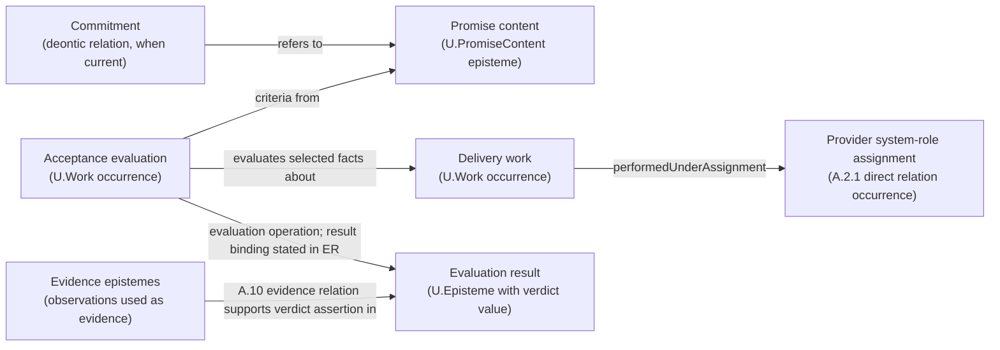

gram P and input x, decide whether P(x) terminates. Under the ordinary Turing-computable model, no total algorithm decides this for all programs and inputs.

Construct a program Q with x and P's description included. Q simulates P on x, suppresses the simulated program's output, and emits the designated event if and when the simulation halts. The description of Q is obtained by placing the supplied data inside this fixed wrapper; constructing it does not run P(x).

If P(x) halts, Q emits. If P(x) does not halt, Q never reaches its emitting step. A supposed total event-decider applied to Q would therefore decide A in both cases. This contradicts the halting result, so the requested universal event-decider is unavailable under these assumptions.

The direction matters: halting was reduced to event decision. The argument constructed a halting decider from the assumed event decider.

Now change the admitted system to a fully represented deterministic finite-state machine with effective transitions and a decidable emitted-event label on each transition. Starting from its initial state, follow transitions while remembering visited states. Return yes upon the event; return no if the machine halts without it or repeats a state before emitting it. At most the number of reachable states can be visited before such repetition or termination. Determinism and complete state make the future repeat as well.

This supplies a usable decision procedure for the changed class. If an environment can add unrepresented inputs or the “state” omits a changing counter, restore those inputs or state before applying this finite-state result. C.29.2 and A.3.3.TR supply that formulation work. The original universal impossibility and this restricted procedure remain compatible.

#### CMP.1:5.3 - A small description can create an expensive search

An input describes b Boolean state variables. A conversion that explicitly constructs every possible state may produce `2^b` vertices. Even a solver linear in the resulting graph size then gives an exponential dependence on b.

The construction may still be effective and useful for small b. For a larger budget-constrained use, keep the original answer condition and seek a representation or method that avoids explicit expansion, or derive a suitable restriction of reachable states. Calling the target solver efficient does not settle the cost of the whole reduction.

#### CMP.1:5.4 - Recover a witness through adaptive decision queries

The required answer is the lexicographically least satisfying assignment of a Boolean circuit C on n ordered input bits, or `UNSAT`. An available solver decides whether a supplied circuit has any satisfying assignment and terminates on either answer.

First query C. A negative answer gives `UNSAT`. After a positive answer, retain a prefix with a satisfying extension. Try its next bit as 0 and query the circuit with that prefix fixed. Keep 0 if the answer is yes; otherwise keep 1. The retained prefix still has a satisfying extension. After n bit choices it is a complete satisfying assignment; preferring 0 at each position makes it the least one.

For `C(a,b,c)=(a or b) and (not a or c)`, the answers are:

`C: yes -> prefix 0: yes -> prefix 00: no -> prefix 010: yes`.

The recovered answer is `010`. For circuit size N, copying each restricted circuit takes O(N) work. There are at most n+1 calls, giving total work bounded by `(n+1)T_B(O(N))+O(nN+n)` and sequential-call space `O(N+n+S_B(O(N)))`.

If the solver only recognizes satisfiable inputs and may diverge otherwise, the query at prefix `00` can fail to return. This construction then lacks its required guarantee. Obtain a total decider or use finite enumeration, whose worst-case work is `O(2^n N)`.

### CMP.1:6 - Bias-Annotation

The solver's familiar name can draw attention away from its admitted inputs and returned guarantees. Follow the actual conversion and recovery, including the negative branch the original problem requires.

An impossibility argument can also be overextended. Keep its input class, computational model and answer guarantee visible, then examine a changed useful question at those same points. A resource estimate is conditional on the representation used.

### CMP.1:7 - Conformance Checklist

For the reduction being used:

- Both problems have stated admitted inputs and required answers.
- The conversion is effective from the supplied input and produces admitted queries.
- Every solver outcome relied on by the construction has an effective recovery with the required guarantee.
- The correctness argument covers the needed directions and termination conditions.
- The consequence follows the direction of the constructed solver reuse.
- A resource claim includes conversion, calls, recovery and relevant representation sizes.
- The result supplies an algorithm, a useful restricted alternative or a limit with a specific effect on the next move.

### CMP.1:8 - Common Anti-Patterns and How to Avoid Them

**Requiring the answer to construct the query.** A wrapper program can be constructed without running the program it contains, as in :5.2. Identify that effective construction; treating a truth-dependent choice of wrapper as already computable would leave the original problem unsolved.

**Using only the successful branch.** Finding an emitted event confirms a positive case. The universal decision request also requires a terminating negative answer, which simulation alone leaves unresolved.

**Reversing the reduction.** Write the A-procedure using the B-solver before transferring an impossibility or an algorithm. Its actual calls determine the direction.

**Hiding conversion cost behind the solver's bound.** Explicit expansion of b bits into `2^b` states dominates the use in :5.3. Include the created instance and its storage in the resource argument.

### CMP.1:9 - Consequences

An unfamiliar problem can acquire a usable algorithm through a constructed connection to another. The same form of reasoning can establish a limit by showing what an assumed solver would imply.

The reduction retains responsibility for inputs, answers and resource effects at the connection. A new solver or representation can improve it; a changed answer guarantee or input class can invalidate only part of its earlier use.

### CMP.1:10 - Architectural Rationale

Effective conversion and answer recovery make reduction a computational method. Mathematical correspondence supplies the relevant implication, while computability and cost determine whether the connection can be used under the stated conditions.

Solver reuse and impossibility belong together because the latter follows by assuming and then constructing the former. Their guarantees and direction remain explicit. The shortest-path and program-wrapper cases demonstrate different uses of that shared method; neither application defines the scope of computational thinking.

C.29.2 already supplies the computational question, representation and ordinary progress account. This pattern develops a missing reduction, its answer relation and the consequence of an available or assumed solver. More specialized algorithm constructions can supply the conversion or the target solver.

### CMP.1:11 - SoTA-Echoing

Erickson's [Undecidability notes](https://jeffe.cs.illinois.edu/teaching/algorithms/models/07-undecidable.pdf), §§7.4-7.5 and 7.9-7.10, supplies a foundational account of effective program construction and the direction of reduction arguments. The adopted contribution is the explicit construction that turns an assumed solver into another solver. The event-wrapper example here uses the halting result under its stated computational model.

Erickson's [Shortest Paths](https://jeffe.cs.illinois.edu/teaching/algorithms/book/08-sssp.pdf) supplies the directed-graph and negative-cycle machinery used in the solver-reuse case. The recovered inequalities and their infeasibility argument explain what that machinery answers in the source problem.

A direct algorithm is preferable when conversion adds effort without improving the needed result. When a reduction is useful, the choice among ordinary computability, bounded-resource, approximate or randomized reductions follows the answer guarantee being transferred. A preserved decision alone leaves an approximation ratio, probability or practical runtime to its corresponding argument.

### CMP.1:12 - Relations

- **C.29.2** specifies computational answers, representation, progress, accuracy and resources.
- **C.29.1** establishes a subject correspondence when the computational problem describes something beyond the mathematical construction.
- **MATH.17 and MATH.18** develop operations on operations, interpretations and their preserved consequences.
- **MATH.4 and MATH.12** supply induction and constructive argument methods when the reduction needs them.
- **A.3.3.TR** recovers state and continuation distinctions, including those needed by finite-state restrictions.
- **C.39 and C.40** help develop a missing computational way or explore alternatives when a construction remains unresolved.

### CMP.1:End

## CMP.2 - Derive a Recursive Procedure from a Problem Decomposition

> **Type:** Method
> **Status:** Usable, evolving
> **Normativity:** Normative

### CMP.2:1 - Problem frame

**Use this when** you can state the answer required from a finite input, but a procedure for obtaining it is missing or unaffordable. Parts of the task resemble the whole, or a transformation produces another instance whose answer could help. You need to choose those subproblems and determine what they must return.

An engineer, researcher or AI agent may recognize a recursive formula yet be unable to turn an unfamiliar problem into one. A common difficulty appears at recombination: each part returns a correct answer to its own question, but those answers omit information needed for the whole. Another appears at progress: a call changes its input without bringing computation closer to a return.

The gain is a recursive procedure with usable base cases, a reason its calls return, a justified way of combining their results and an initial account of its cost. The reader needs to follow finite case distinctions, functions and a simple inductive argument. MATH.4 can supply that argument; C.29.2 supplies the relation between a computational answer and the question it is meant to settle.

Use a suitable existing procedure directly when it already answers the question within the available resources. This method develops recursion for obtaining a finite answer. A server, stream or other intentionally continuing process needs a progress condition appropriate to that behavior.

### CMP.2:2 - Problem

How can one discover a recursive algorithm whose subproblems are obtainable, whose answers suffice to reconstruct the requested result, and whose unfolding has an acceptable cost?

Choosing a familiar equation or writing a self-call does not settle those questions. The designer must connect the meaning of a subproblem to the operation that uses its answer.

### CMP.2:3 - Forces

| Force | What must be reconciled |
| --- | --- |
| Small subproblems and sufficient answers | A short returned value can omit the boundary information needed for recombination. |
| Natural structure and useful decomposition | Following input syntax makes some arguments easy; a different split may reduce work or expose the needed result. |
| Generality and effective choice | A mathematical existence argument can leave the next branch or object unavailable to computation. |
| Progress and branching | Every call may become smaller while their number grows too quickly. |
| Simple cost model and actual representation | Counting additions can hide copying, growing integers or expensive access. |
| Reuse and changed questions | A summary adequate for one result may discard information needed by a later result. |

### CMP.2:4 - Solution

**State the answer → propose smaller questions → derive the join → strengthen what must be returned → establish return → compare the work.**

#### CMP.2:4.1 - Fix the question and the available operations

Describe an input `x`, the information available about it, and what a returned answer must allow its recipient to do. Asking for an optimum value, one attaining object, or every attaining object gives different result requirements. State the empty and degenerate cases when they belong to the input family.

List the operations that can actually be performed on this input: inspect a constructor, split an interval, compare keys, compute a remainder, test a condition, or call a supplied procedure. A proposed step such as “choose the correct partition” remains a construction task until the partition can be obtained.

For example, maximum segment sum on a sequence of integers asks for a contiguous nonempty segment with largest sum. Returning its sum answers a value query; locating the segment also requires endpoints. Permitting the empty segment changes the base case and the answer on an all-negative input.

#### CMP.2:4.2 - Choose a decomposition by asking how answers would join

Take a representative input and suppose that selected smaller questions have been answered correctly. Try to construct the answer for this input from those returned values. This local design question avoids having to unfold the entire recursion while inventing it.

Useful proposals include removing one element, splitting into balanced parts, following the constructors of a structured input, or transforming the input while decreasing another measure. The last case includes Euclid's replacement of a pair by a divisor and remainder. Input size need not decrease in every component.

For each proposal, account for every form a valid answer can take. If a sequence is split into left and right parts, an optimal contiguous segment lies wholly on one side or crosses the boundary. The crossing case shows what the two recursive answers must supply.

Keep the proposal that makes the join both justified and obtainable. If the only available join searches the original problem again, change the subproblem question, retain more information, or try another decomposition.

#### CMP.2:4.3 - Strengthen the returned result when the join needs more

Write the join using named values. Each value must come from the input, a smaller answer or an available local operation. A missing value identifies a specific revision of the subproblem, rather than a reason to discard recursion as a whole.

For maximum segment sum, the best segment on each side is insufficient: a crossing segment uses a suffix of the left side and a prefix of the right. Let each nonempty part return four quantities:

- `T`: the sum of the whole part;
- `P`: the largest sum of a nonempty prefix;
- `S`: the largest sum of a nonempty suffix;
- `B`: the largest sum of a nonempty contiguous segment.

For a left summary `L` and right summary `R`, construct:

```text
T = L.T + R.T
P = max(L.P, L.T + R.P)
S = max(R.S, R.T + L.S)
B = max(L.B, R.B, L.S + R.P)
```

The alternatives in each maximum come from the possible locations of the corresponding segment. To return an actual segment, carry the endpoints attaining each selected prefix, suffix and best segment. Choose a consistent rule for ties when only one witness is wanted.

This is the algorithmic use of strengthening an inductive result in MATH.4. The additional design decision is what summary enables an affordable join for the chosen problem decomposition. Further questions may require a different summary.

#### CMP.2:4.4 - Supply base cases and a decreasing measure

Give a direct result for each case on which recursion stops. Then show that every recursive call reaches such a case after finitely many steps. A nonnegative integer that strictly decreases is often enough. A finite input constructor or a well-founded ordering can supply the same argument when one numerical size is awkward.

For the segment procedure, a singleton `v` returns `(v,v,v,v)`. Split every longer interval into two nonempty shorter intervals. Its length decreases along every call path. This also explains why an empty interval needs its own convention or must be excluded before calling the procedure.

For nonnegative integers with `b>0`, Euclid's call `(a,b) → (b,a mod b)` decreases the second component because `0≤a mod b<b`. The first component may increase relative to its old value; it is the selected measure that must decrease. At `b=0`, return `a`, with the intended convention for `(0,0)` fixed separately.

When a termination checker fails, inspect which decrease is absent from its account. A supplied difference, lexicographic measure or invariant may express the progress already present in the procedure. If progress is genuinely missing, repair the procedure or weaken its claimed result. A small successful run alone does not establish return on every allowed input.

#### CMP.2:4.5 - Establish the result and expose its computational cost

Use the base and smaller-call assumptions to establish the returned property. Recombination must work for every smaller answer allowed by its specification, including the selected tie behavior. When deriving a program from an existing proof, MATH.12 recovers the operations hidden in that proof.

Count the subcalls and local work. A recurrence for mathematical values and a recurrence for computational cost answer different questions. For balanced segment splitting with interval views, constant-cost arithmetic and the four-value join, the work satisfies `W(n)=W(floor(n/2))+W(ceil(n/2))+O(1)`, giving `O(n)` operations. Sequential depth-first evaluation retains `O(log n)` summaries on its call stack. Copying each subarray instead adds work at each level; growing integer values also change the cost per addition.

If equal subproblems recur, CMP.3 can identify and share them. If the decomposition generates alternatives that can be ruled out, CMP.4 can construct those exclusions. If representation dominates the cost, compare the access and update operations before replacing the mathematical construction.

#### CMP.2:4.6 - Use the result and revisit the assumption that changed

Run a small case through the complete procedure, including the use of its returned answer. Change one condition that stresses the construction: empty input, a boundary case, a different output request or a resource limit. Follow the affected base, join and progress arguments.

The result may be a working procedure, an unaffordable but informative construction, or a located missing operation. Use that difference to choose the next algorithmic move. Formal proof or additional testing is chosen for the uncertainty that matters to the receiving use.

### CMP.2:5 - Archetypal Grounding

#### CMP.2:5.1 - A join that initially loses the answer

For `[-2,3,-1,4,-5]`, split into `[-2,3,-1]` and `[4,-5]`. Their best sums are 3 and 4. Keeping only those values would miss the crossing segment `[3,-1,4]`, whose sum is 6.

The strengthened summaries are `L=(0,1,2,3)` and `R=(-1,4,-1,4)`, ordered as `(T,P,S,B)`. The join yields `(-1,4,1,6)`. With attaining endpoints retained, it returns the segment from the second through fourth element. The user can now obtain the segment rather than merely knowing its value.

**Changed condition:** suppose the wanted segment may contain at most two elements. The former crossing winner has length three. The four maxima have discarded the sums of shorter candidate suffixes and prefixes. Add prefix and suffix results indexed by permitted length, combine only lengths whose sum is at most two, and keep the same restriction on internal best segments. In this case the answer becomes 4, attained by `[4]`. For a general limit `k`, a straightforward join over length pairs costs `O(k²)`; the resource consequence can justify a different algorithm. Reusing the old four-value join would silently answer the earlier question.

#### CMP.2:5.2 - A subproblem obtained by a transformation

To compute `gcd(48,18)`, replace the pair by `(18,12)`, then `(12,6)`, then `(6,0)`, and return 6. The equality `gcd(a,b)=gcd(b,a mod b)` follows because a common divisor of either pair divides both entries of the other pair. The remainder operation and decreasing second component turn that equality into a returning procedure.

If the next use also needs coefficients `u,v` with `u*a+v*b=gcd(a,b)`, the returned number alone is insufficient. Suppose the smaller call supplies `d=u'*b+v'*r`, with `r=a-q*b`. Substitution gives `d=v'*a+(u'-q*v')*b`; return the updated coefficients too. For the original pair, `6=(-1)*48+3*18`. The same recursive decomposition supports a stronger output through a changed join.

### CMP.2:6 - Bias-Annotation

Familiar syntax can make one decomposition appear inevitable. Compare its join and cost with another plausible decomposition when those differences can change the choice. Conversely, an elegant asymptotic bound can hide operations that the actual representation makes expensive.

A successful example demonstrates the construction and can expose a missing case. The general result depends on the base, joining and progress arguments, with any additional assurance selected for the actual use.

### CMP.2:7 - Conformance Checklist

- The input and wanted result distinguish a value from any witness or continuation information that is needed.
- Each subproblem is constructible from available data, and its returned specification supplies the join.
- The base cases cover the stopping situations; every recursive path has the stated progress toward one of them.
- The join preserves the answer property, including boundaries and the chosen treatment of ties.
- The cost account includes branching, recombination and representation costs material to the decision.
- A changed requirement is followed through the returned information and affected clauses before the procedure is reused.

### CMP.2:8 - Common Anti-Patterns and How to Avoid Them

| Misstep exposed by the method | Consequence and repair |
| --- | --- |
| Return only the final scalar from each part | The segment example loses crossing answers. Derive the join and retain the boundary summaries it consumes. |
| Treat a changed input as a smaller input | Calls can continue indefinitely. State a well-founded decrease and check every recursive branch against it. |
| Treat termination as affordability | An exponential call tree can terminate correctly. Count calls and local work; share repeated subproblems when useful. |
| Keep the old summary after changing the question | A length constraint or witness request can be lost. Reconstruct what the new join needs and revise the affected result. |

### CMP.2:9 - Consequences

The method makes recursive algorithm design available as a sequence of inspectable choices. It exposes a useful link between mathematical construction and algorithmics: strengthening what a subproblem returns can make a previously unavailable or costly computation possible.

The resulting algorithm need not be the fastest one. Its explicit subproblem and join create opportunities for sharing, new representations, parallel execution or replacement by another algorithm. Those improvements retain their own correctness and resource questions.

### CMP.2:10 - Architectural Rationale

Subproblem meaning, recombination, progress and cost belong together because changing one can force a change in the others. Starting from a recursive syntax would obscure the discovery of the required question and summary. Starting from an induction proof alone can leave the effective decomposition and cost unresolved.

MATH.4 supplies witness construction by induction; MATH.12 supplies extraction from a proof. This pattern constructs and compares recursive obtaining procedures, including decompositions that do not follow the input's constructors. CMP.3 changes how repeated calls are evaluated without silently changing what they ask. C.29.2 retains the common computational formulation and its connection to the receiving question.

### CMP.2:11 - SoTA-Echoing

[Erickson, *Algorithms*, chapter 1](https://jeffe.web.engr.illinois.edu/teaching/algorithms/book/01-recursion.pdf) develops recursion through reductions to simpler instances and separate correctness and running-time arguments. This remains a useful foundational construction line. Adopt the local design question about a correct smaller answer; adapt it by making the information required at the join explicit and testing a changed output request. A remembered recurrence alone supplies less help when the decomposition itself is missing.

For the construction in :4.2–4.5, an available recurrence or input-structural split is the simpler alternative when it already returns enough information for the join and meets the cost requirement. Strengthening a subanswer is worth its extra work when that simpler return loses the requested result, as the four-value segment construction and coefficient-returning divisor procedure demonstrate. Reconsider this choice when a different output, representation or competing decomposition changes either sufficiency or total cost.

The current [Lean reference on recursive definitions](https://lean-lang.org/doc/reference/latest/Definitions/Recursive-Definitions/) distinguishes structural recursion, well-founded measures and forms of partial or continuing behavior. Adopt the distinction between a missing syntactic decrease and an absent termination argument. Formal encoding can check a consequential or difficult construction; its additional work is unnecessary for simply exploring a decomposition. No particular proof assistant or finite-return account is imposed on every computational process.

### CMP.2:12 - Relations

- **C.29.2 - Computational Formulation:** supplies the requested computational result, elementary operations and connection to use.
- **CMP.1:** supplies reuse through an effective reduction; recursion constructs the repeated same-family reduction and its return.
- **MATH.4 and MATH.12:** supply inductive construction and the obtaining operations recoverable from proof.
- **CMP.3:** shares repeated calls and chooses their evaluation and storage; **CMP.4** handles exclusions among alternative extensions.
- **MATH.20:** supplies bounds used when comparing cost or consequences. The general resource and portfolio methods choose among the constructed alternatives.

### CMP.2:End

## CMP.3 - Share and Schedule Repeated Subcomputations

> **Type:** Method
> **Status:** Usable, evolving
> **Normativity:** Normative

### CMP.3:1 - Problem frame

**Use this when** a procedure repeatedly obtains the same intermediate answer, or retains so many intermediate values that it cannot finish within the available memory. You need to determine which work can be shared, when to perform it, and what to retain for later use.

The situation occurs in dynamic programming, symbolic evaluation, database computations, program analysis and differentiation of computational graphs. The repeated unit is a subcomputation with stated inputs and a needed result. Similar-looking calls may still require different answers because their data, assumptions or effects differ.

The gain is an evaluation procedure that performs less repeated work or fits the available storage while preserving the requested answer. The reader needs to understand a function call and a directed dependency graph; the graph is explained here as a set of intermediate results with arrows from each prerequisite to its consumer. CMP.2 can supply the original recursive procedure.

Direct recomputation is often best for a cheap, seldom-repeated operation. Apply this method when sharing or storage choices can change the feasibility or cost of the computation. A changing environment requires the meaning of reuse to be established before previous results are used.

### CMP.3:2 - Problem

How can repeated computations be identified and reorganized without merging cases that need different answers, using an evaluation order and storage policy that support the requested result?

“Cache the answer” leaves three questions open: what counts as the same question, which answers must already be available, and whether the retained information suffices for the eventual output.

### CMP.3:3 - Forces

| Force | What must be reconciled |
| --- | --- |
| Sharing and distinctions | A coarse reuse key saves work but can conflate different continuations. |
| Demand and predictable order | Computing only requested states avoids unused work; a regular order can simplify access and scheduling. |
| Time and storage | Retaining values avoids computation but can exhaust memory or increase data movement. |
| Value and witness | A small working table can retain the optimum value while losing the path attaining it. |
| Reuse and change | An answer remains usable only while the data and conditions on which it depends still apply. |
| Mathematical equality and execution effects | Repeating a pure calculation and repeating an observation or state change can produce different behavior. |

### CMP.3:4 - Solution

**Name the repeated question → retain its determining information → expose dependencies → choose evaluation order → choose retained values → recover the required output.**

#### CMP.3:4.1 - State what a subcomputation means

Describe the result of one subcomputation as a function of its inputs and fixed environment. Include every condition that can change the returned answer or its use. A pair of sequence indices identifies an edit-distance subproblem only within specified sequences, edit operations and costs.

For optimization, distinguish the best remaining value from accumulated cost already incurred. If two histories lead to the same remaining problem but have different past costs, share the remaining answer and combine it with each history's cost. Merging the complete histories may lose a better total. When history changes the allowed future choices, retain that history information in the state.

This question is also useful before an implementation exists: identify the small family of questions that many possible constructions would ask. A recursion tree can then be designed around those questions instead of optimized after the fact.

#### CMP.3:4.2 - Define reuse by the answer the continuation needs

Choose a representation of subproblem identity, often called a key. Equal keys must imply interchangeable answers for the intended continuation. The key can contain input values, an immutable object's identity, a data revision, parameters and relevant assumptions. A cache local to one fixed computation may keep some of these implicit in its scope.

MATH.2 supplies the reasoning behind an identification: the operation used after identification must give the same required result whichever representative was used. An implementation also needs an effective way to recognize the keys. A hash narrows candidates; resolve collisions before treating different data as identical.

Distinguish completed answers from computations that have merely begun. Reading an unfinished entry as a result can introduce circular reasoning. In parallel evaluation, decide whether repeated demand waits for one producer or safely computes another copy; preserve the meaning of completion in either case.

For an operation with effects, state what reuse preserves. Replacing two reads of a changing sensor by one stored reading changes the observation sequence. Repeating a random draw and reusing one sample changes dependence. Sharing a pure calculation on an already obtained reading or sample can be valid. Select the intended operation before choosing the reuse rule.

#### CMP.3:4.3 - Construct the dependency graph and an evaluation order

For each distinct subproblem, identify which other results are needed to obtain its answer. Draw an arrow from a prerequisite to its consumer. Count distinct states and the work needed to combine each state's prerequisites and alternatives; the number of states alone does not establish the total cost.

If dependencies are acyclic, two standard constructions are available:

| Construction | How it obtains results | Useful condition |
| --- | --- | --- |
| Memoized evaluation | On a call, return a completed stored answer if present; otherwise obtain prerequisites, compute the result and store it. | Only part of the possible graph is expected to be reached. |
| Ordered table evaluation | Obtain a topological order, in which prerequisites precede their consumers, and compute states in that order. | The needed state region and dependency order are known and regular access helps. |

These methods can be combined by regions. Independent ready states can also be evaluated concurrently, provided the sharing and combination operations preserve the result.

A directed cycle prevents this simple ordering. Determine whether it is an erroneous recursive dependency, a finite-horizon problem missing its horizon coordinate, or a genuine fixed-point problem. For a genuine cycle, provide the iteration, ordering or other solving method and its result conditions. Adding memoization alone does not solve mutually dependent equations.

#### CMP.3:4.4 - Retain what remains live, and recompute selectively

A value is live while a later operation will need it and cannot obtain it more cheaply by another means. Find its last planned consumer. After that use, the storage can be reused unless the requested final output needs the value for reconstruction.

Compare full retention, a moving set of recent values, and selected stored checkpoints from which intervening work is recomputed. Include key storage, lookup, copying, arithmetic size and transfer costs when they can change the choice. The mathematical dependency graph can be unchanged while these execution costs differ substantially.

Recomputation must reproduce the needed value from retained inputs and conditions. If it repeats an external effect or uses changed data, its meaning needs separate treatment. A stored checkpoint is useful only if it contains enough information to restart that part of the computation.

#### CMP.3:4.5 - Recover the value, witness or continuation actually requested

For each return, ask what the recipient must obtain. A dynamic program may return only an optimum value, one attaining sequence of choices, a count, or all attaining sequences. Store a selected predecessor when one witness is required, retain all relevant alternatives when their multiplicity matters, or provide an additional reconstruction procedure.

A small table is not automatically a complete answer. Sometimes an extra pass or a recursive split reconstructs a witness using less storage than retaining all predecessors. Include that work in the cost comparison.

When inputs or requirements change, identify the affected dependencies. Invalidate or recompute their consumers, or show that the changed information cannot alter those results. Choose the simplest reuse boundary that pays for itself; rebuilding a small calculation can be cheaper than maintaining fine-grained dependencies.

#### CMP.3:4.6 - Compare the resulting procedure with the original

Evaluate one complete use under both procedures and follow a changed condition that can break the proposed identification or storage policy. Check returned content as well as operation counts. The method's result is the changed computation and its resource consequence.

Use C.11.DUA when deciding whether another measurement, argument or experiment would change the choice. A theoretical bound can guide an initial implementation; actual resource observations can select among alternatives whose constant factors or memory behavior matter.

### CMP.3:5 - Archetypal Grounding

#### CMP.3:5.1 - Obtain a sequence-editing answer without expanding repeated calls

Let `D(i,j)` be the smallest number of unit-cost insertions, deletions and substitutions transforming the first `i` characters of fixed sequence `A` into the first `j` characters of fixed sequence `B`. Matching characters cost zero. Then:

```text
D(0,j) = j
D(i,0) = i
D(i,j) = min(D(i-1,j)+1,
             D(i,j-1)+1,
             D(i-1,j-1) + (0 if A[i]=B[j] else 1))
```

Here character positions start at 1. Each alternative identifies the last edit or match. Removing it leaves the corresponding smaller problem; adding it to a best smaller answer supplies a candidate for the whole prefix. Thus the minimum covers the possible last steps.

Naively unfolding this recurrence repeatedly requests the same prefix pairs. Within one fixed pair of sequences and one cost rule, use `(i,j)` as the key. Dependencies have smaller `i+j`, so increasing rows and then columns gives a valid order.

For `A=CAB` and `B=AB`, the complete table is:

| Prefix of A | Empty | A | AB |
| --- | --- | --- | --- |
| Empty | 0 | 1 | 2 |
| C | 1 | 1 | 2 |
| CA | 2 | 1 | 2 |
| CAB | 3 | 2 | 1 |

The result is 1; deleting the initial C attains it. There are `(m+1)(n+1)` states for lengths `m,n`, with constant work per interior state under constant-cost character comparison and small-integer arithmetic. Full retention uses `O(mn)` cells. If only the distance is required, the preceding and current row suffice, giving `O(n)` working cells.

**Changed output:** the recipient now needs an edit script. The final distance and two surviving rows do not supply the deleted path. One repair stores a minimizing predecessor for each cell and traces back from `(m,n)`. Another computes forward and backward costs to a middle row, chooses a column minimizing their sum, and recursively reconstructs the two halves. Every edit path crosses that row, which justifies the split. This second construction exchanges recomputation for storage; CMP.2 supplies the recursive decomposition. Neither choice alters the meaning of an allowed edit.

**Changed reuse scope:** for `A=CB`, `B=AB`, the value at `(2,2)` is 1; for `A=CA`, `B=AB`, it is 2. A global cache keyed only by `(i,j)` would conflate them. Restrict the cache to a fixed input pair or include the input identity and relevant conditions.

#### CMP.3:5.2 - Share an expression while preserving its interpretation

For `f(x,y)=(x+y)*(x+y)+(x+y)`, build one node `t=x+y` with three uses, then obtain `t*t+t`. With `x=2,y=3`, the result is 30. This replaces three additions of `x+y` by one and shares its stored value until the final addition.

If `y` changes to 4, `t` and its consumers must change; the result becomes 42. If each occurrence instead meant “read the next measurement and add x,” the shared expression would change the computation's meaning. The subproblem must be a fixed pure addition of supplied values for this identification to hold.

In differentiation of a longer expression graph, intermediate values may be needed again in reverse order. Keeping all of them can exceed memory. Retain selected restart values and recompute intervening pure operations when needed, comparing the extra work with reduced storage. This applies the same method to a different receiving algorithm.

### CMP.3:6 - Bias-Annotation

Visible repetition can encourage indiscriminate caching. The profitable unit may instead be a larger common subproblem, or no shared unit at all when lookup costs dominate. A small count of stored cells can also hide large objects, metadata and movement between memory levels.

Results obtained from fixed data invite overgeneralization to changing environments. State where a key's omitted parameters are held fixed, and revisit that boundary when the result is reused elsewhere.

### CMP.3:7 - Conformance Checklist

- The repeated question and its determining data are recoverable from the key and its stated scope.
- Equal keys justify the required reuse, including relevant effects, randomness and changed inputs.
- Dependencies determine an evaluation order, or a separate method resolves the genuine cycles.
- Completed results are distinguished from work still being evaluated.
- Storage and recomputation choices preserve the final value, witness or continuation that is required.
- The resource comparison counts relevant transitions, arithmetic, access and storage as well as states.
- The changed-condition use follows the dependency or output requirement that actually changed.

### CMP.3:8 - Common Anti-Patterns and How to Avoid Them

| Misstep exposed by the method | Consequence and repair |
| --- | --- |
| Key a subproblem by its position across changing inputs | The edit-distance example reuses an answer to another question. Bind the key to the input and conditions or narrow the cache's lifetime. |
| Treat an in-progress entry as an answer | A cyclic dependency can return unsupported content. Keep completion explicit and supply the appropriate cycle-solving method. |
| Discard predecessors while promising a witness | The optimum value remains but the attaining object cannot be returned. Retain choices or construct a reconstruction pass. |
| Share effects as if they were pure calculations | Observations, updates or random dependence can change. Identify the fixed data calculation that is actually interchangeable. |

### CMP.3:9 - Consequences

Many repeated call trees become a much smaller graph of distinct questions. Evaluation order and retention become design choices, making time, memory and output reconstruction comparable.

The transformation creates responsibilities for identity and change. Its benefit depends on repetition, graph size and access costs; a dependency graph can itself be enormous. A correct shared computation can still be unaffordable, which may call for a changed representation, approximation or problem formulation.

### CMP.3:10 - Architectural Rationale

Identity, dependencies, evaluation and lifetime form one method because changing the result being shared can alter all four. Separating “add a cache” from the required continuation would hide the main correctness question. Including selective recomputation prevents storage minimization and computation minimization from being treated as the same objective.

The mathematical identification is supplied by MATH.2, the subproblem construction by CMP.2, and common computational formulation by C.29.2. This pattern supplies the algorithmic reorganization. It can serve numerical, symbolic and learning procedures.

### CMP.3:11 - SoTA-Echoing

[Erickson, *Algorithms*, chapter 3](https://jeffe.web.engr.illinois.edu/teaching/algorithms/book/03-dynprog.pdf) develops memoization, deliberate evaluation order, space saving and reconstruction of sequence-editing answers. Adopt the progression from a meaningful recurrence to distinct subproblems and their evaluation. Extend the identity question explicitly to changing inputs and effectful operations. The CAB example is a small independent derivation of that general design approach.

[Hirschberg's linear-space reconstruction](https://ics.uci.edu/~dhirschb/pubs/p341-hirschberg.pdf) is a historical but still useful counterexample to the assumption that reconstructing a sequence requires retaining a complete table. Its middle-split method also applies to edit paths. Adopt reconstruction as a choice between storage and additional calculation; do not claim its cost is optimal for every input representation or modern machine.

Current [JAX checkpointing documentation](https://docs.jax.dev/en/latest/gradient-checkpointing.html) shows the same storage/recomputation choice in automatic differentiation. Adopt its substantive distinction between saved intermediates and recomputed pure operations. Compiler behavior and hardware costs affect the best schedule; a particular library interface is an example of realization rather than a prerequisite of this method.

The working choice in :4.3–4.5 is between retaining all needed intermediate answers, recomputing them when requested, and retaining selected answers from which others can be reconstructed. Full retention is simpler when memory is ample and reconstruction would dominate. Recalculation avoids maintaining entries whose results are cheap or rarely reused. Selective retention pays extra scheduling or reconstruction work when it preserves the required answer under a tighter memory limit; the edit-script construction supplies one such choice. Reconsider it when effects change which calls can be shared, the recipient needs a different witness, readout costs change, or a competing reconstruction method improves the same resource trade-off.

### CMP.3:12 - Relations

- **CMP.2:** constructs the subproblems and their combination; this method changes how repeated questions are evaluated.
- **MATH.2:** supplies identification under operations; **A.3.3** helps restore state information when equal retained states allow different continuations.
- **C.29.2:** supplies computational result and resource conditions. **C.29.3** applies when realization changes the relevant execution assumptions.
- **MMP.8:** supplies information restrictions for adaptive choices; a computation used to obtain such a policy must preserve the observations and history on which its choices depend.
- **C.11.DUA:** selects additional checking or measurement for a decision that could change, including the value of further optimization.

### CMP.3:End

## CMP.4 - Construct Computational Search with Justified Exclusions

> **Type:** Method
> **Status:** Usable, evolving
> **Normativity:** Normative

### CMP.4:1 - Problem frame

**Use this when** an answer must be constructed by choosing among alternatives, direct enumeration is too costly, and information about a partial choice can eliminate some of its completions. You need a search procedure that saves work while retaining the answers its recipient needs.

Examples include finding an assignment satisfying constraints, selecting a best combination, constructing a counterexample and exploring possible program states. The general difficulty is deciding which alternatives may be omitted. A promising search order can find an answer quickly while providing no reason to exclude the alternatives visited later.

The gain is a search with explicit coverage, useful exclusion rules and a result that remains interpretable if computation is interrupted. The reader needs finite sets, logical conditions and inequalities; MATH.20 supplies a more developed bound argument. C.29.2 supplies the wanted computational answer.

Use direct construction or enumeration when it already solves the problem at acceptable cost. Heuristic search is also useful when a good candidate is enough. Apply the exclusion method to the conclusions that must be retained, without requiring proof of global optimality for every candidate search.

### CMP.4:2 - Problem

How can a procedure omit whole sets of candidates and still return a valid witness, a justified optimum or a warranted statement that no required answer exists?

The exclusion must concern every relevant completion represented by the omitted branch. Failure of one attempted completion or poor predicted performance alone does not establish that result.

### CMP.4:3 - Forces

| Force | What must be reconciled |
| --- | --- |
| Coverage and early progress | Broad exploration retains alternatives; informed order may obtain a useful witness sooner. |
| Cheap and strong exclusions | A weak inexpensive bound can save more total work than a costly tight bound. |
| One answer and all answers | A rule preserving one optimum can discard other attaining objects. |
| Current candidate and remaining possibility | A feasible result establishes what can be done; a branch bound constrains what remains possible. |
| Reuse and assumptions | A learned conflict can remain useful across branches but fail after constraints change. |
| Return time and strength of conclusion | An interrupted search can still supply a candidate and a bound, while exhaustion supports a stronger conclusion. |

### CMP.4:4 - Solution

**Represent the alternatives → cover them by extensions → derive exclusions → choose exploration order → retain the remaining possibility → return the supported answer.**

#### CMP.4:4.1 - Define a partial choice and its completions

State what constitutes a complete candidate, when it is admissible, and which result is wanted: one witness, a best value and witness, every optimum, a count, or a counterexample. For optimization, state the criterion and its direction.

Choose a representation `s` of partial choices. Explain which complete candidates it represents and what information is still undecided. Include past choices when they change future feasibility or cost. If several histories have the same remaining question, CMP.3 can share that question while preserving the history-dependent contribution.

Construct extensions that cover the relevant completions. Binary inclusion/exclusion, a variable's remaining values and legal next transitions are common forms. Overlap is permitted for finding one witness but can duplicate results; counting and enumeration need a way to handle it. A symmetry reduction needs an account of which answers it identifies and whether the recipient accepts that identification.

#### CMP.4:4.2 - Derive an exclusion that applies to the entire branch

Select a reason for omitting `s` according to the result required:

| Reason | Required argument | What it allows |
| --- | --- | --- |
| Infeasibility | No completion of `s` can satisfy the original conditions. | Discard `s` when looking for admissible answers. |
| Bound | Every completion has a value no better than a bound compared with an already admissible answer. | Discard `s` for the corresponding optimization conclusion. |
| Dominance | Another retained choice supplies an admissible answer at least as good for every continuation that matters. | Omit dominated work while retaining the stated result. |
| Equivalent completions | A retained representative accounts for the answers required from `s`. | Share or omit duplicate work with the appropriate treatment of identity and multiplicity. |

Construct these arguments from the constraints and the partial state. Propagating a choice can shrink the permitted values of other variables; an empty remaining domain then excludes that branch. A bound may come from relaxing the remaining problem through CMP.5. Dominance must include future possibilities, not merely compare the current partial scores.

For a maximization problem, let `L` be the value of the best admissible candidate already obtained, often called the incumbent. Let `U(s)` be at least as large as the value of every admissible completion of `s`. If one optimum is required, `U(s)≤L` permits exclusion. If every attaining candidate is required, equality can still contain needed answers; use `U(s)<L` for this bound-based exclusion and preserve the attaining alternatives.

For minimization, reverse the bound directions: a lower bound on every completion is compared with the cost of a known feasible candidate. A candidate score and a bound on all completions have different roles even when their numerical values coincide.

#### CMP.4:4.3 - Reuse consequences within their conditions

When a conflict occurs, identify which partial assignments and original conditions imply it. A smaller conflicting subset can exclude the same combination elsewhere, saving repeated discovery. Apply the learned consequence only where those conditions hold.

Keep its scope simple enough to use. A consequence of the fixed problem can be retained throughout that search. A consequence relying on a temporary assumption applies only under that assumption, unless the assumption is retained in the learned condition. After a constraint or domain change, revisit consequences depending on it.

An observation that a branch was unpromising can guide ordering. Turning it into an exclusion requires the corresponding all-completions argument or an explicitly weaker heuristic conclusion. This is particularly relevant when a learned model proposes branches or estimates their value.

#### CMP.4:4.4 - Choose the exploration order for the next useful result

Maintain the unprocessed partial states. Depth-first exploration retains relatively little state; an order based on bounds can tighten the remaining optimum range; a feasibility heuristic can obtain an incumbent early. Choose according to the result and resources needed now.

At each selected state, propagate applicable conditions, apply a useful exclusion, return or improve a complete admissible candidate, or generate covering extensions. A finite search space and complete processing support eventual exhaustion. In an infinite space, eventual discovery additionally depends on how branches are scheduled; repeatedly expanding one branch can leave an existing witness unvisited.

Compare the cost of an exclusion with the work it is likely to avoid. It can be rational to skip a difficult bound and explore the branch.

#### CMP.4:4.5 - Preserve the meaning of bounds during computation

A mathematical bound must retain its direction in the arithmetic that computes it. For a maximizing search, an upper bound rounded downward without justification may exclude a better answer. Conservative rounding, interval bounds or a justified rational calculation can preserve the exclusion. A score predicted by a model is an estimate unless a suitable bound property has been established.

Use stronger arithmetic or independent checking where an erroneous exclusion could alter a consequential result. Ordinary exploratory search can instead keep a borderline branch or report a qualified result. C.11.DUA selects that extra work by its possible effect on the receiving decision.

Keep a bound for the unprocessed work, including a state whose expansion is interrupted. For maximization with an incumbent `L`, the whole optimum is at most `max(L, max U(s))` over the states still pending. The incumbent supplies a lower bound. If a pending state lacks an upper bound, a finite global upper bound is not yet supplied by this account.

#### CMP.4:4.6 - Return the strongest result actually obtained

On finding a witness, return it with the meaning of its admissibility. For optimization, include its objective value and any remaining bound that the recipient needs. On complete exhaustion, sound exclusions and covering extensions justify optimality if a feasible answer was found, or absence of a feasible answer if none was found.

On interruption, return the available candidate and unresolved possibility. “No witness found within this run” is useful information but does not establish that no witness exists. If only a satisfactory candidate was requested, its obtaining can complete the work without exhausting the search.

Use an initial and changed-condition case to check which conclusion the recipient can actually use. Changing an output from one optimum to all optima, or changing a domain, directly tests the exclusion's scope.

### CMP.4:5 - Archetypal Grounding

#### CMP.4:5.1 - Select a best subset and interpret an interrupted search

Choose a subset of three items within capacity 5. Their `(weight,value)` pairs are `A=(4,7)`, `B=(3,5)` and `C=(2,3)`. Values and weights are positive integers. A partial state fixes which items are included or excluded; the next undecided item supplies the two covering extensions.

An initial candidate `{A}` is admissible with value 7. To bound the root, allow fractions of items. Filling by value per weight takes A and one third of B, giving `7+5/3=26/3`. To establish that this is an upper bound, let a, b and c be the selected fractions. For `0≤a,b,c≤1` and `4a+3b+2c≤5`,

`7a+5b+3c=(5/3)*(4a+3b+2c)+a/3-c/3≤25/3+1/3=26/3`.

The displayed fill attains the bound. Every integral subset is included in this relaxed set, so it too has value at most `26/3`. Since integral subset values are integers, 8 is also a valid upper bound.

If the run is interrupted here, it has established `7≤optimum≤8`, together with candidate `{A}`. It has not established optimality of A.

In the include-A branch, neither B nor C can also fit, so its best completion is A with value 7. In the exclude-A branch, B and C fit together and give 8. This meets the global upper bound, establishing that `{B,C}` is optimal. The algorithm obtained both a usable subset and a stopping reason.

**Changed output:** add an item `D=(5,8)` and ask for all optimal subsets. Once `{B,C}` has value 8, pruning a branch with upper bound 8 could lose the distinct answer `{D}`. Retain equality branches, or use a separate enumeration phase constrained to the established optimum value. The former “one optimum” exclusion answers a different request.

#### CMP.4:5.2 - Use a conflict, then revise its assumptions

Three tasks A, B and C must occupy slots 0 or 1. Every pair conflicts, so conflicting tasks must use different slots. After choosing `A=0`, propagation forces `B=1` and leaves C with no allowed slot. The branch is infeasible. Choosing `A=1` gives the symmetric conflict. Exhausting these two A choices proves that no assignment exists under these constraints.

If a third slot 2 becomes available, the earlier impossibility no longer applies. The construction `A=0, B=1, C=2` is feasible. An implementation reusing conflicts learned under the two-slot domain must retain or reconsider that domain assumption. Searching faster with an obsolete conflict would prevent the useful new answer.

### CMP.4:6 - Bias-Annotation

An early good answer can make unvisited alternatives seem irrelevant. That is a valid stopping choice when the recipient needs only a satisfactory candidate; it does not itself justify an optimum claim. Conversely, insisting on exhaustion can waste resources after further improvement no longer matters.

Bounds deserve attention to their direction and scope rather than confidence-producing names. The relevant distinction is what the bound establishes about possible completions, including the arithmetic and assumptions used to obtain it.

### CMP.4:7 - Conformance Checklist

- Partial states have a stated meaning and their extensions cover the answers that must be retained.
- Each exclusion applies to every relevant completion represented by the omitted state.
- The use of equality, symmetry, dominance and duplicates matches the request for one answer, all answers or a count.
- The incumbent is admissible; each bound has the correct direction and computational support for its use.
- Learned consequences retain assumptions that limit their reuse.
- Interrupted work remains represented in the pending possibility, and the returned conclusion matches what was completed.
- Additional pruning or assurance work is chosen for its useful effect rather than required for its own sake.

### CMP.4:8 - Common Anti-Patterns and How to Avoid Them

| Misstep exposed by the method | Consequence and repair |
| --- | --- |
| Exclude a branch because one completion failed | Another completion may work. Derive a conflict applying to the entire represented set or continue branching. |
| Use a predicted score as a bound | A better answer may be discarded. Keep the prediction as an ordering heuristic unless its bound property is established. |
| Prune ties while enumerating all optima | Distinct attaining answers disappear, as in the added-D case. Retain equality branches or use a separate complete enumeration. |
| Report interruption as impossibility | Unvisited alternatives remain. Return the candidate, remaining bounds and the limit on the conclusion. |
| Reuse a conflict after its domain changes | A newly feasible answer can be excluded. Reconsider the consequence with its original conditions. |

### CMP.4:9 - Consequences

The search can avoid large parts of a combinatorial space and still support a precise result. It can also supply a useful answer before completion, with the remaining possibility described at the strength actually established.

The method does not guarantee affordable search. Exclusions may be weak, expensive or scarce; the remaining space may still grow exponentially. A changed formulation, relaxation, shared subproblem or weaker requested conclusion can then be the next useful move.

### CMP.4:10 - Architectural Rationale

Coverage and exclusion are complementary: a complete branching scheme loses its guarantee if an unsupported pruning rule is added, while sound pruning cannot recover alternatives that the branching never represented. Exploration order is kept separate because it can improve time to a witness without changing which branches are valid to omit.

MATH.20 supplies the mathematical bound. CMP.5 constructs a relaxed problem that can provide one; CMP.3 can share repeated remaining questions. This pattern combines such contributions into the algorithmic construction and interpretation of search. C.40 concerns broader exploration and further problem development; its interests and stepping stones need not be reducible to a fixed search objective.

### CMP.4:11 - SoTA-Echoing

[Erickson, *Algorithms*, chapter 2](https://jeffe.web.engr.illinois.edu/teaching/algorithms/book/02-backtracking.pdf) develops recursive exploration of choices. Adopt the separation between a partial choice, its extensions and the recursively obtained answer. The present synthesis adds the result-sensitive treatment of branch bounds, interrupted search and changed assumptions.

The primary report [*The SCIP Optimization Suite 10.0*](https://optimization-online.org/wp-content/uploads/2025/11/scipopt-100.pdf) describes current mathematical-programming search and a numerically rigorous mode combining rational and directed-rounding computation. Adopt its substantive lesson that a bound's mathematical direction must survive its computation. The additional cost and supported problem classes limit when that mode is appropriate. This pattern neither requires a solver certificate for ordinary search nor treats a floating-point estimate as an unconditional exclusion.

For :4.2–4.6, compare justified exclusions with simpler exhaustive exploration and heuristic ordering alone. A bound is useful when the branches it safely avoids repay the work of obtaining and maintaining it, or when its conclusion settles the task before exhaustion. If finding a satisfactory candidate is enough, cheap ordering can win without proving a stronger bound. Retain ordinary conservative arithmetic when it supports the required comparison; rational or directed-rounding machinery is useful only when its added cost buys a consequential warranted exclusion. Reopen this selection when the requested output, admitted assumptions, cost of bounds or evidence for their soundness changes. In particular, asking for every optimum changes the usefulness of equality bounds.

### CMP.4:12 - Relations

- **C.29.2:** states the wanted computational answer and its resource conditions.
- **CMP.2:** supplies recursive decomposition; **CMP.3** identifies repeated remaining subproblems and schedules their evaluation.
- **CMP.5 and MATH.20:** construct useful relaxed bounds and justify the corresponding inequalities.
- **MMP.10:** supplies the admissible problem when search serves a modeled subject question.
- **C.11.DUA:** guides the value of further exploration, stronger bounds or additional checking.
- **C.40:** supports the wider development of alternatives and problems, including situations in which the search space or objective itself is being changed.

### CMP.4:End

## CMP.5 - Bound an Optimum or Recover a Feasible Candidate through a Relaxed Problem

> **Type:** Method
> **Status:** Usable, evolving
> **Normativity:** Normative

### CMP.5:1 - Problem frame

**Use this when** an optimization problem is difficult to solve directly, but weakening some of its restrictions or costs gives a more accessible problem. Its solution may help construct a candidate for the original problem, or bound how much better the current candidate could become.

The situation occurs in combinatorial selection, scheduling, routing, program synthesis and continuous optimization. A relaxed solution can make an inaccessible search informative, but it may violate the original conditions. For example, fractional choices are useful for reasoning about an indivisible selection even though the fractions cannot be implemented as that selection.

The gain is a useful bound, a recovered admissible candidate, or both, together with a reason they apply to the original question. The reader needs feasible sets, an objective and inequalities. MATH.20 supplies further bound reasoning; a solver for the selected relaxed problem may be obtained as a separate contribution.

Use an available direct method when it already produces the needed result at acceptable cost. Approximation alone does not make a problem a relaxation: this method needs the correspondence and inequality that support its bound. A good heuristic can still be used without that bound, with its result stated accordingly.

### CMP.5:2 - Problem

How can solving an easier problem help obtain or assess an answer to the original one, without treating the easier problem's admissibility or optimum as the original result?

The designer must construct both directions of use: how original candidates are represented in the relaxed problem, and how the relaxed output yields a bound or a candidate that the original recipient can use.

### CMP.5:3 - Forces

| Force | What must be reconciled |
| --- | --- |
| Easy and informative relaxation | Removing many restrictions may simplify solution but leave a weak bound or hard recovery. |
| Relaxed value and admissible candidate | The easier optimum can be unobtainable under the original conditions. |
| Solver effort and useful improvement | Tightening a bound can cost more than exploring or using the current candidate. |
| Recovery and lost quality | Rounding or repair can restore feasibility while worsening the objective. |
| Mathematical and computed bounds | Approximate optimization and arithmetic can weaken or invalidate a claimed bound direction. |
| One criterion and several interests | A scalar optimization result answers its stated criterion; other objectives retain their own comparison. |

### CMP.5:4 - Solution

**State the original problem → construct the easier comparison → obtain its informative result → recover an admissible answer → bound the loss → choose the next use.**

#### CMP.5:4.1 - State what the original candidate must satisfy

Name the original feasible set `F`, objective `f`, and whether it is minimized or maximized. Include the conditions that make a candidate usable in the receiving activity. An abstract numerical optimum can leave implementation, uncertainty or other subject conditions outside this particular problem; keep that boundary visible through C.29 and MMP.10.

State what would change the present decision: a better candidate, an infeasibility conclusion, a bound on possible improvement, or an answer within a given tolerance. This selects how much work to spend on the relaxation and recovery.

If several criteria matter, use the existing characterization and Pareto methods to preserve their trade-offs. The scalar constructions below apply to the chosen optimization question. They do not replace that broader comparison with a model-specific score.

#### CMP.5:4.2 - Construct the relaxation and derive the bound direction

For minimization, give a relaxed feasible set `R`, objective `g`, and a way of representing each `x` in `F` by `i(x)` in `R`, such that `g(i(x))≤f(x)`. Where minima exist, this yields `min_R g≤min_F f`. For maximization, use the reversed objective inequality so that the relaxed optimum is an upper bound on the original optimum.

Common constructions include:

| Construction | Why the comparison can hold | Main design risk |
| --- | --- | --- |
| Drop a constraint or allow fractions instead of integral choices | Every original feasible point remains available with the same objective. | The relaxed optimum may be far from any original feasible candidate. |
| Make transitions or costs more permissive | Every original path remains represented at no greater cost in a minimizing problem. | The relaxed route may use operations forbidden in the original problem. |
| Replace a coupling constraint by a multiplier term | The signed term gives a bound on the objective for original feasible points, while the relaxed computation may separate into smaller problems. | A wrong sign or an unsupported minimizing step reverses or loses the bound. |

For the last construction, consider minimization with constraint `h(x)≤0`. For `λ≥0`, `f(x)+λ*h(x)≤f(x)` on original feasible points. Minimizing this expression over a larger, simpler set therefore supplies a lower bound if that minimum is obtained or bounded from below. The returned point can violate `h(x)≤0`; its usefulness as a bound does not make it an admissible answer.

Choose a relaxation by both its solving cost and its receiving use. A tighter mathematical description can be computationally worse, or make recovery harder. Existing portfolio and improvement methods can compare several candidate relaxations.

#### CMP.5:4.3 - Obtain a result with the strength its next use requires

Select an obtaining procedure for the relaxed problem. It may return an optimum, a candidate with a bound, a dual bound, or a heuristic estimate. Retain that distinction when using the result.

For minimization, a feasible relaxed point with value `P` gives an upper bound on the relaxed minimum. It does **not** by itself give a lower bound on the original minimum. To support such a lower bound, obtain the relaxed optimum or another justified lower bound `L`, for example from a feasible dual construction. MATH.20 supplies the bound argument; the relevant solver or proof supplies its computed value.

With an original feasible candidate of value `C`, the useful comparison is `L≤original optimum≤C`. A relaxed candidate's value `P` may lie on either side of the original optimum. Keep it separately when it guides recovery.

Check the computational bound direction when rounding, stopping tolerances or incomplete solving can change an exclusion or conclusion. A conservative weaker bound can be preferable to an expensive stronger one. C.11.DUA selects extra computation or assurance according to its possible effect.

#### CMP.5:4.4 - Construct an admissible original candidate

Give an effective recovery operation when a candidate is needed. Rounding, selecting a subset, scheduling fractional allocations, repairing violated conditions or searching near the relaxed answer can serve this role. Test the original conditions after recovery and explain why the operation preserves or restores them.

A generic instruction to “round the result” is insufficient. Rounding upward can violate a capacity limit, while rounding downward can leave coverage incomplete. Derive the direction and any subsequent repair from the constraints.

Track objective change through recovery. If every recovered candidate has cost at most `α` times an attained minimizing relaxation value `R*`, then `C≤α*R*≤α*original optimum` for nonnegative costs and the stated approximation factor. If the relaxed solver returns only a feasible value `P`, the first inequality may still hold with `P`, but the comparison to the original optimum needs a separate bound on `P` or a direct comparison of `C` with a justified lower bound.

Recovery can fail or produce no better candidate. Retain an already admissible better candidate. A useful bound alone can still guide search or show that further improvement is too small to matter.

#### CMP.5:4.5 - Return to the original problem and choose the next move

Return the recovered candidate under its original conditions and the bound that applies to the original objective. For minimization, an additive gap `C-L` bounds how much the candidate can still improve. A ratio uses additional conditions, such as a positive denominator; a zero or negative lower bound does not support a generic ratio claim.

Use the result to adopt the candidate, stop at an adequate gap, guide a branch of CMP.4, tighten the relaxation, revise recovery or choose a different algorithm. The stronger relaxation is worthwhile only if its expected contribution warrants the extra work.

When the question or allowed operations change, recheck the representation `i`, bound direction and recovery. A bound from a more restrictive former problem may cease to constrain the new one. A bound that remains valid may also become too weak to be useful.

### CMP.5:5 - Archetypal Grounding

#### CMP.5:5.1 - Recover indivisible choices from a fractional solution

In weighted vertex cover, a graph represents pairs that must be covered. Selecting a vertex covers its incident edges and incurs nonnegative cost `w(v)`. The original problem minimizes `sum w(v)*z(v)` with `z(v)` equal to 0 or 1 and `z(u)+z(v)≥1` on every edge.

Allow `0≤z(v)≤1` instead. Every integral cover remains feasible, so the fractional minimum is a lower bound. Obtain a fractional solution `x` and select every vertex with `x(v)≥1/2`. Each edge has an endpoint at least one half, so the selected vertices cover every edge. This derives feasibility of the rounding rule.

For each selected vertex, `w(v)≤2*w(v)*x(v)`. Summing over selected vertices, and using nonnegative weights for the remaining terms, gives `C≤2*sum w(v)*x(v)`. If `x` attains the fractional minimum, the recovered cover costs at most twice the original optimum. A merely feasible fractional point gives the displayed cost comparison but does not alone establish that approximation factor.

Consider a triangle with unit vertex costs. Setting every fractional value to one half gives value 1.5. Adding the three edge inequalities gives `2*sum x(v)≥3`, proving that 1.5 is the fractional minimum. Threshold rounding selects all three vertices with cost 3. Removing one vertex leaves a valid cover with cost 2, improving the initial candidate. Original costs are integers, so the lower bound 1.5 also implies an original cost of at least 2. The recovered cover is therefore optimal for this instance.

**Changed constraint:** add “select at most one vertex.” The fractional vector with all values one half violates this new constraint, and the recovered two-vertex cover is also inadmissible. If the cardinality constraint is deliberately dropped in the relaxation, 1.5 can remain a lower bound for feasible original solutions, but it provides no feasible cover. On a triangle one selected vertex always leaves the opposite edge uncovered, so the new original problem is infeasible. The previous recovery rule cannot be reused as a solution.

#### CMP.5:5.2 - Use a relaxed answer as a search bound

A robot moves on the finite grid with coordinates `0≤x≤2`, `0≤y≤1`. It can move one horizontal or vertical step at unit cost. The task is to go from `(0,0)` to `(2,0)`; cell `(1,0)` is blocked.

Ignore blocked cells in the relaxed problem. The distance is `abs(dx)+abs(dy)`, here 2. Every permitted original route is also a relaxed route with the same cost, so 2 is a lower bound. The straight relaxed route is unusable. An admissible detour through `(0,1),(1,1),(2,1)` costs 4, giving an initial comparison `2≤optimum≤4`.

CMP.4 can use the relaxed remaining distance at each partial route, together with the distance already traveled. Alternatively, the blocked direct row implies that a valid route must include an upward and a downward move in addition to two horizontal moves, proving a lower bound of 4. That stronger argument closes this small case. The relaxed result was useful without being mistaken for an executable original route.

**Changed operations:** allow diagonal moves at unit cost. The earlier Manhattan distance can overestimate: reaching `(1,1)` from `(0,0)` can cost 1 rather than 2. Relax the new movement problem instead. With unrestricted unit-cost horizontal, vertical and diagonal moves, `max(abs(dx),abs(dy))` is the distance and supplies the corresponding lower bound. The algorithmic thinking consists in rebuilding the comparison after the operations change.

### CMP.5:6 - Bias-Annotation

An elegant relaxed formulation can redirect effort toward solving the surrogate problem ever better while original feasibility remains unresolved. Keep the recipient's candidate or decision in view when choosing solver effort and recovery.

The word “bound” can also conceal a direction error. A convenient relaxed candidate is informative, but its objective value carries only the inequalities actually established. Calling a result approximate does not remove the need to state which conclusion the approximation supports.

### CMP.5:7 - Conformance Checklist

- The original feasible candidates, objective and useful next decision are stated.
- Every original candidate has the required representation in the relaxed problem, with the inequality in the needed direction.
- The relaxed solver's returned candidate, optimum, bound or estimate is used at its actual strength.
- Recovery is effective and its feasibility is established under the original conditions when an original candidate is promised.
- Loss through relaxation, incomplete solution and recovery is kept distinguishable where it affects the conclusion.
- Any additive or multiplicative comparison has its required sign and denominator conditions.
- A changed constraint or operation is followed through the relaxation and recovery before their result is reused.

### CMP.5:8 - Common Anti-Patterns and How to Avoid Them

| Misstep exposed by the method | Consequence and repair |
| --- | --- |
| Use a feasible relaxed objective as a minimizing lower bound | It can exceed the original optimum. Obtain an optimum, a dual lower bound or another justified bound. |
| Return the relaxed point as the original answer | Fractions or forbidden transitions can make it unusable. Construct and check recovery under the original conditions. |
| Round without examining the constraint | Coverage or capacity can fail. Derive the rounding direction and repair from the constraint's actual form. |
| Reuse the old relaxation after adding allowed operations | A former lower bound can become an overestimate, as with diagonal moves. Rebuild the problem comparison. |
| Tighten a bound after the decision is settled | Additional optimization consumes resources without changing the next action. Stop or redirect effort according to the receiving use. |

### CMP.5:9 - Consequences

A difficult problem can yield useful information and better candidates before it can be solved directly. Bounds can support early stopping, guide search and distinguish an unattained relaxed ideal from an original feasible result.

Weak relaxation or costly recovery can limit the gain. The method exposes these limitations as choices that can be changed: which conditions are relaxed, what result the easier solver supplies, and how the original candidate is reconstructed.

### CMP.5:10 - Architectural Rationale

The method joins two constructions that are often separated: making an easier problem informative and making its result usable in the original problem. Keeping recovery beside the bound prevents an easier optimum from replacing the task that motivated it.

MMP.10 supplies the formulated feasible problem when it arises from modeling; MATH.20 supplies mathematical inequalities. CMP.5 contributes the algorithmic construction of a relaxed obtaining problem and its recovery operation. CMP.4 can consume the bound without requiring a recovered candidate from every branch. Approximate subject models and general surrogate selection retain their own correspondence and portfolio methods.

### CMP.5:11 - SoTA-Echoing

[Williamson and Shmoys, *The Design of Approximation Algorithms*](https://designofapproxalgs.com/book.pdf), especially the introductory rounding constructions and later linear-programming methods, develops the link between relaxation, recovery and approximation bounds. Adopt the obligation to construct both feasibility and objective comparison. The triangle is a small worked instance of the familiar cover construction; its simple instance-specific optimality does not generalize to every graph.

The primary [SCIP 10.0 report](https://optimization-online.org/wp-content/uploads/2025/11/scipopt-100.pdf) adds a current computational consideration: relaxed bounds used in optimization can require rational or directed-rounding support to retain their direction. Adopt that consideration where the conclusion depends on it. A cheap conservative bound or direct candidate can be preferable to the additional solving and certification work.

The connection with relaxed path costs shows another use of the same construction. Here recovery is a separate route search, while the relaxed result supplies an optimistic cost.

For :4.2–4.5, compare relaxation and recovery with a direct algorithm, a cheaper feasible-candidate heuristic, and an already available valid bound. Prefer the lighter construction when it supplies the required candidate or comparison. Solving a relaxation more accurately is worthwhile when a tighter bound changes the search or when its recovered candidate improves the original result enough to repay the effort. Recovery can instead lose feasibility or too much objective value, as the changed cover case shows. Reconsider the selection when a new feasible-set relation, recovery guarantee, competing construction or resource limit changes that trade-off; an LP optimum is not a universal prerequisite.

### CMP.5:12 - Relations

- **MATH.20:** supplies the bound and inequality reasoning; **MMP.10** supplies the feasible problem in a modeled receiving use.
- **CMP.1:** transfers answers through effective problem reductions. The present relaxation can instead preserve a one-sided bound and require separate candidate recovery.
- **CMP.4:** uses relaxed bounds to exclude or prioritize search branches and to describe remaining improvement.
- **C.29 and C.29.2:** preserve the relation between the original subject question and the computational result being returned.
- **C.11.DUA and the general characterization, Pareto and improvement methods:** guide comparison of solver effort, candidate quality and further work.

### CMP.5:End

## CMP.6 - Derive an Iterative Computational Update from Local Information

> **Type:** Method
> **Status:** Usable, evolving
> **Normativity:** Normative

### CMP.6:1 - Problem frame

**Use this when** a desired result is hard to construct directly, but the current candidate reveals a computable improvement: a beneficial local replacement, a derivative, a violated condition or feedback about a proposed change. You need to turn that information into an update rule and determine what repeated updates can establish.

This is an algorithmic design problem. It occurs in discrete local search, iterative equation solving, optimization and learning procedures. The input need not be numerical: swapping two choices or changing one symbol can be the available operation. The difficulty is connecting an accessible local signal to a useful change of the whole candidate.

The gain is an executable update, an appropriate step or acceptance rule, and a stopping or progress account suited to the requested result. The reader needs to follow the candidate's admissible changes and comparisons. Differentiation is a prerequisite only for the derivative-based branch; MATH.10 supplies the corresponding mathematical variation.

Use a direct construction when it already gives the required result affordably. An existing iterative method can also be used directly when its hypotheses fit. This pattern is needed when the update or its justification must be constructed or changed.

### CMP.6:2 - Problem

How can local information generate an admissible sequence of computational changes with a justified improvement or termination claim, without confusing local progress, convergence and the original objective?

A direction that improves an infinitesimal model may fail at a finite step. A locally unchangeable candidate may still be globally poor. An indefinitely improving sequence may never return the finite answer its recipient needs.

### CMP.6:3 - Forces

| Force | What must be reconciled |
| --- | --- |
| Cheap information and useful direction | A local signal is accessible but can omit interactions determining the effect of a change. |
| Large progress and model validity | A large step may save iterations or leave the region where its prediction applies. |
| Feasibility and improvement | An improving unconstrained move can violate the original conditions. |
| Local and global conclusions | A local stopping test needs additional structure to establish a global optimum. |
| Iteration count and work per iteration | A stronger update may require more information or computation. |
| Computed and receiving criteria | Decreasing a surrogate or training loss can leave the intended use unchanged or worse. |

### CMP.6:4 - Solution

**Choose the comparison → construct the available changes → derive a useful update → control its extent → establish progress → return the result at its supported scope.**

#### CMP.6:4.1 - State the candidate, criterion and wanted conclusion

Describe the current candidate `x`, its admissible set and the result wanted. A criterion `J(x)` can measure an objective, a residual or a potential used to establish progress. State which it is. A potential that decreases helps analyze the algorithm; its relation to the recipient's requested answer still needs to be established.

Separate possible conclusions: one improved candidate, no improving change in a specified neighborhood, a point meeting a residual tolerance, a global optimum, or a sequence converging under stated conditions. Select the useful conclusion now rather than automatically pursuing the strongest one.

When the iteration serves a model or learner, retain its target through C.29.2 and the relevant modeling or learning method. Optimization error, error in the subject model and performance on later cases are different questions.

#### CMP.6:4.2 - Construct local changes and their obtainable consequences

Specify what may change at one step. Examples include flipping one binary choice, exchanging two assignments, updating a coordinate, adding a vector direction or replacing a violated part of a construction. MATH.10 supplies the comparison under admissible variation; the present task is to obtain a useful change by a finite computation.

Determine what information is available about a proposed change:

- a directly computed difference in `J`;
- a local approximation, such as a derivative or a small model of the objective;
- a response or estimate obtained from samples or feedback.

Choose a procedure that uses this information. A discrete local search can examine neighbor changes and select one with positive gain. A smooth minimization can use a negative gradient. A coordinate method can solve a smaller update problem while holding other coordinates fixed. A residual correction needs a relation showing how that correction changes the residual or another progress measure.

If obtaining the direction calls another hard problem, include its algorithm and cost or accept an approximate direction with an appropriate result condition. Writing an argmin expression identifies the desired update; it does not automatically supply an algorithm for obtaining it.

#### CMP.6:4.3 - Make the finite update admissible and useful

For discrete replacements, compute the whole finite difference when it is affordable. Apply only changes that retain the required constraints, or pair the change with a specified repair whose effect is included in the comparison.

For a direction `d`, construct `x'=x+η*d` with step size `η`. The local information must support that finite change. A known upper model can determine a suitable step; otherwise a trial-and-reduction rule can search for a step whose observed effect supports acceptance. Include every trial evaluation in the cost.

For example, suppose a differentiable minimizing objective satisfies

`J(x+s)≤J(x)+grad J(x)·s+(L/2)*||s||²`

on the relevant region, with known `L>0`. Choosing `s=-grad J(x)/L` gives

`J(x+s)≤J(x)-||grad J(x)||²/(2L)`.

This derives a finite descent step from a bound on the local model's error. When that bound is unavailable, an adaptive step rule needs its own termination or acceptance conditions. One unsuccessful trial can justify reducing or changing the step; it does not establish that the direction never helps.

For constrained problems, use an admissible parameterization, projection or other constraint-preserving update. Reestablish the progress account for that update. Simply clipping a coordinate can change the original unconstrained argument.

With noisy feedback, distinguish realized change from a conditional or expected improvement claim. Repeating a measurement or taking a larger sample is useful only when the additional information changes the step or its warranted use. A deterministic monotone-descent statement cannot be inferred from a noisy sign alone.

#### CMP.6:4.4 - Establish what repeated updates imply

Select a progress argument appropriate to the state space and update:

| Available structure | What can be established | What remains to be supplied |
| --- | --- | --- |
| A finite candidate set and strict improvement at every accepted change | No candidate repeats; the procedure reaches a state with no accepted improving change. | A feasible way to find or rule out such changes, and a useful bound on the amount of work. |
| A decreasing nonnegative integer potential | At most its initial value many decreases of at least one. | The potential's encoded magnitude can be large, and one iteration may be expensive. |
| A contraction or another quantitative convergence relation | A finite error bound after a chosen number of updates. | A way to compute the required update and connect that error to the requested result. |
| A descent estimate with a bounded-below objective | Bounds on accumulated improvement and, under appropriate assumptions, stationarity measures. | Convergence to one point or global optimality requires its own additional conditions. |

Use MATH.20 for the bound and MATH.21 for the convergence construction when needed. If each step improves but there is no useful stopping guarantee, return that limited procedure or change the method. Equal-value moves need their own cycle handling; strict-improvement reasoning does not cover them.

#### CMP.6:4.5 - Choose a stopping test that supports the receiving answer

Derive the test from the wanted conclusion. Exhausting a discrete neighborhood establishes local optimality for that neighborhood. A residual threshold answers a residual question; a condition or error bound is needed to convert it into distance from a solution. Small successive changes can result from a tiny step even while the candidate remains poor.

For a constrained optimum, the full gradient need not vanish. Use the absence of a feasible improving variation, a suitable projected update or the relevant constrained condition. Report that condition at the scope it establishes.

When time runs out, return the best admissible candidate or current approximation together with any supported bound. A tolerance or resource limit belongs to the use that needs the result.

#### CMP.6:4.6 - Revisit the source of a failed improvement

When the step fails, locate whether the direction, extent, feasibility repair, feedback or assumed relation to the objective changed. Revise that part. If local moves repeatedly stop at unsatisfactory candidates, enlarge or change the neighborhood, restart from another candidate, use CMP.4 to explore alternatives or obtain a bound through CMP.5.

Compare alternatives by the quality and cost relevant to the receiving use, using the existing characterization and improvement methods. Faster iteration is valuable only in relation to the result it obtains.

### CMP.6:5 - Archetypal Grounding

#### CMP.6:5.1 - Construct a discrete local-improvement algorithm

Partition the vertices of an undirected graph into two groups to maximize the total nonnegative weight of edges crossing between groups. Start with any partition. At a vertex v, let `I(v)` be the weight of its edges to vertices in the same group and `C(v)` the weight to vertices in the other group. Flipping v changes the cut value by `I(v)-C(v)`.

Compute these differences and flip a vertex whenever its difference is positive. Each flip is an admissible partition change and strictly increases the criterion. Because there are finitely many partitions, the algorithm eventually reaches one with `I(v)≤C(v)` at every vertex.

At this stopping state, `C(v)` is at least half the incident weight at v. Summing over vertices counts every cut edge twice, so the cut value is at least half the total graph weight. The total graph weight bounds any cut, giving a factor-two bound relative to the maximum cut. This is a property derived from the chosen neighborhood and nonnegative weights, rather than an assertion that every local optimum is globally optimal.

For a four-cycle with unit weights, start with all vertices in one group. Flipping vertex 1 produces a cut of value 2. Flipping the opposite vertex 3 produces value 4, which is optimal because all four edges cross. Only incident edges need updating after each flip. Finite termination alone does not make the general algorithm polynomial in the encoded input size; the number and cost of flips require a further account.

**Changed condition:** allow negative edge weights. Take four vertices with weights -3 on edges 1-2 and 3-4, and weight 1 on the four edges between those pairs. With all vertices in one group, each single flip changes the cut by -1, so the algorithm stops at value 0. Moving the pair {1,2} together to the other group produces value 4. Finite termination survives, but the former factor-two guarantee fails. A two-vertex neighborhood opens an improving move; its cost and eventual quality need their own comparison.

#### CMP.6:5.2 - Derive a step and change its constrained stopping condition

Minimize `J(x)=(x-3)²` over real x. Its derivative is `2(x-3)`. The update `x'=x-2η(x-3)` multiplies the error `x-3` by `1-2η`. Thus `0<η<1` contracts its magnitude; with `η=1`, the error oscillates without decreasing.

Choose `η=1/4`. From `x=0`, the iterates are `1.5, 2.25, 2.625, ...`; the objective values are `9/4, 9/16, 9/64, ...`. After k steps from the initial point, the distance to 3 is `3/2^k`. A requested distance at most epsilon therefore has a directly computable iteration bound. This example establishes the update through its algebra rather than through a generic instruction to repeat until the values seem stable.

**Changed constraint:** require `0≤x≤1`. Projection of the same proposed first step onto this interval gives `x=1`. Further projected steps remain at 1. The derivative there is -4, so a full-gradient-zero stopping test would never recognize the constrained optimum. Every feasible point in the interval has `J(x)≥4=J(1)`, establishing the result. The changed feasible set requires a changed stopping argument, even though a related update can still be used.

### CMP.6:6 - Bias-Annotation

A familiar update formula can displace the question of which local information is actually available. A gradient-based method, for example, needs a computable gradient or a justified estimate; a symbolic derivative on paper can still leave costly evaluation.

Visible improvement can also be mistaken for sufficient progress. Retain the relation between the improved criterion and the requested result, including the distinction between a finite-state termination argument and an affordable run.

### CMP.6:7 - Conformance Checklist

- The candidate, admissible changes, comparison criterion and requested conclusion are stated.
- The local information and the operation obtaining an update are available under the stated inputs.
- The finite step or replacement has the required feasibility and improvement account.
- Repetition has the claimed termination, convergence or limited progress conditions.
- The stopping test supports the wanted answer rather than merely detecting small changes.
- The cost comparison includes direction construction, trials, state updates and consequential arithmetic or information costs.
- A changed condition is followed through the update and its result claim before reuse.

### CMP.6:8 - Common Anti-Patterns and How to Avoid Them

| Misstep exposed by the method | Consequence and repair |
| --- | --- |
| Turn an improving direction into an arbitrary finite step | The quadratic example can oscillate or diverge. Derive step extent or supply an adaptive rule with stated conditions. |
| Stop solely because successive values barely change | A tiny step can hide a large unresolved error. Connect the stopping quantity to the result by a bound. |
| Demand zero full gradient at a constrained optimum | The interval example is optimal with a nonzero derivative. Use feasible variations or the appropriate projected condition. |
| Infer global optimality from a local stop | The neighborhood may miss a better distant candidate. Derive a global comparison or retain the local conclusion. |
| Treat finite termination as a useful runtime bound | The finite state space or potential may be enormous. Account for encoded magnitude and work per step. |

### CMP.6:9 - Consequences

The designer obtains a rule that makes a next computational change from available information and can explain what repeated use achieves. The method connects discrete improvement, continuous optimization and feedback-driven updates through their progress arguments without identifying their different guarantees.

It can also reveal that the available local information is insufficient. A new neighborhood, stronger model, additional observation or different algorithm may be required. The explicit failure locus makes that revision smaller than replacing the entire computational formulation.

### CMP.6:10 - Architectural Rationale

Update construction, finite-step control and stopping belong together because each changes what the algorithm can return. MATH.10 derives conditions from variations and MATH.21 constructs objects through convergence. CMP.6 supplies the effective rule, its repeated execution and the finite answer required from it.

CMP.5 can furnish a bound or an easier update subproblem; CMP.4 explores alternative candidates. CMP.7 can use the update to construct a learner, while keeping optimization progress distinct from performance on further cases. These are complementary algorithmic methods rather than one universal optimizer.

### CMP.6:11 - SoTA-Echoing

[Williamson and Shmoys, *The Design of Approximation Algorithms*](https://designofapproxalgs.com/book.pdf), chapter 2 and later local-search constructions, derives global comparisons from specified local neighborhoods. Adopt that style of argument rather than equating local improvement with global success. The cut example makes the neighborhood and nonnegative-weight assumption explicit; a more powerful neighborhood can require more work per update.

[Bottou, Curtis and Nocedal, *Optimization Methods for Large-Scale Machine Learning*](https://leon.bottou.org/publications/pdf/tr-optml-2016.pdf) develops obtaining procedures, step control and the distinction among optimization and statistical errors. Adopt the error-bound-to-update construction and the accounting for inexact information. Its smooth and stochastic analyses have stated assumptions; they do not govern every discrete or learned update.

For the smooth branch, compare a preset step with the upper-model or trial-controlled construction in :4.3 using the same available objective and derivative operations. A known useful L makes the derived step inexpensive; without that information, trial control spends extra evaluations to avoid an unsupported finite step. The quadratic case exhibits a concrete failure of a preset value. Retain a fixed step when its bound already supports the required result; choose trial control when its information gain warrants those evaluations. Under noisy feedback, that deterministic comparison must be replaced by the corresponding stochastic conditions.

For a finite discrete neighborhood, direct gain calculation may be simpler than fitting a continuous model. The cut example derives both update and guarantee from those discrete gains. Revisit the chosen direction, acceptance or stopping rule when feedback, admissible moves or a required progress bound changes, or when another construction obtains the same required result at lower total cost.

### CMP.6:12 - Relations

- **C.29.2:** states the obtaining task, operations and resource conditions.
- **MATH.10:** constructs admissible variations; **MATH.20** supplies bounds; **MATH.21** supplies convergence and finite-approximation reasoning.
- **CMP.4 and CMP.5:** can provide alternative exploration, a relaxed update problem or a useful comparison bound.
- **CMP.7:** uses updates in a learning algorithm while retaining a separate account of further-case performance.
- **C.11.DUA and the general improvement methods:** select the value of additional computation, information or a more costly update.

### CMP.6:End

## CMP.7 - Construct a Learner from Examples and Feedback

> **Type:** Method
> **Status:** Usable, evolving
> **Normativity:** Normative

### CMP.7:1 - Problem frame

**Use this when** examples or feedback are available and the required rule for further cases is missing, or an existing learning procedure must be changed for a different target, kind of feedback or resource limit. You need to construct the procedure that obtains the rule, rather than leave “learn the model” as an unexplained operation.

The situation occurs when learning a classifier, estimating a response, constructing a surrogate, discovering a program or updating a policy. The output may be a symbolic rule, a function represented by weights, a distribution or a retained set of candidate rules. Its required form follows from the intended use.

The gain is a learning procedure with explicit inputs, selection or update operations and a learned result that can be applied at its warranted scope. The reader needs functions, finite examples and a loss or another stated comparison. Probabilistic guarantees require the corresponding additional probability model; no one statistical sampling model is imposed on every learning problem.

Use an existing rule directly when it already serves the purpose. Use an established learner when its inputs, target, restrictions and costs fit. This pattern is needed when those choices or their connection to further use must be constructed or revised. Explaining a learned rule and teaching a person to apply it are distinct tasks, supplied by the explanation and development methods when required.

### CMP.7:2 - Problem

How can a computation turn examples and feedback into a useful rule for further cases, with a clear distinction between fitting the observed examples, obtaining the rule affordably and justifying its further use?

Many rules can agree on the available examples and disagree elsewhere. Faster optimization can obtain one of them more accurately while leaving that disagreement unresolved.

### CMP.7:3 - Forces

| Force | What must be reconciled |
| --- | --- |
| Expressive rules and learnability | A large rule family can represent more targets while requiring more information or search. |
| Available feedback and target use | Recorded labels or rewards may differ from the response the recipient actually needs. |
| Fit and generalization | Low loss on used examples leaves questions about unseen cases and changed conditions. |
| Statistical and computational efficiency | A class can be learnable in principle while obtaining its selected rule remains unaffordable. |
| Stability and adaptation | Retaining past information helps under stable conditions but can obstruct a changed target. |
| Point prediction and retained ambiguity | One chosen answer is convenient; unresolved alternatives can matter to the next action. |

### CMP.7:4 - Solution

**State the further use → identify available feedback → restrict the rule family → construct selection or update → establish its result → apply and revise.**

#### CMP.7:4.1 - State what a further application must obtain

Describe the input on which the learned rule will be used, the required response and the loss or gain that matters. Include the region, population, time or interaction conditions when they change that meaning. A rule predicting an observed label, a latent property and the consequence of an intervention answers different questions.

Separate the learning algorithm from the learned rule. In a batch setting, write `A(S)=h_S`: algorithm A consumes the examples S and returns rule `h_S`. A later application computes `h_S(x)` on a new input x. In an online setting, the learner also carries state and updates it as feedback arrives. The cost of obtaining a rule and the cost of applying it may favor different constructions.

State whether the recipient needs one rule, a set of alternatives, an uncertainty statement or an action selected from predictions. The output type changes what the learner must retain. A rule can be useful under a qualified assumption without an unconditional guarantee over all possible inputs.

#### CMP.7:4.2 - Recover the examples and feedback actually available

Identify the supplied inputs, labels, rewards, demonstrations or other observations and how they were obtained. For missing labels, delayed feedback, selection effects or dependence between examples, state what the learning procedure can actually observe. MMP.7 supplies the probability model of recorded data when such a model is needed.

Choose the feedback regime before deriving the update. In supervised learning, the supplied target response can evaluate a candidate prediction directly. In bandit feedback, only the consequence of a chosen action is observed; an update requiring all unchosen consequences is unavailable. A self-produced label remains the output of another rule and can propagate its errors.

State which conditions are fixed during the learning claim. Independent examples from one distribution, an arbitrary sequence generated by one stable target rule, and a changing target support different arguments. Data rows alone do not supply any of these assumptions.

#### CMP.7:4.3 - Construct the rule family and inductive restriction

Choose a family H of candidate rules and a representation in which they can be compared or updated. It may contain thresholds, programs, trees, parameterized functions or another suitable construction. Give the operations needed to apply a rule and obtain its response.

The restriction expresses which unobserved continuations the learner will consider plausible. It can come from subject structure, invariances, a simplicity preference, regularization or a previously learned representation. State the basis and the limit of the restriction. Choosing a rule family is an inference commitment, not merely a software parameter.

MMP.11 can supply a subject-grounded function family. For a surrogate, state the source responses and input region that the learned rule must serve. This pattern supplies the algorithmic way of obtaining a member or a supported collection of members from examples. If no candidate can serve the target, improve the family or representation rather than trying to optimize within it indefinitely.

#### CMP.7:4.4 - Give an effective selection or update procedure

Choose how data and feedback change the candidate:

| Construction | Effective operation | Principal condition |
| --- | --- | --- |
| Select from a finite family | Evaluate each rule on the relevant examples and select by the stated criterion, with an explicit treatment of ties. | The family and evaluations must be affordable. |
| Retain consistent candidates | Remove rules contradicted by newly observed feedback; use or combine the survivors. | Every observed label used for elimination must agree with one fixed target rule in the initial family. |
| Optimize a parameterized criterion | Construct updates or search using CMP.6 or CMP.4, including initialization, constraint handling and stopping. | Optimization progress and the meaning of the learning criterion both need their stated conditions. |

For empirical risk minimization, a typical criterion is the average loss `L_S(h)=(1/n)*sum loss(h(x_i),y_i)`. Regularization or another restriction can change the criterion. An argmin expression specifies the desired rule; the actual learner needs an obtaining procedure, including what it does when the minimum is not obtained or several rules tie.

Look for shared work and useful ordering. For thresholds, sorting examples once can let successive threshold scores be updated from counts rather than reevaluated on the whole dataset. CMP.3 supplies sharing when its identity conditions hold. For a parameterized learner, compare the work of one update, the updates needed and the later cost of applying the result.

#### CMP.7:4.5 - Establish the learning result at the strength available

Distinguish three results:

1. **Obtaining:** the algorithm returns the stated rule or collection under its inputs and computational limits.
2. **Fit or update performance:** the returned rule achieves the stated empirical criterion, or the online procedure has the stated behavior on feedback.
3. **Further-use performance:** a bound, comparison, assumption or observation supports the response on the receiving cases.

Prove or check only the result needed for the use, with additional work selected through C.11.DUA. For example, a finite fixed H with a realizable target and independent examples from the receiving distribution permits a sample-based generalization argument. A finite online candidate family can instead support a mistake bound for an arbitrary sequence under a stable realizable target; independent sampling is then unnecessary for that bound.

In a statistical argument, retain the class, loss range, dependence and selection conditions used by the theorem. Repeatedly choosing rules against the same assessment examples changes what that assessment supports. In a changed environment, all historical observations need not have the same relevance to the future query.

When available examples leave candidates disagreeing at a consequential input, return that ambiguity or choose a rule under an explicit selection basis. Obtaining an additional response is one possible move, not a default obligation. Compare its likely effect with the cost of asking, delaying or acting under the remaining uncertainty.

#### CMP.7:4.6 - Apply the result and revise the part that fails

Use the learned output on the intended further case. A discrepancy can come from the rule family, data law, target definition, optimization, representation or application. Follow the dependency that failed rather than reflexively requesting more training examples or more optimization steps.

If the target changes over time, choose a forgetting, reweighting, windowing or adaptation procedure together with the relation to the new target. C.11.DUA helps decide whether a discrepancy warrants more examples or a changed procedure; the common portfolio methods can retain several useful rules. This pattern constructs the learning operation used in that arrangement.

Return the learned rule, its application method, the conditions material to its use and the narrow reason for reopening it.

### CMP.7:5 - Archetypal Grounding

#### CMP.7:5.1 - Construct a batch selector and expose an unresolved continuation

On nonnegative integer inputs, consider the two rules `f(x)=x` and `g(x)=x mod 2`. The supplied examples are `(0,0)` and `(1,1)`. Both rules have zero squared loss on those examples.

A learner can evaluate both rules and return the minimizing set `{f,g}`. This is an effective obtained result with retained ambiguity. It can also return one rule under a declared preference, but the zero training loss alone gives no reason to prefer f over g at input 2. Their predictions there are 2 and 0.

Suppose the receiving task needs a prediction at 2 and an additional observed response is available for a cost that could be justified. If that response is 2, the same selection procedure prefers f; if it is 0, it prefers g. If the observation is not worth obtaining, use a selected rule under the remaining assumption or retain both possible responses for the downstream decision. Better minimization of the original two-example loss cannot distinguish them.

**Changed response:** suppose the response at 2 is 1. Neither rule fits all three observations. Revisit the two-rule family or the assumption of deterministic noiseless responses. Repeatedly fitting the original family more accurately cannot create the absent continuation.

#### CMP.7:5.2 - Construct an online learner and derive its mistake bound

Let H be a finite family of binary prediction rules and suppose one fixed rule in H gives every true label that will arrive. Retain the set V of rules consistent with all labels seen so far. On a new input, predict the majority label among rules in V, using a fixed tie rule. After receiving the true label, remove the rules that predicted otherwise.

On each mistaken prediction, at least half of V is removed. The true rule remains, so after M mistakes `1≤|H|/2^M`, giving `M≤log2|H|`. This establishes a bound on mistakes for an arbitrary input sequence under the stable-realizable-target assumption. It does not require independent random examples. Evaluating all survivors on each input costs up to `|H|` rule evaluations; the mistake guarantee alone does not make an enormous family affordable.

For a concrete instance, let inputs be integers 0 through 4 and let H contain six threshold rules `h_t(x)=1 if x≥t else 0`, for `t=0,...,5`. Break ties by predicting 1. At input 2, three rules predict each label, so predict 1. If the true label is 0, retain thresholds 3, 4 and 5. At input 3, the majority now predicts 0; if the true label is 1, retain only threshold 3. The two mistakes are within `floor(log2 6)=2`; subsequent predictions follow `h_3` correctly as long as the assumed target remains `h_3`.

**Changed feedback:** a later example gives label 1 at input 2. It contradicts the previously received label at 2. Eliminating the last rule would leave an empty set. The stable noiseless-target premise has failed: retain the discrepancy and choose a treatment for noise or change, such as weighting errors or using a recent-data learner. The earlier mistake proof cannot be carried through that change unchanged.

### CMP.7:6 - Bias-Annotation

Training loss and benchmark performance are visible and easy to optimize. The recipient may instead need a response in a different region or after an intervention. Keep that target explicit so that improving the visible criterion does not silently replace it.

A broad function class or large pretrained model can hide a strong inductive restriction in its representation, training history and obtaining procedure. The relevant question is which continuations it favors and how that choice fits the receiving use. Human-like explanations of a model's behavior do not by themselves supply its learning guarantee.

### CMP.7:7 - Conformance Checklist

- The future application, output type and relevant loss or gain are recoverable.
- Available examples and feedback match the operations the learner performs.
- The candidate family or other inductive restriction has a stated basis and boundary.
- Selection or update is effective, with tie, failure and stopping behavior specified.
- Obtaining, fit and further-use claims retain their distinct conditions.
- Statistical or online guarantees use the sampling, target and class assumptions they actually require.
- A contradictory or changed case leads to the relevant data, family, target or update revision rather than automatic extra training.

### CMP.7:8 - Common Anti-Patterns and How to Avoid Them

| Misstep exposed by the method | Consequence and repair |
| --- | --- |
| Use zero training error as a prediction argument | Identity and parity agree on the examples but disagree at 2. Retain the ambiguity or supply the selection basis relevant to further use. |
| Treat an optimization formula as the learning algorithm | The chosen rule can remain unobtainable. Supply effective selection or update with its computational cost. |
| Use feedback that the agent never receives | A bandit update can silently assume labels for unchosen actions. Match the operation to the actual observation regime. |
| Keep eliminating candidates after the fixed-target premise fails | The threshold example leaves no survivor. Revise the treatment of noise or change and its result conditions. |
| Assume more data or computation always resolves the failure | An inadequate family or wrong target can survive both. Locate the changed dependency before choosing more work. |

### CMP.7:9 - Consequences

Learning becomes an explicit algorithmic contribution: a reader can say what is supplied as feedback, how it changes a candidate, what rule is obtained and how that rule is used. The construction can be delegated or changed without leaving an unexplained “learn” step between modeling and computation.

The method can also expose a limit that further optimization cannot remove. New information, a better family, another target or a different receiving decision may be needed. The result remains useful when it identifies that choice without demanding unnecessary evidence.

### CMP.7:10 - Architectural Rationale

The learning algorithm and learned rule must remain distinct because their costs, inputs and failure modes differ. Inductive restriction belongs with the algorithm's construction: without it, agreement on examples leaves the future rule unspecified. The performance argument then follows the actual feedback and use rather than imposing one sampling theory everywhere.

MMP supplies data and subject-model accounts. CMP.4 and CMP.6 supply effective search or update; CMP.7 assembles those contributions into a learner. Further model assessment, explanation, development and portfolio choice use their existing methods.

### CMP.7:11 - SoTA-Echoing

[Shalev-Shwartz and Ben-David, *Understanding Machine Learning*](https://www.cs.huji.ac.il/~shais/UnderstandingMachineLearning/understanding-machine-learning-theory-algorithms.pdf), chapters 2-5 and 21, supplies empirical selection, inductive restriction and online learning under different information assumptions. For a manageable finite family with a stable realizable target, adopt majority-and-elimination over choosing an arbitrary consistent rule when mistake reduction matters: one mistaken arbitrary choice may remove only one rule, while a mistaken majority removes at least half. The extra voting work is a real cost. When enumeration is unaffordable or feedback is noisy, this finite-family construction requires replacement or qualification.

For a large parameterized family, [Bottou, Curtis and Nocedal](https://leon.bottou.org/publications/pdf/tr-optml-2016.pdf) supplies optimization procedures and separates their error from statistical error. Adopt an affordable update through CMP.6 when direct rule enumeration fails; retain the unclosed generalization question after numerical progress.

For changing environments, [Han, Huang and Wang, *Model Assessment and Selection under Temporal Distribution Shift*](https://proceedings.mlr.press/v235/han24b.html) develops adaptive recent-history comparison instead of treating all historical assessment data as equally representative. Adopt reconsideration of data relevance and the selected assessment window when time changes the target. The benefit trades reduced historical mismatch against fewer effective observations and depends on the paper's assessment conditions; it is not a guarantee under arbitrary unobserved change.

Revisit the learning construction when the assumed feedback ceases to be available, the target or admissible family changes, or another obtaining procedure improves the required result at comparable resources. Revisit only the affected selection, update or performance argument.

### CMP.7:12 - Relations

- **C.29.2:** supplies computational formulation and application conditions; **C.11.DUA** selects worthwhile additional information or computation.
- **MMP.7:** supplies the law of recorded data when probabilistic inference is used; **MMP.11** can supply the subject response family.
- **CMP.4, CMP.6 and CMP.3:** supply search, updates and reusable intermediate work for obtaining the rule.
- **C.2.8, EXD and the development DPFs:** address what a reader or learner must understand or acquire when using and explaining the resulting method.

### CMP.7:End

# Part B - Control error and computational cost

## CMP.8 - Construct an Approximate Computation with Controlled Error

> **Type:** Method
> **Status:** Usable, evolving
> **Normativity:** Normative

### CMP.8:1 - Problem frame

**Use this when** computing the requested answer without approximation is unavailable or too expensive, and a cheaper computation can retain enough information for the receiving task. You need to construct that computation, determine what it loses, and control the loss through a parameter or a stopping rule.

This occurs in discrete optimization, compressed computation, function evaluation and numerical solution. Rounding item values to shorten a dynamic program and discretizing a continuous equation are different instances. The shared difficulty is obtaining a useful finite answer with a warranted relation to the original computational question.

The result is an algorithm, its approximation controls, and an answer accompanied by the error, bound or settled distinction it actually supports. The reader needs to follow the original problem and its comparisons; calculus is required only for a construction that uses it.

Use an existing adequate algorithm directly when no new approximation choice is needed. A faster procedure that preserves every requested answer may need only a representation or scheduling change. Choosing an approximate description of the subject itself belongs to modeling; this method starts from the computational question that description supplies. CMP.5 develops relaxation and recovery; the present method develops adjustable loss, finite arithmetic and stopping, including constructions that use no relaxation.

### CMP.8:2 - Problem

How can a finite computation be made affordable by discarding or approximating information while retaining the answer quality needed next?

A small internal change can produce a large output change. A small residual can coexist with a poor answer. Two refinements can agree because both omit the same contribution. Refining everything can spend the budget without reducing the error that matters.

### CMP.8:3 - Forces

| Force | What must be reconciled |
| --- | --- |
| Cheap computation and useful distinctions | Coarsening reduces work but can merge alternatives whose difference decides the answer. |
| Mathematical convergence and finite return | Eventual convergence may supply neither an affordable stage nor a recognizable stopping condition. |
| Local error and composed error | A small loss at every operation can accumulate or be amplified downstream. |
| Objective quality and admissibility | An excellent approximate objective value can accompany an infeasible returned object. |
| Precision and conditioning | More accurate arithmetic helps only the errors it controls. |
| Strong guarantees and obtaining cost | A computable conservative bound can be more useful than an inaccessible sharp one. |

### CMP.8:4 - Solution

**State the needed distinction → construct the cheaper computation → bound the lost contribution → include arithmetic and recovery → refine the limiting part → return the qualified answer.**

#### CMP.8:4.1 - Choose what approximation means for this answer

State the original input, admissible answers and receiving use. Select the comparison that use needs: absolute error in a value, relative error away from zero, distance between objects, an optimization ratio, or agreement on a named finite observation. An approximate optimum usually still needs an admissible witness.

For a threshold decision, an enclosure entirely on one side can settle the question even when it is wide. If the enclosure crosses the threshold, return the unresolved decision or refine it. Equality may require another method; do not promise that arbitrary refinement will decide every equality case.

Separate the computational target from any claim about a modeled subject. A result close to the solution of the supplied equations does not by itself establish that those equations answer the physical or organizational question. Preserve the subject interpretation through C.29 and the applicable modeling method.

#### CMP.8:4.2 - Construct a family of cheaper procedures

Choose what to simplify and provide the operations that obtain the simplified answer. Possibilities include rounding values to reduce the number of states, truncating a series with a bounded tail, evaluating on a finite grid, retaining a compressed summary, or stopping an iteration once a sufficient bound is reached.

Let a parameter control the discarded information. It can be a rounding interval, polynomial degree, mesh size, retained rank, iteration count or arithmetic precision. Describe how changing it alters both the algorithm and the information retained. One parameter need not control every source of error.

If the construction changes the feasible set, provide a recovery procedure and its feasibility argument. If it changes only the objective used to select an answer, establish how that selection compares under the original objective. CMP.2 and CMP.3 can construct and schedule the resulting subproblems.

Try the simplest family that can meet the receiving requirement. A parameterized approximation scheme is unnecessary when one cheap direct calculation or an already available bound settles the question.

#### CMP.8:4.3 - Carry error through the operations actually used

Relate the computed intermediate object to the original target. MATH.20 supplies comparison arguments; MATH.21 supplies approximation and convergence. The present task must make their sufficient stage obtainable.

For example, if an intermediate approximation has distance at most e from its target and the next operation G obeys `d(G(u),G(v))≤L*d(u,v)` on the relevant inputs, this contribution to final error is at most L*e. Add another error term only when it measures a comparable discrepancy and an argument, such as a triangle inequality, permits that addition. A probability of failure and a numerical error are different quantities.

For an optimization construction, compare the original objective of the recovered candidate with the original optimum. Follow every inequality in its proper direction. Rounding values can bound objective loss while leaving constraints unchanged; rounding constraint coefficients needs a separate admissibility argument.

When several approximations are composed, carry their bounds through the actual downstream operations. Allocate finer resolution where it changes the final bound most usefully. An unbounded sensitivity or a lost discontinuous distinction can require another formulation rather than further use of the same family.

#### CMP.8:4.4 - Include finite arithmetic and the sensitivity of the question

An algorithm implemented with finite representations performs approximations beyond those in its ideal construction. Identify consequential rounding, overflow, underflow, cancellation and approximate comparisons. Use integer or rational operations, higher precision, a stable reformulation or directed bounds where they improve the required answer affordably.

**Conditioning** describes how the mathematical answer responds to changes in the problem data. **Forward error** compares the returned value with the requested answer. **Backward error** asks how much the data would need to change to make the returned value an answer to the changed problem. Fix the permitted data changes and the measure of their size; those choices determine the claim.

A small backward error supports a small forward error only with suitable sensitivity control. A stable calculation cannot recover a distinction already absent from uncertain input data. Conversely, a well-conditioned question can be computed poorly by an unstable expression; :5.2 demonstrates a local repair.

Use a cheap bound or estimate of sensitivity when a stronger computation would not change the decision. When even the error bound is computed approximately, preserve the direction needed for its use.

#### CMP.8:4.5 - Derive refinement and stopping from the receiving requirement

Choose a stage from an a priori bound or use an observable enclosure with a justification that refinement reduces it. Include the work and storage needed to reach that stage. A bound polynomial in a numeric magnitude can still be exponential in that magnitude's encoded length.

Identify what currently limits the answer: approximation loss, arithmetic, insufficiently known input, or an unresolved subject assumption. Refine the responsible part. Comparing two resolutions can reveal failure or help estimate a rate, but their agreement alone is not a bound on the unresolved remainder.

Stop when the supported result is sufficient or when further refinement is not worth its expected effect. C.11.DUA helps compare additional computation with acting under the remaining uncertainty. Return a conditional or partial answer when that is what the available construction supports.

#### CMP.8:4.6 - Use the result and revise the affected construction

Return the value or witness together with the approximation meaning needed by its recipient. Distinguish a proved error bound, an empirically estimated error and an unbounded heuristic approximation.

A changed tolerance can require a different stage. A changed requested property can invalidate the error measure. A changed arithmetic format can invalidate an implementation argument while preserving the mathematical scheme. Reopen that part, retaining the constructions and comparisons that still hold.

### CMP.8:5 - Archetypal Grounding

#### CMP.8:5.1 - Round profits to construct a shorter discrete computation

Choose a subset of items within capacity W to maximize total profit. After removing items individually too heavy, suppose there are n items with positive integer weights and nonnegative integer profits `p_i`. If no positive profit remains, the empty subset is optimal. Otherwise let `P=max p_i`; at least that one item is feasible, so `P≤OPT`.

For `0<ε<1`, set `K=ε*P/n` and scaled profits `q_i=floor(p_i/K)`. Keep weights and capacity unchanged. Construct a dynamic program `D(j,q)` returning the minimum weight of a subset of the first j items with total scaled profit q:

```text
D(0,0) = 0; D(0,q) = infinity for q > 0
D(j,q) = min(D(j-1,q), w_j + D(j-1,q-q_j))
```

An out-of-range index is infeasible. Retain enough choices to recover a subset, and select the largest q with `D(n,q)≤W`. Including zero, there are at most `n*floor(n/ε)+1` scaled-profit positions. The straightforward table therefore takes `O(n³/ε)` arithmetic operations; weight arithmetic and witness storage have their own costs. Compute the rounding reliably when ε is supplied as a finite rational value.

Let A be the returned subset and O an original optimum. Because A maximizes the scaled profit among the same feasible subsets,

`p(A) ≥ K*q(A) ≥ K*q(O) > p(O)-n*K ≥ (1-ε)*OPT`.

The strict middle inequality follows from losing less than K on each of at most n selected items. Thus the returned object remains feasible and its loss is controlled, without knowing OPT in advance.

For A=(weight 5, profit 12), B=(3,7), C=(2,6), capacity 5 and `ε=1/2`, K=2 and scaled profits are 6,3,3. A and {B,C} tie under the scaled objective; a rule retaining A returns profit 12 although the optimum is 13. The approximation claim permits this. With `ε=1/4`, K=1 and the scaled objective distinguishes profit 13 from 12, returning {B,C}.

If the requested result changes to every optimal subset, the former error guarantee is insufficient. K=1 restores the original integer objective and lets this table obtain the optimal value, but can restore the large table the approximation was designed to avoid. Enumerating every optimum also requires reconstruction of every feasible subset attaining that value, including alternatives discarded by the minimum-weight entry. For example, with capacity 2 and two items of weights 1 and 2, each with profit 5, either singleton is optimal, although the minimum-weight entry retains only the first. The number of optimal subsets, and hence enumeration output, can be exponential. CMP.4 offers search with bounds; the cost and output requirement decide the choice.

#### CMP.8:5.2 - Repair an unstable evaluation without changing its target

Compute `f(x)=sqrt(1+x)-1` for a small positive x. Under binary64 round-to-nearest arithmetic, take `x=10^-16`. The addition can round `1+x` to 1, so the direct expression returns zero. The positive mathematical answer is about `5*10^-17`.

Rationalizing gives the same real-valued function:

`f(x)=x/(sqrt(1+x)+1)`.

Even when the computed square root is 1, this expression returns approximately `5*10^-17`, preserving the small contribution through the numerator. Near positive zero, the relative condition number is `(sqrt(1+x)+1)/(2*sqrt(1+x))`, which tends to 1. The failure of the direct expression therefore comes from its evaluation, not a large relative sensitivity to x.

This repair assumes the receiving requirement concerns f(x). If it instead asks for an accurate derivative obtained by subtracting nearby rounded function values, that is a new computation. The value repair alone supplies no error bound for that differentiation.

### CMP.8:6 - Bias-Annotation

Numerical language can conceal discrete approximation. The subset construction keeps feasible objects while coarsening selection values; the function construction changes arithmetic while preserving the real function. Neither branch makes calculus, floating-point arithmetic or an optimization objective mandatory for every approximate computation.

### CMP.8:7 - Conformance Checklist

- The receiving answer and approximation comparison are stated, including feasibility or a required witness.
- A finite procedure obtains each selected stage; its loss is related to the original computational target.
- Composed error follows the operations and comparisons actually used.
- Consequential arithmetic error is distinguished from sensitivity to input and from subject-model discrepancy.
- The stopping or refinement rule has an appropriate warrant and affordable execution.
- The returned qualification distinguishes a bound, an estimate and an unbounded heuristic.

### CMP.8:8 - Common Anti-Patterns and How to Avoid Them

| Tempting move | Failure | Useful repair |
| --- | --- | --- |
| Treat a good objective value as an admissible answer | Rounded constraints can admit an invalid object. | Preserve constraints or construct and justify recovery. |
| Stop because adjacent refinements agree | Both can omit the same contribution. | Bound the unresolved tail or use a justified enclosure. |
| Increase precision for every failure | Input uncertainty or subject-model error can dominate. | Identify the limiting contribution first. |
| Use a relative error at a zero target | The ratio is undefined or unstable. | Select an absolute or otherwise meaningful comparison. |
| Transfer an approximation guarantee to a changed output | Near-optimal value need not identify all optima or preserve derivatives. | Reconstruct the comparison for the new requested result. |

### CMP.8:9 - Consequences

Approximation becomes a controllable part of algorithm design. The reader can trade computation against a stated loss, distinguish a local implementation repair from a changed problem, and return a useful answer before exhausting every possible refinement.

Some requested distinctions remain too costly or are unsupported by the input. The construction exposes that limit and the specific stronger operation or premise needed to cross it.

### CMP.8:10 - Architectural Rationale

An adjustable approximation joins a mathematical comparison to an effective algorithm. Convergence alone supplies no running procedure; a fast procedure alone supplies no relation to the desired answer. Keeping obtaining, loss, representation and use together makes each approximation step inspectable and replaceable.

Feasibility, accuracy and the receiver's decision are separate obligations because one can survive while another fails. The same distinction permits composition with relaxation, iterative updates, probabilistic estimation and subject modeling without imposing one error measure on all of them.

### CMP.8:11 - SoTA-Echoing

How should an approximation become an affordable algorithm with a selected error? **Adopt** the scaling-and-bound construction illustrated in [MIT's advanced algorithms notes on approximation schemes](https://courses.csail.mit.edu/6.854/21/Notes/n20-approx.html): connect rounding loss to the original objective and to the size of the resulting dynamic program. Sections :4.2–4.5 and :5.1 make those connections explicit. A direct unrounded computation is preferable when its state range is already affordable; the scaled construction deliberately accepts a weaker answer in return for a range controlled by ε.

The simple table is not the strongest known knapsack complexity result. [Chen, Lian, Mao and Zhang, version 3](https://arxiv.org/html/2308.07821v3), combine proximity and approximate profit-function composition to obtain a substantially stronger bound. **Adapt** the comparison lesson: retain the transparent table for a small construction or a suitable workload, but reconsider its representation and composition when its `n³/ε` cost becomes limiting. The stronger asymptotic result does not establish an implementation advantage for every small input. A competing scheme meeting the same output requirement at lower total application effort reopens that choice.

For the numerical branch, **adopt** Higham's separation of [conditioning](https://nhigham.com/2020/03/19/what-is-a-condition-number/) and [backward error](https://nhigham.com/2020/03/25/what-is-backward-error/) in :4.4. Compared with increasing arithmetic precision without locating the error, a local stable reformulation can retain the answer with less work; :5.2 derives one such case. Backward error is useful only for the permitted perturbations and with the sensitivity needed by the output. A changed input uncertainty, output operation or arithmetic implementation reopens this numerical choice. These arguments do not rank the adequacy of the subject model.

### CMP.8:12 - Relations

- **MATH.20 and MATH.21:** supply bounds, convergence and sufficient finite observations; this method supplies the executable approximation and its cost.
- **CMP.3:** constructs shared computation and storage for finite stages; **CMP.5** supplies relaxation and recovery; **CMP.6** supplies iterative updates.
- **C.29.2:** fixes the computational answer, representation and resource conditions.
- **C.29 and MMP.9:** preserve the separate subject correspondence and model-reduction question when this algorithm computes a model's consequence.
- **C.11.DUA:** compares the value of further refinement with its cost and remaining uncertainty.

### CMP.8:End

## CMP.9 - Construct a Randomized Estimator or Sampling Procedure

> **Type:** Method
> **Status:** Usable, evolving
> **Normativity:** Normative

### CMP.9:1 - Problem frame

**Use this when** a computation needs a sample from a specified law, or an estimate that would be expensive to obtain by enumeration, and the sampling or estimation procedure must be constructed or changed. Available random bits, a stream, a convenient proposal distribution or local transitions can supply the starting operations.

The algorithm must connect those operations to the requested distribution or statistic. A random-looking output is insufficient: it may sample records in proportion to their multiplicity, favor high-degree states, or omit a rare but consequential contribution.

The gain is an effective sampler or estimator with its target, bias and dependence understood sufficiently for the receiving use. The reader needs elementary probability, expectations and the stated computational access. The method applies to discrete choices, data streams, simulation and learned procedures; a physical noise source is one possible realization.

Use a direct deterministic computation or an already suitable sampler when it meets the need affordably. Choosing a probability model for observations is a separate modeling task, supplied by MMP.7 when applicable. This method can also sample a mathematically specified set without making any empirical-population claim.

### CMP.9:2 - Problem

How can available random operations produce the desired law or an informative estimate under finite time and storage, and what conclusion remains warranted after changing the sampling or stopping procedure?

More samples reduce some variation but do not repair a wrong target or a missing region of support. Correct stationary probabilities do not establish rapid convergence from the chosen start. An interval valid for one fixed sample size may not remain valid when repeatedly inspected to decide when to stop.

### CMP.9:3 - Forces

| Force | What must be reconciled |
| --- | --- |
| Accessible randomness and target law | The easiest draws may have different probabilities from those the task needs. |
| Broad coverage and informative samples | Oversampling useful regions helps only with an appropriate correction and retained support. |
| Cheap transitions and useful information | Correlated steps may be inexpensive but add little information. |
| Unknown stream length and fixed storage | A representative sample must remain valid as unseen records arrive. |
| Adaptive effort and stated error | Stopping according to observed values changes some uncertainty guarantees. |
| Reproducibility and independent repetitions | Reusing a seed repeats a calculation; it does not create another independent draw. |

### CMP.9:4 - Solution

**Name the target law or quantity → choose obtainable random operations → derive the output law or correction → account for variation and dependence → choose effort and stopping → return and revise the qualified result.**

#### CMP.9:4.1 - Separate the target, access and output

State whether the result is a random object, a subset, an expectation, an event probability, or another statistic. For sampling, specify the target probabilities, item identity, replacement rule and any order requirement. For estimation, define the quantity, such as `μ=E_p[f(X)]`, before designing how X will be obtained.

Describe access: an indexed collection, a one-pass stream, evaluable weights, a generative operation, or neighbors of a current state. An evaluable probability density does not necessarily provide a cheap sampler. An unnormalized density does not supply its normalization constant.

If the inputs describe observations, MMP.7 supplies the relevant recording and inclusion law. Sampling uniformly from recorded rows remains different from sampling uniformly from the people, events or other objects those rows describe.

#### CMP.9:4.2 - Construct the random operation and its output law

Start with a random primitive whose assumptions are explicit, such as independent uniform bits or uniform integers in a bounded range. A finite generator supplies a particular implementation. Its period, correlations, state reuse or exposure to an adversary matter when the receiving claim depends on them.

For a finite categorical law with known probabilities, a cumulative-probability partition can transform a uniform draw. When generating a uniform integer from b bits for a range of size m, simply taking the remainder can bias the result unless m divides `2^b`. One repair accepts only bit values below `floor(2^b/m)*m`, then takes their remainder; rejected draws are repeated. Choosing `2^b≥m` makes this an effective rejection construction with acceptance greater than one half.

For a stream, maintain a distributional invariant that survives one new record; :5.1 derives such an update. For a proposal distribution q different from p, either correct the output distribution through an acceptance rule or correct the estimated contribution through weights. Derive which of those results the procedure actually returns.

When direct draws are unavailable, a transition rule can maintain a desired stationary law. Construct the transition probabilities and the condition that preserves that law. Reachability, convergence from the start and correlations remain additional algorithmic questions; :5.3 shows why an uncorrected neighbor walk can target the wrong distribution.

#### CMP.9:4.3 - Derive the estimator and its error sources

For independent draws from p, the mean of `f(X_i)` estimates `E_p[f(X)]`. Its expectation equals the target when the expectation exists. With finite variance σ², the mean's variance is `σ²/n`.

For independent draws from q, use contributions `Y_i=f(X_i)*p(X_i)/q(X_i)` when the ratio is computable and q is positive wherever `f*p` contributes. Then `E_q[Y_i]=E_p[f]`. Inspect the second moment under q: a poor proposal can greatly increase variance. If an unknown normalizing constant leads to a self-normalized ratio of sums, its finite-sample bias and uncertainty require their own account.

For dependent draws, the variance of a mean includes covariance terms:

`Var(mean Y_i)=(sum_i Var(Y_i)+2*sum_(i<j) Cov(Y_i,Y_j))/n²`.

This identity does not require stationarity. A chain's approximate equilibrium, correlation and initial transient cannot be assessed just by counting iterations. Use an applicable mixing argument, a justified dependence-aware uncertainty method, or retain a weaker empirical conclusion.

Keep computational variation distinct from uncertainty in the target model. Sampling an assumed distribution accurately improves its computed consequences; it does not by itself validate that distribution for the subject.

#### CMP.9:4.4 - Choose sample effort and a compatible stopping rule

Select the error statement that changes the receiving decision. For independent identically distributed contributions bounded in `[a,b]`, Hoeffding's bound gives

`P(|mean Y_i-μ|≥e)≤2*exp(-2*n*e²/(b-a)²)`

at a fixed n chosen independently of their observed values. Thus `n≥(b-a)²*log(2/δ)/(2*e²)` suffices for error at most e with failure probability at most δ. The range and independence assumptions belong to this particular bound.

If results are inspected to choose the stopping time, use a compatible sequential bound. A simple conservative construction assigns `δ_n=δ/(n*(n+1))` and applies a fixed-n bound at each n with that failure budget. Since the budgets sum to δ, all resulting intervals cover simultaneously with probability at least `1-δ`. Stop when the current interval settles the question. More efficient confidence-sequence methods can replace this construction under their stated hypotheses.

Generating more draws is one possible improvement. A better proposal, stratification, fewer redundant transitions or an affordable deterministic calculation can improve the answer more per unit work. Include the cost of drawing, evaluating, weighting and retaining the results. Use C.11.DUA when deciding whether further computation is worthwhile; exploratory sampling need not acquire a formal interval unless the intended claim needs one.

#### CMP.9:4.5 - Return the useful result and identify what a change invalidates

Return the sample or estimate with the target and qualification its recipient needs. Distinguish samples without replacement, independent repeated draws, correlated states and weighted observations. A retained seed can support replay; uncertainty across repetitions needs genuinely distinct random streams under the assumed generator model.

Check a finite case by deriving or enumerating its output probabilities. A frequency experiment can expose an implementation error, but agreement on a small run does not establish a claimed law for every input.

A changed inclusion rule, target statistic, proposal, random source or stopping rule can invalidate a different part of the construction. Revise that part. Preserve already useful samples only with the correction and dependence account that their new use requires.

### CMP.9:5 - Archetypal Grounding

#### CMP.9:5.1 - Keep one uniform record from a stream of unknown length

Store the first record. At record t, replace the stored record with probability `1/t`; otherwise retain it. Use a uniform integer in 1 through t to make this decision.

After t records, the new record has probability `1/t`. Every earlier record had probability `1/(t-1)` before this step and survives with probability `(t-1)/t`, giving `1/t` as well. This establishes the invariant inductively. The procedure needs one record, a counter, and one update decision per arrival; counter and record representation costs remain visible.

For the stream A, A, B, the resulting value is A with probability 2/3 and B with probability 1/3. This is correct uniform sampling of record positions. If the new request is uniform sampling of distinct values, the old invariant answers a different question. One construction keeps a set of already seen values and applies the same update only on a first occurrence. That requires storage for the distinct-value set or another algorithm with its own access and error assumptions.

#### CMP.9:5.2 - Concentrate draws without changing an expectation

The target is the mean of values 0,0,0,4 under the uniform law on four identifiable outcomes, so μ=1. Direct draws have variance 3 per contribution.

Choose proposal probabilities `q=(1/8,1/8,1/8,5/8)`, concentrating effort on the nonzero contribution. The corrected value on outcome 4 is `4*(1/4)/(5/8)=8/5`; the other corrected values are zero. Its expectation is `(5/8)*(8/5)=1`, and its variance is `(5/8)*(8/5)²-1=3/5`. At the same number of independent draws, this construction reduces variance by a factor of five; the proposal and weighting cost decide the actual work benefit.

Using the unweighted sample mean instead has expectation `(5/8)*4=5/2`, the wrong target. Increasing the sample count would concentrate that wrong answer. If the required statistic changes to a different function on the four outcomes, retain the proposal only after recomputing its support, corrections and variation for that function.

#### CMP.9:5.3 - Correct a local walk before using it as a sampler

Sample uniformly from three states connected in a path, `0—1—2`. A walk that chooses an adjacent state uniformly spends stationary probabilities `(1/4,1/2,1/4)`: the middle state has twice as many incident choices. Uniform selection among neighbors does not imply uniform selection among visited states.

Correct a proposed move x to y by accepting it with probability

`min(1, π(y)*q(x|y)/(π(x)*q(y|x)))`,

where π is the target and q the proposal probability. A rejection retains x. For positive target weights on connected states, the probability flow on either direction of an edge becomes the same minimum of the two proposed flows, so detailed balance holds. Normalizing constants cancel in the ratio.

For this uniform target, accept an end-to-middle move with probability 1/2 and a middle-to-end move with probability 1. The transition matrix, in state order 0,1,2, is

```text
1/2  1/2   0
1/2   0   1/2
 0   1/2  1/2
```

Its rows and columns each sum to one, so the uniform law is stationary. The finite chain is connected and has self-transitions, hence converges from any start. Its other eigenvalues are 1/2 and -1/2; for this small matrix, powers give an explicit decreasing transient. For instance, starting at 0 gives `(1/2,1/2,0)` after one step and `(1/2,1/4,1/4)` after two, still not uniform.

If the three target weights change to `(1,2,1)`, the original uncorrected neighbor walk has that stationary law. Reusing the former uniform-target acceptance probabilities would now be wrong. In either case, adjacent states are dependent observations; an independent-draw variance formula cannot be justified by the stationary law alone.

### CMP.9:6 - Bias-Annotation

A large sample count is an easy proxy for quality. The examples instead inspect the sampling unit, correction and transition law. Their small size permits direct derivation; a large state space may require stronger analysis or a more limited conclusion.

Randomness here is an algorithmic resource. Whether a physical source or pseudorandom generator adequately supplies it depends on the particular claim and environment, including adversarial use.

### CMP.9:7 - Conformance Checklist

- The target law or statistic, sampling unit and available access are explicit.
- Random primitives and the transformation, invariant or transition law determine the stated output.
- An estimator includes the needed correction and support condition.
- Bias, variance, dependence and target-model uncertainty are distinguished where they affect use.
- Sample effort and stopping support the error claim actually made.
- A changed target or sampling condition has a local consequence for the procedure and its qualification.

### CMP.9:8 - Common Anti-Patterns and How to Avoid Them

| Tempting move | Failure | Useful repair |
| --- | --- | --- |
| Sample a convenient law and average without correction | The estimate converges to another quantity. | Derive the weighting or acceptance operation. |
| Call repeated rows independent draws | Shared randomness or chain state can preserve dependence. | Model their joint generation and its error consequence. |
| Assume stationary means already equilibrated | The initial transient can remain large. | Establish sufficient mixing or qualify the finite result. |
| Inspect a fixed-n interval until it looks decisive | Its original coverage need not survive optional stopping. | Fix the sample size or use a compatible sequential bound. |
| Replace uniform records by uniform entities silently | Multiplicity changes inclusion probabilities. | Change the sampling unit and its obtaining algorithm. |

### CMP.9:9 - Consequences

An expensive enumeration can be replaced by a controlled random computation, and a sample can be maintained despite limited access or storage. The same derivation exposes a wrong target before more computation reinforces it.

A valid construction can still be inefficient. Support, weight variability, mixing and evaluation cost identify different routes to improvement; they do not all yield to a larger sample count.

### CMP.9:10 - Architectural Rationale

Sampling and estimation share the construction of an output law but return different things. An estimator can correct biased sampling without turning the retained draws into unweighted samples from the target. A transition can preserve a distribution without supplying independent draws. Keeping these results distinct makes their composition with learning, search and modeling reliable.

The general method derives probability statements from effective operations. Probability modeling supplies a target where needed; algorithmics supplies how to obtain, transform and use finite draws under resource limits.

### CMP.9:11 - SoTA-Echoing

How can a stream yield a uniform sample without knowing its length? **Adopt** the invariant-based construction in [Vitter, *Random Sampling with a Reservoir*, §2](https://www.cs.umd.edu/~samir/498/vitter.pdf), specialized to one stored record in :5.1. A two-pass method is simpler when counting and revisiting the input are cheap; reservoir updating removes that access requirement. Vitter also derives skip-based alternatives, so a per-record random decision is not asserted to be the fastest realization. Changed access costs, weighted sampling or a distinct-entity target reopen the choice.

When useful events are poorly represented by direct draws, **adopt** [Owen's importance-sampling construction, §§9.1–9.3](https://artowen.su.domains/mc/Ch-var-is.pdf), in :4.3 and :5.2: correct the contribution and compare variation together with drawing and weighting cost. Direct sampling remains preferable when a proposed correction costs more than the information it gains or produces unstable weights. A changed integrand, support, normalization or proposal can reverse the selection. The construction does not certify an empirical probability model.

For local state exploration, **adopt** the separation of stationary-law construction and mixing developed in [Levin and Peres, *Markov Chains and Mixing Times*, second edition, chapters 3–4](https://pages.uoregon.edu/dlevin/MARKOV/). Sections :4.2–4.3 and :5.3 retain that distinction instead of treating every random walk as a suitable sampler. Direct draws avoid a transient when available at comparable cost; local transitions are useful when direct generation is expensive and their finite-time behavior is adequate. A changed target, proposal, connectivity or mixing bound reopens that comparison.

When the stopping time follows the observations, **adapt** [Howard, Ramdas, McAuliffe and Sekhon's confidence-sequence framework](https://arxiv.org/abs/1810.08240) in :4.4. A fixed-n bound remains the lighter choice for a fixed-n claim; a simultaneous bound pays extra interval width to retain the claim under repeated inspection. The elementary failure-budget construction gives one transparent implementation, while the paper supplies sharper alternatives under explicit assumptions. Changed dependence, contribution bounds or stopping use requires a new compatible comparison.

### CMP.9:12 - Relations

- **MMP.7:** constructs the law of recorded data when the sampling target comes from observations.
- **C.29.2:** supplies the computational result, access and resource conditions; **MATH.20** supplies bounds used in the probability argument.
- **CMP.7:** uses generated examples or estimated feedback in a learning procedure; **CMP.6** uses stochastic feedback in an update.
- **CMP.3:** supplies storage and recomputation choices; shared draws must retain their dependence when reused.
- **C.29.3:** connects a computational procedure to its physical realization.
- **C.11.DUA:** chooses worthwhile additional sampling or a conditional result at the available effort.

### CMP.9:End

## CMP.10 - Choose a Computational Representation for Its Access and Update Operations

> **Type:** Method
> **Status:** Usable, evolving
> **Normativity:** Normative

### CMP.10:1 - Problem frame

**Use this when** a computation spends too much effort finding, updating, combining or storing information, and changing its representation could improve those operations. The mathematical objects may already be understood; the missing choice is how to obtain the needed answers from their stored form.

A sequence can be stored directly or through partial aggregates. A graph can be represented by a matrix or by lists of neighbors. The same relation can have very different computational consequences under those choices. Conversely, a compact representation can lose the multiplicity, ordering or state distinction needed after an update.

The result is a representation with effective read and update operations, a meaning-preservation argument, and a cost comparison for the intended workload. The reader needs the object's relevant operations and elementary algorithm analysis. No particular programming language or hardware is required.

Keep the existing representation when it already serves the work affordably. Choosing what the subject model should describe is a separate task. Here the target distinctions are sufficiently known to ask how different representations support their computation; a discovered missing distinction returns to that formulation.

### CMP.10:2 - Problem

How can a representation be constructed around the operations that matter, so that cheaper access or update retains the information and behavior required by the computation?

An encoding can be reversible yet expensive to query. A small stored summary can answer one question while making a later question impossible. An update can be cheap locally but invalidate a shared aggregate, index or cached interpretation.

### CMP.10:3 - Forces

| Force | What must be reconciled |
| --- | --- |
| Read cost and update cost | Precomputed answers accelerate queries but need maintenance when inputs change. |
| Compactness and accessible distinctions | Fewer stored bits can require expensive decoding or discard required identity. |
| Local operations and global invariants | A changed element can affect several summaries or indexes. |
| Initial conversion and repeated use | A better per-operation bound may never repay construction cost. |
| Abstract operation count and realization | Bit growth, memory transfer and output size can dominate a word-operation estimate. |
| Generality and workload fit | A versatile structure can cost more than a simpler one for the actual operation mix. |

### CMP.10:4 - Solution

**Name the operations → choose retained distinctions → construct representation and invariants → derive reads and updates → compare total work → use and revise the choice.**

#### CMP.10:4.1 - Start from the operations and their conditions

List the operations needed by the computation, including their inputs and returned results. Distinguish membership, enumeration, selection by order, aggregation, insertion, deletion and value replacement when their requirements differ. Include whether answers need original identities or only values.

Describe the anticipated operation sequence or range of workloads. A fixed dataset with many queries differs from a changing stream. If the mix is unknown, compare alternatives over the plausible range instead of inventing one universal average.

State which resources constrain the work: storage, worst-case response, total running time, memory transfers or communication. Include the required output size; listing k distinct items takes work to produce those k items under an ordinary explicit-output model.

#### CMP.10:4.2 - Choose what the representation must distinguish

Define how a stored state represents the abstract object or the observations required of it. State the invariants that make reads meaningful. A sorted array needs an order invariant; an aggregate tree needs each stored aggregate to agree with the segment it represents.

If two source states share one representation, check every required read and continuation. Their equality must preserve the requested answers after the allowed updates. MATH.2 supplies identification under operations. If the representation is deliberately lossy, CMP.8 supplies the approximate answer relation.

Keep consequential identity, multiplicity and ordering. A set removes duplicates; a sequence retains positions. A zero numeric value need not mean an absent relation. An object reference and a copied value respond differently to later mutation.

#### CMP.10:4.3 - Construct operations from the representation's structure

Choose a structure whose retained information makes the frequent operation cheaper. A sorted array supports binary search by repeatedly excluding one ordered half. A hierarchy of aggregates answers a range query by combining a small set of segments. Lists of actual neighbors avoid scanning absent graph edges.

Derive each read and update from the invariant. For an update, identify every stored part whose meaning depends on the changed input, and restore it. Include shared summaries and the operations used to recover an original witness. CMP.3 supplies reuse and dependency reasoning when values are cached across computations.

When summaries are combined, state the algebra the procedure needs. An associative operation permits regrouping; it need not permit reordering. An identity element can represent an empty segment. Inverses are required only for a method that subtracts or otherwise undoes an aggregate, not for every range-query construction.

For dynamic storage, include growth and rebuilding. Doubling an array's capacity gives occasional linear copying and bounded total copying over a sequence of appends. The resulting amortized append cost does not claim constant worst-case latency for every individual append. A latency requirement can select incremental rebuilding or another representation.

#### CMP.10:4.4 - Count the complete computation under an explicit cost model

Compare construction and conversion, the intended reads and updates, reconstruction or output, and peak storage. A useful first comparison is `construction cost + sum of operation costs` for the workload. Keep several resource dimensions separate when no accepted trade-off combines them.

State what one elementary operation costs. Arithmetic on a bounded machine word can be treated as constant in an appropriate model; multiplying or comparing integers whose encoded lengths grow needs the corresponding bit cost. A symbolic expression that shares subexpressions can be small while its fully expanded output is large.

If transfers between memory levels dominate, analyze blocks moved as well as abstract pointer or arithmetic operations. A representation with contiguous access can outperform one with fewer but scattered accesses. Realization measurements can distinguish close candidates; they need not precede a decision already settled by an adequate cost argument.

Include invalidation and synchronization when shared updates are part of the workload. An operation that is correct in sequential use does not acquire a concurrent guarantee merely because its representation is shared.

#### CMP.10:4.5 - Compare alternatives at the receiving use

Construct the simplest credible alternative, not only a slower version of the favored structure. Compare raw storage with a precomputed index, full retention with reconstruction, or a compact representation with an expanded one according to the actual operations.

Require preservation of the needed answers before treating reduced cost as improvement. For a deliberate approximation, retain its qualified result and the loss it buys. Use the existing characterization, Pareto and improvement methods when choices trade storage, latency, update work and precision; no single representation must dominate every workload.

Select conversion only when its cost and risk are justified by the expected subsequent use. A mixed strategy can keep a simple base representation and add one index for the consequential query. Its update obligations remain part of the choice.

#### CMP.10:4.6 - Return a usable representation and reopen it locally

Return the structure, its meaningful state, read and update procedures, and the resource consequence that motivated the change. A small worked operation should expose the invariant and a consequential change should test its maintenance.

Reconsider the choice when the query mix, update pattern, output identity, data magnitude or physical access cost changes. Preserve the abstract object and valid algorithms where they remain applicable. A newly required distinction that the old representation discarded may require returning to the source data, not merely rebuilding an index from the insufficient summary.

### CMP.10:5 - Archetypal Grounding

#### CMP.10:5.1 - Design stored aggregates for mixed queries and updates

Maintain a sequence of n integers with two operations: replace one element and return the sum of the first k elements. A raw array gives a constant number of word accesses for replacement and k additions for a prefix query. Precomputing every prefix sum makes queries constant-time, but a replacement can change all following prefix sums.

For frequent interleaved queries and updates, build a balanced binary tree over consecutive segments. A leaf stores one element; each internal node stores the sum of its children's segments. Padding to a power of two with zero-valued leaves gives fewer than 4n nodes for n>0 and logarithmic height. Build the sums from the leaves upward in linear many additions.

To replace an element, change its leaf and recompute every ancestor from its two children. To query a prefix, use a fully included segment's stored sum; ignore an excluded segment; at a partially included segment descend into its children. Only the boundary path is partially included, so at most a constant number of nodes per level are visited. Both operations take `O(log n)` additions/accesses, with integer bit costs counted separately.

For `[3,1,4,2]`, the two half sums are 4 and 6 and the root is 10. The prefix of length three combines the left half's 4 and the third leaf's 4, returning 8. Replace the second value by 5: its leaf becomes 5, the left sum 8 and the root 14. The same query now returns 12.

If updates disappear and many queries remain, the simpler prefix array may be preferable. If the aggregation changes to concatenation, retain left-to-right order. For leaves A,B,C,D, the prefix of length three must be ABC; regrouping into AB and C is valid, but combining them in reverse order returns CAB. The tree construction needs associativity, not commutativity. Its unit-cost sum analysis does not automatically apply to copying growing strings.

#### CMP.10:5.2 - Choose graph access by the question, retaining edge meaning

For a directed graph with n vertices and m edges, a Boolean adjacency matrix supports a membership test by one entry lookup. Enumerating a vertex's outgoing neighbors scans n entries. Adjacency lists store actual neighbors; enumeration examines its outgoing degree many entries, while a plain-list membership test can require the same scan. A hash index adds another storage/update trade-off.

A traversal that marks each vertex once and enumerates its outgoing edges therefore takes `O(n+m)` accesses with lists, and up to `O(n²)` with a matrix, excluding construction and output. Repeated pair-membership questions on a dense graph can favor the matrix. The graph's mathematical identity alone does not choose the computational representation.

Now attach numeric weights. If zero is used both for an absent edge and for an existing zero-weight edge, those two states become indistinguishable. For edges `0→1` with weight 0, `1→2` with weight 2 and `0→2` with weight 5, treating zero as absence deletes a path of cost 2 and leaves the apparent direct cost 5. Repair the representation with a separate presence indication or an absent value outside the admitted weights. Changing the shortest-path algorithm cannot recover an edge already discarded by its input representation.

### CMP.10:6 - Bias-Annotation

Familiar data-structure names can substitute for operation analysis. The examples instead derive the structure from mixed prefix operations or graph access. They assume a sequential computation and state their elementary costs; shared or unusual physical realizations require their corresponding conditions.

### CMP.10:7 - Conformance Checklist

- Required reads, updates, output identity and workload conditions are stated.
- Stored states have an interpretation and the invariants needed by those operations.
- Reads and updates are effective and preserve the required distinctions.
- Cost includes construction, maintenance, recovery, output and consequential representation growth.
- The chosen representation is compared with a credible simpler alternative on the intended workload.
- A changed operation or lost distinction leads to a specific reconstruction or source-return step.

### CMP.10:8 - Common Anti-Patterns and How to Avoid Them

| Tempting move | Failure | Useful repair |
| --- | --- | --- |
| Choose the smallest encoding | Decoding or updates dominate the computation. | Compare the required operations including conversion. |
| Treat all integers as constant-cost values | Operand lengths grow beyond the cost model. | Count bit operations or bound the admitted magnitudes. |
| Update only the changed leaf | Dependent aggregates or indexes retain obsolete answers. | Restore every affected invariant. |
| Reorder associative aggregates | Associativity alone does not permit exchanging operands. | Preserve order or establish commutativity for this operation. |
| Use one value for absence and a meaningful zero | The reader cannot reconstruct the discarded distinction. | Represent presence separately. |

### CMP.10:9 - Consequences

Algorithmic cost becomes changeable through a deliberate representation choice. A reader can replace an expensive access pattern, expose hidden maintenance or decoding work, and retain the original computational meaning through the change.

The best choice can vary with workload and realization. A new operation can reveal that a previously adequate summary is insufficient, opening a return to the richer source or a revised answer requirement.

### CMP.10:10 - Architectural Rationale

A computational representation is useful through what its operations obtain. Reversible encoding, mathematical equivalence and fast access are distinct properties; none implies all the others. Invariants connect them by explaining how stored states support the required observations and updates.

The method therefore places operation design and resource comparison together. It uses mathematical preservation and general portfolio comparison while retaining algorithmic responsibilities for effective conversion, access, maintenance and output.

### CMP.10:11 - SoTA-Echoing

Which representation serves a required mix of operations? **Adopt** the interface-to-implementation comparison in Morin's [*Open Data Structures*, chapters 2](https://opendatastructures.org/newhtml/ods/latex/arrays.html) and [12](https://opendatastructures.org/newhtml/ods/latex/graphs.html), for :4.1–4.5 and :5.2. It compares concrete operations rather than ranking structures by familiarity or compactness. Direct arrays or matrices remain serious alternatives to more elaborate indexing when their workload is favorable. Additional summaries deliberately trade maintenance and storage for cheaper queries; :5.1 derives a balanced aggregate construction with those obligations. A changed query/update mix or required identity reopens the comparison.

When memory transfers dominate, **adapt** the external-memory and cache-oblivious analysis developed in [Demaine's survey](https://people.csail.mit.edu/edemaine/papers/BRICS2002/paper.pdf), in :4.4. Its competing cost model exposes a limit of equal-cost memory accesses. A blocked or recursive layout can reduce transfers while adding construction complexity; choose it only when that saving matters for the receiving work. The historical survey supplies the analysis distinction, not a current hardware performance ranking. A changed memory hierarchy, data layout or measured bottleneck can reverse the practical selection without invalidating the abstract operation argument.

### CMP.10:12 - Relations

- **C.29.2:** supplies computational formulation and the elementary resource model.
- **MATH.2, MATH.17 and MATH.18:** supply identification under operations, operations as objects and preservation through interpretation.
- **CMP.2 and CMP.3:** construct recursive operations and shared intermediate results.
- **CMP.8:** supplies a controlled approximation when the representation intentionally loses information.
- **C.29.3:** establishes relevant physical realization conditions.
- **C.11.DUA and the general characterization, Pareto and improvement methods:** compare the useful effect of conversion, measurement and further optimization.

### CMP.10:End

## CMP.11 - Derive a Computational Lower Bound from Indistinguishable Inputs

> **Type:** Method
> **Status:** Usable, evolving
> **Normativity:** Normative

### CMP.11:1 - Problem frame

**Use this when** repeated attempts to accelerate a computation leave a question about what any algorithm could achieve under the available access. You can construct different admitted inputs that require different answers but remain indistinguishable before enough queries, comparisons, communication or stored information.

The gain is a lower bound tied to an explicit computational model, or a concrete change of access or requested answer that escapes that bound. This can stop fruitless optimization, reveal a needed index or observation, and separate an intrinsic restriction of the chosen model from a poor implementation.

The reader needs to follow the input family, allowed observations and the demanded answer. Counting, elementary probability or a mathematical adversary argument is used according to the branch. The adversary is a proof construction: it keeps several inputs consistent with what an algorithm has learned.

Use a known applicable bound directly when no new argument is needed. Timing one program establishes its performance, not a lower bound for every program. Undecidability through an effective reduction uses CMP.1; physical energy or transport limits use their physical formulation. The present method establishes computational information requirements under specified access.

### CMP.11:2 - Problem

How can one establish a minimum amount of computational work without enumerating every possible algorithm, and use the result without extending it beyond the model that made the proof valid?

An algorithm can make adaptive choices, preprocess data, exploit a promise or use randomization. A proof that ignores an allowed operation can forbid a procedure that actually works. A lower bound valid for a comparison model can disappear when keys have an accessible integer encoding.

### CMP.11:3 - Forces

| Force | What must be reconciled |
| --- | --- |
| Universal algorithm claim and bounded model | The proof must cover every admitted procedure without claiming more access restrictions than the task has. |
| Adaptive queries and remaining alternatives | Later queries depend on earlier answers, so the argument must survive that choice. |
| Strong answer and affordable observation | Exact identification can cost more than approximation or a promise-restricted decision. |
| Worst-case and expected cost | A hard input for each deterministic rule need not be one hard input distribution for randomization. |
| Preprocessing and online response | A cheap query can hide information acquired earlier. |
| Useful restriction and impossible-demand rhetoric | A bound should change construction or expectation, not merely declare the task hard. |

### CMP.11:4 - Solution

**Fix access and answer → construct indistinguishable alternatives → bound how fast observations separate them → respect the cost and error quantifiers → state the limit → change the assumption that constrains the work.**

#### CMP.11:4.1 - State the computational model and the claimed quantity

Specify the admitted inputs, promised structure, allowed queries or operations, prior information and required output. Count what the claim concerns: number of input probes, comparisons, transmitted bits, retained states, total time or another defined resource.

Include preprocessing and advice where they depend on the input. If preprocessing builds an index, distinguish its cost from a subsequent query's cost. An operation that reveals an entire vector is different from one that reads one bit, even if both are written as one function call.

State whether the bound concerns worst-case or expected cost, deterministic or randomized computation, and exact or error-tolerant answers. For randomization, say whether the error guarantee holds on every input and which randomness is available. These quantifiers determine the argument.

#### CMP.11:4.2 - Construct alternatives that the available observations have not separated

Describe a transcript: the sequence of queries and replies, or messages and observations, available to the procedure. Consider all inputs still consistent with it. If two of those inputs require incompatible answers, a deterministic procedure seeing that transcript cannot correctly finish on both.

Construct those alternatives rather than simply counting unknown data. For a bit query, place a decisive difference at an unread position. For a comparison algorithm, retain different orders compatible with the observed comparisons. For a communication or streaming algorithm, find different earlier inputs that lead to the same message or stored state but require different outputs after one common continuation.

Adapt the construction to the permitted answer. Distinct inputs do not need separate transcripts when the same answer is acceptable for both. A common approximation interval or permitted error can therefore weaken the lower bound.

#### CMP.11:4.3 - Turn indistinguishability into a resource bound

Use the form that fits the access:

- **Adversary:** answer queries while retaining incompatible possible inputs. Show how many queries are needed before no such pair remains.
- **Counting:** if each observation has at most b possible replies, q observations have at most `b^q` transcripts. If N input classes require mutually different outputs, then `b^q≥N`, giving `q≥log_b N` for a worst-case depth bound.
- **State or message collision:** with fewer than N distinguishable retained states or messages, two of N necessary input classes collide. A shared continuation then forces an error.

Establish that each constructed transcript is consistent with at least one admitted input. An adversary that combines incompatible answers proves nothing about the actual problem. A counting argument needs output-distinct classes, not merely many syntactically different inputs.

When an algorithm already provides an upper bound in the same model, compare the two. Matching orders of growth can establish asymptotic optimality for that model. A gap locates remaining room for a better construction or a stronger argument; it is not itself proof that the current algorithm is improvable.

#### CMP.11:4.4 - Handle randomization and average cost with their own argument

Fixing random choices gives a deterministic procedure, but its hard input may depend on those choices. That alone does not establish a bounded-error randomized lower bound on a fixed input.

One route chooses a distribution on inputs before the random choices. If every deterministic procedure within the allowed budget has error greater than δ under that distribution, averaging gives the same obstruction for any mixture of them. A randomized algorithm with error at most δ on every input would contradict it. Use the matching cost convention; a worst-case budget argument does not automatically establish a claim about expected budgets.

Another route couples runs on two inputs using the same random choices and bounds how often they see different observations. Section :5.1 applies this directly. A statistical or information inequality can supply a broader version when observation distributions overlap instead of agreeing exactly.

Keep quantum queries or stronger observation primitives outside a classical-query conclusion unless the proof actually covers them. Their admissibility is a model choice, not an implementation detail that can be ignored.

#### CMP.11:4.5 - Return the limit with a useful continuation

State the bound, input family, access, error and cost conditions together. Indicate whether it rules out the requested budget, establishes optimality within an order, or leaves a gap.

Identify a consequential escape: restrict the input by a defensible promise, allow a weaker answer or error probability, acquire an additional observation, preprocess and retain information, use a stronger primitive, or change the representation. Determine which premise of the lower-bound argument that change removes, then construct the new procedure. Renaming the same operations does not escape the bound.

Use C.11.DUA to decide whether proving a tighter bound or obtaining additional information would change the next move. A sufficient lower bound can already justify changing the task; there is no obligation to solve a harder open complexity question first.

### CMP.11:5 - Archetypal Grounding

#### CMP.11:5.1 - Determine whether any bit is one

An unknown n-bit input is accessed one bit at a time. Return whether it contains a one. For a deterministic always-correct algorithm, answer zero to every query. Before all n distinct positions have been read, both the all-zero input and an input with a one at an unread position remain possible. Their correct answers differ. Therefore some input requires n queries. A complete scan attains that bound.

Allow a randomized algorithm that uses at most q queries on every run and errs with probability at most `δ<1/2` on every input. Couple its runs on the all-zero input and on the input with just position j set to one, using the same random choices. Unless the zero-input run queries j, both runs have the same transcript and output. Let `p_j` be the probability it queries j on the zero input. Consequently,

`P(output 1 on singleton j) ≤ P(output 1 on zeros)+p_j ≤ δ+p_j`.

Correctness on the singleton requires the left side to be at least `1-δ`, so `p_j≥1-2δ`. Summing over j gives

`q ≥ sum_j p_j ≥ n*(1-2δ)`.

For `δ=1/3`, this gives `q≥n/3`. It is a lower bound under the stated maximum-query convention, not a claim that every randomized algorithm uses exactly that many queries.

Now change the promise: either all bits are zero or at least half are one. Query k independently chosen uniform positions, returning one if any query finds it. On a nonzero promised input, the probability of missing every one is at most `2^-k`; zero inputs always receive the correct answer. For `0<δ<1/2`, choosing `k=ceil(log2(1/δ))` therefore achieves the error requirement independently of n, subject to generating and accessing those positions. For n>2, the singleton inputs used in the earlier bound are excluded. This explains why the new algorithm escapes that growth in cost.

#### CMP.11:5.2 - Bound comparison sorting and identify its escape

Sort n distinct opaque keys, with their order available only through pairwise comparisons. A comparison has two possible outcomes. The `n!` possible input orders require different output permutations, so a correct decision tree needs at least `n!` leaves. A binary tree of height q has at most `2^q` leaves. Thus the worst case needs at least `ceil(log2(n!))` comparisons, which grows as `Ω(n log n)`.

This bound is about comparison sorting. If each key is an integer in `0..K-1` and direct array indexing is an allowed elementary operation, count occurrences in K counters and emit keys in index order. That construction uses `O(n+K)` counter/access operations and corresponding output work. It escapes the comparison bound by observing the encoding through indexing. Large K, long integers or a requirement to preserve distinct record identity can change its storage and reconstruction costs.

A practical consequence is to compare representations and access before spending effort trying to make an ordinary comparison procedure sort arbitrary distinct keys in fewer than order `n log n` comparisons. If comparisons themselves are expensive, a matching comparison count still leaves their internal cost to reduce.

#### CMP.11:5.3 - Expose information hidden in a message

One agent has an n-bit string x and sends one fixed-length binary message to another agent holding y. The receiver must decide whether x=y with no error. If two different strings x and x' produce the same message, take the common receiver input y=x. The receiver sees identical information in both cases but must answer differently. All `2^n` strings therefore need distinct messages, requiring at least n bits. Sending x achieves it.

If public independent random masks and an error probability are admitted, the task changes. For each mask r, send the parity of the positions where both x and r are one; the receiver compares with its parity from y. Equal strings always match. For unequal strings, choose one differing position: toggling its independent mask bit pairs masks with opposite comparison outcomes, so the parities match with probability 1/2. After k independent masks, falsely accepting equality has probability `2^-k` and the message has k bits. The shared random masks and local parity-computation cost are explicit resources, not information transmitted by the message.

### CMP.11:6 - Bias-Annotation

The word “impossible” can obscure the condition that makes a lower bound true. Each example states an access model and then changes a premise to construct a different result. These are algorithmic limits; interpreting a computed object as a subject property and realizing operations physically remain separate questions.

### CMP.11:7 - Conformance Checklist

- Inputs, promises, observations, preprocessing and required outputs are specified.
- The cost and error claim has explicit worst-case, expected or probabilistic quantifiers.
- Indistinguishable alternatives are admitted inputs requiring incompatible answers.
- The adversary, counting or collision argument covers adaptive behavior allowed by the model.
- Randomized claims use an argument valid for randomization and the stated cost convention.
- The conclusion names both its restriction and a useful continuation or unresolved gap.

### CMP.11:8 - Common Anti-Patterns and How to Avoid Them

| Tempting move | Failure | Useful repair |
| --- | --- | --- |
| Generalize from a slow implementation | Another algorithm may avoid its work. | Prove a requirement for every admitted transcript or procedure. |
| Count distinct inputs without considering acceptable answers | Several inputs may legitimately share one output. | Count output-distinct classes. |
| Supply an inconsistent adversary | No actual input could produce its replies. | Retain a nonempty compatible input family. |
| Fix randomness, then choose a different hard input for each seed | This can miss a successful randomized algorithm. | Use one prior input distribution or a valid coupled argument. |
| Ignore input-dependent preprocessing or stronger access | The algorithm already acquired the supposedly missing information. | Charge or expose that resource and restate the model. |

### CMP.11:9 - Consequences

A failed search for a faster algorithm can become a specific limit or a more promising problem. The bound identifies which observations, distinctions or access restrictions determine the remaining cost and helps decide whether to optimize, reformulate or change the requested answer.

The conclusion is conditional. It can remain correct while a new representation, promise or randomization changes what is achievable in the practical task.

### CMP.11:10 - Architectural Rationale

Lower bounds complement construction by studying what a successful construction must distinguish. Transcript-based reasoning handles entire classes of algorithms because identical observed information forces identical deterministic behavior, or bounds the separation of randomized behavior.

The access model belongs in the claim because it determines the observations available. This connects computational complexity to representation and mathematical argument while avoiding an unsupported claim about every possible physical or organizational realization.

### CMP.11:11 - SoTA-Echoing

How can a performance limit cover procedures not yet invented? **Adopt** the decision-tree construction in [Morin's comparison-sorting analysis](https://opendatastructures.org/newhtml/ods/latex/sorting.html), in :4.2–4.3 and :5.2. It overcomes the limit of timing or analyzing only the current algorithm by counting distinctions every comparison procedure must make. Direct performance analysis remains the cheaper sufficient method when the question concerns only that implementation. A new access primitive, key promise or output requirement reopens the universal comparison claim.

For randomized access, **adopt** the explicit separation of deterministic, zero-error, bounded-error and expected-cost models in [Blais's *Randomized Complexity*, query-complexity treatment](https://cs.uwaterloo.ca/~eblais/cs860/w25/queryseparations), for :4.1 and :4.4. The coupled proof in :5.1 supplies its own bound rather than transferring a deterministic adversary unchanged. A direct coupling is lighter than a general minimax argument when it settles the limit; an input-distribution or stronger information method is useful when the simple pair does not. Changed promises, error or cost quantifiers reopen that selection.

The same course's [communication-complexity treatment](https://cs.uwaterloo.ca/~eblais/cs860/w25/communication), following Rao and Yehudayoff's 2020 account, supplies the transcript and public-randomness distinction adapted in :5.3. A full string is the simple zero-error choice; random parity accepts bounded error to reduce communication while retaining local computation and shared randomness. A changed requirement for zero error, private randomness or adaptive adversarial inputs changes the comparison. This bounded choice does not claim that communication, query and physical limits are interchangeable.

### CMP.11:12 - Relations

- **MATH.19 and MATH.20:** supply argument construction and bounds.
- **CMP.1:** transfers algorithms or impossibility through effective reductions; this method derives a limit directly from available information.
- **CMP.9:** constructs random operations and their probability qualifications.
- **CMP.10:** changes representation, access and preprocessing while retaining the required answers.
- **C.29.2:** states the computational problem and cost model; **C.29.3 and PHY.3** address physical realization and physical limits separately.
- **C.11.DUA and C.40:** support choosing further argument, another resource or a changed problem when the bound changes the development direction.

### CMP.11:End

# Part C - Interpret, transform and compose computations

## CMP.12 - Construct an Interpreter or a Meaning-Preserving Translation

> **Type:** Method
> **Status:** Usable, evolving
> **Normativity:** Normative

### CMP.12:1 - Problem frame

**Use this when** a calculation, rule language or program description has an intended meaning, but an effective way to execute it is missing, too costly or must change. You need to construct evaluation rules, translate the description into another executable form, or repair a translation that changes the result or behavior on which its user relies.

The reader can distinguish the admitted expressions and the operations they describe. The task is to turn those distinctions into an algorithm for evaluation or translation. Programs become inputs and outputs of that algorithm: a reader can examine how a rule is executed and change the rule's representation without silently changing its use.

The result is an interpreter or effective translation, with the correspondence needed to use its output. Depending on the question, the preserved observation may include returned values, state changes, interaction, failure or termination. A compiler for a programming language, an evaluator for symbolic expressions and an interpreter for a decision language are different applications of this method.

Use an existing suitable evaluator or translator when it already provides the needed behavior affordably. Designing the notation's useful distinctions is a separate question when those distinctions are still unknown. Choosing a physical realization follows the computational construction and its actual resource requirements.

### CMP.12:2 - Problem

How can expression meaning be turned into effective evaluation and translation rules, so that the resulting computation preserves the observations needed by its user?

A mathematical interpretation can assign a meaning without providing an algorithm for obtaining it. A text substitution can preserve printed names while changing what they refer to. A translation can return the right value on a simple test while evaluating an unwanted branch, capturing another binding or failing to terminate on a previously terminating input.

### CMP.12:3 - Forces

| Force | What must be reconciled |
| --- | --- |
| Meaning and obtaining | Knowing what answer an expression denotes leaves the effective evaluation work to be constructed. |
| Local syntax and surrounding bindings | The same expression can refer to different values in different environments. |
| Equal final values and observable behavior | Order, effects, failure and termination can matter even when a returned number agrees. |
| Repeated interpretation and prior translation | Translation can save later dispatch work while adding construction time and retained code. |
| Compositional reasoning and execution context | A correct component must retain its meaning when combined with neighboring components. |
| Abstract operations and finite resources | Arithmetic range, stack capacity and foreign operations can change the admitted execution. |

### CMP.12:4 - Solution

**Recover expression structure and observations → construct evaluation rules → make control and binding effective → construct the translation → establish the needed correspondence → execute and revise the changed rule.**

#### CMP.12:4.1 - Recover the expression structure and the intended observations

Identify the constructors of admitted expressions and how their parts bind and compose. Work with a parsed structure when precedence, grouping or scope matters. A name occurrence must reach the declaration or external input intended by the language. If the supplied text admits different parses that change the answer, resolve that difference before constructing one evaluator.

Specify what evaluation receives and what its user can observe. Inputs can include the expression, name bindings, stored state and external responses. Outputs can include a value, changed state, a sequence of interactions or a failure. Distinguish a language-defined error from the absence of a defined operation; a translator can be required to preserve the former without being required to assign a meaning to the latter.

Choose the required relation between source and target observations. Equal returned values may suffice for a terminating pure expression. An interactive program may require the same ordered events. A source with several permitted behaviors may allow the target to choose among them; retaining every source possibility is a stronger requirement. Timing, memory use or a probability law belongs in this relation only when the receiving question uses it.

#### CMP.12:4.2 - Derive effective evaluation rules for each constructor

Construct the evaluator by cases on expression structure. For a literal, return its value. For a name, obtain its binding. For an operation, evaluate the required operands in the specified order and apply the available primitive. For a conditional, evaluate its test and then only the selected branch when that is the language's rule.

Give binding an explicit operation. In an immutable lexically scoped language, evaluating `let x=a in b` first obtains a's value in the current environment, then evaluates b in an environment extended with that binding. The extension's scope ends with b. Nested use of the same printed name need not change the earlier binding.

For a function expression, construct an applicable value containing the parameters, body and the bindings its later execution needs. Such a value is a **closure**. To apply it under lexical scope, extend its saved environment with the argument bindings and evaluate its body there. If variables can change, distinguish names, storage locations and current contents so that a captured reference continues to designate the intended location.

Expose the primitive's actual operation. An instruction to select an element satisfying a condition needs a search or other obtaining procedure. An unbounded search must retain its possible nontermination. If the implementation language has different arithmetic, truth values or evaluation order, translate those operations deliberately rather than inheriting its defaults.

#### CMP.12:4.3 - Make control, progress and resource use executable

Decide what remains to be done after the current subexpression returns. A recursive evaluator can retain that continuation in its own call stack. An explicit evaluator can instead store pending operations, environments and return destinations as data. Construct the transition that resumes the pending work with the obtained result.

Distinguish the termination of translation from the termination of the translated program. A compiler that traverses a finite syntax tree can terminate even when the generated program runs indefinitely. A step limit can return a suspended computation; reaching that limit does not establish divergence. CMP.1 supplies the limit on general termination decision when that question arises.

Count consequential dispatch, environment lookup, retained continuations, arithmetic and storage. Removing repeated syntax analysis may repay compilation for repeated execution. For a rarely used or frequently changing expression, direct interpretation may be the cheaper choice. Retain the existing algorithmic cost and comparison methods rather than assuming compilation always improves the work.

#### CMP.12:4.4 - Construct translation from the evaluation structure

Choose a target instruction or expression language with defined execution rules. For each source constructor, generate the target operations that perform its required evaluation. Construct the translation of subexpressions and then their combination, retaining temporary results until their consumers use them.

Preserve binding and control at this construction step. Allocate fresh temporary names or use addresses whose scopes cannot capture unrelated bindings. Place conditional branches behind the appropriate control transfer. Pass arguments and return results through agreed locations. An operator with effects requires the relevant order and number of executions; algebraic reassociation alone does not supply that permission.

State how source values, environments and observations correspond to target ones. A target representation may require encoding inputs and decoding outputs. Check that admitted values fit its arithmetic and storage operations. If one representation deliberately approximates another, use CMP.8 for the qualified relation instead of claiming unchanged values.

When several translation passes are used, connect their actual input and output relations. Each pass's output must satisfy the next one's premises. MATH.17 and MATH.18 supply composition and interpretation reasoning; the computational work additionally provides the terminating conversion and executable target operations.

#### CMP.12:4.5 - Establish the correspondence at the scope needed

For a structurally recursive translation of a terminating expression language, use induction on expression construction. Include the context that surrounding code can supply: an arbitrary admitted environment, earlier stored values and the continuation after the translated fragment. A claim that works only with an empty stack may fail as soon as two fragments are composed. Section :5.1 derives the stronger usable claim.

For stateful or interacting languages, relate source and target states and the observations their transitions produce. Explain how matching transitions reestablish the relation. If several internal steps implement one visible step, account for their completion; an infinite internal loop must not masquerade as successful preservation of a terminating computation. Choose the simulation direction or behavior relation that supports the requested conclusion. Showing that one source run has a target counterpart alone leaves other target behavior unresolved.

An alternative is to describe sets of terminating, diverging, failing or interacting behaviors and show that translation preserves the selected relation between them. Use this when the language's semantic operations and composition laws make the argument simpler. Preserve the distinctions that the use needs when choosing this mathematical representation.

Separate a general preservation claim from a check on selected translations. A small comparison can expose a defective rule or settle a bounded receiving case. A claim covering every admitted expression needs an argument covering that class. Use C.11.DUA to choose further testing, translation-specific validation or a general proof according to what the receiving decision requires.

#### CMP.12:4.6 - Run the construction and revise the failed correspondence

Evaluate or translate a meaningful input and use the resulting value or behavior. Return the construction together with the input, binding, execution and recovery conditions needed by its recipient. When comparison fails, locate the changed constructor, binding, primitive, control rule or value correspondence.

A changed language feature or execution context reopens its dependent translations. Preserve unaffected rules. Adding assignment requires revisiting captured bindings; changing integer arithmetic requires revisiting arithmetic correspondence; allowing externally supplied code requires examining the contexts with which translated components interact.

### CMP.12:5 - Archetypal Grounding

#### CMP.12:5.1 - Derive an arithmetic interpreter and stack translation

Expressions are integer literals, names and binary addition, subtraction or multiplication. An environment ρ supplies every free name. Both source and target use unbounded integers. The source evaluator returns a literal, looks up a name, or evaluates the left operand and then the right operand before applying the operator.

The target stack is written from bottom to top. `PUSH n` appends n; `LOAD x` appends ρ(x). For `ADD`, `SUB` or `MUL`, pop the right operand b and then the left operand a, and append respectively `a+b`, `a-b` or `a*b`.

Construct the compiler C:

- `C(n) = PUSH n`.
- `C(x) = LOAD x`.
- `C(a op b) = C(a); C(b); OP`, where OP is the matching target operation.

The useful induction claim is: for every admitted ρ and every initial stack S, running `C(e)` leaves `S · [eval(e,ρ)]`, with earlier entries unchanged. Literals and names append the required value. For a binary expression, the induction hypothesis for a gives `S · [eval(a,ρ)]`; applying the hypothesis for b to that whole stack appends `eval(b,ρ)`. OP replaces just those two entries by their required combination. This proves the claim and supplies the composition condition.

With ρ(x)=5, compile `(x+1)*(x-2)` to:

```text
LOAD x; PUSH 1; ADD; LOAD x; PUSH 2; SUB; MUL
```

Starting above an earlier stack value 99 gives successive added values 5, 1, then 6; next 5, 2, then 3; multiplication leaves `[99,18]`. Each syntax-tree node produces one instruction. Integer operation costs and peak live stack values still depend on the values and expression structure.

**Changed arithmetic:** suppose the target uses unsigned eight-bit wraparound. For `x+1` at x=255 it returns 0, while the source returns 256. Preserve the source by using a wider or multiword representation, restrict the admitted inputs by a valid range argument, or deliberately change the source meaning to modular arithmetic. A successful parse and a preserved instruction order do not fix the arithmetic mismatch.

#### CMP.12:5.2 - Preserve a function's binding when its call site changes

Extend the evaluator with immutable lexical bindings, function values and function application. Evaluate:

```text
let x = 2 in
  let f = (lambda y: x + y) in
    let x = 100 in f(3)
```

Creating f saves its body, parameter y and the environment in which x is 2. Calling f extends that saved environment with y=3, so the body returns 5. Looking up free x in the caller's environment would return 103 and implement a different binding rule.

The closure makes a rule available as a value without discarding its needed surroundings. A procedure can return it, receive it as an argument or construct a new closure that composes it with another rule. Each later application follows the saved bindings and the new arguments.

**Changed feature:** now permit assignment to the original captured x before calling f. If the language specifies capture of that variable's location, assigning it 7 makes `f(3)` return 10. Keeping a copied value 2 would instead return 5. Represent the environment as names mapped to locations and obtain current values from the store; a later shadowing declaration must allocate a different binding. Revise the capture and lookup rules without changing the arithmetic rule.

#### CMP.12:5.3 - Preserve which operation is executed

Let `ifzero(test,a,b)` evaluate test and then only a when the result is zero, otherwise only b. Let division by zero be a defined execution error. The expression `ifzero(x,0,10/x)` returns 0 at x=0 and 5 at x=2.

A translation that evaluates all three parts and then selects a value raises the unwanted division error at x=0. Instead generate fresh labels and conditional control:

```text
LOAD x
JZ zero
PUSH 10; LOAD x; DIV
JMP end
zero: PUSH 0
end:
```

`JZ` pops the test and jumps when it is zero; otherwise execution continues. `JMP` transfers control unconditionally. `DIV` pops right then left and divides left by right, using rational values here. Resolve each fresh label to its instruction position before execution. At x=0 the division instructions are skipped; at x=2 they append 5. Either path preserves earlier stack entries and appends one result.

If the branches instead emit commands, the same construction retains which command occurs. If the source is deliberately changed to evaluate both branches, the preservation claim and translation must change with it. The control rule, rather than a particular programming language's spelling, determines this choice.

#### CMP.12:5.4 - Preserve completion through internal steps

The source instruction is `return 7`; the receiving use requires that return. A target first takes k internal steps and then returns 7, where k is a supplied nonnegative integer. Use a remaining-step counter: each internal step reduces it by one, and at zero the target returns. For every finite k the counter proves that the internal phase finishes, so the target supplies the required result.

Change the target to `loop: goto loop`, leaving `return 7` after this loop. Each internal step goes back to `loop`, so the return is unreachable. A correspondence that allows arbitrarily many silent steps without a completion argument would hide this failure. Restore a finite internal phase to meet the required return.

### CMP.12:6 - Bias-Annotation

A familiar implementation language can silently supply truth tests, numeric limits, scope or evaluation order. Recover the intended operation before reusing that default. The arithmetic, closure and conditional cases each show a different observation lost by an apparently straightforward implementation.

### CMP.12:7 - Conformance Checklist

- Expression formation, binding and needed observations are recoverable.
- Every required evaluation step has an available operation and an explicit control rule.
- Translation terminates on its admitted descriptions; execution progress has its own stated scope.
- Source and target values, bindings, states and observations have the correspondence required by the use.
- The preservation argument includes the surrounding state or context needed for composition.
- Cost includes translation and execution under the actual arithmetic and storage assumptions.
- A changed rule or failed comparison leads to a specific reconstruction.

### CMP.12:8 - Common Anti-Patterns and How to Avoid Them

| Tempting move | Failure | Useful repair |
| --- | --- | --- |
| Copy the implementation language's defaults | The interpreted language acquires unintended arithmetic, scope or order. | Implement the source operation and its conditions explicitly. |
| Substitute names by spelling alone | A new binder captures an unrelated occurrence. | Preserve binding through fresh names, locations or scoped addresses. |
| Evaluate every child before choosing a branch | An unselected operation fails or produces an unwanted effect. | Compile the language's conditional control. |
| Prove a stack fragment only from an empty stack | The result cannot justify embedding after another fragment. | Establish its effect above any admitted earlier stack. |
| Treat a timeout as a divergence result | A terminating run may simply require more steps. | Return suspension or use an applicable termination argument. |

### CMP.12:9 - Consequences

Descriptions of computations become material for further computation. A reader can construct an evaluator, remove repeated interpretation work, combine translated fragments and diagnose a changed result through its binding, control or representation rule.

Preservation is relative to the observations and contexts selected. A useful translation may leave a reverse translation unavailable, select among allowed behaviors, or preserve values while having different resource costs.

### CMP.12:10 - Architectural Rationale

An expression, its mathematical meaning, an evaluator and one execution are different objects in this work. Keeping their correspondence visible lets operations themselves become inputs to constructive transformation. MATH.17 and MATH.18 provide the mathematical composition and interpretation; algorithmics supplies an effective evaluator or converter and explains its execution.

The preservation claim includes composition because translated fragments are normally used together. The arbitrary earlier stack, captured environment and selected branch are three forms of context that change what a local construction must retain. State-based and behavior-based descriptions offer different ways to carry that argument across a larger language.

### CMP.12:11 - SoTA-Echoing

How should expression meaning become executable? **Adopt** the constructor-based evaluation and saved-environment application in [SICP's evaluator](https://sicp.sourceacademy.org/chapters/4.1.1.html) for :4.2–4.3. Its historical contribution is exposing operations otherwise hidden in a host language. A direct evaluator is a serious cheaper choice for changing or infrequently executed expressions. **Adapt** [SICP's compilation construction](https://sicp.sourceacademy.org/chapters/5.5.html) when prior analysis repays its cost over subsequent runs: construct operations instead of repeatedly selecting them during execution. Keep binding and control semantics while comparing conversion, code storage and later execution. A changed execution frequency, primitive or language feature reopens that choice.

Which preservation claim supports actual reuse? **Adopt** the explicit behavioral scope in the current [CompCert manual, section 1.2](https://compcert.org/man/manual001.html), for :4.1 and :4.5. Matching final values is sufficient only for uses governed by those values; interaction and termination can require more. CompCert's theorem has its own language-defined behavior and undefined-behavior treatment, and excludes time and memory consumption from its observed trace. A translator for a language with a defined division error therefore needs the error policy chosen in :5.3, not an imported C-specific permission to remove it. A changed observation or admitted execution context reopens the relation.

For larger compositions, **adapt** the choice between operational simulation and denotational behavioral refinement examined in [*Denotation-based Compositional Compiler Verification*](https://arxiv.org/html/2404.17297v1). The latter uses algebraic composition of behavioral sets to reduce proof duplication, while retaining termination, divergence, failure and interaction distinctions that simpler final-state accounts can lose. Use it when those operations fit the language and simplify the actual preservation argument; a direct structural or state correspondence remains sufficient for the small constructions here. Neither proof representation automatically supplies a cheaper compiler. Changed control features, module interaction or proof-maintenance cost can reverse the selection.

### CMP.12:12 - Relations

- **MATH.5, MATH.17 and MATH.18:** supply extension through expression construction, operations on operations and interpretation/composition arguments.
- **CMP.1:** supplies effective conversion and answer recovery for computational reductions; interpretation here also retains the required execution behavior.
- **CMP.2, CMP.3 and CMP.10:** supply recursive construction, sharing and computational representation choices used by an evaluator or translator.
- **CMP.8:** qualifies deliberate approximation of represented values.
- **C.29.2 and C.29.3:** supply the surrounding computational formulation and physical realization questions.
- **C.11.DUA:** selects additional validation or proof by the conclusion it can change.

### CMP.12:End

## CMP.13 - Construct a Computational Abstraction for the Property Being Asked

> **Type:** Method
> **Status:** Usable, evolving
> **Normativity:** Normative

### CMP.13:1 - Problem frame

**Use this when** computing every relevant state or execution is unaffordable, but the question needs only some of their properties. You want to calculate with ranges, classes, relations or other summaries and determine what their answers establish about the original computation. Use it also when such a calculation reports an impossible path or loses a distinction needed for the answer.

The reader can describe the admitted inputs, elementary transitions and requested observation. Examples include asking which outcomes a rule system permits, whether a procedure can reach a failing state, or which dependencies can affect a returned value. The method constructs another computation over descriptions of possibilities, then relates its result to the question.

The first useful result is an effective abstract operation or small abstract execution with a justified conclusion about the original process. Extending that result across loops or interacting components requires the corresponding closure or composition argument. A finite reachability example can be done by hand; building an analyzer for a programming language requires its semantics and suitable algorithms for its representations.

Use direct computation when it already answers the question affordably. If the required change is a numerical error allowance, CMP.8 supplies that construction. If the problem is whether the original process describes the intended subject, return to that modeling question: a sound calculation about the process retains its subject assumptions.

### CMP.13:2 - Problem

How can a calculation discard detail yet retain a justified answer to the property being asked, and recover the distinctions that an inconclusive answer exposes?

A summary can combine possibilities that never occur together. A sequence of individually possible transitions can then appear to be an executable path. Conversely, retaining every distinction may make the supposedly cheaper calculation as difficult as the original. Loops add another difficulty: successive summaries can keep changing even when each update is easy.

### CMP.13:3 - Forces

| Force | What must be reconciled |
| --- | --- |
| Useful loss and needed distinctions | A small summary is useful only if it retains enough to answer the current question. |
| Possible and realizable | An overapproximation can exclude an outcome conclusively while leaving an included outcome unconfirmed. |
| Local operations and whole executions | Each transition must respect the interpretation, and loops require closure over repeated transitions. |
| Precision and completion | More detailed states and slower extrapolation may improve an answer while increasing the obtaining cost. |
| Separate summaries and correlation | Cheap independent properties may lose the relation that determines the result. |

### CMP.13:4 - Solution

**Local mantra:** choose the property; describe the represented possibilities; derive the abstract operations; compute a sufficient closure; interpret the answer; refine the distinction that blocks its use.

#### CMP.13:4.1 - Choose the observation and the direction of inference

Specify the original states, initial possibilities and transitions. Include the program location or phase when the same stored values permit different next steps there. Identify what the answer concerns: a reachable value, a path, termination, an interaction or another property. A set of reached states usually loses the order needed for a path question.

Choose what an abstract value represents. Write `gamma(a)` for the original possibilities represented by abstract value `a`. It can be a set of integer values, environments, graph states or complete traces. The concrete domain in this construction is the process being analyzed; it need not consist of physical objects.

For an overapproximation, every original possibility must remain among the represented ones. If the calculated possibilities exclude a bad outcome, that outcome is excluded from the original process. An included bad outcome may require reconstruction before it supports a counterexample. For an underapproximation, represented possibilities must be realizable: a retained witness can establish existence, while a missing witness leaves other executions unresolved. Choose the direction for the question and maintain it through the operations. The remaining steps develop the overapproximation branch.

#### CMP.13:4.2 - Derive computable operations on the summaries

For an original operation `f` and abstract input `a`, construct `f#(a)` so that it covers every allowed result of applying `f` to an input represented by `a`. If `post(X)` collects the one-step successors of states in `X`, the condition is:

`post(gamma(a)) ⊆ gamma(post#(a))`.

This is the soundness direction: the abstract step may add possibilities, but it must retain every original successor. Handle branch restrictions, failure and the actual arithmetic under the same interpretation. For example, an interval operation justified over unbounded integers needs revision for wraparound arithmetic.

Provide a way to combine incoming possibilities. An abstract join of `a` and `b` covers `gamma(a) ∪ gamma(b)`; it may include additional states. Implement the comparison used to recognize that a new result is already covered. Choose a representation whose operations and comparisons are affordable; an arbitrary logical formula may express the wanted property while making those operations difficult to compute.

A constructive starting point is to apply the original operation conceptually to the represented inputs, identify the property of all resulting outputs, and derive a formula for that property. The derived formula performs the abstract calculation without enumerating those inputs. Independent ranges, relations between variables and partitions by selected conditions provide different choices. Use the stronger choice where the receiving question needs the distinction it retains.

#### CMP.13:4.3 - Compute a result closed under the admitted transitions

For a finite graph of program points, associate an abstract state with each point. Initialize it from the admitted inputs. Recompute a successor when a predecessor summary changes and join its new contribution with the old one. CMP.3 supplies dependency scheduling and reuse. With finitely many points, monotone updates and an abstract order with no infinite increasing chain, a fair worklist reaches a stable result; the number and cost of updates still determine feasibility.

An infinite or very long increasing chain may need extrapolation. A **widening** combines successive approximations into a covering value and is chosen so the widening iteration stabilizes. For intervals, a bound that keeps moving outward can be replaced by an infinite bound. Apply such extrapolation where cyclic dependencies need it. Call context, retained relations and placement of widening can change precision, so a larger summary language alone does not guarantee a better computed answer.

Check the resulting closure. If `I` is the initial set and `a` the proposed result, the sufficient conditions are:

`I ⊆ gamma(a)` and `post(gamma(a)) ⊆ gamma(a)`.

Every reachable state is then represented: induction on execution length uses the first condition for the start and the second for each step. An implemented abstract transformer can establish the second condition by showing its result is covered by `a`. Such an `a` is often called a post-fixpoint. A prematurely interrupted growing approximation need not contain every reachable state.

If the closure is too broad, use restrictions from guards, a more discriminating representation, or a narrowing operation with its own soundness conditions. A proposed smaller set is useful only while retaining the initial possibilities and closure. Directly checking these two conditions is often enough for a small construction. An all-executions termination or response-time claim needs a corresponding argument; a closed set of reached states alone supplies neither.

#### CMP.13:4.4 - Recover the conclusion and examine a reported witness

Apply the requested observation to the closed result. If its represented states all satisfy the property, use that conclusion with its original input and transition assumptions. If the result overlaps an unwanted outcome, determine whether the overlap changes the next action. It may already be sufficient to retain the unresolved alternative.

When an actual path matters, reconstruct consecutive original states, starting from an admitted initial state. For abstract path `a0, a1, ..., ak`, propagate:

`X0 = I ∩ gamma(a0)`;

`X(i+1) = post(Xi) ∩ gamma(a(i+1))`.

If some `Xi` is empty, the abstract path is spurious: its steps cannot be joined into one original execution. If the last set is nonempty and these sets were computed without adding possibilities, retained predecessors can recover a concrete path. If this reconstruction is itself approximate, qualify its result with that approximation's direction; a nonempty overapproximation still leaves feasibility unresolved.

Loops and infinite-path properties require their own path and recurrence conditions. A finite prefix reaching a bad state settles finite reachability; repeating an abstract cycle does not by itself produce an infinite original execution.

#### CMP.13:4.5 - Refine the lost distinction and continue from the affected computation

Locate where the reported execution or answer became impossible. Restore the distinction responsible: separate a merged state, retain a relation, distinguish a calling context, or make an abstract operation more precise. A false path through one merged class can suggest splitting its reachable dead ends from the states that supply its outgoing edge.

Recompute affected dependencies and reuse results whose inputs and interpretation remain valid. Confirm that the revised construction removes the particular spurious result and still covers all original behavior. Removing one false path may leave others.

Choose further refinement by what it can change in the receiving work. A coarse result that already answers the question is sufficient. A real counterexample changes the original construction or its allowed use; improving the analyzer cannot make that execution disappear. When refinement remains too costly or inconclusive, return the unresolved property and the condition under which another calculation or direct execution would help. C.11.DUA governs the worth of that additional work.

### CMP.13:5 - Archetypal Grounding

#### CMP.13:5.1 - A graph summary invents a path

The original graph has vertices `a,b,c,d`, edges `a->b` and `c->d`, and initial vertex `a`. The question is whether `d` is reachable. Merge `b` and `c` into abstract vertex `q`, while keeping `a` and `d` separate. An abstract edge exists when any original edge connects the corresponding classes.

The abstract graph has `a->q` and `q->d`. Searching it returns the path `a,q,d`. Each edge has an original witness, yet the first edge arrives at `b` and the second leaves `c`.

Reconstruction gives `X0={a}`, `X1={b}` and `X2=empty`, since `b` has no successor. Split `q` into `{b}` and `{c}`. The recomputed reachable set is `{a,b}`, so `d` is unreachable. The useful result is both the answer and the reason the original summary could not establish it.

**Changed condition:** add edge `b->c`. The abstract path `a,q,q,d` now reconstructs to `a,b,c,d`; this is a real path. The shorter path `a,q,d` still has no consecutive realization, but its failure no longer excludes reachability. The transition change requires the affected search and reconstruction to be updated.

#### CMP.13:5.2 - Obtain a loop property without enumerating its iterations

Consider unbounded integers, positive integer `N`, and:

```text
x = 0
while x < N:
    x = x + 1
```

At the loop head, a set `X` of possible values is transformed by `F(X)={0} ∪ {x+1: x∈X and x<N}`. An interval hull supplies an abstract transformer. Starting at `[0,0]` produces `[0,1]`, `[0,2]` and so on until `[0,N]`; this takes a number of expansions proportional to `N` even though `N` can be written with logarithmically many bits.

Widen the increasing upper endpoint of `[0,0]` and `[0,1]` to obtain `[0,+infinity]`. It contains the initial value and is closed under the guarded update. It already establishes that `x` is never negative.

Suppose the receiving question instead asks for the value on exit. Apply the guard to `[0,+infinity]`: the integer inputs admitted by `x<N` are `[0,N-1]`; adding one and joining the initial value gives `[0,N]`. This smaller interval is itself closed under `F`, and contains 0. The exit condition `x>=N` then leaves `[N,N]`. Therefore every terminating execution exits with `x=N`.

For a termination conclusion, add a different argument: while the guard holds, the nonnegative integer `N-x` decreases by one, and the arithmetic is unbounded. This proves termination from 0 for the stated positive `N`. It explains why the exit value is obtained, rather than merely describing it if obtained.

**Changed condition:** replace the update by `x=x+2`, retaining `N=5`. The guarded interval calculation now gives `[0,6]`; exit intersection gives `[5,6]`. If that bound is sufficient, stop. If the final value is needed, retain the invariant that `x` is even as well. The exit result becomes `{6}`. The old answer 5 was tied to the former update.

#### CMP.13:5.3 - Independent ranges lose the determining relation

Let input `b` be either 0 or 1. Execute `x=b; y=b`, then test whether `x!=y`. Independent intervals give `x∈[0,1]` and `y∈[0,1]`. Their product contains `(0,1)`, so it cannot exclude the unequal branch.

Recover the construction: both assignments use the same `b`. Retain `x=y`, or keep the two input cases separate. Each choice excludes the unequal branch. The shared equality is the needed distinction; refining both independent endpoint ranges cannot recover it.

If the second assignment becomes `y=1-b`, both inputs take the unequal branch. A retained relation must be derived again from the changed operation. The earlier equality is an invalid assumption in the new computation.

### CMP.13:6 - Bias-Annotation

An alarming abstract result can draw attention away from whether its states form an executable case. Trace reconstruction tests that inference. A preference for simpler summaries can hide correlations; a preference for stronger analyses can spend resources recovering distinctions that the current answer does not need. Compare the actual result and cost under the requested observation.

### CMP.13:7 - Conformance Checklist

- The initial possibilities, transitions and requested observation identify the computation being analyzed.
- Each abstract value has an interpretation, and the inference direction supports the claimed conclusion.
- Abstract operations and joins cover their original counterparts; the obtaining algorithm has a justified completion or bounded-result condition.
- A whole-reachability conclusion uses initial containment and transition closure.
- A claimed concrete counterexample has a consecutive realization; a failed reconstruction identifies the lost distinction or remaining uncertainty.
- Refinement preserves the original possibilities and changes a result relevant to the receiving work.

### CMP.13:8 - Common Anti-Patterns and How to Avoid Them

| Tempting move | Failure | Useful repair |
| --- | --- | --- |
| Treat every abstract path as executable | Different steps can use incompatible representatives of one class. | Reconstruct the consecutive original states. |
| Return a growing partial result as all reachable states | Unprocessed transitions can add states. | Establish closure or report the limited exploration performed. |
| Strengthen independent ranges to recover a correlation | The relation is absent from the representation. | Retain a relational property or separate cases. |
| Widen at every combination | Extrapolation discards useful information where a finite join would suffice. | Locate the cyclic dependencies and choose a terminating update strategy there. |
| Keep an invariant after changing the transition | The invariant may exclude new executions. | Recalculate the affected operation and closure. |

### CMP.13:9 - Consequences

The reader obtains a computation over properties, together with the direction in which its answers apply. A false abstract counterexample becomes a constructive guide to a better representation. An already adequate coarse result can end the work.

The result depends on the original semantics and on the abstract operations, evaluation strategy and observation. A sound representation can still yield an answer too imprecise or expensive for use. Some properties remain undecidable or require a different form of reasoning.

### CMP.13:10 - Architectural Rationale

The construction combines two methods of thinking: choose a mathematical account of possible states, then build an effective algorithm on that account. MATH.2's quotient preserves specified operations independently of representative. Here a summary may deliberately combine different successors, so its justification is inclusion of possibilities rather than equality of returned classes. MATH.18 supplies the direction-sensitive comparison between accounts.

The examples expose three distinct causes of lost information: incompatible representatives in a path, extrapolation across iteration, and discarded correlation. Their repairs act on the abstraction and its algorithm. The physical or organizational interpretation of the original state system remains a separate subject correspondence.

### CMP.13:11 - SoTA-Echoing

How can a cheaper computation answer a selected question about executions? **Adopt** the calculational approach organized in Cousot's [*Principles of Abstract Interpretation*](https://mitpress.mit.edu/9780262044905/principles-of-abstract-interpretation/): choose the property semantics and derive effective abstract operations. Its scope includes dataflow, dependency and typing as well as numerical properties. This changes :4.1–4.3 from selecting a convenient picture to constructing a sound obtaining procedure. Direct finite exploration remains a serious cheaper alternative when its state space is manageable; a changed property or obtaining cost reopens the choice.

When independent summaries lose a needed relation, **adapt** the combination of algebraic and logical abstractions in [Cousot, Cousot and Mauborgne](https://www.di.ens.fr/~cousot/publications.www/CousotCousotMauborgne-JACM-59-6-32p-2012.pdf), especially their sound-transformer and reduced-product constructions. Combine complementary restrictions when that recovers the answer more cheaply than one uniformly rich domain. Solver-backed relations accept solver and representation costs; simple precomputed operations accept reduced expressiveness. The paper's implementation comparisons are historical, not a ranking of current tools. The choice changes :4.2 and :4.5 and is reopened by a relevant lost correlation or unsupported machine semantics.

For a reported abstract counterexample, **adopt** the reconstruct-and-refine step from [Clarke and colleagues](https://www.cs.cmu.edu/~emc/papers/Papers%20In%20Refereed%20Journals/Counterexample-guided%20abstraction%20refinement.pdf), sections 4.3–4.4. Its finite-path construction motivates :4.4–4.5 and :5.1: split the distinction that prevents consecutive realization. Uniformly increasing precision is the rival; it can resolve more future questions but pays for distinctions this path may not need. Infinite-path properties require the additional loop conditions rather than reuse of the finite-path test alone.

How should cyclic abstract computations be scheduled? **Adapt** the question raised by [Yang and colleagues' 2025 interprocedural ordering method](https://drops.dagstuhl.de/entities/document/10.4230/LIPIcs.ECOOP.2025.34): distinguish actual recursive dependencies from spurious cycles introduced by merged call contexts, then choose where widening and narrowing operate. This strengthens :4.3's dependency-sensitive choice. A simple global worklist remains suitable when it produces an adequate result at lower construction cost. The reported advantages concern the paper's recursive-program analyses; they do not establish a universal schedule for every abstract domain. Lost call correlation or iteration cost can trigger reconsideration.

### CMP.13:12 - Relations

- **MATH.2 and MATH.18:** supply operation-preserving identification and interpretations between mathematical accounts; the overapproximation here has its stated one-way consequence.
- **CMP.3 and CMP.4:** supply dependency reuse and search; closure over cycles and reconstruction of abstract witnesses are developed here.
- **CMP.8:** supplies controlled numerical approximation; inclusion of possible executions answers a different question from numerical closeness.
- **CMP.12:** supplies effective interpretation of the original expressions and operations whose semantics this abstraction uses.
- **C.29.1 and C.29.2:** supply the surrounding interpretation and computational formulation; applying the result to its intended subject returns to C.29.
- **C.11.DUA:** selects further analysis by the receiving action or conclusion it could change.

### CMP.13:End

## CMP.14 - Compose Interacting Computations through Their Required Observations

> **Type:** Method
> **Status:** Usable, evolving
> **Normativity:** Normative

### CMP.14:1 - Problem frame

**Use this when** computations that work separately must run together, but shared state, communication or scheduling can change their results. You need to construct their interaction, repair a failing interleaving, or replace a component while retaining the behavior on which the rest relies.

The reader can describe each component's operations and the results expected from their combination. This method adds the shared state, communication and ordering rules needed to reason about the whole. It applies to concurrent algorithms and protocols, including computations performed by cooperating software agents. The implementation language and physical machine supply particular operations and failure conditions.

The first useful result is a composed procedure with a trace or invariant explaining how it obtains the required observation, or a counterexample that identifies the interaction to change. A small shared-state example needs only a few explicit steps. A general guarantee over an implementation needs the corresponding memory, scheduling and failure assumptions.

Use ordinary sequential composition or dependency scheduling when completed outputs suffice and no relevant interference remains. If the algorithms are already adequate and only their physical communication or timing is unresolved, take those requirements to the realization method. An organizational division of work needs its own account of actual roles, capabilities and authority; a computational model can help compare it once that correspondence is established.

### CMP.14:2 - Problem

How can separately useful computations be connected so that their possible interactions produce the required behavior, and what must change when one component's assumptions fail?

Two correct increments can lose an update. Retrying a request can repeat its effect. Individually finite operations can wait forever for one another. A replacement that returns the same final value can expose a different intermediate state to its neighbors. These failures concern the composition, so executing each component alone does not expose them.

### CMP.14:3 - Forces

| Force | What must be reconciled |
| --- | --- |
| Local reasoning and interference | A component's facts must survive the environment steps allowed between its own steps. |
| Independence and coordination cost | Isolation can simplify reasoning while synchronization, copying or serialization adds work. |
| Final result and observed history | Calls, replies and intermediate effects can distinguish executions with equal final values. |
| Excluding failure and ensuring progress | An execution can avoid every prohibited state yet never return a required answer. |
| Abstract operation and available primitive | A convenient atomic step requires an implementation or a justified coarser observation. |

### CMP.14:4 - Solution

**Local mantra:** choose the observations; expose the interactions; construct compatible steps; find the failing order or invariant; repair the protocol; establish progress under its actual assumptions.

#### CMP.14:4.1 - Specify what the combined computation must make observable

State the allowed inputs and required results. Include the observations a receiving component can make while work is in progress: returned values, shared-state reads, messages, failures or completed operations. Distinguish a request from each attempt to transmit or execute it when retries are possible.

Choose the required ordering. For a concurrent object, **linearizability** compares a history of calls and responses with legal sequential behavior. A finite history can contain pending calls. Append responses to any selected pending calls, then omit those still pending. Keep every originally completed operation, including its arguments and returned value. Seek a legal sequential order of the retained operations that respects every case where one operation returned before another was called. Each retained operation appears to take effect between its call and response in this extended history.

The appended responses belong to this comparison; they do not establish that the pending operations will actually return. Section :5.4 shows a pending call whose effect another operation has already observed. Other applications may accept weaker order, duplicate-tolerant combination or eventual agreement; use the property the receiving computation needs.

Also state required eventual events, such as a pending operation returning. An acceptable state or finite history does not alone settle that question. In concurrency theory, a **safety property** excludes a violation detectable in a finite execution prefix; a **liveness property** requires progress that no finite delay alone disproves. These meanings describe execution properties here.

#### CMP.14:4.2 - Expose steps, shared state and the environment

Give each component its local state and point of execution. Identify shared variables, owned data, channels and the operations that connect them. For each elementary action, specify when it is enabled, what it reads and changes, and which other values remain unchanged.

Choose the granularity supported by the computational model. A source statement that reads and then writes a value may allow another component's step in between. If a compare-and-swap or transaction is assumed atomic, its availability and scope are part of the construction.

Under an interleaving shared-memory model, form the combined state from the components and shared store, and let an enabled component take one step at a time. Message passing adds channel states and send/receive transitions; rendezvous requires the participating steps together. Include the admitted environment transitions, such as message loss, duplication, restart or input arrival, where the required claim depends on them.

A real language or memory model may permit observations absent from simple interleaving. Recover its ordering and visibility rules before transferring the argument. The method can then change the synchronization or the model instead of concealing the missing premise.

#### CMP.14:4.3 - Derive a compatible invariant or interaction rule

Construct the relation that must survive composition. For example, the shared counter must equal the number of committed increments, a request identifier must have at most one committed effect, or a waiting computation must request only a resource later in an acquisition order.

Establish that relation initially and inspect each allowed transition that can affect it. Local predicates must survive permitted environment steps. **Rely/guarantee reasoning** makes this explicit: a component assumes a stated interference relation from its environment and establishes a stated relation for its own steps. Its neighbors' possible steps must fit that assumption. Check the step-level conditions and their initial basis; mutually assuming that the other component eventually succeeds supplies no initial progress.

For a finite construction, explore enabled interleavings until a failure or the relevant closed state set is obtained. CMP.4 supplies search and CMP.13 supplies a qualified abstraction when the state space is too large. A counterexample should retain enough state and ordering to reproduce the offending interaction.

When operations commute under the observations of interest, exploit that property: some orders can be combined or avoided in exploration. Include intermediate observations in the comparison. Equality of the final store is insufficient if a neighboring read distinguishes the swapped operations.

#### CMP.14:4.4 - Change the interaction that causes the failure

Construct a repair from the failed premise. Common choices have different costs:

| Exposed difficulty | Constructive choice | Cost or condition to retain |
| --- | --- | --- |
| An intervening write invalidates a read | Use an atomic update, or validate the observed version and retry. | The primitive must cover the relevant state; retries have a progress cost. |
| Intermediate state is observed inconsistently | Serialize the affected operation, protect its critical region or publish an immutable result. | Waiting, ownership or retained copies replace the former interference. |
| A repeated message repeats an effect | Identify the logical request and combine effect application with remembering its result. | Identifier lifetime and failure recovery must preserve the relation. |
| Components wait in a resource cycle | Impose a shared acquisition order or another cycle-breaking protocol. | All participating acquisitions must follow the rule; starvation remains a separate question. |
| Coordination costs more than the required consistency is worth | Change the result specification to a weaker observation the receiver can use. | Revalidate the receiving algorithm under that weaker result. |

Execute the original failing trace against the repair, then inspect the transition family that caused it. This both explains the changed behavior and identifies what a more general argument must cover.

#### CMP.14:4.5 - Establish the progress actually promised

Identify what can enable and execute each required next step. A component may wait for another component, a message or a resource. A finite dependency with an available first move differs from a cycle in which every participant waits.

Choose only scheduling and delivery assumptions the intended use can support. **Weak fairness** excludes postponing an action forever once it remains continuously enabled. **Strong fairness** also excludes postponing an action forever when it becomes enabled infinitely often. Name the action or action family: fairness for an entire process does not make every branch of its code fair.

Use those assumptions with a progress measure or a dependency argument. Show why a required response eventually becomes possible and occurs. A bound on elapsed time additionally needs timing and resource bounds. A retry limit provides a finite failure return, not a guarantee that the requested effect happened or that it did not happen.

Test the relevant lost-progress case: an unavailable participant, an indefinitely lost reply, a stopped lock holder or an unfair scheduler. Return the supported result or the unresolved execution status. Do not preserve an eventual-response claim after removing its delivery or scheduling premise.

#### CMP.14:4.6 - Compare replacements through the composed observation

Relate the detailed execution to the promised higher-level operation. Some implementation steps may leave the chosen observation unchanged. That permits a coarser description, but hiding indefinitely many such steps can conceal lost progress; qualify the correspondence accordingly.

For replacement, ask whether the new component introduces an observation the allowed context could not obtain before. Include context interactions, failure and progress when they are part of the required behavior. A final-value comparison is sufficient only for a receiving use governed by that value.

Return the constructed coordination procedure, the result it supports and the assumptions the next user must retain. If a supplier changes its operation, memory rule, failure behavior or response promise, reopen the dependent composition. Use the common result-cost comparison and C.11.DUA when deciding whether another experiment, formal argument or alternative implementation would change the next move.

### CMP.14:5 - Archetypal Grounding

#### CMP.14:5.1 - Two increments need an operation that survives interference

Initially `x=0`. Two components each perform `r=x; x=r+1` once. Reads and writes are atomic, arithmetic uses unbounded integers, but the pair is not atomic. The required final result after both operations is 2.

One admitted execution is:

```text
A reads 0
B reads 0
A writes 1
B writes 1
```

The final value 1 violates the required result. Replace each increment by:

```text
repeat:
    v = read(x)
    if compare_and_swap(x, v, v+1) succeeds:
        return
```

Compare-and-swap tests the current value and, only if it equals `v`, changes it to `v+1` in one atomic action. A failed attempt leaves `x` unchanged.

The invariant is `x = number of successful compare-and-swap actions`. It holds initially; each success increases both sides by one, while reads and failed attempts change neither. Each component returns after its first success. Thus, when both return, `x=2`. A successful action supplies the point at which its increment takes effect in the sequential account.

If A and B both read 0, A can succeed first; B's stale attempt fails. B then reads 1 and succeeds with 2. For these two one-shot callers, each failed attempt is attributable to the other caller's success, so there can be at most one failed attempt before that caller completes. With both callers continuing to receive steps, both finish. A system with an unlimited stream of competing callers needs a different per-caller progress argument.

**Changed condition:** the environment supplies only a separate comparison and write. The old failing order is possible again. Use a primitive that really combines them or protect the read-modify-write region. Naming the pair “compare-and-swap” does not create that operation.

#### CMP.14:5.2 - A retry must refer to the same logical operation

A sender requests that a receiver add 5 to a stored counter. Initially the counter is 0. Messages may be lost or duplicated; the receiver continues running and retains its state. The receiver performs the addition, but the reply is lost. Blindly repeating the addition can leave 10 even though the sender requested one increment.

Give the logical request an identifier `k` that is not reused while an old request or reply with that identifier can still arrive. The sender retries the same pair `(k, add 5)`. At the receiver, process the following as one atomic state transition:

```text
if k is already in completed:
    result = completed[k]
else:
    counter = counter + 5
    result = counter
    completed[k] = result
send reply(k, result)
```

Only the state-changing conditional must be atomic; sending the reply can occur afterward. The first request changes the counter to 5 and stores `completed[k]=5`. Every duplicate returns 5 without another addition. The invariant relates a remembered identifier to its one committed effect. It depends on the same identifier denoting the same request payload.

At-most-once effect needs no promise that a message is eventually delivered. To promise a returned answer as well, suppose the sender keeps retrying, delivered requests are eventually processed, and each direction is a fair-loss channel: a message sent infinitely often is delivered infinitely often. The receiver answers each delivered request. These conditions ensure a reply eventually arrives. The result is a delivery-and-processing argument, not a deadline.

**Changed condition:** after applying the effect, the receiver can restart with the counter retained but `completed` lost. A later retry can again produce 10. Preserve the effect and its identifying result together across the admitted failure, for example through a durable atomic state update, or use an operation whose repetition is acceptable. An effect performed by another service needs that service's corresponding guarantee; persisting only the local identifier leaves the effect/record crash gap unresolved.

#### CMP.14:5.3 - An acquisition order removes a waiting cycle

Two computations need exclusive resources `L` and `R`. A obtains L and waits for R; B obtains R and waits for L. Both acquisitions were locally valid, but neither computation can proceed to release its first resource.

Choose one strict total order, `L<R`, and require both computations to acquire L before R. More generally, each computation acquires resources in strictly increasing order and releases them after its finite protected work. It waits only for these resource acquisitions.

A resource-wait cycle would require a strictly increasing sequence of resource positions to return to its starting position, which is impossible. The construction therefore excludes deadlock of this acquisition form. A waiting computation can still be postponed indefinitely by unfair grants. A starvation-freedom claim additionally needs a suitable grant policy and progress by holders; a bounded waiting time needs further bounds on their work and scheduling.

**Changed condition:** introduce a callback while holding R that tries to acquire L. This violates the shared order and can restore a cycle. Move the callback outside the protected region or redesign the acquisition protocol and its argument.

#### CMP.14:5.4 - Include an observed effect of a pending call

An initially empty FIFO queue has this history: A calls `enqueue(7)` at t=1; B calls `dequeue()` at t=2 and receives 7 at t=3; A has not returned by t=4. Comparing only completed operations would leave a dequeue from an empty queue.

For the comparison, append A's response at t=5. The sequential order `enqueue(7); dequeue() returns 7` is legal. For example, their effects can be placed at t=1.5 and t=2.5, within their call/response intervals. This is a witness for the finite history; it supplies no promise that A will eventually respond in the actual execution.

If there is no enqueue call at all, appending responses cannot invent one: a dequeue returning 7 from the empty queue remains invalid. If A instead returned at t=2 before B called at t=3, the sequential order must keep A before B. Pending-call completion thus preserves both the observed values and the order already imposed by completed calls.

### CMP.14:6 - Bias-Annotation

Sequential intuition can hide an interleaving between a read and its use. An atomic-looking API can hide a smaller implementation primitive. A successful retry demonstration can hide the uncertainty introduced by a lost reply or restart. Recover the actual transitions and observations before assigning the result of a simpler model to them.

### CMP.14:7 - Conformance Checklist

- The combined result includes the intermediate observations and eventual responses its user needs.
- The model states atomicity, visibility, communication and admitted environment changes where they affect the argument.
- Initial conditions and each relevant component or environment step support the shared invariant or protocol relation.
- A proposed repair changes the offending interaction and its general transition family.
- Progress uses named scheduling, delivery and failure assumptions; a finite timeout has its own qualified outcome.
- A replacement preserves the observations and progress required by its receiving context, with physical realization checked where that correspondence matters.

### CMP.14:8 - Common Anti-Patterns and How to Avoid Them

| Tempting move | Failure | Useful repair |
| --- | --- | --- |
| Compose isolated correctness results | Another component invalidates a locally established fact. | Test the permitted interference against that fact. |
| Treat a read-modify-write statement as indivisible | Interleaving can lose an update. | Construct or justify the required atomic operation. |
| Infer failure of the effect from a missing reply | The effect may have happened before the reply was lost. | Identify the logical request and recover its result. |
| Infer eventual response from absence of a bad state | All participants may keep waiting. | Establish an enabled progression and its fairness conditions. |
| Assume each component progresses because the other does | The circular assumptions may admit no first move. | Derive progress from initial enabling and justified dependencies. |
| Hide a changed memory or crash model in an implementation detail | The former permitted executions no longer cover the implementation. | Reconstruct the affected interaction and preservation argument. |

### CMP.14:9 - Consequences

The reader can construct an interaction protocol, locate a failed order, and explain which whole-computation property follows. An invariant, counterexample or progress argument supports division of algorithmic work while exposing the assumptions shared across components.

Coordination can add waiting, retries, retained state or stronger primitives. Sometimes changing the required observation admits a cheaper useful composition. The improvement is conditional on the receiving computation accepting that changed result.

### CMP.14:10 - Architectural Rationale

Mathematical composition supplies an operation for combining descriptions. Computational composition must also establish how the resulting process runs and what other processes can observe. Interference makes a component's admissible context part of its meaning.

The counter, retry and resource-order cases construct three different repairs: conditional atomic change, identity across repeated communication, and removal of cyclic acquisition. Their shared method is to expose the missing interaction, construct the coordinating steps and retain separate arguments for allowed histories and progress. Modeling a working Method with these operations can sharpen a methodological comparison, but the modeled operations still need a justified correspondence to the actual work.

### CMP.14:11 - SoTA-Echoing

How should local computations be combined without losing the required whole behavior? **Adopt** the separation of state/action description, refinement, progress and environment-dependent composition in Lamport's [*A Science of Concurrent Programs*](https://lamport.azurewebsites.net/tla/science-book.html), chapters 3, 4, 6 and section 8.2. It supports :4.2–4.6. Its composition discussion exposes the circularity of proving each component's eventual success by assuming the other's. A direct global invariant remains a serious simpler choice for small interacting systems; a component proof becomes useful when its explicit environment assumptions reduce repeated reasoning. The accepted cost is recovering those assumptions. Changes in observed behavior or progress premises reopen the choice.

When an abstract atomic object must replace a concurrent implementation, **adapt** the composition-sensitive account in [Oliveira Vale, Shao and Chen](https://flint.cs.yale.edu/flint/publications/ctlinear-jacm.html). It relates linearizability, locality and observational refinement through explicit composition operations. This sharpens :4.1 and :4.6: ask which context can observe the replacement, rather than checking final values alone. A short history/linearization-point argument is sufficient for :5.1; the richer algebra is useful when it reduces actual composition-proof work. It does not automatically preserve progress or supply an implementation. A new interaction context can reverse the choice.

Which interference may a component assume? **Adopt** the memory-model parameterization demonstrated by [Lahav and colleagues' rely/guarantee treatment of causally consistent shared memory](https://arxiv.org/abs/2305.08486) as a boundary on :4.2–4.3. Sequential interleaving is a convenient comparator, while weaker visibility needs a compatible semantics and reasoning rules. Retaining the simpler model is justified when the implementation supplies its conditions. Otherwise synchronization, the algorithm or the claimed observation must change; relabeling the old proof leaves the gap.

When restart is admitted, **adapt** the explicit crash-aware observation in [*Linearizability with Crashes*](https://flint.cs.yale.edu/flint/publications/crashlin.html) for :4.2 and :5.2. A no-crash history can omit the retained-state distinction that recovery needs. A durable coordination protocol accepts persistence and recovery costs; accepting an uncertain result or an idempotent effect may be a cheaper suitable rival. The framework distinguishes forms of crash-aware correctness, rather than making every retry protocol equivalent. Change the failure model or the effect's location and reconsider the corresponding claim.

### CMP.14:12 - Relations

- **MATH.17 and MATH.18:** supply composition of operations and interpretation between accounts; this method constructs their interacting computational execution.
- **CMP.3 and CMP.10:** supply dependency scheduling and data representations; interference can change the operations those representations must support.
- **CMP.4 and CMP.13:** supply exploration and qualified abstraction for the composed state or trace system.
- **CMP.12:** supplies interpretation and behavior-preserving translation when the component's executable description changes.
- **C.29.2 and C.29.3:** supply computational formulation and realization, including whether the modeled primitives and resource conditions are available.
- **C.11.DUA:** governs the worth of stronger analysis or testing for the proposed use.

### CMP.14:End


# SOURCE_FILE: Foundational Thinking DPF Suite/FOUNDATIONAL-THINKING-DPF-SUITE-REFERENCE.md
---
# Foundational Thinking DPF Suite Reference

> Find the mathematical, physical, computational, modeling or notational contribution your question needs, and understand how the contributions work together.

- **Author:** Anatoly Levenchuk, with AI-assisted development and review
- **Date:** 2 October 2026
- **Status:** Eternal alpha. This edition gives working entries through all five member DPFs and FPF, with their methods, conditions and connections.
- **Publication:** [FPF repository](https://github.com/ailev/FPF)
- **Suite:** [Purpose, membership and edition rules](./)

If you have a mathematical question already, start with [Mathematical Thinking](MATHEMATICAL-PRACTICE-DPF.md). If you need to turn a subject question into a mathematical one, start with [Mathematical Modeling](MATHEMATICAL-MODELING-PRACTICE-DPF.md). For a physical account, consequence or observation, start with [Physical Thinking](PHYSICAL-THINKING-DPF.md). For algorithm construction, interpretation or analysis, start with [Computational Thinking](COMPUTATIONAL-THINKING-DPF.md). For expressions whose rules, interpretation or changes need repair, start with [Notational Engineering](NOTATIONAL-ENGINEERING-DPF.md). When the difficulty lies between contributions, use the question index below.

The linked patterns describe methods; their results still have to be obtained or supplied for your situation. A small example shows what that use can produce. A missing result can require a specialist contribution or a further method; a reference alone does not supply it.

Section addresses use `Foundational.Reference:n` and nested numbers. They identify sections of this Reference, not patterns. The contents links follow the heading hierarchy; a complete section includes its child sections up to the next heading of the same or a higher level. Earlier heading links remain available.

## Contents

- [Foundational.Reference:1 - Start with a working question](#foundationalreference1---start-with-a-working-question) — Twelve entries, including their available contributions and limits.
- [Foundational.Reference:2 - What this Suite connects](#foundationalreference2---what-this-suite-connects) — Mathematical, physical, computational, modeling, notational and methodological work.
- [Foundational.Reference:3 - Working combinations](#foundationalreference3---working-combinations) — Construction, changed methods, incomplete information, limits, continued inquiry, algorithms, coordinated expressions, operating flow, constituent work and behavior developed through trials.
  - [Foundational.Reference:3.1 - Construct an unfamiliar account](#foundationalreference31---construct-an-unfamiliar-account)
  - [Foundational.Reference:3.2 - Understand and change a construction](#foundationalreference32---understand-and-change-a-construction)
  - [Foundational.Reference:3.3 - Choose with incomplete information](#foundationalreference33---choose-with-incomplete-information)
  - [Foundational.Reference:3.4 - Obtain a result under limits](#foundationalreference34---obtain-a-result-under-limits)
  - [Foundational.Reference:3.5 - Continue and distribute thinking](#foundationalreference35---continue-and-distribute-thinking)
  - [Foundational.Reference:3.6 - Construct and change an algorithm](#foundationalreference36---construct-and-change-an-algorithm)
  - [Foundational.Reference:3.7 - Carry meaning through different expressions](#foundationalreference37---carry-meaning-through-different-expressions)
  - [Foundational.Reference:3.8 - Change an operating flow without hiding its waiting](#foundationalreference38---change-an-operating-flow-without-hiding-its-waiting)
  - [Foundational.Reference:3.9 - Keep the vertical visible while doing the work](#foundationalreference39---keep-the-vertical-visible-while-doing-the-work)
  - [Foundational.Reference:3.10 - Develop a way to act from trials](#foundationalreference310---develop-a-way-to-act-from-trials)
    - [Foundational.Reference:3.10.1 - Obtain a controller through a complete small search](#foundationalreference3101---obtain-a-controller-through-a-complete-small-search)
    - [Foundational.Reference:3.10.2 - Use failure to change the relevant contribution](#foundationalreference3102---use-failure-to-change-the-relevant-contribution)
    - [Foundational.Reference:3.10.3 - Change the representation and retain useful alternatives](#foundationalreference3103---change-the-representation-and-retain-useful-alternatives)
    - [Foundational.Reference:3.10.4 - Develop the way that learns or obtains a result](#foundationalreference3104---develop-the-way-that-learns-or-obtains-a-result)
    - [Foundational.Reference:3.10.5 - Make interacting and continuing behavior work as a whole](#foundationalreference3105---make-interacting-and-continuing-behavior-work-as-a-whole)
    - [Foundational.Reference:3.10.6 - Use human or generated contributions in the receiving operation](#foundationalreference3106---use-human-or-generated-contributions-in-the-receiving-operation)
    - [Foundational.Reference:3.10.7 - Distinguish useful behavior from an explanation of its origin](#foundationalreference3107---distinguish-useful-behavior-from-an-explanation-of-its-origin)
    - [Foundational.Reference:3.10.8 - Count the whole cost and return a usable result](#foundationalreference3108---count-the-whole-cost-and-return-a-usable-result)
  - [Foundational.Reference:3.11 - Recover, challenge and revise an argument](#foundationalreference311---recover-challenge-and-revise-an-argument)
- [Foundational.Reference:4 - Preparation and division of work](#foundationalreference4---preparation-and-division-of-work) — What a reader or collaborator needs to understand and supply.
- [Foundational.Reference:5 - Current repertoire and its limits](#foundationalreference5---current-repertoire-and-its-limits) — What the five DPFs provide and when another contribution is needed.
- [Foundational.Reference:6 - Architectural Rationale](#foundationalreference6---architectural-rationale) — Why these methods form separate languages, how they connect and when to change that arrangement.
- [Foundational.Reference:7 - Sources and conceptual synthesis](#foundationalreference7---sources-and-conceptual-synthesis) — Contributions, alternatives and the limits of their use here.
- [Foundational.Reference:8 - Using and revising an answer](#foundationalreference8---using-and-revising-an-answer) — Substantive checks, changed conditions, source return and citation.

<a id="1-start-with-a-working-question"></a>

## Foundational.Reference:1 - Start with a working question

| Your question | First useful answer | Open next |
| --- | --- | --- |
| I can solve familiar equations, but do not know which objects to use here. | State the needed consequence and choose objects by the operations or maps they must support. An observation or subject premise may still need its own inquiry. | [Construct an unfamiliar account](#31-construct-an-unfamiliar-account). |
| Several physical accounts fit what is known. Which difference matters for the work? | Derive their conditional consequences and construct an observation only when distinguishing them changes the next decision. | [Connect physical prediction and observation](PHYSICAL-THINKING-DPF.md#ph-predict-and-distinguish---develop-a-physical-prediction-and-the-test-it-needs). |
| Two ways of working look equivalent. Can I replace one with the other? | Identify what the replacement must preserve. Matching final values can hide a different observation, enabling condition or cost. | [Understand and change a construction](#32-understand-and-change-a-construction). |
| I must act before I know everything. What is worth finding out? | Formulate which information can reach the choice, compare the consequences still possible, and seek only information that can change the decision usefully. | [Choose with incomplete information](#33-choose-with-incomplete-information). |
| The full calculation is too expensive. What may I simplify? | Select the consequence to preserve, derive the contribution removed detail makes, and seek a replacement, approximation or sufficient bound. | [Obtain a result under limits](#34-obtain-a-result-under-limits). |
| A procedure gives a value, but I need a witness, every answer or a different error guarantee. | Reconstruct the required output, retain enough intermediate information and revise only the shortcuts that relied on the old request. | [Construct and change an algorithm](#36-construct-and-change-an-algorithm). |
| A formula, table or diagram is changed. What should its other expressions now say? | Recover the shared references, interpretation and intended edit; retain independent information and expose a loss or conflict. | [Carry meaning through different expressions](#37-carry-meaning-through-different-expressions). |
| A person or AI supplied an answer. Can we use, alter and extend the way it was obtained? | Recover the needed construction and its conditions, try the changed use, and identify the next useful question or missing capability. | [Continue and distribute thinking](#35-continue-and-distribute-thinking). |
| A local process is faster, but its recipient still waits. What should change? | Reconstruct resource occupancy, transfer and admission rules; compute the alternatives and retain the recipient's event boundary. | [Change an operating flow](#38-change-an-operating-flow-without-hiding-its-waiting). |
| A candidate behaves well in its selection trials but fails in the work it must do. What should change? | Connect the candidate to its actual execution and feedback; locate the failed information, representation, trial or changing operation and examine the resulting way in its intended use. | [Develop a way to act from trials](#310-develop-a-way-to-act-from-trials). |
| I can perform a small operation, but its contribution to the wider inquiry is unclear. | Recover the encompassing work, the intermediate result it needs and the conditions the constituent operation must preserve. | [Keep the vertical visible while doing the work](#39-keep-the-vertical-visible-while-doing-the-work). |
| A claim or recommendation seems plausible, but its support or interpretation is uncertain. | Recover the claims and inference, examine the consequential ground, and follow changed premises into the answer. | [Recover, challenge and revise an argument](#recover-challenge-and-revise-an-argument). |


<a id="2-what-this-suite-connects"></a>

## Foundational.Reference:2 - What this Suite connects

Knowing a formula can leave its use unresolved. A mathematically valid calculation can concern the wrong objects. A computation can return a value after the opportunity to act has passed. The Suite develops ways to locate and repair such difficulties while retaining the contributions that still work.

| Contribution | The work it does | What another contribution can use |
| --- | --- | --- |
| **Mathematical Thinking** | Construct objects and operations; establish consequences; compare and change constructions. | An object with usable maps, an interpreted expression, an argument, a witness, an obstruction or a qualified approximation. |
| **Physical Thinking** | Identify relevant phenomena, preparation, interactions and constraints; develop and challenge an account of what can happen. | Physical premises, possible changes, a distinguishing observation or a limit on realization. |
| **Computational Thinking** | Construct, understand, analyze and transform algorithms within computer science, including their semantics and interaction. | An algorithm, its representation and correctness, progress and resource conditions, or a limit that changes the requested answer or available operations. |
| **Mathematical Modeling** | Formulate how the subject question, supported relations, unknowns and observations enter mathematics. | A mathematical question whose answer has a stated use in the subject, with the conditions and losses of that use. |
| **Notational Engineering** | Develop expressions and interpretation through which participants can recognize and perform the needed operations. | A usable notation, correspondences between representations and the preparation their readers need. |

Section 5 describes the current repertoire. Choose a method by the contribution the working question needs; combining methods adds value when one result supplies what another requires.

**Methodology connects the contributions to ways of working.** A mathematical construction can describe how operations combine. A physical or computational result can make a different working arrangement possible. Method Engineering then helps construct or change that arrangement, including its observation, action and division of work.

There are two connected questions throughout. How is a claim obtained and warranted? How can its obtaining method and result be used, taught, distributed, changed and continued? Mathematical assumptions, physical premises and computational resource claims need their respective grounds. Their interaction makes a useful inquiry possible; none of the three is recovered merely by relabeling the others.

Here *foundational* means helping enter and develop problems across branches of these fields. A method's conditions still matter: a symmetry method needs a relevant transformation, for example. Further theoretical inquiry can itself be a useful continuation. A problem need not have an immediate commercial application to open a consequential new line of work.

<a id="3-working-combinations"></a>

## Foundational.Reference:3 - Working combinations

Use a combination where its intermediate results are needed. Enter with a result already available, take an alternative branch when conditions require it, and stop when the question has a usable answer. The short sequences below explain possible uses; the linked pattern bodies supply the methods.

**Finding FPF and DPF bodies.** Open [FPF-Spec.md](../FPF-Spec.md) or a linked DPF, search for the full PatternID, and read its Problem frame and Solution. A DPF's own Table of Contents links to the bodies and practical entries. For a large file that GitHub cannot display, use View raw or Download raw file and search the downloaded text.

<a id="31-construct-an-unfamiliar-account"></a>

### Foundational.Reference:3.1 - Construct an unfamiliar account

**Recover the question → choose objects and operations → formulate relations → obtain a consequence → interpret it or revise the failed contribution.**

Start with FPF B.5.FM when the mathematical question is missing. [MATH.16](MATHEMATICAL-PRACTICE-DPF.md#math16---choose-a-mathematical-construction-from-its-required-maps-universal-property) chooses a construction from the maps it must support. MATH.1 and MATH.5 can then construct and interpret composable expressions. [MMP.10](MATHEMATICAL-MODELING-PRACTICE-DPF.md#mmp10---construct-and-revise-a-mathematical-constraint-formulation) expresses admissible subject cases; MMP.11 constructs an unknown relation inside supported conditions. Use FPF C.29 to interpret the consequence through the correspondence between the mathematical account and the working situation.

**Small use.** A cart log records two unit movements. Total distance is two both for forward-then-backward and forward-then-forward. If each entry records an actual signed displacement, assign +1 and -1 and use addition for composition: the final displacements are zero and two. MATH.1/.5 supplies that interpretation. If entries record commands and the cart can slip, the same sum answers a command question. Observation or a movement model must supply the relation to achieved position.

That missing physical account changes what can be concluded. [PHY.4](PHYSICAL-THINKING-DPF.md#phy4---constrain-an-unknown-physical-law-by-transforming-the-situation) develops physical grounds for restrictions on an unknown law. These restrictions can still leave a physical relation unresolved; use supported subject knowledge, observation or a collaborator for the needed premise. B.5.MPC connects the physical, mathematical and computational contributions. Stop with the qualified consequence, or with the particular relation still needed.

The [physical connected-use example](PHYSICAL-THINKING-DPF.md#ph-predict-and-distinguish---develop-a-physical-prediction-and-the-test-it-needs) follows an unknown response through a balance, a conditional prediction and a distinguishing observation. It shows when an experiment is unnecessary and which premise to revisit after conditions change.

<a id="32-understand-and-change-a-construction"></a>

### Foundational.Reference:3.2 - Understand and change a construction

**Recover the operations → identify the result to preserve → compare their compositions → carry the consequence into the changed work.**

FPF B.5.RC and B.5.RA recover a construction or argument. MATH.1/.5 builds and interprets operation sequences; [MATH.2](MATHEMATICAL-PRACTICE-DPF.md#math2---treat-objects-as-the-same-while-preserving-operations-quotient) tests whether identifying descriptions preserves the required operations and answer. MATH.16 treats functions as objects with evaluation maps.

**Small use.** Let a stored quantity initially be 1. Operation R returns its present value; W doubles the stored quantity. Performing R then W and W then R both leaves 2 stored. The returned reading is respectively 1 and 2. If the next action uses that reading, equivalence based only on final storage loses the difference the action needs.

[Method Engineering](../Engineering%20DPF%20Suite/METHOD-ENGINEERING-PRINCIPLES-FRAMEWORK.md), especially ME.3 and ME.7, supplies the working-method account and composition question. Use FPF C.29 to establish what the mathematical elements and operations represent in that work, and which conclusions the correspondence supports. ME.12 checks claims about the description; it does not construct the replacement method.

[MATH.17](MATHEMATICAL-PRACTICE-DPF.md#math17---construct-mathematical-spaces-of-operations-and-operations-on-them) constructs transformations of rules and derives the laws their use needs. [MATH.18](MATHEMATICAL-PRACTICE-DPF.md#math18---compare-mathematical-accounts-through-interpretations) compares descriptions through interpretations and recoverable consequences. For example, preserving how operations compose can permit a calculation in the second description; recovering the first answer also needs a return that retains its required distinctions.

[CMP.14](COMPUTATIONAL-THINKING-DPF.md#cmp14---compose-interacting-computations-through-their-required-observations) develops the algorithmic interaction: expose shared state and allowed observations, construct coordination, and retain separate correctness and progress arguments. [CMP.12](COMPUTATIONAL-THINKING-DPF.md#cmp12---construct-an-interpreter-or-a-meaning-preserving-translation) supplies interpretation or translation when executable descriptions change.

[ME.6.MC](../Engineering%20DPF%20Suite/METHOD-ENGINEERING-PRINCIPLES-FRAMEWORK.md#me6mc---compare-method-arrangements-through-a-mathematical-model) derives the consequences of proposed arrangements under a mathematical account of the work. [ME.25](../Engineering%20DPF%20Suite/METHOD-ENGINEERING-PRINCIPLES-FRAMEWORK.md#me25---transform-a-method-using-a-mathematical-construction) uses a mathematical transformation to construct a changed working procedure. The [connected ME example](../Engineering%20DPF%20Suite/METHOD-ENGINEERING-PRINCIPLES-FRAMEWORK.md#me-model-and-change---use-a-mathematical-construction-to-change-how-work-is-divided) develops local summaries for a distributed calculation, then changes those summaries when the recipient asks for another statistic. The mathematical preservation argument supplies one ground for the change; available performers, timing and practical benefit remain working questions.

For a longer construction, use [MP-COMBINE-RESULTS](MATHEMATICAL-PRACTICE-DPF.md#mp-combine-results---change-a-rule-so-that-separately-obtained-results-can-be-combined). It follows an unreliable aggregation rule through a counterexample, compatible summary, operation on summaries and proof, then reopens retained information when the answer changes. Each contribution supplies a result the next uses.

<a id="33-choose-with-incomplete-information"></a>

### Foundational.Reference:3.3 - Choose with incomplete information

**Recover the available information → formulate the allowed choice → compare consequences → act, revise the requirement or obtain a useful missing indication.**

[MMP.8](MATHEMATICAL-MODELING-PRACTICE-DPF.md#mmp8---formulate-information-dependent-choices-mathematically) formulates what may depend on information available at the time of choice. When a probabilistic recording question is needed, MMP.7 derives the record's law. FPF C.16.IR addresses what an observation relation distinguishes, including bounded indications. C.11.DUA compares the value and cost of further inquiry. The MMP Readme's observation-to-action entry connects these contributions with a usable instruction.

**Small use.** One resource must go to one of two requests. A report identifies the request that needs it with probability 0.8 in the first circumstance and 0.7 in the second. Following the report meets a requirement of at least 0.65 success in either circumstance, provided the report arrives before allocation. A zero-failure requirement remains unmet. If the first circumstance instead has probability 0.95 and the criterion is average success, always choosing it gives 0.95, while following the report gives 0.795.

The criterion, information and timing determine the next move. The mathematical comparison does not require further evidence when those inputs are already sufficient for the intended decision. A statistical fit is only one way to resolve an unknown. If unresolved alternatives all permit the same action, a bound may suffice. Observational agreement also leaves an intervention question open when it depends on an unestablished mechanism.

[MMP.12](MATHEMATICAL-MODELING-PRACTICE-DPF.md#mmp12---formulate-an-inverse-problem-and-choose-whether-and-how-to-use-regularization) formulates recovery from records and makes any added restriction or penalty explicit. [MMP.13](MATHEMATICAL-MODELING-PRACTICE-DPF.md#mmp13---infer-unknowns-statistically-under-a-stated-observation-model) constructs an inferential conclusion and propagates its uncertainty to the requested quantity. [MMP.14](MATHEMATICAL-MODELING-PRACTICE-DPF.md#mmp14---find-and-repair-a-mathematical-models-failed-predictions) constructs a comparison for a consequential discrepancy, revises the implicated component and recalculates the receiving prediction. Use these contributions where the existing law or bound leaves that work unresolved.

[MMP.15](MATHEMATICAL-MODELING-PRACTICE-DPF.md#mmp15---identify-an-intervention-effect-from-available-data) determines which intervention consequence follows from the available data and causal assumptions. [MMP.16](MATHEMATICAL-MODELING-PRACTICE-DPF.md#mmp16---design-observations-to-separate-mathematical-model-alternatives) constructs an obtainable observation that separates a consequential ambiguity and compares its benefit with its burden. [MMP.8.SD](MATHEMATICAL-MODELING-PRACTICE-DPF.md#mmp8sd---construct-a-sequential-decision-model-from-information-and-consequences) retains the information and change law needed for continuing choices.

For a question about the same observed case under another action, [MMP.19](MATHEMATICAL-MODELING-PRACTICE-DPF.md#mmp19---construct-and-bound-a-mathematical-counterfactual-comparison-under-a-causal-model) connects factual inference with changed mechanisms through common underlying conditions. It constructs a joint or nested comparison, or bounds what remains ambiguous. An expected-outcome choice can still be settled by the intervention distributions alone.

The [intervention-and-information example](MATHEMATICAL-MODELING-PRACTICE-DPF.md#mmp-intervention-and-information---decide-whether-an-observation-will-improve-the-next-action) connects these methods: use the supported intervention losses, derive the possible reports, choose whether to observe, and make the later action depend on the received report. If the report no longer distinguishes the possibilities, the observation ceases to justify its cost.

<a id="34-obtain-a-result-under-limits"></a>

### Foundational.Reference:3.4 - Obtain a result under limits

**State the consequence to retain → derive what removed detail contributes → obtain a replacement or bound → interpret the result at its supported reach.**

[MMP.9](MATHEMATICAL-MODELING-PRACTICE-DPF.md#mmp9---derive-a-reduced-mathematical-model-of-state-evolution) develops this operation for evolution laws. FPF C.29.2 connects a question with an obtaining process; C.29.3 connects that process to physical means. Use the MMP Readme's reduction entry when the removed detail is the difficulty.

**Small use.** Suppose two nonnegative populations satisfy x'=-x and y'=-2y, with x(0)+y(0)=1. Retain only z=x+y. Its derivative is -x-2y, which z alone does not determine: at z=1 it can be -1 or -2. Yet the source laws give e^(-2t) ≤ z(t) ≤ e^(-t) for t≥0. At t=3 the upper bound is below 0.05. A question asking whether the remaining total is below 0.1 is settled without recovering the initial split. At t=1, a changed threshold of 0.2 lies between the two bounds, so deciding whether the total is below that threshold requires more about the initial split.

A smaller model can therefore be sufficient for one decision while lacking a complete evolution law in the retained quantity. New interventions or a different time horizon can require the missing distinction again. FPF's ordinary comparison and improvement methods can retain several complementary models.

[MATH.20](MATHEMATICAL-PRACTICE-DPF.md#math20---bound-a-mathematical-unknown-by-comparable-constructions) now supplies the general bounding method: derive a comparison covering all admitted cases, carry it through the needed operation, and tighten it only if the answer needs more. [MATH.21](MATHEMATICAL-PRACTICE-DPF.md#math21---construct-an-object-through-convergent-approximations) constructs limits and justifies the operations performed on them. Physical Thinking supplies [PHY.3](PHYSICAL-THINKING-DPF.md#phy3---derive-a-physical-limit-from-permitted-transformations) for limits derived from permitted physical transformations, and [PHY.5](PHYSICAL-THINKING-DPF.md#phy5---choose-an-effective-physical-description-by-scales-and-couplings) for choosing which effects must be retained. [CMP.8](COMPUTATIONAL-THINKING-DPF.md#cmp8---construct-an-approximate-computation-with-controlled-error) constructs an effective approximation and finite return condition; [CMP.9](COMPUTATIONAL-THINKING-DPF.md#cmp9---construct-a-randomized-estimator-or-sampling-procedure) constructs sampling and estimation. Numerical procedures are one application of these algorithmic methods. [MMP.17](MATHEMATICAL-MODELING-PRACTICE-DPF.md#mmp17---construct-a-surrogate-for-selected-model-responses) constructs a cheaper supplier of the responses the receiving operation needs. [MMP.18](MATHEMATICAL-MODELING-PRACTICE-DPF.md#mmp18---couple-models-with-compatible-exchanges-and-scales) combines models through compatible exchanges and joint assumptions, retaining consequential approximation and dependence.

The [replacement-and-coupling example](MATHEMATICAL-MODELING-PRACTICE-DPF.md#mmp-replace-and-couple---use-cheaper-models-without-losing-the-combined-answer) sums two distinct amounts with their error bounds. A tighter decision threshold makes one coarse response insufficient; replacing that response can settle the decision without refining the other model. Asking when the threshold was crossed requires temporal information that the final amounts do not contain.

The full [MMP-SUFFICIENT-ANSWER example](MATHEMATICAL-MODELING-PRACTICE-DPF.md#mmp-sufficient-answer---answer-the-working-question-before-reconstructing-every-detail) works this connection across MMP, MATH and FPF. Its changed-time question derives the particular initial-state distinction worth recovering.

<a id="35-continue-and-distribute-thinking"></a>

### Foundational.Reference:3.5 - Continue and distribute thinking

**Expose the missing contribution → recover or obtain the method → use it under changed conditions → choose a worthwhile next question → retain the way of obtaining and using the result.**

FPF B.5.RC/RA recovers the needed construction or argument, B.5.RR follows changed premises, and B.5.QD develops a further question. C.40.CD connects developing problems with developing ways to address them; C.36.RP addresses retaining and renewing methods. MATH.19 constructs a missing argument, MATH.22 follows a change of axioms through its consequences, and MATH.23 develops a next conjecture from a changed construction. [MATH.4](MATHEMATICAL-PRACTICE-DPF.md#math4---construct-a-witness-by-induction) constructs a witness by induction; [MATH.12](MATHEMATICAL-PRACTICE-DPF.md#math12---extract-a-construction-from-a-proof) extracts a construction from a proof.

**Small use.** Ask for a rule that selects one member of an unordered two-element set and respects renaming. Swapping the elements leaves the set unchanged but moves either possible selection. Such a rule is impossible. MATH.13/.9 exposes the obstruction. Adding a distinguished member permits a choice; returning both members changes the requested answer. A program that takes the first stored element uses an ordering that the original question did not provide.

This obstruction opens useful next questions: may the representation introduce an order, does the intended work permit that extra structure, or does it need the whole set instead? A mathematical, computational and methodological discussion can now concern the same identified difference.

**Make the next contribution obtainable.** First locate what prevents its use: an unavailable input, an unexplained relation, an operation the recipient cannot yet perform, or a contributor they cannot reach. C.36.RP distinguishes these repairs. [DOCA.3](../Engineering%20DPF%20Suite/DEVELOPMENT-OPPORTUNITY-CONSTRUCTION-AND-DEVELOPMENT-DIRECTION-ADVISING-PRINCIPLES-FRAMEWORK.md#doca3---construct-a-worthwhile-problem-and-proposed-contribution) formulates what a development opportunity could supply; [DOCA.4](../Engineering%20DPF%20Suite/DEVELOPMENT-OPPORTUNITY-CONSTRUCTION-AND-DEVELOPMENT-DIRECTION-ADVISING-PRINCIPLES-FRAMEWORK.md#doca4---construct-development-directions-with-their-support-configurations) constructs prospective ways to obtain it, including help, access, learning and changed work, with the support each requires. Use an adequate existing arrangement when it already supplies the contribution.

For an explanation, [EXD.1](../Engineering%20DPF%20Suite/EXPLANATION-DESIGN-PRINCIPLES-FRAMEWORK.md#exd1---establish-and-revise-what-a-recipient-needs-explained) identifies the relation this recipient needs. [NOT.3](NOTATIONAL-ENGINEERING-DPF.md#not3---give-expressions-an-operative-interpretation) supplies the reading procedure; NOT.7 can repair an expression that makes the operation difficult. When a human needs practice in using the relation, [HCD.6](../Engineering%20DPF%20Suite/HUMAN-CAPABILITY-DEVELOPMENT-PRINCIPLES-FRAMEWORK.md#hcd6---design-representative-practice-tasks) constructs a task from the later work and its permitted help. [EXD.5](../Engineering%20DPF%20Suite/EXPLANATION-DESIGN-PRINCIPLES-FRAMEWORK.md#exd5---guide-a-recipients-own-explanation) can guide the person's explanation and a revealing retry. Use the response to decide what help is still needed. Reading a worked answer supplies no observation of that person's learning. If later work requires retention or transfer, test performance in those conditions. Use the appropriate training or configuration method when an AI contributor needs a new capability.

**Connected use: develop a selection method that a team can change.** The following is a constructed design example, not an observed training result. A dispatcher must choose one of two equally eligible requests. Their identifiers are arbitrary: exchanging the identifiers must exchange which request a deterministic rule selects, while changing nothing else. The two-element obstruction above shows why those conditions cannot all hold. Choosing the first identifier introduces an ordering the requirement did not authorize. B.5.RA and MATH.13 recover the reason; EXD.1 makes that missing relation the explanation's target.

The team now has a consequential choice. It can supply a meaningful priority, request both items, or change the requirement to equal *probabilities* of selection. These changes answer different questions. Suppose the receiver permits the last option. [MATH.23](MATHEMATICAL-PRACTICE-DPF.md#math23---develop-a-conjecture-by-changing-a-construction) develops the changed claim: a uniform distribution on a finite eligible set is preserved by renaming, because renaming permutes equal probabilities. For two requests, an available unbiased random bit assigns probability one half to each. [CMP.9](COMPUTATIONAL-THINKING-DPF.md#cmp9---construct-a-randomized-estimator-or-sampling-procedure) supplies the construction and its randomness conditions. A temporary ordering can map the two bit values to the two requests; the distribution remains uniform after renaming even though a particular bit value need not select the corresponding renamed request. The resulting guarantee concerns the distribution.

This result permits a division of work. One contributor can establish the selection law, another obtain and implement the random choice, and the receiving dispatcher decide whether probability-based fairness serves the work. People, AI and tools may provide these contributions in different combinations. [ME.6.MC](../Engineering%20DPF%20Suite/METHOD-ENGINEERING-PRINCIPLES-FRAMEWORK.md#me6mc---compare-method-arrangements-through-a-mathematical-model) and [ME.25](../Engineering%20DPF%20Suite/METHOD-ENGINEERING-PRINCIPLES-FRAMEWORK.md#me25---transform-a-method-using-a-mathematical-construction) connect the mathematical account to a changed working arrangement: the selected request has to reach the performer, and the permitted source of randomness has to be available. Choose which derivations each contributor needs for their part; the receiver must understand which guarantee the arrangement supplies.

If a human dispatcher can run the routine but says that one unlucky choice disproves equal probability, the explanation has a specific target. Show the two equally likely bit outcomes and their respective requests; ask which outcomes are possible under equal probabilities and what one selection can establish. For practice, change the condition to an available bit that returns 1 three quarters of the time. Directly mapping its values to the requests no longer gives equal selection probabilities. The learner can identify the failed assumption and return the need for another random-choice construction; they need not invent a randomness extractor to make that useful return. HCD.6 and EXD.5 supply the practice and assistance choices. An actual response would support a conclusion about that attempt under its stated help, not a claim of general competence.

**Changed working arrangement.** Two dispatchers now act simultaneously, and each eligible request may be assigned only once. Independent fair choices select the same request with probability one half: of the four equally likely pairs AA, AB, BA and BB, two repeat a request. The earlier marginal fairness calculation remains true for each dispatcher but does not meet the new joint requirement. [CMP.14](COMPUTATIONAL-THINKING-DPF.md#cmp14---compose-interacting-computations-through-their-required-observations) exposes the shared state and permitted histories. A single allocator can randomly permute the two requests and assign distinct entries, or coordinated dispatchers can use an available indivisible claim-and-remove operation. For the latter arrangement, a failed claim must lead to the remaining eligible request; its progress also depends on the service and communication conditions. ME then reconstructs the corresponding allocation and support arrangement. The mathematical calculation alone does not install that service or give a performer access to it.

The new problem is worth pursuing because its answer enables parallel assignment without duplicate work. C.40.CD connects that receiving need to the changed method; MATH.23 can investigate how the construction extends to larger sets. A first inquiry can compare allowed assignment histories with the two independent choices, before investing in a general implementation. If one dispatcher already meets the work's needs, this branch can remain a future opportunity; continuing research is not a condition for using the current result.

Keep what another contributor will need to renew the method: the chosen fairness meaning, the construction, its randomness and coordination assumptions, and a case exposing the difference between separate and joint guarantees. C.36.RP also retains access to the needed help or executor. This preserves a way to obtain, explain and change the answer. The same sequence can begin with a failed physical interpretation, an unfamiliar proof or a changed notation: recover the consequential relation, obtain the missing contribution, use it in the receiving work, and let the result open a justified next question.

<a id="36-construct-and-change-an-algorithm"></a>

### Foundational.Reference:3.6 - Construct and change an algorithm

**Specify the required answer → construct its obtaining procedure → share or summarize only what the answer permits → bound cost and error → use the result → revise the changed dependency.**

[CMP.1](COMPUTATIONAL-THINKING-DPF.md#cmp1---solve-one-problem-through-another-or-transfer-a-limit-computational-reduction) builds effective conversions and answer recovery when another solver can help. [CMP.2](COMPUTATIONAL-THINKING-DPF.md#cmp2---derive-a-recursive-procedure-from-a-problem-decomposition) constructs a recurrence; CMP.3 chooses reuse and order. A mathematical construction or the formulation in MMP supplies their intended objects and answer conditions. It does not supply an algorithm merely by defining the answer.

The [connected CMP example](COMPUTATIONAL-THINKING-DPF.md#cp-answer-under-limits---obtain-the-answer-the-work-needs-within-available-resources) shows how a relaxed bound can finish a search for one best selection. Asking for every equally good selection changes which branches may be discarded and what a shared table must retain. CMP.4 supplies the exclusion rule, CMP.5 the bound and CMP.10 the representation comparison. The mathematical optimum can remain unchanged while its obtaining and output procedure changes.

If a weaker answer is acceptable, CMP.8 constructs an approximation and its error account. If the question concerns every possible algorithm under given access operations, CMP.11 constructs a lower bound rather than extrapolating the cost of one implementation. A changed input promise or tolerated error can reopen that limit. C.29.3 then connects the selected operations to physical execution where that contribution is needed.

These methods also support changing a way of working. A solver can move a contribution to another agent; a changed representation can make sharing possible; an interaction rule can prevent one contribution from invalidating another. C.29 and Method Engineering establish the correspondence to the actual working arrangement. They retain any physical or organizational requirement that the algorithmic argument did not address.

<a id="37-carry-meaning-through-different-expressions"></a>

### Foundational.Reference:3.7 - Carry meaning through different expressions

**Recover the operation → establish references and interpretation → preserve or expose translation loss → carry the intended change → revise the affected rule.**

[NOT.1–.3](NOTATIONAL-ENGINEERING-DPF.md#not1---choose-the-distinctions-and-operations-a-notation-must-support) connect the work requirement to formation and interpretation. NOT.4 constructs a transformation under its preservation conditions; NOT.5 exposes what a translation cannot recover; NOT.6 coordinates the useful remaining forms. NOT.7 repairs the resulting reading or editing burden. A single adequate expression can be used without this whole combination.

The [connected NOT example](NOTATIONAL-ENGINEERING-DPF.md#nt-change-together---carry-a-changed-request-through-several-representations) keeps a formula, operation graph and table usable through a parameter change. The table's sampled values do not determine the formula outside those inputs. A new parameter changes derived values while an independent observation remains a record of what was observed. Replacing a supplied variable by repeated sensor reads changes the interpretation again, so an arithmetic rewrite must be reconsidered.

MATH.18 supplies mathematical interpretation and its preservation arguments. CMP.12 constructs an effective interpreter when the expressions must be executed computationally. C.29 and the physical or modeling method supply the correspondence to the measured subject. A human reading a diagram can obtain a consequence without running software; a formal meaning alone does not supply an algorithm for every consequence.

When the expression is a score or gesture, NOT.8 adds the needed pulse, frame, segmentation and reading procedure. The direction a sign represents and the capability to perform that motion are different contributions. Method Engineering helps change the working method when the newly expressed or computed result makes another way of working possible.

<a id="38-change-an-operating-flow-without-hiding-its-waiting"></a>

### Foundational.Reference:3.8 - Change an operating flow without hiding its waiting

A manager wants work to reach its recipient sooner. A local queue becomes shorter, yet the recipient waits just as long. Begin with the recipient's completion event and trace what a proposed change does to the work before, inside and after the measured operation. [Operations Management](../Engineering%20DPF%20Suite/OPERATIONS-MANAGEMENT-PRINCIPLES-FRAMEWORK.md) supplies the operating subjects, policies and consequences; this Suite helps construct and interpret the model.

**Connect the question to the arrangement.** Use OPS.1/.3 to identify the requested result and participating work, then OPS.11 to recover consequential relations across resources and services. Distinguish a work route from the people or machines that perform it. Two stations in a diagram can need the same operator; one station can instead contain several interchangeable machines. Recover the intervals during which each resource is needed, including any unattended running time. B.5.MPC connects this account of the work with its mathematical description and computation. A changed physical arrangement can therefore change the answer even when the route diagram stays the same.

A constructed case has four orders available from time zero. Each needs one hour at A, then two hours at B. Each station has its own continuously available resource, jobs use each station in order, and there are no setups, failures or returns. Completion at B makes an order ready for its recipient. Compare transferring all four orders together, transferring each as soon as A finishes, and adding an internal limit of two unfinished orders to that second policy. For each policy, use the earliest permitted starts. When an internal place becomes free, admit the next waiting order immediately.

**Construct alternatives before selecting a sequence.** A.22.CGUS gives the ordinary operation: name the alternatives, their conditions and the facts that enable, block or leave them unresolved. For the unfolding work, ask whether A can start another admitted order and whether B can start a transferred order. E.18.3 gives the conditions for identifying a transformation-flow unfolding structure when the work needs that structural account. The ordinary continuation comparison is sufficient for this calculation.

[MMP.10](MATHEMATICAL-MODELING-PRACTICE-DPF.md#mmp10---construct-and-revise-a-mathematical-constraint-formulation) turns the scheduling question into time variables and conditions. Let a_i be order i's internal admission, s_Ai and f_Ai its A start and finish, and s_Bi and f_Bi its B start and finish. For the given station order:

- s_Ai is at least a_i and the preceding A finish; f_Ai = s_Ai + 1.
- s_Bi is at least f_Ai and the preceding B finish; f_Bi = s_Bi + 2.
- Batch transfer additionally requires B to wait for every A finish.
- With two internal places and single-order transfer, orders 1 and 2 can enter at zero; each later admission waits for the B completion that frees its place.

Taking the maximum of the stated lower bounds constructs the earliest starts for each fixed policy. [CMP.2](COMPUTATIONAL-THINKING-DPF.md#cmp2---derive-a-recursive-procedure-from-a-problem-decomposition) and CMP.3 explain how to obtain these dependent results in order. A spreadsheet or a short program can execute the recurrence; four orders can also be calculated by hand. C.29.2 keeps the calculated schedule and the means of obtaining it distinguishable. If a resource is shared, its competing operations also need a chosen order. Construct feasible alternatives and compare their completion times; the order at each station alone may leave that resource conflict unresolved.

**Compare what actually changes.** The resulting times, in hours, are:

| Policy | B completions | Last completion | Mean from customer arrival | Mean from internal admission |
| --- | --- | ---: | ---: | ---: |
| All orders admitted at zero; batch transfer of four | 6, 8, 10, 12 | 12 | 9 | 9 |
| All orders admitted at zero; single-order transfer | 3, 5, 7, 9 | 9 | 6 | 6 |
| Single-order transfer; two internal places | 3, 5, 7, 9 | 9 | 6 | 4 |

The third policy admits orders at 0, 0, 3 and 5. Its internal residence times are 3, 5, 4 and 4; the excluded waits total eight order-hours. OPS.15 keeps both event pairs available, so OPS.10 compares service from the recipient's waiting origin. Smaller transfer batches improve service in this case. The additional internal limit relocates waiting without further improving those completion times. In another operation, a limit can change interference, returns or service duration; those effects need their own account.

The count-time relation makes the boundary visible. Over the nine-hour empty-to-empty interval, internal unfinished work occupies 16 order-hours. Its mean count is 16/9, equal to the completed-order rate 4/9 times mean internal residence 4. The customer-boundary area is 24 order-hours and mean residence 6. For an observation window that cuts through unfinished orders, count only each residence interval's overlap with that window; averaging the completed orders alone can omit the work occupying it. This finite-window reasoning follows the area construction in [Sigman's notes on Little's Law](https://www.columbia.edu/~ks20/stochastic-I/stochastic-I-LL.pdf), rather than assuming a steady regime or a delay distribution.

**Return to the changed premise.** Suppose one operator must now perform all A and B work, with no overlap. Add that shared occupancy to the model. The work needs twelve operator-hours, so the previous nine-hour finish is impossible. Performing A and B for each order in turn attains twelve hours under these conditions. If a decision requires completion within ten hours, this bound already settles the proposed arrangement. Choosing a remedy returns to the available ways of changing access, work or the commitment; further queue statistics cannot make twelve required hours fit into ten.

OPS.8 uses a chosen comparison to set release and protection, OPS.14 contributes the financial consequences when they matter, and ME.25 helps reconstruct a changed working method. Observation after implementation can reopen the resource occupancy, duration, transfer or completion premise. The example combines a subject account, mathematical constraints, an obtaining procedure, measurement and an operating decision; it is one application of foundational thinking. Its finite orders do not set the scope of the general methods.

<a id="39-keep-the-vertical-visible-while-doing-the-work"></a>

### Foundational.Reference:3.9 - Keep the vertical visible while doing the work

Contributions also meet within the same ongoing work. While constructing a model, you may interpret a notation to carry out a calculation that is part of testing a physical account. Ask what the calculation is doing in that inquiry, which constituent operations it needs and which whole conditions constrain them. [B.1.5.EW](https://github.com/ailev/FPF/blob/main/FPF-Spec.md#b15ew---recover-how-constituent-actions-enact-encompassing-work) gives that recovery Method.

For example, an engineer computes an average during the analysis of a response experiment. Adding samples constitutes part of computing the average, and that computation is part of the analysis currently under way. If the inquiry changes from average response to the first limit crossing, retaining only the sum and count no longer preserves the required answer. Mathematical Thinking helps identify the lost information and construction; Computational Thinking changes the calculation and its storage; Mathematical Modeling and Physical Thinking retain the observation conditions. Notational Engineering becomes relevant if the expressions hide which quantity or time each value denotes.

Knowing addition and knowing the experiment's purpose can leave the intermediate calculation or interpretation beyond a contributor's present capability. Obtain that contribution, explain or practise it, or change the arrangement. The result can depend on several people or AI agents, but their available contributions and communication must fit together. Successful separate operations do not establish that compatibility. Earlier observations remain earlier work; an ongoing analysis does not imply that the instrument is still observing.

A proposed faster constituent goes through [B.1.5.RS](https://github.com/ailev/FPF/blob/main/FPF-Spec.md#b15rs---evaluate-a-constituent-method-replacement-in-its-encompassing-uses): check what each relevant encompassing use needs, what survives and what adaptation is required. This vertical complements the longer result-to-use routes above. It does not prescribe a fixed number of levels or turn the five DPFs into five successive stages.

<a id="310-develop-a-way-to-act-from-trials"></a>

### Foundational.Reference:3.10 - Develop a way to act from trials

**Make a candidate act → obtain informative feedback → change what can produce the behavior → examine the resulting way in its intended use → retain or revisit the contribution that matters.**

Use this connection when you can try a proposed way of acting but cannot yet obtain the behavior the work needs. A walking controller may succeed on its training terrain and fail elsewhere. A learned procedure may work only after inheriting earlier training. An interacting group may lose the behavior its members showed separately. The useful result is an acting construction with a justified next use, or an identified contribution still needed to obtain it. A sufficient existing controller, direct calculation or affordable finite comparison can already provide that result.

[FPF C.40:4.1–4.4 and :4.7](../FPF-Spec.md) explains the general connection between changing a way, actually applying it, examining what that application obtains and choosing further development. [CMP.7](COMPUTATIONAL-THINKING-DPF.md#cmp7---construct-a-learner-from-examples-and-feedback) constructs a learner from the information its feedback supplies; its finite examples can suffice without neural search. [MMP.8.SD](MATHEMATICAL-MODELING-PRACTICE-DPF.md#mmp8sd---construct-a-sequential-decision-model-from-information-and-consequences) helps formulate which observations can influence an action and which consequences matter later. The application below joins these contributions to neural representation, trials and change. It assumes a reader who can understand a parameterized policy and implement or obtain its execution. Use a specialist source or contributor for an unfamiliar algorithm; the particular contribution to request is identified at each return.

<a id="obtain-a-controller-through-a-complete-small-search"></a>

#### Foundational.Reference:3.10.1 - Obtain a controller through a complete small search

Start with the behavior and the means of trying it. In the [book's walking case, §3.2](https://neuroevolutionbook.com/ne_book.html#pf48), the task is simulated locomotion over uneven terrain. The environment returns 24 observations and accepts four bounded motor commands. Specify the simulator version, terrain conditions, episode ending, observations, action interpretation and receiving criterion. The fitness used to select a candidate must come from that candidate acting under these conditions.

A fixed neural representation can make the first experiment concrete. For example, choose two hidden layers of 16 units and compute `h1 = tanh(W1 o + b1)`, `h2 = tanh(W2 h1 + b2)` and `a = tanh(W3 h2 + b3)`. Here `o` has 24 entries, `h1` and `h2` have 16, and `a` has four entries in the permitted interval. The matrices have shapes 16×24, 16×16 and 4×16; the biases have lengths 16, 16 and 4. Concatenate their 740 scalar parameters in a fixed declared order to obtain a candidate vector `theta`. Decoding must restore that same order and those same shapes. This is an explicit small architecture for the example, not a claim that these widths are optimal or the widths used in the reported book experiment.

For one trial, decode `theta`, reset the environment and the controller's episode state, and obtain the first observation. Compute an action, let the environment perform it, accumulate its returned reward and continue from the new observation until the defined episode ending. The return is the sum of those rewards together with the identity of `theta` and the trial conditions. For repeated trials, reset afresh and compute the selected aggregate, such as mean return. The weights of this fixed controller remain unchanged during each episode. A recurrent or learning controller needs a different, explicit rule for which state or weights may change and when they reset.

An elementary search needs no hidden optimizer step. Begin with a parameter vector `m`, a positive perturbation scale `sigma`, a finite batch size and a trial budget. Sample independent vectors `epsilon_i` of standard normal values and form `theta_i = m + sigma epsilon_i`. Try the incumbent `m` and these proposals on the same newly sampled set of terrains; using shared trial seeds can reduce differences caused only by which terrain each received. Retain a tested vector attaining the highest mean return as the next `m`. Retain the incumbent when it is among those maximizers; otherwise choose the first maximizing proposal in generation order. Repeat while the remaining budget and receiving need justify another batch. This mutation-and-selection construction is a usable baseline. Its fixed scale and finite trials can miss useful changes; selecting the highest measured mean does not prove improvement on unseen terrain.

For the book's CMA-ES alternative, replace that proposal and update operation with the complete algorithm in [Hansen's tutorial, Appendix A and Figure 6](https://arxiv.org/pdf/1604.00772). Its generated parameter vectors enter the same trial operation. Return each vector's evaluation to the matching distribution update, including the previous covariance, evolution paths and step-size adaptation. The book's covariance illustration explains one contribution but is insufficient to implement the complete update. If the chosen implementation minimizes its objective, supply the negative of the return being maximized, consistently with its selection and stopping rule. The new distribution mean and the best evaluated controller are different objects: a mean that has not been tried is another candidate, not an established replacement for a tested controller.

Retain the selected evaluated vector with its decoder, input and action interpretation, any normalization and state-initialization rule. Apply that retained controller in further trials answering the receiving question. This closes the connection: numerical description → acting network → experienced trajectory → measured return → changed proposal or retained controller → further-use evidence. An optimizer checkpoint or a high score alone cannot perform the next walk.

The environment's actual semantics can change this connection. In the [Gym v0.21 implementation](https://raw.githubusercontent.com/openai/gym/v0.21.0/gym/envs/box2d/bipedal_walker.py), reward uses change in position-and-angle shaping, a penalty linear in clipped absolute action magnitude and a fall penalty. The book's descriptions of a squared-torque penalty, a constant alive bonus and absolute body position among the observations do not describe that implementation. Its Figure 3.1 also calls reward end-only, whereas the rollout sums step rewards. A policy cannot use a position that it never observes, and changing the reward changes which behavior the search favors.

For an implementation, obtain the actual reset, action and episode-ending interface from the chosen environment version. The [Gymnasium task documentation](https://gymnasium.farama.org/environments/box2d/bipedal_walker/) and [implementation](https://raw.githubusercontent.com/Farama-Foundation/Gymnasium/main/gymnasium/envs/box2d/bipedal_walker.py) provide that return; its interface distinguishes termination from truncation. The printed book listings also need repair of their `step` unpacking and inconsistent `fitlist`/`fitness_list` name. Use the operations above to construct the implementation and its checks; verify the selected software before relying on its execution.

<a id="use-failure-to-change-the-relevant-contribution"></a>

#### Foundational.Reference:3.10.2 - Use failure to change the relevant contribution

In the book's experiment, a controller selected on a single rollout can win because its terrain was easy. Testing it on 100 further trials exposes weaker average performance. Averaging 16 rollouts during selection changes the evidence that drives development; the later 100-trial examination answers a different question about the selected controller. More representative trials can reduce accidental selection, while consuming more interactions. The full cost also depends on episode lengths, candidates, updates and computing arrangement, so the repeat count alone does not establish a 16-fold ratio of total cost or a universal comparison with another learning method.

Suppose the required use includes slippery terrain that the selection trials omitted. Add or obtain representative trials of that condition and compare the controller and sufficient alternatives there. If two situations require different actions but give the controller indistinguishable observations, more trials alone cannot supply the missing distinction. Obtain a useful observation, retain relevant history through memory, or change the promised behavior. If the information is available but the selected representation cannot express the needed response, change the network or its generator. If an adequate response is expressible but the chosen perturbations rarely reach it, compare a different changing operation, initialization or learning arrangement. C.40:4.11 joins that representation choice to the actual changes it makes attainable.

A rare-failure constraint requires its own examination; a satisfactory mean does not settle it. Likewise, performance in a simulator must be related to the sensing, actuation and conditions of a physical robot before it supports that use. Chapter 6's transfer constructions connect preparation of these conditions, training and actual transfer. Return to the implicated relation when a result fails, while retaining what the old trials still establish.

Some intended behaviors need random action at use time. Against an opponent who exploits a predictable response, a network can instead produce the parameters of a distribution and the agent actually samples its next action. For independent Gaussian action components, require positive standard deviations; if their vector is `sigma`, covariance is `diag(sigma²)`, with an explicit treatment of action bounds. Evaluate the resulting stochastic policy under its own variability. Random mutations while developing a deterministic policy do not supply this behavior. [Book §3.2.5](https://neuroevolutionbook.com/ne_book.html#pf4b) gives this branch; the receiving task decides whether it is useful.

Compare complete ways of obtaining the behavior. Lack of correct target actions does not preclude learning from delayed reward or estimating a gradient of expected return. [Salimans and colleagues, §§2–3](https://arxiv.org/pdf/1703.03864), explain an evolutionary strategy that estimates a gradient for the expected performance under parameter perturbations. Its distribution, rank transformation and parallel trials determine what signal and cost it uses. A direct controller, reinforcement learning, population search or a hybrid remains eligible under the same receiving test. Choose by obtainable information, reachable changes and complete cost, rather than by a promise that one method always escapes local optima.

<a id="change-the-representation-and-retain-useful-alternatives"></a>

#### Foundational.Reference:3.10.3 - Change the representation and retain useful alternatives

When changing a flat vector cannot express the needed structure, an inherited description can specify a graph or a generator of networks. The [NEAT construction, book §3.3](https://neuroevolutionbook.com/ne_book.html#pf4c), connects historical correspondence of genes, protection of new structures, time for their weights to adjust and selection of useful further development. [Stanley and Miikkulainen's primary account](https://nn.cs.utexas.edu/downloads/papers/stanley.ec02.pdf) supplies the actual mutation, alignment and species operations. Aligning genes permits a defined crossover; it does not guarantee that the parents' useful behaviors survive in the offspring. The resulting network still has to act in the receiving trial.

An indirect encoding inserts another performed operation: inherited material generates a network or developing system, which then produces the behavior being judged. [Chapter 4](https://neuroevolutionbook.com/ne_book.html#pf5d) develops spatial generators, developmental processes and input-dependent constructions. Choose the generator together with the changes it permits. A small inherited edit may alter many connections; a regular generator can make a coordinated change easy while preventing a useful local exception. Return to the generated behavior and its attainable variations when deciding whether to retain, extend or replace the encoding. Compactness alone establishes neither interpretability nor useful future change.

If one best-so-far controller destroys access to materially different continuations, retain an executable collection. In [MAP-Elites](https://arxiv.org/pdf/1504.04909), evaluate a candidate's task quality and behavior descriptor, place it in the corresponding region of a defined archive, retain the better candidate for an occupied region, and generate further candidates from retained material. The descriptor decides which differences survive this local competition. Keep each stored controller and the conditions needed to execute it; a plotted dot is insufficient for renewed search or use. [Chapter 5](https://neuroevolutionbook.com/ne_book.html#pf85) explains related choices, including novelty, local competition, ensembles and reuse of acquired material. C.40:4.12 connects those differences to a consequential later use rather than treating diversity as an automatic benefit.

Uncertain measurements can change which candidate deserves a place, and changing the descriptor changes the archive's distinction. Re-evaluate the relevant stored material when that difference matters. If the receiving question asks for one adequate controller, retaining a large repertoire may add needless work. If it asks for alternatives across energy, speed or another objective, bounded multiobjective retention is a different construction: [NSGA-II](https://homes.cs.washington.edu/~sagarwal/nsga2j.pdf) selects among nondominated fronts and can discard members when capacity is exhausted. Neither an archive nor a nondominated set proves that every retained controller is suitable for deployment.

<a id="develop-the-way-that-learns-or-obtains-a-result"></a>

#### Foundational.Reference:3.10.4 - Develop the way that learns or obtains a result

A candidate can describe how to obtain a controller instead of describing only its final weights. For architecture search, construct the proposed network, initialize and train it under the declared procedure, then use its resulting behavior and cost to judge the architecture. [Chapter 10](https://neuroevolutionbook.com/ne_book.html#pf11b) develops this whole, including reusable modules and task-specific combinations. [Chapter 11](https://neuroevolutionbook.com/ne_book.html#pf137) changes other obtaining contributions, such as loss, activation, training-data use and learning code. Comparing untrained architectures does not substitute for the training whose result the receiving question needs. A shortened trial or surrogate is useful only at the conclusions its relation to that full application supports.

State what one candidate may inherit. Continuing from trained weights asks whether that continuation works; initializing afresh asks whether the proposed obtaining way works from that start. For a controller that learns during a lifetime, execute that learning across the specified experiences before assessing its result. Reset, permitted feedback, memory and inherited initial state are parts of the construction. [Chapter 12](https://neuroevolutionbook.com/ne_book.html#pf151) develops evolutionary/RL combinations, learnability and plasticity. In the primary [Baldwin-effect meta-learning construction](https://arxiv.org/pdf/1806.07917), lifetime learning affects fitness while the evolved starting conditions are what reproduction preserves. The update or learner remains an actual operation to implement or obtain, not a label attached to a successful final network.

These alternatives can also exchange useful material. A population can provide experiences for a gradient learner; an improved learner can return a policy to the population. The [evolution-guided policy-gradient construction](https://papers.nips.cc/paper/7395-evolution-guided-policy-gradient-in-reinforcement-learning.pdf) supplies that specific exchange. Preserve how experiences are collected, which parameters are updated and how a returned policy enters further comparison. Copying a score between the two procedures would not supply the exchanged experience or behavior. C.40:4.7 keeps the candidate way, its real application and the receiving result connected across these cases.

<a id="make-interacting-and-continuing-behavior-work-as-a-whole"></a>

#### Foundational.Reference:3.10.5 - Make interacting and continuing behavior work as a whole

When a controller is assembled from separately developed components, test the actual combinations from which each component receives credit. [Chapter 7](https://neuroevolutionbook.com/ne_book.html#pfcb) develops cooperative neural components, teams, adapting opponents and local cellular rules. A component that works with one partner may fail with another. Construct the partner selection, shared observations, action interface and credit relation before interpreting its fitness. C.40:4.5/.6 supplies the general combination and adaptive-trial connections. For competition, retain appropriate earlier or alternative opponents when a victory over the current one could conceal lost ability; a changing opponent also changes the meaning of the comparison.

If successful joint action depends on information available only to one partner, signaling and a shared convention may be needed. When each actor already observes enough to perform the task, communication can be unnecessary. Inherited coordinated responses and a code acquired from partners require different constructions. In [Li and colleagues' learned-communication construction](https://nn.cs.utexas.edu/downloads/papers/xun.alife16.pdf), retain older agents who carry the acquired code, and let newborns learn through actual rewarded interaction with them. The newborns inherit parameters governing learning: memory size, reward discount, decay and the threshold for fixing an established response. Their acquired policy maps and event memories start empty; the parents' learned maps are not copied into them.

Perform the generation in order: newborns first interact with both parents; then the population socializes across pairs; rewards accumulated during socializing rank agents for survival. In this construction, the 25 best agents whose lives span fewer than four generations become the next seniors. They retain their acquired responses and provide parents and partners for new learners. For the actual associative update, return to the source's **Real Time Learning and Evolution**: a learner unit maps input patterns to activation parameters, records input-output events and changes the corresponding parameters from discounted reward, while potentiation protects established responses from unstable newcomer feedback. Its population, trial and reproduction rules supply the conditions in which that update obtains a shared code. Keep this performed learning and the surviving carriers alongside the inherited learning parameters. If the partners, informative feedback or learning operation are unavailable, obtain that missing contribution before claiming transmission; a description of the learner cannot supply a population carrying a convention.

A local update rule offers another whole: initialize a cellular state, repeatedly apply the rule using its permitted neighborhood information, obtain a larger structure or functioning system, and assess its behavior. Vary continuation time or apply a disturbance when persistence or recovery matters. A snapshot resembling the target can be transient; successful recovery can depend on information or actuation absent after a different injury. Retain the rule and initialization needed for renewed growth, or the live state needed for continuation, according to the actual receiving task. The source's neural cellular-automata sections specify those operations; the desired whole is not obtained by merely naming its cells.

Body changes can invalidate acquired skills. The [ESP extension](https://nn.cs.utexas.edu/downloads/papers/lessin.alife14.pdf) gives a concrete construction: change morphology together with a new body-affecting skill, re-evaluate the protected older skills, reject excessive losses, then hold the selected morphology fixed while older controllers adapt to it. Its prescribed syllabus and skill interfaces supply the dependencies; further skill composition uses the resulting body. This can obtain a new capability while retaining needed earlier ones, at the cost of those repeated trials. [Chapter 9](https://neuroevolutionbook.com/ne_book.html#pfff) opens related questions about reachable further development, coupled environments and solutions, and changes of organization. A richer successor or a finite recovery result supports its tested continuation; it does not establish unlimited innovation.

For continued discovery, inspect what a retained basis can actually develop into. Try a feasible further change, obtain its quality and difference, and use those results to decide which basis merits continuation. Preserving current behavior and preserving future possibilities can lead to different choices. C.40:4.11/.12 explains that general return; the neural encoding, body, challenge generator or interaction supplies the particular possibilities. If an adequate current result serves the work, continued discovery can remain a separate purpose.

<a id="use-human-or-generated-contributions-in-the-receiving-operation"></a>

#### Foundational.Reference:3.10.6 - Use human or generated contributions in the receiving operation

A person can change task conditions, demonstrate a behavior, choose among candidates or propose a useful alteration. [Chapter 8](https://neuroevolutionbook.com/ne_book.html#pfeb) explains interactive development, branching and preparation of material people can meaningfully judge. Identify what their response supplies and perform the resulting change. A selected image may identify an interesting branch; it does not yet supply the working controller behind that image. Prepare informative comparisons and preserve access to the chosen material, then try the resulting candidate. C.40:4.9/.10 connects comparison and human contribution to this actual continuation.

Generated material can enter as the candidate, a changing operation, training experience or an environment. In [Chapter 13](https://neuroevolutionbook.com/ne_book.html#pf16f), these placements lead to different constructions. For example, a language model can propose code, the code is executed under a specified test, and that result selects or informs the next proposal. The execution and test provide a way to reject fluent but ineffective output. A generated training set instead has to train a learner whose further performance judges the generator; visual plausibility is not that performance. Retain the generator or prompt, generated material, actual receiving operation and its returned result at their respective roles.

A world model adds a further distinction. In [Ha and Schmidhuber's recurrent world-model construction](https://arxiv.org/pdf/1809.01999), observations train a compact predictive representation, a controller can develop using the learned dynamics, and its behavior returns to the actual task environment for examination. Search can exploit errors in a learned model, so simulated success leaves that receiving test consequential. The [Dreamer 3 construction](https://www.nature.com/articles/s41586-025-08744-2.pdf) instead combines continued real interaction, learning a world model and learning behavior through imagined trajectories. The learning operations and information flow differ; calling both a world model does not make their controllers or guarantees interchangeable. C.40:4.8 supplies the general prediction–policy–application return, while the selected source supplies the concrete learner and its update.

<a id="distinguish-useful-behavior-from-an-explanation-of-its-origin"></a>

#### Foundational.Reference:3.10.7 - Distinguish useful behavior from an explanation of its origin

The same trial construction can investigate a mechanism rather than deliver a controller. In the primary [hyena-mobbing study](https://nn.cs.utexas.edu/downloads/papers/rajagopalan.cec2020.pdf), controllers choose to approach a lion or wait. They receive five binary indicators of location, sufficient company and whether mobbing has occurred. The environment supplies movement and the rule that four hyenas inside the interaction circle can mob the lion; death remains probabilistic, with greater danger before sufficient company arrives. Random groups interact, their obtained rewards guide evolutionary selection, and the study examines the resulting populations and combinations. These supplied conditions are part of what the model can explain.

This model has no explicit emotional state or signaling channel. Its successful coordination therefore supplies neither of those mechanisms. Homogeneous copies of a successful controller and heterogeneous groups can also produce different results; preserve the grouping when interpreting individual fitness. A proposed further experiment could clamp the sufficient-company indicator to zero, preserving the five-input interface, and examine whether the acquired coordination depends on that cue. That intervention would test the implemented system. Biological use, discussed in [chapter 14](https://neuroevolutionbook.com/ne_book.html#pf197), additionally needs a justified correspondence between its conditions, mechanisms and observations and the population being explained. [MMP.15](MATHEMATICAL-MODELING-PRACTICE-DPF.md#mmp15---identify-an-intervention-effect-from-available-data) examines what an intervention claim follows from; [MMP.16](MATHEMATICAL-MODELING-PRACTICE-DPF.md#mmp16---design-observations-to-separate-mathematical-model-alternatives) and [PHY.10](PHYSICAL-THINKING-DPF.md#phy10---construct-a-physical-test-that-separates-rival-accounts) help construct an observation separating consequential alternatives. A different natural mechanism producing the same visible behavior leaves the origin question open.

A sufficient direct mechanism remains valuable here. [Ijspeert and colleagues' salamander study](https://faculty.washington.edu/minster/bio_inspired_robotics_2020/papers/Ijspeert_crespi_Ryczko_cabelguen_swimming_walking_salamander_science07.pdf) constructs a coupled-oscillator model from physiological hypotheses, connects it to a robot, changes drive to obtain swimming, walking and transitions, and compares its consequences with biological observations. The book's attribution of an evolved network to this particular 2007 construction is mistaken. Direct model construction and its discriminating comparison preserve the useful research move. An engineered transition, including one found by evolutionary search, does not by itself establish the historical origin of the natural transition.

The change of receiving question determines what to retain. Engineering needs the reproducible behaving construction and evidence for its conditions of use. Learning-method development needs the obtaining operation, its starting conditions and its resulting learner. Mechanistic inquiry needs the competing account, correspondence, intervention and observation that bear on its claim. Some experiment results can contribute to more than one use, but their grounds must actually support each conclusion.

<a id="count-the-whole-cost-and-return-a-usable-result"></a>

#### Foundational.Reference:3.10.8 - Count the whole cost and return a usable result

Include generating and decoding candidates, trials and resets, learning within a trial, optimizer updates, repeated assessment, retained alternatives, communication and memory. [EvoJAX](https://arxiv.org/pdf/2202.05008) explains acceleration of the connected optimizer–policy–task computation; speeding neural inference alone can leave the simulator as the limiting contribution. [Deep GA](https://arxiv.org/pdf/1712.06567) reconstructs parameters from initialization and mutation seeds, reducing stored or transmitted material while adding reconstruction work. Both are conditional implementation choices, not substitutes for informative trials or a suitable representation.

Return the result the next use needs: a tested controller and its interpretation; a learning way with its reset and inheritance rules; executable retained alternatives; or a supported mechanistic conclusion with its remaining ambiguity. Include the condition that would change the next action. If the only missing contribution is an environment adapter, request that adapter with its observation, action and episode-ending behavior. If it is an unexplained specialist operation, return to the linked source or obtain that contribution. Stop with that identified need when it cannot be supplied. The recipient should not have to reconstruct the connection from pattern names or infer a performed experiment from an article describing one.

<a id="recover-challenge-and-revise-an-argument"></a>

### Foundational.Reference:3.11 - Recover, challenge and revise an argument

Use [FPF B.5.RA:4.4a and :5.3–:5.5](https://github.com/ailev/FPF/blob/main/FPF-Spec.md#b5ra---recover-an-argument-for-its-next-use) when you need to examine an argument's support. For clear testimony, analogy or a practical recommendation, enter B.5.RA:4.4a.5 directly with its known claims and inference; a consequential question can change a particular ground without requiring a new reconstruction. When ordinary prose or dialogue leaves the claims or their connections uncertain, begin with B.5.RA:4.4a.1–:4.4a.4: retain the question and attributed statements, distinguish a conditional from assertions of its antecedent and consequent, and recover whether a passage argues for accepting a claim or explains an accepted event. Compare consequential interpretations using their context and ask for the fact that would distinguish them.

In the rehearsal example, “free” may concern availability or price. A clarification supports the availability reading, while a later booking reply supplies only two hours for a three-hour rehearsal. The argument map exposes the intervening feasibility claim and the separate practical comparison needed for the venue recommendation. Its incomplete route cannot be repaired by calling the studio expense “a waste”. In the delivery example, an expert's title initially suggests the wrong ground: the source has observed a trolley and inferred that a parcel arrived. Separating the report from that inference changes which question to ask. Reconstruction keeps a source-supported implicit premise, an unresolved interpretation and a reader's new repair distinct.

Once the support is inspectable, an argumentation scheme helps generate questions about its particular premises and inference. A question is useful when its answer can confirm, qualify or undermine a named connection. In the projection case, a specialist's assertion and an observed rehearsal support the same bounded display claim. Learning that the specialist assumed adapter compatibility removes one ground; the rehearsal can still support the unchanged setup. Replacing the adapter changes a condition used by both grounds. B.5.RR follows affected dependencies and retains usable results about the earlier setup. A reply that changes the type of ground also returns to reconstruction in B.5.RA.

A.6.3.RT.OE helps arrange the expression so the recovered relations can be inspected. A.10 supplies source recovery when provenance matters; B.3 addresses a separately required assurance claim. EXD.4 helps participants repair a misrepresented concern in dialogue. A practical choice can also need PSD.8/.9/.11 for alternatives, values and consequences. In your own writing, unresolved comparisons or premises become work to supply or reasons to narrow the conclusion; in a joint reading, compare the particular claims and links on which interpretations differ. The result is a usable or qualified argument, an addressed objection and the dependency or interpretation that a later answer reopens.

<a id="4-preparation-and-division-of-work"></a>

## Foundational.Reference:4 - Preparation and division of work

The required preparation follows the selected operation. A finite path or set construction may need elementary sets and functions. Deriving a recording law uses probability; varying a curve uses calculus. A reader interpreting the result may need less technical preparation than the contributor constructing its proof, but must still understand the conditions and the consequence used next.

When dividing the work, state the contribution needed: a physical premise, a mathematical construction, an obtaining procedure, an interpretation or a changed working arrangement. Ask the contributor to return its inputs, conditions, useful result and consequential limits. That makes the division inspectable whether one person, several specialists or assisting AI agents provide the contributions.

For example, a cart investigation can divide observation and physical-account work, construction of a state model, calculation, and a controller change. A discrepancy can return to any of them. There is no requirement for four people or for one permanent role per DPF.

You may ask an assistant: “Use the relevant patterns, but explain the result in the language of my work. State any mathematical preparation I need, and explain unfamiliar terms where they affect the next step.” An explanation should let its reader recover the required structure and use it. FPF C.2.8 and Explanation Design address that question; a technically precise sentence can still leave the needed operation unexplained.

If a needed operation is unfamiliar, first decide whether you must learn it or can obtain its contribution from an available source, tool, specialist or AI. [HCD.1](../Engineering%20DPF%20Suite/HUMAN-CAPABILITY-DEVELOPMENT-PRINCIPLES-FRAMEWORK.md#hcd-1) identifies the human contribution required by later work; HCD.2 and HCD.3 compare development and support from the preparation already available. A model's interpreter may need to understand its assumptions and limits while another contributor builds it. That division changes what the interpreter needs to learn.

For learning, choose a task that calls for the missing operation and the help available in the intended work. HCD.9 guides the attempt, feedback, correction and retry; [HCD.10](../Engineering%20DPF%20Suite/HUMAN-CAPABILITY-DEVELOPMENT-PRINCIPLES-FRAMEWORK.md#hcd-10) varies practice. [HCD.12](../Engineering%20DPF%20Suite/HUMAN-CAPABILITY-DEVELOPMENT-PRINCIPLES-FRAMEWORK.md#hcd-12) distinguishes evidence of transfer from evidence of learning a new method with a source. A correct answer supplied by a helper and the learner's own interpretation are separate contributions. Use the observed attempt to choose the next practice or support; claims about faster learning or broad transfer need the comparisons those claims entail. HCD.15 revisits the arrangement when the work or support changes. Reading all five DPFs is not a prerequisite for a useful first contribution.

<a id="5-current-repertoire-and-its-limits"></a>

## Foundational.Reference:5 - Current repertoire and its limits

The Suite publishes **66 pattern bodies in five DPFs**: twenty in MATH, fourteen in MMP, ten in PHY, fourteen in CMP and eight in NOT. These methods form a selected repertoire; their number does not establish completeness of the fields.

| DPF | Published repertoire |
| --- | --- |
| [Mathematical Thinking](MATHEMATICAL-PRACTICE-DPF.md) - 20 patterns | Formation, operations and interpretations; proofs, witnesses, extraction and countermodels; bounds and convergent approximations; invariants, symmetry and variation; changed axioms and conjecture development. |
| [Mathematical Modeling](MATHEMATICAL-MODELING-PRACTICE-DPF.md) - 14 patterns | Admissible formulations, structured unknown relations, information-dependent and continuing choices, probabilistic recording, inverse recovery, statistical inference, model criticism, intervention effects, counterfactual comparisons, observation design, reduced evolution, surrogates and coupled models. |
| [Physical Thinking](PHYSICAL-THINKING-DPF.md) - 10 patterns | Physical similarity and analogues; limits from permitted transformations; restrictions on unknown laws; effective descriptions by scales and couplings; evolution from balances and response laws; motion from variational principles; macroscopic behavior and fluctuations from weighted microscopic alternatives; measuring interactions; and tests separating rival accounts. |
| [Computational Thinking](COMPUTATIONAL-THINKING-DPF.md) - 14 patterns | Reduction, recursive construction, sharing, search, relaxation, local updates and learning; approximation, sampling, representation and lower bounds; interpretation, abstraction and interacting composition. |
| [Notational Engineering](NOTATIONAL-ENGINEERING-DPF.md) - 8 patterns | Expression requirements, formation and binding, interpretation, transformation, translation with loss recovery, complementary representations, redesign around difficult operations, and temporal or embodied notation. |

The collaborating Method Engineering methods are outside these 66: ME.6.MC compares method arrangements mathematically, and ME.25 constructs a changed working method through a mathematical transformation. Their [publication](../Engineering%20DPF%20Suite/METHOD-ENGINEERING-PRINCIPLES-FRAMEWORK.md) belongs to the Engineering DPF Suite.

A new difficulty, source contribution, medium or working condition can require further methods or a specialized profile. Use a suitable source or existing specialist method when it already supplies the needed operation. When the current language cannot provide a promised result, identify the missing operation and revise the affected method or its connections.

<a id="6-architectural-rationale"></a>

## Foundational.Reference:6 - Architectural Rationale

**Separate languages preserve developed methods and their different grounds.** Mathematics has constructions and warrants that remain useful across many subjects. Physical premises concern phenomena and possible changes. Computational methods concern how an answer is obtained. Modeling constructs the relation between a question and its mathematical account; notation helps participants perform and interpret the operations. A single large language would make these fields harder to enter and revise independently.

**The Reference preserves connections that a catalogue loses.** A supplied mathematical object does not determine which observation refers to it. A physical law does not by itself supply an affordable calculation. An obtaining procedure must return something the receiving question can use. The entries therefore state intermediate results, conditions, failures and returns. FPF B.5 organizes reasoning and its revision; B.5.MPC and B.5.MPC.R develop coordination and repair for physical questions. This Reference explains selected uses of those contributions while retaining their respective scopes.

**Methods are organized by recurring difficulty and operation.** A thermal balance, optical arrangement, organizational flow or robot can demonstrate a method's use. Its Problem and Solution must still express the general operation when that example is removed. A specialist method belongs in a corresponding narrower body or profile; a broad title cannot enlarge what it teaches.

**Connected increments permit revision of the design.** A construction can reveal a missing operation, duplicated responsibility or incompatible result. The affected architecture then changes while still-useful explanations, proofs, examples and sources are retained. Counting headings or following numerical PatternID order cannot establish coverage. Stable addresses help existing users; Parts and the Table of Contents provide reading order.

**Profiles may overlap and have further refinements.** Specialization adds conditions and methods for a narrower situation. Composition connects contributions; reuse permits one pattern in several profiles; publication grouping organizes the text. These relations can produce a graph rather than one hierarchy. A question about shared generalizations and refinements can call for a further mathematical model. Give the profiles a partial order in which P ≤ Q means P refines Q. A least upper bound is then the most specific common generalization; a greatest lower bound is the most general common refinement. If both exist for every pair, that ordered model is a lattice. Construct it when these common bounds would help answer the question.

Direct use of a textbook or one FPF pattern can be sufficient. The Suite adds value when the work needs developed domain constructions and explicit connections among them. A single applied-engineering collection would instead narrow the promise: pure mathematical construction and development of a physical theory are also intended uses. Factory Physics and operations management are potential applications of the repertoire, not its defining scope.

<a id="7-sources-and-conceptual-synthesis"></a>

## Foundational.Reference:7 - Sources and conceptual synthesis

[Fong and Spivak's *Seven Sketches in Compositionality*](https://arxiv.org/abs/1803.05316) develops category-theoretic constructions through several applications. The available MATH bodies use particular constructions, including paths and interpretation; they retain direct finite calculation as an alternative when it suffices. The Suite uses composition across practices without requiring one mathematical foundation for every inquiry. The MATH Preface supplies further source comparisons for universal algebra, constructive proofs, symmetry and variation.

[Sussman and Wisdom's *Structure and Interpretation of Classical Mechanics*, Preface](https://mitp-content-server.mit.edu/books/content/sectbyfn/books_pres_0/9579/sicm_edition_2.zip/preface001.html), connects physical investigation, mathematical notation and executable procedures. Its functional notation exposes operations hidden by conventional expressions. This supports an important direction here: recover what each expression asks its interpreter to do. Mechanics and Scheme are the book's worked setting; they do not set the Suite's subject or language requirements.

[Frigg and Hartmann's *Models in Science*](https://plato.stanford.edu/entries/models-science/) distinguishes questions about what models are, how they represent and how they support knowledge. The MMP Preface develops its adopted source comparisons further, including Nguyen and Frigg, SIMULA history and equation-based modeling. The Suite consequently asks which use of a model is intended and how its result is obtained and interpreted, instead of prescribing one carrier for every model.

[Rodin's *Axiomatic Method and Category Theory*](https://link.springer.com/book/10.1007/978-3-319-00404-4) compares different ways of forming axiomatic theories, including constructive and categorical approaches. Its methodological question helps explain why this architecture includes operations as objects, comparison of interpretations and changes of axioms. A difference in permitted constructions or equality can itself be investigated. The selected methods let the reader examine such a difference while retaining the grounds specific to each mathematical account.

[Dutilh Novaes's *Formal Languages in Logic*](https://research.rug.nl/en/publications/formal-languages-in-logic-a-philosophical-and-cognitive-analysis) studies formal languages as tools used in human reasoning, including their historical and cognitive effects. This contributes a different question from whether a string is well formed: which reasoning operations does the notation make accessible, difficult or implicit? Notational Engineering therefore includes interpretation and reader-use changes, alongside expression rules. Extending these methods to AI or embodied carriers is part of this Suite's synthesis; claims about human cognition retain their own scope.

[Marletto, Deutsch and Vedral's *Tests of Constructor Theory*](https://arxiv.org/html/2606.07352v1), especially §§1.4 and 3.2, compares allowed evolution with repeatable performance of a transformation. This informs the separate attention to preparation, physical means, attainable transformations and their limits. Its new physical principles are proposals accompanied by tests. A physical method here must state the principles its consequence uses, so that a different physical account can be compared at the affected premise. This preserves the source's methodological contribution without making acceptance of its whole physical programme a prerequisite.

[Risi, Tang, Ha and Miikkulainen's *Neuroevolution: Harnessing Creativity in AI Agent Design*](https://neuroevolutionbook.com/) develops complete constructions for obtaining, combining and continuing neural behavior. Section 3.10 connects those constructions to their receiving uses and the existing FPF, computational and modeling methods. The book provides the sustained applied explanation; particular primary accounts supply algorithm details and comparisons. The application retains corrections where they change the work, including the walking environment's observations and reward, the complete CMA-ES update, stochastic action, bounded retention and the salamander model's actual construction. Evolutionary search, gradient learning, direct design and their combinations are alternatives whose task, information and complete costs must be compared. The cited newer constructions change particular available choices; neither the book nor this synthesis establishes an exhaustive current ranking or a verified implementation of every method.

The organization here is a conceptual synthesis: retaining each contribution's conditions, connecting knowledge with its application, and making the methods themselves available for criticism and change. The small cross-practice cases explain this construction; they do not establish a general learning effect. A changed source matters when it changes an operation, premise, cost, interpretation or useful result. Return to that body's source discussion for the corresponding decision.

<a id="8-using-and-revising-an-answer"></a>

## Foundational.Reference:8 - Using and revising an answer

Before relying on a combination, ask what can change the answer:

- Does each needed contribution exist and meet the next operation's conditions?
- Do the observation, information timing, physical preparation and mathematical interpretation describe the same intended situation?
- Does a simplification preserve the consequence now required?
- Can the result be obtained with the available means, or is a bound, reformulated question or different construction sufficient?
- When a premise changes, which contribution must be revised and which can remain?

These questions can be settled within the ordinary reasoning already needed for the work. Additional calculations, observations or records earn their place through the difference they can make; C.11.DUA helps when that trade-off is unresolved.

This Reference's availability statements concern the editions listed in the [Suite account](./). Later membership and edition decisions are recorded there. Reconsider an entry when its supplying edition changes the relevant method, its source becomes unavailable, a use fails at a named connection, or a new contribution changes the useful choice. Historical publication versions remain accessible through the repository.

Copyright © 2026 Anatoly Levenchuk. Licensed under [Creative Commons Attribution 4.0 International](https://creativecommons.org/licenses/by/4.0/), except separately attributed material; cited works retain their own licenses. Independent DPF and LPF authors choose their own licenses.

**Citation:** Anatoly Levenchuk. *Foundational Thinking DPF Suite Reference*. [FPF repository](https://github.com/ailev/FPF). Include the date shown at the start of this file. Cite a supplying DPF and PatternID when relying on its method.

## Foundational.Reference:End


# SOURCE_FILE: Foundational Thinking DPF Suite/MATHEMATICAL-MODELING-PRACTICE-DPF.md
---
# Mathematical Modeling DPF

> Methods for constructing mathematical representations of a question, connecting unknown relations, observations and available actions, and revising the resulting models.

- **Author:** Anatoly Levenchuk, with AI-assisted development and review
- **Version:** 22 September 2026
- **Status:** Eternal alpha: a growing language of general modeling methods.
- **License:** © 2026 Anatoly Levenchuk. Original framework text: [Creative Commons Attribution 4.0 International (CC BY 4.0)](https://creativecommons.org/licenses/by/4.0/). Cited sources retain their own terms.
- **Publication:** [FPF ecosystem repository](https://github.com/ailev/FPF)

Begin with the question your model must answer. Use the Table of Contents to find a relevant pattern, then open its Problem frame, Solution, worked cases and checklist. Readme shows how results connect the methods; Preface explains their rationale and limits.

The code **MMP** names this DPF. Its numbers are stable pattern addresses; § shows position in this edition. References beginning MATH name patterns in [Mathematical Thinking](https://github.com/ailev/FPF/blob/main/Foundational%20Thinking%20DPF%20Suite/MATHEMATICAL-PRACTICE-DPF.md). References such as C.29 name patterns in [FPF](https://github.com/ailev/FPF/blob/main/FPF-Spec.md). ME references name patterns in [Method Engineering](https://github.com/ailev/FPF/blob/main/Engineering%20DPF%20Suite/METHOD-ENGINEERING-PRINCIPLES-FRAMEWORK.md). Open the cited publication when that contribution is needed. When using another version, revisit a conclusion if its cited operation or condition has changed.

To cite this edition: Anatoly Levenchuk, *Mathematical Modeling DPF*, [FPF ecosystem repository](https://github.com/ailev/FPF). Include the version date shown above.

# Table of Contents

## Public units

| Unit | Title | Use |
| --- | --- | --- |
| Readme | [Mathematical Modeling - Readme](#mathematical-modeling---readme) | Follow worked connections between modeling methods. |
| Preface | [Mathematical Modeling - Preface](#mathematical-modeling---preface) | Understand the connected methods, their rationale, sources and limits. |

## A. Formulate the subject question

| § | ID & Title | Status | Keywords & Search Queries | Dependencies |
| :--- | :--- | :--- | :--- | :--- |
| 1 | [MMP.10 - Construct and Revise a Mathematical Constraint Formulation](#mmp10---construct-and-revise-a-mathematical-constraint-formulation) | Usable, evolving | objects; representation; domains; constraints; recovery; multiplicity; optimization. How can the objects and conditions of a working question be expressed so that mathematical answers still refer to the intended possibilities? | B.5.FM for initial formulation; MATH.1/.5 for construction and representation; C.29.1 for transferring results; MMP.11 for unknown relations. |
| 2 | [MMP.11 - Construct a Mathematical Model Family from Known Relations](#mmp11---construct-a-mathematical-model-family-from-known-relations) | Usable, evolving | unknown relation; family; grounded structure; parameterization; completeness; identifiability. How can an unknown contribution vary without losing known relations, and which remaining ambiguity changes the requested consequence? | MMP.10 for admissible representation; A.3.3.TR for state; C.16.IR for observation-based inference; C.28.MR for intervention; MMP.9 for reduction. |
| 3 | [MMP.8 - Formulate Information-Dependent Choices Mathematically](#mmp8---formulate-information-dependent-choices-mathematically) | Usable, evolving | available information; action; policy; decision timing; objective; conditional requirement; average performance. What can be chosen with information available in time, and which conditions must that choice satisfy? | MMP.7 for reports; A.3.3.TR for change; MMP.10 for constraints; ME for changing the corresponding way of working. |
| 4 | [MMP.8.SD - Construct a Sequential Decision Model from Information and Consequences](#mmp8sd---construct-a-sequential-decision-model-from-information-and-consequences) | Usable, evolving | sequential decision; sufficient state; belief; policy; transition; accumulated consequence; continuation. What information must a continuing instruction retain, and how do present choices affect later possibilities and results? | MMP.8 for available choices; A.3.3.PI for predictive state and belief; MMP.7 for records; CMP.3/.5/.9 for policy computation. |

## B. Infer, distinguish and revise

| § | ID & Title | Status | Keywords & Search Queries | Dependencies |
| :--- | :--- | :--- | :--- | :--- |
| 1 | [MMP.7 - Construct a Probability Model of the Recorded Data](#mmp7---construct-a-probability-model-of-the-recorded-data) | Usable, evolving | observation; recorded data; selection; missing records; censoring; noise; probability law. What distribution does the recording procedure produce from the modeled possibilities? | C.16.IR for interpretation and inference; MMP.11 for unknown relations; MMP.8 when the record informs a choice. |
| 2 | [MMP.12 - Formulate an Inverse Problem and Choose Whether and How to Use Regularization](#mmp12---formulate-an-inverse-problem-and-choose-whether-and-how-to-use-regularization) | Usable, evolving | inverse problem; identifiability; conditioning; regularization; restriction; penalty; target. Which unknowns can the records resolve, and what improvement and loss does a stable reconstruction introduce? | C.16.IR for compatible cases; MMP.11/.7 for the forward and recording relations; MMP.13 for inferential uncertainty; CMP for solving the formulated problem. |
| 3 | [MMP.13 - Infer Unknowns Statistically under a Stated Observation Model](#mmp13---infer-unknowns-statistically-under-a-stated-observation-model) | Usable, evolving | estimator; confidence coverage; prior; posterior; predictive uncertainty; dependence; target propagation. Which inferential construction supports the statement the receiver needs? | MMP.7 for the record law; MMP.12/C.16.IR for ambiguity; CMP.8/.9 for numerical computation; MMP.14/.8 for prediction checks and decisions. |
| 4 | [MMP.14 - Find and Repair a Mathematical Model's Failed Predictions](#mmp14---find-and-repair-a-mathematical-models-failed-predictions) | Usable, evolving | model criticism; predictive comparison; residual; conditional response; selection; repair; held-out prediction. Which discrepancy changes the use, what assumption can repair it, and what consequence must be recalculated? | MMP.7/.11/.13 for comparable predictions; B.5.RR for affected revision; CMP.8/.9 for numerical error; C.11.DUA for worthwhile further checking. |
| 5 | [MMP.15 - Identify an Intervention Effect from Available Data](#mmp15---identify-an-intervention-effect-from-available-data) | Usable, evolving | causal identification; intervention; adjustment; mediation; population transfer; support; partial identification. Which intervention consequence follows from the available laws and causal assumptions? | C.28.MR for intervention meaning; MMP.7/.13 for recording and estimation; C.16.IR for compatible possibilities; MMP.16 for worthwhile distinguishing observations. |
| 6 | [MMP.19 - Construct and Bound a Mathematical Counterfactual Comparison under a Causal Model](#mmp19---construct-and-bound-a-mathematical-counterfactual-comparison-under-a-causal-model) | Stable | counterfactual; same case; factual inference; common input; joint response; pathway; bounds. What would happen to the same case under another action, and what does the available information determine? | C.28.MR for changed mechanisms; MMP.7/.13 for factual records and inference; MMP.15 for identification; MMP.10/.16 for bounds and useful observations. |
| 7 | [MMP.16 - Design Observations to Separate Mathematical Model Alternatives](#mmp16---design-observations-to-separate-mathematical-model-alternatives) | Usable, evolving | observation design; discrimination; nuisance; recording law; value of information; feasible design. Which obtainable observation separates a consequential ambiguity, and can its benefit repay its burden? | MMP.7/.11/.12/.13 for predicted record laws; MMP.8/.8.SD for decisions; C.11.DUA for worthwhile further work; subject methods for realization. |

## C. Change the model while retaining its use

| § | ID & Title | Status | Keywords & Search Queries | Dependencies |
| :--- | :--- | :--- | :--- | :--- |
| 1 | [MMP.9 - Derive a Reduced Mathematical Model of State Evolution](#mmp9---derive-a-reduced-mathematical-model-of-state-evolution) | Usable, evolving | reduction; hidden state; closure; memory; approximation; error; sufficient bound. What contribution is left by eliminated detail, and which replacement preserves the consequence needed? | A.3.3.TR for evolution; C.29.1 for preserved structure; MMP.11 for a replacement family; B.5.RR for affected revision. |
| 2 | [MMP.17 - Construct a Surrogate for Selected Model Responses](#mmp17---construct-a-surrogate-for-selected-model-responses) | Usable, evolving | surrogate; selected response; input region; approximation; correction; tail; refinement. Which cheaper construction can supply the model response the next operation actually needs? | MMP.11 for retained structure; CMP.7/.6 for learning and updates; MMP.14 for consequential mismatch; MMP.18 for coupled use. |
| 3 | [MMP.18 - Couple Models with Compatible Exchanges and Scales](#mmp18---couple-models-with-compatible-exchanges-and-scales) | Usable, evolving | coupling; interface; scale; conservation; closure; shared uncertainty; double counting. How can component models exchange quantities and information without changing the required joint answer? | A.3.3.TR and MMP.10 for joint conditions; MATH.18 for retained consequences; MMP.9/.17 for missing contributions; CMP.8/.14 for interacting computation. |

# Mathematical Modeling - Readme

## Practical entries

Bring the question you need a model to answer. It may concern an unexplained observation, a proposed intervention, a design, a prediction or the way work is performed. A useful result can be a relation that makes calculation possible, a conditional answer, a reason to reject a proposal or a more precise question.

The methods in this language work together through the results they produce. A formulation says which possibilities the model admits. An observation model says which records those possibilities can produce. Recovery and inference determine what can be learned from those records. An information-dependent choice uses the resulting distinctions only when they are available in time. A failed prediction can send the work back to the observing procedure, a model relation or the calculation.

Enter where the difficulty occurs and reuse results you already have. If the question is not yet mathematical, FPF B.5.FM helps choose participants and propose relations; B.5.TU helps interpret an unfamiliar theory. C.29 connects the construction with what it represents. For example, a cart's total distance does not determine its final position. Signed displacements and a starting position answer that question on a straight path; a question about visits along the way needs further information. Once the needed objects are recognizable, MMP.10 expresses their constraints; MMP.11 constructs a family when a relation remains unknown.

The worked connections below show how an intermediate result changes the next operation. They are selected examples, not a catalogue or a prescribed modeling process. Use the Table of Contents for other questions and the pattern bodies for the methods, prerequisites and further examples. FPF supplies shared reasoning methods; Mathematical Thinking supplies reusable mathematical constructions.

You can ask an assisting agent: “Explain the result and give feedback in the language of my work, without framework jargon.”

A contribution already available can supply its result without being reconstructed.

### MMP-OBSERVATION-TO-ACTION - Turn an observing model into a workable instruction

- **Situation:** A proposed way of working includes an observation followed by a decision, but their combined benefit is unclear.
- **Question:** What instruction can use that report, and which change to the work is worth making?
- **First useful result or blocker:** An instruction with its required information, timing and supported performance, or a contribution still needed before it can be used.
- **Start with:** [MMP.8](#mmp8---formulate-information-dependent-choices-mathematically) to formulate the choice; [MMP.7](#mmp7---construct-a-probability-model-of-the-recorded-data) when its reporting law is missing; ME.7 when the observing and acting methods must be combined or changed.
- **Stop or return:** Use a sufficient instruction. A changed recording procedure reopens the observation model; changed timing, allowed choices or success requirements reopen the decision. Use C.11.DUA when the benefit of further inquiry is uncertain.

#### Worked connection for MMP-OBSERVATION-TO-ACTION

**A noisy report and a changed success requirement.** The observing and acting methods are examined together through ME.7 in [Method Engineering](https://github.com/ailev/FPF/blob/main/Engineering%20DPF%20Suite/METHOD-ENGINEERING-PRINCIPLES-FRAMEWORK.md).

Start with what successful work means. In MMP.8:5.2, one of two requests needs a scarce resource, and allocation must follow a report. With perfect timely information, an instruction can follow the report. Without a distinguishing report, each fixed allocation fails in one admitted circumstance.

For the noisy procedure, MMP.7 supplies a necessary intermediate result. Two channels may produce the report, but the record does not identify the channel. Sum over that unrecorded choice to obtain the reporting law for each actual circumstance. MMP.8:5.2 performs this calculation: following the report succeeds with probabilities 0.8 and 0.7 in the two circumstances. No prior probability for which circumstance is actual is needed for those conditional results.

Now construct what can be done with that report. MMP.8 compares the four deterministic instructions on a two-valued report. A requirement of at least 0.65 success in each circumstance admits following it. A zero-failure requirement does not. Changing the requirement to average success, with one circumstance occurring with probability 0.95, makes always allocating to that request preferable among the four instructions. The preferred instruction changed because the question changed; the observing procedure stayed the same.

Return this answer to the proposed work. The report must be produced before allocation, and the receiving participant must be able to follow the instruction. If obtaining a better report costs more than the improvement is worth, C.11.DUA can support a sufficient existing choice or acceptance of the remaining risk. If the observation itself changes the situation, first represent that intervention through C.28.MR and derive the reporting and outcome laws for the changed situation.

ME.7:4.1 helps examine the proposed composition: what each method contributes, how the report reaches the acting participant, and which timing and support conditions the whole needs. Its result can be a supported composition or a proposal with unresolved conditions. Retain the resource demands and timing when revising the mathematical question. The useful result is a change the work can perform, a supported explanation of why the present method suffices, or the specific contribution still needed to choose.

### MMP-RECORDS-TO-ANSWER - Reach a usable conclusion from incomplete and noisy records

- **Situation:** A fitted model produces an answer, but ambiguity in the unknowns or in the observing procedure may change what that answer supports.
- **Question:** Which conclusion do the records warrant, and what must be revised when a consequential assumption fails?
- **First useful result or blocker:** An identifiable target and an inferential result with a stated meaning, or the unresolved difference that still changes its use.
- **Start with:** [MMP.7](#mmp7---construct-a-probability-model-of-the-recorded-data) for the record law, [MMP.12](#mmp12---formulate-an-inverse-problem-and-choose-whether-and-how-to-use-regularization) for recovery and ambiguity, [MMP.13](#mmp13---infer-unknowns-statistically-under-a-stated-observation-model) for inference, and [MMP.14](#mmp14---find-and-repair-a-mathematical-models-failed-predictions) when a prediction needs repair.
- **Stop or return:** Use a sufficient result under its stated assumptions. Additional diagnostics or observations are needed only when they can change the warranted use. A changed target, recording rule or dependence returns to the contribution it affects.

#### Worked connection for MMP-RECORDS-TO-ANSWER

**1. Construct what can be observed.** Suppose two nonnegative contributions, u and v, produce only a total T=u+v in a measuring procedure. The task is to determine whether T is below 10.5 in the stated units. Initially the measuring practice supplies the model y_i=T+e_i for nine complete readings, with independent normally distributed errors of mean zero and known standard deviation 3. Their observed mean is 8.

MMP.7 turns that account into the joint law of the records. If a procedure instead discards readings outside a reporting range, its probability law must condition on that selection before the same inference can be attempted. MMP.11 is needed earlier if the relation between the unknowns and the observations has yet to be constructed.

**2. Ask what the law can distinguish.** MMP.12 examines changes that leave the records unchanged. Replacing (u,v) by (u+h,v-h), while both remain nonnegative, leaves T and the record law unchanged. No increase in the number of these total readings identifies the two contributions separately. The present target T remains identifiable, so its estimation need not wait for that unresolved decomposition. A question about u alone would require a restriction, another observation relation or a sufficient bound.

**3. Construct the claim needed for the decision.** Under the supplied law, MMP.13 gives the sample mean standard deviation 3/sqrt(9)=1. The rule “mean plus or minus 2” has about 95.45% repeated-sampling coverage for T. Applied here it gives [6,10]. Its upper end is below 10.5. Whether this is sufficient for the intended action depends on the consequence of a wrong answer and the accepted uncertainty; the interval itself supplies no permission to act. The confidence level describes the rule across repetitions, not a posterior probability for this realized interval.

This inference uses the total that MMP.12 found recoverable and the dependence assumptions that MMP.7 made explicit. A different requested claim, such as a posterior probability or the distribution of the next reading, needs the corresponding MMP.13 construction. A regularized split of u and v supplies neither of those claims.

**4. Recalculate after the observation premise changes.** An existing calibration investigation now establishes that all nine readings can share an unknown offset b, with |b|≤2. The measuring practice supplies this bound; a residual plot alone would not establish it. This changes the relation used by MMP.7 to y_i=T+b+e_i.

MMP.12 now exposes ambiguity between T and b. MMP.13 retains the interval for T+b and expands it over the admitted b values, giving [4,12] for T with at least the earlier coverage for each fixed admissible offset. The former threshold conclusion no longer follows. More repeated readings reduce the independent noise but do not determine b. A useful next move is a sufficient existing calibration bound, a qualified narrower answer or a different observation when its benefit warrants the work.

**5. Return to the question that will consume the result.** If an action must be selected despite the remaining uncertainty, MMP.8 formulates that choice using the information and timing actually available. If the question concerns changing the mechanism, FPF C.28 and C.28.MR identify the causal question and replacement: observing a variable at a value differs from forcing it to that value. MMP.15 then determines whether the available laws and causal assumptions identify the requested intervention consequence. An observational fit alone cannot supply that inference. If the original inferential answer is sufficient, the connection ends there.

If instead a consequential difference between predicted and observed records is the unresolved difficulty, MMP.14 compares them under the modeled conditions and helps locate the contribution to repair. A supplied change of premise, as in step 4, can return to the affected construction without that additional diagnosis.

The same joins support other observing procedures. Their general contribution is carrying a model's remaining ambiguity into the inference and its receiving use, then revising only the affected construction when an assumption changes.

### MMP-SUFFICIENT-ANSWER - Answer the working question before reconstructing every detail

- **Situation:** A model omits internal distinctions, and reconstructing them may cost more than the requested answer needs.
- **Question:** Which consequences are shared by the remaining possibilities, and do they already decide the question?
- **First useful result or blocker:** A bound that settles the stated threshold, or the distinction whose unresolved value still changes the answer.
- **Start with:** [MMP.9](#mmp9---derive-a-reduced-mathematical-model-of-state-evolution) for lost evolution information; [MATH.20](https://github.com/ailev/FPF/blob/main/Foundational%20Thinking%20DPF%20Suite/MATHEMATICAL-PRACTICE-DPF.md#math20---bound-a-mathematical-unknown-by-comparable-constructions) for bounds; FPF C.29 for subject interpretation and C.11.DUA when further inquiry is a live choice.
- **Stop or return:** Use a settled answer under the supplied premises. A changed threshold, observation, law or time horizon returns to the affected comparison.

#### Worked connection for MMP-SUFFICIENT-ANSWER

**1. Make the receiving question specific.** A supplied account has two nonnegative populations with laws x'=-x and y'=-2y, where time uses the unit in which these rates are stated. The initial total is 1, but its split is unknown. Is the total remaining at time 3 below 0.1? This case starts with those laws; establishing a physical or other subject law is a different contribution.

**2. Recover the omitted contribution.** With z=x+y, MMP.9 gives z'=-x-2y. The same z=1 can have derivative -1 or -2, so the current total alone does not determine its rate of change. This result identifies the missing distinction and supplies alternatives for a bounding calculation.

**3. Derive an answer shared by those alternatives.** Put x(0)=a and y(0)=1-a, with 0≤a≤1. The equations give `z(t)=a*exp(-t)+(1-a)*exp(-2t)`. MATH.20 uses this convex combination to derive exp(-2t)≤z(t)≤exp(-t) for t≥0. At time 3, exp(-3)<0.05<0.1. The upper bound settles the question for every initial split. No estimate of a is needed for this answer.

**4. Return the consequence to the work.** C.29 asks what the populations, rates, total and threshold represent and which assumptions permit the interpretation. Under the supplied account, the condition is satisfied at time 3. Using that consequence in a real decision also uses the subject premises that made these equations applicable.

**5. Reopen what changes the answer.** Suppose the next question is whether z(1)<0.2. The bounds straddle 0.2. The same formula reduces the decision to a<(0.2-exp(-2))/(exp(-1)-exp(-2)), approximately 0.278. An available bound on a may settle this. Obtaining more about a is useful when it can change the decision enough to justify its cost; C.11.DUA helps make that choice. Changed evolution laws instead return to step 2, since the old enclosure may fail.

A different population or physical decay process can use this example when it supplies the stated laws and interpretation. The reusable connection is broader: reduction exposes a lost distinction, a mathematical comparison bounds its effects, and the receiving question decides whether those effects need further work.

### MMP-INTERVENTION-AND-INFORMATION - Decide whether an observation will improve the next action

- **Situation:** Several actions have different consequences in circumstances that the current record does not fully distinguish.
- **Question:** What can the available data establish about those actions, and is another observation worth obtaining before acting? When the observation supplies a training label, which request and continuation improve the rule's further use enough to justify their cost?
- **First useful result or blocker:** A justified action comparison and a contingent instruction, or an assumption, distinction or timing condition still needed.
- **Start with:** [MMP.15](#mmp15---identify-an-intervention-effect-from-available-data) to identify the intervention consequences; [MMP.16](#mmp16---design-observations-to-separate-mathematical-model-alternatives) to compare obtainable information; [MMP.8.SD](#mmp8sd---construct-a-sequential-decision-model-from-information-and-consequences) when observing and acting form successive choices.
- **Stop or return:** Use the sufficient existing instruction when further information cannot repay its burden. A changed recording law, effect of observing or available action reopens the affected construction.

#### Worked connection for MMP-INTERVENTION-AND-INFORMATION

**1. Establish what the actions would do.** A service must choose response A or B. Its current circumstance is H0 or H1, each with supplied probability 0.5. Earlier randomized work recorded the circumstance and supplies the following population mean losses:

| Circumstance | Response A | Response B |
| --- | ---: | ---: |
| H0 | 0 | 4 |
| H1 | 10 | 0 |

MMP.15 makes the use of these records explicit. The case assumes consistent response versions, no interference, positive assignment probability for each response in each recorded circumstance, and transfer of the conditional intervention means to the current service. Under those assumptions, randomization identifies the means in the table. They are stipulated population quantities here; estimates from finite records would also need MMP.13's uncertainty.

Without another indication, A has expected loss 5 and B has expected loss 2. This supplies the comparison that any proposed observation must improve.

**2. Construct the record the proposed observation would supply.** A diagnostic report is positive with probability 0.8 in H1 and 0.2 in H0. It does not change the circumstance or the subsequent action losses. Within each circumstance, the report supplies no further information about response loss. Its cost is 0.2 in the same loss units, and the report arrives before the response is chosen. MMP.7 retains this reporting law, rather than treating a positive report as certain knowledge of H1.

**3. Compare information through its consequence.** MMP.16 obtains a posterior probability of H1 equal to 0.8 after a positive report and 0.2 after a negative one. Choose B after positive: its conditional expected loss is 0.8. Choose A after negative: its conditional expected loss is 2. Each report has probability 0.5, so expected action loss is 1.4. The information reduces that loss by 0.6; including its 0.2 cost gives 1.6 rather than 2.

**4. Construct the continuing instruction.** MMP.8.SD represents the first choice, whether to obtain the report, and the later response choice. For the response choice after the report, the posterior belief is sufficient: the conditional mean losses depend only on H and there are no later choices. The resulting instruction is to obtain the report, then use the branch above. Subject and Method Engineering work supply the actual observing and acting capabilities. If the report cannot arrive in time, formulate the response choice from the information that will actually be available.

**5. Revise only what changed.** Suppose the available diagnostic now has the same positive probability, 0.5, in both circumstances. MMP.7's new law leaves the belief at 0.5 after either report. MMP.16 returns zero information benefit for the response decision; MMP.8.SD chooses B without the diagnostic and avoids its cost. If observing instead changes the circumstance, include that transition and the changed intervention consequences before reusing the former calculation.

**6. Recover the comparison if the question changes.** A later inquiry may ask which cases would have benefited from the other response, rather than which response minimizes future expected loss. [MMP.19](#mmp19---construct-and-bound-a-mathematical-counterfactual-comparison-under-a-causal-model) constructs the relation between a case's alternative responses. For an observed case, MMP.7/.13 first recover what its factual record implies about the underlying conditions; C.28.MR then changes the mechanism while retaining that case information.

Check what the available laws actually determine. In MMP.19:5.2, two models have identical action-specific success probabilities and identical randomized records, but give different answers about the same observed case under the other action. MMP.19 returns that ambiguity; a feasible observation is considered through MMP.16 only if it could resolve a useful distinction. Returning to the future expected-outcome criterion can make the unresolved same-case relation irrelevant. The earlier choice is then usable without that extra inquiry.

The connection can stop at a sufficient existing choice. The needed comparison determines whether to construct a report, a continuing instruction or a same-case counterfactual.


#### Obtain labels for a rule that will be used on further cases

The next action can be another query rather than the final subject action. Use this branch when examples are available without their labels and obtaining a label can improve a rule used on further cases. The result is a policy: which label to request now, what to do with each possible answer, when to request another, and what rule to use when questioning ends. Use an adequate existing rule without further labeling when it already serves the receiving work.

**Construct the query and its consequence together.** First name the cases on which the rule will be used, the response it must give and the loss of a wrong response. A query that reveals much about a rare case can be less useful than a less uncertain query that changes many consequential predictions. Learning a rule and estimating the accuracy of a fixed rule are also different purposes; the same selected labels need not serve both.

Recover what is observable before asking. In a pool, the unlabeled cases are already available; in a stream, rejecting a case may lose the opportunity to label it. A synthesized input may not be interpretable or labelable by the person answering. Specify the available answer, its reliability and delay, and the full cost of requesting it, including preparation and waiting. If asking changes the object, include that transition as in the diagnostic connection above.

[CMP.7](https://github.com/ailev/FPF/blob/main/Foundational%20Thinking%20DPF%20Suite/COMPUTATIONAL-THINKING-DPF.md#cmp7---construct-a-learner-from-examples-and-feedback) supplies an effective procedure for obtaining and updating the rule from examples. MMP.16 then compares requests through what that procedure and the receiving use would obtain. For each affordable candidate query, enumerate or otherwise model its possible answers, update the rule under each answer, and calculate the resulting loss on the receiving cases. Average over the answers that have not yet been observed; do not use the future true label as if it were available when selecting the query. Include the query's cost in the same comparison as acting now.

Choose the organization that is feasible:

- **One-step adaptive choice:** compare the next query assuming the returned rule is then used. Repeat after each actual answer if further queries remain possible. This uses feedback but can miss a query whose value lies in its continuation.
- **Conditional continuation:** use MMP.8.SD to compare the present query together with later choices contingent on its answers. Retain the remaining requests, resources, timing and other conditions that change those choices, not just the current probabilities.
- **Fixed batch:** choose a set before receiving its answers. This can avoid waiting between requests, but pays for every member and cannot skip one made unnecessary by an earlier answer. Evaluate the set jointly; the highest individual scores can select redundant cases.

The full comparison may itself be too costly. Uncertainty, disagreement among plausible rules, expected change in a rule and coverage of the receiving cases are possible cheaper indicators. They estimate different things. Use one because its relation to the present use and cost is adequate, not because “most uncertain” defines “most useful.” Retain a way to investigate plausible regimes omitted by a confident but inadequate model. Preparing a sophisticated policy is worthwhile only when its improvement can repay that preparation as well as the queries.

**A finite construction.** A service will classify 100 documents: 95 of observable type X and 5 of type Y. Each wrong classification takes one minute to correct. Three candidate rules assign the following labels, with supplied initial probabilities:

| Rule | Label for X | Label for Y | Initial probability |
| --- | ---: | ---: | ---: |
| h1 | 0 | 0 | 0.45 |
| h2 | 0 | 1 | 0.45 |
| h3 | 1 | 1 | 0.10 |

These are stipulated teaching premises, not estimates or a claim about actual documents. Exactly one rule is assumed true, every document of a type has that type's label, and the available specialist answers without error. Requesting X costs two minutes; requesting Y costs three. These are full costs. At most these two requests are available, and an answer can arrive before the next request and before classification. Acquisition does not alter the labels or subsequent correction costs.

Construct the learner by retaining the rules consistent with each answer and renormalizing their probabilities. For a type, predict the label with smaller conditional expected correction loss; choose label 0 if the losses tie. Applying the returned rule to the documents is distinct from computing these updates. If an answer leaves no consistent rule, this construction has failed its premises and must return to the model or answer account.

With no request, predict X as 0 and Y as 1. The expected correction time is

`95 × 0.10 + 5 × 0.45 = 11.75 minutes`.

Work backwards from the final classification choice. After each possible first answer, compare stopping with obtaining the remaining label. This constructs the value of a first request from its obtainable continuation rather than from its uncertainty alone.

| First request | Possible answer and update | Best continuation under the stated costs |
| --- | --- | --- |
| X | X=0 has probability 0.9, leaving h1 and h2 at 0.5 each. | X is settled. The expected remaining correction time for Y is 2.5 minutes. Learning Y costs 3, so stop and use the tie rule for Y. |
| X | X=1 has probability 0.1, leaving h3 alone. | Both labels are settled; stop. |
| Y | Y=0 has probability 0.45, leaving h1 alone. | Both labels are settled; stop. |
| Y | Y=1 has probability 0.55, leaving h2 at 9/11 and h3 at 2/11. | Unresolved X costs `95 × 2/11`, about 17.27 expected minutes. Obtain X for 2 minutes, then apply h2 after X=0 or h3 after X=1. |

Thus requesting X first costs `2 + 0.9 × 2.5 = 4.25` expected minutes in total. Requesting Y first with its conditional continuation costs `3 + 0.55 × 2 = 4.10`. Select Y first under these premises and costs.

This choice is not obtainable by treating every first request as the last. Y alone leaves 9.5 expected minutes of correction, so its total of 12.5 is worse than the original 11.75. A one-step comparison chooses X instead. A fixed batch of X and Y costs 5 and settles both labels, but purchases X even when Y=0 already identifies h1. The conditional policy saves that unnecessary request. These numbers compare the stated acquisition and correction costs; if constructing the policy adds material work, add that burden before adopting it over the simpler choice.

**Use the actual answer.** If the specialist returns Y=1, retain the updated probabilities 9/11 and 2/11, ask X, and apply the corresponding rule. If Y=0, apply h1 without another query. Record and use the answer actually obtained; a predicted branch is not evidence that its label has been received. If the answer arrives too late for another query, the conditional policy is unavailable. With only one request allowed and the other premises unchanged, choose X, whose total remains 4.25. A feasible alternative that returns both batch answers in time can still be compared at its full cost.

**Recalculate what changed.** Suppose the full price of Y rises from 3 to 3.2 minutes. The response probabilities do not change. The Y-first policy now costs `3.2 + 0.55 × 2 = 4.30`, while X-first still costs 4.25, so choose X first. Y remains the more uncertain answer, but that fact no longer selects the better policy. After X=0, stop with Y unresolved: its remaining expected correction time is 2.5, less than the cost of settling it. This is a sufficient economic choice for this use, not knowledge of every label.

Changed proportions of X and Y, correction losses, time available or permissible predictions likewise reopen the affected comparison. Repeating an already answered type adds no information under the noiseless, constant-label premises. Noisy or dependent answers require their actual likelihood and a new update; a second answer cannot be treated as independent merely because it is a second request. A later observation of X=1 and Y=0 contradicts every rule in the example. Check the labels and the type definition, then revise the family or the response model through MMP.14 rather than continuing to report a zero model risk.

**Keep stopping and further-use evidence distinct.** A stopping decision can mean that the present rule is adequate, that additional expected benefit does not repay its cost, or that resources are exhausted while a required result remains unresolved. Return which of these holds. A narrow cost comparison does not establish a broader required accuracy level.

The example's expected losses are conditional on its supplied class, probabilities and constant labels. They are not measured accuracy on actual future documents. For an empirical accuracy claim, use assessment cases and a justified uncertainty account suited to the receiving population. Keep them separate from cases used to fit, select or repeatedly tune the rule. The average error on adaptively requested labels is generally not the receiving population's average: requests were chosen for another purpose. MMP.13 preserves the selection and stopping law in an inference. If assessment is itself adaptive, use a method qualified for that design; an ordinary fixed-sample interval or a naive reweighting does not supply that qualification. MMP.17 supplies a related adaptive construction when queries obtain responses of a costly source model, while keeping agreement with that model distinct from agreement with the world.

[Settles's Active Learning Literature Survey](https://burrsettles.com/pub/settles.activelearning.pdf), §§2–4 and 6, develops query settings, alternative selection criteria and their practical limitations. [Huan, Jagalur and Marzouk](https://arxiv.org/html/2407.16212v1), §5, develops the distinction between fixed designs and policies that use intermediate observations. [Farquhar, Gal and Rainforth](https://sebastianfarquhar.com/assets/papers/farquharStatistical2021.pdf) shows why correcting an adaptively selected risk estimate and improving the learned predictor are different questions. The construction here uses a small explicit family; it does not supply those papers' specialized estimators or guarantee improvement for arbitrary learned models.

### MMP-REPLACE-AND-COUPLE - Use cheaper models without losing the combined answer

- **Situation:** A required answer combines expensive model contributions, and cheaper replacements are available.
- **Question:** What must each replacement supply, and which errors or shared dependencies can change the combined result?
- **First useful result or blocker:** A sufficient coupled answer with propagated approximation limits, or the component contribution that still needs refinement.
- **Start with:** [MMP.17](#mmp17---construct-a-surrogate-for-selected-model-responses) for the replacement's target and use region; [MMP.18](#mmp18---couple-models-with-compatible-exchanges-and-scales) for the exchanged quantities and dependencies; MATH.20 for the needed bound.
- **Stop or return:** Keep a sufficient approximation. Return to the affected source model or interface when the bound no longer settles the question, or to MMP.14 when an observed discrepancy needs diagnosis.

#### Worked connection for MMP-REPLACE-AND-COUPLE

Two components contribute distinct amounts u and v to a total, in the same units and over the same interval. MMP.18 establishes that the required combination is u+v and that neither contribution already contains the other. MMP.17 selects surrogates for these two amounts on the input region being used.

For the present input, suppose their estimates are 0.42 and 0.48, with supported absolute error bounds 0.03 and 0.04. The resulting total is in [0.83,0.97]. It is below a threshold of 1 throughout that interval. No independence assumption is needed for this worst-case sum bound. Errors measured only on a few training cases would not, by themselves, supply the stipulated bounds.

Now lower the threshold to 0.94. The interval no longer settles whether the total is below it. If obtaining the second component from its source model is worthwhile, and that calculation returns 0.46 with absolute error at most 0.001, retaining the first surrogate gives [0.849,0.911]. That narrower combination settles the new question without replacing both surrogates.

A different question can instead change what the interface must carry. A time of threshold crossing needs information about evolution within the interval; two final amounts do not supply it. MMP.18 then returns the missing temporal contribution, and MMP.17 changes the response that a replacement must preserve. More accurate final amounts alone would answer the wrong question.

### MMP-REPRESENT - Why does counting the records overcount the assignments?

- **Situation:** A request can be left unassigned or assigned option 0 or 1. The data format uses a presence bit and an option bit.
- **Question:** Does counting the records count the intended assignments?
- **First useful result or blocker:** A representation with three possibilities per request, or weights that correct duplicate representations. When the presence bit is zero, either option bit denotes the same absent assignment.
- **Start with:** [MMP.10 - Construct and Revise a Mathematical Constraint Formulation](#mmp10---construct-and-revise-a-mathematical-constraint-formulation), especially :5.2. Construct a valid representation, then determine whether its multiplicities preserve the requested count or sampling law.
- **Stop or return:** Use a sufficient count or representation. Reopen the translation when requirements or the requested operation change; a representation adequate for finding an assignment can still distort counting.

# Mathematical Modeling - Preface

## MMP.Preface:1 - Problem frame - Make a mathematical question useful

You may know the relevant formulas and still be unable to build a model for the question in front of you. The candidate objects may be unclear. A recorded value may hide part of the observing procedure. A proposed decision may use information that arrives too late. A detailed model may become affordable only after removing something its answer depends on.

Mathematical Modeling develops methods for constructing and revising such mathematical questions. Its subject can be a physical situation, a working method, a computational process or another mathematical construction. The useful result may be a prediction, an explanation, an admissible arrangement, an instruction, a bound or a question that directs further inquiry. Start with what that result would let you understand or do.

This language belongs to the Foundational Thinking DPF Suite alongside Mathematical Thinking, Physical Thinking, Computational Thinking and Notational Engineering. Its three parts address formulation, inference and model revision, and changes that preserve a needed use. The Table of Contents identifies the methods available here; obtaining a contribution outside them still needs another source or collaborator.

The mathematical account and the subject supply different parts of the reasoning. A relation describing a material, an observing procedure or a permitted action needs its corresponding subject knowledge. A mathematical construction then helps express the relation and derive consequences. The answer returns to the original question with the conditions under which that interpretation holds. The [First Principles Framework (FPF)](https://github.com/ailev/FPF/blob/main/FPF-Spec.md) develops this connection in B.5.FM and the C.29 family; the bodies here develop particular model-forming operations within it. Find a named FPF pattern by its full code in FPF-Spec.md and open its Problem frame and Solution. If GitHub cannot display the large file, use its View raw or Download raw file action, then search that copy.

The needed preparation depends on the operation. Finite arrangements can use sets, functions and elementary counting. Probabilistic recording needs conditional probability and sums or integrals. Evolution and reduction can require differential equations. Each body states its prerequisites and works small cases. When a collaborator or assisting agent supplies the mathematics, ask for the meaning of its inputs, its conditions and the result the next part of your work can use. You can ask for that explanation in the language of your work.

Begin with the [Readme](#mathematical-modeling---readme) when the useful entry is unclear. Enter a body directly when its Problem frame matches the difficulty.

## MMP.Preface:2 - Problem and forces - Choose what the model must retain

A model can answer a mathematically well-formed question that differs from the one the work needs. This often happens before calculation: a convenient variable excludes an allowed arrangement, a mean hides a distinction needed for action, or a fitted relation describes observation while the question concerns an intervention.

Several choices therefore shape the construction:

| Working tension | Consequential choice |
| --- | --- |
| A familiar representation and the intended objects | Which distinctions must variables, domains and conditions preserve? |
| Supported structure and an unknown relation | What may vary, and what must remain true throughout that variation? |
| An event and its recorded description | Which unobserved, selected or combined alternatives can produce this record? |
| Knowing a circumstance and choosing before it is known | Which information may the instruction actually use? |
| A detailed account and an affordable answer | Which eliminated contribution needs reconstruction, approximation or a bound? |
| Resolving every unknown and settling the present question | Which remaining differences can change the required consequence? |
| Stable recovery and added assumptions | What variation does a restriction suppress, and could the requested target depend on it? |
| An uncertainty label and the claim it supports | Is the needed result a coverage guarantee, a posterior probability or a prediction for a new outcome? |
| Agreement in one use and a changed use | Which premise, mechanism or interpretation must be reconsidered? |

The requested answer determines how far to develop the model. A bound can settle a threshold question while leaving parameters unresolved. A proposal for a new working method can instead require distinctions that an earlier prediction ignored. C.11.DUA helps decide whether another calculation, observation or refinement is worth its possible contribution.

## MMP.Preface:3 - Solution - Connect the contributions the question needs

### MMP.Preface:3.1 - Form the first account and recover its interpretation

If there is no mathematical question yet, use B.5.FM: identify the participants, propose the relations relevant to the difficulty, work a small consequence and return it to the question. B.5.TU helps when an available theory supplies those relations. Mathematical Thinking provides constructions of objects, operations, representations and arguments when the needed mathematics itself must be developed.

Recover what a request to use a model means in this situation. A structure satisfying stated axioms answers a different question from a representation used to predict an observed process. Both can be useful mathematical work. E.10 clarifies the intended use when the word *model* conceals it; keep the subject's established vocabulary when it is already clear.

A drawing, formula, program or learned representation also needs an operation that obtains the requested answer. A person may reason from a diagram; software may solve equations; an experimental arrangement may exhibit a behavior. Make the required interpretation available when another participant must continue the work. A.6.3.RT.OE helps make an expression usable for that operation, and C.29.2 develops a computational formulation when computation is needed. The obtaining procedure can itself become a subject of mathematical investigation.

### MMP.Preface:3.2 - Represent admissible objects and construct missing relations

[MMP.10](#mmp10---construct-and-revise-a-mathematical-constraint-formulation) starts from intended candidate objects and their requirements. It chooses a representation, derives the conditions that make the representation valid and expresses the required answer. These steps matter for sets, sequences, functions and quantitative objects alike. If several records describe one object, a count or probability over records can require correction before it answers the subject question.

[MMP.11](#mmp11---construct-a-mathematical-model-family-from-known-relations) starts with supported relations and an unknown contribution among them. It constructs adjustable families that retain the needed properties and inserts that contribution into the connected model. A known total, a monotone response and a normalized probability law require different mathematical constructions. Their common modeling question is how to permit the unknown variation while retaining what is supported.

Choose the form from the next operation. Direct constraints may already describe all useful candidates. A parameterization can make changes preserve the constraints automatically, but may introduce duplicate descriptions or omit parts of the allowed family. Retain that difference when interpreting a fitted value, an impossibility result or an observed agreement.

### MMP.Preface:3.3 - Construct change and observation together when they interact

For an evolving situation, A.3.3.TR constructs a state-change rule from the contributing relations, including simultaneous constraints, alternatives and events. If situations assigned the same state need different continuations under the same modeled inputs, revise the state or retain the alternatives. The computation's chosen solution order need not be the represented order of physical change.

[MMP.7](#mmp7---construct-a-probability-model-of-the-recorded-data) derives a probability law for the record produced by an observing procedure. Compose the source and recording laws, retain shared unknowns, sum or integrate unrecorded alternatives, and account for selection. The resulting law can supply a statistical inference or prediction method. C.16.IR addresses what a supplied observation relation resolves, including bounds and consequential ambiguity.

[MMP.12](#mmp12---formulate-an-inverse-problem-and-choose-whether-and-how-to-use-regularization) constructs recovery from a forward relation. Find which changes to the unknown leave the records unchanged or change them too little for stable recovery. A restriction or penalty can make a useful reconstruction possible; derive both the error it suppresses and the target detail it may remove. A bound that already settles the question can end the work before regularization.

[MMP.13](#mmp13---infer-unknowns-statistically-under-a-stated-observation-model) constructs the inferential claim. Choose whether the use needs a repeated-sampling guarantee, a posterior probability or a prediction for a new outcome; derive that result under the record law and the additional assumptions it requires. Propagate joint uncertainty to the quantity the receiver actually needs. A regularized optimum alone supplies neither a posterior distribution nor a coverage guarantee.

Observation can also change the situation. C.28 and C.28.MR help formulate that intervention and replace the affected mechanism. [MMP.15](#mmp15---identify-an-intervention-effect-from-available-data) asks whether its requested consequence is determined by the available laws and causal assumptions. It derives an identifying expression, a sufficient bound or an unresolved difference between compatible causal accounts. MMP.13 can then estimate an identified quantity from finite records; an observational fit alone does not identify it.

A question about the same case under another action needs a further connection. [MMP.19](#mmp19---construct-and-bound-a-mathematical-counterfactual-comparison-under-a-causal-model) constructs the underlying conditions shared by its alternatives, uses MMP.7/.13 to recover what the factual record says about them, then applies the changed mechanisms. Separately known intervention distributions can leave their same-case relation ambiguous. The result can be a conditional response or a bound; a choice based only on expected outcomes can remain settled without resolving that ambiguity.

### MMP.Preface:3.4 - Turn uncertainty into a question about available action

[MMP.8](#mmp8---formulate-information-dependent-choices-mathematically) separates circumstances from choices and specifies when information arrives. It then formulates whether the work needs a fixed decision or an instruction depending on an available report, and whether performance is required for each admitted circumstance or on average under a stated probability law.

This formulation can expose a change needed in the work itself: observe earlier, distinguish another circumstance, permit another action or revise the requirement. [Method Engineering (ME)](https://github.com/ailev/FPF/blob/main/Engineering%20DPF%20Suite/METHOD-ENGINEERING-PRINCIPLES-FRAMEWORK.md) develops the observing and acting methods and their composition. Their timing and resource demands return as premises of the mathematical question.

An information-dependent instruction needs both an obtainable report and a participant able to act on it at the stated time. Check this condition for the combined method. A correct reporting law and a correct decision calculation can still describe an instruction that the proposed work cannot perform.

[MMP.16](#mmp16---design-observations-to-separate-mathematical-model-alternatives) constructs the records that alternatives would produce under feasible designs. Compare the distinction an observation could resolve with its contribution to the receiving question and its burden. An informative report can still leave the preferred action unchanged.

[MMP.8.SD](#mmp8sd---construct-a-sequential-decision-model-from-information-and-consequences) develops continuing choice: retain a state or belief sufficient for the proposed decisions, construct transitions and observations, and derive how a present choice and its continuation determine the accumulated consequence. This joins observation design to action when timing, information or changes caused by observing matter.

### MMP.Preface:3.5 - Simplify, diagnose and revise for the required consequence

[MMP.9](#mmp9---derive-a-reduced-mathematical-model-of-state-evolution) starts with a source evolution law and quantities to retain. It derives their change, identifies the contribution that depends on removed detail and constructs a replacement through elimination, memory, added state, approximation or a sufficient bound. Initial conditions, inputs and the requested horizon determine whether the replacement serves the question. MMP.11 can supply a family for a still-unknown replacement relation.

[MMP.17](#mmp17---construct-a-surrogate-for-selected-model-responses) constructs a cheaper supplier for selected source-model responses. Choose the responses and input region from their intended use, build the replacement, and refine or return to the source where approximation changes the answer. Retaining a value can be insufficient when the receiver needs a derivative, tail event or explanation.

[MMP.18](#mmp18---couple-models-with-compatible-exchanges-and-scales) connects models through the quantities and conditions they exchange. Translate between their quantities and scales, supply any omitted influence needed by the connection, and retain shared information. Preserving a total amount, a constant field or a joint probability law requires different conditions on that connection. Matching software inputs and outputs does not establish those conditions.

[MMP.14](#mmp14---find-and-repair-a-mathematical-models-failed-predictions) helps when available observations reveal a consequential prediction failure, or a proposed use makes a comparison worth performing. Choose a discrepancy relevant to that use, derive predictions for comparable records, locate the mismatch and change the implicated relation or assumption. Recalculate the receiving consequence. Several repairs may explain one discrepancy; predictive improvement alone does not identify its cause. Existing records, an algebraic comparison or a restricted use can be sufficient.

When a premise or question changes, B.5.RR identifies the reasoning that depends on it and derives the revised consequence. If the argument must first be recovered, use B.5.RA. B.5.MPC.R develops the comparison when the difficulty concerns a connection among physical, mathematical and computational accounts. The repair may belong to subject assumptions, observation, mathematical formulation or computation.

These contributions admit several entry points and returns. A changed reporting procedure can require a new probability law while leaving the choice criterion intact. A changed criterion can require another instruction while leaving the reporting law intact. A changed intervention can require revising the model's mechanisms. Preserve each still-useful result and reconsider the part whose conditions changed.

### MMP.Preface:3.6 - Use the model-forming result across the Suite

The [Foundational Thinking Suite Reference](https://github.com/ailev/FPF/blob/main/Foundational%20Thinking%20DPF%20Suite/FOUNDATIONAL-THINKING-DPF-SUITE-REFERENCE.md) explains the shared architecture and worked combinations. Mathematical Thinking constructs the objects and arguments a formulation needs. Physical or other subject methods supply the supported relations. Computational methods obtain the consequence, and the subject interpretation determines what that consequence lets the work do. Notational methods make these operations recoverable by their participants.

A particularly useful boundary concerns an unknown relation. MMP.11 can construct a family respecting supported conditions without selecting one fitted member. MMP.7 supplies a probabilistic recording law when that is the question, while C.16.IR can expose what a supplied indication or bound resolves. The appropriate next step can therefore be inference, a discriminating observation, an already sufficient bound, or action under the remaining uncertainty.

The Readme illustrates two further connections: carrying intervention consequences through a diagnostic report into a continuing instruction, and using cheaper components while retaining a sufficient combined answer. The needed intermediate result chooses the next method. General portfolio comparison and improvement remain with the existing FPF methods.

### MMP.Preface:3.7 - Constituent actions in ongoing work

While constructing a model of recorded observations, summing over unrecorded alternatives can be part of forming the observation law, within the modeling inquiry already under way. If the observing procedure changes from recording a below-threshold result to omitting the case entirely, that local operation must follow the changed selection rule. Mathematical calculation and knowledge of the subject may both be available while the intermediate description of observation is missing. MMP.7 helps construct the recorded-data law; obtaining the procedure's actual conditions still requires the appropriate source or contributor.

FPF B.1.5.EW helps recover these constituent–whole connections; B.1.5.RS examines a proposed replacement. Use the parts of the vertical that can change the present result. A Method described here can require additional capability, available support and compatible resources at other grains.

## MMP.Preface:4 - Archetypal Grounding - A report, an instruction and a changed question

The Readme's [observation-to-action entry](#mmp-observation-to-action---turn-an-observing-model-into-a-workable-instruction) works the connection between MMP.7, MMP.8 and Method Engineering. One of two requests needs a scarce resource. Allocation follows a report produced through an unrecorded choice of channel.

MMP.7's operation first sums over the channel to obtain the reporting law. In the worked case, following the report succeeds with conditional probabilities 0.8 and 0.7 in the two circumstances. MMP.8 then asks what performance the instruction must supply. At least 0.65 success in each circumstance permits following the report. Zero failure does not. An average-success criterion with one circumstance occurring with probability 0.95 instead favours a fixed allocation among the four deterministic instructions considered.

The calculation changes the proposed way of working: whether to obtain and follow the report depends on the requirement, the circumstances it distinguishes and its cost. The receiving participant must get it before allocation. The complete elementary comparison is in [MMP.8:5.2 - Decide which participant gets a scarce resource](#mmp852---decide-which-participant-gets-a-scarce-resource). The Readme explains the return to the work when observation itself changes the situation. Each changed condition selects the contribution to revise.

### MMP.Preface:4.1 - A total is sufficient until the question changes

Suppose material passes through two cycles in two intermediate buffers. Each incoming portion retains 80% of its amount. Its fractions going to each buffer are unknown but constant across the cycles and independent of the portion's amount. Initially the amounts are `(10, 0)`. Both buffers have sufficient capacity; the material remains there until a receiver is selected and the later transfer begins. Transfer losses are neglected. How much capacity does that receiver need for all the material?

MMP.10 represents one cycle by `x_next = A*x`, where the two components of x are the amounts in the buffers. Nonnegative entries of A express the fractions received; each column sums to 0.8. MMP.11 retains the family defined by those conditions. Direct constraints suffice: choosing one fitted matrix would add information the situation has not supplied.

MMP.9 derives a simpler relation for the total `S = x_1 + x_2`: `S_next = 0.8*S`. After two cycles the total is 6.4, so capacity 7 suffices. The unknown distribution does not need to be resolved for this answer.

Now transfer only from the first buffer. One admissible model, `A = 0.8*I`, leaves 6.4 there. Another, `A = 0.8*[[0,0],[1,1]]`, leaves none there. Both give the same total. Capacity 7 still suffices, but the total alone cannot justify using a cheaper receiver of capacity 4. Return to the retained model family to ask which differences can affect the local amount. A further observation is useful if resolving those differences can change the receiver choice enough to justify its cost; C.16.IR and C.11.DUA support that question. The revised use changes what the model must preserve while leaving the total calculation valid for its original question.

Other bodies show different mathematical work: representing partial functions without distorting the requested count, deriving a bound after removing population detail, and constructing an unknown response while preserving its shape. Use their worked cases to learn the corresponding operations and their limits. The choice among those operations follows the difficulty, not the example's subject.

## MMP.Preface:5 - Conformance Checklist - Can the result do its intended work?

For the combination being used, ask:

- What question does the result answer, and how will that answer be interpreted or used?
- What do the chosen mathematical objects represent? Which cases, operations and distinctions are retained or excluded?
- Which relations come from the subject, which follow mathematically, and which remain hypotheses or adjustable contributions?
- What operation obtains the answer, and what information or capability does its performer need?
- Do the connected contributions agree on the situation, timing, admissible variation and required consequence?
- Does a restriction, ambiguity or approximation still permit the proposed use? If the question changes, which part must be reconsidered?

A small use may already have these answers in one body and its worked argument. Carry that answer forward. Seek an additional check or observation when its result can change the decision enough to justify the cost, using C.11.DUA.

## MMP.Preface:6 - Common Anti-Patterns and How to Avoid Them

The methods address consequential failures visible in their constructions. An encoding with ignored fields can give several records for one object; MMP.10 shows how that affects counting and interpretation. A probability law for the source event can omit the procedure that selected the available records; MMP.7 reconstructs that procedure's contribution. A decision rule can accidentally depend on information unavailable at the time of action; MMP.8 constructs the allowed dependence.

Recovering one best-fitting unknown can also hide a distinction the observations never resolved; MMP.12 separates recovery from the restriction that selects it. MMP.13 distinguishes the meaning of a confidence interval, a posterior probability and a prediction. MMP.14 shows why fitting an overall mean can leave the conditional prediction wrong, and why matching the data used to design a repair is not an untouched test of that repair.

Two further failures concern changing a model. Removing variables can leave a missing contribution in the retained evolution; MMP.9 derives that contribution before choosing its replacement. A flexible fitted function can violate a property known about the modeled relation; MMP.11 constructs the variation within that property and exposes any additional restriction.

Their repairs are specific. More numerical accuracy will not recover an excluded candidate object or an omitted relation. A different equation solver can help when the obtaining operation is the actual difficulty. Locate the consequential discrepancy before deciding what to change.

## MMP.Preface:7 - Consequences, biases and limits

The language makes intermediate modeling results available for subsequent work: an admissible representation, a reporting law, a recoverable target, an inferential conclusion, a repaired prediction, a feasible instruction, a reduced evolution law or a family retaining known relations. Their explicit conditions help collaborators divide the work and change one contribution while retaining others.

Construction costs time and mathematical effort. A familiar adequate model or direct calculation can be sufficient. A reusable model family or derivation becomes valuable when the work needs several cases, revisions or explanations. A remaining ambiguity can also be useful if it tells the team which proposed consequence is unresolved.

The worked cases favour small constructions whose reasoning is inspectable. Larger instances can require specialist mathematics, computational resources and subject knowledge. A proof of existence, a practical obtaining procedure and a reliable implementation have different requirements. Questions involving additional causal structures or specialist statistical constructions can require further methods and subject knowledge.

Prediction, explanation and intervention can also favour different accounts. Use C.2.8 and Explanation Design (EXD) when the recipient's recoverable understanding is at issue. A predictive success supplies the performance it demonstrates; explaining a phenomenon or changing a mechanism requires the corresponding content. Several models can contribute to the same project, with comparison and improvement supplied by the existing FPF methods.

## MMP.Preface:8 - Architectural Rationale - Organize by model-forming operations

The organization follows difficulties that arise before and during the construction of a mathematical question. An arrangement, a recorded observation and a changing quantity can require different operations. A solver catalogue begins after many of these choices; a universal modeling cycle usually leaves their detailed construction to the reader. Addressable methods preserve that detail while allowing different combinations.

The formulation part constructs admissible cases (MMP.10), a varying relation inside supported structure (MMP.11), and choices under available information (MMP.8 and its sequential refinement MMP.8.SD). The inference and revision part derives the recording law (MMP.7), formulates inverse recovery and regularization (MMP.12), constructs an inferential conclusion (MMP.13), repairs failed predictions (MMP.14), identifies intervention consequences (MMP.15), and designs discriminating observations (MMP.16). The model-change part derives reduced evolution (MMP.9), constructs a surrogate (MMP.17), and couples models through their exchanges (MMP.18). These parts help find a needed operation; they prescribe no fixed sequence.

Common reasoning remains in FPF: constructing a first account, applying a theory, connecting a mathematical result to its subject, describing change, replacing a mechanism and revising an argument. Mathematical Thinking develops the mathematical constructions. MMP develops the model-forming operation that uses those contributions; it keeps the actual subject premises visible. This division allows mathematical, physical and computational thinking to support one another while retaining their different questions.

The same division applies to modeling a working method. A function, path or state rule can describe an aspect of that method. Its mathematical properties become useful only through the correspondence with the work: what counts as input, which operations are available, what state can change and what result is returned. Method Engineering uses the consequence to retain, compose or change the working methods. A mathematical transformation may preserve returned values while changing time, information or execution demands; include the demands relevant to the proposed use.

A more detailed construction can need its own pattern and further refinements. A profile can combine several methods with additional conditions for a narrower practice, and one method can participate in several profiles. Specialization, composition and reuse describe different relations.

Reconsider a boundary when a recurring difficulty requires an unavailable operation, when two bodies develop the same operation, or when their combination leaves a needed contribution implicit. Preserve still-useful arguments, examples and source qualifications while changing the organization.

## MMP.Preface:9 - Source use and currentness

[Nguyen and Frigg's Scientific Representation](https://www.cambridge.org/core/elements/scientific-representation/A5C2A74998C15C36D4B204E4B3E70B1C), especially its comparison of inference and representation, helps separate deriving a consequence within a model from using it about a subject. This is a useful philosophical account of representation; the language's practical operations do not require adopting it as the only account of models.

The historical [SIMULA account by Nygaard and Dahl](https://www.cs.tufts.edu/comp/150FP/archive/kristen-nygaard/hopl-simula.pdf), printed pages 457-458, connects system description with simulation programming and reasoning from a description. [Modelica's equations and initialization](https://specification.modelica.org/maint/3.7/equations.html) provide a maintained example in which simultaneous relations and their computational treatment are distinct. These contributions support recovering the interpretation and obtaining operation rather than imposing one representation medium or execution order.

The individual bodies keep the operative sources for their mathematical construction. MMP.10 compares direct constraints with representation and refinement work in MiniZinc and Conjure. MMP.7 uses statistical workflow and observation/selection constructions. MMP.8 compares fixed and information-dependent choices. MMP.9 uses closure and reduction research. MMP.11 compares constrained construction with data-driven discovery and hybrid known/unknown relations. MMP.12 compares regularization constructions with unregularized recovery and learned restrictions. MMP.13 and MMP.14 use statistical workflow to connect inference, consequential prediction checks and localized revision; they distinguish mathematical calibration from agreement with the modeled subject. MMP.15 distinguishes identification from estimation using causal identification and population-transfer constructions. MMP.16 combines discrimination and decision-valued observation design. MMP.8.SD develops decision-sufficient state and continuation; MMP.17 compares surrogate and correction constructions; MMP.18 connects interface-preserving maps with coherent shared information. Their bodies give the operative sources and limits. Each source contributes at its stated scope; the resulting organization and elementary cross-practice examples are conceptual synthesis.

Source changes matter when they alter an operation, its assumptions, its practical cost or the conclusion it supports. Return to the affected body's comparison in that case. A new implementation can change how cheaply a result is obtained while leaving the mathematical relation intact; a newly recognized observation or intervention effect can instead require a different model.

## MMP.Preface:10 - Relations to continued inquiry and work

B.5.QD helps turn a result, obstruction or unresolved difference into a further question. A model can therefore contribute before it supplies a final numerical answer: it may expose a new distinction, make a comparison possible or suggest a different way of working. Choose further inquiry in relation to the work it could enable.

When the difficulty is acquiring or transferring the ability to use such constructions, Human Capability Development (HCD), Explanation Design (EXD) and the relevant development methods address that learning and use. Their question differs from whether one displayed calculation is correct. Retain the preparation and support a participant needs when dividing work among people and AI agents.

For evaluating alternatives and improving them, reuse FPF's characteristic, comparison and development methods. Define the consequences that matter for the question, including approximation, explanatory use, effort and ability to revise the model when relevant. Different models may supply different contributions. The next modeling operation follows the deficiency or opportunity that comparison identifies.

## MMP.Preface:End

# A. Formulate the subject question

## MMP.10 - Construct and Revise a Mathematical Constraint Formulation

> **Type:** Method pattern
> **Status:** Usable, evolving
> **Normativity:** Normative within the stated use

### MMP.10:1 - Problem frame

Use this pattern when you know conditions that a possible object or situation must satisfy, but still need to express its possibilities mathematically. You may be looking for an arrangement, a quantity, a shape or a rule of action. Choosing variables already makes decisions: a number can express an amount, but an ordered list, a set of members and an unknown function permit different operations and different possible answers.

Start by describing one candidate object and what would make it admissible. Choose a way to represent it, then distinguish two kinds of condition: those needed for the representation to denote such an object, and those expressing the requirements on that object. This produces a mathematical problem that can be reasoned about or handed to an appropriate computational method.

The result consists of variables with their domains, joint conditions, the requested operation on their solutions and a way to interpret the answer. It can be enough to find one feasible case; another question may require all possible values, a preferred case or a count. The chosen representation must support that particular result.

You need to understand the objects and requirements in the original question, elementary logical conditions and the mathematics used to express them. A mathematical collaborator can construct the expressions while you resolve their intended meaning. When a suitable formulation already exists, use it. When the missing contribution is a physical relation, an observation law or a rule of change, obtain that relation through the relevant method before translating it. B.5.FM supplies the broader first-model construction; MMP.7 and MMP.9 develop observation and reduced-evolution constructions.

### MMP.10:2 - Problem

A convenient variable can leave out the possibility that matters. A single interval cannot represent an activity that may pause. A membership bit cannot record repeated membership. Coefficients of a straight line cannot describe every continuous curve. These restrictions may be useful, but they change which cases the formulation can answer for.

Representation can also add possibilities. A table intended to describe a function can allow two values for one argument unless its conditions exclude that case. Extra fields can create several records of the same object. A calculation over those records can then answer a different counting or probability question.

The difficulty is to construct the mathematical expression of the intended possibilities, including their joint restrictions and the requested result. Solving the resulting equations addresses the problem only after that construction has been made.

### MMP.10:3 - Forces

| Force | Consequence for the construction |
| --- | --- |
| Faithful possibilities and useful operations | A familiar representation may make calculation easy while excluding an intended case or hiding a useful relation. |
| Structured objects and scalar tools | A function, set or sequence may need several scalar variables and additional conditions to represent its structure. |
| Shared restrictions and local descriptions | Separate bounds on individual variables can lose a condition on their combination. |
| Simple answer and rich solution set | A single witness needs less from the representation than counting, sampling or claiming that no witness exists. |
| Reuse and changed requirements | A derived constraint that helped an earlier formulation may exclude valid cases after the requirement changes. |

### MMP.10:4 - Solution

**Describe the possible object → choose its representation → derive the representation conditions → express the requirements and question → obtain and interpret a result → revise the affected construction.**

#### MMP.10:4.1 - Recover what varies and what the question asks

Describe a candidate before choosing scalar variables. Is it an amount, a collection, a sequence, an assignment, a function or another mathematical object? Which distinctions can change the answer? A set retains membership; a multiset also retains multiplicity; a sequence retains positions. Choose among them from the question.

Separate supplied quantities from unknowns. Among unknowns, distinguish what is to be inferred, what can be chosen and what can vary independently of that choice. If a choice uses an observation, specify when the observation becomes available; MMP.8 constructs the resulting information-dependent requirement. An unknown value does not become a freely selectable design variable merely by appearing in the same equation.

State the requested result. Existence asks whether at least one admissible object can be constructed. Inference asks what a quantity can be across admissible objects. Selection adds a preference among them. Counting and sampling depend on how individual objects are distinguished. Keep those requests separate while choosing the representation.

#### MMP.10:4.2 - Construct variables that represent the object

Choose an expression from which a candidate can be recovered. Give each variable a domain and any unit or reference point needed by its operations. A machine label ranges over names; arithmetic on the label requires a separate meaning. A count ranges over nonnegative integers; an amount may be divisible. State a finite bound when the task supplies one. Adding a bound solely to finish a search restricts the question to that bound.

For a structured object, compare representations by the operations you need. A function on a finite set can use one output variable for each input. Alternatively, a table of Boolean indicators can say which input-output pairs belong to its graph. The first expression makes function evaluation easy to state. The second makes some relations among pairs visible, but needs conditions to make the table a function. For a partial function, represent undefinedness as well as defined values.

Keep a shared quantity shared. If several equations use the same unknown offset, one offset variable must occur in all of them. Introducing a separate offset in each equation creates additional possibilities. Conversely, equating genuinely separate values can remove possibilities.

For a function or shape over an infinite domain, choosing finitely many coefficients also chooses a family. Identify that family and whether it expresses the intended possibilities or is a deliberate restriction. For example, the conditions on a continuous function may allow curved solutions even when no affine function satisfies them. A useful restricted family can be sufficient for finding a witness; failure inside it leaves the larger family unresolved.

#### MMP.10:4.3 - Derive structural conditions and translate requirements

Ask what must hold for a variable assignment to describe one candidate of the intended kind. With Boolean entries `r_ij` describing the graph of a total function, require `sum_j r_ij = 1` for every input i. For a partial function, replace this with `sum_j r_ij <= 1`; an all-zero row then means undefined at that input. For an injective function, additional conditions on columns express the extra requirement.

These conditions have different reasons. One value per input comes from choosing a total function. Injectivity comes from the particular problem, if it requires injectivity. Keep their reasons recoverable so that a later change from total to partial or from injective to unrestricted has a local repair.

Express the original requirements using the represented objects. Conjoin conditions that must hold for the same assignment. Use disjunction for allowed alternatives and implication when choosing an option imposes a condition. An implication alone supplies no timing; use time quantities or an explicit sequence when order matters. Preserve a coupled condition such as `x+y=1` rather than replacing it by separate bounds on x and y.

When a bijection between representations is established, MATH.7 supplies transport of operations, relations and compound expressions. For a representation with several records per object, C.29.1 supplies the more general correspondence. Use the decoding of a record to express the requirement on its object. If a condition is rewritten to fit the receiving notation, derive that expression from the original relation and the structural conditions. This is where a missing index, an undefined value or a lost alternative can change the formulation.

Additional constraints can expose consequences and help the obtaining method. Derive them from the retained requirements, and preserve that dependence. Fewer variables or more constraints do not alone establish a faster method; compare the actual resulting work when efficiency matters.

#### MMP.10:4.4 - Make the answer correspond to the question

Define how to recover the requested object or quantity from a satisfying assignment. Then work in both directions: represent an intended admissible case, and interpret an allowed assignment. Use the construction and its conditions to establish the reach of this correspondence. A small case can expose a mistake; a claim about every case needs the corresponding argument.

Match that reach to the requested result:

- To use a witness, its recovered object must satisfy the original requirements.
- To conclude that no intended object exists from inconsistency of the formulation, every intended object must have a representation in it.
- To infer all possible values, translate the quantity as well as the admissible cases; C.16.IR supplies the projection question.
- To optimize, translate the objective and preference as well as feasibility. Distinguish a bound from a value attained by an object.
- To count or sample objects, account for multiple representations of the same object. One representation per object is one solution; weighting or grouping representations can be another.

Auxiliary variables can change what a returned number means. Suppose a finite nonempty set of finish times `f_i` is determined by the other variables. Introduce a real auxiliary T used only in `T >= f_i` and the objective of minimizing T. Lowering T to `max_i f_i` then preserves feasibility, so at an attained optimum T equals the latest finish. If T must instead be an integer and the latest finish is 1/2, its minimum is 1. A merely feasible intermediate T can also exceed the latest finish. Recover the actual latest finish as `max_i f_i`; infer equality with T only when its domain and other conditions permit that lowering.

Choose an obtaining method for the constructed question. Manual substitution may suffice; another problem needs a numerical method, symbolic derivation or search. C.29.2 separates the required mathematical result from the procedure and its execution. Use that method's actual conclusion: finding no case within a time budget differs from establishing inconsistency. Preserve any restriction or approximation when returning the result to the original question through C.29.1.

#### MMP.10:4.5 - Revise the formulation from the changed requirement

Locate the changed participant, domain, relation or requested result. Changing a supplied amount can retain the same representation. Allowing interruptions changes what an activity description must express. Changing a total function to a partial one changes structural conditions. Changing existence to counting can make duplicate records material.

Revisit constraints derived from the old requirement as well as the original formula. Reconstruct the affected expressions and answer interpretation, retaining the unaffected ones. If a solving tool cannot support the needed object, construct a suitable representation or choose another obtaining method; keep any deliberate restriction visible in the returned conclusion.

Stop with a usable formulation and interpretation, an adequate answer, or a named missing relation or operation. Choose further derivation, observation or computation according to what it can change in the work and its cost; C.11.DUA supplies that decision. When the formulated object is itself a working method, return its proposed change to ME for interpretation and use. The mathematical model supplies a reason for the change; the working method still has to be performed under its stated conditions.

### MMP.10:5 - Archetypal Grounding

#### MMP.10:5.1 - Construct an unknown rule from requirements on its repetitions

A device has three labeled modes A, B and C. The required rule changes the mode on every use and returns to the starting mode after three uses. The question is to construct a deterministic rule, with no additional internal state. The rule itself is the unknown object.

Let `S={A,B,C}`. Choose one output variable `p_i in S` for each input i. The requirements become `p_i != i` and `p_(p_(p_i)) = i` for every i. Function composition gives the meaning of the repeated application. MATH.1 constructs composable paths; MATH.5 extends an interpretation of their elementary steps to the compounds.

To express the rule by selected pairs instead, choose `r_ij in {0,1}`. Add `sum_j r_ij=1` for each row, `r_ii=0`, and, for all i,j,k, `(r_ij=1 AND r_jk=1) implies r_ki=1`. The row condition makes a function. The implication expresses the return after three uses: the first two selected transitions determine a required third.

Recover p by taking the unique selected column in each row. Conversely, p creates the table by selecting exactly its output pair in each row. These constructions are inverse. The triple-application requirement is therefore the same in both formulations, with MATH.7 carrying that relation. A rule A→B→C→A and its reverse both satisfy it.

There are precisely two such rules. From `p^3=id`, p is invertible with inverse `p^2`. Its cycles have lengths dividing three. Since a one-element cycle is forbidden, the three modes form one three-element cycle, with two possible orientations. This reasoning proves completeness; listing two examples alone would not.

Change the device to four modes, retaining the three-use return and no unchanged mode. A permutation of four elements cannot partition them into cycles all of length three, so no rule exists under these conditions. Change instead to a return after two uses. The conditions become `p_(p_i)=i` and `p_i!=i`; the indicator formulation requires symmetry `r_ij=r_ji`. It admits three pairings of four modes. Remove the former three-use implication: leaving it in the formulation would make the new, feasible requirement appear impossible.

The result is a rule that can be implemented and its stated scope: deterministic changes of the visible mode without hidden state. A proposal with additional state describes a different device and needs a new account of its operation.

#### MMP.10:5.2 - Preserve existence while repairing a count

An optional assignment gives each of two named requests either no selected option or one of options 0 and 1. Different requests may select the same option. This is a partial function from the two requests to `{0,1}`. Each request has three possibilities, so there are nine assignments.

Suppose the storage format gives each request two bits: d says whether an option is defined, and q gives its value when defined. When `d=0`, q is ignored. All sixteen four-bit records denote valid partial assignments. Every assignment has a record, so the representation can support an existence query with translated requirements.

It does not preserve the count. The empty assignment has four records, each of the four assignments defined on exactly one request has two records, and each of the four total assignments has one record. Thus `4 + 4*2 + 4 = 16`. Uniform selection among records gives probability `4/16` to the empty assignment and `1/16` to each total assignment, rather than the `1/9` obtained by uniform selection among assignments.

For a count or uniform assignment sample, one repair is the structural condition `d=0 implies q=0` for each request. There are now three admissible bit pairs per request and nine records, one per assignment. Another is a single variable with domain `{absent,0,1}` per request. If the sixteen-record storage representation must remain, group or weight its records using the multiplicities instead. To sample the nine assignments uniformly, give each record of an assignment with m records probability `1/(9*m)`. The probabilities of all m records then sum to `1/9` for that assignment. Thus each record of the empty assignment receives `1/36`, each record of a one-request assignment `1/18`, and each total-assignment record `1/9`. C.29.1 supplies the required correspondence; MMP.7 supplies a probability law when sampling is the intended operation.

The original existence use can remain sufficient. The new count or sampling question exposes the need for the additional construction. No change in the underlying possible assignments is intended.

#### MMP.10:5.3 - Keep quantities and domain restrictions together

A preparation requires one litre containing 35 percent solute by volume, using solutions A and B at 20 and 80 percent. Assume solute is conserved and component volumes add in this preparation. Those subject assumptions supply the relations. Let x and y be the respective volumes in litres; choose nonnegative real domains because the amounts can initially be divided freely.

The joint conditions are `x+y=1` and `0.2*x+0.8*y=0.35`. Substitution gives `x=0.75`, `y=0.25`. Both the total and solute requirements hold for those amounts. Separate bounds `0<=x<=1` and `0<=y<=1` would lose their required total.

Now only whole half-litre doses may be used. Change the representation to `x=m/2`, `y=n/2`, with nonnegative integers m and n. The volume equation becomes `m+n=2`. Its possibilities `(m,n)=(2,0),(1,1),(0,2)` give solute amounts 0.2, 0.5 and 0.8 litre. None supplies 0.35 litre. Rounding the former solution changes the preparation; it does not satisfy its original condition.

If the required concentration changes to 50 percent, one dose of each solution works. The subject relations and unit remain, while the requirement and feasible assignment change. If mixing changes volume or solute, obtain the replacement subject relation before revising its mathematical expression.

### MMP.10:6 - Bias-Annotation

Tool familiarity can make scalar variables appear inevitable and conceal a different object or useful operation. Begin with the candidate object and its requirements. Compare representations when that comparison can change the answer or obtaining effort.

Compactness can hide duplicate records or omitted possibilities. Judge the representation by the requested result and the work needed to obtain it.

### MMP.10:7 - Conformance Checklist

- Can the reader identify a candidate object before interpreting the variables, including what is supplied, unknown or selectable?
- Do domains, units, shared quantities and definedness express the intended possibilities?
- Which conditions make the representation denote an object, and which express requirements on it?
- Do conditions that must hold together refer to the same assignment? Are alternatives and conditional restrictions preserved?
- Can intended cases be represented and satisfying assignments be interpreted at the reach required by the question?
- Does the requested value, preference, count or probability survive the representation, including auxiliary values and duplicate records?
- What does the obtaining method actually establish, and which changed requirement reopens which construction?

### MMP.10:8 - Common Anti-Patterns and How to Avoid Them

| Failure | Why it changes the result | Repair |
| --- | --- | --- |
| Use separate bounds in place of a joint relation. | The same assignment can violate the lost total or coupling. | Retain the relation with its shared variables. |
| Number labels and use their arithmetic as a subject law. | Addition or order on the labels may describe no operation on the labeled objects. | Supply the intended operation or use names as names. |
| Read an empty restricted search as absence in the original problem. | Intended cases may lie outside the chosen bound or family. | Return the restricted conclusion or extend the representation. |
| Count records as objects after adding auxiliary fields. | Multiple records can describe one object and alter the count or sampling law. | Canonicalize, group or weight by the needed correspondence. |
| Keep a consequence of a replaced requirement. | It can remove the newly allowed cases, as in the changed rule in :5.1. | Re-derive the affected constraints. |

### MMP.10:9 - Consequences

The mathematical problem becomes available for reasoning, computation and revision without leaving the interpretation of its variables implicit. A solver result can be returned as the arrangement, quantity or unresolved distinction that the work needs.

Constructing and maintaining a second representation has a cost. Direct formulation is often sufficient when the objects and their restrictions already have a clear expression. A structured intermediate formulation becomes useful when it preserves meaning across several receiving notations, helps revise requirements or exposes a calculation that the first representation hid. Any efficiency advantage depends on the resulting obtaining method.

### MMP.10:10 - Architectural Rationale

Mathematical modeling often starts with choosing how possible objects will be expressed. The choice determines which restrictions must be added and which results can be recovered. Separating representation conditions, subject requirements and the operation on solutions makes revisions local: a changed requirement need not replace the representation, and a new representation need not change the intended possibilities.

An operation can itself be the unknown object. The finite-rule case therefore treats repeated action as a requirement on a function and uses composition to express it. The same organization applies to other structured objects, while their mathematics supplies the needed constructions and proofs. MATH.7 explains reversible transport after the maps are available; this pattern develops the modeling choice and construction of those expressions, including cases that need a many-to-one correspondence.

The connection to computation runs in both directions. A mathematical formulation supplies the problem a procedure must answer. The operations supported by a procedure can suggest a different expression of that problem. Meaning is retained through the representation conditions and answer interpretation, while performance is judged on the resulting work.

### MMP.10:11 - SoTA-Echoing

The [MiniZinc Handbook 2.10.1, modeling and efficiency sections](https://docs.minizinc.org/en/stable/efficient.html) develops alternative models, derived constraints and interactions with solving methods. Adopt comparison of the resulting work; a smaller variable count alone does not settle it. A direct scalar formulation remains economical when its meaning is already clear.

[Akgun and colleagues, Conjure (2023), sections 2-4](https://www.ijcai.org/proceedings/2023/0765.pdf) separates representation selection from expression refinement and introduces structural constraints during refinement. Adopt this construction when structured objects would otherwise disappear into unexplained scalar choices. Conjure's finite combinatorial scope and model-selection heuristic remain specific to that approach. They do not establish a general best representation or performance guarantee.

The [Essence language reference, function and relation domains](https://conjure.readthedocs.io/en/latest/essence.html) makes such choices as partiality and cardinality explicit. This informs :4.2-4.3; its particular syntax is optional. The ordinary alternative is to express those conditions directly in a familiar mathematical notation.

For infinitely many possible objects, a finite parameterization needs its own coverage or approximation argument. Consider continuous nonnegative functions f on `[0,1]`, with `f(0)=f(1)=0` and integral one. An affine parameterization permits only the zero function after the endpoint conditions, so it fails. The quadratic `f(t)=6*t*(1-t)` satisfies every requirement. This authored countercase explains why the finite structured-model sources do not settle general parameterization. C.29.1 supplies the interpretation of a restriction; the relevant mathematical method supplies a suitable larger family or approximation.

To apply the formulation in another subject, obtain the relations and mathematical operations needed to express its requirements. Reconsider the representation when a new requirement, result kind or obtaining method changes what it needs to preserve or make affordable.

### MMP.10:12 - Relations

- **B.5.FM and B.5.TU:** construct a first account and connect a subject theory to the encountered problem. This pattern translates its candidate objects and conditions into a mathematical formulation.
- **MATH.1 and MATH.5:** construct composable paths and extend an assignment on elementary steps to compounds while preserving operations and equations. MATH.16 chooses a mathematical construction from the maps it must support. MATH.7 transports structure when the required bijections have been constructed.
- **C.29.1 and C.29.2:** supply correspondence, answer recovery and the separation of a mathematical result from its obtaining procedure and execution.
- **C.16.IR:** determines what a compatible set permits one to infer through projection and constancy of the requested quantity.
- **MMP.7 and MMP.8:** construct observation probabilities and information-dependent choices. A formulation's variables retain those probabilistic and temporal meanings.
- **MMP.9:** derives a reduced evolution law when retained quantities depend on eliminated contributions. The resulting law can supply relations used here.
- **C.11.DUA and E.22/E.23:** choose worthwhile further inquiry and organize evaluation and improvement of a formulation or its obtaining work.
- **ME:** uses the mathematical result when constructing or changing a working method. Its performance in the subject remains distinct from the formal properties of its description.

### MMP.10:End

## MMP.11 - Construct a Mathematical Model Family from Known Relations

> **Type:** Method pattern
> **Status:** Usable, evolving
> **Normativity:** Normative within the stated use

### MMP.11:1 - Problem frame

Use this pattern when part of a model is supported, but a function or other relation is still unknown. You may know which quantities interact, what must be conserved, or how a response begins and ends, while lacking its form between those conditions. You need candidate models that retain this knowledge while allowing the missing contribution to vary.

Begin by locating the unknown contribution in the relations needed for the question. Say what it takes as input, what it supplies and which properties its variation must preserve. Construct a family for that contribution, then put it back into the model. For a response that rises from zero to one, a family of curves constrained by those properties gives a different starting point from an unrestricted fitted curve.

The first useful result is a family of models, its remaining adjustable parts and the restrictions introduced by its construction. It may already give a sufficient bound. When observations are available, the same construction lets you ask which functions, parameters or consequences those observations can distinguish.

You need the subject grounds for the retained relations and enough mathematics to construct and use the family, or access to that mathematical contribution. A known adequate relation can be used directly. An unknown numerical parameter inside a suitable family normally needs its estimation method. Use this pattern when the family itself needs construction or revision. B.5.FM and B.5.TU help when the missing contribution is the subject account or theory from which a relation should come.

### MMP.11:2 - Problem

A familiar formula can exclude the response being sought. Giving a learner unrestricted freedom can create the opposite problem: the fitted response may violate a known relation. Fitting two interacting contributions independently can also destroy a property that depends on their connection.

Agreement with recorded outputs leaves another difficulty. Several parameter settings may define the same function, and several functions may produce the same observations. Some receiving questions distinguish those alternatives; others need only a consequence on which they agree. Choosing one fitted instance can conceal this difference.

The modeling work is to construct the adjustable contribution in a form that retains the supported relations, then determine what that family can establish for the present question. The construction itself may impose additional restrictions, so its expressive limits belong to the answer.

### MMP.11:3 - Forces

| Force | Tension |
| --- | --- |
| Retained knowledge and flexibility | A structural relation can rule out impossible candidates; an unsupported restriction can remove the needed one. |
| Local fitting and coupled behavior | A contribution can fit its own samples while disrupting the model in which it is used. |
| Simple representation and family coverage | A small parameterization is easier to fit but can omit admissible functions. |
| Parameter recovery and useful inference | Parameters may remain ambiguous while a required consequence is determined. |
| Prediction and intervention | Two accounts can agree during observation and differ after one mechanism is changed. |

### MMP.11:4 - Solution

Locate the missing relation, separate what is retained from what may vary, construct the adjustable family, and derive its contribution to the receiving question. Observation or computation is then selected for what remains unresolved.

#### MMP.11:4.1 - Locate the contribution that may change

State the result wanted from the model. Identify the unknown relation and the quantities it connects. Keep its inputs, output, domain, units and permitted dependence explicit enough to substitute a candidate into the surrounding relations. A function of present state, a function of its history and a random response law admit different constructions. If equal proposed inputs require different deterministic outputs in the admitted circumstances, revise the inputs or retain those alternatives. Greater flexibility of a single-valued function cannot supply both outputs. For a dynamic model, A.3.3.TR supplies the corresponding reconsideration of state.

Recover the grounds and application range of the relations you retain. A balance may be required by the chosen boundary; monotonicity may hold only over one operating range; a shape assumption may be provisional. Keep an allowed discrepancy when the subject account supplies one. A convenient property is not automatically a property of the subject.

Use the smallest part that can be varied without silently changing another retained claim. If an adjustable term can absorb a known contribution, include that possibility in the inference question. Section :5.2 shows an ambiguity between two gross transfers even when their net effect is known.

#### MMP.11:4.2 - Construct the permitted variation

Translate each retained property into a mathematical condition, then choose a construction that satisfies it. MMP.10 supplies the general work of representing candidate objects and their conditions. Here the object being constructed is a family of relations to insert into the model. Direct conditions may already give a workable representation of that family. Constructing through free elements is useful when their variation should preserve the conditions; compare its obtaining and revision operations with those of the direct representation.

A useful construction separates a fixed part from free variation. If a linear operator L must satisfy `L(g)=b`, find one particular solution g0 and choose a correction h with `L(h)=0`. Then `g=g0+h` retains the condition. This describes every solution only if the admitted corrections cover the whole null space in the chosen function domain. Restricting h to a few basis functions supplies a smaller family. Establish the linearity and domain before using this construction.

For a sign, bound or shape condition, construct through a map whose output has that property. Nonnegative weights can be normalized to probabilities. Integrating a nonnegative function can produce a nondecreasing response. Work out the domain and boundary of the resulting family: strict positivity excludes zeros, and an integral of an ordinary integrable function produces an absolutely continuous curve. Section :5.1 develops one such construction and its restriction.

When a property depends on coupling, construct the coupled contribution. Using the same transfer with opposite signs in two balance equations preserves their total. Two separately fitted right-hand sides have no such identity unless their joint conditions supply it. Use A.3.3.TR to assemble a change rule from the interacting relations.

A penalty during fitting offers a different construction: it discourages violations while allowing them. Use it when that allowance fits the question. If the account requires an identity, either build it into the representation or use an obtaining method that enforces it. The size of a training penalty does not by itself establish the identity.

#### MMP.11:4.3 - Choose the representation and its range

Choose a representation whose operations fit the required use and available resources. A table can represent a finite function. A basis expansion or program can retain a useful structure. A neural representation can supply a flexible adjustable function. The meaning of its inputs and outputs, and the retained relations, remain part of the model.

Check two different questions. Does every admitted parameter setting produce a relation allowed by the construction? Does the construction cover all relations needed for the present conclusion? A witness may need only one candidate; an impossibility claim over all admissible models needs coverage of that whole family or another sufficient argument.

State restrictions introduced by knots, basis functions, regularity, network architecture or domain truncation when they can change the answer. A numerical fit inside the restricted family answers for that family. If its consequence is sufficient, a more flexible family may add only cost. If the missing case matters, change the representation.

Different parameters can denote the same function. Recover the function or consequence needed by the receiving use rather than demanding unique parameters by default. Section :5.3 gives a normalization redundancy. Use MATH.7 when a change of representation has constructed inverse maps; use C.29.1 when correspondence is more general.

#### MMP.11:4.4 - Put the family into the model before using its fit

Substitute the adjustable contribution into the relations that consume it. Derive the resulting observable or answer condition with shared quantities kept shared. An error measured on an isolated contribution and an error in the coupled output are different fitting questions.

Choose the insertion point from what must remain meaningful. In a component model, inserting an unknown relation before algebraic elimination can retain a named component's inputs, outputs and connections. Adding a correction after elimination can be simpler, but the correction then acts on the transformed relations. Recover how it affects the properties needed by the original question. A reduced model may use MMP.9 to derive the contribution its simplification leaves open.

Represent how observations are produced. MMP.7 derives a probability law for records when probability is needed; C.16.IR uses the supplied indication relation to obtain compatible cases or bounds. Fitting an unobserved internal term as if it were measured supplies an extra premise. If that premise is unavailable, fit or constrain through the observable relation instead.

For a dynamic or implicitly defined model, obtain the consequence through its coupled equations and conditions. A good component fit does not settle whether the resulting evolution, initialization or constraints are usable. Apply the mathematical and computational method appropriate to the stated consequence; C.29.2 helps formulate its obtaining operation.

#### MMP.11:4.5 - Determine which remaining differences matter

Ask what the available observations constrain: the adjustable parameters, the unknown function over a stated domain, or a particular consequence. Use C.16.IR on the resulting observation relation. The function can remain undetermined away from the observed inputs even when its recorded values are fixed.

When ambiguity could change the answer, construct two admitted candidates with the same relevant observations and different receiving consequences. Such candidates show what further information must distinguish. If all compatible candidates or a sufficient bound give the same answer to the present question, use that answer without resolving unrelated differences.

Repeated numerical fits can discover alternatives. Agreement of finitely many fitted instances leaves unsearched alternatives possible. A claim of uniqueness needs its mathematical or statistical grounds; a sufficient decision can require much less. Numerical search failure also differs from a proof that the family is inconsistent with the observations.

Change the question explicitly when a new use requires it. An intervention may distinguish models with the same observational behavior. C.28.MR supplies the replacement of the affected mechanism under its causal premises. Explanation or modification of a working method can require structure beyond that needed for prediction; characterize the required explanatory use through C.2.8 and Explanation Design (EXD).

#### MMP.11:4.6 - Use the consequence or revise the family

Return the result with the family, input range and conditions that affect its use. It may be a candidate relation, a bound, a conditional prediction, a supported instruction or a located missing contribution. When the model is used to change a working method, Method Engineering receives the consequence and the relations the proposed change must preserve.

Revise the part whose restriction prevents the needed result: the subject premise, permitted dependence, representation, observation relation or obtaining method. Use B.5.RR to carry a changed premise or question through the reasoning. General comparison, portfolios and improvement use the existing C.16, C.11 and E.22/E.23 methods when those questions arise.

Stop when the receiving use has a sufficient answer or the missing contribution is clear enough to obtain. Use C.11.DUA when deciding whether another observation, a richer family or further computation can improve that use enough to warrant its cost. A more detailed family is valuable only through what it enables.

### MMP.11:5 - Archetypal Grounding

#### MMP.11:5.1 - Construct a response from its known shape

A normalized input u lies in [0,1]. The subject account supports a nondecreasing response r with `r(0)=0` and `r(1)=1`. Its intermediate shape is unknown. Begin with these properties, rather than choosing a straight line as the only candidate.

Choose an integrable h with `h(u)>=0` almost everywhere and `H=integral_0^1 h(v) dv>0`. Define

`r(u)=integral_0^u h(v) dv / H`.

The endpoints follow by substitution. For `u2>=u1`, the difference is the nonnegative integral of h over [u1,u2], divided by H. Thus every member is nondecreasing. These curves are absolutely continuous. Every absolutely continuous nondecreasing response with these endpoints has such a representation using its almost-everywhere derivative, but a jump response is outside this family. The needed regularity must come from the question or remain a declared restriction.

For a small calculable family, use linear segments through (0,0), (1/4,q), (1/2,1/2) and (1,1). Their slopes are `4*q`, `2-4*q` and 1. They are nonnegative exactly when `0<=q<=1/2`. This is a construction of admissible candidates, not a conclusion from measurements alone.

Suppose observations establish only the three values at 0, 1/2 and 1. Every q in that interval agrees with them. The consequence `r(1/4)<=0.6` follows for this whole family; it also follows for every nondecreasing response with the given midpoint. There is no need to identify q for that question.

Now the receiving use asks whether `r(1/4)>0.3`. Candidates q=0.2 and q=0.4 satisfy the same observations and give opposite answers. Another repetition at the three old input values does not distinguish these ideal candidates. An observation near the disputed input may help; its precision and cost belong to that new question. Alternatively, a supported additional shape relation could narrow the family.

#### MMP.11:5.2 - Retain an exchange balance without inventing its mechanism

Two nonnegative amounts x and y exchange a conserved total N. The forward and reverse rates are unknown. Use locally Lipschitz nonnegative rate functions a(x,y) and b(x,y), defined on a neighborhood of the nonnegative states being used, and construct

`q=x*a(x,y)-y*b(x,y)`,

`x_dot=-q`, `y_dot=q`.

Adding the two equations gives zero change in x+y for every admitted a and b. At x=0, `x_dot=y*b(0,y)>=0`; at y=0, `y_dot=x*a(x,0)>=0`. With these regularity conditions the continuous-time solution preserves nonnegativity. These are properties of the coupled construction. The applicability of conserved exchange to the subject remains a premise.

Even complete knowledge of q need not identify the gross transfers. For any nonnegative locally Lipschitz h, define

`a_new=a+y*h`, `b_new=b+x*h`.

The two added contributions to q are `x*y*h` and `-y*x*h`, which cancel. The whole observed evolution is unchanged. This is an algebraic family of alternatives, not merely several successful numerical fits.

For a dimensionless instance, take a=b=1. The alternative h=1 gives `a_new=1+y` and `b_new=1+x`, yet both models have `q=x-y`. At x=2, y=1 they both predict `x_dot=-1`.

Change the question: a proposed intervention suppresses only the reverse transfer while leaving the forward rate law applicable. Under that causal premise, C.28.MR replaces the reverse contribution by zero. The first model gives `x_dot=-2`; the second gives `x_dot=-4` at the same state. Ordinary observations of x and y under the unchanged mechanisms cannot choose between these accounts. A prediction under the old operation can still be useful; the proposed intervention needs a contribution that distinguishes the mechanisms or a sufficient bound covering them.

For dimensional quantities, a and b have inverse-time units, while h has inverse-amount-inverse-time units. Restoring units prevents treating the added terms as arbitrary dimensionless corrections.

#### MMP.11:5.3 - Construct probabilities while keeping boundary outcomes

A report has three possible outcomes. Let `w_i>=0` and let their sum W be positive. Set `p_i=w_i/W`. Every candidate has nonnegative probabilities summing to one. Conversely, every probability vector on these outcomes is represented by choosing w=p. Thus this construction includes zero-probability outcomes.

The weights (0,1,3) and (0,2,6) both give probabilities (0,1/4,3/4). The parameter vector is redundant even if the probability vector becomes fully determined. There is no need to distinguish those weights when the receiving question uses only the law.

A strictly positive parameterization, such as exponentiating every finite unconstrained parameter before normalization, excludes zero probabilities. It can approximate a zero closely but cannot express it with finite parameters. If the subject account rules out the first outcome, retain that zero in the construction and normalize weights for the remaining outcomes. Whether a very small nonzero value would suffice depends on the receiving question.

The constructed p is a family member, not yet an estimate from data. MMP.7 composes it with selection, rounding or other recording behavior. The appropriate statistical method then determines what the observations support. Changing the recording procedure can change that inference without changing the underlying outcome family.

### MMP.11:6 - Bias-Annotation

Familiar formulas can turn an assumed shape into an unnoticed restriction. Flexible fitting can conceal a different commitment: the selected inputs, architecture and loss still determine which functions can be obtained. Recover those choices when they affect the receiving result.

A respected subject law can also be applied outside its range or boundary. Preserve its grounds and allowed discrepancy. If no supported structural restriction is available, an unrestricted family can be a reasonable candidate for a bounded use; further structure must earn its place through the subject question.

### MMP.11:7 - Conformance Checklist

- The unknown contribution has interpretable arguments, result, domain and permitted dependence.
- The retained relations have subject grounds and an application range.
- The construction shows why admitted adjustable values preserve the required properties.
- Restrictions introduced by representation are carried into conclusions that depend on family coverage.
- Coupled effects and the actual observation relation determine the fitting or inference question.
- Remaining parameter, function and consequence ambiguities are distinguished when they change use.
- A changed intervention or receiving question reopens the relevant contribution.
- The result can be used, qualified or passed to a named next method without requiring unrelated identification work.

### MMP.11:8 - Common Anti-Patterns and How to Avoid Them

| Failure | Consequence | Repair |
| --- | --- | --- |
| Fit each contribution independently despite a shared identity | The fitted whole can violate the identity. | Build the shared quantity or joint condition into the family. |
| Treat a penalty as an enforced relation | A small fitting loss can conceal a consequential violation. | Match the construction and obtaining method to the allowed discrepancy. |
| Treat a finite fitted family as all admissible relations | A failure inside it becomes an unsupported impossibility claim. | State its restrictions and widen or bound the family when the question needs it. |
| Identify parameters when only a consequence is needed | Work is spent resolving distinctions that do not change use. | Apply the observation relation to the receiving consequence. |
| Transfer an observational fit to an intervention without modeling the mechanism change | Models agreeing on observed behavior can imply different intervention effects. | Construct the mechanism replacement and the alternatives it can distinguish. |

### MMP.11:9 - Consequences

The family carries usable knowledge through variation and fitting. It can supply a bound before a particular model is selected, or reveal why more observations of the same kind will leave the important ambiguity intact.

The cost is constructing and checking the representation. Strong restrictions reduce the search but can exclude useful candidates. A flexible family can retain more possibilities while increasing inference cost and leaving more uncertainty. Compare these costs against the result the work actually needs.

### MMP.11:10 - Architectural Rationale

Constructing the free part through the retained relations makes the reason for a property inspectable. A shared transfer preserves a total because the same quantity enters with opposite signs. A shape-constrained response preserves monotonicity because its increments are integrals of nonnegative values. Those reasons remain available when coefficients or learned functions change.

Separating function, representation and receiving consequence also permits economical inference. Many representations of the same function need not be distinguished. Functions that agree on the needed consequence may remain as alternatives. A new intervention can make a formerly irrelevant difference decisive.

The insertion point is therefore an architectural choice in the model. It determines what the adjustable contribution can change, which relations constrain it and which results still have the interpretation the work needs. A symbolic expression and a trained network can each participate in this construction when their mathematical role is recoverable.

### MMP.11:11 - SoTA-Echoing

**How much of the relation should be left free?** The historical [SINDy work, Brunton, Proctor and Kutz (2016), Discussion and Appendix B](https://robotics.caltech.edu/wiki/images/a/a3/BPK_PNAS.pdf), binds sparse discovery to the chosen coordinates and function library. The [universal differential equations construction, section 2.3](https://arxiv.org/html/2001.04385v4), combines retained mechanisms with an adjustable function. Sections :4.1-4.3 adopt this choice of where freedom belongs. A small fixed family can be sufficient when its restrictions fit the question. The flexible construction trades additional representation and inference work for retaining variations the small family omits.

**How should a required relation survive fitting?** For the conservation question in :5.2, :4.2 selects a shared transfer with opposite signs over independently fitted change laws for x and y with only a finite conservation penalty. The latter can fit observations while violating the required total elsewhere. The shared construction preserves that total for every admitted choice of its rate functions. Accept the extra derivation and restriction to conserved exchange in return for that identity; obtain the subject grounds for conservation first. When the question allows a specified discrepancy, a penalty or simpler approximate relation can be sufficient at lower construction cost. Carry its discrepancy into the requested consequence rather than requiring the identity anyway. Direct constraints enforcing the relation remain another option under MMP.10.

**Where does the adjustable part enter?** [Dyad's model-discovery documentation](https://help.juliahub.com/dyad/stable/analyses/udes.html) supports component-level insertion before structural simplification. [Micluta-Campeanu and colleagues (2026), sections 2.1-2.2](https://arxiv.org/html/2603.15943v1), demonstrate post-simplification correction followed by optional reduction and symbolic replacement. Section :4.4 retains both placements, chosen by their effect on the needed relations. Their thermal application supplies one use, not the scope of this method.

**What does fitting resolve?** [Loman and Baker (2025), sections 3.1, 3.3, 3.5 and B.5](https://arxiv.org/html/2510.14140), distinguish functions, parameters and predictions. Section 3.1 also constructs an algebraic compensation between an unknown function and a mechanistic parameter that preserves observed dynamics. Adopt that construction of indistinguishable alternatives in :4.5; :5.2 adapts it to coupled directional rates. Their finite fitted-ensemble comparisons in :2.4 and Appendix B can reveal alternatives, but agreement of sampled fits does not prove uniqueness over the admitted family. Constructing two admissible alternatives with different receiving consequences already establishes the consequential ambiguity, without fitting an ensemble.

Revisit the chosen family when new subject knowledge changes its restrictions, a different observation changes what is distinguishable, a new use needs a formerly discarded difference, or another construction supplies the needed result at lower cost.

### MMP.11:12 - Relations

- **MMP.10** constructs representations and the conditions making them admissible. **MMP.9** derives an unknown contribution caused by reduction and can use a constructed family to replace it.
- **A.3.3.TR** composes a rule of change; **C.29.1** relates model consequences to their receiving use; **C.29.2** constructs the needed computation.
- **MMP.7** supplies the recording probability law. **C.16.IR** determines what the resulting indication relation resolves. **MMP.8** uses the available information in a choice question.
- **C.28.MR** constructs the changed mechanism for an intervention. **B.5.RR** revises reasoning after a changed premise or question.
- **C.2.8 and Explanation Design (EXD)** characterize the explanatory contribution needed by a reader. **Method Engineering (ME)** uses a model consequence to develop or revise the corresponding way of working.
- **C.11.DUA** compares a further modeling contribution with its cost; general model comparison and improvement use the existing framework methods.

### MMP.11:End

## MMP.8 - Formulate Information-Dependent Choices Mathematically

> **Type:** Method pattern
> **Status:** Usable, evolving
> **Normativity:** Normative within the stated use

### MMP.8:1 - Problem frame

Use this pattern when a mathematical problem mixes quantities you may choose with quantities you do not control, or when a proposed solution depends on information that arrives too late. A solver can find a configuration for each possible circumstance while leaving you unable to select one in advance. A simulation can show a successful continuation because it chose an environmental value that the acting system cannot choose.

Begin with one proposed action. Ask what will be known when it must be chosen, which quantities remain outside that choice, and what result the action must achieve. Construct two possible circumstances that look the same at that moment. If the proposal assigns different actions to them, it needs another observation, a different decision time or a different policy.

The result is a mathematical formulation of the available choices and the requirement they must satisfy, including their dependence on information. It can establish a feasible fixed choice, a policy, a counterexample to the proposal or the missing contribution. This is a general modeling method for design, prediction and control questions. It develops the formulation before a solver or a control algorithm is selected.

The finite examples need elementary sets, inequalities and the meanings of 'there exists' and 'for every'. More demanding cases can require optimization, stochastic processes or control theory. If the answer condition and available information are already correctly formulated, use C.29.2 or the applicable computational method to obtain the result.

### MMP.8:2 - Problem

A mathematical unknown can represent a decision, an unobserved state, an external input or a quantity constrained by other relations. Treating every unknown as a free decision lets the solution change the problem's circumstances to make the requested result possible.

Timing introduces another error. A family of solutions indexed by the true circumstance can be mathematically valid while requiring an observation that the acting system never receives. Separately optimizing every future case then grants foresight that the described method lacks.

The difficulty is to translate the work's choices, information and requirements into a mathematical question with the corresponding dependencies and quantifiers.

### MMP.8:3 - Forces

| Choice | Consequence |
| --- | --- |
| One decision or an adaptive rule | An adaptive rule can use later observations but needs a realizable way to receive and act on them. |
| Possible success or required success | A successful case can support possibility while leaving a guarantee unresolved. |
| Unknown state and random state | An uncertainty set permits several values; probabilities require an additional model. |
| Strong requirement and useful feasibility | A guarantee across an oversized circumstance set can reject useful choices; changing the set changes the claim. |
| Mathematical existence and an obtainable rule | A policy's existence can matter before an affordable construction is known. |

### MMP.8:4 - Solution

Separate choices from circumstances, express the relations that must hold, and state which information each choice may use. Formulate the requested result over those objects, then test the formulation against a small contrasting pair of circumstances. Preserve any useful conditional answer when a stronger requirement is unavailable.

#### MMP.8:4.1 - Name choices, circumstances and consequences

Start from the question in the work. Identify what a participant can change and what is supplied by the subject or environment. Let a denote the choice and w the circumstance. Give both their domains and meanings. A choice can be an arrangement, an input, a rule for later actions or another object the work can construct.

Use the subject relations to connect them to a result. For a deterministic model, a consequence may be written y=f(a,w). An implicit relation R(a,w,y) can retain several possible consequences. Additional unknowns can describe forces, flows, internal states or other quantities jointly constrained by the model. Acausal equations can constrain these quantities without making them free controls.

State what the question requires of the result. If it asks whether every permitted behavior meets a condition, a solver's ability to find one favorable y does not settle it. If the work can select among the permitted consequences, represent the mechanism that gives it that choice. A.3.3.TR supplies the relevant state-change or interaction rule.

#### MMP.8:4.2 - Recover the order and availability of information

Describe what is observed before each decision and what arrives afterward. Express the available observation as h(w) when it is a deterministic description of the circumstance. It may reveal only part of w. For a random or noisy observation, specify its probability law for each admitted w. An unknown fixed w can index a family P_w of observation laws without having a probability distribution itself. A joint law is needed when the question also treats w as random and averages over it. MMP.7 constructs the recording law.

A policy pi selects an action from the information available: `a=pi(h(w))`. Two circumstances with the same h(w) must therefore receive the same action. This uses MATH.2's condition that an answer remains constant on cases identified by a description. Here the observation determines those groups. The information restriction is often called nonanticipativity: the policy does not use distinctions the decision-maker has yet to observe.

For repeated interaction, use the observation history available at each decision. A policy may remember earlier observations or actions. Omitting that memory is a substantive model choice. Global termination is unnecessary when the question concerns a continuing response; specify the response or progress condition that matters under the admitted inputs.

If an earlier action changes what can be observed, make h depend on that action and describe the cost and timing of observation. If action also changes the circumstance distribution or evolution, include that relation. C.28 supplies the causal-use question and the policy's permitted pre-action information; C.28.MR constructs the mechanism replacement. A changed distribution cannot be inferred from a favorable selection of historical cases alone.

#### MMP.8:4.3 - State the required quantifiers and performance criterion

For a deterministic success condition G(a,w), these are different questions:

| Working question | Mathematical statement |
| --- | --- |
| Is there some successful combination? | There exist a and w with G(a,w). |
| Does every circumstance have a successful action, if it were known? | For every w, there exists a with G(a,w). |
| Can one action be selected now that succeeds throughout the admitted circumstances? | There exists a such that, for every w, G(a,w). |
| Can an observation-dependent rule succeed throughout those circumstances? | There exists an allowed policy pi such that, for every w, G(pi(h(w)),w). |

Choose the statement from the work's requirement. The first two can expose possibilities or limits even when the latter two fail. A stronger claim can require a different action or information source.

When the receiving use permits failures with a stated probability, name the event and the randomness over which that probability is calculated. For unknown fixed w and random observation O, the question may require `P_w(failure of pi(O)) <= epsilon` for every admitted w. If w itself is modeled as random and the question concerns performance averaged over circumstances, use the joint law of w and O. An expected cost needs the same choice of what is averaged. Neither a probability nor an objective follows just from listing possible circumstances. Feasibility, expected performance, tail risk and worst-case performance are alternative questions with different consequences. Use the common choice and characterization methods to decide which matters to the work.

Preserve dependence within the circumstance set. Independently combining several ranges can create impossible circumstances and overstate a requirement. Conversely, excluding an inconvenient circumstance changes the range of the conclusion and needs a subject reason or an agreed narrower use.

#### MMP.8:4.4 - Construct or refute a usable choice

For each circumstance w, let A(w) be the actions satisfying the requirement under the modeled relations. For a fixed robust choice, seek an action in the intersection of A(w) over the admitted circumstances. An empty intersection refutes that fixed-choice requirement.

For an observation-dependent choice, group circumstances by the observation they produce. For each obtainable observation o, intersect A(w) over the circumstances with h(w)=o. An action in this intersection works throughout that observationally indistinguishable group. In a finite problem, choosing one such action for each observation constructs a policy. One empty intersection proves that this observation cannot support the required policy.

For a noisy observation and an all-cases guarantee, construct the allowed pairs (w,o) from the observation mechanism's admitted realizations. This relation, rather than a positive probability for each individual report, determines compatibility. For example, if O=w+E with E uniform on [-1,1] and all errors in that closed interval are admitted, the boundary error E=1 remains in an all-cases guarantee despite having probability zero. An almost-sure or specified-probability requirement is a different claim; state that choice.

For a received report o, first check that at least one circumstance is compatible with it. If none is compatible, return the conflict between the report and the observation model under C.16.IR:4.4. A universal statement over an empty set supplies no guarantee for the situation that produced the report. With a nonempty compatible set, intersect A(w) over its members. For a probability-of-success requirement, instead calculate the event under the conditional family or joint law chosen in :4.3; the set of allowed pairs alone supplies no probability weights.

For infinite spaces or long-running interaction, these relations still specify the question, but a usable policy requires the corresponding mathematical and computational construction. A pointwise existence argument does not automatically provide an effective rule. C.29.2 addresses that obtaining work; the present method retains the information restrictions in what it asks the computation to produce.

When several outcomes remain possible for one action and circumstance, apply the required quantifier to those outcomes as well. Derive or inspect a violating outcome when refuting a guarantee. If the missing factor is an unmodeled selection mechanism, obtain it or retain the conditional answer rather than allowing the solver to invent a favorable mechanism.

#### MMP.8:4.5 - Interpret the result and change the working method

Follow the resulting action or policy through one modeled case and a consequential change. Return the consequence to the original requirement. If a planned response depends on a distinction absent from the available observation, revise the observation, defer the decision, choose a more tolerant action or change the stated goal with the responsible party.

Compare these options by what they change and cost. A more informative observation can enlarge the feasible policy set, but it may arrive too late or cost more than a sufficient fixed choice. C.11.DUA supplies that comparison. An infeasible guarantee can still leave a useful bounded, conditional or risk-qualified proposal.

For a working-method change, explain who or what supplies the observation, what result it provides, when it becomes available and what the receiving action does with it. ME supplies the composition and change of those methods. The mathematical policy then describes an obtainable contribution, rather than relying on an unstated observer or decision-maker.

### MMP.8:5 - Archetypal Grounding

#### MMP.8:5.1 - Choose a preload before or after learning an external load

An ideal static arrangement has a downward load w, an adjustable upward preload a and a residual y=w-a. A later use requires `abs(y)<=1/4`. The load is either 1 or 2, and a can be any value from 0 to 2. The relation is a supplied illustrative mechanical model; the pattern's work is to formulate the choice and its information.

If w=1, acceptable choices form `[3/4,5/4]`; if w=2, they form `[7/4,2]` after the actuator limit is applied. Both sets are nonempty, so each known load has a feasible choice. Their intersection is empty. No one preload chosen before distinguishing the loads can meet the requirement for both.

Suppose a reading available before adjustment reports which of the two loads is present. The policy `a=w` then meets the requirement. A reading received only after the preload is locked cannot support that policy at the relevant decision.

Now the tolerance is relaxed to 3/5. The acceptable intervals overlap from 7/5 to 8/5, so `a=3/2` works before any reading. Additional measurement is unnecessary for this revised requirement. The change is in the required result, not the sophistication of the computation.

#### MMP.8:5.2 - Decide which participant gets a scarce resource

Two work requests, L and R, may need the only available resource. Exactly one needs it. Allocation succeeds when the resource goes to that request. The instruction must choose L or R deterministically from one report received before allocation.

With no distinguishing report, there are two constant instructions: always allocate to L or always allocate to R. Each fails in one circumstance. A truthful timely report permits an instruction that follows it and succeeds in both. A report arriving after allocation cannot supply that choice.

Now the timely report is noisy. The observing procedure independently chooses one of two channels with equal probability, then sends its L/R report without naming the channel. The model supplies these conditional reporting probabilities; the remaining probability in each row produces the opposite report:

| Channel | Actual request needing the resource | Probability of a correct report |
| --- | --- | ---: |
| 1 | L | 0.9 |
| 1 | R | 0.5 |
| 2 | L | 0.7 |
| 2 | R | 0.9 |

Use MMP.7 to remove the unrecorded channel by summing over it. For fixed circumstance L, `P(report L)=0.5*0.9+0.5*0.7=0.8`. For fixed R, `P(report R)=0.5*0.5+0.5*0.9=0.7`. No probability for which request actually needs the resource was needed for this construction.

There are four deterministic instructions from one two-valued report:

| Instruction | Success probability in fixed L | Success probability in fixed R |
| --- | ---: | ---: |
| Always allocate to L | 1 | 0 |
| Always allocate to R | 0 | 1 |
| Follow the report | 0.8 | 0.7 |
| Choose opposite to the report | 0.2 | 0.3 |

If the requirement is success probability at least 0.65 in each admitted circumstance, following the report satisfies it. None of these instructions gives a zero-failure guarantee. The conditional laws are sufficient to make both statements while the circumstance remains unknown and fixed.

Change the question to average success in a stream of requests modeled as L with probability 0.95 and R with probability 0.05, retaining the channel procedure. Following the report gives `0.95*0.8+0.05*0.7=0.795`. Always allocating to L gives 0.95; always allocating to R gives 0.05, and choosing opposite to the report gives 0.205. The instruction with greatest average success among the four is now always L. It still fails in fixed R.

Choose the performance requirement from the work's purpose before adopting an instruction. The observing model supplies conditional probabilities; the decision about the work determines whether performance in each circumstance or an average matters.

To retain the zero-failure requirement, the work could obtain a truthful report in time or provide enough resource to serve both requests. Compare the cost of those changes with the consequences of accepting a mistaken allocation, using C.11.DUA. A changed channel, recorded channel identity or permission to randomize the instruction changes the information or choice set; formulate the revised question accordingly.

#### MMP.8:5.3 - Find a strategy, rather than an answer chosen with future knowledge

A program repeatedly receives a bit b and emits a bit a. A requirement asks it to emit the same bit. If receipt precedes emission, the rule `a=b` works on every round. If emission must precede receipt, each possible future bit has a matching answer, but no deterministic rule using only the earlier history can guarantee a match against every admitted next bit.

To see the failure, hold the earlier history fixed. The rule chooses either 0 or 1. Both next input bits are still admitted, including the opposite one. That continuation refutes the guarantee for this history. Inspecting more successful traces cannot remove it.

A changed requirement may ask for success probability under independent fair input bits. Any earlier choice then matches with probability 1/2 in one round, including a randomized earlier choice independent of the next bit. Success in every one of N such rounds has probability 2^(-N). These probabilistic claims use the new input assumption. They do not establish success against every input stream.

This is a continuing computational interaction. The construction determines how each response may depend on incoming information. The same observation-order construction identifies what a distributed team or controller would need to know before acting.

### MMP.8:6 - Bias-Annotation

Optimization tools encourage viewing every variable they can assign as an available choice. Recover the subject meaning of each unknown before interpreting a solution. A second bias is to make robustness the default goal. State the receiving requirement first; a conditional answer or an explicitly accepted risk may be more useful than an infeasible all-circumstances guarantee.

### MMP.8:7 - Conformance Checklist

- Are choices, circumstances and consequences distinguished by what the acting system can actually change?
- Does each choice depend only on information available at its decision time?
- Do the quantifiers express the intended possibility, guarantee, policy or probabilistic question?
- Are dependent circumstances and remaining possible outcomes preserved in the formulation?
- Does a witness, empty intersection, policy or bound have the claimed meaning?
- Does the interpreted result support an action, a changed method or a specific unresolved contribution?

### MMP.8:8 - Common Anti-Patterns and How to Avoid Them

| Failure in this work | Repair |
| --- | --- |
| A solver changes an external load or unknown state to satisfy the goal. | Treat it as a circumstance and apply the required quantifier. |
| A separately optimal action for every future is presented as one available strategy. | Group cases by the information available at the decision; require a common action within each group. |
| An existentially chosen consequence stands in for all allowed behavior. | Retain the behavior relation and test the quantifier required by the goal. |
| A larger uncertainty set is called safer without examining its subject meaning or cost. | Check the joint possible circumstances and choose the requirement for the actual use. |
| Better observation is required after a sufficient common action is already available. | Compare what the additional information can change before commissioning it. |

### MMP.8:9 - Consequences

The formulation prevents computation from supplying unavailable control or foresight. It can expose a useful change to observation, timing or the requirement before optimization begins. It can also be harder to solve than its scenario-wise surrogate; that extra difficulty reflects the question the work actually asked.

### MMP.8:10 - Architectural Rationale

Quantifier order and permitted dependence express different aspects of the working problem. 'For each circumstance there is an action' concerns a family of possible solutions. An executable policy also needs a way to select its action from obtainable information. Grouping indistinguishable circumstances makes that additional condition visible and gives a constructive test for finite cases.

This mathematical formulation can describe physical adjustment, resource allocation or computational interaction. Its source premises and available actions differ across those practices. The method keeps those differences explicit while reusing the same reasoning about choices and information. It complements FPF's continuation and computation methods by constructing the mathematical answer condition they consume.

### MMP.8:11 - SoTA-Echoing

[Boyd and Vandenberghe, Convex Optimization, section 4.1](https://www.stanford.edu/~boyd/cvxbook/bv_cvxbook.pdf), distinguish the feasible set from the objective and transformations of a problem. Adopt that separation in :4.1 and :4.3. The present finite constructions do not require convexity; the book's convex solution guarantees apply only under their conditions.

[Ben-Tal, Goryashko, Guslitzer and Nemirovski, Adjustable robust solutions of uncertain linear programs (2004)](https://doi.org/10.1007/s10107-003-0454-y), develop adjustable decisions alongside choices fixed before uncertainty is revealed. Adapt this distinction into the information-dependent formulation; do not transfer linear-program tractability to unrestricted policies.

[Duchi, Optimization with uncertain data (2018), sections 1 and 6](https://web.stanford.edu/class/ee364b/lectures/robust_notes.pdf), compares uncertainty-set requirements with probabilistic ones and makes choosing the uncertainty set a modeling question. Adopt that choice explicitly; no worst-case objective is imposed by this pattern.

[Vayanos, Georghiou and Yu, Robust Optimization with Decision-Dependent Information Discovery, version 3 (2022)](https://arxiv.org/abs/2004.08490v3), treats actions that affect when uncertainty can be observed. Carry that extension into :4.2 and the return to method design. Its specialized algorithms are further methods, not assumed capabilities of every reader.

The interval, allocation and bit-response examples are constructed demonstrations of the method under their stated assumptions.

### MMP.8:12 - Relations

B.5.FM and C.29 connect the work's question to its mathematical formulation. A.22.CGUS exposes allowed continuations; A.3.3.TR constructs the behavior relation. MMP.7 supplies a missing observation law for probabilistic uses. MATH.2 explains the identification of cases that preserve a requested answer; here grouping by available information determines which actions a policy can distinguish. C.29.2 obtains a computation for the formulated question and C.29.3 examines realization. C.28 governs causal claims when acting changes the represented world. ME uses the result to compose observation, decision and action methods with their needed contributions and timing.

MMP.8.SD refines this formulation for continuing decisions. It constructs a decision-sufficient state or belief, transitions and observations, and the relation between a present choice and its later consequences. Use that refinement when the one-step formulation leaves a consequential continuation unresolved.

### MMP.8:End

## MMP.8.SD - Construct a Sequential Decision Model from Information and Consequences

> **Type:** Method pattern
> **Status:** Usable, evolving
> **Normativity:** Normative within the stated use.

### MMP.8.SD:1 - Problem frame

**Use this when a choice changes what can be done or learned later, and comparing its immediate result does not settle the useful course of action.** You might reserve a resource for a later request, inspect an unfamiliar document before choosing how to process it, or pursue a target whose attainment depends on several moves.

Start with two possible first actions. For each, write what becomes available before the next choice and what the next choice can change. This small decision tree often reveals the missing resource, remembered event or uncertainty that a proposed “current state” has discarded.

The object being constructed is a **sequential decision model**: a mathematical account connecting available information, allowed actions, subsequent observations and accumulated consequences. Its result lets a reader compare a present action together with an admissible continuation. A continuation is the later policy: a rule for choosing actions from the information available then.

This is the sequential refinement of **MMP.8 - Formulate Information-Dependent Choices Mathematically**. It retains that pattern's separation of chosen quantities, uncontrolled circumstances and information available at each choice. It adds the construction of a state sufficient for the selected decision problem and the relation between current action and remaining consequence. A short history tree is a valid starting model; a compact state becomes useful when the tree repeats questions or grows too large.

A reader can work the finite cases with conditional probability, finite sums and maxima, or with sets of possible outcomes. For continuous, constrained or indefinitely continuing models, the person supplying the mathematical argument needs the relevant preparation in stochastic control, decision theory or the applicable field. This can be the reader or an available specialist. Give a specialist the actual timing, allowable actions and consequence criterion; ask for the resulting model and its limitations.

**Not this pattern when** the useful comparison is already a single choice with no consequential continuation. Use MMP.8 directly. If the decision model is adequate and only its solution is expensive, the next work is computational. If the difficulty is deciding whose interests or which consequences should count, obtain that choice from the responsible people and the applicable decision or strategy practice.

### MMP.8.SD:2 - Problem

A record of the present can omit information that changes a later action's availability or value. A forecast can predict the next reading correctly while omitting an accumulated loss that matters at the end. A plan can also give its future decision maker information that will arrive too late.

These defects can survive accurate computation. Optimizing a model of the latest observation, a guessed hidden state or immediate payoff may return the best answer to a different problem. Conversely, retaining every observation and solving for every possible future can cost more than the decision warrants.

The modeling question is: **what information and consequence account make the present choice and its continuation comparable, under the actual conditions of use?**

### MMP.8.SD:3 - Forces

| Force | Tension |
| --- | --- |
| Useful memory | A compact state saves work, but merging histories can remove an allowed action or change its consequences. |
| Information timing | Later observations support conditional action, while a plan chosen now cannot depend on their unrealized values. |
| Present and later consequences | A locally attractive move may consume a resource, remove an option or change what can be learned. |
| Criterion choice | Expected total gain, probability of meeting a target and worst possible loss can prefer different policies. |
| Affordable adequacy | Exact reconstruction of the hidden state may be unnecessary; an adequate comparison or bound can already settle the use. |
| Model and computation | A correct solver can answer a deficient model, and an adequate model can remain computationally difficult. |

### MMP.8.SD:4 - Solution

Construct the information available at each choice, retain what determines the relevant continuation, and derive the accumulated consequence of a policy. Use that derivation to locate the premise responsible when a changed condition alters the answer.

#### MMP.8.SD:4.1 - Fix the decision times and the consequence being compared

Recover from MMP.8 the choices, uncontrolled circumstances and information available before each choice. Mark the order of observation, action, transition and consequence. Include delays, commitments and stopping opportunities when they change what can be done.

For decisions at times `t=1,…,T`, let `H_t` be the available history immediately before action `A_t`. It contains received observations and known previous actions. Include a realized gain or cost in this history only if the decision maker can know it then. A policy `π_t(H_t)` selects an allowed action from that history; randomization is an additional allowed operation when the problem permits it.

State the consequence criterion supplied by the receiving use. One common finite model maximizes

    J(π) = E^π[R_1 + R_2 + … + R_T + G].

Here `R_t` is the gain at decision step t, `G` is a terminal contribution, and the expectation uses the trajectory law induced by policy π and the model. Gains can be negative costs. Their addition presupposes a common meaning and scale. Specify the initial information or distribution under which policies are compared.

An expected sum is one choice of criterion. For a target such as “finish with at least k points,” the consequence can instead be the terminal indicator, equal to 1 when the target is met and 0 otherwise. Its expectation is the attainment probability. For several criteria, retain their comparison or trade-offs until an applicable choice method supplies a selection rule. A scalar “reward” does not decide that rule.

Use a horizon or stopping condition appropriate to the work. Assign the consequences left at the horizon, such as unused stock or unfinished obligations. A discounted sum gives later gains smaller weights; choose that meaning deliberately. Shortening a computational planning window does not make omitted consequences disappear.

#### MMP.8.SD:4.2 - Construct how an action changes the world and the available information

Write the transition and observation account for each allowed action. For a finite stochastic model, choose an underlying state X that retains the information needed for the transition account. One possible representation is the joint law

    K_t(x', y, r | x, a)
      = modeled probability of next state x',
        next observation y and current gain r
        when action a is applied in state x.

This representation assumes that, given x and the applied action a, the omitted history does not further change the law. Retain a missing historical distinction when that assumption fails. Using a joint law permits dependence between the transition, observation and gain. Factor it into simpler laws only when the model supports the corresponding conditional independence. A deterministic rule or a relation of possible successors can replace probabilities when that is what the available knowledge warrants.

Identify the source of these relations. A subject model supplies the consequences of applying the action; MMP.7 supplies how observations are recorded and become available. An intervention model through C.28.MR can supply the changed mechanism. A conditional association among logged actions and outcomes is not automatically the law under a new policy.

An action can change both the subject and what the next decision maker will know. An inspection might consume time, disturb an object and produce a reading. Include each effect that changes the policy comparison. If two participants receive different observations, preserve their separate information; a policy using all their private information would require a means of sharing it before the choice.

For a small problem, enumerate the allowed actions and possible next observations at each history. Label branches with probabilities or allowed circumstances and gains. This tree supplies a reference calculation before any compression.

#### MMP.8.SD:4.3 - Retain a state sufficient for the selected continuation

Propose `Z_t=s_t(H_t)`, a summary obtainable from the information available at time t. It may be an observed state, a history window, a set of possibilities or a belief: a probability distribution over the hidden state conditional on the available history.

When the retained state is a belief, A.3.3.PI:4.4 supplies its prediction and observation update under a specified model. Use that distribution and update here. Include uncertain fixed parameters or other remembered quantities when they affect future consequences. A point estimate can discard differences that change an action's value. A posterior over physical coordinates alone can also be insufficient when a resource budget or terminal target depends on the past.

For the expected additive criterion in :4.1, a constructive sufficient test compares any two admitted histories at the same decision time having the same proposed Z. For every action covered by the model, determine whether those histories give:

- the same allowed actions;
- the same conditional expected current gain;
- the same conditional law of the next retained state after the action.

At the terminal time, the conditional expected terminal contribution must also depend only on the retained state. Supply an initialization and an update from retained information, the action taken and the next received observation. These conditions let the continuation calculation use Z in place of the full history. They are sufficient conditions for this reduction, not a claim that every useful decision requires this much information.

The comparison covers the actions and histories for which the policy is to be used, including alternatives to the former policy. A match only along recorded behavior can hide distinctions that another action makes consequential. Predicting irrelevant observations is unnecessary when their differences affect neither the criterion nor future choices.

When the test fails, identify the missing distinction and repair the state. An unspent resource, elapsed time, accumulated amount or belief over an unknown mode can be the needed addition. If the repair is expensive, retain the history tree, restrict the claimed use, or use a bound sufficient for the present comparison. Two histories with different forecasts can still support the same action when that action dominates under both.

For an approximate summary, determine how its errors can change the action comparison. Carry errors in current gains and in expected continuation through the selected horizon, using an applicable bound or model criticism. If computed action values each have justified absolute error at most e relative to the intended model and criterion, a largest value more than `2e` above every rival has the same maximizing action. Without such separation, preserve the unresolved comparison or improve only the approximation that can change it. A small prediction error on a training sample alone does not supply this guarantee.

#### MMP.8.SD:4.4 - Derive current gain plus continuation

First evaluate a policy that selects its actions from the retained state. With a sufficient state, let `V_t^π(z)` mean expected gain from time t onward when the policy is followed, conditional on current retained state z. For a deterministic policy, the finite model gives

    V_(T+1)^π(z) = g(z)
    V_t^π(z) = r_t(z, π_t(z))
               + sum_z' P_t(z' | z, π_t(z)) V_(t+1)^π(z').

Here `g(z)` is the conditional expected terminal contribution, `r_t(z,a)` the expected current gain, and `P_t` the next retained state's law derived from :4.2–:4.3. A randomized rule averages the right-hand side over its action probabilities.

The equation follows by splitting the accumulated gain into the current term and the remaining terms, then conditioning on the next information state. Thus each action is compared with what can follow it, including the information then available.

For a finite state and action problem with nonempty allowed action sets, whose only policy restrictions are those local sets, the best attainable value satisfies

    V_(T+1)(z) = g(z)
    Q_t(z,a) = r_t(z,a) + sum_z' P_t(z' | z,a) V_(t+1)(z')
    V_t(z) = max over a in A_t(z) of Q_t(z,a).

An attaining action at each reached state defines an optimal policy for this model and criterion. Finite sets make these maxima attainable. For more general spaces, determine the relevant existence, measurability and integrability conditions. When a maximum is not attained, distinguish the supremum from any obtained approximate policy.

The order of choice and averaging matters. When a later observation is available before the next action, its branch can use its own continuation. A fixed action sequence cannot use that observation. At a common decision node, selecting a different action for each still hidden state would add unavailable information.

Retain restrictions coupling choices across histories or times. A total resource limit can often be represented by remaining resource in Z; a constraint on the whole policy may instead require a constrained formulation. Independently maximizing every node can violate a coupling that the state has omitted.

These equations define the mathematical continuation problem. CMP.3 supplies sharing and scheduling of repeated subcomputations; CMP.9 supplies a sampling procedure and the error of estimated expectations; CMP.5 can supply a relaxation, a usable policy and an improvement bound when its recovery conditions hold. C.29.2 supplies the wider computational formulation, including a continuing response rather than a terminating answer.

For indefinitely continuing use, first select a finite total, discounted sum, average rate or other well-defined criterion. For example, bounded per-step gains and a discount factor γ with `0≤γ<1` make the infinite discounted sum finite. A fixed-point or limiting equation then needs conditions appropriate to that criterion. A solver's convergence and a policy's consequences remain separate questions.

#### MMP.8.SD:4.5 - Match the continuation to the uncertainty and objective

When the available information is a set of possible circumstances, evaluate a policy over the permitted complete trajectories. Compare its worst consequence, an interval or another requested result without inventing a probability distribution.

A stage-by-stage worst-case calculation is justified only if the retained description preserves which continuations remain possible. In particular, one unknown parameter fixed throughout a run cannot silently take a different worst value at each stage. Carry that parameter's compatible set and any information learned about it, or keep the coupled trajectories. :5.4 shows a choice reversed by losing this dependence.

Likewise, a terminal threshold depends on the accumulated amount. Retain that amount if it is observed; otherwise retain the uncertainty about it together with the other relevant state. In :5.3, current expected gain is enough to compare one objective but insufficient for another.

For a compressed or learned state, separate three possible claims: performance of a specified restricted policy; an optimum within that policy class; and an optimum among all policies allowed by the available history. Neither a convenient memory representation nor a converged learning algorithm makes those claims interchangeable. Evaluate the returned policy under the original information and consequence account, with the uncertainty or approximation relevant to its intended use.

#### MMP.8.SD:4.6 - Return the model and propagate a consequential change

Return the state or belief and its update, admissible policy information, action-dependent relations, consequence criterion and continuation relation. Include a computed policy comparison or bound when it is already useful, and state the assumptions that make it applicable. A formula alone can be the right input to a computational specialist; a two-branch calculation can already settle an ordinary choice.

Work through an available case from initial information to the result that the receiving activity uses. If a state reduction was needed, include the histories it would otherwise merge. Compare with a serious simpler option: a fixed plan, immediate-gain choice, full history tree or an existing policy with an adequate bound. Added state and computation earn their cost by changing the answer, making it obtainable or preserving a needed qualification.

When an actual premise changes, follow the affected dependency. A delayed observation changes allowable conditioning; changed resource availability changes actions and transitions; a new target changes the consequence account and may change the state. Recalculate the affected continuations. Use MMP.14 when observations reveal systematic mismatch in the proposed model, and the subject method when its action consequences need repair.

Use C.11.DUA to decide whether additional observation, modeling or computation can improve the receiving use enough to warrant its cost. An existing bound can settle the question. A hypothetical sensitivity exercise is useful when it can expose a consequential assumption; it is not an additional task when it cannot change use.

A human or AI participant can construct or calculate this model. Applying a policy in the subject still requires the observations, permitted actions and performing method that the model assumes. Methodological work uses the model to decide, for example, whether to observe before acting, retain a resource or change a method after an informative result; it also supplies the practical conditions under which that sequence can be performed.

### MMP.8.SD:5 - Archetypal Grounding

The following are constructed finite models. Their numbers show what follows from the stated assumptions; they are not measured effects or recommendations for a particular organization.

#### MMP.8.SD:5.1 - Reserve a resource for an observed later request

A portable power unit has enough energy to serve one task in either of two slots, with no recharge. Serving the current task in slot 1 yields 4 units on an already selected gain scale. In slot 2 a different task arrives with probability 0.6 and yields 10 if served. Arrival is observed before the slot-2 decision. Unused energy has terminal value zero; the current task cannot be deferred. Serving consumes the whole unit.

Let b be remaining energy, either 0 or 1, and d indicate the later arrival. At slot 2,

    V_2(b,d) = 10*b*d.

Use the retained state `(time, remaining energy, current request)`. The slot-1 comparison is

    serve now: 4 + 0 = 4
    reserve:   0 + 0.6*10 + 0.4*0 = 6.

The resulting policy reserves energy, then serves if the request arrives. It has larger expected gain than immediate service, although it yields zero when no request arrives. If the requirement is a gain of at least 4 in every admitted case, serving now meets it and reservation does not.

Two histories can show the same later request but differ in whether the energy was already used. Merging them would make the slot-2 service appear available after both histories. Retaining b prevents that error.

Suppose the arrival probability changes to 0.3, with the other premises unchanged. Reservation now gives 3 and immediate service gives 4, so the first action changes. If instead the only available probability statement is `0.55≤p≤0.65`, reservation gives expected gain between 5.5 and 6.5 and exceeds 4 throughout. Refining p is unnecessary for that comparison.

#### MMP.8.SD:5.2 - Pay for information only when a later choice can use it

An unfamiliar encoded document uses format A or B, initially with equal probabilities. Two supplied decoders are available: the matching decoder gives a usable output worth 10, and the other gives 0. The model permits one final decoder application. An optional diagnostic costs 1 on the same gain scale and leaves the format unchanged.

The diagnostic returns + with probability 0.8 in format A and 0.2 in format B; the complementary probabilities give −. Its result arrives before decoder selection. The supplied observation model and A.3.3.PI's conditioning give:

| Information before decoder choice | Probability of format A | Best decoder | Expected final gain |
| --- | --- | --- | --- |
| No diagnostic | 0.5 | A or B | 5 |
| Diagnostic + | 0.8 | A | 8 |
| Diagnostic − | 0.2 | B | 8 |

The decision state can be `(stage, p)`, where p is the current probability of A. At the final stage,

    V_2(p) = max(10*p, 10*(1-p)).

Each diagnostic result has probability 0.5 under the initial model. Thus

    skip diagnostic:  V_2(0.5) = 5
    use diagnostic:  -1 + 0.5*V_2(0.8) + 0.5*V_2(0.2) = 7.

The continuation's choice changes with the observation. Fixing one decoder in advance gives 5 before the diagnostic cost, or 4 after it. This is why the extra information has value here.

Now the diagnostic result is delayed until after the final decoder choice. The decoder choice can no longer depend on that result. Using the diagnostic then has net expected gain 4, so skipping it gives the better value 5. This repair changes the information timing rather than the arithmetic of conditioning.

A different changed condition also reverses the comparison: with a timely but weaker symmetric diagnostic that is correct with probability 0.55, using its result gives `-1+10*0.55=4.5`. Skipping still gives 5 and is preferable.

The decoder and diagnostic behavior are premises of this example. A real use requires the applicable processing and observation methods to supply those consequences.

#### MMP.8.SD:5.3 - Retain accumulated progress when the terminal goal changes

In a two-round game, all awarded points are observed immediately. The first move is either A, giving 2 points with probability 0.5 and 0 otherwise, or B, giving 1 point certainly. In the last round, the player chooses Safe, adding 1 point certainly, or Gamble, adding 3 with probability 0.4 and 0 otherwise. The gamble's outcome is independent of the first round.

The objective is initially to maximize the probability of finishing with at least 3 points. Let c be points already earned. The terminal contribution is `g(c)=1` when `c≥3` and 0 otherwise. With zero intermediate contribution, the continuation compares terminal attainment:

| Points before last round | Safe: attainment probability | Gamble: attainment probability | Best continuation |
| --- | --- | --- | --- |
| 0 | 0 | 0.4 | Gamble |
| 1 | 0 | 0.4 | Gamble |
| 2 | 1 | 0.4 | Safe |

Therefore first move A gives `0.5*1+0.5*0.4=0.7`, while B gives 0.4. Choose A and condition the last move on earned points. Retain the state `(round, c)`. The round number alone is insufficient: histories with c=0 and c=2 require different continuations.

If the objective were expected final points, Gamble's expected increment 1.2 exceeds Safe's 1 at every c. Both first moves have expected increment 1, so both then give 2.2 expected final points. That calculation answers a different question from attainment probability.

Now change the requested terminal target from 3 to 4 points. From c=2, Gamble attains it with probability 0.4 and Safe fails. From c=0, neither last move can attain it. Thus A gives `0.5*0.4+0.5*0=0.2`. B followed by Gamble gives 0.4 and becomes preferable. The transition probabilities remain unchanged; the changed terminal criterion alters both the continuation and the first choice.

#### MMP.8.SD:5.4 - Preserve one unknown condition across stages

A two-stage processing route incurs costs w and `1-w`, where an unknown w is fixed for the whole run and belongs to `{0,1}`. Choosing that route commits to both stages. A supplied alternative has total cost 1.5. The question is to minimize worst total cost, with no probability model.

The two possible cost sequences for the route are `(0,1)` and `(1,0)`; both total 1. The route therefore beats the alternative. Adding the worst first-stage cost 1 to the worst second-stage cost 1 gives 2, but combines different possible runs.

For the first choice, the common total 1 already suffices. If the remaining cost is later needed and the first-stage cost is observed, that observation identifies w and determines the remaining cost.

Now the operating condition is allowed to change between stages: costs are `w_1` and `1-w_2`, with all four pairs `(w_1,w_2)` allowed. The pair `(1,0)` gives total cost 2. The route's worst total is now 2, so the fixed-cost alternative 1.5 is preferable. The old conclusion fails because the admitted dependence changed.

### MMP.8.SD:6 - Bias-Annotation

Finite stochastic examples make expectations and recursion easy to inspect, but may encourage a probability model or scalar gain where neither is supplied. Keep non-probabilistic possibilities and multiple criteria when that is what the work supports.

A model with one decision maker can also conceal separate information held by different people or systems. Represent communication and its timing when the proposed continuation depends on shared knowledge. Learned memory is attractive in large problems; its convenience does not establish sufficiency for a changed action set or criterion.

### MMP.8.SD:7 - Conformance Checklist

- The model states the decision order, information available before each action and allowed policy class.
- Transition and observation relations distinguish applied actions from uncontrolled circumstances and retain consequential dependence.
- The proposed state has an obtainable initialization and update. Its sufficiency or approximation is tied to the selected actions, criterion and horizon.
- The accumulated consequence includes the relevant terminal contribution, resource constraint or remembered progress.
- The continuation relation preserves the order of observation, choice and aggregation over uncertainty.
- A worked comparison returns a useful policy consequence, bound or unresolved distinction; any real changed premise is propagated to its affected use.
- Additional data or computation is selected for its possible effect on the decision. An already sufficient result remains usable.
- The mathematical model, computed policy and subject performance have distinct claims and required contributions.

### MMP.8.SD:8 - Common Anti-Patterns and How to Avoid Them

| Anti-pattern | What goes wrong | Repair |
| --- | --- | --- |
| Latest reading called the state | Histories with different resources or beliefs become indistinguishable. | Compare the histories' allowed actions and continuation, then retain the missing distinction. |
| Future knowledge used now | A policy selects a branch before its observation arrives. | Place observations and commitments on the same decision timeline. |
| Immediate score treated as total value | Resource use or information acquisition changes the future comparison. | Include the continuation under each current action. |
| Every objective written as a sum of immediate rewards | A terminal target or policy constraint changes meaning. | Preserve the criterion and augment the state or formulation where it needs history. |
| Independent worst values substituted for one fixed unknown | The calculation creates a trajectory excluded by the model. | Preserve coupling across stages or explicitly adopt the enlarged uncertainty set. |
| Convergence treated as decision sufficiency | A solver can converge for a representation that loses relevant history. | Identify the solved problem and evaluate the returned policy under the intended model. |

### MMP.8.SD:9 - Consequences

The reader obtains a model that explains why a present action is useful together with what can follow it. It can reveal that a resource should be retained, that a reading is worth obtaining only before a commitment, or that a changed target requires remembering different information.

The construction also locates missing contributions: an observation law, an action consequence, a criterion, a retained distinction or a computational procedure. A small bound may close the comparison before any large policy computation.

A sufficient state can greatly reduce repeated reasoning, but constructing it and solving the resulting problem can still be costly. More detailed modeling can worsen the work when it cannot change the receiving decision.

### MMP.8.SD:10 - Architectural Rationale

The construction begins with available histories because they expose the actual information constraint. A state is then a justified reduction of the decision problem. Starting from a convenient list of current features reverses that order and can hide lost memory.

Prediction contributes the distribution or set needed to describe a continuation. Decision modeling additionally specifies allowable actions and how consequences are accumulated and compared. In :5.3, identical transition knowledge supports different policies after a change of goal. In :5.2, identical diagnostic accuracy has different value after a change of timing.

A full history tree is a serious alternative to state compression. For a small problem it is often the clearest and cheapest model. A fixed plan is adequate when future information cannot improve the selected comparison; the delayed diagnostic shows such a boundary. For larger problems, a justified compact state makes repeated questions reusable by computational methods.

The continuation relation describes the mathematical problem consumed by those methods. It does not prescribe a solver or the worth criterion. This keeps model construction usable in physical operations, investigation, computational work and method design without replacing their subject methods.

### MMP.8.SD:11 - SoTA-Echoing

The practice question is how to retain enough information for a useful sequential choice without demanding an unnecessarily complete reconstruction.

| Question and comparison | Adopted or adapted contribution and limit |
| --- | --- |
| Can a compact summary replace the full history tree? | **Adopt** the information-state line of Subramanian, Sinha, Seraj and Mahajan, [*Approximate Information State for Approximate Planning and Reinforcement Learning in Partially Observed Systems*](https://jmlr.org/papers/volume23/20-1165/20-1165.pdf), JMLR 23 (2022), §§2.2–2.3 and 3.2, especially Theorems 5 and 9. Preservation of expected gain and the next summary's law supports the reduction in :4.3–:4.4; approximate preservation needs a consequence bound. A full history tree remains preferable when small. This line saves representation and computation only when its conditions are obtainable; prediction fit alone supplies less. Reopen when a newly relevant action, history or criterion changes the equivalence between merged histories. |
| What if compact memory is useful but not sufficient? | **Adapt** Sinha and Mahajan, [*Agent-state based policies in POMDPs: Beyond belief-state MDPs*](https://arxiv.org/html/2409.15703v1), arXiv v1, 24 September 2024, §§II-C–II-D and III. Its comparison of policy classes supports :4.5: evaluate a restricted controller as such, rather than assuming an arbitrary recurrent memory admits the continuation equation in :4.4. Direct policy search is a serious alternative when sufficient-state construction is too costly. Preserve whether its result is locally optimal or best within a restricted policy class. Reopen when memory, available computation or required policy class changes. |
| Does convergence of a modern learning algorithm close the state question? | **Reject that inference**, using Sinha, Geist and Mahajan, [*Convergence of regularized agent-state-based Q-learning in POMDPs*](https://arxiv.org/html/2508.21314v2), arXiv v2, 2 September 2025, §§II-B–IV and Theorem 1. Under its learning-rate and visitation assumptions, the limit is for a regularized model that depends on the behavior policy's limiting distribution. The result sharpens :4.5's separation of numerical convergence from the intended policy comparison. Regularized learning remains a computational option; it brings its objective and representation conditions. Reopen when a proposed solver claims a stronger use than its result supports. |
| What if probabilities are unavailable and the criterion is worst consequence? | **Adapt** Dave, Venkatesh and Malikopoulos, [*Approximate Information States for Worst-Case Control and Learning in Uncertain Systems*](https://arxiv.org/html/2301.05089v2), arXiv v2, 6 April 2024, §§II–III. Conditional ranges and a criterion-specific continuation are a serious alternative to expected gain. The paper derives continuations for maximum instantaneous and terminal cost. For accumulated costs, :4.5 and :5.4 preserve the allowed complete trajectories. The trade-off is a worst-case comparison in place of a probabilistic average; reopen when the uncertainty set or its cross-stage dependence changes. |

### MMP.8.SD:12 - Relations

- **MMP.8 - Formulate Information-Dependent Choices Mathematically** supplies choices, uncertainty, information timing and admissible policies. This nested refinement constructs their sequential state and continuation.
- **A.3.3.PI - Retain the Information Needed for Prediction**, especially :4.4, supplies prediction and hidden-state belief updates. This method consumes them in action and accumulated-consequence comparisons.
- **MMP.7** supplies the recording law and available observations. **MMP.13** can supply inferred model quantities with their uncertainty; neither contribution alone establishes the effect of a new action policy.
- **C.28.MR** supplies intervention through a changed mechanism. A subject method supplies or justifies the resulting action and observation relations used here.
- **MMP.14** supplies criticism and repair when comparable predictions fail. A detected failure here identifies which state, information or consequence premise must return to modeling.
- **C.29.2 - Computational Formulation** specifies the computational answer or continuing response and the procedure needed to obtain it.
- **CMP.3 - Share and Schedule Repeated Subcomputations** organizes repeated evaluations of the continuation. **CMP.9 - Construct a Randomized Estimator or Sampling Procedure** estimates expectations with a computational error account. **CMP.5 - Bound an Optimum or Recover a Feasible Candidate through a Relaxed Problem** supplies relaxation, candidate recovery and improvement bounds for the chosen formulation.
- **C.11.DUA** helps decide whether further information or computation is worth obtaining. FPF choice and portfolio methods and the applicable DOCA, Strategy or Method Engineering practice supply criteria, compare the returned alternatives and organize their practical use.

### MMP.8.SD:End

# B. Infer, distinguish and revise

## MMP.7 - Construct a Probability Model of the Recorded Data

> **Type:** Method pattern
> **Status:** Usable, evolving
> **Normativity:** Normative within the stated use

### MMP.7:1 - Problem frame

Use this pattern when inference depends on how events, responses or quantities become records, and that procedure has not yet been expressed in the probability model. A feedback log may contain successes more often than failures. A timed trial can end before its event occurs. Several readings can share one calibration error. In each case, fitting a familiar distribution to the visible numbers can answer a different question from the one you intended.

Start with one possible event and follow what the observing procedure would record. Include the possibility that it leaves no record, reports an interval or shares an influence with another observation. Repeat for a contrasting event. These cases reveal what the mathematical outcome must contain before you choose its distribution.

The result is a probability law for the recorded outcome under stated assumptions, together with its relation to the quantity being inferred. It can supply a likelihood, a distribution of future records or a reason the intended inference remains ambiguous. This pattern develops probabilistic formulation within mathematical modeling. The subject practice supplies the meaning of the event, the observation procedure and plausible relations among quantities.

You need conditional probability and sums over alternatives; continuous cases also use densities and integration. A collaborator can supply those operations when you can describe the observation procedure and interpret the returned law. If an existing model already represents that procedure and answers the question, use it. When only compatible ranges are needed, C.16.IR can provide a sufficient answer without probabilities.

### MMP.7:2 - Problem

The distribution of a subject property and the distribution of its records can differ. Selection changes which cases appear. Coarsening combines several possible values into one report. A common influence makes observations dependent. These transformations remain part of the inference even when a dataset presents every row in the same format.

A formula such as independent errors around a predicted value already makes choices about those transformations. If the choices are left implicit, more data and more accurate computation can reinforce a mistaken interpretation.

The difficulty is to construct the law of the observations from the modeled subject and its recording procedure, preserving the dependencies that matter to the question.

### MMP.7:3 - Forces

| Choice | What changes in the inference |
| --- | --- |
| Target population and included cases | A result about reported cases may require a selection model before it describes the target population. |
| Retain or remove unobserved quantities | Keeping them can clarify construction; summing or integrating them out can simplify computation. |
| Separate and shared influences | Conditional independence can hold while observations remain dependent after a shared influence is removed. |
| Rich observation model and obtainable information | Extra parameters can represent real effects while leaving the desired answer less identifiable. |
| Probabilistic answer and sufficient conditional answer | A likelihood can be useful before choosing an estimator or a prior. A bound may already settle the action. |

### MMP.7:4 - Solution

Construct the possible recorded outcomes from the observation procedure. Combine the subject and recording laws, remove the unobserved alternatives by the appropriate probability operation, and inspect what the resulting law permits you to infer. Return to the procedure or assumptions when its output does not answer the working question.

#### MMP.7:4.1 - Choose the target and the recorded outcome separately

State what the answer concerns: a rate in a population, a property before measurement, a future response, or another quantity selected by the work. Specify the population, conditions and time range when they change its meaning. Use C.16 for the characteristic being measured and C.16.MR for the relation from the property to an indication.

Describe one complete outcome of the observing procedure. It may contain a value and an inclusion flag, a duration and a timeout flag, or several related readings. The mathematical outcome space must distinguish every report the procedure can produce that affects the inference.

State what the observation plan fixes. Following a known cohort produces information about excluded cases that a sample drawn only from submitted reports may lack. Stopping after a specified time, after a specified number of records, or after an event can produce different data laws. Recover the actual plan before treating any count as fixed.

#### MMP.7:4.2 - Construct the joint law from the modeled dependencies

Introduce variables for the quantities used by that procedure. Explain their domains and meanings before assigning distributions. Let Z denote an underlying event or value and O its recorded outcome. Parameters theta describe quantities held fixed in the proposed probability model. When these laws are represented by probability masses or by densities under an appropriate reference measure, write the subject law as p_theta(z) and the conditional recording law as k_theta(o given z). Their joint expression is:

`p_theta(z,o) = p_theta(z) k_theta(o given z).`

Each factor needs an interpretation. The first describes variation in the subject under the stated conditions; the second describes how the procedure records it. A deterministic recorder assigns probability one to its specified output and zero to the other outputs. This accommodates rounding and threshold reports as well as random response or selection.

Use a sequence of conditional laws when more stages matter. Multiplication follows the chain rule. Omitting a variable from a conditional law asserts that, given the retained variables, it does not change that law. Make that assumption from the modeled relation; separate rows in a file provide no independence argument.

Keep an unknown fixed parameter as unknown. Give it a probability distribution only when that additional modeling choice is justified for the intended inference. A shared but unknown calibration offset can remain a parameter in a joint likelihood. A distribution over possible offsets supports a different, explicitly extended model.

#### MMP.7:4.3 - Obtain the law for what was actually recorded

The general operation averages the chance of an observed event over the underlying cases. Let K_theta(B given z) be the chance that the report falls in a set B, given underlying value z. Then:

`P_theta(O in B) = integral K_theta(B given z) P_theta(dz).`

Here P_theta(dz) means averaging with the probability law of Z: a weighted sum for discrete cases or an integral for continuous ones. A deterministic recorder O=g(Z) has K equal to one when g(z) lies in B and zero otherwise. This constructs its output law even when the joint pair (Z,O) has no ordinary joint density, as with O=Z for a continuously varying Z.

When the masses or densities used in :4.2 are available, the same averaging operation gives the law of a particular report. For discrete unobserved alternatives, sum:

`p_theta(o) = sum_z p_theta(z) k_theta(o given z).`

For continuous alternatives, integrate the product of the subject density and the recording factor. A report produced exactly when Z lies in a fixed set A has recording factor one inside A and zero outside; its probability reduces to the integral of the density over A. If the procedure chooses which set to report, retain that choice in k_theta(A given z).

For example, let Z be equally likely to be 0 or 1. A truthful recorder reports {0,1} always when Z=0 and with probability 1/2 when Z=1; otherwise it reports {1}. The probability of receiving {0,1} is `1/2 + (1/2)(1/2) = 3/4`, although the probability that Z lies in {0,1} is one. The recording factor makes the difference.

For an individually observed continuous value, use a density with respect to the stated measurement convention. A point density and the probability of an interval have different meanings.

When inclusion in the dataset is itself a condition of sampling, retain its normalization. If Z has density or mass p_theta(z), and s_theta(z) is its probability of inclusion, the included-case law is:

`p_theta(z given included) = p_theta(z) s_theta(z) / P_theta(included).`

The denominator is obtained by summing or integrating the numerator over all admitted z and must be positive. If it depends on theta, dropping it changes the inference. When the counts or identities of excluded cases are also observed, include that information in the joint outcome instead of silently discarding it by conditioning. Section :5.1 shows the change.

Keep shared influences shared during elimination. For observations conditionally independent given an unknown B, integrating one joint product over B generally differs from multiplying separately integrated factors. The latter construction assigns a fresh B to each observation. Use it only when that is the observing arrangement.

#### MMP.7:4.4 - Connect the law to inference and prediction

When the observation laws have a common probability-mass or density representation, insert the recorded outcome o into p_theta(o). As a function of theta, this gives a likelihood, up to a factor independent of theta. It need not sum or integrate to one over theta. Estimation or a posterior distribution requires the chosen inferential method and its assumptions; the observation law is the input to that work.

Before drawing an inference, check whether the recording rule admits the received report for any parameter value. A continuous reading can be admitted even though its single-point probability is zero; determine admissibility from the modeled observation mechanism and the cases it permits. If no admitted case produces the report, return the conflict and locate which assumptions or recording steps need reconsideration, using C.16.IR:4.4. For example, a fixed signal with one fixed additive offset and one unchanged threshold must produce identical bits on repetition. A mixed sequence contradicts that joint account. It cannot be repaired by fitting a different signal within the same family.

Identify how the requested quantity depends on theta or on a future outcome. Two parameter settings can induce the same law for every possible record while assigning different values to the target. Constructing such a pair shows that this observation model cannot identify that distinction. C.16.IR supplies the corresponding compatible-case reasoning; numerical fitting alone cannot resolve it.

For a future record, specify whether its recording procedure is the same. For the underlying population quantity, return through the subject law rather than interpreting a selected-case rate as the population rate. A proposed intervention requires its changed relations under C.28; changing a predictor value in a fitted association is insufficient when the intervention changes how the data arise.

#### MMP.7:4.5 - Test a consequence and revise the construction

Check normalization and a small case that follows the procedure. Enumerate a finite outcome space or generate subject cases and pass them through the recorder. Compare that construction with the probabilities or summaries derived from the observation law. C.29.2 supplies a computational construction when enumeration or integration needs further work.

When the inclusion rule, timeout, shared calibration or receiving question actually changes, revise the affected relation and carry its consequence through the calculation. Compare a plausible alternative condition when the comparison can change the intended use or returned claim; this can expose the observation mechanism beyond one fixed formula. An already sufficient construction under unchanged conditions needs no invented variation.

A simulation agreeing with the formula checks their agreement under the modeled assumptions. An available observation can challenge those assumptions; selected domain assurance determines which empirical comparison is worth performing. C.11.DUA helps choose between further observation, a conditional answer and acting with remaining uncertainty. Preserve a sufficient result without demanding another dataset merely because an influence remains unknown.

### MMP.7:5 - Archetypal Grounding

#### MMP.7:5.1 - Infer a success rate from a selectively submitted log

A team asks what fraction of attempts succeed. In a proposed model, each attempt succeeds with probability p. Every success is logged; each failure is logged independently with probability 1/4. Initially the team has a fixed-size sample of independently drawn log entries, with no information about how many attempts produced the source log.

The event variable Y is success or failure. The recording flag R says whether the attempt enters the log. Their joint probabilities are:

| Outcome | Probability |
| --- | --- |
| Success, logged | p |
| Failure, logged | (1-p)/4 |
| Failure, unlogged | 3(1-p)/4 |

The included-case success probability is `q = p / [p + (1-p)/4] = 4p/(1+3p)`. If the observed fraction of successes is 1/2, the likelihood estimate of q is 1/2, and transforming it gives `p_hat = q_hat/(4-3q_hat) = 1/5`. Sampling uncertainty remains; this calculation corrects which rate is being estimated.

The first useful result is the distinction between a 50% rate among reports and the estimated 20% rate among attempts under the supplied reporting assumptions. If the failure-reporting probability is unknown, several combinations of that probability and p can produce the same q. The log alone then leaves the population rate unresolved.

Now the procedure changes: a register names a fixed cohort of N attempts and links each submitted report to its attempt. Model those attempts as independent, each with the same success probability p, retaining the stated reporting rule. Since every success is reported, an unreported attempt is a failure. If there are k success reports, the likelihood for p is proportional to `p^k (1-p)^(N-k)`; the failure-reporting factors do not depend on p. The estimate becomes k/N. Conditioning only on reported entries would throw away information the revised procedure provides.

This is a change in the team's observing method. ME can describe the linked-attempt register and responsibility for recording it. Whether to introduce it depends on what resolving the population rate would change in the team's work.

#### MMP.7:5.2 - Preserve a common influence across readings

Two sensors measure quantities x1 and x2 with one shared calibration offset b. Their readings are `Y1=x1+b+E1` and `Y2=x2+b+E2`, with independent zero-mean errors of variance sigma squared. Begin by retaining b as a common parameter. The joint conditional density factors given b; each factor uses that same value.

For the difference, `Y1-Y2=x1-x2+E1-E2`: the offset cancels. Its error variance is `2 sigma^2`. A measurement of the difference can therefore be useful while either absolute value remains uncertain.

For repeated measurements of one x, suppose an additional justified model describes the common offset as a zero-mean random variable B with variance tau squared, independent of the errors. The average of n readings has variance `tau^2 + sigma^2/n`. Integrating a separate offset for every reading would incorrectly produce `(tau^2+sigma^2)/n`. Repetition reduces independent noise but leaves this common calibration contribution.

If the instrument is independently recalibrated before every reading, the arrangement changes. A separate-offset model can then be appropriate. The governing operation is to trace which influences are shared and preserve that sharing in the probability construction.

#### MMP.7:5.3 - Use a timed-out trial as an interval report

A test asks how long an event takes. Each independent trial is observed until its event or a fixed timeout c. Record both `V=min(T,c)` and a flag D indicating whether the event occurred before timeout. As an illustrative subject assumption, let T have exponential density `lambda exp(-lambda t)` for t at least zero, with lambda positive.

An event at time t before c contributes the density `lambda exp(-lambda t)`. A timeout contributes `P(T>=c)=exp(-lambda c)`, obtained by integrating the density over the unobserved tail. For m completed trials and total observed time S, including the timeout durations, the likelihood is proportional to `lambda^m exp(-lambda S)`.

With completions at times 1 and 2 and one timeout at 4, `S=7` and `m=2`. Maximizing this illustrative likelihood gives `lambda_hat=2/7`. Treating the timeout as a third event instead gives 3/7; dropping it gives 2/3. The flag determines which operation is correct.

If only completed trials enter a database and neither the number nor identities of timed-out trials are available, the observed-time density instead conditions on completion: divide the event density by `1-exp(-lambda c)` on the interval before c. A changed recording rule changes the model even when the stored times look the same. The exponential assumption is dispensable: a different duration law supplies its own event density and tail probability.

### MMP.7:6 - Bias-Annotation

The visible dataset invites treating its rows as the whole observation procedure. Begin from how a row, absence or interval report is produced. A second temptation is to add one independent error to every row; trace shared influences before factorizing. More detailed modeling can also conceal missing knowledge, so retain uncertainty in the recording mechanism when the available information does not determine it.

### MMP.7:7 - Conformance Checklist

- Can a reader identify the target and all possible reports that affect the inference?
- Do the subject and recording factors describe the stated procedure, including what it fixes and what it reveals?
- Are unobserved alternatives removed by a justified sum, integral or conditioning operation?
- Does the joint law preserve common influences and any information about excluded cases?
- Is the first result interpreted as a likelihood, estimate, prediction, bound or unresolved distinction with its respective conditions?
- Can the formulation be changed when the observing procedure or receiving question changes?

### MMP.7:8 - Common Anti-Patterns and How to Avoid Them

| Failure in this work | Repair |
| --- | --- |
| Reported-case frequency is substituted for population frequency despite selective reporting. | Derive the included-case law and the relation to the target rate. |
| An interval report is replaced by an event at its endpoint. | Sum or integrate the joint subject-and-recording law over the underlying values that can produce the report. |
| A common influence is independently removed from every observation. | Keep it in the joint law before elimination. |
| A likelihood is read as a probability distribution over the unknown parameter. | Supply the inferential method that turns it into the requested result. |
| A fitted model is trusted because its simulator reproduces its own assumptions. | Separate computational agreement from the subject comparison needed for the use. |

### MMP.7:9 - Consequences

The constructed law allows computation to answer the intended observation question and can expose an ambiguity before expensive fitting. A changed reporting procedure becomes a model change that can be analyzed. The work may also show that the target needs assumptions or information absent from the records; a narrower conditional answer can remain useful.

### MMP.7:10 - Architectural Rationale

The observation procedure connects the subject to the data used in inference. Keeping that connection explicit makes deterministic coarsening, random selection and shared uncertainty instances of one construction. It also separates modeling choices from the later choice of an inference algorithm.

The factors are chosen for the procedure and question. Their order as a probability factorization does not establish a causal direction in the represented world. Several factorizations can describe one joint law; the subject account and intervention question determine any causal interpretation.

This method uses C.16's measurement and resolvability work while supplying the probability operations those patterns leave to statistical modeling. Its examples require different transformations: conditioning after selection, joint elimination and tail integration. The transferable operation survives replacing the logged activity, sensor or timed event.

### MMP.7:11 - SoTA-Echoing

[Gelman, Vehtari and McElreath, Statistical Workflow (2025), sections 1.1-1.7](https://sites.stat.columbia.edu/gelman/research/published/Statistical_Workflow_article.pdf), emphasize measurement, assumptions, shared information and the distinction between model parameters and inferential targets. Adopt the connection of those decisions to model construction and revision. Their comparison of Bayesian and other workflows supports leaving the inference method explicit; it does not select one estimator for every observation law.

[Rubin, Inference and missing data (1976)](https://doi.org/10.1093/biomet/63.3.581), is a historical foundation for specifying when a missing-data mechanism can be ignored. Adopt the requirement to establish the applicable conditions rather than assuming that absence is harmless. Its qualifications depend on the inferential method. The examples here derive their recording laws directly and require no blanket ignorability claim.

The [Stan User's Guide 2.39 treatment of truncation and censoring](https://mc-stan.org/docs/stan-users-guide/truncation-censoring.html) provides executable constructions for restricted observations and tail reports. Adapt those probability operations to :4.3 and :5.3. The guide's programming and inference conventions are useful implementations, not prerequisites of the method. A direct finite calculation or another suitable implementation can supply the same law.

The three demonstrations are elementary constructions for this pattern. They explain the modeling operations under stated assumptions; they are not empirical reports about the activities or devices used as examples.

### MMP.7:12 - Relations

C.16.MR constructs the relation from a sought property to its indication; this pattern makes its probability law usable for inference. C.16.IR identifies what the resulting observations can resolve. C.29.2 constructs a computation for marginalization, estimation or prediction when needed, and C.29.3 addresses its realization. C.28 governs a causal use of the result. MMP.8 uses the observation model to determine the information available to a decision. B.5.MPC.R coordinates a repair spanning subject interpretation, mathematical formulation and computation. ME uses the result when the observing procedure itself is being changed.

### MMP.7:End

## MMP.12 - Formulate an Inverse Problem and Choose Whether and How to Use Regularization

> **Type:** Method pattern
> **Status:** Usable, evolving
> **Normativity:** Normative within the stated use

### MMP.12:1 - Problem frame

Use this pattern when you can predict records from a proposed state or model, but recovering the needed unknown from the records is ambiguous or too sensitive to their errors. A mixture can reveal its total while scarcely distinguishing its components. Accumulated activity can be known much more reliably than its instantaneous rate. You need to decide what can be recovered and what additional structure a usable reconstruction would impose.

Begin with the quantity the next use needs. Write how a candidate unknown would produce the recorded result, then vary the unknown in a direction that changes that quantity. If the records remain unchanged, that distinction is unidentified. If they change only slightly, calculate how their uncertainty affects recovery. Introduce regularization only when the remaining task warrants its extra assumptions.

**Regularization** constructs a controlled reconstruction by restricting candidates or discouraging selected variations. Its practical gain is a usable answer whose dependence on that restriction is visible. It can suppress error amplification while also suppressing real detail. The result may be a conditional estimate, a sufficient target bound, or a reason the requested reconstruction needs another contribution.

This is the inverse-formulation branch of mathematical modeling. It constructs the reconstruction problem and the added structure that shapes its answer. Statistical inference supplies probability claims when needed; computational methods obtain solutions to the stated problem. The examples use linear equations, norms and elementary differentiation. More difficult operators require suitable mathematical preparation or a collaborator who can supply their inverse and stability analysis. A person or AI participant still needs the subject grounds for the forward relation and the proposed restriction.

Use an adequate direct inverse when its propagated error is acceptable. If an available range or comparison already settles the receiving question, return it through C.16.IR without reconstructing every unknown. Solver implementation alone calls for the corresponding computational method.

### MMP.12:2 - Problem

Matching the data can select the wrong kind of answer. Several unknowns may produce the same records, or the best fit may follow noise in a direction the observations barely constrain. More accurate solution of those fitting equations can make the reconstruction more extreme.

Additional structure can help, but it changes the grounds of the answer. A small norm favors small unknowns in a chosen representation. A smoothness penalty favors slow variation. A learned penalty favors features represented by its training and construction. Each can remove a feature the receiving question needs.

The problem is to formulate recovery so that the required target, observation relation, error account and added selection are distinguishable, and then to determine which improvement and loss the regularization produces.

### MMP.12:3 - Forces

| Force | Tension |
| --- | --- |
| Needed target and full reconstruction | A stable total or comparison can be sufficient even when individual components are unresolved. |
| Fit and sensitivity | Exact fitting retains recorded detail, including errors amplified by inversion. |
| Additional structure and lost alternatives | A restriction can make recovery usable while excluding a consequential subject case. |
| Strong regularization and bias | Suppressing weakly observed variation reduces sensitivity but can systematically displace the target. |
| Mathematical recovery and computation | Solving the selected objective accurately does not establish that it recovers the subject quantity accurately. |

### MMP.12:4 - Solution

Construct the forward relation for the requested target, locate the consequential loss of distinction or amplification, and choose the smallest justified restriction that changes that difficulty. Formulate its strength together with the error account. Return the target with the dependence and loss introduced by that choice.

#### MMP.12:4.1 - Construct the forward relation from the modeled situation

Name the unknown x, the target q=T(x), and the records y. The unknown may be a parameter vector, a function or a collection of relations. State its domain and the units and scales used to compare changes. A target can be a total, a value at one time or a threshold; it need not be x itself.

Follow a candidate x through the modeled process and recording operation. Write the resulting ideal record as F(x,z), where z contains influential unknowns that are not the target. Keep known inputs fixed and retain shared unknowns across records. MMP.11 constructs a missing model family; C.16.MR supplies a missing measurement relation. If probabilities matter, MMP.7 constructs the recording law.

For an additive bounded-error account, one possible formulation is

`y_delta = F(x,z) + e, with ||e||_Y <= delta.`

Here delta bounds error in the chosen record norm. Use this form only when the recording procedure supports additive error. For an implicit forward relation, retain its equations and jointly unknown outputs rather than forcing it into a single-valued map. A likelihood from MMP.7 can instead supply the data discrepancy appropriate to a probabilistic account.

Include consequential uncertainty in calibration and in the forward approximation. A fixed but unknown offset remains an unknown; setting it to zero can make recovery appear better determined. A noise bound and a standard deviation have different meanings and support different conclusions.

#### MMP.12:4.2 - Locate the part that needs regularization

Use C.16.IR's compatible cases or sufficient bounds to establish what the current records and premises resolve. Reuse that result. This pattern adds the construction of a recovery rule and analysis of the rule's sensitivity.

For a linear relation y=A*x, a change h with A*h=0 is invisible to the records. If both x and x+h are admitted and T(x+h) differs from T(x), full recovery of that target needs another premise. If T is unchanged, the invisible direction may be irrelevant to the current use. For unknown influences, vary x and z jointly.

Next examine changes that are visible but weak. In finite dimensions, after meaningful scaling, singular values of A describe the response to orthogonal input directions. A small nonzero singular value sigma means that direct inversion multiplies the corresponding record error by 1/sigma. Estimate the effect on T, not merely on an unnecessarily detailed reconstruction. For nonlinear models, a derivative can reveal local weak directions; it does not establish global uniqueness or exclude another branch.

Distinguish poor conditioning from a discontinuous inverse. An invertible finite matrix has a continuous inverse, although its error amplification may be unacceptable. In a function-space problem, data changes tending to zero can produce target changes that do not tend to zero. The spaces and norms determine this claim; :5.3 gives an explicit example. Refining a finite discretization can expose progressively larger amplification.

If the supported target bound is already sufficient, stop. If the premises are inconsistent, return to their diagnosis through C.16.IR. A penalty cannot make an incompatible observation account true.

#### MMP.12:4.3 - Turn the added structure into a reconstruction problem

State why particular alternatives should be excluded or discouraged. A known nonnegative quantity can justify a hard domain restriction. A supported slowly varying response can justify discouraging rapid changes. A reference state can justify penalizing departure from it. When the structure is only a preference for selecting one nominal model, say so; the selected model then remains one conditional representative.

A useful variational formulation is

`(x_lambda,z_lambda) in argmin over (x,z) in C of D(F(x,z),y_delta) + lambda*R(x,z).`

C contains the hard conditions. D measures discrepancy in records. R is the regularizer: the quantity whose increase discourages a candidate. The parameter lambda controls its weight. Explain each term's subject meaning and scaling. Adding squared errors with different units, or changing units without changing the weights, changes the problem.

Choose R by deriving which variations it penalizes. For a quadratic example,

`R(x) = ||L*(x-x0)||^2.`

The reference x0 and operator L determine the preference. L=I penalizes distance from x0; a difference operator penalizes changes between neighboring values. The latter permits constant shifts unless another condition fixes them. A sparsity penalty is appropriate only when concentrating the unknown in relatively few components fits the intended representation and subject question.

For a finite, unconstrained real linear problem with scaled squared discrepancy, differentiating the quadratic objective gives

`(A^T*A + lambda*L^T*L)*x = A^T*y_delta + lambda*L^T*L*x0.`

For lambda>0 this has a unique minimizer when the null spaces of A and L intersect only at zero. Thus adding a penalty does not by itself guarantee unique recovery. Constraints and nonlinear or nonconvex choices require their own existence, uniqueness and obtaining arguments.

An alternative is to minimize R subject to a justified discrepancy ceiling. This makes the acceptable fit explicit. It can agree with a penalized formulation for suitable parameters, but the correspondence must be established for the problem being used.

A learned regularizer is another way to construct R. Its training examples and training objective supply additional structure, whose relevance to the current subject and observation conditions must be justified. Compare it with the simpler available restriction on the same required target and with its training and obtaining costs included. A visually plausible or numerically precise reconstruction can still lose the feature the target asks for.

#### MMP.12:4.4 - Select strength from the required sensitivity and tolerated loss

Work out how the added structure changes recovery before choosing its numerical strength. For L=I, x0=0 and one nonzero singular direction, quadratic regularization replaces division by sigma with multiplication by

`sigma/(sigma^2 + lambda).`

This reduces noise amplification. With exact data, it also multiplies the true component by `sigma^2/(sigma^2+lambda)`, shrinking it toward zero. A component invisible to A is selected through the regularizer, not recovered from the records.

Choose lambda using the error account and the receiving use. A bound on acceptable noise amplification, together with a bound on tolerated shrinkage, can determine an interval of useful values. Section :5.1 computes such a choice. A supported discrepancy level can instead guide a parameter search: compare each candidate's residual with the level warranted by the observation and model errors. An empirical choice rule needs evidence appropriate to its own claim; fitting the available records best is not a general parameter-selection argument.

Evaluate both sides of the trade-off. Compare the changed target when the data are perturbed within their error account and when the reference, penalty or strength changes within its justified range. Return consequential dependence rather than hiding it behind one selected value. A few numerical trials can reveal a failure; they establish a bound only when an argument covers the claimed variation.

If no supported strength gives the needed sensitivity and tolerable loss, narrow the target or return the missing contribution. A stronger penalty can make outputs nearly constant while leaving them useless for the question.

#### MMP.12:4.5 - Separate recovery error from solving error

For a linear reconstruction rule H_lambda and exact data y, the triangle inequality separates two contributions:

`||H_lambda*y_delta - x_target|| <= ||H_lambda*(y_delta-y)|| + ||H_lambda*y - x_target||.`

The first is propagated data error; the second is the displacement caused by the reconstruction rule even with exact data. Choose x_target explicitly: an identified true unknown, a specified minimum-norm solution, or another admitted target. Those are different claims. Numerical approximation adds its own contribution, which MATH.20 and CMP.8 can bound.

For a fixed regularization strength, establish only the stability supported by the formulation. A unique minimizer in a general nonlinear problem is not automatically a quantitative stability bound. If the claim concerns recovery as noise tends to zero, specify how strength and any discretization change with that noise. Fixed-strength bias may persist. Classical regularization analysis supplies conditions for this limit; the existence of a penalty is insufficient.

Keep that limit separate from iterations of a solver converging at fixed data and strength. The solver can converge to the exact minimizer of a biased problem. Conversely, early stopping can itself be a regularization choice when its stopping rule has an appropriate noise-dependent justification. Additional iterations then need not improve the subject reconstruction.

For ordinary finite use, obtain only the error or settled distinction the receiver needs. A limiting theorem need not be proved anew when an applicable result and a sufficient finite bound are available.

#### MMP.12:4.6 - Return the useful target and the choice it depends on

Return T(x_lambda) with the forward relation, consequential error assumptions and added restriction needed to interpret it. State what remains unresolved and how much the target changes under the relevant data and regularization variations. Preserve a compatible range when it is needed alongside a nominal reconstruction. A penalty-selected point alone supplies neither a confidence interval nor a posterior distribution.

Regularization changes the grounds for selecting an answer; it creates no new observation from the old records. When a different premise, observation relation or target would remove the difficulty, name that contribution. Further computation helps only if the remaining problem is computational.

A person or AI can propose the formulation, calculate the example and compare alternatives. The needed subject relation and mathematical argument must still be available from a competent participant or established result. When they are missing, return the precise question they must answer. B.5.RR carries a changed premise through the reasoning; B.5.MPC.R helps coordinate a revision spanning subject, mathematical and computational contributions.

A methodological use can take the same result back to a working method: for example, replace an unstable instantaneous-rate target by a sufficient interval total, or revise how records are obtained when a needed distinction remains invisible. Such a change is selected for the original use, not made compulsory by the presence of an inverse problem.

### MMP.12:5 - Archetypal Grounding

#### MMP.12:5.1 - Recover a split whose contrast is weakly observed

Suppose two nonnegative loads x1 and x2 have exactly known total s=3. A second channel measures a small contrast:

`d=x1-x2; z=0.01*d+e; |e|<=0.02.`

All values are expressed in fixed normalized units. The recorded z is 0.03. The inverse relations are `x1=(3+d)/2` and `x2=(3-d)/2`, so nonnegativity gives -3<=d<=3. The error account gives 1<=d<=5; jointly, the compatible contrasts are 1<=d<=3.

If the question concerns the total or whether d is positive, this already answers it. A simulation that needs one nominal split must introduce a selection. Suppose its stated reconstruction requirement is to limit the contribution of channel error to at most 1 contrast unit, while accepting at most one-half shrinkage toward balanced loads. This is a modeling preference for the nominal input, not additional evidence that the loads are equal.

Use the objective

`J_lambda(d)=(0.01*d-0.03)^2 + lambda*d^2; -3<=d<=3.`

Its unconstrained minimizer, whenever it lies in that interval, is

`d_lambda=0.01*z/(0.0001+lambda).`

The data-error contribution is bounded by `0.01*0.02/(0.0001+lambda)`. Making it at most 1 requires lambda>=0.0001. The exact-data shrinkage fraction is `lambda/(0.0001+lambda)`; making it at most one-half requires lambda<=0.0001. These two declared requirements select lambda=0.0001.

The nominal result is d_lambda=1.5, hence (x1,x2)=(2.25,0.75). Its predicted contrast record is 0.015, leaving residual 0.015 within the supplied error bound. For this fixed strength, the interior reconstruction gain is 50, compared with 100 for direct inversion. Projection onto the admitted interval cannot increase that gain.

The bias matters. If the underlying contrast were d=1 and the error e=0.02, direct inversion would return 3 and this regularized rule would return 1.5. If the underlying contrast were d=3 with e=0, the same observed record would make direct inversion correct and the regularized rule would understate the contrast by 1.5. These are two constructed compatible cases, not an empirical accuracy comparison.

For a worst-case guarantee from these records, retain [1,3]. Its midpoint 2 has maximum absolute error 1 over that interval, while the selected nominal value 1.5 has maximum error 1.5. The midpoint is the better choice for that different criterion. Regularization is justified here by the declared response and shrinkage requirements, not by a claim that it improves every error criterion.

**Changed condition.** A new acquisition reports the same z=0.03 with supported error bound 0.002. The compatible interval is now [2.8,3]. Direct inversion has data-error contribution at most 0.2, already below the allowed 1. Choose the weakest penalty meeting that requirement: lambda=0 now suffices and introduces no shrinkage. It returns d=3 with the interval [2.8,3]; a receiver minimizing worst-case absolute error could instead use 2.9.

Keeping the old strength would return d=1.5 and residual 0.015, incompatible with the new error bound. The changed observation condition, not more accurate minimization of the old objective, changes the useful formulation.

#### MMP.12:5.2 - A circulation selected away by minimum norm

Three stores exchange material around a directed cycle. Let the nonnegative transfers be a from the first to the second, b from the second to the third, and c from the third to the first. Their stock changes are

`F(a,b,c)=(c-a, a-b, b-c).`

Observed zero stock changes allow every (a,b,c)=(t,t,t) with t>=0. Minimizing a^2+b^2+c^2 selects t=0. The minimizer is unique, yet a circulation of one unit gives exactly the same records. Minimum norm has supplied a nominal no-circulation choice, not evidence that no transfer occurred.

A question about net stock change is already settled. A question about gross transported amount 3*t remains unresolved unless the subject account supplies another restriction or observation. If the stores can circulate material during unchanged stocks, using the minimum-norm answer as measured throughput would erase the quantity being sought.

#### MMP.12:5.3 - An accumulated quantity with an unstable derivative

In a continuous model on the normalized time interval [0,2*pi], accumulated activity is N(t), and its rate is r(t)=N'(t). Consider

`N(t)=2*t; N_k(t)=2*t + sin(k*t)/k`

for positive integers k. Their maximum difference is 1/k, tending to zero. Their rates are 2 and `2+cos(k*t)`, whose maximum difference remains 1. Both accumulated curves are nondecreasing. Thus nonnegativity of the rate does not remove this instability in the maximum norm.

A justified bound on rapid rate variation, or a penalty on changes in the rate, can suppress the oscillatory alternative. It also risks suppressing a real short surge. Specify which temporal detail the receiving use needs before selecting that structure.

If the use needs only the total over this interval, both curves give 4*pi. Recover that target from the endpoints without differentiating. For a fixed sampling interval a finite-difference inverse is continuous, but its error amplification grows as the interval shrinks; this differs from the discontinuity of the function-space inverse just exhibited.

### MMP.12:6 - Bias-Annotation

The quadratic case makes sensitivity and shrinkage calculable. It does not make quadratic penalties appropriate for every unknown. A smoothness preference can remove discontinuities; a sparsity preference depends on the representation; a learned preference can lose features absent from its construction cases.

The method treats the subject grounds of additional structure as a separate contribution. Its mathematical examples establish consequences of stated premises, not the suitability of those premises for a particular physical or organizational situation. More consequential use can require stronger subject evidence or a validated target bound; ordinary use can stop at an already sufficient comparison.

### MMP.12:7 - Conformance Checklist

- The target and forward relation are recoverable, including consequential unknown influences, units and record-error assumptions.
- Indistinguishable alternatives and error amplification are distinguished; a sufficient target is used without demanding full recovery.
- Each hard restriction or penalty has a subject justification or an explicit nominal-selection purpose. Its excluded or discouraged variation is identifiable.
- The strength choice exposes both sensitivity reduction and target loss. A changed observation condition is carried through that choice.
- Existence, uniqueness, stability, vanishing-noise recovery and solver convergence are claimed only at the scope established for the formulation.
- The returned target retains consequential dependence on added structure and the uncertainty needed for its receiving use.

### MMP.12:8 - Common Anti-Patterns and How to Avoid Them

| Failure | Repair |
| --- | --- |
| A unique penalized minimizer is reported as an identified subject value. | Show which data-indistinguishable alternatives the penalty selected among; retain the selection premise. |
| A smaller residual is treated as a better reconstruction. | Compare propagated error and regularization bias for the required target, as in :5.1. |
| An old penalty is retained after the noise or forward relation changes. | Recalculate its discrepancy, sensitivity and lost target detail under the changed condition. |
| A smooth or learned reconstruction is used for a feature its construction suppresses. | Change the restriction or return the feature as unresolved; the rate surge in :5.3 shows the relevant loss. |
| A solver's convergence is offered as stability of recovery. | State the fixed computational problem solved and separately establish sensitivity or the noise-dependent limit. |

### MMP.12:9 - Consequences

The practitioner obtains a reconstruction problem with visible reasons for its additional structure. Some questions become cheaper because a stable total or bound replaces full reconstruction. Others gain a useful nominal estimate at the cost of explicitly accepted bias.

The formulation also locates a failed use: unsupported regularity, an unresolved invisible direction, an inadequate forward relation or insufficient numerical control call for different contributions. Increasing regularization or computation indiscriminately does not resolve them.

### MMP.12:10 - Architectural Rationale

The forward relation determines what the records respond to. The target determines which unresolved variations matter. Regularization determines which remaining variations the reconstruction discourages. Keeping these three contributions separate explains why one fitted answer can be useful for a nominal simulation yet inadequate as evidence about the subject.

This method extends compatible-case interpretation by constructing the recovery rule, choosing its strength and analyzing its induced loss. The distinction from computational approximation preserves the ability to solve the chosen equations accurately while still revising their recovery assumptions.

### MMP.12:11 - SoTA-Echoing

**How should a needed reconstruction be stabilized at the available accuracy?** The selected line separates propagated error from regularization bias and chooses strength for their receiving use. The serious defaults are direct inversion or least-squares fitting, and the sufficient-bound route of C.16.IR. In :5.1, elementary calculations expose the direct gain of 100 and the selected gain of 50 at comparable effort, with shrinkage as the accepted cost. The bound wins when it settles the question; direct inversion wins after the tighter observation. **Adopt** this conditional choice in :4.2–4.5 rather than a default penalty. [Clason, *Regularization of Inverse Problems*, arXiv:2001.00617v2, Chapter 4, equation (26), and Chapters 6–7](https://arxiv.org/html/2001.00617v2) supplies the mathematical error decomposition and parameter-dependent recovery line, including iterative regularization. Its operator assumptions delimit those results; it does not justify a subject penalty. Reopen the choice when a simpler recovery or bound meets the same target conditions, or when changed error or model structure defeats the selected strength.

**When can newer learned reconstruction change that choice?** **Adapt** the distinction between reconstruction fit and recovery guarantees from [Bednarski and Roith, *Introduction to Regularization and Learning Methods for Inverse Problems*, arXiv:2508.18178v1, §§1.3–1.4, 2.3 and 3.2–3.3](https://arxiv.org/html/2508.18178v1). Its mathematical treatment is a best-known-line candidate for comparing classical and data-dependent regularization: training distributions and parameter rules matter to the resulting guarantee. This changes :4.3–4.5 by retaining the added structure and its recovery conditions when R is learned. A trained replacement is a serious alternative when a simple penalty loses important structure, but requires a target-specific comparison including its extra preparation cost.

[Hertrich et al., *Learning Regularization Functionals for Inverse Problems: A Comparative Study*, arXiv:2510.01755v1, §§5.1–5.5](https://arxiv.org/html/2510.01755v1) supplies bounded rival and failure evidence: its imaging comparisons show dependence on training, task and cost, and report attractive reconstructed geometry that differs from ground truth. **Reject** transferring an imaging ranking into a general reconstruction rule. Retain its action-changing lesson in :4.3: compare the actual required feature under applicable conditions. Reopen when a learned alternative preserves that feature better at justified total effort, or when a changed observation model or subject domain invalidates the comparison.

### MMP.12:12 - Relations

- **Uses MMP.11** to construct the model family from which the forward relation is assembled, and **MMP.7** when a probability law of records is needed.
- **Uses C.16.MR** for a missing measurement relation and **C.16.IR** for compatible alternatives and sufficient target bounds. Adds regularized formulation, strength selection and analysis of induced sensitivity and loss.
- **Uses MATH.20** for error and target bounds. **CMP.6 and CMP.8** supply an iterative obtaining method or controlled approximate computation for the selected problem.
- **Supplies statistical inference** with the target, observation account and unresolved dependence on added assumptions when an estimate's probability or uncertainty is needed. **Supplies observation design** with the distinctions an additional observation would need to resolve.
- **Returns to B.5.RR and B.5.MPC.R** when the required result changes the mathematical, subject or computational contribution. Method Engineering can use that result when revising how a working method obtains or uses observations.

### MMP.12:End

## MMP.13 - Infer Unknowns Statistically under a Stated Observation Model

> **Type:** Method pattern
> **Status:** Usable, evolving
> **Normativity:** Normative within the stated use

### MMP.13:1 - Problem frame

Use this pattern when a probability model describes how records arise, and the work needs an estimate, an interval or a probability about something not directly known. The wanted quantity may be a failure probability, a mean before measurement error, a response for a different mix of cases, or a future outcome.

Start by writing the sentence the result must support. “This procedure covers the fixed unknown in at least 95% of its modeled repetitions” differs from “the unknown lies here with 95% posterior probability under these assumptions.” A probability about the next observation is another question. Choose the inferential construction that supports the required sentence.

The result is an estimator or posterior and its consequence for the requested target, with an interpretable account of uncertainty. It exposes which assumptions make the conclusion possible and which change would require recalculation. Reporting a fitted coefficient and a number labeled “error” can otherwise leave the actual question unanswered.

This is statistical inference within mathematical modeling. MMP.7 supplies the law of the records; MMP.12 supplies unresolved recovery ambiguities and any regularization choices. The present method constructs what may be concluded under that law and additional inferential assumptions. Selecting an action also needs its consequences and preferences, supplied by a decision method such as MMP.8.

The reader needs conditional probability, expectations and quantiles; continuous models also use integration. A mathematically qualified collaborator can supply those operations when the practitioner can specify the observation process and interpret the target.

Use an existing sufficient inference directly. If a compatible range already settles the question, C.16.IR can end the work without a probability model. A missing observation law returns to MMP.7; constructing a numerical sampler for an already specified posterior belongs to CMP.9.

### MMP.13:2 - Problem

The distribution of the observed records does not itself choose an estimator, an uncertainty statement or a prior. Those additions can produce different useful conclusions from the same data.

The inferential target may also differ from the fitted parameters. A nonlinear function of parameter estimates can give a different answer from averaging that function over a posterior. Shared uncertainty can remain after many repeated readings. A narrow interval for an expected response can coexist with a wide distribution for the next response.

The problem is to construct the inference needed by the receiving use while preserving its sampling, conditioning and approximation assumptions. Changing one of those assumptions must change the relevant calculation, rather than only the qualification attached to an unchanged number.

### MMP.13:3 - Forces

| Force | Tension |
| --- | --- |
| Target and parameterization | The model can contain many unknowns while the use needs only one function of them. |
| Conditional probability and repeated-use performance | A posterior probability and confidence coverage answer different questions. |
| Convenient defaults and supported assumptions | Independence, a prior or a normal approximation can simplify the calculation while changing its meaning. |
| Joint uncertainty and simple summaries | Separate standard errors can lose covariance needed by the target. |
| Inferential precision and computational precision | More accurate integration can leave the subject uncertainty unchanged. |

### MMP.13:4 - Solution

Specify the target and the intended uncertainty claim. Combine the record law with the inferential assumptions needed for that claim, derive the estimator or posterior, and propagate it to the target. Carry any actual consequential revision through the affected calculation. Compare a plausible alternative assumption only when doing so can change the use or returned claim. Return the sufficient result at the scope the calculation supports.

#### MMP.13:4.1 - Fix the target before choosing a fitting routine

Write q=g(theta), where theta denotes the unknowns in the observation model. It can index a distribution or unknown function, not just a finite vector. State the population, conditions and time range that make q meaningful. Distinguish unknowns needed only to explain the records from the target being returned.

For prediction, instead name the new outcome Y_new and its observing conditions. A conditional mean of Y_new is a function of theta; the realized Y_new also varies under the model. A proposed intervention requires a supplied causal identification argument before a fitted association can be interpreted as its effect.

Select the smallest result that changes the next use. It may be a point estimate with a stated error property, an upper confidence bound, a posterior probability of a threshold, or a predictive distribution. A threshold action still needs its loss or decision rule; a probability or confidence level does not choose that action by itself.

#### MMP.13:4.2 - Recover the law and the assumptions being added

Take the joint law P_theta of the records Y from MMP.7. Retain its inclusion, censoring, dependence and stopping conditions. Where a common probability-mass or density representation exists, inserting the observed y gives the likelihood L(theta;y)=p_theta(y).

The likelihood compares how parameter values account for the same records. It is not a probability distribution over theta merely because it can be plotted or maximized. Likewise, records in separate rows are not necessarily independent observations.

Use the existing ambiguity result from MMP.12 or C.16.IR. If two parameter values give the same observation law and different q, the records cannot distinguish that target. A prior or restriction may support a conditional answer, whose dependence on that addition remains visible.

Choose the inferential branch by the claim required. Frequentist construction assesses a data-to-answer rule across the specified observation law at fixed unknown values. Bayesian construction adds a prior law and conditions their joint model on the observed records. Neither branch removes the need for a justified observation model.

If the same data choose a model, tuning value or prior hyperparameter, include that adaptation in the inference being claimed. Treating an estimated quantity as externally known can understate uncertainty. A sensitivity comparison can instead hold the data fixed and show the consequence of several explicitly conditional assumptions.

#### MMP.13:4.3 - Construct an estimator and its frequentist uncertainty when needed

An estimator is a rule q_hat=T(Y), chosen before its repeated-use properties are assessed. Derive it from the target and observation law: for example, invert an observable expectation, solve an estimating equation, or maximize a likelihood and obtain the required function of the fitted values. State the selected property, such as a controlled error probability or mean squared error. Likelihood maximization alone supplies no interval.

One general confidence construction chooses, for each admitted theta, an acceptance region A_theta of possible records such that

`P_theta(Y in A_theta) >= 1-alpha.`

After observing y, retain those theta for which y lies in A_theta, and map them through g. The resulting set C(y) has coverage

`P_theta(g(theta) in C(Y)) >= 1-alpha`

under the stated law. A target-specific statistic can make this much cheaper than constructing a set for every nuisance parameter. The binomial inversion in :5.1 is a small example.

Coverage describes the procedure across repetitions allowed by the model, at fixed theta. It does not assign posterior probability to the parameter in the one observed interval. Nor is a confidence set the set of all logically possible values: a value outside it may still assign a small positive probability to these records.

Use an exact distribution or justified pivot when available. An asymptotic approximation needs its sample-size, regularity and boundary conditions. A bootstrap needs a resampling unit and mechanism that represent the dependence and the fitted procedure; resampling individual readings cannot reproduce an omitted common calibration error. Retain approximate coverage as approximate unless a stronger result is available.

The observation plan belongs to the guarantee. An interval justified at a fixed sample size need not preserve its coverage when repeatedly inspected until it looks favorable. Use a method valid for the actual stopping plan. For countably many looks, one conservative construction allocates error probabilities alpha_j with sum at most alpha to valid per-look intervals; the union bound gives simultaneous coverage. An applicable confidence-sequence method can provide a less conservative construction. This is a choice of inferential guarantee, not a requirement to collect more data.

#### MMP.13:4.4 - Construct a posterior when conditional probability is needed

Supply a prior probability law Pi with its subject meaning. Reweight that law by the observed likelihood and normalize, preserving any point masses and continuous parts. For a set A to which the prior assigns a probability,

`Pi_y(A) = integral_A L(theta;y) Pi(dtheta) / integral L(u;y) Pi(du).`

Pi_y denotes the posterior law. Integration against Pi means combining values under the actual prior: a sum for discrete unknowns, integration against a density where one exists, and both contributions for a mixture. A function-valued unknown requires a specified prior law and likelihood on that space, not an assumed ordinary density.

The denominator must be finite and positive; an unnormalized expression alone does not establish a posterior probability law. For a real vector theta whose prior has a density pi(theta) with respect to ordinary volume dtheta, the posterior density is

`pi(theta | y) = L(theta;y)*pi(theta) / integral L(u;y)*pi(u) du.`

This density formula is a representation of the preceding law construction under that condition. A uniform prior depends on the parameterization, and an improper prior requires a separate argument that the posterior exists.

For example, give a failure probability p prior mass 1/2 at p=0 and a uniform distribution on [0,1] for the remaining 1/2. One failure-free Bernoulli observation has likelihood 1-p. The unnormalized atom has mass 1/2; the weighted continuous part has mass 1/4. Normalizing by 3/4 leaves posterior mass 2/3 at zero. The remaining 1/3 has conditional density 2*(1-p) on [0,1]. Using only the ordinary density would lose the atom.

Retain joint dependence when removing nuisance unknowns. Sum or integrate the joint posterior over them, or calculate g(theta) from joint posterior draws. Independently combining draws from marginal distributions changes the joint law unless independence is established.

Derive the posterior of q through that transformation. For a set B,

`P(q in B | y) = integral 1{g(theta) in B} Pi_y(dtheta).`

A credible set has its stated posterior probability under this model and prior. A posterior mean, median or quantile is a chosen summary of that law. In general, `E[g(theta)|y]` differs from `g(E[theta|y])`; :5.1 computes the difference.

A penalized optimum from MMP.12 can coincide with a posterior mode when its objective represents the chosen likelihood and prior. That optimum still does not supply the posterior spread. If a prior resolves an otherwise unidentified difference, preserve that source of the resolution in the returned result.


#### MMP.13:4.5 - Propagate uncertainty to the actual receiving quantity

For a posterior predictive result, construct the law of the new observation under its specified conditions and average it over the posterior law:

`P(Y_new in B | y) = integral P(Y_new in B | theta,y) Pi_y(dtheta).`

In the density case of :4.4, Pi_y(dtheta) is pi(theta | y) dtheta. For a mixed posterior, include its atoms as well as its continuous contribution.

This includes both uncertainty in unknowns and the modeled variation of a new outcome. Where variances exist, the decomposition is

`Var(Y_new|y) = E[Var(Y_new|theta,y)|y] + Var(E[Y_new|theta,y]|y).`

The second term alone concerns uncertainty in the conditional mean. It is not the full predictive variance.

A frequentist prediction interval also needs the joint law of the original and future records. Derive a prediction error or another statistic with the needed coverage. Sharing a calibration influence with the old readings and using a fresh calibration produce different prediction problems, as in :5.2.

For a posterior of a real parameter vector theta with covariance V, the linear target q=a^T*theta has posterior variance a^T*V*a. A frequentist covariance calculation instead uses the sampling covariance of the joint estimator, retaining its repeated-use interpretation. For a nonlinear target, propagate the joint posterior or derive uncertainty from the estimator's sampling law; an approximation needs its own conditions. A confidence set for theta can be mapped through g to obtain a confidence set for q; projecting a large joint set can be conservative. A marginal interval for each coordinate does not automatically give simultaneous coverage for a function of them.

Then obtain the numerical answer with the needed accuracy. CMP.8 supplies controlled approximate computation; CMP.9 supplies a sampler or randomized computational estimator. The posterior distribution, a confidence procedure and the algorithm approximating their consequences are different results. More posterior draws can reduce Monte Carlo error in a computed mean while leaving the posterior uncertainty about q unchanged.

#### MMP.13:4.6 - Test the claimed consequence and revise the assumption that matters

Check the derivation at the level needed for its use. In a finite model, normalization, enumeration or an exact calculation may suffice. For an approximate frequentist procedure, simulation at fixed parameter values can expose bias or coverage failures under the assumed law. For a posterior computation, a suitable simulation-based calibration check draws parameters and data from their joint model and tests the inference computation. These are different checks. Agreement under a model does not establish that the model describes the subject.

Select such work for an unresolved claim. A routine use of an applicable exact result need not become a new simulation study, and simulated datasets are not additional subject observations.

When a premise or target actually changes, recalculate the affected target and uncertainty; reuse unaffected results. Compare a plausible alternative dependence, prior scale, inclusion probability or target-population weight only when that comparison can change the intended use or returned claim. State whether an altered result comes from changed records, changed assumptions or a changed target, and keep a material disagreement visible. A sufficient inference under unchanged grounds needs no invented alternative.

If observed failures call for a richer model, return the model-criticism and revision question to the relevant subject method and MMP.11. If the desired effect is not causally identified, return that identification question. Designing a new observation is a further choice when the existing result is insufficient; it is not part of every inference.

#### MMP.13:4.7 - Return the conclusion at its established meaning

Return the target, the estimate or distribution, the meaning of its uncertainty, and the assumptions whose variation changes its use. Identify a numerical approximation limit separately. Give the receiver enough to distinguish a frequentist coverage claim, a posterior probability and a predictive claim without consulting the fitting software.

Use the sufficient result. C.11.DUA helps compare another observation, a changed formulation, more computation or action with remaining uncertainty when that choice is live. B.5.RR carries a changed premise through the reasoning; MMP.8 receives inference when an actual choice needs its consequences and preferences.

A methodological use can revise how a working method treats uncertainty: retain a shared influence, compute the requested derived quantity, or stop demanding an unidentified parameter when a sufficient consequence is available.

### MMP.13:5 - Archetypal Grounding

#### MMP.13:5.1 - Zero recorded failures: two different uncertainty claims

A device is tested for a fixed four operations. All failures are recorded, and the supplied model gives independent Bernoulli outcomes with one unchanged failure probability p. No failures occur, so K=0 and the likelihood is proportional to (1-p)^4.

Suppose the requested target is the probability of at least one failure in two further operations under the same condition:

`q=1-(1-p)^2.`

The future operations are assumed independent conditional on the same p. The question concerns q, rather than every detail of an operating model.

**Frequentist construction.** The likelihood estimate is p_hat=K/4=0. Inserting it into the familiar normal standard-error expression gives zero estimated standard error and the interval [0,0]. At p=0.2, zero failures occur with probability 0.8^4=0.4096, and [0,0] excludes the true p on every such occurrence. This alone rules out 95% coverage.

For a one-sided 95% binomial upper confidence procedure, invert the lower-tail probability: for k<4 choose U(k) satisfying

`P_(p=U(k))(K<=k)=0.05,`

and set U(4)=1. Binomial test inversion gives coverage at least 95%, allowing conservatism from discreteness. At k=0,

`(1-U)^4=0.05; U=1-0.05^(1/4)=0.5271.`

Since q increases with p, its upper confidence limit is

`1-(1-U)^2=1-sqrt(0.05)=0.7764.`

This is the result of a covering procedure, not a statement that q has a 95% probability of being below 0.7764 after these records.

**Bayesian construction.** Choose a uniform prior for p on [0,1]. Multiplying and normalizing gives posterior density

`pi(p|K=0)=5*(1-p)^4; 0<=p<=1.`

Thus E[p|K=0]=1/6, and the posterior 95% upper quantile of p is `1-0.05^(1/5)=0.4507`. Transforming that quantile gives a posterior 95% upper quantile of q of `1-0.05^(2/5)=0.6983`. Its smaller value does not make it a uniformly better confidence limit; it expresses a different conditional claim with a prior.

To obtain the probability of a failure in the next pair, average q itself:

`E[q|K=0] = 1 - integral_0^1 (1-p)^2*5*(1-p)^4 dp = 2/7.`

Using the posterior mean of p first would give `1-(5/6)^2=11/36`, a different value. The posterior predictive probability is 2/7; the event of a failure in that pair remains a binary future outcome.

**Changed assumption.** Hold the four records fixed but replace the uniform prior with density `9*(1-p)^8`, favoring lower failure probabilities. The posterior becomes `13*(1-p)^12`. The posterior probability of p<0.2 changes from `1-0.8^5=0.67232` to `1-0.8^13=0.94502`; the predictive probability for a failure in the next pair becomes 2/15.

These changes come entirely from the prior. They neither add operations to the observed test nor establish that the new prior is appropriate. If its relevance is unresolved, return the conditional results and their difference. The frequentist bound remains available without that prior under the original fixed-sample observation model.

#### MMP.13:5.2 - A common calibration error survives averaging

Four readings in fixed units are 9, 10, 10 and 11, giving mean 10. Initially suppose

`Y_i=mu+epsilon_i; epsilon_i independently Normal(0,1).`

The noise variance 1 is supplied, not estimated from these four values. The sample mean is an estimator of mu with variance 1/4. An exact normal 95% confidence procedure uses `mean(Y) +/- c/2`, where c is the 0.975 standard-normal quantile, approximately 1.96. The realized interval is approximately [9.020,10.980].

A prediction interval for one independent future reading uses the error `Y_new-mean(Y)`, whose variance is `1+1/4`. Its realized 95% interval is approximately [7.809,12.191]. Uncertainty about the mean and variation of the future reading require different intervals even before any model revision.

Now revise the calibration account:

`Y_i=mu+B+epsilon_i; B~Normal(0,1).`

B is independent of the individual errors, shared by all readings in one setup, and drawn afresh across the repeated setups used to define the coverage claim. Then

`Var(mean(Y))=1+1/4.`

The confidence interval for mu widens to [7.809,12.191]. Treating B as a fresh independent error on each row would instead give variance 2/4 and understate the uncertainty. More readings in this same setup reduce the individual-noise term but leave the calibration term.

Prediction also depends on what stays shared. A new reading in the same setup has the same B, which cancels in `Y_new-mean(Y)`; the prediction-error variance remains 1+1/4. A reading in a new setup with independent B_new has variance `1+1+1+1/4=3.25` for that error, giving approximately [6.467,13.533].

These are coverage statements over the stated repeated-observation law. If B is only an unknown fixed offset with no bound or probability law, these normal intervals for mu do not follow. MMP.12 then retains the unresolved separation of mu and B; assigning B a distribution is an additional modeling contribution.

#### MMP.13:5.3 - Infer the rate for the receiving workload

Two classes of requests have different probabilities of finishing by a deadline. For class A, seven of eight observed requests finish; for class B, one of eight finishes. Assume fixed sample counts, independent Bernoulli outcomes within each class, independent class data, and independent uniform priors for p_A and p_B.

The posterior densities are proportional to `p_A^7*(1-p_A)` and `p_B*(1-p_B)^7`: Beta(8,2) and Beta(2,8). Their means are 0.8 and 0.2, and each variance is 4/275. The posteriors are independent under the stated construction.

For a future workload selecting the two classes equally, the conditional completion probability is `q_old=(p_A+p_B)/2`, with posterior mean 0.5. Now change only the receiving workload: its known class proportions are one-quarter A and three-quarters B. The target becomes

`q_new=p_A/4+3*p_B/4.`

Its posterior mean is 0.35 and its posterior variance is

`(1/4)^2*(4/275)+(3/4)^2*(4/275)=1/110.`

No new fitting is needed for this changed target. Carrying forward 0.5 would answer for the old mixture. If the target were an individual future completion indicator, its posterior predictive probability would be 0.35 and its variance 0.35*0.65, rather than 1/110.

The transfer assumes that the within-class probabilities remain applicable. Changed operating conditions require their own relation. Uncertain class proportions or a shared influence on the two probabilities require joint uncertainty, rather than the independent weighted-variance calculation above.

### MMP.13:6 - Bias-Annotation

The worked laws are simple enough for exact calculations. Real records can have selection, dependence, weak identification or model mismatch that a convenient binomial or normal family conceals. The resulting uncertainty is conditional on the assumptions represented; it does not automatically include an omitted mechanism.

Bayesian and frequentist results are compared by the conclusions they support. A narrower interval alone cannot rank different probability meanings. The choice of prior, coverage domain and receiving target is part of the inference, even when software supplies defaults.

### MMP.13:7 - Conformance Checklist

- The inferential target and its subject conditions are stated separately from nuisance unknowns and the subsequent decision.
- The observation law retains consequential recording, dependence and stopping assumptions.
- The estimator's repeated-use claim or the posterior's conditioning assumptions are recoverable; normalization or coverage has an applicable basis.
- Joint uncertainty is propagated to the actual target. Parameter uncertainty, future-observation variation and numerical error are distinguished.
- Any actual consequential revision is propagated through the affected target and uncertainty calculation. A sensitivity comparison addresses a live alternative that can change the use or returned claim; an unchanged sufficient inference needs none.
- The returned conclusion is sufficient for its use or names the missing contribution without requiring an automatic new experiment.

### MMP.13:8 - Common Anti-Patterns and How to Avoid Them

| Failure | Repair |
| --- | --- |
| A confidence interval is read as posterior probability for the observed interval. | State which object varies under the probability law and which claim the construction supports. |
| A likelihood curve or penalized optimum is treated as a posterior distribution. | Supply and normalize the prior-likelihood construction before using posterior probabilities. |
| A derived result is computed only from parameter means or separate standard errors. | Transform the joint inference; retain nonlinear effects and covariance. |
| More readings are assumed to remove a shared uncertainty. | Derive the variance under the actual dependence, as in :5.2. |
| Smaller Monte Carlo error is reported as less subject uncertainty. | Qualify the computed summary separately from the distribution it summarizes. |
| The prior or fitted model is changed without recalculating the receiving conclusion. | Carry the revised assumption through the target and uncertainty calculation. |

### MMP.13:9 - Consequences

The receiver gets an estimate or distribution with a usable meaning for its uncertainty. A needed probability, bound or prediction can be obtained without recovering every parameter, and a changed target can sometimes reuse the existing joint inference.

The method also makes the cost of assumptions visible. Another record, another prior and another numerical approximation change different parts of the answer. A sufficient inference can be used while a stronger claim remains unresolved.

### MMP.13:10 - Architectural Rationale

The observation model describes how records vary. The inferential construction determines how those records support conclusions about unknowns. Target propagation determines which consequence reaches the receiving use. Their separation permits a computation to be correct while its prior, target or observation assumption is still reconsidered.

This preserves the distinction from inverse-problem regularization, numerical computation, causal identification, model criticism and decision making. Those methods supply or receive particular contributions; none is obtained merely by fitting a statistical model.

### MMP.13:11 - SoTA-Echoing

**Carrying fitting into the required conclusion.** **Adopt** target-specific propagation of joint uncertainty rather than reporting a coefficient table or substituting parameter means. [Gelman, Vehtari and McElreath, *Statistical Workflow*, §§1.3–1.6 and 1.10, author manuscript dated 5 December 2025 for the 2026 article](https://sites.stat.columbia.edu/gelman/research/published/Statistical_Workflow_article.pdf) explains how dependencies, derived quantities and calibration affect both Bayesian and non-Bayesian workflows. This changes :4.1 and :4.5–4.6. In :5.1 and :5.3 the extra calculation is small and corrects the actual requested probability or workload target. The source does not rank one inferential philosophy above the other, nor validate a particular subject model. Reopen when another construction gives the same target meaning and uncertainty at lower effort, or when changed dependencies defeat the propagation.

**Uncertainty near a parameter boundary.** The serious default is the normal standard-error interval, which collapses in :5.1. **Adopt** binomial tail inversion when its fixed-sample coverage is the requirement; **retain** a posterior alternative when its prior-conditional probability is wanted. [NIST/SEMATECH e-Handbook, §7.2.4.1](https://www.itl.nist.gov/div898/handbook/prc/section2/prc241.htm) supplies the explicit comparator and small-sample construction. The few tail calculations cost little here and repair the degenerate result; discreteness can make coverage conservative. A posterior requires the additional prior and can change materially with it. This comparison governs :4.3–4.4 and :5.1, not a universal preference for exact intervals. Reopen for a changed sampling law or a justified approximation that meets the same coverage need more efficiently.

**Inference when observations determine stopping.** **Adapt** simultaneous coverage as a conditional alternative to fixed-time intervals in :4.3. [Howard et al., *Time-uniform, nonparametric, nonasymptotic confidence sequences*, §1 and equation (1), arXiv:1810.08240v9](https://arxiv.org/html/1810.08240v9) supplies the stronger guarantee and its cost in interval width. Its stated stochastic conditions still apply. A fixed-time method remains sufficient for its own observation plan; sequential machinery is unnecessary there. Reopen when the actual stopping rule changes or a narrower valid construction improves the needed inference at comparable effort.

### MMP.13:12 - Relations

- **Uses MMP.7** for the law of recorded outcomes and **MMP.11** for the model family when that family needs construction.
- **Uses MMP.12 and C.16.IR** for unresolved recovery distinctions and sufficient target bounds. Adds estimator or posterior construction and the meaning of inferential uncertainty.
- **Uses CMP.8 and CMP.9** to obtain numerical consequences of the selected inference, with computational error separate from inferential uncertainty.
- **Supplies prediction and model criticism** with conditional consequences that can be compared with relevant observations. A causal interpretation additionally needs its identification argument under C.28.
- **Supplies MMP.8** with estimates or distributions used in a decision; **C.11.DUA** compares the value of further information or computation when needed.
- **Uses B.5.RR** to propagate a changed premise. Method Engineering can use the resulting inference when revising how a working method obtains or interprets records.

### MMP.13:End

## MMP.14 - Find and Repair a Mathematical Model's Failed Predictions

> **Type:** Method pattern
> **Status:** Usable, evolving
> **Normativity:** Normative within the stated use

### MMP.14:1 - Problem frame

Use this pattern when a mathematical model's predictions leave a consequential feature of the available observations unexplained, or when a proposed use makes such a discrepancy worth examining. A model may reproduce an overall average while missing conditional responses, bursts, extremes or the records that a selection rule actually permits.

Start with one needed prediction and a feature whose failure would change its use. For overload, compare relevant tails or sequences, not only the fitted mean. Construct that feature under the model on comparable records. The first result can be a localized discrepancy, a repaired calculation, or a sufficient reason to retain a narrower use.

The principal result is a changed model, the assumption changed, and the consequence that must be recalculated. A supported restriction of use or an unresolved choice between repairs can also be the useful result. A small residual is not a certificate of adequacy; a nonzero residual is not automatically a model failure.

This is model criticism within mathematical modeling. MMP.7 supplies the recording law, MMP.11 the available model family, and MMP.13 inference within a stated model. Here the work constructs and interprets comparisons that can change that model. A physical, biological, economic or other subject method supplies the meaning and admissibility of the proposed repair. Predictive improvement alone identifies neither a causal mechanism nor an intervention effect.

Do not reopen an adequate application merely to run a standard collection of diagnostics. An established calculation, bound or checked prediction may already suffice under unchanged conditions. C.11.DUA selects further checking when its possible outcomes can change the answer, claim or warranted use. New observations, model enlargement and simulation are not routine prerequisites.

### MMP.14:2 - Problem

An optimizer can improve fit without repairing the needed prediction. A model can fail a broad diagnostic while retaining a sufficient narrower answer. Apparent disagreement can also come from comparing latent quantities with selected records, numerical approximation, or ordinary model-permitted variation.

Even a real discrepancy rarely names its cause. Large residuals might reflect a missing predictor, varying noise, dependence, selection or an erroneous observation. Wholesale replacement hides the changed assumption; making every observed feature look ordinary can fit chance patterns.

The working problem is to construct a comparison that can expose the relevant mismatch, trace it to a revisable part of the model, and establish what the revision changes without treating reused data or simulated agreement as new external evidence.

### MMP.14:3 - Forces

| Force | Consequence for the method |
| --- | --- |
| Intended use versus overall fit | The discrepancy must retain distinctions on which the receiving prediction depends. |
| Sensitivity versus ordinary variation | A useful diagnostic can reveal systematic failure without declaring every unusual observation erroneous. |
| Localization versus ambiguity | A pattern of failure narrows repairs but often does not uniquely identify the defective assumption. |
| Adaptation versus evaluation | Data used to choose a repair cannot also supply an untouched assessment of that choice. |
| Flexibility versus retained structure | A repair must preserve needed constraints and account for the additional estimation or regularization it introduces. |
| Assurance versus effort | Use available comparisons first; acquire more evidence only for a consequential unresolved claim. |

### MMP.14:4 - Solution

**Choose a consequential discrepancy → construct comparable predictions → locate the mismatch → change the implicated assumption → recalculate and compare the consequence → return the warranted use.**

#### MMP.14:4.1 - Choose the prediction and the discrepancy together

State the receiving quantity and conditions: a response at specified inputs, a probability of exceeding a limit, a distribution of recorded counts, or a forecast for a given horizon and group. Name the relevant observational unit. A message, a batch of messages and a whole operating period support different comparisons.

Recover the model and its observation law. Retain units, inputs, initial conditions, exposure, recording rules and material dependence. Separate unknown parameters from assumptions such as constant response, independent errors or complete recording.

Choose a discrepancy \(D\) that responds to a failure relevant to this use. For example:

- Conditional bias can be exposed by mean residuals within relevant input ranges, rather than a mean over all inputs.
- A tail count \(D(y)=\sum_i 1\{y_i>u\}\) asks whether the model accounts for excursions beyond the consequential level \(u\).
- A run length or \(D(r)=\sum_{i=2}^n r_i r_{i-1}\), with residuals in their actual order, can expose dependence hidden by a histogram.
- A distribution of recorded categories can reveal that predictions concern unfiltered events while observations concern selected records.

A conditional plot, a few statistics or a direct bound can suffice. Explain which repair would change the feature. A statistic that fitting nearly forces to agree, such as the mean in a fitted constant-mean model, usually contributes little to detecting omitted structure.

The user needs the target, conditional distributions or bounds, and the comparison's construction. Obtain a missing calculation from a mathematically qualified collaborator: for example, a record generator and a discrepancy's reference distribution. A human or AI participant may supply it; recover the subject assumptions and interpretation before using its output.

#### MMP.14:4.2 - Generate the comparison the question requires

Compare quantities with the same meaning. Replicated physical states are not yet rounded, censored or selected records. Carry them through MMP.7's recording law.

For a **posterior predictive comparison**, obtain joint parameter draws from MMP.13 and generate records conditionally:
\[
 \theta^{(s)}\sim\pi_M(\theta\mid y,x),\qquad
 y^{\mathrm{rep},(s)}\sim p_M(y^{\mathrm{rep}}\mid x,\theta^{(s)}).
\]
Here \(M\) names the model and \(x\) the retained input and recording conditions. Compare \(D(y)\) with \(D(y^{\mathrm{rep},(s)})\). If the discrepancy depends on parameters, calculate \(D(y,\theta^{(s)})\) and \(D(y^{\mathrm{rep},(s)},\theta^{(s)})\) at the same draw.

Decide what repeats. New observations for existing groups with their inferred effects differ from new groups with regenerated effects. Retain or regenerate effects according to the questioned prediction. Do not independently redraw an effect that should be common to an entire batch.

A **non-Bayesian comparison** can use a specified parameter value, an exact conditional reference distribution that eliminates a nuisance parameter, or a fitted-model simulation. State which is used. When the reference concerns a statistic of a fitted procedure, reproduce the fitting step on each simulated dataset; a simulation that holds its fitted coefficients fixed generally answers a different question. A parametric bootstrap may approximate a reference distribution, not make its calibration exact.

For a **held-out comparison**, construct the forecast without using the records being predicted to fit, tune or select that forecast. Keep preprocessing inside the corresponding training operation. Choose the withheld unit and allowed information for the receiving prediction: new observations in an existing group, a whole new group, or a future block with a specified horizon. A convenient random split does not by itself establish future or new-group performance. An alternative split needs an argument that its bias and variability suffice for the intended conclusion.

Write a held-out predictive law as \(Q_M(y_H\mid y_T,x)\), where \(T\) is the available training information and \(H\) the withheld portion. Compare the models on the same \(H\), target and scoring convention. Use a joint block prediction when the question depends on within-block dependence. Pointwise scores can still answer a declared marginal prediction question; they do not test all joint behavior.

Exact enumeration or algebra may replace simulation. If a deterministic prediction and an observation each have established error bounds, compare their admissible ranges. Disjoint ranges expose an incompatibility under those bounds; overlapping ranges do not prove the model.

#### MMP.14:4.3 - Interpret the difference at the comparison's actual strength

Inspect where discrepancies occur, not just whether one aggregate score changes. Compare direction, size, input region and persistence with the variations that the reference construction permits.

A posterior predictive tail fraction describes a conditional comparison under the fitted model. It is not generally a frequentist p-value with a uniform null distribution. An exact conditional tail probability, a fitted bootstrap approximation and a held-out loss have different interpretations. None is the probability that the model is false.

Account for the construction's resolution when it can change the result. Zero exceedances in finitely many simulations does not establish a zero tail probability. Approximation error, poor sampling or an inaccurate held-out calculation can create an apparent discrepancy. CMP.8/.9 supply the relevant numerical error account. Checking recovery on data generated by the model can expose computational faults; success there does not establish the model's correspondence with the subject.

A pattern found after searching many views remains a useful clue, but its nominal tail area is not automatically calibrated for that search. If a repeated-error guarantee matters, account for the selection or use a suitable untouched comparison. Exploratory diagnosis need not claim that guarantee.

A discrepancy can warrant restricted use, examination of one component, or rejection of a prediction. Failure to expose one means only that this check, at this resolution, has not exposed it.

#### MMP.14:4.4 - Change the part that explains the consequential mismatch

First trace the disputed prediction through its calculation and observation meaning. A wrong unit, event label, numerical solution or censoring convention can require correction without changing the underlying subject relation.

Then formulate a small number of plausible revisions. Show the changed mathematical component and why it can affect the discrepancy:

| Located feature | Possible construction to examine |
| --- | --- |
| Residual means vary with an omitted input | Replace \(m_0(x)\) by \(m_0(x)+b\,h(x)\), with a subject-admissible function \(h\); estimate \(b\) and recalculate the relevant conditional response. |
| Dispersion varies by input while the mean remains adequate | Replace constant error scale by a positive function \(s(x)\); compare conditional spread and the receiving tail probability. |
| Residual sequences have dependence absent from the model | Replace independent errors by a specified covariance or a recurrence such as \(e_t=\rho e_{t-1}+\eta_t\); derive the resulting block or horizon prediction. |
| Available records exclude outcomes the prediction includes | Change the recording or selection component using the established inclusion rule; predict the retained records, keeping the latent law separately visible. |

These are candidates, not conclusions from the symptom alone. Do not delete observations or inflate noise until everything passes. Several changes can reproduce the feature; use subject knowledge and existing discriminating observations to choose, retain conditional alternatives, or return the missing distinction.

Use MMP.11 to preserve support, constraints and known relations when extending the family. Use MMP.13 to infer the revised unknowns; MMP.12 supplies a justified restriction when added flexibility makes recovery unstable. Changed priors, constraints or noise laws can change the answer without adding information to the records.

If the remaining difference is worth a new observation, return the distinguishing prediction and feasible-design question to the applicable observation-design and subject methods. A predictive repair does not identify an intervention effect; obtain the required causal assumptions and identification separately when that is the receiving question. A narrower supported use can finish without either continuation.

#### MMP.14:4.5 - Recalculate the consequence and examine the repair

Recalculate the original discrepancy and the receiving quantity under the revision. Adding a term to an equation leaves both questions unfinished. Show what changes and what remains unchanged.

Compare with the previous model and a serious sufficient alternative on the same available basis. A simpler model can be preferable when its retained result suffices and the added component contributes only estimation noise or cost. A better average score can coexist with a worse consequential tail or subgroup prediction; inspect that conflict directly.

Distinguish **repair construction** from **assessment of the repaired prediction**. Reproducing the data that motivated the revision shows what the revision accommodates. An untouched set of suitable existing records can assess a forecast fixed before those records are inspected. When repeated tuning consumes that set, it becomes part of development. If the needed performance claim concerns the whole adaptive procedure, its assessment must include that adaptation, for example through a suitable outer split; it is not a test of one retrospectively selected fit.

Fresh observations are not the only useful continuation. Recalculate with available held-out records, derive the affected consequence, retain a conditional result or restrict use. C.11.DUA determines whether resolving the remaining limitation is worth its cost. Do not describe an unperformed comparison as successful.

#### MMP.14:4.6 - Return the model and its changed use

Return the changed relation or distribution, retained assumptions, relevant comparison, and consequence to use or recalculate. Include ambiguity where it affects use. A short explained calculation can suffice.

For a methodological use, return which discrepancy reveals the omitted distinction, how to produce comparable predictions, and which component to reconsider. For an unresolved subject use, identify the missing contribution instead of a generic demand for more data.

Recognition starts with a consequential disagreement. Assurance depends on the claim: algebra establishes a recalculated consequence; a computational check establishes its numerical execution; an appropriate comparison with observations supports the bounded subject use. Reopen when the target, regime, recording law, relevant evidence or consequential error requirement changes.

### MMP.14:5 - Archetypal Grounding

The following are constructed cases. Their arithmetic demonstrates the method; the stated observations are example inputs, not reports of empirical studies.

#### MMP.14:5.1 - A correct overall mean conceals failed conditional predictions

Two message routes, A and B, are used under ordinary load. The target is the chance of timely delivery for each known route. In this small example every message has a complete binary record, the deadline is unchanged, and outcomes are assumed independent with a stable probability within each route and load regime.

The supplied records are partitioned before fitting. Only the fitting and diagnostic portions are opened during model construction; the assessment portion remains withheld until the revised forecasts are fixed.

| Portion | A: timely / total | B: timely / total |
| --- | --- | --- |
| Fitting | 8 / 10 | 2 / 10 |
| Diagnostic | 9 / 10 | 1 / 10 |
| Withheld assessment | 8 / 10 | 2 / 10 |

The original model \(M_0\) ignores route: \(Y_i\sim\mathrm{Bernoulli}(p)\). Its maximum-likelihood estimate from the fitting portion is \(\hat p=1/2\). Its expected diagnostic total equals the observed total: 10 timely deliveries out of 20. That agreement does not answer the route-specific question.

Choose \(D=|K_A/10-K_B/10|\), where \(K_A,K_B\) are the timely counts in the diagnostic portion. Observed \(D=0.8\). Under the common-probability model, condition on the observed total \(K_A+K_B=10\). Then
\[
 P(K_A=k\mid K_A+K_B=10,M_0)
   =\frac{\binom{10}{k}\binom{10}{10-k}}{\binom{20}{10}}.
\]
This reference retains the two sample sizes and removes the unknown common \(p\). The exact two-sided tail for \(D\ge0.8\) is
\[
 \frac{2(1+100)}{184756}
 =\frac{101}{92378}\approx0.001093.
\]
It exposes a discrepancy in the common-probability account under its independence and stability assumptions. It does not identify a causal route effect. A shared disturbance confounded with route could demand a different repair.

Suppose the subject account permits route-specific response probabilities. Construct \(M_1\): \(Y_i\mid g_i\sim\mathrm{Bernoulli}(p_{g_i})\). Using the same fitting records gives \(\hat p_A=0.8,\hat p_B=0.2\). The changed component is the relation between the known route and the response probability, not the binary recording rule.

Recalculate the original discrepancy under the fitted \(M_1\), retaining the same total of 10. Conditional replicate counts have weights
\[
 w_k=\binom{10}{k}^{2}16^k,\qquad
 P(K_A=k\mid K_A+K_B=10,\hat M_1)=w_k/\sum_{j=0}^{10}w_j,
\]
where \(16=(0.8/0.2)/(0.2/0.8)\) is the fitted odds ratio. Summing \(k=0,1,9,10\) gives \(P(D\ge0.8)=0.37348\). The revised point model accommodates the diagnostic contrast. This calculation is conditional on its fitted probabilities; it neither calibrates a test of the estimated family nor independently confirms the repair.

Fix these point-probability forecasts and open the assessment portion. The sum of log probabilities of its 20 individual outcomes, using natural logarithms, is
\[
 L_0=20\log(0.5)=-13.86294,\qquad
 L_1=16\log(0.8)+4\log(0.2)=-10.00805.
\]
Thus \(M_1\)'s fixed forecasts gain \(3.85490\) on this portion. This is an observed paired comparison, not a guaranteed future gain or a parameter-uncertainty interval. The diagnostic portion was used to propose the repair; it was not counted as untouched assessment.

For three future independent A messages under the same regime, the point forecast of at least one late delivery changes from \(1-0.5^3=0.875\) to \(1-0.8^3=0.488\). That receiving calculation must change. If uncertainty about the probabilities matters, MMP.13 must propagate it; the point calculation does not already do so.

**Changed condition.** The supplied operating condition now specifies high load. Before any refitting, a supplied high-load batch has 5/10 timely outcomes on each route. The ordinary-load forecasts give
\[
 L_1^{H}=10\log(0.8)+10\log(0.2)=-18.32581,
\]
whereas the common \(0.5\) forecast still gives \(-13.86294\). Carrying over the repaired forecast loses \(4.46287\) on this batch. The earlier assessment concerned ordinary load and does not establish transfer. Keep that use boundary and examine invariance if a high-load forecast is needed. A high-load common-rate fit of \(0.5\) is a possible new model; its fit here is not an untouched assessment. Its three-message late-delivery forecast would again be \(0.875\), conditional on that rate and independence.

For the narrower question of expected timely deliveries with equal numbers of A and B under ordinary load, both fitted models give one half of the total. If only that expectation is needed and its basis suffices, this case does not require adopting the richer model or obtaining new observations. It does not make the two models' conditional or joint predictions equivalent.

#### MMP.14:5.2 - Repair the law of the exported records

A candidate latency model assigns \(X\) uniformly to the integer values 1 through 6. An export contains only values 1, 2 and 3. Comparing these records with unconditional replications of \(X\) suggests too few large values.

The documented export rule, supplied independently of that discrepancy, retains a record only when \(X\le3\). The failed comparison omitted selection. Compose the candidate event law with the actual rule:
\[
 P(R=j\mid\mathrm{retained})
 =\frac{P(X=j)}{P(X\le3)}=\frac13,\quad j=1,2,3.
\]
The predicted mean of exported values is 2, not 3.5. Their probability of exceeding 2 is \(1/3\), not \(2/3\). Construct comparable replications by applying the same filter, or draw directly from this conditional law. Do not reduce the latent model's tail merely to make the unfiltered comparison agree.

If the documented export cutoff changes to 4, the corresponding mean becomes 2.5 and the probability of an exported value exceeding 2 becomes \(1/2\), with no alteration to the candidate uniform latent law. These are recalculated consequences of the changed recording rule, not new empirical confirmation of that law.

Agreement within the retained range does not establish the distribution among unrecorded values. If the target is only the distribution of exported records, that unresolved tail may be irrelevant. If the target needs latent large-latency probabilities, return the missing information or assumption through MMP.12/C.16.IR; the selection correction has not recovered it.

#### MMP.14:5.3 - A failed numerical prediction need not require a new subject model

A normalized quantity is modeled by \(u'(t)=-u(t)\), \(u(0)=1\). A record at \(t=1\) is \(0.370\), with an established absolute recording error at most \(0.005\). A forward-Euler computation with step \(h=1\) predicts 0.

Before replacing the decay law, compare the numerical result with the model's exact consequence \(u(1)=e^{-1}\approx0.367879\). Euler steps \(h=1/2\) and \(h=1/4\) give \(0.25\) and \(0.316406\); the sequence of approximations exposes a material computational error. The exact value lies in the observed admissible interval \([0.365,0.375]\). Here the repair belongs to CMP.8, while this observation supplies no reason to change the decay relation.

That interval overlap establishes compatibility for this record under the error bound, not the correctness of the decay model at every time. If a relevant observation instead excludes the accurately computed consequence, the subject relation or observation account becomes live again. Numerically precise evaluation and adequate subject prediction remain separate achievements.

### MMP.14:6 - Bias-Annotation

Familiar diagnostics favor failures that are easy to display. Aggregate scores can hide sparse but consequential regimes; selecting the most striking plot can exaggerate ordinary variation. A preferred causal story can make one repair appear uniquely compelled when several produce the same records.

Preserve the intended use, the role of each data portion and the compatible alternatives. Do not transfer support to unrepresented conditions.

### MMP.14:7 - Conformance Checklist

- The questioned prediction and a discrepancy that can change its use are recoverable.
- Observed and predicted quantities share the relevant inputs, recording meaning, unit and dependence conditions.
- The replication, conditioning or withholding construction supports the interpretation actually claimed.
- Computational error and ordinary model-permitted variation have not been silently treated as subject-model failure.
- A proposed repair names the changed mathematical component and its subject basis; unresolved alternatives remain visible where consequential.
- The receiving consequence has been recalculated, and the role of data reused during repair is stated where it limits assessment.
- The result gives a warranted use, restriction or missing contribution, without imposing new evidence acquisition on a sufficient existing answer.

### MMP.14:8 - Common Anti-Patterns and How to Avoid Them

| Anti-pattern | Repair |
| --- | --- |
| Fit the overall mean and infer adequacy for every conditional forecast | Compare the feature on which the receiving use depends. |
| Call every residual an error in the model | Compare with the model's permitted variation and relevant numerical or recording error. |
| Simulate latent states and compare them with selected records | Pass replications through the actual recording law. |
| Treat a predictive tail fraction as the probability that the model is wrong | Retain the reference distribution and its actual probability statement. |
| Tune repeatedly on a “test” set and report an untouched test result | Treat that set as development data; qualify or separately assess the adaptive procedure. |
| Replace an inconvenient observation or inflate noise until a check passes | Examine the observation basis and competing model components; preserve legitimate unusual outcomes. |
| Improve prediction and claim the causal explanation is established | Retain the predictive claim; obtain identification and subject grounds for the causal claim. |
| Require a new experiment after every mismatch | Use C.11.DUA to choose among available repair, narrower use, conditional continuation and worthwhile inquiry. |

### MMP.14:9 - Consequences

The practitioner can replace “the model fits badly” with a calculable failed prediction and an explicit revised assumption. Downstream users can see which consequence changes, which remains sufficient, and which use is unsupported.

Comparable predictions cost work. Adaptive repair consumes assessment information, and extra parameters can weaken estimation. Improving one feature can leave another failure unresolved. Retain the use boundary without demanding exhaustive criticism of every model.

### MMP.14:10 - Architectural Rationale

B.5.TC aligns competing accounts; B.5.RR carries a changed premise into its consequences. Neither alone constructs a conditional discrepancy distribution, a predictive replication or a withholding scheme. Those mathematical operations provide the contribution here.

MMP.13 determines inference under a model. This method examines where that model fails a needed prediction and changes a component before inference is repeated. MMP.7 prevents a change in recording from being mistaken for a change in the subject. MMP.11 supplies admissible replacement relations, while the subject method determines what those relations purport to represent.

The cases separate a missing conditional relation, a missing selection rule and an inaccurate computation.

### MMP.14:11 - SoTA-Echoing

**Working question.** How can a practitioner find the model component that spoils a needed prediction and repair it without confusing better fit, statistical surprise and external confirmation?

**Selected line.** Combine discrepancy-directed predictive criticism with evaluation appropriate to the intended prediction. Use an exact conditional comparison, fitted simulation, posterior replication or held-out prediction according to the claim. No inferential framework wins independently of the question.

- Gelman, Vehtari and McElreath, [*Statistical Workflow*](https://sites.stat.columbia.edu/gelman/research/published/Statistical_Workflow_article.pdf), §§1.7–1.8 and 1.10–1.11. The text used is the author manuscript dated 5 December 2025 for the 2026 article, not the publisher's typeset version. Its operative contributions here are localizing misfit through predictive comparisons, understanding changes through related models, and separating computational calibration from subject adequacy. Adopt those in :4.3–:4.5. Adapt the wider workflow to a consequential local question; fitting increasingly flexible models until no anomaly remains can absorb legitimate rare patterns.
- [Stan User's Guide 2.39, “Posterior and Prior Predictive Checks”](https://mc-stan.org/docs/stan-users-guide/posterior-predictive-checks.html), posterior checks, discrepancy statistics and mixed hierarchical replication. Adopt the explicit replicated-data construction and the choice of what is regenerated in :4.2. Retain the limitation that a posterior predictive tail fraction is not generally a classically calibrated p-value. A statistic largely determined by fitting can miss the omitted structure. The Bayesian construction is one available comparison, not a requirement to replace an exact conditional or sufficient deterministic argument.
- Aki Vehtari, [*Cross-validation FAQ*](https://avehtari.github.io/modelselection/CV-FAQ.html), online version consulted 16 September 2026, §§3, 5 and 7–11. Adopt its separation of the prediction task, partition and loss in :4.2/:4.5, and its treatment of selection-induced bias. The closest task-matching split is a useful starting point, not an unconditional optimum: alternative partitions can trade bias for variance. Held-out performance can compare predictions without identifying the component that needs revision.

**Serious alternatives on the same question.** In :5.1, optimizing and checking the pooled fit costs less and answers the expected-total question. It fails to expose the conditional discrepancy relevant to forecasting an A message. A held-out log-score comparison of the two fixed forecasts supplies useful performance evidence on the supplied assessment portion, but the score alone does not explain what relation to change. The chosen construction adds the route contrast and a conditional reference, then compares the explicit repair on that same predictive question. It costs an additional fitted probability and leaves uncertainty and regime transfer unresolved; it is not superior for a target already supplied by the pooled expectation.

Reopen the choice when the target becomes a new group, a different horizon, a tail or an intervention; when dependence or selection changes; or when the error requirement makes an approximate comparison insufficient. A more elaborate model or checking scheme earns its place through the new question, not through its recency.

### MMP.14:12 - Relations

- **B.5.TC / B.5.RR:** align accounts and revise dependent reasoning; this method supplies the model-criticism constructions.
- **MMP.7:** constructs the law of recorded data used for comparable predictions and repairs to selection or measurement assumptions.
- **MMP.11 / MMP.10:** supply admissible model families and constraint formulations when the failed prediction requires a changed relation.
- **MMP.13 / MMP.12 / C.16.IR:** supply inference, regularized recovery and the limits of what records resolve; a repaired fit does not remove those limits.
- **CMP.8 / CMP.9 / MATH.20:** obtain predictions and discrepancy calculations with the relevant numerical error or bound.
- **Causal-identification and observation-design methods:** receive the unresolved causal effect or distinguishing-observation question when it matters. Obtain these contributions from a suitable subject source or collaborator.
- **C.11.DUA and the subject method:** select worthwhile checking and establish the subject meaning of a repair. The receiving practice uses the revised prediction or restriction.

### MMP.14:End

## MMP.15 - Identify an Intervention Effect from Available Data

> **Type:** Method pattern
> **Status:** Usable, evolving
> **Normativity:** Normative within the stated use

### MMP.15:1 - Problem frame

**Use this when** the work asks what changing an action, operating condition or working method would do, and available observations or experiments might already determine the answer. A fitted association, even a precise one, does not by itself say what would happen under that change. Start by writing the intervention and the quantity needed, then ask which available probability laws and causal assumptions can determine it.

The practical gain is an expression that can be estimated from the available records, a useful bound, or an explanation of the remaining ambiguity. Identification can spare an unnecessary experiment or prevent an unsupported intervention claim.

This is a method of mathematical modeling within causal reasoning. It constructs the connection from available laws to an intervention target. C.28.MR supplies the meaning and consequences of replacing a mechanism in a given causal model; here the model's relevant mechanisms may remain unknown. Subject methods must justify what the intervention changes, which influences may be shared, and which relations remain applicable. The method applies to physical, biological and computational systems and to human or AI working methods.

Preparation requires conditional probability, expectation and the ability to follow a mathematical argument about assumed causal relations. For graphical derivations, the practitioner or an available specialist must be able to check which paths remain open under conditioning and intervention. A specialist contribution must return the target, assumptions, required observable quantities and derivation or obstruction; a software answer alone is insufficient.

Do not reconstruct identification when an applicable result already answers the unchanged question. Use MMP.13 for estimation under an already identified expression, and C.28.MR for a consequence inside a fully supplied causal model. Design another experiment only when the existing result is insufficient and further evidence is worth obtaining. For a question about the same observed case under another action, or a joint or nested comparison of its responses, MMP.19 constructs the common-case relation and determines what the available information fixes.

### MMP.15:2 - Problem

Several causal models can produce the same observable distribution and different intervention consequences. Selection adds another limitation: an experiment can identify an effect among its participants without identifying the effect in the receiving population.

The task is to determine whether the requested causal quantity follows from the available laws and stated assumptions. Failure to find an adjustment set is not failure of identification. Fitting, choosing a prior or simulating one compatible mechanism does not prove that all compatible models give the same answer.

### MMP.15:3 - Forces

- **The requested effect versus an unnecessarily complete model.** An average contrast may be determined while individual responses or the full intervention distribution remain unknown.
- **Usable assumptions versus attractive fit.** Temporal ordering, excluded pathways and invariance across populations carry causal meaning that goodness of fit cannot supply.
- **Available information versus convenient information.** Separate experimental, selected and population laws cannot be treated as one complete joint distribution without a derivation.
- **Simple sufficient construction versus broader search.** Adjustment is often enough. Mediated identification or a general identification algorithm can succeed where adjustment does not, at the cost of additional structural reasoning.
- **A conditional answer versus another investigation.** An explicit bound or assumption-dependent result may already suffice. New observations must answer an unresolved consequential question.

### MMP.15:4 - Solution

Define the target, recover the available laws and describe the admitted causal models. Derive a common expression for their intervention consequence, or demonstrate how they disagree. Limit the returned conclusion to what that argument establishes.

#### MMP.15:4.1 - Specify the causal quantity and what counts as the same intervention

For an action level \(a\), let \(Y(a)\) denote the outcome under the specified intervention setting the action to \(a\). For a target population \(T\), a common request is

\[
\mu_a=E_T[Y(a)], \qquad \Delta=\mu_1-\mu_0.
\]

Define the action, comparator, outcome, population and time horizon far enough to distinguish the actual question. A contrast of average outcomes differs from the chance that a particular unit would benefit. Identifying both marginal laws of \(Y(1)\) and \(Y(0)\) does not ordinarily identify their joint law or the distribution of individual differences.

Establish consistency: for a unit actually receiving the specified version of action \(a\), its observed outcome agrees with \(Y(a)\). Different doses, implementations or accompanying actions may give the same label different meanings. If one unit's outcome depends on other units' actions, represent the relevant joint assignment or policy; the notation \(Y(a)\) must not silently discard that dependence.

For static interventions, \(P(Y\mid do(A=a))\) denotes the corresponding intervention law. C.28.MR defines the change of mechanism that gives this notation its meaning. Identification below seeks that law or its required function without assuming all the changed model's numerical mechanisms are already known.

#### MMP.15:4.2 - Recover the available laws and the admissible causal models

Use MMP.7 to recover how records arise. With inclusion indicator \(S\), selected records supply a law such as \(P(A,Y,L\mid S=1)\), not automatically \(P(A,Y,L)\). Keep assignment, actual action, measurement and inclusion distinct when those distinctions affect the target. State which variables were jointly observed, which interventions were performed, and which population each source concerns.

For identification, provisionally treat these population laws as known. This asks what unlimited data of those kinds could determine. MMP.13 handles finite-sample estimation.

Describe the admitted causal relations. An acyclic causal graph is a useful representation: directed arrows allow direct causal influence, and a shared unobserved cause can be represented explicitly or by a bidirected edge. The absence of an arrow excludes a possible influence relative to the represented variables. A good observational fit does not justify that exclusion. Time-indexed variables can express feedback across time; a theorem for acyclic graphs must not be applied unchanged to an equilibrium model with unresolved cycles.

When these causal relations or material rival mechanisms still need construction, C.28.CM develops the model family, its subject meanings and the consequences that could distinguish its members. Bring that result back to the identification question. A sufficient already supplied family needs no additional construction.

The operative identification test is this: whenever two admitted causal models induce the same available laws, must they give the same requested quantity? If the assumptions themselves conflict with the available laws, return that conflict rather than declaring a result identified through an empty model class.

#### MMP.15:4.3 - Derive an expression, using the simplest sufficient route

Begin with a relation that replaces an unobserved intervention quantity by available quantities under an explicit assumption. Then combine it with ordinary conditioning, multiplication and averaging. Every final factor must come from an available law or an earlier justified step. Displayed sums concern discrete variables; for continuous or mixed variables, average against their actual probability laws.

For example, let \(L\) be measured before action. For a mean effect in the same population as the data, suppose that within each relevant \(L=l\), action assignment does not select a different mean potential outcome:

\[
E[Y(a)\mid L=l]=E[Y(a)\mid A=a,L=l].
\]

This mean exchangeability assumption, consistency and positive probability of each required action in the relevant strata give

\[
\mu_a
=\sum_l E[Y(a)\mid L=l]P(L=l)
=\sum_l E[Y\mid A=a,L=l]P(L=l).
\]

The first equality averages over the target strata. The second uses exchangeability to compare the same potential outcome, then consistency to replace it by an observed outcome. Average both actions with the same target weights. The different distributions \(P(L\mid A=a)\) generally answer an association question instead.

A common graphical justification is the back-door criterion: choose pretreatment variables that block every path into \(A\) capable of linking it to \(Y\) through other causes. In checking a path, conditioning on an intermediate non-collider blocks it; a collider, where two arrowheads meet, blocks it unless that collider or a descendant is conditioned on. Thus adding every available covariate can open a path rather than remove bias. This criterion is sufficient, not the only way to justify adjustment or identify an effect.

When adjustment of \(A\)'s effect is unavailable, derive other observable intermediate quantities. In a simple front-door construction, a measured mediator \(M\) carries every directed path from \(A\) to \(Y\); \(A\) to \(M\) has no open back-door path; and conditioning on \(A\) blocks all back-door paths from \(M\) to \(Y\). Under these conditions and the required support,

\[
P(Y=y\mid do(A=a))
=\sum_m P(M=m\mid A=a)
   \sum_{a'} P(Y=y\mid M=m,A=a')P(A=a').
\]

The outer factor identifies the effect of action on the mediator. The inner adjustment identifies the outcome law under intervention on the mediator. The pathway restrictions license combining them for the action's total effect. Merely including a post-action measurement in a regression does not perform this construction. These classical conditions are sufficient; their failure does not establish that this functional or another identifying expression is impossible. [Front-door criteria and their extension](https://arxiv.org/html/2604.15288v1), §§2.1.5–3.

For a more involved graph or several input laws, derive a sequence of intermediate distributions using the rules of do-calculus and probability. Each exchange between observation and intervention needs the corresponding separation condition in the modified graph. A suitable identification implementation can carry out that search: provide the graph, the target and the actual input laws, then recover the returned derivation and check its required factors. The historical ID algorithm covers a specified acyclic model class with latent common causes and an observed joint law; generalized search can use several incomplete or experimental laws. Do not replace those inputs by a joint law that the records never supplied. [ID algorithm](https://ftp.cs.ucla.edu/pub/stat_ser/r327.pdf), Figure 3; [generalized search](https://arxiv.org/html/1902.01073v5), §§2–3.

##### MMP.15:4.3.1 - Use a binary instrument for a specified local effect

Use this branch when a binary assignment or encouragement \(Z\) changes actual action \(A\in\{0,1\}\), and an instrumental-variable argument might identify an effect of \(A\). The effect of offering an action and the effect of performing it are different targets. If the receiving question requires the population average effect, determine whether the local quantity below answers it before using the result.

Let \(A(z)\) be the action a unit would take under assignment \(z\). Start with \(Y(z,a)\) for its outcome under assignment \(z\) and action \(a\). Use the simple argument only under these assumptions:

- **Consistency and stable versions:** observed \(A=A(Z)\) and \(Y=Y(Z,A)\); the specified interventions have fixed meanings and no interference between units.
- **Assignment independence and support:** \(Z\) is independent of the potential actions and outcomes, and both assignment levels have positive probability in the population supplying the law.
- **Exclusion:** \(Y(z,a)=Y(a)\); assignment has no effect on the outcome except through actual action.
- **Monotonicity:** \(A(1)\geq A(0)\) for each unit. Assignment 1 never discourages a unit that would act under assignment 0.
- **Relevance and finite means:** \(\delta_A=E[A\mid Z=1]-E[A\mid Z=0]>0\), and the required outcome expectations exist.

These premises can be more demanding than random assignment alone. Randomizing an offer can support assignment independence without establishing exclusion or monotonicity. This is the binary local-effect argument of [Angrist, Imbens and Rubin, 1996, §§2–4](https://www.math.mcgill.ca/dstephens/AngristIV1996-JASA-Combined.pdf).

The response pair \((A(0),A(1))\) separates always-takers \((1,1)\), never-takers \((0,0)\), compliers \((0,1)\) and defiers \((1,0)\). These are potential-response groups; observing one assignment and action generally does not label the individual's group. Monotonicity excludes defiers.

To derive the result, use exclusion and the binary-action identity \(Y(a)=Y(0)+a\{Y(1)-Y(0)\}\). Independence and consistency give

\[
\delta_Y=E[Y\mid Z=1]-E[Y\mid Z=0]
=E[(A(1)-A(0))(Y(1)-Y(0))].
\]

The same argument gives \(\delta_A=E[A(1)-A(0)]\). Under monotonicity, that difference is one for compliers and zero for the other admitted groups. Consequently,

\[
\frac{\delta_Y}{\delta_A}
=E[Y(1)-Y(0)\mid A(1)>A(0)].
\]

This Wald ratio identifies the local average treatment effect for compliers under the named instrument and population. It is neither automatically the effect for everyone who took the action nor the population average effect. Changing the encouragement can change the complier group.

If \(\delta_A=0\), the ratio is undefined. A small nonzero population first stage can still identify the local quantity under the assumptions, while finite-sample uncertainty and sensitivity to premise violations can be large; MMP.13 must supply suitable inference for the receiving use. If defiers are possible, the numerator and denominator instead mix oppositely signed response-group contributions. A direct \(Z\)-to-\(Y\) route, assignment dependence or interference also requires a different argument. Conditional instrument validity, continuous action and transport to another population need their own derivations; the simple unadjusted ratio does not supply them.

#### MMP.15:4.4 - Carry selection, transport and support through the expression

Identify which population supplies every average. For example, an experiment in \(S=1\) may supply action-specific outcome means by pretreatment \(L\), while an existing inventory supplies the target distribution \(P_T(L)\). If the intervention has the same meaning, assignment in the experiment is exchangeable, and the conditional potential-outcome means agree between the experimental and target populations, then

\[
\mu_a=\sum_l E[Y\mid A=a,L=l,S=1]P_T(L=l).
\]

This is a transport assumption followed by trial identification and target averaging. It requires trial coverage and both action levels wherever the target gives relevant weight. Equal variable names, similar marginal distributions, or randomization within the experiment do not establish the transport assumption. Selection after action or outcome requires its own recording and causal argument; it cannot automatically use this pretreatment bridge. [Generalizing trial results](https://arxiv.org/html/1709.04589v2), §§3–4.

Inspect the support needed by the chosen expression. Positivity means that a required conditional law is defined on the relevant target support; in the discrete adjustment example, \(P(A=a\mid L=l)>0\) whenever the target weights that stratum. For continuous variables, use the corresponding support condition. A fixed intervention value in a continuous action space may also need a continuity or other structural restriction: the observed law determines conditional responses only almost everywhere. An empty cell in a small sample does not prove a population probability is zero. A known structural exclusion is different: the missing conditional response cannot be learned there from that source.

Failure of support invalidates that expression at the excluded values. Another source, another identifying argument or an explicit structural restriction may still answer the question. Extrapolation through a response model can produce an assumption-dependent answer, but fitting or regularizing that model does not create observations at the missing support.

#### MMP.15:4.5 - Distinguish a proof of ambiguity from an unfinished search

To demonstrate nonidentifiability, construct two causal models satisfying the stated assumptions, reproducing all the available laws, and giving different values of the requested target. C.28.MR can calculate each model's intervention consequence. Show both the observational agreement and the difference after intervention, as in :5.2.

A complete identification algorithm can also return an obstruction; check its class and query. A time limit or exhausted search without an applicable completeness result leaves the derivation unresolved. Failure to identify a full intervention distribution also does not by itself prove failure to identify a particular mean or contrast. [ID completeness](https://ftp.cs.ucla.edu/pub/stat_ser/r327.pdf); [scope of search completeness](https://arxiv.org/html/1902.01073v5), §3.4.

When a point is not identified, use the assumptions to bound the requested quantity. Optimize it over compatible models, or derive an inequality valid for all of them. One compatible example establishes possibility; it does not establish a bound. If a bound is claimed sharp, show that compatible models attain or approach its endpoints. A bound that already settles the receiving question needs no complete reconstruction of unknown mechanisms.

A prior or added restriction may select among compatible answers; retain that dependence. It is not new evidence.

#### MMP.15:4.6 - Return the sufficient result and propagate consequential changes

Return the target and the assumptions under which its identifying expression, bound or ambiguity result holds. Make the data factors recoverable for estimation and uncertainty under MMP.13. Numerical evaluation belongs to an appropriate computational method; a completed optimization or simulation is not an identification proof.

Check the derivation as needed: verify a finite case, inspect a disputed graph condition, or calculate a countermodel's observational and intervention laws. These checks establish the mathematical consequence of assumptions. Assurance that the assumptions describe the subject requires relevant subject evidence; successful fitting or self-consistent simulation does not provide it by itself.

When an actual change admits a direct pathway, changes an intervention's version, alters selection, or changes the target population, propagate it through the affected derivation and calculation. Compare an alternative assumption when that comparison can change the intended use. Do not invent a sensitivity exercise for an already sufficient result under unchanged conditions.

C.11.DUA selects whether remaining uncertainty warrants more evidence, an explicitly conditional answer, a narrower agreed question or no further work. MMP.16 can design an observation if that further work is chosen. A mathematical identification result does not authorize or physically carry out the intervention.

### MMP.15:5 - Archetypal Grounding

These constructed population probabilities make the calculations inspectable; they are not empirical results. Each case assumes fixed intervention meanings and no interference between its units. Finite records add estimation uncertainty to the assumption dependence shown here.

#### MMP.15:5.1 - Separate a production action from the batches receiving it

A production team asks whether enabling a stabilization mode \(A=1\), rather than \(A=0\), increases the probability of a conforming item \(Y=1\). Incoming batch condition \(L\) is recorded before mode selection. Half the target batches have \(L=0\), half \(L=1\). Mode 1 is used on 80% of \(L=0\) batches and 20% of \(L=1\) batches.

| Batch condition | \(P(Y=1\mid A=0,L)\) | \(P(Y=1\mid A=1,L)\) |
| --- | --- | --- |
| \(L=0\) | 0.10 | 0.20 |
| \(L=1\) | 0.70 | 0.80 |

The subject account asserts consistency and mean exchangeability given \(L\); both modes occur in both strata. Adjustment therefore gives \(\mu_0=0.5(0.10)+0.5(0.70)=0.40\), \(\mu_1=0.5(0.20)+0.5(0.80)=0.50\), and \(\Delta=0.10\).

The selected groups instead give \(E[Y\mid A=1]=0.8(0.20)+0.2(0.80)=0.32\) and \(E[Y\mid A=0]=0.2(0.10)+0.8(0.70)=0.58\): an association of \(-0.26\). Its sign differs because the two modes receive different batch mixtures.

This positive average effect is conditional on the causal account; the table does not prove exchangeability. An already supported account and sufficient estimate need no new experiment.

#### MMP.15:5.2 - Use a mediator, then withdraw a pathway exclusion

A service's command \(A\) can activate a retry mechanism \(M\), which affects successful completion \(Y\). Unrecorded load can affect both command selection and completion. The initial causal account permits \(A\to M\to Y\) and an unobserved common cause of \(A,Y\), but no other arrows: in particular, no direct effect of \(A\) on \(Y\) and no hidden common cause of \(A,M\) or \(M,Y\).

All three variables are binary. The available joint law has \(P(A=1)=0.5\), \(P(M=1\mid A=0)=0.25\), \(P(M=1\mid A=1)=0.75\), and:

| Mediator and command | \(P(Y=1\mid M,A)\) |
| --- | --- |
| \(M=0,A=0\) | 0.10 |
| \(M=1,A=0\) | 0.70 |
| \(M=0,A=1\) | 0.30 |
| \(M=1,A=1\) | 0.90 |

There is no observed pretreatment adjustment variable for the shared load. The front-door conditions nevertheless hold. First adjust the mediator's effect over \(A\): the inner means are \(h(0)=0.5(0.10)+0.5(0.30)=0.20\) and \(h(1)=0.5(0.70)+0.5(0.90)=0.80\). Then average over the mediator law induced by each command:

\[
\mu_0=0.75(0.20)+0.25(0.80)=0.35,\qquad
\mu_1=0.25(0.20)+0.75(0.80)=0.65.
\]

Thus \(\Delta=0.30\). Directly comparing observed commands instead gives \(0.75-0.25=0.50\).

**Changed condition.** Inspection of the service reveals that the command can also change completion through a path bypassing retry. The revised account permits a direct \(A\to Y\) arrow. Retaining the previous formula is no longer justified.

The same full observational law now admits at least two answers. To demonstrate this, let unobserved \(U\) be a fair binary variable, let observational command selection be \(A=U\), and generate \(M\) with probability \(0.25+0.50A\) using independent random variation. In two alternative models, generate completion with respective probabilities

\[
\text{Model I: }0.10+0.60M+0.20U,\qquad
\text{Model II: }0.10+0.60M+0.20A,
\]

using a further independent random draw. Every probability lies between zero and one. Because \(A=U\) observationally, both models give every cell of the supplied joint law.

Under \(do(A=a)\), \(U\) remains fair. Model I gives \(\mu_0=0.35,\mu_1=0.65\); Model II gives \(\mu_0=0.25,\mu_1=0.75\). Their effects are 0.30 and 0.50. Both satisfy the revised account, which permits the listed influences without requiring every permitted influence to be nonzero. Model II was excluded by the original no-direct-effect premise.

This is a proof that the revised assumptions and available law do not identify the average effect. These are ambiguity witnesses, not discovered service mechanisms. More precise estimation of the same law cannot distinguish them. A substantive restriction might; further evidence is chosen by its value for the use.

#### MMP.15:5.3 - Transfer an experiment to another mixture of sites

An ecological model asks for the effect of a specified irrigation change \(A\) on establishment of a seedling \(Y\), averaged across a target collection of sites. Soil stratum \(L\) is known from an existing inventory. A selected experiment randomized both irrigation levels within each stratum, recorded every outcome, and used the same irrigation implementations as the target question.

Suppose the subject account supports equality of conditional potential-outcome means between experimental and target sites. Experimental sites are 80% \(L=0\) and 20% \(L=1\); the target inventory is 25% \(L=0\) and 75% \(L=1\).

| Soil stratum | Experimental mean under \(A=0\) | Experimental mean under \(A=1\) | Difference |
| --- | --- | --- | --- |
| \(L=0\) | 0.20 | 0.50 | 0.30 |
| \(L=1\) | 0.60 | 0.70 | 0.10 |

The experimental average effect is \(0.8(0.30)+0.2(0.10)=0.26\). The target means are \(\mu_0=0.25(0.20)+0.75(0.60)=0.50\) and \(\mu_1=0.25(0.50)+0.75(0.70)=0.65\). The requested effect is 0.15. Randomization identifies the comparisons inside the experiment; the transport assumption and target inventory justify the different outer average.

Now suppose the source is found to contain experimental outcomes only for \(L=0\); the supplied \(L=1\) values were extrapolations, with no justified response relation supporting them. Retain the target inventory and transport within the covered stratum. With no outcome restriction for \(L=1\) beyond binary outcomes, its mean effect \(\delta_1\) lies in \([-1,1]\). Therefore

\[
\Delta=0.25(0.30)+0.75\delta_1\in[-0.675,0.825].
\]

The endpoints are attainable by making every uncovered site respectively harmed or helped: \((Y(0),Y(1))=(1,0)\) or \((0,1)\). Those choices do not alter any available experimental outcome. The bound is sharp under these assumptions, and the sign of the target effect is not identified. The effect 0.30 remains available for the covered stratum if that is the agreed receiving question; it must not silently replace the original population target.

#### MMP.15:5.4 - Distinguish an offer effect, a local use effect and an overall effect

A team considers offering help with a work procedure. Let \(Z=1\) mean an independently randomized offer, \(A=1\) actual use, and \(Y=1\) successful completion. Assume fixed versions, no interference, exclusion, monotonicity and complete outcome recording. The following constructed population supplies one possible basis:

| Response group | Population share | \(A(0),A(1)\) | Mean \(Y(0)\) | Mean \(Y(1)\) |
| --- | --- | --- | --- | --- |
| Always-takers | 0.2 | \(1,1\) | 0.10 | 0.60 |
| Compliers | 0.4 | \(0,1\) | 0.40 | 0.65 |
| Never-takers | 0.4 | \(0,0\) | 0.30 | 0.30 |

Randomization is independent of response group and potential outcomes. The action rates are 0.2 without the offer and 0.6 with it. The outcome means are

\[
E[Y\mid Z=0]=0.2(0.60)+0.4(0.40)+0.4(0.30)=0.40,
\]
\[
E[Y\mid Z=1]=0.2(0.60)+0.4(0.65)+0.4(0.30)=0.50.
\]

The offer effect is 0.10. The first stage is 0.40, so the ratio gives \(0.10/0.40=0.25\), the complier mean effect. Under the stipulated full table, the population effect is instead \(0.2(0.50)+0.4(0.25)+0.4(0)=0.20\).

The observational law does not reveal the full table. Change the never-takers' mean \(Y(1)\) from 0.30 to 0.80 while retaining all other quantities. Their action remains zero under both assignments, so this change leaves the full observed law of \(Z,A,Y\) unchanged and preserves the assumptions. The overall effect becomes 0.40; the identified complier effect remains 0.25. This pair of models shows why the available law does not identify the overall effect under these premises.

Now change the offer itself: it teaches a technique that can improve success without use of the help. Exclusion no longer holds. Retain the randomized offer-effect question, but withdraw the former interpretation of the ratio as the complier use effect until a revised model supplies a valid argument. Observing the same four means would not restore the missing exclusion premise.

### MMP.15:6 - Bias-Annotation

Predictive success invites reading inputs as controls. Readily measured variables invite unjustified adjustment, while unmeasured common causes disappear for lack of a data column. Construct the causal account from the subject process.

Failure of a familiar criterion can instead encourage unnecessary data collection. Search more broadly when the answer matters, preserving unresolved search as unresolved. Check that calculation has not substituted a convenient population or intervention version for the requested one.

### MMP.15:7 - Conformance Checklist

- The intervention, comparator and receiving quantity are defined, with consistency and interference handled where relevant.
- A local instrumental-variable effect retains its assignment, response group and assumptions; a different requested population effect remains a different target.
- The derivation uses the laws actually supplied by the recording and selection procedures.
- Every causal substitution has an assumption or applicable graphical argument; every final data factor is available on its required support.
- A nonidentifiability claim has a target-matched witness or applicable complete-method obstruction. An unfinished search is reported separately.
- A returned bound is justified for all compatible cases; sharpness is claimed only with an attainability argument.
- Estimation uncertainty, causal assumption dependence and computational approximation retain their different meanings.
- Actual consequential changes are propagated. A sufficient existing result does not trigger an obligatory new study.

These conditions recognize a constructed identification result. They do not establish the subject truth of its causal assumptions or authorize an intervention.

### MMP.15:8 - Common Anti-Patterns and How to Avoid Them

| Anti-pattern | Consequence | Repair |
| --- | --- | --- |
| Change a predictor value and call the prediction an effect | Conditions on naturally selected cases rather than specifying an intervention | Define the intervention target and derive its relation to the available law |
| Adjust for every recorded variable | Can block part of the requested effect or open a collider path | Justify the selected variables for that target |
| Treat no adjustment set as nonidentifiability | Misses mediated or other identifying constructions | Seek a justified broader derivation or a real obstruction |
| Pool experimental, selected and target records as one population | Changes the probability law behind the expression | Retain source conditions and derive the transport or selection correction |
| Fill unsupported cells by regression and claim data-only identification | Hides extrapolation assumptions | State the additional response restriction or return a bound |
| Treat a prior, fitted mechanism or simulation as fresh causal evidence | Conceals disagreement among compatible causal models | Show which assumption selected the answer and what the records distinguish |

### MMP.15:9 - Consequences

Estimation concentrates on the required observable quantities. Nonidentifiability becomes an explicit limitation of assumptions and information, not an unexplained numerical failure.

The causal argument may demand subject knowledge unavailable in the dataset. More elaborate identification does not strengthen an unjustified premise. A conditional answer or bound can be useful without recovering every mechanism.

In methodology, this changes how a proposed improvement to a working method is assessed. Define the method change and relevant outcome, recover how cases and results were recorded, and distinguish its effect from differences in which cases received it. The same reasoning can govern a human procedure, an automated procedure or their combination, without making a population experiment mandatory for every use of the method.

### MMP.15:10 - Architectural Rationale

Mechanism replacement gives intervention semantics within a model. Identification adds a different construction: showing that the needed intervention consequence is common to the causal models compatible with available laws and assumptions, or exposing where it is not.

The target-first construction avoids demanding a complete causal model when a mean, contrast or bound suffices. Separating derivation from estimation lets one identifying expression support different appropriate inferential methods. Separating source laws prevents mathematical convenience from turning selected records into information about an unobserved population.

### MMP.15:11 - SoTA-Echoing

The governing question is whether the available laws and defensible causal assumptions determine the requested intervention quantity. A serious default is justified covariate adjustment; another is to fit a response model and predict after changing its action input. Adjustment is retained when it supplies a valid, economical derivation. Prediction under a fitted response model is accepted as an intervention answer only when its structural assumptions identify that meaning.

**Historical completeness anchor.** Shpitser and Pearl, *Identification of Joint Interventional Distributions in Recursive Semi-Markovian Causal Models* (AAAI 2006, UCLA report R-327), Figure 3 and the soundness/completeness argument, supply an algorithm that can return an expression or a graphical obstruction in its specified model class. This supports :4.3 and :4.5: failure of adjustment is not the general stopping rule, and a negative algorithmic result requires the matching completeness conditions. The result is not a universal certificate for cyclic, selected or otherwise differently specified models. [Source](https://ftp.cs.ucla.edu/pub/stat_ser/r327.pdf).

**Several available laws rather than an invented joint law.** Tikka, Hyttinen and Karvanen, *Causal Effect Identification from Multiple Incomplete Data Sources: A General Search-based Approach* (2021; arXiv v5, 27 August 2021), §§2–3.4, develops do-search by retaining known distributions and deriving new ones with justified rules. This is adopted in :4.2–:4.3 when one adjustment formula or one complete observational law does not fit the information actually available. Its broader search costs more than a sufficient specialized derivation; its negative output has only the completeness scope established for the problem being solved. [Read version](https://arxiv.org/html/1902.01073v5).

**Current extension of a familiar sufficient criterion.** Wu and Robeva, *Generalization of Pearl's Front-Door Criterion* (arXiv v1, 16 April 2026), §3, gives weaker sufficient graphical conditions for the same front-door functional and worked derivations outside the classical criterion. This reinforces the broader derivation route in :4.3 instead of rejecting an effect merely because a familiar criterion fails. The simple case in :5.2 needs only the classical sufficient conditions. The newer result concerns a particular functional in its stated graphical setting; it neither removes the need for subject justification nor supplies a complete test for every causal target. [Read version](https://arxiv.org/html/2604.15288v1).

**Population scope is part of identification.** Dahabreh and colleagues, *Generalizing causal inferences from individuals in randomized trials to all trial-eligible individuals* (2019; arXiv v2, 29 October 2019), §§2–4, separates within-trial exchangeability from the conditional-mean and participation assumptions required for generalization. That distinction is adapted in :4.4 and :5.3: the target mixture can differ even when the experimental comparisons are valid. Its particular nested-trial setup is not presumed for arbitrary selected records. [Read version](https://arxiv.org/html/1709.04589v2).

**A local effect under a binary encouragement.** The serious alternative to :4.3.1 is reporting the randomized offer's effect, or seeking a population effect of actual use under additional assumptions. Adopt the narrower response-group derivation when its local target serves the receiving use: it needs no fully specified outcome mechanism, but does require substantive exclusion and monotonicity. The historical [Angrist–Imbens–Rubin argument, 1996, §§2–5](https://www.math.mcgill.ca/dstephens/AngristIV1996-JASA-Combined.pdf) supplies that identification result, not a complete modern inference method for weak instruments. The calculation and two compatible populations in :5.4 expose what the local result leaves undetermined. Reopen when assignment can affect outcomes directly, response types change, or the receiving population or target differs.

Reopen the chosen derivation when the target, available laws, causal exclusions, population bridge or support changes. Consider a different identification method when it answers the same question under more defensible assumptions or with materially less effort; source recency alone does not require replacing an already sufficient argument.

### MMP.15:12 - Relations

- **C.28** supplies the causal-use question and the distinction between identification, estimation and realizability. **C.28.MR** supplies intervention semantics and calculations within a specified causal model. **C.28.CM** constructs missing causal relations and material alternatives before their identifying implications are assessed.
- **C.16.IR** supplies compatible-case and sufficient-target reasoning; this pattern constructs the causal identification expressions and ambiguity witnesses.
- **MMP.7** supplies the observation law, including selection and missingness. **MMP.11** supplies an explicit model family when its restrictions are needed.
- **MMP.12** handles inverse ambiguity and justified regularization. A restriction used here remains an added causal or response assumption, not new evidence.
- **MMP.13** constructs inference for the identified expression or explicitly assumption-dependent target. **MMP.14** investigates failed model predictions; observational checks alone need not distinguish observationally equivalent causal models.
- **MMP.19** constructs and bounds history-conditioned, joint and nested counterfactual comparisons; an intervention mean can remain sufficient for a choice based on expected outcome.
- **MMP.16** addresses a chosen need for additional observation design. **C.11.DUA** governs whether that work is worthwhile.
- **Computational Thinking**, including **CMP.8/CMP.9** where their numerical methods apply, obtains numerical values without supplying the missing causal argument. Subject methods justify and realize the intervention and the asserted invariances.

### MMP.15:End

## MMP.19 - Construct and Bound a Mathematical Counterfactual Comparison under a Causal Model

> **Type:** Method pattern
> **Status:** Stable
> **Normativity:** Normative unless marked informative

### MMP.19:1 - Problem frame

Use this pattern when the question concerns the same case under another action, a joint comparison of its possible responses, or a specified pathway through which a change would act. A population average may be available while the case-specific or pathway question remains unanswered.

Start with the intended use, the observations about the case or population, and a causal account of the relevant mechanisms. Construct what remains common across the alternatives, carry factual information into that construction and calculate the consequence or range it supports. A useful first result can be two compatible models that give different answers: the supplied information then leaves this distinction unresolved.

The mathematical prerequisites are function evaluation and the probability operations used in the chosen construction. A qualified contributor can supply them. The meaning of the variables, observations and interventions still needs subject knowledge. Small finite cases can be calculated by hand.

For a population intervention effect, use MMP.15 and C.28.MR directly. A choice maximizing expected realized outcome under each action can also need only those intervention distributions, conditional on the information available before acting. Constructing a joint counterfactual law is useful when the receiving question actually depends on it.

### MMP.19:2 - Problem

An intervention distribution describes results across the selected population. Information about an observed case can select different underlying conditions. Reusing the population distribution then answers another question.

There is also a difference between knowing each alternative's distribution and knowing how their results correspond for the same unit. Two causal accounts can agree on every available observation and intervention yet disagree about whether this unit would have succeeded under both actions. Independent simulation of the two distributions silently chooses one such correspondence.

A pathway question adds another dependency: a variable may be set to the value it would have had under a different action. Substituting its population mean can erase the case relation that the question needs.

### MMP.19:3 - Forces

| Force | Consequence for construction |
| --- | --- |
| Case information and population variation | Infer the case's conditions under the factual account before changing its mechanisms. |
| Marginal agreement and joint ambiguity | Recover or bound the dependence across alternatives when the target uses it. |
| Mechanistic detail and obtainable information | A supplied model can determine a conditional consequence that the data alone do not identify. |
| Pathway meaning and interactions | State which nested comparison is intended; different decompositions can answer different questions. |
| Useful decisions and unresolved counterfactuals | A sufficient action comparison may finish without recovering the whole joint law. |

### MMP.19:4 - Solution

**Specify the comparison → construct the common case → use its factual information → evaluate the alternative mechanisms → identify or bound the target → return the consequence to use.**

#### MMP.19:4.1 - State what the comparison must answer

Name the unit, relevant time and population. State the action or mechanism alternatives and what would count as their outcomes. C.28 distinguishes the causal-use question; C.28.MR supplies the meaning of mechanism replacement.

Distinguish the targets that the question could need. Common examples are a mean under an intervention, the response under another action given what happened to this case, and a joint property such as succeeding under one action while failing under another. For a pathway question, name which mechanism's input is to be changed and which other route remains as specified.

Recover what the recipient will do with the answer. A future choice based on expected outcome and action cost can depend only on each action's marginal distribution. A probability of benefit, an explanation of an observed result or a nested pathway contrast can depend on more. C.11 and MMP.8 retain the decision criterion; the mathematical construction must answer that criterion rather than substituting another one.

#### MMP.19:4.2 - Construct one common basis for the alternatives

In a structural model, write the relevant variables as functions of their parents and underlying inputs U. Recover the joint law p(u), given input values, or a set of admissible input laws and mechanisms. U can include shared disturbances and persistent characteristics; its meaning depends on the subject account.

For each action a, let Y_a(u) denote the output of the modified model at the same underlying input u. A response-type representation can instead give a joint vector such as (Y_0,Y_1) directly. Its joint distribution states which responses belong to the same modeled unit. Having the two marginal distributions alone does not supply this dependence.

Keep common conditions common, and identify which changes the action itself causes. Two runs with independently drawn U describe different modeled cases. Reusing a random seed is a numerical way to implement a specified coupling; the seed does not justify that coupling in the subject. Repeating work later with changed conditions likewise needs an account of which inputs persist and which are newly drawn.

Use a model with well-defined responses for the requested inputs. In the finite acyclic case, evaluation in dependency order suffices. Continuous, cyclic or multiple-solution models require their own existence and solution-selection conditions; a solver's returned trace does not settle an unspecified response relation.

#### MMP.19:4.3 - Infer case conditions from the factual observations

Let e denote the available factual record. Use the model and recording procedure that produced it, including the actual action regime. MMP.7 constructs the recording law; MMP.13 supplies the needed conditioning.

For a finite supplied input law and record likelihood k(e given u), form

```text
w(u given e) = k(e given u) p(u) / sum_v k(e given v) p(v).
```

The denominator must be positive. An exact deterministic record has a likelihood of one for compatible inputs and zero for incompatible ones. A noisy or selected record needs its actual likelihood. An individually observed continuous value uses the appropriate conditional distribution or density, not division by the probability of a zero-probability point.

This operation uses the factual mechanisms. Conditioning after replacing them can select a different set of cases. If the supplied account cannot produce the record, return the conflict; changing an assumed mechanism or observation model is a separate justified repair.

A probability law need not be invented when only possible inputs are supported. Retain the inputs compatible with the record and derive the range of responses they permit. If there is no factual conditioning in the query, use the selected population law or set directly.

#### MMP.19:4.4 - Evaluate the compared responses with that common basis

Replace the selected mechanisms using C.28.MR. At each retained u, evaluate all the responses needed by the question before averaging. For a finite conditional comparison,

```text
P(Y_a=y, Y_b=z given e)
    = sum_u w(u given e) 1[Y_a(u)=y and Y_b(u)=z].
```

Here the indicator is one when both conditions hold. A single response or expected difference uses the corresponding function inside the same sum. The shared u preserves the modeled relation between alternatives. Use integration when the model supports a continuous version of this operation.

For a nested response Y_(a,M_b)(u), first compute the intermediate value M_b(u) under b. In the second model set A to a and M to that computed value for the same u, then evaluate Y. Averaging M_b before this replacement generally changes the target. The construction defines a model consequence even when no available physical procedure can jointly realize every term; C.28:4.5 governs a separate claim about obtaining samples.

For a pathway decomposition, state both component contrasts and verify that their sum is the intended total. Interactions can make another choice of reference mechanism give different components. A component's numerical size does not by itself establish the adequacy of the explanation or the feasibility of a proposed physical intervention.

#### MMP.19:4.5 - Determine what the available information fixes

A fully supplied model gives a consequence conditional on that model. Identification asks whether all admissible models agreeing with the available information give the same target. Use MMP.15's distinction between a proof of ambiguity and an unfinished search on the counterfactual construction now specified.

Two compatible models with different target values prove non-identification under their shared assumptions and available laws. More samples from those same laws cannot distinguish them. A narrower quantity can nevertheless be identified.

For a finite response-type construction, assign a nonnegative mass to each admitted type, with total mass one. Express the known marginal, joint and regime laws as constraints on those masses. Add a structural restriction only when the causal account supports it. Minimize and maximize the target over the compatible masses; for a conditional probability retain its conditioning denominator. MMP.10 helps formulate the constraints and an appropriate computational method can solve them.

Call the resulting bounds tight only when the construction establishes that no smaller range follows and that its extremes are attainable, or specifies unattained limiting extremes. A numerical search that finds two values supplies witnesses, not necessarily the full range. Uncertainty from estimating an input law with finite data is another layer, handled by MMP.13; it is not the same as ambiguity remaining even when that law is known.

#### MMP.19:4.6 - Use a sufficient consequence and reopen the affected assumption

Return the target's meaning, the supported value or range, and the assumptions that determine its use. The calculation can already carry these facts; a separate record is needed only by a receiving use.

If every compatible answer supports the same sufficient action or explanation, use that result. If the distinction matters, identify what would change it: a defensible restriction on mechanisms, informative existing records, a feasible different observation, or a different question. MMP.16 and C.11.DUA compare the value and burden of obtaining that contribution. Unavailable evidence can leave a bounded answer and a choice under uncertainty.

A revised recording rule changes the factual conditioning. A revised intervention changes the response functions. A changed criterion can make joint dependence irrelevant. Recalculate the affected contribution while retaining the rest.

During an investigation, this construction can perform its mathematical-modeling contribution while conditioning and mechanism evaluation supply constituent Methods. The investigator or subject specialist supplies the case and causal interpretation; a mathematical or AI collaborator may supply the calculation. Availability of one contribution leaves the others to be obtained where the work needs them.

### MMP.19:5 - Archetypal Grounding

These are constructed cases with supplied mechanisms or exact probability laws. They demonstrate the mathematical operations and limits, not empirical effectiveness.

#### MMP.19:5.1 - Change the route for an already observed processing case

A routing model gives latency in ticks as Y=2A+U. Route A=1 adds two ticks; residual latency U is 0 or 1 with equal probability. The recorded case used A=1 and had Y=3.

Under the factual equation only U=1 is compatible. Keeping that input and replacing the route by A=0 gives Y_0=1. Drawing a fresh U from the population instead gives mean latency 1/2. That is a new-case mean, not the requested alternative for the observed case.

If the record is noisy, use its likelihood rather than selecting U with certainty. If an exact Y=4 is reported under the unchanged model, neither admitted U is compatible; return the conflict instead of calculating a posterior with zero denominator. Whether the same residual condition would persist under a real route change is a subject premise of this model.

#### MMP.19:5.2 - Expose a coupling that experiments do not determine

Let a randomized binary action A be independent of the response type U=(Y_0,Y_1). Consider two possible type distributions:

| Type (Y_0,Y_1) | Model S | Model T |
| --- | ---: | ---: |
| (0,0) | 3/8 | 1/8 |
| (0,1) | 1/8 | 3/8 |
| (1,0) | 1/8 | 3/8 |
| (1,1) | 3/8 | 1/8 |

Each action succeeds with probability 1/2 in both models. With a fair random assignment, all four observed (A,Y) combinations have probability 1/4 in each model.

For a case observed with A=1,Y=1, only types (0,1) and (1,1) remain. In S, the probability that it would also succeed under A=0 is (3/8)/(1/2)=3/4. In T it is (1/8)/(1/2)=1/4. Both models fit the supplied observational and intervention laws, so these laws do not identify the answer.

For a future choice scored only by expected success, the actions tie at 1/2 under both models. If A=1 adds a positive cost and no other consequence, A=0 is sufficient for that criterion. Resolving the counterfactual ambiguity would not improve this choice.

#### MMP.19:5.3 - Bound benefit without inventing a joint law

Suppose binary success probabilities under actions 1 and 0 are p1=7/10 and p0=2/5. Let b=P(Y_0=0,Y_1=1), the probability of succeeding only under action 1. The four type masses must be

```text
P(0,1)=b                 P(1,1)=p1-b
P(1,0)=p0-p1+b           P(0,0)=1-p0-b.
```

Nonnegativity gives max(0,p1-p0) <= b <= min(p1,1-p0), hence 3/10 <= b <= 3/5. At b=3/10 the masses in order (00,01,10,11) are (3/10,3/10,0,2/5); at b=3/5 they are (0,3/5,3/10,1/10). Both attain the supplied marginals, establishing the bounds for this unrestricted response-type class.

Now suppose assignment A is independent of the response pair (Y_0,Y_1), P(A=1)>0, and a case is observed with A=1,Y=1. The probability that this case would fail under action 0 is P(Y_0=0 given A=1,Y=1)=b/p1, hence between 3/7 and 6/7. Conditioning retains the types with Y_1=1; the independent assignment probability cancels from numerator and denominator. The same endpoint distributions attain these conditional bounds, since their denominator is the fixed positive p1=7/10.

The mean effect is p1-p0=3/10 in every compatible model. An expected-success criterion with an action-1 cost of 1/10 therefore has net gain 1/5 without identifying b. A criterion that explicitly requires b to exceed 2/5 remains unsettled by these bounds.

If subject knowledge warrants that action 1 never changes a success into failure, P(1,0)=0 fixes b=3/10. That is an additional monotonicity assumption; it was not learned from the two marginal probabilities.

#### MMP.19:5.4 - State which mediated contrast is being calculated

Take the supplied mechanisms M=A+U and Y=3A+2M+AM, with U=0 or 1. Compare actions 0 and 1 for the same u. The total change is 6+u.

First retain the mediator at M_0=u while changing A: Y_(1,M_0)-Y_(0,M_0)=3+u. Then change the mediator to M_1=1+u while retaining A=1: Y_(1,M_1)-Y_(1,M_0)=3. The components sum to 6+u.

Reversing that decomposition gives mediator change 2 at A=0, followed by direct change 4+u at M_1. These components also sum to 6+u. The interaction AM makes the two decompositions different. A request for “the part caused through M” must select its intended contrast. Knowing the total effect alone supplies neither decomposition; observing data that identify it is a further question.

### MMP.19:6 - Bias-Annotation

The explicit examples use finite inputs and simple structural functions. Their transparency helps inspect a comparison but does not show that such a causal account is obtainable for every subject. Subject ambiguity can remain after a numerical method computes a definite answer.

The same-unit relation is part of the model. Its appropriateness in a physical, organizational or human setting depends on what is held common and what each action changes. A purely numerical pairing can be useful for variance reduction while lacking the interpretation required by the causal question.

### MMP.19:7 - Conformance Checklist

- The target states the unit, alternatives, relevant factual information and receiving use.
- Common conditions and changed mechanisms have a subject interpretation.
- Factual conditioning uses the factual mechanism and recording law.
- Joint or nested responses use the specified common-case dependence.
- A model-conditional calculation is distinguished from identification across admissible models.
- An ambiguity or bound is returned at its proved scope, with estimation uncertainty kept distinct.
- A sufficient action can finish without recovering an irrelevant joint law.

### MMP.19:8 - Common Anti-Patterns and How to Avoid Them

| Recognizable failure | Repair |
| --- | --- |
| Use the population input law after receiving information about the case. | Condition under the factual account before evaluating its alternative response. |
| Independently simulate two marginals and interpret the pairs as the same units. | Construct or bound the joint response law the interpretation needs. |
| Replace a nested intermediate value by its population mean. | Compute the intermediate response for each common input before evaluating the outer mechanism. |
| Report a uniquely identified answer because one chosen model yields a number. | Examine the target across the admissible models, or report the result as conditional on that model. |
| Demand a benefit probability for a choice determined by expected outcomes. | Recover the criterion and use the sufficient marginal comparison. |

### MMP.19:9 - Consequences

The recipient obtains a comparison whose case relation and assumptions can be inspected, changed and used. A proved range exposes what remains unresolved without replacing the result by a generic request for more data.

Constructing a common causal account and solving its constraints has a cost. Its value depends on whether the joint, conditional or pathway distinction changes the explanation or decision. An intervention mean or conditional outcome prediction can remain the sufficient result.

### MMP.19:10 - Architectural Rationale

The hard step is often the relation between calculations, rather than each calculation separately. Ordinary conditioning recovers case information; mechanism replacement constructs an alternative; the common input or response-type law connects them. Maintaining that relation permits a joint question and exposes assumptions invisible in separate marginal fits.

The same construction supports historical explanation, probabilities of benefit and nested pathways. Their targets remain distinct. In particular, a decision based on realized outcomes can use less structure than a question about how those outcomes would differ for the same unit.

### MMP.19:11 - SoTA-Echoing

[Correa and Bareinboim (2025)](https://proceedings.mlr.press/v267/correa25a.html), Definitions 1.1–1.3 and §2.1.1, supply the shared-input and nested-response semantics used in :4.2–:4.4. The finite examples here use those definitions; the richer graphical calculus has further conditions and operations.

[Mueller and Pearl (2023)](https://ftp.cs.ucla.edu/pub/stat_ser/r513.pdf) separate average effects from probabilities of benefit or harm. [Dawid and Senn (2025, v2)](https://arxiv.org/pdf/2301.11976), §§2–4, supply a serious alternative: intervention distributions suffice for maximizing expected realized outcomes under the stated information and constraints. Adopt the target distinction in :4.1/:4.6. In :5.2 the same two models require a joint account for the historical question but no such recovery for the stated future choice. The changed question justifies the more elaborate construction.

[Raghavan and Bareinboim (2026, preprint)](https://arxiv.org/html/2602.23541v1), §§2 and 4–5, distinguish identification, partial identification and physically realizable counterfactual sampling. Adapt those distinctions in :4.4–:4.5. Their available-action, finite recursive and positivity assumptions limit the algorithmic results. Establishing a model consequence leaves its physical sampling conditions to be established separately when sampling is needed.

Reopen the selected construction when a supported additional mechanism or information source changes the compatible comparisons, or when another method obtains the required answer with less unsupported structure or burden. The worked finite constructions establish their stated mathematical consequences; practical validity still depends on the subject account.

### MMP.19:12 - Relations

- **C.28** governs causal-use questions and support; **C.28.MR** constructs mechanism replacements and their consequences.
- **MMP.7/.13** supplies the recording and inferential operations used to recover factual case information. **MMP.15** identifies intervention effects from available laws and supplies the identification/ambiguity distinction reused here.
- **MMP.10** formulates compatible response-type constraints. **MMP.16** constructs a worthwhile distinguishing observation; **MMP.14** repairs an account contradicted by appropriate records.
- **MMP.8/.8.SD**, **C.11** and **C.11.DUA** connect the consequence to choice, continuation and proportionate further inquiry. **EXD.1** recovers what connection an explanation must supply.

### MMP.19:End

## MMP.16 - Design Observations to Separate Mathematical Model Alternatives

> **Type:** Method pattern
> **Status:** Usable, evolving
> **Normativity:** Normative within the stated use

### MMP.16:1 - Problem frame

Use this pattern when several mathematical accounts remain possible and the next useful answer depends on a difference between them. You can choose which cases to observe, under which conditions, or how to record them. The difficulty is to find an attainable observation that exposes the relevant difference.

The desired result may be a better decision, a supported prediction, a distinction between proposed mechanisms, or a new research direction. For example, two response laws agree at all previously tried inputs but imply different behavior in the intended use. Repeating those inputs more accurately may leave the disagreement untouched.

This pattern constructs the mathematical design of an observation. It returns what to observe, what records the alternatives would produce, and how those records would change the answer. It can instead return a useful limitation: the available observation choices leave the needed distinction unresolved. The subject practice supplies feasible access and performs the observation; PHY.9 and PHY.10 do that work for a physical readout and test.

Start with the receiving question, the alternative models and the observation law from MMP.7. Set-valued reasoning needs functions and sets. Probabilistic design also needs conditional probability and the inferential meaning chosen in MMP.13. An analyst can supply that mathematics while another participant supplies the observing conditions and interprets the result.

Use the present answer directly when the remaining alternatives make no consequential difference. A new observation is only one possible response to uncertainty. C.11.DUA supplies the comparison with using what is already known, changing the claim or taking another feasible step. A routine prescribed measurement with an already sufficient design needs no new design study.

### MMP.16:2 - Problem

A model can predict a large difference that the actual record cannot show. An instrument may saturate, a log may aggregate away timing, or an unknown offset may account for the apparent difference. Conversely, overlapping distributions can still support a useful distinction; requiring one observation to identify the model without error can reject worthwhile designs.

An observation can also be highly informative about something irrelevant to the requested result. Choosing a design by parameter uncertainty, fit or model label can therefore direct effort away from the question that made the modeling useful.

The problem is to construct a feasible observation whose possible records support a consequential comparison, with the uncertainty and cost that this use can tolerate.

### MMP.16:3 - Forces

| Force | Tension |
| --- | --- |
| Visible contrast and recorded contrast | Models can disagree about an unobserved quantity while predicting the same available record. |
| Model identity and receiving result | Different models may support the same answer; a single model family may contain the important disagreement. |
| Discrimination and uncertainty | One certain separating observation is attractive, but useful statistical distinctions often retain error. |
| Informative design and model adequacy | A design can be excellent within an inadequate model family. |
| Learning and available work | A better distinction can cost more time, access or computation than its contribution warrants. |
| Immediate gain and continued inquiry | One observation may prepare a later useful test without answering the final question itself. |

### MMP.16:4 - Solution

State the disagreement that matters. Derive the records each alternative can produce under feasible observation choices. Construct a comparison of those records that improves the receiving answer, and compare the attainable benefit with the work involved. Obtain the selected observation only when that comparison supports it; otherwise use the present result or change the question or access.

#### MMP.16:4.1 - Locate the consequential disagreement

Write the answer that would differ. It may be a threshold response, a predicted event, an intervention consequence or which conjecture to develop next. For a numerical target, write it as q(h,theta), where h selects a model and theta contains its remaining unknowns. Different theta within one model can matter as much as different model labels.

Recover what the present observations and assumptions leave possible. MMP.11 constructs the family of models; MMP.12 exposes a recovery ambiguity; MMP.13 supplies probabilistic conclusions when used. Group equivalent parameterizations by the behavior relevant to this question.

Ask which remaining disagreements change the intended answer or a worthwhile later inquiry. If all retained alternatives already support the same sufficient answer, return it.

#### MMP.16:4.2 - Construct the law of the obtainable records

Let d denote a feasible design: the selected inputs or cases, preparation, observing times and recording procedure. For each alternative derive either:

- a set R(h,theta,d) of possible records under its bounded uncertainties; or
- a probability law P(Y | h,theta,d) for the records Y.

The record includes what the procedure would actually retain. Compose the modeled response with the selection, measurement, censoring, rounding or aggregation operation. If an intervention changes the subject, derive its response under that intervention; an observational association alone supplies no such law.

Keep unknowns shared across readings shared. An unknown calibration offset cannot take one arbitrary value for the first reading and an unrelated value for the next if the same offset governs both. A repeated observation can reduce independent noise while leaving that common ambiguity intact.

A probabilistic comparison integrates unknowns only under a supplied probability law. Otherwise retain them as conditional possibilities or compare performance across their admitted range. Choosing a convenient nuisance value separately for each model can make a design look more discriminating than it is.

For an adaptive design, later observation choices are functions of records already available. Derive their joint law with that dependence. A sequence of fixed-design calculations does not by itself describe an outcome-dependent stopping or sampling rule.

#### MMP.16:4.3 - Find what a design can distinguish

First seek a simple consequential contrast. For a set-valued model, take the union of R(h,theta,d) over the remaining possible theta. Disjoint unions for two alternatives give a separating observation under those assumptions. If the unions overlap, identify records that would settle the needed distinction and records that would leave it open.

Equal sets alone do not establish equal statistical information: probability laws can weight the same possible records differently. In a probabilistic model, compare the full record laws or a statistic whose retained information suffices for the requested result. Distinct means are one possible contrast, not a universal criterion.

An impossibility conclusion needs its scope. Two alternatives that give the same record law under every currently feasible design, yet different required answers, demonstrate a distinction unavailable through those designs. More repetitions under the same uninformative access do not resolve it. Changing the observation type, access or target may do so. Failure of a numerical search to find a good design establishes only that search result.

A narrower target can remain obtainable. Suppose all feasible records leave the individual parameters unresolved, but every compatible parameter pair gives the same total response. Return the total when it answers the work question. Recovering each parameter is then unnecessary.

#### MMP.16:4.4 - Construct the design criterion from the receiving use

For a required distinction with controlled statistical error, construct a rule T(Y) that returns the answer or an unresolved result. For example, let two specified hypotheses have record densities p0(y;d) and p1(y;d) relative to the same measure. For a chosen threshold c, the rule selects H1 on the region A={y: p1(y;d)>c*p0(y;d)} and H0 otherwise. Calculate P0(A), the chance of selecting H1 under H0, and P1(A-complement), the opposite error. Compare designs and thresholds that meet the required error bound. For a composite hypothesis, the claimed protection across its parameter range requires controlling the error across that range, rather than only at a fitted value.

Other decision rules can retain an unresolved answer when that is useful. Their comparison likewise follows from their record laws and the error consequences the use requires.

When probability, actions and losses are appropriate, let pi be the current joint law of the unknowns, a an available action, and L(a,h,theta) its loss. For a finite set of action choices and an observation that changes information alone, compare:

~~~
R0 = min_a E_pi[L(a,h,theta)]

R(d) = E_Y[min_a E[L(a,h,theta) | Y,d]]

value of sample information = R0 - R(d).
~~~

The inner choice uses the observed record; the outer expectation averages records that are still unknown when the design is chosen. In this formulation the recipient can ignore the record and retain the old action, so R(d) cannot exceed R0 under the same model. Subtracting the full cost of obtaining and using the information can still make the proposal unattractive. :5.2 carries out the calculation.

If the experiment itself changes the state, available actions or their consequences, include those effects in the decision model. The simple information-only comparison above is then insufficient. MMP.8.SD constructs the continuing state, information and consequence model.

An information criterion is another branch. For a selected unknown Q, expected information gain is the mutual information I(Q;Y | d) under the supplied joint law. Choosing Q as the model label, all parameters or a wanted prediction defines different design problems. Use this criterion when resolving that uncertainty serves the stated inquiry. It does not measure every practical consequence of the observation.

The comparison need not be a probability calculation. A guaranteed separation, an ordinal improvement, or a change in attainable answers can suffice. Use the existing FPF choice and portfolio methods when several gains and burdens remain incomparable. This pattern supplies the modeled observation consequences, not a new general system for valuing research.

#### MMP.16:4.5 - Construct and compare attainable designs

Use the contrast to generate alternatives: observe where responses differ, resolve an omitted component, vary an input independently, measure at a different scale or time, or change how the record is made. Derive the resulting record laws before optimizing a convenient proxy.

For a small set of designs, calculate the selected criterion directly. For a large set, use the applicable search or numerical method from Computational Thinking. Count the cost of evaluating a design as part of the work. If approximate criteria cannot reliably order close candidates, return that uncertainty, retain several designs, or refine the calculation where a changed ranking matters.

Compare against using current information. C.11.DUA governs the attainable contribution, delay, displaced work and any disputed evidence demand. When an information-only design has a bound on its possible benefit below its cost, that bound can end the comparison without computing its criterion more accurately.

For a sequence of observations, decide whether the immediate comparison represents the intended horizon. An apparently uninformative first step may enable a later separating observation. Construct that continuation with MMP.8.SD when it changes the choice; do not require a full sequential optimization for a sufficient one-step design.

#### MMP.16:4.6 - Use the result and reopen the implicated assumption

Return enough for the observation to be performed and interpreted: the selected conditions, records to retain, comparison rule, and the consequence of an unresolved or conflicting result. A design calculation remains a prediction about possible records; it is not an observation already obtained.

After observing, use the inference and comparison that match the actual procedure. If access, stopping or recording changed, revise the affected law before interpreting the result. For example, replacing a numerical readout by a threshold alarm changes the available distinction.

Model discrimination compares the alternatives supplied. If every alternative fails to explain an important record, MMP.14 returns to the relevant subject or observation assumption. Selecting the least poor alternative can support a limited approximation, but its winning score alone does not establish adequacy.

Where the intended use covers different conditions from the selected observations, carry that difference into the receiving prediction. Recent work on active learning under model misspecification shows why concentrating observations for parameter information can worsen prediction elsewhere. Compare alternative observation regions or model families when this vulnerability can change the design or receiving prediction.

### MMP.16:5 - Archetypal Grounding

The cases use stipulated models and costs so that the design can be reconstructed. They demonstrate the method, not reports of performed experiments.

#### MMP.16:5.1 - The largest response difference disappears in the readout

A team has two candidate response laws for a calibrated device assumed valid over the input range 0 to 2:

- H1: y=x;
- H2: y=x^2.

Both agree at the previously inspected inputs 0 and 1. The team needs to know whether the modeled response at x=2 is below or above 3. The laws answer differently: 2 and 4. Their applicability across the range is an assumption supplied for this case.

With a numerical readout r=y+e and a known error bound -0.1 <= e <= 0.1, the design x=2 gives:

| Design | H1 records | H2 records | Consequence |
| --- | --- | --- | --- |
| x=2, numerical readout | [1.9,2.1] | [3.9,4.1] | Disjoint intervals separate the alternatives. |

Now recover a missed feature of the actual instrument: it saturates at 1. Its record is r=min(1,y+e). At x=2 both alternatives always record 1. The large latent response difference gives no distinction at all.

Changing the input to x=0.5 yields:

| Design | H1 records | H2 records | Consequence |
| --- | --- | --- | --- |
| x=0.5, saturating readout | [0.4,0.6] | [0.15,0.35] | Both ranges lie below saturation and are disjoint. |

This design separates the supplied alternatives without replacing the instrument. A record 0.27 retains H2; a record 0.52 retains H1. A record 0.37 fits neither under the given error bound, so it reopens the response or observing assumptions rather than forcing a label.

The result at x=0.5 supports the answer at x=2 through the supplied response families. If those families were justified only up to x=1, this design would not establish the requested extrapolation. The next work would concern that range extension or access to a suitable direct observation.

If the only available inputs were 0 and 1 and the record error law were the same under both accounts, the available designs would not separate them. That conclusion concerns the stated access; it does not say the response question is unanswerable under every possible instrument.

#### MMP.16:5.2 - A useful signal is still too costly

A service team must choose one of two recovery procedures. It models two possible failure modes H0 and H1 with current probabilities 0.5 each. The loss is remaining recovery time, in hours:

| Procedure | H0 | H1 |
| --- | --- | --- |
| A | 0 | 10 |
| B | 4 | 0 |

With current information, expected losses are 5 for A and 2 for B. The team chooses B.

A proposed diagnostic produces either "+" or "-". Its supplied law is P(+ | H1)=0.8 and P(+ | H0)=0.2. Each signal has marginal probability 0.5. Bayes conditioning gives P(H1 | +)=0.8 and P(H1 | -)=0.2.

After "+", A has expected loss 8 and B has 0.8, so the team chooses B. After "-", A has expected loss 2 and B has 3.2, so it chooses A. Expected loss with the signal, excluding diagnostic cost, is therefore:

~~~
R(d) = 0.5*0.8 + 0.5*2 = 1.4 hours.
R0 - R(d) = 2 - 1.4 = 0.6 hours.
~~~

If obtaining, interpreting and waiting for the diagnostic adds 0.7 hours to recovery, its total expected loss is 2.1 hours; using current information is better under these conditions. At an all-inclusive cost of 0.2 hours, the diagnostic gives 1.6 hours and improves the choice. The example assumes the diagnostic does not change the failure mode or the two procedures.

A different test might reveal a device identifier perfectly. If that identifier is independent of the failure mode and losses in this model, its information gain about the identifier does not reduce this recovery loss. Selecting all available uncertainty as the target would misdirect the design.

Now change the current probability of H1 to 0.95. The "-" posterior is 0.19/(0.19+0.04), approximately 0.826, and the "+" posterior is 0.76/(0.76+0.01), approximately 0.987. B remains the better procedure after either result. The diagnostic still changes beliefs about the mode, but its sample-information value for this particular choice is zero.

A later method-development investigation could use the same signal for another target, such as learning how failure modes arise. That research value needs its own question and horizon; the zero above applies to the specified recovery choice.

### MMP.16:6 - Bias-Annotation

The worked cases make the candidate models and observing conditions unusually explicit. In practice, deriving the record law can be the hardest contribution. The mathematical design must retain uncertainty about that law rather than quietly treating a convenient simulator as the subject.

A small named model set also favors choosing a winner. Keep the possibility that all proposed accounts fail the receiving use. Conversely, do not turn that possibility into a demand for an unlimited search for alternatives: pursue it when a discrepancy or consequential vulnerability makes it useful.

### MMP.16:7 - Conformance Checklist

A constructed design supports its intended use when:

- the remaining disagreement and the answer it could change are identifiable;
- its predicted records follow from the alternatives and the actual selection and recording procedure;
- shared unknowns and adaptive choices retain their dependencies;
- the claimed separation, error property or expected improvement follows from a reconstructible comparison;
- any criterion based on information names the unknown being learned and its receiving use;
- feasibility and burden are compared at the scope needed for the decision, using present information as an available alternative;
- the result explains how the selected records change the answer and when an incompatible record returns to the model or observation assumptions.

These conditions concern the mathematical design and its stated assumptions. They do not establish that the observation was performed, that its subject assumptions hold, or that access is authorized. Stronger assurance belongs to the actual intended use.

### MMP.16:8 - Common Anti-Patterns and How to Avoid Them

| Anti-pattern | What goes wrong | Repair |
| --- | --- | --- |
| Maximize a difference before deriving the record | Saturation, selection or aggregation can erase it | Compare the obtainable records, as in :5.1 |
| Demand disjoint supports for every useful test | Discards informative but uncertain observations | Construct the required error or decision comparison |
| Average away an unknown without a probability basis | Hides the assumption deciding which design looks best | Retain conditional cases or supply the probability law |
| Maximize information about every model parameter | Can favor learning that leaves the receiving question unchanged | Select the target or consequences that matter |
| Treat the best candidate as an adequate account | A closed comparison can select a poor explanation of the subject | Use a consequential mismatch to reopen the family |
| Require new data whenever models disagree | Spends effort even when the answer is already sufficient | Compare with the attainable use of current information |
| Interpret an adaptive sample as if it were fixed in advance | Can invalidate the claimed uncertainty or error property | Derive the law for the actual choices and stopping rule |

### MMP.16:9 - Consequences

The next observation becomes a constructed part of modeling: a specified change in available information with a stated consequence. A no-separation result can redirect effort from repeated measurement to a different readout, access route or question.

Good designs depend on assumptions about records and their use. A computed optimum can change when the observer, cost, model family or research horizon changes. For expensive searches, a sufficient feasible design may be more useful than a more precisely optimized proposal.

In methodology, the same construction helps compare alternative accounts of a working method. Choose a case or observation that makes their consequential disagreement visible. Human and automated procedures can both be studied this way; the subject method supplies what can be changed and observed.

### MMP.16:10 - Architectural Rationale

The general contribution is the construction of discriminating observations from models and their receiving use. It is separate from performing a physical test, deriving an estimator after observations, or choosing among all possible projects.

Separating the predicted response from its recording prevents a mathematical contrast from being mistaken for an observable one. Separating information from decision consequence lets exploratory research retain its own value while avoiding an automatic demand for more evidence in ordinary work.

The deterministic and probabilistic branches share that construction. Their guarantees differ, so the pattern does not reduce every use to one statistical test or one information metric. Existing FPF choice, resource and improvement methods receive the consequences produced here.

### MMP.16:11 - SoTA-Echoing

**Design according to its goal.** Huan, Jagalur and Marzouk, *Optimal experimental design: Formulations and computations* (Acta Numerica, 2024), §2.2 and the goal-oriented and model-discrimination formulations, distinguish information targets and decision utilities. The adopted contribution is the explicit selection of what an observation should improve in :4.4. A design maximizing information about every parameter is a serious default when that is the actual aim; it is replaced when the receiving target differs. Numerical optimization methods are delegated to the applicable computational construction. [Source](https://arxiv.org/html/2407.16212v1).

**Information that can change a decision.** Heath and colleagues, *Simulating Study Data to Support Expected Value of Sample Information Calculations: A Tutorial* (2022), “Background and Notation,” gives the pre-observation comparison of decisions after possible records. Its loss-form equivalent is used in :4.4 and the original recovery example in :5.2. The model's costs and consequences must describe the receiving work; the source's health-economic conventions are not generalized into mandatory monetary valuation. [Source](https://journals.sagepub.com/doi/10.1177/0272989X211026292).

**An informative design can misdirect learning.** Tang, Sloman and Kaski, *Representative, Informative, and De-Amplifying: Requirements for Robust Bayesian Active Learning under Model Misspecification* (arXiv v2, 2026), §§2–4, studies prediction under a fixed, potentially inadequate model family. Its analysis separates approximation error, estimation error and their interaction under the intended input distribution. This motivates the explicit receiving conditions in :4.6. Their proposed acquisition rule is not a universal remedy: its assumptions and quantities need their own justification before use. The adopted general move is to compare consequential model inadequacy and observation placement, rather than assuming that higher information gain implies better prediction. [Read version](https://arxiv.org/html/2506.07805v2).

These sources develop statistical branches. The bounded-error construction in :5.1 is an elementary set-valued derivation; it needs no prior distribution. Reopen the selected design when the target, record law, feasible access, receiving population or substantive model alternatives change. A newer optimization technique matters when it improves that same construction at worthwhile effort.

### MMP.16:12 - Relations

- **MMP.7** constructs the law of what is recorded; **MMP.11** constructs the admitted model family.
- **MMP.12** exposes recovery ambiguities; **MMP.13** supplies inference and uncertainty claims that match the chosen observation procedure.
- **MMP.14** investigates failed predictions and returns to the implicated subject or observation assumption.
- **MMP.15** supplies causal identification when the target is an intervention effect. A new association does not by itself identify that effect.
- **MMP.8** formulates the receiving choice; **MMP.8.SD** constructs a longer observation-and-action sequence when continuation changes the design.
- **C.11.DUA** appraises an evidence demand and its attainable contribution; **C.11** and the applicable portfolio methods compare attainable gains with resources and other consequences.
- **C.16.IR** supports a sufficient answer despite unresolved distinctions. **B.5.TC** relates a test to the theoretical comparison it is meant to change.
- **PHY.9** constructs a physical readout and **PHY.10** a physical test. Other subject practices realize the corresponding access and observation.
- **Computational Thinking** supplies the selected search, sampling or approximation procedure. **MMP.17** consumes an informative-case design when constructing a surrogate.

### MMP.16:End

# C. Change the model while retaining its use

## MMP.9 - Derive a Reduced Mathematical Model of State Evolution

> **Type:** Method pattern
> **Status:** Usable, evolving
> **Normativity:** Normative within the stated use

### MMP.9:1 - Problem frame

Use this pattern when a supplied model describes how a state changes, but predicting the quantities you need would be easier with less state, shorter memory or a simpler update. After removing detail, the proposed update still depends on something you removed. You need to derive what can replace that contribution while retaining a useful answer.

Start with the quantity you want to keep and compute its change from the supplied model. Circle the part that cannot be obtained from the proposed smaller state. For an average, this may be the variance of the underlying values. For one observed component, it may be the effect of unobserved components. That expression identifies the construction needed next.

The result can be a smaller evolution law, a history-dependent rule, an approximation with a stated error, or bounds sufficient for the question. Keep the initial information, inputs and time range on which it depends. A model that is already affordable and sufficient can be used directly. If the original change law is missing, recover or construct it in the subject practice before using this reduction method.

You need the mathematics used by the supplied law: substitution and recurrence for discrete changes; differentiation and integration for differential equations; expectations when reducing a probability distribution. A mathematical collaborator may perform those operations from your stated question and model. This is reduction within mathematical modeling. A.3.3.PI supplies the general test of which information a prediction needs; C.29.1 supplies the comparison that transfers the reduced result back to the source question.

### MMP.9:2 - Problem

A description can retain today's quantity while losing what determines tomorrow's. Differentiating a mean can introduce higher moments. Solving for an unobserved component can make its past influence explicit. Dropping a quickly decaying component can retain a lasting change it caused before decaying.

The missing contribution is often called an **unclosed term**: the proposed retained state does not determine it. A **closure** supplies a way to obtain or approximate that contribution from the information the reduced model carries. Its choice changes the resulting evolution.

Finding the unclosed term locates the difficulty. The remaining work is to derive a usable replacement and determine what that replacement permits the model to answer.

### MMP.9:3 - Forces

| Choice | Consequence for the construction |
| --- | --- |
| Smaller state and longer memory | Eliminating coordinates can replace present-state work with a history calculation. |
| Detailed trajectory and selected result | A bound on one output can be cheaper than a replacement for the whole trajectory. |
| Additional moments and finite closure | Deriving another moment can expose yet another missing moment. |
| Short-lived component and lasting effect | A small or fast component can make a consequential accumulated contribution. |
| Fit to supplied trajectories and use inside a new evolution | Once the replacement supplies the next state, its errors can change the states it later receives. |
| Several adequate replacements and available effort | An existing bound or larger model can cost less than developing a new closure. |

### MMP.9:4 - Solution

**Choose the retained result → derive its change → expose the unclosed contribution → construct a replacement or bound → use it over the required horizon → revise the part that changes the answer.**

The work may end at a useful bound. It may also show that the smaller description would cost more than continuing with the source model.

#### MMP.9:4.1 - Express the retained result and its change

Name the source state z, its initial possibilities and the admitted inputs u. Specify the answer and horizon: a quantity at time T, a threshold crossing, a response to an input, or a distributional feature. Construct the retained description x=r(z) from those needs. A.3.3.PI:4.1-4.2 tests whether merged source states can still answer that question; use an already sufficient result from that test.

For a discrete source update z_next=F(z,u), substitute it into the retained description:

`x_next = r(F(z,u)).`

For a differentiable r and a differential law z_dot=F(z,u), the chain rule gives:

`x_dot = Dr(z) F(z,u).`

Dr is the derivative of r. If r also depends explicitly on time, include its time derivative. A discontinuous readout or event needs its own change relation rather than this differentiable formula. A.3.3.TR supplies composition of the relevant changes.

Rewrite the result using x, the admitted inputs and whatever other information the smaller model proposes to carry. The part still depending on discarded quantities is the unclosed contribution. One convenient decomposition is `x_dot=f0(x,u)+c(z,u)`, where f0 is the part you will compute directly and c is the remaining contribution. Another decomposition can be useful; what matters is the complete retained law and what information obtains each term.

If every term is obtainable from the retained information, construct the closed update through A.3.3.PI and compare it through C.29.1. Continue here when the replacement itself still needs construction.

#### MMP.9:4.2 - Derive the discarded contribution before approximating it

Try to express the discarded variables through their own evolution, initial conditions and the retained history. In a discrete law, iterate the discarded update and substitute each earlier term until the dependence has a usable form. In a differential law, solve or integrate the discarded equation under the supplied retained history, then substitute the result into the retained equation.

For constant compatible matrices and supplied initial values, consider:

`x_dot=A*x+B*y`, `y_dot=C*x+D*y`.

Solving the second equation while treating x(s) as its input gives:

`y(t)=exp(D*t)*y0 + integral_0^t exp(D*(t-s))*C*x(s) ds`.

Substitution gives the retained law:

`x_dot(t)=A*x(t)+B*exp(D*t)*y0 + integral_0^t B*exp(D*(t-s))*C*x(s) ds`.

The first added term carries the discarded initial condition. The integral carries the past influence of x through y. With a forcing term in the discarded equation, its propagated contribution also appears in the integral. These terms identify what a proposed memory approximation would replace. Unknown y0 remains an initial uncertainty; it cannot be set to zero solely because y is being removed.

Look for a less costly way to compute the derived expression. Equal decay modes can be combined; a sum of exponentials can be updated through a few auxiliary variables. For example, `v(t)=integral_0^t exp(-lambda*(t-s))*x(s) ds` satisfies `v_dot=x-lambda*v`, v(0)=0. This replaces storage of the whole history with an evolving value. Carry a nonzero initial contribution separately or incorporate its matching initial condition. Count the required auxiliary values and update work before claiming a computational saving.

For nonlinear discarded dynamics the same elimination question remains, but the response to retained history may require solving a nonlinear problem. Use the derived dependence to select an approximation, retained variable or bound; an implicit formula that still requires the original computation has not yet supplied a cheaper model.

#### MMP.9:4.3 - Choose and construct a useful replacement

Use the expression just derived to decide which information or calculation earns its cost.

**Retain a quantity that obtains the missing contribution.** If c depends on a small additional observable v, derive v's update from the source law and repeat the closure test for the pair (x,v). This operation can reveal a useful finite system or a growing hierarchy. For members obeying `Z_dot=-Z^2`, the mean m has `m_dot=-mean(Z^2)`. Retaining `q=mean(Z^2)` gives `q_dot=-2*mean(Z^3)`. The new equation exposes the next assumption needed; adding q alone does not finish the closure.

**Compute the effect through memory.** Use the history expression from :4.2. To truncate old history, bound its omitted contribution for the admitted histories. To replace the memory kernel by a simpler one, bound or estimate the resulting difference on those histories, then propagate that difference through the retained evolution. A slowly decaying kernel can make distant history consequential. An auxiliary-state representation can be cheaper than truncation when a few modes express that kernel.

**Bound the requested output.** If the use asks for a threshold or interval, derive bounds directly from the source law and available initial information. For a population, solve or bound the member response as a function of its initial value, then average using known ranges or moments. Monotonicity, convexity or conservation can give a bound without choosing a complete distribution. The nonlinear example in :5.2 constructs such bounds. Use C.29.1:4.5 to turn them into the corresponding decision, or to expose the still-unresolved range.

**Approximate a contribution whose accumulated effect is small.** Identify the parameter and the class over which smallness is claimed: initial values, inputs, horizon and required error. Derive or bound the contribution integrated over that horizon. A small coefficient can multiply a large hidden value, and a fast transient can shift the later state. If a transient only matters near the start, retain its effect in an adjusted initial value and state when the later approximation begins. :5.3 shows both constructions.

A learned closure is another possible approximation to the missing contribution. Specify what its inputs contain and how its output enters the retained update. Pairs of retained inputs and source contributions can support fitting, but different hidden states can give different contributions at the same retained input. A fitted conditional mean then answers a distribution-dependent question; it is not an all-cases replacement of those contributions. When probability is needed, MMP.7 helps construct the law of the sampled or recorded training cases. Use the resulting closure at its intended inputs and horizon before drawing the corresponding predictive conclusion.

Compare the candidates through the existing characterization and choice methods: the required output or bound, obtaining cost, initial information and conditions. There is no need to develop every alternative. C.11.DUA helps choose whether more derivation, data or computation can change the decision.

#### MMP.9:4.4 - Evaluate the replacement inside the retained evolution

Write the model that will actually be used, including its initial values, any auxiliary variables, input rule and observation interpretation. Construct the requested output from that model. Substituting the closure into known source trajectories tests a different computation from letting it generate successive retained states.

Compare the retained source result and the reduced result for the same admitted initial case and input. For an identity, use the derivation to establish the covered equality. For an approximation, propagate the discrepancy to the requested output and horizon through C.29.1:4.5. A numerical scheme adds its own approximation; include it when it can change the answer. A.3.3.PI:4.5 supplies the repeated-use and changed-condition questions.

For a probabilistic model, choose the distributional feature the work needs. Agreement of a mean can coexist with different variance, correlations or event probabilities. A further observable is worth checking when it can change the planned use. State which result the comparison supports rather than extending one fitted statistic to the whole model.

When inputs are chosen from observations, retain the information the choice rule uses. If reduction removes that information, formulate the revised choice under MMP.8 before claiming that the same intervention or control method remains available. A changed intervention also requires the corresponding source law or mechanism under C.28.MR.

#### MMP.9:4.5 - Return the result and revise the construction when needed

Return the reduced law, sufficient bound or located obstacle with the assumptions that affect its use. An existing derivation and calculation can carry this information. Explain which discarded contribution was replaced, how to initialize and run the replacement, and which question it answers.

If a bound settles the working question, use it. If the result is too weak, locate why: uncertain initial influence, unresolved higher moment, long memory, error amplification, or information unavailable to an action. Improve that contribution or retain more of the source model. A mathematical construction can also show that the proposed simplification offers no saving.

Reopen the affected construction when the source law, initial class, inputs, observation, horizon or required output changes. Keep conclusions whose conditions still hold. In a model of a working method, ME can use the comparison to design a different method or representation; the actual work must still provide the quantities and relations assumed in the model.

### MMP.9:5 - Archetypal Grounding

#### MMP.9:5.1 - Replace many response components by two evolving quantities

Suppose a dimensionless model has an observed x and n hidden response components:

`x_dot=-x+sum_i y_i+u(t)`, `y_i_dot=c_i*x-2*y_i`,

where the nonnegative c_i sum to one. Initial values and a prescribed input u(t) are supplied. The question asks for x over a finite horizon; each y_i separately is irrelevant to that result.

Retaining x alone leaves the unclosed contribution sum_i y_i. Solve each hidden equation and sum:

`sum_i y_i(t)=exp(-2*t)*sum_i y_i(0)+integral_0^t exp(-2*(t-s))*x(s) ds`.

All hidden contributions have the same decay kernel. Define v=sum_i y_i. Differentiating the sum gives the two-variable model:

`x_dot=-x+v+u(t)`, `v_dot=x-2*v`, `v(0)=sum_i y_i(0)`.

The derived equations and initial sum preserve x for every supplied input for which these linear equations have their solution. For n>1 this uses two evolving quantities instead of n+1. The required hidden initial information is their sum. Arbitrarily setting v(0)=0 would already change x_dot(0) when the actual sum is nonzero.

The initial sum requires n terms once. Each subsequent evaluation of the reduced right-hand side uses x, v and u(t); it no longer recomputes n component contributions. This saves repeated arithmetic when those components would otherwise be advanced separately.

Now one component has decay rate 3 instead of 2. Summing produces `v_dot=x-2*v-y_1`; the old two-variable model has lost a contribution. Retain y_1 separately and update it by `y_1_dot=c_1*x-3*y_1`, or separate the two decay groups. The change determines which added state is needed. The same grouping can combine any components that share their response kernel; different kernels remain distinct until another justified approximation combines them.

#### MMP.9:5.2 - Answer about a nonlinear population without a closed mean equation

A finite population has nonnegative member values X_i with `X_i_dot=-X_i^2`. The available initial information is 0<=X_i(0)<=M and mean m0. The requested output is the mean m(t).

Differentiating the mean gives:

`m_dot=-mean(X_i^2)=-m^2-Var(X_i)`.

Replacing this by m_dot=-m^2 sets the variance contribution to zero. Populations with the same mean can have different variance, so first ask whether a bound already answers the question.

Each member has `X_i(t)=X_i(0)/(1+t*X_i(0))` for t>=0. Since X_i(0)<=M, averaging gives the lower bound `m0/(1+M*t)`. The response `a/(1+t*a)` is concave for nonnegative a and t>=0; the mean of the responses is at most the response of the mean. Thus:

`m0/(1+M*t) <= m(t) <= m0/(1+m0*t)`.

With M=2, m0=1 and t=1, the mean lies between 1/3 and 1/2. A requirement m(1)<=0.55 is established without a variance model or a complete initial distribution.

Change the requirement to m(1)<=0.4. A population whose members all start at 1 has m(1)=1/2. An equally divided population starting at 0 and 2 has m(1)=1/3. Both fit the supplied initial information, so it cannot settle the changed requirement. Information about the initial population or a different acceptable requirement would change the next move. Treating the zero-variance closure as the whole population would conceal this distinction.

#### MMP.9:5.3 - Decide whether a fast transient can be omitted

For a dimensionless model with epsilon>0,

`x_dot=y`, `epsilon*y_dot=-y`,

the solutions for t>=0 are `y(t)=y0*exp(-t/epsilon)` and `x(t)=x0+epsilon*y0*(1-exp(-t/epsilon))`.

Suppose the admitted initial values satisfy abs(y0)<=Y. Replacing the model by constant x0 gives an error at most epsilon*Y for every t>=0. With epsilon=0.01 and Y=1, that is 0.01. It can meet a tolerance 0.02 while failing to establish tolerance 0.001. The coefficient alone is insufficient if the initial class changes: y0=1/epsilon leaves a later change approaching one.

When y0 is known and the use concerns only later times, a different approximation is constant `x0+epsilon*y0`. Its error is at most `epsilon*Y*exp(-t/epsilon)`. For tolerance `0<eta<epsilon*Y`, it meets that tolerance at all times starting from `t_start=epsilon*log(epsilon*Y/eta)`. With eta=0.001 in the preceding case, t_start is about 0.0231. The adjusted initial value has retained the transient's later effect; it does not reproduce the initial interval.

If y0 is unknown, the adjusted value is also unknown. Its stated range can still yield a useful interval for x. The choice between an early transient calculation, a later approximation and a bound follows the requested result and available initial information.

### MMP.9:6 - Bias-Annotation

Compact equations can conceal transferred effort. Removing variables may require a history integral, extra initial information or an expensive closure. Compare the work needed to obtain the requested result. A familiar equilibrium substitution or learned fit is a candidate construction whose lost contribution must remain visible in that comparison.

### MMP.9:7 - Conformance Checklist

- Can the retained quantity's change be derived from the supplied law, with its initial and input conditions?
- Which contribution is unavailable from the proposed retained information, and how does the replacement obtain, approximate or bound it?
- Does an added variable have its own usable update and initialization? If a hierarchy remains, where is the closing assumption?
- For a memory or small-parameter approximation, what bounds the omitted effect on the requested output over the stated horizon?
- Is the comparison made in the model's intended repeated use, with the relevant numerical and observation conditions?
- Does the resulting law or bound settle the working question? If not, which changed contribution could do so at worthwhile cost?

### MMP.9:8 - Common Anti-Patterns and How to Avoid Them

| Observed difficulty in the construction | Repair |
| --- | --- |
| Replacing the mean of a nonlinear response by the response at the mean loses heterogeneity. | Derive the missing moment term, then retain, model or bound its effect; :5.2 may already settle the output question. |
| Hidden state is eliminated together with its initial effect. | Carry the initial-condition term in the memory formula or initialize the corresponding auxiliary value. |
| A small coefficient is used as the entire error argument. | Bound the multiplied state, accumulated contribution and admitted initial class, as in :5.3. |
| A closure is judged only on inputs from the source trajectory. | Insert it into the retained evolution and compare the requested result at its intended horizon. |
| Adding a moment is presented as completing a model although its equation needs another moment. | Continue the derivation until a usable closure or sufficient bound is obtained; otherwise retain the unresolved contribution. |

### MMP.9:9 - Consequences

A reduced model can expose which information determines the answer and make repeated calculation cheaper. Bounds can support a decision before a full reduced trajectory is available. Derivation also identifies a reusable limitation: which initial conditions, inputs or new questions require restoring discarded content.

The cost can move into initialization, memory, closure construction or verification at the required horizon. Where that cost exceeds using the source model, the larger account remains a useful option.

### MMP.9:10 - Architectural Rationale

Reduction is organized around the requested result and the source law's unclosed contribution. This makes the choice between retained state, memory, approximation and bounds depend on what each construction obtains. Beginning with one favored approximation would select what to discard before establishing its effect.

A.3.3.PI supplies the question-relative information test. This method develops the subsequent mathematical construction of a replacement contribution. C.29.1 supplies the common exact-or-bounded transfer and error propagation; those rules also apply to constructions outside model reduction.

Linear response, nonlinear aggregation and fast transients require different constructions. A new source law requires deriving its own discarded contribution; it need not resemble one of these examples. When the deriving operation itself requires a further subject method, retain that mathematical dependency rather than presenting a technique's name as an already obtained closure.

### MMP.9:11 - SoTA-Echoing

The practice question is how to replace unresolved dynamics economically while retaining the needed result. **Adopt** construction from the source law and evaluation within the reduced evolution, including memory, initial information and question-relative outputs. A serious alternative fits an instantaneous missing term on source trajectories and judges primarily that fit. It can be cheaper and adequate for a limited use, but it can miss errors generated when the closure supplies its own future inputs.

[Sanderse, Stinis, Maulik and Ahmed, Scientific machine learning for closure models in multiscale problems, version 2 (2024), sections 2.1-2.2, 3.2 and 7.1](https://arxiv.org/html/2403.02913v2), is a comparative synthesis of closure constructions. It distinguishes an unclosed term from its replacement, and fitting the term from testing the evolving reduced model. **Adapt** these distinctions in :4.1-4.4. Its memory discussion supports preserving initial and historical effects during elimination. An exact elimination identity still needs an affordable way of obtaining its result; :4.2 makes that cost question explicit. The linear elimination, population bounds and transient estimates above are elementary derivations developed here, not empirical validation claims.

[Freitas, Um, Desbrun, Buzzicotti and Biferale, A posteriori closure of turbulence models: are symmetries preserved? (2026 preprint), sections 3-5](https://www.geometry.caltech.edu/pubs/FUDBB26.pdf), provides a current countercase. A learned shell-model closure reproduces selected statistics while missing other correlations and scale-invariance properties. **Adopt** its consequence in :4.4: select the observables that the receiving use needs instead of extending fit of one statistic to all requested behavior. Missing memory is a proposed explanation in that case; it does not establish a universal cause or require every reduced model to carry the same memory construction.

The selected method spends effort on the omitted contribution and the use it can change; it need not reproduce every property of the detailed model. A sufficient analytic bound can be cheaper than training or testing another closure. Reopen the comparison when changed inputs, initial conditions, horizon or requested observables expose a consequential error, or when another construction obtains the same needed result at lower cost.

### MMP.9:12 - Relations

- **A.3.3.TR and A.3.3.PI:** compose source changes, determine the information needed for the future question and update the retained account. MMP.9 constructs a remaining closure or bound after those operations expose the gap.
- **C.29.1 and MATH.2:** compare the retained construction with the source and determine which answers survive identification; use their exact or bounded transfer where applicable.
- **MMP.7 and MMP.8:** construct observation laws and information-limited choices when a learned or controlled reduced model uses them. Their conditions determine which data law or action rule is actually being compared.
- **C.28.MR and B.5.MPC.R:** reconsider the relevant mechanism or connected accounts when an intervention or model change alters the source law.
- **C.11.DUA:** decide whether further derivation, observation or comparison is worth its cost for the receiving decision.
- **E.22 and E.23:** frame the question for evaluating a candidate, then organize repeated improvement under that evaluation when needed.
- **EXD and C.2.8:** EXD develops an explanation for the recipient's question; C.2.8 compares what structure that recipient can recover from its expression under stated conditions. Prediction and explanation can require different retained results.
- **ME:** use the mathematical result to construct or change the working method it describes.

### MMP.9:End

## MMP.17 - Construct a Surrogate for Selected Model Responses

> **Type:** Method pattern
> **Status:** Usable, evolving
> **Normativity:** Normative within the stated use

### MMP.17:1 - Problem frame

**Use this when** repeated use of a model is too costly or cumbersome, and the next calculation needs only some of its responses. You may need values at many inputs, a probability of exceeding a limit, a field over a region, or a response used inside an inverse problem. Begin with one receiving question: which response must the replacement supply, over which inputs, and what error would change the answer?

A **surrogate** is a replacement constructed to reproduce selected responses of a source model. It may be an interpolation table, a constrained formula, a reduced representation of outputs, a learned function, or a correction to a cheaper model. The practical gain is a less costly response with a usable account of where substitution holds and where to return to the source.

This is a method of mathematical modeling. It applies to computational, physical, biological and organizational models; a differential equation or a neural network is one possible case. It governs the construction and use of a replacement, while the subject practice supplies the meaning and grounds of the source model. Agreement with that model and agreement with the world remain different questions.

Preparation requires functions, interpolation and an error comparison suited to the receiving calculation. The derivative branch uses elementary differentiation; the output-basis branch uses orthogonal projection and singular value decomposition. The stochastic branch requires expectation, variance and the meaning of interval coverage. For a learned replacement, CMP.7 supplies the learning rule and its further-use conditions, with CMP.6 supplying iterative computation when needed. A specialist can construct a harder approximation, but must return an evaluable replacement and the conditions under which its response can be substituted.

For a few inexpensive queries, evaluate the source or reuse already computed answers. If a prescribed numerical approximation already supplies the response and sufficient error control, CMP.8 may finish the work. Surrogate construction becomes useful when selecting the responses, cases and retained structure changes what can be obtained at affordable cost.

### MMP.17:2 - Problem

A replacement can fit its construction cases and fail at the inputs or operations that matter next. Average accuracy can conceal a wrong threshold crossing, a lost dependence between outputs, or a derivative with the wrong sign. A source model can also be wrong in a way that its accurate surrogate faithfully reproduces.

The modeling problem is to construct a useful substitution without silently enlarging its promise: choose what to reproduce, obtain informative cases, build the replacement, and act on consequential discrepancies or lost structure.

### MMP.17:3 - Forces

| Force | Tension |
| --- | --- |
| Selected response | Reproducing less can save work, while a later question may need something discarded. |
| Construction cost | More source evaluations can improve the replacement, but may consume the saving it was meant to provide. |
| Known structure | Conservation, bounds and symmetries restrict useful candidates; a convenient restriction can also exclude the needed response. |
| Local and broad use | Concentrating cases near a decision can improve that answer while leaving other inputs poorly represented. |
| Several error sources | Source computation, surrogate approximation and uncertain source premises can each limit use and require different repairs. |
| Continued use | Reuse makes construction worthwhile, but changed inputs or questions can invalidate the substitution. |

### MMP.17:4 - Solution

Construct the replacement around the response that another calculation or person will use. Carry the source conditions into that substitution, and refine only where the remaining difference matters.

#### MMP.17:4.1 - Select the response and the input region

Let \(M\) be the source model and let \(Q\) extract the required response. Write the target as

\[
r(x)=Q(M(x)),\qquad x\in D,
\]

where \(x\) contains the inputs and \(D\) is the intended region of use. The input may be a number, a vector, a history, a function or a discrete configuration. State enough of its meaning to distinguish materially different conditions. If the same listed input gives different deterministic responses because a regime or previous state was omitted, restore that input before fitting a function.

Choose \(Q\) from the receiving operation. A mean, a tail probability and an entire probability law are different targets. So are a field value, its spatial derivative and a quantity integrated over that field. For a random source output \(Y_x\), a mean surrogate targets \(\mathbb E[Y_x]\); reproducing individual draws or their distribution requires another construction.

Determine how response error affects the receiving result. For a comparison with a limit, the distance to the limit matters. For a ranking, the gap between alternatives matters. If the receiver will differentiate, iterate or invert the response, include the corresponding sensitivity or structural requirement. A low average value error does not select these requirements for the practitioner.

#### MMP.17:4.2 - Obtain construction cases that can distinguish useful replacements

Reuse source results whose inputs, output meanings and computation are compatible with the target. Choose further cases to expose consequential variation: the region the receiver will visit, boundaries or changes of regime, and places where plausible replacements disagree about the receiving answer.

For a scalar interval, an initial set of endpoints and interior points may suffice. For many inputs, a full grid can be unaffordable; use known structure to reduce the varying inputs, or distribute a finite set across the relevant region before concentrating additional cases. A design concentrated near one operating point supports a local construction unless another argument supports wider use.

Each case supplies an input and the selected source response. If the source response is itself approximate, carry its error into the construction. For a stochastic source, use MMP.7 to identify how the runs were obtained: repetitions, dependence, shared random inputs and selection can change what their averages or fitted probabilities estimate. MMP.13 supplies the uncertainty result needed from those runs.

Choose case placement and assessment together. Cases used to fit, select or repeatedly tune the replacement are construction cases. If the further-use claim depends on held-out performance, retain assessment cases suited to that use and do not count their later reuse for tuning as untouched assessment. For trajectories, repeated runs or grouped inputs, the unit that must be held out follows the claim; randomly separating nearby points does not by itself test a new trajectory or regime.

A query to the source model adds information about that model's response. An observation of the world may also challenge the model. Keep those contributions separate. Use existing bounds or observations when they already answer the question; another experiment is not an entry condition for constructing a surrogate.

#### MMP.17:4.3 - Construct an evaluable replacement with the needed structure

Start with a representation that can express the required response at the available construction cost. Use MMP.11 to preserve justified relations and to expose what remains adjustable.

For ordered scalar cases \((x_i,r_i)\), one complete construction is piecewise linear interpolation:

\[
\widehat r(x)
=\frac{x_{i+1}-x}{x_{i+1}-x_i}r_i
+\frac{x-x_i}{x_{i+1}-x_i}r_{i+1},
\qquad x_i\leq x\leq x_{i+1}.
\]

The rule supplies a response between distinct neighboring inputs. It needs no iterative training. Its adequacy between the cases still depends on the response's variation and the receiving tolerance.

For a field or a large output vector, one can instead construct

\[
\widehat y(x)=y_0+\sum_{j=1}^{k} a_j(x)\phi_j.
\]

Here \(y_0\) and the retained output shapes \(\phi_j\) come from known structure or computed cases. For example, take \(y_0\) as the mean case vector, stack the centered case vectors as columns, retain selected left singular vectors of that matrix, and project each centered case onto those orthonormal vectors. Then interpolate or learn the coefficient functions \(a_j(x)\) from the inputs and the computed coefficients. A small reconstruction error over sampled fields can still discard a localized feature that controls the receiver's maximum or threshold. If only \(Q(y)\) is needed, compare approximating that response directly with reconstructing the full field.

When a cheap model \(L\) already follows much of the response, construct a correction from paired cases:

\[
d_i=r(x_i)-L(x_i),\qquad
\widehat r(x)=L(x)+\widehat d(x).
\]

Pair the same inputs and corresponding outputs. This construction still evaluates \(L\) at each new input. It is useful when the discrepancy is easier to approximate than the whole response; if the cheap model misses the consequential regime, adding many cheap cases may help little.

For a learned function, supply CMP.7 with the target, construction cases, function family and loss that reflects the required response. Obtain its effective fitting procedure through CMP.6 or another suitable computation. Writing an objective without a way to obtain and evaluate its candidate leaves the replacement unfinished. Optimization progress, fit on construction cases and accuracy at further inputs are separate results.

Preserve a justified relation by construction when possible. If two delivered quantities must sum to an input \(d\), construct one and define the other as \(d-\widehat q_1\), while also enforcing any required nonnegativity or capacity limits. A small penalty for violating a relation permits violations; it does not implement the relation as an identity.

#### MMP.17:4.4 - Locate errors and losses that change the receiving use

Compare the replacement with the source in the quantities the receiver consumes. A deterministic bound, an empirical error on selected cases and a statistical interval support different conclusions.

When bounds are available in the same response metric, propagate them. For example, if interpolation of accurate case values differs from \(r\) by at most \(e_{\mathrm{int}}\), and each supplied case value has error at most \(e_{\mathrm{case}}\), convex linear interpolation has error at most \(e_{\mathrm{int}}+e_{\mathrm{case}}\). Other fitting rules need their own propagation: a poorly conditioned fit can amplify errors in its cases. CMP.8 supplies that numerical approximation and conditioning work.

For a scalar test \(r(x)\leq b\), a justified bound \(e(x)\) gives an immediate rule:

- if \(\widehat r(x)+e(x)\leq b\), the bound supports the test;
- if \(\widehat r(x)-e(x)>b\), the bound rules it out;
- otherwise the replacement leaves this test unresolved.

An observed maximum error at finitely many cases is not automatically a bound over \(D\). A statistical coverage result retains its sampling and calibration conditions and its pointwise, marginal or simultaneous meaning. A fitted uncertainty indicator can guide the next query without supplying such a result.

Test lost operations as well as values. On \([0,1]\), \(r(x)=x\) and \(\widehat r(x)=x+0.01\sin(1000x)\) differ in value by at most \(0.01\). Yet \(r'(x)=1\), while \(\widehat r'(\pi/1000)=-9\). If a receiver follows the derivative, this substitution can reverse the proposed direction. Include derivative information or a justified monotone family when that operation matters, or keep the source calculation for it.

A discrepancy with the source calls for examination of case coverage, representation or fitting. A discrepancy with observations can instead require MMP.14 to revise the source or its observation model. Agreement with the source cannot close that second question.

#### MMP.17:4.5 - Refine, combine or return where the difference matters

Choose the next change from the unresolved receiving result. With piecewise interpolation and a bound on curvature, subdivide intervals whose error bound can change that result. With an empirical construction, inspect informative new source cases, a different family or a local correction. Adding cases everywhere can cost more than repairing the affected region.

For adaptive case selection, make a finite candidate set in the allowed region, compare its points by the expected relevance of their unresolved responses and an error or disagreement indicator, and query the chosen source cases. Retain coverage of plausible unexplored regimes; a confident but misspecified replacement can otherwise prevent its own correction. Refit after adding the cases and assess the changed replacement under the conditions needed for the claim. The indicator is a reason to investigate a point, not evidence that the source response there has already been obtained.

A useful combination may keep the source near a threshold or regime boundary and use the surrogate elsewhere. It may keep a cheap model with a learned correction, or different replacements for different response questions. Make the selection condition usable by the caller. When a query is outside the supported region or the needed error control is unavailable, call the source if it can answer, restrict the claim, or return the unresolved response.

Compare total effort: case generation, fitting, checking, each later evaluation, and repairs after relevant changes. A source call can finish a single difficult query more cheaply than improving a reusable approximation. Stop when the receiving question has sufficient support at acceptable cost. Use the existing FPF choice and improvement methods when several worthwhile replacements or refinements remain; this construction does not require one universal best surrogate.

#### MMP.17:4.6 - Carry the substitution into continued use

Make the evaluation rule, input meanings and region, selected responses, and consequential limits available with the replacement. The receiver must be able to obtain its response and recognize when the fallback applies. A function with its conditions in the surrounding model may suffice.

When the surrogate enters an inverse problem or an uncertainty calculation, propagate its approximation in the observation metric and into the requested conclusion. A small forward-response error can matter greatly along a poorly resolved direction. MMP.12 supplies the ambiguity and regularization analysis; MMP.13 supplies the qualified inference and uncertainty. Treating the replacement as an exact likelihood or forward relation can give a tighter answer than its construction supports.

Reopen the construction when the input region, source assumptions or receiving operation changes. A new question about an intervention may need causal identification or a mechanism supplied by the subject practice, even if the old predictions remain accurate. A new request for explanation needs the relevant relations, not only the same output number. Use C.2.8 to distinguish the structure a reader can recover and EXD to construct an explanation from a supplied subject account. A compact surrogate may expose useful structure, but compactness and predictive fit do not establish that contribution.

### MMP.17:5 - Archetypal Grounding

#### MMP.17:5.1 - Refine an interpolation only until it settles the comparison

A repeated calculation needs the response \(r(x)\) of a costly reference model for \(0\leq x\leq1\). The present question is whether \(r(0.4)\leq0.3\). Available analysis of the reference model gives \(|r''(x)|\leq2\). Its accurate case values are \(r(0)=0\) and \(r(1)=1\).

The first surrogate is the line \(\widehat r(x)=x\). For linear interpolation on an interval of width \(h\), the curvature bound gives an error at most \(2h^2/8\). With \(h=1\), the response at \(0.4\) is therefore enclosed by \(0.4\pm0.25\). This interval crosses \(0.3\); the replacement has not answered the question.

Query the reference model at \(x=0.5\), obtaining \(r(0.5)=0.25\), and use the two half-intervals. In the first half, \(\widehat r(x)=0.5x\), so \(\widehat r(0.4)=0.2\). The bound is now \(2(0.5)^2/8=0.0625\), giving

\[
r(0.4)\in[0.1375,\,0.2625].
\]

The upper endpoint is below \(0.3\). One added case and a specified interpolation rule settle the comparison under the curvature premise. The three values alone would not justify the bound.

Now the receiving limit changes to \(0.18\). The same enclosure crosses that limit. For this one query, the practitioner returns to the reference model at \(0.4\), which gives \(0.16\), and can answer the stricter comparison. If many similar queries are expected, further subdivision may instead be worthwhile. There is no need to improve the surrogate over the entire interval to finish the single question.

These calculations establish agreement with the reference model under its stated smoothness and case-accuracy conditions. Whether that model's response represents the subject phenomenon remains a separate modeling question.

#### MMP.17:5.2 - Correct a cheap allocation model, then change its regime

A network model returns delivered quantities \(q_1(d)\) and \(q_2(d)\) through two channels for demand \(2\leq d\leq4\). In the normal regime all demand is served, so \(q_1+q_2=d\). A cheap approximation splits it equally: \(L(d)=(d/2,d/2)\).

The source supplies \(q(2)=(1.2,0.8)\) and \(q(4)=(3,1)\). The first-channel discrepancies from \(L\) are \(0.2\) and \(1\). Linear interpolation of that discrepancy gives

\[
\widehat d_1(d)=0.4d-0.6,\qquad
\widehat q_1(d)=0.9d-0.6,\qquad
\widehat q_2(d)=d-\widehat q_1(d).
\]

At demand \(3\), the replacement returns \((2.1,0.9)\). It preserves total delivery and nonnegativity throughout the declared interval. Those properties follow from the construction; agreement between the cases has not yet been established.

The receiving question is whether the first delivery stays at or below \(2.25\) at demand \(3\). The provisional value \(2.1\) is only \(0.15\) below the limit, and there is no supported error bound for this interpolation. A source query at \(3\) returns \((2.4,0.6)\), ruling out the proposed limit. Add its discrepancy \(0.9\) and interpolate separately over \([2,3]\) and \([3,4]\). The new surrogate matches all three cases and preserves the balance. Further-input accuracy remains an empirical question or requires a separate bound.

Now channel 2 becomes unavailable. The normal-regime fit does not describe this input. Suppose the changed source account states that channel 1 serves all demand up to \(3\) units and any excess remains unserved. The needed output now includes unserved demand \(u\):

\[
q_1=\min(d,3),\qquad q_2=0,\qquad u=d-q_1.
\]

At demand \(4\), the result is \((3,0,1)\). The balance has become \(q_1+q_2+u=d\). This branch follows from the newly supplied operating rule, not from extrapolating the normal-regime cases. Its formula is already cheap enough to use; training another replacement adds no benefit here. The caller can retain the normal-regime surrogate for its supported questions and use this formula for the stated unavailable-channel regime.

#### MMP.17:5.3 - Reuse stochastic cases when the requested response changes

A stochastic loss model returns either \(0\) or \(5\). Its source structure states that the probability \(p(x)\) of loss \(5\) is affine for \(0\leq x\leq1\); the two endpoint probabilities are unknown. All 2,000 runs in the construction are independent: 1,000 runs give 100 losses of \(5\) at \(x=0\), and another 1,000 give 300 at \(x=1\).

Fit the endpoint proportions and interpolate:

\[
\widehat p(x)=0.1+0.2x,\qquad
\widehat\mu(x)=5\widehat p(x)=0.5+x.
\]

The affine premise comes from the source structure, not from the two observed proportions. The mean surrogate is evaluable without rerunning the stochastic source.

At \(x=0.5\), the estimated mean is \(1\). A simple uncertainty calculation illustrates what must accompany that value. Each endpoint proportion has variance at most \(1/(4{,}000)\). Independence gives variance at most \(1/(8{,}000)\) for their average, an unbiased estimator of \(p(0.5)\) under the affine premise. Chebyshev's inequality therefore gives coverage of at least 95% for a half-width of \(0.05\) around that average. The resulting probability interval is \([0.15,0.25]\), and the corresponding mean interval is \([0.75,1.25]\). For a receiver using this 95% confidence procedure, the upper endpoint supports the mean-at-most-\(1.4\) comparison; it is not a deterministic bound. MMP.13 permits sharper uncertainty calculations when the receiving use needs them.

The receiver now asks whether \(\Pr(Y_{0.5}>4)\leq0.18\). The mean alone cannot answer: a constant loss of \(1\) has the same mean but a different tail. Here the retained two-point support supplies the relation \(\Pr(Y_x>4)=p(x)=\mu(x)/5\). Reuse the same cases and the probability surrogate; no new fit is needed. The interval \([0.15,0.25]\) crosses \(0.18\), so this uncertainty result leaves the new comparison unresolved.

The interval concerns the fixed input \(0.5\) under independent runs, the stated support and the affine probability law. It is not a simultaneous guarantee for all inputs, and it does not cover error in those source premises. A sharper inference, a useful bound, more runs or a qualified unresolved answer are different possible continuations; choose among them for the receiving question.

### MMP.17:6 - Bias-Annotation

Convenient source cases can overrepresent smooth central behavior and miss a boundary, rare response or minority regime. Begin with the receiving consequence, then check whether the construction and assessment actually expose it.

A family with a smooth uncertainty indicator can understate error where all its members share the same missing structure. Source comparisons outside the currently attractive region can reveal that failure. The indicator's numerical precision does not strengthen its grounds.

Construction cost can be hidden by reporting only evaluation speed. Compare the reuse expected in this work, including source queries and repair, before attributing a practical saving.

### MMP.17:7 - Conformance Checklist

Use these questions when relying on or passing on the replacement. The answers can remain in the model and its explanation.

| Check | Required content |
| --- | --- |
| Target | The source, selected responses, receiving operation and input region are recoverable. |
| Cases | Their obtaining conditions and any source-computation or sampling uncertainty fit the construction. |
| Construction | The representation and obtaining rule produce an evaluable replacement; justified coupled constraints are retained. |
| Consequential error | The error comparison addresses the receiving result and states whether its grounds are a bound, empirical comparison or statistical result. |
| Lost structure | A required derivative, dependence, regime or explanatory relation has not been inferred from value fit alone. |
| Continued use | The caller can identify unresolved queries and use the supported refinement, restriction or source return. |
| Effort | Construction and continued-use costs justify the substitution for the intended work. |

### MMP.17:8 - Common Anti-Patterns and How to Avoid Them

| Invited mistake | Repair |
| --- | --- |
| Declare success from small average error while a limit crossing is wrong. | Compare the response and error in the receiving operation, including the affected input region. |
| Treat an optimization objective as the constructed surrogate. | Supply the fitting procedure and the evaluator; inspect computational failure separately from inadequate cases or family. |
| Add cheap cases whose model misses the needed regime. | Examine the cheap-to-source discrepancy and compare correction with source-only construction at the same total effort. |
| Differentiate or invert a value surrogate without carrying its approximation. | Include the required operation in construction and error analysis, or keep the source for that operation. |
| Use the same cases repeatedly for tuning and claim untouched assessment. | Treat them as construction information and qualify the remaining further-use result. |
| Read a fitted interval as a guarantee against missing source structure. | Retain its conditions and return to source-model criticism or the subject account when those conditions change. |

### MMP.17:9 - Consequences

Selected responses can become cheap enough for repeated comparison, simulation or inference. Known constraints can remain usable even when most of the source calculation is replaced, and a local source return can resolve the few queries that remain difficult.

The saving comes with a narrower promise and construction cost. Different responses may need different replacements. A changed question can reuse the cases while changing the response construction, as in the tail-probability example, or require a changed source account, as in the unavailable-channel example.

### MMP.17:10 - Architectural Rationale

The response and the receiver's operation are chosen before the representation because they determine which differences matter. Reconstructing an entire model can waste effort; reproducing only a convenient summary can remove what the next operation needs. Selecting \(Q\) and \(D\) makes that trade-off actionable.

MMP.11 constructs families from known relations. MMP.17 adds the substitution question: which source responses to retain, which cases make their replacement informative, and where to refine or return when the replacement changes a receiving answer. CMP.7 and CMP.6 supply learning and computation when those are the chosen construction, while CMP.8 supplies numerical approximation control. The interpolation branch shows why a surrogate need not require a learner.

The source remains distinguishable from its replacement because a source call can repair approximation without repairing the model's account of the world. MMP.14 governs the latter discrepancy. Likewise, fast predictive use can coexist with a separate explanatory model; neither role earns the other's conclusions by sharing outputs.

### MMP.17:11 - SoTA-Echoing

The practice question is how to obtain a reusable response at lower total effort without losing what the receiver must do with it. The selected answer is a response-specific construction with informative cases, retained structure, and refinement or source return where the receiving consequence remains unresolved. It does not select one model family for every input dimension, data budget and error claim.

**Adaptive construction versus a fixed case budget.** [Winovich et al., *Active operator learning with predictive uncertainty quantification for partial differential equations*, v4 (2026), §§2 and 5](https://arxiv.org/html/2503.03178v4) compares uncertainty-guided construction with alternatives that differ in accuracy and training cost. **Adapt** this experimental line in :4.2 and :4.5: target informative queries while counting the guidance cost. Fixed distributed cases remain a serious alternative when guidance is unreliable or expensive. The PDE experiments establish neither general superiority nor error bounds at arbitrary inputs. Reopen the choice when consequential errors escape the indicator or the cost balance changes.

**Combined models versus a single replacement.** [Brunel et al., *A survey on multi-fidelity surrogates for simulators with functional outputs: unified framework and benchmark* (2025), §§3 and 6.6](https://arxiv.org/html/2408.17075v2) compares correction, mapping and fusion; its benchmark has no universal winner. **Adopt** paired correction in :4.3 and **adapt** the comparison in :4.5: retain the cheap model when its discrepancy is easier to represent than the whole response at comparable total effort. Interpolation or single-source construction can otherwise win. The functional-output results inform this branch, not the method's domain boundary. Lost features or weak correspondence reopen the choice.

**Structural restriction versus expressive universality.** [Kovachki, Lanthaler and Mhaskar, *Data Complexity Estimates for Operator Learning*, v2, introduction and main results](https://arxiv.org/html/2405.15992v2) supplies a theoretical counterweight to choosing an expressive learner first. Their general operator classes can require exponentially many examples, while more restricted approximation classes permit better rates under their assumptions. **Reject** expressive capacity as sufficient grounds for affordable construction; **adapt** the consequence in :4.1–:4.3 by reducing the target and using justified structure before expanding the learner. The results concern specified classes and access models, not the sample count for an arbitrary engineering model. Reopen the restriction when it excludes a consequential response.

For the scalar bounded case in :5.1, interpolation already answers the needed comparison with one added case and a supplied curvature bound. An operator learner or statistical uncertainty model would add assumptions and construction work without improving that answer. For coupled outputs or large response families, the retained contemporary branches can instead justify their extra cost. That difference, rather than a universal ranking of algorithms, selects the branch.

### MMP.17:12 - Relations

- **MMP.11** supplies families constrained by known relations; MMP.17 consumes them to reproduce selected source responses.
- **MMP.7 and MMP.13** supply the obtaining law and qualified inference for stochastic construction cases. **MMP.12** supplies ambiguity, stability and regularization when the replacement enters an inverse problem.
- **MMP.14** finds and repairs predictive discrepancies that can require a changed source model; a surrogate-to-source discrepancy can often be repaired within the present construction.
- **CMP.7, CMP.6 and CMP.8** supply, respectively, a learning rule with further-use conditions, iterative computation where needed, and numerical approximation or error propagation. None selects the receiving model response on behalf of the practitioner.
- **C.2.8 and EXD** distinguish recoverable structure and explanatory work from predictive agreement. **C.28.MR** supplies intervention consequences inside a stated causal model; agreement of surrogate outputs does not identify that model.
- **C.11/C.11.CRC** compare worthwhile choices and contributions; **C.18** governs retention and Pareto-front claims; **G.5** declares a selected set when that is the needed result. **E.22/E.23** frame and conduct improvement. MMP.17 supplies the candidate replacements and their response/error/cost consequences, not another portfolio or improvement method.

### MMP.17:End

## MMP.18 - Couple Models with Compatible Exchanges and Scales

> **Type:** Method pattern
> **Status:** Usable, evolving
> **Normativity:** Normative within the stated use

### MMP.18:1 - Problem frame

Use this pattern when the required answer combines models whose shared quantities, representations or scales differ. One model may return an average while another needs a distribution. Two simulations may exchange a flow at different times. Two statistical analyses may reuse the same prior or observations.

Begin at one exchange that affects the answer. Identify what the supplying model returns, what the receiving model uses it to mean, and the relation needed to connect them. A matching variable name or software interface leaves that relation to be constructed.

The result is a joint formulation: component models with their shared quantities, interface relations and the assumptions needed to use their combined answer. It may expose a missing closure, incompatible conditions or a dependency that an available simulator cannot realize. The first useful result can be that obstruction, or a restricted coupled answer sufficient for the work.

This is mathematical coupling across models. A.3.3.TR supplies joint relations and change rules; MMP.10 supplies their constraint formulation. The additional work here constructs exchanges between representations, preserves the quantities the use depends on, and accounts for shared information. Subject methods supply the meaning and applicability of those exchanges.

The reader needs the mathematics used by the components and their connection. Algebra suffices for the first coupling steps; time-dependent, spatial or probabilistic branches require the corresponding integration, mapping or probability knowledge. A collaborator can construct the mathematics from supplied models and a recoverable subject question.

Use an already adequate joint model directly. Merely keeping several alternative models in a portfolio does not require coupling them into one model. Use portfolio and improvement methods when the alternatives serve complementary questions without exchanging modeled quantities or information.

### MMP.18:2 - Problem

Locally useful models can give an unusable combination. An exchange may be counted twice or disappear between different time steps. Components may share an unknown while their combined calculation treats its values as independent. An average may conceal a variation needed by a nonlinear response. A sequential software call may insert a delay into relations intended to hold together.

The difficulty is to construct the joint model without silently changing what the components mean or the answer they are meant to support. Compatibility at the interface and adequacy in the subject remain separate questions.

### MMP.18:3 - Forces

| Force | Tension |
| --- | --- |
| Reuse and joint meaning | Existing components save work but may describe their common quantity differently. |
| Local accuracy and combined behavior | Accurate component calculations can lose a balance or destabilize feedback through their exchange. |
| Different scales and required detail | A coarse result can omit the variation, timing or dependence another component needs. |
| Separate uncertainty and common information | Independent treatment can count shared evidence twice or remove correlation. |
| One joint solve and separate execution | Separate solvers retain existing tools but introduce exchange approximations and synchronization work. |
| More coupling and sufficient use | Recovering every interaction can cost more than the question warrants. |

### MMP.18:4 - Solution

Choose the combined answer. Recover the meaning and conditions of each consequential exchange. Construct interface relations that preserve what the receiving use needs, then impose them with the component models. Obtain and interpret a joint result, distinguishing a formulation defect from an approximation in its computation. Reopen only the exchange or component whose changed assumption affects that result.

#### MMP.18:4.1 - Identify what the models share and what they exchange

Start from the required result and trace which component supplies each quantity it uses. Recover the quantity's referent, unit and reference point, as well as any time interval, spatial region or probability conditioning that changes its meaning.

Distinguish a shared quantity from a transferred result. If both models describe the same unknown offset, retain one common offset or a justified relation between their coordinates. If one supplies an estimated offset to the other, specify whether the receiving calculation uses its uncertainty or only an approximation by a point value.

Locate overlapping subject effects. If both component laws already include the same interaction, composing them may count it twice. Decide from the subject model which contribution is being retained and which is a second description of it. A.3.3.TR and C.29.BB supply the resulting joint change and balance relations.

Also recover the operating conditions. A component calibrated for one boundary condition may cease to apply when connected to a responsive neighbor. Replacing a supplied input by another model's output can therefore require a changed component law, even when the variable types match.

#### MMP.18:4.2 - Construct the interface relation

Express the exchange as a relation between the component descriptions. A deterministic map is appropriate when the supplied result determines the needed input. Use a broader relation or conditional law when several inputs remain possible.

For a conversion, translate the quantity and its reference point. For an aggregate, state the operation over the specified region or interval. For example, an amount over [t0,t1] is the integral of a rate over that interval; a rate at t0 alone determines that amount only under an additional evolution assumption.

Let x range over values expressed by the supplying model and y over those used by the receiving model. A relation H(x,y) states the compatible pairs. A.3.3.TR supplies composition with other relations, and MMP.10 expresses the joint possibilities. MATH.18 helps determine which operations and consequences the interpretation preserves. Equality of numerical values is one possible relation, not the default.

Derive the property the map must preserve. For amounts at locations, a linear map b=W*a preserves their total for every a when every column of W sums to one. For values of an intensive field, a map preserving a constant field instead has every row sum to one. If amounts must remain nonnegative, nonnegative weights are an additional sufficient condition. The needed property chooses the map; a convenient interpolation routine does not choose the property.

The two conditions solve different problems. A common field value should remain that value on another discretization. The total amount distributed among cells should remain the same total. When both requirements matter, construct a map with the appropriate geometry or integration weights rather than substituting one condition for the other.

#### MMP.18:4.3 - Restore what the receiving scale needs

Apply the receiving operation to the proposed supplied description. If the result still depends on discarded detail, identify that dependency before choosing a closure.

For example, a component supplies only the mean of x over a region, while a neighboring response requires the mean of x^2. The missing contribution is the variance:

~~~
mean(x^2) = mean(x)^2 + variance(x).
~~~

Two fields with the same mean can therefore yield different received responses. Supplying the squared mean silently sets the variance to zero. Retain the needed statistic, obtain it from the finer model, supply a justified closure or return bounds sufficient for the question. MMP.9 derives reduced evolution and closures; MMP.17 constructs a surrogate when that is the chosen supplier.

A time-scale change can create memory. An interval average need not determine a response at an intermediate instant. A rapidly changing component can also leave an accumulated effect after its local state has relaxed. Recover the information needed by the receiving answer instead of assuming that a small or fast component has no relevant contribution.

Use a coupled approximation only within the conditions supporting it. If feedback drives a surrogate or closure into a different regime, revise that contribution or return to a suitable supplier. Good behavior on isolated component inputs does not establish behavior on inputs generated by the coupled system.

#### MMP.18:4.4 - Impose the joint conditions before choosing execution order

Combine the component relations and interface conditions for the same modeled situation. Shared boundary values and initial conditions must satisfy that joint formulation. Redundant equations can express a useful invariant; contradictory equations expose incompatible assumptions or a failed identification of the shared quantities.

Feedback can require a joint solve. Suppose the selected same-instant relations are x=1+y and y=x/2. Substitution gives x=2 and y=1. Starting from y=0 and calling the first model once, then the second, returns x=1 and y=0.5; those values fail x=1+y. That call order is only one unfinished computation of the joint relation.

Choose between a common solve and separate interacting computations from the available capabilities and error needed by the answer. For time-dependent components, specify which inputs are held, interpolated or extrapolated between communication times, how events are synchronized, and whether a proposed step can be repeated. These are computation assumptions unless the actual subject has that delay or sampling behavior.

Compare the obtained exchange against the joint conditions and the required result. A residual can reveal a mismatch. Turning a small residual into an error bound needs the relevant conditioning or stability argument; CMP.8 supplies that approximate-computation work. CMP.14 supplies interaction between computations. More iterations cannot repair an incompatible physical or statistical premise.

#### MMP.18:4.5 - Combine uncertainty without duplicating information

When components are probabilistic, construct a joint law for the common quantities and the component-specific quantities. Marginal distributions alone generally leave dependence unspecified. Obtain the needed dependence from the modeled mechanism, a conditional law or an explicit additional assumption.

For components sharing z, one possible factorization is:

~~~
p(z,u1,u2) = p(z) * p(u1 | z) * p(u2 | z).
~~~

It assumes conditional independence of u1 and u2 given z. If that assumption is unavailable, construct their joint conditional law or retain the unresolved dependence. A common random quantity is sampled or integrated once as that same quantity; two independent draws would describe a different model.

For two analyses using the same positive prior pi(z) and conditionally independent data D1,D2, their posteriors satisfy q1(z) proportional to pi(z)*L1(z) and q2(z) proportional to pi(z)*L2(z). The combined posterior is proportional to q1(z)*q2(z)/pi(z) on the common prior support. Multiplication without the division counts the prior twice.

If the analyses use overlapping records, first recover which observations and likelihood factors are shared. Dividing out a prior does not remove a duplicated observation. If component priors disagree, selecting a common prior or a pooling rule changes the model and needs a stated basis. MMP.7 supplies the record law and MMP.13 the resulting inference; a computational sampler obtains values from that law.

Point estimates can still be sufficient for a particular receiving use. To replace a distribution by a point, establish that the omitted uncertainty does not alter the required result at its chosen tolerance. Keep a consequential dependence when a nonlinear operation or tail probability needs it.

#### MMP.18:4.6 - Return the coupled result and localize a failure

Return the combined formulation with the exchanged quantities and assumptions needed to reproduce the required result. The subject recipient must be able to interpret that result, including any approximation or unresolved interface contribution that changes its use.

Check the consequence at the scope actually claimed. An interval balance establishes the amount transferred over that interval, not the time of a threshold crossing within it. A joint posterior accounts for the supplied data under its dependence assumptions; it does not establish that those assumptions describe the subject.

If a result fails, locate whether the problem lies in the quantity identification, map, closure, component law, dependence or computation. Repair that contribution and its affected consumers. For a physical question, B.5.MPC.R coordinates a change crossing the physical, mathematical and computational accounts.

Stop with the sufficient coupled answer or the missing contribution that prevents it. C.11.DUA governs whether obtaining that contribution is preferable to a restricted answer or a different method. More detailed coupling is useful when its difference matters to the work.

### MMP.18:5 - Archetypal Grounding

These constructed cases keep the model assumptions visible so that the reader can change the exchange and recompute its consequence.

#### MMP.18:5.1 - Preserve a transfer across different time resolutions

Two components model stores A and B. Material flows from A to B with the supplied rate q(t)=k*t, where t is time since the interval's start and k=1 unit per minute squared. The stores have enough material and capacity for the stipulated transfer over T=1 minute. Initially A=10 units and B=0.

The donor computes the interval amount:

~~~
Q = integral from 0 to T of k*t dt = k*T^2/2 = 0.5 units.
A(T) = 10 - 0.5 = 9.5 units.
~~~

The receiving simulator takes the initial rate q(0)=0 and holds it throughout the minute. It obtains B(T)=0. The combined stores now total 9.5 units, although the model contains no external removal.

The error is in the exchange. Both components must use the same transferred amount over the same interval. Sending Q=0.5 units and applying A(T)=10-Q, B(T)=Q gives a total of 10 units. C.29.BB supplies the balance; this construction makes the exchange between the two component representations satisfy it.

Now change the requested result: when does B first reach 0.125 units? Under the supplied continuous rate, B(t)=k*t^2/2, so it reaches the threshold at t=0.5 minutes. A receiver that inserts the entire amount only at T=1 minute reports a different crossing time despite preserving the final balance.

For that question, send or reconstruct the cumulative transfer Q(t)=k*t^2/2 over the interval, or use a computation with adequate intermediate and event resolution. Exchanging only the interval amount is sufficient for the final stores but insufficient for the crossing. The changed question reopens the temporal representation, not the already correct conservation argument.

A nonlinear receiver can likewise need more than an averaged input. Suppose two equally weighted fine cells supply x values (0,2), and the receiver requires the average of x^2. The mean input is 1, but the required response is (0+4)/2=2. Sending only the mean and squaring it gives 1. Supplying variance 1 restores 1^2+1=2; a justified closure could supply the same missing contribution in a larger model.

#### MMP.18:5.2 - Join two analyses without counting their prior twice

Two analyses concern the same binary condition z. Both start from P(z=1)=0.2 and P(z=0)=0.8. Each has one positive observation with the supplied law:

~~~
P(positive | z=1) = 0.75
P(positive | z=0) = 0.25.
~~~

The two observations are distinct and conditionally independent given z. Each separate posterior gives:

~~~
P(z=1 | one positive) = (0.2*0.75)/(0.2*0.75 + 0.8*0.25) = 3/7.
~~~

Multiplying the two posterior mass functions and normalizing gives 9/(9+16)=9/25=0.36. This has counted the shared prior twice.

Construct the joint model from one prior and the two likelihood factors:

~~~
P(z=1 | two positives)
 = (0.2*0.75^2)/(0.2*0.75^2 + 0.8*0.25^2)
 = 9/13, approximately 0.692.
~~~

The same result is recoverable from the separate posteriors by dividing their product by the common prior before normalizing. That operation preserves their intended contributions under the supplied conditional independence.

Now discover that the two reports contain the same observation, copied into two analyses. There is only one likelihood factor. The correct result under the original observation model is again 3/7; the 9/13 calculation is no longer supported. If there are two dependent observations instead, their joint conditional law is needed.

The exchange therefore includes the identity and dependence of the contributing information, not just two numbers labeled “probability.” In a method assessment, the same problem appears when two models of performance use overlapping case records.

### MMP.18:6 - Bias-Annotation

Coupling is often presented through physical simulations, which can suggest that every interface carries a conserved flow. Statistical components instead require coherent shared distributions and dependence. Both cases need an explicit relation between components; the relation's governing property comes from the modeled quantity.

The examples use small equations with known solutions. A large coupled formulation may be well defined but expensive to compute, or locally accurate but poor for the receiving use. Preserve that distinction when choosing a simpler interface or component.

### MMP.18:7 - Conformance Checklist

The coupled construction supports its stated use when:

- the requested combined result and the component contributions needed for it are recoverable;
- shared quantities retain their subject meanings and relevant units, reference points and conditions;
- each consequential exchange has a relation that connects what is supplied to what is used;
- aggregation or scale change retains, obtains or bounds the information the receiving operation needs;
- jointly applicable component and interface conditions hold for the claimed solution;
- computational exchange approximations are distinguished from actual subject delays or events;
- shared uncertainty and evidence have the dependence and multiplicity asserted by the joint model;
- the result retains a consequential limit and a usable return to the contribution that failed.

These conditions recognize the coupled model. Establishing its subject applicability or a numerical error guarantee needs the corresponding subject or computational argument when the use requires it.

### MMP.18:8 - Common Anti-Patterns and How to Avoid Them

| Anti-pattern | Failure | Repair |
| --- | --- | --- |
| Connect equal names as equal quantities | Different intervals, references or populations become silently identified | Construct the quantity correspondence before exchanging values |
| Use an interpolation because the tool offers it | A total or constant field may be altered | Derive the preservation condition from the receiving use |
| Pass an average into an arbitrary nonlinear operation | Lost variation changes the result | Derive and supply the missing statistic or closure |
| Treat software call order as the subject law | Inserts a delay or leaves same-instant relations unsatisfied | Formulate the joint conditions, then choose their computation |
| Preserve the final balance and claim the trajectory | Intermediate timing remains unresolved | Retain the temporal information required by the question |
| Multiply fitted component distributions | Can duplicate a prior or shared records | Recover and combine the actual likelihood and dependence contributions |
| Reuse an isolated closure under changed feedback | The coupled system can leave the closure's supported regime | Revise its supply conditions or use a suitable richer component |

### MMP.18:9 - Consequences

A component can be replaced without rebuilding the entire model when its replacement supplies the same required exchange under the same conditions. MATH.18 gives the mathematical comparison; the present method identifies what the neighboring models actually require.

Coupling may reveal that a previously useful component is insufficient or incompatible. The resulting repair can add a shared state, a closure or a joint solve. It can also remove unnecessary detail when the receiving answer depends only on an aggregate already preserved.

For working methods, this helps model the interaction of distinct procedures: a scheduling account may consume a resource or duration distribution supplied elsewhere. The coupling explains that mathematical dependence. ME retains the interpretation and change of the working procedures.

### MMP.18:10 - Architectural Rationale

The general relation-composition method supplies the way to impose conditions together. Model coupling adds the construction needed when those conditions use different representations, scales or overlapping information. It makes the supplier's result usable by the receiver.

A separate interface relation keeps three possible repairs distinguishable: change a component, change how its contribution is represented, or change the computation of their joint conditions. Without that distinction, solver adjustments can conceal a subject-model error, while a harmless numerical approximation can provoke an unnecessary redesign of the subject account.

Conservation and probabilistic coherence are different preservation questions. Their coexistence here reflects a common modeling task, not an assertion that a probability distribution is a physical flow. The appropriate mathematics remains with its governing pattern or specialist method.

### MMP.18:11 - SoTA-Echoing

**Interoperable components still need a coupling construction.** The Modelica Association's *Functional Mock-up Interface* 3.0.2, §§3–4, distinguishes exchanging model equations from co-simulation and leaves the coordinating solver to the importer. This supports :4.4: an interface format does not select the numerical interaction or establish its error. Reusing existing simulators remains valuable when their exchange capabilities support the required result; a joint solve is the alternative when independently advanced components do not. [Specification](https://fmi-standard.org/docs/3.0.2/).

**Choose a map by what it preserves.** The current preCICE documentation, “Mapping configuration,” distinguishes sum-preserving maps, constant-field interpolation and weighted integral preservation. The adopted move in :4.2 is to derive the required map property from the exchanged quantity. The documentation's mesh algorithms are useful specialized realizations, not universal choices for every representation. A cheap nearest-neighbor map can suffice when its error and preserved quantities fit the use. [Source](https://precice.org/configuration-mapping).

**A common unknown needs a coherent joint distribution.** Goudie and colleagues, *Joining and splitting models with Markov melding* (2019; arXiv v3), §3, constructs combinations through shared variables and addresses inconsistent marginal priors. This supplies a serious alternative to informal transfer of fitted summaries. The simple common-prior case in :4.5 and :5.2 is adopted here; more general pooling requires its additional assumptions. [Read version](https://arxiv.org/html/1607.06779v3). Manderson and Goudie, *Combining chains of Bayesian models with Markov melding* (2023), extends the construction to distinct shared quantities along a chain while retaining their dependence. That extension matters when one shared variable cannot represent all interfaces; an arbitrary network or dependent evidence still requires its own joint construction. [Source](https://arxiv.org/html/2111.11566v2).

**Scale interfaces can need learned or derived closures.** Sanderse and colleagues, *Scientific machine learning for closure models in multiscale problems: a review* (2024), §2, locates the missing contribution when reduction and evolution do not commute. That result supports :4.3's return to MMP.9 or a suitable surrogate. A learned closure is one candidate alongside derived memory, retained state and sufficient bounds; its isolated fit does not settle its coupled use. [Source](https://arxiv.org/html/2403.02913v2).

Revisit the coupling when a component, exchange representation, shared data, scale or receiving result changes. A new numerical or learned method is useful when it improves that same coupling under its applicability conditions and available resources.

### MMP.18:12 - Relations

- **A.3.3.TR** constructs joint change rules and **A.3.3.PI** tests whether retained information suffices for the needed continuation.
- **C.29.1** transfers a result between mathematical accounts. **C.29.BB** constructs a balance whose exchange this pattern may need to preserve.
- **MATH.18** compares mathematical accounts and the consequences their interpretations carry.
- **MMP.10** formulates constraints on the combined possibilities; **MMP.9** derives reduced evolution and closures.
- **MMP.7** supplies the observation law and **MMP.13** the inference under the combined probabilistic assumptions. **MMP.14** investigates a failed model prediction.
- **MMP.17** constructs a surrogate for a needed contribution. Its approximation conditions remain relevant inside the coupling.
- **CMP.8** controls numerical approximation, while **CMP.14** constructs interactions between computations. These obtain a result from the formulation rather than supplying its subject meaning.
- **PHY.5** selects effective physical descriptions by scales and couplings; **PHY.6** supplies physical evolution from balances and response laws.
- **B.5.MPC.R** coordinates repairs across physical, mathematical and computational accounts when the receiving question is physical; **C.11.DUA** compares further coupling work with an adequate restricted answer.
- **ME** consumes the construction when mathematical models of working procedures are combined or changed.

### MMP.18:End


# SOURCE_FILE: Foundational Thinking DPF Suite/MATHEMATICAL-PRACTICE-DPF.md
---
# Mathematical Thinking DPF

> A pattern language for constructing mathematical objects, operations and arguments, using their results, and developing the next useful question.

- **Author:** Anatoly Levenchuk, with AI-assisted development and review
- **Version:** 20 September 2026
- **Status:** Eternal alpha: a growing repertoire of methods for mathematical work.
- **License:** © 2026 Anatoly Levenchuk. Original framework text: [Creative Commons Attribution 4.0 International (CC BY 4.0)](https://creativecommons.org/licenses/by/4.0/). Cited sources retain their own terms.
- **Publication:** [FPF ecosystem repository](https://github.com/ailev/FPF)

Begin with the working question. If you have not yet identified its mathematical contribution, use Readme entry MP-FRAME. Use the Table of Contents to find a relevant pattern, then open its Problem frame, Solution, worked cases and checklist. Readme follows connected mathematical work; Preface explains the methods and when to revise a construction.

The reference code **MATH** names this DPF. Its numbers are stable pattern addresses; § shows position in this edition. References such as B.5.RA and C.29.1 name patterns in [FPF](https://github.com/ailev/FPF/blob/main/FPF-Spec.md). Use those patterns when the cited question arises.

When a mathematical result changes a working method, [Method Engineering DPF](https://github.com/ailev/FPF/blob/main/Engineering%20DPF%20Suite/METHOD-ENGINEERING-PRINCIPLES-FRAMEWORK.md) provides two further methods: ME.7 helps resolve a proposed composition of methods; ME.12 helps locate an inconsistency between a method, its descriptions, the work performed and its supporting means.

Open the cited publications for those pattern bodies. When using another edition, revisit your conclusion if a cited operation or condition has changed.

To cite this edition: Anatoly Levenchuk, *Mathematical Thinking DPF*, [FPF ecosystem repository](https://github.com/ailev/FPF). Include the version date shown above.

# Table of Contents

## Public units

| Unit | Title | Use |
| --- | --- | --- |
| Readme | [Mathematical Thinking - Readme](#mathematical-thinking---readme) | Follow connected mathematical work. |
| Preface | [Mathematical Thinking - Preface](#mathematical-thinking---preface) | Understand the connected methods, their rationale, sources and limits. |

## Part A - Choose and relate constructions

| § | ID & Title | Status | Keywords & Search Queries | Dependencies |
| :--- | :--- | :--- | :--- | :--- |
| 1 | [MATH.16 - Choose a Mathematical Construction from Its Required Maps (Universal Property)](#math16---choose-a-mathematical-construction-from-its-required-maps-universal-property) | Usable, evolving | universal property; product; coproduct; pullback; function object; currying. What maps should a new object support, and how can that requirement select a construction? | MATH.2 for quotients; MATH.5 for generator extensions; MATH.7 for reversible representations; C.29 for interpretation in another subject. |
| 2 | [MATH.17 - Construct Mathematical Spaces of Operations and Operations on Them](#math17---construct-mathematical-spaces-of-operations-and-operations-on-them) | Usable, evolving | operations as objects; admissible functions; closure; higher-order operation; transformation law. How can a rule be constructed, combined or changed while retaining the consequence its use needs? | MATH.16 for function objects; MATH.1/.2 for retained steps or identification; MATH.18 for interpretation between accounts; C.29 for a working-method application. |
| 3 | [MATH.1 - Build a Mathematical Structure of Composable Paths](#math1---build-a-mathematical-structure-of-composable-paths) | Usable, evolving | generators; paths; endpoints; identity; associativity. Which elementary steps can be composed? When do different sequences need to remain distinct? | MATH.2 when paths will be identified; C.29 when the construction represents another subject. |
| 4 | [MATH.2 - Treat Objects as the Same While Preserving Operations (Quotient)](#math2---treat-objects-as-the-same-while-preserving-operations-quotient) | Usable, evolving | quotient; congruence; equivalence; partial operation; refinement. Can these objects be treated as the same without losing a later operation or result? | MATH.1 when paths first need construction; MATH.6 for a counterexample to the proposed identification. |
| 5 | [MATH.5 - Extend a Generator Assignment While Preserving Operations (Homomorphism)](#math5---extend-a-generator-assignment-while-preserving-operations-homomorphism) | Usable, evolving | generators; relations; homomorphism; free structure; extension. How can a choice on generators determine an operation-preserving map on everything they generate? | MATH.1 for paths; MATH.2 when an extension must descend to a quotient. |
| 6 | [MATH.7 - Transport a Mathematical Structure Through a Bijection](#math7---transport-a-mathematical-structure-through-a-bijection) | Usable, evolving | bijection; transport; inverse map; isomorphism; domain of operation. How can a useful operation, law and answer be carried through a change of representation? | MATH.2 when identification is proposed instead of a bijection; C.29 for interpretation in another subject. |
| 7 | [MATH.18 - Compare Mathematical Accounts through Interpretations](#math18---compare-mathematical-accounts-through-interpretations) | Usable, evolving | interpretation; primitive operation; preservation; reflection; round trip; equivalence. Which constructions, equations and maps transfer between two mathematical descriptions, and what can be recovered? | MATH.5 for generated interpretations; MATH.7 for bijective transport; MATH.2 for quotients; MATH.17 for transformations of operations. |

## Part B - Construct and criticize arguments

| § | ID & Title | Status | Keywords & Search Queries | Dependencies |
| :--- | :--- | :--- | :--- | :--- |
| 1 | [MATH.19 - Construct a Proof through Intermediate Claims](#math19---construct-a-proof-through-intermediate-claims) | Stable | lemma; backward and forward reasoning; generalization; proof dependency. Which intermediate claim connects the available premises to the desired conclusion? | B.5.RA for recovery of a supplied argument; MATH.4 for induction; MATH.6 for a separating case; MATH.12 for obtaining an object from the proof. |
| 2 | [MATH.4 - Construct a Witness by Induction](#math4---construct-a-witness-by-induction) | Usable, evolving | induction; recursive witness; base and step; representation. How can a proof supply an object for every finite input? Does the construction respect equivalent representations? | MATH.2 when a recursive construction must respect identification; MATH.12 for extracting constructions from other proof rules. |
| 3 | [MATH.12 - Extract a Construction from a Proof](#math12---extract-a-construction-from-a-proof) | Usable, evolving | constructive proof; witness; function; pair; branch; finite search; computation. Which data-producing operation does a proof supply, and what is needed to execute it? | B.5.RA for an unfamiliar argument; MATH.4 for induction; C.29.2/.3 for formulation or execution questions. |
| 4 | [MATH.6 - Refute a Mathematical Claim with a Countermodel](#math6---refute-a-mathematical-claim-with-a-countermodel) | Usable, evolving | counterexample; countermodel; quantifiers; finite scope; encoding. What concrete structure refutes the claim? What does an unsuccessful bounded search leave unresolved? | B.5.RA if the claim's argument needs recovery; MATH.2 when the counterexample defeats an identification. |
| 5 | [MATH.20 - Bound a Mathematical Unknown by Comparable Constructions](#math20---bound-a-mathematical-unknown-by-comparable-constructions) | Stable | bound; inequality; enclosure; relaxation; attainability; residual and error. Which comparison can answer the question before the whole unknown is obtained? | MATH.19 for an intermediate inequality; MATH.6 for a failed bound; MATH.21 for convergent approximation; FPF for choosing further work. |

## Part C - Change a construction and develop its theory

| § | ID & Title | Status | Keywords & Search Queries | Dependencies |
| :--- | :--- | :--- | :--- | :--- |
| 1 | [MATH.11 - Construct an Invariant from Transformation Rules](#math11---construct-an-invariant-from-transformation-rules) | Usable, evolving | invariant; transformation rule; preservation equation; coefficient; reachability. How can a preserved expression be constructed and used to obtain a formula or exclude a target? | MATH.2 for identification; MATH.7 for transport; C.29 for a consequence about the modeled subject. |
| 2 | [MATH.13 - Derive a Consequence from a Symmetry](#math13---derive-a-consequence-from-a-symmetry) | Usable, evolving | symmetry; uniqueness; fixed point; orbit; conservation; numerical update. What does a transformation preserve, and which conclusion actually follows from that symmetry? | MATH.8 for the full orbit construction; MATH.9 for compatible choice; MATH.10 for admissible variation. |
| 3 | [MATH.8 - Generate a Solution Family by Symmetry](#math8---generate-a-solution-family-by-symmetry) | Usable, evolving | group action; solution orbit; stabilizer; repetitions; representatives. Which solutions can be generated from one solution, and how much of the solution set does this cover? | MATH.13 for an unresolved symmetry consequence; MATH.9 when one compatible representative is required. |
| 4 | [MATH.9 - Determine Whether and How a Choice Rule Can Respect Symmetry](#math9---determine-whether-and-how-a-choice-rule-can-respect-symmetry) | Usable, evolving | equivariant choice; stabilizer; symmetry obstruction; additional data. Can one allowed answer be chosen consistently with symmetry? What can replace an impossible choice? | MATH.8 for solution orbits; MATH.13 for an earlier consequence or uniqueness question. |
| 5 | [MATH.10 - Improve a Mathematical Candidate or Derive a Necessary Condition by Admissible Variation](#math10---improve-a-mathematical-candidate-or-derive-a-necessary-condition-by-admissible-variation) | Usable, evolving | admissible variation; improving change; stationary point; boundary minimum; constraint; first variation. Which change is allowed, can it improve the candidate, and what condition follows? Does that condition establish an optimum? | B.5.RA if the variational argument needs recovery; C.29 when a mathematical variation represents a subject change. |
| 6 | [MATH.21 - Construct an Object through Convergent Approximations](#math21---construct-an-object-through-convergent-approximations) | Stable | limit; completeness; compatible approximation; uniform convergence; error control. How can finite approximations construct an object while retaining the next operation? | MATH.20 for bounds; MATH.19 for convergence and interchange arguments; MATH.2 for classes of representations; computational methods for effective obtaining. |
| 7 | [MATH.22 - Change Axioms and Trace Their Consequences](#math22---change-axioms-and-trace-their-consequences) | Stable | axiom change; theory; interpretation; model; independence; proof repair. Which constructions and consequences survive when assumptions change? | MATH.18 for interpretations; MATH.19 for replacement proofs; MATH.6 for countermodels; MATH.23 for a further conjecture. |
| 8 | [MATH.23 - Develop a Conjecture by Changing a Construction](#math23---develop-a-conjecture-by-changing-a-construction) | Stable | conjecture; construction variation; proof and refutation; generalization; next problem. How can a change or obstruction yield a precise useful claim and an attainable next operation? | MATH.19 for proof construction; MATH.6 for refutation; MATH.22 for theory change; B.5.QD/C.40.CD for continued inquiry. |

# Mathematical Thinking - Readme

## Practical entries

A mathematical result often becomes an input to further work: a construction supplies the objects for a proof, a failed implication changes the question, and a changed rule requires an argument that its useful properties survive. The patterns in this language help make and connect those contributions.

The two worked connections below start at different places. The first turns a working difficulty into a mathematical question and returns the answer to its subject. The second changes a rule so that independently obtained results can be combined, proves the new rule and revisits it when the requested answer changes. Enter with the results already available; a settled contribution need not be reconstructed.

These examples do not enumerate the language. Use the Table of Contents to find other questions and the actual pattern titles. Each body states its prerequisites, method, examples and limits. A construction can serve mathematics itself or describe another subject; FPF C.29 helps establish what its result says about that subject.

You can ask an assisting agent: “Explain this and comment on my proposal without FPF jargon; use the language of my work.”

### MP-FRAME - Find the mathematical contribution in an unfamiliar problem

- **Situation:** Something in the work is unexplained or fails, and you do not yet know whether another observation, a new model, a mathematical construction or a different computation is needed.
- **Question:** What must become distinguishable or possible for the next answer to be useful?
- **First useful result or blocker:** A mathematical task with a stated use. For example, a cart's travel log gives total distance, but that total cannot tell whether the cart returned to its start. Identify the position question first. With straight-line motion and known displacements, a sequence of signed displacements supplies an account that can answer it. MATH.1 constructs the sequences and their composition; MATH.5 derives the accumulated displacement from the elementary displacements. A sensor report must first be interpreted as the movement it measures.
- **Start with:** FPF B.5.FM. State the working question, identify the participants and relations that may change its answer, and build a small account that yields a consequence. If an unfamiliar theory supplies the account, B.5.TU helps construct its application. B.5.MPC connects the physical, mathematical and computational contributions when the difficulty lies between them. Their bodies are in the FPF publication linked above. If the problem is deciding what an object must let you form or recover, use MATH.16. If it is deciding which distinctions can be forgotten, use MATH.2. If an implication is doubtful, use MATH.6. The question determines the construction; an available formula may settle only part of it. C.29 supplies the interpretation through which a mathematical result answers the original question. C.29.2/.3 develop a needed procedure and its execution.
- **Stop or return:** After the question changes, test whether the summary still determines the answer. If two runs have the same final position but differ in a requested visit, recover the information that separates them. MATH.2 helps locate the failed identification; B.5.QD develops the next useful question. For a working method changed by the result, ME.7 helps describe the proposed operations and their relations; ME.12 checks the claims in that account and its description. The Preface's worked use follows these choices in detail.

### MP-COMBINE-RESULTS - Change a rule so that separately obtained results can be combined

- **Situation:** A rule works for one input, but splitting the work or combining its results changes the answer.
- **Question:** What must each contribution retain, how should contributions combine, and why will the result still answer the original question?
- **First useful result or blocker:** A composable summary with a stated use. For an arithmetic mean of finitely many real values, return each group's sum and count; add these pairs and divide the total sum by the total count.
- **Start with:** [MATH.23](#math23---develop-a-conjecture-by-changing-a-construction) to develop the question; [MATH.2](#math2---treat-objects-as-the-same-while-preserving-operations-quotient) to choose compatible identification; [MATH.17](#math17---construct-mathematical-spaces-of-operations-and-operations-on-them) to work on the combining operation; [MATH.19](#math19---construct-a-proof-through-intermediate-claims) for the argument.
- **Stop or return:** Use the proved rule within its assumptions. A new statistic, allowed transformation or arithmetic implementation can invalidate a retained-information or proof step; return to that step.

#### Worked connection for MP-COMBINE-RESULTS


**1. Recover the failure and intended result.** Averaging the means of [0] and [2,4] gives 1.5, while the mean of the combined list is 2. MATH.23 turns this difference into a question: which summary recovers the mean of every nonempty combined finite list, for every partition into nonempty groups? The result is a claim and its range of cases for the identification step.

**2. Decide what may be forgotten.** MATH.2 tests identification against the operations still needed. Equal means are insufficient: [0] and [0,0] both have mean 0, but adjoining [2] gives means 1 and 2/3. Instead identify lists with equal sum and count. Concatenation respects that identification because both components add. Empty lists can have summary (0,0); division is defined only after the combined count is positive.

**3. Make the rule itself available for work.** Combine (s,n) and (t,m) as (s+t,n+m). MATH.17 asks whether the operation stays within the chosen space and which laws the use needs. The pair summarizes an input; the binary operation is another mathematical object, which can be compared with a replacement. Associativity permits regrouping; commutativity permits reordering. These laws become premises needed by the proof.

**4. Connect the local calculation to all allowed combinations.** MATH.19 separates two claims: summarizing a concatenation equals combining its summaries, and extracting s/n at positive n returns the list's arithmetic mean. The first follows from addition of sums and lengths. Repeated combination follows by induction over the finite grouping, using [MATH.4](#math4---construct-a-witness-by-induction) if that induction needs construction. The argument thus covers every stated partition.

**5. Use the result with its conditions.** Contributors can now return pairs to combine. FPF C.29 connects the mathematics to actual records: which values belong to the population and whether any are duplicated remain subject questions. Real addition supplies the laws above; floating-point regrouping needs its numerical account when rounding can change the use.

**6. Develop the next question.** If the answer becomes a median, sum and count no longer suffice: [0,0,6] and [0,3,3] share both but have medians 0 and 3. Return to step 2 and use MATH.23 to construct the new question. A quantile method or a different summary can supply the next contribution.

# Mathematical Thinking - Preface

## MATH.Preface:1 - Problem frame - Construct mathematics for the question

You may know a formula, a programming technique or a useful physical law and still be unable to formulate the next problem. The objects may have been chosen too coarsely. Two operations may work separately but fail when combined. A plausible statement may need a proof, or a proof may leave you without a way to obtain its promised object.

Mathematical Thinking helps construct and develop the mathematics needed in such situations. Its starting repertoire forms objects and operations, tests identifications, builds arguments and witnesses, changes representations, and obtains consequences from transformations and constraints. Work can begin in mathematics itself, a physical investigation or the design of another working method.

This edition contains twenty patterns. Mathematical Thinking belongs to the Foundational Thinking DPF Suite alongside Mathematical Modeling, Physical Thinking, Computational Thinking and Notational Engineering. Together they connect these inquiries with the development of methods of work. Use the present Table of Contents to find an available method; a planned contribution still requires another source or collaborator. Pattern IDs remain stable across editions, including gaps left by withdrawn bodies; Parts group the available methods by the work they support.

Begin with the question that is blocked. If its mathematical form is still unclear, the Readme MP-FRAME entry uses FPF B.5.FM, B.5.TU and B.5.MPC to obtain the first account and locate the missing contribution. Once a mathematical operation is needed, a body here develops that operation. The worked use in :4 begins before a representation has been selected. Use the Table of Contents for other questions; each pattern states its prerequisites and conditions.

The common starting preparation is elementary sets, relations, functions and the ability to follow a short proof. Several examples need only integer arithmetic. Variation of a curve additionally uses differentiation and integration; the relevant pattern states those requirements. A collaborator can provide a mathematical contribution that you cannot yet construct yourself. Retain the inputs, conditions and result of that contribution so that the next part of the work can use it.

## MATH.Preface:2 - Problem and forces - Make a usable construction

A mathematical description earns its place by making an operation, argument or question possible. Choosing names for objects is often the beginning of that work. The harder part is deciding how the objects can be formed, transformed, compared and used in a subsequent construction.

Several tensions recur:

| Working tension | What must be decided |
| --- | --- |
| Retaining detail and obtaining a manageable calculation | Which distinctions does the next operation need, and which can be forgotten? |
| A general statement and an obtainable answer | Is existence enough, or must the work return a witness, path, function or procedure? |
| A simple representation and preserved meaning | Which operations and conditions must travel with the representation? |
| A local calculation and a general consequence | What carries the result from the worked input to the claimed family? |
| Reusable machinery and the cost of constructing it | Will a general structure help further work, or will a direct calculation settle the question? |
| A solved problem and development of the repertoire | Which failure, remaining limit or new construction makes a worthwhile next question possible? |

The same question can have several satisfactory mathematical descriptions. A list of movement steps can show each change; a displacement summary can answer a final-position question with less information. A later question about visiting an intermediate position can require a distinction that the summary discarded. Choose a representation from the answer needed, its further use and the effort available.

## MATH.Preface:3 - Solution - Connect constructions through what they supply

### MATH.Preface:3.1 - Form objects, operations and representations

[MATH.16](#math16---choose-a-mathematical-construction-from-its-required-maps-universal-property) starts one step earlier, when several constructions seem plausible. Describe the maps the new object must support, then compare arbitrary allowed ways of supplying or processing its data. The resulting universal property distinguishes, for example, carrying both components from accepting either input, and arbitrary pairs from compatible pairs. It can also specify an object that represents a prepared function. A known construction can then supply the object and its maps.

[MATH.1](#math1---build-a-mathematical-structure-of-composable-paths) starts with permitted elementary connections and constructs finite paths, identities and composition. Retaining a path can preserve the order and history that its final effect forgets. [MATH.5](#math5---extend-a-generator-assignment-while-preserving-operations-homomorphism) starts with assigned values for generators and obtains values for their composites while preserving the operations.

When several descriptions should count as the same input, [MATH.2](#math2---treat-objects-as-the-same-while-preserving-operations-quotient) tests whether the required operation is independent of the representative. For a partially available operation, its availability can matter as much as its output. A failed test supplies a distinction to restore.

[MATH.7](#math7---transport-a-mathematical-structure-through-a-bijection) addresses a reversible change of representation. It constructs the operations in the new representation and carries results back. Renaming the elements while keeping an unsuitable operation can change the problem; the transported operation supplies the repair.

[MATH.17](#math17---construct-mathematical-spaces-of-operations-and-operations-on-them) makes the rules themselves available for construction and change. Select allowable operations, determine whether their composition stays allowable, then construct an operation that transforms them. Its required law follows the intended use: repeating a composite and repeating its stages separately can yield different answers.

[MATH.18](#math18---compare-mathematical-accounts-through-interpretations) compares descriptions with different primitives, allowed maps or equality. Construct the needed interpretations, establish what transfers, and inspect the return. A partial interpretation can be enough for one consequence; equivalence requires the corresponding comparisons in both directions.

These methods can be used separately. They also connect: form expressions from generators, interpret their operations, identify descriptions that preserve the desired answer, then choose a convenient representation for calculation. When the rule or the whole account changes, use MATH.17 or MATH.18 to construct and examine that change.

### MATH.Preface:3.2 - Obtain an argument and the object it supports

[MATH.19](#math19---construct-a-proof-through-intermediate-claims) constructs an argument when the premises and conclusion are known but the connecting steps are missing. Work backward to a sufficient claim and forward to available consequences, then prove a lemma joining them. An unsuccessful induction can require an extra parameter or a stronger intermediate statement. B.5.RA instead helps recover an argument already supplied in another description.


[MATH.4](#math4---construct-a-witness-by-induction) obtains a witness by following the construction of a finite input. A step may require a stronger intermediate result or another parameter. [MATH.12](#math12---extract-a-construction-from-a-proof) recovers functions, pairs, projections and branch information from proof steps, including non-inductive steps. It distinguishes the operations that produce data from a proof that some suitable data exists.

[MATH.6](#math6---refute-a-mathematical-claim-with-a-countermodel) constructs a case in which the assumptions hold and the proposed conclusion fails. Such a case can reveal a missing premise, a misplaced quantifier or an overly narrow search. [MATH.11](#math11---construct-an-invariant-from-transformation-rules) instead solves for a function preserved by the allowed transformations. Its value can exclude a target or determine an accumulated quantity. Equal values leave any required reachability construction to be supplied.

[MATH.20](#math20---bound-a-mathematical-unknown-by-comparable-constructions) obtains a useful comparison before the whole unknown is available. A feasible path bounds a shortest length from above; inequalities covering all paths can bound it from below. The method constructs the comparison, propagates its direction through the needed operations and tightens the part that leaves a consequential gap. It can return enough for the next decision without completing an optimization.

An argument and an obtaining procedure can support each other. Given a finite list, a terminating test and a proof that some listed element passes, testing the entries obtains a witness. If the searched range becomes infinite, the finite-search argument must be reconsidered. The available result may remain a logical conclusion or a procedure for each finite portion.

### MATH.Preface:3.3 - Change a construction and develop its theory

[MATH.13](#math13---derive-a-consequence-from-a-symmetry) establishes how a transformation of the data relates to transformations of admissible candidates and answers. That relation can transfer a solution, constrain a unique answer or expose an impossible choice requirement. [MATH.8](#math8---generate-a-solution-family-by-symmetry) constructs the resulting orbit, removes repetitions and separates one orbit from all solutions. [MATH.9](#math9---determine-whether-and-how-a-choice-rule-can-respect-symmetry) constructs a choice compatible with the transformations when the input's own symmetries permit one.

When candidates satisfy constraints, [MATH.10](#math10---improve-a-mathematical-candidate-or-derive-a-necessary-condition-by-admissible-variation) constructs changes that stay within them and calculates what those changes do to a criterion. The result may be an improving candidate or a necessary condition. A minimum requires the corresponding additional argument. In a physical-action calculation the requested condition can be stationarity.

Symmetry and variation can simplify the same problem while answering different questions. One establishes a relation among transformed problems and solutions; the other investigates admissible changes and their effect on a criterion. Preserve the conclusion supplied by each.

[MATH.21](#math21---construct-an-object-through-convergent-approximations) constructs an object through converging or compatible approximations. The intended use selects what convergence must preserve: a finite prefix, function values, an integral or another observation. MATH.20 can provide the necessary error bound; MATH.19 can supply a missing limit or interchange argument. A limit's existence and an effective way to obtain the requested finite information require their respective constructions.

[MATH.22](#math22---change-axioms-and-trace-their-consequences) changes the permitted objects or reasoning by changing assumptions. Follow the affected proof steps and constructions, retaining a conclusion when its justification survives or can be repaired. MATH.18 supplies interpretations between accounts; MATH.6 can separate a claimed consequence from what the new assumptions allow.

[MATH.23](#math23---develop-a-conjecture-by-changing-a-construction) turns a variation, obstruction or unexplained regularity into a next mathematical claim and a proving or refuting operation. If equal weighting of group means fails for unequal groups, restricting all groups to equal size abandons the original need. Retaining sums and counts repairs the construction and opens a general question about combinable summaries. Proof construction, countermodels and changed axioms then provide different continuations.

### MATH.Preface:3.4 - Return a construction to further work

The connecting rule is simple: name what one construction returns and what the next one uses. A set of solutions, one chosen solution, a proof of existence and an executable selection support different continuations. Enter at a contribution already available and stop when the requested mathematical result has been supplied.

For a question about another subject, use FPF C.29 to establish the correspondence through which the mathematical result answers that question. C.29.2 develops a missing computational formulation; C.29.3 connects a computation with the arrangement that prepares its inputs, performs it and exposes an interpretable result. B.5.MPC coordinates mathematical, physical and computational reasoning when their contributions must be developed together.

### MATH.Preface:3.5 - Use this contribution within the wider repertoire

The [Foundational Thinking Suite Reference](https://github.com/ailev/FPF/blob/main/Foundational%20Thinking%20DPF%20Suite/FOUNDATIONAL-THINKING-DPF-SUITE-REFERENCE.md) explains where this mathematical contribution connects with model formulation, physical premises, computation, notation and Method Engineering. A result such as a function object or an interpreted path becomes useful through what the next operation can do with it. Its mathematical laws alone leave the subject interpretation and execution conditions to their respective methods.

The twenty bodies connect formation and interpretation with proof, comparison and continued theory development. MATH.17 makes operations available for change, MATH.18 compares interpretations, MATH.19 builds a missing proof, and MATH.20/.21 connect justified bounds with approximation. MATH.22/.23 develop changed theories and useful conjectures. Start with the contribution needed next and read the methods that supply its missing inputs.

For example, changing the order of a read and an update can preserve the final stored value but change the reading used by a later decision. MATH.1/.5 supply sequences and their interpretation, and MATH.2 tests the proposed identification. Method Engineering uses that distinction when deciding how work may be rearranged. The mathematical construction and its use in the working method remain separately inspectable.


### MATH.Preface:3.6 - Constituent actions in ongoing work

A symbolic rewrite can be part of proving a lemma while that lemma's proof is part of proving a larger claim. The required domain constrains the rewrite at that same moment: cancelling a factor is permissible only under the relevant algebraic conditions, and excluding zero would change a claim that is meant to include it. Knowing the symbols and the theorem goal can leave the intermediate reasoning unavailable. Recover or obtain that reasoning rather than treat the smaller calculation as proof of the whole.

FPF B.1.5.EW helps recover these constituent–whole connections; B.1.5.RS examines a proposed replacement. Use the parts of the vertical that can change the present result. A Method described here can require additional capability, available support and compatible resources at other grains.

## MATH.Preface:4 - Worked use - Choose a representation after the question changes

A team receives travel logs from a cart moving along a straight line. Two runs have the same recorded distance, yet one ends at the starting point and the other does not. The immediate question is which runs returned to their start. Starting with a familiar distance formula leaves the missing information unresolved.

**Recover the subject account.** B.5.FM asks what can change the answer. Total distance has forgotten direction. Establish where the line's origin and positive direction are, and what a recorded movement denotes. For this small case, each observed movement is a monotone step of one unit, either forward or backward; the cart starts at zero. This is the supplied physical account. If the log only records a commanded movement, the actual displacement remains a question for observation or a supported movement model. B.5.MPC keeps that physical contribution distinct from the subsequent calculation.

**Construct and interpret the mathematics.** Use MATH.1 to form finite sequences of forward and backward steps. MATH.5 constructs their displacement map by assigning +1 to a forward step, -1 to a backward step, and addition to concatenation. The empty sequence has displacement zero. Forward-then-backward and forward-then-forward both have total distance two, but their displacements are zero and two. Thus the first run returns to its starting point and the second does not, under the stated account.

The method needed an operation on sequences, not just names for two kinds of movement. MATH.5's extension explains why adding the elementary displacements evaluates any finite sequence and respects concatenation. C.29 connects the resulting number back to the cart's position. If a program performs the calculation, C.29.2/.3 connect that rule to its input interpretation and implementation. For example, adding absolute distances would compute a different quantity from the one now requested.

**Decide what can be forgotten.** For the return-to-start question, sequences with the same displacement have the same answer. Concatenating another movement sequence adds the same further displacement. MATH.2 therefore permits identification by displacement for these operations and this answer. The compact representation is useful because its retained information has been matched to the continuation.

**Change the requested result.** Now ask whether a run visited position +1. Forward-then-backward visits +1; backward-then-forward does not. Both end at zero. The two histories could be identified for the former question, but their equivalence no longer preserves this new answer. Return through MATH.2 to the forgotten distinction. Retain the path and compute its successive positions; compare each with the queried location. In this unit-step example the recorded endpoints and monotone steps suffice. For a longer continuous movement from 0 to 2, the endpoints already imply a visit to +1. Use the recorded positions and known conditions of movement to answer the visit question. Recover further information only when those conditions leave the answer undetermined: a run that starts and ends at 0, for example, may or may not have reached +1 in between.

**Change the working method.** The team can now revise its logging and analysis method: retain the movement information needed by the questions it actually asks, specify how a calculation interprets it, and return a result with that meaning. An observer can supply displacements, a mathematical contributor can define the representation and its operations, and a programmer can implement them. ME.7 helps describe those proposed contributions and their relations. ME.12 checks the method claims and the description used by their recipients. Each contributor must understand the conditions at the join where another uses the result.

**Develop the next question.** The failure suggests a further mathematical problem: what smaller summary, if any, preserves both displacement and the requested visit information under concatenation? B.5.QD helps turn that question into a first construction or counterexample. MATH.16 can help specify what a proposed summary must let the next operation recover; the required maps and laws still need to be established. The cart is the worked example. Selecting distinctions by their use, constructing operations, justifying a compression and restoring information after a changed question are the reusable moves.

## MATH.Preface:5 - Worked use - Construct a choice after finding an obstruction

Four positions form a cycle, with costs (1,3,1,3). The required result is one cheapest position. Changing the numbering origin must rotate the selected position along with the input.

MATH.13 first establishes the transformation relation: rotation preserves the cost-minimization question. MATH.8 identifies the relevant transformed cases. A half-turn leaves this particular input unchanged but swaps its two cheapest positions.

Apply MATH.9's choice condition. An input-preserving transformation must also preserve the answer chosen from that input. Neither cheapest position is fixed by the half-turn, so the requested deterministic rule cannot choose one of them while meeting the rotation requirement.

This obstruction gives useful ways to change the problem. If the receiver can use all minimizers, return the set of the two cheapest positions. If one position is needed and a meaningful mark is available, include that mark in the input and choose the first cheapest position clockwise from it. A joint rotation preserves distances from the mark, so the selected position rotates as required. MATH.9 gives the construction and its reason.

A chosen lowest numeral would introduce a preferred origin. It is appropriate only when that added distinction belongs to the problem. A later request for continuity of the choice raises another condition; an equivariance argument alone has not addressed it.

The result identifies the missing input distinction or output change that permits a construction. The same pattern of work appears in mathematics used for geometric learning, cyclic schedules and other settings, with each setting supplying its own acceptable outputs and additional conditions.

## MATH.Preface:6 - Checks and common failures - Preserve what the next construction needs

For a use spanning several patterns, check the following relations at the joins:

1. The next operation receives objects in its domain, with every enabling condition it uses.
2. An identification retains the operation or answer that will be applied to the classes.
3. A change of representation carries the relevant operations and quantities, including the rule for returning the answer.
4. A consequence has the scope supplied by its argument: for example, impossibility, a necessary condition, a constructed witness or a minimum.
5. A computation has the data, branch decisions and termination properties claimed for its use.
6. A changed premise is followed through the constructions that depend on it.

Use the corresponding local pattern's argument where it already answers the question. A small direct use needs only its relevant conditions. A larger claim can require more: obtaining a minimum over one orbit does not by itself settle a minimum over every solution, and a physical conservation statement requires the dynamics under which the quantity is conserved.

The movement example shows why a representation must be judged against the question it answers. Accumulated displacement answers the final-position question; it loses information needed for some visit questions. MATH.2 supplies the test for retaining an answer when cases are identified. In symmetry-dependent choice, MATH.8 and MATH.9 ask how the answer must change with the data; an invariant quantity and a choice that transforms with the input need different constructions.

Another failure arises when mathematical equality is used to reorganize work without examining execution. MATH.12's split-and-join example returns equal values for a fixed function, while repeated evaluation can cost more. If a call changes hidden state, repeated calls can also return different values. Restore the relevant state and use C.29.3 for the execution correspondence before transferring that mathematical transformation.

## MATH.Preface:7 - Consequences, biases and limits

The language makes useful intermediate results available for reuse: composable paths, valid classes, interpreted expressions, witnesses, countermodels, invariant equations, solution families and qualified improvements. Their conditions help divide a larger problem among contributors and locate the part that needs revision.

This arrangement adds the cost of constructing the mathematical account. A reusable proof or operation can repay that cost across many cases. For a small question, direct calculation or an existing result can be more economical. A failed construction remains useful when it exposes the premise or operation that must change.

The examples favour small, inspectable constructions. They make dependence and failure visible, but do not establish that every larger instance will be computationally affordable. Existence of an answer, an efficient algorithm and an implementable calculation have different requirements.

The starting repertoire concentrates on formation, proof, representation and transformations. Numerical analysis, statistical inference, signal processing and specialized algorithm design supply substantial further methods. Use those contributions when the question reaches their conditions. The present patterns can help formulate that question and carry the resulting mathematical contribution into a larger argument.

An assisting agent can propose objects, examples or proofs and execute calculations. Its contribution must be understandable at the join where another contributor uses it. The mathematical statement and its justification remain available for criticism and revision, including when a person delegates the detailed calculation.

## MATH.Preface:8 - Architectural Rationale - Organize by reusable constructions

A single mathematical construction can serve many subjects. A quotient can retain the information used by a later operation; symmetry can organize solutions of a theoretical problem or constrain a learning system. This reuse makes the mathematics valuable across disciplines while leaving its specialized construction methods with mathematical practice.

The organization therefore separates three relations. Mathematical methods form objects, perform operations and establish consequences under stated assumptions. A modeling correspondence interprets an object or result in another subject. An executing arrangement performs the selected computation. These relations can be developed together, but each supplies conditions that the others need. FPF's C.29 family makes their connections usable; the mathematical bodies develop the constructions in detail.

This also clarifies the connection to methodology. Functions or paths can model how contributions compose, and mathematical laws can expose a failed identification or changed order. The model must retain the state, interactions and outputs relevant to the working method. Method Engineering, including its composition method, concerns the method being designed. Choosing morphisms to describe it provides a mathematical account whose adequacy depends on that interpretation.

Choosing a construction from its required maps is another reusable move. Its specification can lead to a product, a compatibility construction or a function object. The corresponding realization and proof still have to be supplied. This lets MATH.16 help choose among constructions while MATH.2, MATH.5 and MATH.7 retain their detailed quotient, extension and transport methods.

The pattern boundaries follow different reusable moves. Constructing a path differs from interpreting its generators; forming a quotient differs from transporting structure through a bijection. Induction obtains witnesses by input construction, while proof extraction can also use non-inductive steps. Symmetry consequences, orbit construction and compatible choice have different results and stopping conditions. Keeping these moves addressable lets a user take the required contribution and preserve its explanation, countercases and source alternatives.

A textbook can teach these constructions through a sustained sequence. A reference arranged by recurring difficulties supports another use: enter with a blocked question, obtain the relevant construction and continue elsewhere. The pattern language complements detailed source treatments, which remain useful for deeper theory and specialized methods.

There can be further useful scales. A geometric-computation profile may reuse symmetry, transport and variation while adding its own conditions; a narrower profile may develop continuous choices for a particular representation. One pattern can contribute to several such profiles. Specialization, reuse and composition describe those relations; a chapter order only helps a reader navigate them. Profiles should add a useful difference for their narrower situation rather than replace a developed method with a broad summary.

Revise this organization when a recurring use needs a construction that no body supplies, when two bodies duplicate the same useful move, or when a changed method makes their joins misleading. Preserve still-useful operations, explanations and source qualifications during that change.

## MATH.Preface:9 - Source use and currentness


For formation and composition, Fong and Spivak's [Seven Sketches in Compositionality](https://arxiv.org/pdf/1803.05316), §3.2, supplies paths and imposed equations. The patterns adapt these constructions to explicit enabling states and interpretation of composite operations. Direct enumeration remains useful when a small set of paths already answers the question.

For specifying an object through its needed maps, Riehl's [Category Theory in Context](https://emilyriehl.github.io/files/context.pdf), §§2.3, 3.1–3.2, supplies universal properties and set constructions. Fong and Spivak's Example 3.72 supplies currying: a function with two inputs becomes a function returning a function. MATH.16 uses these constructions to clarify an undecided use; directly defining a familiar representation remains sufficient when that choice is already settled.

Burris and Sankappanavar's [A Course in Universal Algebra](https://www.math.uwaterloo.ca/~snburris/htdocs/UALG/univ-algebra2012.pdf), Chapter II, supplies congruences, quotients, term evaluation and isomorphisms. These support MATH.2, MATH.5 and MATH.7. The partial-operation convention in MATH.2 additionally preserves whether an operation is available at the represented state; the total-algebra definition alone does not choose that convention.

For obtaining objects from arguments, [Wadler's Propositions as Types](https://homepages.inf.ed.ac.uk/wadler/papers/propositions-as-types/propositions-as-types.pdf) and [Rijke's Introduction to Homotopy Type Theory](https://arxiv.org/pdf/2212.11082) supply constructive rules and their mathematical setting. The maintained Lean and Rocq accounts linked in MATH.4 and MATH.12 expose the consequences of data representation, proof erasure and choice for execution. The resulting method asks which operation actually obtains the data and permits classical reasoning in a justification of an independently computable operation.

Riehl's [Category Theory in Context](https://emilyriehl.github.io/files/context.pdf), §§1.1, 1.3 and 1.5, supplies composition, transformations preserving it, and equivalence through compatible isomorphisms. MATH.17 uses those structures where the requested operation needs their laws; MATH.18 combines the family-level comparison with direct interpretations of primitives and assertions. A supplied inverse map remains sufficient for a simpler representation question.

For building and changing arguments, the maintained [Logic and Proof](https://leanprover-community.github.io/logic_and_proof/natural_deduction_for_propositional_logic.html#forward-and-backward-reasoning) and [Theorem Proving in Lean](https://lean-lang.org/theorem_proving_in_lean4/Tactics/) accounts provide forward and backward proof steps. MATH.19 adapts them to finding a sufficient intermediate claim, including useful generalization; a known direct theorem remains cheaper when it already closes the goal. MATH.22 combines this proof-dependency work with model and interpretation comparison, retaining the distinction between failure of one proof and failure of the theorem.

For bounds and approximations, MATH.20 derives bounds from feasible constructions, universal inequalities and residual-to-error relations, using Vandenberghe's duality account and Higham's sensitivity analysis. MATH.21 uses Cauchy completion, compatible finite information and operation-specific convergence. Its maintained Lean sources make the conditions for passing a limit through an operation explicit; Bauer and Kavkler's constructive-real account supplies an implementation alternative to a fixed convergence rate. The mathematical existence argument and the method of obtaining a requested approximation remain separately available.

For developing a new question, MATH.23 combines Lakatos's proof-and-refutation method with [Georgiev, Gómez-Serrano, Tao and Wagner's account](https://arxiv.org/html/2511.02864v3) of AI-assisted conjecture and counterexample work. The latter contributes concrete search and proof routes and their resource limits. The [Mathematical Research in the Age of AI declaration](https://mathandai.org/) raises the retention of mathematical methods as a concern; it is treated as a position in that comparison. The adopted method returns a revised claim and an attainable next operation. A person or an AI agent can supply that contribution.

The symmetry bodies compare group-action constructions with equivariant output requirements and their obstructions. MATH.9's source account distinguishes compatible selection from the additional regularity questions studied in geometric learning. MATH.10 and MATH.13 retain the separate assumptions for variation, physical conservation and numerical evolution. Return to their source comparisons when one of those stronger conclusions matters.

For invariants, [Bayarmagnai, Mohammadi and Prébet](https://arxiv.org/html/2412.14043v2) supplies a constructive comparison with polynomial-loop methods. MATH.11 uses unknown coefficients and preservation equations at their stated scope. A global polynomial identity is one useful result; a restricted-state question can call for a different construction. The finite-state countercase shows when a cheaper check is sufficient.

These sources play different roles. Established mathematics supplies definitions and arguments; maintained formal libraries and current research expose further constructions, limits and implementation choices. A publication date alone does not make one answer replace another. Revisit a choice when the receiving question changes, a relied-on assumption fails, or another method obtains a more useful result at acceptable cost. The individual bodies keep the operative source passages and the conditions of that comparison.

## MATH.Preface:10 - Relations to further reasoning and work

FPF B.5.RC and B.5.RA recover an available construction or argument; B.5.RR follows a changed premise through it. Mathematical Thinking supplies specific constructions that such reasoning can recover, use and revise. B.5.QD develops a further question from an obstruction or a successful result; C.39.RO and C.40.CD support reusable operations and their development. A construction can be worth retaining because it makes another operation or question possible before its final application is known. When choosing which question to pursue, state the work its answer could enable; E.10.INT distinguishes that usefulness from other senses of interest.

For expressions, A.6.3.RT and A.6.3.RT.OE help make an operation performable in a notation. Mathematical Thinking constructs selected mathematical structures and transports their operations. Developing a notation for a new range of work can require additional notational-engineering methods.

For application, the C.29 family and B.5.MPC connect mathematical results, computational constructions and physical accounts. Method Engineering contributes when the result is used to design or revise a way of working. Other subject frameworks supply the physical, organizational or professional methods used with the mathematics.

For evaluating alternatives, reuse FPF's characteristic, comparison and improvement methods. C.11 supports a consequential choice; C.11.DUA helps decide whether further calculation or inquiry can change that choice enough to justify its cost. Mathematical Thinking supplies the relevant construction or quantitative relation.

## MATH.Preface:End

# Part A - Choose and relate constructions

## MATH.16 - Choose a Mathematical Construction from Its Required Maps (Universal Property)

> **Type:** Method
> **Status:** Usable, evolving
> **Normativity:** Normative

### MATH.16:1 - Problem frame

Use this pattern when you need a mathematical object but have not decided how to construct it. You can describe what should be recoverable from it, what data should determine it, or which functions it must support. The difficulty is choosing among constructions that can all look plausible while supporting different uses.

For example, a result may need to carry two answers together, carry either kind of answer, or combine answers that agree about a shared quantity. These requests lead to different mathematical objects. Choosing a familiar representation first can hide the difference until a later operation fails.

Start by naming one operation the new object must support and the information that should determine its result. Draw the corresponding functions, including their directions. A useful first result is a requirement that distinguishes two candidate constructions. Continue to a construction and its use when the question needs them.

The method develops a **universal property**: a specification of an object through the maps it must admit and the equations those maps satisfy. The main route uses sets and all functions between them. The reader needs elementary sets, function composition and equality; the remainder example also explains the modular arithmetic it uses. Paragraphs marked **Additional structure** are optional and assume knowledge of the named mathematical theory.

If an available object and operation already answer the question, use them. A universal specification becomes useful when choosing, explaining, comparing or changing the construction is part of the work. Establishing the property for every allowed input needs an argument; working a few examples can expose a failure but cannot establish that general claim.

### MATH.16:2 - Problem

A familiar notation can suggest an object without explaining why it has the right structure. A pair of entries, a sequence, an equivalence class and a tagged alternative may all hold related information, yet the operations available on them differ.

Even an apparently adequate requirement can leave the object underdetermined. An object from which two entries can be recovered might also contain an extra entry. To say that the first two entries determine the whole, we need a further condition. Without it, a later map may require information that the proposed construction never supplied.

The problem is to turn the intended use into a mathematical specification, construct an object that satisfies it, and derive the maps and comparisons needed next.

### MATH.16:3 - Forces

| Force | Tension |
| --- | --- |
| Familiar representation and needed operations | A convenient notation can make calculation easy while omitting a required construction or recovery. |
| Recoverable data and additional choice | Recovering the inputs leaves open whether they determine the complete result. |
| General specification and existence | A universal property can identify the desired object even when it has no realization in the chosen setting. |
| Structural sameness and computational effort | Two constructions can support the same maps while requiring different work to calculate with them. |

### MATH.16:4 - Solution

**Local mantra:** start from the use; choose maps and laws; construct the object; derive its uses; revise the changed requirement.

#### MATH.16:4.1 - Express the needed use as maps and equations

Describe what a user of the mathematical object will put in and obtain. Introduce symbols after those meanings are clear. A function `f:X -> A` takes an input in X and returns one element of A. Its direction matters: receiving an A and returning an X is another operation.

Ask what information completely determines the proposed result. If later use needs an extra choice, include that choice in the input. If the supplied data should suffice, require the resulting map to be unique.

The following contrasts help select a construction; they are examples of different mapping requirements:

| Needed use | Maps and question to formulate |
| --- | --- |
| Carry two components together and recover each one. | Seek maps from the new object to both component objects. What combined map is determined by supplying the two components? |
| Carry either kind of input, then process it according to that kind. | Seek maps from each input object into the new object. Do the two processing rules determine one rule on the combined object? |
| Combine components that must agree about a common quantity. | Express both accounts of that quantity in one codomain and require equality. |
| Identify inputs while retaining selected answers. | Which maps give the same answer on identified inputs, and therefore can operate on classes? MATH.2 supplies that quotient construction. |
| Interpret everything built from generating operations. | Which assignment to generators extends to a map preserving the operations? MATH.5 supplies the extension and its uniqueness. |

Choose the mathematical setting along with the maps. In the main route, the objects are sets and the permitted maps are all functions between them. A category specifies a setting through its objects, maps, identity maps and associative composition.

**Additional structure -- groups and topology.** For groups, choose homomorphisms preserving the group operation; for topological spaces, choose continuous functions. These choices change what must be constructed and proved.

#### MATH.16:4.2 - State the universal property before choosing an encoding

Turn the use into a requirement by comparing the proposed object with arbitrary permitted ways of supplying or processing its data:

1. Fix the objects already given by the question, together with their maps and laws. They remain the same throughout this comparison.
2. Introduce a variable object X for a possible source of data, or Z for a possible destination. Describe the maps and equations that make it an allowed instance of the needed use. Let it vary over every permitted instance, not just one sample. For example, a source of two components supplies functions from X to each fixed component set.
3. Seek an object P with the maps through which it will be used. Ask how an allowed instance should relate to P: should its data assemble into P, or should processing extend from P to a destination? Draw that comparison map in the corresponding direction.
4. Combine the comparison map with P's use maps in the order their domains require, and equate the resulting routes with the original maps. Require a comparison map for every allowed instance, and uniqueness when the supplied data should determine it completely.

This specifies the behavior a construction must realize. If the intended use leaves the maps or agreements undecided, return to that particular choice before asking for a universal object. The prepared-function case in :5.4 follows these steps for a use beyond pairing or tagging.

Suppose the question requires two recoverable components in A and B, and those components must determine the entire result. A and B are fixed; a trial source X supplies maps to both. Seek an object P with projections `pA:P -> A` and `pB:P -> B`.

For every allowed object X and maps `f:X -> A`, `g:X -> B`, require a unique map `<f,g>:X -> P` such that:

`pA composed with <f,g> = f`;

`pB composed with <f,g> = g`.

These equations say that forming the combined result and reading either component returns the supplied component. Uniqueness says there is no further choice in that combination. Any map `h:X -> P` is consequently recovered from its components:

`<pA composed with h, pB composed with h> = h`.

An object with these projections and property is a **product** of A and B. Its specification describes both how to construct a result and how to use it.

Now suppose the components must agree through maps `s:A -> C` and `t:B -> C`. Seek projections that satisfy:

`s composed with pA = t composed with pB`.

Require a unique combined map only for f and g satisfying `s composed with f = t composed with g`. This is a **pullback** of s and t: it combines precisely the data compatible under that equation.

To choose an object for either kind of input, reverse the mapping question. Seek maps `iA:A -> S` and `iB:B -> S` that place the inputs in the new object. For maps `f:A -> Z` and `g:B -> Z`, require a unique map `[f,g]:S -> Z` with `[f,g] composed with iA = f` and `[f,g] composed with iB = g`. This is a **coproduct**. In sets, a tag can preserve which input was supplied, so the processing rule can select the correct branch.

The comparison points into the product or pullback and out of the coproduct. Its direction follows the needed operation: assemble supplied components or extend supplied processing rules.

#### MATH.16:4.3 - Construct an object and establish the property

In sets, the product is the set of ordered pairs `A x B`. Use the coordinate projections and define `<f,g>(x)=(f(x),g(x))`. Both projection equations follow by reading the corresponding coordinate. Any function with those projections must return that same pair at every x, which proves uniqueness.

For the pullback, form the subset:

`Q={(a,b) in A x B | s(a)=t(b)}`.

The same pairing formula lands in Q exactly when the compatibility equation holds. Reading the coordinates again proves uniqueness. Q may be empty. The empty set is still a valid pullback in sets; it says no pair meets the stated compatibility requirement.

For a coproduct of sets, distinguish the two input branches with tags 0 and 1:

`S=({0} x A) union ({1} x B)`.

The injections are `iA(a)=(0,a)` and `iB(b)=(1,b)`. Define `[f,g](0,a)=f(a)` and `[f,g](1,b)=g(b)`. Every element has one of these forms, which establishes existence and forces the rule uniquely. Even when A and B are the same set, the tags keep the two branches distinct. For `A=B={0}`, handlers `f(0)=0` and `g(0)=1` therefore extend to a function taking `(0,0)` to 0 and `(1,0)` to 1.

**Additional structure -- groups and topology.** Establish that the object and maps have the chosen structure. For groups, define product multiplication componentwise. If f and g preserve multiplication, then their paired map does too, because each coordinate does. For a pullback of group homomorphisms, the compatibility equation is preserved by multiplication and inverses. A construction with continuous maps requires the appropriate topology and continuity arguments.

Use a known applicable construction when available. For quotient and generator questions, MATH.2 and MATH.5 provide the detailed operations. If the required object cannot yet be constructed, identify the unresolved existence or construction question. An existence theorem may supply a result for reasoning while leaving an effective way to obtain its elements for further work.

#### MATH.16:4.4 - Derive the next map, comparison or operation

Use the universal property to build the map the question needs. For a product, give the two component maps. For a pullback, also establish their agreement in C. For a coproduct, give a processing rule for each input kind.

The property also supplies equality tests. Two maps into a product or pullback are equal when both their projections agree. Two maps out of a coproduct are equal when composing each with iA gives equal maps and composing each with iB gives equal maps. This lets you compare an entire map through its required parts.

It can compare different constructions of the same object. If P and P' satisfy the same product property for A and B, the projections of each determine a map to the other. Composing these maps preserves both projections. The identity does too, so uniqueness makes the composites identities. Thus the two constructions are isomorphic by the maps that preserve their projections. MATH.7 develops the transport of further structure when a usable bijection has been obtained.

A new operation on the components needs a compatibility test. Here take Q to be the pullback of sets and `u:A -> A`, `v:B -> B` to be functions proposing updates. They induce a function `(a,b) -> (u(a),v(b))` on Q exactly when:

`s(u(a))=t(v(b))` whenever `s(a)=t(b)`.

The original agreement does not settle the changed one. A failed pair identifies which update or agreement condition must change. This gives a way to work on operations themselves while keeping their required uses visible.

**Additional structure -- groups.** When the update must also be a homomorphism, establish preservation of the group operation. Agreement of the updated components alone establishes only a function on the set of compatible pairs.

#### MATH.16:4.5 - Use the result and return to a changed requirement

Return the construction with the maps and conditions needed by its consumer. A name such as “product” helps recognition; the projections, formation rule and applicable laws let the receiver use it.

For a mathematical question, stop with the required map, equality, usable construction or demonstrated obstruction. For computation, obtain the procedure and resources needed for the chosen representation through C.29.2. A finite pullback can be enumerated by testing pairs, while a large or infinite one needs an appropriate computational method.

For an application to another subject, C.29 supplies the correspondence that gives the mathematical objects and equations their subject meaning. In particular, a compatibility equation must represent the actual agreement needed by the work. A pairing of functions on one input describes a different operation from two executions that modify a shared input. For the latter use, first specify which values each step reads and changes, and which intervening steps are permitted. Use that account to decide whether a function construction represents the work; the pairing alone leaves those interactions unspecified.

When the question changes, return to the affected mapping requirement. Adding agreement can turn a product question into a pullback question. Needing to accept either input can call for a coproduct. Needing only selected answers can call for a quotient. Retain a useful earlier construction while its earlier question remains current.

### MATH.16:5 - Archetypal Grounding

#### MATH.16:5.1 - Two classifications, then one shared integer

Two separately chosen integers have been classified. The first report gives its remainder modulo 2; the second gives its remainder modulo 4. The task is to combine the reports so that both can be recovered, and to add combined reports by adding their corresponding remainders. The two reports should determine the complete combined result.

Let `A={0,1}`, with addition reduced modulo 2, and `B={0,1,2,3}`, with addition reduced modulo 4. Adding the two reported numbers into one number loses recovery: reports `(0,1)` and `(1,0)` both give 1. Keeping a pair supplies both projections and requires no additional choice. All eight pairs are possible because the original integers may be chosen separately.

Now both reports must describe the same integer. The pair `(0,1)` fails: an integer with remainder 1 modulo 4 is odd. The modulo-4 report determines parity through `t(b)=b modulo 2`. Set s to the identity on A and construct the compatible pairs:

`Q={(0,0),(1,1),(0,2),(1,3)}`.

Every member comes from an integer. Addition stays within Q: `(1,1)+(1,3)=(0,0)`. A report determines the original integer only modulo 4.

**Additional structure -- groups.** With the stated modular additions, A and B are groups. The identity on A and the parity map t preserve addition, so Q with componentwise addition is also their pullback in groups.

The projection `(a,b) -> b` has inverse `b -> (t(b),b)`. If the next calculation is easier with one modulo-4 value, MATH.7 transports it through these maps. If the next question is which integers may be identified while retaining both reports, MATH.2 instead constructs their quotient modulo 4.

Returning to functions on the underlying sets, a proposed update exposes another choice. Incrementing the modulo-4 component alone sends `(0,0)` to `(0,1)`, outside Q. Incrementing both components gives `(1,1)` and preserves agreement for every pair in Q. The intended change to the underlying integer determines which component updates belong together.

**Additional structure -- groups.** The joint increment is not a homomorphism: it takes the identity `(0,0)` to `(1,1)`. It is suitable for updating the represented integer, but fails a requirement to preserve the group operation.

#### MATH.16:5.2 - Process both results or either result

One calculation returns an integer count; another returns a text label. A report containing both results needs a product. Its projections recover the count and the label, and the two values determine the report.

A different interface accepts either an integer count or a text label. It must display a count numerically and leave a text label as supplied. A tagged union, the coproduct of these sets, allows both handlers to determine one display function. An input tagged as a count follows the numeric handler; a text-tagged input follows the text handler.

The word “combine” did not decide which object to build. The question about formation and use did: recover two components from one report, or process either input through its own rule. These constructions describe values and functions. Whether executing the calculations reads or changes shared state is a further question about their execution.

#### MATH.16:5.3 - Two views of one quantity

A model has candidate states A and B for two component descriptions. Each description specifies the value of a shared quantity in C. For example, the two ends of an ideal connection may be required to have equal potential.

The product contains arbitrary state pairs. Requiring agreement selects the pullback of the two quantity maps. Its projections retain both component states, so a later calculation can still use their other quantities.

The physical account must justify the ideal connection and the meaning of that potential. If the connection has a relevant drop, the equality premise changes. A relation involving the drop and other quantities must be modeled before constructing its compatible states. The mathematical construction supplies the combination once that relation has been formulated; it does not choose the physical interaction law.

#### MATH.16:5.4 - Construct an object that can itself be applied

A function can be prepared by supplying a setting, then used with different inputs. We want a mathematical object representing the prepared function. Fix the input set A and output set B. A possible set of settings X supplies behavior `eX:X x A -> B`: it returns an output for a setting x and input a. Different X and eX describe different ways to prepare such behavior.

Seek a set E of prepared functions and an evaluation rule `ev:E x A -> B` for applying them. Preparing from a setting should give a map `h:X -> E`. To retain the original behavior, require:

`ev(h(x),a)=eX(x,a)` for every x and a.

Here prepared functions are equal when they give the same answer for every input. Thus the behavior specified by eX should determine h completely. Require a unique such h for every X and eX.

Construct `E=B^A`, the set of all functions from A to B. Define `ev(k,a)=k(a)`, and let `h(x)` be the function sending a to `eX(x,a)`. The required equation follows by evaluation. Any other proposed value for `h(x)` must give that same answer at every a, so it is the same function. This proves uniqueness.

For example, take A, B and X to be the integers and `eX(n,a)=n+a`. Then `h(3)` is the function that adds 3; `ev(h(3),6)=9`. The construction allows us to pass, apply and compare that function as an object. The conversion from a two-input function to a function returning a function is called **currying**. Distinguishing procedures with the same answers but different costs requires a further computational description of those procedures.

### MATH.16:6 - Bias-Annotation

Recognizing a familiar construction can make its requirements seem inevitable. In :5.2 the same informal request to combine results leads to a product or a coproduct depending on the needed operation. Write that operation before naming the construction.

The set examples make existence easy to see. Other choices of objects and allowed maps can change existence or require additional structure. Carry that choice into the argument rather than relying on the appearance of paired entries.

### MATH.16:7 - Conformance Checklist

- The working question identifies what must be formed, recovered or compared.
- Each map has a domain, codomain and meaning; its direction matches the required operation.
- The permitted maps and their preservation conditions are stated.
- Fixed objects are separated from the allowed varying instances of use.
- The universal property identifies the supplied data, the comparison map for every allowed instance, its equations and why uniqueness is wanted.
- A construction or applicable existence result supplies the object; a claimed construction has its existence and uniqueness arguments.
- A changed requirement is reflected in the construction or its admissible maps.
- Any computational or subject use obtains the additional operations and premises it needs.

### MATH.16:8 - Common Anti-Patterns and How to Avoid Them

**Recovery mistaken for full determination.** Take `A=B={0}`. Recovering both components from `A x B x {0,1}` works, but forming an element also requires choosing 0 or 1. If only A and B should determine the result, require the unique combining map. If the extra choice is useful, name it as part of the input.

**Compatible components processed incompatibly.** A map on each component need not preserve their agreement. Test the equation in :4.4; the one-component increment in :5.1 supplies a failing case and its repair.

**A familiar encoding chosen before its use.** A pair and a tagged alternative support different functions. Recover the intended formation and processing operations before selecting either.

### MATH.16:9 - Consequences

The result can be specified and compared through its permitted uses. Construction, extraction and equality arguments become connected, and a changed requirement identifies which mathematical work must be revisited.

The universal property leaves room for different implementations. Their mathematical correspondence can be established through the property, while their computational costs remain a separate reason for choosing one implementation.

### MATH.16:10 - Architectural Rationale

Organizing the choice around maps makes the required operations explicit before committing to an encoding. Including uniqueness expresses when the supplied data determine the whole result. It also gives reusable arguments for comparing maps and comparing realizations.

A direct representation remains economical for a single familiar calculation. The universal-property method earns its additional abstraction when several constructions are plausible, a representation must be changed, or later maps and arguments need to be derived. The product, pullback and coproduct cases expose different requirements. The prepared-function case shows how to formulate another requirement by varying its settings and behavior while keeping the input and output sets fixed.

Detailed quotient, generator-extension and structure-transport methods remain separately usable. They supply constructions and proofs after this method has identified the needed property. This separation permits a broader choice method without compressing those techniques into unexplained instructions.

### MATH.16:11 - SoTA-Echoing

For choosing an object through the maps it must support, the adopted line is universal construction in category theory. Riehl's [Category Theory in Context](https://emilyriehl.github.io/files/context.pdf), §§2.3, 3.1 and 3.2, gives the general account and concrete set constructions. The present method uses that line to move from a working requirement to a construction, then to its derived maps and equality arguments.

Fong and Spivak's [Seven Sketches in Compositionality](https://arxiv.org/abs/1803.05316), especially the chapter on databases and categories, develops the use of these constructions across applications. Its contribution here is the attention to what transformations and queries the constructed object supports. Example 3.72 supplies the function-as-object construction through currying used in :5.4.

At comparable effort, a direct pair or tagged union is often enough when the operation is already settled. Use the universal account when the ambiguity or later reasoning makes it useful. A more elaborate categorical description adds no benefit to a calculation whose relevant conditions and result are already clear.

The elementary examples use ordinary equality and functions. If the work changes the permitted maps or the meaning of equality, reformulate the comparison and its equations in that setting. A requirement to compute the result can also reopen the choice of construction.

### MATH.16:12 - Relations

- **MATH.1** constructs composable paths when the required object retains generating steps and their order.
- **MATH.2** constructs quotients while preserving the selected operations and answers.
- **MATH.5** extends generator assignments to operation-preserving maps and proves their uniqueness.
- **MATH.7** transports structure through a bijection when a different representation is useful.
- **B.5.FM and B.5.TU** connect the working question, construction and use at the common reasoning level.
- **C.29 and C.29.2** supply subject correspondence and computational formulation.

### MATH.16:End

## MATH.17 - Construct Mathematical Spaces of Operations and Operations on Them

> **Type:** Method
> **Status:** Usable, evolving
> **Normativity:** Normative

### MATH.17:1 - Problem frame

Use this pattern when the rule for constructing or transforming something has itself become the object of work. You may need to combine allowable rules, apply a rule to a different kind of input, compare ways of repeating it, or change the rule while retaining a useful property. Knowing how to execute each individual rule leaves these questions open.

Start with the operation you want to perform on rules and the consequence you need from it. For example: “Can these permitted updates be composed?” or “Can I transform each stage separately and obtain the same result as transforming their composite?” One constructed operation, together with its applicability and the law or counterexample that answers that question, is a useful result.

Here a **space of operations** is a specified collection of operations with the equality, composition and further structure needed by the question. The main route uses sets and functions; it requires understanding function application, composition, sets and elementary equality arguments. MATH.16 explains functions as mathematical objects, evaluation and currying. The polynomial example is an optional branch using polynomial arithmetic.

Use an existing rule directly when its application settles the question. Construct a space of operations when you need to reason about, generate or change rules. A topology, metric or order on that space becomes part of the construction when the question needs continuity, approximation or comparison in that sense.

### MATH.17:2 - Problem

An operation can be permissible on its own yet leave the permitted class when combined with another. A transformation of operations can produce a valid operation yet alter the result of a sequence. These failures occur at different places: membership, composition, or the proposed transformation.

To locate the failure, specify the rule's domain, construction and relevant laws. These supply the mathematical questions: which operations belong to the permitted collection, what can be done with them, and which conclusions follow?

### MATH.17:3 - Forces

| Force | Tension |
| --- | --- |
| Individual applicability and composition | Two allowable operations can have a composite that violates the condition used to select them. |
| Useful abstraction and needed distinctions | Functions expose input-output behavior; questions about construction steps or cost need a representation retaining those distinctions. |
| Changing rules and retaining consequences | A higher-order operation may preserve some laws, replace others, or require a narrower domain. |
| Uniform construction and branch-specific structure | One construction can work across many sets, while continuity, differentiability or other additional requirements need their own arguments. |

### MATH.17:4 - Solution

**Local mantra:** state the change to the rule; construct its admissible inputs; establish composition; construct the higher-order operation; derive its consequence; use or revise it.

#### MATH.17:4.1 - Specify the operations and the question about them

Name the inputs and outputs of an operation. Write `f:A -> B` when f assigns an element of B to every element of A. Write `g∘f` for “first f, then g”; it is defined when f's output is an allowed input to g.

Choose what counts as equality for the present question. In the main function route, f and g are equal when they have the same domain and codomain and `f(x)=g(x)` for every input x. If the question concerns the steps used, resource cost or another distinction between ways of producing that function, retain a construction or program representation carrying that distinction. A function value alone leaves it unavailable. MATH.1 supplies constructions retaining ordered steps; MATH.2 handles an identification when the needed operations respect it.

Formulate the intended operation on rules. It might take two operations and compose them, send an operation on individual inputs to an operation on collections, or turn an expression for a function into another expression. State which result matters: admissibility, an identity, a comparison, a changed construction, or a failed requirement.

#### MATH.17:4.2 - Construct the admissible collections

For each relevant pair A, B, specify `Adm(A,B)`, the collection of operations allowed from A to B. Give a condition that can be used to establish membership. Examples include preserving an order, maintaining a relation between components, or mapping a designated subset into itself.

When the operations are functions, MATH.16 supplies the function object and evaluation `ev(f,x)=f(x)`. Restrict that object by the required condition. A rule with several inputs can be represented by a function on their product when a tuple contains all the inputs it needs.

For a partial operation, include its domain of definition. If f is defined on D within A and g on E within B, their composite is defined on `{x in D | f(x) in E}`. Whether this is an acceptable domain belongs to the current question.

Changing the admissibility condition changes the collection. An update preserving a set of possible states and a map preserving an algebraic operation answer different requirements. State the requirement before using either as an admissible rule.

#### MATH.17:4.3 - Establish the composition that the work needs

Try to construct:

`Adm(B,C) x Adm(A,B) -> Adm(A,C), (g,f) -> g∘f`.

The formula already defines a function composite. To obtain the displayed operation, establish that the composite satisfies the selected admissibility condition. Establish identity membership when doing nothing must be an allowable operation. Associativity then follows from function composition.

For example, fix a subset P of X and admit every `f:X -> X` with `f(P) contained in P`. If f and g are admitted and x lies in P, then f(x) lies in P and g(f(x)) lies in P. Thus their composite is admitted, as is the identity. These operations form a **monoid**: a set with associative composition and an identity. Several object types with identities and compatible associative composition form a **category**. These names make the established structure reusable.

If closure fails, use the failing input or pair to choose the repair. You might restrict the operations, enlarge the permitted result class, or keep a sequence of operations whose total admissibility is checked separately. For a cumulative resource bound, for example, retain the sequence and accumulated cost needed to assess the whole. Calling each step allowable leaves that total unresolved.

An interchange of steps is another claim. Establish `g∘f=f∘g` when a proposed reordering needs it; associativity by itself only changes the grouping of a fixed order.

#### MATH.17:4.4 - Construct an operation on operations and its law

Give the higher-order operation its own input and output types. For a transformation sending a function f to a new function T(f), start with an arbitrary input x of the desired new function. Express its required output using f and the available operations. That expression defines T(f)(x). Then establish that the constructed function belongs to the promised output collection.

Choose the law from the needed use. If T is meant to translate a sequence stage by stage, test:

`T(g∘f)=T(g)∘T(f)` and `T(id)=id`.

The types on both sides must agree. When T also changes the objects, specify that object assignment and the corresponding operation collections. An assignment preserving these compositions and identities is a **functor**.

For instance, we want to apply `f:A -> B` separately to each entry indexed by a fixed set I. Represent the input by `s:I -> A`; the set of such inputs is `A^I`. At index i the input is s(i), so the required output is f(s(i)). Collecting these outputs gives the function `i -> f(s(i))` from I to B. We have constructed:

`L_I(f):A^I -> B^I`, defined by `[L_I(f)(s)](i)=f(s(i))`.

To derive the composition law, take arbitrary s and i:

`[L_I(g∘f)(s)](i)=g(f(s(i)))=[(L_I(g)∘L_I(f))(s)](i)`.

Equality at every index proves the composition law. The identity law follows by applying the identity at every index. If admissibility requires each entry to remain in P, the earlier membership argument applies entry by entry. A condition relating different entries needs a further preservation argument.

A different higher-order operation can have a different useful law. Differentiation of polynomials preserves sums and scalar multiples and obeys the product and chain rules. Use those laws when deriving a derivative; a composition-preservation requirement would ask it to do a different job. The needed mathematical operation determines which laws to establish.

#### MATH.17:4.5 - Use the construction to change or compare rules

Compute the proposed changed operation and derive the consequence that motivated it. When comparing “transform each step” with “transform the whole”, keep both expressions until their equality is established or a separating input is found.

The result consists of the usable construction and the conditions supporting the particular consequence. For a finite example, a counterexample can settle a failed universal claim. A general preservation claim needs an argument over its stated inputs.

Return to the affected condition when the task changes. A new interaction between entries may invalidate pointwise lifting. A narrower resource budget may invalidate closure. A new question about how the operation was obtained may require retaining the construction that an input-output function discarded.

When this mathematics describes a working method, use C.29's correspondence to identify what the mathematical operations represent and which practical distinctions they retain. A proposed program transformation also needs its execution semantics. Those connections let the result inform actual work while keeping the mathematical and subject claims recoverable.

### MATH.17:5 - Archetypal Grounding

#### MATH.17:5.1 - Individually permitted changes and a permitted whole

Let `X={0,1} x {0,1}`. An update is allowed to change at most one coordinate of each input pair. Flipping the first coordinate is allowed; flipping the second is allowed. Their composite sends `(0,0)` to `(1,1)` and changes two coordinates. The proposed collection is not closed under composition.

If the requirement limits each elementary step, keep a sequence of these steps and inspect intermediate states. If it limits the difference between initial and final states, test the composite against that bound and reject this pair. The same counterexample distinguishes the two intended uses.

Now take another requirement: the two coordinates must stay equal. Put `P={(0,0),(1,1)}` and admit functions sending P into P. The joint flip belongs; either single-coordinate flip fails. Closure follows from :4.3. This change of admissibility supplies a composable class suited to the equality requirement.

#### MATH.17:5.2 - Lift a rule, then change how repetition is distributed

Take integer operations `f(n)=n+1` and `g(n)=2n`. Pointwise lifting to pairs is the case `I={1,2}`. Applied to `(1,3)`, the lifted composite produces `(4,8)`. Lifting f and g separately and then composing produces the same pair. The proof in :4.4 establishes that agreement for arbitrary inputs and functions.

Consider a different change: `S(h)=h∘h`, meaning repeat an operation twice. This always gives another integer endofunction, but the two sequencing proposals give:

`S(g∘f)(n)=4n+6`;

`(S(g)∘S(f))(n)=4n+8`.

At n=0 the answers are 6 and 8. To repeat the complete sequence, retain `(g∘f)∘(g∘f)`. To run each stage twice, use `g∘g∘f∘f`. If f and g commute, rearrangement proves the two proposals equal; the present f and g do not.

The construction therefore returns both a valid operation on operations and a failed composition-preservation claim. That failure determines which changed rule implements the intended repetition.

#### MATH.17:5.3 - An operator whose useful law has another form

Let `P=R[x]`, the real-coefficient polynomials in one variable, and define `D:P -> P` by differentiating each monomial: `D(a*x^n)=n*a*x^(n-1)` for n>0, and D(a)=0 for constants. This constructs an operation on functions through their polynomial expressions.

For `p=x^2` and `q=x+1`:

`D(p*q)=3*x^2+2*x`.

The product of derivatives is `D(p)*D(q)=2*x`. The applicable law is instead:

`D(p*q)=D(p)*q+p*D(q)`,

which gives the required result. To establish the law generally, first expand two monomials: differentiating `a*b*x^(m+n)` gives coefficient `(m+n)*a*b`, the sum of the two product-rule contributions. Distributing over the finite sums proves it for polynomials.

The same method of working is used as in :5.2: construct the operator, identify the law needed for the proposed use, and establish that law. Here it enables transforming a product expression into its derivative.

#### MATH.17:5.4 - Change a function while preserving its increments

Given a function f from the real numbers to the real numbers and a chosen point c, construct a function g that fixes c and preserves every increment of f. The requirements are g(c)=c and g(x)-g(y)=f(x)-f(y) for every x,y.

Set y=c in the second requirement. It forces g(x)=f(x)-f(c)+c. This defines a real-valued function; substituting c establishes the fixed point, and subtracting its values at x and y cancels the added constant and preserves the required increment. Thus the formula supplies the unique function under these requirements.

The transformation takes f itself as an input and returns g. Fixing a point and preserving increments do not settle an additional question about composition or cost. The repetition case in :5.2 shows how different requested changes lead to different operations on the same input rules.

### MATH.17:6 - Bias-Annotation

A familiar collection of “valid operations” can conceal an unproved closure claim. A familiar higher-order operation can conceal the choice of law used to combine its results. Work with the actual membership condition and proposed equation; the failing inputs in :5.1 and :5.2 locate those different errors.

The set-and-function route makes these questions accessible. A question involving topology, approximation, randomness or an alternative equality calls for the corresponding additional structure and argument.

### MATH.17:7 - Conformance Checklist

For the construction being used:

- The operations have recoverable inputs, outputs, equality and admissibility conditions.
- The needed compositions land in the claimed collection, or a concrete failure has changed the proposed use.
- The higher-order operation has a construction and returns an admissible output.
- Each law used to derive the result has the required scope and an argument; a tested finite case supports only what it establishes.
- The resulting comparison or changed rule answers the starting question.
- A subject or computational application supplies the correspondence or execution account needed by that use.

### MATH.17:8 - Common Anti-Patterns and How to Avoid Them

**Inferring closure from individual permission.** The two flips in :5.1 each meet the step condition but fail it when composed. Decide whether the requirement concerns a step, a sequence or the whole input-output change, and construct the corresponding collection.

**Moving a transformation through composition without its law.** Repeating each stage twice changed the answer in :5.2. Derive the transformation equation before using it to reorganize a sequence.

**Demanding the wrong preservation law.** Polynomial differentiation supplies a useful operator through linearity and the product rule. Choose the law from the intended transformation instead of requiring every operator to preserve multiplication or composition.

### MATH.17:9 - Consequences

Operations become available for construction, comparison and change. A law established for the higher-order construction can replace repeated case-by-case reasoning, while a counterexample can identify a proposed change that needs revision.

The abstraction has a cost: the operation collection and its laws must be constructed. It pays when the rule itself is changing or when one result will organize many operations. Questions about implementation, approximation or real interaction can require further structure beyond the function account.

### MATH.17:10 - Architectural Rationale

Separating membership, closure and higher-order transformation locates three different sources of failure. Combining them into a generic instruction to “check composition” would leave the repair unclear.

MATH.16 supplies the function-object construction. Here the practitioner selects a collection of allowable operations and constructs further operations whose arguments are members of that collection. Monoid and category language make the established composition reusable; the derivative example shows why other higher-order operations need other laws. The choice follows the problem about rules.

The same structure can support mathematical work, computational transformations and mathematical accounts of methods. Its applicability in the latter two depends on the interpretation of operations and consequences, which remains the responsibility of the receiving method.

### MATH.17:11 - SoTA-Echoing

Riehl's [Category Theory in Context](https://emilyriehl.github.io/files/context.pdf), §§1.1 and 1.3, supplies the algebraic account of composable maps, monoids and functors. The adopted contribution is the ability to study transformations of operations by their preserved structure. This pattern turns that account into a method for selecting admissible operations, finding a failed closure condition and constructing the transformation required by the question.

A direct formula is sufficient when one operation settles the task. The structured account helps when rules must be combined or changed. Polynomial operators illustrate the alternative: linearity and a product rule may provide the useful calculus even when composition preservation is inapplicable. Additional mathematical structure is selected by the needed consequence.

### MATH.17:12 - Relations

- **MATH.16** constructs function objects, evaluation, products and maps selected by their required uses.
- **MATH.1** retains generating steps and their order; **MATH.5** extends an assignment to generators through the operations it must preserve.
- **MATH.2** establishes when an identification of operations supports the proposed further operations.
- **MATH.7** transports structure through a bijection. Comparing broader mathematical accounts uses interpretations of their objects, operations and assertions.
- **MATH.11 and MATH.13** develop invariant and symmetry consequences once the transformations are specified.
- **B.5.FM, C.29 and C.29.2** connect the mathematical construction with a working question, subject correspondence and computational use.

### MATH.17:End

## MATH.1 - Build a Mathematical Structure of Composable Paths

> **Type:** Method
> **Status:** Usable, evolving
> **Normativity:** Normative

### MATH.1:1 - Problem frame

Use this pattern when you know elementary steps and their permitted connections, but still need mathematical objects for their finite combinations. Typical questions are: which steps form a permitted sequence, how can two sequences be joined, and which distinctions must remain available for a later operation?

The construction below makes paths from generating arrows. An arrow has a starting object and an ending object; these can be states, types or mathematical objects. A path is a finite ordered list of arrows whose adjacent endpoints agree. The resulting structure can describe formal words as well as possible routes through a process. Its mathematical laws come from the construction.

Start by writing two steps you want to join and their endpoints. If the first ends where the second starts, their ordered pair is already a useful first path. If the written endpoint hides a condition that changes whether the second step is available, refine the endpoint before joining them.

You need elementary sets, ordered lists and equality. If an existing structure already supplies the combinations and distinctions your question needs, use its operations directly. This pattern is useful when constructing or changing those operations is itself the difficulty.

### MATH.1:2 - Problem

A list of elementary steps leaves the composite objects and their operations undecided. Joining names that merely look compatible can produce a combination that the generating rules do not permit. Collapsing two paths to the same endpoint can also erase their different steps, costs or available continuations.

The mathematical task is to construct the combinations, define when composition is possible, and establish the laws that follow. The result should let another person or computational agent reproduce a path and reason about a longer combination from its parts.

### MATH.1:3 - Forces

| Force | Tension |
| --- | --- |
| Finite description and unbounded reuse | A few generators can produce arbitrarily long paths; listing all paths is usually impossible. |
| Keeping distinctions and economical reasoning | Remembering the generators preserves information, while a later question may need only a quotient or a numerical value. |
| Local compatibility and later use | An endpoint sufficient for today's composition may hide a condition needed by a changed continuation. |
| Composition and interpretation | Concatenation has laws by construction; a physical or computational interpretation has further conditions of its own. |

### MATH.1:4 - Solution

**Local mantra:** name the endpoints; form paths; join matching paths; use the composition laws; retain the distinction needed by the next operation.

#### MATH.1:4.1 - Choose objects and generating arrows

Write the objects at which the elementary steps start and end. For each generator `a`, give a source `s(a)` and a target `t(a)`. Several generators may have the same source and target.

Include conditions that determine the availability of the selected continuations. A location may be enough for one problem; another may require a pair such as `(location, permission)`. Use a failed attempted continuation to find the needed distinction. There is no requirement to anticipate every possible future operation.

The generating arrows and endpoints form a directed graph in the mathematical sense. A drawing can display it, but the vertices, arrows and endpoint functions define the structure. A physical network or an organization's work may be interpreted through this graph; that application supplies its own claims about what the arrows can represent.

#### MATH.1:4.2 - Form finite paths

A path of length `n>0` is a list `[a1,…,an]` with `t(ai)=s(a(i+1))` for every adjacent pair. Its source is `s(a1)` and its target is `t(an)`.

At each object `x`, add an empty path `id_x`. It starts and ends at `x` and contains no generator. Keeping its object matters: the empty path at one object cannot serve as the identity at another.

Initially, two nonempty paths are equal when their lists contain the same generators in the same order. The empty paths are equal only at the same object. This choice retains the sequence used to construct the path. A later identification can deliberately forget part of it, using MATH.2.

Construct only the paths needed for the immediate question, or describe a family by its formation rule. Cycles make infinitely many paths possible, but each path remains finite.

#### MATH.1:4.3 - Define composition by concatenation

For paths `p:x→y` and `q:y→z`, write `p;q` for the path obtained by putting the list of `q` after the list of `p`. Here the semicolon is read in execution order: first `p`, then `q`.

Composition is defined when the full intermediate object agrees. Its source is `x` and its target is `z`. If the endpoints disagree, repair the proposed sequence, supply a connecting arrow that is actually permitted, or return the failed connection.

Concatenation gives two laws:

- `id_x;p=p=p;id_y` for `p:x→y`, because an empty list adds no generator.
- `(p;q);r=p;(q;r)` for three consecutively composable paths, because both sides contain the same three lists in the same order.

These arguments establish identity and associativity for this construction. They can be reused while the definitions stay unchanged. They leave the order of the generators intact: `p;q` and `q;p` can differ or one can be undefined. A structure with objects, arrows and these laws is a category; the path construction gives the free category on the generating graph.

#### MATH.1:4.4 - Use the path at the needed level

Return the path that answers the immediate composition question, or the formation and composition rules when the receiving work needs a reusable family.

If each generator has a supplied additive cost, obtain a path's cost by adding the costs of its generators; the empty path has cost zero. Keep the path as well when the receiver needs to execute it or inspect why it is available. Two paths with the same cost can contain different generators.

If a representation hides an intermediate object, test the attempted composition that made the distinction matter. Refine the objects or retain the paths until the subsequent operation is well defined. MATH.2 constructs an identification that preserves selected operations; it can later reduce the structure deliberately.

An interpretation can associate generators with transformations in another setting. The mathematical path then specifies their composition. Whether those transformations are available and adequate in that setting is the application's question, using such common methods as FPF C.29 and B.5.MPC.

Stop when the receiving question has a permitted path, a reusable construction, or a specific failed connection. Constructing every possible path or proving an unchanged concatenation law again adds no result to that use.

### MATH.1:5 - Archetypal Grounding

#### MATH.1:5.1 - A continuation that needs a permission

Two routes `p` and `q` start at `S` and reach location `V`; their costs are 1 and 4. A final step `r` costs 2. Under the first rule, `r` is available after either route, so `p;r` and `q;r` are paths and their costs are 3 and 6.

Now change the rule: only `q` grants the permission needed for `r`. Keeping a single endpoint `V` would still make `p;r` appear composable.

Construct two intermediate objects, `V0=(V,0)` and `V1=(V,1)`. Set:

| Generator | Source | Target | Cost |
| --- | --- | --- | ---: |
| `p` | `S` | `V0` | 1 |
| `q` | `S` | `V1` | 4 |
| `r` | `V1` | `T` | 2 |

The path `q;r` exists and costs 6. The expression `p;r` fails the endpoint test. Selecting the cheaper prefix first would therefore lose the available completion. The useful result is the permitted path and its cost; the refined endpoint explains why it is permitted.

If a further generator `a:V0→V1` grants permission at cost 1, a new path `p;a;r` becomes available at cost 4. The former failure has opened a construction question: what additional arrow would connect the available prefix to the required continuation?

#### MATH.1:5.2 - Natural numbers from repetition

Take one object `X` and one generating loop `a:X→X`. The paths are the empty word, `a`, `a;a`, and longer repetitions. Write `a^n` for the list containing `n` copies, with `a^0=id_X`.

Concatenating `a^m` and `a^n` gives `a^(m+n)`. Thus lengths supply an arithmetic account of this structure: the identity corresponds to 0 and composition corresponds to addition. Every path is determined by its length in this one-generator case.

Adding a second loop `b` changes the situation. The paths `a;b` and `b;a` both have length 2 but are different lists. Counting generators now loses their order. It still answers a length question; a question about which generator acts first requires the path.

#### MATH.1:5.3 - Order matters under interpretation

On integers let `f(x)=x+1` and `g(x)=2*x`. Both generators start and end in the integer type, so both orders are composable. Starting from 0, `f;g` returns 2, while `g;f` returns 1.

The associativity argument allows regrouping a longer list. It does not authorize exchanging `f` and `g`. The differing results make that boundary consequential.

#### MATH.1:5.4 - Keep the intermediate states of interacting updates

Two updates to a counter each read its current value, retain that reading and later write the reading plus one. From zero, finishing one update before the other gives two. If both read zero before either writes, the final value is one.

To represent the difference, a state retains the counter, each update's saved reading and whether its read and write have occurred. A read copies the counter into that update's saved value; its later write replaces the counter by that saved value plus one. Form paths in which each read precedes its own write. The paths read-A, write-A, read-B, write-B and read-A, read-B, write-A, write-B return two and one respectively.

Treating each update as one indivisible arrow would lose the second path. If the work can require one complete update to finish before the other, the restricted paths preserve both increments. FPF C.29 establishes how these transitions describe the implemented work; Method Engineering ME.7 helps change its composition. Choosing an implementation also depends on how it handles waiting, interruption and failure.

### MATH.1:6 - Bias-Annotation

A familiar drawing can make location seem like the whole state. The permission case exposes the omitted condition through a failed continuation, then repairs the mathematical object.

The construction also favors retaining history. This is useful while the role of the generators is unsettled, but it can be unnecessarily expensive when only a value or an equivalence class is needed. Use the subsequent quotient or evaluation deliberately, stating the operation or question it preserves.

### MATH.1:7 - Conformance Checklist

- Can the reader identify each generator's source and target?
- Does each constructed path satisfy the adjacent-endpoint condition, including any action-changing refinement such as permission?
- Are empty paths attached to their objects and composition defined in one stated order?
- Are the claimed identity and associativity laws supported by the construction used?
- Does the returned path retain the detail required by its next use? If only a cost, length or class is returned, is that sufficient for the receiving question?
- When a connection fails, is the missing or incompatible endpoint recoverable without inventing an available generator?

These questions assess the construction in use. They do not require a separate record for each path.

### MATH.1:8 - Common Anti-Patterns and How to Avoid Them

**Join by location while losing an enabling condition.** In :5.1, replacing `V0` and `V1` by `V` creates an apparent connection that the permission rule excludes. Restore the condition in the intermediate object and try the composition again.

**Use a path value as a substitute for a path.** The same length can describe `a;b` and `b;a`. Return the list when order matters; return the value when the question only consumes that value.

**Read associativity as permission to reorder.** Parentheses choose grouping. They leave generator order unchanged, as the `f;g` example shows.

### MATH.1:9 - Consequences

The construction turns elementary connections into reusable mathematical objects and an operation on them. It provides a witness for a permitted combination and a precise location for a failed one. Different contributors can prepare subpaths and compose them at shared endpoints.

Retaining all generator lists can produce a much larger structure than the final question needs. A quotient can remove selected distinctions; a cost calculation can compare alternatives. Each reduction has to preserve what its receiving use consumes.

A new continuation may reveal an inadequate object description. The repair then changes the endpoint distinction and the affected paths, while unchanged generating rules and concatenation arguments remain reusable.

### MATH.1:10 - Architectural Rationale

Generating first and identifying later separates two mathematical decisions: which composites exist and which of them count as the same. It gives a small constructive starting point when an application or theory has elementary steps but no satisfactory account of their combinations.

The empty path and endpoint conditions make composition uniform. An already completed segment can be treated like an elementary arrow in a larger composition. This is why the same construction supports words, typed transformations and possible routes through a process.

A concrete transformation structure can be more economical when only its resulting transformations matter. Paths earn their additional detail when the sequence, its formation conditions or its later reinterpretation affects the answer. The examples expose both uses: one generator is recoverable from length, while two generators can lose consequential order.

This method constructs a particular mathematical structure. FPF B.5.RC helps recover a construction already described, and C.29 helps relate a mathematical structure to another subject. Their results can be used before or after this construction.

### MATH.1:11 - SoTA-Echoing

**Question:** how can permitted elementary connections generate reusable composites while retaining their order and formation conditions?

**Adopt** the free-path construction in Fong and Spivak's [*Seven Sketches in Compositionality*](https://arxiv.org/pdf/1803.05316), §3.2.1, pp.82-83, 2018 manuscript: arrows generate finite paths, with empty paths and concatenation. It supplies the constructive definitions used in :4.2-:4.3.

An alternative is to compose the interpreted transformations directly. Retaining permission in the state can make the required continuation's availability explicit; the functions in :5.3 already distinguish the two orders. By comparison, a location-only summary in :5.1 loses permission, and length alone in :5.2 loses order.

**Adapt** the construction by retaining generator history when the receiving question needs it. On the integers let `f(x)=x+1` and `h(x)=x-1`. The path `f;h` and the empty path induce the same identity function. With unit cost for each generator their costs are 2 and 0. Direct function composition answers the transformation question; the paths retain the steps for inspection or replacement, while a cost-only question can use their calculated costs. The trade-off is the larger space of paths in exchange for recoverable history.

Section 3.2.2, pp.84-85, supplies the later option of imposing path equations; MATH.2 develops operation-preserving identification. The route and permission cases here are authored applications of the mathematics. Reconsider this choice if a quotient or an interpreted structure supports the same required continuations with less retained detail, or if the problem's compositions are not finite sequential paths.

### MATH.1:12 - Relations

- **Uses FPF B.5.RC when needed:** recover an unfamiliar source's objects and construction rules before choosing generators.
- **Supplies MATH.2:** paths and composition can be the objects and operation whose identification is tested.
- **Connects with FPF C.29 and B.5.MPC:** carry a mathematical path or obstruction to an interpreted subject, and revisit the subject formulation when the correspondence fails.
- **Connects with FPF B.5.QD and C.39.RO:** a missing connection can motivate a new generating operation or a new mathematical question.

### MATH.1:End

## MATH.2 - Treat Objects as the Same While Preserving Operations (Quotient)

> **Type:** Method
> **Status:** Usable, evolving
> **Normativity:** Normative

### MATH.2:1 - Problem frame

Use this pattern when you want to treat several mathematical objects as one because a working question appears not to distinguish them. You still intend to apply operations to the resulting classes. The recurring difficulty is that two apparently interchangeable inputs can produce different classes of output, or permit different next operations.

Start with the proposed identification and one operation the receiver will use. Find two identified inputs and apply that operation. A differing output class, or availability after only one input, is already a useful counterexample. Repair the identification or change the intended use before calculating with the classes.

The method constructs a quotient: a set of equivalence classes with operations inherited from the original objects. You need elementary sets, relations and functions. It applies to specified total operations, and to partial operations under the additional domain condition in :4.3. When individual objects already support the question economically, use them directly.

### MATH.2:2 - Problem

An equivalence relation makes classes, but by itself it does not determine usable operations on those classes. An operation defined by selecting a representative is ambiguous if a different representative changes the returned class.

There is a second loss to check: even a mathematically sound quotient may discard the quantity or distinction the receiver wants. The task is to construct an identification that preserves both the selected operations and the intended class-level question, or to expose why the proposed identification cannot do so.

### MATH.2:3 - Forces

| Force | Tension |
| --- | --- |
| Fewer objects and retained operations | Merging objects simplifies reasoning but may erase a distinction used by an operation. |
| A convenient resemblance and an equivalence relation | Closeness or one shared property may suggest a grouping without giving reflexivity, symmetry and transitivity. |
| Total and partial operations | Matching returned classes is enough for a total operation; a partial operation also has an availability condition. |
| Valid quotient and useful answer | An operation can descend to classes while the receiver's requested quantity cannot. |

### MATH.2:4 - Solution

**Local mantra:** choose what may be identified; test the operations; repair the distinction; form the classes; answer only what those classes determine.

#### MATH.2:4.1 - Specify the carrier, operations and receiving question

Name the set `A` of objects and the operations to retain. An n-ary total operation `f` maps every tuple in `A^n` to an element of `A`. A partial operation has a stated domain `D_f⊆A^n`.

When an operation takes inputs from different sets or returns a result in another set, choose an equivalence relation on each participating set. Compare corresponding inputs under their sets' relations and the resulting outputs under the output set's relation. A transition on states and concatenation of paths are different operations; choose the one actually used by the proposed identification.

State the receiving question. For example, the receiver may need the parity of a sum, the cost of a continuation, or whether a next step is available. This determines which distinctions a useful quotient can lose.

#### MATH.2:4.2 - Make the proposed equality into an equivalence relation

Write `a~b` for the proposed identification. An equivalence relation is reflexive, symmetric and transitive. Its class `[a]` contains all objects identified with `a`; these classes partition `A`.

If the candidate is a resemblance, test the missing law before forming classes. For instance, on integers `a~b` defined by `|a-b|≤1` is reflexive and symmetric but fails transitivity: 0 is related to 1 and 1 to 2, while 0 is not related to 2.

You can refine a proposed relation by retaining an additional property. Requiring both `a~b` and `h(a)=h(b)` remains an equivalence relation when `~` was one. Choose `h` from the failure that matters to the operation or query. The repaired relation still needs the operation test.

#### MATH.2:4.3 - Test compatibility, including the domain of a partial operation

For a total operation `f`, compare tuples whose corresponding entries are equivalent. The compatibility condition is:

`a1~b1, …, an~bn ⇒ f(a1,…,an)~f(b1,…,bn)`.

An equivalence relation satisfying this condition for every retained total operation is a congruence for those operations.

For a partial operation, first require agreement about whether it can be applied:

`a1~b1, …, an~bn ⇒ ((a1,…,an)∈D_f ⇔ (b1,…,bn)∈D_f)`.

Where both tuples are in the domain, require equivalent outputs as above. This pattern uses the resulting quotient convention in which availability is independent of the representative. A set-valued or approximate account that deliberately combines differing possibilities is another construction.

Use an algebraic argument for a general claim, or exhaustive checking when the specified carrier is finite. A few successful examples can suggest the relation; one failure is enough to refute compatibility.

If the test fails, keep the distinguishing information in the objects or narrow the operation/question being claimed. For a finite partition, split the failing class using the exposed distinction and retest the affected operations. This is a local repair; repeated splitting is not being offered here as a general minimization algorithm.

#### MATH.2:4.4 - Define the quotient operation and show that it is well defined

When the conditions hold, form `A/~`, the set of classes, and define the inherited operation by:

`f_bar([a1],…,[an])=[f(a1,…,an)]`.

The right side is independent of the chosen representatives precisely because compatible inputs return equivalent outputs. For a partial operation, agreement of domains also makes its availability independent of that choice.

This argument is reusable for unchanged conditions. The useful result is an operation on classes, together with the relation and the reason it is valid. There is no need to reproduce the proof for every subsequent calculation with the same quotient.

Preserve a representative or a way to construct one when later work needs an individual object. Knowing only a class may be sufficient for one answer and insufficient for a later request about a member.

#### MATH.2:4.5 - Check which answers can be recovered and use the result

A value `q(a)` can be recovered from `[a]` when it is constant on that class: `a~b ⇒ q(a)=q(b)`. Then define `q_bar([a])=q(a)`. If this fails, return to the original objects, retain more information, or return the range of possibilities when that answers the question.

Use the quotient for the declared operations and answers. A new operation or query can require a finer relation. The old quotient retains its earlier use; revise the part that the new question distinguishes.

Stop with a valid class-level operation and usable answer, or with a counterexample identifying the lost operation or quantity. Additional formalization is useful only when it resolves a remaining mathematical or receiving question.

### MATH.2:5 - Archetypal Grounding

#### MATH.2:5.1 - Absolute value fails, parity works for addition

Suppose integers are identified when they have the same absolute value. Then 1 and -1 are identified. Add the same integer 1 to both: the results are 2 and 0, which have different absolute values. This equivalence relation therefore cannot support addition inherited from integer representatives.

For a question about parity, choose a different relation: `n~m` when `n-m` is even. Reflexivity, symmetry and transitivity follow from the corresponding facts about differences divisible by 2.

If `n~n'` and `m~m'`, then `(n+m)-(n'+m')=(n-n')+(m-m')` is even. Addition therefore preserves the relation. There are two classes:

| `+` | Even | Odd |
| --- | --- | --- |
| Even | Even | Odd |
| Odd | Odd | Even |

The class of 7 plus the class of 4 is Odd. This answers the parity question using two classes. It does not determine whether the sum is 11 or another odd integer; a request for the sum itself requires the operands or more information.

Now request multiplication as well. The earlier addition argument does not settle the new operation. Here a separate calculation does:

`n*m-n'*m'=(n-n')*m+n'*(m-m')`.

Both terms on the right are even when the corresponding inputs have the same parity. The quotient can therefore also support multiplication. The changed request led to a new compatibility argument while preserving the earlier addition result.

#### MATH.2:5.2 - A location class loses availability

Let `V0` and `V1` be states at location `V`, without and with permission. A partial transition `r` is defined at `V1` and returns `T`; it is undefined at `V0`.

The proposed location-only relation identifies `V0~V1`. Output comparison alone would find no conflicting pair of returned values, because one value does not exist. The domain test detects the failure: `V1∈D_r` and `V0∉D_r`.

Refine the relation to retain permission. The two states are now in different classes, and the inherited transition is available only on the class containing `V1`. In MATH.1's route case, this retains the permitted `q;r` of cost 6 and excludes the apparent `p;r` of cost 3.

A convention that declares a class enabled whenever any representative is enabled would answer a different question: a transition is possible from some member. To execute it from the actual state, that convention still needs a suitable member or an enabling step. The present construction preserves the availability of the given operation at the represented state.

#### MATH.2:5.3 - Identifying words changes the question they answer

Take the one-generator paths `a^n` from MATH.1, with concatenation `a^m;a^n=a^(m+n)`. Impose `a^2~a^0` and choose the smallest equivalence relation compatible with concatenation that contains this equation.

Compatibility propagates this equation under concatenation. Adding one `a` gives `a^3~a`, and repeated deletion of a pair reduces every even-length word to the empty path and every odd-length word to `a`. These two groups remain distinct: parity itself is a compatible relation satisfying the imposed equation, as :5.1 shows, so the smallest such relation cannot identify opposite parities. This yields two classes and a composition table identical to the addition table above.

The quotient can describe the parity of repeated toggling. It discards the number of toggles. If each use takes time, elapsed cost cannot be recovered from those two classes alone. Retain the length or accumulated cost for a question that consumes it.

#### MATH.2:5.4 - Normalize labelled values before identifying them

A temperature-checking method accepts values labelled Celsius or kelvin. It converts them to kelvin, then tests membership in the inclusive interval [273.15,303.15]. Grouping inputs by their numeral alone loses the answer: 20 Celsius becomes 293.15 kelvin and passes, while 20 kelvin fails.

Let n(v,C)=v+273.15 and n(v,K)=v. Identify inputs when their n-values agree. Every input has a normalization result, and identified inputs have equal results; both the normalization and the following interval test therefore descend to these classes. This uses the separate input and output sorts of :4.1.

A later question about the original unit cannot be answered from the class alone. Retain the label when that question matters. If the description of the working method places comparison before normalization, Method Engineering ME.12:4.4 helps locate and repair that contradiction. The mathematical compatibility test and the repair of the described work answer different parts of this example.

### MATH.2:6 - Bias-Annotation

A shared appearance or outcome can make identification seem self-evident. The absolute-value case tests that intuition through an operation, and the permission case tests it through availability.

Compression can also look like improvement simply because there are fewer classes. The query condition in :4.5 keeps the receiving answer in view. A larger description can be preferable when it retains a consequential distinction.

### MATH.2:7 - Conformance Checklist

- Are the carrier, retained operations and receiving query identifiable?
- Does the relation used to form classes satisfy equivalence, rather than only resemblance or proximity?
- Do equivalent input tuples give equivalent outputs for every operation claimed on the quotient?
- For each retained partial operation, is availability also independent of the representative?
- Does the quotient definition return one class without requiring an unstated representative choice?
- Is the requested answer constant on the relevant classes, or is the lost information explicitly retained or returned as possibilities?
- Has a changed operation or query been checked at the condition it changes?

A counterexample closes a failed proposed identification. It does not require a completed replacement quotient before it can be useful.

### MATH.2:8 - Common Anti-Patterns and How to Avoid Them

**Use a resemblance as if it partitioned the set.** The distance-at-most-one example fails transitivity. Establish the relation being used before computing with its classes.

**Check outputs but ignore availability.** In the permission case, the absence of one output is the failure. Include the domain condition when operations are partial.

**Treat any valid quotient as adequate for every query.** Parity supports addition of classes while losing the numerical sum. Check the value the receiver actually asks for.

**Impose one equation but ignore its consequences under composition.** Identifying `a^2` with the empty path also identifies `a^3` with `a`. Carry the equation through the retained operation, or keep the objects distinct.

### MATH.2:9 - Consequences

A successful construction gives equivalence classes on which the retained operations remain meaningful. It can reveal a simpler mathematical structure, such as addition on two parity classes.

A failure identifies the information that the proposed grouping would erase. This can improve the original formulation, expose an unavailable continuation, or suggest a better question before an algorithm is built.

Refinement preserves more information and can increase the cost of representation and calculation. Deliberate approximation or set-valued abstraction can be worthwhile alternatives when their weaker answer is useful; they require their own stated operation and result conditions.

### MATH.2:10 - Architectural Rationale

Quotient construction and result transfer answer related but different questions. Here the mathematical operation on equivalence classes is constructed and its well-definedness established. A subsequent interpretation determines whether those classes and operations answer a question about another subject.

The domain condition is explicit because partial operations can fail before returning a value. The permission example would pass an output-only test vacuously, yet the intended next step would depend on the representative. Preserving availability repairs that defect.

The receiver's query remains separate from operation compatibility. A congruence can make addition well defined and still lose the requested sum. This separation lets one quotient remain useful for parity while a different use retains the individual numbers.

The method is about the particular identification proposed. Broader search for an optimal quotient, automated state minimization or a learned abstraction can reuse these conditions while supplying additional algorithms and selection methods.

### MATH.2:11 - SoTA-Echoing

**Question:** when can operations be inherited by classes without depending on an arbitrary representative?

**Adopt** congruence and quotient algebra from Burris and Sankappanavar, [*A Course in Universal Algebra*, corrected 2012 edition](https://www.math.uwaterloo.ca/~snburris/htdocs/UALG/univ-algebra2012.pdf), Chapter II §5, pp.35-36. The compatibility condition and quotient definition supply :4.3-:4.4 for total operations. This is a constructive answer whose general reason applies beyond any one example.

The serious alternative is an equivalence relation chosen only by a shared property. It costs less to state, but the absolute-value example cannot support the required addition. The compatibility argument adds work where the quotient operation is claimed and resolves that ambiguity.

**Adapt** the construction to the partial-operation use by preserving domain membership as well as output classes. The alternative existential convention permits an operation when some class member permits it. That is useful for a possible-transition question but loses availability at the represented state. The permission case selects the stronger convention and places its added condition in :4.3. The cited total-algebra passage does not supply this partial-operation convention.

**Adopt** the composition consequences of imposed path equations from Fong and Spivak's [*Seven Sketches in Compositionality*](https://arxiv.org/pdf/1803.05316), §3.2.2, pp.84-85, in :5.3. Reopen the choice if the receiving question accepts a weaker bound or set of possibilities at lower cost, or a new operation distinguishes members of an existing class. Neither source establishes that a particular physical or organizational interpretation is adequate.

### MATH.2:12 - Relations

- **Uses or follows MATH.1:** a generated path structure provides objects and composition to identify.
- **Connects with FPF C.29.1:** use the quotient and its map in a wider result correspondence; check the subject interpretation separately.
- **Connects with FPF A.3.3.PI:** a description can lose a distinction needed to predict continuation; the present method supplies the quotient-side operation and domain test.
- **Connects with FPF B.5.RR and B.5.QD:** revise the argument after a changed operation, or turn a counterexample into a new construction question.

### MATH.2:End

## MATH.5 - Extend a Generator Assignment While Preserving Operations (Homomorphism)

> **Type:** Method
> **Status:** Usable, evolving
> **Normativity:** Normative

### MATH.5:1 - Problem frame

Use this pattern when you know what the basic elements of a mathematical construction should become and need a compatible map on everything built from them. A value assigned to a variable, a transformation assigned to a command, or a cost assigned to a generating step must extend to composite expressions in a way that preserves the chosen operations.

The needed map is a *homomorphism*: it carries each source operation to the corresponding target operation. To construct it, evaluate composite expressions from the assigned generator values. If the source identifies different expressions, establish that those expressions receive the same value.

Start with one generator and one composite expression. Return their images and the rule that extends the assignment, or a source equality that the proposed images cannot preserve. A first calculation can expose an incompatible assignment before a large translation is attempted.

The reader needs functions, finite expressions and the operations used in the chosen construction. The method covers total operations with finitely many inputs, finite words with associative composition, and the finite typed paths built by MATH.1. A typed path starts and ends at named objects; its interpretation must supply their images as well as the images of its arrows.

If the required map or one needed value is already available, use it. An arbitrary map on a small finite set can be simpler to specify directly when preserving operations is not part of the question.

### MATH.5:2 - Problem

A list of corresponding symbols leaves most compound expressions unassigned. Filling them independently can violate the operation that made the correspondence useful. Two source expressions may also denote the same object while their proposed target values differ.

The task is to obtain a reusable mapping rule and identify its scope. The assignment on generators must determine the composites, and every source identification used by the map must remain valid after evaluation.

### MATH.5:3 - Forces

| Force | Tension |
| --- | --- |
| Few generators and many composites | A compact assignment can govern arbitrarily large finite expressions, provided the extension rule is established. |
| Free construction and imposed equations | Syntax permits independent construction; equations identify expressions and restrict their possible images. |
| Preserved operations and retained information | A homomorphism can preserve composition while forgetting distinctions needed by another question. |
| Reusable translation and one calculation | Building the general map costs more than evaluating one expression, but supports substitutions and repeated use. |

### MATH.5:4 - Solution

**Local mantra:** name the generators and operations; assign their images; extend by construction; preserve the equations; use the resulting map.

#### MATH.5:4.1 - State the source construction and target operations

List the generators and the rules for building finite expressions from them. An expression can be a generator, a constant, or an operation applied to constituent expressions. State each operation's number of inputs. With generators `x,y`, constants `0,1` and binary operations `+` and `*`, the expression `(x*y)+1` is obtained by two construction steps.

Distinguish the freely formed expressions from any equations imposed on them. For example, treating `x*y` and `y*x` as the same requires a commutativity equation. The written resemblance of the expressions does not supply that equation.

Name the target set and a corresponding operation for each source operation, including the value of each constant. Every required target operation must be defined on the inputs it receives. This pattern's total-operation construction does not supply a partial operation's domain.

For a word construction, state the target composition `star` and its identity `e`. The operation must be associative for unparenthesized words to denote a composition independently of grouping. MATH.1 constructs the source words or paths; here the task is to build their map into the target structure.

For typed paths, assign each source object X a target object F(X). The target must supply arrows, associative composition on matching endpoints, and an identity at each object. Assign each generator `a:X -> Y` an arrow `a_target:F(X) -> F(Y)`. A target can consist of sets and functions; different source objects may then receive sets of different kinds of values. Check these domains before composing.

#### MATH.5:4.2 - Extend the assignment recursively

Assign a target value `a(x)` to every generator `x`. Define the evaluation `E` on finite expressions:

- a generator `x` receives `a(x)`;
- a constant receives its named target value;
- `op(t1,...,tn)` receives `op_target(E(t1),...,E(tn))`.

Each recursive call uses a constituent expression. MATH.4 supplies the finite-construction argument and the treatment of a result that needs additional information.

For a word `[x1,...,xk]`, the same move evaluates the assigned generator values in order. The empty word receives `e`; extending a word by `x` changes its value from `v` to `v star a(x)`. Associativity and the identity laws make this evaluation preserve concatenation:

`E(p;q)=E(p) star E(q)`.

For a typed path, set `E(id_X)=id_F(X)`. If `p:X -> Y` has been evaluated and `a:Y -> Z` is the next generator, set `E(p;a)=E(p) star a_target`, where `star` is again read in execution order. The intermediate object F(Y) makes this composition defined. Recursing by path length evaluates every finite path while keeping its endpoints. In a target of sets and functions, this means applying E(p) first and a_target second.

The image of a composite is now computed from its parts. It is no longer an independently chosen entry in a correspondence table.

#### MATH.5:4.3 - Establish preservation and uniqueness

For freely formed expressions, preservation follows from the defining clause: evaluating an operation on expressions gives the target operation on their evaluations. The generator and constant clauses cover the starting cases.

Suppose another operation-preserving map `H` has the same assigned generator values. It agrees with `E` on generators and constants. If it agrees on the constituents of an expression, preservation forces agreement on the whole expression. Induction therefore gives `H(t)=E(t)` for every expression.

The conclusion is uniqueness among maps preserving the named operations and agreeing with the given assignment. Changing the assignment or required operations changes that question.

For words, the corresponding argument starts with the empty word and extends by one generator. Every concatenation-preserving map with the same identity and generator images must return the same ordered product.

For paths, the base case uses the identity at each F(X). Induction on the second path's length, using target associativity, gives `E(p;q)=E(p) star E(q)` for every permitted join. A map preserving identities and composition with the same object and generator assignments must follow those recursive clauses, so it is unique. Such an object-and-arrow map between categories is called a functor. The one-object word construction is its monoid case.

#### MATH.5:4.4 - Make the map respect identified expressions

If the source equates expressions, test the equations under `E`. To define `E_bar([t])=E(t)` on an equivalence class, require:

`t~u implies E(t)=E(u)`.

MATH.2 supplies the quotient and representative-independence construction. Here it is applied to the evaluation just obtained.

For typed paths with the objects retained, impose equations between paths having the same source and target. Compare their target arrows, including the appropriate identity for an empty path. Closure under permitted composition makes the evaluation descend just as above. Identifying different source objects changes this setup and requires a construction that also accounts for their identities and permitted joins.

When the source equivalence is generated by stated equations and their use inside larger expressions, show that each generating equation has equal evaluated sides. Equality is preserved when equal values enter the same target operation. It is also preserved along reversal and a finite sequence of equation replacements. These facts extend the result to the generated equivalence.

An equation schema such as `s*t=t*s` ranges over its permitted substitutions. Checking one numerical substitution leaves the other instances unresolved. Establish the target law for the required range or return a failing instance. If the source also has additional identifications, include them in the comparison.

A failed equation gives a concrete choice: change the generator assignment, change the target operations, or use a source construction that retains the distinction. Each option changes the mathematical account. Select the one that still answers the receiving question.

#### MATH.5:4.5 - Use the map and inspect what it forgets

Evaluate the needed expression or pass the reusable map to its consumer. The preservation argument permits calculation by parts and supports substitution of an equivalent source expression.

Equal target values can still come from different source objects. If the receiver needs to recover a source object, obtain an inverse, a retained representative, or another construction that supplies it. A homomorphism by itself does not provide such recovery.

After a changed generator value, reuse the recursive definition and preservation proof for freely formed expressions. Recheck any imposed equation whose evaluated sides can change. After a changed target operation, revisit the clauses and laws that used it.

Stop with the needed value, the reusable homomorphism, or an equation that prevents the proposed extension. A mathematical map can then contribute to FPF C.29's interpretation-and-return method when the receiving question concerns another subject.

### MATH.5:5 - Archetypal Grounding

#### MATH.5:5.1 - Evaluate expressions, then test an equation

Build expressions from `x,y,0,1,+,*`. Assign `x=2` and `y=3`, and use ordinary integer addition and multiplication. Evaluation returns `E((x*y)+1)=7`. The same rules evaluate every finite expression and preserve its two operations.

Now let the source identify expressions using the usual commutative-semiring laws: associativity, the two identities, commutativity of both operations, distributivity, and multiplication by zero. Integer arithmetic satisfies those laws, so evaluation also defines a map from the identified expressions.

Change the assignment to matrices:

`A=[[0,1],[0,0]]`, `B=[[0,0],[1,0]]`.

Use matrix addition and multiplication, the zero matrix and identity matrix. This still evaluates freely formed expressions. But:

`A*B=[[1,0],[0,0]]`

`B*A=[[0,0],[0,1]]`.

The source's equation `x*y=y*x` therefore fails under this assignment. A substitution into the commutative quotient would give two answers for one source element.

If ordered multiplication is needed, use expressions whose equations retain its order. Matrix addition, multiplication, zero and identity support the remaining semiring laws. If commutative multiplication is essential to the original question, retain a target and assignment that satisfy it instead. The failed equation identifies the mathematical change required.

#### MATH.5:5.2 - Calculate the combined effect of a word of operations

Let a word contain commands `I` and `D`. Their mathematical effects on an integer are:

`I(x)=x+1`, `D(x)=2*x`.

Represent an affine transformation `x -> s*x+t` by the pair `(s,t)`. Thus `I` receives `(1,1)` and `D` receives `(2,0)`.

For `(s,t)` followed by `(u,v)`, define:

`(s,t) star (u,v)=(u*s,u*t+v)`.

Substitution derives this rule: `u*(s*x+t)+v=(u*s)*x+(u*t+v)`. The identity is `(1,0)`. For a third pair `(w,z)`, either grouping gives `(w*u*s,w*u*t+w*v+z)`, so the rule is associative.

Extend the two generator assignments to words. Then:

- `I;D` receives `(2,2)`, meaning `x -> 2*x+2`;
- `D;I` receives `(2,1)`, meaning `x -> 2*x+1`;
- `I;D;I` receives `(2,3)`, meaning `x -> 2*x+3`.

The third word sends 10 to 23. The pair describes its effect for every integer, allowing it to be composed with another affine operation without expanding the whole word again.

A different map can send each generator to cost 1 and concatenate by addition. It gives both `I;D` and `D;I` the value 2. This is a valid cost homomorphism but loses their different effects. Requiring the source equation `I;D=D;I` would preserve that cost map while preventing the stated effect map. The receiving question decides which distinction must remain.

If a command's availability depends on intermediate state, the all-words construction is no longer the intended source. Use state-sensitive paths under MATH.1 and preserve their interfaces when constructing the interpretation.

#### MATH.5:5.3 - Interpret paths with different kinds of values

Take source objects A and B, with generators `u:A -> B` and `v:B -> A`. Interpret A as the integers and B as pairs of integers. Assign `u_target(n)=(n,0)` and `v_target(n,m)=n`. The empty path at A becomes the identity on integers; the empty path at B becomes the identity on integer pairs.

Extension gives `E(u;v)(n)=n`, whereas `E(v;u)(n,m)=(n,0)`. The first composite therefore equals `E(id_A)`. The second differs from `E(id_B)`: it sends (7,5) to (7,0). The interpretation can descend through the source equation `u;v=id_A`, together with the equations generated from it by permitted composition. It keeps the information that the return path loses the second component.

Now require `v;u=id_B` as well. The same assignment fails that new equation. Keep the free-path interpretation or the first quotient, change the assigned maps, or change the required identification. Both composites are valid paths; the failed assertion concerns their values, not whether they can be formed. This distinction lets a representation carry construction followed by recovery without claiming recovery in both directions.

### MATH.5:6 - Bias-Annotation

Recognizable notation can encourage an unexamined substitution. Matrix multiplication retains order even when the same multiplication sign denotes commutative arithmetic elsewhere. Test the law that the source expression uses.

A compact target value can also be mistaken for a reversible description. The cost example preserves concatenation while merging words with different effects.

Finally, a few successful evaluations can hide an equation schema's range. The reusable extension depends on preservation for every admitted instance of the equations it consumes.

### MATH.5:7 - Conformance Checklist

- For typed paths, do the object assignments, generator endpoints and identities determine the extension, and do imposed equations compare arrows with the same endpoints?

- Are the generators, constants and source operations specified?
- Does each source operation have a defined target operation with the required inputs?
- Do the evaluation clauses determine every finite expression?
- Does the preservation argument cover the named operations and the identity?
- Is any uniqueness claim restricted to maps with the same assignment and preservation requirements?
- If expressions are identified, do their evaluated values agree for every required equation instance?
- Does the returned value retain the information needed by its consumer?
- Does a changed assignment, equation or operation lead to the affected comparison?

### MATH.5:8 - Common Anti-Patterns and How to Avoid Them

**Assign unrelated values to composites.** Define their values through the target operations. Otherwise the map can fail the very composition it is intended to represent.

**Carry commutative arithmetic into ordered operations.** The matrix and command cases supply counterexamples. Keep the source order or justify the commutativity required by the quotient.

**Check one instance of a general equation.** Recover its substitution range. Establish the law there or return a failing instance.

**Infer reversibility from operation preservation.** The cost map returns the same value for different effects. Retain a suitable source representative or construct the additional inverse needed for the question.

**Drop a composition precondition.** An unavailable word is not repaired by assigning it a numerical image. Use a source that represents permitted joins.

### MATH.5:9 - Consequences

A small assignment determines a map over arbitrarily large finite constructions. Its evaluation rule supports calculation, substitution and comparison of composite effects. A failed equation can locate the required change before the entire map is used.

The map may deliberately discard distinctions. Preserving operations and recovering original objects are separate results. Equality checks on complicated presentations can remain difficult even when the recursive evaluation itself is simple.

### MATH.5:10 - Architectural Rationale

The method connects three mathematical contributions: recursive construction, preservation of operations, and compatibility with imposed equations. Their combination answers a different question from constructing the source objects alone: how a chosen interpretation extends across that whole source.

The free-expression step makes evaluation and uniqueness accessible. The quotient step then exposes the obligations introduced by an identification. Keeping them separate lets a failed equation leave the valid free-expression map available.

For one small expression, direct evaluation can be sufficient. The general construction earns its cost when many expressions, substitutions or a reusable representation are needed. A ready homomorphism can supply the same result without reconstructing its proof.

The affine-pair case gives the same composition a second mathematical description. Its equation connects the descriptions.

### MATH.5:11 - SoTA-Echoing

**Question:** how can a generator assignment determine an operation-preserving map, including when the source equates different constructions?

Burris and Sankappanavar's [*A Course in Universal Algebra*, corrected 2012 edition](https://www.math.uwaterloo.ca/~snburris/htdocs/UALG/univ-algebra2012.pdf), II §10, definitions 10.1-10.5, lemma 10.6 and theorem 10.8, supplies term formation, recursive evaluation and unique extension. **Adopt** that construction. The examples apply it to arithmetic expressions and composed affine transformations. The pattern's quotient step uses the congruence construction supplied by MATH.2 and gives its preservation argument.

The [Mathlib free-monoid implementation](https://leanprover-community.github.io/mathlib4_docs/Mathlib/Algebra/FreeMonoid/Basic.html#FreeMonoid.lift) gives an executable formalization of the word case. `FreeMonoid.lift` extends generator values by the product of their images; `hom_eq` states uniqueness from generator agreement. **Adapt** that presentation into ordinary mathematical instructions, retaining the monoid premises.

The [Mathlib path-category construction](https://leanprover-community.github.io/mathlib4_docs/Mathlib/CategoryTheory/PathCategory/Basic.html#CategoryTheory.Paths.lift) formalizes the typed branch: `Paths.lift` extends an object-and-generator assignment; `lift_nil`, `lift_cons` and `lift_unique` establish the identity, recursive composition and uniqueness clauses. The pattern spells out those operations for use after MATH.1. The integer/pair case derives a consequence and a failed additional equation directly from its assigned functions.

The useful comparison is with a supplied map or independent evaluation of a small number of expressions. Extension by generators improves repeated compositional use, while an imposed equation adds a real preservation obligation. Reopen when a partial operation has a domain beyond the path-endpoint construction supplied here, the source admits infinite constructions, an equation fails, or a simpler available map supplies the receiving result.

### MATH.5:12 - Relations

- **Uses MATH.1 where the source is a path construction:** assign images to its objects and generators, then extend to its identities and permitted composites.
- **Uses MATH.4:** construct the evaluation on finite expressions and prove its recursive clauses and uniqueness.
- **Uses MATH.2 when equations identify expressions:** obtain representative-independent evaluation on the quotient.
- **Connects with FPF C.29:** use the mathematical map in a subject correspondence and recover the result needed there.
- **Connects with Method Engineering:** a mathematical account of composed methods can use the affine-effect construction; ME.7 develops the proposed composition account; ME.12 checks its claims and returns a correction to the description or construction that needs it.

### MATH.5:End

## MATH.7 - Transport a Mathematical Structure Through a Bijection

> **Type:** Method
> **Status:** Usable, evolving
> **Normativity:** Normative

### MATH.7:1 - Problem frame

Use this pattern when another representation makes a mathematical construction easier to work with and you need to carry its operations and results across a reversible map. You may want to calculate with coordinates, encode sets by bit vectors, or give a familiar carrier a different algebraic structure.

A *bijection* pairs every element of one set with one element of another and has an inverse in both directions. It can be used to define operations and relations on the receiving set. With those definitions, the map becomes an *isomorphism* of the chosen structures: it preserves their operations and reflects their relations.

Start with one needed operation and one input. Recover the input in the source, perform the source operation, and map its result back. Return the resulting operation and its domain, or the part of the proposed correspondence that cannot be reversed.

The reader needs functions, composition, inverse functions and elementary algebra. The main construction covers operations with finitely many inputs, constants and relations on sets. The worked coordinate example also uses squared Euclidean length. If the map and the needed preservation result are already available, use them. A one-way representation or a summary that deliberately forgets distinctions can instead use MATH.2, MATH.5 and FPF C.29.1 for the result it preserves.

### MATH.7:2 - Problem

Changing the names or coordinates of elements leaves the receiving operations undecided. Reusing the familiar operation on the new labels can produce a different result. Even when one operation survives unchanged, another quantity or relation may require a different formula.

The task is to construct the receiving structure, establish what it preserves, and use that preservation to calculate or solve a problem. If the receiver already requires particular operations, the transported construction must be compared with them.

### MATH.7:3 - Forces

| Force | Tension |
| --- | --- |
| Familiar carrier and chosen structure | The same set can carry several operations with different identities and laws. |
| Reversible elements and preserved work | Recovering elements supplies the means to transport operations; it does not choose which operations matter. |
| One convenient representation and several quantities | A change can simplify one calculation while complicating another. |
| Reusable proof and computing cost | Transport can reuse an algebraic argument, while repeated encoding and decoding can make a calculation expensive. |

### MATH.7:4 - Solution

**Choose the structure to carry → establish both inverse equations → transport operations and relations → derive the retained laws → calculate and return the result.**

#### MATH.7:4.1 - Choose the source structure and the receiving use

Name the source set X and the operations, constants or relations needed by the question. For an additive structure these might be addition, zero and negation. For an ordered structure the comparison relation matters too. Include a quantity such as length when the requested conclusion depends on it.

Name the receiving set Y and distinguish two tasks: constructing its operations, or showing that operations already required there correspond to the source. In the second task, retain those required operations for the comparison. Replacing them with different transported operations changes the proposed mathematical structure.

For a single update, C.29.1's correspondence comparison can be sufficient. Use the construction below when you need the related operations, their laws, a reusable representation or a way to move solutions between the two structures.

#### MATH.7:4.2 - Establish the reversible map on its declared sets

Give `h:X→Y` and `r:Y→X` and establish both equations:

`r(h(x))=x` for every `x` in X;

`h(r(y))=y` for every `y` in Y.

They establish that r is the inverse of h. A formula, a complete finite table or an existing applicable result can supply the maps and these equations.

If h only covers part of the proposed Y, you can take its image `h(X)` as the receiving set when that answers the question. If h combines distinct source elements, returning the whole original element requires more information or a different map. A quotient may still retain the requested operation under MATH.2. MATH.6's left-inverse examples show why recovery in one direction alone leaves the other direction open.

Keep restrictions in the sets. For example, squaring is reversible from nonnegative real numbers to nonnegative real numbers, with the nonnegative square root as inverse. Squaring on all real numbers combines opposite inputs and cannot support that inverse construction for the whole source.

#### MATH.7:4.3 - Define the receiving operations and relations

For a source operation `op_X:X^n→X`, define:

`op_Y(y1,...,yn)=h(op_X(r(y1),...,r(yn)))`.

In words: decode each input, perform the source operation, then encode the output. Constants have no inputs, so a source constant c becomes `h(c)`. A source relation R becomes:

`R_Y(y1,...,yn)` holds exactly when `R_X(r(y1),...,r(yn))` holds.

The construction can have different input and output sets. For `op:X1×...×Xn→Z`, use a bijection `h_i:Xi→Yi` for each input and `k:Z→W` for the output. Then:

`op_target(y1,...,yn)=k(op(h_1^-1(y1),...,h_n^-1(yn)))`.

An unchanged scalar result uses the identity map on that scalar set. Thus transporting a length calculation changes its input coordinates while retaining the numerical length.

For a partial source operation, transport its domain too. The receiving tuple is allowed precisely when its decoded tuple is in the source domain; define its output there by the same formula. A larger independently supplied receiving domain needs its own comparison before its extra inputs are used.

Calculate one small case in both descriptions. Use it to check the direction of the maps, the constants and the operation being performed. The general preservation result comes from the defining formula and inverse equations.

#### MATH.7:4.4 - Derive the laws that the chosen structure retains

For each operation, substituting `h(x_i)` into its definition and cancelling `r(h(x_i))` gives:

`op_Y(h(x1),...,h(xn))=h(op_X(x1,...,xn))`.

Any other receiving operation with this equality must coincide with the constructed one: every receiving input has the form `h(x_i)`. Thus the source operation and h determine the transported operation uniquely on Y.

To carry an equation built from these operations, follow its expressions from the variables and constants through each operation. Variables are mapped by h, constants by their specified images, and the displayed equality carries each composite expression. This is an induction on the expression's construction; MATH.4 supplies that form of argument.

For expressions s and t in one carrier, it yields:

`s_Y(h(x1),...)=h(s_X(x1,...))` and `t_Y(h(x1),...)=h(t_X(x1,...))`.

An equality of the source expressions therefore gives equality of the receiving expressions. Conversely, h is injective, so equality of those receiving values gives equality of the source values. Surjectivity covers all assignments in Y. The same reasoning with the map for each sort treats operations with different input and output sets.

This transfers equational laws such as associativity, an identity law or distributivity for the operations actually carried. A further order, distance or other relation must use its own transported definition or an established compatibility result. For partial operations, compare the definedness of the compound expressions as well as their values.

#### MATH.7:4.5 - Calculate in the useful representation and recover the answer

Translate the inputs, constants and requested relation. Calculate or solve the corresponding problem using the receiving operations. Map the result back with the inverse appropriate to its kind.

For example, a source equation `t_X(x)=b` becomes `t_Y(y)=h(b)`, where `y=h(x)` and all other parameters in t are translated too. A receiving solution y returns `x=r(y)`. The correspondence gives both directions, so it also carries absence or uniqueness of a solution when the equations range over the declared sets.

Use a simpler formula for a transported operation after establishing equality with its defining formula. This can avoid repeated encoding and decoding. Compare the resulting calculation effort with direct source calculation when the representation is being chosen for efficiency. Preservation alone establishes no speed advantage.

If Y already had a required operation, compare it with the constructed one before transferring its laws or solutions. A disagreement can lead to a changed map, a different receiving structure, or continued use of the original description.

#### MATH.7:4.6 - Revisit only what the changed question uses

When h changes, derive the affected receiving operations and constants again. When the question adds a quantity or relation, construct its receiving form even if the earlier operations are unchanged. When a domain restriction changes, revisit both inverse equations and the allowed operation inputs.

Return a failed equation or two source cases that the map cannot distinguish through MATH.6 or MATH.2 as appropriate. Use C.29 when the mathematical representation is being related to another subject. Stop with the needed calculation, reusable transported structure, or identified obstruction.

### MATH.7:5 - Archetypal Grounding

#### MATH.7:5.1 - Shifted numbers with a shifted addition law

Start with real numbers under addition. Let `h(x)=x+1` and `r(y)=y-1`. Both inverse equations hold on all real numbers. The transported addition is:

`u ⊕ v=h(r(u)+r(v))=u+v-1`.

The source zero becomes `h(0)=1`, and source negation becomes `neg_Y(u)=h(-r(u))=2-u`. Thus `u⊕1=u` and `u⊕(2-u)=1`. Associativity follows directly because both groupings of three inputs give `u+v+w-2`; it also follows from the general transport argument.

To solve `x+3=7`, translate it as `y⊕4=8`. The receiving equation gives `y=5`, and decoding gives `x=4`. Using ordinary addition on the new labels would instead solve `y+4=8` and return `x=3`, which fails the original equation.

The transported operation is useful as a representation of the source addition. If ordinary addition on Y is part of the receiving requirement, this h does not preserve that requirement; the construction has exposed a different operation.

The same map can transport real division, defined when the source denominator is nonzero. Its receiving formula is `u⊘v=(u-1)/(v-1)+1`, with domain `v≠1`. The label 1 decodes to the forbidden denominator zero; the label 0 decodes to the allowed denominator −1. For example, `3⊘0=-1` decodes to −2, the result of the source calculation `2/(-1)`. Using the familiar restriction `v≠0` would exclude an allowed input and admit a forbidden one.

#### MATH.7:5.2 - Sets represented by bit vectors

Let X be the subsets of `{a,b,c}`. Map a subset to its membership vector in `{0,1}^3`; for example, `{a,c}` maps to `(1,0,1)`. Decode by selecting the positions marked 1. These maps are inverse on all eight subsets and all eight vectors.

Take symmetric difference as the source operation: an element belongs to `S△T` when it belongs to exactly one of S and T. Its transported operation is coordinatewise XOR, whose output bit is 1 exactly when the two input bits differ. The empty set becomes `(0,0,0)`.

For `S={a,c}` and `T={b,c}`, symmetric difference gives `{a,b}`. In coordinates:

`(1,0,1) XOR (0,1,1) = (1,1,0)`.

Decoding returns `{a,b}`. This gives a way to perform the set operation in a binary representation and recover its result. The inverse map and operation formula explain why the method works for every subset pair; the eight-by-eight table is a finite check if needed.

If the next question asks for union instead, derive its operation: coordinatewise OR. Reusing XOR would discard an element present in both inputs. The same bijection supports both operations once each is defined.

#### MATH.7:5.3 - Addition survives a coordinate change while length needs a new formula

In `X=R^2`, let `h(x,y)=(x+y,y)`. Its inverse is `r(u,v)=(u-v,v)`. Transported vector addition coincides with ordinary coordinatewise addition because h is linear.

Now ask for squared Euclidean length, `L_X(x,y)=x^2+y^2`. The result is a real number whose interpretation stays unchanged, so its output map is the identity. The transported quantity is:

`L_Y(u,v)=(u-v)^2+v^2`.

The source vector `(0,1)` has squared length 1 and maps to `(1,1)`. The transported formula still returns 1. The familiar formula `u^2+v^2` would return 2.

A length bound `L_X(x,y)≤1` consequently becomes `(u-v)^2+v^2≤1`. It does not become `u^2+v^2≤1` through this coordinate map. The example separates an unchanged operation from a quantity whose receiving formula must be constructed. A later physical interpretation of these coordinates uses C.29 for its subject correspondence.

### MATH.7:6 - Bias-Annotation

Bijections give a particularly strong form of transfer: full recovery on the declared sets. Many useful summaries and approximate models intentionally retain less information. They can still answer a specific question through a different correspondence method. The elementary examples also make the maps cheap to calculate; a complicated inverse may remove the computational benefit of a representation while leaving its mathematical validity intact.

### MATH.7:7 - Conformance Checklist

- The receiving question determines the operations, constants and relations to carry.
- Both inverse equations hold on the sets used by the result.
- Each receiving operation uses the appropriate input and output maps, including transported domains for partial operations.
- The claimed laws concern the transported structure or operations shown to coincide with it.
- The calculation translates its parameters and returns a result of the required kind.

### MATH.7:8 - Common Anti-Patterns and How to Avoid Them

**Change the labels and retain an incompatible operation.** In :5.1 ordinary addition on the new labels solves a different equation. Construct the receiving operation and compare any required incumbent.

**Recover source elements and assume every target element is covered.** Establish the second inverse equation or restrict the target to the image, as :4.2 requires.

**Transfer every property after checking one operation.** The coordinate example preserves addition while squared length needs another formula. Include the quantity or relation used by the requested result.

**Choose a familiar operation for a new question.** The bit-vector example needs OR for union and XOR for symmetric difference. Translate the operation the question actually asks for.

### MATH.7:9 - Consequences

A reversible correspondence becomes a constructive way to obtain operations, laws and solutions in another representation. The same carrier can support a newly useful structure, and the proof of preservation can be reused across many calculations.

The benefit can be a clearer expression, an easier proof or a cheaper computation. These benefits can differ. More than one representation may remain useful for different parts of the work.

### MATH.7:10 - Architectural Rationale

Encoding the result of a decoded operation determines the structure that the bijection preserves. Uniqueness prevents an independent choice of a familiar operation from being silently treated as the same construction. The expression-induction argument then explains why equations and their solutions travel.

C.29.1 already gives the common correspondence method and conjugation of a single update. This pattern develops the mathematical structure construction: constants, operations of several arities, relations, their laws and solution return. A single-update use can stay with C.29.1. MATH.5 starts instead with generator images and builds a homomorphism, which may forget information; here a supplied reversible map determines the receiving operations.

Transport is preferable when an available source structure and a useful bijection save construction or reasoning work. Direct definitions can be simpler or faster. A pre-existing isomorphism can supply the result without repeating the derivation. These alternatives retain the question that the representation is meant to answer.

### MATH.7:11 - SoTA-Echoing

**Question:** how can a reversible map supply a usable mathematical structure and carry its calculations?

Burris and Sankappanavar's [*A Course in Universal Algebra*, corrected 2012 edition](https://www.math.uwaterloo.ca/~snburris/htdocs/UALG/univ-algebra2012.pdf), II §2, definition 2.1, states algebraic isomorphism through a bijection and operation preservation. **Adopt** that mathematical relation. The pattern makes the receiving operations constructive and gives an expression-based argument for the transferred equations.

The maintained [Mathlib algebraic-structure transfer definitions](https://leanprover-community.github.io/mathlib4_docs/Mathlib/Algebra/Group/TransferInstance.html) implement transport of constants, operations and their laws through an equivalence. **Adapt** this as the general construction here. Its library note also identifies an implementation cost from repeated unfolding; mathematical equivalence does not choose the most efficient computational representation. The [module-transfer construction](https://leanprover-community.github.io/mathlib4_docs/Mathlib/Algebra/Module/TransferInstance.html) further illustrates retention of a fixed scalar domain while carrying vector structure.

A direct definition or an existing isomorphism can provide the same result with less work. Transport earns its cost when the correspondence and reusable law matter. Reopen when the inverse, the selected operations, or the required result domain changes.

### MATH.7:12 - Relations

- **Uses MATH.4:** extend preservation through finite expression construction.
- **Connects with MATH.5:** distinguish extending generator images from constructing structure through an already reversible map.
- **Returns to MATH.2 when the representation combines elements:** construct the quotient and determine the retained operation.
- **Uses MATH.6 for a failed preservation claim:** exhibit the incompatible input or missing inverse direction.
- **Specializes the mathematical construction used by C.29.1:** construct operations, relations and laws through a bijection. Use C.29 for their interpretation in another subject.
- **Connects with A.6.3.RT.OE:** use the available expression rules to make the transported calculation operable; invention of a notation language is a further notational method.

### MATH.7:End

## MATH.18 - Compare Mathematical Accounts through Interpretations

> **Type:** Method
> **Status:** Usable, evolving
> **Normativity:** Normative

### MATH.18:1 - Problem frame

Use this pattern when two mathematical descriptions appear to address the same construction or question but use different objects, primitive operations, relations or notions of equality. You need to know which calculations, arguments or changes can be carried from one description to the other.

Begin with one consequence you want to transfer. It may be a constructed object, an equation, a solution, or a way of composing operations. An interpretation of that consequence, with its supporting construction or a reason it fails, is the first useful result. A broader equivalence claim requires correspondingly broader comparison.

A **mathematical account** here consists of the objects, operations, relations and assumptions used to describe the question. An **interpretation** specifies how to read those ingredients through another account and establishes the consequences needed for the proposed use. The main route requires functions, elementary algebra and reasoning with “for every” and “there exists”. It explains the order and algebra used in the first worked case. The vector-and-matrix case is an optional branch requiring elementary linear algebra.

If a supplied bijection and its transported operations already settle the change of representation, use MATH.7. Use the present method when primitives must be reconstructed, only part of an account transfers, or the round trip needs a structural comparison rather than literal equality.

### MATH.18:2 - Problem

Matching names or formulas can conceal different allowed objects, operations or solutions. Two descriptions may recover the same objects while allowing different transformations between them. A translation may preserve calculations for the translated inputs while a target quantifier ranges over additional objects and changes the answer.

The task is to construct the interpretation, determine the scope of the resulting agreement, and use it to transfer a consequence or locate the distinction that prevents transfer.

### MATH.18:3 - Forces

| Force | Tension |
| --- | --- |
| Different primitives and recoverable structure | An operation in one account may be definable through a relation in another, but its existence and uniqueness need an argument. |
| Object correspondence and allowed maps | Matching objects leaves open whether the accounts permit the same transformations of them. |
| Useful one-way translation and equivalence | An interpretation may carry the needed result without supporting a reverse interpretation or a broader equivalence. |
| Comparison scope and effort | A local consequence may need only a short argument; comparing entire theories requires their logical and structural conditions. |

### MATH.18:4 - Solution

**Local mantra:** choose the consequence; interpret the ingredients; derive what transfers; compare the round trips; use the agreement or its failure.

#### MATH.18:4.1 - Set the scope of the comparison

Name the source account, target account and intended use. Identify the objects involved, their operations and relations, and what counts as an answer. If transformations between objects matter, include those transformations in the comparison.

For each ingredient that the intended consequence uses, ask how the target will express it. Keep optional additional structure separate. For example, an additive operation, an order and a distance support different questions even when carried by the same underlying set.

Decide the strength of the needed conclusion. Transferring one equation, constructing a solution, comparing all compositions in a selected family, and establishing equivalence of two presentations are different claims. Inspect the ingredients and reasoning needed for that claim. Expand the comparison when the next use expands it.

#### MATH.18:4.2 - Construct the interpretation

Specify the source objects' target counterparts and the operations or relations that interpret each required primitive. Give a construction rather than a matching name. If an operation is to be recovered through a defining condition, establish that a result exists and is determined to the degree required by the source.

Respect the domains and arities. A binary operation needs two admitted inputs; a relation needs the participants on which it is asserted. When the source uses equivalence classes, establish that different representatives give equivalent interpreted results. MATH.2 supplies the detailed quotient test.

Extend the interpretation through constructed expressions. Interpret each input, then interpret the operation applied to those inputs. A composite expression is handled by repeating this rule through its construction. MATH.5 develops the extension from generators when the source is presented that way.

An assertion also has a construction. Translate equality, conditions and quantifier ranges. For `there exists x in A with P(x)`, the target must express both the interpreted domain A and the interpreted condition P. Enlarging that range can admit a solution that the original problem excludes; :5.2 works this failure.

When an interpretation uses a basis, representative or another choice, supply it or a means of obtaining it. Determine whether changing the choice changes the result, or only changes a representation with a known comparison.

#### MATH.18:4.3 - Establish what the interpretation preserves and reflects

For the consequence being transferred, follow its construction or argument through the interpretation. Establish that the required operations remain applicable and that each used equality or relation remains valid.

Distinguish the two directions. Preservation takes a source consequence to a target consequence. Reflection takes an interpreted target consequence back to the source. To use a target calculation as the source answer, obtain the required recovery and reflection argument.

For operations composed as maps, an object assignment F also assigns `F(f):F(A) -> F(B)` to each source map `f:A -> B`. To translate a sequence stage by stage, establish:

`F(g∘f)=F(g)∘F(f)` and `F(id_A)=id_F(A)`.

Such an assignment is a functor. Fix source objects A and B. To recover maps, determine which target maps `F(A) -> F(B)` have counterparts `A -> B`. To recover an equality, take two source maps `f,g:A -> B` and determine whether `F(f)=F(g)` implies `f=g`. The equality test concerns maps with these same endpoints. Recovery of the objects themselves is a further question, handled in :4.4.

**Formal-theory branch.** When the intended result is transport of theorems, give the translation of the relevant syntax and logic. Establish the interpreted axioms and justify the inference rules used by the theorem. Comparing collections of models through maps supplies a different mathematical result until its connection to this theorem-translation claim is established.

A failed preservation or reflection equation is useful. Work its inputs far enough to show what answer or construction changes. Then restrict the claim, enrich the interpretation or keep the accounts distinct for that purpose.

#### MATH.18:4.4 - Construct the return and examine the composites

When two-way use is needed, construct a return interpretation G. Apply `G∘F` to source ingredients and `F∘G` to target ingredients. Inspect what each round trip returns.

Sometimes the ingredients are recovered literally, as in the order-and-operation case below. Sometimes a specified isomorphism supplies recovery: an invertible map preserving the structure used by the comparison.

When whole systems of objects and maps are compared, pointwise isomorphisms need compatibility with the maps. If `eta_A:A -> G(F(A))` provides source recovery, require for every source map `f:A -> B`:

`G(F(f))∘eta_A = eta_B∘f`.

Both routes start in A and finish in `G(F(B))`. This equation means that translating and then applying the map agrees with applying the map and then translating. Require the corresponding compatibility on the target side as well. In categorical language, functors with these natural isomorphisms give an equivalence of categories.

Use that equivalence for properties supported by the chosen structure and invariant under its isomorphisms. If a later question uses additional structure, include it in the comparison. The length question in :5.3 shows why this return matters.

If only one direction is constructed or needed, retain that useful interpretation at its established scope. If two-way recovery fails, name the unrecovered operation, assertion or distinction that matters to the work.

#### MATH.18:4.5 - Transfer the result and reopen only the changed demand

Carry the intended calculation, construction or argument into the receiving account and recover its answer where required. State the conditions that make the transfer usable. A receiver needs the interpretation and relevant consequence; an equivalence label alone leaves the work to be reconstructed.

A changed primitive, quantifier range or allowed-map class can change the comparison. Revisit the affected construction and its argument. Keep conclusions whose ingredients and conditions are unchanged.

For mathematical work, the result may be an equivalence at the selected scope, a useful one-way interpretation or a separating consequence. For a computational or working-method application, C.29 and C.29.2 supply the further correspondence and execution questions. Mathematical agreement can then inform the application through those explicit connections.

### MATH.18:5 - Archetypal Grounding

#### MATH.18:5.1 - Recover an order from an operation, then compare allowed maps

One account starts with a set S and a binary operation `a∨b` satisfying associativity, commutativity and idempotence:

`(a∨b)∨c=a∨(b∨c)`; `a∨b=b∨a`; `a∨a=a`.

Another starts with a partial order in which every pair has a least upper bound. An upper bound of a and b is an element z with `a<=z` and `b<=z`. The least upper bound lies below every such z. Antisymmetry makes it unique. We want to move constructions between these descriptions.

From the operation, define `a<=b` to mean `a∨b=b`. Idempotence gives reflexivity. If `a∨b=b` and `b∨a=a`, commutativity gives a=b, establishing antisymmetry. If `a∨b=b` and `b∨c=c`, associativity gives:

`a∨c=a∨(b∨c)=(a∨b)∨c=b∨c=c`.

Thus the relation is transitive. Also `a∨b` is an upper bound of a and b. If z is any upper bound, then `(a∨b)∨z=a∨(b∨z)=a∨z=z`. So `a∨b<=z` and the original operation supplies the least upper bound.

Conversely, define `a∨b` to be the least upper bound in the ordered account. Uniqueness makes the operation commutative and idempotent. Both `(a∨b)∨c` and `a∨(b∨c)` are the least upper bound of the same three elements, giving associativity.

The round trips recover both primitives. Starting from the operation returns it as the least upper bound just proved. Starting from the order returns it because `a<=b` holds exactly when b is the least upper bound of a and b.

Now the intended use expands: can every order-preserving map be used as a map preserving the binary operation? A join-preserving map is monotone: apply it to `a∨b=b`. The converse fails. Take subsets of `{u,v}` ordered by inclusion, with union as join, and target `{0,1}` with its usual order. Define h to return 1 only on the full set and 0 on all other subsets. It is monotone, yet:

`h({u} union {v})=1`, while `max(h({u}),h({v}))=0`.

For constructions that combine joins, select join-preserving maps in both accounts. If all monotone maps are needed, retain that broader ordered account and its different transformation class. The objects matched; the expanded map claim required and received its own answer.

#### MATH.18:5.2 - An enlarged domain changes the available solution

The natural numbers `N={0,1,2,...}` embed in the integers Z. Inclusion preserves 0, addition and equality of expressions evaluated on natural-number inputs. It also reflects those equalities: two included natural numbers are equal in Z precisely when they were equal in N.

Suppose the next task is to solve `x+1=0`. The integer solution x=-1 is outside N. The interpretation useful for additive calculations therefore has not supplied a natural-number solution.

To express the original existential question in Z, retain its range: “there exists an integer x with `x>=0` and `x+1=0`.” That statement remains false. To use Z as a calculation space for another natural-number equation, compute there and test the recovered candidates against the source domain.

The revised use keeps the beneficial integer calculations and makes their return condition explicit. A demand to identify all natural-number and integer solution questions would instead fail this comparison.

#### MATH.18:5.3 - Compare linear maps with matrices, then add a length question

**Additional structure -- finite-dimensional real vector spaces.** In one account, each space comes with a specified ordered basis, and maps between spaces are all linear maps. In the other, an object is a nonnegative integer n and a map n to m is an `m-by-n` real matrix. Maps compose by matrix multiplication.

For a space V with basis `(b1,...,bn)`, let `c_V:V -> R^n` send a vector to its coefficients in that basis. Interpret `f:V -> W` by the matrix of `c_W∘f∘c_V^(-1)`. Composition agrees because the adjacent coordinate conversion and its inverse cancel. Identity maps become identity matrices.

The return takes n to `R^n` with its standard basis and a matrix to its linear map. The round trip on matrices is literal. The round trip on V returns its coordinate space, with recovery supplied by `c_V`. For each f, the equation `matrix(f)∘c_V=c_W∘f` establishes the required compatibility. This compares the entire selected system of linear maps, including their compositions, rather than only matching vector values.

Now ask for lengths in Euclidean space. With basis `b1=(1,0)`, `b2=(0,2)`, coordinates `(0,1)` represent a vector of length 2; their ordinary coordinate length is 1. The linear comparison did not include the inner product. Carry it as a Gram matrix: here `G=diag(1,4)` and squared length is `c^T*G*c`. Retaining G lets us calculate the same vector's length after changing coordinates.

A different question asks which linear maps preserve lengths. For a map from V to W represented by matrix M, with Gram matrices `G_V` and `G_W`, require `M^T*G_W*M=G_V`. This follows by comparing the squared length `c^T*G_V*c` of every input with `(M*c)^T*G_W*(M*c)` of its output. Use that condition to select the length-preserving maps. The earlier interpretation of arbitrary linear maps remains available when length preservation is not required.

#### MATH.18:5.4 - Recover an operation using a chosen origin

On the integers, one account supplies the ternary operation t(x,y,z)=x-y+z and a marked origin 0. It recovers addition as t(x,0,y) and negation as t(0,x,0). Conversely, addition and negation recover t. Substitution verifies both returns for every integer input.

Now remove the marked origin. Choosing any integer c gives an addition x+_c y=t(x,c,y)=x-c+y, identity c and inverse 2c-x. Combining these operations again gives the same t(x,y,z). The ternary operation alone therefore permits several choices of origin and corresponding binary operations.

For example, c=0 makes the sum of 2 and 3 equal 5; c=1 makes it equal 4 under +_1. Both choices recover the original ternary operation. A question using only t can continue without selecting an origin; recovering the former addition needs its marked origin again. This distinguishes a usable one-way interpretation from a return that silently supplies extra structure.

### MATH.18:6 - Bias-Annotation

Familiar terminology can encourage an equivalence claim before the allowed operations and quantifiers have been compared. Follow one consequential construction through both accounts, then enlarge the claim only as far as its arguments support.

The categorical branch is useful when objects and maps are already the subject of comparison. Algebraic definitions, order relations and explicit logical translations can provide more direct constructions for other questions. Select the form that makes the required transfer inspectable.

### MATH.18:7 - Conformance Checklist

For the comparison being used:

- The source, target, intended consequence and claimed scope are recoverable.
- Each required primitive has a constructed interpretation with its domain and assumptions.
- Needed preservation, reflection and recovery claims have arguments at that scope.
- Two-way claims inspect both composites and the compatibility required by the allowed operations.
- A failed claim identifies a changed answer or unavailable construction and determines the retained use or repair.
- The receiver can perform the intended transfer with the supplied result and conditions.

### MATH.18:8 - Common Anti-Patterns and How to Avoid Them

**Matching objects while silently widening maps.** The order-and-join comparison recovers the objects, but its operation-preserving maps form a narrower class than all monotone maps. Select the class required by the next construction.

**Solving the translated equation in an enlarged domain.** The integer solution in :5.2 fails the original domain condition. Translate the quantifier range and check the return of any computed candidate.

**Using an equivalence for added structure.** The linear comparison in :5.3 supports linear operations. A length question adds an inner product and the obligation to carry it through the coordinate change.

### MATH.18:9 - Consequences

Different mathematical descriptions can become usable alternatives with known transfers and returns. The comparison can also expose a useful one-way interpretation or a distinction that a proposed equivalence would erase.

The cost follows the scope. Recovering one primitive may settle a local use; comparing whole families of constructions requires their maps and compatibility laws. A changed task can reuse earlier results while reopening the additional structure it now needs.

### MATH.18:10 - Architectural Rationale

Organizing the method around a consequence keeps interpretation connected to mathematical work. Comparing objects, assertions and transformations prevents an object-level match from silently becoming a claim about every use.

The operation-and-order case reconstructs different primitives on the same carrier. The natural-number case exposes domain-sensitive assertion transport. The matrix case compares families of objects through compatible isomorphisms. Together they show different uses of one method without making any one mathematical branch its scope.

MATH.5 and MATH.7 remain direct construction methods for generator extension and bijective transport. This pattern supplies the wider comparison in which those methods may solve one part. MATH.17 supplies operations on operations when the interpretation itself must be constructed or transformed that way.

### MATH.18:11 - SoTA-Echoing

Fong and Spivak's [Seven Sketches in Compositionality](https://arxiv.org/abs/1803.05316), §§1.2-1.3, develops order, joins and what their maps preserve. The adopted contribution is to compare an observation or transformation by the operations it carries, including the ones it loses. The order-and-operation construction here makes that question usable when the accounts start from different primitives.

Riehl's [Category Theory in Context](https://emilyriehl.github.io/files/context.pdf), §1.5, supplies equivalence through functors and compatible isomorphisms. It supports the family-level comparison. A claim about translated theorems additionally depends on the chosen logic and interpretation.

For a prepared change of coordinates, explicit inverse maps can be enough. A broader account comparison becomes useful when available operations, assumptions or quantifiers differ. The present method combines these alternatives according to the consequence to be transferred.

### MATH.18:12 - Relations

- **MATH.5** constructs the interpretation of generated objects from its values on generators.
- **MATH.7** transports mathematical structure through a supplied bijection.
- **MATH.2** establishes when an interpretation and its operations descend through identification.
- **MATH.16** constructs objects and comparison maps from required uses.
- **MATH.17** constructs operation collections and higher-order transformations, including composition-preserving assignments.
- **MATH.6** constructs a countermodel when an asserted transfer or equivalence fails.
- **B.5.RA and B.5.TU** recover an unfamiliar argument and carry a theoretical consequence into its intended case.
- **C.29 and C.29.2** supply subject correspondence and computational formulation for applications of the mathematical comparison.

### MATH.18:End

# Part B - Construct and criticize arguments

## MATH.19 - Construct a Proof through Intermediate Claims

> **Type:** Method pattern
> **Status:** Stable
> **Normativity:** Normative unless marked informative

### MATH.19:1 - Problem frame

Use this pattern when you have a mathematical claim to establish and some relevant definitions or results, but no argument connecting them. A calculation may suggest the answer while leaving its generality unexplained. An induction step may need information that its hypothesis does not provide. A familiar theorem may almost fit, with one missing premise.

Construct intermediate claims that connect what is available to what is required. A **lemma** is an auxiliary proved claim used in another argument. Finding a useful lemma is part of the work: its conclusion must help the next step, and its premises must be obtainable where it is used.

**First useful move:** unfold the wanted conclusion once. Ask what would suffice to establish it, and which available statement or construction could supply that condition. Try to complete this connection on an arbitrary admitted object.

The reader needs elementary mathematical statements, functions and the idea of a proof from assumptions. The worked cases explain their additional notation. The method supports arguments about numbers, functions, structures and mathematical models; each branch retains its own assumptions.

Use a supplied theorem directly when its premises are met and its conclusion answers the question. B.5.RA helps recover an existing unfamiliar argument. MATH.4 develops the inductive construction when induction is the required step; MATH.12 recovers an obtaining procedure from a proof. Here the missing contribution is the proof's construction and organization.

### MATH.19:2 - Problem

Forward calculation can produce true statements without approaching the wanted conclusion. Working backward can produce a useful-looking requirement that is stronger than the available assumptions. Combining the two requires discovering a statement that is both obtainable and sufficient for the next inference.

The difficulty can be hidden in a parameter or an order of composition. A proof for one selected object may be used as if it covered all objects; an auxiliary claim may quietly assume the theorem being proved. A recursive step can demand a result for a changed parameter even though the induction hypothesis fixes it.

The needed result is an argument with its assumptions and connections recoverable. If it cannot yet be completed, identify the remaining mathematical claim and what proving or refuting it would enable.

### MATH.19:3 - Forces

| Force | Tension |
| --- | --- |
| A conclusion guides search | A sufficient intermediate claim can itself be harder than the original target. |
| Available constructions guide inference | Many consequences of the premises do no work in the desired argument. |
| Stronger lemmas support more uses | Extra hypotheses or conclusions can make the lemma unavailable or unnecessarily difficult. |
| Local reasoning supports collaboration | A lemma can be assigned separately only when its inputs, premises and required consequence are clear. |
| Automation can complete steps | The obtained proof still has to establish the mathematical statement the work requires. |

### MATH.19:4 - Solution

**Local mantra:** recover the claim; work backward from what would suffice; work forward from what is available; construct the connecting lemma; complete the argument; use it or revise the remaining question.

#### MATH.19:4.1 - State the claim at the scope its use needs

Identify the objects, assumptions and required conclusion. Unfold a definition when doing so exposes the operation the proof needs. For injectivity of f, the task becomes: for arbitrary a and b in its domain, derive a=b from f(a)=f(b).

Keep track of which parameters are fixed and which may vary. A claim for every input requires reasoning that covers every admitted input. A temporary assumption belongs to the implication or case in which it was introduced.

Choose the kind of conclusion needed. Proving existence, obtaining a particular object and supplying a uniform effective procedure can require different contributions. MATH.12 handles extraction when the proof is expected to yield data; CMP supplies execution and cost methods when those become the next question.

When the intended statement is still unclear, first recover or change it with B.5.FM or B.5.RA. Proof construction can begin with an informal mathematical statement whose objects and inferential obligations are clear.

#### MATH.19:4.2 - Work backward to sufficient claims

Inspect how the conclusion could be established. Common entry moves include:

| Wanted conclusion | First proof obligation |
| --- | --- |
| P implies Q | Assume P for this part of the argument and establish Q. |
| P and Q | Establish both claims under the required assumptions. |
| Every admitted x satisfies P(x) | Take an arbitrary admitted x and establish P(x) without adding a special property of it. |
| Some x satisfies P(x) | Construct a suitable x and establish P(x), when a witness construction is available. |
| Two mathematical expressions are equal | Find permitted transformations or an intermediate expression connecting them. |
| A theorem's conclusion applies here | Match its objects and discharge all premises needed for that application. |

An established theorem can replace one target with several premise obligations. A proposed lemma can do the same, but remains an obligation until proved. Retain why the proposed premises would suffice: this is the connection that makes the lemma useful.

Some backward moves deliberately strengthen the task. To show that two complicated expressions have the same value, finding one common normal form may be convenient. If the stronger task becomes obstructed, return to the weaker conclusion or find another route.

#### MATH.19:4.3 - Work forward and construct the connecting lemma

From the available definitions, equations, hypotheses or objects, derive consequences likely to supply an open obligation. Apply a function to an established equality; construct an element that a definition requires; substitute a known relation; or separate cases when they give different available facts.

Compare the expressions produced with the expressions needed. Their difference often identifies the lemma: an operation must commute past a repeated operation, an equality must survive a map, or a parameter must be allowed to vary. State that relation with all operands and hypotheses.

Then ask two questions together: can the lemma be established from what is available, and does it actually complete the next inference? Test the proposed statement on a small revealing case before investing in a long argument when such a case could defeat it. MATH.6 constructs a countermodel when a false intermediary is suspected.

Use the simplest sufficient connection. If substitution and a supplied identity finish the argument, no separate named lemma is needed. If several later steps need the same derived fact, prove it once and use it with its conditions.

When an auxiliary claim asks for more than the next inference needs, try a weaker conclusion that still closes that inference. Keep the original theorem fixed, prove the weaker lemma, and check its use in the argument. For a limit argument, a bound valid from some index onward may suffice even when the same bound on every term is false.

#### MATH.19:4.4 - Change the carried claim when a step needs more

At a stalled step, inspect what it actually consumes. It may need the claim for a different parameter, an additional retained quantity, or all smaller inputs instead of only the immediate predecessor.

Strengthen or generalize the carried claim to supply that information, then recheck its starting cases and every affected step. MATH.4 develops the corresponding inductive constructor and property proof. A stronger hypothesis inside an induction argument must come from the chosen induction principle and its proved cases.

Adding a new premise is a different repair. It narrows the theorem's applicability. Check whether the receiving problem supplies that premise; otherwise the revised theorem answers a changed question. The changed commutation condition in :5.2 demonstrates this boundary.

The argument may also need a different representation. MATH.17 supplies operations on operations, and MATH.18 compares interpretations when that change can make the missing mathematical relation available.

#### MATH.19:4.5 - Assemble the argument and inspect its dependencies

Order the proved claims so that each step uses available results. State an auxiliary lemma with the hypotheses under which it was proved, then bind its variables to the objects of the receiving step.

Inspect any apparent cycle. Induction can justify use of a smaller case under its decrease condition; it cannot justify using the current theorem as an unproved premise of its own auxiliary lemma. Separate the required earlier result or change the argument.

For cases, establish the target for every admitted branch. For an implication, discharge its temporary assumption when returning to the outer argument. For a contradiction argument, retain the logical principle that turns the contradiction into the requested conclusion; extracting a witness can remain a further question.

Write enough of the completed argument for another prepared reader to recover the decisive inference. A proof assistant can check a formal derivation and its dependencies when that is useful. Compare the checked statement with the intended statement before using the result.

#### MATH.19:4.6 - Return the result to its use

A completed proof supplies its conclusion under the stated assumptions. Use that result in the next mathematical construction, model argument or algorithmic design. When a changed premise invalidates a lemma, reopen its dependent steps and retain arguments that still apply.

An incomplete proof plan can still locate useful work: name the remaining lemma, its available premises, and the step it would close. This can support another reader, a specialist or an AI agent without concealing the open part. If a counterexample defeats the claim, return it and the failed premise or implication.

An obstruction can also motivate changing an axiom or developing a conjecture. Carry the failed relation and the intended use into that new mathematical question.

### MATH.19:5 - Archetypal Grounding

#### MATH.19:5.1 - Choose the intermediate equality that proves injectivity

Let f:A->B and g:B->A satisfy g(f(a))=a for every a in A. Prove that f is injective.

Work backward from injectivity: choose arbitrary a,b in A and assume f(a)=f(b). The required conclusion is a=b. The given identity involves g(f(a)), so work forward by applying g to the assumed equality:

g(f(a))=g(f(b)).

Substitute the two given identities to obtain a=b. The intermediate equality connects the assumption to the goal; no larger theory is needed.

Now replace the given identity by f(g(b))=b for every b in B. The same proof cannot simplify g(f(a)). What it does supply is surjectivity of f: for an arbitrary b, choose a=g(b), then f(a)=b.

For a concrete separating case, take `A={0,1}`, `B={*}`, `f(0)=f(1)=*`, and `g(*)=0`. The changed identity holds, but f is not injective. The failure identifies which composite was required and produces the useful conclusion that remains. MATH.18 can use these two composites when comparing descriptions.

#### MATH.19:5.2 - Discover the lemma needed to repeat a composition

Let f and g be maps `X->X` with f composed with g equal to g composed with f. Write composition as juxtaposition, with fg meaning apply g first and then f. Define `f^0=id` and `f^(n+1)=f^n f`, and similarly for g. Prove:

`(fg)^n=f^n g^n`

for every natural n.

The base n=0 holds. At the next step, the proposed induction hypothesis gives:

`(fg)^(n+1)=f^n g^n f g`.

The target is `f^(n+1)g^(n+1)`. The difference exposes a missing lemma: `g^n f=f g^n`. This states precisely how to move f past the repeated g.

Prove that lemma by induction. At n=0 both sides are f. If it holds at n, then:

`g^(n+1)f=g^n g f=g^n f g=f g^n g=f g^(n+1)`.

The second equality uses gf=fg; the third uses the lemma's induction hypothesis. Return to the original step:

`f^n g^n f g=f^n f g^n g=f^(n+1)g^(n+1)`.

The two inductions now have separate proved responsibilities. MATH.4 supplies their general induction method; the present work found which additional statement makes the main step possible.

Remove the commutation premise. On integers, `f(x)=x+1` and `g(x)=2x` give `(fg)^2(0)=3`, while `f^2 g^2(0)=2`. The theorem has become false. Retaining the premise or retaining the actual interleaved composition are different useful responses; continuing the old rearrangement would lose the result needed by the calculation.

#### MATH.19:5.3 - Generalize a parameter to make the proof close

Suppose a finite list is built as [] or x::xs. Define append ++ in the usual way, with []++a=a and (x::xs)++a=x::(xs++a). Let [x] denote the one-element list.

Define reversal by R([])=[] and R(x::xs)=R(xs)++[x]. A second construction carries an accumulator:

T([],a)=a,

T(x::xs,a)=T(xs,x::a).

The wanted result is T(xs,[])=R(xs). Induction on xs with only this statement stalls: the recursive call uses accumulator x::[], while the hypothesis concerns [].

Generalize to every accumulator a:

T(xs,a)=R(xs)++a.

The empty-list case gives a=[]++a. For a nonempty list, the generalized induction hypothesis gives:

T(x::xs,a)=T(xs,x::a)=R(xs)++(x::a).

Using x::a=[x]++a and associativity of append, this equals (R(xs)++[x])++a=R(x::xs)++a. Append associativity itself follows by induction on its first list: the empty case is the defining rule, and the nonempty case reduces after the common leading element to the induction hypothesis.

Setting a=[] recovers the original target, using append's right-identity law. That law also follows from the same two formation cases. On [1,2,3], the accumulator states [], [1], [2,1], [3,2,1] make the changed parameter visible.

The proof establishes equality of the two list results. A claim that one implementation uses less time or storage additionally depends on its list representation and execution model. Those are computational questions for the obtained construction.

### MATH.19:6 - Bias-Annotation

A short final proof can hide the search that found its auxiliary claim. When helping another reader construct a proof, expose the expression or missing premise that motivated the lemma, as in :5.2.

Successful instances can guide that search. The universal conclusion still needs an argument covering its admitted objects; the noncommuting maps in :5.2 show why one successful calculation could miss the decisive premise.

### MATH.19:7 - Conformance Checklist

For the argument being constructed:

- The objects, variable scope, assumptions and wanted conclusion are recoverable.
- Each backward obligation has a stated implication to the claim it is meant to establish.
- Each reused or newly proved lemma has its premises satisfied at the point of use.
- A strengthened induction claim supplies the actual changed parameter or retained information, with its starting cases and step rechecked.
- Every admitted case is covered, and circular dependence is discharged by a valid argument such as induction.
- The final statement is the one the mathematical work needs; any additional applicability condition is visible.
- The result is a completed argument, a counterexample, or a particular remaining mathematical obligation with a useful continuation.

### MATH.19:8 - Common Anti-Patterns and How to Avoid Them

**Using the desired conclusion inside its supporting lemma.** If the lemma that justifies a rearrangement is proved by assuming that rearrangement, the gap remains. Prove the smaller commuting statement from its own premise, as in :5.2.

**Fixing a parameter that the next step changes.** The empty-accumulator hypothesis in :5.3 cannot be applied to a nonempty accumulator. Generalize the statement and recheck the base and step.

**Silently changing a premise to finish the proof.** Commutation makes the rearrangement in :5.2 valid. If it is absent from the intended use, state the changed theorem or retain the interleaved operation.

**Closing a different composite.** The two inverse identities in :5.1 support different conclusions. Compare the operands and order of the proved statement with the question being answered.

### MATH.19:9 - Consequences

Proof construction becomes work on smaller mathematical claims with visible dependencies. The remaining difficulty can be assigned or investigated without requiring another agent to reconstruct the entire search.

A successful argument can reveal a more reusable lemma, a changed theorem or a new construction. When the claim fails, the separating case can guide the next problem. The resulting generality follows from the proved assumptions and operations.

### MATH.19:10 - Architectural Rationale

Backward obligations expose what would suffice; forward constructions expose what can be obtained. A useful intermediate claim joins the two. This organization supports informal reasoning and formal derivations while preserving the mathematical question as the governing object.

Induction, countermodels, interpretation and witness extraction contribute different operations. The stalled inference determines which contribution the argument needs: the list example requires a varying parameter, while the composition example requires a separately proved commutation relation.

The proof plan and its completion have different uses. A plan can locate a lemma for a collaborator; a completed argument supports the mathematical conclusion. Making that distinction visible permits useful incomplete work without treating the remaining obligation as already solved.

### MATH.19:11 - SoTA-Echoing

The working question is how to construct a missing mathematical argument from available objects, assumptions and results. The selected approach combines backward proof obligations with forward derivation, then changes an intermediary or the carried claim when their connection fails.

Avigad, Lewis and van Doorn's [Logic and Proof, §3.3](https://leanprover-community.github.io/logic_and_proof/natural_deduction_for_propositional_logic.html#forward-and-backward-reasoning) gives an explicit account of the two reasoning directions and hypothesis scope. The current [Theorem Proving in Lean 4, Tactics](https://lean-lang.org/theorem_proving_in_lean4/Tactics/) shows how applying a result creates premise goals and how local intermediate claims organize a derivation. Here those contributions inform :4.1-.3/:4.5; using Lean is optional.

Tao's [mathematical research advice](https://www.math.ucla.edu/~tao/advice.html) connects progress at lemma scale with the larger problem and recommends changing the point of attack when present methods are insufficient. The pattern gives that move concrete form through a failed intermediate claim and its revised continuation. This source is methodological advice, not a completeness guarantee for proof search.

A direct calculation or an already applicable theorem is preferable when it settles the claim with less effort. Unstructured forward manipulation becomes a poor alternative when it leaves the target unchanged; a single backward chain becomes a poor alternative when its generated premise cannot be obtained. The adopted combination changes :4.2-.4, as the missing commutation lemma and accumulator generalization demonstrate.

The sources provide construction methods and inspectable formal mechanisms. They do not make the proposed heuristic complete for all mathematical theories. Reopen the chosen proof route when a premise changes, a lemma fails, a better theorem or representation becomes available, or the receiver needs a constructive output or execution property not yet supplied.

### MATH.19:12 - Relations

- **B.5.RA** recovers an existing argument for its next use; **B.5.FM** helps formulate an unresolved question.
- **MATH.4** constructs and justifies inductive operations, including strengthened parameters.
- **MATH.6** develops a countermodel when an intermediate or final claim may be false.
- **MATH.12** extracts the construction an argument supplies.
- **MATH.17/.18** develop operations on operations and interpretations used by a proof.
- **C.29** connects a mathematical result to its modeled subject. Computational realization and cost remain with the corresponding CMP methods.
- **B.5.QD and C.40.CD** develop the next useful question when the argument or obstruction opens one.

### MATH.19:End

## MATH.4 - Construct a Witness by Induction

> **Type:** Method
> **Status:** Usable, evolving
> **Normativity:** Normative

### MATH.4:1 - Problem frame

Use this pattern when an input is given as a finite construction from smaller inputs, and you need a way to produce an object with a required property for every such input. You may know the desired equation or have an existence argument, while the operation that obtains an answer remains missing.

A witness is the object that satisfies the requirement: a quotient and remainder, for example, or a coloring with a stated property. Construct a witness for each base case, then construct one for a larger input from the witnesses for its immediate constituents. The same case structure gives a reason why the result has the required property.

Start with the smallest input and one step that builds the next input. Return a base witness and a usable step, or identify what the step still cannot construct. You need functions, elementary logical conditions and the input's formation rules. The number example also uses integer arithmetic; the tree example explains its own constructors.

This method starts with freely formed constructor expressions: each input supplies its outermost constructor and its constituent inputs. When different expressions represent the same object, section 4.4 explains the additional step needed for a function of that object. If a supplied operation already returns the required object, use it. An existence result can also be sufficient when no witness or way of producing one is needed. Infinite behavior or a recursion that does not follow smaller constituents needs a different termination or continuation argument.

### MATH.4:2 - Problem

An assertion that a suitable object exists can leave the receiver unable to obtain it. A recursive formula can leave a different gap: it may call itself without reaching an answer, omit a case, or return objects that fail the required property.

The mathematical task is to build the operation and its justification together. The case for a larger input must use only what the smaller-input results actually provide. Sometimes this reveals that the proposed result was too weak: the step needs an extra parameter or an auxiliary value.

### MATH.4:3 - Forces

| Force | Tension |
| --- | --- |
| One requested object and a reusable construction | A single instance may be easiest to solve directly; a family benefits from one operation and argument that cover its formation rules. |
| A small result and a usable inductive step | Discarding an auxiliary value can make the next case impossible to construct. |
| A complete definition and executable choices | Every input case needs an output rule; saying that a suitable choice exists may leave the rule missing. |
| Simple recursion and efficient execution | Following the input's construction makes correctness accessible, but another algorithm may use fewer operations or less storage. |

### MATH.4:4 - Solution

**Local mantra:** state the wanted object; build the base; build the next case from smaller cases; justify the construction; use the witness.

#### MATH.4:4.1 - State the input construction and wanted result

Name the input family, its constructors and any fixed parameters. For natural numbers, the constructors are zero and successor. A finite binary tree can be a leaf or a new root joining two smaller trees. The supplied constructor and constituents determine which recursive clause applies. If different constructions are later identified, retain that identification as a separate condition.

For each input `x`, state the kind of output `y` and the property `P(x,y)` it must satisfy. Include bounds or retained information that the next use consumes. For division by a positive integer `d`, the output is a pair `(q,r)` satisfying `n=q*d+r` and `0≤r<d`.

Use the input's actual formation rules to choose the cases. A proof about trees cannot be applied to a structure with additional edges without considering those edges.

#### MATH.4:4.2 - Construct the base witnesses

For each constructor with no smaller inputs, give an output and show that it satisfies the required property. This supplies the point at which recursive evaluation can return a value.

If the base fails, inspect the specification or its parameter conditions. Do not invent a default output that fails the requirement merely to complete the cases.

#### MATH.4:4.3 - Construct the step and strengthen what it needs

Take one constructor with smaller inputs. Assume that each smaller input already has an output satisfying the stated property. Give an operation that uses those outputs to build the required output for the whole input.

Show why the construction preserves the property. Check each branch that changes the returned object. When the step needs information absent from the proposed output, strengthen the result or generalize a fixed parameter, then revisit the base cases and affected steps.

For example, a tree-coloring step may need to choose either color for a subtree's root. A construction that promises only a root of color zero leaves that step unsupported. A construction parameterized by the required root color supplies what the step uses.

To obtain an executable construction, each case distinction must be decidable from the supplied data, and each operation used to build an output must itself return. A step that says only “choose a suitable object” identifies further mathematical work unless a way to make that choice is already supplied.

#### MATH.4:4.4 - Define the operation and establish its result

For a natural-number input, let `b` be the base witness and let `step(n,y)` produce a witness for `n+1` from one for `n`. Define:

`F(0)=b`

`F(n+1)=step(n,F(n))`.

The base argument establishes `P(0,F(0))`. The step argument establishes `P(n+1,F(n+1))` from `P(n,F(n))`. Induction therefore establishes the property for every natural number.

For another finite inductive input, give one defining clause and one property argument per constructor. Recursive calls use its immediate constituents. Evaluation terminates because these calls descend through a finite input construction, provided the operations within each clause terminate.

When different constructor expressions represent one object, the recursion first gives a function of expressions. To obtain a function of the represented object, establish that all its permitted expressions yield the same required output, using MATH.2. Alternatively, supply an additional rule that chooses one construction from the object. Keeping the construction as part of the input is also useful when its history matters.

For example, build a finite set with `Empty` and `Insert(a,S)` for `a` outside `S`. Returning `[]` at the base and prepending `a` at each step gives a list containing each element once. Yet `Insert(1,Insert(2,Empty))` and `Insert(2,Insert(1,Empty))` represent the same set and return `[1,2]` and `[2,1]`. Both are valid witnesses, but these clauses define a function of the insertion construction. If a function of the set is required and its elements have a supplied total order, strengthen the output requirement to an increasing list and insert each element in order. The unique increasing list then makes the output independent of insertion order. This repair uses the ordering operation and a stronger specification.

A dependent-type description can package the output with a proof of its property. Its first projection returns the witness; the other component justifies that witness for the stated input. An ordinary mathematical presentation may instead give the function and proof separately. Use the presentation needed for the receiving work.

#### MATH.4:4.5 - Use the witness and return after a changed requirement

Evaluate the construction for the needed input. Return the object and the property on which its next use relies. Reuse the general argument while its constructors, clauses and premises remain unchanged.

If the receiver needs another quantity, check whether the current result retains it. If a parameter or formation rule changes, return to the affected base or constructor clause. If constructions are newly identified, check whether the output still defines a function on those identified inputs. A failed clause can supply a counterexample or a more specific construction question.

An executable recursive construction is already an algorithm. Its operation count, storage and representation can become further design questions when the intended scale makes them matter. A faster implementation can retain the same mathematical specification; the correspondence between the two constructions needs its own argument.

Stop with the required witness, a reusable construction with its property, or a particular unresolved clause. Formalizing the same result in a proof assistant is useful when that receiving use needs it.

### MATH.4:5 - Archetypal Grounding

#### MATH.4:5.1 - Obtain quotient and remainder together

Given a natural number `n` and a fixed positive integer `d`, construct natural numbers `q,r` such that `n=q*d+r` and `0≤r<d`.

At `n=0`, return `(0,0)`. The equation holds, and positivity of `d` gives the remainder bound.

Suppose the result for `n` is `(q,r)`. To obtain the result for `n+1`:

- if `r+1<d`, return `(q,r+1)`;
- otherwise return `(q+1,0)`.

Because `r<d` and the values are integers, the second branch has `r+1=d`. In the first branch, `n+1=q*d+(r+1)`; in the second, `n+1=(q+1)*d+0`. Both branches preserve the required bound. This proves the recursive construction for all natural-number inputs.

For `d=3`, successive witnesses include:

| Input `n` | Witness `(q,r)` |
| ---: | --- |
| 0 | (0,0) |
| 1 | (0,1) |
| 2 | (0,2) |
| 3 | (1,0) |
| 4 | (1,1) |
| 5 | (1,2) |
| 6 | (2,0) |
| 7 | (2,1) |
| 8 | (2,2) |

The output for 8 determines both two completed groups of three and a remainder of two. Keeping only the remainder would lose the number of completed groups. MATH.2 explains which questions such a reduced result can still answer.

The construction takes one successor step per unit of `n`. It exposes the witness and proof economically as mathematics, but a large encoded integer can call for a different division algorithm. If division with the same convention is already supplied, use that operation.

Changing the parameter to `d=0` defeats the specification: no natural `r` satisfies `0≤r<0`. This returns a failed input condition before any recursive step. Extending the input to negative integers also requires a new case; the natural-number recursion does not cover that extension.

#### MATH.4:5.2 - Strengthen the construction to color a tree

Consider finite binary trees formed as `Leaf` or `Branch(left,right)`. A leaf is one vertex. A branch adds a new root with edges to the roots of its two constituent trees. The constituent vertices occur separately in the constructed tree.

The required output colors each vertex 0 or 1 so that each edge joins different colors. Suppose a first attempt always colors a root zero. At a new branch, using those subtree results unchanged would give edges from zero to zero.

Generalize the construction: `Color(t,c)` takes a tree and a required root color `c∈{0,1}`. Its result must have root color `c` and different colors across every edge.

- For `Leaf`, return its single vertex with color `c`.
- For `Branch(left,right)`, color the new root `c`, and use `Color(left,1-c)` and `Color(right,1-c)` for its constituent trees.

The leaf has no edge to violate the property. At a branch, the induction hypotheses supply the property within each constituent tree. Their roots have color `1-c`, so both new edges also join different colors. The construction therefore satisfies the specification for both choices of `c`.

For `Branch(Leaf,Branch(Leaf,Leaf))` with root color 0, the two children receive color 1 and the two grandchildren receive color 0. The strengthened parameter made the recursive step possible.

Now add edges beyond the tree construction. On a triangle, choosing colors 0 and 1 for two adjacent vertices forces the third to be 0 to differ from the second, but it then agrees with the first. The tree result therefore cannot provide the requested coloring for every graph. The new edge condition leads to a different construction or an obstruction, while the tree method retains its original use.

### MATH.4:6 - Bias-Annotation

A familiar induction proof can tempt the writer to leave the output operation implicit. Recover the witness produced in each case and the information the next case uses.

A second temptation is to keep the initial statement fixed even after the recursive step exposes missing information. The tree case needs both root colors; strengthening that specification repairs the construction.

Simple recursion can also look like a recommended implementation. The division case states its cost so that a mathematically useful construction can be replaced for a larger computational use.

### MATH.4:7 - Conformance Checklist

- Are the input constructors, supplied construction and parameter conditions stated?
- When different constructions represent one object, is any claimed function of that object independent of the construction or supported by a stated selection rule?
- Does each base case return an object satisfying the specification?
- Does every constructor clause use only supplied data and results justified for smaller inputs?
- When an auxiliary value or parameter is needed, do the strengthened specification, base and step agree?
- Are all case distinctions and witness-producing operations available for the claimed executable use?
- Do recursive calls descend through finite constituents, or is another termination argument supplied?
- Can the receiver obtain the witness and recover the property it uses?
- After a changed requirement, is the affected clause or missing construction identified?


### MATH.4:8 - Common Anti-Patterns and How to Avoid Them

**Prove existence while omitting the requested witness.** Recover the producing operation in each case. If the argument supplies no such operation, keep its existence conclusion and return the remaining construction question.

**Fill an uncovered case with an arbitrary value.** A total expression can still violate the specification. Check the value under the case's premises or expose the failed condition, as with division by zero.

**Use an induction hypothesis too weak for the step.** The tree's fixed-root-color attempt fails at the new edges. Quantify the needed color parameter and establish the stronger base and step.

**Recurse on an unchanged input.** The finite-constituent argument no longer establishes termination. Change the recursive calls or obtain a different well-founded argument.

**Transfer the proof after changing the input's formation.** The extra edge in the triangle is absent from the tree constructors. Reopen that new case before claiming the property for the larger family.

### MATH.4:9 - Consequences

The result is a reusable way to obtain witnesses, with a reason for the property each witness satisfies. Construction and justification expose the same case boundaries, making a changed premise easier to locate.

Strengthening the result can add parameters or auxiliary values. Those additions cost representation and calculation but can supply the information that makes the inductive step work.

An efficient implementation remains a further opportunity when the simple construction is too costly.

### MATH.4:10 - Architectural Rationale

The input's formation rules determine the cases. Pairing each output rule with its property argument links object construction, reasoning and computation without requiring a proof-assistant language.

The stronger specification is part of the construction method. It lets a smaller-input result provide what a larger input needs, as the root-color parameter shows. Returning the witness separately from optional proof packaging keeps the result usable in different mathematical and computational descriptions.

Structural recursion was selected because finite constituent structure supplies a local termination argument. Finite enumeration is a serious alternative for one small instance, and an existing operation can be the cheapest way to obtain its answer. Inductive construction earns its extra work when a family, reusable operation or premise-sensitive argument is needed.

The division and tree cases use different objects while sharing the base-and-constructor move.

### MATH.4:11 - SoTA-Echoing

**Question:** how can a specification over inductively formed inputs produce a witness-building operation and a reusable correctness argument?

**Adopt** the induction and computation rules from Egbert Rijke's [*Introduction to Homotopy Type Theory*](https://arxiv.org/pdf/2212.11082), §3.1, printed pp.19-22. Section 4.6, pp.33-34, supplies dependent pairs and their projections as one formal presentation of an output with dependent information. The pattern uses these construction questions in ordinary mathematical language; it does not require univalent foundations for the examples.

The current [*Theorem Proving in Lean 4*, §8.3](https://lean-lang.org/theorem_proving_in_lean4/Induction-and-Recursion/) gives an operative comparison: recursive definitions and induction follow the input constructors, with recursive calls on smaller constituent terms. **Adapt** that organization here by foregrounding the wanted witness and strengthening the result when a step cannot be built. The integer and tree constructions are authored examples of the method.

The book's [axiom-of-choice discussion](https://lean-lang.org/theorem_proving_in_lean4/Axioms-and-Computation/) shows why formal existence and executable witness production require separate attention: definitions that manufacture data through classical choice are noncomputable in that setting. This makes recovering the output rule consequential; classical reasoning about an independently computable operation can still be useful.

Direct enumeration or a supplied operation can answer a small instance with less construction work. Reopen the selected method when the input is no longer finite and inductively formed, a required choice lacks an obtaining operation, or execution cost calls for another algorithm. The set example adds the representative-independence question supplied by MATH.2: producing a witness from each expression and defining one function on identified inputs require different arguments.

### MATH.4:12 - Relations

- **Uses FPF B.5.RC and B.5.RA when needed:** recover an unfamiliar input construction or proof before choosing the cases.
- **Connects with MATH.1:** a witness can itself be a constructed path; a changed step can alter its permitted joins.
- **Uses MATH.2 when input constructions are identified:** establish whether the output is independent of their representative. MATH.2 also helps retain the information needed by the next operation when simplifying a witness.
- **Connects with FPF B.5.RR and B.5.QD:** locate the first failed clause after a changed premise and develop the resulting construction question.
- **Connects with FPF C.29 and C.29.2:** interpret the mathematical result and relate an executable procedure to its claimed result.
- **Connects with algorithm design:** compare other constructions, representations and resource use while preserving the needed specification.

### MATH.4:End

## MATH.12 - Extract a Construction from a Proof

> **Type:** Method pattern
> **Status:** Usable, evolving
> **Normativity:** Normative unless marked informative

### MATH.12:1 - Problem frame

Use this pattern when a mathematical proof says that an object can be obtained, but you still need the operation that obtains it. The proof may describe the object through several intermediate results, hide it inside a pair, or use cases whose choice must be made from the input.

Recover the values and operations carried by the argument. A proof that a number is divisible by four can supply the quotient; a proof connecting two function types can supply transformations between their functions. When a step supplies only existence, the same reading identifies the construction still needed.

**First useful move:** find where the wanted object is introduced. Write the expression for that object and the inputs used to form it. Follow each needed input back to a supplied value, an available operation or a missing construction.

The reader needs functions, pairs, case distinctions and elementary mathematical reasoning. The arithmetic cases use integers and fractions. The function case explains its own notation. Use an already available operation directly when it returns the required object. An existence conclusion can be sufficient when the receiving question does not require obtaining a witness.

This method works through constructive proof steps and their computation rules. A claim about every input needs a construction that can be applied to every input in that scope. Some proofs establish their conclusion without supplying such a construction; :4.4 determines what can still be used from them.

### MATH.12:2 - Problem

Knowing that an answer exists can leave the next calculation impossible to perform. Even when a proof contains an answer, its presentation may separate the values needed to compute it or suppress their dependencies.

There is also a possible mismatch between mathematical reasoning and execution. A proof can distinguish two cases without providing a procedure that selects one. A formal system can store an existence proposition in a form that does not expose its witness as program data.

The needed result is an operation with stated inputs and an argument that its output satisfies the requested relation. A missing branch decision, unavailable auxiliary operation or unsupported termination claim is a specific remaining problem.

### MATH.12:3 - Forces

| Force | Tension |
| --- | --- |
| Existence and obtaining an answer | Existence may settle the mathematical question; a subsequent calculation can require the witness itself. |
| Concise proof and visible dependencies | An omitted intermediate value saves exposition but can prevent reconstruction of the operation. |
| General statement and available input | An argument for each input must retain the information on which its witness depends. |
| Mathematical correctness and execution | The proof's logic and a program's evaluation rules need a correspondence for the claimed computational use. |
| Equal outputs and affordable use | Two extracted expressions can return the same result while repeating different amounts of work. |
| Reusable proof and changed premises | A local assumption change can alter a branch, an output type or the computation that uses it. |

### MATH.12:4 - Solution

**Name the wanted output → recover its construction → compose the supplying steps → check computation → obtain the witness → revise affected dependencies.**

#### MATH.12:4.1 - State what must be obtained

Name the input x, any parameters and the relation R(x,y) required of the output y. A statement “for every x there is a y satisfying R(x,y)” leaves the next task open until the needed y can be supplied.

State what the input actually contains. A value with an associated proof, a procedure returning such a value, and a proposition asserting that some value exists support different operations. For example, a pair (k,p), where p justifies n=4k, supplies k by projection. A statement that n is divisible by four may require recovering or constructing that k.

Keep the order of dependence. The output of “for each x, construct y” may depend on x. It does not thereby supply one y that works for every x.

When the argument is unfamiliar, B.5.RA can recover its premises and deductions before this computational reading.

#### MATH.12:4.2 - Recover what each proof step supplies

Begin at the desired conclusion and follow the steps needed to produce its object. Give each supplied value a name. For a lemma used along the way, recover the obtaining operation when the next step consumes its output as data.

The following constructions give a small working repertoire:

| Form of the argument | Construction to recover | How its result is used |
| --- | --- | --- |
| Given x, construct t(x) | A function `x ↦ t(x)` | Supply a particular input and evaluate t at that input. |
| Construct both b and c | The pair (b,c) | Project the component needed by the next step, or retain both. |
| Establish one of two cases constructively | A tag naming the chosen case and the data for that case | Select the corresponding branch using that tag. |
| Exhibit y and establish R(x,y) | A pair containing y and its justification | Return y; use the second component when the next argument needs the property. |
| Use an already constructed operation f on a value a | The application f(a) | Feed the returned value to the next construction. |

A constructive disjunction carries which case holds. If the source argument provides no such choice, name the missing decision before turning it into a conditional program.

For an inductive argument, recover the base and constructor operations through MATH.4. That pattern also handles a step that needs a stronger result. The present method assembles the values supplied by those operations with the other proof steps.

#### MATH.12:4.3 - Compose the operations and simplify their use

Substitute each supplied result into the place that consumes it. Preserve names for inputs whose values differ or whose dependencies matter.

Some simplifications directly expose a wanted value:

- Applying `x ↦ t(x)` to a gives t with a substituted for x.
- The first component of (b,c) is b; the second is c.
- A case distinction applied to a tagged value runs the branch named by its tag.

These are computation rules for the chosen constructions. Use their conditions, including the input type and any variable binding. Rename an auxiliary variable when substitution would confuse it with another input.

For a proof supplying a dependent pair p(x)=(y,q), define F(x) as its first component. The second component then supplies R(x,F(x)). This gives both an obtaining operation and the relation its output satisfies, provided the construction of p(x) is available.

Write the resulting expression or procedure in a representation the receiver can use. A short formula can be sufficient. Pseudocode or a proof-assistant term is useful when its evaluation or composition is the next question.

#### MATH.12:4.4 - Determine which computation the argument supports

Inspect every operation on which the returned data depends. Is it supplied? Does it return on the permitted inputs? Can the case distinctions be decided? Finite composition of terminating operations gives an obtaining procedure; recursion needs its stated termination argument.

A proof step that invokes a classical choice of an element does not, by that invocation alone, give an executable choice procedure. Retain the existence result and either obtain a construction for that step or use another proof that supplies one. Classical reasoning can still justify a separately defined computable function.

Suppose a finite list is supplied together with a terminating test P and a proof that some listed element passes. Test the elements in order and return the first that passes. The list makes the search finite, and the proof rules out exhaustion without a result. For [2,5,8] and P(n)=(n>6), this returns 8 after three tests. The existence proof may use classical reasoning: the returned data comes from the search.

For a formalized proof, inspect the system's actual rules for data and proofs. In Lean, for example, an existential proposition in `Prop` is not a data-bearing dependent pair whose witness a program may simply project. A value packaged in a data type with a proof of its property can retain its data while compilation erases the proof. Choice used to manufacture the data is a separate computational issue.

The chosen logic and evaluation rules determine the proof-to-computation correspondence. General recursion can describe a computation that never returns; its type alone need not establish the requested terminating construction. An ordinary proof narrative also needs its object-producing steps recovered before it provides that construction.

#### MATH.12:4.5 - Obtain the result and use its justification

Apply the extracted operation to the input of interest. Follow its reductions far enough to obtain the requested value, and use the proof's retained relation to justify that value.

A worked input checks that the expression can be followed. The general output claim comes from the construction and its proof under the stated assumptions. Where the representation can overflow, round or reorder dependent updates, establish that its operations preserve the mathematical result needed here.

Retain intermediate results when recomputation would matter. A proof transformation that preserves a function's output can still duplicate an expensive calculation. Compare implementation choices under the same output requirement.

For work on another subject, use C.29 to establish the correspondence between the mathematical construction and that subject. C.29.3 connects a computation with its input preparation, execution and result interpretation. A mathematical function transformation can inform a change of method while the changed method still needs its physical, resource and interaction conditions.

Stop with the required object, a reusable obtaining operation with its property, or the particular premise that still lacks a construction.

#### MATH.12:4.6 - Return to the changed dependency

If only the input value changes within the proved scope, apply the same operation. If a premise changes, locate the earliest producing step or branch that uses it.

A stronger output requirement can need an additional value. A changed representation can remove a previously available projection or decision. Reconstruct that part, then follow its effects through the receiving expressions and justification.

When different input descriptions are identified, MATH.2 determines whether the obtained output is independent of the description; MATH.7 can carry it through a reversible representation. B.5.RR follows changed premises through the surrounding argument.

### MATH.12:5 - Archetypal Grounding

#### MATH.12:5.1 - Recover the witness in an arithmetic argument

For integers a,b, a proof shows that `(a+b)^2-(a-b)^2` is divisible by four. The receiver wants the quotient.

Expanding the squares gives:

`(a+b)^2-(a-b)^2 = 4*a*b`.

The existence statement is “there is an integer k such that the difference is 4k.” Its witness-introducing step chooses `k=a*b`. The extracted operation is therefore multiplication of the two inputs, with the displayed identity as its justification.

At a=3,b=2, the difference is 25-1=24 and the operation returns k=6. The receiver can use 6 without reconstructing the expansion on every input.

Now ask for divisibility by eight. The old proof supplies 4ab, which is insufficient: at a=b=1 the difference is 4. A supplied stronger premise a=2r repairs the construction:

`4*a*b = 8*r*b`.

The new witness is `r*b`. If the input already carries r, the procedure uses it. If only an assertion that a is even is supplied, obtain the integer r with a=2r or use an available integer-division operation with its conditions. The changed proof identifies both the new premise and the additional input needed by its expression.

#### MATH.12:5.2 - Read a function equivalence as two transformations

Suppose f maps each a in A to a pair in B×C. A proof can split this into two functions by projecting its output:

`Split(f) = (a ↦ first(f(a)), a ↦ second(f(a)))`.

Conversely, given g:A→B and h:A→C, pair their values:

`Join(g,h) = a ↦ (g(a),h(a))`.

Applying Join after Split gives, at each a:

`(first(f(a)),second(f(a))) = f(a)`.

Applying Split after Join returns g and h pointwise. Thus the argument supplies transformations in both directions, together with the equalities that justify using the returned functions.

For `f(n)=(n+1,n^2)`, Split gives `g(n)=n+1` and `h(n)=n^2`. Joining their values at n=3 returns (4,9). The projections and applications are the computational content of the proof.

The equality concerns functions with values determined by their input. If evaluating f is expensive, the expression using two calls can repeat work; calculate f(a) once and keep its pair when both components are needed.

If the proposed implementation instead reads and increments a hidden counter, repeated calls change the situation. A single call returning (c,c) might give (1,1), while separate component calls yield (1,2). This no longer implements the fixed mathematical f used by the proof. Include the changing state in the model and reconsider the transformation before using this function equivalence to reorganize the work.

#### MATH.12:5.3 - Extract a case decision and its answer

For a rational input r=p/q, with integer p and positive integer q, construct either an indication that r=0 or a rational y such that r*y=1.

The proof examines the decidable integer condition p=0:

- If p=0, return `Zero` with the equality r=0.
- Otherwise return `Inverse(q/p)`. Since p is nonzero, the fraction is defined, and `(p/q)*(q/p)=1`.

The result includes which case holds. At p=4,q=6 it returns `Inverse(3/2)`. At p=0,q=5 it returns `Zero`. This tag lets a receiving calculation choose its continuation.

Merely reporting that one of the two conclusions holds loses the branch information the continuation needs. The construction obtains that information by testing an integer, then carries it with the result.

Now replace the rational representation by access to successively narrower rational intervals enclosing an arbitrary real number. The rational procedure's test p=0 is no longer available. A nondegenerate rational interval containing zero does not by itself establish that the represented real is zero, because it also contains nonzero values. An interval [0,0] would establish equality, but the representation does not guarantee reaching such an interval. The previous proof does not supply a terminating zero test for this representation.

The next move is to obtain an appropriate decision procedure under additional input conditions, change the requested output to allow an unresolved case, or retain the existence conclusion without claiming the obtaining operation. The rational construction remains usable on its stated inputs.

### MATH.12:6 - Bias-Annotation

A familiar proof can make its witness look obvious to an author while leaving a reader without the expression that produces it. Starting at the witness-introducing step exposes that omission.

A second bias is to treat logical existence, a computable selection and an efficient implementation as one result. The branch and function cases make their different requirements visible through changed inputs and repeated work.

### MATH.12:7 - Conformance Checklist

1. The requested output and its relation to the input are stated.
2. Each data-consuming step has a supplied value or an obtaining operation.
3. Witness dependencies follow the statement's quantifier order.
4. Pairs, projections, functions and case tags retain what the next step consumes.
5. Every claimed executable branch has its decision, and a terminating construction has the needed computation argument.
6. The selected representation exposes the required data. An executable construction has an available procedure for every choice used to produce its data.
7. The extracted expression produces the worked result under the original relation.
8. A changed premise returns to its affected construction and receiving uses.

Recognition can recover one witness-producing step. Assurance of the general obtaining operation examines the dependencies and computation rules needed for that claim.

### MATH.12:8 - Common Anti-Patterns and How to Avoid Them

| Failure | Repair |
| --- | --- |
| Read “there exists” as an available obtaining operation | Recover the witness-producing step or name the construction still needed. |
| Turn an unspecified disjunction into an executable branch | Supply a decision and return its case tag with the relevant data. |
| Change a witness that depends on x into one fixed witness for every x | Keep the input parameter and the statement's quantifier order. |
| Project program data from a formal proposition that does not expose it | Use an appropriate data-bearing construction or obtain the value by another supported method. |
| Infer termination from a program type that permits general recursion | Establish termination for the actual computation or retain its partial scope. |
| Replace one calculation by repeated calls while forgetting changing state or cost | Retain shared results and restore the state needed by the mathematical model. |

### MATH.12:9 - Consequences

The proof becomes usable for obtaining an object and for locating what changes when its premises change. Its constructive parts can be composed or assigned to different contributors through their stated inputs and outputs.

The recovered operation may be inefficient or depend on an unavailable decision. These are specific construction or implementation questions, which can be pursued while retaining the logical result already established.

### MATH.12:10 - Architectural Rationale

The central move reads object production through the structure of a proof. Function application, pairing and case analysis let a receiver carry the proof's intermediate results into the wanted output. Their computation rules explain why simplifying the construction preserves that output.

Inductive witness construction is one contributor. Recovering and assembling the computational content of an arbitrary supported argument also involves non-inductive steps, as the arithmetic identity and function equivalence show.

The correspondence between proofs and programs depends on the logic, data representation and evaluation rules. Keeping those choices explicit makes the connection usable: one can recover a mathematical construction, choose an implementation and then ask how it operates in the receiving subject.

### MATH.12:11 - SoTA-Echoing

**Adopt** the proof/construction correspondence explained by Philip Wadler in *Propositions as Types*, especially §3 and the paired proof and computation rules in §§6-7. Its useful contribution here is to reconstruct operations from proof structure rather than treat a logical consequence as a finished obtaining procedure. Sections :4.2-:4.3 and the function case use that distinction. The selected correspondence concerns a stated logic and typed computation; a different calculus can require different rules. [Author's paper](https://homepages.inf.ed.ac.uk/wadler/papers/propositions-as-types/propositions-as-types.pdf).

**Use** Egbert Rijke's *Introduction to Homotopy Type Theory*, §2.2 and §4.6, for function application and dependent pairs with their projections. These give :4.3 a way to retain the witness together with its dependent property. The pattern presents those constructions without requiring the broader univalent foundation. [Book](https://arxiv.org/pdf/2212.11082).

**Compare** current Lean's *Axioms and Computation* with a blanket interpretation of every existence proof as executable witness production. Its distinction between proof erasure, computation and classical choice changes :4.4: trace the data-producing operation and the evaluation actually claimed. Classical reasoning can remain in a correctness argument for an independently computable function. [Lean documentation](https://lean-lang.org/theorem_proving_in_lean4/Axioms-and-Computation/).

For an implementation using program extraction, Rocq's *Program extraction* explains how logical content, informative axioms and supplied realizations affect the extracted code. This supports checking the actual extraction assumptions rather than reading a successful proof as validation of arbitrary inserted implementation code. Such implementation work becomes useful when the receiver needs executable code; it is not required for the hand calculations here. [Rocq 9.1 documentation](https://rocq-prover.org/doc/V9.1.0/refman/addendum/extraction.html).

Reopen the chosen method when a needed proof rule has no available computational interpretation, a representation prevents a required decision, a source result changes that limit, or a more affordable construction provides the same wanted output.

### MATH.12:12 - Relations

- **B.5.RA** recovers an argument's premises and consequences. This pattern obtains the values and operations carried by its constructive steps.
- **MATH.4** constructs witnesses by induction; **MATH.5** extends assignments through mathematical composition. Their results can supply operations used in the extracted construction.
- **MATH.2** governs independence from identified input descriptions; **MATH.7** transports a construction through a bijection.
- **MATH.9** constructs a choice compatible with symmetry. Its existence and computation conditions remain relevant when the extracted result includes such a choice.
- **B.5.RR** revises an affected argument; **B.5.QD** develops a missing construction into the next mathematical question.
- **C.29.1** supplies a needed result-transfer argument; **C.29.2** develops a missing computational formulation; **C.29.3** connects a computation with its execution and interpreted result.

### MATH.12:End

## MATH.6 - Refute a Mathematical Claim with a Countermodel

> **Type:** Method
> **Status:** Usable, evolving
> **Normativity:** Normative

### MATH.6:1 - Problem frame

Use this pattern when a proposed mathematical implication might fail and you need a construction that settles the failure. Examples include a claimed property of every relation of a certain kind, a proposed inverse, or an interchange of quantifiers that would make a result more useful.

A *countermodel* gives mathematical objects, operations or relations in which the assumptions hold and the proposed conclusion fails. A counterexample to a statement about fixed objects supplies the particular values that make it fail. Both let you stop trying to prove the original claim and identify a useful change of question or assumptions.

Start by stating what must remain true and what would defeat the conclusion. Then construct one such case. Return the case and its decisive calculation or argument. A familiar counterexample already satisfying the present assumptions can finish the work immediately.

The reader needs elementary sets, relations, functions and quantified statements. The constructions below use ordinary mathematical truth and explicit witnesses; symbolic logic notation is explained where it changes the construction. A proof of a true claim, an estimate of how often a procedure fails, and an observation about a physical system require their corresponding methods. Countermodel construction answers whether the stated mathematical assumptions force the conclusion.

### MATH.6:2 - Problem

Several successful examples can hide the condition on which a conclusion depends. Conversely, an apparently failing example can violate an assumption, use different arithmetic, or assign inconsistent values to one object. It then leaves the proposed implication unanswered.

The working difficulty is to keep the assumptions and the failed conclusion in one construction. Quantifier order determines which choices may depend on which inputs. The carrier and operation rules determine whether the proposed objects are admissible. Search limits determine what can be concluded when no failure is found.

### MATH.6:3 - Forces

| Force | Tension |
| --- | --- |
| Small examples and the stated domain | A small construction is easier to understand, but the required failure may need a larger or infinite carrier. |
| Freedom to construct and retained assumptions | Changing a relation or operation can expose the failure while also destroying a premise. |
| Local witness and quantified failure | One input defeats a universal claim; defeating an existence claim can require a reason covering every candidate. |
| Criticism and continuation | Refutation removes one route to a result; its mathematical structure can suggest a different useful route. |

### MATH.6:4 - Solution

**State the implication → construct its failure condition → realize the objects and rules → establish assumptions and failure together → use the result or change the search.**

#### MATH.6:4.1 - Recover the mathematical claim

Name the carrier sets, constants, operations and relations that may vary. Retain the restrictions already given: total or partial operations, finite or infinite carriers, allowed values, and any equations or other assumptions. Expand a definition when its content determines the case you need to build.

Write the proposed implication in the form “under these assumptions, this conclusion holds.” Keep a definition or assumption separate from the conclusion being tested. For example, adding transitivity to the assumptions would remove all nontransitive relations from a test of whether reflexivity and symmetry imply transitivity.

If the claim comes from another practice, first recover its mathematical formulation and the intended interpretation through FPF C.29. The mathematical countermodel will test that formulation. Its consequence for the practice depends on that correspondence.

#### MATH.6:4.2 - Work out what failure requires

Keep the assumptions true and negate the conclusion. Preserve the order and permitted dependence of choices. The following ordinary forms cover common starting points; `P` and `R` denote the stated properties, and each variable keeps its declared domain.

| Conclusion to defeat | Construction or argument needed for failure |
| --- | --- |
| Every `x` has property `P(x)`. | One allowed `x` for which `P(x)` fails. |
| Some `y` has property `P(y)`. | A reason why `P(y)` fails for every allowed `y`. |
| For every `x`, some `y` satisfies `R(x,y)`. | One allowed `x` for which every allowed `y` fails. |
| Some `y` satisfies `R(x,y)` for every `x`. | For each allowed `y`, an `x` that defeats it; this `x` may depend on `y`. |

An equation between operations can often be defeated by one input tuple. Failure of transitivity requires three elements with the first two links present and the third absent. Start with those witnesses and use them to constrain the construction.

Where failure contains a universal requirement, give its argument or a complete finite case distinction. Finding one unsuccessful candidate for an existential conclusion leaves the other candidates open.

#### MATH.6:4.3 - Build objects that can realize the failure

Choose a familiar structure or a small carrier that has room for the required witnesses. Assign the constants and the critical relation entries or operation values first. Fill the remaining entries so that the assumptions continue to hold. Total operations need an output for every allowed input; partial operations retain their domains of definition.

For a finite relation, a table can make the critical choices visible. For a function, give its value at each element or give a defining rule. If the objects are classes of expressions, ensure the operation has the same value for equivalent representatives; MATH.2 supplies that construction.

Use the assumptions to reduce the choices. Symmetry determines the reversed relation entry; an identity law determines part of an operation table. After a forced assignment, return to any assumption that uses the changed entry. A conflict means this attempted construction needs revision.

Try a larger carrier or another kind of structure when the failure condition needs it. Smallness is useful for discovery and explanation; a smallest countermodel is required only when its minimality answers the question. A symbolic construction can cover an infinite carrier without listing its elements.

A model finder can supply assignments when the interacting constraints make manual construction expensive. Give it the assumptions together with the negated conclusion and the chosen search scope. Retain the meaning of its types, arithmetic and undefined values when interpreting the returned assignment.

#### MATH.6:4.4 - Establish that the construction defeats the claim

Evaluate every assumption used by the implication in the constructed case. Then exhibit the false conclusion with the witnesses or quantified argument from :4.2. These two parts establish the countermodel.

For a finite carrier, universal premises can be checked over all relevant tuples. For an infinite carrier, use a rule and an argument covering the required inputs. A program's finite output can help discover that rule; the argument determines the wider conclusion.

If a search tool used a restricted interpretation, substitute its proposed counterexample back into the intended mathematical definitions. For example, a truncated representation of the natural numbers needs its missing values accounted for. Repair an assignment that relies on an unavailable value or an altered operation before using it to refute the original statement.

Suppose the source claim is `n+1≠0` for natural numbers. An encoding instead uses addition modulo 2 and returns `n=1`. Its `1+1=0` becomes `1+1=2` in the source arithmetic, so this assignment fails to refute the source claim. Restore the source arithmetic before continuing that search, or prove the claim directly from `n+1≥1`.

Remove dispensable elements or assignments when that makes the reason easier to see. After such a simplification, repeat the affected assumption and failure checks. Keep a larger readable case if further minimization adds work without helping its use.

#### MATH.6:4.5 - Interpret an unsuccessful search

State what the search covered. Exhaustive failure to find a countermodel establishes absence only in the fully searched class and under the encoded semantics. A timeout or a partial enumeration leaves even that class unresolved.

When this absence is unexpected, compare the encoded assumptions with the intended ones. A contradictory or overrestrictive premise set can exclude the very cases under examination. Constructing one model of the assumptions alone can help distinguish that problem from an unsuccessful search for failure.

Choose the next move from what could answer the question: a different carrier, a symbolic infinite construction, a proof of the proposed claim, a weaker conclusion, or stopping with the searched-scope result. FPF C.11.DUA helps decide whether further inquiry is worth its cost. Enlarging the search is one option.

#### MATH.6:4.6 - Use the failure to revise the mathematical work

Return the assumptions that survived, the failed consequence, and the construction that separates them. This can reject an identification, stop an invalid proof attempt, expose a needed input, or identify an operation for which a proposed representation is unsuitable.

A repair is a new mathematical question. Restrict the domain, strengthen a justified premise, weaken the requested conclusion, or change the construction according to what the receiving work needs. Establish the revised claim on that scope; merely excluding the exhibited case can leave other failures.

Use B.5.RR to follow the effect through an existing argument. Use MATH.2 or MATH.5 when the affected step forms classes or interprets generating operations. Stop once the countermodel and its intended consequence are usable. No separate report form is needed for an ordinary calculation.

### MATH.6:5 - Archetypal Grounding

#### MATH.6:5.1 - A relation that cannot serve as the proposed equivalence

The claim is that every reflexive, symmetric relation is transitive. On `X={a,b,c}`, assign the following relation; 1 means the pair is in the relation.

| R | a | b | c |
| --- | --- | --- | --- |
| a | 1 | 1 | 0 |
| b | 1 | 1 | 1 |
| c | 0 | 1 | 1 |

The diagonal establishes reflexivity. Matching entries across the diagonal establish symmetry. But `a R b` and `b R c` hold while `a R c` fails. This is a countermodel with the required three witnesses.

With at most two elements, every reflexive symmetric relation is transitive: in a two-link sequence `x R y R z`, either `x=z`, or one adjacent pair is an equal pair and the other link already supplies `x R z`. The third element makes the failure possible.

If the work needs the smallest equivalence relation containing this R, its transitive closure adds the missing pairs and gives the single class `{a,b,c}`. It answers whether elements are connected through R-links. A question about the original direct relation still needs the original table. For classes on which further operations must be defined, continue with MATH.2's operation-preservation condition.

#### MATH.6:5.2 - A left inverse and the elements it does not recover

Consider the claim: if `f:A→B` has `g:B→A` with `g(f(a))=a` for every `a`, then `f(g(b))=b` for every `b`.

Choose `A={u}`, `B={0,1}`, `f(u)=0`, and `g(0)=g(1)=u`. Both maps are total. The premise holds at the only element of A, but `f(g(1))=0`. The claim fails because the left-inverse condition constrains recovery of source elements while B also contains an element outside the image of f.

Now require A and B to be the same finite set. The premise makes f injective: equality `f(a)=f(a')` gives `a=a'` after applying g. An injective self-map of a finite set is surjective. Write any `b` as `f(a)`; then `f(g(b))=f(g(f(a)))=f(a)=b`. This supplies a proof for the changed domain.

For the same infinite set `N={0,1,2,...}`, take `f(n)=n+1`, `g(0)=0`, and `g(n+1)=n`. Then `g(f(n))=n` for every n, but `f(g(0))=1`. Every finite self-map search can miss this failure because the finite claim is true. The symbolic construction locates the lost premise: finiteness supplied the step from injection to surjection.

A receiving construction can retain the original left inverse for source recovery, require surjectivity for recovery of every target element, or restrict the target to the image. Which result is useful depends on the proposed representation.

#### MATH.6:5.3 - A separate answer for each input and one answer for all inputs

Let `X=Y={0,1}` and let `R(x,y)` mean `x≠y`. For every x there is a y satisfying R: choose `y=1-x`. The proposed stronger conclusion is that one y works for every x.

To defeat that conclusion, take any proposed y and choose `x=y`. Then R fails. This gives the required argument for both possible choices of y. It does not replace the premise's input-dependent choice with a uniform one.

The useful result can instead be a function `h(x)=1-x`, satisfying `R(x,h(x))` for every x. MATH.4 supplies inductive witness construction when a comparable task has finite inductively formed inputs and suitable base and constructor clauses. The countermodel identifies which input dependence the requested result must retain.

### MATH.6:6 - Bias-Annotation

Small finite structures are prominent here because they expose the construction and make universal checks affordable. That preference can conceal infinite-only failures, as :5.2 demonstrates. The quantified claims also presuppose the stated mathematical interpretation; a probabilistic failure rate or empirical prevalence requires another question and method.

### MATH.6:7 - Conformance Checklist

- The construction uses the domains, operation rules and assumptions of the claim being tested.
- The failure condition retains quantifier order and the allowed dependence of each choice.
- The proposed objects satisfy the assumptions and defeat the conclusion in the same interpretation.
- A finite search result states its covered scope; any wider conclusion has its own argument.
- The result changes the receiving proof, construction or question, with any proposed repair stated separately.

### MATH.6:8 - Common Anti-Patterns and How to Avoid Them

**Put the desired conclusion among the assumptions.** This excludes countermodels by construction. Keep the conclusion outside the retained assumptions, and inspect an unexpected empty search.

**Use a failing case outside the stated domain.** The infinite shift in :5.2 refutes the unrestricted self-map claim while the finite claim remains true. Carry the actual domain into the returned conclusion.

**Keep one witness while reversing quantifier order.** The witness in :5.3 depends on the input. Preserve that dependence, or establish a uniform witness as a different result.

**Treat a search limit as the theorem's limit.** Recover which mathematical cases were represented. Change the construction or retain the bounded result when the desired claim reaches beyond them.

### MATH.6:9 - Consequences

A countermodel gives a conclusive failure of the stated implication and a concrete object for further work. It can reveal a useful narrower theorem, a needed distinction, or a replacement construction. Its direct result is refutation on the stated interpretation; choosing and proving the repair remains further work.

An unsuccessful attempt can still identify an incompatible set of assignments or a limited class with no failure. Its usefulness depends on how that result changes the next mathematical move.

### MATH.6:10 - Architectural Rationale

The method joins logical failure conditions with mathematical construction. Negating the conclusion tells the worker what to build; satisfying the assumptions makes the constructed case relevant; carrying the result back into the argument makes the criticism usable.

Separating these operations exposes two different errors: an inadmissible example and a failure condition that does not defeat the actual quantified claim. The finite and infinite inverse cases show how the same question can move between refutation and proof as the domain changes.

B.5.RA recovers an available argument, and B.5.RR revises reasoning when its premises or question change. This pattern supplies the mathematical countermodel they can consume. MATH.2's failed-identification witness is a direct use, while the relation and inverse cases give this construction independent mathematical entries.

A known case or a short direct construction is preferable when it already settles the implication. Constraint solving helps when the assumptions interact enough to make that construction difficult. Neither route requires finding a smallest example unless its size matters to the receiving question.

### MATH.6:11 - SoTA-Echoing

**Question:** how can a mathematical claim be refuted by a constructed interpretation while preserving its assumptions and quantifier dependencies?

Blanchette's [*A User's Guide to Nitpick for Isabelle/HOL*, 18 January 2026](https://isabelle.in.tum.de/doc/nitpick.pdf), §§3.2-3.5, demonstrates carrier search, recovery of assigned constants, dependent witnesses and the treatment of infinite number types. **Adopt** those distinctions. The manual's use of finite subsets for infinite types makes interpretation of a returned assignment important. The hand constructions here make the decisive reasoning accessible without requiring Isabelle.

The [Alloy language reference, Commands](https://alloytools.org/spec.html#command-section) specifies assertion checking as assumptions and declarations together with the negated assertion, within a scope. **Adapt** that construction to mathematical relations and operations; retain its distinction between assumptions, asserted consequences and search bounds. An empty search can expose an overrestricted formulation as well as an absence of counterexamples.

Direct construction, a supplied counterexample and a proof are meaningful alternatives at comparable effort. A model finder is useful when it supplies a difficult assignment, while symbolic reasoning remains important for quantified or infinite constructions. Reopen the chosen approach when a changed domain, equation or search interpretation changes what its result can establish.

### MATH.6:12 - Relations

- **Uses MATH.1 and MATH.2 when operations or classes are involved:** construct permitted combinations and test whether the proposed identification preserves them.
- **Connects with MATH.4:** retain the dependence of a constructed witness on its input.
- **Connects with MATH.5:** a failed source equation can refute the proposed extension to identified expressions.
- **Supplies B.5.RA and B.5.RR:** use a mathematical failure in criticism and in revision of the affected argument.
- **Uses C.29 for an external subject:** establish what the mathematical failure means for that subject.
- **Uses B.5.QD or C.11.DUA when continuation is the question:** choose a worthwhile new problem or further inquiry from the result.

### MATH.6:End

## MATH.20 - Bound a Mathematical Unknown by Comparable Constructions

> **Type:** Method pattern
> **Status:** Stable
> **Normativity:** Normative unless marked informative

### MATH.20:1 - Problem frame

Use this pattern when obtaining a mathematical value or object is difficult, but a justified comparison could already answer the receiving question. Construct something known to lie below, above, inside or outside the unknown in the relevant mathematical order.

Examples include bounding a best attainable value by a feasible construction and an inequality, enclosing a set between simpler sets, or converting an equation residual into a bound on solution error. The common method is to build and justify the comparison, then determine what it permits next.

**First useful move:** name the unknown and one comparison that would change the next action. A single feasible construction can settle an existence question or one side of an optimum bound. A proved enclosure can exclude a region. Construct only the bound the current question needs.

The reader needs elementary inequalities, sets and functions. The examples introduce their graph and set constructions; the residual example also uses linear equations and an inverse map. More specialized bounds require the properties of their particular mathematical objects.

If an available value or direct calculation answers the question more easily, use it. FPF's characterization and choice methods select among alternatives; this pattern supplies mathematical bounds those choices may use. A mathematical comparison applied to a physical or organizational subject also requires the correspondence work in C.29 and MMP.

### MATH.20:2 - Problem

A plausible estimate can be close in familiar cases while lying on the wrong side of an unknown elsewhere. A bound on an intermediate quantity can also be mistaken for a bound on the requested result. For example, a small equation residual need not imply a small error in its solution.

Bounds themselves can be uninformative. A wide interval may leave the receiving choice unchanged, and separately sharp coordinate bounds may never be attained together. The work needs both a justified relation and a way to tell whether improving that relation would help.

### MATH.20:3 - Forces

| Force | Tension |
| --- | --- |
| Obtaining and comparing | It can be easier to bound a result than to construct it, but the comparison still needs an argument. |
| Direction | Feasible constructions and relaxed problems bound optima in different directions. |
| Tightness | A simpler bound can be cheaper; a tighter one matters only through the result it enables. |
| Propagation | An operation can preserve, reverse or destroy a comparison. |
| Attainability | A bound may be approached without being attained, or may require incompatible equality conditions. |
| Reuse | A proved comparison remains useful while its domain and premises survive. |

### MATH.20:4 - Solution

**Local mantra:** name the unknown and the needed comparison; construct a simpler comparator; prove its direction and scope; carry the comparison through the required operations; tighten or expose the gap; return the bounded result to use.

#### MATH.20:4.1 - Choose the quantity or object and its order

State what is unknown: a number, a function, a set, an error, an optimal value, or another mathematical object. State the comparison relation. Numerical order, pointwise order between functions and set inclusion support different conclusions.

For a numerical bound `L≤q≤U`, say which q is being bounded and under which assumptions. For an enclosure `L⊆S⊆U`, L consists of established members of S, while U contains every possible member under the stated description. Cardinality alone does not establish either inclusion.

For an optimum, distinguish the optimal value from an object attaining it. A bounded nonempty set of real values has an infimum and supremum, but an attaining object needs a further argument. For example, the interval `(0,1)` has infimum 0 and contains no minimum.

Select the needed direction and strength. To show `q≤t`, an upper bound at most t suffices. To refute that claim, a lower bound greater than t suffices. If the bounds straddle t, they leave this question open.

#### MATH.20:4.2 - Construct a comparator from available structure

Choose a construction whose relation to the unknown can be proved with available information.

| Requested result | Useful construction | Reason for the direction |
| --- | --- | --- |
| Minimum of an objective | A feasible candidate gives an upper bound; minimizing over a larger feasible set gives a lower bound. | The minimum is no larger than any admitted value; added choices can only lower the infimum. |
| Maximum of an objective | A feasible candidate gives a lower bound; maximizing over a larger feasible set gives an upper bound. | The maximum is no smaller than any admitted value; added choices can only raise the supremum. |
| Unknown set | Build a subset of verified members or a superset containing all admitted possibilities. | Membership proofs establish the two inclusions in opposite directions. |
| Error in a result | Relate a computable discrepancy to that error through the governing equation or map. | The derived inequality, such as the inverse-map bound in :5.2, connects the measured quantity to the requested one. |

Other constructions can use symmetry, a conserved quantity, a norm inequality or a comparison theorem. Select the property that supplies the missing direction. A familiar shape or similar-looking value is a candidate for investigation until that relation is established.

A comparator can be a different kind of object from the result. In :5.1 a node potential produces a numerical lower bound on every path length. The derivation makes those resulting values comparable; it does not compare a potential directly with a path.

#### MATH.20:4.3 - Establish the bound over its claimed domain

Prove the inequality or inclusion for every admitted case to which the result will apply. A feasible witness establishes one attainable value. A claim about all candidates needs a relation covering all of them, as the edge inequalities in :5.1 cover every path.

Track the assumptions used. For a relaxed feasible set, establish the original set's inclusion in it and keep the objective unchanged on original candidates. For a norm estimate, specify the norm and the operator property that supports it. For a probabilistic inequality, retain its distributional conditions and probability claim.

Use a known comparison theorem when it settles this question. If it does not, MATH.19 can construct the missing intermediate inequality and MATH.6 can test a suspected overclaim with a separating case.

Where the comparison cannot be established, return the condition that is missing or the counterexample. A trial value may remain useful for exploration without being used as the unproved bound.

#### MATH.20:4.4 - Propagate the comparison through the needed operations

For an order-preserving map F, `L≤q≤U` implies `F(L)≤F(q)≤F(U)`. For an order-reversing map, the endpoints exchange roles. Establish the relevant behavior on the admitted domain.

For example, multiplication by a nonnegative scalar preserves numerical order, while multiplication by a negative one reverses it. Squaring is increasing on nonnegative inputs; an interval crossing zero needs its minimum and maximum square computed on that interval. From `-2≤x≤1`, the bound is `0≤x²≤4`.

For sets, image and preimage under a fixed function preserve inclusion; complement reverses it in a fixed ambient set. Thus an enclosure can be carried into a subsequent transformation without requiring the original set to be enumerated.

Keep shared variables and constraints when combining bounds. If `x∈[0,1]`, separately bounding x and -x gives `-1≤x+(-x)≤1`, but retaining the dependency gives equality to zero. The loose result is valid; its loss comes from forgetting that the terms use the same x.

A bound computed with approximate arithmetic must preserve the claimed direction after that computation. A computational continuation can use error bounds or enclosing arithmetic for this purpose; the mathematical argument states the comparison it must maintain.

#### MATH.20:4.5 - Tighten the comparison or identify what prevents it

Inspect where the proof introduces slack. It may enlarge the feasible set, forget a dependency, replace a quantity by a worst-case value, or use one norm for effects that could be bounded separately.

Improve the part that can change the receiving result. Construct a better feasible candidate, strengthen the inequality, partition the domain, retain a lost relation, or add an available premise. A bound on a requested component can be enough when a bound on the whole object is costly or impossible.

Check attainability and equality conditions. When a feasible value meets a proved bound in the opposite direction, the optimum is established. When equality conditions conflict, the current bound can remain valid while failing to identify an attainable result. A sequence approaching a bound can establish an infimum or supremum without an attaining object.

If the gap reflects missing information, expose it. Two admissible constructions with different answers can show why the current assumptions do not determine a narrower result. That identifies a useful next assumption, observation or mathematical question.

#### MATH.20:4.6 - Use the bounded result and stop at the needed strength

Return the comparator, its relation to the requested result and the premises needed by the next use. A numerical interval, a set inclusion or a short inequality can carry this result.

For a minimization with feasible value U and lower bound L, the candidate is within `U-L` of the optimal value when these quantities are finite. The receiver can use that gap to decide whether further optimization matters. If only exclusion, existence or a threshold result was needed, stop once that result follows.

General choices about cost, value and further work use FPF's existing characterization, Pareto and improvement methods. Componentwise mathematical bounds can inform them, but a candidate attaining one coordinate need not attain another. Preserve which constructions actually realize the compared results.

Reopen the affected bound when its domain, objective, available information or following operation changes. Preserve bounds whose proofs still apply.

### MATH.20:5 - Archetypal Grounding

#### MATH.20:5.1 - Bound a shortest path before completing a search

Consider a finite directed graph with nonnegative edge weights and at least one path from s to t. Its shortest path length D is attained: cycles can be removed without increasing length, leaving one of finitely many simple paths.

Any particular s-to-t path of length U gives `D≤U`. For a lower bound, assign a number p(v) to each node such that, for every edge from u to v,

`p(v)-p(u)≤w(u,v)`.

Along any path, add these inequalities. The intermediate potentials cancel, giving `p(t)-p(s)≤path length`. Therefore `p(t)-p(s)≤D≤U`.

Take nodes s,a,b,t and these edges:

| Edge | Weight |
| --- | ---: |
| s to a | 2 |
| a to t | 5 |
| s to b | 4 |
| b to t | 1 |
| a to b | 1 |

The path s-a-t gives U=7. Choose `p(s)=0, p(a)=2, p(b)=3, p(t)=4`. The edge differences are respectively 2,2,3,1,1, each no larger than its edge weight. Thus `4≤D≤7`.

The equality cases suggest s-a-b-t. It has length 4, meeting the lower bound, so D=4. The proof of optimality uses a feasible path and the comparison applying to every path; it does not need a list of every possible path.

**Changed condition.** Add an edge s-to-t of weight 1. The old potential violates its new edge inequality, since `4>1`; its lower bound is invalid for the enlarged graph. The old path still supplies upper bound 4, and the new edge improves that to 1. The potentials `p(s)=p(a)=p(b)=0, p(t)=1` satisfy every new edge inequality, proving D=1. Only the comparison affected by the new edge had to be replaced.

#### MATH.20:5.2 - Convert a residual to the error actually requested

Suppose `Ax=b` has an invertible linear map A, and an available approximation is xhat. Define its residual by `r=A xhat-b`. Then

`xhat-x=A⁻¹r`.

If the chosen vector norm and induced operator norm give `||A⁻¹||≤K`, it follows that

`||xhat-x||≤K||r||`.

The bound K is the missing comparison between residual and solution error. It can come from a proved estimate of the inverse action; forming the entire inverse is unnecessary when a cheaper bound is available.

For a concrete case, A is diagonal with entries 1 and 0.001, b=(1,1), and xhat=(1,999). Use the maximum absolute coordinate as the vector norm. The inverse scales the coordinates by 1 and 1000, so its operator norm is 1000. The residual is (0,-0.001); the bound on solution error is 1. The actual solution (1,1000) attains that error.

A requested error of at most 0.01 therefore requires a residual bound of at most 0.00001 under this comparison. The apparent smallness of 0.001 was insufficient for that request.

**Changed condition.** Let the second diagonal entry become zero and b=(1,0). The equation fixes the first coordinate and leaves the second arbitrary. Residual zero cannot bound distance to a specified second-coordinate value: solutions with arbitrarily different second coordinates have the same residual. A request about the first coordinate alone is still answerable. Return that determined component or supply an additional condition selecting the second.

The method has derived an error relation and exposed its failure condition. A numerical method can now decide how accurately to obtain the residual and the approximation; the bound itself has not selected a solver.

#### MATH.20:5.3 - Enclose a set and improve the consequence

Let S be the disk `{(x,y): x²+y²≤1}`. The work needs the largest value of `g(x,y)=x+y`, but first seeks cheaper comparable sets.

The diamond `L={(x,y): |x|+|y|≤1}` lies inside S, because `x²+y²≤(|x|+|y|)²≤1`. The square `U=[-1,1]×[-1,1]` contains S, because each coordinate square is at most one. Thus `L⊆S⊆U`.

Over L, `x+y≤|x|+|y|≤1`, attained at (1,0). Over U, `x+y≤2`. Therefore the maximum over S lies between 1 and 2. Its existence follows, for example, from continuity of g on the compact disk.

The point (1,1) attaining the outer bound is outside S. To tighten that bound, retain the relation between the coordinates:

`(x+y)²≤2(x²+y²)≤2`,

where the first inequality follows from `(x-y)²≥0`. Hence `x+y≤sqrt(2)`. The point `(1/sqrt(2),1/sqrt(2))` belongs to S and attains this value, completing the comparison.

The inner set supplied feasible values; the outer set supplied a restriction on all feasible values. A better inequality and its equality case closed the gap. The same inclusion method can enclose a feasible region, a family of functions or another set, with the corresponding proof of membership and bound on the requested operation.

### MATH.20:6 - Bias-Annotation

A single numerical answer can hide which object or property was bounded. The examples make that choice visible: path length, error in a vector, and an enclosed set with an objective on it.

Simple bounds can look weak beside a precise calculation, yet already settle the receiving question. A small displayed residual can produce the opposite bias. Judge the comparison by its proved relation to the needed result, keeping its cost in view.

### MATH.20:7 - Conformance Checklist

For the comparison being used:

- The unknown, comparison relation and requested consequence are identifiable.
- A feasible witness, enclosing object or inequality supplies the claimed direction.
- The proof covers the domain and assumptions of the intended use.
- Operations preserve or reverse the comparison under stated conditions.
- Shared variables and dependencies are retained when their loss matters.
- The bound on a value is distinguished from an object attaining it.
- The remaining gap identifies either sufficient precision or a useful refinement.
- A changed premise reopens the comparison it invalidates, while unaffected results remain available.

### MATH.20:8 - Common Anti-Patterns and How to Avoid Them

**One attainable value used as a universal bound in the wrong direction.** A path of length 7 bounds the shortest length from above. The potential inequalities supply the lower bound.

**The comparator's optimizer used as an original solution.** The square's maximizing point in :5.3 is outside the disk. Check membership in the original feasible set before using it as a candidate.

**An operation applied without its order conditions.** Squaring an interval crossing zero requires inspecting zero and both endpoints; simply squaring endpoints in their original order gives the wrong enclosure.

**A discrepancy used as the requested error.** In :5.2 the inverse action amplifies the residual, and singularity removes the full-solution bound. Derive the relation or restrict the requested output.

**Separate extrema treated as jointly attainable.** Retain the common variables and equality conditions. Their incompatibility can explain why a valid bound remains loose.

### MATH.20:9 - Consequences

A justified bound can terminate a search, establish an impossibility, support a controlled approximation or identify missing information. It can also make a difficult problem workable before its complete solution is available.

The constructions reveal further methods: improve a feasible witness, solve a relaxation, exploit a dependency or change the requested output. The comparison provides a reason to choose among these next mathematical operations.

### MATH.20:10 - Architectural Rationale

The unknown is reached through another construction whose mathematical relation to it is tractable. Feasible witnesses, potential inequalities, inverse-map estimates and set inclusions give different ways to establish that relation. Their common structure is an order with a proved direction and operations that preserve the intended consequence.

Constructing bounds and choosing between alternatives have different results. The first supplies an inequality or enclosure; the second uses it with the purposes and costs of the work. This lets the same mathematical method serve proofs, computations and modeling without adding a separate preference system.

The gap is itself useful mathematical information. Matching attainable bounds can establish an optimum; a failed equality condition or two separating cases can show what prevents a narrower answer.

### MATH.20:11 - SoTA-Echoing

The working question is how to obtain a useful justified comparison without first solving the whole problem. The selected line combines feasible construction, relaxation or a comparison identity with explicit order propagation and an examination of the remaining gap.

Vandenberghe's [Duality, EE236A lecture 6, especially 6-4](https://www.seas.ucla.edu/~vandenbe/ee236a/lectures/duality.pdf) derives the relation between feasible primal and dual values. Its contribution to :4.2/:5.1 is that a feasible construction and a general inequality can bound the same optimum from opposite sides. A complete optimal solution is unnecessary for each bound. Direct solution is cheaper for an easy instance; bounding becomes useful when a partial construction already settles the receiving question. Equality and attainment require the particular argument, not an unrestricted assumption of strong duality.

Higham's [What Is Backward Error?](https://nhigham.com/2020/03/25/what-is-backward-error/) and [What Is a Condition Number?](https://nhigham.com/2020/03/19/what-is-a-condition-number/) explain why a discrepancy must be combined with the relevant sensitivity and why norm, perturbation class and requested output matter. The adopted consequence is :4.3/:5.2: derive a bound for the requested error and inspect the inverse action. A bare residual is a cheaper observable but can answer a different question. A proved componentwise or structure-specific estimate can be more informative than a coarse whole-vector estimate; no one condition number is imposed on every problem.

The current [Mathematics in Lean treatment of monotonicity](https://leanprover-community.github.io/mathematics_in_lean/C03_Logic.html) and [set inclusion](https://leanprover-community.github.io/mathematics_in_lean/C04_Sets_and_Functions.html) makes the quantified preservation steps explicit. It supports :4.3-.4 and the set branch of :5.3. These mechanisms are usable in ordinary proofs or formal checking; choosing Lean is optional.

The synthesis retains the cheapest comparison that supports the requested result and exposes the part of its proof that could be tightened. Reopen it when the domain, objective, available premises or required operation changes, or when a different bound would resolve a still-open use with less work.

### MATH.20:12 - Relations

- **MATH.19** constructs the intermediate inequality or inclusion; **MATH.6** separates a claimed bound from a counterexample.
- **MATH.11** develops invariants that can constrain the unknown; **MATH.17** helps analyze operations used to propagate comparisons.
- **MATH.21** uses bounds to construct limits and obtain sufficient finite approximations.
- **C.29 and MMP** connect the mathematical comparison to the modeled subject.
- Computational methods can use these results in search exclusions, relaxation, approximation and resource analysis.
- FPF's characterization, Pareto and improvement methods use the resulting comparisons to choose the next work.

### MATH.20:End

# Part C - Change a construction and develop its theory

## MATH.11 - Construct an Invariant from Transformation Rules

> **Type:** Method pattern
> **Status:** Usable, evolving
> **Normativity:** Normative unless marked informative

### MATH.11:1 - Problem frame

Use this pattern when a mathematical construction can take many steps and you need a relation that survives every allowed step. Such a relation can rule out a proposed result, constrain a search or derive a formula for a quantity that the steps accumulate.

Here an **invariant** is a function whose value is unchanged by each allowed transformation. The method constructs that function from the transformations. It starts with a small family of expressions, derives conditions on their coefficients and uses the resulting expression in a proof. Conserved weighted totals, polynomial relations and residues provide different ways to carry out that construction.

**First useful move:** write one allowed change, substitute it into a candidate expression and calculate what changes. Derive coefficient conditions that make the change vanish, then include the remaining allowed rules. Once preservation holds for them all, compare the invariant at the starting and proposed states.

The reader needs substitution, elementary algebra and the arithmetic used by the example. The polynomial branch uses collection of like terms and linear equations; the residue branch explains arithmetic modulo two. An available invariant can be used directly after checking that it fits the allowed transformations. When a short explicit sequence already answers the question, constructing an invariant may add no useful result.

### MATH.11:2 - Problem

Trying more sequences can leave a reachability question unresolved. A proposed formula may hold in the first few calculations but fail at a later step or a different branch. Guessing that an unweighted total stays constant can also fail when a rule replaces two units of one kind with three of another.

The difficulty is to obtain a relation from the actual rules and explain why it survives sequences of arbitrary finite length. A useful relation must then answer the question: a constant function is always preserved, but cannot distinguish a reachable proposal from an impossible one.

The result is a constructed invariant with its preservation argument and a consequence for the stated task. A failed search within the chosen expression family can instead identify a reason to change that family or try another method.

### MATH.11:3 - Forces

| Force | Tension |
| --- | --- |
| Short calculation and unbounded sequences | One substitution can establish what every step preserves, but only when it covers all allowed steps. |
| Simple expression and useful distinction | A small expression family is cheap to search, while its invariants may leave the target question undecided. |
| Mathematical rule and implementation | Integer, real and modular arithmetic can preserve different expressions under similar-looking updates. |
| Necessary condition and construction | Different invariant values prove impossibility; equal values can leave ordering and enabling conditions unresolved. |
| General preservation and one starting state | An identity valid for every input is reusable, while a particular reachable set can satisfy further relations. |
| Stable reasoning and changed operations | A changed start may require only a new value; a changed transformation can invalidate the preservation proof. |

### MATH.11:4 - Solution

**Specify the transformations → choose expressions → derive preservation equations → solve and verify → use the invariant → revise the affected part.**

#### MATH.11:4.1 - Specify the states, steps and requested consequence

Let X be the mathematical state set, and write x → y when one allowed step takes x to y. Retain every condition that enables a step and every component of the state that its calculation uses. A rule may be given as y=T(x) with a condition on x, or as a relation allowing several possible successors.

Name the initial state a and the target question. You may need to exclude a particular state b, derive the value of an accumulated quantity after a stated number of steps, or restrict the candidates worth searching.

For an invariant I, the required preservation statement is:

`x → y implies I(y)=I(x).`

It concerns each allowed step. When several rules or branches are available, each needs that equality. If X describes an external process, establish the correspondence between the mathematical steps and that process through C.29.

#### MATH.11:4.2 - Choose a small expression family

Look at what the transformations add, remove or combine. For states represented by counts x1,...,xn, try a weighted total:

`I(x)=w1*x1+...+wn*xn`.

The unknown weights let different kinds contribute differently. For additive changes x → x+d, the change in that total is `w1*d1+...+wn*dn`.

If the update combines variables or changes an accumulated sum, try a few expressions suggested by those operations. For example, an update containing n can make n² useful because `(n+1)^2-n^2=2*n+1`. Write a candidate as `I(x)=c1*p1(x)+...+ck*pk(x)`, where the expressions pi are chosen and the coefficients ci are unknown.

A known invariant, a calculated short sequence or an equation needed at the target can suggest these expressions. Choose only as large a family as the next question warrants. A larger polynomial degree adds unknowns and substitution work.

Choose the value arithmetic too. If the question concerns a remainder, calculate the proposed invariant modulo the relevant integer. That can preserve a distinction which an ordinary rational-valued linear expression misses.

#### MATH.11:4.3 - Derive and solve the preservation equations

For every rule T, calculate `I(T(x))-I(x)` in the chosen arithmetic. Require it to be zero wherever that step is allowed.

For a rule given as a relation, use `I(y)-I(x)` on its allowed pairs. A finite relation supplies one equation per pair; a supplied parameterization gives expressions to substitute. If neither is available, obtaining a usable description of those pairs is the missing construction.

For additive count changes, this gives one linear equation on the weights per change. Solve the equations jointly. If all weights must be zero, this family supplies no distinguishing weighted total.

For polynomial updates and a rational-coefficient polynomial family, expand the difference and collect like monomials. Setting every resulting coefficient to zero gives a linear system in the unknown ci. Solving it constructs polynomial identities that preserve I for every input. On a state set or enabled region smaller than the full polynomial domain, this identity test is sufficient but can be stronger than the preservation actually required. A relation valid only on the reachable states may therefore need another construction.

For example, let X={0,1}, T(x)=x² and I(x)=c*x+d. Requiring the polynomial identity `c*(x²-x)=0` over all rational x forces c=0. On X the two allowed pairs are 0→0 and 1→1; checking them admits I(x)=x. Starting at 0, this invariant excludes 1. Here inspecting the allowed pairs produces a useful invariant within the same linear family.

The simultaneous equations can be solved by substitution in a small case or by linear algebra for a larger one. If several independent solutions are useful, keep them together as a tuple of invariants. A constant solution can be discarded for a target-separation question because it has the same value at every state.

If a tool proposes coefficients, substitute the resulting expression into the original rules. This confirms the identity and the arithmetic to which it applies. A few numerical trials can reveal an error; a proof for all allowed steps needs the corresponding algebraic argument or an exhaustive finite check.

#### MATH.11:4.4 - Prove the consequence for a sequence

Let a=x0 → x1 → ... → xm be any finite allowed sequence. Preservation gives:

`I(xm)=I(xm-1)=...=I(x0)=I(a)`.

Equivalently, use induction on the number of steps: the zero-step state has value I(a), and one more preserving step keeps that value.

Now use the relation. If `I(b)≠I(a)`, no finite allowed sequence reaches b. If an invariant equation determines an output quantity from other known quantities, derive that output under the equation's conditions. When several invariants are retained, every component must agree.

For a set of initial states, compare the target's invariant value with the values of I on that set.

#### MATH.11:4.5 - Resolve what equality leaves open

If the target and start have the same invariant value, the invariant has supplied a necessary condition. To claim reachability, construct an allowed sequence or use a theorem that supplies one under the remaining conditions.

Inspect a failed continuation. A rule may be irreversible, lack the required input units or require an order the invariant ignores. Refine the state or expression when that can answer the question. MATH.1 constructs paths with their intermediate conditions; MATH.8 generates a family when the available transformations form the relevant symmetry action.

When the coefficient calculation yields only constants, state the family actually exhausted. Changing from linear to polynomial expressions or from rational values to residues can change what is found. General polynomial-invariant search has its own algorithms and scope conditions; it is worthwhile when the simpler construction leaves a consequential question open.

Stop with the established formula, impossibility result, useful restriction or identified next construction. A request for one of these results need not expand into finding every invariant.

#### MATH.11:4.6 - Retain the construction through a change

For a changed initial state, retain the preservation equations and recompute the initial invariant value. For a changed target, compare its value using the same proved relation.

For an added or altered transformation, substitute that rule into the current invariant first. If it fails, include the new preservation equation and solve the affected system again. Removing transformations preserves any old invariant, although further invariants may become available.

A change of arithmetic, rounding or retained state can change the algebra itself. Recompute the affected identity before using its consequence. MATH.7 can transport the expression through a reversible representation; MATH.2 addresses an identification that must preserve a requested operation or answer. B.5.RR follows the changed mathematical result through a larger argument.

### MATH.11:5 - Archetypal Grounding

#### MATH.11:5.1 - Derive weights for an exchange construction

States are triples (a,b,c) of nonnegative integer counts. Two rules are allowed:

- Replace two A units with three B units when a≥2: `(a,b,c) → (a-2,b+3,c)`.
- Replace one B unit with one C unit when b≥1: `(a,b,c) → (a,b-1,c+1)`.

Starting with four A units, can the construction end with exactly five C units and nothing else?

The unweighted count changes under the first rule. Try `I(a,b,c)=α*a+β*b+γ*c`. The two differences are `-2*α+3*β` and `-β+γ`. Their joint equations have the solution `(α,β,γ)=(3,2,2)`, giving:

`I(a,b,c)=3*a+2*b+2*c`.

Every allowed step preserves this value. The start (4,0,0) has value 12; the target (0,0,5) has value 10. The target is impossible under the stated rules, however many steps are attempted.

The same invariant helps formulate a useful alternative: six C units have value 12. They are attainable. Apply the first rule twice to obtain (0,6,0), then the second rule six times to obtain (0,0,6). This sequence supplies the contribution that equality of the invariant alone left open.

Now start at (0,3,0) and ask for (2,0,0). Both values are 6, but the first rule cannot create A and the second only consumes B to create C. Thus the requested target is unreachable. Adding the reverse exchange `(a,b,c) → (a+2,b-3,c)` when b≥3 makes that target reachable in one step. Its invariant change is `2*3-3*2=0`, so the old invariant survives while the reachability answer changes.

For a material or operational application, interpret the counted kinds and allowed exchanges before using this mathematical result. The calculated weights express preservation by these rules; identifying them with physical mass or monetary value requires the corresponding subject account.

#### MATH.11:5.2 - Derive an accumulated sum from an update

A construction starts at `(n,s)=(0,0)` and repeatedly applies:

`(n,s) → (n+1,s+n+1)`.

The question is what s will be when n has reached a chosen nonnegative integer. The new term added to s depends on n, so try `I(n,s)=a*s+b*n^2+c*n+d`.

Substitution gives:

`I(n+1,s+n+1)-I(n,s)=(a+2*b)*n+(a+b+c)`.

Set `a+2*b=0` and `a+b+c=0`. Choose `a=2`, `b=-1`, `c=-1` and `d=0`. The resulting invariant is `I(n,s)=2*s-n^2-n`. It starts at zero, so every state reached by the update satisfies:

`2*s=n^2+n`, hence `s=n*(n+1)/2`.

After three steps, (3,6) satisfies it. The proposed state (3,7) has invariant value 2 and cannot result from these updates.

The same relation can be used with a different start. Starting at (2,10) gives invariant value 14, so later states satisfy `2*s-n^2-n=14`. One step produces (3,13), which satisfies that changed equation. The preservation proof is unchanged.

Now change the update to `(n,s) → (n+1,s+2*n+1)`. Substitution into the old invariant gives change `2*n`, so the old formula fails in general. Reusing the same candidate family gives equations `2*a+2*b=0` and `a+b+c=0`. Choose `a=1`, `b=-1`, `c=0`: the new invariant is `s-n^2`. From (0,0), it gives `s=n^2`.

These constructions use integer arithmetic without overflow. They also use the update as a simultaneous substitution: the expression for the new s contains the old n. An implementation that increments n before evaluating that expression would need a different calculation.

#### MATH.11:5.3 - Change the value arithmetic to find a parity obstruction

The state is an integer n. Allowed steps add 2 or subtract 2. Starting at zero, can the construction reach 1?

A rational-valued linear candidate `I(n)=a*n+b` changes by `2*a` under addition of 2. Requiring zero forces a=0, leaving only constants in this family.

Instead take `I(n)=n mod 2`, with values 0 and 1. Both +2 and -2 preserve the remainder. The start has remainder 0 and the target remainder 1, proving impossibility.

Here the necessary condition also leads to a construction. For any even target n=2k, use k additions of 2 when k≥0, or -k subtractions of 2 when k<0. Thus the reachable states are exactly the even integers. The invariant and the explicit sequence establish the two directions of that statement.

Adding the steps +1 and -1 destroys this parity invariant: 0 can now move to 1. Every integer becomes reachable by repeated unit steps. The earlier two-step rules and their parity calculation remain correct, but no longer cover all allowed steps.

### MATH.11:6 - Bias-Annotation

A familiar conserved total can be imposed before examining the transformations. Deriving its weights from each rule makes the assumed conservation testable. A small search can also encourage the claim that no useful invariant exists; retain the searched expression family and arithmetic when interpreting its failure.

An easily generated invariant may have little value for the target question. Compare its values or use its equation to obtain a consequence before investing in a larger repertoire.

### MATH.11:7 - Conformance Checklist

For the construction and use at hand:

1. The state set, initial condition and every allowed transformation are recoverable.
2. The candidate expression family and its value arithmetic are stated.
3. The preservation equations cover all allowed rules, with any stronger polynomial-identity requirement visible.
4. The constructed expression satisfies those equations and gives the stated initial value.
5. The finite-sequence argument supplies the reach of the conclusion.
6. An impossibility claim separates invariant values; a reachability claim also has its sequence or sufficient theorem.
7. A failed invariant search retains the family and scope actually searched.
8. Changes to initial data, target, transformations or arithmetic reopen the corresponding calculation.

Recognition can begin with one rule and a useful candidate expression. Assurance of a general consequence examines the preservation and sequence argument on which that consequence depends.

### MATH.11:8 - Common Anti-Patterns and How to Avoid Them

| Failure | Repair |
| --- | --- |
| Assuming an ordinary total is preserved by an exchange with unequal counts | Derive weights from the contribution of each rule. |
| Checking only one branch of a construction | Include every allowed branch in the preservation equations. |
| Inferring reachability from equal invariant values | Supply a sequence or a theorem that also resolves enabling and ordering conditions. |
| Calling a constant-only coefficient result proof that no invariant exists | Retain the exhausted family; change expressions or arithmetic when useful. |
| Treating a polynomial identity search as complete for a restricted reachable set | Check preservation on the stated set using a description of its allowed steps. |
| Using a mathematical identity after changing update order or arithmetic | Substitute the implemented rule and recalculate the affected relation. |

### MATH.11:9 - Consequences

A small equation system can replace an unbounded search for an impossible construction. The resulting relation can also derive an output formula or narrow the next construction to candidates consistent with it.

The method's cost depends on the chosen expressions and substitutions. Weighted totals are often inexpensive; polynomial expansion can grow quickly. When an invariant leaves the consequential question open, a constructive path or a different mathematical method may be the better next move.

### MATH.11:10 - Architectural Rationale

The preservation question is local to a transformation, while the useful conclusion concerns any finite composition of transformations. The sequence argument joins those scales. Deriving the expression from the rules supplies the missing step in the advice to “find an invariant.”

Unknown coefficients turn a family of guesses into equations. Weighted counts expose exchange ratios; polynomial terms expose accumulation; residues retain divisibility information. The examples use different arithmetic but the same question: what function stays unchanged, and what does that prevent or determine?

An invariant usually compresses the state. Equality of its values can forget irreversible directions or unavailable inputs, as the exchange example shows. A proof of reachability therefore needs more than this compression. Conversely, different values can close an impossibility question without reconstructing every sequence.

These are mathematical constructions even when their states represent programs, resource transformations or physical models. Their interpretation and use in another subject need the correspondence and premises of that subject. Mathematical construction, subject interpretation and implementation can be divided among contributors while preserving those dependencies.

### MATH.11:11 - SoTA-Echoing

For deriving a condition valid after arbitrarily many steps, **adopt** the induction-based Invariant Principle in Lehman, Leighton and Meyer's *Mathematics for Computer Science*, §5.4.3. Compared with inspecting more executions, :4.4 uses one preservation proof to cover every finite sequence. This pattern constructs an invariant function; the book's principle also covers broader preserved predicates. Stop when the resulting relation answers the question, and reopen if an allowed transition changes. [MIT text](https://ocw.mit.edu/courses/6-042j-mathematics-for-computer-science-spring-2015/mit6_042js15_textbook.pdf).

For constructing polynomial expressions from update rules, **adapt** Bayarmagnai, Mohammadi and Prébet's *Algebraic and Algorithmic Methods for Computing Polynomial Loop Invariants*, §5, Corollary 5.4 and Algorithm 6. The adopted move substitutes an expression with unknown coefficients and solves the resulting linear equations. It improves on unstructured guessing in :4.2-:4.3 and the sum construction in :5.2. The source's stronger algorithms distinguish invariant form, initial-value conditions and search space. Here the polynomial-identity construction has its stated scope; a restricted reachable-set question can require a different method. Reopen when a richer family or specialized algorithm obtains a more useful relation at acceptable cost. [Extended paper](https://arxiv.org/html/2412.14043v2).

For count transformations, **adapt** the conserved linear expression described by Gopalkrishnan in *Autocatalysis in Reaction Networks*. The weighted-exchange derivation in :5.1 makes such a quantity available instead of assuming an unweighted total. Equal values still require a reachability construction. The source's chemical-network results need their own premises; they are not used to identify the counted kinds in this mathematical example. A changed exchange rule reopens the weight equations. [Author's account](https://johncarlosbaez.wordpress.com/2013/10/11/autocatalysis-in-reaction-networks/).

The three worked constructions and their changed conditions are derived here. The source algorithms do not establish that these mathematical rules describe a particular physical system or implementation.

### MATH.11:12 - Relations

- **MATH.1** constructs permitted paths and retains intermediate state; **MATH.4** constructs witnesses by induction. This pattern constructs a preserved function and uses induction to obtain its consequence.
- **MATH.2** forms identifications under retained operations. Equal invariant values give a possible identification, whose adequacy for another operation remains a separate question.
- **MATH.5** extends a supplied generator assignment through composites. This method instead solves for an assignment that transformations preserve.
- **MATH.7** transports an expression with its structure through a bijection. **MATH.8** generates solution orbits; an invariant can rule out membership but need not distinguish all orbits.
- **B.5.RA** recovers the resulting argument; **B.5.RR** revises its affected dependencies; **B.5.QD** develops the next question from its obstruction or formula.
- **C.29** connects the mathematical result to another subject. **C.11.DUA** helps decide whether a larger invariant search would change the next useful action.

### MATH.11:End

## MATH.13 - Derive a Consequence from a Symmetry

> **Type:** Method
> **Status:** Usable, evolving
> **Normativity:** Normative

### MATH.13:1 - Problem frame

Use this pattern when a transformation appears to preserve the structure relevant to a problem, and you need to turn that observation into a useful restriction, a transferred solution or a reason that a requested answer cannot be selected from the available information.

A symmetric allocation problem can constrain its unique optimum before a full calculation. An anonymous arrangement can make a unique choice impossible under a stated selection rule. A rotationally symmetric physical law can relate motions with different initial states. The useful consequence depends on what the transformation actually preserves and how the required answer transforms.

A *symmetry* here is an invertible transformation preserving the stated structure. The object of the Method is that transformation together with the problem and answer it acts on. State the structure: preserving a shape, an equation, a criterion or a fully specified problem gives different premises.

The first result is a consequence with its reason: another valid solution, a restriction on possible answers, or a conflict between the input symmetry and the required output. This can reduce a search or identify the additional distinction a computation needs.

The reader needs the problem's conditions and enough subject mathematics to apply the transformation and test its effect. The allocation and selection examples need algebra and permutations. The dynamics example additionally needs differentiation and elementary state updates.

If no symmetry-related conclusion is needed, use the direct calculation. If the live problem is a general change of mathematical representation, C.29.1 supplies result transfer without requiring a symmetry.

### MATH.13:2 - Problem

A suggestive symmetry can omit the feature that decides the problem. Equal-looking components can have different costs. A law can be unchanged while its boundary or initial data change. A function can require its output to rotate with its input rather than stay numerically identical.

A second error begins after a real symmetry is established: the solver assumes more than it implies. A symmetric problem can have several asymmetric solutions. A rotation-respecting numerical scheme can fail to conserve the physical angular momentum. To obtain a usable conclusion, follow the transformation through the actual solution condition.

### MATH.13:3 - Forces

| Force | Tension |
| --- | --- |
| Structure of interest | A transformation can preserve one structure while changing a criterion, condition or distinction needed by the question. |
| Whole problem and law | Symmetry of a law can relate different input problems; a conclusion about one fixed problem needs its data preserved as well. |
| Solution multiplicity | A transformation preserves the solution set, but individual solutions can move within it. |
| Computational saving | Symmetry can reduce repeated work, while the output may need information lost by the reduction. |
| Physical use | A mathematical symmetry can suggest a conserved quantity; its conservation needs the relevant dynamics or theorem. |

### MATH.13:4 - Solution

**Specify the transformation → follow every relevant condition → transform the answer → derive the consequence → use it within those premises.**

#### MATH.13:4.1 - Name what must stay the same and what may transform

Recover the problem: admitted candidates, supplied data, conditions, criterion if there is one, and the required kind of answer.

Choose a transformation g and say how it acts on those participants. A permutation can exchange components; a rotation can change coordinates or rotate a physical configuration. Explain which operation is intended. For a symmetry claim, the transformation must be invertible on the relevant domain and retain the stated structure.

Several transformations may form a group: they include doing nothing, composing transformations and undoing each transformation. Name the action on the objects used by the problem. A familiar group name alone leaves that action unspecified.

Keep supplied data in the comparison. If swapping two components also swaps their different costs, the result can be an equivalent problem with transformed data. It is a symmetry of the fixed original problem only if the data required to remain fixed are preserved.

#### MATH.13:4.2 - Establish the problem-to-solution relation

Apply the transformation to the conditions. Show that an admitted solution is taken to an admitted solution of the stated target problem.

For an optimization problem, check feasibility and the criterion. If g maps the feasible set onto itself and `J(g(x))=J(x)`, it maps every minimizer to a minimizer of that same problem.

For a rule `f:X->Y`, specify the input action g and the corresponding output action r(g). The relation

`f(g(x))=r(g)(f(x))`

is called *equivariance*: transforming the input and then computing agrees with computing and then transforming the output. *Invariance* is the case where the output stays unchanged. Classification of an object and prediction of its position can require these different relations.

For a dynamics law, transform the state, parameters and initial or boundary data. A transformed trajectory may solve the law with transformed data. Establish that correspondence before claiming anything about the solution with the original fixed data.

Use a mathematical argument for the range claimed. A few successful transformations can reveal or test a candidate symmetry; a conclusion covering an entire stated family requires the corresponding preservation argument.

#### MATH.13:4.3 - Obtain the useful consequence

Follow the consequence needed by the question.

**Transfer a solution.** From a known solution x, obtain g(x) and use the preservation argument from :4.2 to establish what problem it solves. Compositions can generate further related solutions. These are distinct answers only when the transformed objects differ under the problem's equality.

**Restrict a unique solution.** If the fixed problem has exactly one solution x, every symmetry g of that problem must satisfy `g(x)=x`: g(x) is a solution, so uniqueness identifies it with x. Solve this fixed-point condition to restrict or find the candidate.

If uniqueness has not been established, retain the weaker result: symmetries move solutions within the solution set. A symmetric candidate may be worth testing, but the existence of asymmetric solutions remains possible.

**Test a requested deterministic answer.** Suppose an input x is fixed by g and the requested rule must be equivariant. Then `f(x)=r(g)(f(x))`. Check whether any permitted output can satisfy that condition for every transformation fixing x. If none can, the requested deterministic rule cannot answer that input under the stated requirements. The missing distinction or incompatible output requirement is a useful result.

These deductions use preservation and, where stated, uniqueness or equivariance. A conservation law along physical time evolution is a different conclusion. Obtain it from the dynamics or the applicable theorem, including its conditions.

#### MATH.13:4.4 - Preserve the information needed for use

When symmetry reduces a calculation, state what the reduced answer means in the original problem.

An invariant output can often be calculated from a representative of a symmetry class. An equivariant output may need the transformation used to choose that representative so the answer can be returned to the original coordinates. If several transformations give the same representative, their different output actions must agree on the returned answer, or the result remains ambiguous.

For example, rotating an image to a standard orientation can help classify the object. Reporting a location in the original image additionally requires the corresponding inverse coordinate transformation. If the task distinguishes orientations, the normalization must retain that information.

Use C.29.1 when establishing this representation-and-return relation is itself the difficulty. Use C.29.2 to construct the actual computation; the existence of a symmetric formulation does not supply an efficient algorithm.

#### MATH.13:4.5 - Return a failed symmetry to its decisive premise

When the comparison in :4.2 fails, identify what changed: an allowed candidate, supplied datum, criterion, output meaning or modeled law. Use that difference to revise the symmetry claim or the problem formulation.

An approximate symmetry can still help, but the allowed discrepancy must be related to the requested result. Establish the bound needed by that use. Small-looking changes are insufficient when they reverse a selection or destroy uniqueness.

After obtaining the consequence, continue with the reduced calculation, transferred solution or revised requirement. Stop when it answers the current question. Add observations or input distinctions only when they can resolve the remaining choice; C.11.DUA supplies the cost-sensitive decision about further work.

### MATH.13:5 - Archetypal Grounding

#### MATH.13:5.1 - A symmetric allocation and an asymmetric optimum

Let `x1,x2>=0`, `x1+x2=10`, and minimize `J=x1^2+x2^2`. Swapping x1 and x2 preserves both the feasible set and J.

The cost is strictly convex on this feasible segment, and a minimizer exists because the segment is compact and the cost is continuous. Hence the minimizer is unique. The symmetry condition requires `(x1,x2)=(x2,x1)`, so the only possible optimum is `(5,5)`. The direct calculation `J(5+h,5-h)=50+2*h^2` confirms it for every feasible h.

Now use `J=x1^2+2*x2^2` under the same resource constraint. Swapping the allocations changes the cost: `J(10,0)=100` and `J(0,10)=200`. The original exchange symmetry is gone. The optimum is `(20/3,10/3)`, as the admissible-variation construction in MATH.10 shows.

Symmetry alone also need not make individual solutions symmetric. If the original sum-of-squares criterion is maximized on the same segment, `(10,0)` and `(0,10)` are both maxima. The swap exchanges them. The midpoint is fixed by the swap but is the minimum, so selecting it from symmetry without the uniqueness and optimization premises would answer a different question.

#### MATH.13:5.2 - A unique choice from an indistinguishable arrangement

A selector receives a three-vertex cycle with identical vertex attributes and equal edge attributes. Its output must designate exactly one vertex. Rotating the cycle is treated as a relabeling: the requested deterministic rule must rotate its selected vertex in the same way.

For this input, a one-step rotation leaves the supplied arrangement unchanged. Equivariance therefore requires the selected vertex to be fixed by that rotation. No vertex is fixed: each moves to the next vertex. The requested deterministic selector has no permitted output for this input.

One repair is to supply a distinguished attribute, such as an available unique priority, and let the rule use it. Another is to change the requested result to the set of all three equally admissible vertices. Random selection is another problem: a uniform distribution can be rotation-invariant even though a sampled vertex is not fixed. The construction of a coordinated random choice would need its own procedure.

This is a mathematical result about the given input and rule requirements. Extra identifiers, timing distinctions or other available attributes can change the input symmetry and therefore the conclusion. It does not establish that every real three-agent arrangement faces this obstruction.

#### MATH.13:5.3 - A symmetry of motion and what a numerical step preserves

Consider the planar model `qdot=v`, `vdot=-q`. Applying the same planar rotation R to q and v preserves these equations. Thus a trajectory starting at `(q0,v0)` produces a rotated trajectory starting at `(R*q0,R*v0)`.

For `q0=(1,0)`, `v0=(0,1)`, a quarter-turn changes the initial data. The transformed trajectory solves another initial-value problem. Uniqueness for the original data therefore does not imply that its trajectory is fixed by every rotation.

In this model, `J=x*vy-y*vx` is angular momentum for unit mass. Direct differentiation gives

`Jdot = x*ay-y*ax = x*(-y)-y*(-x)=0.`

This establishes conservation along its trajectories. A radial law `vdot=-k(t)*q` gives the same cancellation. The proof uses the acceleration relation; the rotational description alone is not the argument.

Now compute with explicit Euler:

`q_next=q+h*v; v_next=v-h*q.`

The update is equivariant under the same rotations because R distributes over the linear combinations. Yet substitution gives

`J_next=(1+h^2)*J.`

Starting with J=1, h=0.1 and taking one hundred steps yields about 2.7048. Rotation equivariance of the scheme has survived while conservation of J has failed. If the question uses angular momentum, the computational construction must be changed or its error made acceptable for that use.

For this model, the update `v_next=v-h*q; q_next=q+h*v_next` preserves J by substitution. Its preservation of this quantity is one property of that scheme; questions about phase or other errors retain their own numerical analysis.

### MATH.13:6 - Bias-Annotation

Visual sameness can distract from a cost, label meaning or boundary datum that distinguishes the cases. Transform those inputs explicitly.

A solver familiar with unique linear problems may carry uniqueness into a problem with several solutions. Keep the solution-set result available until uniqueness has its own basis.

A conserved-looking scalar can also invite the wrong inference from equivariance. Distinguish a quantity unchanged under a spatial transformation from a quantity unchanged as the system evolves. The oscillator computation exposes the practical difference.

### MATH.13:7 - Conformance Checklist

| Question | Passing result |
| --- | --- |
| What structure is preserved? | The transformation, its domain, inverse and action on relevant participants are stated. |
| Which problem is related? | The argument identifies a fixed problem or a problem with transformed data. |
| How does the answer transform? | The solution condition, criterion or required input-output relation is preserved as claimed. |
| What follows from that relation? | The transferred solution, fixed-point restriction or output obstruction follows with its needed uniqueness or equivariance premise. |
| What information must return? | A reduced or normalized calculation can supply the output in the required interpretation. |
| What changes the conclusion? | The decisive datum, constraint, output requirement or law is identifiable when the symmetry fails. |

### MATH.13:8 - Common Anti-Patterns and How to Avoid Them

| Text-invited mistake | Repair |
| --- | --- |
| Swap components but ignore their different costs. | Apply the transformation to the complete criterion and identify whether the data remain fixed. |
| Infer a symmetric individual solution from a symmetric solution set. | Establish uniqueness or retain the whole transformed family of solutions. |
| Rotate a law while silently keeping changed initial data as the same problem. | Track the transformed initial or boundary values. |
| Demand an invariant output when the task needs an equivariant position or direction. | Specify and apply the output action. |
| Normalize an input and lose the original coordinate relation. | Retain the transformation needed to return the answer or expose the remaining ambiguity. |
| Infer physical conservation from an equivariant update alone. | Derive the quantity's change along the actual dynamics or numerical step. |

### MATH.13:9 - Consequences

Symmetry can reduce calculation, generate useful related solutions or expose an impossible selection requirement before implementing a solver. The preservation argument also locates what new information would make a choice possible.

The main cost is identifying the relevant structure and following the transformation through the whole problem. Large or continuous symmetry groups may require substantial mathematical methods. The direct consequence obtained here can make that further work worthwhile or show that the simpler calculation already suffices.

### MATH.13:10 - Architectural Rationale

The Method follows a transformation through a problem and its answer. This keeps a visible symmetry from becoming an unrestricted claim about every quantity or every use.

The fixed-point argument is particularly useful because it converts invariance of the input into a restriction on the answer. Uniqueness and equivariance enter at the point where that conversion needs them. Keeping those premises explicit makes the same reasoning useful in optimization, mathematical construction and computational selection.

A dynamics symmetry, a conservation theorem and a numerical method can contribute to one physical answer while doing different work. The oscillator case retains that connection and exposes where a valid property is lost during computation. A specialized construction of Noether quantities or structure-preserving integrators is a further Method when that result is required.

### MATH.13:11 - SoTA-Echoing

The selected approach defines the structure and input-output action before using symmetry. It supports direct algebra for a small problem and provides the premise for more specialized group, optimization or numerical constructions.

[Bronstein, Bruna, Cohen and Veličković, *Geometric Deep Learning*, draft chapter 3, §§3.1-3.2](https://geometricdeeplearning.com/book/algebraicpriors.html) develops symmetries as invertible structure-preserving maps and distinguishes invariant and equivariant outputs. Adopt that explicit action and output discipline. Whether a transformation preserves a label or target still comes from the modeled task. Architecture construction and learning-performance claims need the corresponding further Methods and evidence.

[Tong, *Classical Dynamics*, §2.4](https://www.damtp.cam.ac.uk/user/tong/dynamics/dynhtml/S2.html) derives conserved quantities from continuous symmetries of a Lagrangian using its equations of motion. The useful contribution is the extra argument connecting symmetry with time evolution. The simple oscillator calculation above performs that connection directly; it does not substitute for the wider Noether construction.

[Hairer, *Geometric Numerical Integration*, lecture 2, §1](https://www.unige.ch/~hairer/poly_geoint/week2.pdf) supplies the symplectic Euler formulas and their Hamiltonian conditions. The direct comparison above shows why a requested invariant must be examined under the actual numerical update. A different model or requested accuracy can favor a different scheme.

C.29.1 supplies the general result-transfer comparison. The fixed-point and selection constructions here make one specific consequence available without a full group-theory survey. Revisit the use when its structure, output meaning, uniqueness premise or transformation law changes.

### MATH.13:12 - Relations

- **C.29** establishes the mathematical interpretation and its return to the working subject.
- **C.29.1** constructs the preservation and recovery of a result through a changed representation.
- **MATH.10** derives consequences from changes that retain constraints; symmetry additionally preserves the specified structure or criterion.
- **C.29.2 and C.29.3** connect a computation with its represented operations and realization.
- **A.3.3.TR** constructs state change from the available laws. **B.5.MPC** connects that physical account with mathematical and computational contributions.
- **B.5.RR** revises reasoning after a premise changes. **C.39** helps obtain a missing construction or reformulate an obstructed result.

### MATH.13:End

## MATH.8 - Generate a Solution Family by Symmetry

> **Type:** Method
> **Status:** Usable, evolving
> **Normativity:** Normative

### MATH.8:1 - Problem frame

Use this pattern when a mathematical solution is known and transformations that preserve its defining conditions can produce further useful solutions. You may need related roots of an equation, arrangements considered equivalent under rotation, or answers to problems whose data have been permuted.

Start with the known solution and one proposed transformation. Apply it and establish which problem the result solves. This can return another answer immediately, expose changed data, or identify a condition that the transformation fails to preserve.

A *symmetry* is an invertible transformation preserving the structure named by the problem. Its *orbit* at an object is the family of objects reached by the chosen group of transformations. The construction below obtains that family, distinguishes repeated objects, and explains what is still missing from a claim to have found all solutions.

The reader needs sets, functions, elementary equations and composition. The required group-action rules are stated below. The polynomial example uses factorization; the finite-arrangement example needs only binary strings and rotation. Use a direct calculation when it already supplies the needed answer. A transformation that changes the problem can still transfer a solution to the changed problem when that is useful.

### MATH.8:2 - Problem

Several transformed answers can be repetitions of one object. An orbit can also omit whole families of solutions. Conversely, a supposed symmetry can change a coefficient or boundary datum that the original problem holds fixed.

The mathematical task is to obtain solutions with a stated reach. This requires the transformation's action on both data and candidate answers, an argument that it preserves the solution condition, and a way to identify the objects its repeated use actually reaches.

### MATH.8:3 - Forces

| Force | Tension |
| --- | --- |
| Reusing one solution and finding all solutions | Transformations reuse a known answer, but another answer may lie in a different orbit. |
| A law and a fixed problem | Transforming the data can preserve the form of a law while changing the problem being solved. |
| Many transformations and distinct objects | Different transformations can return the same object. |
| Reduced calculation and returned information | Treating an orbit as one case can simplify an invariant question while losing an orientation or label needed by another result. |

### MATH.8:4 - Solution

**Specify the actions → preserve the solution relation → transform a known solution → construct its orbit → establish the family's reach → return the needed answer.**

#### MATH.8:4.1 - Specify the problem and the transformations

Write the solution condition as `S(d,x)`: candidate x solves the problem with data d. State the data that are held fixed, the domain of candidates and the equality used to distinguish answers. An equation, a feasibility condition or a minimum under a stated criterion can provide S.

Give the transformations and their actions on d and x. For a group G, the action satisfies `e*x=x` and `(g*h)*x=g*(h*x)`; the same rules apply to the data action. Here e is the identity transformation, and multiplication in G means composition, with h applied first. Every g has an inverse. A supplied family of permutations can make these rules immediate.

If the group is given by generating transformations, include their inverses and retain the relations they must satisfy. MATH.5 can construct an action from generator images that respect those relations. Listing generators without their action leaves the proposed symmetry undecided.

For a fixed datum d, retain only transformations with `g*d=d`. These form its stabilizer: the subgroup of transformations that leave that datum unchanged. Include compositions when finding this subgroup: the two-mark case in :5.2 is fixed by a half-turn although a single turn changes the marks. A larger group can relate different data instances, which is a different useful calculation.

#### MATH.8:4.2 - Establish the solution-preserving relation

Show that `S(d,x)` implies `S(g*d,g*x)` for every transformation and candidate in the claimed range. Applying the same implication to the inverse gives the converse. The transformation therefore pairs the two solution sets.

For an equation, substitute the transformed variables and data. For several constraints, preserve each one used by the solution. An optimization result needs both transformed feasibility and the corresponding criterion: if feasible candidates are paired bijectively and `J_(g*d)(g*x)=J_d(x)`, a better transformed candidate would return a better original candidate. Thus a minimizer transfers.

Preservation for generating transformations and their inverses extends to every finite composition by applying the implications successively. Use MATH.4's finite-construction argument when that extension needs explanation. A check on a few candidate values establishes only those cases unless a general argument is also available.

If a transformation fails, retain the first changed condition and decide whether the changed problem is useful. MATH.6 can exhibit the failure; FPF C.29 relates the mathematical correspondence to another subject when one is involved.

#### MATH.8:4.3 - Generate related solutions and remove repetitions

From a known solution x, calculate `g*x` and return it with the data `g*d`. To obtain solutions of the original fixed problem, use its data stabilizer from :4.1.

For a chosen group H acting on the same fixed problem, define the orbit:

`H*x={h*x | h in H}`.

All its members solve that problem by :4.2. Compare the resulting objects using the problem's equality; distinct transformation expressions can give equal answers.

With a finite list of generating transformations, a finite orbit and decidable equality, generate the orbit by closure. Start with x. Apply each generating transformation and its inverse to every newly found member, adding only previously absent results. Once every stored member has been processed and no new one appears, the set is closed under the generators and inverses. Every finite word in them stays in that set, so it is the whole generated orbit.

This procedure terminates when the reached orbit is finite and the stated operations return. For an infinite orbit, a formula such as `{h*x | h in H}` with a usable parameterization can be the result. A stopped enumeration without closure supplies only the reached subset.

#### MATH.8:4.4 - Explain duplicates and the limit of one orbit

The transformations fixing x form its stabilizer `H_x={h in H | h*x=x}`. Two transformations give the same answer precisely when the composition of one with the other's inverse fixes x:

`h1*x=h2*x` exactly when `(h2^-1*h1)*x=x`.

Choose one transformation h0 in H. All transformations returning the answer `h0*x` have the form `h0*k` with k in H_x: composing with k leaves x unchanged, and any h giving that answer satisfies `h0^-1*h` in H_x. These sets of transformations are called the left cosets of the stabilizer. They partition H, and each contains as many transformations as H_x, since multiplication by h0 is reversible. Therefore, for finite H, the number of distinct answers is `|H|/|H_x|`. Use this count when it helps construct or check the requested family; explicit comparison can be simpler for a small example.

One orbit contains exactly the answers reachable from its starting member under H. To claim all solutions, establish that every solution belongs to a represented orbit. This can use a complete finite classification, a mathematical reduction, or an argument that H acts transitively on the solution set, meaning that every solution is reachable from the starting solution. Finding no new member in the current orbit proves its closure, not that another orbit is absent.

When another solution lies outside the family, use it as the starting member of another orbit. A property unchanged by every transformation can show that two candidates cannot belong to the same orbit. Such a property can also suggest what a wider transformation group would need to change.

#### MATH.8:4.5 - Use an orbit representative without losing the requested result

A quantity constant on each orbit can be calculated from any representative. To define additional operations on orbit classes, use MATH.2's representative-independence condition; an orbit partition by itself only supplies classes.

When a problem is solved using representative data d0 and solution x0, retain a transformation g with `g*d0=d` for the requested data d. Return `g*x0`. If two transformations satisfy `g1*d0=g2*d0=d`, an answer independent of that choice requires `g1*x0=g2*x0`. A disagreement identifies information that the representative alone does not supply.

MATH.13 supplies the fixed-point restriction on a unique solution and the test for an impossible equivariant choice. Those questions require the output action and, for the unique-solution deduction, a justified uniqueness premise. Generating a solution set here does not select one member from it.

Stop with the requested related solution, complete orbit, orbit classification or identified failure of preservation. When data, constraints or the output change, reopen the affected action and preservation argument before reusing the family. A more costly enumeration or symmetry computation is useful only if it can improve the receiving result.

### MATH.8:5 - Archetypal Grounding

#### MATH.8:5.1 - An even polynomial has more than one solution orbit

For real x, solve `P(x)=x^4-5*x^2+4=0`. The two transformations are identity and sign reversal `r(x)=-x`. Since `P(-x)=P(x)`, they preserve the equation.

The known solution 1 gives the orbit `{1,-1}`. Applying sign reversal again returns to 1, so this orbit is complete. It is not the complete root set: 2 also solves the equation and belongs to the different orbit `{2,-2}`.

Factorization `P(x)=(x^2-1)*(x^2-4)` establishes that these two orbits cover all real roots. Symmetry generated each pair; factorization supplied the missing completeness argument.

Now change the equation to `Q(x)=x^2+x-2=0`. The value 1 remains a root, but `Q(-1)=-2`. The linear term breaks the sign symmetry. Reusing the old transformation would give a false answer to the changed problem.

#### MATH.8:5.2 - Binary arrangements on a cycle

Consider binary strings of length four with exactly two entries equal to 1. Positions are numbered 0 through 3 around a cycle. Let r move each entry to the next position, wrapping the last to the first. Four rotations return the original string, and rotation preserves the number of ones.

Starting with `1100`, repeated rotation gives:

`1100 -> 0110 -> 0011 -> 1001 -> 1100`.

There are four distinct members. Only the identity rotation fixes `1100`, agreeing with the count `4/1=4`.

Starting instead with `1010` gives:

`1010 -> 0101 -> 1010`.

A rotation by two positions fixes either alternating string. Its stabilizer has two members, so the orbit count is `4/2=2`.

Every two-one string either has adjacent ones around the cycle or has opposite ones. This covers the six possible strings and separates the two orbits. If the question asks for arrangements up to rotation, two representatives suffice. If it asks for every labeled string, return all six.

If position 0 receives a distinguished mark that must remain fixed, only the identity rotation preserves that data. The old orbit classification then forgets a distinction required by the new problem. The strings remain available; their identification must change.

Instead put identical marks at positions 0 and 2, with neither mark distinguished from the other. A single rotation and its inverse move the marked set to {1,3}; a half-turn returns it to {0,2}. The data stabilizer is therefore {e,r²}. To find this subgroup, examine compositions such as r² as well as the supplied generators.

#### MATH.8:5.3 - Permuting coefficients changes which equation was solved

Let the data be coefficients `a=(2,1)` and right-hand side 5. The equation is `2*x1+x2=5`, with known solution `x=(1,3)`.

The swap sends `a` to `(1,2)` and x to `(3,1)`. Their scalar product remains 5 because both positions are exchanged. Thus the transformed solution satisfies `x1+2*x2=5`.

Keeping the original coefficients instead gives `2*3+1=7`. The swap preserves the relation between transformed data and transformed solutions; it does not preserve this fixed original equation.

For comparison, `x1+x2=5` has equal coefficients. Its data are fixed by the swap, so a solution `(1,4)` gives another solution `(4,1)` of the same equation. Neither the swap nor the equation singles out one of them. A requirement for one distinguished answer needs an additional criterion or a compatible choice method.

For a representative-data calculation, take coefficients (1,2) and its solution (3,1). The swap maps those data back to (2,1) and the solution back to (1,3), recovering the original answer. With the equal coefficients (1,1), both identity and swap return the same data, while the chosen solution (1,4) returns as either (1,4) or (4,1). Each is a valid solution, but this choice does not define a transformation-independent rule. This ambiguity concerns the chosen pair; a request for a swap-fixed solution can instead use (5/2,5/2).

### MATH.8:6 - Bias-Annotation

Finite permutations make complete orbits cheap to display. Infinite and continuous actions can instead require symbolic parameterizations, different equality procedures or further mathematical methods. The complete finite examples therefore establish their own construction, while the general group argument states what can be reused.

Familiar visual symmetry can also hide supplied labels or coefficients. The equation and marked-cycle cases keep those data in the comparison.

### MATH.8:7 - Conformance Checklist

- The actions on the data and candidates satisfy the claimed composition and inverse rules.
- The preservation argument uses every condition required by the solution.
- Each returned solution is attached to its unchanged or transformed data.
- Distinct orbit members are distinguished by the problem's equality.
- A complete-orbit claim has closure or a corresponding argument; an all-solutions claim covers the other possible orbits too.
- A representative retains the information required to recover the requested answer.

### MATH.8:8 - Common Anti-Patterns and How to Avoid Them

**Close one orbit and declare the equation solved.** The polynomial has two complete sign orbits. Supply the additional classification or restrict the returned claim to the generated family.

**Count transformation expressions as different solutions.** The alternating string is fixed by a half-turn. Compare objects or use the stabilizer to account for repetition.

**Transform variables while silently retaining changed data.** Swapping variables and coefficients preserves the linear relation; swapping only the variables can fail it. Return the corresponding data with the solution.

**Use every old rotation after a mark is added.** The fixed mark changes the permitted subgroup. Recompute the identification from the new data.

**Return a normalized answer without its coordinate relation.** An invariant quantity and an equivariant answer need different return information. Retain the transformation or expose the remaining ambiguity.

### MATH.8:9 - Consequences

A known solution can supply a useful family without solving every transformed case independently. Orbit closure and stabilizers explain both the family and its repetitions. Separate orbits reveal a remaining construction problem rather than an apparent lack of progress in the same enumeration.

The gain depends on the cost of finding and applying the transformations. For a small isolated equation, direct calculation may finish sooner. For repeated or related questions, the shared preservation argument can save substantial work; the construction alone does not quantify that saving.

### MATH.8:10 - Architectural Rationale

The method builds a solution family from an action and a preservation relation. Keeping data inside that relation distinguishes transformations of one fixed problem from transformations between problems of the same form.

Generating the orbit and classifying all solutions answer different questions. The finite-closure argument explains when generation is complete; a stabilizer explains repeated results; another representative or reduction accounts for a missing orbit. These operations keep useful mathematical content beyond the instruction to notice a symmetry.

MATH.7 constructs operations through an arbitrary bijection. Here the transformations act on a specified problem and preserve its solution relation. MATH.5 can construct the action from assigned generators, while MATH.2 controls additional operations on identified results. The same orbit can support different receiving questions without giving its quotient every operation of the original set.

A direct solution, an existing orbit classification or a supplied parameterization is preferable when it already supplies the requested result. The group construction earns its cost when related answers, reduced cases or the reach of a family matter.

### MATH.8:11 - SoTA-Echoing

**Question:** how can transformations construct related mathematical solutions while retaining data, distinguishing repetitions and establishing the reach of the family?

Milne's [*Group Theory*, version 4.01, November 2025](https://www.jmilne.org/math/CourseNotes/GT.pdf), chapter 4, definition 4.1, the orbit discussion and proposition 4.7/corollary 4.8, supplies actions, orbit partition and the stabilizer description of an orbit. **Adopt** those mathematical relations. The procedure here makes finite generation, returned data and the separate all-solutions question explicit.

[Bronstein, Bruna, Cohen and Veličković, *Geometric Deep Learning*, chapter 3, §3.1](https://geometricdeeplearning.com/book/algebraicpriors.html) distinguishes the structure preserved by an automorphism from a change to an isomorphic object. **Adapt** that distinction to a relation between problem data and solutions. A fixed mark or coefficient can change the available symmetries.

The selected construction competes with direct calculation or a ready classification. It is useful when one preservation argument replaces repeated solution work or exposes omitted families. Direct calculation remains sufficient for a single easy result. The finite examples demonstrate closure and incomplete coverage; they make no comparative performance claim for a solver or learning system.

Reopen when the action, data, solution relation, equality procedure or requested return changes. A more effective orbit-generation or canonicalization method can replace the finite implementation while retaining its required mathematical result.

### MATH.8:12 - Relations

- **Uses MATH.1 and MATH.5:** compose generating transformations and construct an action that respects their relations.
- **Uses MATH.4:** extend preservation through finite compositions and justify the finite-closure result.
- **Uses MATH.2:** decide which further operations remain defined on orbit classes.
- **Connects with MATH.6:** exhibit a changed condition or a counterexample to a completeness claim.
- **Connects with MATH.7:** compare an arbitrary representation change with an action preserving a given structure.
- **Uses C.29 for another subject:** recover what the mathematical transformation and returned solution mean there.
- **Uses MATH.13 when the requested answer is unique or must be chosen equivariantly:** obtain its fixed-point restriction or an obstruction under the stated premises.
- **Uses B.5.QD and C.11.DUA when continuation matters:** choose a useful missing family, new transformation or further calculation.

### MATH.8:End

## MATH.9 - Determine Whether and How a Choice Rule Can Respect Symmetry

> **Type:** Method
> **Status:** Usable, evolving
> **Normativity:** Normative

### MATH.9:1 - Problem frame

Use this pattern when a mathematical rule must choose an answer and transforming the input should transform that answer in the corresponding way. Examples include selecting an element after relabeling a configuration, returning a direction after rotating geometric data, and choosing a solution from problems related by a symmetry.

Start with one transformation that leaves the supplied input unchanged. Ask which permitted answers it leaves unchanged too. This can identify an admissible answer or expose an impossible choice before a selector is implemented.

The method then constructs a rule from one suitable answer for each represented input orbit. It also uses uniqueness, when established, to restrict a solution to the points fixed by the input's symmetries. A useful result is a compatible choice rule, a restricted candidate to calculate, or a requirement that must change.

The reader needs sets, functions, composition and elementary algebra. MATH.8 supplies group actions, orbits and stabilizers; the definitions needed for the choice argument are restated here. The plane example uses vector length and rotation. If a supplied rule already has the required correspondence, apply it. If the task accepts any answer in the given coordinates and requires no symmetry relation, use an ordinary selection method.

### MATH.9:2 - Problem

A problem can allow several answers while supplying no distinction that a requested deterministic rule is allowed to use. An arbitrary tie-break can then violate relabeling or rotation consistency.

Normalization can hide the same difficulty. Two transformations may put the input into the same representative form but return a proposed answer to different places. A common representative alone leaves that choice unresolved.

The task is to determine which permitted outputs respect the symmetries of the supplied input, then extend those choices consistently to related inputs.

### MATH.9:3 - Forces

| Force | Tension |
| --- | --- |
| One answer and indistinguishable alternatives | A deterministic output may require a distinction absent from the input. |
| A symmetric problem and its individual solutions | Symmetry preserves the solution set; uniqueness supplies the additional step that fixes an individual solution. |
| Reduced input and returned coordinates | The transformation used for normalization can affect an output even when the normalized input is unchanged. |
| Pointwise consistency and other requirements | A rule can satisfy the transformation law while its evaluation is expensive or its values change discontinuously. |

### MATH.9:4 - Solution

**State the permitted answers and their transformation → find the input stabilizer → choose a permitted fixed answer → extend it along the orbit → construct the needed scope → return the rule or revise the obstructed requirement.**

#### MATH.9:4.1 - State the input, permitted answers and transformation law

Let D be the inputs and Y the possible outputs. Write A(d) for the subset of outputs permitted for input d. An admissible root, minimizing allocation or selected vertex can define this subset.

Give a group G acting on both D and Y. Its action satisfies `e*d=d` and `(g*h)*d=g*(h*d)`, with analogous rules for outputs; every transformation has an inverse. Different actions on input and output can use the same group elements.

Establish that the permitted answers transform with the input:

`A(g*d) = g*A(d)`,

where `g*A(d)` means the set of `g*y` for y in A(d). MATH.8 supplies the solution-preservation argument when it has to be constructed.

The requested deterministic rule f must satisfy both f(d) in A(d) and

`f(g*d)=g*f(d)`.

This relation is *equivariance*. If the requested output stays unchanged under the transformations, use the trivial output action `g*y=y`; the relation then expresses invariance.

Keep attributes that the rule is allowed to use inside d. A distinguished label, orientation or mark can change the stabilizer and the existence of a choice. A coordinate label that merely changes under relabeling cannot silently serve as a fixed priority.

#### MATH.9:4.2 - Find the permitted answers fixed by the input's stabilizer

The stabilizer of d is the subgroup

`K_d = {g in G | g*d=d}`.

For every g in `K_d`, equivariance requires `f(d)=g*f(d)`. Thus the permitted answers for an equivariant rule at d are

`B(d) = {y in A(d) | g*y=y for every g in K_d}`.

To construct B(d), first obtain the transformations fixing the supplied data, then solve their fixed-point conditions together with membership in A(d). For a finite supplied group and a finite decidable answer set, enumerate those elements and test them. When either is infinite, use an algebraic description or another available construction; a failed finite search leaves the unsearched range open.

If B(d) is empty, no deterministic equivariant rule can answer this input under these requirements. Return the input symmetry and the fixed-output condition that permitted answers fail. This result concerns the supplied data and output requirement; it identifies what a repair must change.

If the original problem has a unique permitted answer y, its preservation under `K_d` forces every `g*y` to equal y. The fixed-point equations can therefore restrict or find that answer. Establish existence and uniqueness on the range used by this deduction. With several permitted answers, use the same fixed-point calculation to find a compatible choice; it need not recover every permitted answer.

#### MATH.9:4.3 - Extend a selected answer over one input orbit

Choose representative data d0 and an answer y0 in B(d0). For input d in the orbit of d0, obtain g with `d=g*d0` and define

`f(d)=g*y0`.

The answer is permitted because the relation in :4.1 carries A(d0) to A(d). It is independent of the transformation used. Indeed, if `g1*d0=g2*d0`, then `k=g2^-1*g1` fixes d0. Since k fixes y0,

`g1*y0=g2*(k*y0)=g2*y0`.

The rule is also equivariant: for another transformation q,

`f(q*(g*d0))=(q*g)*y0=q*f(g*d0)`.

This constructs the entire rule on that orbit. To evaluate it, retain a way to find g, or an equivalent formula for f(d). An existence argument for g alone may leave the computation unresolved.

If a normalization procedure instead supplies h with `h*d=d0`, return `h^-1*y0`. Keeping the direction of this transformation prevents returning a coordinate answer in the normalized frame. The position-selection case in :5.4 carries out both inverse returns.

#### MATH.9:4.4 - Cover the requested input range

For a finite group acting on a finite input set, enumerate input orbits as in MATH.8. Pick one representative d0 per orbit, compute B(d0), choose one of its members and extend it by :4.3. This supplies a rule on every processed orbit. Empty B(d0) blocks a total rule on a range containing that orbit.

For a larger or infinite range, give the representative construction and a compatible answer for each orbit needed by the claimed rule. These choices can be supplied by formulas or previously established mathematical results. Pointwise nonempty B(d) alone has not provided an evaluation algorithm or the choices across an arbitrary infinite family.

When an existing direct formula can be checked against A(d) and equivariance, use it without building an orbit table. The stabilizer argument can still expose a failed input or explain why its tie-break works.

Before returning the rule, check the other properties actually requested for it. If a geometric or learned model must vary continuously with its data, continuity requires its own argument: the pointwise construction here permits unrelated choices on different input orbits. If the result will be computed repeatedly, compare its evaluation cost with the available direct rule.

#### MATH.9:4.5 - Repair an obstructed choice

Choose the change that answers the receiving problem.

A supplied distinguished attribute can reduce the stabilizer. Include that attribute and its transformation in the new input, then repeat the fixed-output test. The marked-cycle case below constructs such a rule.

A different output may retain the alternatives the input leaves open. Returning the whole set A(d) respects its induced transformation from :4.1. When A(d) is finite and nonempty, a uniform probability distribution on it does too, if a distribution is the requested result. Sampling a single value is a further calculation with its own randomness and comparison requirement.

An average is usable only when it belongs to the permitted output set and has the required transformation law. The mean of two opposite unit directions is zero, which fails a unit-direction requirement.

The receiving task may instead allow coordinate-dependent choice or a narrower input range. State that changed requirement and construct the corresponding rule. Adding distinctions or weakening a requirement is useful only when the resulting answer serves that task; C.11.DUA helps decide whether obtaining further input is worth its cost when that question is unresolved.

#### MATH.9:4.6 - Return the result and reopen its changed premise

Return the rule with its input range, permitted output and transformation law, or the obstruction that changes the choice problem. A known unique solution can return a smaller fixed-point calculation instead.

When a criterion, attribute or output changes, recalculate the affected stabilizer and fixed-output condition. Retain orbit calculations and proofs whose premises are unchanged. Small perturbations can remove a tie and reverse a selected answer, so use the changed criterion when the choice depends on it.

Use FPF C.29 to establish what this mathematical result means for another subject. The obstruction for an abstract arrangement leaves available attributes and interventions in a real arrangement to that subject comparison.

### MATH.9:5 - Archetypal Grounding

#### MATH.9:5.1 - Select a cheapest position on a cycle

Four positions are arranged in a cycle with a given clockwise direction. A rule receives real costs c=(c0,c1,c2,c3) and must select one minimum-cost position. Relabeling by k moves position j to j+k modulo 4 and moves its cost with it. The selected position must move in the same way.

Take c=(1,3,1,3). Its minimizers are {0,2}. A half-turn leaves c unchanged but exchanges both permitted answers. Neither is fixed, so B(c) is empty. A deterministic rotation-equivariant selector cannot answer this input. Choosing the smallest coordinate label returns 0 both before and after the half-turn, whereas equivariance requires the result to move to 2.

Now supply a marked position m as part of the input. Choose, among minimizers, the one with least clockwise distance

`dist_m(j)=(j-m) modulo 4`,

using the values 0,1,2,3. The distances are distinct, so this gives one answer. Under joint rotation of costs, mark and position, `dist_(m+k)(j+k)=dist_m(j)`. The rule therefore respects rotation for every cost vector and mark.

With c=(1,3,1,3) and m=3, the distances of minimizers 0 and 2 are 1 and 3, so the rule selects 0. Rotating once gives costs (3,1,3,1), mark 0 and selected position 1. The same reasoning applies to every rotation.

For the unmarked input, returning {0,2} is a compatible set answer. If a probability distribution is wanted, assign probability 1/2 to each of those positions. Both alternatives retain the choice left open by the input.

A change of costs can also settle it: (1,3,0.9,3) has the unique minimizer 2; (1,3,1.1,3) has the unique minimizer 0. Their closeness to the tied input does not preserve that input's fixed-point obstruction. It also exposes a discontinuity for a rule required to return one minimizing index as these costs vary through the tie.

#### MATH.9:5.2 - Restrict a unique optimum by exchange symmetry

Let x1,x2 be nonnegative real numbers with x1+x2=10, and minimize J=x1²+x2². Exchanging the two allocations preserves feasibility and cost.

If the minimizer is known to exist uniquely, the exchange must fix it. Hence x1=x2, and the constraint gives the candidate (5,5). For this example, existence, uniqueness and its optimality can also be established directly: every feasible point has the form (5+h,5-h), and

`J(5+h,5-h)=50+2h²`.

The minimum is attained only at h=0. The direct calculation can finish this small problem; the symmetry deduction is reusable when uniqueness has another available justification.

If the same J is maximized on the segment, its maxima are (10,0) and (0,10). The exchange moves one to the other. Its fixed midpoint is the minimum, so the fixed-point equation alone would solve the wrong optimization question.

Now minimize x1²+2x2² with the same resource constraint. Exchange changes the criterion. Substituting x2=10-x1 gives

`J=3*(x1-20/3)²+200/3`,

so the unique optimum is (20/3,10/3). The old equality x1=x2 no longer follows. MATH.10 supplies the more general admissible-variation construction when the remaining optimization is the difficulty.

#### MATH.9:5.3 - Return a direction after geometric normalization

The input is an unordered pair P={-v,v} of opposite nonzero vectors in the plane. The requested answer is one of the two unit directions along its axis. Rotating the input should rotate the selected direction.

For P0={(-1,0),(1,0)}, a half-turn leaves the pair unchanged and negates every permitted unit direction. No permitted output is fixed, so a rotation-equivariant deterministic direction cannot be selected from this input.

The same failure appears in normalization. Both the identity and a half-turn map P0 to the same standard pair. Selecting (1,0) there and undoing those transformations returns opposite directions. The standard pair did not determine a direction of return.

Returning both directions, `{-v/|v|,v/|v|}`, is compatible with rotation when that set is the required output. Averaging them returns zero, whose length is zero rather than one.

Alternatively, mark one endpoint w in P and return `w/|w|`. Every rotation R preserves length, so `R*w/|R*w|=R*(w/|w|)`. The marked-input rule is therefore equivariant. It answers a question with additional supplied information, which the unmarked pair lacked.

#### MATH.9:5.4 - Choose a position despite an ambiguous normalization

Let the six permutations of positions 1, 2 and 3 act on the triples formed by permuting d0=(a,a,b), where a and b differ. An answer may be any of the three positions, and relabeling the triple must relabel the answer.

The transformations fixing d0 are the identity and the swap of positions 1 and 2. All three positions are permitted answers, but only position 3 is fixed by both transformations. Thus B(d0)={3}; choose y0=3.

For the input d=(a,b,a), two transformations normalize it to d0. The first, h1, swaps positions 2 and 3. The second, h2, sends positions 1 to 2, 2 to 3 and 3 to 1. Both carry the b entry to position 3 while placing the two a entries in the remaining positions.

Returning y0 uses their inverses:

`h1^-1(3)=2=h2^-1(3).`

For every permutation of d0, the transported answer is the position carrying b. This gives the rule on the entire three-input orbit. The stabilizer calculation makes the return independent of the normalizer even though the input initially permits three different answers.

### MATH.9:6 - Bias-Annotation

Finite cycles make an obstruction or a constructive repair cheap to display. Larger symmetry groups can make stabilizers, representatives or their transformations expensive to obtain. The rule's mathematical existence and a feasible evaluation procedure remain different contributions.

A symmetry claim also depends on what is actually supplied. Position names used only for coordinates differ from a distinguished mark the problem permits the rule to use. Keep that difference when translating a real selection problem into the mathematical input.

### MATH.9:7 - Conformance Checklist

- The permitted-answer set and both group actions belong to the declared input range.
- The solution relation carries A(d) to A(g*d).
- A selected representative answer is permitted and fixed by the representative's whole stabilizer.
- Different transformations reaching the same input return the same answer.
- The claimed range has the required representative and answer construction.
- Any changed input, output type or choice requirement is reflected in the returned rule.

### MATH.9:8 - Common Anti-Patterns and How to Avoid Them

**Use coordinate order as an unannounced priority.** The cycle's smallest-label tie-break fails a half-turn. Supply a distinguished priority that the task permits, or return the alternatives.

**Infer a symmetric optimum from a symmetric feasible set.** Preserve the criterion and establish the premise needed for the fixed-point deduction. The sum-of-squares maximum and weighted minimum give different answers.

**Normalize the input and discard the transformation.** An answer in source coordinates needs the inverse return. If several normalizing transformations remain, check their agreement on the proposed output.

**Average valid answers into an invalid answer.** The zero mean of opposite unit directions is outside the required output set. Test the averaged result's membership or retain the set.

**Call a compatible pointwise rule continuous.** The cycle's minimizing index jumps near a tie. Apply the receiving regularity requirement when it is part of the task.

### MATH.9:9 - Consequences

A fixed-output calculation can prevent work on an impossible selector and identify what information or output change would make it possible. Where a compatible answer exists, the orbit construction turns it into a reusable rule for related inputs.

Different representatives can support different valid rules. Their evaluation cost, continuity and usefulness for a receiving task can differ even when each satisfies equivariance. The mathematical construction supplies a comparison basis; the receiving requirements select the rule.

### MATH.9:10 - Architectural Rationale

The stabilizer condition is necessary because transformations invisible at the input must leave a deterministic answer unchanged. It is sufficient for extension over one orbit because those same transformations account for every ambiguity in how that orbit is reached. The construction supplies both the impossibility result and its positive counterpart.

MATH.8 generates solution families from an action. This method selects a compatible member and extends that selection across related inputs. A unique solution supplies the fixed-member condition automatically, but several permitted solutions can still contain a suitable fixed member.

A canonical input and a normalizing transformation are different outputs. Choosing the same input representative throughout an orbit is an invariant operation. Recovering an oriented answer additionally uses a transformation and its output action; :5.3 shows why that transformation may not be unique.

Orbit-by-orbit construction is preferable when its fixed-point test settles existence or produces a useful rule. A direct formula can avoid representative search. Set or distribution outputs answer different questions, and geometric continuity can require a construction beyond the pointwise rule.

### MATH.9:11 - SoTA-Echoing

**Question:** when does a symmetry-compatible deterministic choice exist, how can it be constructed, and which changed requirement resolves an obstruction?

[Milne, Group Theory v4.01, November 2025](https://www.jmilne.org/math/CourseNotes/GT.pdf), chapter 4 and exercise 4-1 with its solution, characterizes maps between transitive group actions through stabilizers. **Adopt** that mathematical relationship. The argument in :4.2-:4.4 develops it as a construction constrained by the permitted-answer set. [Mathlib's fixed-point action results](https://leanprover-community.github.io/mathlib4_docs/Mathlib/GroupTheory/GroupAction/FixedPoints.html), including MulActionHom.map_mem_fixedPoints, supply the corresponding necessary preservation property.

[Ma and colleagues, A Canonicalization Perspective on Invariant and Equivariant Learning, 2024](https://proceedings.neurips.cc/paper_files/paper/2024/file/702b67152ec4435795f681865b67999c-Paper-Conference.pdf), §2.1, distinguishes canonicalized inputs from a single equivariant group-valued canonicalizer, which can be obstructed at inputs with nontrivial stabilizers. **Adapt** this distinction in :4.3/:5.3/:10. It gives a concrete alternative to assuming normalization has selected a unique return transformation.

[Dym, Lawrence and Siegel, Equivariant Frames and the Impossibility of Continuous Canonicalization, 2024](https://arxiv.org/html/2402.16077), §2.2, separates orbit and group canonicalization and examines continuity; §6 retains stabilizer-related conditions when extending weighted constructions to equivariant outputs. **Adopt** the separate regularity question in :4.4. Their weighted-frame methods address additional geometric-learning requirements; they are not replaced by the finite construction here.

An arbitrary tie-break is cheaper but can fail the requested transformation law. A supplied direct rule with that law is preferable when it already works. The orbit construction earns its cost by revealing impossible outputs or generating a consistent rule. The cases demonstrate those differences; they do not compare runtimes of geometric-learning implementations.

Reopen when the input attributes, action, permitted answer, demanded regularity or available construction changes.

### MATH.9:12 - Relations

- **Uses MATH.8:** obtain the action, solution-preservation relation, input orbits and stabilizers.
- **Uses MATH.2:** check independence when a calculation is defined on identified inputs; the stabilizer argument supplies the concrete independence proof here.
- **Connects with MATH.7:** carry a computed answer through the appropriate inverse map, including its output interpretation.
- **Connects with MATH.13:** use the existing unique-solution and output-obstruction deductions; this method also constructs the compatible rule.
- **Uses MATH.10 when optimization remains:** construct admissible variations after symmetry has restricted a candidate.
- **Uses C.29 for another subject:** recover which supplied attributes and outputs the mathematical choice represents.
- **Uses C.11.DUA when further information has a material cost:** decide whether acquiring the distinction can improve the receiving choice.

### MATH.9:End

## MATH.10 - Improve a Mathematical Candidate or Derive a Necessary Condition by Admissible Variation

> **Type:** Method
> **Status:** Usable, evolving
> **Normativity:** Normative

### MATH.10:1 - Problem frame

Use this pattern when you have a candidate allocation, shape, history or other mathematical construction under constraints, and need to find an improving change or a condition that an optimum or stationary construction must satisfy.

For example, two allocations obey the same resource limit, but it is unclear how moving some resource between them changes the criterion. Or a proposed physical history has fixed endpoints, and you need to find what its action principle requires of the motion between them. In both cases, construct changes that preserve the relevant constraints, calculate their effect and determine the strength of the resulting conclusion.

The subject of the Method is a family of admissible mathematical candidates and the change of a stated scalar quantity over that family. A *variation* is a specified change within the family; *admissible* means that the changed candidate satisfies the conditions retained for this question.

The first useful result is an improving candidate, a necessary condition, a justified minimum or maximum, or a located obstacle to obtaining one. A necessary condition can narrow a search even when it does not settle the optimum.

The reader needs the candidate, its constraints, the quantity being compared and the mathematical operations used to calculate its change. Elementary algebra is enough for the allocation example. The history example additionally uses differentiation and integration. A specialist can supply a construction or theorem at the step where that preparation is needed.

If an available evaluation of a few fixed alternatives already answers the question, use that comparison. This Method is useful when constructing the allowed changes or reasoning from them is the difficulty.

### MATH.10:2 - Problem

Changing one value independently can leave the allowed set. A derivative calculated in that direction can then recommend an impossible change. Even with admissible directions, a zero first derivative can describe a maximum, a saddle point or a flat comparison; further reasoning is needed for a minimum.

The reverse difficulty occurs at a constraint boundary: an optimum can have a nonzero derivative because the improving direction is unavailable. A calculation that discards the allowed parameter range loses that conclusion.

These errors share a missing connection between what can vary, what the variation does to the quantity and what the examined family establishes about the original question.

### MATH.10:3 - Forces

| Force | Tension |
| --- | --- |
| Preserved conditions | A convenient change is easy to calculate, but it must retain the constraints used by the conclusion. |
| Local information | A first-order change can expose a useful direction cheaply; stronger conclusions can require finite changes, further terms or a theorem. |
| Coverage | A small family can reveal an obstruction, while a claim about every candidate needs a reason that the family or argument covers them. |
| Form of the candidates | Discrete choices, smooth vectors and histories support different kinds of variation. |
| Use of the result | A mathematical improvement can guide a decision or a model construction; its application still depends on the meaning of the criterion and constraints. |

### MATH.10:4 - Solution

**Construct an admissible family → calculate the change → derive the condition → establish what it settles → use or revise the result.**

#### MATH.10:4.1 - Fix the comparison

State the candidate, the conditions to retain, the scalar quantity and the conclusion sought. Write the candidate as `x` and the quantity as `J(x)` when that notation helps. For minimization, smaller values of J are preferred; for maximization, reverse the comparisons below.

Keep the meaning of J visible. It might be a supplied allocation cost, an approximation error or a physical action functional, which assigns a number to a history. A physical principle can require stationarity of an action without selecting its minimum. Recover that principle and its conditions before using the variational calculation to describe physical behavior.

Distinguish a search for one improving change from a claim of local or global optimality. Local optimality concerns a specified neighborhood of the candidate; global optimality concerns all candidates admitted by the problem.

#### MATH.10:4.2 - Construct changes that remain admissible

Build a family `x(h)` with `x(0)=x`. State the allowed values of the parameter h and substitute the family into the constraints. The parameter may be a scalar, a vector or a discrete choice.

For a fixed total `x1+x2=b`, the change `(x1+h, x2-h)` preserves the total. If both components must stay nonnegative, its range is `-x1 <= h <= x2`. A further capacity limit can shorten that range.

For a history with fixed endpoint values, try `q_h(t)=q(t)+h*eta(t)`, where eta vanishes at both endpoints and has the regularity required by the functional. Check any additional path constraint as well.

A direction tangent to a constraint may preserve it only to first order. At `(1,0)` on the unit circle, `(1,h)` has squared length `1+h^2` and leaves the circle whenever h is nonzero. The curve `(cos(h),sin(h))` stays on it. Use an admissible curve for a finite comparison, or keep a tangent calculation at the first-order scope its mathematical argument supports.

When a useful family cannot yet be constructed, the missing result is concrete: a parameterized change that retains the named constraint. Obtain the corresponding mathematical construction rather than continue with an inadmissible substitute.

#### MATH.10:4.3 - Calculate the effect of the variation

Form the difference

`DeltaJ(h) = J(x(h)) - J(x(0)).`

Substitute the whole changed candidate, including dependent values. Simplify enough to determine the sign or magnitude relevant to the question.

For a differentiable comparison with a scalar parameter h near zero, write

`DeltaJ(h) = a*h + r(h), with r(h)/h -> 0,`

when that expansion is justified. The coefficient a is the first variation along this family. Higher-order terms or a bound on the remainder can be needed when a vanishes, or when choosing a finite step.

A derivative tells how sufficiently small changes behave under its limit assumptions. To select a particular step, check the finite difference or a bound that covers that step. For a discrete family, compare its admissible members directly; differentiability is not an entry requirement.

If the calculation uses a numerical approximation, relate its error to the sign or comparison being used. C.29.2 develops that computational task. A difference interval entirely below zero can establish improvement for minimization; an interval spanning zero leaves that comparison unresolved.

#### MATH.10:4.4 - Derive a condition with the allowed directions

For minimization, an admissible h with `DeltaJ(h)<0` supplies an improvement. For a local conclusion, use families whose candidates approach the base candidate as h approaches zero, under the neighborhood notion of the problem.

At a local minimum, a differentiable family allowing sufficiently small changes of both signs must have `a=0`: a positive or negative a would give a decrease in one of those directions. If only small nonnegative h are allowed, the necessary condition is `a>=0`. For other parameter domains, test the directions actually available.

When a is zero, inspect the remaining change. The differences `h^2`, `-h^2` and `h^3` all have zero derivative at zero but respectively give a minimum, a maximum and neither on a two-sided neighborhood. This distinction changes whether the candidate is selected, rejected or needs a stronger argument.

For a vector of variation parameters, keep their joint constraints. Checking one coordinate at a time can miss an improving combination.

#### MATH.10:4.5 - Establish the reach of the conclusion

Say which candidates the family reaches and which conclusion the calculation proves.

If every admissible candidate can be represented by a member of the family, and `DeltaJ(h)>=0` throughout its allowed domain, the base candidate is a global minimizer. If equality occurs only for the base candidate, it is the unique minimizer. An argument restricted to a neighborhood establishes the corresponding local result.

A narrower family can still supply an improving candidate or a necessary condition. Extending that condition to a stronger conclusion requires coverage of the relevant variations or an applicable sufficiency theorem. A convexity argument can sometimes supply the latter; recover its hypotheses before using it. Repeated failure of a chosen local move supplies no general global-optimality guarantee.

For a physical action, derive the stationarity condition required by the physical model. Establish a minimum only if the functional and allowed histories support that stronger conclusion. The free-history example below does so by a nonnegative finite difference.

#### MATH.10:4.6 - Return the result to the working question

Use the obtained change or condition in the calculation, model or decision that needed it. Keep the admissible family and the reason for the conclusion in the explanation so another practitioner can alter the comparison.

When a criterion changes, recalculate its difference. When a constraint changes, rebuild the parameter domain or family first. B.5.RR helps revise the dependent reasoning while retaining what remains valid.

The mathematical comparison can be completed before any physical change is performed. B.5.MPC supplies the return to physical interpretation and use. If the question is whether an actual intervention causes a result, C.28 supplies the causal-use question.

Stop at the result sufficient for the current use. An improving feasible candidate can be enough to continue; a demand for the global optimum calls for the stronger argument.

### MATH.10:5 - Archetypal Grounding

#### MATH.10:5.1 - Reallocate a fixed total, then change the criterion

Allocate ten divisible units between two uses: `x1>=0`, `x2>=0` and `x1+x2=10`. The supplied cost is `J=x1^2+x2^2`. Take the admissible family `(x1+h,x2-h)`, with `-x1<=h<=x2`.

Substitution gives

`DeltaJ(h)=2*(x1-x2)*h+2*h^2.`

For an interior candidate, both signs of small h are allowed. The first-order condition gives `x1=x2`, hence `(5,5)`. At this candidate, the entire finite difference is `2*h^2`. Every feasible allocation is `(5+h,5-h)` for `-5<=h<=5`, so this proves the unique global minimum, with cost 50.

Now change the cost to `J=x1^2+2*x2^2`, retaining the total and nonnegativity. The same family gives

`DeltaJ(h)=2*(x1-2*x2)*h+3*h^2.`

The condition becomes `x1=2*x2`, giving `(20/3,10/3)`. Its difference is `3*h^2` across the whole feasible interval, so its cost `200/3` is the unique minimum. Keeping the earlier equal split would miss the change introduced by the new criterion.

If the units must instead be whole, x1 and x2 are integers. Completing the square gives `J=3*(x1-20/3)^2+200/3`; the admissible integer closest to 20/3 is 7. Thus `(7,3)` has the lowest cost, 67, in that discrete problem. The continuous stationary point helped locate the candidates; the integer comparison settles their use.

Keep the weighted cost `J=x1^2+2*x2^2`, make the units divisible again, and add `x1<=6` while retaining the total and nonnegativity. The previous continuous minimizer `(20/3,10/3)` is now unavailable. At `(6,4)`, the allowed family has `-6<=h<=0` and

`DeltaJ(h)=-4*h+3*h^2>=0.`

This family covers every newly feasible allocation. Thus `(6,4)`, with cost 68, is the unique global minimizer despite its nonzero derivative along the unrestricted line. The parameter domain carries the decisive information.

These are calculations for the stated cost model. Its use in an allocation decision requires the supplied cost to represent the consequence being compared.

#### MATH.10:5.2 - Compare histories between fixed endpoints

Consider a one-dimensional free particle with mass `m>0`, elapsed time `T>0`, and fixed positions `q(0)=0`, `q(T)=L`. The model's action is

`J[q] = integral from 0 to T of (m/2)*(qdot(t))^2 dt.`

Take the straight history `q0(t)=L*t/T`. For any continuously differentiable eta with `eta(0)=eta(T)=0`, construct `q_h(t)=q0(t)+h*eta(t)`. Expanding the square gives

`DeltaJ(h) = (m*h*L/T)*integral eta_dot(t) dt + (m*h^2/2)*integral eta_dot(t)^2 dt.`

The first integral is `eta(T)-eta(0)=0`. The remaining term is nonnegative, and it vanishes for a changed history only when its derivative change is identically zero; the fixed endpoints then force the change itself to vanish. Every continuously differentiable history with these endpoints can be expressed as q0 plus such a change. The straight history therefore uniquely minimizes this functional over that class.

The construction exposes the reason: the fixed endpoints remove the cross term, while every remaining velocity deviation adds a nonnegative contribution.

Now include a restoring potential. In dimensionless variables, use the harmonic-oscillator action `J[q]=integral from 0 to 2*pi of (qdot^2-q^2)/2 dt`, with `q(0)=q(2*pi)=0`. At the history `q=0`, every admissible family `q_h=h*eta` has zero first variation. Yet the admissible directions `eta=sin(t/2)` and `eta=sin(3*t/2)` give respectively `DeltaJ=-3*pi*h^2/8` and `DeltaJ=5*pi*h^2/8`: integration uses `integral eta^2 dt=pi` and `integral eta_dot^2 dt=n^2*pi/4` for these directions with n=1 and n=3. Arbitrarily small changes of both lower and higher action are available. The stationary history is therefore a saddle, not a minimum.

Changing an endpoint condition also requires rebuilding the allowed histories before reusing the free-particle argument. Its vanishing cross term depended on both endpoint values.

This example uses a supplied classical model. Constructing an appropriate action for an unfamiliar physical system is a further physical and mathematical modeling task.

### MATH.10:6 - Bias-Annotation

A convenient coordinate can make some changes easy to express and hide others. State what the chosen family reaches before treating its result as a property of all candidates.

A modeler can also import minimization from an allocation problem into a physical action principle. Recover whether the subject requires improvement, an extremum or stationarity; the same variation calculation supports different conclusions under those premises.

For a search procedure, separate a failure to find a better local move from a proof about the full feasible set. This matters when discrete choices or disconnected regions prevent the chosen family from reaching other candidates.

### MATH.10:7 - Conformance Checklist

| Question | Passing result |
| --- | --- |
| What is being compared? | The candidate, retained conditions, scalar quantity and sought conclusion are stated. |
| Which changes are allowed? | Substitution or another applicable argument establishes the family's admissibility and parameter domain. |
| What does the change do? | The difference, first variation or bounded numerical comparison is obtained for that family. |
| Which directions matter? | Boundary and joint-parameter constraints remain in the sign or stationarity argument. |
| How strong is the conclusion? | The reached candidate class and the argument distinguish improvement, necessity, local optimality and global optimality. |
| What follows in use? | The receiving calculation or decision can use the result, or the missing construction is located. |

### MATH.10:8 - Common Anti-Patterns and How to Avoid Them

| Observed or text-invited mistake | Repair |
| --- | --- |
| Vary each allocation independently while retaining a fixed-total claim. | Couple the changes so the total remains fixed and derive their allowed range. |
| Use a tangent displacement as a finite feasible move on a curved constraint. | Construct a feasible curve or retain only the first-order conclusion supported by the tangent argument. |
| Accept a zero derivative as a minimum. | Determine the remaining change or use a sufficiency theorem with its hypotheses. |
| Reject a boundary optimum because its unrestricted derivative is nonzero. | Test the available one-sided or constrained changes. |
| Apply a small-step sign to an arbitrarily large step. | Calculate the finite difference or bound the remainder over that step. |
| Declare global optimality after testing one restricted family. | Supply the missing coverage or limit the conclusion to that family. |

### MATH.10:9 - Consequences

A constrained comparison becomes a reusable calculation. It can expose a feasible improvement, reduce an optimization problem to a condition or explain why a proposed change cannot help.

The main effort is constructing a useful admissible family and establishing the sign over the range needed by the conclusion. The Method permits an early useful result; full optimization is a larger task when the working question demands it. Keeping the family and argument makes later changes of criterion or constraints easier to handle.

### MATH.10:10 - Architectural Rationale

The admissible family, change calculation and conclusion are separated because each can fail independently. A correct difference can describe impossible candidates. An admissible comparison can yield only a necessary condition. A strong mathematical result can still use a criterion that does not answer the practitioner's question.

Finite differences provide the direct comparison whenever they are manageable. Derivatives expose local structure economically, and sufficiency theorems can extend that information under additional hypotheses. Keeping these routes connected lets the reader use the least machinery that obtains the needed result.

The same construction spans a resource allocation and a continuous history. What carries across is the preservation of conditions and reasoning from the resulting change. The cost model and the physical action retain their different origins and uses.

### MATH.10:11 - SoTA-Echoing

For a constrained comparison, the selected approach is to construct feasible changes before interpreting their effect. Direct substitution is useful for small expressions; differential conditions and numerical optimization become useful as the candidate class or calculation grows. The choice depends on the result needed and the assumptions available.

[Boyd and Vandenberghe, *Convex Optimization*, §4.2.3](https://web.stanford.edu/~boyd/cvxbook/bv_cvxbook.pdf#page=153) gives the differentiable convex case: the gradient's inner product with every feasible displacement characterizes optimality. Adopt its attention to the feasible set and the hypotheses that make a first-order condition sufficient. The Method above also admits nonconvex and discrete comparisons, where that sufficiency cannot be inherited. Specialized convex formulations and algorithms remain useful external constructions when their inputs fit.

[Tong, *Classical Dynamics*, §2.1](https://www.damtp.cam.ac.uk/user/tong/dynamics/dynhtml/S2.html) develops variations of a history with fixed endpoints and the resulting Euler-Lagrange equations. Adopt the explicit endpoint conditions and the distinction between stationary action and a minimum. This is an established classical source; it supplies neither an action for every new physical system nor its empirical justification.

C.29 supplies the mathematical interpretation and return, while C.29.2 supplies computational formulation and error-sensitive use. Here the reusable contribution is construction of the admissible family and the argument from its change. If those operations require a specialized variational, optimization or physical-modeling technique, recover that technique at the point where the needed result becomes specific.

Revisit the construction when constraints, regularity, candidate class or the required conclusion change. A newer solver can improve cost without changing the meaning of the admissibility and optimality claims.

### MATH.10:12 - Relations

- **C.29** connects the mathematical candidates and conclusion to the original subject and working question.
- **C.29.1** establishes the transfer of a result when a change of representation could lose a relevant distinction.
- **C.29.2** constructs a computation and relates numerical error to the comparison being used.
- **B.5.RC and B.5.RA** help recover a needed mathematical construction or argument; **B.5.RR** revises dependent reasoning after a premise changes.
- **B.5.MPC** connects the physical account, mathematical construction, computation and use. **C.28** handles a causal consequence attributed to an intervention.

### MATH.10:End

## MATH.21 - Construct an Object through Convergent Approximations

> **Type:** Method pattern
> **Status:** Stable
> **Normativity:** Normative unless marked informative

### MATH.21:1 - Problem frame

Use this pattern when a number, function, infinite structure or other mathematical object is to be obtained from increasingly informative constructions, and the work needs to establish what their limit is and what can be done with it. A formula, finite prefix or finite family can describe an approximation even when the object it describes is infinite.

The governing question is what the receiving argument or operation must retain as approximation improves. Examples include a value within a tolerance, the settled first part of an infinite sequence, or a function whose integral or derivative can be obtained from approximating functions. These requests can require different notions of convergence.

**First useful move:** state one requested observation or operation on the intended object, then find a condition under which an approximation supplies it. A shrinking interval can answer a numerical tolerance request. A compatible prefix can answer a request for finitely many entries. This gives a usable result before constructing every property of the limiting object.

The reader needs elementary reasoning about functions, sequences and inequalities. The numerical case introduces its use of real completeness; the function case also uses elementary differentiation. Other spaces require the knowledge needed to state their convergence and operations.

Use an already supplied object or applicable limit theorem when it answers the question. Use the fuller method when existence, retained structure, or use of a finite approximation remains unresolved. Physical adequacy and computational realization add their own questions to the mathematical construction.

### MATH.21:2 - Problem

Finite stages can look increasingly satisfactory while leaving the mathematical result undetermined. The intended limit may be absent from the chosen space. Agreement at each fixed input may fail to control all inputs together. An operation valid on every stage may cease to be valid at the limit.

Even established convergence can leave a practical question open: which stage supplies the requested result? Conversely, a finite observation can be available before an entire limiting construction has been resolved. The method must connect the convergence claim to the particular subsequent use.

### MATH.21:3 - Forces

| Force | Tension |
| --- | --- |
| Finite access | A finite construction can supply an observation of an infinite object without exposing all its properties. |
| Choice of space | A sequence can have a limit in a larger space while lacking one among the originally admitted objects. |
| Strength of convergence | A stronger condition can preserve more operations but require unnecessary work for a weaker request. |
| Representation | Different approximation families can construct the same object; their operations must respect that identification. |
| Existence and obtaining | A theorem can establish a limit while leaving the procedure for a requested approximation unspecified. |
| Reuse | An established convergence theorem saves work when its hypotheses match the new construction. |

### MATH.21:4 - Solution

**Local mantra:** name the limiting object and its next use; construct the approximation family; choose and establish convergence; obtain the object in the admitted space; carry only the justified properties and operations; return a sufficient finite result or the remaining mathematical question.

#### MATH.21:4.1 - State what approximation must preserve

Name the space of intended objects, the approximating objects and how the latter are compared with the former. If they initially have different kinds, supply an embedding or interpretation. For example, a rational number can approximate a real number; a finite word can determine the beginning of an infinite word.

State the requested result. Does the receiver need a value, an operation on the limit, an existence theorem, or a finite observation? For a numerical use, specify the error quantity and tolerance. For a prefix use, specify which entries must be settled. The mathematical question determines the approximation requirement.

Choose a convergence notion that supports that result. In a metric space, with distance d, a sequence x_n converges to x when, for every positive epsilon, all sufficiently late terms satisfy d(x_n,x)<epsilon. For functions, pointwise convergence allows the sufficiently late index to depend on the input; uniform convergence requires one index to work for all inputs in the named set. For infinite words, convergence can mean eventual agreement on every fixed finite prefix.

These are different constructions of the convergence requirement. Use their definitions to decide what they permit. Numerical distance is useful when it measures the requested difference; finite observation or another mathematical relation can be more suitable elsewhere.

#### MATH.21:4.2 - Construct and compare the finite stages

Give the approximating rule and establish the relations on which improvement depends. For nested intervals, prove containment and decreasing width. For compatible prefixes, prove that later stages retain the earlier entries. For a series or iterative construction, obtain a bound on the unresolved remainder.

The same argument must cover the stages used by the conclusion. A finite sample can suggest a bound or expose a failure; a claimed statement about all later stages needs the corresponding argument.

When the candidate limit is not yet available, a Cauchy condition can express progress using only the approximations. In a metric space it says: for every positive epsilon there is N such that d(x_m,x_n)<epsilon whenever m and n are at least N. This compares the entire remaining tail.

If a stopping rule uses only successive changes, derive how they bound the remaining tail. Successive changes of size 1/n become small, yet their accumulated sum is unbounded. A summable bound, a contraction estimate or another proved remainder relation can make a successive-change test useful.

Retain a cheaper construction when it already supplies the requested observation. Refinement need not improve every property at every stage.

#### MATH.21:4.3 - Obtain the limit where it is needed

If a candidate object is already available, prove convergence to it by the selected definition or a suitable theorem. Otherwise use an existence result whose conditions the approximation satisfies.

For example, completeness of a metric space means that every Cauchy sequence in it has a limit there. Establishing a Cauchy condition and applying a known completeness result can obtain an object without guessing its closed form. A local existence argument may suffice even when the whole space is incomplete.

When the limit falls outside the original objects, decide whether the receiving work admits an extension. Construct the new objects and the embedding of the old ones; prove the properties the subsequent work will use. One route takes suitable Cauchy sequences as representations and identifies those whose mutual distance tends to zero. MATH.2 supplies the quotient operation: operations on equivalent representatives must produce equivalent outputs, so the quotient result is independent of the representative. The real-number construction is one instance of this route.

Establish uniqueness when the receiver needs a single result. In a metric space, if x_n tends to both x and y, the triangle inequality gives d(x,y)≤d(x,x_n)+d(x_n,y); the right side can be made arbitrarily small, so x=y. Other convergence structures need their own uniqueness condition or an explicitly retained class of possible limits.

If convergence or existence fails, return the failed condition and the still valid finite information. That can suggest a different space, a different approximation family, or a weaker requested conclusion.

#### MATH.21:4.4 - Pass properties and operations through the limit

For every operation used next, establish the relevant interchange. If F is continuous for the chosen source and target convergence, x_n→x gives F(x_n)→F(x). The argument can be local to this family; global continuity is sufficient in many cases but is more than every use needs.

Check the property actually consumed. A limit of objects in a closed subset remains in that subset. Other properties can disappear: finite words padded with zeros can converge to an infinite word with infinitely many ones.

For a function limit, distinguish a claim about its values from a claim about integration or differentiation. The required limit theorem may ask for uniform control, domination, or another hypothesis specific to the operation. In :5.3 a uniform value bound supports integration over a finite interval, but it does not support differentiating the approximations to obtain the limiting derivative.

When an interchange fails, retain the established limit and repair the affected operation. Strengthen the convergence condition, choose another family, restrict the domain, or calculate that operation by a different argument. Select the repair from the receiver's need.

#### MATH.21:4.5 - Obtain a sufficient finite result

Translate the receiving request into a condition on a stage. If an established bound gives d(x_n,x)≤e_n, a stage with e_n within the requested tolerance supplies the approximation. For nested numerical intervals, the midpoint has error at most half their width. For compatible prefixes, a stage containing all requested entries supplies them.

When execution must find that stage, provide either an obtaining rule or a recognizable stopping condition with a reason it will be reached. An explicit rate of convergence is one option. An enclosure whose width can be checked during refinement may suffice without a rate fixed in advance.

A residual is useful only through its established relation to the requested error. A small equation residual can accompany a large error in the unknown; the comparison needed by the use must connect them.

Return the approximation with the mathematical bound or settled observation it supplies. If only existence has been established, retain that result and identify the missing obtaining procedure for a computational continuation. Numerical conditioning, finite arithmetic and execution cost belong to that continuation.

#### MATH.21:4.6 - Use and revise the construction

Use the limiting object in the argument, or use the finite result for the selected observation. Keep the convergence notion and any condition needed by the next operation with that use.

A changed tolerance can require a later stage. A changed operation can require a stronger convergence result. A changed space can remove existence or uniqueness. Reopen the affected argument and retain the finite constructions and proved consequences that survive.

In modeling, interpret the resulting mathematical consequence against the subject using C.29 and the corresponding modeling method. The approximation's mathematical convergence and its ability to answer the subject question remain separately assessable.

### MATH.21:5 - Archetypal Grounding

#### MATH.21:5.1 - Obtain a real object from rational intervals

The task is to construct a positive number r with r²=2 and obtain rational approximations with a chosen absolute error.

Start with l_0=1 and u_0=2. At each step take the rational midpoint m. If m²≤2, replace the lower endpoint by m; otherwise replace the upper endpoint. Squaring is increasing on the positive interval, so each step retains l_n²≤2≤u_n². The intervals are nested and their widths are 2⁻ⁿ.

The lower endpoints form a bounded increasing sequence. In the real numbers, their supremum r exists. Each l_n≤r≤u_n: every later lower endpoint is at most u_n, and earlier ones are no larger than l_n. The shrinking width makes this r the only common point.

Both r² and 2 lie between l_n² and u_n². Since the endpoints stay between 1 and 2, the width of this squared interval is (u_n-l_n)(u_n+l_n)≤4·2⁻ⁿ. It tends to zero, so r²=2. This obtains the desired object without presupposing a square-root value to drive the construction.

After four bisections the interval is [22/16,23/16]. Its midpoint 45/32 differs from r by at most 1/32. For a smaller tolerance epsilon, choose a stage with 2⁻ⁿ⁻¹≤epsilon, or refine until the interval width is at most twice epsilon.

**Changed space.** If the result must remain rational, existence fails. In a fraction p/q in lowest terms, p²=2q² would make p even, and then q even, contradicting lowest terms. The rational approximations and their widths remain available, but they construct a real number rather than a missing rational solution. The next decision concerns admitting that extension or retaining a finite rational answer.

#### MATH.21:5.2 - Construct an infinite word and return a finite observation

Let p_n be a binary word of length n, with p_n a prefix of p_(n+1). Positions start at zero. Define b(k) to be entry k of p_(k+1). Compatibility makes that entry agree with every later prefix, so b is an infinite binary word whose first n entries are p_n.

For a common space of approximations, pad each p_n with zeros to obtain an infinite word b_n. Use convergence by eventual agreement on each finite prefix. For a request about the first m entries, every b_n with n≥m agrees there with b. This proves convergence and gives the return stage: p_m supplies those entries. Any calculation depending only on them, such as their count of ones, can use that finite result.

The global property "has only finitely many ones" does not pass to this limit. Take p_n to consist of n ones. Each zero-padded b_n has finitely many ones, but b has a one at every position. A question about a fixed finite prefix is settled; a question about the entire tail needs another argument.

The construction uses a consistency relation between finite stages and a rule for obtaining every entry. Its computational realization additionally needs a way to obtain the required p_m. Merely knowing that such prefixes exist does not supply their generator.

#### MATH.21:5.3 - Preserve values and integrals, then inspect differentiation

For n≥1, let f_n(x)=sin(nx)/n on [-1,1]. The inequality |f_n(x)|≤1/n holds for every input in the interval. Thus the functions converge uniformly to f(x)=0.

For a requested value error epsilon, n≥1/epsilon is sufficient. Integration over the interval is also controlled: the absolute integral of f_n-f is at most 2/n, by the interval length and the uniform bound. This estimate supplies an integral-error result without depending on cancellation of positive and negative values.

Now ask for the derivative at zero. Each f_n has derivative cos(nx), so f_n'(0)=1 for every n. The limit function has f'(0)=0. The value convergence therefore fails to justify passing this operation through the limit, even at that one point.

One possible sufficient repair, for differentiable functions on a common open interval, is pointwise convergence of the functions together with locally uniform convergence of their derivatives. A suitable limit theorem then identifies the limiting derivative. The present f_n fail that condition. If the construction can change, a family with controlled derivatives can support the stronger use; if it must stay fixed, obtain the derivative of its limit by another argument.

The result retains uniform convergence and its finite value and integral bounds. Only the derivative interchange has been refused. This is why the requested next operation belongs in the initial choice of approximation.

### MATH.21:6 - Bias-Annotation

Numerical examples can make convergence look like increasing decimal accuracy. The prefix case exposes another form: agreement on finitely many observations of an infinite object. Function examples show that even numerical convergence has different strengths according to the subsequent operation.

The examples use ordinary classical mathematics. An effective or constructive account must retain the obtaining information its logic and representation require. A user of a known complete space can apply its theorems directly; a constructor of a new space must establish the relevant properties of that construction.

### MATH.21:7 - Conformance Checklist

For the proposed construction:

- The intended space, approximation family and comparison between their objects are stated.
- The receiving observation or operation determines the convergence requirement.
- The general argument covers the stages claimed, including the unresolved tail when it matters.
- The limit exists in the admitted space, or the required extension is justified.
- Uniqueness and representative independence are established where the subsequent use needs them.
- Each retained property or limit interchange has its applicable condition.
- A finite return supplies the requested error or observation; an executable return has an obtaining or stopping rule.
- A failed condition leaves the remaining valid construction and a useful next question identifiable.

### MATH.21:8 - Common Anti-Patterns and How to Avoid Them

**Small increments used as a tail bound.** The harmonic increments in :4.2 shrink while their sum grows. Derive a remainder estimate before using such an increment to decide that the requested approximation has been reached.

**An absent limit treated as an object of the original space.** The intervals in :5.1 have no rational point in common. Admit the real extension or return a finite rational approximation.

**A property inherited merely because every stage has it.** Each padded word in :5.2 has finitely many ones; its limit does not. Establish preservation for the particular property.

**A value approximation used for a different operation.** The functions in :5.3 approximate values uniformly but supply the wrong limiting derivative at zero. Inspect the interchange needed by the operation.

### MATH.21:9 - Consequences

The method can obtain new objects, justify a finite use of them, and localize the reason a proposed use fails. A family can remain valuable even when one requested operation does not pass to its limit.

Changing the space, convergence relation or preserved operation can open a further mathematical problem. Those changes also create different modeling and computational possibilities, whose additional costs and subject conditions can then be compared.

### MATH.21:10 - Architectural Rationale

Approximation is a construction through a relation between stages and a result. The relation determines what information accumulates and what a finite stage can supply. This explains the common method across rational intervals, prefixes and functions without making their convergence definitions interchangeable.

Existence, identification of equivalent constructions, preservation of operations and finite return are connected tasks. Quotient construction handles identification; proof construction supplies missing implications; convergence and continuity supply the limiting passage. Keeping their contributions explicit lets a changed operation reopen the relevant mathematical step.

A stronger notion of convergence is useful when it supports a needed consequence. A weaker one is sufficient when it already supplies the receiver's observation. This permits economical use of mathematical results while preserving their conditions.

### MATH.21:11 - SoTA-Echoing

The working question is how a family of approximations supplies an object and the operations needed on it. The selected line combines a convergence relation, an existence argument in the chosen space, preservation of the required operations, and a finite-use condition.

Avigad, Lewis and van Doorn's [Logic and Proof, §§21.3-21.4](https://leanprover-community.github.io/logic_and_proof/the_real_numbers.html#constructing-the-real-numbers) develops the Cauchy-sequence quotient and completeness of the reals. Its construction informs :4.3: specify when approximation families represent the same object and make arithmetic respect that identification. An existing completeness theorem is a cheaper alternative when its space already fits; constructing a new completion is useful when a missing object prevents the intended operation.

[Mathematics in Lean, chapter 11](https://leanprover-community.github.io/mathematics_in_lean/C11_Topology.html) organizes convergence and continuity through filters, while exposing metric versions for ordinary calculations. This supports the generality of :4.1/:4.4 without requiring filter notation for every use. Mathlib's current [uniform convergence](https://leanprover-community.github.io/mathlib4_docs/Mathlib/Topology/UniformSpace/UniformConvergence.html) and [limits of derivatives](https://leanprover-community.github.io/mathlib4_docs/Mathlib/Analysis/Calculus/UniformLimitsDeriv.html) give inspectable statements with different hypotheses. They inform the operation-specific repair in :5.3. Repeated numerical agreement cannot replace those hypotheses; an applicable theorem can avoid repeating its proof.

Bauer and Kavkler's [A Constructive Theory of Continuous Domains Suitable for Implementation](https://math.andrej.com/wp-content/uploads/2008/01/constructive-domains.pdf), 2008, is an implementation-oriented methodological anchor. It compares prescribed approximation rates with interval representations that test a requested width during computation, keeping the logical assumptions of that implementation explicit. The adopted contribution to :4.5 is the choice between a supplied rate and a justified stopping observation. Its particular logic and real-number implementation are alternatives for that branch, not requirements on every convergent construction.

Use the weakest established condition that supports the requested result. Reopen the comparison when the space or operation changes, when a claimed approximation cannot be obtained, or when a different representation supplies the same use with less work. These sources support the stated constructions; choosing a particular numerical algorithm remains a further task.

### MATH.21:12 - Relations

- **MATH.2** identifies equivalent representations and carries well-defined operations to their quotient.
- **MATH.19** constructs an existence, convergence or preservation argument when an intermediate implication is missing.
- **MATH.18** compares different mathematical accounts of a limiting construction.
- **MATH.22** changes assumptions when a needed limit or operation is absent; **MATH.23** develops the resulting conjecture.
- **C.29** interprets the mathematical consequence in its subject. Modeling methods choose the subject-relevant approximation and computational methods obtain its finite realization.
- **B.5.QD and C.40.CD** develop the next useful question after a construction, obstruction or changed use.

### MATH.21:End

## MATH.22 - Change Axioms and Trace Their Consequences

> **Type:** Method pattern
> **Status:** Stable
> **Normativity:** Normative unless marked informative

### MATH.22:1 - Problem frame

Use this pattern when a mathematical assumption excludes a construction you need, a theorem uses a stronger premise than its intended application supplies, or two accounts differ in what they assume. The work is to change the assumptions and establish what the changed theory permits.

An **axiom** is a statement taken as a premise of the theory being developed. A **model of those axioms** is a mathematical structure in which they hold under a stated interpretation. For example, an ordered set interprets an order relation; a collection of permutations interprets composition. This use of model concerns mathematical satisfaction. Applying the structure to an observed subject requires the additional correspondence work in C.29 and MMP.

**First useful move:** isolate one assumption and one construction or conclusion affected by it. Try to derive that conclusion from the remaining assumptions, or construct a case where they hold and the conclusion fails. The result identifies what can be retained and what must change.

The reader needs elementary reasoning about sets, operations, relations and their laws. The examples introduce the group, order and arithmetic assumptions they use. A change of logical inference rules needs the corresponding knowledge of that logic.

If a supplied theorem already works under the available assumptions, apply it. MATH.6 suffices for refuting one proposed consequence. Use the present method when the receiving work needs a revised theory, its changed constructions and its surviving results.

### MATH.22:2 - Problem

A familiar axiom set can make a useful construction impossible or unnecessarily restrictive. Dropping a premise admits more structures, but a familiar proof may then fail. Adding a convenient operation can conceal an existence assumption, and adding a desired law can conflict with laws already retained.

There are different outcomes to establish. A proof might survive unchanged, admit a new proof, need an extra condition, or have a counterexample. A stopped proof search leaves these possibilities unresolved. The revised theory must expose the difference because later reasoning and computation consume its consequences.

### MATH.22:3 - Forces

| Force | Tension |
| --- | --- |
| Generality | Fewer assumptions can cover more structures while supporting fewer conclusions. |
| Stronger constructions | Added axioms can supply an object or simplify a proof while excluding intended cases. |
| Familiar notation | A new symbol can abbreviate an existing construction or introduce a new assumption. |
| Proof reuse | A theorem may remain valid even when its familiar proof uses a removed axiom. |
| Useful metatheory | A small countermodel can settle a local question; a consistency claim about a foundation can require much stronger work. |
| Computational use | An existence principle can support a mathematical argument while leaving an obtaining procedure to be supplied. |

### MATH.22:4 - Solution

**Local mantra:** isolate the assumption and wanted construction; choose the change; build or interpret the changed structures; trace the affected arguments; establish what the comparison warrants; return the revised theory to use.

#### MATH.22:4.1 - Identify the assumption and its mathematical job

State the objects, operations and laws currently used. Find the step where the disputed assumption enters. It may justify rearranging operations, comparing two objects, choosing an element, taking a limit, or introducing an object with a required property.

Distinguish a law about the objects from a logical rule used to infer statements about them. Removing commutativity changes the structures being studied. Restricting proof by contradiction can change the permitted arguments even when the question concerns the same objects.

State the desired gain. Examples include admitting noncommuting operations, retaining incomparable alternatives, obtaining a missing limit, or preserving the computational content of a proof. This gain guides which consequences to examine first.

For a local question, the relevant definitions and proof dependencies are enough. Reconstruct a whole formal foundation only when the conclusion being sought depends on it.

#### MATH.22:4.2 - Choose the change and what stays fixed

With a fixed language and logic, removing axioms weakens the theory: every old model still satisfies the retained axioms, and additional models may become possible. Adding axioms strengthens it: every new model must satisfy the old axioms as well, so some old models may be excluded. Replacing an axiom combines removal and addition; neither direction of inclusion follows automatically.

Name the fixed assumptions and the changed one. If the vocabulary changes too, give the interpretation used to compare the accounts. MATH.18 develops that comparison.

When introducing a symbol for an operation, ask how the operation is obtained. An abbreviation such as d(x,y)=x+(-y) expands into operations already available. If a proposed definition instead asks for the unique object satisfying a property, establish existence and uniqueness on its intended inputs. Calling it a definition does not complete that construction. In :5.2, a least upper bound exists in one order and is absent in another.

An added operation can also require a larger collection of objects. In that case construct the extension and the map from the earlier structure, then establish which old operations and relations the map preserves. MATH.1/.2/.16 supply construction methods for objects and operations. An extension by limits also requires specifying convergence and establishing that the needed limiting objects exist.

#### MATH.22:4.3 - Construct models and separating cases

Give the objects and the interpretation of every operation and relation needed by the claim. Establish each retained axiom. For an infinite family, use a general argument; enumerated cases suffice only when they exhaust the admitted possibilities.

Choose a case that distinguishes the changed theories. To investigate an axiom A relative to retained assumptions T, a model of T in which A fails shows that A is not a consequence of T. A model where A holds shows that adding A is compatible with that model. These are different results, and both can matter.

Use MATH.6 to construct a countermodel. Finite structures are often a cheap first attempt because their operations and relevant failures can be displayed completely. An existing infinite structure with a short argument may be simpler.

If the changed account uses different objects or primitives, an interpretation can carry its constructions into an established theory. Check the translated axioms and the translated steps of inference needed for the result. A picture suggesting an analogy is a starting point for this work.

#### MATH.22:4.4 - Trace the consequences that the receiving work uses

For each required result, locate the affected proof step.

- Retain a proof when its steps use only assumptions that remain.
- Try another proof when the old one uses the removed assumption. A dependency of one proof need not be a necessary premise of the theorem.
- Keep a conditional result when the receiving use can supply the additional premise.
- Return a countermodel when the conclusion fails under the revised assumptions.
- Leave a particular consequence unresolved when neither an argument nor a countermodel has been obtained.

Apply the same reasoning to constructions. Check whether their inputs are still admitted, the operations remain defined, and the properties used by the next step still follow. For example, :5.1 retains cancellation after dropping commutativity but loses unrestricted rearrangement of factors.

When a proof is formalized, its recorded dependencies can help find affected steps. They report what that proof uses. A claim that no proof can avoid an axiom requires an additional argument.

If the result will generate data or a program, trace what the new principle supplies operationally. An existence argument and an effective construction support different next uses. MATH.12 handles extraction; the relevant computational method handles execution and cost.

#### MATH.22:4.5 - State what the model or proof establishes

In a sound interpretation of a deductive system, a proof preserves truth in every model of its premises. Therefore a model of T where A fails rules out a proof of A from T. If another model of T satisfies A, it likewise rules out a proof of not-A. Together these establish that A is independent of T, relative to the logic and semantics being used.

A model also supports consistency: a sound derivation of a contradiction from its axioms would have to make a contradiction true in that model. The construction of the model relies on background mathematics. Keep that dependence when reporting a consistency result, especially when comparing foundations. A failure to find a contradiction supplies no such construction.

For a definitional extension, expand the new symbols in the affected claims and arguments. When all new operations are definable in the old theory and the definitions can be eliminated, conclusions stated wholly in the old language retain their old justification. If an existence principle or inference rule has been added, examine its consequences separately.

The preceding model arguments use their stated semantics. A change to intuitionistic, dependent-type or another logic requires an interpretation sound for its own rules; an arbitrary transfer of classical model arguments could answer the wrong question.

#### MATH.22:4.6 - Use the revised theory

Return the changed assumptions together with the construction, theorem or obstruction needed by the receiving work. Carry the conditions under which it can be used. An unresolved consistency or consequence question can be handed to a collaborator without presenting it as settled.

Choose between revised theories by the work they enable and the costs they impose. One can admit more objects, another can make a needed construction available, and another can retain an effective procedure. FPF's ordinary characterization and choice methods apply when these alternatives must be compared; the present method supplies their mathematical consequences.

Use the changed result to reformulate a model, modify a method, or pose the next mathematical problem. For a new conjecture, state which further relation might hold under the retained assumptions. A later failure reopens the assumption or inference on which the failed use depends.

### MATH.22:5 - Archetypal Grounding

#### MATH.22:5.1 - Drop commutativity while preserving invertible composition

Suppose a collection has an associative operation, an identity e and an inverse for every element. These are the group assumptions. Add commutativity, xy=yx, and familiar rearrangements become available. For example, MATH.19's argument proves `(xy)^n=x^n y^n`.

The intended new use composes invertible operations whose order matters. Remove commutativity and retain the group assumptions.

Cancellation survives, although its proof may change. A commutative proof multiplies `ax=ay` on the right by the inverse of a, then rearranges `axa⁻¹` and `aya⁻¹` to obtain `x=y`. This uses commutativity. A replacement proof multiplies on the left: `a⁻¹(ax)=a⁻¹(ay)`. Associativity gives `(a⁻¹a)x=(a⁻¹a)y`, hence `x=y` by the inverse and identity laws. The theorem therefore survives after removing commutativity.

Unrestricted rearrangement fails. Consider all permutations of {1,2,3}, composed with the rightmost permutation acting first. Composition is associative, the identity leaves each element fixed, and each bijection has an inverse. Let f swap 1 and 2, and let g swap 2 and 3. Then fg sends 1 to 2 to 3 to 1 as a cycle, while f² and g² are identities. Thus (fg)² sends 1 to 3, but f²g² sends 1 to 1.

This is a model of the group assumptions with noncommuting elements. The two-element group {e,h}, with h²=e, is a model where every pair commutes. Under ordinary classical group logic, the two models show that commutativity is independent of the retained group axioms.

The revised theory now admits ordered compositions. It retains cancellation and inverses. Rearrangement remains usable for particular pairs whose commutation is established; it has ceased to be a general permission.

#### MATH.22:5.2 - Remove total comparability and inspect a proposed new operation

A partial order is reflexive, antisymmetric and transitive. A total order additionally compares every pair: x<=y or y<=x. Suppose the work needs to retain pairs for which neither direction holds.

Remove total comparability. On pairs of natural numbers, define (a,b)<=(c,d) when a<=c and b<=d. The three partial-order laws follow coordinate by coordinate. The pairs (1,0) and (0,1) are incomparable. The ordinary order on natural numbers supplies a model with total comparability; the pair order supplies a model without it.

Now ask for a least common upper bound of two objects. In the pair order, it is the coordinatewise maximum. It is above both inputs, and any common upper bound is above each coordinatewise maximum. This proves both the construction and its leastness.

The partial-order axioms alone do not supply that operation. Take four distinct objects a,b,u,v. Besides reflexive comparisons, require a<=u, a<=v, b<=u and b<=v, and no others. This is a partial order. Both u and v are upper bounds of a and b, but neither is below the other; a and b are not upper bounds. There is no least upper bound of the pair.

Consequently, writing "x join y" for every pair in an arbitrary partial order adds an existence requirement unless a construction has already supplied it. The work can select an order where joins exist, add the join assumption and accept its narrower class of models, or undertake a construction that enlarges the objects. Choosing one of u or v alone supplies an upper bound, not the missing least one.

This separates two changes that a generic instruction to "relax the order" would hide: allowing incomparability and requiring a combining operation. A model of alternatives can use the resulting order; any decision to prefer one alternative remains a separate choice.

#### MATH.22:5.3 - Introduce total reciprocal notation without retaining a false law

Suppose arithmetic uses field laws, including `0!=1` and distributivity, and the reciprocal law `x*inv(x)=1` for `x!=0`. The proposed change makes inv a total operation and asks that same law to hold at zero.

The retained laws already imply `0*y=0`. Indeed, `(0+0)*y=0*y+0*y` by distributivity, and cancelling one `0*y` from `0*y=0*y+0*y` leaves `0=0*y`. The proposed new reciprocal law at zero would therefore imply `0=1`. The retained assumptions and the new law conflict.

A different change works: over the rational numbers, define `inv(0)=0` and `inv(x)=1/x` for `x!=0`. This gives a total operation, retains the nonzero reciprocal law, and leaves the field operations unchanged. It has not made cancellation of a zero factor valid.

For a use involving the equation `x*y=x*z`, cancellation still requires `x!=0`. At `x=0`, all rational y,z satisfy the equation. A calculation using total reciprocal notation must retain that condition or inspect the zero case.

The result is a consistent construction within rational arithmetic and a revised law with its condition, rather than the initially requested unconditional inverse law. Total notation and stronger algebraic permission have been separated.

### MATH.22:6 - Bias-Annotation

Familiar structures can make their extra laws feel unavoidable. The permutation and partial-order cases expose assumptions that integers with addition or a single numerical scale can conceal.

The examples use elementary classical structures so that the changed laws can be inspected directly. They demonstrate the method without deciding between competing foundations of mathematics. A foundational change needs its own interpretation and consequences, including any change in constructive use.

### MATH.22:7 - Conformance Checklist

For the change being made:

- The altered axiom, definition or inference rule and the assumptions retained are identifiable.
- The desired construction or consequence explains why the change is useful.
- A claimed model supplies the required objects and interpretations and satisfies every retained axiom.
- A definition has its required existence and uniqueness, or the additional assumption is stated.
- Reused proofs survive at the steps that matter; a lost proof is distinguished from a refuted theorem.
- Independence, consistency and non-derivability claims have the appropriate model or argument and retain their background assumptions.
- The receiving use gets the revised consequence with its applicability and any obtaining procedure still needed.

### MATH.22:8 - Common Anti-Patterns and How to Avoid Them

**Removing a premise while retaining its rewrite permission.** Dropping commutativity in :5.1 permits noncommuting operations. Reordering their factors requires a local commutation argument.

**Defining an object that need not exist.** The four-object order in :5.2 has common upper bounds but no least one. Supply a construction or change the assumptions before using join as a total operation.

**Extending notation and silently strengthening a law.** Total reciprocal notation in :5.3 is available with a conditional inverse law. The unconditional law contradicts the retained arithmetic.

**Treating a failed proof as independence.** The proof may need a different lemma. Establish non-consequence through a separating model or a suitable metatheoretic argument. For the model route in :4.5, establish both directions of separation before claiming independence.

### MATH.22:9 - Consequences

The result exposes which generalizations preserve a useful conclusion, which additions buy a new construction, and which changes require a different problem. A small separating structure can prevent repeated attempts to derive a false consequence.

Changing axioms can also open a family of new questions. Which maps preserve the revised structure? Which previous constructions still work? Can a missing operation be supplied by extending the objects? These questions continue the mathematical development and give modeling or methodological work new usable constructions.

### MATH.22:10 - Architectural Rationale

A proof states what follows from assumptions. A model makes their simultaneous satisfaction and separating consequences inspectable. Using both permits directed theory change: follow a needed construction to its assumptions, change them, and return the consequences to that construction's use.

MATH.6 constructs countermodels, MATH.18 compares accounts through interpretations, and MATH.19 constructs missing arguments. Here these methods support a revised theory whose consequences can be used deliberately.

Logical consistency, mathematical fruitfulness and correspondence to an observed subject answer different working questions. The first controls what the axioms jointly permit; the second concerns the further constructions and questions they open; the third requires subject knowledge and observation. Their connection supports mathematical modeling without making one stand in for the others.

### MATH.22:11 - SoTA-Echoing

The working question is how to change mathematical assumptions while retaining justified and useful consequences. The selected line combines proof-dependency analysis, construction of models and interpretations, and explicit separation of definitional change from added principles.

**Adopt the model-and-consequence method.** The Open Logic Project's [Models and Theories](https://builds.openlogicproject.org/content/first-order-logic/introduction/models-theories.pdf) makes the relation between axioms and satisfying structures explicit. [Logic and Proof, §§10.1-10.5](https://leanprover-community.github.io/logic_and_proof/semantics_of_first_order_logic.html) supplies interpretation and soundness for the first-order branch. These are method sources for :4.3/:4.5. Their use defeats an inference from unsuccessful proof search to non-consequence: a separating structure supplies the needed reason. A known theorem or short existing interpretation is cheaper when it already settles the same question. The chosen branch accepts the cost of constructing a model when that difference remains unresolved.

**Adapt dependency analysis to the required return.** [Theorem Proving in Lean 4, Axioms and Computation](https://lean-lang.org/theorem_proving_in_lean4/Axioms-and-Computation/) explains how added principles affect proof and computational interpretation, and how axiom dependencies can be inspected. This changes :4.1/:4.4: trace the principle actually used and what a later construction can obtain. Reading a proof's dependencies is a useful alternative to rebuilding it. That inspection alone does not settle whether another proof avoids the principle. A non-derivability claim needs a separate argument, such as a separating model under the stated soundness assumption. The source describes one formal system; Lean use is optional, and its evaluation mechanisms are not generalized to all mathematics.

Retain these approaches while their constructions answer the local question at acceptable effort. Reopen the comparison when the logic changes, a proposed interpretation fails, another proof removes the alleged dependency, or the receiving use needs computational content that the revised theory has not supplied.

### MATH.22:12 - Relations

- **MATH.6** constructs a countermodel; **MATH.18** compares accounts through interpretations.
- **MATH.19** constructs or replaces affected arguments; **MATH.12** recovers their constructive output.
- **MATH.1/.2/.16** supply construction methods when a changed theory needs different objects or operations.
- **B.5.FM, B.5.TC and C.29** use the resulting assumptions and structures in reformulation, theory change and correspondence to a subject.
- **MMP and the relevant CMP methods** use the revised mathematical construction, adding subject interpretation or an executable procedure when required.
- **ME** can use this mathematical account to change formal descriptions of methods; the behavior of the described work still needs its own justification.

### MATH.22:End

## MATH.23 - Develop a Conjecture by Changing a Construction

> **Type:** Method pattern
> **Status:** Stable
> **Normativity:** Normative unless marked informative

### MATH.23:1 - Problem frame

Use this pattern when a mathematical construction works in some cases, fails after a change, or reveals a relation that could support a new theorem. You need to formulate the next claim and a way to investigate it.

A **conjecture** is a mathematical assertion proposed for investigation. Developing it includes choosing its objects, assumptions, quantifiers and conclusion. The result can become a theorem, a refuted claim, or a more useful question. Its value lies in what the answer would let someone construct, infer, explain or change.

**First useful move:** change one mathematically consequential part of the construction and compare what happens. Replace a parameter by a variable, combine two outputs, remove a used assumption, or ask the same operation to preserve another property. Try the changed construction and identify the equation, condition or obstruction that controls its result.

The reader needs the mathematical operations used by the starting construction and elementary proof reasoning. The examples explain their additional operations; the last example develops a limit argument. The method can be performed by a person, an AI agent or cooperating contributors with the needed preparation.

Use an established result when it already answers the question. MATH.19 helps prove a sufficiently clear claim. B.5.QD develops questions more generally. Here the work develops a mathematical assertion through construction, variation, proof analysis and counterexamples.

### MATH.23:2 - Problem

A list of successful cases leaves many possible general claims. A formula can match every computed value and fail beyond them. A proposed proof can depend on a property absent from the conjecture. Conversely, a failed conjecture can reveal a useful operation or a stronger question.

The difficulty is to extract a relation that can be investigated generally. Changing a number produces another instance; changing the construction law, allowed maps or quantifier can create a new problem. The latter change needs a mathematical reason and a feasible first attack.

### MATH.23:3 - Forces

| Force | Tension |
| --- | --- |
| Examples guide invention | Their generating rule may conceal a restriction that the conjecture omits. |
| Generality increases reuse | A broader claim can lose the construction that made the original case work. |
| Counterexamples improve understanding | Excluding a troublesome case can also discard the phenomenon the work needs to understand. |
| Computation expands exploration | Search quality depends on representation, tested cases and the property being evaluated. |
| A new problem opens work | Its first attainable result can be much smaller than the eventual theorem. |
| Results and methods develop together | An answer can be useful immediately while its construction opens further questions and transfers. |

### MATH.23:4 - Solution

**Local mantra:** recover the construction and its use; vary a consequential ingredient; express the suggested law; seek its reason and a separating case; revise the assertion or construction; choose and begin the next useful problem.

#### MATH.23:4.1 - Recover what makes the starting construction work

Write the inputs and the operations that produce the result. Identify a relation the result satisfies and where that relation is used. Separate what has been proved from what has only occurred in inspected cases.

Look inside the operation. Repeated updates may expose a recurrence. Combining two constructions may expose closure or an order dependence. A successful quotient may reveal which distinctions can be discarded. MATH.17 helps make the operations themselves available for this investigation.

When a program supplies examples, recover the class it actually generates. For instance, a generator that produces only trees cannot investigate a claim about arbitrary graphs unless the missing graph classes are handled elsewhere. The representation and evaluator are part of the available mathematical experiment.

#### MATH.23:4.2 - Construct a variation with a reason

Choose an ingredient whose change could affect the wanted relation. Useful mathematical moves include:

| Starting opportunity | Construction of the next problem |
| --- | --- |
| Several parameter values work similarly. | Replace the parameter by a variable, derive the update rule and ask which identity holds over its domain. |
| Two outputs can be combined. | Define their combination and ask whether it remains in the same class and preserves the required relation. |
| A proof uses a special hypothesis. | Remove or weaken it, locate the affected inference and ask for a replacement condition or counterexample. |
| A desired property fails. | Isolate the obstruction and ask whether it completely characterizes failure or only gives one sufficient obstruction. |
| The result survives a change of representation. | Construct the interpretation and ask which assertions, operations and equalities it preserves. |
| An approximation supports a limiting claim. | State the order of its quantifiers and ask which operations or properties survive the limit. |

These are possible operations, not required stages. Choose the one selected by the construction. MATH.8/.11/.13 supplies symmetry or invariant reasoning; MATH.18 supplies interpretations; MATH.22 develops changed assumptions. Use their fuller methods when that mathematical contribution is needed.

Keep the original use visible. Requiring equal-sized groups repairs a mean-of-means formula, but leaves a request about arbitrary groups unanswered. The latter needs another construction, as in :5.2.

#### MATH.23:4.3 - State the proposed law and its answer form

Give the objects, domains, allowed operations, assumptions and proposed conclusion. In particular, make the quantifiers distinguishable. These statements ask different questions:

- For each input, some construction has the property.
- One construction works for every input.
- Every admitted construction has the property.

A finite pattern of results can suggest a formula. Derive it from the generating operation, a recurrence, an invariant or another mathematical relation when possible. If that derivation is missing, retain the formula as a conjecture and identify the step that would establish it.

Say what would resolve the present question. An explicit construction, a characterization of all admissible cases, a bound, or a counterexample can open different next uses. A conjectured optimal construction needs both an attainable value and an argument excluding better ones when optimality is the required conclusion.

Check whether the proposed law is already a known result under another description. MATH.18 can compare representations. An available theorem can close this question and expose a more useful next one.

#### MATH.23:4.4 - Alternate a proof attempt with revealing cases

Use MATH.19 to find intermediate claims connecting the construction to the proposed conclusion. Identify which mathematical property each step consumes. This can expose a condition that the conjecture has not yet stated.

At an uncertain step, construct a case that challenges that condition. Prefer one that distinguishes plausible accounts. To test whether a summary supports composition, find inputs with the same summary and place them in the same surrounding construction. If their required outputs differ, the summary has lost information that composition needs.

Inspect the status of a failure. A counterexample satisfying the conjecture's premises refutes the conjecture. A failure of an auxiliary lemma may leave a different proof possible. A failed program may instead concern its representation or implementation. Recover the mathematical obstruction before revising the claim.

Computational search can propose constructions and counterexamples. Check a returned candidate against the mathematical conditions that its use requires. For a finite explicit object, this may be a small complete calculation. Sampled tests of an infinite family leave its universal claim to be justified.

#### MATH.23:4.5 - Revise the claim without hiding the lost use

Use the failure to choose the next mathematical change. Three common returns are:

1. **Repair a hypothesis.** State the condition that makes the failed lemma work, prove its sufficiency and check whether the intended cases satisfy it.
2. **Repair the construction.** Retain the original problem and change the objects, representation or operation so that the required property can be obtained.
3. **Change the conclusion.** Obtain a conditional answer, bound, obstruction or weaker property that still serves a useful question.

A sufficient condition can be worth developing before necessity is known. Label that difference: a proof that uniform convergence preserves continuity does not show that every continuous limit was obtained uniformly.

A counterexample can itself become a constructive ingredient. Ask what class it belongs to, which transformations preserve its obstruction, and which related conjectures it can test. The new question can concern the method of generating cases as well as the cases themselves.

Retain the result that survived. Changing the theorem should not erase a valid construction or an earlier unresolved requirement.

#### MATH.23:4.6 - Choose a next problem and begin its mathematical work

Compare the few continuations whose answers would change further work. A useful result can supply a missing lemma, a reusable combining operation, an explanation of failure, or a method that makes another class of questions approachable. Immediate engineering application is one possible use; developing a new mathematical operation can also enable later inquiry whose destination is not yet known.

Choose a first attempt that the available contributors can perform. For a broad characterization, this might be one direction of the theorem. For an extremal problem, it might be one explicit improved construction or a bound. For a limit question, it might be the estimate needed to justify one passage to the limit.

Return the conjecture, the mathematical basis that suggested it, the most revealing success or obstruction, and the next operation. An expression and a short argument can carry this result.

Use B.5.QD and C.40.CD when several questions and ways must develop together. E.10.INT helps distinguish the interest of further possible work from surprise, fame or a search score. C.36.RP supplies retention of the reconstructible method when continuing capability is at stake. Obtain further observations or checking only when their possible outcomes can change the next move enough to justify the effort.

### MATH.23:5 - Archetypal Grounding

#### MATH.23:5.1 - From repeated instances to a family of operations

Repeatedly apply `f(x)=a*x+b` over real numbers. A few calculations give:

`f²(x)=a²*x+(a+1)*b`,

`f³(x)=a³*x+(a²+a+1)*b`.

The useful next question is how to represent any number of repetitions without expanding every substitution. The conjectured formula is:

`f^n(x)=a^n*x+b*S_n`, where `S_0=0` and `S_n=1+a+...+a^(n-1)` for `n>0`.

Recover the generating rule. Applying f once more changes the coefficient of x from `a^n` to `a^(n+1)`, and the constant from `b*S_n` to `b*(a*S_n+1)`. The identity `S_(n+1)=a*S_n+1` therefore supplies the induction step. At `n=0`, `f^0` is the identity and `S_0=0`. The formula is proved for every natural n.

Now vary the problem: combine two potentially different maps `f(x)=a*x+b` and `g(x)=c*x+d`. Their composite is:

`f(g(x))=(a*c)*x+(a*d+b)`.

This constructs an operation on coefficient pairs: `(a,b)` composed with `(c,d)` gives `(a*c,a*d+b)`. The class is closed under composition. MATH.17 can study this operation; a computational method can use it to combine repetitions.

Order now becomes a useful question. Reversing the maps gives the same linear coefficient but constant `c*b+d`. Thus they commute exactly when `d*(a-1)=b*(c-1)`. This condition says when reordered operations retain the result.

The progression has produced a general iteration formula, a closed combining operation and a condition for rearrangement. A further question about vector-valued affine maps needs its matrix composition law; scalar commutation cannot be silently carried into that new setting.

#### MATH.23:5.2 - A failed combination produces a better summary and another conjecture

A computation stores the arithmetic mean of each nonempty group of real numbers. The proposed combining operation takes the mean of those means. For groups [0] and [2,4], it returns (0+3)/2=1.5, while the combined group has mean 2.

Inspect the missing mathematical relation. Each group mean gives a total only when its group size is known. Equal group sizes make the proposed operation work, but arbitrary groups require another construction.

Retain a sum s and count n. Combine (s,n) and (t,m) as (s+t,n+m), then return (s+t)/(n+m) when n+m>0. Associativity and commutativity follow from those of addition in both coordinates; (0,0) is an identity. Thus grouping and order of the combination do not change the final mean in real arithmetic. A finite-precision implementation needs its own error account.

The construction opens a broader mathematical question: **Which summaries permit the summary of a combined input to be computed from the two summaries alone?**

Let q map a collection of finite lists, closed under concatenation, to proposed summaries; let ++ concatenate lists. Means and medians here use nonempty lists, while sum and count also admit the empty list. A necessary condition is:

if q(u)=q(u') and q(v)=q(v'), then q(u++v)=q(u'++v').

It is also sufficient for defining a combining operation on attained summaries: choose lists representing the two summaries and apply q to their concatenation. The condition makes the result independent of those choices. This proves mathematical existence of the operation. Computing it from a concrete representation of the summaries still needs an effective rule. MATH.2 develops the compatible identification; MATH.12 and CMP handle obtaining the operation.

For means alone, take u=[0], u'=[0,0], and v=v'=[6]. The input summaries match, but the concatenated means are 3 and 2. The necessary condition fails. Sum and count repair it by an explicit operation.

Now ask whether median and count suffice. Take u=[0,1,100] and u'=[-100,1,2]. Each has count 3 and median 1. Append the same list [50,50]. The resulting five-element medians are respectively 50 and 2. This new conjecture is refuted by the same method.

The next useful problem concerns what more to retain. Sorted full lists are sufficient and can be merged, while a use requiring less storage can ask for a restricted input class or an approximate median with a stated error. The mathematical obstruction now informs a computational and modeling choice.

#### MATH.23:5.3 - A failed limit argument reveals a stronger condition

Consider the claim that a pointwise limit of continuous real functions is continuous. On `[0,1]`, let `f_n(x)=x^n` for positive natural n. Each function is continuous. At any fixed `x<1`, `x^n` tends to zero; at `x=1` it equals one. The limit f is zero below one and equals one at one, so it is discontinuous.

Locate the failed proof step. Pointwise convergence lets the approximation index depend on x. Continuity near a point needs control over nearby x together. Choosing a good approximation at the one point alone does not control its neighborhood.

This suggests a sufficient condition: **uniform convergence**. For every positive error allowance, one index makes all later approximations close to f at every point of the domain.

Work the proposed repair. Fix a point x0 and an error allowance e>0. Choose N so that the approximation error between f_N and f is less than e/3 everywhere. Continuity of f_N gives a neighborhood of x0 in which the difference between f_N(x) and f_N(x0) is less than e/3. The triangle inequality bounds the difference between f(x) and f(x0) by these three errors, hence by e. This proves continuity of f at x0.

The repaired theorem supplies a condition for transferring continuity. Here proof analysis discovered which quantifier change made the desired inference possible. A subsequent limit construction can use the proved condition to retain continuity.

Uniformity is sufficient, not necessary. On the domain `[0,1)`, the same `x^n` sequence has the continuous limit zero, but convergence is not uniform: for every n there is an `x<1` with `x^n=1/2`. The next question can therefore seek a weaker condition suited to the receiving use, rather than treating uniform convergence as the definition of every acceptable limit.

### MATH.23:6 - Bias-Annotation

Small examples are chosen to expose a relation and permit a full calculation. In a larger inquiry, simple generators can miss structures with different behavior. Change the generating rule or inspect a contrasting class when that difference could defeat the proposed claim.

A solved or famous problem can attract attention while its reusable mathematical contribution remains unclear. Recover the construction and the questions it opens. The choice of a next problem depends on the work and contributors, not on a universal ranking of interesting statements.

### MATH.23:7 - Conformance Checklist

For the conjecture being developed:

- The starting construction, established result and receiving use are recoverable.
- A mathematical change explains why the new question arises.
- Objects, domains, hypotheses, quantifiers and answer form distinguish the proposed claim.
- A proof attempt exposes its needed intermediate relation, and the chosen case tests a consequential condition.
- A counterexample is classified at the claim, lemma or implementation it actually defeats.
- A repaired hypothesis, construction or conclusion preserves the distinction between the new question and any earlier unsatisfied need.
- Generality follows from an argument over the stated class; tested cases retain their actual scope.
- The selected continuation has a useful attainable first operation and retains the earlier construction needed to perform it.

### MATH.23:8 - Common Anti-Patterns and How to Avoid Them

**Extrapolating the displayed values without the generating law.** The iteration formula in :5.1 is justified by its recurrence and induction. Agreement at a few n values alone would leave other continuations possible.

**Excluding the counterexample and abandoning the required class.** Equal-sized groups rescue the mean-of-means formula in :5.2, but not a requirement to combine arbitrary groups. Sum and count answer that requirement.

**Treating a convenient condition as necessary.** Uniform convergence repairs the continuity argument in :5.3. The final countercase shows why necessity remains a different claim.

**Losing the operation behind a successful answer.** Keeping only the mean hides the combining structure. Retaining sum and count makes later aggregation possible; retaining the compatibility argument supports the next summary question.

### MATH.23:9 - Consequences

A result becomes material for developing another mathematical problem. A failure can yield a condition, a construction or a new object of study. A success can reveal a family of operations and a way to transfer the result.

The method can stop with a well-formed conjecture and first attempt. Completing its proof, obtaining a computational procedure, learning the method and applying it to a physical subject have their own requirements. Keeping the connection to those uses makes partial progress useful without claiming their completion.

### MATH.23:10 - Architectural Rationale

B.5.QD locates a consequential next question. The mathematical contribution here is to construct its proposed law: expose composition and closure, change a quantifier, characterize a compatible identification, or isolate a premise through proof analysis. The cases show how these operations produce statements that can be proved or refuted.

MATH.17/.18, MATH.19/.22 and the other mathematical patterns supply the operative constructions. This pattern assembles them around the development of a conjecture. A case can close with a new question, an answer, or a further obstruction; a universal fixed order of research stages would obscure these returns.

A correct answer and a reusable method have related but different uses. Either can be obtained by people or AI agents. Retaining the derivation, allowed transformations and failed conditions permits another prepared contributor to adapt the work and formulate its next problem.

### MATH.23:11 - SoTA-Echoing

The working question is how to develop a mathematical conjecture from constructions and their failures, with a useful route into further work.

**Adapt proof analysis.** Lakatos's [Proofs and Refutations, Appendix 1](https://www.cambridge.org/core/books/abs/proofs-and-refutations/another-casestudy-in-the-method-of-proofs-and-refutations/AF9D68A35602B7F8F1409DF3E56C5D7B) connects counterexamples to the hidden lemmas and concepts in an attempted proof. The adopted move changes :4.4-.5: inspect the failed inference and consider a revised condition or construction. It improves on simply excluding the offending example when that exclusion abandons the intended class. The method can require more work than proving a fixed, adequate claim; use the latter route when its premises and conclusion already serve the inquiry. Lakatos supplies a method for developing the conjecture; its use can still leave the conjecture unresolved.

**Adapt construction search and generalization.** Georgiev, Gómez-Serrano, Tao and Wagner's [Mathematical exploration and discovery at scale, §§1.3-1.6 and 4](https://arxiv.org/html/2511.02864v3) distinguishes search for constructions from finding a program or formula that generalizes, and describes transitions to proof. It also reports evaluator defects and the limits of the tested search methods. This informs :4.1/:4.3-.4: inspect the generator and evaluator, recover a general construction, then establish the claim its use needs. Compared with direct object search, program search can retain reusable structure but adds generation and evaluation cost. A cheap direct search or existing theorem can be preferable. The paper supports these bounded choices, not a universal preference for AI search.

**Retain methods as a usable result.** The [Math and AI declaration of 11 September 2026](https://mathandai.org/) argues that counting solved problems can obscure understanding and transmission of methods. Adopt that question in :4.6 and the relation to C.36.RP: preserve what another prepared contributor needs to change and use the construction. The declaration is a position on the purpose of mathematical work, not evidence that transmission must remain exclusively human. The construction-to-proof account above supplies a concrete alternative involving AI contributors.

Reopen the route when a new counterexample changes the admitted class, another representation makes the conjecture simpler, or the receiver needs a result the present construction cannot provide. Improved search tools change the means and cost of investigation; they leave the proposed mathematical assertion and its possible use to be stated.

### MATH.23:12 - Relations

- **B.5.QD and C.40.CD** develop questions and obtaining ways across practices; this pattern supplies the mathematical conjecture-forming contribution.
- **MATH.17/.18** supply operations on constructions and interpretations between accounts.
- **MATH.8/.9/.11/.13** supply symmetry, selection and invariant methods that reveal general relations or obstructions.
- **MATH.19/.6/.22** supply proof construction, countermodels and changed axioms.
- **MATH.2** supplies the compatible identification used by composable summaries.
- **C.29 and MMP** interpret the mathematical result for a subject; **CMP** supplies effective search, construction and execution when needed.
- **E.10.INT, C.36.RP and HCD/DOCA** support interest, continuing availability of methods and acquisition of a missing capability.

### MATH.23:End


# SOURCE_FILE: Foundational Thinking DPF Suite/NOTATIONAL-ENGINEERING-DPF.md
---
# Notational Engineering DPF

> A pattern language for designing expressions that people and computational agents can interpret, manipulate, translate and use together.

- **Author:** Anatoly Levenchuk, with AI-assisted development and review
- **Version:** 20 September 2026
- **Status:** Eternal alpha: a repertoire open to correction and extension.
- **License:** © 2026 Anatoly Levenchuk. Original framework text: [Creative Commons Attribution 4.0 International (CC BY 4.0)](https://creativecommons.org/licenses/by/4.0/). Cited sources retain their own terms.
- **Publication:** [FPF ecosystem repository](https://github.com/ailev/FPF)

Begin with something a reader needs to do: distinguish two cases, trace a dependency, change a rule, translate a diagram or follow a score. Use the Table of Contents to find the relevant method, then open its Problem frame, Solution, worked cases and checklist. The Readme follows worked connections between methods; the Preface explains how the methods connect and why they are organized this way.

The reference code **NOT** names this DPF. Its numbers are stable pattern addresses; § shows position within a Part. Expressions can use written symbols, spatial arrangement, sound, gesture or a combination. Each method states what its reader must already know or be able to obtain.

This publication belongs to the [Foundational Thinking DPF Suite](https://github.com/ailev/FPF/tree/main/Foundational%20Thinking%20DPF%20Suite). Its [Reference](https://github.com/ailev/FPF/blob/main/Foundational%20Thinking%20DPF%20Suite/FOUNDATIONAL-THINKING-DPF-SUITE-REFERENCE.md) explains the mathematical, physical, computational and methodological connections. References such as A.6.3.RT.OE and C.2.8 name patterns in [FPF Core](https://github.com/ailev/FPF/blob/main/FPF-Spec.md). Open a supplier when its contribution is needed, and revisit a dependent conclusion when that contribution changes.

To cite this edition: Anatoly Levenchuk, *Notational Engineering DPF*, [FPF ecosystem repository](https://github.com/ailev/FPF). Include the version date shown above.

# Table of Contents

## Public units

| Unit | Title | Use |
| --- | --- | --- |
| Readme | [Notational Engineering - Readme](#notational-engineering---readme) | Follow connected notational work. |
| Preface | [Notational Engineering - Preface](#notational-engineering---preface) | Understand the connected methods, their rationale, sources and limits. |

## Part A - Design what can be expressed and done

| § | ID & Title | Status | Keywords & Search Queries | Dependencies |
| :--- | :--- | :--- | :--- | :--- |
| 1 | [NOT.1 - Choose the Distinctions and Operations a Notation Must Support](#not1---choose-the-distinctions-and-operations-a-notation-must-support) | Usable, evolving | notation design; reader operation; consequential distinction; expression gallery; requirement. What must a reader distinguish, infer or change using this notation? | C.2.8 for recovered structure; A.6.3.RT.OE for an expression under available rules; NOT.2/.3/.7 for construction and repair. |
| 2 | [NOT.2 - Define Expression Rules for Recoverable Binding and Composition](#not2---define-expression-rules-for-recoverable-binding-and-composition) | Usable, evolving | syntax; grammar; grouping; binding; scope; reference; composition. Which rules let users form expressions and recover their grouping, name bindings and connections? | NOT.1 for the operation; A.6.3.RT for relation and expression distinctions; NOT.3/.4 and CMP.12 for interpretation and transformation. |
| 3 | [NOT.3 - Give Expressions an Operative Interpretation](#not3---give-expressions-an-operative-interpretation) | Usable, evolving | semantics; interpretation; tacit operation; diagram reading; consequence; evaluator. Which operations let a prepared reader obtain a result from these signs? | NOT.2 for formed expressions; MATH.18 for mathematical interpretation; CMP.12 when an effective interpreter is needed. |
| 4 | [NOT.4 - Construct Transformations of Expressions That Preserve Their Use](#not4---construct-transformations-of-expressions-that-preserve-their-use) | Usable, evolving | rewrite; substitution; graph transformation; side condition; preserved observation; equality saturation. Which expression changes preserve the receiving use, and under what conditions? | NOT.2/.3 for binding and meaning; MATH.17/.18 for composition and interpretation; CMP.12 for executable transformation. |

## Part B - Translate, combine and improve notations

| § | ID & Title | Status | Keywords & Search Queries | Dependencies |
| :--- | :--- | :--- | :--- | :--- |
| 1 | [NOT.5 - Translate between Notations while Tracking Lost Distinctions](#not5---translate-between-notations-while-tracking-lost-distinctions) | Usable, evolving | translation; abstraction; many-to-one mapping; information loss; complement; round trip. What can the receiver recover, and which discarded distinctions must accompany the translation? | NOT.3 for the interpretation; MATH.2/.7/.18 for identification and preserved relations; NOT.6 for continued joint use. |
| 2 | [NOT.6 - Coordinate Complementary Representations through Shared References](#not6---coordinate-complementary-representations-through-shared-references) | Usable, evolving | multiple representations; shared reference; linked view; synchronization; update intent; constraint conflict. Which correspondences let readers combine results and propagate an intended change between representations? | NOT.5 for translation limits; MATH.18 and C.29 for correspondence; ME.9 when representations describe a working method. |
| 3 | [NOT.7 - Redesign a Notation around the Reader's Difficult Operations](#not7---redesign-a-notation-around-the-readers-difficult-operations) | Usable, evolving | notation redesign; cognitive dimensions; dependency; editing burden; preparation; comparison. Which change makes the difficult operation easier, and where does it move effort? | NOT.1–.6 for requirements and operative rules; C.2.8, EXD and HCD for recovery, explanation and capability questions. |
| 4 | [NOT.8 - Construct Temporal or Embodied Notation with a Reading Procedure](#not8---construct-temporal-or-embodied-notation-with-a-reading-procedure) | Usable, evolving | temporal notation; embodied notation; rhythm; gesture; frame; segmentation; replay; enactment. How can order, duration or movement be expressed with a usable reading procedure? | NOT.1–.7 for design and interpretation; CMP.12 for an effective interpreter; B.5.MPC for physical realization. |

# Notational Engineering - Readme

A notation should let its users do something with an expression: derive a consequence, follow a dependency, change an assumption or instruct another performer. The methods in this language connect that work to the expression's structure and interpretation, then help carry the result between forms and through changes. They apply to symbolic, graphical, verbal, gestural and executable expressions. The subject practice supplies what the expressed distinctions mean and which consequences matter.

Bring an expression, the operation it should support and enough subject knowledge to recognize a useful result, or a collaborator who can supply that knowledge. Keep conventions that already work. Constructing an expression under adequate existing rules can start with FPF A.6.3.RT.OE; use this language when those rules, their interpretation or the supported operations need development.

You can ask an assisting agent: “Explain this and give me your comments in the language of my work, without framework jargon.” Ask it to demonstrate the reading or change and identify any rule, input or capability it had to supply.

## Practical entries

These selected connections show how results pass between methods. They are examples, not a catalogue or a prescribed sequence. Enter where the difficulty occurs and stop when the needed result is available. The Table of Contents and each pattern's `Use this when` provide direct access for other questions. The [Preface](#notational-engineering---preface) explains the repertoire and develops the first connection in greater detail.

### NT-CHANGE-TOGETHER - Carry a changed request through several representations

- **Situation:** A group uses a formula, operation graph and table for different operations, and a local request changes what their users should read or do.
- **Question:** What does the request change, and how can the useful forms remain connected?
- **First useful result or blocker:** The request expressed as a constraint on the shared construction, followed by its affected expressions or a conflict between requirements.
- **Start with:** [NOT.6 - Coordinate Complementary Representations through Shared References](#not6---coordinate-complementary-representations-through-shared-references) when the forms are already interpreted; [NOT.1 - Choose the Distinctions and Operations a Notation Must Support](#not1---choose-the-distinctions-and-operations-a-notation-must-support) when the required operation is still unclear.
- **Stop or return:** Keep unaffected interpretations. Return to the changed assumption, discarded distinction or incompatible requirement; an adequate existing representation needs no redesign.

#### Worked connection for NT-CHANGE-TOGETHER

1. **Give the forms something definite to express.** A stipulated rule is `r(q,b) = q + q + b` over real numbers. Both q occurrences use one supplied input; b is one shared parameter. The work is to obtain outputs and revise b. If grouping or references are unclear, [NOT.2 - Define Expression Rules for Recoverable Binding and Composition](#not2---define-expression-rules-for-recoverable-binding-and-composition) supplies those rules. Its result lets [NOT.3 - Give Expressions an Operative Interpretation](#not3---give-expressions-an-operative-interpretation) specify the reading: add q to itself, then add b. In the operation graph, q feeds both inputs of the first addition; that result and b feed the second. At b=1 and q=0, 1, 2, the outputs are 1, 3, 5.

2. **Use the interpretation to justify a useful change of expression.** [NOT.4 - Construct Transformations of Expressions That Preserve Their Use](#not4---construct-transformations-of-expressions-that-preserve-their-use) can replace the formula by `2*q + b`. Real arithmetic establishes the same output for every admitted q and b. The graph exposes the dependence; the compact formula makes the shared parameter easy to locate. Their value comes from those operations, not from one form being universally simpler.

3. **Give a translation only the work it can support.** [NOT.5 - Translate between Notations while Tracking Lost Distinctions](#not5---translate-between-notations-while-tracking-lost-distinctions) produces the table `(0,1), (1,3), (2,5)` at b=1. This supports lookup at the listed inputs. The table alone does not determine the output at q=3: `2*q + 1` and `2*q + 1 + q*(q-1)*(q-2)` agree on all three rows but give 7 and 13 there. Keep the generating rule with the table when the receiver needs other inputs or a rule change. If only the three listed answers are required, stop with the table.

4. **Interpret the request before propagating it.** The group asks for r(1,b)=4 while retaining the coefficient 2. NOT.6 uses the correspondence between that table row and the formula to obtain `2*1 + b = 4`, hence b=2. This new parameter supplies the graph and regenerates the table as `(0,2), (1,4), (2,6)`. The unedited old cells were derived values, not instructions to hold them fixed. If the request also keeps r(0,b)=1, it requires b=1 and conflicts with b=2. Return the two requirements to the group for a decision. If a separate record says that an output of 3 was observed at q=1, keep that observation beside the new prediction of 4. A parameter change does not revise the past event.

5. **Reopen the relevant rule when an occurrence changes meaning.** Suppose each q occurrence now means a fresh sensor read. With successive readings 4 and 5 and b=1, `read() + read() + b` gives 10; `2*read() + b`, using the first reading, gives 9. Return to NOT.3 for the meaning of an occurrence and NOT.4 for the transformation's conditions. If one sample is intended, bind that sample once and reuse it. If two observations are intended, retain both. The measurement method supplies the meaning of a read; [CMP.12 - Construct an Interpreter or a Meaning-Preserving Translation](https://github.com/ailev/FPF/blob/main/Foundational%20Thinking%20DPF%20Suite/COMPUTATIONAL-THINKING-DPF.md#cmp12---construct-an-interpreter-or-a-meaning-preserving-translation) supplies an effective interpreter when software must execute the expression.

6. **Repair the remaining burden only if it matters.** If common parameter changes are still laborious, [NOT.7 - Redesign a Notation around the Reader's Difficult Operations](#not7---redesign-a-notation-around-the-readers-difficult-operations) compares one accessible definition of b with repeated independent entries. The shared definition makes a common edit local but adds reference-following for individual readings. Keep the table for frequent lookup if that benefit warrants its maintenance. A later local exception returns to the sharing assumption: it cannot be expressed by a global parameter change alone.

The result can be the new expressions, a sufficient table, an exposed conflict or a missing interpretation. Applying the rule to a physical quantity requires the corresponding subject account; the arithmetic construction supplies no observation of that subject.

### NT-CARRY-A-SEQUENCE - Keep a sequence usable when its reader or reference frame changes

- **Situation:** A spoken or gestured instruction must also support later inspection, comparison or execution by another reader.
- **Question:** Which references and intermediate results must survive the change of carrier or reader?
- **First useful result or blocker:** A recoverable ordered account with its reference frame and interpretation, or the missing information or performer capability.
- **Start with:** [NOT.8 - Construct Temporal or Embodied Notation with a Reading Procedure](#not8---construct-temporal-or-embodied-notation-with-a-reading-procedure) for the reference and reading route; use NOT.5 when an interpreted sequence is available but the proposed translation loses what its receiver needs.
- **Stop or return:** Stop at the required reading. A changed frame returns to the interpretation; a request for enactment requires the performer's method and the observation needed to establish its result.

#### Worked connection for NT-CARRY-A-SEQUENCE

1. **Retain the references needed after a sign has passed.** A plan describes successive completed displacements on a grid. East is positive x, north positive y; the starting position is (0,0) and the performer faces north. `R` means one unit to the performer's right without turning; `F(2)` means two units forward without turning. The spoken score is `R; F(2)`, where the semicolon means complete the first displacement before starting the second. To inspect it later, use NOT.8 to construct a persistent companion with the same ordered signs, starting pose and frame convention. NOT.6 connects each spoken occurrence to its position in that score. Retain these references rather than only a list of recognized words.

2. **Carry the interpreted state to the next operation.** Use NOT.3's reading procedure: recover the facing direction, convert each displacement to grid coordinates, update the position, then read the next sign. Here R gives (1,0); F(2) then gives (1,2). No turn occurs. The intermediate position lets a receiving reader ask where the first displacement ends. The score leaves duration and the continuous path within each displacement open. Speaking it more slowly changes the delivery time, but supplies no new movement duration or distance.

3. **Test the translation against its receiving question.** An endpoint-only description gives (1,2). It is sufficient for the final-position question under this starting pose. It loses the order needed to recover the intermediate position: `F(2); R` has the same endpoint but passes through (0,2) rather than (1,0). NOT.5 therefore retains the ordered displacements when the receiver needs that distinction. A richer display of the endpoint alone cannot restore it. If a proposed abbreviation changes order while preserving only the number of signs, NOT.4 must return to the observation that the transformation was meant to preserve.

4. **Propagate a frame change, or change the score for a different intention.** Now the performer starts facing east, with the same body-relative signs and no turns. R moves south to (0,-1); F(2) moves east to (2,-1). NOT.6 updates the derived grid account from this changed premise. If the actual request is to retain the old grid displacements instead, define grid-relative signs `E(1)` and `N(2)` as one unit east and two units north, each without turning, and write `E(1); N(2)`. This restores the specified waypoints (1,0) and (1,2). Construct these new sign rules through NOT.2 and use NOT.3 to recover their different reading. The continuous path cannot be recovered from the old score alone, because it was never specified.

5. **Pass the right result to a performer.** A program receiving the ordered account still needs CMP.12's input representation and effective interpretation. Physical enactment additionally needs an applicable motion method, physical meaning for a grid unit, timing choices and control. A prepared person may already possess the required movement method. FPF B.5.MPC connects the mathematical, physical and computational contributions when the work needs all three; interpreted observation is needed to establish what movement occurred. The decoded endpoint is already a useful answer to the reading question.

This connection applies whenever changing medium or reader can remove references needed for later operations. A rhythm, laboratory signal or interaction trace needs its own relevant time references and subject rules. The movement case shows how the methods work together; it does not supply those other interpretations.

## Continue with the contribution the work needs

A notation can support thinking by keeping an assumption, dependency or alternative available for another operation. It can support methodology by making the descriptions of a working method usable together. When those descriptions serve different users, [ME.9 - Relate Method Representations across Their Different Uses](https://github.com/ailev/FPF/blob/main/Engineering%20DPF%20Suite/METHOD-ENGINEERING-PRINCIPLES-FRAMEWORK.md#me9---relate-method-representations-across-their-different-uses) selects and relates the claims those uses need; NOT.6 constructs their notational correspondence.

A missing inference belongs to the mathematical, physical, computational or other subject method that supplies it. A reader who lacks an available operation may need explanation or capability development. Change the notation when its form, references or interpretation cause the difficulty; obtain the other contribution when that is what prevents the next result.

# Notational Engineering - Preface

## NOT.Preface:1 - Problem frame and the work of designing a notation

Use this language when an expression's conventions need to be constructed or changed so that people or computational agents can work with it. The work may involve mathematical reasoning, a model, an algorithm, a diagram of a method, a movement score or another structured expression. Its subject supplies the distinctions and correct consequences; notational engineering supplies ways to make those distinctions expressible and usable.

A reader can recognize all the signs and still be unable to compose them, recover a dependency or perform the next transformation. Two displays can look consistent while referring to different objects. An abbreviated instruction can rely on preparation that its new reader lacks. These difficulties become especially visible when descriptions pass between specialists, people and AI agents.

Begin with one operation and an expression on which it matters. You need enough subject knowledge to say what a correct result would be, or access to someone who can supply that contribution. The individual methods then expose their additional prerequisites: rules for binding names, an interpretation, an allowed transformation, a temporal reference or a performer's available operations. Knowing a particular branch of mathematics, physics, programming or music is required only for a use that needs it.

Keep a sufficient notation when its conventions already serve the work. A.6.3.RT.OE in FPF helps construct an expression around a needed operation under available conventions. This DPF becomes useful when the conventions themselves leave a consequential distinction, interpretation or manipulation unsupported. Repair a mistaken subject account at its source; notation design can make that mistake visible without supplying the subject's answer.

## NOT.Preface:2 - Forces that shape the choice

| Requirement | Choice it creates |
| --- | --- |
| Express the needed distinctions | More detail can support one inference while obscuring another. |
| Make a frequent operation easy | A form convenient for lookup can make revision or composition expensive. |
| Preserve meaning during change | A compact rewrite can hide binding, side conditions or an observable intermediate result. |
| Retain complementary strengths | Several forms can aid different operations while adding correspondence and update work. |
| Fit the reader's preparation | A familiar shorthand can depend on acquired skills or an interpreter unavailable to the next reader. |
| Fit the medium | A persistent inscription, a sound and a gesture make different inspection and replay operations available. |

A notation's quality is relative to the work, reader and access conditions. C.2.8 characterizes the structure a reader can recover from a publication under stated resources and preparation. Use that common account when comparing expressions; the number of symbols or successful recognition of their names does not by itself measure useful understanding. C.11.DUA helps decide when an additional comparison can change the choice enough to warrant its cost.

## NOT.Preface:3 - The methods and their connections

### NOT.Preface:3.1 - Design what can be expressed and done

[NOT.1](#not1---choose-the-distinctions-and-operations-a-notation-must-support) derives a design requirement from the operation and from cases that need different treatment. [NOT.2](#not2---define-expression-rules-for-recoverable-binding-and-composition) constructs formation, grouping, scope and reference rules. [NOT.3](#not3---give-expressions-an-operative-interpretation) gives the resulting expressions a meaning and a route by which a prepared reader obtains a consequence. These contributions connect what the work needs, what can be written and what the reader can do with it.

[NOT.4](#not4---construct-transformations-of-expressions-that-preserve-their-use) constructs changes to expressions, with their applicability conditions and preserved observations. A mathematical argument may justify a rewrite. A computational procedure may apply it. A surrounding physical or organizational use determines whether the preserved observation is sufficient. The same marks can therefore admit one transformation in a pure calculation and require another treatment when each occurrence performs an interaction.

### NOT.Preface:3.2 - Translate, combine and improve notations

[NOT.5](#not5---translate-between-notations-while-tracking-lost-distinctions) constructs a translation with the receiving question in view. It identifies losses, needed supplements and the limits of returning to the source. [NOT.6](#not6---coordinate-complementary-representations-through-shared-references) keeps several useful forms in joint use: it connects their referents and dependencies, then interprets an edit before propagating its consequences. A derived display value and an independently observed value can require different treatment even when they occupy similar cells.

[NOT.7](#not7---redesign-a-notation-around-the-readers-difficult-operations) locates an actual reading or editing burden, changes the expression or editing arrangement there, and compares both the intended improvement and effort moved elsewhere. [NOT.8](#not8---construct-temporal-or-embodied-notation-with-a-reading-procedure) adds the origins, frames, segmentation and available replay or enactment operations needed when signs unfold in time or bodily action. A temporal score can need the same formation, interpretation, translation and redesign methods as a static diagram.

There is no compulsory eight-stage process. Enter where the difficulty occurs. A translation loss can return to the original design requirement. An inconsistent update can expose a reference problem. A reading difficulty can require teaching a missing operation rather than another symbol. The working reminder for a longer combination is: **Recover the operation; make references and interpretation usable; carry the intended change; retain useful differences; repair the remaining burden.** The relevant bodies supply the conditions under which each continuation is needed.

### NOT.Preface:3.3 - Constituent actions in ongoing work

Defining an operator's binding rule can be part of constructing an expression grammar while a notation for working calculations is being designed. If users must transform an expression without changing its meaning, visually convenient grouping is insufficient: the interpretation of the transformed expression must remain recoverable. Symbol recognition and subject knowledge can both be present while the intermediate ability to follow binding and transformation rules is absent. The notation design must provide those rules and support their use; a successful reading of one expression does not establish the whole notation's suitability.

FPF B.1.5.EW helps recover these constituent–whole connections; B.1.5.RS examines a proposed replacement. Use the parts of the vertical that can change the present result. A Method described here can require additional capability, available support and compatible resources at other grains.

## NOT.Preface:4 - Worked connection - A formula, graph and table must change together

### NOT.Preface:4.1 - Construct the expressions and their interpretation

A group uses a simple rule, `r(q,b) = q + q + b`, over real numbers. Here q is one supplied input value and b is a shared parameter. The immediate work is to obtain values, inspect dependence on b and change that parameter. This stipulated mathematical example supplies its own interpretation; applying it to a price, measurement or other subject would require a separate account of that subject.

NOT.1 makes the operations explicit. A list of output values supports lookup at listed inputs. It does not necessarily support changing the rule or obtaining an answer at an unlisted input. NOT.2 fixes the references: both q occurrences use the same supplied value; b denotes the same parameter throughout this use. Parentheses or graph connections determine which operands each addition consumes.

For an operation graph, connect the input q to both inputs of one addition, then connect its result and b to a second addition. NOT.3 interprets those connections as addition of the supplied real values. With b=1 and q=0, 1 and 2, the outputs are 1, 3 and 5. A reader can obtain them by following the graph without a software implementation.

NOT.4 permits the transformation `q + q + b` to `2*q + b` under that interpretation. The arithmetic identity supplies preservation for every admitted q and b. A shorter inscription may be useful for changing or explaining the rule, but its symbol count does not establish that every reader will find it easier.

### NOT.Preface:4.2 - Translate only as far as the receiving question allows

NOT.5 translates the rule at b=1 into the table `(0,1), (1,3), (2,5)`. Lookup at those three inputs survives. The table alone does not determine the value at q=3: both `2*q + 1` and `2*q + 1 + q*(q-1)*(q-2)` agree on its rows, but give 7 and 13 respectively at q=3.

If the receiving work needs the general rule, retain that rule or a sufficient construction of it alongside the table. If it only needs the three listed values, the table can suffice. There is no reason to demand recovery of discarded distinctions that cannot affect the requested use.

### NOT.Preface:4.3 - Interpret an edit before propagating it

Now a participant asks that the output at q=1 become 4 while the coefficient 2 remains fixed. NOT.6 treats this as a constraint on the rule, not as an isolated replacement of a displayed cell. It gives `2*1 + b = 4`, hence b=2. The graph receives the new parameter; the table becomes `(0,2), (1,4), (2,6)`. Its former values were derived outputs, so they are recalculated.

If another participant also requires the old output at q=0 to remain 1, that requirement gives b=1. It conflicts with b=2 under the retained rule. The useful result is the conflicting pair of requirements and the assumption on which it depends. Silently choosing one edit would conceal the decision that the group must make.

An independent measurement record is different again. If its row says that an observed output was 3, a parameter change does not change that past observation. Keep the record and updated prediction separately so that the difference can inform the subject inquiry. Correspondence between representations does not license overwriting every similarly named value.

### NOT.Preface:4.4 - Change the operation and revisit the affected construction

Suppose a later description replaces each occurrence of q with a fresh sensor read. This changes the operation assumed in :4.1. If consecutive reads return 4 and 5 while b=1, `read() + read() + b` returns 10; `2*read() + b` using the first reading returns 9. The former rewrite is still correct for a single supplied q, but it cannot be transferred to this new interpretation merely by replacing the printed name.

NOT.3 restores what an occurrence now does; NOT.4 reopens the transformation's condition. If the intended operation is to take one sample and reuse it, explicitly bind that sample once. If two observations are required, retain them. CMP.12 provides the algorithmic interpretation when implementing those instructions. The physical measurement method supplies what each read obtains and under which conditions. These are connected contributions, and each has a result that another performer can consume.

Finally, NOT.7 can compare the group’s editing arrangements. A single named b avoids separately editing every derived row, while a table remains useful for direct lookup. Keeping both requires the correspondence already constructed in NOT.6. The comparison is about the actual operations, not a declaration that formulas or tables are universally better.

The connected result is a usable rule, its complementary expressions and an account of what the change affects. An adequate answer may be the new table, the conflict, or the need for a different reading operation. This combination also applies to other expression families: the arithmetic and sensor supply the worked conditions, while the transferable work is to recover references, interpretation, loss and intended change.

## NOT.Preface:5 - Conditions of use, checks and recurring failures

When a combined use needs checking, ask whether its participants can recover the same subject references, whether each operation has the inputs and interpretation it consumes, and whether a change reaches every dependent expression that matters. Keep independent observations, intended constraints and derived values distinguishable. An unchanged source can retain its previous interpretation; a new receiving question can make a formerly harmless loss important.

Three failures illustrated above need different repairs. More explicit syntax repairs ambiguous grouping or binding. A restored interpretation repairs an unknown operation. A translation supplement repairs a discarded distinction. Repeating a correct legend will not necessarily repair any of them. Use the method that changes the difficulty actually observed.

Prepared readers can fill gaps without noticing. A worked use by such a reader supports that use under its preparation and access conditions. Human learning, performance by an AI agent and reliable machine execution need their own applicable evidence. To assess understanding, ask for an actual consequence and a meaningful change; do not infer general capability from recognition of labels or fluent repetition of the example. EXD and HCD supply explanation and learning methods when those are the missing contributions.

Temporal and embodied uses require further care. Recover the reference that determines when or where a sign applies. A pause may be a specified rest or an observation gap; turning a body changes the room direction of body-right. NOT.8 carries these distinctions through decoding and keeps a correctly interpreted instruction separate from the capability to enact it. Its rhythmic and movement cases offer different ways to test that general method.

Additional assurance should serve the next use. A small construction and its changed-condition case can settle a local design choice. A claim about faster human learning or broad usability requires more than that construction. Seek the corresponding evidence when that stronger claim matters; retain the useful bounded result meanwhile.

## NOT.Preface:6 - Consequences and Architectural Rationale

This repertoire makes the expression and its interpretation available for deliberate work. Practitioners can expose a tacit step, preserve a useful rewrite, return from a lossy summary, coordinate complementary forms or redesign an expensive operation. They can hand a named contribution to another person or computational agent without assuming that the receiving agent reconstructs the same conventions unaided.

The organization follows operations across media. A catalogue organized by mathematical symbols, programming languages, diagrams, music and dance is valuable for finding established conventions. It would repeat several design problems here while hiding their common structure. Conversely, imposing one universal notation would sacrifice distinctions or useful operations of particular practices. The selected methods support reuse of existing notations and construction of differences where the receiving work needs them.

Formation, interpretation and transformation have distinct results. A well-formed expression can still lack an interpretation; an interpreted expression can lack an effective evaluation algorithm; a valid result can be expressed in a form that makes its revision difficult. Keeping those questions separate lets their methods connect without crediting syntax for a mathematical proof, a computational construction or a performer's preparation.

Translation and coordination also differ. A one-way translation may deliberately discard information irrelevant to its receiver. Continued joint use needs correspondence and an update policy, sometimes retaining several noninterchangeable accounts. Redesign then asks whether the resulting reading and editing operations justify their combined burden. NOT.8 specializes these operations where temporal or embodied carriers change the references and access conditions; it does not make every notation a performance score.

The two Parts group this presentation. They do not prescribe an order of work or imply that all eight methods are parts of every project. A narrower mathematical, programming or performance profile can reuse several bodies and add the rules peculiar to its practice. Such a profile must state which new operation or distinction it adds. The present language provides no complete grammar for every subject and no general theory of perception or learning.

## NOT.Preface:7 - Shared sources, alternatives and refresh

The bodies preserve their adopted contributions and limits. Several source lines also explain the arrangement of the language as a whole.

| Source line | Contribution and comparison |
| --- | --- |
| Blackwell and Green's [Cognitive Dimensions account](https://www.cl.cam.ac.uk/~afb21/publications/BlackwellGreen-CDsChapter.pdf), especially activities and notation/environment distinctions | This historical framework makes the actual operation and design trade-offs discussable. NOT.1 and NOT.7 connect those observations to a construction and a comparison. A list of desirable dimensions alone does not decide a redesign. |
| [NotaScope](https://ieeevis.b-cdn.net/vis_2023/pdfs/v-full-1328.pdf) and the [2024 Programming User Experience method](https://ppig.org/files/2024-PPIG-35th-brazauskas.pdf) | Matched expression galleries and structured expert observations can expose design differences. The bodies retain the limits of metrics and the small expert study; they do not turn either into a universal measure of understanding. |
| Formal expression, binding and graphical-reasoning sources in NOT.2–.4, including Macbeth, Dutilh Novaes and Piedeleu/Zanasi | Their contributions make the permitted manipulations and the reader's reasoning operations explicit. The synthesis allows syntax and spatial arrangement to support reasoning while requiring the actual interpretation and applicable rule. A resemblance between drawings alone supplies neither. |
| [Bidirectional programming](https://janis-voigtlaender.eu/papers/ThreeComplementaryApproachesToBidirectionalProgramming.pdf) and [partial states](https://link.springer.com/chapter/10.1007/978-3-032-22723-2_2) | These constructions expose information loss, retained complements and different meanings of an update. NOT.5–.6 adapt those questions to coordinated representations; automatic two-way copying is inadequate when a target edit is ambiguous or conflicts with a retained condition. |
| Ainsworth's [DeFT account](https://www.inf.ufpr.br/alexd/REPRESENTACOES_EXTERNAS/Ainsworth_2006.pdf) and the [recent meta-analysis of multiple representations](https://link.springer.com/article/10.1007/s10648-024-09958-y) | Complementary forms can constrain interpretation and support different operations, but coordination and preparation cost matter. These contributions support a conditional choice of several forms, not an assertion that adding forms always improves learning. |
| Solkattu, Takadimi, movement-notation and auditory-notation sources compared in NOT.8 | Different conventions reveal the importance of temporal reference, segmentation and the distinction between a score and its realization. The synthesis keeps their differences rather than assigning one meaning to every syllable, gesture or silence. |

Current rewriting and binding research can improve how expressions are transformed; bidirectional methods can change which updates are recoverable; empirical studies can revise the assumed burden for particular readers and media. Reopen the affected method when such a contribution changes its construction or supported use. A newer source or more familiar convention alone does not establish a better choice.

## NOT.Preface:8 - Relations to the rest of the Suite

[Mathematical Thinking](https://github.com/ailev/FPF/blob/main/Foundational%20Thinking%20DPF%20Suite/MATHEMATICAL-PRACTICE-DPF.md) supplies objects, compositions, arguments and interpretations used when the represented construction is mathematical. [Computational Thinking](https://github.com/ailev/FPF/blob/main/Foundational%20Thinking%20DPF%20Suite/COMPUTATIONAL-THINKING-DPF.md) supplies effective procedures, including interpreters and translations. NOT designs the expression conventions those methods can consume; it does not substitute a mathematical meaning for an algorithm that obtains its consequence.

[Mathematical Modeling](https://github.com/ailev/FPF/blob/main/Foundational%20Thinking%20DPF%20Suite/MATHEMATICAL-MODELING-PRACTICE-DPF.md), [Physical Thinking](https://github.com/ailev/FPF/blob/main/Foundational%20Thinking%20DPF%20Suite/PHYSICAL-THINKING-DPF.md) and FPF C.29 connect a subject with mathematical constructions and interpreted observations. B.5.MPC coordinates mathematical, physical and computational contributions when they are jointly needed. NOT.5–.6 help express those correspondences while keeping the related objects and claims distinguishable.

Within [Engineering DPF Suite](https://github.com/ailev/FPF/tree/main/Engineering%20DPF%20Suite), Method Engineering's ME.9 relates the claims needed when different uses of a working method require complementary descriptions; EXD develops explanations; HCD develops and assesses capabilities. They remain external contributions, used when the work needs that result. A notation repair can help any of them, while an operation missing from the method or from the reader's preparation needs the corresponding method or learning contribution.

The [Suite Reference](https://github.com/ailev/FPF/blob/main/Foundational%20Thinking%20DPF%20Suite/FOUNDATIONAL-THINKING-DPF-SUITE-REFERENCE.md) locates the publications and their shared architecture. Use the cited body's operative rules when its question arises. If an available edition changes those rules or no longer supplies the result your use needs, revisit that dependency rather than assuming that the shared PatternID guarantees compatibility.

## NOT.Preface:End

# Part A - Design what can be expressed and done

## NOT.1 - Choose the Distinctions and Operations a Notation Must Support

> **Type:** Method
> **Status:** Usable, evolving
> **Normativity:** Normative

### NOT.1:1 - Problem frame

**Use this when** you are choosing or designing a notation and cannot yet say what its users must be able to express, recognize or do with an expression. A candidate may name all the right objects while hiding their order, dependence or duration. Another may express the distinction but make a frequent change require rebuilding the whole description.

Start with a piece of work: composing operations, comparing two models, tracing a dependency or performing a sequence are examples. Identify an operation that a person or computational agent needs to carry out using the notation. Then find two cases that this operation must treat differently. Trying to express and use those cases gives the first design requirement that can be acted on.

The reader needs enough knowledge of the practice to explain why the cases differ and what a useful result would be. That knowledge can come from a collaborator. Choosing the notation does not require the designer to perform every specialist inference unaided; it does require access to the distinctions that those inferences use.

The result is a choice of distinctions and operations to support, together with a small expression or interaction that shows how a proposed notation could support them. It may instead be a reason to keep an existing notation, preserve an unresolved choice, or obtain a missing account of the work before adding symbols.

If a suitable notation already exists and only one expression needs repair, construct that expression under its rules using A.6.3.RT.OE. Return here when the rules themselves lack a needed distinction or make the required operation impractical.

### NOT.1:2 - Problem

How can a notation designer determine what the notation needs to make possible before committing to its symbols and rules?

A list of concepts leaves the work underdetermined. The same concepts can enter different compositions, questions and changes. A notation sufficient for recognizing an object may be insufficient for constructing it; a description sufficient for one question may discard what another question needs. Designing from familiar examples alone can conceal these differences until somebody tries a new case.

### NOT.1:3 - Forces

| Force | What must be reconciled |
| --- | --- |
| Discrimination and economy | Showing more distinctions increases expression and reading work; omitting one can prevent the required conclusion. |
| Reading and changing | A compact finished description can be expensive to revise. |
| Shared conventions and reader preparation | Familiar conventions save explanation for one group while imposing learning or translation on another. |
| Expression and environment | A distinction may be carried by marks, layout, an interaction or available context. Changing the medium can remove that support. |
| Present work and discovery | Trying a notation can expose a useful operation absent from the initial requirements. |

### NOT.1:4 - Solution

**Choose a working operation → find a consequential difference → locate what carries that difference → try a notation choice → compare the work it enables and displaces → retain or revise the requirement.**

#### NOT.1:4.1 - Choose an operation and the conditions for performing it

Describe what the user starts with, what they do and what they need to obtain. Prefer a question such as “after exchanging these two operations, what changes in the result?” to an aim such as “make the notation intuitive”. The former exposes what an expression must support.

Specify the preparation and access on which the operation relies. A mathematician may use established algebraic conventions; a performer may recognize a learned gesture; a program may receive only serialized text. An AI agent's access to a rendered page, a text extraction and an editor's internal structure are different conditions. Include the context that is actually available, rather than assuming that every reader receives the designer's view.

For a small task, one operation is enough to begin. If the notation will be used for a family of operations, choose cases that exercise materially different demands. For example, interpreting a completed expression and changing a shared component can need different support. Do not turn this selection into an inventory of every conceivable use.

#### NOT.1:4.2 - Find cases whose difference changes the work

Construct or recover a pair of cases that require different answers, permitted changes or actions. Explain the difference in the practice before deciding how to write it. Two arrangements of the same components can have different outputs; two performances with the same starting times can have different sustained intervals.

Attempt to express both cases with the candidate notation and its allowed context. If they become indistinguishable while the required answers differ, something needed by that operation has been omitted. Recover it through an expression rule, an accessible annotation, a query to another representation or a narrower declared use. The choice depends on how the expression will be used.

Conversely, two visibly different cases may be interchangeable for the present operation. Keep their shared representation if that simplification preserves the needed result. The question determines which differences matter.

A deliberately unfinished choice can itself matter. If the work permits an unspecified order or duration, retain a way to leave it unspecified and a way to recognize when the next operation needs it settled. A convention that silently chooses a value would change the work being described.

#### NOT.1:4.3 - Locate the information and operations behind the marks

Follow the user through the proposed operation. Which part of the expression identifies a participant, establishes a relation or permits a transformation? Which part is supplied by a convention, the surrounding account or an interaction with a tool?

This examination can reveal three different needs:

- The difference is known but cannot be expressed or recovered under the available rules. Design a way to carry it.
- The expression carries the difference, but obtaining or changing it is too costly. Change the arrangement or the supported operation; NOT.7 develops that redesign.
- The practice has not supplied the needed distinction or inference. Obtain that contribution from the relevant practitioner or method before prescribing how it must be expressed.

Test the whole expression and its usable context. A symbol may be ambiguous in isolation yet clear in a composition. A diagram may be clear to a prepared human reader while its plain-text export loses the grouping on which that reading depends. Preserve the effective context or revise the notation for the receiving conditions.

#### NOT.1:4.4 - Try a design choice through use

Propose a small change capable of supporting the selected operation. Examples include marking operand groups, adding a reference to a shared component, exposing event duration, or making an unresolved alternative visible. Construct the contrasting cases with that change and carry out the operation using the proposed reading rule.

Where modification matters, change an input, component or relation and follow the resulting edits. A notation that displays one finished example well may make the required family of changes error-prone or laborious. Include a contrasting case that challenges the same rule, rather than polishing the first example until it looks convincing.

Separate the notation's contribution from supplied subject knowledge. In a diagram for composing functions, arrows can expose the order of application; the functions and the ability to apply them supply the numerical result. If the result cannot be obtained because an algorithm or physical law is missing, return that question to the corresponding practice.

An expert walkthrough can establish an explicit loss or a useful candidate change. When it remains uncertain whether the intended reader can recover or perform the operation, use C.2.8 to choose a bounded reading probe with the intended preparation and access. Obtain further evidence only when its outcome could change the design or the permitted use.

#### NOT.1:4.5 - Compare the work enabled and the work displaced

Compare candidate notations on the selected operations under comparable conditions. Look for a practical trade-off: a shared definition may make one update cheap while requiring the reader to follow references; expanded expressions may be easy to read locally while repeating changes in several places.

Keep both alternatives when they serve different necessary operations and the correspondence between them can be maintained. NOT.6 develops that arrangement. For a choice among alternatives, compare only characteristics that affect the work and state the selection criterion. A simple contrast can settle the local choice: one notation loses an answer that the other preserves.

When the comparison must be reused across alternatives or design iterations, A.19.CPM governs comparison under a declared comparator; A.19.SelectorMechanism governs selecting a set from those results under stated criteria. A Pareto criterion can retain alternatives that are not dominated on the chosen characteristics. It does not by itself resolve a trade-off between reading and editing effort. Keep that trade-off visible until the work supplies a reason to choose, or retain both notations for their different uses. A vocabulary of design trade-offs can help notice a difficulty, but a vocabulary or weighted checklist cannot establish that a user can perform the operation.

Trying a candidate can reveal that the original question was incomplete. Revise the selected operations or cases when the newly visible distinction changes a useful next move. Then test the affected requirement again. This is a development of the problem and its proposed solution, for which C.40.CD supplies the common method.

#### NOT.1:4.6 - Retain the decision at the scale needed for the next construction

State the operation to support, the distinction it needs, how a candidate carries it and the burden or unresolved choice that remains. A short explanation beside the candidate can suffice. Keep the contrasting cases when they will help construct, teach or revise the rule; no separate requirements document is necessary for an ordinary small use.

Stop when the next notation construction or choice is clear enough to undertake. Detailed expression formation, interpretation and transformation can then be developed where needed. Do not reopen every design choice merely because a new example is available; reopen the choice whose supported operation or conditions changed.

### NOT.1:5 - Archetypal Grounding

#### NOT.1:5.1 - Same components, different composition

A team is designing a diagram notation for constructing pipelines of functions. Its first sketch shows the input, output and an unordered collection of function names. The current operation is to determine the result and then exchange two functions without losing their connections.

Use the supplied functions `f(z) = z + 1` and `g(z) = 2z`, with input `3`. Applying `f` then `g` gives `g(f(3)) = 8`. Applying `g` then `f` gives `f(g(3)) = 7`. Both cases have the same named components. The unordered sketch therefore loses a difference that the operation needs.

The designer tries directed connections, with the rule that a connection passes the output of one function to the input of the next:

```text
3 -> f -> g -> result     gives 8
3 -> g -> f -> result     gives 7
```

Now the reader can recover the composition order and derive each result from the supplied functions. Exchanging the two functions changes their connections; merely dragging a box on the page must either preserve those connections or expose that it changed them. The design has acquired both an expression requirement and a question about the editing operation.

If the diagram is only an inventory of available functions, the original unordered sketch can remain adequate. If later work needs branching or shared intermediate results, try those operations before deciding how their connections and identities will be expressed. Success with this linear case leaves those questions open.

#### NOT.1:5.2 - Same starting times, different durations

A notation for a sequence of signals lists their starting times in units of a shared pulse. Two sequences both start signals at `0` and `2`. In sequence A each signal lasts one unit; in sequence B each lasts two. The intervals are half-open: the signal is active at its start and inactive at its end.

For the question “when should each signal begin?”, the list `0, 2` suffices. For “is a signal active at time 1.5?”, it does not: the answer is no for A and yes for B. The omitted duration now changes the answer.

Try pairs of `(start, duration)`. Sequence A becomes `(0, 1), (2, 1)`; B becomes `(0, 2), (2, 2)`. The reader adds duration to start and compares 1.5 with the resulting interval. This exposes the needed difference with one simple convention. A timeline with interval bars might make repeated overlap questions easier; the pair notation is easier to transmit as plain text. Their comparative value depends on the operation and access.

If a performer's action determines the duration later, retain that unresolved value and identify which questions remain answerable. Suppose the first signal's duration is still to be chosen between 1 and 2. Write `(0, d)` with `d in {1, 2}, not yet chosen`. In either permitted case the signal is active at 0.5; at 1.5 the answer remains unresolved. Choosing `d = 2` makes the latter answer yes. The starting-time question remains answerable throughout. This continuation adds a requirement to preserve an unfinished choice, with no default that prescribes behavior the work has left open. Temporal and embodied notation design in NOT.8 develops such cases beyond this elementary timing example.

### NOT.1:6 - Bias-Annotation

Fluency can hide a notation's demands. A designer who knows the answer may supply order, grouping or duration from memory while believing the expression carries it. Test the selected operation with only the expression, declared conventions and available context. C.2.8 distinguishes this expert judgement from an actual reader's recovery.

A successful notation for one audience can require unavailable preparation in another. Preserve the audience and operation when drawing conclusions; human reading results do not establish an AI agent's interpretation, or vice versa. Check the receiving conditions that can change the choice.

### NOT.1:7 - Conformance Checklist

Use these questions to examine the design decision when its adequacy matters. They do not require a separate written answer for each ordinary application.

- Can the intended user identify the working operation, its starting information and the result they need?
- Does a consequential difference between cases explain why the selected distinction is required? If a difference is omitted, is the resulting loss acceptable for that use?
- Is the necessary information available in the expression, its declared conventions or an accessible interaction?
- Has the proposed rule been used on the contrasting cases, including a change when modification is part of the work?
- Are the subject knowledge and reader preparation needed for that use recoverable?
- Does the next construction follow from the decision, with remaining uncertainty and displaced work visible where they matter?

### NOT.1:8 - Common Anti-Patterns and How to Avoid Them

| Failure | What changes the next move |
| --- | --- |
| Choosing symbols from a concept inventory | Add the relation or operation that distinguishes cases. The pipeline inventory names both functions but loses their order. |
| Validating recognition while relying on manipulation | Try the required change. A reader's ability to name a diagram's boxes leaves the effect of moving or reconnecting them unresolved. |
| Requiring every difference to be written | Keep the simpler expression when the omitted distinction cannot change the selected result; the onset list suffices for starting times. |
| Completing an unknown to fit the notation | Express the unresolved choice or narrow the answerable question. A supplied duration would change the partly designed signal sequence. |
| Treating a familiar layout as shared context | Check what the receiver receives. Text export can remove grouping used in the displayed diagram. |

### NOT.1:9 - Consequences

The next notation decision becomes a choice about work that can be attempted. A designer can explain why a distinction, convention or editing operation is needed and can recognize when a simpler notation suffices.

The method costs representative construction and use. It can reveal a gap in the subject account that notation design alone cannot settle. Its result is local to the selected operations and conditions; extending use can expose another requirement. Keeping the contrast behind a decision makes that extension easier to reason about.

### NOT.1:10 - Architectural Rationale

A notation provides ways to form and use expressions. What to support depends on what the user needs to obtain or change. Starting with that operation connects the subject matter, reader preparation and representation without making any one of them a substitute for the others.

Contrasting cases make an omitted distinction consequential. If two cases with the same available representation require different answers, a reader using only that representation cannot be guaranteed the right answer in both. The design must recover the difference, obtain additional information or accept the resulting limitation. This argument identifies a requirement; trying the supported operation is still needed to learn whether the candidate is usable at the available effort.

The pattern chooses requirements through small constructive trials. NOT.2-.4 develop formation, interpretation and transformation rules. A.6.3.RT.OE addresses a different starting condition: the scheme is available and an operative expression must be built under it. C.2.8 characterizes what a prepared observer can extract; the present method uses that question to construct or choose a scheme. These contributions can be combined without making notation design a compulsory step in every reading task.

### NOT.1:11 - SoTA-Echoing

| Source and contribution | Adoption and limit |
| --- | --- |
| Blackwell and Green, [Cognitive Dimensions of Notations](https://www.cl.cam.ac.uk/~afb21/publications/BlackwellGreen-CDsChapter.pdf), historical foundation, especially the activity and system analysis sections | Adopt analysis relative to activity, notation, environment and medium. The method uses concrete operations to expose costs and trade-offs. It retains the source's warning that the dimensions are not a checklist yielding a universally best notation. |
| Brazauskas and Blackwell, [PUX Explorer](https://ppig.org/files/2024-PPIG-35th-brazauskas.pdf), PPIG 2024, §§2, 4.2 and 6 | Adapt the co-development of design problem and solution and the activity/experience comparison. Its study involved six specialist music-notation researchers. This supports a design aid at that scope, not general performance gains. Its trade-off weights were assigned from textual descriptions; they are not measured universal effects and are not imported here as quality scales. |
| Ross and colleagues, [Affordances of Sketched Notations for Multimodal UI Design and Development Tools](https://arxiv.org/abs/2508.09342), 2025 preprint, abstract-level contribution | Retain the distinction between isolated-symbol recognition and interpretation of a whole contextual sketch in AI-assisted work. The abstract motivates checking the receiving context. It does not establish a general advantage of a particular design or interpreter. |
| Kruchten, McNutt and McGuffin, [Metrics-Based Evaluation and Comparison of Visualization Notations](https://ieeevis.b-cdn.net/vis_2023/pdfs/v-full-1328.pdf), IEEE VIS 2023, §§3–4 | Reuse matched examples and their metrics to locate differences for closer reading when comparing working notations. The method assumes expressions implementing the shared tasks. Its metrics do not capture the whole user experience or supply a universally best notation. |

**Choosing the design move.** When the needed distinction is still unknown, construct a contrasting pair first. A gallery-based comparison already needs expressions that implement chosen tasks; preparing that gallery cannot replace discovering the missing task or distinction. Once several viable notations support a stable family of work, a shared set of examples becomes useful: compare the same readings and edits, use metrics to find costly cases, then inspect those cases. This costs more than the first pair but can expose repeated-change burdens hidden by one successful example. Reopen the small comparison when that broader burden could change the choice; NOT.7 develops the corresponding redesign. Cognitive Dimensions and PUX can also help discover or reformulate the operations to compare.

The contrast-based requirement construction and the two worked cases are the present synthesis. They connect notation design to available FPF representation, extraction and problem-development methods without prescribing one notation across practices.

### NOT.1:12 - Relations

| Pattern | Contribution to the working method |
| --- | --- |
| A.6.3.RT and A.6.3.RT.OE | Supply representation-scheme distinctions and the construction of an operative expression under available rules. A missing rule can become a notation-design question here. |
| C.2.8 | Characterizes recoverable structure for a prepared reader with stated access and effort; use it when extraction difficulty changes the notation choice. |
| C.40.CD | Develops a problem and candidate ways of dealing with it together when a notation trial changes the useful question. |
| C.11.DUA | Helps decide whether another comparison or reader probe can change the choice enough to justify its cost. |
| A.19.CPM and A.19.SelectorMechanism | Govern reusable comparison and set selection under declared conditions; preserve trade-offs instead of forcing one winner. |
| MATH.17/.18 and CMP.12 | Supply mathematical constructions and interpretations, or an effective interpreter and translation. They develop consequences and operations whose needed expression can be selected here. |
| NOT.2-.4 | Develop the chosen expression-formation, interpretation and transformation rules. |
| NOT.5/.6 | Develop translation and complementary representations when the needed operations call for more than one notation. |
| NOT.7/.8 | Develop redesign around difficult operations and notation whose distinctions unfold in time or embodied action. |

### NOT.1:End

## NOT.2 - Define Expression Rules for Recoverable Binding and Composition

> **Type:** Method
> **Status:** Usable, evolving
> **Normativity:** Normative

### NOT.2:1 - Problem frame

**Use this when** a notation needs rules for combining expressions or referring to their parts, and the proposed marks leave those rules unclear. Readers may disagree about an operation's operands, the declaration an occurrence of a name uses, or which connections join two components.

The working question is “How can another user construct and recover the intended arrangement under these rules?” Start with one expression that admits two consequentially different readings. Give its components explicit places, make their grouping and references recoverable, and use the resulting construction to perform the intended operation.

The result is a small set of formation, binding and connection rules demonstrated by an expression and a contrasting case. These rules can support mathematical formulas, diagrammatic descriptions or structured sequences. A complete grammar or software parser is needed only when the work requires it.

The reader must know what the relevant components and operations mean, or obtain that account from a practitioner. The examples below require elementary arithmetic and the stated conventions. Theory of formal languages and category theory are optional tools for extending or proving properties of a scheme.

Use the rules already provided by a suitable notation when they settle the question. A.6.3.RT.OE helps construct an operative expression under such a scheme. Use NOT.1 first if the work has not yet determined which distinctions or operations the notation must support.

### NOT.2:2 - Problem

How can the rules for forming an expression expose its components, references and permitted composition well enough to support the required reading or change?

A printed formula can conceal two groupings. The same letter can name an external parameter and a locally introduced variable. Diagram ports with the same value type can have different roles. Correctly recognizing the individual signs therefore leaves open which whole has been expressed.

### NOT.2:3 - Forces

| Force | What must be reconciled |
| --- | --- |
| Compact writing and recoverable structure | Omitting delimiters saves space but can hide an operand boundary. |
| Local naming and larger composition | A useful short name inside one component can collide with a name supplied by its surroundings. |
| Equal types and different roles | Two admissible inputs may occupy different positions in an operation. |
| Flexible presentation and stable interpretation | Layout may change while connections remain; another layout change may alter the expression. |
| Partial construction and usable interpretation | An unfinished expression can retain a missing part, provided the reader knows which operations remain available. |

### NOT.2:4 - Solution

**Identify the constructors and their places → make grouping recoverable → define how references are resolved → define permitted connections → construct and read contrasting cases → abbreviate only what the reader can recover.**

#### NOT.2:4.1 - Identify the expression constructors and their operands

Take the needed operation and distinctions from the working question or NOT.1. Describe the elementary expressions and the ways to construct a larger expression from them. For each construction, identify the required parts and what may occupy each place.

For example, a summation expression needs an index declaration, bounds and a body. A two-input transformation needs both inputs and a way to distinguish their roles. A repeated sequence needs a repeat count and the sequence being repeated. These are different constructors with different rules.

State the restrictions that the intended use needs. The restrictions may concern the kind of an operand, the number and order of connections, or a relation between component interfaces. Keep a missing part visible when partial construction is allowed. Identify the operation that requires the part to be supplied.

#### NOT.2:4.2 - Make the composition structure recoverable

Choose how a user can determine which parts belong to each construction. Text may use delimiters, indentation or precedence; a diagram may use enclosures, named ports or connections. A notation unfolding in time may use a learned boundary gesture or a segmentation convention. Explain the selected rule where its effect is not already established for the intended reader.

Try a nested construction. Recover the outer operation and its immediate parts, then repeat that reading within each part. This is a useful structural reading for tree-like expressions. When a component is shared or a connection returns to an earlier component, expose its reference or connection instead of pretending that every use is an independent nested copy.

Choose the structural distinctions needed by the operation. Some schemes identify several bracketings or drawings as the same expression. Establish the relevant equivalence before omitting their differences. If alternatives are intentionally unresolved, show that unresolved choice and postpone only the operation that needs it decided.

#### NOT.2:4.3 - Define which declaration or external value a reference uses

Identify the constructions that introduce local names and the parts in which those names apply. State how a name occurrence reaches its declaration or an input supplied from outside. The visible extent of a box or line becomes a scope boundary only through an established rule of the notation.

For a notation with lexical scope, a common rule resolves a name at its nearest enclosing declaration with that name; if there is none, the value must come from the declared external context. Adopt that rule only when it fits the intended interpretation. Other schemes can make references available through earlier statements, explicit identifiers or connections. Define their resolution accordingly.

Trace the references in one expression with repeated names and one expression with a free input. Here a free input is one whose value must be supplied from outside the expression. If insertion, copying or renaming changes which declaration an occurrence reaches, expose that change before treating the result as equivalent. NOT.4 develops transformations that preserve the intended use.

For a reusable component, distinguish its locally introduced names from the inputs and results made available at its boundary. Compose components by those boundary references. A displayed label can be repeated without identifying its occurrences as the same declaration; the reference rule must settle that question.

#### NOT.2:4.4 - Define the permitted connections between components

Specify which component places can be connected and what the connection means for forming the expression. If a connection passes a result to an operand, include the operand's position or role as well as its accepted kind. Two inputs of the same kind may still be ordered.

Construct the compound expression and determine its remaining external inputs and outputs. Check each newly connected boundary; an unconnected required input remains an input to be supplied. If the scheme permits shared values, show how repeated references obtain that value. If it describes resources whose copying requires an operation, include that operation rather than deriving copying from a forked line alone.

A connection that forms a cycle needs a rule admitting and interpreting that cycle. Depending on the practice, it might describe an equation, feedback through time or a repeated computation. Choose the intended construction before using one picture for these different operations. NOT.3 develops its interpretation, and CMP.12 supplies an effective evaluator when one is required.

Formation rules establish a permitted expression. Whether its described mathematical construction exists, its algorithm terminates or its physical realization works remains a question for the corresponding methods. The rules should expose the information those questions need.

#### NOT.2:4.5 - Construct and read the cases that challenge the rule

Build the intended expression from the declared parts. Recover its grouping, resolve the references and identify the component boundaries. Then perform the required operation with the supplied interpretation.

Use a contrasting case that could reveal a mistaken rule. Depending on the chosen construction, change the grouping, reuse a name inside another scope, exchange two ports or introduce a shared component. Select the challenge because its interpretation can change the result.

If two readers still recover different arrangements that matter to the work, locate the point of divergence. Add or repair the corresponding delimiter, reference rule or connection convention. If both arrangements express the intended equivalence, make that equivalence part of the scheme instead of forcing one arbitrary drawing.

#### NOT.2:4.6 - Retain usable conventions and controlled abbreviations

Keep the rule at the scale required by its next use. A legend and a worked construction can suffice for a local diagram; repeated automated processing can justify a grammar, parser or structural editor. A user must be able to recover any omitted structure that changes the operation.

For an abbreviation, give the expansion or another way to establish its meaning. If several expansions are allowed, show why the difference does not affect the intended use. NOT.4 handles the corresponding preservation argument. Retain a visible distinction when no such argument is available and the choice matters.

The method finishes with rules that permit the required construction and make its use recoverable, or with a specific unresolved formation or interpretation question. Teaching those rules and comparing their reading cost use the relevant learning and explanation methods; a more explicit syntax alone does not establish that a reader has learned it.

### NOT.2:5 - Archetypal Grounding

#### NOT.2:5.1 - A sum with a local index and an external parameter

A team is designing a compact notation for repeated addition. Its proposed expression is:

```text
sum i=1..2 of i + p
```

The notation has not specified where the summation body ends. At external parameter `p = 10`, two readings give different results: `(1 + 10) + (2 + 10) = 23`, or `(1 + 2) + 10 = 13`.

Choose a constructor `sum(index, lower, upper, body)`. It introduces the index only within `body`; bounds use the surrounding context. Choose `add(left, right)` for addition. These rules express the first reading as:

```text
sum(i, 1, 2, add(i, p))
```

The occurrence of `i` in `add(i, p)` reaches the local index declaration. The occurrence of `p` has no local declaration and uses the external value 10. Substituting the two index values gives 11 and 12, then 23. The second reading has a different construction:

```text
add(sum(i, 1, 2, i), p)
```

Its outer operation adds the external parameter once and gives 13. The notation now makes the two operand structures recoverable.

Naming also matters. The expression `sum(p, 1, 2, add(p, p))` is a valid expression under the chosen lexical rule, but both occurrences in its body refer to the index. It gives 6 and no longer uses the external parameter. To rename the index while preserving that parameter, choose a name such as `j` that does not capture it: `sum(j, 1, 2, add(j, p))` still gives 23. This example identifies the binding condition; NOT.4 supplies the general transformation method.

#### NOT.2:5.2 - Two ports of the same type with different roles

A diagram notation describes a ratio operation. It has two numeric inputs, `numerator` and `denominator`, and a numeric output. The supplied rule divides the numerator by a nonzero denominator. Source A supplies 6 and source B supplies 3.

The first drawing joins both sources to an unlabeled box. Knowing that both connections carry numbers leaves their operand positions undecided. Choose named input ports and preserve their identities when the box is moved or redrawn:

```text
A: 6 -> ratio.numerator
B: 3 -> ratio.denominator
ratio.result -> answer
```

The result is 2. Reversing the two input connections is another well-formed construction with result 0.5. Port names make that change visible even though the input types remain the same.

Now enclose the ratio in a reusable component. Its exposed inputs refer to those two ports, and its output refers to `ratio.result`. Renaming the internal ratio box or changing its position can preserve those boundary connections. Swapping the connections changes the expressed operation. A rule that permits the former does not thereby permit the latter.

The same design question arises whenever compatible participants occupy different roles in a relation or operation. More elaborate diagram calculi can give the permitted connections and drawing equivalences mathematical definitions.

#### NOT.2:5.3 - Scope in a structured sequence

Suppose `sequence(A, B)` means perform A and then B, and `repeat(n, S)` means repeat S n times. Then `repeat(3, sequence(A, B))` contains three performances of each action. `sequence(repeat(3, A), B)` contains three of A and one of B. A written delimiter, spoken grouping cue or learned gesture can carry this boundary if the receiver can reliably use its convention. The temporal realization and effort of perceiving or performing it are further questions for NOT.8.

#### NOT.2:5.4 - Resolve a movable label at the time of its use

Three physical cups have permanent numbers 1, 2 and 3, volumes 20, 10 and 0 ml, and capacity 50 ml each. Removable tags A, B and C initially mark cups 1, 2 and 3 respectively. An instruction H says to transfer 5 ml from A to B. Each letter refers to the cup bearing that tag when the transfer is performed.

Write `H; swap-tags(B, C); H`, where the swap moves only tags. The first H gives volumes `(15, 15, 0)` by permanent cup number. After the swap, B marks cup 3. The second H therefore gives `(10, 15, 5)`. Both transfers have sufficient source volume and destination capacity.

The abbreviation H retains a lookup to perform, not cup numbers fixed when H was defined. If the intended instruction instead bound A and B permanently to the original cups, the same two transfers would give `(10, 20, 0)`. The designer must choose the rule matching the work. Changing the tags is an action on the represented situation; renaming a letter in the notation while preserving its reference is a different change.

### NOT.2:6 - Bias-Annotation

A designer can mistake their own intended grouping for a rule already available to the reader. Recover the expression from its declared conventions before relying on the intended result. The sum example separates those two readings with different outputs.

Familiar programming conventions can also be imported into another notation without justification. State the resolution policy that fits the represented work. An arrow, enclosure or repeated name acquires its binding and composition role through that policy.

### NOT.2:7 - Conformance Checklist

Use the applicable questions when the construction rules need checking.

- Can the reader recover the components and the places they occupy from the expression and available conventions?
- Are the groupings that change the operation distinguishable, or explicitly retained as unresolved alternatives?
- Does each needed reference reach its declaration, external input or unresolved place according to the stated policy?
- Do composition rules account for the roles of connected participants and the resulting external boundary?
- Does a contrasting construction expose a consequential change of grouping, reference or connection?
- Can an abbreviation be expanded or otherwise interpreted without losing a distinction needed by the operation?

### NOT.2:8 - Common Anti-Patterns and How to Avoid Them

| Failure | Repair |
| --- | --- |
| Supplying a constructor list without binding rules | State which constructors introduce names and where those names apply. The sum's index declaration governs its body. |
| Treating a repeated spelling as the same reference | Resolve the occurrence through its context. Local `p` can hide the external parameter in the sum example. |
| Checking input types but ignoring operand roles | Identify ordered or named places. The ratio receives numbers in either arrangement but computes different answers. |
| Letting layout imply an undocumented operation | Define which spatial or temporal relations carry grouping and connection; preserve those relations when changing presentation. |
| Dropping delimiters without recoverability or equivalence | Retain them until the precedence rule or an appropriate equivalence justifies their omission. |

### NOT.2:9 - Consequences

Users can construct expressions whose parts and references can be recovered, and can locate where a change alters the described operation. The same rules provide an input to interpretation, translation and automated processing.

Explicit structure can make an expression longer or impose conventions to learn. Controlled abbreviations and alternative views can reduce that burden once their interpretation is established. A scheme can also require a richer account of scope or interfaces than the first examples revealed.

### NOT.2:10 - Architectural Rationale

Formation, binding and composition answer connected questions. Formation identifies how an expression is built. Binding determines how its references obtain their values or participants. Composition determines how component boundaries are joined. A grammar that answers only the first question can leave the other two undecided.

This method develops the missing rules. NOT.1 selects what the work needs them to support; NOT.3 gives the interpretation and reading operations. A.6.3.RT.OE supplies construction under an available scheme. MATH.17/.18 can describe the operations and their interpretations mathematically, while CMP.12 constructs an effective interpreter or translation when required. The general notation-design result remains usable without first constructing all of those formal accounts.

Different graphical presentations or local names can express the same construction under the chosen rules. Treating them as equivalent requires the corresponding argument; it cannot be inferred from visual similarity. Conversely, giving two ports the same type cannot identify their roles. Keeping those questions explicit allows the notation to help reasoning about the construction itself.

### NOT.2:11 - SoTA-Echoing

| Source and contribution | Adoption and limit |
| --- | --- |
| Gheri and Popescu, [A Formalized General Theory of Syntax with Bindings](https://www.andreipopescu.uk/papers/bindings.pdf), §2 | Constructors alone leave binding positions undecided. Sections :4.1/.3 add the required binding rules; :5.1 works the sum and capture contrast. The source's alpha-equivalence, freshness and substitution theory supports formal development when needed. Its full mechanization adds no necessary step to the local notation example. |
| Piedeleu and Zanasi, [An Introduction to String Diagrams for Computer Scientists](https://arxiv.org/abs/2305.08768), §2 | Sections :4.2/.4 use typed, ordered interfaces and drawing equivalence under stated equations; :5.2 shows why equal input types alone lose a needed role distinction. Symmetric monoidal categories supply one mathematical class of schemes, not every notation's composition law. |
| Wehmeier, [Binding in classical and dynamic predicate logic](https://link.springer.com/article/10.1007/s10849-026-09472-0), 2026, introduction and §2 | Shared surface syntax can have different semantic binding behaviour. Section :4.3 therefore selects a resolution policy that fits the interpretation instead of treating nearest lexical binding as universal. The paper's proposed general binding schema is not imported into every notation. |
| Dutilh Novaes, [Formal Languages in Logic](https://doi.org/10.1017/CBO9781139108010), 2012, pp. 53-54 and §5.2.1, historical foundation | Keep diagrammatic formation and work with external inscriptions among the available choices in :4.2/.6. This counters selecting textual syntax merely because it has explicit rules. The resulting convention still has to support the reader's operation; explicitness alone establishes no learning advantage. |
| Zwaan and van Antwerpen, [Scope Graphs: The Story so Far](https://drops.dagstuhl.de/entities/document/10.4230/OASIcs.EVCS.2023.32), 2023, §§1–2 and 5 | Scopes, references and declarations can be related by paths with visibility and precedence policies. This is a developed alternative when static name resolution crosses nonlexical boundaries. Its expressiveness and execution costs remain relevant; the method is not a universal account of physical references or component composition. |

**Choosing the rule design.** Retain familiar conventions when they already determine the needed grouping, reference and connection. A constructor list or an implicit layout is cheaper to state, but the sum and ratio cases show the price when it leaves two consequential readings. For that local difficulty, add the missing scope, delimiter or operand role and try the changed expression. This costs more signs or conventions to learn, while preserving a first use through a legend and worked construction.

When static references cross imports or other boundaries that simple nested environments do not handle conveniently, a scope-graph model can make the resolution policy explicit and reusable. It requires constructing those scopes, paths and priorities, and assessing the available implementation. Use that richer account when the reference problem calls for it, rather than adding it to the elementary sum. Likewise, choose a formal binding theory or diagram calculus when its laws are needed for repeated transformation or reasoning.

Revisit the retained choice when a needed expression cannot recover its references or composition, the interpreted operation changes, or a less costly available scheme preserves the same needed distinction. The synthesis is a way to construct and revise those rules; it does not select one notation or one binding policy for every practice.


### NOT.2:12 - Relations

| Pattern | Contribution to the working method |
| --- | --- |
| NOT.1 | Selects the distinctions and operations the notation must support. |
| A.6.3.RT and A.6.3.RT.OE | Supply representation-scheme distinctions and expression construction when rules already exist. |
| NOT.3 | Develops the interpretation and reader operations that use the constructed expressions. |
| NOT.4 | Develops transformations with the necessary preservation, binding and side conditions. |
| MATH.17/.18 | Supplies operations on operations and interpretations for formal accounts of composition and binding. |
| CMP.12 | Constructs effective evaluation and translation of an admitted expression structure. |
| NOT.5/.6 | Develops translations or complementary expressions while retaining needed references. |
| NOT.7/.8 | Develops redesign for difficult reader operations and notation carried through time or embodied action. |
| C.2.8 | Characterizes what the prepared reader can recover under the actual access and effort conditions. |

### NOT.2:End

## NOT.3 - Give Expressions an Operative Interpretation

> **Type:** Method
> **Status:** Usable, evolving
> **Normativity:** Normative

### NOT.3:1 - Problem frame

**Use this when** a notation can form expressions, but its users lack a clear way to obtain the consequence those expressions are supposed to support. A legend may explain the signs while leaving the reader to invent how to combine, inspect or manipulate them.

Start with one question an expression should help answer. Give its relevant parts an interpretation, supply the operations needed to read them together, and follow that reading to a result. A useful first result can also be a located gap: a value, interpretation rule or reader capability that must be supplied before the question can be answered.

An **operative interpretation** here connects what an expression stands for with what a prepared reader can do to obtain a needed consequence from it. Reading can involve calculation, inspection of a diagram, rule-based manipulation or enactment. The reader may be a person or a computational agent; the applicable operations and preparation depend on that reader.

The designer needs the intended subject account and the operations on which the reading depends. The first example uses elementary Boolean reasoning, explained in the case; the temporal example uses addition and interval comparison. A machine implementation is a further construction when required.

Use an existing interpretation directly when it already supplies the needed reading. A.6.3.RT.OE addresses building an operative expression under an available scheme. Use the present method to develop or repair the scheme's interpretation and its reading operations. NOT.2 addresses missing grouping, binding and connection rules.

### NOT.3:2 - Problem

How can a notation's interpretation give its intended reader a usable way to obtain a consequence, while keeping the conditions of that consequence recoverable?

Assigning names to marks can leave their combined use unexplained. Assigning a mathematical meaning can specify an answer without providing a way to obtain it. A familiar reader may bridge either gap from experience while a new reader cannot tell which operation is missing.

### NOT.3:3 - Forces

| Force | What must be reconciled |
| --- | --- |
| Meaning and obtaining | An expression can denote a result that the available reader cannot compute or recognize. |
| Local rules and whole expression | A reading of each component must account for their composition and context. |
| Useful tacit skill and recoverable preparation | A trained perceptual or manipulative operation can be efficient but unavailable to another reader. |
| Several reading routes and one required consequence | Different routes can expose different structure or cost different effort while agreeing on the intended answer. |
| Represented condition and actual occurrence | A model can imply a result without establishing that the described situation obtained. |

### NOT.3:4 - Solution

**Choose the consequence → interpret the expression's parts and composition → supply the reading operations → perform a case → test a consequential change → retain the usable reading and its conditions.**

#### NOT.3:4.1 - Choose what the reading must produce

State the question, the expression and the information available outside it. Identify what would count as a useful result. Examples include the value of a formula, a permitted next action, whether two intervals overlap, or a consequence of a diagram's relations.

Distinguish obtaining the expressed answer from establishing its use in the subject matter. Reading an interval from a schedule can answer what is planned; observing what happened needs the corresponding observation. The interpretation should identify which question it answers.

Specify the reader's available operations. It may be reasonable to presuppose arithmetic, following a visible connection or a trained movement. Expose a less familiar operation if the intended reader could otherwise mistake its absence for a defect in the expression. A short prerequisite explanation can suffice; a capability that requires practice belongs in the appropriate learning method.

#### NOT.3:4.2 - Interpret components, composition and context

For the parts used by the question, specify what they denote or instruct and how their combination is interpreted. Include grouping and reference rules from NOT.2. An arrow may supply an input to an operation, express a precedence condition or prescribe a movement; choose its role in this scheme before deriving a consequence.

Give the interpretation of a compound expression in terms that permit its use. For a compositional mathematical scheme, interpret the parts and then apply the corresponding operation to their interpretations. MATH.5/.18 develops that construction and its preservation questions. When context contributes to interpretation, include the relevant context among the inputs rather than assigning a context-free meaning that the notation does not support.

If the expression admits alternatives or has an unresolved part, specify what can still be concluded. A reader may be able to obtain a common consequence across the alternatives. Another question may have to wait for the missing information. Preserve that distinction instead of silently completing the expression.

#### NOT.3:4.3 - Construct the reading operations

Show how the intended reader moves from the expression and available inputs to the result. For each indispensable step, identify what is inspected or changed and how the next step uses what was obtained. The procedure may reuse an established method rather than explain that method again.

For a formula, this can mean resolving a parameter, evaluating selected subexpressions and combining their values. For a diagram, it can mean identifying a boundary, following the admitted connections and applying the corresponding inference. For a performed notation, it can mean recognizing a cue and executing a learned action. Choose operations that the reader can actually perform under the stated conditions.

Keep the reasoning behind a manipulation available at the level required by the work. A rule may be applied fluently after training, while changing the rule requires understanding what it preserves. NOT.4 develops expression transformations; B.5.RC/RA helps recover an unfamiliar construction or argument when that is the missing contribution.

If a mathematical interpretation leaves the required obtaining procedure unavailable, name that remaining problem. CMP.12 constructs effective evaluation when the expression's operations admit it; other CMP methods can help construct the needed algorithm. Denotation alone does not establish computability or affordability. A human reading or trained perceptual operation also needs its actual capability and access conditions.

#### NOT.3:4.4 - Perform the reading and locate where it depends on additional knowledge

Take an expression whose relevant parts and input values are supplied. Carry the reading through to its stated result. At a step that cannot be performed, distinguish a missing input, an undefined interpretation and an unavailable operation. These lead to different repairs.

Compare the result with the intended consequence under the subject account. Repair an interpretation rule when it yields a different answer. Repair the reader preparation or access when the rule is usable in principle but cannot be carried out under the current conditions. If the subject account itself leaves the consequence unresolved, return that question to the corresponding mathematical, physical, computational or other practice.

When more than one reading route is offered, perform the routes on a case that could expose a difference. Establish the agreement needed by the use, or explain why the routes answer different questions. A route that only returns a final value may lose the dependency structure another operation needs.

#### NOT.3:4.5 - Change one condition that matters to the interpretation

Change a value, grouping, reference, context or intended question that could alter the result. Use the same rules to recover the new answer, or locate the rule that must change. The challenge should test the chosen interpretation rather than introduce an unrelated subject problem.

For a formal family, a general argument can establish that the reading operations implement the interpretation across that family. MATH.18 supplies interpretation-preservation questions; CMP.12 supplies executable translation and evaluation. For human or embodied use, C.2.8 can characterize what the prepared reader recovers and distinguish an expert walkthrough from observed use. Choose further checking when it can change the interpretation or permitted reliance.

#### NOT.3:4.6 - Keep the operative reading available to its users

Provide the interpretation, the indispensable reading operations and their prerequisites where the intended user can find them. A legend, one worked reading and a reference to a known method may be enough. A new operator needs enough explanation to use it, rather than only a new name.

Stop when the required consequence can be obtained at the declared scope, or when the missing contribution and the next way to obtain it are clear. Retain a slower explanatory route alongside a fluent route when users need to learn, justify or change the operation. A further notation redesign belongs to NOT.7 if the reading works but imposes avoidable difficulty.

### NOT.3:5 - Archetypal Grounding

#### NOT.3:5.1 - Turn a condition diagram into a reading procedure

A team designs a notation for combinations of conditions. Labels `P`, `Q` and `R` refer to conditions with supplied truth values. An `ALL` enclosure holds only when every enclosed condition holds. An `ANY` enclosure holds when at least one enclosed condition holds. The conditions are stable while the expression is read, and reading them does not change their values.

Consider:

```text
ALL {
  P
  ANY { Q R }
}
```

The legend defines the operators, but a new reader still needs a way to apply them to a nested expression. Supply this reading procedure: resolve each condition label from the given inputs; evaluate the innermost enclosure; replace it by its Boolean result; continue outward.

With `P = true`, `Q = false` and `R = true`, the inner enclosure is true because R is true. The outer enclosure combines true with true, so the whole condition holds. This result concerns the supplied conditions. Establishing their truth in an actual project is separate work.

A second route examines only values that can still change the answer. For `ALL`, one false child settles the result as false; for `ANY`, one true child settles it as true. With the same inputs, the reader checks P, then Q and R, and obtains the same result. If P changes to false, the outer `ALL` is false without inspecting Q or R. The stable, side-effect-free condition premise makes this omitted reading legitimate.

Now change the inner operator from `ANY` to `ALL` while keeping the original inputs. The inner result becomes false and therefore the outer result becomes false. The reader has followed the changed expression through the same interpretation rules. Replacing a label without resolving its value would leave a different gap: the input is missing, not the nesting rule.

The two reading routes expose a choice about obtaining the answer. They agree on these Boolean results; one shows every intermediate value, while the other can avoid work. A user who also needs all intermediate values should retain the first route or extend the second to produce them.

With P false and the values of Q and R not supplied, the whole expression is still false. A request for every intermediate value still needs those missing inputs.

#### NOT.3:5.2 - Recover what an interval notation means before using it

A signal plan contains the pair `(2, 4)`. The notation designer must say whether the second component is an ending time or a duration. Under the first interpretation, the planned active interval is `[2, 4)`; under the second it is `[2, 6)`. Half-open intervals include their start and exclude their end.

Choose `(start, duration)`. Give the reader two operations: add duration to start to obtain the end, then test whether a queried time is at least the start and less than the end. At time 5 the planned signal is active, because `2 <= 5 < 6`. If duration changes from 4 to 2, the new end is 4, and the signal is inactive at time 5.

The pair's two numeric entries did not establish this interpretation by themselves. The chosen convention and the comparison procedure make the answer obtainable. A timeline can support another reading by locating the queried point against a drawn interval, provided its scale and endpoints carry the same values.

This answers a question about the plan. To determine whether a device actually emitted the signal at time 5, obtain the relevant observation and the conditions relating it to emission. The notation can retain that observation or a model of the device, but the planned interval alone supplies neither.

### NOT.3:6 - Bias-Annotation

Expert familiarity can conceal a reading step. A fluent reader may move from a symbol to a consequence without noticing the convention or skill used. Recover that step when it changes what another reader needs to know or be able to do.

The opposite bias treats every interpretation as a complete algorithm awaiting transcription into code. A mathematical meaning can leave an obtaining problem unsolved, and a practiced perceptual operation can lack a suitable machine realization. Keep these different contributions visible when allocating work among agents.

### NOT.3:7 - Conformance Checklist

When the interpretation needs checking, ask the following questions at the scope of the proposed use.

- Is the consequence to be obtained distinguishable from the subject claims on which it depends?
- Do the used parts, their composition and relevant context have an interpretation?
- Can the intended reader identify and perform the indispensable reading operations, or locate the missing input or capability?
- Does the worked reading obtain the stated result without an unexplained inference supplied only by the author?
- Does a consequential change lead to the corresponding new result or to a located interpretation question?
- If several routes are offered, is their agreement or difference established for the observations the user needs?

### NOT.3:8 - Common Anti-Patterns and How to Avoid Them

| Failure | Repair |
| --- | --- |
| A legend names signs but leaves composition unused | Read a compound expression through to its result. The condition example needs a rule for proceeding through nested enclosures. |
| Treating a denotation as an available computation | Identify the operation that obtains the denoted answer and its conditions, or return the missing algorithmic problem. |
| Hiding a learned reading skill | Explain the operation or name the preparation needed to perform it. Test access and capability where uncertainty changes the next move. |
| Reusing a shortened reading after its premise changes | Recheck which observations it preserves. Short-circuit reading in the first case presupposes stable conditions without reading effects. |
| Reading a plan as a report of events | Obtain the observations needed for the event claim; the signal schedule alone states what is planned. |

### NOT.3:9 - Consequences

The notation acquires a path from expression to a useful consequence. Users can distinguish a missing input from a missing rule or capability and can allocate those contributions among people and computational agents.

Providing an operative interpretation can require more work than defining symbols. Several reading routes may be worth retaining because users need different intermediate results or have different preparation. A successfully performed small case supports that use; wider claims need the corresponding argument or experience.

### NOT.3:10 - Architectural Rationale

The interpretation connects representation with work. It identifies the meaning relevant to a question and the operations through which a reader can obtain a consequence. Neither a symbol inventory nor a description of intended meaning alone guarantees that those operations are available.

The separation between interpretation and obtaining preserves generality. MATH.18 can establish a mathematical interpretation. CMP.12 can construct an effective evaluator under its algorithmic conditions. NOT.3 asks what reading the notation is to support and supplies the missing connection for its intended user. It can therefore include a manual or embodied route without assuming that every semantic assignment is computable.

Several useful readings may expose the same structure differently. Choosing among them can change the work needed to recover an answer or the intermediate structure made available. This is one reason to design notations around operations, rather than treating them only as shorter ways to write conclusions.

### NOT.3:11 - SoTA-Echoing

| Source and contribution | Adoption and limit |
| --- | --- |
| Macbeth, [Seeing How It Goes: Paper-and-Pencil Reasoning in Mathematical Practice](https://doi.org/10.1093/philmat/nkr006), 2011, opening discussion and treatment of Peirce's alpha graphs, historical foundation | Adopt the distinction between recording an answer and working through signs to obtain or expose reasoning. Her different readings of a graph motivate retaining useful reading routes. Their mathematical case does not establish equal accessibility to every reader. |
| Dutilh Novaes, [Formal Languages in Logic](https://doi.org/10.1017/CBO9781139108010), 2012, §5.2, historical foundation | Adapt attention to the operations people perform with external inscriptions and the preparation those operations require. Treat the cited human studies at their studied scope; no general learning gain or cross-agent equivalence follows here. |
| Piedeleu and Zanasi, [An Introduction to String Diagrams for Computer Scientists](https://arxiv.org/abs/2305.08768), mathematical syntax/semantics account | Use compositional interpretation when the notation and target operations admit it: the whole interpretation follows the specified combination of parts. This offers a formal alternative to a merely demonstrated reading. The required obtaining procedure and the reader's access still depend on the intended use. |

**Choice between approaches.** If a known formal interpretation and an available evaluator already answer the question, use them; a new reading procedure adds no value. When the difficulty is obtaining the consequence from a new notation, the present method supplies that route and locates its tacit requirements. A trained reading can be useful before a full formal calculus exists; a broader preservation or automation claim can justify constructing that calculus through the mathematical and computational suppliers.

### NOT.3:12 - Relations

| Pattern | Contribution to the working method |
| --- | --- |
| NOT.1/.2 | Supply the required operations and the formation, reference and connection rules. |
| A.6.3.RT.OE | Constructs an operative expression when the scheme and reading operations are already available. |
| MATH.5/.18 | Constructs and compares mathematical interpretations, including consequences preserved through composition. |
| CMP.12 | Constructs an effective interpreter or meaning-preserving translation when the obtaining problem is algorithmic. |
| B.5.RC/RA | Recovers the construction or argument needed when a reading contains an unfamiliar step. |
| NOT.4/.5 | Develops use-preserving transformations and translations once the relevant interpretation is available. |
| NOT.7/.8 | Develops an easier reading or a temporal/embodied notation where the available route remains difficult. |
| C.2.8 | Characterizes recoverable structure under the reader's preparation, access and effort conditions. |
| C.29 and B.5.MPC | Connect an interpreted mathematical consequence with its physical subject and the work needed to use it. |

### NOT.3:End

## NOT.4 - Construct Transformations of Expressions That Preserve Their Use

> **Type:** Method
> **Status:** Usable, evolving
> **Normativity:** Normative

### NOT.4:1 - Problem frame

**Use this when** an expression is difficult to read, derive from or change, and you need a rule for turning it into a more useful expression without losing the consequence on which the work relies. Examples include naming a repeated construction, exposing a hidden intermediate step, regrouping a diagram, or replacing a long sequence by an expandable abbreviation.

Start with the reader operation that is difficult. Construct a proposed manipulation from the expression's formation and interpretation rules. State where the manipulation applies, explain what it preserves, then obtain and use a transformed expression. The result can instead be a located condition that prevents the proposed transformation.

The reader needs the notation's interpretation and the subject laws used in the manipulation. NOT.2 supplies grouping and reference rules; NOT.3 supplies interpretation and reading operations. Elementary arithmetic and ordered sequences suffice for the worked cases. More specialized laws can be supplied by a collaborator.

Apply an existing transformation directly when its rule and conditions already answer the question. Use this method when that rule must be constructed, extended or repaired. A change of notation calls for NOT.5's translation and recovery work. Constructing an effective interpreter or compiler calls for CMP.12. Choosing a different physical process or working method requires the corresponding subject methods as well as a way to express the change.

### NOT.4:2 - Problem

How can a notation provide useful transformations whose applicability and preserved consequences remain understandable when the expression or its context changes?

A visually simpler expression can hide a necessary distinction. Reusing a name can bind an occurrence that previously referred elsewhere; combining repeated signs can combine two actions that were meant to occur separately. A valid equality may hold only under a local assumption. Without those conditions, a transformation can preserve one displayed answer while changing the work it is supposed to support.

### NOT.4:3 - Forces

| Force | What must be reconciled |
| --- | --- |
| Easier use and retained distinctions | A compact or regular expression can discard information needed by another operation. |
| Local manipulation and surrounding context | Replacing a part must respect the names, connections and assumptions supplied by its surroundings. |
| One useful result and a reusable rule | A successful instance supports that instance; a rule for a family needs an argument covering that family. |
| More alternatives and search cost | Keeping several equivalent forms can enable a later move while increasing the work of finding and comparing them. |
| Meaning and execution | Equal mathematical values can come from computations or actions with different effects and costs. |

### NOT.4:4 - Solution

**Choose the use to preserve → construct the manipulation → establish its conditions → transform and read → challenge the changed condition → retain the useful rule or alternatives.**

#### NOT.4:4.1 - Choose the operation and the observations to preserve

Identify the expression, its interpretation and the next operation that should become easier. The aim may be to see a shared construction, carry out an inference, change one definition, or recover a particular step in a sequence. A shorter expression is useful only insofar as it helps such work.

State what must remain obtainable. A numeric value, a sequence of actions, the identity of a shared component and an explanation of intermediate steps are different demands. Retain the distinctions used by the actual question. If users need both a compact result and the derivation, keep the derivation available rather than assuming the result reconstructs it.

For a computation or action description, include the effects that matter: repeating a measurement twice can produce different inputs from reading one measurement twice. CMP.12 develops the corresponding execution-preservation question. A purely mathematical reading may require only equality of values under its stated interpretation.

#### NOT.4:4.2 - Build a rule from the structure causing the difficulty

Follow the difficult reading or edit and locate the expression structure responsible for it. Propose a manipulation using the available constructors and interpretation laws. For repeated subexpressions, try a named definition and references to it. For a long regular sequence, try an abbreviation with a defined expansion. To expose an inference, try expanding a definition or introducing an intermediate expression justified by a subject law.

Describe the matched form and its replacement, including which parts may vary. Preserve the surrounding expression and the connections through which it uses the replaced part. A diagram rule needs the relevant input and output places, not only similar-looking boxes. NOT.2 supplies those structural distinctions.

Introduce a name with a scope that reaches the intended occurrences. Choose a fresh name, or rename conflicting bound occurrences consistently, when the new scope would otherwise change an existing reference. Repeated spelling alone does not establish that two occurrences can be replaced by one shared definition.

For a growing rule family, construct several candidates and reuse previously established laws. Automatic enumeration or an AI proposal can help generate candidates. Their source of generation does not establish their validity: connect each used rule to its interpretation or an already established derivation. The search and validation algorithms belong to the applicable computational methods; this method determines the notation operation they must realize.

#### NOT.4:4.3 - Establish where replacement preserves the needed consequence

Interpret the matched form and the replacement under the same allowed inputs and context. Follow the meaning of their parts and composition far enough to obtain the required agreement. Use a known law where its premises hold; derive the missing law when that is the unresolved mathematical contribution. MATH.17 and MATH.18 supply operations-on-operations and interpretation reasoning.

Check the conditions that the proposed rule actually uses. Freshness of a name matters for introducing a binding; defined division matters for cancellation; an ordered boundary matters for a diagram connection. For a rule such as `x/x -> 1` over real numbers, `x != 0` is necessary. A condition established inside one branch remains local to that branch.

When replacement may occur inside a larger expression, show that the relevant enclosing constructors respect the chosen agreement. If the rule preserves a final value but changes an intermediate observation used outside the replaced part, restrict the replacement or retain that observation. A local equality under one assumption is not permission to merge every occurrence of the same printed term.

For a single bounded use, a direct derivation can suffice. For every expression in a family, establish the corresponding general argument. A separating case can refute the proposed rule; agreement on a few examples cannot establish a universal law. Choose additional checking when uncertainty about the rule can change its permitted use.

#### NOT.4:4.4 - Construct and use the transformed expression

Match the rule to the selected expression, instantiate its varying parts and satisfy its side conditions. Replace only the matched part, reconnect it to its surroundings and read the resulting expression using the notation's rules. Obtain the answer or perform the edit that motivated the transformation.

Compare the actual work before and after. A named definition can remove repeated edits while adding reference-following. An expanded derivation can be longer while making a missing inference accessible. Preserve both forms when they serve different needed operations; NOT.6 develops their maintained correspondence.

If the new form loses information needed to continue, restore that information or narrow the claim to the uses it still supports. Retaining a link to a derivation or an expandable definition can be enough. A label saying that the expressions are equivalent does not supply the missing reading procedure.

#### NOT.4:4.5 - Challenge the condition most likely to fail in reuse

Change a relevant binding, assumption, input class or intended observation. Repeat the affected transformation and reading, or explain why the rule no longer applies. Test the rule's boundary rather than adding an unrelated difficult example. Sections :5.1 and :5.3 show changed bindings and local assumptions.

If a transformation is to run automatically, give CMP.12 the admitted expression structures, matching and replacement rules, and observations to preserve. An algorithm for repeatedly applying rules also needs a search strategy and a stopping condition. The availability of several valid rewrites does not imply that applying them in arbitrary order terminates or finds the most useful form.

#### NOT.4:4.6 - Retain a useful rule or a useful set of forms

Keep the rule, the conditions that matter to its use and a recoverable reason for the preserved consequence. A short explanation beside a simple rule is enough when no larger account is needed. Reopen the affected rule when its interpretation, allowed context or required observation changes.

For one known operation, stop after a suitable transformed expression is obtained. When committing to one form repeatedly blocks other useful transformations, retain alternatives and defer the choice. Equality saturation is one computational way to represent many equivalent forms and select from them. It requires a suitable expression theory, valid rules, a selection criterion and resource limits; it is not the default procedure for a small manual rewrite.

Compare retained forms by the work they support, using NOT.1's comparison and NOT.7's redesign where needed. No one presentation needs to serve every reading, derivation and edit.

### NOT.4:5 - Archetypal Grounding

#### NOT.4:5.1 - Name a repeated construction without capturing another input

A reader wants to see and change the repeated construction in `(x + 1) * (x + 1)`. The expression denotes ordinary integer arithmetic with a fixed input x. Introduce a local definition: `let v = x + 1 in v * v`. Here `let` gives v the value of its defining expression within the following body.

At x = 3 the original expression gives `4 * 4 = 16`; the new one first obtains v = 4 and then the same result. For any integer x, substitution of v's definition recovers the original expression, establishing the general equality under this interpretation. To change the repeated construction to x + 2, change the one definition. The new value at x = 3 is 25, and expansion shows both occurrences received that change.

Now use a larger expression `u + (x + 1) * (x + 1)` with external inputs u = 10 and x = 3. Introducing `let u = x + 1 in u + u * u` is wrong: it turns the external u into a local reference and produces 20 instead of 26. A fresh v gives `let v = x + 1 in u + v * v`, which produces 26. The repair changes the binding choice, not the arithmetic law.

The rule applies to the pure arithmetic interpretation supplied here. If each occurrence instead instructs a fresh observation, sharing their results changes the operation. For example, two sensor reads may return 4 and 5, whose product is 20; one read returning 4 reused twice gives 16. Retain two observations unless their consolidation is justified for the intended use.

#### NOT.4:5.2 - Compress a sequence while preserving its order

A notation describes ordered cues A and B. The sequence `A; B; A; B` is to be shortened without changing the order of cues. Define `repeat 2 { E }` to expand into two copies of the entire finite sequence E, preserving its order. Then:

```text
A; B; A; B  ->  repeat 2 { A; B }
```

Expansion returns A, B, A, B. The third cue remains A. A reader changing B in every repeated unit can now change it once in the repeated body. If only the final B must change to C, expand or separate that occurrence: `A; B; A; C`. The earlier abbreviation no longer expresses the intended two identical units.

The tempting form `repeat 2 { A }; repeat 2 { B }` expands to A, A, B, B. It preserves counts but changes the third cue to B. Counts are insufficient for the selected ordered reading. No rule for exchanging cues was supplied.

This notation states cue order. If intervals, accents or bodily actions distinguish the repetitions, retain those distinctions in E or choose a different abbreviation. The order-preservation result alone supplies no claim about those further observations.

#### NOT.4:5.3 - Keep a cancellation inside the condition that permits it

For real x, consider `if x != 0 then x/x else 0`. Only the selected branch is evaluated. Within the first branch, division is defined and the quotient is 1, so the expression can become `if x != 0 then 1 else 0`.

At x = 2 both expressions return 1; at x = 0 both return 0 without evaluating the quotient. More generally, the two branches cover all real inputs and give the same result in each. Replacing the whole expression by 1 would fail at zero. Replacing an unrelated occurrence of x/x outside that guarded branch would also need its own domain condition. The useful transformation follows the local assumption through its scope.

#### NOT.4:5.4 - Reconnect an ordered pair after removing two swaps

A diagram carries an ordered pair of integer values on two wires: port 1 carries a and port 2 carries b. A swap exchanges the two values. Its output is (b, a); a second swap restores (a, b). Replace the two swaps by straight connections preserving port numbers. This argument holds for every integer pair.

The enclosing operation subtracts port 2 from port 1. In compact diagram notation:

```text
(1:a, 2:b) -> swap -> swap -> subtract(1, 2)
(1:a, 2:b) -> straight     -> subtract(1, 2)
```

Both forms return a - b. The replacement makes the source of each subtraction input directly traceable. If the replacement's outgoing wires are accidentally crossed, the enclosing operation instead receives (b, a) and returns b - a. Inputs (5, 2) then give -3 instead of 3; inputs (2, 5) give 3 instead of -3. Retaining two ports without retaining their correspondence loses the required use.

The diagram describes pure value operations, and the enclosing operation consumes only the ordered pair. That interpretation justifies this replacement in its context. Physical wire length or signal delay would be additional observations requiring a different preservation argument.

### NOT.4:6 - Bias-Annotation

A familiar algebraic identity can be applied under a different interpretation without notice. Integer or real arithmetic, finite machine arithmetic and effectful actions can admit different replacements. Recover the interpretation that the actual expression uses before transferring a rule.

The preference for a short final expression can hide the operation a learner or collaborator needs to recover. Retain an expandable or explanatory form when it enables that work. Conversely, keep a fluent compact form when repeated expansion only adds effort to an already understood operation.

### NOT.4:7 - Conformance Checklist

When the proposed transformation needs checking, examine the questions that bear on its intended use.

- Is the reading or edit to improve stated, together with the consequence to preserve?
- Can the matched structure, replacement and their connection to the surrounding expression be recovered?
- Do references, local assumptions and side conditions remain valid at each place where the rule is used?
- Does the preservation argument cover the stated family, or is the conclusion limited to the instances examined?
- Has a transformed expression actually supported the intended reading or change?
- Does the nearby failing case reveal the condition that blocks an invalid reuse?
- Can the work stop with this result, or does a stated further use justify retaining or searching additional forms?

### NOT.4:8 - Common Anti-Patterns and How to Avoid Them

| Failure | Repair |
| --- | --- |
| Choosing a fresh-looking spelling without checking its scope | Check the existing references. The u-to-v repair in :5.1 preserves the external input. |
| Sharing repeated signs that denote distinct actions | Retain the distinct executions or observations unless their consolidation preserves the needed behavior. |
| Keeping counts while changing order | Expand the sequence rule and inspect the ordered result; :5.2 separates these observations. |
| Promoting a branch-local equality to a global rule | Carry the assumption to each permitted use, as in guarded cancellation. |
| Treating one equality check as a rule for every context | Establish the context-sensitive argument, or keep the conclusion at the checked scope. |
| Applying transformations indefinitely because each is valid | Choose the needed form or use a bounded search with a stopping and selection rule. |

### NOT.4:9 - Consequences

The notation gains a usable way to derive, expose or change expressions. A reader can apply the rule, recognize a failed condition and preserve a useful earlier form when the new one supports different work.

Constructing the rule costs interpretation and sometimes a mathematical argument. More forms can improve choice while making reading, search and maintenance harder. Preserving one consequence leaves other observations to their own conditions; widening use can therefore require retaining additional structure.

### NOT.4:10 - Architectural Rationale

Transformation rules are operations on expressions with an interpretation. Their useful content includes both the replacement and the conditions under which it preserves the relevant consequence. This is why a copied shape or a familiar equality alone is insufficient.

Mathematical construction and computational realization supply different contributions. MATH.17/.18 establishes laws for the transformed operations and interpretations; CMP.12 makes a translation or evaluator effective. The present method constructs a notation-level manipulation for an intended reading or edit. It can be used manually, in an editor or in an automated transformation without identifying those implementations with one another.

The retained observation determines the strength of the rule. Identifying expressions by the same value can discard a derivation, evaluation order or history that another use needs. Selecting that equivalence and respecting it in surrounding constructions makes the limitation explicit. A richer needed result calls for a richer interpretation or another retained form.

### NOT.4:11 - SoTA-Echoing

| Source and contribution | Adoption and limit |
| --- | --- |
| Piedeleu and Zanasi, [An Introduction to String Diagrams for Computer Scientists](https://arxiv.org/abs/2305.08768), §§2 and 6.1 | Adopt rewriting relative to declared structural laws and matching that respects the expression's boundaries. Their graphical rewriting constructions concern specified categorical structures; an arbitrary diagram does not inherit those equations. |
| Willsey and colleagues, [egg: Fast and Extensible Equality Saturation](https://arxiv.org/abs/2004.03082), POPL 2021, §§2.2, 4 and 5 | Use the distinction between committing to one rewrite and retaining equivalent forms for later selection. Conditional rules and binding analysis show why syntax matching alone can be insufficient. An e-graph relies on supplied valid equations; its compact storage does not establish those equations or guarantee affordable saturation. |
| Hou, Laddad and Hellerstein, [Towards Relational Contextual Equality Saturation](https://arxiv.org/abs/2507.11897), 2025 work in progress, §§1–3 | Retain the distinction between context-local and general equality in :4.3. The proposed contextual reasoning still has implementation and cost questions; it supplies no completed general engine here. The guarded-division case derives a permitted local replacement from its own stated arithmetic conditions. |
| Pal and colleagues, [Equality saturation theory exploration à la carte](https://arxiv.org/abs/2609.14527), 2026 extended preprint, §6.3.1 and §8 | Rule generation can combine guided search and LLM proposals with separate validity checks and derivability from prior rules. The study remains domain-specific; its discussion leaves conditional rule inference partly open. Do not infer a sound general rewrite system from plausible generated rules. |

**Choice of method.** Prefer a directed, justified manipulation when one known operation needs a better expression. An automated search that retains many forms becomes useful when early commitment repeatedly prevents later improvements and the expression theory admits such search. Equality saturation addresses that alternative without making every notation problem a compiler project. Its cost and supplied validity conditions still matter; the current [egglog scheduling tutorial](https://egraphs-good.github.io/egglog-tutorial/04-scheduling.html) shows why deriving a needed condition before expanding alternatives can avoid wasted work. Reopen the choice when the number of interacting rules or repeated uses makes the small direct route inadequate.

The source contributions are combined here with notation requirements and reader operations. The worked arithmetic, cue and guarded-division cases demonstrate distinct conditions of that synthesis, not universal gains from a particular notation or tool.

### NOT.4:12 - Relations

| Pattern | Contribution to the working method |
| --- | --- |
| NOT.1 | Supplies the operation to improve and the comparison of work enabled and displaced. |
| NOT.2/.3 | Supply expression structure, binding, interpretation and reading operations. |
| MATH.17/.18 | Construct operations on operations and establish the interpretation or composition laws used by a transformation. |
| CMP.12 | Constructs an effective interpreter or translation and relates source and target execution where automation is needed. |
| C.2.8 | Characterizes what a prepared reader can recover from the transformed expression; a formal equality alone does not establish reader accessibility. |
| NOT.5/.6 | Develop translation between schemes and coordination of retained complementary representations. |
| NOT.7/.8 | Develop reader-operation redesign and temporal or embodied notation where those are the affected demands. |

### NOT.4:End

# Part B - Translate, combine and improve notations

## NOT.5 - Translate between Notations while Tracking Lost Distinctions

> **Type:** Method
> **Status:** Usable, evolving
> **Normativity:** Normative

### NOT.5:1 - Problem frame

**Use this when** work must continue in another notation and you need to construct or repair the translation. A diagram may need a textual form, an ordered performance may need a compact score, or an expression may need a representation accepted by another reader or tool.

Start with the operation the receiving notation must support. Construct its expression from the source's interpreted parts and connections, then use it to obtain the needed answer. Find a pair of source expressions that the translation would make indistinguishable. If the work needs their difference, retain it, enrich the target or restrict the translation's use.

The first result is a usable translation with an answer-recovery procedure, or a demonstrated loss and a concrete way to repair it. Recovering a needed answer, reproducing the source expression and carrying a target edit back are different demands; choose the ones the work actually has.

The reader needs the two notations' formation and interpretation rules, supplied by NOT.2 and NOT.3 where they are missing. Subject knowledge establishes which consequences matter. The examples need directed connections, ordered sequences and elementary arithmetic.

Use an established translation directly when its conditions meet the need. NOT.4 handles transformations within one notation. NOT.6 handles continuing coordination of several representations and their changes. CMP.12 develops an effective translator and its execution-preservation argument when software must perform the translation. A.6.3.RT governs the underlying representation change and the claims it can preserve.

### NOT.5:2 - Problem

How can a change of notation make the next operation possible while keeping its answer connected to the source and exposing distinctions that can no longer be recovered?

Two source expressions can produce the same target expression. The target may still answer a useful question, but a reverse converter cannot infer which source was used from that target alone. A familiar default can conceal this loss. Conversely, requiring complete reversibility can exclude a cheap summary that is sufficient for the actual question.

A target edit adds another difficulty. There may be several source changes consistent with it, each preserving different features of the earlier source. Successful conversion in one direction does not choose among them.

### NOT.5:3 - Forces

| Force | What must be reconciled |
| --- | --- |
| Receiving operation and source detail | A simpler target can make one operation easier while removing distinctions needed by another. |
| Meaning and expression form | The same consequence can survive different layouts or spellings; some work also needs those forms retained. |
| Recovery and retained information | Keeping extra source information enables a return but adds storage, access and maintenance work. |
| Forward translation and backward change | A forward rule can determine the view without determining which source update the user intended. |
| Composition and accumulated loss | A locally usable conversion can remove information that a later conversion needs. |

### NOT.5:4 - Solution

**Choose the receiving operation → construct the translation → obtain and return an answer → expose collapsed distinctions → repair the needed loss → establish the required return.**

#### NOT.5:4.1 - Choose what must remain possible

Name the source notation, target notation and intended reader operation. Specify the source expressions admitted for this use and the context required to interpret them. A drawing may use position as meaning or only as layout; a spoken sequence may rely on a separately maintained beat. Carry the context that the question uses.

Decide what the recipient must return: a value, a construction, an explanation, a reconstructed expression or a proposed change. These demands can require different information. An answer expressed in target units or names needs a way back to the source question.

If a source choice is unresolved, preserve the alternatives or the unresolved status that matters to the question. A default introduced by the translation is an added decision. Accept it only when making that decision is part of the intended work and its basis is available.

#### NOT.5:4.2 - Construct target expressions from interpreted source structure

For every kind of source part used by the operation, give its target construction. Then give a rule for translating their composition. Preserve operand order, connections, scope and reference where the interpretation uses them. Copying labels does not supply those rules.

Translate an expression by following its construction. For a diagram, this can mean declaring its nodes and translating each directed connection; for a sequence, translating each event while retaining its position or duration. Derive the target composite from those contributions. NOT.2 supplies the formation and reference rules; NOT.3 supplies the reading operations.

When a source ingredient has no target counterpart, choose an explicit treatment. Extend the target, carry an annotation, leave a visible unresolved part, or limit the admitted source expressions. Make this choice from the receiving operation. Silently deleting the ingredient or guessing its counterpart leaves the recipient unable to locate the loss.

For a mathematical interpretation, MATH.18 develops preservation and reflection of the required constructions and assertions. For a bijective change of mathematical representation, MATH.7 transports the operations through the inverse. Use those arguments when their conditions hold; a correspondence between printed signs alone does not establish them.

#### NOT.5:4.3 - Perform the receiving operation and recover its answer

Translate a small source expression, perform the intended operation in the target and interpret the result as an answer to the original question. Show the return explicitly. If the target gives a list of numbered nodes, say which source nodes those numbers refer to. If it supplies only a bound or a set of possible answers, retain that limitation on return.

Compare this result with what follows from the source under its declared interpretation. A mismatch locates a failed translation rule, a missing premise or a target operation that answers a different question. Repair the affected correspondence before relying on that answer.

A target-side answer can be spurious for the source if the target admits additional possibilities. Retain the source restriction or construct the needed reflection argument. For example, allowing arbitrary real values does not preserve a source question that admits only whole counts.

One successful expression establishes that case. A reusable translation needs an argument for its admitted family, such as a rule-by-rule construction over expressions. A separating example can refute a proposed general claim. Additional checking is warranted when its result can change the use or repair of the translation.

#### NOT.5:4.4 - Expose distinctions the target collapses

Look for different admitted source expressions with the same target expression. Ask whether the required operation gives different answers on them. If it does, the target alone cannot determine that answer: the translation has removed something the work needs. Section :5.2 makes this failure visible through cue order.

If every collapsed pair gives the same needed answer, the loss need not obstruct that question. For a claim about the whole admitted family, justify this independence over that family rather than infer it from a few pairs. MATH.2 supplies the mathematical construction through equivalence classes when that form is useful.

Include differences in assumptions, unfinished choices, references and reading context when they can change the answer. Equal visible strings can have different interpretations under different contexts. Conversely, two differently laid out diagrams can express the same directed structure when position has no role in their interpretation.

For several translation stages, follow the information needed by the final operation through each stage. A later, richer format cannot recover a distinction that an earlier stage removed unless another input supplies it.

#### NOT.5:4.5 - Repair the loss needed by the work

Choose the least burdensome repair that actually restores the operation. Retain the original expression when an occasional return is enough. Add the missing distinction to the target when the recipient must work independently. Otherwise, carry supplementary information with a defined recovery rule.

Call that supplementary information a *complement* when the target and the supplement together permit the required source recovery. State what it contains and how the return uses it. In :5.2 the position of a cue complements its count; in :5.3 a retained phase duration selects one backward update. A statement that the conversion is reversible cannot replace this construction.

Keep the target and its supplement associated with the same source. If the target is edited, check whether the old supplement still permits the intended reconstruction. A stored position can become invalid after deleting an event. Locate that conflict instead of returning an invented original.

The repair may instead be an explicit narrower use. A cue count remains useful for inventory even when it cannot recover order. Retain that useful result and identify the additional contribution needed by an order-sensitive question.

#### NOT.5:4.6 - Establish the return that the work requires

For an unchanged round trip, translate and reconstruct the source at the required level: the same expression, the same interpreted structure or the same needed consequence. State which level is obtained. Recovering a directed graph up to layout does not recover where its boxes were drawn.

For a target edit, construct a backward update using the edited target and retained source information. Specify what remains fixed and what may change. In the ordinary single-view setting, check two properties: returning an unchanged view leaves the source unchanged; translating the updated source yields the requested view. These properties still leave a choice of update policy, worked in :5.3. They do not mean that all possible edits must be accepted.

When several views constrain a shared source, distinguish the user's changed requirement from values merely copied from the earlier view. NOT.6 handles their propagation and possible conflict. An unchanged value in a submitted view is not necessarily an instruction to freeze it.

If conversion performs effects such as asking a reader for missing information or changing external state, include the relevant behavior in the return claim. Recovering the same output value need not undo those effects. CMP.12 supplies the computational correspondence when an executable implementation is required.

Stop once the chosen operation and required return work within their stated conditions. Retain the translation rule, any supplement and the loss that changes later use where the recipient can find them. Reopen the affected construction when the receiving question, source interpretation or admitted edits change.

### NOT.5:5 - Archetypal Grounding

#### NOT.5:5.1 - Translate a dependency drawing without inventing geometric meaning

A drawing has named nodes A, B, C and D. An arrow X→Y means that Y takes X's result as its direct input. Box positions carry no meaning. In one drawing the arrows are A→B and B→C; D is isolated. The receiver must determine C's direct input using ordinary text.

Construct this textual notation:

```text
nodes: A, B, C, D
direct-input pairs (supplier, receiver): (A, B), (B, C)
```

The reading rule selects the pair whose receiver is C and returns its supplier, B. Translating back draws one node per declared name and one arrow per pair. This recovers the named directed structure, including isolated D. It need not recover the original layout.

A list of node names alone fails. The second drawing with A→B and A→C would give the same list but a different answer for C. Retaining the pairs repairs that loss. Retaining only pairs would create a different loss: isolated D would disappear from a reconstructed drawing.

Now suppose horizontal position additionally records a planned start time. The earlier translation still answers the direct-input question, but it cannot reconstruct that timing. Add a start-time value for each node if timing is now needed. That extension follows a changed interpretation or question; it is not evidence that the original drawing already specified times.

#### NOT.5:5.2 - Keep a useful count without pretending it preserves a rhythm

A toy score is a sequence of four equally spaced cue positions. D and T name two distinct sounds; there are no rests. Translate a score into the counts of D and T. Both `D T D D` and `D D T D` become `D:3, T:1`.

The target answers how many sounds are required: four. It cannot answer which sound occurs second. In the first score it is T; in the second it is D. No reverse choice made from the counts alone can recover both originals.

For this family with one T, retain its position as a supplement. Counts plus `T-position:2` reconstruct `D T D D`: place T at position 2 and fill the remaining positions with D. This permits both the count and the second-cue question. If the score may contain several T cues, retain their positions, check that they are distinct and within the score, and check that their number agrees with the count. If rests or unequal intervals become relevant, the chosen description needs further distinctions.

The counts remain a sufficient result for inventory. Reconstructing performance order requires the supplement; reconstructing tempo would require a time scale that this toy score never supplied.

#### NOT.5:5.3 - Choose what a backward update preserves

A plan describes two successive phases by `[A:3; B:5]`, in whole minutes. A summary notation shows only their total, 8. The recipient changes that total to 10. Several source plans fit: `[A:3; B:7]` and `[A:5; B:5]` both do. The new total does not choose between them.

Suppose the work requires A to remain fixed. Retain A's duration, 3, and reconstruct B as `new total - 3`. The requested total 10 gives `[A:3; B:7]`. Returning the unchanged total 8 recovers `[A:3; B:5]`; summing the updated plan returns 10. If instead B must remain fixed, the other update policy gives `[A:5; B:5]`.

Assume phase durations must be nonnegative. A requested total of 2 is incompatible with retaining A at 3. Report that conflict and obtain a changed requirement if the work allows one. Substituting B = -1 would preserve the sum while violating the admitted source plan.

### NOT.5:6 - Bias-Annotation

A familiar target can look more definite than its source. Preserve the source's unresolved choices and restrictions where they affect the receiving use. A translator's chosen default is additional content.

Conversely, fear of information loss can make every conversion retain a complete original. Start with the actual question. The cue inventory needs counts; an editable score needs more. Retain the extra information when it opens a needed operation.

### NOT.5:7 - Conformance Checklist

When the translation needs checking, use the questions relevant to its declared use.

- Can the recipient construct the target from the source parts, connections and required context?
- Can a target result be returned as an answer to the source question at the stated strength?
- Do two collapsed source cases require different answers for any promised operation?
- Does a necessary supplement have a usable recovery rule and remain associated with the right source?
- Is the round-trip claim about expressions, interpreted structures or selected consequences?
- For an edited target, is the backward policy explicit, including incompatible edits?
- Does a changed question or translation stage require a distinction already discarded?

### NOT.5:8 - Common Anti-Patterns and How to Avoid Them

| Failure | Repair |
| --- | --- |
| Matching labels while losing their connections or scopes | Translate interpreted structure; the node/pair construction in :5.1 retains the required relation. |
| Recovering an arbitrary source and calling it the original | Exhibit the collapsed alternatives and retain the information needed to distinguish them. |
| Treating a useful summary as a complete substitute | Keep its successful use and add the missing information for the new question. |
| Returning a target answer outside the source's admitted cases | Restore the source restriction and the return argument. |
| Accepting a target edit by silently changing a protected source feature | Declare the backward policy and expose incompatible edits, as in :5.3. |
| Assuming a later format restores an earlier loss | Trace the needed distinction through the translation sequence or return to a retained source. |

### NOT.5:9 - Consequences

The recipient gains a usable expression and can tell which answers, reconstructions and changes it supports. A loss becomes a reason to choose a supplement, a richer notation or a narrower use instead of an unexplained conversion failure.

Retained information has an access and maintenance cost. A more restrictive reverse policy can protect a source feature while excluding useful edits. These trade-offs remain choices about the work; a round-trip law alone does not settle them.

### NOT.5:10 - Architectural Rationale

Translation changes the means through which an operation is performed. Its success therefore depends on both interpretation and the receiving operation. Two expressions may be interchangeable for counting and different for performing an ordered sequence.

The constructive loss test gives a local reason for a limit: when one target stands for two sources with different required answers, the target cannot by itself select the answer. Supplementary information repairs that failure only through a defined recovery operation.

Backward change is a further construction. Keeping one source feature fixed and changing another can realize the same target edit as a different policy. This is why two-way translation needs its own use conditions, and why continuing coordination of shared views belongs with NOT.6.

### NOT.5:11 - SoTA-Echoing

| Source and contribution | Adoption and limit |
| --- | --- |
| Foster, Matsuda and Voigtländer, [Three Complementary Approaches to Bidirectional Programming](https://janis-voigtlaender.eu/papers/ThreeComplementaryApproachesToBidirectionalProgramming.pdf), 2012, §§2–3 | Retain the historical construction of recovery from a view and a complement, and its treatment of partial backward updates. This grounds :4.5–4.6 without requiring complete invertibility of the forward view. Its pure-function setting does not cover every interactive conversion. |
| Xie, Schrijvers and Hu, [Effectful Lenses: There and Back with Different Monads](https://lirias.kuleuven.be/4268513), ICFP 2025, §§2.1–2.2 and 2.5 | Their effect-sensitive round-trip relations extend the pure setting. Use the consequence in :4.6: state which effects the return claim covers. Adopt no general promise that recovering values reverses external actions; implementing their formal framework is a separate computational construction. |
| Matsuda, Nguyen and Wang, [Lenses for Partially-Specified States](https://link.springer.com/chapter/10.1007/978-3-032-22723-2_2), ESOP 2026, §1 | Their shared-source problem shows why a copied value and an intended update constraint differ. Preserve that distinction in :4.6 and return multi-view coordination to NOT.6. The paper's stronger compositional results need its formal partial-state construction; this pattern does not infer them for arbitrary notations. |

**Choosing the translation method.** A bijection with transported operations is a strong choice when both notations express the same required information and a suitable inverse exists. It unnecessarily restricts a useful summary that deliberately omits detail. For that case, construct the receiving answer and retain only the information needed by the required return. A lens-style backward policy becomes useful when edits must propagate; it adds conditions and design choices that a one-way question need not carry. The pure view-and-complement account remains adequate for pure single-view conversions. Effects or interacting views select the stronger lines above when those difficulties actually occur.

This synthesis adapts those computational constructions to notation design by making the reader's operation determine the needed recovery. It does not claim that every diagram, performance or human interpretation already has an effective bidirectional implementation. Reopen the chosen method when a previously harmless loss obstructs a new question, an edit violates its preserved feature, or conversion effects change the relied-on result.

### NOT.5:12 - Relations

| Pattern | Contribution to the working method |
| --- | --- |
| A.6.3.RT | Governs representation changes, preservation of the claimed content and disclosure of loss or narrowed use. |
| NOT.1–.3 | Supply the needed operations, expression construction and operative interpretations used by the translation. |
| NOT.4 | Supplies justified transformations within a notation that can be combined with translation. |
| MATH.2/.7/.18 | Supply quotient-based independence, reversible transport, and preservation/reflection through mathematical interpretations when those constructions apply. |
| C.29.1 | Supplies correspondence and result return when using a mathematical representation for the original problem. |
| CMP.12 | Constructs an effective interpreter or translator and the required relation between executions. |
| NOT.6 | Maintains complementary representations and propagates changes through their shared references. |
| NOT.7/.8 | Develop reading-effort redesign and temporal or embodied representations when the target has those demands. |

### NOT.5:End

## NOT.6 - Coordinate Complementary Representations through Shared References

> **Type:** Method
> **Status:** Usable, evolving
> **Normativity:** Normative

### NOT.6:1 - Problem frame

**Use this when** different representations support different parts of the work, but a reader cannot reliably combine their results or carry a change between them. A formula can support derivation, a table direct lookup and a diagram recognition of a relationship. Their usefulness together depends on knowing what corresponds and which claims each supplies.

Start with one operation that needs contributions from two representations. Identify the objects, quantities or relations those contributions concern. Construct the correspondence, perform the combined operation, then follow one relevant change through it.

The result is a usable combination: readers can obtain the joined answer, locate a disagreement and update the affected contributions. A discovered incompatibility can instead identify the subject decision that must be made before combining them.

The reader needs the interpretations of the participating representations and the subject relations used to connect them. NOT.2 and NOT.3 supply missing formation and reading rules; NOT.5 supplies a needed translation. A name or explicit correspondence beside the two representations can suffice for a small use.

Keep a single adequate representation when another adds no useful operation. Use NOT.5 for a one-time translation whose target alone supports the remaining work. This method is for continuing joint use, including representations that cannot be fully translated into each other. When different uses of a working method need complementary descriptions, ME.9 relates the claims those uses require; this construction supplies their notational connections.

### NOT.6:2 - Problem

How can several representations jointly support reading, reasoning and change without requiring every reader to reconstruct their correspondence or silently reconcile their disagreements?

Side-by-side placement leaves that work unresolved. Equal names can denote different things; one thing can have different names. A table cell may be calculated from a model or measured independently. A displayed value may be old context or a constraint that a proposed edit must preserve. These differences determine which results can be combined and what should change next.

Forcing all representations into one form can remove the different operations that made them useful. The task is to construct the necessary connections while retaining those useful differences.

### NOT.6:3 - Forces

| Force | What must be reconciled |
| --- | --- |
| Local usefulness and joint reading | A representation can work well alone while making its connection to another hard to recover. |
| Shared references and different subjects | An object, its model and its encoded value can be related without being the same thing. |
| Redundancy and maintenance | Repeated content can aid comparison but must follow relevant changes. |
| Automatic propagation and intended edits | Updating every displayed value can erase a constraint or alter independently obtained information. |
| More operations and coordination effort | An additional representation earns its place through useful work, while it adds learning and navigation demands. |

### NOT.6:4 - Solution

**Choose complementary operations → recover referents → construct correspondences → perform a joined reading → propagate the intended change → retain the useful combination.**

#### NOT.6:4.1 - Select representations for the operations they support

Name the working question and the contributions needed to answer it. Use each representation for an operation it actually supports. A table may expose a recorded value, a formula generate values outside the table, and a graph reveal a shape under a declared scale. State what the reader obtains from each.

Keep a representation because it adds a needed distinction, constrains a plausible misreading or enables a useful operation. Do not infer a gain merely from using different media. Try the intended combination before expanding it.

The representations can overlap partially. They need not carry every fact or support identical operations. Identify the overlap needed for this use and the information that remains available only in one of them. Use NOT.5's loss and recovery construction when movement between them needs a translation.

#### NOT.6:4.2 - Recover what each sign refers to

For the joined operation, follow the relevant labels, positions and references to their referents. Establish whether two occurrences concern the same thing, different parts or versions of it, or things connected by a model or measurement relation. The same spelling does not decide this.

Give the correspondence a form the reader can follow: shared labels with a declared meaning, a small pairing table, a drawn connection or an explicit mapping rule. Use stable identifiers when names or positions can change independently. For a temporary two-item comparison, a direct explanation may be enough.

Include the context that makes the reference determinate. A column named time needs its unit and origin when compared with an axis; a position in a repeated score needs its cycle when several cycles are shown. Distinguish actual, planned and modeled values where they are different claims.

One source item can correspond to several target items, or several items to a summary. Show that multiplicity where it affects the operation. NOT.5 identifies what such a projection loses; a repeated label alone does not recover the missing distinctions.

#### NOT.6:4.3 - Construct the relations that let results be combined

Give the reading or construction rule connecting the matched contributions. A formula-to-table relation specifies which inputs generate which cells. A table-to-plot relation specifies axes, units and which cells determine a point. A procedure-to-flow-diagram relation specifies which described actions and conditions each node and connection expresses.

Distinguish a derived representation from an independent contribution. A graph generated from the same table can check rendering but does not supply an independent observation supporting the table's values. An observed trajectory and a predicted trajectory require the subject correspondence and comparison that relate them; C.29 supplies that modeling use.

Decide how a change will be handled. When a value is derived, give its source and transformation. When either side can be edited, give the backward policy or the condition under which a human choice is needed. Preserve information that the other representation cannot reconstruct.

For a chain of correspondences, follow the connection through the intermediate representations. If two routes reach what is supposed to be the same result, determine the agreement the work requires. A numerical tolerance can be appropriate for a plot, while an identity-sensitive reference needs the same referent. MATH.18 supplies the mathematical argument when the correspondence compares formal structures.

#### NOT.6:4.4 - Perform the joined operation

Take one input or object and follow it across the representations. Obtain each contribution, combine them using the stated relation and return the answer to the working question. Show where a reader switches representations and what is carried across that switch.

If the connection exists only in the author's memory, add the missing reference or operation. If the correspondence is clear but the subject inference is missing, obtain that contribution from the subject method or a collaborator. Merely adding another display will not perform the inference.

Use one consequential contrast to challenge the connection. A row with the same label but a different unit, a node in another version or a modeled value beside an observation may require different treatment.

For an immediate use, a worked joined reading may settle the question. A broader claim about how readily users can combine the representations requires evidence appropriate to their preparation and work; C.2.8 characterizes that recovery. Do not infer learning or transfer from the existence of the correspondence.

#### NOT.6:4.5 - Propagate the intended change and expose conflicts

Identify what changed and what the change asks to preserve. Separate an explicit new requirement from values merely retained in an old display. A change to one coefficient can require several table cells to change even if those cells were not directly edited.

Follow the affected references and derivations. Recompute dependent contributions or update their correspondence; leave independent information unchanged unless the subject work calls for its revision. If a representation no longer agrees and cannot yet be updated, make that limitation visible before its next joined use.

When edits arrive through several representations, combine their requirements and check whether a compatible result exists. The result can be several admissible revisions or a conflict. Do not manufacture a unique update when the supplied constraints leave a choice; use the declared policy or obtain the missing decision.

Distinguish changes with the same visible outcome but different meanings. Removing an item from an unfinished-work list can mean completion, cancellation or deletion. The intended action determines which other representations change. A suitable change description can be more informative than comparing two finished displays.

If a model and an observation disagree, return to their governing subject account. Updating the observation to match the model would destroy the independent contribution; changing the model may require a modeling decision. Coordination makes the disagreement usable rather than hiding it.

#### NOT.6:4.6 - Retain the combination at the needed effort

Keep the participating interpretations, references and change rules available where the joint work happens. For a small construction, shared labels, one mapping rule and a worked change can suffice. Repeated edits or many interdependent elements can justify automated propagation, but the software needs the same declared correspondence and conflict behavior.

Stop when the intended joined operation works and the selected change can be handled or its unresolved decision is located. Remove a representation that adds upkeep without enabling a needed operation. NOT.7 helps redesign a connection that is correct but difficult to use.

Reopen the affected correspondence when the subject identity, version, unit, interpretation, reader operation or permitted edit changes. Unaffected representations may remain useful for their own questions even when a particular combined answer is temporarily unavailable.

### NOT.6:5 - Archetypal Grounding

#### NOT.6:5.1 - Combine a formula, sample table and plot without freezing old values

A mathematical account defines `f(x) = 2x + b` for real x. A table stores its values at x = 0, 1 and 2, and a plot shows those same sample points with x horizontally and f(x) vertically. With b = 1, the table values are 1, 3 and 5.

The formula supports a value outside the table: f(3) = 7. The table supplies direct sample lookup; the plot exposes the relative positions of the samples. Connect each row's x to the formula input and each plotted point to that row's pair. The plot is generated from the table. Its agreement is not additional evidence that the formula describes some physical phenomenon.

Now the user requests f(1) = 4 while keeping the coefficient 2 fixed. The relation `2*1 + b = 4` gives b = 2. Recompute the table as 2, 4, 6 and move the plotted points accordingly; the formula now gives f(3) = 8. The old values at 0 and 2 were earlier derived values, not constraints freezing those points.

If the user instead requires f(0) = 1 and f(2) = 5 to remain, the three requested values cannot belong to a line of this form. f(0) fixes b = 1 and hence f(1) = 3. Expose the conflict. Choosing a different model or dropping a requirement changes the mathematical task; silently moving one representation would only hide it.

Finally, the three samples alone do not establish the formula for other inputs. Their generating formula is supplied here. If the table instead contains measurements, recover that different status before treating interpolation as a derivation.

#### NOT.6:5.2 - Link a component label, an adopted dimension and a mesh

A drawing identifies a beam as B9. A dimension note gives its adopted modeling length as 2.00 m. A one-dimensional model uses the variable L for that length, and a computational representation divides it into twenty equal segments. A correspondence states that B9's adopted length supplies L and that segment length is `L/20`.

The reader can now identify which beam a segment calculation concerns and obtain 0.10 m per segment. B9, the variable L and a segment-array entry are different things connected by the stated construction. Replacing their names by one common name would not express that relation.

An accepted model revision changes B9's adopted length to 2.02 m while keeping twenty equal segments. Update L to 2.02 and recompute the segment length as 0.101 m. The component reference remains B9. A copied old segment length of 0.10 would contradict the new construction because twenty such segments total only 2.00 m.

Suppose instead that 2.02 m is a new observation while the dimension note still describes a nominal 2.00 m design. Those values can coexist. Keep their different meanings and let the modeling work decide whether its adopted L changes. The correspondence does not itself turn an observation into a revised design.

This example coordinates quantities and references. It establishes no claim that twenty segments are sufficient for a physical simulation; that is a separate modeling and computational question.

### NOT.6:6 - Bias-Annotation

Visual agreement can be mistaken for independent support. Two displays generated from the same source share its error unless one checks a different contribution. Use the correspondence to distinguish repeated presentation from independent evidence.

The opposite tendency treats every difference as inconsistency. A nominal dimension and a measured dimension, or a prediction and an observation, can legitimately differ. Recover their claim and subject before choosing an update.

### NOT.6:7 - Conformance Checklist

When the combination needs checking, ask the questions that can change its use.

- Does each retained representation support a named operation or needed distinction?
- Can the reader recover the referents and the relation between their occurrences?
- Are derived values distinguished from independent contributions and different claim kinds?
- Can one joined answer be obtained by following the stated correspondences?
- Does a change preserve its actual requirements rather than every value copied from an earlier display?
- Are incompatible edits or interpretations exposed at the affected contribution?
- Can the work stop with the usable combination, without unnecessary synchronized copies?

### NOT.6:8 - Common Anti-Patterns and How to Avoid Them

| Failure | Repair |
| --- | --- |
| Placing representations together and leaving their connection implicit | Construct the referent mapping and perform a joined reading. |
| Treating a shared label as identity between an object, its model and its encoding | State the relation between those different things, as in B9, L and the mesh. |
| Treating two generated displays as independent confirmation | Trace their common source and identify which new question a comparison can actually test. |
| Freezing all old displayed values during a local edit | Separate the changed requirement from earlier derived context; :5.1 shows the difference. |
| Erasing an observation to make it agree with a prediction | Preserve the observation and return the discrepancy to the subject account. |
| Adding another representation to every explanation | Retain it for a useful operation and compare the added navigation or maintenance burden. |

### NOT.6:9 - Consequences

Different representations can contribute to one answer without pretending that they contain the same information or that their referred things are identical. Readers can move between their useful operations and find where a changed assumption affects the combination.

The connections cost interpretation and upkeep. More automatic propagation can reduce repetitive work but makes the update policy consequential. Some disagreements locate a genuine subject decision; notation design cannot settle that decision by synchronizing appearances.

### NOT.6:10 - Architectural Rationale

Complementarity concerns operations, not media count. Two textual forms can support different work, while a text and picture can duplicate the same limited information. The useful whole consists of contributions and the relations through which they can be combined.

Reference and derivation are distinct relations. A variable may represent a quantity of a component; a table value may result from evaluating that variable's formula. Retaining those relations allows a change to reach the right contribution without making the representations or their subjects identical.

Update intention is also content. A finished state can conceal whether an unchanged value is fixed by the user or merely carried forward. Making that intention recoverable permits local propagation and reveals conflicting demands before one silently replaces another.

### NOT.6:11 - SoTA-Echoing

| Source and contribution | Adoption and limit |
| --- | --- |
| Ainsworth, [DeFT: A conceptual framework for considering learning with multiple representations](https://www.inf.ufpr.br/alexd/REPRESENTACOES_EXTERNAS/Ainsworth_2006.pdf), 2006, §§3–4 and 7.5 | Use the historical distinction between a representation's task contribution and the effort of relating it to another. It informs :4.1 and :4.4. Linked displays do not by themselves show that a reader has learned the correspondence. |
| Rexigel, Kuhn, Becker and Malone, [The More the Better?](https://link.springer.com/article/10.1007/s10648-024-09958-y), 2024, cognitive-load analysis, discussion and limitations | The synthesis reports benefits in studied STEM settings but also heterogeneous effects, publication-bias concerns and a small underlying basis for some load comparisons. Use this to bound the learning claim in :4.4, not to impose a number of representations or promise a gain for every reader. |
| Matsuda, Nguyen and Wang, [Lenses for Partially-Specified States](https://link.springer.com/chapter/10.1007/978-3-032-22723-2_2), ESOP 2026, §§1–2 | Adapt their distinction between whole displayed state and update intention into :4.5 and :5.1. Partial constraints can expose a compatible propagation or conflict. Their compositional guarantees depend on the formal construction; the ordinary method here does not confer them on arbitrary manual correspondences. |

**Choice of coordination.** A single sufficient representation avoids the effort of maintaining correspondence. Several become useful when their operations contribute to the actual answer. Manual labels and a direct rule can then be enough. Repeated edits across shared information can justify a maintained transformation; the 2026 partial-state approach addresses an important failure of replacing whole views indiscriminately. It also requires a model of update intentions and admissible merging. Choose that added construction when propagation and conflicts matter, rather than adopting it merely because several displays exist.

The synthesis retains cognitive and computational contributions at their own scopes: a formally consistent update need not be easy to understand, and an easy comparison need not preserve a user's edit. Reopen the chosen arrangement when a useful operation remains inaccessible, navigation or upkeep outweighs its gain, or a changed edit exposes an inadequate correspondence.

### NOT.6:12 - Relations

| Pattern | Contribution to the working method |
| --- | --- |
| NOT.1–.3 | Supply the operations, expression rules and interpretations on which the joined reading relies. |
| NOT.5 | Constructs translations, answer recovery and retained information where one representation omits needed distinctions. |
| MATH.18 | Establishes the formal preservation and compatibility needed when mathematical accounts are compared. |
| C.29 | Relates a mathematical model to its subject and governs the return of a modeled result. |
| ME.9 | Relates the claims needed for different uses of a working method; NOT.6 supplies their notational correspondences. |
| C.2.8 | Characterizes recoverable structure for the intended reader, preparation, access and effort. |
| NOT.7/.8 | Develop difficult reading-operation repair and temporal or embodied coordination. |

### NOT.6:End

## NOT.7 - Redesign a Notation around the Reader's Difficult Operations

> **Type:** Method
> **Status:** Usable, evolving
> **Normativity:** Normative

### NOT.7:1 - Problem frame

**Use this when** a notation can express the required content, yet reading or changing that content is unnecessarily difficult. A reader repeatedly loses a dependency, has to reconstruct a grouping, or must change the same assumption in several places. Another symbol or a shorter inscription may leave the difficult operation unchanged.

Begin with one such operation on an actual expression. Find what the reader has to locate, infer, remember or alter. Change the notation or its editing arrangement at that point, then compare the operation and another operation that the change could burden.

The result is a repaired notation with a reason to prefer it for the intended work, or a decision to retain the existing form. A useful diagnosis may instead identify missing subject knowledge, an unavailable operation or inaccessible content that a notation change cannot supply.

The reader needs the subject criterion for a correct result and enough knowledge of the existing notation to inspect its interpretation. NOT.1 supplies a missing use requirement; NOT.2–.3 supply formation and interpretation. A sketch and a worked comparison can be enough for a local repair.

Keep a sufficient familiar form when no consequential reading or change difficulty is present. If the underlying account is wrong, repair that account. Use EXD.1–.3 when the needed work is to construct an explanation; use the instructional method appropriate to the missing capability when the reader cannot yet perform the required subject operation.

### NOT.7:2 - Problem

How can a notation be made easier to use without removing the distinctions, dependencies or operations on which its usefulness depends?

Shortness, visual neatness and familiarity can each help particular work, but none identifies the difficult operation. A repeated value may be easy to read and costly to change. A shared name may make the change local while sending readers elsewhere to recover the value. A new arrangement must be judged through those operations.

The repair also has to separate expression from assistance. An author can explain the missing connection during a trial, making an unchanged notation appear successful. A trained reader can reconstruct a relation that the expression never supplies. Those contributions may be useful, but they change what the notation itself has achieved.

### NOT.7:3 - Forces

| Force | What must be reconciled |
| --- | --- |
| Ease of one operation and another | Making a dependency explicit can consume space; sharing a definition can add a lookup. |
| Familiarity and better construction | A new convention can reduce later work while imposing an initial learning cost. |
| Local repair and general reuse | One expression can be fixed cheaply; a rule used across many expressions needs broader comparison. |
| Simplification and preserved meaning | Removing detail helps only when the needed distinctions remain obtainable. |
| Observation and intervention | Assistance or practice can improve a trial independently of the changed notation. |

### NOT.7:4 - Solution

**Locate the difficult operation → explain its burden → construct a targeted alternative → preserve the required meaning → compare use and displaced effort → retain or revise.**

#### NOT.7:4.1 - Locate the operation and its failure

Select a concrete question and the expression on which the reader must work. Ask for the answer or modification, not only an opinion of the notation. Recover the route taken: where the reader searches, which reference is followed, what has to be held in memory and where the result goes wrong or the work becomes costly.

Use an available response or observed difficulty when one exists. Otherwise, walk through the operation and treat the diagnosis as a design estimate. An actual trial is useful when plausible reader responses would change the repair decision; it is not a prerequisite for every obvious correction.

State the relevant preparation, permitted help, display or access conditions and effort limit. A reader who knows the local grouping convention faces a different question from one learning it. A page that hides half a diagram can create a different difficulty from the diagram's structure.

Keep the intended result in view. If the reader has correctly recovered the notation but lacks the subject inference, obtain that inference or capability. If an interpretation is ambiguous, NOT.2 or NOT.3 repairs the rule before comparisons of ease can settle its use.

#### NOT.7:4.2 - Explain which work the current form imposes

Describe the burden through operations: repeated searching, uncertain grouping, reconstruction of an unstated dependency, simultaneous retention of distant values, or many edits for one intended change. Choose the description that explains the observed case.

Locate the source of the burden. The expression, the construction rule, the editing environment and the reader's preparation can make different contributions. An editor that cannot show two needed passages together may be changed without introducing a new notation. A missing dependency needs expression even when the display is large enough.

Use Cognitive Dimensions as a vocabulary for such trade-offs when it helps the design conversation. Its activity-relative descriptions suggest where to look; a list of dimension names does not establish that a reader can perform the operation.

Retain successful uses of the current form. They identify what the repair must preserve and may reveal why an apparently awkward convention exists.

#### NOT.7:4.3 - Construct a change at the source of the burden

Choose a change that alters the difficult operation. The following constructions supply starting points; their costs determine whether to keep them.

| Difficult operation | Possible construction | Other work to inspect |
| --- | --- | --- |
| Matching an item to its corresponding value or next step | Align the participating entries, give them shared references, or place the relation beside them. | Reading across another ordering, crowding and maintaining repeated entries. |
| Recovering the extent or operands of an expression | Make grouping or operand roles visible and keep their formation rule available. | Added space and the reader's ability to construct the grouped expression. |
| Changing one assumption repeated in many places | Introduce a named common definition and make its uses recoverable. | Following references and expressing a legitimate local exception. |
| Reconstructing a long nested operation | Expose useful intermediate results with their inputs and continuation. | Additional names and the possibility of losing the connection between stages. |
| Exploring a construction before every choice is known | Permit a clearly marked partial expression and show which operations it already supports. | Distinguishing an unresolved choice from a completed value. |

A local label, grouping mark or rearrangement can suffice. Use NOT.4 when an expression transformation needs a preservation argument, NOT.5 when the alternative omits distinctions, and NOT.6 when both forms will remain in joint use.

Keep the alternative small enough to inspect. If construction reveals that the original question was wrong or incomplete, revise the requirement through NOT.1. Do not keep optimizing the old operation merely to preserve the initial design brief.

#### NOT.7:4.4 - Preserve what the work needs from the expression

Identify the meaning and operations that must survive the change. Work through one consequential contrast: reversed dependency, local exception, changed grouping or unresolved input, as appropriate to this notation. The new form must make the required difference recoverable.

If the repair adds a claim that was absent before, treat it as a content addition. If it supplies a new procedure or teaches a missing convention, include that contribution in the comparison. A useful combined repair is allowed; attribute its effect to the actual combination.

Preserve the path from a compressed form to the detail needed for its use. A shared definition needs a resolvable reference; an intermediate name needs its construction; an omitted branch needs a rule showing when it can be omitted. Compression is useful when it reduces the relevant work, not merely the displayed size.

#### NOT.7:4.5 - Compare the same operation and the burden it moves

Perform the selected operation with the old and new forms under comparable conditions. Compare correct and missing results first, then the effort relevant to the use: searches, unresolved references, edits, elapsed time or another suitably defined measure. C.2.8 distinguishes structure recovered from the effort of recovering it.

Also perform an operation plausibly made harder by the repair. A shared parameter may make a global change easy and a local exception harder. An outgoing-dependency index may improve downstream search while an incoming-dependency list remains better for finding prerequisites. Keep that trade-off visible in the choice.

For a human or agent trial, retain the first response before explanation or correction. If the same reader sees both forms, practice can contribute to the second result. For a local decision, that limitation may be acceptable. A general superiority or learning claim requires a comparison that supports that stronger conclusion; EXD.6 and, for instructional use, HCD.19 supply the corresponding evaluation methods.

A family of alternatives can justify matched examples and computed measures. Use those measures to locate an expression or change that needs inspection. Shorter code, fewer symbols or a smaller edit count does not alone establish better understanding. Do not build a comparison gallery when one bounded contrast can settle the local repair.

#### NOT.7:4.6 - Choose the repair at the needed scale

Retain the change when its demonstrated or reasonably expected contribution is worth the new burden for the actual work. Keep the incumbent when it remains sufficient. If different forms serve different important operations, preserve the useful alternatives and their correspondence rather than force one universal winner.

Use the existing contribution and choice methods in C.11.CRC/C.11 when cost or competing improvements affect the decision. When the work needs maintained comparison and selection rules, use A.19.CPM for comparison and A.19.SelectorMechanism for selection. This method supplies notation changes and their use differences, not a separate scoring system.

Leave the needed convention, reference or operation available with the retained expression. A repair that works only while its author explains it has not supplied a self-sufficient notation for that reading condition.

Stop when the present use is adequately supported and further comparison would not change the choice. Reopen when the operation, preparation, access, scale of use or meaning changes, or an actual response contradicts the claimed benefit.

### NOT.7:5 - Archetypal Grounding

#### NOT.7:5.1 - Turn prerequisite lookup into downstream search

A small dependency account gives the immediate inputs of four tasks:

| Task | Immediate inputs |
| --- | --- |
| A | None |
| B | A |
| C | A |
| D | B and C |

This form answers “what does D need?” directly: B and C. The new working question is “after A changes, which tasks may need reconsideration?” The reader must repeatedly search the input column for dependents, then do so again for each newly found task.

Construct the reverse index: `A → {B, C}`, `B → {D}`, `C → {D}`, `D → {}`. Here an arrow goes from a supplied input to a task using it. Starting at A, follow arrows and retain newly reached tasks until none remains. The resulting set is {B, C, D}; D is retained once even though two paths reach it.

The repair changes the lookup arrangement and supplies a reading procedure. It does not add a new dependency. It makes the required direction directly available, but finding the immediate inputs of D is now less direct. Keep the original table as a complementary view if that operation remains frequent, using NOT.6 to maintain the connection.

Now remove C from D's input list. Remove the arrow from C to D as well. A still reaches D through B. A reader who merely drops D from the downstream set has confused removal of one path with removal of every path. The changed case tests the reading operation, not the prettiness of the index.

This construction demonstrates the dependencies and operations preserved. It supplies no measured claim that every reader finds the index faster; the local display and reading conditions can change that comparison.

#### NOT.7:5.2 - Share a parameter while retaining a local exception

Three quoted amounts use the same tariff, 3 units per item, for quantities 2, 5 and 7. The expressions are `3*2`, `3*5` and `3*7`. Their intended common assumption is known, but the written expressions repeat it independently.

To make a common tariff change local, introduce `p = 3` and write `p*2`, `p*5` and `p*7`. A change to p = 4 then gives 8, 20 and 28. There is one tariff definition to change, while a reader of an individual expression now follows p to that definition. The definition must remain accessible.

The next request keeps the second quote at the old tariff and changes the others. A global change of p alone cannot express that request. Write the second expression as `3*5`, with its fixed-tariff meaning stated, while the others remain `p*2` and `p*7`. The amounts are now 8, 15 and 28. If later exceptions acquire their own shared rule, give that rule its own name.

For work dominated by common tariff changes, the shared parameter can be useful. For independently negotiated quotes, the assumption of a common tariff may be wrong. The notation repair therefore needs the subject's sharing relation; identical printed numbers alone do not establish it.

### NOT.7:6 - Bias-Annotation

A designer's fluency can hide the work a new reader performs. Recover an actual route or state the preparation assumed by a design estimate. When the author supplies missing information during use, include it among the enabling contributions.

Optimizing a visible measure can also remove the method's value. A shorter inscription can hide the dependency needed for a change. Compare the operation and its result before treating size or edit count as an improvement.

### NOT.7:7 - Conformance Checklist

When the repair needs checking, ask the questions that can change its adoption.

- Is a concrete difficult operation identified, with its intended result?
- Does the repair change the cause of that difficulty?
- Can the needed distinctions and references still be recovered?
- Are content, notation, preparation, help and access changes distinguished where they affect attribution?
- Has an operation plausibly burdened by the repair been considered?
- Does the comparison support the claimed scope of benefit?
- Can the work stop with a sufficient local repair or a justified choice to retain the current form?

### NOT.7:8 - Common Anti-Patterns and How to Avoid Them

| Failure | Repair |
| --- | --- |
| Replacing symbols while leaving the same search or reconstruction work | Change the arrangement or operation responsible for the difficulty. |
| Hiding a repeated value behind a name whose definition cannot be found | Provide the reference and include its lookup cost in the comparison. |
| Treating equal printed values as a common parameter | Recover the subject's sharing relation; :5.2 exposes the local-exception consequence. |
| Claiming a notation succeeds after its author supplied the missing explanation | Retain what the initial expression supplied and what the assistance added. |
| Declaring a universal winner from symbol count or one favorable task | Compare the relevant operations and their trade-offs. |
| Requiring an empirical study before a bounded useful correction | Use sufficient current evidence or a reversible, qualified design estimate. |

### NOT.7:9 - Consequences

A repair can make a needed relation or operation available with less reconstruction, or make an intended change less error-prone. It also makes the reason for keeping a familiar convention explicit when a proposed alternative would burden important work.

New conventions require learning and migration. Complementary views add maintenance. A local improvement remains local until broader use supports a wider claim. Some failures return to subject knowledge or explanation rather than notation.

### NOT.7:10 - Architectural Rationale

The unit of redesign is the reader's operation on meaningful content. Appearance matters through what it makes available, distinguishable or changeable in that operation. This lets the method apply to formulae, diagrams, programs and other notations without prescribing one visual style.

Meaning preservation and ease of use answer different questions. A transformation can preserve the result while making its construction harder to inspect. Conversely, a helpful explanation may add missing content. Keeping those contributions separate permits a fair comparison without forbidding useful combined repairs.

An activity-relative choice also avoids inventing a universal quality scale. The existing characterization and contribution methods compare the relevant gains and burdens. Notational engineering supplies the constructions and the operation-level differences those methods need.

### NOT.7:11 - SoTA-Echoing

| Source and contribution | Adoption and limit |
| --- | --- |
| Blackwell and Green, [Notational Systems: The Cognitive Dimensions of Notations Framework](https://www.cl.cam.ac.uk/~afb21/publications/BlackwellGreen-CDsChapter.pdf), 2003, §§2 and 4 | Historical foundation for activity-relative trade-offs among notation, editing environment and medium. Use it to diagnose burdens in :4.2–.3, not as a universal score or evidence of a particular reader effect. |
| Kruchten, McNutt and McGuffin, [Metrics-Based Evaluation and Comparison of Visualization Notations](https://ieeevis.b-cdn.net/vis_2023/pdfs/v-full-1328.pdf), 2023, §§1–4 | Adopt matched examples and computed measures as aids to close comparison in :4.5 when several reusable alternatives warrant that work. The measures do not replace interpretation or establish usability by themselves. |
| Brazauskas and colleagues, [PUX Explorer and PUX Matrix study](https://ppig.org/files/2024-PPIG-35th-brazauskas.pdf), 2024, §§5–7 | Adapt problem/solution co-development into :4.3 and retain existing benefits during repair. Six specialist music-notation researchers supplied bounded, mixed feedback; the study does not establish universal effectiveness or empirical quality coefficients. |

**Choice of repair method.** A local walkthrough can settle an explicit lost dependency or burdensome edit. Activity-based diagnosis helps discover the trade-off when the trouble is less obvious. Matched galleries become useful for recurring comparisons across a family, but add construction and interpretation cost. Reader trials answer a remaining recoverability question when their outcomes can alter the choice. None of these methods replaces subject correctness.

The synthesis connects those notation-design methods with C.2.8's qualified structural comparison and the existing marginal-choice methods. Keep design estimates, measured responses and formal preservation arguments at their own scopes. Reopen when observed use defeats the proposed mechanism, a newly important operation changes the trade-off, or stronger evidence changes a claimed benefit.

### NOT.7:12 - Relations

| Pattern | Contribution to the working method |
| --- | --- |
| NOT.1 | Defines or revises the operation and distinction the notation must support. |
| NOT.2–.3 | Repair formation, binding and interpretation when those prevent a determinate operation. |
| NOT.4–.6 | Supply use-preserving transformation, loss-aware translation and continuing coordination of forms. |
| C.2.8 | Compares the selected structure recoverable by the intended reader under stated conditions. |
| C.11.CRC / C.11 | Relate the proposed gain to its burden and the current improvement choice. |
| A.19.CPM / A.19.SelectorMechanism | Supply comparison and selection of alternatives when those maintained rules are needed. |
| EXD.6 / HCD.19 | Evaluate explanation repairs and instructional material for their respective receiving uses. |
| NOT.8 | Constructs temporal and embodied reading operations whose difficulties may motivate this repair. |

### NOT.7:End

## NOT.8 - Construct Temporal or Embodied Notation with a Reading Procedure

> **Type:** Method
> **Status:** Usable, evolving
> **Normativity:** Normative

### NOT.8:1 - Problem frame

**Use this when** a notation carries important distinctions through timing, sound, gesture or bodily position, and recognizing its individual signs does not yet let a reader follow or perform the intended sequence. The reader may lose the cycle, confuse a gesture's reference frame, or recognize a command without knowing how to enact it.

Start with the distinction the work needs: an onset within a beat, two simultaneous events, a body-relative direction or another stated relation. Choose how the carrier expresses it, provide its reference and segmentation, then construct the procedure by which a reader recovers and uses it.

The result is a temporal or embodied expression with a usable interpretation and reading procedure. It states what a prepared reader can obtain, what remains for performance or control, and how a consequential change affects the reading.

This is notational engineering. Rhythm, movement, laboratory signals and interaction traces supply different subjects; their subject methods determine which timing or motion relations matter. The notation designer needs that subject meaning and the relevant capabilities of the intended reader. NOT.1–.3 supply the general design, formation and interpretation methods.

Reuse a familiar adequate convention when it already supports the operation. An ordinary static expression may suffice when no temporal or embodied distinction matters. Knowing the notation is not by itself a claim that a person can perform a movement or a machine can realize it; obtain the missing performance or control method when the work requires enactment.

### NOT.8:2 - Problem

How can a reader recover and manipulate relations that unfold in time or action, including those no longer immediately present when the next sign arrives?

A sequence of recognized sounds can lack a known starting point or grouping. A pause can mean a specified rest, an unobserved interval or a wait for an event. A gesture to the right can refer to the performer's body, a room or a drawing. These interpretations permit different continuations.

The carrier's behavior also matters. Playing a recording faster changes its audible duration, but need not change the duration represented by a coded timestamp. A score can specify a desired action while leaving its bodily or algorithmic realization to the performer. The reading procedure must make the relevant convention available.

### NOT.8:3 - Forces

| Force | What must be reconciled |
| --- | --- |
| Transient expression and continued use | A reader may need an earlier sign after it has ceased to be perceptible. |
| Relative and absolute reference | A beat, body direction and clock time support different comparisons. |
| Recognizable sign and interpretable relation | A clear tone or gesture can still have uncertain scope, participant or timing. |
| Compact direction and adequate preparation | A short score can rely on skills or an interpreter that must actually be available. |
| Replay and live enactment | Pausing or slowing can aid analysis while changing the physical process or coordination. |

### NOT.8:4 - Solution

**Select the temporal or embodied distinction → establish references → segment and encode → construct the reading or enactment route → vary a consequential condition → retain a usable expression.**

#### NOT.8:4.1 - Select what is expressed and what the reader should do

Identify the subject relation and the needed operation. The work may be to recognize an order, reproduce a rhythm, compare two movements, locate a missing event or construct instructions for another performer. Choose the distinctions that operation consumes.

Say whether the expression describes an observed occurrence, proposes a future performance or presents a construction for analysis. The same cue sequence can serve these different uses, but a plan does not establish that its events happened.

Separate the sign's physical properties from the represented properties. A sustained tone might represent duration by its length, or merely identify an event kind. A hand position might be an action being performed, a sign for another movement, or a reference against which a different action is timed. Use the convention that supports the selected work.

State the reader's available perception and operations. Distinguishing two timbres, maintaining a pulse, recognizing a body part and following a formal event code are different prerequisites. A computational reader needs a suitable input representation and interpretation, not an assumed human sensory skill.

#### NOT.8:4.2 - Establish the references that locate an occurrence

Give the origin, unit, frame or recurring reference needed to interpret the signs. For cyclic time, identify the cycle and position within it when occurrences across cycles must be distinguished. For movement, identify the participant, body part, spatial frame and starting condition that affect the interpretation.

Choose whether timing is absolute, relative to another event or relative to a maintained pulse. If a tempo change should retain relative positions, preserve that relation when changing elapsed durations. If a deadline is in seconds, a mere proportional rescaling may change the required result.

Give different participants a way to align their references when joint action or comparison needs it. A shared visible pulse, a named event or a common clock can supply alignment under its own conditions. Separately timestamped records do not establish event order unless their clock relation supports that inference.

Keep the reference identifiable during use. A repeated syllable can denote the same position in successive beats while being a different occurrence each time. A rightward direction can change in room coordinates when its body frame turns.

#### NOT.8:4.3 - Segment and encode the needed relations

Choose recognizable units and a rule for joining them: separate events, intervals, phases, gestures or other parts appropriate to the subject. Mark a beginning, boundary or return to a cycle where losing it would change the reading.

Assign signs and their temporal or spatial arrangement to the selected distinctions. Make order, overlap and duration recoverable when the work needs them. Writing two signs successively does not express simultaneity unless a grouping or interpretation rule supplies it.

Provide a way to distinguish a specified absence from a missing observation. A rest within a known beat and a recording gap can both be silent, but only the former supplies the intended absence. Use a marker, an accompanying record or another recoverable convention where the difference affects the next operation.

Inspect discriminability under the intended conditions: speed, overlap, background sound, viewing direction or available sensors. A symbol family that is distinct on a page can become confusable when sounded or gestured. Change the encoding or access arrangement if the needed contrast disappears.

Choose detail for the receiving use. A movement score can constrain endpoints while leaving the route open; a different use can require the route, timing or body-part coordination. Keep an omitted choice with the performer or construction method that is to supply it, rather than silently giving the notation credit for it.

#### NOT.8:4.4 - Construct the reader's route through the expression

State how the reader establishes the reference, identifies the current part, combines it with retained information and obtains the next result. Make the necessary repetition, count, comparison, transformation or enactment available. A legend naming sounds or gestures may need this additional procedure.

For a transient carrier, choose how earlier parts remain usable: replay, a persistent companion record, a repeated reference, trained retention or another available means. Use only what the receiving conditions permit. NOT.6 connects a score, sound and event table when several forms remain necessary.

If the task is performance, connect the decoded instruction to the performer's available method. A person may already know how to realize a gesture or syllable. A machine may need a parser, state representation, control algorithm and physical realization. CMP.12 constructs an effective interpreter; B.5.MPC connects the abstract construction to preparation, execution and interpreted observation. Notation alone does not supply those methods.

A demonstration can be part of the supplied interpretation. Identify what it teaches and keep it available if the text relies on it. If another prepared reader can use the expression without that demonstration, the reading condition is different; assess the contribution at the condition actually offered.

#### NOT.8:4.5 - Challenge the relation with a meaningful change

Carry out or inspect a small use and a contrast that can change its result. Shift a cue while retaining its identity, change a body's orientation, remove a timing reference or ask for simultaneity rather than order. Choose a contrast grounded in the intended operation.

Distinguish reading from successful physical performance. A correctly decoded sequence can still be infeasible for a particular body or controller. Locate that missing realization contribution rather than changing the meaning until the observed performance appears correct.

When using replay, decide which property it can preserve. Slowing a recording can aid segmentation. It cannot by itself demonstrate that a performer meets the original speed, that two live processes stay synchronized or that a paused physical system stops evolving.

A worked interpretation supports its stated use. Claims about human fluency, learning or transfer require their own basis; C.2.8 and the applicable capability-development method characterize the relevant recovery or performance. Use the current sufficient result, and seek an additional trial only when its outcome can change the next choice.

#### NOT.8:4.6 - Retain the expression with its operative convention

Keep the reference, segmentation, interpretation and needed reading procedure available with the expression. A short local convention may suffice; reusable performance material may also need a demonstration, an interpreter or an accessible alternative carrier.

State an unresolved performer choice or lost distinction where the next use needs it. A score specifying endpoints can be useful before a motion path is chosen. A recording with an unobserved interval can support the observed segments without settling the missing order.

Stop when the selected operation is supported or the missing contribution is located. Use NOT.7 if the interpretation is determinate but difficult to follow. Reopen the affected convention when the reference frame, timing, medium, required observation or reader capability changes.

### NOT.8:5 - Archetypal Grounding

#### NOT.8:5.1 - Recover a cue's place in a beat

Choose a beat divided into four equal positions. In the Takadimi convention these positions are voiced as ta, ka, di and mi. For this example, a dot in the written grid means no new onset at that position; it does not specify how long an earlier sound continues.

| Position within the beat | 0 | 1/4 | 1/2 | 3/4 |
| --- | --- | --- | --- | --- |
| Position syllable | ta | ka | di | mi |
| First onset pattern | ta | . | di | . |
| Shifted onset pattern | . | ka | . | mi |

Establish a steady beat, divide it into four and keep the beat's start identifiable. The first pattern has onsets at 0 and 1/2. A shift of one quarter-beat, within this one-beat example, yields onsets at 1/4 and 3/4. The new syllables identify the new positions. Repeating the same two spoken syllables without their reference would not express this change of placement.

At a beat duration of one second, the first onsets occur at 0 and 0.5 seconds; the shifted ones at 0.25 and 0.75 seconds. At a beat duration of half a second, the corresponding times halve while the relative positions remain. A requirement for an onset at an absolute 0.5 seconds is therefore a different requirement.

If the sound between two known positions is unrecorded, do not replace that gap by a written dot claiming no onset. Preserve the missing-observation status. If the next operation asks how long notes are held, add the needed duration convention: the onset grid alone does not answer it.

This is a notation construction, not a claim that reading the table teaches fluent rhythmic performance. Maintaining the beat and coordinating speech are available skills or contributions to be learned.

#### NOT.8:5.2 - Read a movement relative to a changing body frame

A tabletop movement score uses two signs. `R` means move one grid unit to the performer's right without turning; `F(2)` means move two units forward without turning. The signs describe successive completed displacements. The starting position is (0, 0), with east as positive x and north as positive y.

A performer initially facing north reads `R; F(2)` as an eastward unit displacement followed by two northward units. The endpoint is (1, 2). The reading procedure first recovers the starting orientation, translates each body-relative direction into the grid frame, updates the position and continues from there.

Now the performer starts facing east. The same score yields one unit south and two units east, ending at (2, -1). Treating R as page-right would give a different route. If the intended task is to preserve the original grid-space path regardless of orientation, choose a grid-relative notation or construct the appropriate body-relative instructions; keeping the marks unchanged does not meet that new task.

The score leaves the speed and path within each displacement unspecified. It can guide a prepared person moving a token. Making a physical robot perform it additionally requires an applicable motion method and an account of its realization. Reading the endpoint establishes neither that method nor a performed movement.

### NOT.8:6 - Bias-Annotation

Expert fluency can conceal the reading procedure. A musician or dancer may supply pulse, segmentation and bodily realization without noticing those contributions. Recover them before expecting a newcomer or computational agent to use the same expression.

A familiar carrier can also invite the wrong relation. Spoken order can be mistaken for event order, silence for a rest and a facing gesture for a room-fixed direction. Use a consequential contrast to determine which reference the notation supplies.

### NOT.8:7 - Conformance Checklist

When the expression needs checking, ask the questions that can change its use.

- Is the represented relation and intended reading or performance operation recoverable?
- Are the needed origin, unit, cycle, participant and frame available?
- Can the reader segment occurrences and distinguish the relevant order, overlap or duration?
- Is a specified absence distinguishable from missing information where it matters?
- Does the reading procedure identify the retained state or replay that it needs?
- Are perception, interpretation and physical performance contributions supplied at their stated scopes?
- Does a meaningful change preserve the intended relation or reveal the required repair?

### NOT.8:8 - Common Anti-Patterns and How to Avoid Them

| Failure | Repair |
| --- | --- |
| Providing a list of sounds or gestures without their temporal or spatial reference | Establish the beat, origin, participant or frame needed to interpret occurrences. |
| Equating recording silence with a specified rest | Preserve the observation gap and request the missing contribution only if the use needs it. |
| Reading body-right as page-right | Recover the frame and transform directions, as in :5.2. |
| Counting correct sign recognition as successful enactment | Connect the decoded result to a capability or control method that can realize it. |
| Claiming original-speed competence from slowed replay | Limit replay to the property it preserves; inspect performance under the required timing when that claim matters. |
| Giving every score maximal movement detail | Express the constraints the receiving use consumes and retain the performer choices compatible with those constraints. |

### NOT.8:9 - Consequences

Temporal and embodied expression can become a manipulable part of reasoning: readers can locate occurrences, vary a relation, compare performances or hand an interpretable instruction to another agent. A score can retain useful constraints while allowing more than one realization.

The method exposes preparation and access costs that a fluent practitioner might leave tacit. Additional references can burden performance; a persistent companion representation can help analysis while requiring coordination. Some expressions remain useful only with a trained performer or an available interpreter.

### NOT.8:10 - Architectural Rationale

Temporal or embodied expression adds reference and availability problems to ordinary formation and interpretation. What a sign means can depend on phase, orientation or the reader's retained state. These conditions belong in the operative convention rather than an assumed resemblance between mark and action.

Segmentation serves the receiving operation. An action can be described by its intended result, selected intermediate constraints or a detailed movement account. Those descriptions require different contributions from a performer. Keeping that distinction permits transfer between people and machines while exposing what must be reconstructed.

Reading and enactment are connected methods. Their separation makes the connection constructive: decode what the score requires, determine what the performer must supply, obtain that method and interpret the resulting action. This retains the relation between mathematical structure, algorithms and physical realization.

### NOT.8:11 - SoTA-Echoing

| Source and contribution | Adoption and limit |
| --- | --- |
| Nelson, [Solkattu Manual](https://www.weslpress.org/9780819574480/solkattu-manual/), Introduction, pp. 2–3 | The account connects spoken patterns with recurring hand references and distinguishes spoken from played realization. It informs :4.2 and :4.4. The book explicitly resists a simple one-syllable/one-stroke identification; the method keeps the actual convention and training contribution. |
| [Takadimi Basics](https://www.takadimi.net/basics.html) and [Teaching with Takadimi](https://www.takadimi.net/teachingWithTakadimi.html) | The position-based syllable convention supplies :5.1; coordinated pulse and voice illustrate a reading procedure. This is a particular convention, distinct from Nelson's treatment, not a general theory or an empirical guarantee of instruction quality. |
| Salaris, Abe and Laumond, [A Worked-Out Experience in Programming Humanoid Robots via the Kinetography Laban](https://doi.org/10.1007/978-3-319-25739-6_16), 2016, §1 and pp. 346–348 | The worked connection distinguishes a score's action constraints from detailed human or robot motion and exposes the control-space contribution. Adapt that distinction in :4.3–.5. The earlier robotic demonstration supplies a constructive anchor, not a claim that any score automatically yields feasible robot motion. |
| Guerreiro, Amaral and Goulão, [Unleashing the Power of Sound](https://arxiv.org/abs/2304.08654), 2023, §§III and VI.D–E | Adopt the question of audible discrimination and context into :4.3. The UML sound study measures bounded preferences and perceived relevance, with limitations in baseline choice, sample and setting; it does not establish general comprehension, multi-representation integration or universal sound meanings. |

**Choosing a form for the same operation.** In :5.1 the reader must locate and shift two onsets within a beat. Compare a static position grid with a sounded score, for a reader who knows the syllables and can count the four positions. The grid already answers the question and remains available for inspection. Keep it when that is the whole task; adding voiced practice would cost effort without improving this answer. A familiar convention also needs no extra account when its references and reading operations are already available to the reader.

For following the onsets during a performance, both a retained grid and a sounded score still need a way to keep place in the beat. Here we adapt Nelson's recurring reference and Takadimi's positional reading into :4.2 and :4.4: maintain the reference, locate each occurrence and retain or replay the parts needed for the next operation. This repairs the case in which a sign legend identifies syllables but leaves their positions unavailable. It does not require a new symbol vocabulary. A prepared reader may maintain the reference while reading the grid; a sounded or embodied form is preferable only when its coordination benefit warrants the added perception or practice. Those costs are the accepted trade-off, not a demonstrated general learning advantage.

The beat calculation in :5.1 shows the information gained from the reference; it does not compare human performance speeds. The source table supplies the limits of transferring this reasoning to movement and audible interfaces: a recovered instruction still needs its performer method, and preferred sounds need not improve interpretation. Reopen this choice if a simpler available convention supports the same operation and timing with less burden, or if the chosen reference or reading procedure fails under the receiving conditions.

The synthesis uses these different practices to expose recurring design operations; it does not merge their symbol systems. A position syllable, a stroke-associated syllable and a motion sign can carry different relations. Reopen the construction when a relevant contrast is not perceptible, a reader lacks an assumed operation, a new realization cannot supply the omitted work or a receiving use needs a previously unexpressed relation.

### NOT.8:12 - Relations

| Pattern | Contribution to the working method |
| --- | --- |
| NOT.1–.3 | Supply distinction selection, expression formation and operative interpretation. |
| A.6.3.RT.OE | Constructs an expression around the operation it should make possible. |
| NOT.4–.5 | Preserve selected temporal or embodied uses during transformation and expose translation losses. |
| NOT.6 | Coordinates transient expression with a score, event record or other complementary form. |
| NOT.7 | Repairs difficult reading or manipulation after the interpretation is established. |
| CMP.12 | Constructs the effective interpreter or translation when a computational reader is needed. |
| B.5.MPC | Connects abstract relations and computation to preparation, physical execution and interpreted observation. |
| C.2.8 | Characterizes structure recovered under the intended reader's preparation, access and available operations. |

### NOT.8:End


# SOURCE_FILE: Foundational Thinking DPF Suite/PHYSICAL-THINKING-DPF.md
---
# Physical Thinking DPF

> A pattern language for forming physical accounts, deriving usable consequences, constructing observations and revising the physical assumptions.

- **Author:** Anatoly Levenchuk, with AI-assisted development and review
- **Version:** 22 September 2026
- **Status:** Eternal alpha: a usable repertoire that remains open to correction and extension.
- **License:** © 2026 Anatoly Levenchuk. Original framework text: [Creative Commons Attribution 4.0 International (CC BY 4.0)](https://creativecommons.org/licenses/by/4.0/). Cited sources retain their own terms.
- **Publication:** [FPF ecosystem repository](https://github.com/ailev/FPF)

Begin with the physical question in your work. Use the Table of Contents to find a relevant method, then open its Problem frame, Solution, worked cases and checklist. The Readme follows worked connections between methods; the Preface explains how the methods connect, which knowledge they require and how to revise a physical account.

The reference code **PHY** names this DPF. Its numbers are stable pattern addresses; § shows position within a Part. The methods can be used separately or in longer routes with mathematical and computational contributions.

This publication belongs to the [Foundational Thinking DPF Suite](https://github.com/ailev/FPF/tree/main/Foundational%20Thinking%20DPF%20Suite). Its [Reference](https://github.com/ailev/FPF/blob/main/Foundational%20Thinking%20DPF%20Suite/FOUNDATIONAL-THINKING-DPF-SUITE-REFERENCE.md) explains those connections and the available publications. References such as B.5.MPC and C.29 name patterns in [FPF Core](https://github.com/ailev/FPF/blob/main/FPF-Spec.md). Open the cited body when its contribution is needed; revisit a receiving conclusion when that contribution changes.

To cite this edition: Anatoly Levenchuk, *Physical Thinking DPF*, [FPF ecosystem repository](https://github.com/ailev/FPF). Include the version date shown above.

# Table of Contents

## Public units

| Unit | Title | Use |
| --- | --- | --- |
| Readme | [Physical Thinking - Readme](#physical-thinking---readme) | Follow worked connections between physical methods. |
| Preface | [Physical Thinking - Preface](#physical-thinking---preface) | Understand the connected methods, their rationale, sources and limits. |

## Part A - Construct and constrain a physical account

| § | ID & Title | Status | Keywords & Search Queries | Dependencies |
| :--- | :--- | :--- | :--- | :--- |
| 1 | [PHY.4 - Constrain an Unknown Physical Law by Transforming the Situation](#phy4---constrain-an-unknown-physical-law-by-transforming-the-situation) | Usable, evolving | unknown law; symmetry; physical transformation; dimensions; balance; dissipation. What can be concluded before a full response law is known? | MATH.13 for a symmetry consequence; MMP.11 for an unknown response family. |
| 2 | [PHY.5 - Choose an Effective Physical Description by Scales and Couplings](#phy5---choose-an-effective-physical-description-by-scales-and-couplings) | Usable, evolving | scale separation; coupling; memory; fluctuation; transient; effective description. Which physical effects can be omitted for the consequence and duration of interest? | MMP.9 for mathematical elimination; PHY.6/.8 when evolution or collective preparation matters. |
| 3 | [PHY.6 - Construct Physical Evolution from Balances and Response Laws](#phy6---construct-physical-evolution-from-balances-and-response-laws) | Usable, evolving | participants; exchange; balance; constitutive response; preparation; boundary condition. Which physical laws and conditions close the proposed evolution? | C.29.BB for balances; MMP.10 for coupled equations; C.29.2 for computational formulation. |
| 4 | [PHY.7 - Obtain Motion from a Physical Variational Principle](#phy7---obtain-motion-from-a-physical-variational-principle) | Usable, evolving | physical action; admissible history; constraints; boundary freedom; variation. What physical grounds permit a variational construction, and what motion follows? | MATH.10 for mathematical variation; PHY.6 for the direct balance alternative. |
| 5 | [PHY.8 - Infer Macroscopic Physical Behavior from Microscopic Alternatives](#phy8---infer-macroscopic-physical-behavior-from-microscopic-alternatives) | Usable, evolving | microstates; preparation; ensemble; correlation; fluctuation; relaxation. Which physical distribution and dynamics support a collective prediction? | MMP.7 for probability composition; MMP.9 for reduction; PHY.6 for the required physical evolution. |

## Part B - Compare, observe and act

| § | ID & Title | Status | Keywords & Search Queries | Dependencies |
| :--- | :--- | :--- | :--- | :--- |
| 1 | [PHY.1 - Construct Physical Similarity Across Changed Conditions](#phy1---construct-physical-similarity-across-changed-conditions) | Usable, evolving | scaling; similarity; dimensionless groups; prototype; changed regime. When does a physical result transfer to a different size, material or condition? | PHY.5 for consequential omitted effects; mathematical methods for the resulting comparison. |
| 2 | [PHY.2 - Construct a Physical Analogue from Interactions](#phy2---construct-a-physical-analogue-from-interactions) | Usable, evolving | physical analogue; mechanism; interaction; preparation; readout. How can another physical arrangement supply a wanted consequence? | PHY.5/.6 for physical description and evolution; PHY.9/.10 for observation and comparison; C.29.3 for computing realization. |
| 3 | [PHY.9 - Construct a Measuring Interaction for a Physical Distinction](#phy9---construct-a-measuring-interaction-for-a-physical-distinction) | Usable, evolving | measuring interaction; transduction; reference; calibration; disturbance; ambiguity. How can the needed property be made to affect an observable indication? | C.16.MR for the measurement relation; C.16.IR for inference from indications; PHY.10 for competing physical accounts. |
| 4 | [PHY.10 - Construct a Physical Test That Separates Rival Accounts](#phy10---construct-a-physical-test-that-separates-rival-accounts) | Usable, evolving | rival accounts; physical contrast; preparation; apparatus; parameter freedom; noise. Which feasible comparison separates the consequences that matter? | PHY.9 for a needed readout; PHY.6 for evolution; B.5.TC for theoretical comparison. |
| 5 | [PHY.3 - Derive a Physical Limit from Permitted Transformations](#phy3---derive-a-physical-limit-from-permitted-transformations) | Usable, evolving | physical limit; impossibility; reversible reference; complete exchanges; changed premise. What can a proposed transformation achieve under the physical laws and resources supplied? | C.29.BB for balances; MATH.11/.20 for invariants or bounds; PHY.2 for another physical construction. |

# Physical Thinking - Readme

## Practical entries

Bring the physical question from your work. A useful answer may need a physical account, a consequence derived from it, and an observation that distinguishes what remains unresolved. The worked connections below show how one method's result becomes another's input, where an existing result lets you enter, and which changed condition sends you back.

These are selected examples, not a catalogue or a prescribed sequence. Use the Table of Contents and each pattern's title and Problem frame for other questions or direct help. The bodies explain their methods, prerequisites, examples and return conditions. The physical theory and mathematics stated for a case belong to that application, not to every method.

You can ask an assisting agent: “Explain this and give me your comments in the language of my work, without framework jargon.” Ask it to show what the quantities and operations mean, where the physical premises enter, and what the result lets you do next.

### PH-PREDICT-AND-DISTINGUISH - Develop a physical prediction and the test it needs

- **Situation:** Several physical accounts fit what is known but imply different consequences for the work.
- **Question:** How can we construct the consequences and resolve only the difference that matters?
- **First useful result or blocker:** A conditional prediction that answers the working question, or a consequential difference and a feasible comparison that could resolve it.
- **Start with:** [PHY.4](#phy4---constrain-an-unknown-physical-law-by-transforming-the-situation) when the law is unknown; [PHY.6](#phy6---construct-physical-evolution-from-balances-and-response-laws) consumes a supplied response to construct evolution; [PHY.10](#phy10---construct-a-physical-test-that-separates-rival-accounts) is needed when rival consequences remain worth distinguishing.
- **Stop or return:** Stop at a sufficient consequence. Return to the affected law, preparation or observation when its premise changes.

#### From an unknown resistance to a useful comparison

**1. Carry the remaining freedom into candidate laws.** The work needs the distance a body travels while slowing from 1 m/s to 0.5 m/s through a medium. Stipulate an effective inertia of 1 kg, no other force along the motion, and an instantaneous resistance at fixed material conditions. PHY.4 uses an isotropic comparison and a passive response to constrain the resistance's direction. Those conditions leave its speed dependence unresolved. A force magnitude of 1 N at 1 m/s admits both `D=b*v`, with b=1 N·s/m, and `D=c*v²`, with c=1 N·s²/m². These are two candidate laws, not all possibilities allowed by that information.

**2. Consume each law in the requested prediction.** PHY.6 combines resistance with `m*dv/dt=-D(v)` and `dx/dt=v`. MMP.10 formulates those relations with the preparation; C.29.2 obtains the requested consequence. Eliminating time gives `dx/dv=-m*v/D(v)`. Over the stated speed interval, the linear law gives a distance of 0.5 m, while the quadratic law gives `ln(2)` m, about 0.693 m. With only 0.6 m available, the two accounts give different answers. With more than 0.7 m available, both satisfy this requirement under their premises, so this difference alone supplies no reason for another test.

**3. Make a consequential difference observable.** If the 0.6 m question still matters, PHY.10 consumes the two response laws to select a comparison at maintained speed 0.5 m/s. They predict 0.5 N and 0.25 N. A supplied calibrated force arrangement with indication error bounded by 0.02 N gives non-overlapping ranges [0.48,0.52] N and [0.23,0.27] N. An indication of 0.25 N would be compatible with the quadratic candidate and incompatible with the linear candidate under these conditions. If the required readout is unavailable, [PHY.9](#phy9---construct-a-measuring-interaction-for-a-physical-distinction) takes the predicted force difference as the distinction its measuring interaction must expose; the distance result remains conditional meanwhile.

**4. Check the physical transfer, then reopen only what changed.** The maintained-speed comparison informs coasting only if the instantaneous-response and material premises cover both preparations. [PHY.5](#phy5---choose-an-effective-physical-description-by-scales-and-couplings) examines a consequential wake or relaxation time if that transfer is doubtful; memory can require another state in the evolution rather than a changed coefficient. If the medium's material condition changes between force comparisons, recover its effect before treating the later indication as a test of the original candidates. Their conditional integrals remain correct; their applicability to the changed run has reopened. Neither result establishes behavior at zero speed or in a new physical regime.

[PHY.Preface:4](#phypreface4---worked-connection---from-an-unknown-resistance-to-a-useful-comparison) gives the connected account and division of physical, mathematical and computational work. The same dependence can arise in an unfamiliar transient, a collective response or a physical analogue. The physical laws and observable change with the situation; the contributions still have to support one interpreted answer.

### PH-COLLECTIVE - Choose a collective description for the time that matters

- **Situation:** A simpler collective law may answer a late-time question while losing a response needed soon after preparation.
- **Question:** Which microscopic behavior survives into the requested observable, and does the proposed reduction retain it accurately enough?
- **First useful result or blocker:** A collective prediction with an adequate error for the requested time, or the state or preparation that must remain.
- **Start with:** [PHY.8](#phy8---infer-macroscopic-physical-behavior-from-microscopic-alternatives) for the microscopic alternatives and preparation; PHY.6 connects their transport and transitions into evolution; PHY.5 chooses which physical response a reduced account may omit.
- **Stop or return:** Use a sufficient conditional prediction. A changed time, observable or preparation returns to the part of the account that supplied it.

#### From persistent motion to a justified diffusion calculation

**1. Keep the preparation with the microscopic law.** In [PHY.8:5.3](#phy853---derive-transport-from-persistent-microscopic-motion), particles start at the origin on an unbounded line, with either direction equally likely. Each moves at speed v>0 and reverses direction at independent Poisson events of rate alpha>0. These are supplied physical premises; a fitted position histogram would not establish the reversal mechanism or its time scale.

**2. Turn those premises into the collective evolution.** PHY.6 balances transport and transitions between the two directions. With n the total position-probability density and j its current, the resulting relations are

`partial_t n = -partial_x j`,

`partial_t j = -v²*partial_x n - 2*alpha*j`.

The ideal point preparation leaves probability atoms at x=±v*t for particles that have not yet reversed; these density equations are understood in the distributional sense. PHY.8 connects their solution to the observable needed here: mean-square displacement at a specified time. The current carries directional persistence even though the mean position stays zero.

**3. Decide whether the faster response can be omitted.** PHY.5 compares the observation time with the current's relaxation time `1/(2*alpha)` and checks the spatial variation. When the reduction is justified, [MMP.9](https://github.com/ailev/FPF/blob/main/Foundational%20Thinking%20DPF%20Suite/MATHEMATICAL-MODELING-PRACTICE-DPF.md#mmp9---derive-a-reduced-mathematical-model-of-state-evolution) supplies the mathematical reduction: replace the relaxed current by `j approximately -D*partial_x n`, with `D=v²/(2*alpha)`, to obtain a diffusion equation. The question still decides whether its consequence is accurate enough.

For v=2 cm/s and alpha=1/s, PHY.8's full account gives

`E[x(t)²] = (v²/alpha)*(t-(1-exp(-2*alpha*t))/(2*alpha))`,

while diffusion gives `2*D*t`. At 20 s these are about 78 and 80 cm². The relative overestimate is about 2.56%, so a 3% allowance for this observable permits the reduced result under the supplied premises. This is a comparison with the microscopic model, not an experimental validation of it.

**4. Return through the consequence that changed.** Ask instead for the spread at 0.1 s. The full result is about 0.03746 cm²; diffusion gives 0.4 cm². Restore the current response for this early question. A finer computation of the same diffusion equation cannot recover what its reduction removed. A question about arrival at a boundary would need the corresponding boundary conditions and its own comparison; agreement on mean-square displacement does not supply that answer.

A simulation used to obtain these timed predictions must implement the stated reversals and their physical time. An artificial sampler that reproduces a position distribution supplies a different result. If the conditional prediction already serves the work, no new measurement is mandatory; if the physical mechanism or preparation is the consequential uncertainty, that becomes the next physical question.

### PH-LIMIT - Use a physical bound before designing a mechanism

- **Situation:** A proposed cyclic device promises 60 J of work from 100 J of heat taken from a 600 K reservoir, rejecting heat only to a 300 K reservoir.
- **Question:** Can a different mechanism achieve this with the same resources and restoration conditions?
- **First useful result or blocker:** The stated second-law comparison bounds net work by 50 J, excluding the 60 J proposal within these conditions.
- **Start with:** [PHY.3:5.1](#phy351---bound-a-proposed-engine-without-designing-its-mechanism), which constructs the comparison from complete exchanges.
- **Stop or return:** Use the exclusion without designing every possible engine. Reopen the exchange account if an extra resource or a different end condition is allowed.

The reservoirs have fixed absolute thermodynamic temperatures, the device returns to its initial state, and no other resource is consumed. Under the supplied classical second-law account, `W <= (1-300/600)*100 J = 50 J`. Energy balance alone would allow the proposed 60 J and therefore would not settle the question. The bound restricts net work; it neither supplies an attaining design nor its power or cost. External work, a nonthermal resource or an unrestored auxiliary changes the account to be compared, not the arithmetic of the original bound.

# Physical Thinking - Preface

## PHY.Preface:1 - Problem frame - Construct a physical account you can use and change

You may know a physical definition, solve a supplied equation or run a simulator and still be unable to begin an unfamiliar physical problem. The participants in the definition may be hard to recognize in the observed situation. The equation may omit the interaction that changes the answer. A computed result may concern a different preparation from the one available in the project.

Physical Thinking supplies methods for constructing and changing those connections. Its ten patterns constrain an unknown law, choose an effective description, construct evolution and collective behavior, develop similarity and analogues, make distinctions observable, compare rival accounts and derive physical limits. They are methods used across physical subjects. Particular material laws, devices and experimental techniques enter as the physical knowledge needed by an application.

The reader may conduct an investigation, design a system, interpret a result, or work with specialists and AI. Begin with the consequence that matters. A useful outcome can be a possible construction, a conditional prediction, a bound, a failed physical premise or a next question whose answer would change the work.

You need to follow what the quantities represent and what the proposed physical laws assume, or obtain an explanation of the missing contribution. The mathematical preparation depends on the chosen method: a similarity calculation, a differential evolution and a quantum measurement use different constructions. Each pattern states the preparation for its own cases. Reading a worked solution can help acquire that capability; applying the method to a changed situation tests a different and necessary part of learning.

Use a familiar adequate law and procedure directly when they already answer the question. This language is useful when the physical account, its applicability or its connection with observation and computation still needs work.

## PHY.Preface:2 - Problem and forces - Keep the physical question through the calculation

A physical calculation operates on mathematical objects chosen to describe participants, states, interactions and observations. A consequence of those objects answers the physical question only through the interpretation and premises that connect them. A correct calculation can therefore expose an omitted physical distinction without supplying the law that repairs it.

Several tensions shape the choice of method:

| Working tension | Choice that changes the result |
| --- | --- |
| A complete mechanism and a useful first consequence | Can a direction, bound or constrained family answer before the whole law is known? |
| Physical detail and obtainable calculation | Which scale, state or interaction can be omitted for this consequence? |
| A mathematical comparison and a changed physical situation | Which participants, preparation and surroundings must transform together? |
| A predicted difference and an observable difference | Can the actual interaction and readout expose the distinction? |
| Agreement and criticism | Does the observation separate the accounts, or do their free parameters and apparatus effects still overlap? |
| Further inquiry and available effort | Would another computation or experiment change a decision worth its cost? |

These choices can occur in theory construction as well as in an applied project. An unexplained dependence, a failed comparison or an impossibility can open a useful new question. The next question may seek another law, a different observation, a new way to prepare the system or an application of an established result.

## PHY.Preface:3 - Solution - Connect physical methods through their results

### PHY.Preface:3.1 - Construct and constrain the account

[PHY.4](#phy4---constrain-an-unknown-physical-law-by-transforming-the-situation) begins while the response law is still unknown. Recover the participants, transform the relevant situation, and derive the restrictions supplied by symmetry, dimensions, balances and dissipation where their physical grounds hold. The remaining unknown function or state directs further work.

[PHY.5](#phy5---choose-an-effective-physical-description-by-scales-and-couplings) chooses the physical detail needed at the requested scale and duration. An omitted state can leave memory or fluctuations; a fast response can matter during a transient. Its result tells mathematical reduction what must be retained or bounded.

[PHY.6](#phy6---construct-physical-evolution-from-balances-and-response-laws) combines physical participants, exchanges, response laws and compatible preparation into an evolution. A balance alone can leave a response undetermined. Locating that missing contribution is useful before any solver is selected.

[PHY.7](#phy7---obtain-motion-from-a-physical-variational-principle) offers another construction when a physically justified variational principle applies. The interactions, allowed comparisons and boundary freedoms determine what is varied. Mathematical variation then derives a consequence. A direct balance remains sufficient in many cases; applying an action formalism to every problem adds work without a corresponding gain.

[PHY.8](#phy8---infer-macroscopic-physical-behavior-from-microscopic-alternatives) constructs collective predictions from physically admissible alternatives and their weighting grounds. It retains correlations, preparation and the difference between sampling a distribution and following physical evolution. A distribution or sufficient bound can remain useful when a particular moment or equilibrium approximation is unavailable.

### PHY.Preface:3.2 - Compare, observe and construct another use

[PHY.1](#phy1---construct-physical-similarity-across-changed-conditions) determines which effects and scale relations let a physical result travel to changed conditions. PHY.5 deepens the question when a neglected effect changes that transfer.

[PHY.2](#phy2---construct-a-physical-analogue-from-interactions) constructs an arrangement whose interactions supply a wanted physical consequence. The construction must include preparation and interpretation. Similar-looking equations can suggest an analogue while leaving those physical tasks unresolved.

[PHY.9](#phy9---construct-a-measuring-interaction-for-a-physical-distinction) makes the wanted difference affect an indication. It develops the coupling, reference or preparation, including disturbance and ambiguity. The result supplies the observation relation used in subsequent inference or comparison.

[PHY.10](#phy10---construct-a-physical-test-that-separates-rival-accounts) constructs a physical contrast between accounts that agree under earlier conditions. It follows the changed preparation through the response and readout, retaining parameter freedom and alternative apparatus explanations. A failed comparison returns to the particular premise that can change it.

[PHY.3](#phy3---derive-a-physical-limit-from-permitted-transformations) derives a bound or impossibility from the complete transformation and an admissible comparison. That result may finish the question or show which physical premise a different construction would have to change.

These connections form possible routes. They do not prescribe a ten-stage workflow. A known response can enter at measurement; an unknown interaction can enter at law construction; a useful impossibility can end work before a device or computation is built.

### PHY.Preface:3.3 - Constituent actions in ongoing work

Acquiring a reading can be part of testing a physical account while the discriminating investigation is already under way. If rival accounts agree at equilibrium but differ during a transition, a settled-value observation cannot answer the same question: its timing must change. Instrument use, the mathematical consequence and knowledge of the accounts can be available separately while the coordination of intervention and observation is missing. The domain's observation Method supplies that intermediate contribution and its equipment conditions.

FPF B.1.5.EW helps recover these constituent–whole connections; B.1.5.RS examines a proposed replacement. Use the parts of the vertical that can change the present result. A Method described here can require additional capability, available support and compatible resources at other grains.

## PHY.Preface:4 - Worked connection - From an unknown resistance to a useful comparison

Consider a body moving through a medium with positive speed v. The work needs to know how far it travels while slowing from 1 m/s to 0.5 m/s. Use a stipulated effective inertia of 1 kg and no other force along the motion. The proposed account treats resistance as an instantaneous function of relative speed at fixed material conditions.

**Constrain before selecting a law.** PHY.4 recovers the medium, relative motion and the conditions kept fixed. In an isotropic comparison without another relevant direction, resistance opposes motion under the passivity premise, while its magnitude can retain an unknown speed dependence. A force magnitude of 1 N at 1 m/s alone leaves, among other possibilities, linear resistance D=b v and quadratic resistance D=c v². Take the corresponding candidates b=1 N·s/m and c=1 N·s²/m². These are two proposed accounts, not all laws admitted by the initial restriction.

**Construct evolution and obtain its consequence.** PHY.6 combines the resistance with the momentum balance and position change: m dv/dt=-D(v), dx/dt=v. MMP.10 retains these relations and their preparation. Eliminating time over the stated positive-speed interval gives dx/dv=-m v/D(v). The computation under C.29.2 can now use the two supplied integrals:

`distance_L = (m/b) (v_0-v_1) = 0.5 m`,

`distance_Q = (m/c) ln(v_0/v_1) = ln(2) m, approximately 0.693 m`.

If the available travel distance is 0.6 m, the two accounts give different answers. For an available distance above 0.7 m, both would meet this particular requirement under their premises; resolving their difference would then need another reason. Neither comparison licenses extrapolation to zero speed or a new physical regime.

**Expose the difference that matters.** PHY.10 asks for a preparation where the candidates diverge. At a maintained speed of 0.5 m/s they predict force magnitudes 0.5 N and 0.25 N. An available calibrated force arrangement with error bounded by 0.02 N separates their predicted indication ranges. An indication of 0.25 N is compatible with the quadratic account and incompatible with the linear one under these conditions. If no suitable readout is available, PHY.9 supplies its construction question; the distance comparison remains conditional meanwhile.

The steady comparison can inform coasting only if the retained instantaneous-response and material premises cover both preparations. PHY.5 examines a consequential wake, relaxation time or other omitted state if that transfer is doubtful. A memory effect can require a different evolution rather than a new value of the old coefficient.

**Change a premise and return locally.** Suppose the medium's material condition changes between the initial and final force comparisons. The coefficient is no longer established as the same. Recover or constrain that dependence before treating the new indication as a test of the two original candidates. Their conditional integrals remain correct; their applicability to the changed run is what reopened.

The resulting work can be divided. A physical contributor supplies the interaction and preparation account, a mathematical contributor derives the permitted consequences, and a computational contributor obtains them in a useful form. B.5.MPC keeps those contributions connected to the distance question; B.5.MPC.R locates the affected return after the material change.

## PHY.Preface:5 - Bias, use checks and recurring failures

The worked cases use tractable theories and idealized arrangements so that the construction and its changed conditions can be followed. A real material, instrument or field situation can require additional subject knowledge. Astronomical or historical physical questions may offer observations without freely controllable interventions. Their comparison must use the physical grounds available there.

When using several contributions together, recover the common question, relevant participants and preparation, the meaning of each result, and the condition under which the next contribution consumes it. Check whether the final consequence answers the requested physical use. Reopen a changed dependency while retaining consequences whose premises still hold.

Several failures recur in the bodies:

| Failure | Practical correction |
| --- | --- |
| A familiar equation supplies a law the situation never established | Retain the unknown dependence and use physical constraints or a discriminating comparison. |
| A simplified state works at one time scale but misses the requested transient | Restore the consequential state, memory or fluctuation before interpreting the computation. |
| A mean or detector indication is treated as the whole physical response | Recover the distribution, recording relation or hidden compatible alternatives needed by the question. |
| An unsuccessful experiment is assigned to the subject law alone | Inspect the preparation, interaction and readout premises that also produced the prediction. |
| Every uncertainty launches another experiment | Use a sufficient bound or conditional result; compare further inquiry with what it can change. |

A learner's ability to repeat one derivation does not establish their ability to choose its physical premises in a new situation. Try changed participants, preparation or observable requirements, and ask what the earlier construction still supports. Explanations and practice can develop that capability; the quality of the explanation and the demonstrated capability are separate questions.

## PHY.Preface:6 - Consequences and Architectural Rationale

This arrangement makes physical construction accessible before a complete equation is supplied. A constraint can guide a model, a balance can locate a missing response, an observable distinction can select an experiment, and a physical limit can redirect development. The cost depends on which contribution is missing. A short derivation may suffice; a new interaction or difficult measurement can require substantial specialist work.

The methods are organized by recurring work rather than by mechanics, optics or another chapter of physics. Those subjects supply theories and techniques used in applications. Organizing a reference by subject remains useful when a practitioner already knows which law is needed; it does less to resolve the preceding choice of physical account or the relation between different accounts.

The separation from Mathematical Thinking and Mathematical Modeling follows the work that remains. A variational calculation does not choose its physical action or boundary freedom. A reduced mathematical system does not by itself establish that discarded physical effects are negligible. Conversely, the physical argument can use a mathematical construction unchanged across several subjects. Keeping that construction available from its supplier prevents each physical method from developing an incompatible version.

There is no universal order of mathematics, physics and computation. A mathematical obstruction can finish a physical proposal; a computed discrepancy can reveal an omitted interaction; a measuring procedure can change what the model has to retain. B.5.MPC governs that connected reasoning. The physical patterns supply methods for the physical contributions.

This is also a way to develop methods of work. A team can change who constructs, interprets or computes a contribution, provided the next contribution can still use its result and conditions. New theory, a changed instrument or a better computational construction can reopen a local choice without replacing the whole repertoire.

## PHY.Preface:7 - Shared sources, alternatives and relations

Physical construction and executable mathematical reasoning meet explicitly in [Sussman and Wisdom's Structure and Interpretation of Classical Mechanics](https://mitp-content-server.mit.edu/books/content/sectbyfn/books_pres_0/9579/sicm_edition_2.zip/preface001.html). PHY.7 adopts the connected recovery of configuration, interaction and permitted variation. Its comparison with the direct balance route in PHY.6 retains the cheaper sufficient construction and the limits of an ordinary action principle. The shared lesson is to expose the physical premises that a compact formalism can hide.

The [VIM measurement-principle account](https://jcgm.bipm.org/vim/en/2.4.html), GUM measurement-modeling work and the sensing sources discussed in PHY.9 connect the intended quantity, interaction, preparation and indication. PHY.9 uses that connection to construct a missing distinction; PHY.10 uses it to discriminate physical accounts. Merely improving the precision of an insensitive arrangement can leave that work undone.

The statistical-mechanics synthesis by [Baldovin and colleagues](https://arxiv.org/abs/2411.08709) informs PHY.8's separation of physical preparation, collective statistics and time behavior. A useful stationary distribution need not describe an arbitrary transient. Its source discussion compares ensemble calculation, physical simulation and inference, retaining the conditions under which each supplies the needed result.

The experimental-design and noise-spectroscopy sources in PHY.10 develop selection among possible observations and physical changes that expose hidden dynamics. They also bound their claims by the model set, noise account and controllable operations. The framework uses these contributions where they change the method; each body's SoTA discussion gives the adopted comparison and limits. A new source matters when it changes an available construction, a premise, a useful result or the work needed to obtain it.

Within the Foundational Thinking DPF Suite, Mathematical Thinking supplies constructions and arguments; Mathematical Modeling connects a subject question with an interpreted model; Computational Thinking develops obtaining procedures; Notational Engineering develops interpretable expressions and operations on them. The Suite Reference explains their shared arrangement and current availability. Physical work can already use FPF's computational and notational contributions, or another suitable method, when a more specialized Suite contribution is still unavailable.

C.29.1 supplies transfer between mathematical accounts, C.29.2 computational formulation, and C.29.3 the connection to physical execution. C.16.MR and C.16.IR supply measurement relations and inference from indications. B.5's inquiry methods and C.11.DUA help choose a useful next question and the effort worth spending on it. These results can enter directly; using a physical pattern does not require traversing every supplier.

The ten bodies are one repertoire that can be used in different combinations. The two Parts group their presentation; they do not define two sequential stages or a single Method performed by every user.

## PHY.Preface:End

# Part A - Construct and constrain a physical account

## PHY.4 - Constrain an Unknown Physical Law by Transforming the Situation

> **Type:** Method
> **Status:** Usable, evolving
> **Normativity:** Normative

### PHY.4:1 - Problem frame

Use this pattern when an observed or proposed physical effect needs an account, but the interaction law is not supplied. A detailed mechanism may be unresolved and a familiar analogue may be inadequate. You can still ask how the situation could be changed, what would remain physically equivalent, and which responses those comparisons allow.

Start with one physical response or relation needed by the work. Describe its participants, preparation and relevant surroundings. Construct one comparison that could rule out a proposed dependence or restrict its form. A conditional restriction, together with the dependence it leaves unresolved, is a useful first result.

The method uses transformations justified for the physical situation: changes of position, orientation, scale, preparation, participant assignment or other relevant conditions. It combines their consequences with applicable dimensions, balances and dissipation. The question selects which of these contributions is useful.

You need enough physical understanding to propose the comparison and explain its conditions. Obtain an unfamiliar physical premise from a suitable account or collaborator. A qualitative comparison can already change the next move. The vector example additionally uses rotations and dot products; the chamber example uses elementary algebra and particle balance. Their branch-specific preparation belongs to those examples.

If an established interaction law already answers the question under the intended conditions, apply it. PHY.1 develops physical similarity across changed conditions, PHY.2 constructs a physical analogue, and PHY.3 derives a performance limit from permitted transformations. Return here when the unresolved contribution is the form of the interaction law itself.

### PHY.4:2 - Problem

A formula can be easy to calculate with while admitting a physically impossible direction, an unjustified dependence or an omitted influence. Choosing the formula first can hide those differences.

Conversely, an appeal to symmetry or conservation can appear to determine a law while leaving important functions or parameters free. The task is to obtain the restriction that follows from the physical comparison and carry its remaining freedom into the next construction or inquiry.

### PHY.4:3 - Forces

| Force | Tension |
| --- | --- |
| Unknown mechanism and usable physical grounds | Partial knowledge can constrain the law, while a premise about an omitted influence can invalidate the constraint. |
| Changed description and changed experiment | Coordinates can change without changing the situation; changing the apparatus alone can alter its relation to the surroundings. |
| Strong restriction and remaining freedom | A direction, sign or balance can be established while the magnitude law remains unknown. |
| Idealized comparison and intended use | A conditional law family can guide work before all its physical premises have been resolved for an application. |

### PHY.4:4 - Solution

**Local mantra:** recover the physical situation; construct its transformations; justify the comparison; restrict the relation; retain its unknown part; use the consequence or revise the premise.

#### PHY.4:4.1 - Recover the participants and the relation being sought

Name what interacts, what is prepared, what can be exchanged and what response matters. Include surrounding bodies, material state, fields or boundaries when they can change that response. An omitted orientation or stored state may matter more than an additional numerical parameter.

Choose candidate quantities from that physical account. Explain how each quantity describes a participant, preparation or interaction. A.3.3.TR supports constructing a state that distinguishes different possible continuations; here the physical account supplies what retains and changes that state.

Decide what kind of relation is being proposed. An instantaneous mean response `y=F(x)` assumes that the chosen current inputs determine that mean. Memory, unresolved states or several possible responses can require a history, additional state, a probability law or a relation admitting several outputs. MMP.10 and MMP.11 express those mathematical choices after the physical conditions are identified.

Retain the status of the premises. A studied physical law, an idealization and a proposed hypothesis can all support reasoning, with different conditions on its use. Use the resulting conditional consequence when it already answers the present question.

#### PHY.4:4.2 - Construct the transformation of the situation

Describe what happens to every relevant participant and condition under the proposed change. If an apparatus is rotated, what happens to gravity, nearby surfaces, an applied field and its preparation? If two participants are exchanged, which material properties and connections move with them?

Separate two comparisons:

- **Changed coordinates:** the same physical situation is expressed with different components or labels. Transform every quantity representing that situation consistently.
- **Changed physical situation:** participants or conditions are changed. Explain which physical premise predicts corresponding behavior in the new situation.

For an isotropic material, all spatial directions are physically equivalent under the stated conditions. An oriented material can also be described in rotated coordinates; its material direction must then rotate in the description. These are different premises for restricting a response.

Select the actual transformation class. A justified rotation condition supplies rotation consequences. Reflection, time reversal, scaling or exchange requires its own physical grounds when used. PHY.1 supplies the detailed work for a scaling comparison.

A thought comparison can be enough. When a physical premise is unsettled, identify a rival case that could make the responses differ. C.11.DUA helps decide whether resolving that difference is worth the work needed now.

#### PHY.4:4.3 - Turn the comparison into a constraint on the unknown relation

Specify how inputs and responses transform. If x changes by T and y by U, a proposed response function has the comparison condition:

`F(T(x))=U(F(x))`.

For a reversible symmetry of a relation R, the corresponding condition is `R(x,y) iff R(T(x),U(y))`. This permits constraining an account before choosing a direction in which to solve it.

Derive the restriction. One useful move is to hold the input fixed under some allowed transformations. The output must then remain fixed under its corresponding transformations. Another is to compare inputs related by a transformation: a value chosen at one constrains the value at the other. MATH.13 develops these mathematical consequences once the physical action has been supplied.

For example, in three-dimensional space, rotations about a nonzero vector w leave w fixed. A vector response determined only by w and unchanged physical conditions must therefore lie along w: any perpendicular component would turn. Rotations between equal-length velocities then make the scalar coefficient depend only on their length. The physical work is establishing that no additional direction or state must also be supplied; :5.1 makes those assumptions explicit.

If a proposed input was held fixed even though the physical transformation changes it, restore that input and repeat the derivation. The anisotropic case in :5.2 shows how the changed argument opens additional response directions.

#### PHY.4:4.4 - Combine applicable dimensions, balances and dissipation

Use the physical restrictions relevant to the requested consequence:

- **Dimensions:** terms combined as one physical quantity need compatible units. Determine the dimensions of remaining coefficients and arguments. PHY.1 supplies dimensionless similarity groups when scale is part of the question.
- **Balance:** account for the relevant quantity retained, transferred, supplied or lost across the chosen boundary. A flux entering and leaving a region can differ when the region stores the quantity.
- **Dissipation or passivity:** identify the exchange whose sign is constrained and the regime in which the constraint holds. For an instantaneous passive resistive force at relative velocity w, the mechanical power condition is `F(w) dot w <= 0`.

Derive each condition at its stated scope. A storage element can temporarily return energy that it received earlier; its instantaneous power need not satisfy the memoryless resistance condition. Including storage changes the applicable balance and inequality.

Combine the constraints and examine whether any candidate remains. If they conflict, return to the assumptions or allowed class that caused the conflict. If they leave several laws, express the unresolved function, parameter or state dependence. Symmetry and dimensions often narrow a family without selecting one member.

#### PHY.4:4.5 - Obtain the needed consequence and choose the next use

Use the constraint for the original question. It may reject an impossible response direction, locate a missing input, restrict a learned or symbolic model, bound a consequence, or identify a condition under which competing laws disagree.

MMP.11 supplies a mathematical family respecting the physical constraints. When a quantitative value is needed, an interaction theory, interpreted observations or another appropriate method can constrain its remaining freedom. C.16.IR handles inference from interpreted indications; MMP.7 formulates a probability law for recorded data when the inference uses that form. C.29.2 supplies a computational formulation.

Choose further work from the unresolved consequence. A direction or family-wide bound may already suffice. If a missing magnitude changes the decision, obtain the needed contribution at a useful range and precision. A proposed experiment or simulation should discriminate something that matters to that next move.

When a changed situation gives a response outside the family, inspect the physical comparison before adding arbitrary terms. A preferred direction, external drive, stored state or different regime can change the family itself. Retain earlier consequences where their premises still hold.

### PHY.4:5 - Archetypal Grounding

These are constructed physical accounts. They illustrate how physical premises constrain an unknown law and how a changed premise changes the result.

#### PHY.4:5.1 - Restrict an unknown resistive force

Seek the instantaneous mean resistive force on a body moving through a homogeneous isotropic medium at a fixed material state, in a classical three-dimensional regime. Assume the body and preparation introduce no preferred direction, relevant memory is negligible, and relative velocity w is the only varying input. These assumptions define the proposed comparison; their adequacy in a particular experiment remains a physical question.

Rotating the entire relevant situation rotates w and the force together. Because there is no further directional input, `F(Qw)=QF(w)` for every spatial rotation Q. For nonzero w, rotations about w rule out a perpendicular force component. Equal-length velocities are related by rotation, so write:

`F(w)=-a(|w|^2)*w` for w different from zero.

At w=0, rotational symmetry gives `F(0)=0`. The coefficient a is an unknown scalar function at the fixed material conditions. Its dimension is mass divided by time. Memoryless passive resistance gives:

`F(w) dot w=-a(|w|^2)*|w|^2 <= 0`,

so `a(s)>=0` for s>0.

The result determines a direction and sign while leaving the speed dependence unresolved. Both `a(s)=a0` and `a(s)=b0*sqrt(s)` with suitable nonnegative dimensional constants satisfy these restrictions. They predict different force magnitudes when speed changes. The comparison alone therefore provides neither a linear nor a quadratic drag law.

For a direction-only question, use the result directly. To predict stopping time, supply further information about a over the speeds involved, or obtain a sufficient bound over the admissible family. MMP.11 keeps that unresolved relation visible instead of inserting a familiar drag coefficient.

#### PHY.4:5.2 - Add a physical direction

Now the body is oriented or the environment has an aligned surface. Include its unit direction n in the input. Under a rotation of the complete situation, both w and n change, so the condition becomes:

`F(Qw,Qn)=QF(w,n)`.

A rotation fixing w can now change n. The earlier argument that fixed all inputs while rotating a perpendicular output component is no longer available.

For example, one admissible linear resistive family is:

`F(w,n)=-alpha*w-beta*(n dot w)*n`.

For unit n, its power is `-alpha*|w|^2-beta*(n dot w)^2`. Resolving w into parts parallel and perpendicular to n shows passivity for every w when `alpha>=0` and `alpha+beta>=0`. This is a possible family, not an exhaustive determination of the changed law.

With consistent units, take alpha=1, beta=3, `w=(1,1,0)` and `n=(1,0,0)`. The force is `(-4,-1,0)` and power is -5. The force resists motion while pointing in a direction different from -w. This possibility is excluded by the earlier isotropic account and allowed by the additional physical input.

If n is fixed in the laboratory while only the body motion changes, retain that fixed n in the experiment's account. Rotating the coordinate system changes the components of both quantities; it supplies no premise that removes the material or environmental direction.

#### PHY.4:5.3 - Exchange two participants

Two identical chambers at the same temperature exchange one kind of particle through a symmetric passage. Let a and b be their current concentrations and let `J(a,b)` be the instantaneous mean transfer rate from the first chamber to the second. Assume the proposed regime needs no additional passage state, and the surroundings introduce no directional bias.

Keep the chamber labels and the positive counting direction fixed, and exchange the concentrations in the two preparations. Because the chambers and passage are symmetric and the surroundings supply no bias, this physical exchange predicts a reversed measured transfer rate:

`J(b,a)=-J(a,b)`.

At equal concentrations, `J(a,a)=0`. A proposed law `J(a,b)=k*(a-b)^2` with k>0 fails the interchange condition: it gives a positive rate in the same counted direction after the preparations are exchanged.

Both `J(a,b)=k1*(a-b)` and `J(a,b)=k3*(a-b)^3` satisfy the interchange condition when their constants have the corresponding units. Symmetry has not chosen between them or determined their coefficients. Directional thermodynamic claims would additionally use the physical driving potentials and the applicable dissipation law.

If the passage stores no particles, the chamber particle numbers satisfy `dN1/dt=-J` and `dN2/dt=J`, preserving their sum. If appreciable particles accumulate in the passage, include its particle number and separate inlet and outlet rates. The earlier two-chamber balance then omits a relevant participant.

This comparison uses exchange and balance rather than rotation. It opens the same kind of result: an admissible law family and the physical condition that would require revising it.

### PHY.4:6 - Bias-Annotation

A familiar formula can conceal a missing physical premise. An elegant symmetry argument can conceal the same omission. Recover the participants, preparation and surroundings before deciding which transformations the situation admits.

A conditional family is useful when its remaining freedom is stated. Supplying an unexplained familiar coefficient would replace an unresolved physical question with apparent precision. Obtain further information only for the consequence that needs it.

### PHY.4:7 - Conformance Checklist

For the restriction being used:

- The physical response or relation, participants, preparation and relevant surroundings are recoverable.
- The transformation states what changes and what remains physically comparable.
- The mathematical input and output transformations follow that physical account.
- Each dimensional, balance or dissipation constraint has applicable physical premises.
- The derived consequence distinguishes what is constrained from what remains unknown.
- The result changes a construction, interpretation, prediction or next inquiry.
- A changed physical condition returns to the affected premise and constraint.

### PHY.4:8 - Common Anti-Patterns and How to Avoid Them

**Dropping the surroundings from the transformation.** Rotating a body relative to a fixed material direction can change its response. Transform the complete relevant account and distinguish that experiment from a coordinate change.

**Selecting a magnitude law from direction symmetry.** The linear and quadratic resistance possibilities in :5.1 satisfy the same directional restriction. Carry the unknown scalar function until a further physical contribution constrains it.

**Applying an instantaneous dissipation inequality to an energy-storing interaction.** Recover stored energy and the exchange balance. Temporary return of stored energy changes the instantaneous power without establishing an active energy source.

**Using a balance with an omitted participant.** Accumulation in the passage changes the two-chamber balance in :5.3. Include the storage and its exchanges before computing the chamber changes.

### PHY.4:9 - Consequences

Useful physical restrictions become available before a complete mechanism or fitted law is known. They can guide formulation, reject an incompatible model or direct a discriminating inquiry. The remaining freedom also becomes a specific task rather than an implicit assumption.

The result is conditional on the physical comparison. An added direction, stored state or changed regime can reopen the law family. This makes the dependence of the conclusion inspectable and supports retaining the portions that still apply.

### PHY.4:10 - Architectural Rationale

The physical construction precedes the mathematical symmetry calculation. MATH.13 can derive what a supplied transformation preserves; the present method supplies and criticizes the physical grounds for choosing that transformation and its inputs.

The unknown relation remains explicit through the work. This supports relational formulations as well as response functions, and allows later symbolic, numerical or learned models to use the same physical restrictions.

Similarity, analogy and performance bounds remain separately usable methods. Their results may settle the physical question directly. When a law is still missing, this method constrains its form and identifies the remaining contribution without requiring a detailed mechanism first.

### PHY.4:11 - SoTA-Echoing

Feynman's [discussion of symmetry in physical laws](https://www.feynmanlectures.caltech.edu/I_52.html), especially §52-2, is a historical methodological anchor for transforming an experiment together with its relevant surroundings. The adopted contribution is the physical construction of the comparison. The particular transformation and its regime are selected from the physical account being used.

Villar and colleagues' [Scalars are universal](https://arxiv.org/html/2106.06610v4), Proposition 4 and Appendix H, provides a contemporary constructive connection between specified symmetry actions, scalar invariants and equivariant response families. Its distinctions between rotation and reflection groups and between different input quantities matter when selecting a model. The paper's mathematical representation results are used under their hypotheses; the present physical method establishes which input and transformation account is appropriate.

When formulating an unfamiliar interaction law, a common alternative is to select a familiar constitutive formula and fit its coefficients. With only the physical premises in :5.1, that choice would insert a speed dependence the premises do not determine. The transformation method in :4.2-:4.4 first establishes the allowed direction and sign, leaving the scalar function open. For a direction-only question, this supplies the needed answer without obtaining a detailed law or fitting its coefficients. For a stopping-time prediction, :4.5 requires further information about that function or a sufficient bound; the restriction alone leaves the prediction unresolved.

An established constitutive account or reliable analogue is preferable when it applies to the intended regime and supplies the needed consequence with less work. The present method then helps inspect its physical assumptions or a proposed change of conditions. Reopen this choice when a new physical input or regime invalidates the comparison, an improved account changes its grounds or offers an easier answer, or the receiving question requires information that the constrained family leaves open.

### PHY.4:12 - Relations

- **PHY.1** constructs physical similarity and scale-dependent comparisons.
- **PHY.2** constructs a physical analogue or proposed mechanism from interactions.
- **PHY.3** derives a physical performance limit from the permitted transformations.
- **MATH.13** derives mathematical consequences of a supplied symmetry.
- **MMP.10 and MMP.11** formulate compatible conditions and relations with unresolved dependence.
- **A.3.3.TR** supplies common state and joint-change construction.
- **C.29.1, C.29.2 and C.29.3** connect correspondence, computational formulation and physical realization.
- **C.16.IR and MMP.7** support interpreted indications and the probability law used for recorded observations.
- **C.11.DUA** compares the value and effort of resolving a remaining physical question.

### PHY.4:End

## PHY.5 - Choose an Effective Physical Description by Scales and Couplings

> **Type:** Method
> **Status:** Usable, evolving
> **Normativity:** Normative

### PHY.5:1 - Problem frame

Use this pattern when a physical question leaves you uncertain which motions, interactions or material details its description must retain. Resolving every microscopic change may be impractical. Omitting a fast motion or a small interaction may change the answer that matters.

Begin with one consequence: a response over a stated interval, a propagation speed, an accumulated exchange, or a distribution of outcomes. Choose one proposed omission and follow how it could affect that consequence. A simpler account with a justified range of use, or a reason to restore the omitted contribution, is a useful first result.

An *effective physical description* here describes the physical behavior needed at chosen scales without resolving every underlying process. Unresolved processes can still contribute through response coefficients, constraints, dependence on earlier states or fluctuations. The method helps choose and examine that description across physical branches.

You need to identify the physical participants, explain the interactions relevant to the question and compare their characteristic sizes or rates. A qualitative separation can direct the next construction. The examples add their own mathematical preparation: elementary differential equations for the motor, waves for the discrete chain, and covariance for thermal motion.

When a known physical account already answers the question under the intended conditions, use it. PHY.1 supplies similarity between changed arrangements; PHY.2 constructs an analogue from physical interactions. MMP.9 supplies mathematical reduction once the governing relations and retained quantities have been chosen. Use this pattern for the physical choice of those quantities, relations and conditions.

### PHY.5:2 - Problem

A detailed account can obscure the mechanism that determines a response. A convenient coarse account can erase the same mechanism. The relevant distinction depends on the question: a description may preserve a mean displacement while losing its spread, or preserve slow motion while losing an initial torque.

A comparison of isolated time scales also misses how parts interact. A rapidly adjusting part can exert a sustained force. Unresolved molecular motion can produce both drag and continuing fluctuations. A small length can become consequential when the imposed variation approaches that length.

The task is to retain the physical influence required by the intended result, while choosing how much of its underlying process to describe.

### PHY.5:3 - Forces

| Force | Tension |
| --- | --- |
| Resolution and usable explanation | More resolved variables can expose a mechanism while making the relevant consequence harder to obtain. |
| Scale separation and coupling | A fast process can relax quickly yet continue to alter the slow behavior through its response. |
| Mean response and variability | An average can settle one question while missing fluctuations that determine another. |
| Local approximation and changed conditions | A useful omission can fail at a boundary, during preparation or after the work changes the forcing. |
| Available grounds and further inquiry | Existing laws and bounds may settle the choice; an unresolved physical premise can sometimes justify a targeted comparison. |

### PHY.5:4 - Solution

**Choose the consequence → locate its physical influences → compare their scales in the coupled situation → retain the needed effects of unresolved processes → test the resulting answer → use it or restore the consequential difference.**

#### PHY.5:4.1 - Choose the physical consequence and its resolution

State what the answer will let someone interpret, choose or do. Identify the relevant quantity and how it is used: an instantaneous value, a time integral, a spatial average, a peak, a correlation or a probability can require different descriptions of the same situation.

Include the preparation, forcing, spatial range and observation interval when they affect that answer. For example, the first moment after switching can include a motion that has already decayed when a later reading is taken. A question about a wave's arrival concerns a propagating disturbance and the wavelengths present in it.

Use the working question to choose adequate resolution. If a bound already determines the choice, recovering a detailed trajectory may add nothing to that choice. C.11.DUA helps when the value of further inquiry is uncertain. B.5.MPC connects the mathematical result and its conditions to the physical question.

#### PHY.5:4.2 - Locate the interactions and compare their scales

Follow the influence from preparation or input to the consequence. Identify what stores, transports, exchanges or dissipates the quantities involved. Include a boundary, contact, surrounding medium or measuring interaction when it carries an influence on that consequence.

Obtain the governing physical relations at the detail needed for this comparison. A studied theory, measured response or working hypothesis can supply them; retain which of these is being used. PHY.4 helps constrain an unresolved law. MMP.11 constructs its remaining mathematical family.

Derive characteristic sizes or rates from these relations and the proposed regime. Compare contributions to the same physical change. For time scales, compare relaxation with the fastest relevant forcing and with the interval of use. For spatial scales, compare a variation length with the scale of material structure or transport. An energy comparison may determine which states can be appreciably excited.

Inspect the coupled arrangement. A coupling can change a relaxation rate or create a collective mode. For a proposed rapidly adjusting state, ask whether small departures from its proposed response actually decay while the retained variables change. A response near loss of stability can become slow even though one component, considered alone, relaxes rapidly.

Scaling the equations as in PHY.1 makes these comparisons explicit. Keep the physical reason for each scale: a narrow gap, driving period or relaxation distance can matter more than the size of the whole apparatus.

#### PHY.5:4.3 - Choose how unresolved processes enter the retained account

Select the variables and interactions needed by the consequence. They may describe individual participants or collective quantities such as a displacement field, concentration or slowly changing amplitude.

For a part that adjusts rapidly, first determine what it adjusts *to*. Substitute that response into its coupling with the retained part. The resulting force, constraint or transport remains in the effective account. In the motor example, eliminating rapidly changing current retains its effect on torque and damping.

For a collection of unresolved processes, determine which of their effects remain:

- a mean response changes the retained forces or transport coefficients;
- a delayed response makes current change depend on earlier states;
- fluctuations produce a spread of possible changes around a mean response;
- a persistent unresolved mode may require another retained state.

Choose among these from the physical preparation and interactions. Eliminating variables mathematically can expose a memory term even in deterministic dynamics. A statistical description additionally needs grounds for the distribution of unresolved states. MMP.7 supplies probability composition for a specified information and recording situation; it does not choose the physical preparation.

An effective coefficient can be obtained from a more detailed description, existing measurements or a constrained response law. Compare the predicted quantity in a regime where the two descriptions apply and choose the coefficient to preserve that contribution. This matching can be useful even when no complete microscopic theory is available. Carry the range and remaining uncertainty that change its later use.

#### PHY.5:4.4 - Construct the approximation and its first omitted contribution

Use MMP.9 for the mathematical elimination or retained-state evolution. Keep the physical assumptions that permit the construction alongside its result.

For a rapidly relaxing state, examine its initial departure and response to changing inputs. Replacing it by a steady response is useful when the remaining departure has sufficiently little effect on the requested consequence. The motor calculation below derives that departure instead of assigning it zero at the initial instant.

For a spatial or energy expansion, choose the ratio in which the description is expanded and compare the first omitted contribution with the retained ones. The ratio and its powers come from the physical relations. In the chain example, expansion in the small ratio of lattice spacing a to wavelength lambda, or equivalently in `q*a=2*pi*a/lambda`, yields a continuum wave description and its leading correction.

When unresolved correlations persist over the interval of interest, retain their delayed influence or add variables that reproduce it. Replacing a delayed response by an instantaneous one needs a comparison of that response time with the retained motion and driving. A mathematically equivalent auxiliary state is another way to calculate the memory; its interpretation as a material component requires a separate physical account.

Maintain the relevant exchanges and constraints through the approximation. Recover the condition for a balance or an allowed motion when changing the variables or boundaries. C.29.BB supplies the common balance construction.

#### PHY.5:4.5 - Judge the influence on the requested answer

Follow the approximation through to the actual output. A small state error can grow under differentiation, accumulation, feedback or a sensitive later choice. MATH.20 supplies bounds. If the consequence is obtained in another mathematical account, C.29.1 establishes what transfers between the accounts.

Examine conditions suggested by the construction itself. An omitted initial transient matters when the reading moves into it. A spatial approximation becomes suspect when the wavelength approaches the unresolved structure. A weak loss can determine a resonant response. A nearly unstable mode can defeat the earlier time-scale separation. Use the conditions that affect the proposed account.

For a statistical description, compare the statistic the work uses. Preserving an average response need not preserve a variance or a transition probability. In thermal motion, eliminating velocity while retaining random forcing can preserve long-time displacement statistics. Deleting that forcing gives a different result.

A derivation, an existing limiting result or a suitable comparison can settle the choice. If a physical premise remains unresolved, identify a feasible change of preparation or readout for which the plausible accounts give different useful answers. Obtain that comparison when its possible outcomes warrant the effort. A conditional physical conclusion can remain useful while a stronger claim is unresolved.

#### PHY.5:4.6 - Use the account and reopen the affected physical choice

Return the answer with the conditions needed to use it. These may be expressed in a short derivation, an annotated model or an ordinary explanation.

Choose what the work now permits: use the simpler computation, interpret a measurement, change a drive, retain a fluctuation model, or restore an interaction. If several accounts provide complementary consequences, retain their respective uses. When a choice among available descriptions matters, C.11 supplies the comparison, including whether more inquiry is worth its cost. Use G.5 when the retained set itself must be stated: distinguish alternatives for later choice from descriptions used together for a named result. E.23 supports improvement when the chosen characteristics can judge a change.

For a new question or failed prediction, return to the influence whose omission is implicated. Change the physical variables, coupling, preparation or range, then redo the affected reduction and interpretation. B.5.MPC.R helps separate a physical-account failure from a mathematical or computational one.

The result can also change the method of work. A team may calculate a slow response with one model and delegate a short transient to another. ME.7 describes those contributions and their joins; ME.12 examines the claims needed for the combination. Each result retains the physical conditions that make it usable by the next participant.

### PHY.5:5 - Archetypal Grounding

#### PHY.5:5.1 - Keep a motor's torque while eliminating fast current dynamics

Consider an ideal linear motor over a range in which resistance R, inductance L, inertia J, damping b and conversion constant k are positive and constant. In consistent SI units, use the same k for torque per current and back voltage per angular speed:

`L*i' = V - R*i - k*omega`

`J*omega' = k*i - b*omega`

The electrical and mechanical balances describe the assumed device, including its load in J and b. Saturation, variable load or a different drive would require the corresponding physical relations.

Suppose the work needs the slow speed response. The electrical relaxation time is `tau=L/R`. The current toward which the electrical part relaxes is `q(t)=(V(t)-k*omega(t))/R`. Replacing i by q gives

`J*omega' = (k/R)*V - (b+k^2/R)*omega.`

The eliminated current still supplies driving torque and additional damping. The slow response time of this candidate is `J/(b+k^2/R)`. Compare tau with that time and the drive's variation time.

To examine the neglected response, set `e=i-q`. The full electrical equation gives `tau*e'=-e-tau*q'`. If `|q'|<=K` on the interval, integration yields

`|e(t)| <= |e(0)|*exp(-t/tau) + tau*K*(1-exp(-t/tau)).`

The bound on q' can come from `|q'|<=(|V'|+k*|omega'|)/R` and the allowed drive and acceleration, using the full physical account where needed. A bound inferred only by assuming the proposed approximation would leave that assumption unresolved.

For example, let R=2 ohms, L=0.02 henry, k=0.1 in the stated SI convention, J=0.02 kg m² and b=0.01 N m s per radian. Then tau=0.01 s and the candidate slow time is about 1.33 s. With `|e(0)|<=0.5` ampere and K=1 ampere per second, the current departure at 0.05 s is at most 0.01331 ampere, giving a torque departure at that instant of at most 0.001331 N m relative to kq.

The slow speed error is a different output. With the same initial speed and drive, let delta be full speed minus reduced speed. It satisfies

`J*delta' + (b+k^2/R)*delta = k*e.`

Let `B(s)` denote the current-departure bound above. Since the initial speed difference is zero and the response kernel is positive, integration gives

`|delta(t)| <= (k/J)*integral_0^t exp(-(b+k^2/R)*(t-s)/J)*B(s) ds.`

For the stated values, this speed-departure bound at 0.05 s is about 0.026064 rad/s, hence less than 0.02607 rad/s. An allowed error of 0.03 rad/s therefore permits the reduced calculation for that speed reading. The integral carries the earlier transient into the answer; the small current departure at the final instant alone would not give this bound.

**Changed work.** If the next question concerns torque immediately after switching, the bound includes the initial current departure. Use the electrical transient. If the drive varies on the electrical relaxation time, recompute its departure instead of extending the slow-drive approximation. These returns change which physical response is retained.

#### PHY.5:5.2 - Decide when a chain can be treated as a continuous medium

Consider an infinite ideal one-dimensional chain with identical masses m, spacing a and linear springs of stiffness kappa. Each mass moves a small distance u_j from its reference position. The balance is

`m*u_j'' = kappa*(u_(j+1)-2*u_j+u_(j-1)).`

For waves with wavenumber q in `0<q*a<pi`, substitution of a sinusoidal wave gives

`omega^2 = (4*kappa/m)*sin^2(q*a/2).`

For wavelengths long compared with a, expanding the neighboring displacements gives the continuum equation `u_tt=c^2*u_xx` with `c=a*sqrt(kappa/m)`. It predicts both phase and group speed c. The chain's phase speed divided by c is `sin(q*a/2)/(q*a/2)`; its group speed divided by c is `cos(q*a/2)`. Expanding those ratios gives `v_phase/c = 1-(q*a)^2/24+O((q*a)^4)` and `v_group/c = 1-(q*a)^2/8+O((q*a)^4)`, exposing their different first corrections.

At q*a=0.2 these ratios are about 0.99833 and 0.99500. A half-percent allowance for these speeds accommodates this ideal comparison, subject to the question's waveform and other physical premises. The group-speed difference is already larger than the phase-speed difference.

**Changed work.** A disturbance containing wavelengths near the shortest traveling waves of the chain probes q*a near pi. The chain's group speed tends to zero, while the continuum account keeps c. A question about that disturbance's propagation requires retaining the discrete dispersion or an adequate extension. Making the computation of the uncorrected continuum equation more accurate cannot recover the omitted physical dependence.

This case concerns an ideal linear chain. It demonstrates choosing spatial resolution from the wave that matters. It supplies no claim that every material, boundary or large deformation obeys the same chain law.

#### PHY.5:5.3 - Retain fluctuations after fast velocity has relaxed

For a one-dimensional Brownian particle in a uniform equilibrium bath, take mass m, drag coefficient gamma and temperature T, with no applied force. The underdamped account has position x, velocity v and thermal forcing. Let `tau=m/gamma` and `D=k_B*T/gamma`. With an initially equilibrated velocity, its velocity covariance is `(k_B*T/m)*exp(-|t-s|/tau)`.

Integrating that covariance over the two times gives

`E[(x(t)-x(0))^2] = 2*D*(t-tau*(1-exp(-t/tau))).`

At times large compared with tau, the overdamped diffusion description gives `2*D*t`. Its omitted contribution to this mean-square displacement is bounded by `2*D*tau`. This calculation states which long-time consequence the reduction preserves.

Setting the mean velocity to zero and deleting the forcing instead gives no displacement spread. The unresolved bath continues to transfer random impulses after the velocity's preparation has relaxed. For the displacement distribution, retain their diffusion effect.

**Changed work.** Change the bath to a spatially varying temperature and ask about entropy production. The uniform-bath calculation no longer answers the question. Celani and coauthors show a further distinction: under their smooth-temperature and small-inertia conditions, the overdamped position process has the appropriate limit, while the mean rate of entropy production retains an additional positive contribution absent from the naive overdamped expression. Return to the thermodynamic observable and its limiting calculation. Position accuracy alone cannot decide that use. Their [2012 paper](https://arxiv.org/html/1206.1742v2) states the preparation and the contribution.

### PHY.5:6 - Bias-Annotation

The worked calculations emphasize classical continuous-time descriptions with explicit laws. The method also applies to choosing physical states and interactions when only a constrained response or statistical account is available. In such cases the first result can be a qualified regime choice or a discriminating physical question.

Time-scale separation is especially convenient and can dominate the choice too early. The spatial chain and changed thermodynamic observable show other reasons to retain a contribution. Quantum coherence, rare transitions and collective behavior require their own physical grounds; the classical examples do not decide them.

### PHY.5:7 - Conformance Checklist

- The intended consequence specifies the physical quantity, relevant preparation, range and interval.
- The comparison uses the coupled physical arrangement and explains the characteristic scales.
- Each omitted process retains any mean response, constraint, delayed influence or fluctuation needed by that consequence.
- The approximation follows from stated physical relations or remains an identified hypothesis.
- A bound or comparison reaches the actual requested output, including a relevant initial or boundary contribution.
- A changed condition that can defeat the selected description leads back to the implicated physical choice.
- Existing results are used when sufficient; further inquiry is selected for what it could change.

### PHY.5:8 - Common Anti-Patterns and How to Avoid Them

| Misstep exposed by the construction | Consequence | Repair |
| --- | --- | --- |
| Delete a fast part and its coupling together | The motor loses the torque and damping supplied by its adjusting current. | Substitute the part's response into the retained interaction. |
| Apply the settled response at every instant | The initial current and switching response disappear. | Carry the transient and propagate its effect into the requested output. |
| Match one propagation speed and assume the other matches | A continuum approximation can misstate the arrival of a wave packet. | Compare the dispersion and the output the disturbance uses. |
| Replace unresolved motion by its mean | The Brownian particle loses its displacement spread. | Retain the fluctuation contribution when the question uses that distribution. |
| Use a successful position reduction for a thermodynamic observable | A limiting position process can omit entropy production. | Reduce the observable and its physical exchanges with the dynamics. |

### PHY.5:9 - Consequences

A useful effective account makes a physical mechanism easier to reason about and calculate with. Its stated regime supports a targeted return when the forcing, observation or intended action changes.

The choice costs physical analysis and sometimes a comparison with a richer account. It saves work when those results permit a cheaper calculation or a clearer explanation. A range without adequate scale separation can require a coupled, memory-bearing or more resolved description.

### PHY.5:10 - Architectural Rationale

This method organizes the choice by physical consequence and coupling. Comparing parameter sizes alone would miss how an omitted process enters the result. Starting from the most detailed available theory can impose work that the question does not need.

Effective-theory construction supplies a useful way to retain selected influences and improve an approximation systematically. Projection and coarse-graining show why unresolved motion can remain as memory and fluctuations. The observable-specific limit shows why their adequacy is judged at the receiving physical result.

MMP.9 owns the mathematical elimination; PHY.1 uses an effective account to compare changed physical arrangements; PHY.2 uses it when constructing an analogue. The contribution here is choosing and revising the physical resolution and remaining influence of unresolved processes. The motor, chain and Brownian particle demonstrate that contribution in different comparisons.

### PHY.5:11 - SoTA-Echoing

[Stewart's introduction to effective field theory](https://ocw.mit.edu/courses/8-851-effective-field-theory-spring-2013/e4ebfd74257683c3efa47b240196c505_WB8r7CU7clk.pdf) (MIT, 2013, lecture transcript pp. 2-4) is a historical teaching source for selecting relevant degrees of freedom, scales and an improvable leading description. This pattern adapts that construction beyond its quantum-field setting. It retains the need to identify an expansion and its range; improvement by further terms remains conditional on that expansion being useful.

[Dalton and coauthors, Memory and Friction: From the Nanoscale to the Macroscale](https://doi.org/10.1146/annurev-physchem-082423-031037) (2025; [accessible manuscript, section 3](https://arxiv.org/html/2410.22588v1)) supplies the contemporary account of retained observables, memory-dependent friction and simulation through auxiliary variables. Adopt the distinction between eliminating explicit variables and discarding their influence. An instantaneous response saves computation when its conditions hold; resolved memory preserves effects that such a response misses. The review's stated projection, equilibrium and preparation conditions govern its particular equations.

[Celani, Bo, Eichhorn and Aurell](https://arxiv.org/abs/1206.1742) (2012) provide the observable-specific counterexample used in :5.3. Adopt the comparison of the physical result before and after the limit. Their thermal-gradient result qualifies an otherwise successful position reduction; it does not rule out overdamped modeling for the position questions it answers.

The synthesis combines controlled omission, retained coupling and use-specific comparison. It favors the least costly description that supplies the needed consequence under the established physical conditions. Memory kernels, white-noise diffusion and a fully resolved model are alternative constructions with different requirements, selected by the question.

### PHY.5:12 - Relations

- **B.5.TU and PHY.4:** supply application of a physical theory and constraints on an unresolved law.
- **A.3.3.TR and C.29.BB:** supply common state, interaction and balance constructions used by the physical account.
- **MMP.9:** supplies elimination and reduced evolution; **MMP.7/.11** supply probability composition and constrained response families.
- **MATH.20** bounds the unresolved contribution; **C.29.1** establishes transfer of a bound or consequence between mathematical accounts.
- **PHY.1/.2/.3:** use the chosen description in similarity, analogue construction and physical limits.
- **C.11.DUA and C.11:** examine the value of further inquiry and choose among available descriptions.
- **G.5 and E.23:** state retained alternatives or jointly used descriptions when needed, and guide improvement by the chosen characteristics.
- **B.5.MPC.R and ME.7/.12:** return to a failed contribution and revise the method that uses the physical result.

### PHY.5:End

## PHY.6 - Construct Physical Evolution from Balances and Response Laws

> **Type:** Method
> **Status:** Usable, evolving
> **Normativity:** Normative

### PHY.6:1 - Problem frame

Use this pattern when you can identify physical participants and their interactions, but cannot yet say how their coupled situation will evolve. You may know what is conserved while lacking the law that determines an exchange rate. You may have equations for each part while their connection or initial preparation remains inconsistent.

Start with the consequence you need: an initial response, a trajectory, a transported amount, a settled state or a distribution of outcomes. Choose the participants, exchanges and response laws needed for that consequence. A usable first result is a coupled physical description from which the consequence follows, or an identified missing response or incompatible condition that tells you what to resolve next.

Here a *response law* relates a physical interaction or change to the conditions on which it depends. A constitutive law is one such relation for a material or component. The method constructs an account from physical balances, response laws and preparation; it works across physical branches.

You need to identify the physical quantities and interpret the proposed relations and their conditions. The worked cases add their own preparation: elementary motion and energy calculations, a spatial continuity equation, and charge storage. These are different demonstrations of the same construction.

If a known physical account already supplies the required result, use it. If a balance alone settles the question, stop there. C.29.BB supplies that general balance method. Use PHY.5 when choosing which physical detail to retain; use this pattern when assembling the retained physical relations. Once that account is settled, MMP.10 and C.29.2 help formulate and obtain its mathematical consequences.

### PHY.6:2 - Problem

A balance says how accumulation relates to transfer and production. It can leave the transfer itself unknown. Adding a convenient rate formula may complete an equation system while describing the wrong physical interaction.

Combining individually useful descriptions adds another difficulty. A contact may store a quantity, a connection may impose a constraint, and two parts may use different signs or reference frames. Initial values acceptable to each isolated part can be impossible after they are connected. A solver can then fail for a physical reason, or return a result for a preparation different from the intended one.

The task is to construct mutually compatible physical relations and preparation, then derive the consequence that the work needs.

### PHY.6:3 - Forces

| Force | Tension |
| --- | --- |
| General balance and particular response | Conservation restricts change; material and interaction laws determine much of the remaining behavior. |
| Reusable parts and coupled behavior | A part's relation can remain useful while its boundary conditions change when connected. |
| Ideal connection and physical preparation | An ideal constraint can simplify later evolution while excluding the supplied initial state. |
| Physical detail and sufficient answer | A total or a bound may answer the question even when a detailed trajectory remains undetermined. |
| Available grounds and conditional use | An established response supports a stronger physical claim than an untested working hypothesis, while both can support useful conditional reasoning. |

### PHY.6:4 - Solution

**Choose the consequence → identify participants and exchanges → supply response laws → connect the relations → make the preparation consistent → derive and use the needed consequence.**

#### PHY.6:4.1 - Choose the consequence and physical participants

State what the answer will let someone interpret, choose or do. Identify the quantity, interval and preparation that matter. A peak response, a total transferred amount and a settled value can require different accounts of the same arrangement.

Choose the physical participants and their boundaries at a useful resolution. Locate the interactions that can affect the answer, including supports, surrounding media and measurement when relevant. Distinguish a quantity stored in a participant from a quantity passing through its boundary. Include storage in a contact or field when omitting it would change the consequence.

Use PHY.5 to resolve a consequential choice of scale or omitted interaction. A spatial field, a few aggregate variables and individual particles are possible descriptions; their physical adequacy depends on the question and regime.

#### PHY.6:4.2 - Construct the balances with physical meanings

Use C.29.BB to choose the additive quantity, common interval, signs, transfers and internal production. Write each term with its physical meaning and compatible units. For vector quantities, use a common frame or an explicit transformation between frames.

For a fixed spatial region, a useful form is

`rate of stored quantity = inward transfer - outward transfer + internal production.`

A local continuity equation expresses the same relation for a density and its flux. The choice of quantity determines the production term: a chemical species can be consumed while the atoms it contains remain in reaction products. A closed boundary alone does not make every selected quantity constant.

Identify which terms remain undetermined. A momentum balance may still need forces; a species balance may need transport and reaction rates. If the requested total already follows without those details, retain that consequence and avoid completing an unnecessary model.

#### PHY.6:4.3 - Supply the response and configuration relations

For each unresolved interaction that affects the answer, state how its response depends on the physical conditions. Use an applicable theory, an established material response, an available measurement or a stated working hypothesis. PHY.4 helps constrain a law whose form is unknown; MMP.11 helps represent its remaining freedom.

Recover the conditions under which the relation is used. Does it describe the current state, dependence on earlier states, a spatial gradient, an average response or fluctuations? Does it assume a settled contact, a constant material parameter or a particular preparation? Supply the configuration relations needed to connect that response to the retained variables.

Keep physical restrictions that the chosen description relies on. A passive damping law transfers mechanical energy into other forms; it does not destroy total energy. If that heating changes the response during the intended use, include the resulting dependence. A fitted or learned response can also supply a relation, but its physical restrictions and usable range must come from its construction or grounds, not from the fact that it produces numbers.

When several physically plausible laws remain, derive what each changes in the requested consequence. A bound or a conditional answer may be sufficient. Seek another observation or a more detailed account when its possible result can change the work; C.11.DUA helps decide that inquiry.

#### PHY.6:4.4 - Connect the physical relations before choosing a solving order

State what a connection makes common and what it transfers. Match quantities, units, frames and orientations at that connection. Equal values require a physical reason: two locations in contact can still have a finite resistance or an intervening store. If the connection has its own consequential dynamics, describe those dynamics.

Combine the part balances through the common transfer. Transfers internal to the combined boundary cancel when they describe the same exchange over the same interval. Retain conversions between quantities and energy forms. For an energetic connection, derive its power expression from the physical variables; variable names such as *potential* and *flow* alone do not establish their product as power.

Keep the equations as simultaneous relations while constructing the physical account. They can include derivatives, algebraic constraints, spatial dependence or statistical response. In a differential-algebraic description, some relations constrain values while others describe change. Which variable is solved for is a later mathematical or computational choice; changing that order need not change the physical interaction.

Eliminate a variable only while retaining the relation or reconstruction needed by later use. MMP.9 supplies mathematical reduction and MMP.10 supplies a formulation for the chosen analysis. If two parts disagree at their connection, return to their quantity meanings and physical assumptions before changing a solver.

#### PHY.6:4.5 - Make the preparation compatible with the connected account

Supply the independent initial, boundary and driving conditions needed by the requested evolution. Substitute the proposed preparation into the connected relations. Solve for dependent initial values and reactions. Preserve the difference between a physical initial condition and a numerical starting guess.

A motion constraint also constrains admissible initial velocity. An electrical connection can constrain initial potentials. A spatial description needs boundary conditions appropriate to its transport and response. Determine which conditions can be chosen freely and which follow from the others.

An equation count can expose an omitted relation, but equal counts do not establish a consistent or uniquely determined problem. Examine the dependence of the actual relations and the existence conditions needed for the intended result. C.29.2 supplies the subsequent computational formulation; a solver diagnostic can help locate a problem without deciding whether the physical preparation should change.

If the preparation is incompatible, identify the conflict and its physical alternatives. Correct a mistaken initial value, relax an unjustified ideal constraint, or describe the interaction that establishes the new state. Choose among these from the actual preparation. Do not silently substitute an easier initial state.

#### PHY.6:4.6 - Derive the consequence and return through the implicated premise

Obtain the first result at the resolution the question needs. This may be an initial derivative, an integrated balance, a limiting state or a computed evolution. B.5.MPC connects the mathematical result and its conditions to the physical question.

Use checks that can distinguish a wrong construction for this use. Combining part balances can expose a duplicated exchange; an energy calculation can expose a sign error or an omitted conversion; substituting the preparation can expose an impossible constraint. A limiting case or available observation can test a disputed physical premise. Passing one such check establishes only what it examines.

Distinguish a consequence of the stated equations from evidence that those equations describe the intended situation. Numerical accuracy concerns how the chosen consequence was obtained. Physical adequacy concerns the premises, preparation and interactions represented. Keep those qualifications with the result, without requiring new evidence when the conditional result already serves the work.

When the question, preparation or connection changes, revisit the affected relations. Retain contributions whose conditions still hold. An unresolved exchange law directs work to physical theory or response characterization; inconsistent coupled quantities direct work to the connection; an adequate account with an inaccurate computed result directs work to the computation. B.5.MPC.R supplies the broader repair when physical, mathematical and computational contributions need to change together.

### PHY.6:5 - Archetypal Grounding

#### PHY.6:5.1 - Derive coupled motion and identify where mechanical energy goes

Two bodies move along one line. Their masses are `m1` and `m2`. Displacements `x1` and `x2` are measured from a configuration in which their connecting spring is unstretched, so its extension is `x2-x1`. Velocities are `v1` and `v2`. A spring and a viscous damper act between them; the connector's inertia is neglected in the chosen regime.

The momentum balances need the connecting force. Use the ideal response

`f = k*(x2-x1) + c*(v2-v1)`,

where `k>0` is stiffness and `c>=0` is damping. The force on body 1 is `f`; that on body 2 is `-f`.

**When a response parameter is missing.** Suppose this linear response form is already justified, but its parameters are not yet supplied. A static test with extension `1 m`, zero relative velocity and force `3 N` determines `k=3 N/m`; it leaves c undetermined. At extension `1 m` and relative velocity `-2 m/s`, the choices `c=0` and `c=0.5 N*s/m` predict `3 N` and `2 N`. Both reproduce the static test. A prediction of either body's acceleration therefore remains conditional on c; a supplied value or useful bound can settle a stronger question. A question about total momentum change can already be answered from the external forces, independently of c. The single test does not establish the assumed linear form.

With the response parameters and external forces `u1` and `u2` supplied, the connected evolution is

`x1' = v1;  x2' = v2;  m1*v1' = f+u1;  m2*v2' = -f+u2.`

Adding the momentum balances gives `p' = u1+u2` for `p=m1*v1+m2*v2`. This removes the internal force from the total momentum change while retaining it in the relative motion.

The retained mechanical energy is

`H = (m1*v1^2 + m2*v2^2 + k*(x2-x1)^2)/2.`

Differentiating and substituting the evolution gives

`H' = u1*v1 + u2*v2 - c*(v2-v1)^2.`

For the ideal damper whose lost mechanical energy becomes internal energy `U`, add `U' = c*(v2-v1)^2`. Then `(H+U)'` equals the external mechanical power. Omitting `U` from the motion calculation assumes that its change does not appreciably alter the chosen mechanical response.

Take `m1=1 kg`, `m2=2 kg`, `k=3 N/m`, `c=0.5 N*s/m`, `x1=0 m`, `x2=1 m`, `v1=1 m/s`, `v2=-1 m/s`, and no external force. At that instant, `f=2 N`, the accelerations are `2 m/s^2` and `-1 m/s^2`, total momentum has zero rate of change, and mechanical energy decreases at `2 W`. These are useful initial consequences without computing a full trajectory.

**Changed preparation.** Body 2 is instead held at `x2=1 m` from before the initial instant, so `v2=0`. With the other initial values unchanged, `f=2.5 N`. The support supplies the reaction `u2=f`; body 1 accelerates at `2.5 m/s^2`. The selected pair now exchanges momentum with the support. Keeping the earlier `v2=-1 m/s` together with a fixed-position constraint would describe an inconsistent preparation. Suddenly clamping the moving body would be another physical problem, requiring an account of that transition.

The reusable move is to obtain motion by joining balances to a response and preparation, and to revise the relevant exchange when the connection changes.

#### PHY.6:5.2 - Obtain a total without solving its spatial distribution

Let `c(x,t)` be the concentration of one chemical species in a fixed region. Its prescribed velocity field is `u(x,t)`. Use diffusion coefficient `D>0`, a constant first-order consumption rate `k>=0`, and the flux law

`J = c*u - D*grad(c)`.

The species balance supplies

`partial_t(c) = -div(J) - k*c.`

These equations state the response assumptions: advection, Fickian diffusion and first-order conversion. Their applicability is a physical premise. Impose no flux of this species through the region's boundary, `J dot n = 0`, where `n` is the outward normal.

For the total amount `N(t)=integral_region c(x,t) dx`, integration of the balance gives

`N' = -integral_boundary J dot n dS - k*N = -k*N`,

and therefore `N(t)=N(0)*exp(-k*t)`. The requested total follows from its initial total and the stated boundary and reaction laws. Internal transport need not be solved. Consumption of this species can coexist with conservation of the atoms it transfers into products.

**Changed question.** A local concentration maximum requires the initial spatial distribution and its evolution. The total alone no longer answers. Alternatively, if the reaction rate varies with position, the total rate becomes `-integral_region k(x)*c(x,t) dx`; replacing it by a constant times `N` now needs grounds for that reduction. Return to the spatial distribution or a justified bound when the new use needs it.

This case shows how the intended consequence determines which physical relations must be completed. It also separates a global balance result from a local transport prediction.

#### PHY.6:5.3 - Detect an incompatible ideal connection before attempting a transient calculation

Two ideal linear capacitors have positive capacitances `C1` and `C2`. Their lower terminals share a reference conductor; their upper terminals are connected through a resistance `R>0`. The effective description neglects leakage, inductance and radiation. Let `v1` and `v2` be the upper-terminal potentials relative to the common reference, and let current `I` flow from capacitor 1 to capacitor 2.

Charge balances and the resistive response give

`C1*v1' = -I;  C2*v2' = I;  R*I = v1-v2.`

The total upper-plate charge `Q=C1*v1+C2*v2` is constant. The difference `delta=v1-v2` obeys

`delta' = -(1/C1+1/C2)*delta/R`.

Thus the difference decays with time constant `tau=R*C1*C2/(C1+C2)`, and both potentials approach

`v_final = (C1*v1(0)+C2*v2(0))/(C1+C2)`.

For `C1=1 F`, `C2=3 F`, `R=2 ohm`, `v1(0)=8 V` and `v2(0)=0 V`, the settled potential is `2 V`, `tau=1.5 s`, and `I(t)=4*exp(-t/1.5) A`, with time measured in seconds.

Stored electrical energy is `H=(C1*v1^2+C2*v2^2)/2`. Substitution gives `H'=-R*I^2`. Its initial and final values are `32 J` and `8 J`, so `24 J` is converted into other energy, here heat in the ideal resistance. More generally, the energy difference is

`C1*C2*(v1(0)-v2(0))^2/(2*(C1+C2))`.

**Changed connection.** Set `R=0` as an ideal connection from the initial instant. Its constraint `v1=v2` conflicts with the supplied unequal initial potentials. The smooth evolution above cannot simply start from them under that constraint. Recover the interaction that establishes the common potential when its current, duration or energy conversion matters. Resistance, inductance or electromagnetic emission may matter depending on the actual arrangement and interval; the ideal connection alone does not specify them.

If only the settled potential is needed, conserved charge together with the premise that the connected system settles can already supply it. A transient description is needed for a different question, such as peak current. Taking the positive-resistance time constant to zero does not remove the finite energy conversion. This is why changing an idealization can require revisiting both the preparation and the requested consequence.

### PHY.6:6 - Bias-Annotation

The examples use classical descriptions with explicit response laws. Their calculations are convenient for exposing balance, coupling and preparation. A stochastic, quantum or history-dependent response requires its own physical grounds and mathematical representation; the example equations do not supply those grounds.

Component descriptions can also make localized parts seem necessary. An account can instead describe a continuous medium through fields or many interacting constituents through collective variables. Choose the physical participants and the resolution of their description from the question.

### PHY.6:7 - Conformance Checklist

- The intended physical consequence and relevant preparation determine the scope of the construction.
- Each balance names the selected quantity, physical transfers and any production or conversion.
- Response and configuration relations supply the dependencies needed for the answer, with their physical grounds and conditions.
- Connected descriptions agree on exchanged quantities, signs, units and frames; consequential connection storage or dynamics remain represented.
- Independent initial and boundary conditions are compatible with the coupled relations, and dependent conditions are derived.
- The first consequence is obtained or a particular missing response or incompatible preparation directs the next work.
- Checks and further inquiry concern what can change the intended use; mathematical consequence, computational accuracy and physical adequacy remain distinguishable.

### PHY.6:8 - Common Anti-Patterns and How to Avoid Them

| Misstep exposed by the construction | Consequence | Repair |
| --- | --- | --- |
| Expect conservation to determine every rate | The momentum balance still lacks the connecting force. | Supply and qualify the interaction's response law. |
| Remove internal force from each body because it cancels in the total | The relative motion disappears from the description. | Combine balances for the total while retaining the force in the part equations. |
| Treat mechanical damping as destruction of total energy | The energy account misses heating and possible feedback on the response. | Identify the receiving energy form and retain its dynamics when it affects the answer. |
| Read a total as a spatial prediction | An integrated species amount is used to infer a local concentration peak. | Restore the distribution and the conditions its evolution needs. |
| Impose an ideal connection on incompatible initial values | The capacitor transient is undefined within the chosen smooth account. | Resolve the preparation or represent the establishing interaction. |
| Build a detailed transient before using a sufficient balance | Work grows although the settled value or total is already determined. | Derive the required consequence first and expand only where needed. |

### PHY.6:9 - Consequences

The construction makes a physical account easier to use and divide among contributors. A specialist can supply a response law or preparation condition while another derives or computes its consequence. The connection states what each contribution must mean for the combined result.

Balances expose some construction errors cheaply. They leave many response questions open, so a balanced model can still be physically inadequate. Complex constraints, unresolved responses or changing regimes can require more physical work before the desired prediction becomes available. A conditional result or a narrower consequence can remain useful during that work.

### PHY.6:10 - Architectural Rationale

Separating balances, response laws and preparation makes their different contributions recoverable. Balances restrict change; response laws add behavior; preparation selects admissible evolution. Combining these relations before imposing a solving order lets the same physical account support different mathematical questions.

The construction uses C.29.BB for common balance reasoning and adds the physical choice of interactions, response grounds and compatible preparation. MMP.10 and C.29.2 handle the subsequent formulation and obtaining of mathematical results. This division permits a return to the missing physical premise without treating every solver difficulty as a computational defect.

Energy-based composition is especially useful when storage, conversion and exchange dominate the question. Direct momentum, species or charge balances can be simpler for another consequence. A physical variational principle offers another way to derive motion when its premises apply. The balance-and-response route is selected here for the difficulty it resolves, without requiring one formalism for every physical account.

### PHY.6:11 - SoTA-Echoing

**How much physical description is needed to obtain a selected consequence?** Adopt the quantity-first construction supplied by C.29.BB and developed in :4.1-.3. For the species total in :5.2, integration of the balance gives `N(t)=N(0)*exp(-k*t)`. Constructing and solving the full spatial evolution gives the same total under the same laws and boundary condition, but additionally needs an initial concentration field and a way to obtain its evolution. If only the total is used, the integrated account preserves the answer with fewer needed inputs and operations. It deliberately gives up the spatial profile. A local-concentration question or a position-dependent reaction rate reopens that choice. A readily available spatial solution can also supply the total.

**How should a reusable physical account be composed?** Retaining simultaneous component relations, as in :4.4-.5, preserves their meaning when the analysis or connection changes. For the positive-resistance capacitor case, eliminating the common current into two explicit evolution equations gives the same response as the retained three relations. Keeping the charge balances and the resistive relation separately makes their different contributions available when the connection changes: the balances survive, while setting R to zero changes the latter into a voltage-equality constraint that also restricts the preparation. This accepts the extra task of solving simultaneous relations when reuse or changing connections makes it worthwhile. For an isolated explicit evolution already suited to the question, use that simpler form. Reopen the choice when a new connection introduces a constraint or a consequential store.

[Van der Schaft, Port-Hamiltonian nonlinear systems](https://arxiv.org/html/2412.19673v1) (2024 preprint, sections 1.1-1.2) supplies a contemporary synthesis of storage, dissipation and power-conserving interconnection, including differential-algebraic descriptions. Adapt its separation of these contributions to the physical assembly in :4.3-.4. Remark 1.3 makes an important limit explicit: replacing mechanical dissipation by an untracked internal-energy increase is conditional on the relevant thermodynamic feedback being absent. Adopt that qualification in the damper case. For the two-body case, direct momentum equations and their energy derivative already show motion and the conversion into heat. A port-Hamiltonian representation gives the same consequences under the same response laws and makes energy-preserving composition explicit. Adapt the storage/interconnection distinction without requiring the reader to construct that formal representation for this small problem. Its additional structure becomes useful when a later question needs systematic composition or passivity properties of several interacting parts. Reopen the chosen account when an omitted store or thermal feedback changes those consequences.

The [Modelica 3.7 equation rules](https://specification.modelica.org/maint/3.7/equations.html), especially section 8.6, distinguish simultaneous relations, initialization equations and numerical guesses. Its [connection rules](https://specification.modelica.org/maint/3.7/connectors-and-connections.html), section 9.2, give explicit equality and signed flow-sum constructions. Adopt these as a worked formal tradition for composable physical descriptions and consistent initialization. The physical reason for a connection and the adequacy of a response remain separate from language conformance. Retaining algebraic constraints avoids inventing a physical direction merely to obtain explicit state-derivative equations.

The current [Dyad component-construction tutorial](https://help.juliahub.com/dyad/stable/tutorials/creating-components.html) demonstrates reusable connector and response relations with separate analyses. Adapt that distinction so a reader can reuse the component relations for several analyses.

The three worked calculations are constructed examples under their stated idealizations, not reports of physical measurements.

### PHY.6:12 - Relations

- **C.29.BB:** constructs balances across chosen boundaries and distinguishes transfer from production.
- **B.5.TU, PHY.4 and PHY.5:** supply theory use, constraints on an unknown law and the choice of effective physical detail.
- **MMP.10 and C.29.2:** formulate the selected mathematical question and obtain its result; **MMP.9** supplies mathematical reduction when needed.
- **MMP.11:** represents the freedom left in a response law after applicable constraints.
- **A.3.3.TR:** supplies common construction and composition of relations between states; the present method supplies the physical response and preparation.
- **B.5.MPC** connects the consequence to the physical question; **B.5.MPC.R** repairs a failed connection among physical, mathematical and computational contributions.
- **PHY.1 and PHY.2:** use the constructed physical account for similarity and analogue construction.
- **C.11.DUA:** decides whether resolving another physical uncertainty can improve the work enough to justify the inquiry.

### PHY.6:End

## PHY.7 - Obtain Motion from a Physical Variational Principle

> **Type:** Method
> **Status:** Usable, evolving
> **Normativity:** Normative

### PHY.7:1 - Problem frame

Use this pattern when you need to derive physical evolution from a principle that compares possible histories. The difficulty may be choosing the physical action, incorporating a constraint, or deciding which changes of a history the principle permits. A correct variation of the wrong physical formulation can give a precise but unusable equation.

The first result is an equation of motion, a boundary condition or a conserved consequence with the physical assumptions needed to use it. Sometimes the result is a particular unresolved interaction or constraint rule that must be supplied before the derivation can answer the question.

An *action* assigns a scalar to a history in the chosen physical description. *Stationarity* means that its first variation vanishes for the specified allowed changes. The physical theory supplies the reason to impose that condition. MATH.10 supplies the mathematical reasoning about variations; this method constructs and interprets its physical premises.

You need to identify the physical quantities and understand the proposed principle's range. You also need enough mathematical preparation to interpret a variation, or another contributor who can perform it and explain its result. The examples use elementary constrained mechanics, a charged particle and a continuous field. Their branch-specific laws are stated in the cases.

Use an existing equation or PHY.6's balances and response laws when they already answer the question economically. A variational formulation is useful when it simplifies constrained motion, carries interactions across coordinate changes, exposes a symmetry, or produces both interior and boundary equations. It need not be constructed for every physical problem.

### PHY.7:2 - Problem

Writing `L=T-V` and applying the Euler-Lagrange formula leaves important physical work hidden. Which interactions are represented by the potential? Does a moving support contribute to the velocity? Which endpoint quantities are fixed? Can the constraint really be imposed on every varied history?

These choices can change the resulting motion. A missing velocity-dependent interaction can leave the energy apparently reasonable while removing a force. Discarding a boundary term can replace a loaded boundary by a free one. Extending a rule for position constraints to a different kind of constraint can select a different evolution.

### PHY.7:3 - Forces

| Force | Tension |
| --- | --- |
| Compact principle and physical content | One scalar can generate several equations, but every consequential interaction still needs a physical basis. |
| Convenient coordinates and retained motion | Eliminating a constraint can simplify the calculation while concealing a moving support or an omitted degree of freedom. |
| Interior equations and boundaries | Integration by parts exposes both; the physical preparation decides which boundary variations remain free. |
| Mathematical comparison and physical evolution | Nearby histories define a variation; the predicted motion is selected and used with its own preparation. |
| Reusable formalism and cost | A common derivation helps repeated changes, while a direct balance may obtain one consequence with less work. |

### PHY.7:4 - Solution

**Choose the physical principle → represent the histories and interactions → state the allowed variations → derive the interior and boundary conditions → interpret the consequence → revise the implicated premise.**

#### PHY.7:4.1 - Choose a principle for the physical question

State the consequence needed and the physical situation it concerns. Choose the retained participants, interactions and regime. PHY.5 helps decide which physical detail matters.

Recover an applicable variational principle from the physical theory, or propose one with a stated physical basis and conditional use. Identify what it assigns to a history and what property the realized history is required to have. A stationary action, minimum energy at equilibrium and a dissipative variational rule impose different conditions. Select the one appropriate to the question.

For a smooth classical configuration history `q(t)`, a common form is

`S[q] = integral from t0 to t1 of L(q,qdot,t) dt`,

where `L` is the Lagrangian. A field description can instead integrate a density over space and time. The following steps show how to use such a principle; another physical principle can require a different functional or variation rule.

If the action or its physical grounds are missing, identify the interaction or assumption needed to construct them. A balance with a response law may settle the immediate question while the variational formulation remains open. The availability of a differentiation tool does not resolve that physical choice.

#### PHY.7:4.2 - Construct the histories and their action

Choose coordinates or fields that represent the retained physical configuration. State how they recover the physical quantities needed by the question. Include the time dependence of that recovery: for a position `r=F(q,t)`, velocity is `r_dot=F_q*qdot+F_t`. The second term describes motion of the chosen mapping, such as a moving support.

For a classical mechanical description with the appropriate conservative interactions, construct kinetic energy from those velocities and potential energy from the interactions, then use `L=T-V`. Check the interaction rather than infer this form from the word *energy*. A velocity-dependent coupling, a dissipative interaction or an eliminated environment can require another term or another principle.

Keep relevant boundary contributions. Stored energy at an endpoint, an imposed load and a fixed endpoint are physically different. A field's action can contain an interior density and separate surface or endpoint terms.

When reducing coordinates, retain how the discarded quantities or reactions can be recovered if needed. If the reduction loses a physical effect important to the question, return to PHY.5; MMP.9 handles the mathematical reduction once its physical premises are chosen.

#### PHY.7:4.3 - State what may vary and what must remain fixed

Specify the interval, endpoint conditions, constraints and regularity used in the comparison. For the ordinary fixed-endpoint principle, take `q_epsilon=q+epsilon*eta`, with `eta(t0)=eta(t1)=0`. A position constraint requires a family that preserves that constraint, or a justified multiplier formulation. MATH.10 distinguishes a finite admissible family from a tangent calculation valid only to first order.

The endpoint values used to derive an equation need not be known future observations. Fixing them in the variation removes its endpoint contribution. After deriving the local evolution equation, an initial-value use supplies compatible initial position and velocity; it does not add a guessed final position as another condition.

Distinguish position constraints from restrictions on velocity that cannot be integrated into position constraints. For such a restriction, varying entire constrained histories and requiring zero work of ideal reactions on selected instantaneous virtual displacements can give different equations. A *virtual displacement* here is a comparison of configurations at one fixed time used to state that reaction condition. Obtain the reaction or allowed-variation rule from the physical constraint model before using either construction.

For example, an ideal reaction model for `A(q,t)*qdot+b(q,t)=0` may prescribe zero reaction work on displacements satisfying `A*delta_q=0`. Generalized forces Q are defined by their virtual work, `delta W=Q dot delta_q`. The Lagrange-d'Alembert equations then have the form `d/dt(L_qdot)-L_q=Q+A^T*lambda`, together with the velocity constraint; here Q contains the other forces and `lambda` determines the reactions. This result uses the ideal-reaction premise. Simply putting the velocity constraint into an action with a multiplier is a different construction and need not reproduce it. Use PHY.6 when the balance and reaction description is the sufficient route.

#### PHY.7:4.4 - Derive the interior and boundary conditions together

Apply MATH.10 to the allowed family. Vary the complete action, including dependent quantities and boundary terms. For the smooth finite-dimensional form above, integration by parts gives

`delta S = [L_qdot dot eta] at t0,t1 + integral (L_q-d/dt(L_qdot)) dot eta dt`.

With fixed endpoints and otherwise arbitrary interior variations, stationarity gives `d/dt(L_qdot)-L_q=0`. With restricted variations, derive the condition supported by that restricted family. Retain force terms when the selected principle includes their virtual work.

For a field, perform the corresponding integration in space as well as time. First identify the boundary terms, then decide which vanish because the boundary value is prescribed and which produce a condition because its variation is free. An endpoint force or boundary energy can change the latter condition without changing the interior equation.

Differentiate symbolically or computationally when helpful, but retain the variables held fixed and the substitution rules. A result from varying only part of the action answers that smaller calculation. It does not justify omitting a physical term.

Stationarity alone does not establish a minimum. Use the stronger comparison only when required and supported. MATH.10 gives both a minimizing free-particle case and a stationary oscillator history with changes of either sign in the action.

#### PHY.7:4.5 - Recover the physical consequence and preparation

Interpret the equations in the original physical quantities. Supply the independent initial, boundary and driving conditions needed for the intended use. Check their compatibility with constraints. An equation of motion can be the sufficient first result; obtaining a trajectory or a peak can require the subsequent computation in C.29.2.

Derive a conservation claim from the applicable symmetry and its conditions. For the ordinary unconstrained Lagrangian with no additional generalized force, absence of a coordinate from L gives a constant corresponding `L_qdot`. Absence of explicit time dependence gives a constant `qdot dot L_qdot-L`. Interpret these expressions physically; a velocity-dependent interaction can make a canonical momentum differ from mass times velocity. MATH.13 supplies the broader symmetry-to-consequence reasoning and PHY.4 supplies the physical grounds for the symmetry.

Use a discriminating comparison when it can change the result's use. A force balance can reveal a missing coupling; boundary work can reveal an omitted load; a change of coordinates can expose a missing velocity term. Agreement establishes that comparison under its premises. It does not independently validate the physical principle.

#### PHY.7:4.6 - Return through the premise that changed

When an interaction changes, revise its action term or force contribution. When a support or boundary changes, revise the histories, velocity mapping and allowed variations before reusing the equations. When a coordinate description changes, transform the whole expression while keeping the physical history recoverable.

Equivalent expressions can describe the same motion. In the ordinary fixed-endpoint principle, adding `dF(q,t)/dt` changes the action only by endpoint values, so it preserves the interior equations. A use with different endpoint freedoms must also carry the changed boundary term. Distinguish this redescription from introducing another physical interaction.

If a computed consequence fails, locate whether the fault is the physical principle, admissible comparison, mathematical derivation or obtaining procedure. B.5.MPC.R provides the combined return. Seek additional physical evidence only where its possible result could alter the decision or action; a useful conditional derivation can already be used with its stated limits.

### PHY.7:5 - Archetypal Grounding

#### PHY.7:5.1 - Represent a constraint, then move its support

A point mass m moves in a vertical plane on an ideal rigid, massless rod of length l. Its frictionless pivot is initially fixed. Gravity is uniform with acceleration g. Let theta be the angle from the downward vertical; relative to the pivot,

`x=l*sin(theta);  y=-l*cos(theta)`.

The rod constraint is built into this configuration. For its ideal reaction, virtual motion along the circle has no radial displacement and the reaction does no virtual work. Kinetic energy is `T=m*l^2*theta_dot^2/2`, and potential energy is `V=-m*g*l*cos(theta)`. Thus

`L=m*l^2*theta_dot^2/2+m*g*l*cos(theta)`.

Varying theta with fixed temporal endpoints gives

`m*l^2*theta_ddot+m*g*l*sin(theta)=0`.

For `l=1 m`, `g=10 m/s^2` and initial `theta=pi/6`, the angular acceleration is `-5 rad/s^2`. The radial reaction need not be solved to obtain that consequence. It can be recovered from the physical acceleration if a later question concerns the rod load.

**Changed support.** Prescribe a horizontal pivot position X(t). The physical position becomes `x=X(t)+l*sin(theta)` while y is unchanged. Differentiating the complete position gives

`T=m*(X_dot^2+2*X_dot*l*cos(theta)*theta_dot+l^2*theta_dot^2)/2`.

Keeping the same gravitational potential and varying theta gives

`m*l^2*theta_ddot+m*l*X_ddot*cos(theta)+m*g*l*sin(theta)=0`.

With pivot acceleration `X_ddot=2 m/s^2` at the same angle, the angular acceleration is about `-6.732 rad/s^2`. Omitting the pivot term from the velocity would preserve the old answer while losing a real forcing. The pivot's prescribed motion may do work, so the fixed-pivot mechanical-energy conservation claim does not automatically transfer.

**Changed interaction.** For the fixed pivot, add an established damping torque `Q=-b*theta_dot`, with `b>=0`. The virtual-work equation gives `m*l^2*theta_ddot+b*theta_dot+m*g*l*sin(theta)=0`. The mechanical energy has derivative `-b*theta_dot^2`. Appending this dissipative torque to a conservative scalar potential would require a different physical account. PHY.6 supplies the corresponding balance and receiving energy form; a more elaborate dissipative action is useful only when the intended work needs it.

The general move is to construct the allowed configuration and its velocities, derive the consequence, and rebuild only the affected contribution when the support or interaction changes.

#### PHY.7:5.2 - Recover an interaction that energy alone would miss

A nonrelativistic particle with mass m and charge e moves in the xy plane in a prescribed uniform magnetic field B perpendicular to it. Electric fields, radiation reaction and the particle's alteration of the source field are neglected. The electromagnetic coupling is the physical premise; the field does no mechanical work but changes the direction of motion.

Choose a vector potential `A=(-B*y/2,B*x/2,0)`, whose curl is the specified magnetic field. With zero electric scalar potential, the physical Lagrangian is

`L=m*(x_dot^2+y_dot^2)/2 + e*B*(x*y_dot-y*x_dot)/2`.

Its derivatives give

`d/dt(L_xdot)=m*x_ddot-e*B*y_dot/2;  L_x=e*B*y_dot/2`,

and the corresponding y expressions. The Euler-Lagrange equations are therefore

`m*x_ddot=e*B*y_dot;  m*y_ddot=-e*B*x_dot`.

For `e*B/m=2 per second`, initial `x_dot=3 m/s` and `y_dot=0`, the initial acceleration is `(0,-6) m/s^2`. Substitution into the kinetic-energy derivative gives zero. Conservation of kinetic energy alone would also allow straight uniform motion; it does not determine the magnetic turning. Using only T with zero scalar potential would miss the interaction.

**Changed representation.** Let `chi=B*x*y/2` and use `A_new=A+grad(chi)=(0,B*x,0)`. The new Lagrangian is `L_new=m*(x_dot^2+y_dot^2)/2+e*B*x*y_dot`. Its difference from L is `e*d(chi)/dt`, so the fixed-endpoint equations are unchanged. The canonical momenta `L_xdot` and `L_ydot` do change; the physical velocity and magnetic field do not. Comparing those canonical expressions as though they were two observed mechanical momenta would invent a physical discrepancy.

The action's stationary paths depend on the physical interaction; equivalent gauge descriptions preserve them under the stated endpoint rule.

#### PHY.7:5.3 - Derive an interior law and change the endpoint condition

A taut string has uniform tension T and mass per unit length mu. Its transverse displacement u(x,t) is small enough that slopes can be treated to leading order; changes of tension and longitudinal motion are neglected. The kinetic energy per length is `mu*u_t^2/2`. Expanding the extra length to second order in slope gives the stored elastic contribution `T*u_x^2/2`. For length l, use

`S[u]=integral over time and 0<=x<=l of (mu*u_t^2-T*u_x^2)/2 dx dt`.

Take variations eta that vanish at the two temporal endpoints. Integration by parts gives the interior coefficient `-mu*u_tt+T*u_xx` and the spatial boundary contribution

`integral over time of [-T*u_x*eta] at x=0,l dt`.

Thus the interior equation is `mu*u_tt=T*u_xx`. At a fixed endpoint, eta is zero. At an unloaded endpoint free to move transversely in this model, eta is arbitrary and the corresponding slope must be zero.

For `mu=0.01 kg/m`, `T=100 N` and `l=1 m`, wave speed is `sqrt(T/mu)=100 m/s`. Two fixed endpoints admit the lowest nonzero spatial mode `sin(pi*x/l)`, giving frequency `50 Hz`. Keep the left endpoint fixed and free the right endpoint transversely while maintaining its axial tension; the lowest mode becomes `sin(pi*x/(2*l))` and its frequency is `25 Hz`. The interior equation did not change. Reusing the fixed-end spectrum would miss the changed boundary.

**Loaded endpoint.** Attach a massless transverse spring of stiffness kappa at x=l. Add `-integral kappa*u(l,t)^2/2 dt` to the action. With the right endpoint variation free, its coefficient gives `T*u_x(l,t)+kappa*u(l,t)=0`. The spring changes the boundary condition through its stored energy. If an endpoint mass is consequential, its kinetic term must be included too; the massless condition would no longer supply that boundary's dynamics.

Retain the boundary contribution until the physical freedom or load determines its use.

### PHY.7:6 - Bias-Annotation

The examples make smooth classical stationarity easy to inspect. Quantum or probabilistic descriptions can connect an action to observations through a different rule; the fixed-history calculation here does not supply that rule. Use the principle and interpretation of the relevant physical theory.

Compact energy expressions can also hide how a constraint is maintained. The ideal rod, imposed pivot motion and massless endpoint spring each exclude physical detail. Restore that detail when reaction, compliance or a transient changes the requested consequence.

### PHY.7:7 - Conformance Checklist

- The selected physical theory or stated hypothesis supplies the principle and its range.
- Coordinates or fields recover the needed physical quantities, including time-dependent mappings.
- The action includes consequential interactions and boundary contributions.
- Allowed variations and constraints follow the selected physical principle; endpoint restrictions are explicit.
- Interior, force and boundary terms produce the conditions actually used.
- The interpreted result retains compatible preparation and the reach of its stationarity or conservation claim.
- A changed interaction, constraint or representation returns through its affected contribution; further inquiry serves a consequential question.

### PHY.7:8 - Common Anti-Patterns and How to Avoid Them

| Misstep | Consequence | Repair |
| --- | --- | --- |
| Use T-V without recovering the interaction | The magnetic force disappears although kinetic energy is constant. | Supply the coupling from the physical theory and vary the complete Lagrangian. |
| Differentiate coordinates while omitting their moving reference | The prescribed pivot acceleration is absent from the motion. | Differentiate the complete position map, including its explicit time dependence. |
| Discard a boundary term before deciding what is fixed | A loaded or free endpoint receives the wrong condition. | Retain the term until the boundary freedom and physical contribution are specified. |
| Use one constraint rule for every velocity restriction | Different variational constructions are treated as the same physical model. | Recover the constraint's reaction or admissible-variation premise. |
| Read stationary as minimum | A saddle history receives an unsupported optimality claim. | Use the first-variation result at its established scope and perform the stronger comparison when needed. |
| Read a changed canonical expression as changed motion | Gauge-related descriptions appear to disagree physically. | Recover the physical quantities and the endpoint term preserved by the transformation. |

### PHY.7:9 - Consequences

A useful physical principle can organize several coupled equations and expose what changes when coordinates, constraints or boundaries change. The calculation can be shared with a mathematical specialist or a symbolic tool while the physical premises remain inspectable.

The compact formulation does not remove the need for physical knowledge. Constructing a justified action can be harder than writing a balance. An equation derived from it may still require substantial work to solve or to connect to observation. Stop at the consequence sufficient for the current work and retain unresolved physical choices in any conditional use.

### PHY.7:10 - Architectural Rationale

The action, allowed comparison and physical interpretation carry different information. Keeping them together prevents the mathematical operation of variation from silently choosing a physical theory. Keeping them distinct allows a return to the part that changed.

MATH.10 supplies the common variational argument. PHY.7 adds the physical choice of principle, interactions, constraint model and preparation. PHY.6 offers the alternative construction from balances and response laws. MMP and the computational patterns receive the resulting equations and conditions when the intended consequence needs further formulation or calculation.

### PHY.7:11 - SoTA-Echoing

**When does an action formulation repay its cost?** For the ideal rod in :5.1, both the angular-action calculation and a tangential projection of Newton's force balance obtain the angular acceleration without solving the radial reaction. Both retain the rod constraint as a physical premise. If the rod load is the requested result, the balance or a reaction reconstruction is needed. For :5.3, both local force balance and field variation give the wave equation; retaining the action's endpoint term also makes the changed spring contribution available. Select that organization when repeated constraint or boundary changes make it useful. Use the simpler sufficient balance for an isolated question. These comparisons are constructed uses, not measurements of universal efficiency.

[Sussman and Wisdom, Structure and Interpretation of Classical Mechanics, second edition, chapter 1](https://mitp-content-server.mit.edu/books/content/sectbyfn/books_pres_0/9579/sicm_edition_2.zip/chapter001.html), is the established source for treating coordinate choice, physical action and variation as a connected construction. Adopt that connection in :4.1-.4. Sections 1.6 and 1.10 limit the automatic use of T-V and of coordinate-constraint arguments. In particular, section 1.10.3 distinguishes stationarity over constrained histories from the ideal-reaction rule for nonintegrable velocity constraints. The resulting instruction is to recover the physical constraint model before choosing the variation. Reopen that choice when the way a constraint is maintained changes a predicted reaction or motion.

[Gaset, Lainz, Mas and Rivas, The Herglotz variational principle for dissipative field theories](https://arxiv.org/abs/2211.17058) (2022 preprint, published 2024), develops two formulations of dissipative field variation. Its section 5.2 gives a mathematical case where they have different solutions; the conclusions identify a condition under which the approaches agree. Adapt the methodological consequence: naming a variational principle is insufficient without its variation rule and conditions. The example establishes formal non-equivalence; it does not select the physical adequacy of either account for an apparatus. An action-based treatment of a new dissipative interaction reopens that choice.

[Galley, Tsang and Stein, The principle of stationary nonconservative action for classical mechanics and field theories](https://arxiv.org/abs/1412.3082) (2014), supplies a distinct route using doubled variables and an initial-value construction. Its opening eliminated-oscillator example shows why eliminating an environment inside the usual endpoint action can lose the intended causal response. For the supplied damping torque in :5.1, the force or virtual-work equation already gives the desired motion with less apparatus. The extended-action route becomes relevant when the work needs elimination within an action or a variational treatment of nonconservative coupling. Retain that choice rather than silently absorbing every loss into an ordinary potential.

The worked calculations are constructed consequences of their stated classical descriptions.

### PHY.7:12 - Relations

- **MATH.10:** constructs admissible variations and establishes the reach of the resulting condition.
- **PHY.4, PHY.5 and B.5.TU:** supply physical symmetry grounds, retained detail and use of a theory in a case.
- **PHY.6 and C.29.BB:** provide balance and response constructions for an alternative derivation or a discriminating comparison.
- **MATH.13:** derives a mathematical consequence from symmetry; this method supplies the physical action and its admissible symmetry.
- **MMP.9, MMP.10 and C.29.2:** reduce or formulate the resulting mathematical problem and obtain the needed consequence.
- **B.5.MPC:** connects the mathematical result and its conditions to the physical question.
- **B.5.MPC.R:** revises a failed physical, mathematical or computational contribution and its affected uses.
- **C.11.DUA:** selects further inquiry when resolving the uncertainty can improve the work enough to justify its cost.

### PHY.7:End

## PHY.8 - Infer Macroscopic Physical Behavior from Microscopic Alternatives

> **Type:** Method
> **Status:** Usable, evolving
> **Normativity:** Normative

### PHY.8:1 - Problem frame

Use this pattern when you need to explain or predict collective physical behavior from possible microscopic states or histories. The difficulty is deciding which alternatives matter, why they receive particular weights, and whether their aggregate represents the observation you need. Many constituents can produce a stable average, persistent fluctuations or a response that depends on preparation.

The first result is a collective prediction with its physical grounds: a distribution of an observable, its mean and relevant fluctuations, or an evolution law at the required scale. If different plausible preparations give different answers, retain that difference and identify what would settle it.

Here *microscopic* and *macroscopic* refer to levels of physical description. A microscopic description retains distinctions that the selected collective observable combines. The method can apply to a small system's aggregate as well as a large population; the approximation of a stable macroscopic value requires its own grounds.

You need to interpret the physical preparation and interactions, and to understand the probability operations used in the calculation. Quantum cases require the corresponding state and measurement rules. A collaborator can supply those mathematical operations while you retain the question and physical interpretation. The worked cases state their additional branch-specific premises.

Use a direct balance or an established effective law when it already gives the needed consequence with adequate conditions. Construct the microscopic account when fluctuations, changed preparation or a proposed mechanism can alter that consequence. PHY.5 helps choose which detail to retain.

### PHY.8:2 - Problem

A correct average can answer the wrong physical question. A detector saturates on individual excursions, not on the ensemble mean. A system prepared in one part of its state space need not explore all alternatives during the observation. Separate constituents can share a preparation that makes their fluctuations add together.

The weighting is also a physical choice. Counting possible states does not by itself make them equally probable. Fitting a distribution to a signal does not establish the microscopic mechanism that produces it. A numerical sequence can sample the desired distribution without representing the time evolution of the system.

The task is to carry physical preparation and interaction through the statistical construction to the consequence that will be used.

### PHY.8:3 - Forces

| Force | Tension |
| --- | --- |
| Microscopic detail and useful aggregate | A detailed account can explain a changed response, while an unchanged total may need only a balance. |
| State counting and preparation | Many alternatives are possible, but the preparation and dynamics can weight them differently. |
| Typical behavior and rare outcomes | A narrow central range can support ordinary operation while missing a consequential excursion. |
| Individual properties and collective dependence | Local statistics can be unchanged while correlations alter the whole. |
| Long-time theory and available time | A limiting result may be valid yet unavailable within the observation interval. |
| Sampling economy and physical meaning | An efficient sampler can obtain a statistic without reproducing physical motion. |

### PHY.8:4 - Solution

**Choose the collective consequence → construct the microscopic alternatives and their weights → derive the observable statistics → test the relevant fluctuations and times → revise the implicated physical premise.**

#### PHY.8:4.1 - Specify the observable and how it will be used

Name the physical quantity, spatial extent and observation interval. Decide whether the work needs a value at one time, a time average, a response after an intervention or the chance of crossing a threshold. These uses can require different statistics from the same system.

Relate the observable to the retained microscopic description. In a classical account, write it as a function of the state, or of a history when the measurement integrates over time. Include a measurement response when it changes the answer. MMP.7 constructs the probability law of the recorded outcome from a subject law and a recording procedure.

Separate physical variation from uncertainty about a fixed parameter. A rate that changes among preparations, an unknown common rate and a fresh independent rate for each constituent describe different arrangements. Keep a fixed unknown parameter explicit unless a probability law over it is warranted for the intended inference.

#### PHY.8:4.2 - Construct admissible alternatives and their weighting grounds

Choose the microscopic variables and their physical constraints. Use the theory and preparation to determine possible states, conserved quantities, accessible transitions and coupling to the surroundings. Preserve collective restrictions: fixing total energy or particle number can couple otherwise separate constituents.

Then say what supports the weights. A controlled preparation can supply frequencies; an admitted dynamical law can transport an initial distribution; an equilibrium argument can supply a statistical ensemble under its physical assumptions. An ensemble is a statistical description of possible preparations or states, not an additional physical population that must exist.

For an equilibrium construction, identify what the surroundings hold fixed and what can be exchanged. If a weakly coupled subsystem exchanges energy with a large equilibrated reservoir, a canonical distribution may be appropriate. If the total energy is fixed, begin with that restriction instead. Retain state multiplicities: several distinct states with one energy contribute separately. Check equivalence of proposed ensembles for the observable and regime being used before substituting one for another.

A maximum-entropy inference selects a distribution relative to specified alternatives, a reference measure and constraints. It can provide a useful conditional prediction. Its inferential grounds remain distinct from an argument that this preparation physically equilibrates to that distribution.

For a quantum account, use the prepared state and the relevant observable or measurement operators. A density operator can represent a subsystem correlated with its environment. Its decomposition into weighted pure states need not identify a unique physical preparation. Compute the probabilities of the chosen measurement using the theory; do not replace the state by presumed simultaneous values for incompatible measurements.

If the grounds leave several weightings possible, carry their different consequences far enough to see whether the unresolved choice matters. A bound or a common consequence can already answer the work question.

#### PHY.8:4.3 - Derive the collective law without discarding dependence

Obtain the observable's distribution by combining the admissible alternatives with their weights. For a classical state X with probability law P and an observable Y=g(X), the probability of a set B of outcomes is

`P(Y in B) = integral 1[g(x) in B] P(dx)`.

The symbol 1 is one when its bracketed condition holds and zero otherwise. Use a weighted sum for a discrete state set. A non-ideal recording procedure adds its conditional response through MMP.7.

For a quantum state rho and an ideal measurement of observable A, outcome probabilities follow from the corresponding measurement projectors. When the second moment is finite, the mean is `Tr(rho A)` and the variance is `Tr(rho A²) - Tr(rho A)²`. Here Tr denotes the trace, and A represents the physical observable under the selected measurement. When the required moments are not finite, use the outcome distribution or a relevant bounded event instead of these finite-moment summaries. Other measurement arrangements require their own operators and response.

Retain correlations while forming collective quantities. For a finite collection of jointly defined classical outcomes X_i with finite second moments,

`E[sum_i X_i] = sum_i E[X_i]`,

`Var(sum_i X_i) = sum_i Var(X_i) + 2 sum_(i<j) Cov(X_i,X_j)`.

Linearity of the mean needs no independence assumption. The variance equals the sum of individual variances when the total covariance contribution, `2 sum_(i<j) Cov(X_i,X_j)`, is zero. Pairwise zero covariance is sufficient, and independence is a stronger sufficient condition. Retain the dependence supplied by the physical arrangement.

A mean may be all that the question needs. When excursions matter, derive a relevant variance, tail probability or bound. Preserve units and the normalization used for comparison: the variance of a total and that of a per-constituent average differ by the square of the constituent count.

#### PHY.8:4.4 - Establish when the aggregate represents a typical observation

Compare the predicted spread with the tolerance or decision in the work. For any scalar observable Y with finite variance and positive tolerance epsilon, Chebyshev's inequality gives

`P(|Y-E[Y]| >= epsilon) <= Var(Y)/epsilon²`.

This can settle a sufficient bound without reconstructing the whole distribution. If the bound is too loose to decide, a sharper calculation may help. Its cost is justified by the unresolved decision, not by the mere availability of another statistical method.

For an average over N constituents, the variance is bounded by a constant times 1/N when the sum of relevant covariances is bounded above by a constant times N. A common fluctuating influence can instead make the total variance grow as N². Inspect the physical dependence that determines this scaling. Increasing the number of constituents then has different effects on reliability.

Keep a probability claim relative to its measure. A set containing most of the probability need not contain most of the unweighted alternatives. Conversely, a large count of states says little about the prepared distribution until its weights are supplied.

Decide whether a finite system and the requested observable permit the limiting argument. Correlation lengths comparable to system size, constraints, long-range interactions or operation near a transition can invalidate the approximation used to obtain concentration. Return to the physical account when that invalidation changes the required result; do not require a thermodynamic limit for an already sufficient finite calculation.

#### PHY.8:4.5 - Connect ensemble behavior to physical time

An ensemble mean at time t and a time average along one history answer different questions. To use the latter as an estimate of the former, examine the relevant dynamics, preparation and observation duration.

Derive or obtain a relaxation or correlation time for the selected observable. Compare it with the duration available and with any external drive. A stationary distribution can exist while equilibration is too slow for the experiment. An invariant portion of state space can preserve dependence on the initial preparation. A theorem about an infinite-time average supplies no finite settling time by itself.

For a stationary scalar process A(t) with covariance C(tau)=Cov(A(t),A(t+tau)), the variance of its average over duration T is

`Var(A_bar_T) = (2/T²) integral from 0 to T of (T-tau) C(tau) d tau`.

This relation assumes finite second moments and a well-defined time integral. Use it, or a suitable finite-sample counterpart, when the accuracy of time averaging matters. Long correlations reduce the gain from repeated measurements; drawing more points from the same slow fluctuation does not make them independent.

If an eliminated variable leaves memory in the retained evolution, keep that memory or restore a sufficient state through PHY.5 and MMP.9. Decide which description serves the time-dependent question. A stationary histogram alone does not establish the transition law, response time or heat dissipation.

#### PHY.8:4.6 - Compute, compare and return to the physical premise

Use a finite enumeration, analytical calculation or numerical sampler appropriate to the selected statistic. C.29.2 helps formulate the computation. Check that the computation implements the chosen state space, preparation, dependence and observable.

A Monte Carlo sampler can deliberately use artificial transitions to obtain a distribution. Interpret its steps as physical time only when a separate physical transition law and time calibration justify that use. Convergence of a numerical estimate, statistical concentration of the physical observable and adequacy of the microscopic account are different questions.

Make the comparison that can change the work decision. A small case can reveal a lost correlation. An available observation can distinguish two preparations. A changed observation interval can expose an invalid equilibrium approximation. Retain a sufficient conditional answer when further evidence would not justify its cost; C.11.DUA governs that choice.

Return to the implicated premise: the prepared state, weighting, interaction, measurement response or time-scale assumption. Preserve unaffected balances and mathematical consequences. The next question may concern controlling fluctuations, constructing a different preparation or choosing a more informative observable.

### PHY.8:5 - Archetypal Grounding

#### PHY.8:5.1 - Predict an excited population from a reservoir argument

A device contains N=400 distinguishable, weakly interacting units. Each has a nondegenerate ground state of energy 0 and a nondegenerate excited state of energy Delta. The units have equilibrated with a large reservoir at temperature T. Treat interactions between units and their contribution to the reservoir's temperature change as negligible. An ideal readout counts excited units before appreciable relaxation changes that count.

The physical question is the mean count and its variation between independently repeated equilibrium preparations. The reservoir argument weights a unit's state by the number of compatible reservoir states. With reservoir entropy S_R and Boltzmann constant k_B,

`Omega_R(E-Delta)/Omega_R(E) approximately exp(-Delta/(k_B T))`,

using the first-order entropy change and `dS_R/dE=1/T`. This approximation needs the reservoir's temperature to remain effectively constant over the exchanged energies. The equal weighting used for the combined equilibrium energy shell is a premise of this construction.

Choose `Delta=k_B T ln(3)`. The excited-to-ground weight ratio is 1/3, so the excited probability is p=1/4, not 1/2. Two possible energy values do not receive equal weights under this preparation.

Under the stated independence approximation, the count K is binomial:

`P(K=k) = choose(400,k) (1/4)^k (3/4)^(400-k)`.

It has mean 100 and variance 75, giving a standard deviation about 8.66 units. If the receiving requirement is that the count differs from 100 by less than 50 in at least 96% of preparations, Chebyshev gives `P(|K-100|>=50)<=75/2500=0.03`. That bound already satisfies the requirement; calculating every binomial probability is unnecessary for this decision.

Now suppose the excited energy has three distinguishable states at the same Delta, with the same equilibrium and independence premises. Their total weight is three times larger. The excited probability becomes 1/2, the mean count 200 and the variance 100. The energy gap alone no longer supplies the previous count.

If the device is instead prepared with precisely 100 excited units and isolated during readout, the count variance is zero. Individual units can still each have excited probability 1/4 across a permutation-symmetric preparation. The fixed-total restriction prevents the binomial independence assumption. Use the preparation that the work actually supplies.

#### PHY.8:5.2 - Recover collective fluctuations from a prepared joint state

A readout measures the z component of N=100 spin-1/2 systems along one common axis. Write each normalized outcome as s_i=+1 or -1; the physical angular momentum is `(hbar/2) s_i`. The collective normalized signal is `M=sum_i s_i`.

Three ideal preparations give every individual spin equal probabilities of +1 and -1:

| Preparation during readout | Joint property used | Mean M | Variance of M |
| --- | --- | --- | --- |
| Independently prepared maximally mixed spins | Outcomes along the common axis are independent | 0 | 100 |
| Fifty independent singlet pairs | The two outcomes in every pair are opposite | 0 | 0 |
| With equal probabilities, all spins prepared up or all prepared down | Every outcome shares the same prepared sign | 0 | 10000 |

For a singlet pair, the state is `(|up down>-|down up>)/sqrt(2)`. Its ideal common-axis measurements give opposite results, so each pair contributes zero to M. For the last preparation, M itself is +100 or -100 with equal probabilities. The variance entries follow from these joint properties and from addition of independent variances in the first preparation.

A readout designed only from the individual mean would predict the same zero signal in all three cases. Their root-mean-square collective signals are 10, 0 and 100. If saturation occurs when |M| exceeds 50, the last preparation always saturates. The first has probability at most `100/50²=0.04` by the variance bound, and the ideal paired preparation never saturates.

Now retain the paired preparation but read only one spin from each pair. The sum of those fifty outcomes has variance 50, because different pairs were prepared independently. The zero-variance conclusion applied to a complete-pair sum, not to an arbitrary selected subset.

This calculation uses joint states and a stated measurement. Common-axis anticorrelation alone would also be compatible with other preparations; it does not identify the singlet uniquely. Recovering entanglement would require a different question and suitable measurements. Detector errors or correlations between pairs would change the recording law or the preparation premise.

#### PHY.8:5.3 - Derive transport from persistent microscopic motion

Particles move on an unbounded line with speed v>0. Each reverses direction at independent Poisson events of rate alpha>0. Initially each particle is at the origin, with either direction equally likely. This is a physical stochastic model for the motion; its validity must come from the selected mechanism and regime.

Let p_+(x,t) and p_-(x,t) describe position probabilities with positive and negative velocity. The point preparation leaves probability atoms at the unreversed fronts x=+vt and x=-vt; interpret the following density equations in the distributional sense. The transition and transport laws give

`partial_t p_+ = -v partial_x p_+ - alpha p_+ + alpha p_-`,

`partial_t p_- = v partial_x p_- + alpha p_+ - alpha p_-`.

Define total density n=p_++p_- and probability current j=v(p_+-p_-). Adding and subtracting give

`partial_t n = -partial_x j`,

`partial_t j = -v² partial_x n - 2 alpha j`.

The current retains the directional persistence. Eliminating it gives

`partial_tt n + 2 alpha partial_t n = v² partial_xx n`.

For times long compared with `1/(2 alpha)` and spatial variation slow enough for the current to relax, use `j approximately -D partial_x n`, with `D=v²/(2 alpha)`. The resulting diffusion equation is an approximation with physical grounds, not a consequence of fitting a bell-shaped histogram.

The mean position stays zero. For the stated initial preparation, the mean-square displacement is

`E[x(t)²] = (v²/alpha) [t - (1-exp(-2 alpha t))/(2 alpha)]`.

With v=2 cm/s and alpha=1/s, it is about 0.03746 cm² at t=0.1 s. A diffusion calculation would give 0.4 cm², more than ten times as much. At t=20 s, the values are about 78 and 80 cm²: diffusion overestimates this observable by about 2.56% relative to the microscopic model. A 3% tolerance admits the later approximation but not the earlier one.

Changing the requested time therefore changes the needed description. Retain the density-current equations for the early response; use the diffusion reduction when its error is adequate for the requested observable. Boundary arrival probabilities would need their own comparison, since this mean-square agreement does not validate every feature of the distribution.

A simulation that flips velocity with the specified rate implements physical time. A different Markov chain designed to sample a position distribution has no such interpretation merely because its histogram agrees.

### PHY.8:6 - Bias-Annotation

The examples emphasize finite statistics and tractable microscopic laws. Collective behavior can involve phase transitions, long-range coupling, non-equilibrium drive and quantum observables that require more specialized calculations. The reusable move is to connect preparation, weighting, dependence and the used observable; the simple example distributions are not defaults for those cases.

A macroscopic discrepancy can also arise from the recording procedure. Return through MMP.7 when the detector's selection, integration or disturbance changes what is observed.

### PHY.8:7 - Conformance Checklist

- The requested observable, preparation and observation interval are recoverable.
- The microscopic alternatives and their weights have stated physical or inferential grounds.
- Collective constraints and relevant correlations survive the aggregation.
- The statistic answers the intended use, including a fluctuation or tail question when one matters.
- A concentration or equilibration argument has conditions appropriate to the finite system and observation.
- Computational transitions are interpreted as physical time only with a supporting physical law.
- A changed result returns to the implicated premise, while a sufficient conditional answer can remain in use.

### PHY.8:8 - Common Anti-Patterns and How to Avoid Them

| Anti-pattern | What fails | Repair |
| --- | --- | --- |
| Equal weights from a count of alternatives | Two energy values are treated as equally likely despite a biased preparation. | Construct the weights from the reservoir, preparation or other applicable grounds. |
| Independence from separate constituents | A common preparation or fixed total disappears from the joint account. | Form the collective law before discarding dependence. |
| Mean as a prediction of every run | An excursion-sensitive device is assessed only at the mean signal. | Compute the fluctuation or threshold consequence needed for that device. |
| Equilibrium without an available settling interval | A stationary distribution replaces the prepared transient. | Compare the relevant relaxation with the observation time. |
| Sampler steps as elapsed time | Artificial moves become a claimed physical transition law. | Separate distribution sampling from a physically calibrated evolution. |
| One successful statistic validates the whole reduction | Mean-square agreement is used to justify a boundary-arrival probability. | Compare the observable that the changed question actually consumes. |

### PHY.8:9 - Consequences

A collective prediction becomes revisable through its physical premises. A team can assign construction of the preparation and microscopic law, probability calculation, numerical estimation and interpretation to different contributors while retaining what each result assumes.

The work can avoid both unnecessary microscopic simulation and an unjustified average. A bound can finish the present decision; a correlation or finite-time effect can instead open a different preparation, observation or physical account.

### PHY.8:10 - Architectural Rationale

The physical choice of alternatives and weights comes before their mathematical aggregation. This preserves the distinction between a distribution that fits records and a mechanism-based account that can predict a changed preparation. MMP.7 supplies the observation-law construction; this pattern supplies the physical grounds that construction needs.

Fluctuations and physical time remain alongside the mean because they can change the use without changing individual statistics. Keeping those relations explicit makes the method transferable from populations and transport to sensing and physical computation.

PHY.5 decides which physical detail can be omitted. Here a statistical consequence can show that an omitted correlation or memory matters, and return that problem to the effective-description method. A complete microscopic theory is unnecessary when a physically justified restricted account already settles the question.

### PHY.8:11 - SoTA-Echoing

[Baldovin, Gradenigo, Vulpiani and Zanghì, *On the foundations of statistical mechanics*](https://arxiv.org/abs/2411.08709), Physics Reports 1132 (2025), provides a current synthesis of equilibrium foundations. Sections 3.4-3.5 distinguish selected macroscopic observables and useful sampling from unrestricted dynamical claims; sections 5.1.3-5.1.5 connect quantum states, reduced states and equilibrium weighting. The method uses these distinctions without making one universal equilibration argument a prerequisite.

Compare the excited-count question in :5.1. A physically appropriate equilibrium ensemble gives the same count law that sufficiently repeated microscopic simulation would estimate, with less trajectory computation. Simulation is useful when interactions or preparation invalidate the simple ensemble calculation. A maximum-entropy inference from supplied constraints is another usable route when those are the available grounds; it does not alone establish a relaxation time or response to changed coupling. The different questions determine which contribution is needed.

[Corominas-Murtra, Hanel and Jizba, *Typicality, entropy and the generalization of statistical mechanics*](https://arxiv.org/abs/2409.06537) examines extensions of typicality beyond the usual independent-constituent setting. Its distinction between probability concentration and unweighted state counts supports :4.4. The present worked calculations use ordinary finite probabilities; generalized entropy is not required for their decisions. Reopen the concentration argument when the changing alternatives or dependencies defeat its current assumptions.

[Korbel and colleagues, *Quo vadis, stochastic thermodynamics?*](https://arxiv.org/abs/2604.26601), 2026, examines hidden variables, memory and limits of thermodynamic interpretation. Sections II and V matter here: a reduced stochastic description may retain memory, and observable irreversibility does not automatically determine physical dissipation. Use a physical energetic account for a heat claim. For the transport question in :5.3, the density-current account and its diffusion reduction answer the same late-time mean-square question; the current adds useful content when the early response is required. A larger microscopic simulation would cost more without improving this already solvable comparison.

The examples are explicit constructions of the method, not reports of validation of particular devices. More demanding equilibrium, quantum or driven-system questions can require specialized physical and mathematical results. Their use retains the preparation, observable and time conditions that make the result transferable.

### PHY.8:12 - Relations

- **PHY.5:** chooses an effective physical description and restores an omitted coupling, state or memory when its consequence matters.
- **PHY.6 and C.29.BB:** construct the balance and response relations retained in collective evolution.
- **MMP.7:** composes the physical subject law with the recording procedure and derives the law of the recorded data.
- **MMP.9:** derives a reduced evolution from a more detailed mathematical account under stated assumptions.
- **B.5.MPC** connects the mathematical consequence to the physical question; **C.29.2** formulates any needed computation.
- **C.16.MR:** identifies the measurement relation whose physical and statistical realization is being used.
- **B.5.MPC.R:** repairs the implicated physical, mathematical or computational contribution and its affected uses.
- **C.11.DUA:** chooses whether resolving an uncertainty warrants further work or a sufficient conditional result should be used.

### PHY.8:End

# Part B - Compare, observe and act

## PHY.1 - Construct Physical Similarity Across Changed Conditions

> **Type:** Method
> **Status:** Usable, evolving
> **Normativity:** Normative within the stated use

### PHY.1:1 - Problem frame

Use this pattern when you want to learn about a physical situation through another arrangement, but changing its size, material, speed or surroundings changes the effects that produce the answer. You may be designing a smaller experiment, comparing observations made under different conditions, or deciding which part of a previous physical result can be reused.

Start with the quantity or behavior you need to infer about the original situation. Then identify one physical effect whose relative importance could change in the proposed comparison. A smaller object has less weight, for example, but its ability to carry that weight changes by a different factor. That difference can determine how the comparison should be built and loaded.

The result is a set of physically compatible comparison conditions, a justified transfer of a selected result, or a conflict that directs the next construction. Here **physical similarity** means correspondence of the physical behavior needed by the question under stated changes of scale or conditions. Geometric similarity preserves shape under scaling; further conditions can be needed to preserve the relevant behavior.

You need the physical account used in the comparison and the mathematics needed to transform its relations. You can develop that account through B.5.FM and B.5.TU or obtain a missing physical contribution from a collaborator. Algebra and ratios suffice for many first comparisons; fields and time-dependent behavior can require differential equations. A ready comparison whose conditions fit the question can be used directly. If the problem is expressing an already understood account mathematically, MMP.10 supplies that formulation work.

### PHY.1:2 - Problem

A physically different experiment can resemble the original while answering a different question. Keeping shape preserves length ratios. It can still change the competition between weight and strength, inertia and friction, propagation and absorption, or reaction and transport. An experiment that preserves a final value can also change the path by which that value is reached.

The difficulty is constructing the conditions of a useful comparison. A familiar dimensionless number can help, but selecting it requires knowing which physical effects it compares. Several relevant conditions can demand incompatible changes to the same material or control. The requested result determines whether that conflict must be removed or whether a more limited comparison will suffice.

### PHY.1:3 - Forces

| Choice | What it changes |
| --- | --- |
| Whole behavior or one output | Reproducing one displacement or threshold can require less than reproducing the complete field or time history. |
| Smaller experiment or unchanged balance of effects | Length, area and volume scale differently; material properties and preparation may need to change too. |
| Useful simplification or an omitted mechanism | Removing a small contribution simplifies the comparison, but its effect can accumulate or control behavior near a transition. |
| Mathematical settings or available physical means | Equations may require material properties or forcing that the proposed apparatus cannot supply together. |
| One matched experiment or several complementary results | Combining calculations and observations can answer a question that no single scaled arrangement reproduces. |

### PHY.1:4 - Solution

**Choose the result to transfer → recover its physical causes and conditions → express their relative contributions → construct compatible comparison settings → resolve consequential mismatches → use the result and revise it when the question changes.**

#### PHY.1:4.1 - Choose the physical result and the proposed change

Name the original arrangement and the comparison arrangement. Say what each does and what the comparison is intended to reveal. Distinguish a proposed experiment from an observed one.

Specify the result at the detail needed for its use: total extension under a load, the location of a maximum, a response after a stated duration, or a distribution of repeated outcomes. Include the location, interval and preparation when they affect that result. A request for average deformation differs from a request for deformation at every point.

Identify what may change between the arrangements and what is fixed by the proposed work. The available fluid, gravitational acceleration, material, instrument range or support can constrain the construction. A control may be a time history rather than one setting. Preserve any known dependence between settings: changing temperature can alter both viscosity and density.

If the existing physical account already yields a sufficient answer, use it. Constructing another experiment is worthwhile when it supplies a contribution the work still needs. C.11.DUA helps choose between acting on a sufficient answer and obtaining more information.

#### PHY.1:4.2 - Recover the interactions that can change the requested result

Follow the physical route by which the proposed input affects the output. Identify the participants, interactions and constraints on that route. Include an exchange across the chosen boundary when it contributes to the result. In a deformation problem, distinguish the force applied at an end from weight distributed through the body. In a transport problem, distinguish material carried by motion from material spread by diffusion.

Use the applicable theory to express those contributions. B.5.TU supplies the passage from theory to the encountered case; A.3.3.TR helps when several interactions determine the same evolving state. State the physical premises still needed rather than filling an unknown interaction with a convenient equation.

Estimate the relative size or time scale of competing effects. Derive that comparison from their laws: which quantity multiplies each term, and what spatial or temporal variation makes the term large? In a regime where one effect is negligible for the output, retain the reason for that simplification and the conditions under which it can fail.

Bring the preparation into the same account. Geometry, contacts, constraints and initial conditions can alter the solution even when the material equations are unchanged. For a field, a boundary condition applies over a surface or interval; matching its value at one point may leave the intended problem different elsewhere.

#### PHY.1:4.3 - Express the comparison through meaningful scales

Choose reference quantities from the physical question. A reference length might be a gap rather than the total apparatus length; a response time might be compared with the duration of forcing. Explain that choice in the working terms.

For a quantity q, choose a positive reference magnitude Q with the same units and write `q=Q*q_hat`. The number q_hat is its value in that scale. When the law concerns a difference from a reference q0, use `q=q0+Q*q_hat` and carry q0 through the substitution. This matters, for example, when an absolute pressure and a pressure difference enter different relations.

Substitute the scaled quantities into the physical relations. Transform derivatives and integrals too: if `x=L*x_hat` and `t=T*t_hat`, then a time derivative contributes a factor 1/T and a spatial derivative a factor 1/L. Divide each equation by an appropriate nonzero reference contribution. The remaining coefficients show which relative effects must be compared.

For example, in a flow whose speed varies by order U over distance L, characteristic inertial acceleration is `U^2/L`, viscous acceleration is `nu*U/L^2`, and gravitational acceleration is g. Their ratios to the inertial contribution are `nu/(U*L)` and `g*L/U^2`. These ratios compare physical terms. A different physical account can introduce another contribution and another condition.

Scale the geometry and preparation as well as the equations. A prescribed forcing history is compared at corresponding scaled times; a boundary profile at corresponding scaled positions. Keep a separately imposed forcing duration as an independent condition unless the work makes it proportional to the chosen response time.

For many quantities, dimensional analysis can construct dimensionless combinations systematically. Choose a combination whose physical interpretation makes the comparison useful. MATH.11 supports the construction of quantities unchanged by stated transformations. Dimensionless dependence still needs the physical premises that selected the quantities and relations; it can leave an unknown function to be obtained through MMP.11 or other subject work.

#### PHY.1:4.4 - Construct settings that supply the needed correspondence

Write the original and proposed dimensionless relations together. Set equal the coefficients and preparation features needed by the intended transfer, then solve these conditions jointly with the available physical settings. MMP.10 supplies the constraint formulation when several choices interact.

The result may be a recipe: change length by one factor, forcing by another and reading time by a third. Check that the selected properties describe an available material or realizable arrangement. A material's stiffness and density, for example, may not be independently adjustable. Changing a support or adding a mass changes the physical account as well as a number.

When the scaled equations, domains and preparation coincide, express how a solution in the comparison variables becomes a solution of the original model. Include the output scale. C.29.1 supplies that transfer argument. If the model permits several solutions, the correspondence relates the permitted solutions; identifying one realized history requires the relevant physical preparation or selection conditions. Statistical predictions require the corresponding statistical account.

For a question about one output, try a weaker construction when reproducing the whole problem is unnecessary. Derive how that output depends on the settings and match the dependence needed by the question. Additional loading can reproduce total extension without reproducing local strain, as :5.2 shows. Keep the resulting comparison tied to the output it determines.

#### PHY.1:4.5 - Resolve a mismatch by its effect on the answer

If the conditions conflict, identify which physical contribution changes and how that could change the requested result. The conflict can itself rule out the proposed experiment at the chosen settings.

Choose the next move from the remaining physical possibilities. You can change a free setting, construct a different arrangement, retain a simpler physical regime, or derive how the unmatched contribution modifies the output. If several mismatched experiments are to be combined, construct the relation that permits that combination; a fitted relation retains its assumptions and the range over which it can be used. MMP.9 and MMP.11 can supply reduction and constrained model construction for these returns.

A small coefficient can support an approximation when its influence on the output is controlled. Inspect where that argument could fail. Thin boundary layers, a threshold, resonance or a long observation interval can make a nominally small contribution consequential. Derive a useful bound, compare an applicable limiting solution, or obtain a discriminating observation when it can settle the use. C.29.1 carries a bound through the later inference.

Use an existing result when it resolves the mismatch at the required strength. A conditional result or a limit can be enough. Additional measurement is selected by what its possible answers would change, including its cost, through C.11.DUA.

#### PHY.1:4.6 - Use the comparison and follow a changed question

Translate the obtained result into the original quantity, position and time. State the physical conditions on which that translation depends. A short derivation can supply the whole explanation; another contributor needs only the settings, correspondence and unresolved premises that change their use.

If a material experiment performs the comparison, include the effects of preparing, driving and reading it where they affect the inference. C.29.3 supplies this connection when the physical evolution performs a computation. A numerical solution has its own discretization and calculation errors under C.29.2. Keep those errors separate from a changed physical mechanism.

For a changed question, revisit the result first. Asking about a different location, time, range or intervention can make a previously omitted contribution relevant. Retain the conditions that still apply and reconstruct the affected comparison. B.5.MPC.R helps locate a failure across the physical account, mathematical representation and computation.

The useful continuation can be a proposed experiment, a design choice, an interpreted observation, a narrower claim or a new physical question. When the comparison suggests a different way for a team to obtain its result, use ME.7 to describe the proposed operations and their relations. ME.12 checks the claims on which that composition and its description rely and returns a correction to the affected contribution.

### PHY.1:5 - Archetypal Grounding

The following constructed cases derive conditional comparisons. The physical laws and idealizations used in each case are stated; no apparatus measurements are reported.

#### PHY.1:5.1 - Find conflicting requirements before building a smaller flow experiment

A team proposes a quarter-size free-surface water experiment to investigate a flow in which inertia, gravity and viscosity may affect the result. The proposed geometry is similar, gravitational acceleration is unchanged, and the same liquid is initially intended. Use an incompressible Newtonian-fluid account. A relevant surface-tension, compressibility or other omitted effect would add a condition to this account.

Let L be characteristic length, U speed, g gravitational acceleration and nu kinematic viscosity. Comparing the acceleration contributions from :4.3 gives the Froude and Reynolds numbers:

~~~text
Fr = U/sqrt(g*L)
Re = U*L/nu.
~~~

Write `L'=lambda*L` for the model length. To preserve Fr at the same g, solve:

~~~text
U'/sqrt(g*lambda*L) = U/sqrt(g*L)
U' = sqrt(lambda)*U.
~~~

The same liquid then gives `Re'/Re=lambda^(3/2)`. For lambda=1/4, the required speed is U/2 and Re'=Re/8. A corresponding transit time L'/U' is one-half of L/U. Those settings preserve the inertia/gravity ratio while changing the viscosity/inertia ratio.

If the desired output needs both ratios reproduced, changing speed alone cannot repair the comparison. At fixed g, solving both conditions requires `nu'=lambda^(3/2)*nu`, which is nu/8 in this case. Selecting a liquid with that viscosity remains a physical-material question, including its other properties. Alternatively, with the same liquid and variable effective gravity, the conditions give `U'=U/lambda` and `g'=g/lambda^3`. At quarter scale those values are `4*U` and `64*g`; the transit time is divided by sixteen. A rotating apparatus proposed to create that acceleration also introduces rotation and spatial variation that may affect the comparison.

The first result is a decision about the experiment. If viscosity is negligible for the intended output throughout the relevant regime, the Froude-scaled experiment may suffice under that approximation. If viscosity changes separation or another needed behavior, retain that dependence and change the arrangement or the method of obtaining the answer. Matching initial and boundary conditions remains part of either construction.

Now change the question from a large-scale surface response to a local viscous effect near a wall. The previous gravity-dominated approximation leaves the new output unsupported. The method returns to the relative contributions and near-wall scale; the old choice of speed remains useful only for the question it answered.

#### PHY.1:5.2 - Reproduce one deformation without claiming the whole field

Consider a straight uniform bar, fixed at the top, with an axial force F pulling down at the lower end. Let L be length, A cross-sectional area, Y Young's modulus, rho density and g gravity. Use small-strain linear elasticity and uniform material properties. Let x measure height from the bottom. The part below that point contributes weight `rho*A*g*x`, so the tensile force there is `F+rho*A*g*x`. Hooke's law gives local strain:

~~~text
strain(x) = F/(Y*A) + rho*g*x/Y.
~~~

Integrating from 0 to L gives total extension delta and mean strain:

~~~text
delta = F*L/(Y*A) + rho*g*L^2/(2*Y)
delta/L = F/(Y*A) + rho*g*L/(2*Y).
~~~

A geometrically similar bar made of the same material has `L'=lambda*L` and `A'=lambda^2*A`. To reproduce the applied-force contribution to strain, use `F'=lambda^2*F`. Its own weight instead changes by `lambda^3`. At unchanged g, the self-weight contribution to strain changes by lambda. Merely using a smaller copy with the same material does not reproduce the two load contributions together.

Suppose the original bar hangs under its own weight, with F=0, and the question concerns **only total extension relative to length**. An added lower-end force on the smaller bar can match that output. Solve the mean-strain equation for the new force:

~~~text
F' = A'*rho*g*L*(1-lambda)/2.
~~~

At quarter scale, F' is 3/128 of the original bar's weight. Substitution into the smaller bar's mean-strain equation gives `rho*g*L/(2*Y)`, the original value. The comparison therefore reproduces the requested normalized extension within this model.

Now ask for the strain at the lower end. The original unloaded bar has zero strain there; the smaller bar with the added force has `F'/(Y*A')` greater than zero. The output-specific construction cannot answer this new local question. To reproduce the complete strain profile, revisit the distributed loading or the combination `rho*g*L/Y`. The successful first comparison is retained for total extension.

#### PHY.1:5.3 - Preserve competing physical time scales

A substance diffuses along an interval and is consumed by a first-order reaction. A smaller comparison is proposed using the same diffusivity D and reaction rate k. Let c(x,t) be concentration, with the idealized equation:

~~~text
c_t = D*c_xx - k*c,   0 < x < L.
~~~

Both ends absorb the substance, so c(0,t)=c(L,t)=0. For a simple worked preparation take `c(x,0)=c0*sin(pi*x/L)`. Substitution gives:

~~~text
c(x,t) = c0*sin(pi*x/L)*exp(-(pi^2*D/L^2 + k)*t).
~~~

Use `x=L*xi` and the diffusion time `T=L^2/D`. At scaled time tau=t/T, the equation becomes `partial c/partial tau = partial^2 c/partial xi^2 - Da*c` on 0<xi<1, where `Da=k*L^2/D` compares reaction with diffusion. The midpoint concentration relative to c0 is `exp(-(pi^2+Da)*tau)`.

After L'=L/4 at unchanged D and k, the diffusion time is T/16 but Da becomes Da/16. If the original Da is 1, then at tau=1 the smaller experiment has a midpoint concentration exp(15/16), approximately 2.55, times the original normalized value. At that corresponding time, the smaller experiment has lost less substance to reaction.

To reproduce the dimensionless evolution with the same D, the smaller model would require `k'=16*k`, together with the corresponding initial and boundary conditions. A physical change intended to obtain that rate may change D too; solve using the resulting pair of properties. If the question instead concerns diffusion during an interval when consumption has a negligible effect, derive and use that shorter-time approximation. The reaction can re-enter when the requested duration changes.

### PHY.1:6 - Bias-Annotation

The explicit cases use classical continuum laws and positive scale factors because their derivations are easy to inspect. In a new regime, discreteness, quantum effects or a change in material behavior can invalidate such laws. Recover the applicable account before extending their scaling.

The worked algebra assumes access to the physical laws and a reader able to manipulate them. The prerequisites in :1 help locate a needed contribution. One participant can recover the interaction law while another derives the comparison settings; their shared explanation must preserve what the law describes and which settings the arrangement can supply.

### PHY.1:7 - Conformance Checklist

- The original question identifies the result and the proposed physical change.
- The relations and preparation contain the effects that can alter that result, with unresolved physical premises visible where used.
- Reference scales have physical meanings and compatible units; substitution covers the relevant spatial and temporal conditions.
- The comparison settings satisfy the required conditions together and can be supplied by the proposed arrangement, or their unresolved feasibility is stated.
- A limited or distorted comparison has a derivation or bound for the output it is used to answer.
- The result is interpreted at the original scale, with any preparation, computation and readout losses that change its use.
- A changed question returns to the affected physical contribution; an already sufficient result is used without compulsory extra experiments.

### PHY.1:8 - Common Anti-Patterns and How to Avoid Them

| Misuse | Repair |
| --- | --- |
| Build a smaller geometric copy and apply one scale factor to every result. | Derive how the contributing forces, rates and preparation change; :5.1 and :5.2 produce different factors for different contributions. |
| Match one familiar number while another relevant effect changes. | Recover the physical terms behind the requested output and solve their conditions together. |
| Treat all mathematically adjustable properties as independent apparatus settings. | Use the properties of an available material or arrangement, including changes induced by the same control. |
| Transfer an entire field from a comparison designed for one total. | Retain the output-specific result and reconstruct the comparison for the newly requested field or location. |
| Drop a small term without following its effect to the output. | Examine the relevant limit, interval and sensitivity; keep a bound or a more detailed account where that term changes the decision. |

### PHY.1:9 - Consequences

The construction can reveal an impossible experiment before equipment is built. It can also identify useful freedom: a different load, medium, time scale or restricted output may supply the answer with less work. A failed similarity condition becomes a physical design question rather than an unexplained disagreement between experiments.

The price is making the physical premises and coupled settings explicit. A complex account can require several comparisons or a numerical analysis. The method can reduce that work by selecting a sufficient output, but it cannot supply a missing physical law from dimensional consistency alone.

### PHY.1:10 - Architectural Rationale

Physical similarity is constructed from the effects that produce the requested answer. Choosing those effects before solving scale equations makes it possible to explain why a setting matters and to revise the comparison when the question changes. Comparing geometry alone would omit the different scaling of physical contributions. Requiring complete behavioral similarity for every use would exclude cheaper comparisons that preserve one useful result.

The physical and mathematical work remain connected. Physical reasoning supplies the laws, their regime and the realizable changes; mathematical operations expose joint conditions and transfer the consequence. Computation can solve those conditions or examine a mismatch. Their common inference and result-use methods are provided by FPF, while this pattern develops the physical scaling construction.

### PHY.1:11 - SoTA-Echoing

The working question is how to obtain a useful physical result after changing scale or conditions. The selected approach derives and reconciles the relevant physical ratios and preparation, then handles unmatched effects at the output that matters. It combines established similarity reasoning with explicit result-specific transfer and revision.

[Mahajan, The Art of Insight in Science and Engineering (2014), sections 5.2-5.3](https://ocw.mit.edu/courses/res-6-011-the-art-of-insight-in-science-and-engineering-mastering-complexity-fall-2014/3bca850386a3005c22134fa62fb3bad5_MITRES_6-011F14_art_insfin.pdf), provides a methodological anchor: dimensionless dependence can expose omitted physics while leaving an unknown coefficient or function. This changes :4.2-4.3 by making physical selection and the remaining unknown explicit. Its examples supply historical grounding rather than a complete current physics inventory.

[Price's 2024 MIT course](https://live.ocw.mit.edu/courses/res-12-001-topics-in-fluid-dynamics-fall-2024/pages/essay-2-dimensional-analysis-of-models-and-data-sets-similarity-solutions-and-scaling-analysis/) emphasizes selecting a physically useful dimensionless basis and relating coefficients to competing terms. Adopt that choice in :4.3. [NASA's explanation of similarity parameters](https://www1.grc.nasa.gov/beginners-guide-to-aeronautics/similarity-parameters/) makes viscosity and compressibility consequences tangible. The warning is applied to effects relevant to the requested output; differing parameters can still permit a useful limited approximation.

[Li et al. (2021), Spatial and temporal scaled physical modeling of fluid convection using hypergravity](https://arxiv.org/abs/2103.16028), report a way to reconcile gravity and viscosity scaling and identify limitations introduced by the apparatus. Their abstract motivates the changed-gravity alternative in :5.1. That case derives the scale factors from its stated conditions; reproducing the reported experiments requires their full apparatus method.

An alternative to a single matched comparison is reconstructing a result from several scales. [Davey and Ochoa-Cabrero (2023), section 2.2](https://doi.org/10.1007/s10665-023-10296-1), derive finite-similitude combinations under additional assumptions about scale dependence. This keeps the multiple-experiment return in :4.5 available when simple matching fails. Their higher-order construction has its own assumptions; the present method does not supply its full calculus or infer them from several measured points.

The output-specific loading and changed-question cases are this publication's conceptual synthesis. Revisit the selected account when a new regime, source result or failed comparison changes a physical premise, available setting or valid approximation. New material or computation can make a previously infeasible comparison useful.

### PHY.1:12 - Relations

B.5.FM and B.5.TU supply first-model construction and theory use when the physical account is still being formed. A.3.3.TR supplies state and the joint representation of change. B.5.MPC connects the physical, mathematical and computational contributions; B.5.MPC.R locates a failed connection after a change.

MMP.10 formulates coupled conditions; MMP.11 constructs unknown dependence; MMP.9 derives reduced evolution where eliminating detail exposes an unresolved contribution. MATH.11 constructs invariants from transformation rules. C.29.1 supplies the mathematical transfer or bound, C.29.2 the computation, and C.29.3 its realization through physical action and readout.

C.11.DUA selects further inquiry by what it could change and what it costs. ME.7 develops the proposed composition of the working method; ME.12 checks its claims and description when the comparison changes how participants obtain a result.

### PHY.1:End

## PHY.2 - Construct a Physical Analogue from Interactions

> **Type:** Method
> **Status:** Usable, evolving
> **Normativity:** Normative within the stated use

### PHY.2:1 - Problem frame

Use this pattern when you want to understand or investigate a physical situation through another arrangement, and the needed analogue must be built or changed. You may know the target's laws but need an arrangement that makes their consequences accessible. Or you may be exploring an unresolved mechanism and need to construct a physical possibility that produces a consequence worth pursuing.

Here the **target** is the situation about which you want to learn. The **source** is the physical arrangement whose behavior supplies the analogy. The source may first be a thought construction: interacting bodies, material, fields or devices whose behavior can be reasoned about. It can then be expressed mathematically, simulated or built, according to the contribution the work needs.

Start with one target behavior and ask what physical interaction could produce it in a source. If two target parts affect one another, for example, ask what connection in the proposed source transmits that influence. The first result is a source construction, a consequence obtained from it, and an account of what that consequence permits you to infer or try in the target.

You need the relevant physical laws or someone able to supply them, together with the mathematical or qualitative reasoning required by the proposed construction. A ready analogue with a sufficient explanation of its use can be used directly. PHY.1 helps when the remaining difficulty is constructing conditions for a change of scale. C.29.1 helps when the physical constructions are already available and the unresolved work is the correspondence between their mathematical descriptions.

### PHY.2:2 - Problem

A resemblance can suggest an analogy while leaving the source unable to produce the behavior that matters. Two components that behave appropriately in isolation can behave differently when connected. A source can also reproduce one target observation through a mechanism that gives a different response to an intervention.

The difficulty is building the source itself. Its components, interactions, preparation and surroundings must jointly produce a useful consequence. When the target mechanism is unresolved, construction and criticism of the source also refine the hypothesis about the target. An unsuccessful source can expose the missing interaction or a physical restriction that the next attempt must address.

### PHY.2:3 - Forces

| Choice | What it changes |
| --- | --- |
| Familiar mechanism or relevant behavior | An accessible mechanism helps reasoning only to the extent that its consequences address the target question. |
| Separate components or coupled operation | A connection can impose a constraint, transfer energy, change loading or introduce another state. |
| Manipulable source or faithful target consequence | Making the source easier to prepare and observe can alter a relation needed for the intended inference. |
| Known target law or proposed target mechanism | The former can support a derived transfer; the latter can yield a hypothesis and a discriminating next move. |
| One construction or complementary constructions | Different sources can expose different consequences, while disagreement can locate an unresolved premise. |

### PHY.2:4 - Solution

**Choose the target consequence → propose physical mechanisms for it → connect their interactions → recover preparation and correspondence → derive or produce a consequence → use it and revise the construction.**

#### PHY.2:4.1 - Choose what the source must help you obtain

State the target question in the terms of the work. You might need a response to an input, a possible mechanism for an observed change, a limit on a proposed behavior, or an arrangement that lets you manipulate an otherwise inaccessible relation. Say what is already known and what remains proposed about the target.

Follow the intended consequence to the relevant participants and interactions. A force on one body may change another through a stored deformation; a change at a boundary may propagate through transport. Recover the target relation that the source must help explain or use. B.5.FM and B.5.TU support this first account and its relation to a theory.

Keep the first construction as small as that question permits. For a question about coupling, two interacting parts can expose what a whole-device sketch leaves implicit. If the target mechanism is unknown, begin with an observed dependence and a proposed way it could arise. The proposal gives something to develop even before a complete target theory is available.

#### PHY.2:4.2 - Propose mechanisms by the physical effect they supply

Ask what the source must retain, transfer, resist, amplify, constrain or change. Then choose physical processes that can perform those contributions under known laws. These are prompts for selecting relevant effects, not a required inventory of every source.

For example, a mass retains motion while a force changes it; a deformable body stores energy under loading; a capacitor accumulates charge while current flows; a dissipative interaction converts organized motion into less accessible energy. A driven body can maintain motion by drawing on an energy supply. A stochastic transition account can express unresolved switching between physically different states. Choose among such mechanisms from the target relation and the proposed source conditions.

Write or explain the law of each chosen interaction, its participants and its regime. Include direction and sign: a coupling can restore a displacement or increase it. Identify what is being approximated when a law is linearized or treated as instantaneous. When no suitable law is available, retain the interaction as the physical contribution still to be found.

A source can combine contributions from several familiar arrangements. Derive the behavior of that combination. A chain of separately plausible resemblances can leave an unconstructed connection in the middle; locate the participants and interaction at that connection. Mathematical formulation through MMP.10 or MMP.11 makes the resulting conditions easier to solve.

#### PHY.2:4.3 - Construct the connection and its effect on the whole

For each connection that carries the target influence, identify what the connected parts share and what each can exchange. Write the interaction conditions together with the component laws. At an electrical junction, current conservation and common voltage connect the components; in a mechanical contact, the allowed motion and transmitted forces do that work. Other interactions need their own physical conditions.

Recover the state needed to continue the coupled behavior. The source may need a relative deformation, stored charge, field or direction of motion that neither isolated-component sketch retained. A.3.3.TR supplies the general state and joint-change construction. Here identify the physical means by which the additional state persists and affects the next change.

Check the physical restrictions that can defeat the construction. For an energy-carrying interaction, account for the relevant storage, exchange, dissipation and driving. A source that uses only passive dissipative elements cannot supply sustained amplification; an active source needs an identified supply. For a transport or switching mechanism, include the travel time, waiting law or constraint that changes the intended result. The useful restriction depends on the source, so follow it to the target consequence.

Use these restrictions to improve the construction. Add the missing coupling, replace an unsuitable element, change a boundary or keep a result limited to the regime the source can produce. If the target's required relation conflicts with the source's physical laws, choose another source or revise the hypothesis. This conflict is an informative result of construction.

#### PHY.2:4.4 - Recover preparation, interpretation and available range

Describe how the relevant source state starts and how it is driven. The initial deformation of a target spring, for example, can require stored current in an electrical source. Setting every source state to zero would solve a different initial-value problem. Likewise, the preparation of a distribution includes more than its mean when its later behavior depends on that distribution.

Connect each source quantity used in the result to what it represents about the target. Include units and scales: source voltage may represent target velocity through a dimensional conversion, and source time may run faster. Derive that correspondence by substituting the conversion into the laws and preparation. C.29.1 provides the general argument that a source result transfers to the intended mathematical target.

When proposing a material realization, determine whether its components can supply the required signs, ranges and rates together. Include the effect of observing or driving the source if it changes the relevant behavior. A nominally passive observation can load an electrical node; a finite switching time can matter when the requested event is short. C.29.3 supplies the preparation, action and readout relation for physical computation.

For a thought construction, state the physical idealizations on which its consequence depends. That conditional result can already direct a useful change or inquiry. Building an apparatus is a further choice, selected when its outcome would add a worthwhile contribution through C.11.DUA.

#### PHY.2:4.5 - Obtain a consequence and determine its reach

Manipulate the source according to its proposed laws. Start with a small input, a change of one interaction, or a limiting case that exposes how the construction works. Obtain the consequence by a derivation, a qualitative physical argument, a computation or an experiment. Use a known limiting case to find an omitted interaction or a sign error where it can discriminate between constructions.

Trace the obtained consequence back through its physical and mathematical premises. A computation can determine a property of the proposed source model. Interpreting an apparatus reading adds the account of the apparatus. Applying either result to a physical target adds the target correspondence and the physical premises used there. An existing explanation can supply those premises; no new evidence collection follows merely from enumerating them.

If the target mechanism remains proposed, use the result as a consequence of that hypothesis. Ask what change would make competing mechanisms disagree. This can reveal a useful intervention, a different observation interval or a parameter relation to examine. MMP.7 helps when the proposed distinction must be expressed through recorded data; C.11.DUA determines whether obtaining that distinction is worth the effort.

Different sources can contribute complementary results. One may expose an invariant or a bound, another the effect of noise or a difficult regime. Compare them for the usefulness, range and cost of the required contribution. G.5 distinguishes alternatives retained for later choice, non-dominated candidates and a set whose members contribute together. E.23 supports repeated improvement when a stated evaluation can judge the changed source.

#### PHY.2:4.6 - Return to the target and change the useful part

Use the result in the target work: choose a preparation, interpret an observation, propose a mechanism, reject a construction, or change the design of an experiment. Explain the physical route that makes the result relevant. EXD.3, in Explanation Design DPF, helps coordinate the words, diagram and equations another participant needs to recover that reasoning. C.2.8 characterizes the structure a recipient can extract with their available preparation and effort.

When a consequence fails or the question changes, locate the affected connection. Did the chosen source law fail, did connection change the source behavior, did computation or observation distort the result, or did the target correspondence omit an important difference? B.5.MPC.R supports this diagnosis. Revise the physical mechanism, state, preparation or correspondence that the failure implicates and retain the contributions that still work.

Keep a newly revealed question when pursuing it could open useful action. The next task can concern the target, the source or their connection. If the new construction changes what participants must produce or how their contributions join, ME.7 helps develop that proposed composition. ME.12 checks claims about the method and its description, and locates the contribution that needs correction.

### PHY.2:5 - Archetypal Grounding

These constructed examples show two uses: obtaining consequences of a known physical account and developing a proposed physical mechanism. The calculations describe idealized sources; they report no apparatus measurements.

#### PHY.2:5.1 - Build the missing coupling in a mechanical/electrical analogue

Two bodies move along a line, joined by an ideal spring. Let their masses be m1 and m2, velocities v1 and v2, and the spring extension be d. External forces are f1 and f2; linear drag coefficients b1 and b2 are nonnegative. With spring stiffness k>0, the physical laws are:

~~~text
m1*dv1/dt = f1 - b1*v1 - k*d
m2*dv2/dt = f2 - b2*v2 + k*d
dd/dt = v1 - v2.
~~~

The question is how a deformation transfers motion between the bodies. Two independent electrical elements for the masses would omit that interaction. Choose node voltages to represent velocities, injected currents to represent external forces, and charge-accumulating capacitors for the masses. A conductance from each node to the reference node can represent its drag. The missing coupling needs a state whose rate is proportional to the difference of the two voltages. An inductor connected between the nodes supplies that relation.

Let `s=r*t` be source time, `V_i=a*v_i` the voltages and `I_i=h*f_i` the injected currents, with positive dimensional conversion factors a and h and positive time ratio r. Let J be current through the inductor from node 1 to node 2. Current conservation and the ideal inductor law give:

~~~text
C1*dV1/ds = I1 - G1*V1 - J
C2*dV2/ds = I2 - G2*V2 + J
L*dJ/ds = V1 - V2.
~~~

Substitute the conversions and `J=h*k*d`. All three relations match the mechanical account when:

~~~text
C_i = r*h*m_i/a
G_i = h*b_i/a
L = r*a/(h*k).
~~~

The constructed inductor carries the coupling state. The initial source state must satisfy `V_i(0)=a*v_i(0)` and `J(0)=h*k*d(0)`. For m1=2 kg, m2=1 kg, k=3 N/m, d(0)=1 m, zero velocities and zero applied forces, the first accelerations are -1.5 and +3 metres per second squared. The prepared inductor current produces the corresponding voltage changes. With J(0)=0, the source would instead remain at rest and miss the deformation-driven motion.

The stored mechanical energy is `(m1*v1^2 + m2*v2^2 + k*d^2)/2`. Differentiating gives power `f1*v1 + f2*v2 - b1*v1^2 - b2*v2^2`. The circuit's stored energy is `r*a*h` times the mechanical energy; its supplied and dissipated powers have the compatible factor `a*h`. The correspondence therefore includes storage and transfer under the stated ideal laws.

The first result is a source design and interpreted initial response. Before building it, choose the conversion factors so capacitances, conductances, inductance, voltages and currents lie in the available ranges. Include losses or loading that would alter the requested response.

Now change the target: a controller supplies a force that increases with velocity, producing effective negative damping over a stated range. A nonnegative conductance cannot realize that contribution. The changed physical construction needs an active element and its energy supply, or another means of obtaining the result. The previously constructed passive analogue still answers the original dissipative question.

#### PHY.2:5.2 - Construct a mechanism whose short-time consequence differs from diffusion

A spreading population of moving particles is approximately diffusive over long observations. The target question is whether that approximation can describe the first short interval after a localized release. Consider a proposed mechanism in which motion persists for a while before its direction changes.

Build a simple source in thought: independently driven shuttles on a line move at speed u, reversing direction at random times. The waiting times are independent exponentials with reversal rate lambda. A drive maintains the speed, and a controller supplies the reversals. Treat reversal duration as negligible relative to the intervals being considered. This source combines sustained physical motion with stochastic switching. Using it for the particles proposes a relation between their direction persistence and their observed spreading.

The motion already supplies a useful qualitative consequence. Starting at x=0, a shuttle travels path length `u*t` in elapsed time t; reversals can only reduce its distance from the start. Thus `abs(x(t)) <= u*t`. Reaching a point at distance d requires at least time `d/u`. An ideal diffusion law with positive diffusivity instead assigns positive probability beyond every finite distance at every positive time. These are different predictions even when their long-time spreading agrees. An arrival before `d/u` would contradict the proposed bounded-speed target mechanism under its stated speed and preparation. Whether an earliest-arrival observation would discriminate the mechanisms also depends on its resolution and on the probability predicted for such arrivals. The bound is already a source result; the target correspondence remains a hypothesis.

For a small interval dt, reversal has probability `lambda*dt` to first order. If p_plus and p_minus are the position densities of right-moving and left-moving shuttles, transport and exchange between the two states give:

~~~text
partial_t p_plus  = -u*partial_x p_plus  - lambda*p_plus + lambda*p_minus
partial_t p_minus = +u*partial_x p_minus + lambda*p_plus - lambda*p_minus.
~~~

The total density is `p=p_plus+p_minus` and the flux is `j=u*(p_plus-p_minus)`. Adding and subtracting the equations yields:

~~~text
partial_t p = -partial_x j
partial_t j = -u^2*partial_x p - 2*lambda*j.
~~~

Direction is the additional state that lets the source retain motion between changes. Omitting it too early would erase the short-time effect under investigation.

Release all shuttles at x=0 with equal probabilities of the two directions, on an unbounded line. The mean position stays zero. Multiplying the equations by x and `x^2` and integrating, with vanishing boundary terms, gives for the mean-square displacement M(t):

~~~text
M''(t) + 2*lambda*M'(t) = 2*u^2
M(0) = M'(0) = 0
M(t) = (u^2/lambda)*[t - (1-exp(-2*lambda*t))/(2*lambda)].
~~~

At short times M(t) is approximately `u^2*t^2`: particles mostly retain their direction. At long times its leading growth is `(u^2/lambda)*t`, corresponding to diffusion coefficient `D=u^2/(2*lambda)`. The source thus produces a long-time diffusion law while giving a different short-time consequence. If u and lambda both have numerical value 1 in the chosen units, M(1) is approximately 0.568 square length units, while the leading diffusion expression gives 1.

The first result is a conditional explanation and a candidate change of observation interval. Long-time diffusive behavior alone leaves the proposed persistence mechanism unresolved. A useful return is to compare direction correlation or early spreading when either could distinguish it from a competing mechanism. An existing measurement can suffice. A physical shuttle apparatus adds no value if the derivation already supplies the consequence the work needs.

Now suppose target turns have an appreciable duration, or their occurrence depends on how long the present run has lasted. The source's instantaneous, memoryless reversal rule no longer supplies that target behavior. Construct the missing turn state or waiting-time dependence, recover its physical interpretation, and derive its effect on the requested interval. The previous model remains a limiting construction where those effects are negligible. For a material shuttle implementation, finite acceleration also limits how short an interval it can reproduce.

### PHY.2:6 - Bias-Annotation

The worked cases use classical interaction laws and stochastic switching that can be manipulated through ordinary differential reasoning. Other physical regimes can require different permitted states, transformations and observations. Reuse the construction method with the physical laws of that regime; the elementary sources here supply examples of it.

A familiar source can be easier to imagine than a suitable one. Follow the behavior required by the target question when choosing and revising mechanisms. Collaborators can supply unfamiliar physical contributions. Human mental-model studies motivate part of this approach; applying the method with AI contributors requires checking the construction they actually produce and the prerequisites its users possess.

### PHY.2:7 - Conformance Checklist

- The target question and the source's intended contribution can be stated in working terms.
- Proposed source mechanisms have physical laws and conditions sufficient for the consequence being obtained, or the unresolved contribution is identified.
- The connection includes the interaction, retained state and physical restrictions that can alter the result.
- Preparation, driving, interpretation and any scale conversions describe the same constructed case.
- A derived or produced consequence leads to an appropriate target inference, intervention, design choice or further question.
- A proposed target mechanism retains the premises still needed to use it; further inquiry is chosen by its possible contribution and cost.
- A changed question or failed consequence returns to the affected mechanism or correspondence while preserving useful existing results.

### PHY.2:8 - Common Anti-Patterns and How to Avoid Them

| Misuse | Repair |
| --- | --- |
| Give components corresponding names but leave their interaction unbuilt. | Construct the connection's physical law and state, then derive the coupled behavior. |
| Reuse isolated-component behavior after connecting a load that changes it. | Include the loading or derive conditions under which its influence is negligible for the output. |
| Start every source state at zero while the target contains stored deformation or another prepared state. | Map and realize the preparation used by the target question. |
| Treat one reproduced observation as enough to identify the target mechanism. | Derive a consequence on which plausible mechanisms differ, or keep the explanation conditional when that suffices. |
| Change a coefficient past the range an available mechanism can supply. | Reconstruct the physical source, including a required drive or new state, or retain the result in its applicable range. |

### PHY.2:9 - Consequences

The method can create a useful source where retrieval of a ready analogy fails. Construction exposes missing interactions, incompatible physical requirements and consequences that were difficult to see in the target. Those discoveries can refine both the source and the question.

Its cost is reasoning about two physical situations and their connection. An elaborate apparatus or simulation can be unnecessary when a short construction already answers the question. The source can also become misleading if its convenient mechanism is carried into the target beyond the inference it supports.

### PHY.2:10 - Architectural Rationale

The operative contribution is constructing physical mechanisms that can work together. Correspondence becomes usable after there is enough source behavior to compare. Preparation, coupling and the means of producing an effect therefore belong inside construction, where they can change the selected source.

The method accommodates both a known target account and development of a target hypothesis. Their first results differ: a derived transfer can answer a target question under its physical premises; a proposed mechanism can reveal a consequence that directs inquiry. This keeps early physical imagination useful while making the strength of its result recoverable.

FPF supplies common first-model reasoning, state construction, correspondence, computation and inquiry choice. Mathematical Thinking and MMP supply the required mathematical operations and formulation methods. The physical contribution here selects interactions, their connections and their attainable behavior. A circuit or a moving-shuttle construction demonstrates that contribution.

### PHY.2:11 - SoTA-Echoing

The working question is how to construct a useful physical source when no ready analogue supplies the required behavior. The approach combines iterative source construction with explicit physical interactions, preparation and result use.

[Nersessian (2025), section 3](https://onlinelibrary.wiley.com/doi/10.1111/tops.12777), examines scientific cases in which the analogy source is itself developed through construction and manipulation. Adopt that contribution in :4.2-4.6: source revision can refine the target problem as well as its candidate solution. Her studies support a human scientific practice; the allocation of work among people and AI here is a methodological extension.

[De Benedetto and Poth (2025, first online 2024), section 3.1](https://doi.org/10.1007/s13164-024-00752-x), reconstruct how combined representational resources can create new inferential possibilities. This supports keeping mechanisms from different sources available during construction. The present pattern develops the physical work of connecting them rather than adopting their full theory of concept learning.

[Hangleiter, Carolan and Thebault, Analog Quantum Simulation (2022), sections 8.3.3-8.4](https://arxiv.org/pdf/2303.00814), distinguish the source apparatus, its mathematical description, the formal target and the physical target. Their analysis changes :4.4-4.5 by locating the premise needed for each inference. The general connection is reused from C.29.1 and C.29.3. Their validation discussion is applied according to the conclusion needed; a conditional hypothesis remains a useful result when a stronger target claim is unresolved.

[Angelani (2016), section 2](https://arxiv.org/pdf/1601.04845), supplies a transparent transport-and-switching construction for the second worked case. His tumble events choose a new direction, whereas lambda here counts actual reversals; the rate convention is stated in the case. [Datta, Beta and Grossmann, version 3 of The random walk of intermittently self-propelled particles](https://arxiv.org/html/2406.15277v3), makes richer run/turn dynamics and waiting-time distributions available. Its section II supports the return when the simple switching assumption fails. The one-dimensional shuttle example is a constructed illustration, not a reproduction of those authors' apparatus or a complete active-matter model.

The dimensional circuit construction and paired changed-condition uses are this publication's synthesis. Revisit a source choice when a new law, available mechanism or observed disagreement changes the correspondence or reveals a useful physical possibility. A new example alone leaves the general method unchanged.

### PHY.2:12 - Relations

B.5.FM and B.5.TU connect the target question with an initial physical account and theory. A.3.3.TR supplies the general construction of state and combined change. PHY.1 develops physical similarity conditions when scaling or changing a material is the operative problem.

C.29.1 establishes the correspondence used in inference; C.29.2 formulates the computation; C.29.3 connects a physical realization with preparation and readout. MMP.10 and MMP.11 formulate and develop the mathematical relations. MMP.7 connects a proposed physical distinction with a model of recorded observations. MMP.9 supplies the mathematical reduction when removing a physical state changes the retained evolution.

G.5 distinguishes the results of choosing alternatives or complementary contributions; E.23 governs repeated improvement under a stated evaluation. C.11.DUA selects worthwhile inquiry and use of sufficient results. B.5.MPC and B.5.MPC.R connect the physical, mathematical and computational contributions and locate a failure between them. C.2.8 characterizes extractable structure, and EXD.3 helps express the explanation; ME.7 develops the proposed composition account; ME.12 checks its claims and locates a needed correction.

### PHY.2:End

## PHY.9 - Construct a Measuring Interaction for a Physical Distinction

> **Type:** Method
> **Status:** Usable, evolving
> **Normativity:** Normative

### PHY.9:1 - Problem frame

Use this pattern when a physical difference matters to the work, but the available arrangement does not make that difference observable. You may need to choose a sensing effect, prepare a reference, separate a wanted response from another influence, or change a probe that disturbs its subject.

The first result is a proposed measuring interaction with a usable response: what to prepare, what to couple, what to observe, and which physical differences the response can resolve. It can remain conditional on an identified coupling, calibration or operating range.

C.16.MR constructs the relation between a sought property and an indication. This method develops its physical realization when that realization is missing or inadequate. The work concerns designing an interaction, before or after a measurement exists. It need not produce a new instrument; changing a preparation or comparison can suffice.

You need to interpret the relevant physical theory and the conditions under which its effect occurs. Mathematical or experimental collaborators can supply calculations and implementation while you retain the wanted distinction. The examples supply their additional mechanical, fluid and quantum premises.

Use an existing arrangement and calibration when they already resolve the question. If the physical arrangement is suitable and only inference from its records remains, use C.16.IR or MMP.7. A more elaborate sensor is unnecessary when the present response already supports the decision.

### PHY.9:2 - Problem

A property can affect a physical system without appearing in the chosen readout. Mass occurs in the force and inertia of a falling body but cancels from ideal gravitational acceleration. A field can change a quantum state's phase while the selected measurement remains insensitive to it.

A responsive instrument can also confuse the sought property with its own interaction. A capillary responds to pressure through a liquid column, but surface forces contribute to the height. Repeating the same reading more precisely does not separate those contributions.

The difficulty is to construct a physical comparison that exposes the wanted difference under the available conditions.

### PHY.9:3 - Forces

| Force | Tension |
| --- | --- |
| Coupling and selectivity | A strong response can amplify an unwanted influence as well as the target. |
| Preparation and observation | The same interaction can be informative for one prepared state and uninformative for another. |
| Reference and portability | A comparison can remove an unknown contribution while depending on shared physical conditions. |
| Signal and disturbance | The probe can make a difference visible while changing the quantity whose earlier value was wanted. |
| Local sensitivity and usable range | A steep response can improve a local estimate while leaving distant possibilities indistinguishable. |
| Improved measurement and effort | Another interaction is useful only when its added distinction matters enough to the receiving work. |

### PHY.9:4 - Solution

**Choose the wanted distinction → select a responsive physical effect → construct the preparation and comparison → derive the readout and its disturbance → determine what can be resolved → revise the arrangement where needed.**

#### PHY.9:4.1 - Specify the physical distinction and conditions

Name two physical possibilities that the work needs to distinguish, or a quantity range within which an estimate is needed. State where and when the property is sought. A pressure before connecting a probe and the pressure maintained during readout can be different targets.

Choose the needed consequence. Detecting a change, estimating a value and deciding which side of a limit applies place different demands on the same arrangement. C.16 provides the characteristic and scale; C.16.IR determines what a given indication can resolve.

Include the conditions the work permits you to change. A prepared reference, imposed force, interrogation time or detector orientation is a potential experimental choice only when it can actually be controlled.

#### PHY.9:4.2 - Choose an effect that carries the distinction into a response

Find a physical interaction through which the sought difference changes a state, transition, force, flow or other observable response. Derive that dependence far enough to see whether the proposed readout retains it. PHY.4 can constrain an unknown law; PHY.6 or PHY.7 can construct the relevant physical evolution.

Compare a small number of plausible arrangements. For each, ask what differs in the predicted readout between the selected physical possibilities under the same preparation. Reject an insensitive arrangement for this question even if it uses a well-established effect. The falling-body case in :5.1 shows why the occurrence of a quantity in one equation is insufficient.

Identify what supplies a reference. A known imposed quantity, a second preparation or a stable response can make the comparison interpretable. State the physical relation that allows the reference to be transported into this measurement. Numerical labels on two devices do not establish that relation.

Retain an unknown coupling as unknown. An available bound or a calibration can be enough; a proposed response without grounds for its coupling remains conditional. Select new characterization only when it can change the intended use.

#### PHY.9:4.3 - Construct the preparation and comparison

Specify how the subject, probe and reference are prepared before coupling. Then choose what is held fixed, what is varied and what is read. Include the order when the first interaction changes the next state.

Use a differential, reversed, ratio or null comparison when its physical invariance removes a consequential influence. Derive the cancellation from the arrangement. For example, reversing a known applied force while preserving a common force offset changes the wanted response but leaves the offset shared. A reversal that also changes the offset does not support that subtraction.

For a quantum probe, choose a prepared state, the parameter-dependent interaction and the measurement together. The physical interaction may be described by a channel taking rho to rho_theta; measurement operators E_k give outcome probabilities `P(k|theta)=Tr(rho_theta E_k)`. Here rho is the prepared state, theta the sought parameter, and the positive operators E_k sum to the identity. If those probabilities do not change with theta, that preparation and readout supply no information about it.

A reference can also select which part of a response is read. A phase-sensitive measurement needs a phase reference; a differential displacement needs a reference position. Preserve the conditions that make this reference stable during the comparison.

#### PHY.9:4.4 - Include the effect of measuring on the subject

Construct the coupled subject-probe account for the duration that matters. Determine whether connecting the probe changes the sought quantity, changes only another quantity, or leaves its relevant value effectively unchanged. Use the physical coupling rather than a universal claim that measurement must disturb the target.

If the wanted value precedes coupling, derive how it can be recovered from the disturbed response, or change the arrangement to reduce the consequential disturbance. Keep uncertainty in that recovery. When correction is poorly determined, a different interaction or a conditional range can be more useful than more decimal places.

Compare the retained effect with the allowed error or decision margin. Loading, finite response time and backaction matter through their consequences for this question. PHY.5 helps justify an approximation. A usable result does not require modeling every interaction.

A nondestructive or non-demolition measurement protects a specified property under particular conditions; it does not establish that every later use of the subject is unaffected. Preserve any disturbance that changes the receiving experiment or work.

#### PHY.9:4.5 - Determine the distinctions the readout supports

Compose the physical response with the actual recording procedure through C.16.MR. Use MMP.7 when the conclusion requires a probability law for those records. Retain common influences, saturation, timing and finite resolution when they affect the conclusion.

Determine whether different target values remain compatible with the same possible records. If they do, identify which interaction, preparation or readout could separate the relevant alternatives. A local slope measures a local response; it does not resolve a periodic ambiguity or a shared unknown parameter.

Use the uncertainty or error model appropriate to the inference. Strongly nonlinear conversion can change both an estimate and its uncertainty; do not assume that converting an average is equivalent to averaging the converted quantity. Apply the necessary mathematical propagation or inference method, rather than treating a sensitivity coefficient as a complete answer.

When several parameters or performance goals matter, compare achievable combinations under the available resources. Different measurements can favor different parameters. Use C.16 to characterize those combinations and C.11 when choosing between available arrangements.

#### PHY.9:4.6 - Obtain a first result and revise the physical arrangement

Work one admissible preparation through to a predicted readout and an interpreted result. This can reveal an unresolved physical relation before an instrument is built. It also gives collaborators a concrete construction to implement or compare.

Change a condition that could defeat the intended use. Check the shared premise of a subtraction, the range of an inverse, the time available for a response or the disturbance caused by the probe. Return to the smallest implicated part of the arrangement.

Use available observations where they can change confidence or selection. C.11.DUA helps choose between another measurement, a conditional result and proceeding with uncertainty. A statistical comparison or a calibration certificate does not substitute for a missing physical response.

Return the proposed arrangement, its preparation and readout, the result it supports and the conditions that would change that use. The next work may be implementation, calibration, inference or a different measuring interaction. PHY.10 constructs a physical test when the purpose is to separate rival accounts.

### PHY.9:5 - Archetypal Grounding

#### PHY.9:5.1 - Make mass affect the observation

Two bodies fall in a sufficiently uniform gravitational field with negligible drag. The equation `m a=m g` gives a=g. Timing their fall cannot distinguish their masses in this idealization, even though gravity exerts different forces.

Choose instead a known horizontal applied force F whose generation does not depend on the unknown mass. Track the body's acceleration under that force. With other horizontal forces negligible, `m a=F` gives `m=F/a` for nonzero a. The physical change is from a force proportional to the unknown mass to an independently supplied force.

Now a constant horizontal force offset b matters during the short observation. Use two otherwise identical preparations with applied forces +F and -F. Assume the same b and the same mass in both, and measure their initial accelerations:

`m a_+=F+b`, `m a_-=-F+b`.

Subtracting gives

`m=2F/(a_+-a_-)`.

With F=6 N, a_+=4 m/s² and a_-=-2 m/s², the mass is 2 kg and b=2 N. Using only F/a_+ would give 1.5 kg. The controlled reversal made mass distinguishable from the shared force offset.

The two preparations must preserve that offset. Velocity-dependent drag need not do so after the trajectories diverge. Measuring comparable initial responses, including the changed drag law, or selecting another arrangement can repair that use. Taking more samples of two physically different offsets does not justify the shared-b subtraction.

The acceleration readout and the force reference retain their own calibration and uncertainty. A decision whose margin exceeds those effects can use the mass estimate; a tighter use returns to the consequential contribution.

#### PHY.9:5.2 - Separate pressure from the probe's surface force

A large liquid reservoir maintains an unknown gauge pressure p during a small probe's readout. A vertical circular capillary opens to the atmosphere. Let rho be liquid density, g gravitational acceleration, r the tube radius and h the meniscus height above the pressure reference. Assume hydrostatic equilibrium and a capillary regime in which the meniscus curvature is described by the wetting angle theta.

Hydrostatic pressure and the surface-pressure jump give

`p=rho g h - s/r`, where `s=2 gamma cos(theta)`

and gamma is surface tension. The height responds to the wanted pressure and to the capillary surface force.

If s is unknown but the same surface condition can be prepared in two narrow tubes of radii r_1 and r_2, use

`rho g h_1=p+s/r_1`, `rho g h_2=p+s/r_2`.

For distinct radii,

`p=rho g (r_1 h_1-r_2 h_2)/(r_1-r_2)`.

Take rho g=10000 Pa/m, r_1=0.1 mm, r_2=0.2 mm, h_1=0.20 m and h_2=0.15 m. The inferred pressure is 1000 Pa and s=0.10 N/m. Interpreting the first height as p=rho g h_1 would give 2000 Pa. Both narrow radii must remain within the chosen capillary approximation.

Now suppose the two surfaces have different, unknown wetting conditions. The equations contain separate s_1 and s_2. The cancellation no longer determines p: two readings with three unknown quantities leave a consequential freedom. Restore the common surface condition, use useful bounds on the surface terms, or select another pressure-sensitive interaction.

The reservoir premise also matters. If filling the capillary changes the pressure whose earlier value was wanted, include the reservoir-probe volume and pressure relation through PHY.6 and C.16.MR. The maintained-pressure calculation cannot by itself recover that earlier value.

#### PHY.9:5.3 - Prepare a probe whose phase difference can be read

An ideal two-level probe couples to a constant classical field B through

`H=(hbar gamma B/2) sigma_z`,

where gamma is a known coupling coefficient and sigma_z has eigenvalues +1 and -1 for states |0> and |1>. Treat the field as unchanged by this probe during the interrogation time t. The wanted quantity is B within a supplied range.

Prepare |0>. Evolution multiplies it by a global phase; measurements of this state cannot reveal that phase. Increasing t alone does not create a readable field dependence.

Instead prepare `|+>=(|0>+|1>)/sqrt(2)`. Evolution produces a relative phase `phi=gamma B t`. Reading sigma_z still gives equal probabilities and is uninformative about phi. A controlled rotation before detection permits a sigma_x or sigma_y measurement. Their means are cos(phi) and sin(phi), so the two preparations for readout can recover phase modulo 2 pi. Each mean requires the corresponding repeated preparation and measurement.

For gamma=1 rad/(s·field-unit), t=1 s and B=pi/3 field-units, the ideal means are 1/2 and sqrt(3)/2. They select phi=pi/3 modulo 2 pi. A supplied range `-pi < gamma B t <= pi` makes that field value unique.

If the field may instead lie between -4 pi and 4 pi field-units, the same records admit several values. Shorten the initial interrogation, for example to t=0.1 s with the same gamma: the whole supplied range then lies inside the unambiguous phase interval. A later longer interrogation can refine a value once the remaining range supports its interpretation.

Coherence loss, imperfect rotations or an uncertain gamma change the response law. They can be included or constrained where the required estimate needs them. The local phase response alone is not a claim that arbitrarily long interrogation or another quantum resource improves every sensing task.

### PHY.9:6 - Bias-Annotation

The examples use controllable idealized arrangements to expose the construction. A field situation may limit access, preparation, reversibility or repeated sampling. Use those limits in choosing the interaction rather than treating the ideal case as an available apparatus.

Quantum sensing is one implementation of a wider physical move. Classical comparisons, chemical response and mechanical probes can serve the same construction when their physical relations and receiving use fit.

### PHY.9:7 - Conformance Checklist

- The target distinction includes the physical conditions under which it is sought.
- The proposed interaction makes that distinction affect the selected readout.
- Preparation, reference and comparison operations are physically interpretable.
- A cancellation or transferred calibration retains its shared physical premises.
- Disturbance and finite response are included when they change the wanted result.
- Local sensitivity is not substituted for resolution over the required range.
- The first result, remaining ambiguity and useful return to the arrangement are clear.

### PHY.9:8 - Common Anti-Patterns and How to Avoid Them

| Anti-pattern | What fails | Repair |
| --- | --- | --- |
| The quantity appears, so it is measured | Mass cancels from ideal falling acceleration. | Derive the complete response and choose a coupling that retains the wanted dependence. |
| Responsive interaction, insensitive readout | A relative phase changes while a population measurement stays constant. | Choose preparation and readout together with the interaction. |
| Common offset by notation | Two preparations use one symbol for physically different influences. | Establish the shared condition or retain separate contributions. |
| More readings resolve every ambiguity | Repetition improves a statistic without separating compatible target values. | Change the interaction or use the sufficient compatible range. |
| Correction without the coupled arrangement | Probe loading is removed by a formula from another physical setup. | Derive the effect for the actual target and probe conditions. |
| Maximum local slope means best measurement | A periodic response leaves widely separated possibilities indistinguishable. | Compare the required range, resources and attainable distinctions. |

### PHY.9:9 - Consequences

The measurement can be improved by changing how information is physically produced. Better inference remains useful, but its contribution is tied to an interpretable preparation and response.

Different contributors can construct the coupling, calculate the response, prepare the reference and infer the result without losing the common physical question. When an existing arrangement suffices, the method ends with its use.

### PHY.9:10 - Architectural Rationale

The measurement relation and the measuring interaction solve connected difficulties. A relation can be derived for a fixed setup that is incapable of resolving the wanted difference. Constructing a different coupling, preparation or reference changes what the relation can supply.

This physical construction links theory to observation and intervention. It also links physical computing to readout: a physical state can carry a computed result that the chosen observation does not distinguish. The mathematical and statistical interpretation remains with the corresponding methods; it receives the interaction and its conditions.

### PHY.9:11 - SoTA-Echoing

The [VIM definitions of measurement principle](https://jcgm.bipm.org/vim/en/2.4.html) and [measurand](https://jcgm.bipm.org/vim/en/2.3.html) distinguish the phenomenon supporting a measurement from the quantity sought under specified conditions. [JCGM GUM-6:2020](https://www.bipm.org/documents/20126/2071204/JCGM_GUM_6_2020.pdf/d4e77d99-3870-0908-ff37-c1b6a230a337?download=true&t=1775224426559&version=1.15), especially sections 7.2 and 9, explains theoretical, empirical and hybrid response models and effects of realizing a measurement.

Compare the two mass procedures in :5.1. Timing ideal free fall is simpler but supplies no mass distinction. A known-force comparison supplies it at the cost of a force reference and acceleration readout. Reversal adds another preparation only when separating the force offset matters. Neither a more accurate clock nor more identical falls supplies the missing physical dependence.

[Degen, Reinhard and Cappellaro, *Quantum Sensing*](https://arxiv.org/abs/1611.02427), Reviews of Modern Physics 89 (2017), is a foundational synthesis of preparation, coupling, control and readout. [Pezzè and Smerzi, *Advances in multiparameter quantum sensing and metrology*](https://arxiv.org/abs/2502.17396), 2025, extends the selection question to several parameters, incompatible optimal measurements and finite resources. The adopted contribution is the joint choice of probe, encoding and readout; a quantum sensitivity bound needs its own estimation and attainability assumptions.

For the phase question in :5.3, the same Hamiltonian with an eigenstate probe gives no observable phase, while a superposition and suitable readout do. Short interrogation resolves the wider range; longer interrogation can improve local sensitivity while requiring range information and adequate coherence. More complex entangled or adaptive arrangements require a comparison under the actual resource and uncertainty conditions, not an advantage inferred from their name.

The [2026 amendment to JCGM 100](https://doi.org/10.59161/PPDI3267) explicitly addresses significant nonlinearity in both a measurement estimate and its uncertainty. It supports returning from a local sensitivity approximation when the receiving calculation depends on curvature. The applicable mathematical inference remains separate from construction of the physical coupling.

The numerical cases are constructed demonstrations under stated laws and idealizations. A changed material, interaction, preparation or readout range reopens the corresponding physical premise.

### PHY.9:12 - Relations

- **C.16.MR:** constructs and composes the relation from the sought property and measuring arrangement to an indication.
- **C.16.IR:** determines which target distinctions a supplied indication or response relation can resolve.
- **PHY.4, PHY.6 and PHY.7:** constrain a physical law or construct the evolution needed to derive a response.
- **PHY.5:** determines whether an interaction, disturbance or response time can be neglected for the intended consequence.
- **PHY.8 and MMP.7:** construct physical statistics and the probability law of recorded outcomes when variation and recording affect the result.
- **PHY.10:** uses a measuring interaction in a physical test separating rival accounts.
- **C.29.2** formulates the needed computation; **B.5.MPC** connects what it produces with the mathematical claim and the physical question.
- **C.16 and C.11:** characterize attainable performance and resource combinations, then choose among available arrangements.
- **C.11.DUA:** selects further measurement or inquiry by what it can change and the effort it requires.

### PHY.9:End

## PHY.10 - Construct a Physical Test That Separates Rival Accounts

> **Type:** Method
> **Status:** Usable, evolving
> **Normativity:** Normative

### PHY.10:1 - Problem frame

Use this pattern when competing physical accounts remain compatible with what has been observed, and the work needs a distinction between them. The missing contribution is a physical test: a preparation, intervention or understood comparison whose recorded consequences can separate the relevant alternatives.

A resistor and a capacitor can produce identical current traces under one imposed voltage history. Changing that history can expose the difference between dissipation and storage. A decaying collective signal can also hide different individual dynamics; a suitable intervention can make those dynamics distinguishable.

The first result is a proposed physical comparison, with the response each account permits, the conditions needed to produce and read it, and what the possible outcomes would change. It can reveal that the available apparatus cannot make the wanted distinction. A performed test adds observations and an interpretation under those conditions.

You need the physical meaning and applicable laws of the accounts being compared. Mathematical, computational and experimental collaborators can supply particular derivations and implementations. B.5.TC helps align the accounts when their questions or predicted quantities still differ. PHY.9 constructs a missing measuring interaction.

Use an existing discriminating observation or sufficient comparison directly. Leave the difference unresolved when it does not change the intended use, or when acting with the remaining uncertainty is preferable to another test.

### PHY.10:2 - Problem

Agreement with an observed response can have several physical explanations. A parameter can compensate for a missing interaction. A particular drive can make two response laws coincide. Different hidden dynamics can produce the same aggregate decay.

Collecting more data under the same uninformative conditions can leave the disagreement intact. Conversely, changing conditions to enlarge a predicted difference can introduce a new interaction, defeat the detector or leave the range in which either account was proposed.

A discrepancy also tests the combined account of the subject, preparation and observation. It need not identify the disputed physical premise by itself. The practitioner needs a comparison that exposes that premise while retaining the alternatives introduced by the apparatus and operating conditions.

### PHY.10:3 - Forces

| Force | Tension |
| --- | --- |
| Discrimination and estimation | Better knowledge of one account's parameters can leave its difference from another account unresolved. |
| Larger contrast and changed regime | A stronger intervention can expose the wanted effect while adding another physical mechanism. |
| Control and feasibility | A mathematically useful input need not be physically preparable with the available actuator, subject and resources. |
| Shared conditions and informative change | A comparison needs enough continuity to interpret a difference, while the test deliberately changes something. |
| Specific prediction and uncertain premises | Different nominal predictions can overlap after consequential parameter and apparatus uncertainty is included. |
| Useful criticism and effort | A simple consequence can settle the working question while a more elaborate experiment promises broader knowledge at greater cost. |

### PHY.10:4 - Solution

**Locate the consequential physical difference → find a condition that exposes it → construct the preparation and readout → compare the permitted responses → use the result and locate any defeated premise → develop the next useful test or stop.**

#### PHY.10:4.1 - State which physical disagreement matters

Ask the accounts the same physical question under corresponding conditions. Recover what each treats as the subject, its state, its interactions and the measured quantity. Use B.5.TC if the apparent conflict instead concerns different questions, representations or approximations.

State the consequence the work needs to distinguish. It may concern a law, an omitted interaction, stored state, a response time or another physical dependence. A distinction matters through what it changes in explanation, prediction, construction or subsequent inquiry.

Retain the parameter freedom that each account still has. An account with an adjustable coefficient is a family of possible responses, not just the curve at one fitted value. Include the available information that restricts that freedom. Do not choose a new parameter value independently at every observation unless the account itself permits that dependence.

Identify the auxiliary premises on which the comparison turns. For a driven specimen, these can include its preparation, the applied input, its coupling to surroundings and the relation between its response and the recorded indication. A test of the specimen's law can fail because one of these premises fails.

#### PHY.10:4.2 - Find a physical change that makes the accounts diverge

Trace the disputed difference forward to an observable consequence. Then ask which feasible change exposes it. For example:

- Change an amplitude, scale or operating regime when the accounts predict different dependence on it.
- Change the time course of a drive when the earlier input made different response laws coincide.
- Interrupt, reverse or refocus an interaction when the accounts retain different state or memory.
- Use a symmetry or balance when one account requires a response to vanish or remain within a bound.

Choose the change from the physical dependence at issue. PHY.4 supplies law constraints, PHY.5 examines a regime change and PHY.6-.8 derive the corresponding evolution or collective response.

Recompute both accounts under the proposed change. A prediction under the original preparation cannot be compared with a rival's prediction under the new one. Retain any changed interaction that can imitate or obscure the intended difference.

If intervention on the subject is unavailable, look for an accessible physical contrast: for example, a naturally varying condition with an understood relation to the accounts. Identify other differences between the observed situations. Their effects remain part of the comparison; naming the contrast does not make it controlled.

#### PHY.10:4.3 - Construct the experiment that can realize the contrast

Translate the mathematical change into physical preparation and operation. Identify the means of imposing the input, the initial or boundary conditions it requires, and the observable response. Include timing when a transient, memory or change of state is decisive.

Determine which shared conditions must survive. Maintaining geometry, material state or a reference can be more consequential than increasing the number of readings. When the intervention itself changes one of these conditions, either include that change in both predictions or construct another contrast.

Derive the subject-apparatus response far enough to establish that the difference reaches the recorded indication. PHY.9 constructs a missing coupling, reference or readout; C.16.MR represents the resulting measurement relation. A detector that clips both predictions to the same indication cannot implement their proposed separation.

Account for feasibility through the parts that can change this design. Available force, pulse duration, preparation time or observation range can rule out a proposed contrast or leave it conditional. An established apparatus or supplied capability can settle those questions without rebuilding its justification. If the required operation remains unavailable, return that specific limit or choose another contrast.

Use a reference or control for a named alternative explanation. A no-drive comparison can reveal an offset; a reference pulse can bound a control error. Add it when the result can change the interpretation.

#### PHY.10:4.4 - Compare the responses that can actually be distinguished

For each candidate design, obtain the readouts allowed by each physical account, including consequential parameter freedom and uncertainty in preparation, conversion and recording. MMP.7 supplies a probability law when records are random; C.16.IR helps determine what an indication can resolve.

Disjoint bounded response ranges give a particularly simple separation under their premises. If the ranges overlap, some outcomes can still discriminate the accounts while others remain compatible with both. Equal expected values likewise need not mean equal distributions or equal time dependence.

When discrimination depends on statistical evidence, use the appropriate model-comparison method with its dependence, sampling and error assumptions. Repeated readings do not automatically supply independent trials. A mathematical design criterion is useful only after the physical design and the interpretation of its records are supplied.

Compare designs on the distinction needed by the work and their full resource demand. A more informative record about one parameter need not be more informative about the rival mechanisms. Use a cheap sufficient contrast before constructing a costly optimization. C.11 compares available options; C.11.DUA addresses the value of another observation or computation.

Before performing the comparison, make its outcome interpretation clear enough to resist changing the question after seeing the result. State what would remain compatible with each account and which apparatus or preparation failure could mimic the disputed effect. The existing explanation or protocol can carry this reasoning.

#### PHY.10:4.5 - Obtain the result and locate the failed premise

Work the proposed preparation through to the predicted indication before committing the apparatus. This can expose an uninformative design or missing physical contribution without a new experiment.

When observations are obtained, interpret them under the stated recording and physical conditions. A response compatible with one supplied account and incompatible with another narrows this comparison. It does not exclude physical accounts that were never represented in the alternative set.

If the result disagrees with both, inspect the consequential premise rather than forcing a winner. Separate a computational error, an incorrect readout relation, an unachieved preparation and a defeated physical account. Follow the dependence of the failed prediction to identify a useful return. A supplied bound on an apparatus effect can sometimes exclude that explanation; when it cannot, retain the competing interpretations.

An agreement can also reveal a design limit. Determine whether the test retained the distinction it was meant to expose. If both accounts predict the observed outcome within the relevant uncertainty, report that limited result and preserve any unaffected consequence.

Reuse a result for the preparation, response range and question it supports. A successful test of a small-signal account does not determine its response after a regime-changing drive.

#### PHY.10:4.6 - Revise the account or develop the next contrast

Return the interpreted result and the physical reason for the next move. This may be use of a sufficient account, a narrower parameter range, an added interaction, a different preparation or readout, or an unresolved difference that the work can tolerate.

Develop a subsequent test from what remains unresolved. One outcome can identify which regime, hidden state or control error matters next. Sequential design can exploit that information, but a complete sequence need not be invented when one comparison already supplies the useful result.

When a revision changes the physical account, propagate it to the mathematical formulation, computation and interpretation that depend on it. Use B.5.RR and B.5.MPC.R for the corresponding reasoning and cross-contribution revision.

Stop when the obtained distinction suffices, or when no worthwhile available test changes the present use. Preserve a promising unresolved physical question when it opens a useful later construction or investigation.

### PHY.10:5 - Archetypal Grounding

#### PHY.10:5.1 - Change speed to separate two drag accounts

A specimen moves through the same fluid at an imposed positive speed v. In the proposed operating range, account L takes the opposing force magnitude to be `F=b v`; account Q takes it to be `F=c v²`. The coefficients are positive and constant under their respective accounts.

At v=1 m/s, an earlier calibrated force comparison places the true drag between 0.95 and 1.05 N. Thus L permits b between 0.95 and 1.05 N·s/m, while Q permits c between 0.95 and 1.05 N·s²/m². Both explain that observation.

A repeat at the same speed leaves this disagreement intact. Instead impose v=2 m/s while retaining specimen geometry and the fluid conditions on which the coefficients depend. L predicts a force between 1.9 and 2.1 N; Q predicts between 3.8 and 4.2 N. With an additional bounded force-readout error of ±0.1 N, the possible indications lie in [1.8,2.2] N and [3.7,4.3] N. They are disjoint.

The drive and readout must sustain that comparison. Under Q the required mechanical power can reach 8.4 W, since P=Fv. A 5 W drive cannot establish the proposed steady speed for every admitted Q response. A 10 W drive at that speed can meet this particular power demand, while its other operating limits remain relevant.

Suppose the comparison returns 2.05 N. It is compatible with L and incompatible with Q under the stated ranges and conditions. A return of 2.9 N instead disagrees with both. It prompts examination of the retained physical regime, parameter constraints and readout; it does not justify selecting whichever nominal curve is closer.

Heating or a geometry change can make a coefficient vary between runs. If that effect can span the separation, the test no longer has the same interpretation. Restore the shared condition, include the changed dependence or choose another contrast. Increasing speed without this return can defeat the very accounts being compared.

#### PHY.10:5.2 - Change a drive that makes storage and conduction coincide

A two-terminal element is driven with `V(t)=V_0 exp(t/tau)`. One proposed account is an ideal resistor, `I=G V`. Another is an ideal capacitor, `I=C dV/dt`, prepared with charge C V_0 at the start of the recorded ramp.

Since `dV/dt=V/tau`, choosing C=G tau makes the complete current traces identical during this ramp. More accurate recording of that same drive cannot distinguish the accounts.

Use V_0=1 V, tau=2 s, G=1 mS and C=2 mF. Stop increasing the voltage when it reaches 2 V and hold it there. After the drive and readout have settled, the resistor predicts 2 mA and the ideal capacitor predicts zero current. The change removed dV/dt while retaining V.

The waiting interval must be interpreted physically. A source with finite output resistance and a detector with finite response can create a transient after the change. Include it or choose a readout time after its consequential effect. The ideal predictions also exclude a significant leakage path.

Now suppose the held-voltage current is 0.6 mA, while the earlier ramp still has I/V=1 mS. The ideal pair is inadequate for these records. A parallel conductance and capacitance give

`I=G V+C dV/dt`.

The hold gives G=0.3 mS. Substitution into the ramp relation `G+C/tau=1 mS` gives C=1.4 mF. The test has opened a physically different account in which conduction and storage coexist. These two records determine its two parameters under the stated idealization; they do not establish that this account suffices at every frequency or voltage.

The resulting distinction changes use. A continuously held voltage dissipates power through the conductance, while the capacitance stores charge and supplies a transient response. Subsequent pulse or frequency use can therefore ask a question that the original exponential ramp could not resolve.

#### PHY.10:5.3 - Refocus a hidden physical difference

A prepared ensemble has a transverse phase signal. Consider two idealized accounts of its free decay. In account S, each member has a fixed frequency offset delta, drawn from the Lorentzian density

`p(delta)=Gamma/[pi (delta²+Gamma²)]`, with Gamma>0.

Each phase advances by delta t. Averaging over the ensemble gives `M_S(t)=exp(-Gamma t)` for t≥0. The individual offsets remain fixed even though the mean signal decays.

In account D, the phase instead has independent Gaussian increments with variance `2 Gamma dt` over an interval dt. This Markov dephasing gives the same free signal, `M_D(t)=exp(-Gamma t)`. The two accounts agree on this free-decay observation.

Apply a refocusing rotation at time tau and read the signal at 2 tau. In the ideal pulse comparison, the sign of phase accumulation is reversed for the second interval. Under S, each accumulated phase becomes `delta tau-delta tau=0`; the ensemble signal returns to 1. Under D, the two intervals have independent phase increments. Subtracting them leaves variance `4 Gamma tau`, so the signal remains `exp(-2 Gamma tau)`.

For Gamma=10 s⁻¹ and tau=0.1 s, the predicted refocused signals are 1 and approximately 0.135. The intervention exposes a difference hidden by the equal free decays.

A physical pulse has finite duration, range and accuracy. Its response over the occupied frequency range, other relaxation during the sequence and readout error must be included where they can change this separation. For illustration, if their combined effect on each predicted normalized signal is bounded by 0.05, the predicted indication intervals around 1 and 0.135 remain disjoint. This bound is a condition of that proposed implementation, not supplied by the ideal calculation.

If the pulse cannot refocus a consequential part of the ensemble, a small return can have that cause as well as irreversible dephasing. Change the pulse or reference comparison, retain its bounded effect, or leave the interpretation conditional. A partial echo can also motivate an account with both static variation and changing noise. The performed comparison then guides which hidden dynamics to retain.

### PHY.10:6 - Bias-Annotation

The cases use controlled laboratory comparisons and idealized response laws. Astronomical, geological and other field questions can require naturally available contrasts whose backgrounds cannot be independently fixed. The relevant physical premises must then support the observational comparison.

A finite candidate set can exclude a useful account before the test begins. A result inconsistent with every candidate, or a new physical dependence exposed by the experiment, can justify developing the set. It need not become a competition among the original labels.

### PHY.10:7 - Conformance Checklist

- The accounts answer the same physical question under corresponding conditions.
- Their remaining parameter freedom and consequential auxiliary premises are retained.
- The proposed physical change makes a difference in an observable response.
- Preparation, drive and readout can realize that change, or their unresolved limit is stated.
- Discrimination is judged with the relevant physical and recording uncertainty.
- Possible results retain their different implications, including agreement with several accounts or disagreement with all supplied accounts.
- The first result and subsequent physical, mathematical or computational return are usable.

### PHY.10:8 - Common Anti-Patterns and How to Avoid Them

| Anti-pattern | What fails | Repair |
| --- | --- | --- |
| Better data from an uninformative drive | The resistor and capacitor retain identical ramp traces. | Change the physical input that made the laws coincide. |
| Nominal curves treated as complete accounts | Adjustable coefficients make the predicted response families overlap. | Compare the responses allowed by the admitted parameter information. |
| Increase the drive until the curves separate | A new physical regime defeats the retained laws or apparatus. | Derive the changed interactions and check attainable preparation. |
| Distinct states, identical indications | The detector erases the predicted difference. | Change the measuring interaction or readout. |
| Nearest curve must win | A response outside both admitted ranges is forced into the original pair. | Locate the failed premise and develop another account when needed. |
| A failed echo proves irreversible loss | Control error or an unaddressed frequency range can suppress the return. | Include or distinguish the consequential pulse and readout effects. |

### PHY.10:9 - Consequences

Physical comparison becomes a construction that can change what is observable. Its result can be a discriminating experiment, a useful limit on current apparatus, an improved account or a justified stop.

The calculation, apparatus and interpretation can be developed by different contributors while retaining the common physical disagreement. The cost is concentrated on the dependencies that determine the comparison. A result may remain local even when it resolves the present work.

### PHY.10:10 - Architectural Rationale

B.5.TC compares how theoretical accounts answer a working question. This method develops a physical consequence of that comparison: how a preparation or interaction can expose the disputed dependence. PHY.9 supplies an observable readout; the statistical or mathematical design uses that physically realizable relation.

Equal unperturbed responses can conceal different retained state. Changing a drive or reversing an interaction therefore supplies more than another sample of the old observation. It asks the accounts how the physical system responds to a different operation. That response can also reveal how the system might be controlled or used.

The test retains the apparatus and preparation because they participate in the consequence being compared. This makes an unsuccessful comparison informative: a return can change the subject account, the experimental construction or their mathematical description, according to which premise failed.

### PHY.10:11 - SoTA-Echoing

[Huan, Jagalur and Marzouk, *Optimal experimental design: Formulations and computations*](https://arxiv.org/abs/2407.16212), Acta Numerica (2024), with corrections and clarifications in the 2026 author revision, distinguishes design for parameter information, prediction and model discrimination. Its sections 2.2 and 6.1 retain uncertain influences and the possibility of model misspecification. These distinctions enter :4.1 and :4.4-.5. A design based on a supplied model set does not establish that the set contains an adequate account.

For the drag comparison, the disjoint force ranges give a sufficient design without a numerical optimizer. When feasible inputs are numerous and predicted records are uncertain, an experimental-design method can compare their expected contribution. Its advantage depends on a useful objective and credible response models. The cost of constructing and evaluating that optimization matters alongside the cost of the experiment.

[Vezvaee et al., *Fourier transform noise spectroscopy*](https://www.nature.com/articles/s41534-024-00841-w), npj Quantum Information (2024), develops noise reconstruction from free-induction and spin-echo measurements. The adopted physical contribution is changing how a prepared probe couples to temporal structure. The paper's spectral reconstruction relies on its pure-dephasing and stationary Gaussian-noise setting; those assumptions are not imposed on the Lorentzian static-offset construction in :5.3.

For a noise question within that setting, the paper compares reconstruction from simple sequences with methods requiring many pulses. It also exposes different limitations: finite pulse timing, a restricted accessible frequency range and sensitivity of time derivatives to measurement error. Choosing more elaborate control is therefore not a general improvement. The simpler sequence can be sufficient for the needed distinction, while a different noise or control question calls for another method.

The three numerical cases are constructed comparisons under stated physical laws. Their purpose is to exhibit the changed preparation, response and interpretation; they are not reports of performed experiments. New physical effects or apparatus limits change the corresponding case premises.

### PHY.10:12 - Relations

- **B.5.TC and B.5.TU:** align the theoretical comparison and construct a missing application of an account.
- **PHY.4-.8:** constrain a law and derive the physical response to a changed preparation or interaction.
- **PHY.9 and C.16.MR:** construct the measuring interaction and its relation to the recorded indication.
- **C.16.IR and MMP.7:** determine what the indication resolves and supply the applicable recording probability law.
- **PHY.1-.3:** receive a discriminating comparison when similarity, a physical analogue or a limiting transformation needs examination.
- **C.11 and C.11.DUA:** compare available designs and the value of further inquiry.
- **B.5.RR and B.5.MPC.R:** revise the affected reasoning and its physical, mathematical and computational contributions.

### PHY.10:End

## PHY.3 - Derive a Physical Limit from Permitted Transformations

> **Type:** Method
> **Status:** Usable, evolving
> **Normativity:** Normative within the stated use

### PHY.3:1 - Problem frame

Use this pattern when you need to determine what a physical process or device could accomplish before choosing its detailed mechanism, or when a familiar physical prohibition appears to rule out a proposed change. A candidate may have an acceptable energy balance yet require an unavailable preparation, consume a resource that was omitted, or perform differently on inputs that one device is supposed to handle.

The first useful result is a necessary condition on the requested performance, a conditional exclusion of a class of proposals, or a changed premise that opens a different construction. You obtain it by describing the complete physical transformation and constructing a comparison that the applicable physical laws constrain. “Permitted” here means allowed under those physical premises.

You need a working description of the requested effect, the resources and surrounding systems it may use, and the physical principles relevant to that effect. A qualitative argument can suffice. A quantitative result also needs the quantities and mathematical operations in its chosen comparison. The two worked cases require different preparation: energy exchanges and elementary ratios in the first, state vectors and inner products in the second. Obtain an unfamiliar physical premise or calculation from a suitable source or collaborator and retain the conditions on which its answer depends.

When an established bound already answers the same question under the same physical conditions, apply it directly. A measurement of a particular device, estimation of an unknown parameter and design of a mechanism have their own methods. Return here when their result changes the allowed transformation or the reach of a physical restriction.

### PHY.3:2 - Problem

A physical proposal usually names the desired effect more readily than the whole change needed to produce it. “Return the machine to service,” “copy an input” and “extract more work” can leave different resources, input families and end conditions implicit. Those differences determine which physical restrictions apply.

Detailed calculation of one design can reveal its failure while leaving other designs available. Conversely, a quoted limit can be applied outside its premises and suppress a useful construction. The difficulty is to derive a restriction whose physical description covers the proposals being considered, and then use it to decide what to change or investigate.

### PHY.3:3 - Forces

| Force | Tension |
| --- | --- |
| Reach across mechanisms | A bound can guide many designs, but its description must cover every design to which the conclusion is applied. |
| Complete physical change | Preparation, surroundings and restoration can determine the result; describing every microscopic detail would make the first inquiry unusable. |
| Admissible comparison | A simple reference can expose a strong limit, while a mathematically convenient inverse may require a physical operation that is unavailable. |
| Useful idealization | A larger class of ideal operations can yield a bound on real devices; an omitted physical contribution can invalidate that inference. |
| Continued construction | An obstruction can redirect work immediately, while removing that obstruction leaves further realization questions. |

### PHY.3:4 - Solution

Construct the complete proposed transformation, identify the physical restrictions shared by its candidate mechanisms, and use an admissible comparison to derive their consequence. Keep the requested performance and its physical conditions attached to the result. Revisit the premise that matters when the resources, input family or required performance changes.

#### PHY.3:4.1 - Specify the physical change and what must remain usable

Start with the proposed input and output. Include the range of inputs and the performance required on them. For a machine expected to handle an unknown input, ask whether one fixed arrangement must work throughout that range or whether the arrangement may be chosen after learning the input. For fluctuating processes, distinguish a guarantee on every run from an average or an allowed failure probability. MMP.8 supplies that formulation when the choice or information condition is difficult.

Follow the resources that can participate in the transformation: material, energy, prepared states, information about the input, external controls and connections to the surroundings. Describe their relevant initial and final conditions. A charged auxiliary, a memory that accumulates records and an initially correlated pair can be consumed resources even if the visible output is unchanged. Use the physical theory to decide which such differences matter to the proposed restriction.

For repeated operation, state what the device must remain able to do. Return to an identical state is needed only when the requested operation or the physical argument requires it. If the construction uses a reset, include its physical change and resource use. A device that still performs the next operation can have changed state; a device restored in one observed variable can have exhausted another needed resource. A.3.3.TR helps choose a sufficient state description where these cases are unresolved.

The result is a physical transformation with its allowed side effects and input conditions. Keep an unspecified preparation visible as an unresolved premise. It can be useful to derive a conditional bound before that premise is settled.

#### PHY.3:4.2 - Establish which physical restrictions cover the candidate mechanisms

Select the physical account that connects the requested change with a conserved quantity, an ordered change, a preserved relation or another necessary condition. State its regime and the systems to which it applies. A local balance law can require a larger boundary when something crosses it; a law for a closed process can require explicit surroundings when the proposed device exchanges matter or information.

Explain why every device in the proposed conclusion admits the chosen description. MMP.10:4.4 supplies this coverage requirement. Physically, it can mean including a reservoir and its controller, representing an unobserved auxiliary, or admitting all interactions allowed by the theory instead of only one circuit. Restrict the conclusion to the designs described if this coverage remains incomplete.

An enlargement of the allowed class can make exclusion easier: if even a class with additional resources cannot realize the requested transformation, its contained class cannot do so. Show that containment. An approximation chosen because it is easy to calculate does not automatically give such an enlargement; it can remove a coupling or noise source that changes what is possible. When only an approximate account is justified, propagate a suitable error allowance or retain a conditional result at that model's stated scope.

Use B.5.TU to recover the physical theory's premise and its consequence for the case. The output of this step is the applicable restriction and the reason it covers the proposed physical class. Further measurement is useful only if its possible result changes that premise or the next choice; C.11.DUA helps resolve a consequential uncertainty about that effort.

#### PHY.3:4.3 - Construct a comparison that exposes the restriction

Choose the operation that fits the available physical structure. The following two constructions address different situations and can be used independently.

**Compose with a reference and cancel selected changes.** Use this when an admitted reference process exchanges the relevant quantities or restores a needed condition. Choose the part of the proposal you want to eliminate from the combined account, then determine the reference's direction, amount and preparation that match it. Establish that the reference can perform that operation under the same connecting conditions. For example, two processes may exchange equal energy but require incompatible temperatures, pressures, phases or forms of delivery. Numerical equality alone cannot establish the physical connection.

Combine the proposed and reference operations, including their auxiliaries. Cancel only the matched exchanges or restored states; keep all remaining changes. C.29.BB supplies the accounting for additive quantities. Apply the physical restriction to the composite. If it would have a prohibited net effect, derive the inequality or condition on the original proposal that avoids that effect. A reference may be an ideal process admitted by the theory; building it in a laboratory is unnecessary for this conditional argument. Using the inverse in an equation still requires a reason that the needed physical reverse process is admitted.

**Compare inputs of the same operation.** Use this when one device must perform the requested transformation on a family of inputs and a physical law relates its actions on different inputs. Select inputs whose relation can expose the limitation. Write their proposed outputs, including allowed auxiliary outputs, while holding fixed the device and its input-independent preparation. Derive the relation the law requires between those outputs. If the requested outputs violate it, the common device cannot provide them under the stated conditions.

An auxiliary output may depend on the input even when the initial preparation cannot. Allow that dependence in the comparison. Requiring the auxiliary to return to a fixed state when the proposal permits a changed state would prove a narrower restriction. Conversely, choosing a different apparatus separately for each input would answer a different question from the fixed-device requirement.

These constructions can reveal a remaining physical premise rather than a bound. Name that premise and what supplying it would enable. Forcing either comparison when its connection conditions or input relation are absent adds no physical result.

#### PHY.3:4.4 - Derive the consequence with every remaining physical change included

Carry the quantities, signs, state conditions and input relations through the chosen comparison. Interpret each term by the physical contribution it represents. Check that the canceled effects have compatible units and conditions, and that the uncanceled effects describe the complete remaining process.

Obtain the requested inequality, an excluded transformation, or the unresolved condition on which either result depends. When using a mathematical invariant, MATH.11 supplies the derivation from the admitted transformation rules. When a numerical tool performs the algebra, retain the symbolic relation or a sufficient explanation that lets another participant inspect what the computation establishes. C.29.2 and C.29.3 govern a computation whose formulation or realization needs further work.

Distinguish a necessary bound from attainability. A proposed device can satisfy one physical restriction and still fail another, or approach a theoretical limit only as time or another resource grows. The useful output at this step says which candidates have been excluded, which remain under consideration, and which premise or construction controls the next question.

#### PHY.3:4.5 - Change the proposal at the premise that controls the result

Return the physical consequence in the terms of the working question. For a proposal outside the bound, identify a consequential change: supply a previously forbidden resource, allow a side effect, narrow the input family, relax precision or reliability, or change the condition for reuse. Derive the affected comparison again for the chosen change. Keep the original result for its original premises.

When the obstruction disappears, continue with a mechanism, an approximation or another limiting principle. PHY.2 can help construct a physical analogue for that inquiry; PHY.1 supplies physical similarity if transferring between regimes is the next difficulty. If the new question concerns an unfamiliar mathematical construction, obtain that contribution from Mathematical Thinking. B.5.MPC helps divide and reconnect those contributions across people and AI agents.

Stop the present derivation when its result is sufficient for the next decision. Further information or a physical trial is a separate action whose value depends on what remains unresolved. A concise explanation of the compared transformation and controlling premise is enough when it allows the intended user to continue.

### PHY.3:5 - Archetypal Grounding

#### PHY.3:5.1 - Bound a proposed engine without designing its mechanism

**Question.** A proposed cyclic machine takes 100 J from an ideal reservoir at 600 K and delivers 60 J as work. Its only other interaction is heat rejection to an ideal reservoir at 300 K. The machine returns to its initial state. Can a different mechanism make the proposal possible under these same conditions?

The physical preparation includes both reservoirs, the work store and restoration of the machine. It supplies no fuel, depleted auxiliary store or initially available nonthermal resource. The two temperatures are absolute thermodynamic temperatures. Energy balance gives 40 J rejected to the cold reservoir; that balance alone leaves the proposed output admissible.

Use the classical second-law account for these conditions. Its Clausius restriction excludes a composite process whose only net effect is transfer of heat from the colder reservoir to the hotter one. An admitted reversible reference between these reservoirs has `eta_ref = 1 - 300/600 = 1/2` and can run backward. This is a theoretical reference; no claim of a finite-power reversible laboratory device is needed.

Choose cancellation of the work exchange. A backward reference consuming the proposed 60 J extracts 60 J from the cold reservoir and delivers 120 J to the hot reservoir. The compatible exchanges combine as follows; positive entries increase the named store.

| Store or component | Proposed engine | Backward reference | Net change |
| --- | --- | --- | --- |
| Hot reservoir | -100 J | +120 J | +20 J |
| Cold reservoir | +40 J | -60 J | -20 J |
| Work store | +60 J | -60 J | 0 |
| Both devices | Each completes its cycle | Each completes its cycle | Restored |

The net process transfers 20 J from cold to hot with no other change. It violates the selected restriction. The argument uses only the proposed exchanges and cyclic condition, so changing the candidate's internal mechanism cannot repair it within this class.

For a general positive requested work `W`, the backward reference requires `Q_hot_ref=W/eta_ref`. If `W > eta_ref*Q_hot`, then `Q_hot_ref > Q_hot`; canceling work again produces the prohibited cold-to-hot transfer. Therefore:

~~~text
W <= eta_ref*Q_hot = (1 - T_cold/T_hot)*Q_hot.
For the stated inputs: W <= 50 J.
~~~

The practical result redirects the design question to work below this bound or to a change in the stated resources. It does not supply the design that attains a chosen value, its power or its operating cost.

**Change the allowed physical operation.** Suppose the proposed device may also receive 20 J of external work. A forward reversible reference producing 40 J from 80 J of hot-reservoir heat, together with routing those 20 J through the work store, can supply 60 J gross output. The net work produced is 40 J. The denominator and net exchange must now reflect the actual question; this construction supplies no engine producing 60 J net work from the original 100 J alone. If exactly 100 J must still be taken from the hot reservoir, an admitted additional transfer of 20 J from hot to cold accounts for the remainder. The total cold-reservoir gain is 60 J, and both laws permit the resulting exchanges. The changed resource condition opens a construction rather than altering the earlier bound.

For a microscopic proposal with initial correlations or a nonthermal auxiliary, use the physical account appropriate to those resources. A reservoir-only calculation leaves their contribution out. The source comparison in :11 identifies a current treatment; it does not prescribe the same generalized formula for every macroscopic device.

#### PHY.3:5.2 - Test copying across inputs while allowing auxiliary outputs

**Question.** Can one device take one input qubit in an unknown pure state and produce two perfect copies on every run? The device can use an auxiliary prepared independently of the input, and its final auxiliary state may depend on that input. Discarding an auxiliary is allowed.

Use the standard quantum description of a deterministic operation. Include the device's environment and any measurement records in the description of the complete process. A fixed mixed auxiliary preparation can be purified by adding a reference system. The total evolution can then be represented by one isometry `V`, which preserves inner products. This includes deterministic operations obtained by interaction and later discarding part of the system; it does not impose that the visible two-qubit map itself be unitary. If both required output copies are pure, their joint output factors from the remaining pure total state.

Choose two distinct nonorthogonal input states `|a>` and `|b>`. Let `|0>` be the blank second qubit and `|e>` the fixed initial auxiliary. Perfect copying would require:

~~~text
V(|a>|0>|e>) = |a>|a>|e_a>
V(|b>|0>|e>) = |b>|b>|e_b>.
~~~

The final auxiliary states are deliberately allowed to differ. Define `s=abs(<a|b>)`, with `0<s<1`, and `r=abs(<e_a|e_b>)`, with `0<=r<=1`. Taking inner-product magnitudes before and after the same isometry gives:

~~~text
s = s*s*r.
Dividing by s>0 gives 1=s*r.
But s*r <= s < 1.
~~~

The requirements are inconsistent. For the concrete pair `|a>=|0>` and `|b>=(|0>+|1>)/sqrt(2)`, `s=1/sqrt(2)` would require `r=sqrt(2)`. That exceeds the allowed overlap of normalized auxiliary states. More unobserved auxiliary output cannot make this deterministic perfect copier possible under the stated account.

This is a physical restriction on one operation across its input family. The mathematical step is preservation of an inner product; the physical work is establishing why the candidate devices admit that common description with the stated preparation. Showing failure of one guessed gate arrangement would leave this broader question unanswered.

**Change the input family.** Restrict it to the computational-basis states `|0>` and `|1>`, with a blank second qubit `|0>`. Controlled-NOT gives `|0>|0> -> |0>|0>` and `|1>|0> -> |1>|1>`. The same arrangement therefore copies every input in that restricted family. A different known orthogonal pair can first be mapped to that basis, copied, and mapped back on both outputs.

**Change the performance instead.** If failed runs may be discarded, the accepted operation is conditioned on an outcome and the all-runs argument no longer directly characterizes its normalized successful output. One must specify the allowed input set, success probability and failure output, then derive their restrictions. Allowing imperfect copies likewise changes the output relation and requires an accuracy question. The present result identifies why either revised problem differs; it supplies no unexamined claim that a desired success rate or accuracy is achievable.

### PHY.3:6 - Bias-Annotation

The method corrects two live errors: treating one device's failure as a prohibition on every mechanism, and applying a quoted prohibition after its resource or input conditions have changed. Its own principal risk is selecting a convenient physical description that omits an allowed device or contribution. Keep the coverage argument next to the conclusion and use a changed-condition return to expose what the result actually depends on.

The worked proofs assume established classical thermodynamics and standard quantum operations in their stated regimes. Their conditional strength should remain visible when a research question concerns the adequacy of those theories themselves. A formal contradiction identifies incompatible premises; it does not choose by itself which empirical premise to revise.

### PHY.3:7 - Conformance Checklist

- [ ] The requested physical effect includes its input family, performance criterion and relevant preparation.
- [ ] Consumed resources, surrounding systems and any required restoration or continued capability are included where they affect the restriction.
- [ ] The selected physical account has a stated regime and a reason to cover the device class in the conclusion.
- [ ] The comparison uses compatible admitted reference operations, or the same operation on inputs linked by the physical law.
- [ ] The derivation retains uncanceled changes and allowed auxiliary outputs.
- [ ] The result distinguishes the derived necessary condition or exclusion from the still-needed realization.
- [ ] The explanation shows which changed premise would require another derivation and what the current result enables next.

### PHY.3:8 - Common Anti-Patterns and How to Avoid Them

| Anti-pattern | Failure in use | Repair |
| --- | --- | --- |
| A limit quoted without its physical preparation | A bound derived for two reservoirs is applied to a device consuming an additional resource. | Recover the complete transformation and derive the applicable restriction. |
| An algebraic inverse treated as an available apparatus | The comparison depends on a reverse process whose required preparation or control was never admitted. | Establish the physical reference operation before using its cancellation. |
| Failure of one construction promoted to impossibility | Another permitted coupling or auxiliary lies outside the calculation. | Give a covering physical description or restrict the conclusion to the analyzed class. |
| Input-specific devices hidden inside one-device wording | A calculation selects a separate operation after knowing each supposedly unknown input. | Hold the common device and allowed information fixed across the input comparison. |
| Reset or ancillary change omitted | Apparent cyclic performance consumes a stored resource or accumulates a consequential change. | Include that state change and the reset required by the actual repeatability condition. |

### PHY.3:9 - Consequences

A useful physical limit can be obtained before the internal mechanism is known. It can reduce unproductive design work, expose an omitted resource, or suggest a different input family or performance requirement. The derivation also gives collaborators a physical question to answer: a needed reference process, a covering law or an unsettled preparation.

The cost is obtaining a physical account whose reach matches the conclusion. Stronger exclusion usually needs broader coverage than failure of a candidate design. A conditional result is often sufficient to guide the next step while that coverage is developed. Near a limiting value, finite time, noise, size and implementation constraints can determine whether pursuing it is useful.

### PHY.3:10 - Architectural Rationale

The complete transformation is the shared object of the two comparison constructions. It makes hidden resources and restoration conditions available to reasoning, while leaving the internal mechanism open. Reference cancellation reduces a proposal to a constrained composite effect. Input comparison constrains what one operation can do across alternatives. These differences explain the choice in :4.3; neither construction is a compulsory stage of the other.

The physical premise gives the mathematical operation its bearing on a device. A conserved sum or preserved inner product can be studied mathematically without that interpretation. Conversely, knowing the name of a physical principle does not yet specify the permitted exchanges, preparation or input family. The method supplies this physical construction and uses the existing mathematical and common inquiry methods for their contributions.

An ideal reference helps bound real proposals when its admitted operations and the coverage relation are explicit. It serves a different purpose from a realistic simulation of one device. Both kinds of account can remain useful in the same inquiry: the bound directs construction, and the constructed mechanism reveals further practical restrictions. The explanation of a failed proposal can also generate the next problem by identifying a consequential change of premise.

### PHY.3:11 - SoTA-Echoing

**Reversible-reference comparison.** [David Tong, Statistical Physics, §4.3.1-4.3.2](https://davidtong.org/pdfs/teaching/statistical-physics/statphys4.pdf) gives the established Carnot comparison and the thermodynamic temperature ratio. It is a historical methodological anchor for composing processes and canceling exchanges. The pattern uses the construction beyond a particular working substance.

**Input comparison with auxiliaries.** [Peter Shor, Quantum Computation, lecture 5](https://math.mit.edu/~shor/18.435/oldlectures/lecture5.html) presents the no-cloning comparison and explicitly includes an input-dependent ancillary output. The present worked case spells out the total-process interpretation, overlap bound and changed-input return. The classical thermal and quantum arguments exemplify different physical restrictions and different comparison operations.

**Resource conditions in current thermodynamics.** [Aguilar and Lutz, Correlated quantum machines beyond the standard second law, version 2 (2025)](https://arxiv.org/html/2409.07899v2) analyzes initial correlations, nonthermal resources, interaction energy and changes remaining after a driving cycle. These contributions explain why a reservoir-only efficiency claim can need a different account. Its microscopic assumptions determine where its generalized expressions can be used.

**One occurrence and repeatable performance.** [Marletto, Deutsch and Vedral, Tests of constructor theory (2026), §1.4 and §3.2](https://arxiv.org/html/2606.07352v1) develops the distinction between an allowed evolution and a device able to repeat a specified transformation, including the difference between reversing dynamics and supplying a reusable inverse operation. The pattern adopts that problem distinction. The article's new constructor-theoretic principles are research proposals with their own tests; they are unnecessary premises for the two established arguments above.

The synthesis selects operations for constructing a physical limitation and reopening it under changed conditions. It does not require one universal physical resource theory. A new account of the permitted operations, an omitted resource or a changed performance condition is a reason to revisit the affected argument and its source premises.

### PHY.3:12 - Relations

- **B.5.TU and B.5.MPC** supply theory-to-case use and division and reconnection of mathematical, physical and computational work. **B.5.QD** helps develop the next question from an obtained limit or obstruction.
- **A.3.3.TR** supplies a sufficient state description and representation of interacting changes. **C.29.BB** supplies boundary accounting and cancellation for additive quantities.
- **MMP.8 and MMP.10** supply information-conditioned choice, constraint formulation and the coverage requirement for a class-wide conclusion. **MATH.11** supplies mathematical invariant construction and use.
- **PHY.1** supplies physical similarity when the comparison must cross regimes; **PHY.2** constructs a physical analogue for the continuing mechanism question.
- **C.29.1-C.29.3** govern mathematical correspondence, computational formulation and realization where those are unresolved. **ME.7** develops a proposed composition of the work method using the physical result; **ME.12** checks the claims in that account and its description. **C.11.DUA** helps decide whether an additional inquiry can change the useful next action.

### PHY.3:End


# SOURCE_FILE: FPF-Spec.md
---
# First Principles Framework (FPF) - Core Conceptual Specification

> A standards-style pattern language for turning difficult engineering, research, management, and mixed human/AI work into explicit, reviewable, improvable reasoning.

- **Author:** Anatoly Levenchuk, with AI-assisted development and review
- **Version:** October 2026
- **License:** [CC BY 4.0](https://creativecommons.org/licenses/by/4.0/) for original framework content; third-party material retains its own terms.

- **Status:** Normative Core, eternal alpha: already used in working projects and development programs, while still evolving.

Begin with the working question in your project; FPF helps make the reasoning explicit enough to review and improve.

Before selecting framework guidance, read and apply [Using FPF and its DPF Suites](https://github.com/ailev/FPF/blob/main/USING-FPF.md). It explains how to search the Table of Contents and available publications, then read and apply the relevant pattern to your project question. If a reading test explicitly limits its reader to an isolated excerpt, use only the materials supplied for that test; do not add USING-FPF.md unless the test includes it.

The public FPF readme section after the Table of Contents provides one non-exhaustive `Practical entries` set: ordinary examples show direct one-pattern help, while selected Practical-Use Cards show extended reasoning through several pattern contributions. The examples do not bound FPF, DPF, or LPF use; the Table of Contents and direct patterns cover questions outside them. The Preface explains the cross-cutting ideas and the ordinary pattern-use rhythm. **Big FPF Storylines** connects a worked question to the framework's Architectural Rationale, shared sources, profile choices and whole-combination conditions. Pattern bodies carry the normative Solutions, boundaries, worked slices, and checks. Pattern form is governed by E.8; concrete pattern application and pattern-use coordination are governed by E.11.PUA and E.11.PUR when those relations are current.

# Table of Contents

 **First Principles Framework (FPF) Readme (non-normative)**

| ID & Title | Status | Concise content reminder |
| --- | --- | --- |
| Start here | full text | Directs project users, framework developers, reviewers and coordinators to USING-FPF.md before selecting framework guidance. |
| Practical entries | full text | Shows ordinary direct examples and selected cross-pattern cards as a non-exhaustive sample of how the pattern language helps; every example returns to its direct patterns. |
| Decide Whether FPF Fits | full text | Distinguishes suitable FPF use from cases better served by a narrower method, domain source, or ordinary conversation. |
| When Several Transformation Flows Form One Network | full text | Connects project, reasoning, evidence, and publication flows without collapsing their different results. |
| Perform several levels of work through one action | full text | Connects constituent performance, encompassing work, capability and resources; shows when a changed whole requires a different action. |
| Recover a lost path from outside use to recursive builders | full text | Restores the route from a reader's question through direct patterns to deeper builders only when needed. |
| One-Minute Example | full text | Shows the ordinary question-to-pattern-to-result rhythm in a compact case. |
| What FPF Is | full text | Defines FPF as a transdisciplinary pattern language and reasoning architecture. |
| What FPF Is Not | full text | Sets boundaries against a universal ontology, linear method, or substitute for domain expertise. |
| How to Use This Repository | full text | Explains how the monolith, pattern hosts, Readme, and project work products relate. |
| License and reuse | full text | Explains CC BY 4.0 reuse and authors' choice of license for their own DPFs and LPFs. |
| Citation | full text | Gives the public citation and return information. |

 **Preface (non-normative)**

| ID & Title | Status | Concise content reminder |
| --- | --- | --- |
| FPF.Preface:1 - What This Specification Is And How To Use It | full text | Explains Core, Kernel, framework editions, and direct use of adequate methods; distinguishes the Preface, lookup maps and supplying pattern bodies. |
| FPF.Preface:2 - FPF As A Project, Not Only A Pattern List | full text | Explains how domain and local frameworks, optional DPF Suite References, companions and shared carriers relate to Core while preserving their content and edition boundaries. |
| FPF.Preface:3 - Why FPF Exists | full text | Explains why difficult multi-participant work needs explicit distinctions, options, evidence, decisions, and return paths. |
| FPF.Preface:4 - Creativity And Assurance Mature Together | full text | Connects plural option generation, evidence, assurance, currentness, and bounded decisions without making them one lifecycle. |
| FPF.Preface:5 - Local Closure Inside An Open World | full text | Shows how a decision gains local closure by naming the actual source, scope, model-use organization, situation, comparison basis, or other subject-defined boundary it uses, together with its reopen condition. |
| FPF.Preface:6 - FPF As An Evolutionary Architecture For Thought | full text | Treats the framework as evolving reasoning architecture whose components, relations, and evaluations change together. |
| FPF.Preface:7 - Architectural Characteristics Of Thought | full text | Names the characteristics that make reasoning inspectable, composable, evolvable, falsifiable, and usable. |
| FPF.Preface:8 - Beyond Bias Hunting | full text | Replaces negative error catalogues with constructive reasoning objects and direct solution moves. |
| FPF.Preface:9 - Thinking Through Writing | full text | Explains when cards, records, tables, characteristic spaces, term sheets, patterns, and DRRs become useful thinking instruments rather than paperwork. |
| FPF.Preface:10 - Thinking-Oriented Architecture, Not A Descriptive Upper Ontology | full text | Distinguishes FPF's work of improving reasoning from cataloguing every entity that may exist. |
| FPF.Preface:11 - When A Scale Claim Calls For Comparison | full text | Explains when a scale or generalization claim activates the Bitter-Lesson Preference, what nondominance means, and how ordinary procedures, autonomy and adaptation retain their own grounds. |
| FPF.Preface:12 - From Flat Documents To Multi-View Truth | full text | Separates EntityOfConcern, descriptions, views, publication carriers, and reader uses while preserving return to source structure. |
| FPF.Preface:13 - Architecture As Structure Of Holons | full text | Explains architecture as selected structures of a holon in context rather than the diagram or document that describes them. |
| FPF.Preface:14 - Boundary Statements | full text | Shows where language carries commitments, admissibility, evidence, gates, and other boundary claims. |
| FPF.Preface:15 - Raising Semantic Precision | full text | Explains ontology-first restoration from overloaded wording to explicit kinds, relations, slots, and admissible uses. |
| FPF.Preface:16 - Big FPF Storylines | full text | Follows a report-review inquiry and the construction of a usable method from received material; explains Architectural Rationale, qualified evidence, direct entry, profiles, shared sources, alternatives, costs and selective return after changed conditions. |
| FPF.Preface:17 - Transdisciplinarity As A Meta-Theory Of Thinking | full text | Shows how shared distinctions can connect disciplines without flattening their bounded meanings. |
| FPF.Preface:18 - The Culinary Architecture Of Collective Thought | full text | Uses an assembly analogy to explain why familiar ingredients still need an explicit architecture and quality discipline. |
| FPF.Preface:19 - The Intellect Stack As A Pedagogical Map | full text | Gives a teaching map for locating capabilities without turning the map into the ontology or work order. |
| FPF.Preface:20 - Purpose, Scope, And Non-Goals | full text | States FPF's intended use, tool independence, and boundaries against domain encyclopedia or one prescribed methodology. |
| FPF.Preface:21 - How To Continue After The readme | full text | Sends the reader from a practical-use card to the direct pattern, then to exact result, receiving use, stop, or return. |

Use Part and cluster headings to locate content. E.4 explains how Kernel, broader Core content and framework editions relate; those distinctions apply across the Parts.

**Part A - Kernel Architecture Cluster**

| § | ID & Title | Status | Keywords & Search Queries | Dependencies |
| :--- | :--- | :--- | :--- | :--- |
| A.0 | **Generative Search Onboarding Glossary (NQD & E/E‑LOG)** | Stable | *Keywords:* novelty, quality-diversity (NQD), explore/exploit (E/E-LOG), declared set result, typed portfolio publication, SearchSpaceRef, OutcomeSpaceRef, DeclaredSubstrateInterpretiveView, TypedSetViews, ParetoOnly default, scale-probe, BLP. *Queries:* "What terms must I publish when generating, selecting, or shipping a set result?", "How do I explain search-side vs outcome-side spaces and interpretive views on first use?", "How does FPF avoid single-winner bias in creative search?" | **Builds on:** E.2, A.5, C.17-C.19. **Coordinates with:** E.7, E.8, E.10, F.17, A.19.SOURCE-SET-SPACE-SUBSTRATE, A.19.DECLARED-SUBSTRATE-INTERPRETIVE-VIEW, G.5, G.9-G.12. **Constrains:** any pattern/UTS row that describes a generator, selector, declared set result, typed portfolio publication, or set-return publication. |
| ***Cluster A.I - Foundational Ontology*** | | | | |
| A.1 | **Recognize a Whole with Parts (U.Holon and Admitted Holon Kinds)** | Stable | Constructive recognition of one exact `U.Entity` under an already admitted holon kind: six world-side components, kind-specific `U.System` and `U.Episteme` conditions, and strict separation from evaluation, assertion, evidence, currentness, reliance, whole reidentification, selected structure, delimitation, and boundary-crossing claims. | **Builds on:** E.24.UK, A.14, C.13. **Coordinates with:** B.3.5, A.15.1, A.6.1, C.2.1, A.10, B.3, G.11, B.2, A.1.1, A.22, C.30, A.3.4, C.20, E.10.ARCH. |
| A.1.RI | **Reidentifying an Object across Observations** | Stable | Determines which observations can concern the same continuing object under subject and observation rules. Constructs jointly compatible associations, separates supported identity from remaining alternatives, and permits a use that gives the same result under those alternatives. Queries: same object, tracking, reused identifier, process restart, ambiguous association. | **Builds on:** A.1, C.2.1. **Coordinates with:** A.3.3.TR, A.3.3.PI, C.16.MR, C.16.IR, B.5.TU, B.5.TC, B.5.RR, C.11.DUA. |
| A.1.1 | **Bounded Model-Use Structure: Applicability, Use and Expression Coherence (DDD Bounded Context)** | Stable | Use when a present engineering decision depends on the organization of where one exact model applies, how it is actually used in assigned Work, and whether a concrete expression still agrees with the model's fixed content. Recover the direct relations first; select `BoundedModelUseStructure` only when their joint organization changes the decision. A proposed crossing stays outside until its claim satisfies a compatible direct relation predicate. Keeps the DDD plain name “bounded context” while separating the selected `U.Structure` from systems, Work, epistemes, descriptions, views, representations, and publications. *Queries:* "Which exact applicability, actual-use, and fixed-content coherence facts matter here?", "Do their governed occurrences form one decision-relevant structure?", "Which context object and crossing relation, if any, are actually grounded?" | **Builds on:** A.1, A.22, C.2.1, A.2.6, A.6.REL. **Coordinates with:** A.2, A.2.1, A.3.1, A.3.4, A.14, A.15.1, A.15.PROD, F.9, E.17.0, C.29, E.24.PUB, C.2.P, A.6.0, A.6.5, F.17, F.18. |
| A.1.SCR | **Finding the Acting or Changed System** | Stable | Use when a current engineering decision depends on which exact system acts, is intended to change, carries a capability, persists, or may be designated as the project system-of-interest, and the proposed subject is unclear. Name the decision and proposed system reading; take the direct-owner exit first; apply A.1 only while systemhood remains load-bearing. *Queries:* "Which exact system acts or is intended to change here?", "What decision depends on treating that entity as a system?", "Does the phrase instead name Work, Method, capability, episteme, structure, a service/access claim, or another direct relation?" | **Builds on:** A.1. **Routes service/access through:** A.6.P §4.11a. **Coordinates with:** A.15.6, A.1.STM, A.6.RCD, E.10, F.18 and the exact direct owners. |
| A.1.CSD | **Discovering Systems That May Bear Consequences** | Stable | Use when proposed or observed Work, realization, operation, use, maintenance, failure, policy, or change may alter Systems omitted from a current decision or investigation. Name the exact focus and receiver, trace supported direct-relation occurrences separately from modal path claims, challenge the boundary, recover exact holons rather than a level ladder, and return the smallest ordinary `C.2.1` affected-System consequence account that serves the decision with a qualified claim, constraint, alternative, material unknown, or stop. Further discovery is selected for its obtainable contribution and whole programme burden. *Queries:* "Which other Systems may undergo a relevant change?", "Which path actually obtains and which remains modal?", "What does the current account support, and which further discovery is worth obtaining?" | **Builds on:** A.1, C.2.1, A.14, B.1, B.1.2, C.13. **Coordinates with:** A.1.SCR, B.2/B.2.2, A.6.RCD, A.10, C.27, C.28, C.29, C.30.ILC, C.11.DUA, A.15.9, C.11.CRC, C.11, and D.1 only when its later value-frame question is current. |
| A.1.STM | **Find the First Unsupported Project Dependency (System-Thinking Long Mantra)** | Stable | Use when a project team has, or is choosing, one project system-of-interest but cannot locate the first unsupported answer on the map from the expected outside change to the work and systems that make or change it, and onward to the builders of those builders; use it also when one local result lacks a named supported next fact. Read backward only to that first unsupported answer, open its direct owner, and trace independently grounded Work and changes forward—or stop at the missing direct fact. *Queries:* "Which answer is first unsupported on the map from the expected outside change to the work and systems that make or change the project system-of-interest, and onward to the work and systems that make or change those builders?", "Which supported fact connects this local result next to production or change, release, runtime use, or the expected outside change?", "Which direct pattern owns the missing answer?" | **Builds on:** Preface, A.1, A.1.SCR, A.15.6. **Coordinates with:** C.32.P2S, C.30 family, A.2/A.2.1, A.3/A.15 families, E.18/E.18.NET, A.10, B.3, C.28, A.22.CGUS. |
| A.2 | **System-Role Kinds and Assignments** | Stable | *Keywords:* system-role kind, local System classification, `U.SystemRoleAssignment`, holder System, assignment, work-facing contribution, ambiguous role wording. *Queries:* "Which local system-role kind classifies this System?", "Does an assignment actually obtain, or is this only classification?", "Does role wording instead name participation, a slot, responsibility, capability, Work, or ordinary language?" | **Builds on:** A.1, C.3, C.3.1, C.3.2, A.6.REL. **Leads to:** A.2.1, A.2.5, A.2.7, A.15, F.4-F.6. **Coordinates with:** E.10.ROLE, A.6.RSIR. |
| A.2.1 | **`U.SystemRoleAssignment` - Contextual System-Role Assignment** | Stable | *Keywords:* direct assignment species, holder System, system-role kind, assignment predicate, identity, maximal interval, `performedUnderAssignment`. *Queries:* "Does this exact System hold this system-role assignment?", "Which direct assignment species and predicate make it obtain?", "Did the assignment persist, or did a participant or predicate change?" | **Builds on:** A.2, A.6.REL, A.6.5, C.2.1. **Coordinates with:** A.2.2, A.2.5, A.2.7, A.15.1, F.6. |
| A.2.2 | **System Capability: Conditions, Measures and Fit** | Stable | *Keywords:* holder ability, work conditions, attained bounds, support, qualification, currentness, capability fit, Method-relative capability, usable Method structure. *Queries:* "Can this System do the required work?", "Which parts of this Method can the holder use with the available help?", "Did ability, its support or the receiving demand change?" | **Builds on:** A.1, C.2.1, A.2.6. **Informs:** A.15, A.2.3, E.23.CDI. |
| A.2.3 | **`U.PromiseContent` — Promised Outcomes and Acceptance Criteria** | Stable | *Keywords:* promise content, promised outcome, access specification, acceptance specification, SLO, SLA, claim scope, Work evidence, provider and consumer system-role kinds. *Queries:* "What is promise content in FPF?", "How is promise content distinct from Work and MethodDescription?", "How do access and acceptance differ?", "Which provider or consumer kind, assignment, Work, and evidence claims remain separate?" | **Builds on:** A.2.2. **Prerequisite for:** F.12. **Used by:** A.2.8, A.6.C, A.6.P. |
| A.2.4 | **Episteme Evidence-Use and Status-Use Relations** | Stable | *Keywords:* first-use classification, evidence-use relation, status-use relation, source-use wording, episteme, claim, provenance, role-shaped source phrase. *Queries:* "How is an episteme used as evidence?", "Is first-use classification enough, or does this use need A.10 provenance and bounded reliance?", "How do I keep evidence use from becoming a system-role kind or assignment?", "Which direct use relation does role-shaped source wording mean?" | **Builds on:** A.2. **Informs:** A.10, B.3. **Coordinates with:** E.10.ROLE, A.6.RSIR. |
| A.2.5 | **SystemRoleAssignmentStateRelation - Assignment-State Recognition for Work Admission** | Stable | *Keywords:* assignment-state predicate, assignment-state relation, state condition, time window, Work admission, evidence boundary. *Queries:* "Does this exact assignment satisfy this state condition throughout the relevant window?", "Is the displayed status evidence about the relation, or the relation itself?" | **Builds on:** A.2.1, A.2, C.3, A.6.REL, A.6.5. **Coordinates with:** A.2.2, A.2.7, A.15, A.15.1, A.21. |
| A.2.6 | **Unified Scope Mechanism (USM): Test Scope Membership and Combine Scopes** | Stable | Tests one exact `U.ContextSlice` against one exact set-valued `U.Scope` and gives the receiving action one evaluation result: `true`, `false`, or `unknown`. Keeps claim, work, and publication scopes distinct from evaluation work, result epistemes, representations, model-applicability occurrences, and selected structures. *Queries:* "Does this exact slice belong to this exact scope?", "What follows from true, false, or unknown?", "When does local-sense translation require an exact F.9 Bridge occurrence?" | **Builds on:** C.3, A.6.0, A.6.1, C.2.1, A.7. **Coordinates with:** C.2.2, C.2.3, A.2.2, A.15.1, F.9, A.22, A.1.1, E.24.UK, C.29. |
| A.2.7 | **SystemRoleKindRelationStructure - Relations among System-Role Kinds** | Stable | *Keywords:* relations among system-role kinds, `U.SubkindOf`, substitution, incompatibility, joint assignment requirement, selected structure. *Queries:* "May an assignment to one system-role kind satisfy a condition written for another?", "Are these kinds incompatible or required together for this Work and interval?", "Is the narrowing a subkind relation or another direct relation?" | **Builds on:** A.2, C.3, C.3.1, A.2.1, A.22. **Coordinates with:** A.2.5, A.6.REL, E.10.ROLE. |
| A.2.8 | **`U.Commitment` — Individual Duties to Act or Refrain** | Stable | *Keywords:* individual duty, actual bearer, obligation, recommendation-as-duty, prohibition, constitutive rule, instituting basis, validity interval. *Queries:* "Does this actual bearer have this duty now?", "Which rule and actual basis institute the individual commitment?", "Is this only generic policy content, permission, responsibility, or evidence?" | **Builds on:** A.2, C.3, A.2.9, A.6.RCD, A.7. **Coordinates with:** A.2.3, A.2.8.PER, F.6, A.6.B, A.6.C, A.10. |
| A.2.8.PER | **Granted Permission, Exercise, and Non-Prohibition** | Stable | *Keywords:* weak non-prohibition finding, policy-valid strong grant, matching dated-work exercise, checked non-violation, permission or prohibition conflict, exact policy rule or decision result. *Queries:* "Is this a grant, weak finding, later exercise, checked non-violation, or conflict?", "When an instituting act or exercise is claimed, is its exact performer first recovered through A.13 and its Work independently admitted through A.15.1?", "If this permission use also consumes precise assignment-bound attribution, does F.6 use the same obtaining A.13 assignment without discovering the performer?", "What exact rule or authorized decision settles this conflict, if any?" | **Coordinates with:** A.2.8, A.2.9, A.13, F.6, A.6, A.6.B, A.6.C, A.15.1, A.15.5, A.10. Does not replace policy, system-role kind or assignment, capability, plan, gate, Work, evidence, or commitment patterns. |
| A.2.9 | **`U.SpeechAct` — Communicative Work and Its Intended Use** | Stable | *Keywords:* named receiving use, response versus achievement, smallest repair or stop, independently admitted speech-act Work, A.13-qualified actual performer, enacted Method, time, containment, same obtaining assignment, separate later `performedUnderAssignment`, optional `SpeechActRecord`, utterance description, institutional target and effect, publication relation, evidence carrier. *Queries:* "Who should understand or do what with this communication, what evidence is enough, and what smallest repair or stop follows?", "Does A.15.1 admit the actual communicative Work without an F.6 premise?", "If precise assignment-bound attribution is current, does F.6 then use the same obtaining assignment?", "Which separate record, publication, commitment, grant, status, or evidence claim is current?" | **Refines:** A.2. **Builds on:** A.2.1, A.2.6, A.7, A.10, A.13, A.15.1, F.6. **Used by:** A.2.8, A.6.C. |
| ***Cluster A.II - Transformation Engine*** | | | | |
| A.3 | **Transformer Quartet: Distinguish Work, Performer, Method and Method Description** | Stable | Actor-side constitution for performed Work: one individual of `U.Work` is a world-side dated occurrence; each exact performer first has the A.13 core, and A.15.1 independently admits the Work while separately stating `enactsMethod`. F.6 enters only when a receiving use also consumes precise assignment-bound attribution through the same obtaining A.13 assignment; it compares the already recovered performer with the assignment holder and does not discover the performer. Missing or failed F.6 leaves the Work intact. `U.Method` is run-independent, and a `U.MethodDescription` edition enters only when a receiving use relies on it. A Work assertion or description is a separate `U.Episteme`; records and carriers are not Work. A.3.4 can identify natural, formal, joint, or non-separable change without inventing an actor or quartet. | **Builds on:** A.2.1, A.7, A.13, A.15.1, C.2.1, F.6. **Coordinates with:** A.4 only for a System design/operation comparison; A.3.1, A.3.2, A.3.4, A.10, A.12-A.15, B.1.4-B.1.6, F.9. |
| A.3.1 | **`U.Method`: Reusable Way of Doing with Explicit Applicability** | Stable | Use when a project must identify one reusable way of doing or untangle a claim described as Method specialization. It distinguishes a Method meeting several kind criteria, a Method kind having several broader kinds, one Method contributing to several whole Methods, and refinement or replacement comparisons. Other questions—for example parameter variation, family grouping, fallback, dispatch, descriptions, performed Work, capability, provider contribution, or cultural change—return to the pattern that defines or tests them. *Queries:* "Is this one Method or two?", "Does this Method meet these kind criteria?", "Does this Method contribute to more than one whole Method?", "What is preserved and changed in this refinement or replacement claim?" | **Builds on:** A.1, A.1.1, A.3. **Coordinates with:** A.3.2, A.6.RCD, A.6.1, A.6.5, A.6.REL, A.15.1, A.15.2, A.22, B.1.5, C.2.1, C.2.P.DR, C.3.1, C.3.2, E.20, F.9, G.5. |
| A.3.1.MR | **Candidate-Method Recovery from Work Evidence** | Stable | Use when several observed Work occurrences or named sources may show a reusable way but Method identity remains a candidate. Returns one source-traceable account per candidate, real rivals and relevant gaps—or an honest record-only result. A useful distinguishing question is retained when it can change recovery or receiving use; completion requires no irrelevant follow-up study. | **Builds on:** C.2.1, A.3.1, A.15.1, A.10. **Coordinates with:** A.3.2, A.15.6, C.32.MWA, specialist ME.18. |
| A.3.2 | **`U.MethodDescription`: Description Episteme for a Way of Doing** | Stable | *Keywords:* method-description membership, claim-bearing episteme, exact `U.Method` EntityOfConcern, substantive way-of-doing claim, same method versus equivalent descriptions, representation versus publication versus plan versus Work. *Queries:* "When does an episteme qualify as `U.MethodDescription`?", "Do these descriptions concern the same method, and are their claims equivalent?", "How do I keep a recipe or code artifact separate from enactment?" | **Builds on:** C.2.1, A.3.1, E.24.UK. **Coordinates with:** A.1.1 only when bounded model use is current, A.6.1, A.6.5, A.15.1, A.15.2, A.22, B.1.5, C.29, E.24.PUB, F.9. |
| A.3.3 | **U.Dynamics: State-Space and Transition-Law Episteme** | Stable | *Keywords:* dynamics, state construction, configuration, constraints, initial data, transition law, permitted alternatives, probability law, observation relation, predictive memory, prediction, simulation, calibration. *Queries:* "How do I construct the state and a reusable law of change?", "Which distinctions must a prediction retain?", "Do possible execution orders have probabilities?", "When is a process label a dynamics episteme rather than method, work, or transformation?" | **Builds on:** A.1.1, A.19. **Coordinates with:** A.3.1, A.3.2, A.3.4, A.15.1, A.15.2, A.6.1, C.27, C.27.TA, C.29, C.16, A.10, B.3, A.20, A.21. |
| A.3.3.CC | **Construct a Configuration Description under Constraints** | Stable | Use when separately valid values can form an incompatible arrangement. Select the participant differences, express constraints and choose a representation that supports the required configuration result. *Queries:* "Which combinations are possible under these conditions?", "Should I keep constraint equations or eliminate coordinates?", "What changes when length, stock or job order matters?", "Does a motion restriction exclude a position?" | **Coordinates with:** A.3.3, A.17, A.18, A.19, B.5.FM, C.29.1, C.29.2, A.6.3.RT and B.5.MPC. |
| A.3.3.TR | **Construct a Rule for State Change** | Stable | Use when a state description still lacks the transition rule needed to obtain its continuations. Combine operation effects and physical interactions, distinguish jointly active relations from alternative actions, and derive a change or identify a missing contribution. *Queries:* "How do local rules combine?", "Which values stay fixed in this step?", "Does preserving a property ensure completion?", "Which additional assumptions determine likelihood?" | **Coordinates with:** A.3.3, A.3.3.CC, B.5.FM, B.5.MPC, B.5.MPC.R, A.22.CGUS, C.29.1, C.29.2 and C.11.DUA. |
| A.3.3.PI | **Retain the Information Needed for Prediction** | Stable | Use when a present description leaves a needed future result unresolved, or a simpler predictive account may suffice. Compare merged situations under the same law and inputs; retain additional state, history, a probability distribution or a sufficient bound. *Queries:* "Which hidden difference changes the forecast?", "How much history is needed?", "Can a bound settle the question?", "Does reading error invalidate the answer?" | **Coordinates with:** A.3.3, A.3.3.CC, A.3.3.TR, C.16, C.29.1, B.5.FM, B.5.MPC.R and C.11.DUA. |
| A.3.4 | **U.Transformation: Actual Bounded Change Under Conditions** | Stable | *Keywords:* actual bounded change, changed referent, occurrence boundary, actual subject facts, continuity and reidentification, transformation composition. *Queries:* "What actual change occurred?", "Which referent, boundary, and subject facts identify it?", "When may several transformations compose, and when must the claim stop at a missing-governor or missing-substrate blocker?" | **Builds on:** A.1, A.6.RCD, C.2.1, A.7. **Coordinates with:** A.3, A.6.REL, E.24, E.24.UK, F.18, A.14, C.13, A.22, A.3.1, A.3.2, A.3.3, A.6.1, A.15.1, A.15.2, A.15.PROD, E.18, C.27.TA, C.27, C.29. |
| A.3.4.P | **Transformation Wording Repair: Recover Objects and Claims** | Stable | *Keywords:* transformation ontic precision restoration. Repairs change-situation wording by grounding any actual `U.Transformation` in its changed referent, boundary, actual subject facts, and continuity rule; distinguishing performed-work or other direct actor-side claims from differently typed influence sources; and routing flow structure, method, work, representation, evidence, publication, and other neighboring claims through exact governors. | **Builds on:** A.3.4, E.10, E.10.ARCH, E.24, A.6.5, E.8. **Coordinates with:** E.18, E.18.2, C.29, A.3.1, A.3.2, A.3.3, A.6.0, A.6.1, E.20, A.15.1, A.15.2, A.6.F, A.6.M, C.30.ASV, C.27.TA, C.27, A.10, C.2.P.DR, C.2.1, E.17, E.10.MOVE. |
| ***Cluster A.III - Time & Evolution*** | | | | |
| A.4 | **Compare a System's Intended Design with Its Operating Conditions** | Stable | *Keywords:* design account, operating facts, comparison criterion, conformance, discrepancy, missing basis. *Queries:* "Does this System meet the selected design requirement?", "Did the System change or only its design account?" | **Builds on:** A.1, C.2.1. **Coordinates with:** A.1.1, A.3.4, C.27, B.4. |
| ***Cluster A.IV - Kernel Modularity*** | | | | |
| A.5 | **Open-Ended FPF Kernel and Extension Layering** | Stable | *Keywords:* FPF architecture, kernel boundaries, domain extensions, dependency versus specialization, declarative modularity, extensibility. *Queries:* "How is domain knowledge kept outside the FPF kernel?", "How do declaration dependencies differ from specialization?" | **Builds on:** P-4, P-5. |
| ***Cluster A.IV.A - Signature Stack & Boundary Discipline (`A.6.*`)*** | | | | |
| A.6 | **Signature Stack: Classify and Place Boundary Claims** | Stable | *Keywords:* signature and mechanism declarations, actual occurrence, publication face, atomic L/A/D/E claims, six-way authority-word branch, Work versus non-Work effect, separate result, delivery, acceptance, and evidence. *Queries:* "What exact boundary claim is this?", "Does authority-looking wording mean source, norm or grant, gate, exercise, evaluation or conflict?", "Which actual occurrence and separately governed consequence are current?" | **Builds on:** E.8, A.6.0, A.6.1, A.6.3, E.17.0, E.17, A.7, F.18, E.10.D2. **Coordinates with:** A.6.B, A.6.C, A.6.P, C.26, F.9, A.10, A.15, B.3, E.19. |
| A.6.RSIG | **Recognition Signatures: Find the Defining Episteme for a Description** | Stable | description-recognition signature; encountered carrier vs defining `U.Episteme`; API/access description not promise; method applicability note; false neighboring description | `A.6`, `A.6.P`, `F.18`, `E.10` |
| A.6.B | **Boundary Norm Square (Laws / Admissibility / Deontics / Work-Effects)** | Stable | *Keywords:* atomic L/A/D/E claims, laws, entry predicates, accountable norms and grants, actual exercise, evaluated findings, conflict claims, observable effects and evidence, direct obtaining conditions. *Queries:* "What exact claim does this boundary sentence make?", "Is authority-looking wording a norm or grant, a gate, actual exercise, evaluation, conflict, or source claim?", "How do I keep description from creating the world-side object it describes?" | **Builds on:** E.8, A.6.0, A.6.1, E.17, A.7, A.2.8, A.2.8.PER, A.2.9. **Coordinates with:** A.6, A.6.C, A.10, B.3. |
| A.6.C | **Contract Unpacking for Boundaries** | Stable | *Keywords:* four-question contract lens, promise content, speech-act Work, description and publication, commitment or grant, gate, dated Work, separate result and evidence, atomic L/A/D/E rows, obtaining versus representation, MVPK no-new-semantics. *Queries:* "What was promised? What was said, published, or instituted? Which governance claim exists? What happened, what followed, and what supports reliance?", "Which exact direct object and owner belongs to each atomic claim?", "Does a system act under an assignment, or is a document being mistaken for the actor or institutional fact?" | **Builds on:** A.6, A.6.B, A.6.P, A.7, A.2.3, A.2.8, A.2.8.PER, A.2.9, A.15.1, A.10, E.17. **Coordinates with:** F.12, F.18. |
| A.6.REL | **Relation Obtaining and Individuation: Distinguish Occurrences When Needed** | Stable | Governs when a direct relation obtains, when a named receiving use needs one obtaining occurrence explicitly distinguished, and how assertions, descriptions, designations, references, publication occurrences, and representations remain distinct from the world-side occurrence. | **Builds on:** direct relation patterns for participant meanings, obtaining predicates, and occurrence-identity rules. **Coordinates with:** A.6.0, A.6.5, C.2.1, E.24, E.24.UK, F.18, C.29. |
| A.6.0 | **U.Signature - Reusable Law-Governed Declaration Episteme** | Stable | Identifies one reusable declaration episteme by its claim content, exact EntityOfConcern, and effective ReferenceScheme; governs vocabulary, laws, applicability, relation-facing RelationSignature use, and only the specialized typed declarations needed by receiving uses. | **Builds on:** A.7, C.2.1, C.3, A.2.6, A.6.5. **Coordinates with:** A.6.REL, A.6.1, A.3.1, A.15.1, C.29, E.24.UK, E.24.PUB. |
| A.6.1 | **U.Mechanism - Reusable Law-Governed Operation Declaration** | Stable | Keywords: U.Mechanism, operation declaration, OperationAlgebra, operation application, application binding, LawSet, AdmissibilityConditions, realization. Queries: "How do I declare a reusable operation family?", "When does one exact operation application or binding obtain?", "How do I separate declaration, realization, method, Work, evidence, and publication?" | **Builds on:** A.6.0, C.2.1, A.2.6. **Coordinates with:** A.6.REL for occurrence identity; A.6.5 only for contrasting RelationSignature SlotSpecs; A.3.1/A.15.1 for method and dated Work; F.9 only for exact cross-context SenseCell correspondence; CHR and A.1.1/A.22 for selected plane and model-use structure. |
| A.6.2 | **Effect-Free Episteme Morphing: Laws for Mathematical Relations Between Epistemes** | Stable | A local mathematical discipline for law-constrained arrows between exact epistemes. It compares their claims, EntityOfConcern, and interpreting schemes, declares the allowed ClaimGraph difference and preserve/retarget mode, and keeps the declaration, arrow, use claim, operation application, Work, and publication distinct. EFEM and EpMorphism are local C.29 classes, not admitted durable U-kinds. | **Builds on:** A.6.0, A.6.1, A.6.5, C.2.1, C.29, E.10.D2, C.3, F.9. **Used by:** A.6.3, A.6.4, E.17.0, E.17, E.18, and KD-CAL/LOG-CAL rules. |
| A.6.3 | **Episteme viewing - EntityOfConcern-preserving episteme construction** | Stable | Derives a smaller, reorganized, translated, or combined episteme from named source epistemes about the same exact EntityOfConcern. It states what is kept or omitted and adds no unsupported claim; view membership, production Work, and publication remain separate. *Queries:* "How was Y constructed from X about the same thing?", "What was kept or omitted?", "Does Y add any unsupported claim?". | **Builds on:** A.6.0, A.6.2, C.2.1, A.6.3.CR, A.6.3.RT, A.6.4, C.29. **Coordinates with:** E.17.0, A.15.1, A.15.PROD, E.24.PUB. **Used by:** E.17, E.17.0, E.18, and domain viewing patterns. |
| A.6.3.CSC | **Controlled Semantic Coarsening: Shorten an Account for a Bounded Use** | Stable | Shorten a source account for a named present use: write a candidate, compare it with the source, preserve the distinctions needed now, expose loss or unsupported addition, block stronger downstream use, and state when to return. Open exact C.2.1 source and receiving epistemes and the A.6.3 construction only when independent reuse or consequential reliance makes them material; publication occurrence, form, and carrier remain separate under E.24.PUB. | **Builds on:** C.2.1, A.6.3. **Coordinates with:** A.6.3.CR, A.6.3.RT, A.6.3.NAR, E.17.EFP, E.24.PUB, E.17.ID.CR, F.9, F.9.1, A.15, A.6.4, A.20, A.21. |
| A.6.3.CR | **ConservativeRetextualization: EntityOfConcern-Preserving Textual Re-Expression** | Stable | Textual re-expression, summary, report rewrite, translation, or filtering that preserves the same resolved EntityOfConcern, keeps source tether and omission/loss visible, and exits to explanation, representation change, retargeting, bridge, work, evidence, gate, or assurance patterns when those claims are being made. | **Builds on:** A.6.3, A.6.2, A.7, E.10.D2, E.17.0, E.17, F.9, F.18, E.10. **Coordinates with:** A.6.3.CSC, A.6.3.RT, E.17.EFP, E.17.ID.CR, A.6.4, B.5.2, A.15. |
| A.6.3.RT | **Representation-Scheme Transition: Change Representation of the Same EntityOfConcern** | Stable | Move practical content into a target representation without hiding what changed: name the content to survive and the target/use, produce the smallest useful target, compare it with the source, and state preservation, representation/reasoning-medium delta, loss or unsupported additions, bounded use, and return. Open exact `X`, `Y`, and `v : X -> Y` only when a named reliance-facing receiver makes claim identity material; open `RepresentationSchemeTransitionRelation@Context` only when the historical transition Work and all six exact participants are material. *Queries:* "How do I turn prose, a table, or a diagram into another representation without losing what matters?", "What became easier to inspect, what was lost or added, and when must I return to the source?", "When do I need exact endpoints, and when is the historical transition occurrence itself material?" | **Builds on:** A.6.3, A.6.2, C.2.1; later occurrence uses A.1.1 and A.15.1. **Coordinates with:** A.6.3.CR, A.6.3.NAR, A.6.3.CSC, E.17.EFP, E.17.ID.CR, A.6.4, A.7, F.9, A.15, E.17.0, E.24.PUB, A.10, B.3, C.26, C.29, E.18, A.20, A.21. |
| A.6.3.RT.OE | **Construct an Operative Expression** | Stable | Use when available content must be arranged in a notation so a calculation, inference, construction or coordination can be performed. Keep shared parts, grouping, scope and references usable; try the subject operation and repair the expression. *Queries:* "How can the same part connect two relations?", "Which grouping preserves the intended prerequisite?", "How do I coordinate a phrase with its temporal reference?" | **Coordinates with:** A.6.3.RT, E.5.2, B.5.RC, B.5.RA, B.5.RR, C.37, C.2.8 and the subject Method. |
| A.6.3.NAR | **Structure-to-Narrative Rendering** | Stable | Turn selected source structure into a reader-useful sequence: choose the reader and use, select and order source structure, draft the shortest useful narrative, compare it with the source, and state preservation, loss, unsupported additions, bounded use, and return. Open exact `X`, `Y`, and `n : X -> Y` only when a named receiving use makes claim identity material; publicness alone does not. *Queries:* "How do I explain tangled structure as a sequence without replacing the source?", "What did this narrative preserve, omit, or add, and when must a reader return?", "When does a narrative need exact source and receiving episteme identity?" | **Specializes:** A.6.3. **Coordinates with:** A.6.3.CR, A.6.3.RT, A.6.3.CSC, A.6.4, E.17.EFP, C.33, C.34, C.35, G.2, E.24.PUB, E.17.0, G.11. |
| A.6.4 | **EntityOfConcern Retargeting: Judge a Bounded Use Across Different Entities** | Stable | Use when exact source and receiving epistemes concern different exact entities. Identify their exact arrow `r`; state a separate C.2.1 bounded-use assertion `q` whose ClaimGraph contains the invariant, visible loss, named receiving use, conditions, and affirmative or negative polarity; then compare exact facts with `q` in a separate current-case judgement returning `satisfies`, `fails`, or `cannot decide`. For `cannot decide`, name the missing fact and reopen condition. Neighboring claims stay with the owners listed at right. *Queries:* "Do the endpoint epistemes concern different exact entities?", "What identifies `r`?", "What invariant, loss, use, conditions, and polarity does `q` state?", "Which exact facts determine the judgement?" | **Builds on:** A.6.0, A.6.2, A.6.3, C.2.1, C.29, A.6.3.RT, A.6.5, A.7, E.10.D2. **Coordinates with:** C.2, C.3, the direct domain pattern for the invariant, and F.9 only for a separately claimed local-sense Bridge; A.6.1, A.15, A.10, B.3, A.20, E.17, and E.24.PUB keep their neighboring claims. |
| A.6.P | **Relational Precision Restoration — Recovering Direct Relations from Under-Specified Claims** | Stable | Recover the concrete subject, participants, obtaining condition, and receiving use from under-specified relation wording. For service/access language, first distinguish service provision, Method, promise, bare role wording, system-role kind or assignment, permission, bearer or proposed arrangement, Work, capability, status, evidence, fulfilment, acceptance, and missing governor; the word selects none. *Queries:* "What exact referent or relation does this phrase assert?", "Which E.10.ROLE branch does bare role wording select?", "Did service wording name Work, a Method, promise content, a bearer, an arrangement, status, or another direct claim?", "Does the repaired bearer claim really require A.1 evaluation?" | **Builds on:** A.6.REL, A.6.RCD, A.6.0, A.6.5, C.2.1, E.10, E.10.ARCH. **Coordinates with:** E.10.ROLE, A.1.SCR, A.1.STM, A.6.P.WMR, A.6.RSIR, A.6.B, A.3.4, A.10, C.29, E.17.0, E.24.PUB, F.9, F.18. |
| A.6.P.RI | **Recover Agent-Relative References for Action** | Stable | Use when passing an account to another participant leaves a reference unclear—for example, whose left side or project is meant. Recover the source reference, what the receiving use must preserve and who will act; derive an interpretation or instruction, or name the missing condition. | **Builds on:** A.6.P. **Coordinates with:** C.2.1, A.6.3.RT, A.6.4, B.5.EA. |
| A.6.P.WMR | **Exact Relation Recovery for Method and Work Claims** | Stable | Start with one boundary-word sentence about an input, raw material, source data, source material, output, result, outcome, deliverable, or handoff. Name the exact thing, what it is related to, and the direct verb that can safely be said now—or return `factually unsupported`, `missing-information`, or `missing-governor`. Use formal claim dimensions only when they change or check that answer; keep planning, Work, production, delivery, acceptance, transfer, and receiving use separate. | **Specializes:** A.6.P. **Coordinates with:** A.3.1, A.3.2, A.6.1, A.15.1-A.15.3, A.3.4, A.15.PROD, A.6.RCD, C.2.P, E.10, E.10.ARCH, E.18.1, F.18. |
| A.6.RCD | **Needed Relation Claim Derivation and Relation-Kind Admission** | Stable | Starts from one blocked relation-bearing claim with exact participants and selects the lightest truthful result: an existing direct claim, a local compound claim, reusable predicate-definition content, a derived relation-kind candidate only when occurrence semantics are needed, or an irreducible primitive candidate. Unknown facts remain an information, support, or reliance question rather than a third direct-claim polarity. | **Entered from:** A.6.P after direct-relation recovery. **Builds on:** A.6.REL, A.6.5, C.2.1. **Coordinates with:** A.6.0, A.11, E.24, E.24.UK, C.29, F.18. |
| A.6.RSIR | **Relation, Signature, Interface, Role, and Slot Precision Restoration** | Stable | *Keywords:* relation-signature-interface-role-slot recovery, ambiguous role wording, direct relation participant, participant meaning, RelationSignature, SlotSpec, operation declaration and binding, representation position, system-role kind, system-role assignment, interface, port, API, reduced-use source label. *Queries:* "What does E.10.ROLE recover from this role wording?", "Does this slot, field, parameter, argument, or endpoint name an actual participant, a declaration place, an operation binding, or a representation position?", "When does interface wording mean a module relation, functional port, signature, API publication, service-access claim, or representation?" | **Builds on:** E.10, E.10.ARCH, E.10.ROLE, A.6.P, A.6.REL, A.6.0, A.6.1, A.6.5, C.2.1, A.2, A.2.1, A.15, C.29. **Coordinates with:** A.6.M, A.6.F, A.6.A, A.3.4.P, C.2.P, C.2.P.DR, E.17, A.10, F.10, G.6, F.18, F.19. |
| A.6.A | **Affordance and Action-Invitation Precision Restoration (ACT-INV)** | Stable | *Keywords:* affordance, action-first language, wording recovery, physical opportunity, detection, inquiry question. *Queries:* "What does this affordance claim mean?", "Does the statement concern an opportunity, its detection, or an inquiry?", "Which subject rule justifies the recovered claim?" | **Builds on:** A.6.P, A.15, C.2.2a, A.16, B.4.1, F.9. **Coordinates with:** C.16.Q, B.5.2.0. |
| A.6.F | **Function and Functional Precision Restoration (RPR-FUNCTION)** | Stable | *Keywords:* function wording, functional architecture, FunctionalStructure, required behavior or effect, actual transformation, method-description membership, capability, work, module allocation, mathematical function, episteme/publication boundary. *Queries:* "Which exact governed object or relation does this function-like phrase name?", "Does this procedure, code, solver, recipe, protocol, or algorithm identify one C.2.1 episteme about one admitted method with a substantive way-of-doing claim, or only a representation/publication form?", "Is this required or desired behavior/effect still claim content, or is there an independently grounded actual U.Transformation?", "When is functional architecture one selected FunctionalStructure rather than a separate ontology, module, capability, method, work, or mathematical mapping?" | **Builds on:** A.6.P, A.6.5, A.7, C.30, C.30.ASV, C.29, A.3.1, A.3.2, C.2.1, A.3.4, A.15.1, A.15.2. **Coordinates with:** A.6.M, A.15, C.16.Q, A.6.0, A.6.B, A.6.C, E.18, C.30.TFS-REL, A.10, G.6, E.24.PUB. |
| A.6.M | **Module and Interface Claim Repair** | Stable | *Keywords:* module relation, component, interface, port, platform, layer, stack, open architecture, substitutability, interface specification. *Queries:* "When is a module relation being claimed?", "How do I keep functional links, signatures, ports, and implemented interfaces distinct?", "When does open architecture require module-interface repair?" | **Builds on:** A.6.P, A.6.5, A.6.B, C.30, C.30.ASV, A.6.F. **Coordinates with:** C.31, C.31.RSA, E.18, C.30.TFS-REL, A.10, B.3, A.20, A.21, C.28, E.20, G.5, C.11. |
| A.6.5 | **Relation-Declaration Slot Discipline - SlotKind, ValueKind, RefKind, and participant-designation discipline** | Stable | Types reusable direct-relation participant meanings as exact SlotSpecs inside one RelationSignature while keeping declaration-local SlotKinds, world-side participants, receiving-episteme and A.15.3 planned designations, A.6.1 operation declarations, references, and obtaining occurrences distinct. | **Builds on:** A.6.0 and direct relation patterns. **Coordinates with:** A.6.REL, A.6.P, A.6.RSIR, A.6.1, A.15.3, C.2.1, C.3, C.29, E.24.UK. |
| A.6.6 | **Base Declaration Discipline: Say Exactly What Something Depends On** | Stable | Recovers the actual dependent, base, and direct relation hidden by basedness, anchor, support, ground, or similar umbrella wording. State and test the direct relation first; add scope, time, evidence, a reusable RelationSignature, or a reviewable assertion episteme only when its predicate or one named use needs it. SWBD and `U.ScopedWitnessedBaseDeclaration` are retired. *Queries:* "What depends on what, through which direct relation?", "Does that predicate obtain here?", "Does a named receiver need a reusable declaration or record?". | **Builds on:** A.6.REL and A.6.0; A.6.5 only when reusable declaration content is current. **Coordinates with:** A.2.4, A.10, A.14, C.2.1, A.6.3, A.6.4, F.9, and applicable ReferencePlane rules; feeds E.10 and F.18 wording governance. |
| A.6.7 | **`MechSuiteDescription` — Shared Conditions for Joint Use of Distinct Mechanisms** | Stable | *Keywords:* mechanism suite, distinct mechanisms, suite obligations, spec pins, CN-Spec, CG-Spec, P2W, planned baseline, crossing visibility. *Queries:* "What is a MechSuiteDescription?", "How to describe a bundle of distinct mechanisms without using MechFamilyDescription?", "How do suite obligations differ from gate decisions?" | **Builds on:** E.8, A.6.1, A.6.5, E.10, E.19. **Coordinates with:** E.18, A.21. **Used by:** Part G universalization; CHR mechanism stacks. |
| A.6.9 | **Cross-Context Sameness Disambiguation - Restoring the concrete claim behind "same / equivalent / align" (RPR-XCTX)** | Stable | *Keywords:* ambiguous sameness, direct-owner dispatch, exact F.17 `SchemeSenseCell` endpoints, different `<ReferenceScheme, LocalSenseClaim>` projections, relation-only F.9 Bridge, separate C.2.1 bounded-use claim, A.10/B.3 reliance, actual receiving object, explicit stop. *Queries:* "Do these words name one directly governed value or two exact local senses?", "Do the endpoint projections differ, and does this Bridge actually obtain?", "Which separate claim, reliance basis, authorization owner, and actual receiving object govern this use?" A true Bridge by itself selects, authorizes, and performs no use. | **Builds on:** A.6.P, F.17, F.18, F.9, C.2.1, F.0.1, F.7, F.8. **Coordinates with:** A.10, B.3, A.7, A.6.6, A.2.6, E.17, C.29, A.6.3.RT, C.3.3, A.22, A.2.1, F.6, A.15.1. |
| A.6.S | **TargetSignature and optional ConstructorSignature - demand-driven signature engineering** | Stable | Starts with the actual signature assertion, revision, relation, operation application, or Work. Add a separate ConstructorSignature only when a named receiving use needs reusable constructor vocabulary, laws, and applicability; no pair object or `U.SignatureEngineeringPair` is admitted. *Queries:* "What signature actually changes?", "Does a receiver need a reusable ConstructorSignature?", "How are the arrow, application, Work, edition, carrier, and publication kept distinct?". | **Builds on:** A.3.1, A.3.2, A.15, A.15.1, A.15.2, A.7, A.6, A.6.0, A.6.2-A.6.6, C.2.1, A.2, A.2.1, F.6, A.6.B, E.17, and E.17.0. **Coordinates with:** E.18 only when a TransformationFlowStructure is current, and E.10 for wording discipline. |
| A.6.H | **Wholeness Language Unpacking (RPR-WHOLE)** | Stable | *Keywords:* wholeness, integrity, part-of, boundary, environment, mereology, completeness, turnkey, end-to-end, coverage, completion, order/time, publication-carrier and EntityOfConcern/Description distinction, system-role–Method–Work distinctions. *Queries:* “How to unpack ‘whole/part/integrity’ in FPF?”, “What does ‘complete’, ‘turnkey’, or ‘end-to-end’ cover?”, “ComponentOf vs ConstituentOf vs PortionOf vs collection belonging vs PhaseOf”, “How to separate parthood from integrity measurement, assurance, and Work completion?” | **Builds on:** A.6.P, A.6.5, A.7. **Coordinates with:** A.14, B.1.1, B.1.4, A.15. |
| ***Cluster A.V - Constitutional Principles of the Kernel*** | | | | |
| A.7 | **Strict Distinction: Repair Conflations of FPF Objects (Clarity Lattice)** | Stable | *Keywords:* category error, EntityOfConcern ≠ Description episteme, system-role kind and assignment ≠ Work, MethodDescription ≠ Method ≠ Capability ≠ Work. *Queries:* "Which nearby FPF objects have been collapsed?", "What is the smallest direct claim the receiving use needs?" | **Builds on:** A.1, A.2, A.3. **Constrains:** all patterns. |
| A.7.1 | **Consequence-Guided Ontological Problem Solving** | Stable | *Keywords:* wrong engineering consequence, smallest defeated claim, exact subject and direct owner, one selected analysis apparatus, actual system performing under an assignment, bounded unresolved result. *Queries:* "Which ontological distinction must change to repair this engineering consequence?", "Can one already selected apparatus reach the result affordably, or is generation or choice genuinely current?" | **Specializes:** C.19.2. **Consumes:** exact A.7.CP claims when load-bearing. **Coordinates with:** A.7.2, A.7, E.24, E.24.UK. |
| A.7.2 | **FPF Ontology-Premise Reconciliation** | Stable | *Keywords:* dated FPF applications, result claims or decisions, same receiving claim or consequence, exact used clauses and premises, actual source-use relations, context split, optional convergence. *Queries:* "Which dated applications produced incompatible results for this receiving use?", "Which exact claims and source uses did each application rely on?", "Is this a real conflict or only different wording, scope, or source function?" | **Coordinates with:** A.7.1. **Consumes:** exact A.7.CP claims when load-bearing. **Defines:** OntologyClaimSourceUseRelation@Context and OntologySourceUseConflictFinding@Context. |
| A.7.CP | **Constructive-Premise Compact and Reasoning-Basis Use** | Stable | *Keywords:* constructive-premise claim, dated reasoning Work, exact receiving claim or result, adopted premise or conditional assumption, ClaimUsedAsReasoningBasisRelation@Context, selective reopen. *Queries:* "Which exact compact claim did this actual reasoning Work use for this exact result?", "Which other result from the same Work remains unaffected if that premise changes?" | **Support owner consumed by:** A.7.1 and A.7.2 when one exact compact claim is load-bearing in dated reasoning Work. |
| A.8 | **Universal Core Principle: Test a U-Kind Across Domains** | Stable | *Keywords:* universality, transdisciplinary, domain-agnostic, kernel-level U-kind admission. *Queries:* "How does FPF test whether a U-kind belongs in the universal core?" | **Builds on:** E.24.UK, A.11, C.3, F.8, F.18. **Constrains:** kernel-level durable U-kind candidates. |
| A.9 | **Choose and Check an Aggregation Law for the Intended Result** | Stable | *Keywords:* aggregation law, intended result, dependency model, ordered composition, singleton identity, bounds, cross-scale consistency. *Queries:* "Which operation answers this aggregation question?", "May I reorder or regroup these inputs?" | **Coordinates with:** B.1, B.2, C.29, A.19.CN, A.19.ULSAM. |
| A.10 | **Evidence Graph Referring: Claim-Bound Evidence and Provenance Graph** | Stable | *Keywords:* relied-on claim, bounded use, claim/result episteme, source publication, carrier, dated work, direct relation, evidence-provenance path, currentness, rival explanation, `RelianceDisposition`, unsupported overread, actual-use relation. *Queries:* "What exact claim and bounded use does this source, carrier, credential, dashboard, generated explanation, or review note support?", "How do I recover sources, carriers, work, local result, result episteme, provenance, currentness, bounded reliance, and actual use without letting a path edge create facts?", "When should first-use classification stay in A.2.4, representation go to C.29, or assurance go to B.3?" | **Builds on:** C.2.1, E.17, A.15.1, A.6.1; A.15.PROD when inception is current. **Coordinates with:** A.2.4, G.11, C.29, B.3, C.16, C.28, A.19, G.4, C.11, A.21. |
| A.10.1 | **Revalidate Affected Uses When a Relied-on Source Changes** | Stable | Use when a relied-on source claim changes and its receivers are not fully known: state the material claim change and search frame, search from source and receiver sides, confirm actual dependence, and apply the relevant direct subject guidance only across action-changing reach while keeping coverage gaps visible. A compatible reference repair or sufficient direct result can finish without a second account; a no-impact claim still needs adequate coverage and support. Use A.10 for one known bounded reliance use; use G.11 for currentness or refresh. | **Builds on:** C.2.1, A.10, A.11. **Coordinates with:** G.6, G.11, E.15, B.3, and direct evidence, truth, causal, choice, authority, permission, gate, release, planning, and Work patterns. |
| A.11 | **Ontological Parsimony** | Stable | Tests one proposed durable ontology addition against the best existing governed expression, bounded overlap, action-facing contribution, and nearest excluded case for the exact receiving use and facts. Relation-kind candidates keep the exact `A.6.P` / `A.6.RCD` outcome. *Queries:* "What existing governed expression already carries this claim or use?", "What exact loss and boundary justify the addition?" | **Builds on:** E.24.UK, A.6.P, A.6.RCD, A.8, C.3, F.8, F.18. **Constrains:** new core-concept, durable U-kind, and relation-kind proposals. |
| A.11.OP | **Decision-Relevant Least Action and Operational Parsimony: Test a Proposed Requirement** | Stable | Screen a proposed mandatory action or apparatus for a substantive decision, selected result, or relied-on assurance or recovery contribution within a named horizon. Contribution alone does not establish obtainability, worth or an obligation; complete the live demand or choice question through its direct owner. | **Companion to:** A.11. **Coordinates with:** C.11.DUA, C.11, E.11.PUA, E.11.PUR, C.19.2, E.13, E.23, and the direct Method, Work, reliance, assurance, and authority owners named in its Relations. |
| A.12 | **Acting-Side Externalization and Reflexive Split: Identify Who Acts on What** | Stable | Name the proposed acting participant and the subject claimed to change. Use A.12's precise frame when their identities or a particular System, change, Work or evidence claim matters. Keep the changed subject's identity rule; recognize the same acting entity as a System only under A.1; apply the direct rule for each participation, assignment, A.3.4 transformation, Method, Work, evidence, crossing or parthood claim. For an internal-parts reading, use Reflexive Split only when two distinct entity parts have independently obtaining part relations to one containing holon; for a document case, choose carrier change, episteme edition, or relation-occurrence change before filling singular positions. *Queries:* "Which exact referent continues as the changed subject?", "Which exact entity occupies the acting side, and has A.1 recognized it as a system?", "Which participation, assignment, transformation, Work, evidence, crossing, or part relation independently obtains?" | **Builds on:** A.1, A.2.1, A.2.7, A.3.4. **Coordinates with:** A.1.1, A.2.6, A.6.RCD, A.7, A.10, A.14, C.13, A.15, A.15.1, F.6, C.2.1, E.17, E.24.PUB, and B.2.5. |
| A.13 | **The Agential Role & Agency Spectrum** | Stable | *Keywords:* exact System, local agential system-role kind and criterion, classification, obtaining assignment, scope, working situation, window, evidence-backed core, conditional characteristic profile, autonomy grading. *Queries:* "Which local agential kind and criterion are relevant to this precise agency claim?", "Does that exact System satisfy and classify under it while the assignment obtains for this scope, situation, and window?", "Does a Grade, autonomy, criterion-dependent characteristic, profile, or assurance use actually require the characteristic profile?" | **Builds on:** A.2, A.2.1, A.12. **Informs:** E.16. **Coordinates with:** A.15, A.15.1, F.6, A.17, A.18, A.19, C.16, and A.10. |
| A.14 | **Advanced Mereology: Components, Portions, Aspects & Phases** | Stable | *Keywords:* part, member, belongs to, component, constituent, portion, aspect, phase, ComponentOf, ConstituentOf, PortionOf, AspectOf, PhaseOf. *Queries:* "Does this entity belong to this subject-defined collection, or does member mean mathematical inclusion, classification, participation, or constructive parthood?", "Is this a component or constituent, a measured portion, a bearer-dependent structural aspect, or the same carrier during a proper phase?" | **Refines:** A.1. **Coordinates with:** C.3, A.6.5, C.13, C.16, E.17, C.29, C.27.TA. **Prerequisite for:** B.1.1. |
| A.15 | **System-Role–Method–Work Alignment** | Stable | *Keywords:* A.13 core, system-role kind, independent A.15.1 Work admission, separate later F.6 attribution, same obtaining assignment, Method, MethodDescription, WorkPlan, readiness, dated Work, `performedUnderAssignment`, result boundary, conditional agency profile. *Queries:* "Does this precise performer first have the A.13 core?", "Is the dated occurrence admitted before any F.6 check?", "Which System performed this Work under which same assignment and Method?", "Is this a plan, readiness claim, actual Work, or a separate result?" | **Builds on:** A.2, C.3, A.2.1, A.3, A.13, A.15.1, A.15.2, F.6. **Coordinates with:** A.2.5, A.2.7, E.10.ROLE, A.10, B.3. |
| A.15.1 | **`U.Work`: Dated Performed Work Occurrence** | Stable | *Keywords:* independent `U.Work` admission, world-side dated occurrence, exact performance history, A.13-qualified actual performer `U.System`, enacted Method, temporal extent, containing System, F.6 only after admission for precise assignment-bound attribution, optional direct bindings and resource use, separate result or consequence, conditional agency profile. *Queries:* "What independently identifies and admits this Work?", "Which precise assignment attribution, if any, must F.6 test afterward through the same assignment?", "Which result, change, production, delivery, evidence, or acceptance claim needs its own direct pattern?" | **Builds on:** A.1, A.2.1, A.3.1, A.13, C.2.1. **Coordinates with:** F.6, A.6.1, A.3.4, A.15.PROD, B.1.4, B.1.6, A.10. |
| A.15.2 | **`U.WorkPlan`: Plan Content for Coordinating Future Work** | Stable | *Keywords:* intended-work episteme, present EntityOfConcern, possible future performance, `PlanItem` content, horizon, performer and capability conditions, positive or governed-negative local fulfilment assertion, reusable predicate semantics, variance, no actuality by plan. *Queries:* "What identifies a WorkPlan without inventing future Work?", "When does fulfilment stop at a local assertion or predicate definition, and when does occurrence-facing use justify a relation-kind candidate?", "How are negative fulfilment, missing information, and missing governor distinguished?", "How do planned values, actual Work, B.1.4/B.1.6 aggregates, and F.9 sense Bridges stay separate?" | **Refines:** A.15. **Builds on:** C.2.1. **Coordinates with:** A.2.1, A.2.2, A.3.1, A.3.2, A.15.1, A.15.3, A.6.1, A.6.5, A.6.RCD, E.24, E.24.UK, A.6.REL, B.1.4, B.1.6, F.9. |
| A.15.3 | **`SlotFillingsPlanItem`: Plan a Value for an Existing Declaration Member** | Stable | *Keywords:* WorkPlan claim content, intended-performance designator, exact declaration member, direct owner, participant/argument/result meaning, actual-use predicate, positive planned designation, semantic cardinality, concrete RefKind and policy, edition pin, open-world omission, baseline replay, no actuality by plan. *Queries:* "When is a planned value an A.15.3 row rather than ordinary plan content?", "Which exact declaration member and direct owner supply the reusable meaning and later actual-use predicate?", "How do cardinality, alternatives, exclusions, pins, actual use, and later variance remain separately governed?" | **Builds on:** C.2.1, A.15.2, A.6.5, A.6.1, and the target declaration's direct pattern. **Coordinates with:** A.15.1, A.6.RCD, A.15.5, direct relation patterns, E.17, and E.24.PUB. |
| A.15.4 | **Work-Relevant Appearance-Based Reliance Repair** | Stable | *Keywords:* appearance-based reliance, exact attempted use, independent required-position rows, governing pattern and direct object, project-side reference, allowed or blocked use, orientation and source-finding, dashboard, credential, generated explanation, copied approval, publication face. *Queries:* "Which exact positions are missing before this appearance may guide work or reliance?", "What can be used now, and what remains blocked?", "How do I keep a cue, register row, grant, conflict finding, gate, Work, evidence, and institutional effect separate?" | **Builds on:** A.15, E.17, C.2.1. **Coordinates with:** A.10, B.3, A.6, A.2.1, A.2.8, A.2.8.PER, A.2.9, A.15.5, A.20, A.21, E.10, E.10.MOVE, E.17.EFP. |
| A.15.5 | **Work-Entry Readiness and Full-Kit Preparation** | Stable | *Keywords:* work-entry readiness, full-kit condition, readiness before work entry, commitment disposition, prospective permission inputs, retrospective exercise evidence, resource-readiness refs, launch gate, WIP and flow policy, planned slot fillings, blocked readiness overread. *Queries:* "Is this intended work ready to start?", "What is missing before commitment to work entry is honest?", "How do I keep readiness separate from permission, performed work, work plans, gates, resources, and evidence?" | **Builds on:** A.15, A.15.2, A.15.3, B.1.6, A.21. **Coordinates with:** A.2.8.PER, A.15.1, A.15.4, A.10, B.3, A.20, E.18, and E.10.MOVE. |
| A.15.6 | **Recover What Project, Process, or Case Wording Refers To** | Stable | Recover the subject of a project, process, or case claim, then use the pattern that defines it. An actual project is independently admitted composite `U.Work`; a process concern may select `U.Method`, an A.22 structure, or TransformationFlowStructure; a case follows its named subject or claim to closure. Reopen project focus through C.11 only when that choice remains current. *Queries:* "What does project, process, or case mean in this claim?", "Is this intended work or performed project Work?", "Which subject must this case closure decide?" | **Builds on:** C.2.1, C.11, A.15.1, A.3.1, A.22, A.3.4. **Coordinates with:** C.18, A.1, A.1.STM, A.2, A.2.1, A.12, A.13, F.6, A.15.2, A.15.PROD, A.6.RCD, A.6.P.WMR, A.6.1, E.18, E.18.NET, E.17, E.24.PUB. |
| A.15.7 | **Situation-Responsive Work Steering and Next-Action Selection** | Stable | Use when a deciding System in ongoing Work must choose the next action from current facts while a domain Method still bounds what may be done. Returns the bounded decision, intended performer, and stop or feedback condition, or a blocker due to missing or outdated action-guiding information, authority, capability, safety, applicability, or no current Work. | **Builds on:** A.3.1, A.15.1, A.10. **Coordinates with:** A.15.2, A.15.5, C.11, A.19, C.18, C.24, G.11. |
| A.15.8 | **Work-Performance Configuration and Recovery Testing** | Stable | Use when interruption, handoff, delay, degradation, or reconfiguration may change continuation or recovery for either one exact actual Work occurrence with actual performers and relied-on obtaining support relations, or one exact present WorkPlan whose declaration-local content names intended performers and a proposed configuration. Returns the exact focus, supported or proposed configuration, representative probe observation, direct relation result or exact blocker, and next repair or stop without creating an extended-performer, attention, memory, or Work-state kind. | **Builds on:** A.1, A.15.1, A.15.2, A.6.RCD, F.6, C.2.1. **Coordinates with:** A.15.5, A.15.7, A.2.2, A.22, C.30, A.10, and direct domain Methods. |
| A.15.9 | **Use or Request a Bounded Result from Another Practice** | Stable | Use when one decision or piece of Work needs a legal, safety, tax, privacy, engineering, scientific, or other result governed by another practice. Inspect an already-available result and return the supported answer with its material limit or exact blocker. A further request is selected only when its obtainable contribution warrants the whole acquisition burden. The supplier keeps its Method and professional authority, while the receiver keeps the receiving decision. | **Builds on:** A.15, A.10, A.13, A.15.1, C.2.1. **Coordinates with:** C.11.DUA, A.2.2, A.2.1, F.6, A.2.9, E.18.1, `RESULT-TO-NEXT-MOVE`, C.38, and applicable domain Methods. |
| A.15.10 | **Resume Interrupted Work** | Stable | Use when an interruption or handoff has left the next item visible but the purpose, operative method or usable prior result uncertain. Recover only what a useful continuation needs; prepare a return cue when its benefit warrants the effort. Continue directly when the working basis is already available. | **Builds on:** A.15. **Coordinates with:** A.15.5, A.15.7, A.15.8, A.15.9, B.5.RA, B.5.RC, B.5.RR, C.11.DUA, E.23.CAE, B.1.5. |
| A.15.11 | **Make Applicable Methods Noticeable in Work** | Stable | Use when a useful method goes unconsidered during work, including successful work that could benefit from another way. Arrange an encounter that makes its contribution understandable and its next operation accessible; retain, change or remove the arrangement according to its value and cost. | **Builds on:** A.15. **Coordinates with:** A.15.7, B.1.5.EW, C.40, C.40.CD, C.11.CRC, C.11.DUA, E.11, E.23.CAE, E.23.CDI. |
| A.15.PROD | **Production Work, Entity-Identity Inception, and Production Completion Recovery** | Stable | Recovers three separate receiver-selected answers: whether exact dated Work is the whole production Work or its proper part; when governed effects of exact Work first made the applicable identity rule hold so one exact entity began to exist; and whether the exact completion subject satisfied its criterion at a historical boundary and a separate closure governor closed the exact production Work. Work, actual change, entity identity, state satisfaction, Work completion, delivery, acceptance, release, publication, and availability remain separate. | **Builds on:** A.13, A.15.1, conditional F.6, A.3.1, A.3.4, C.2.1, A.6.RCD. **Coordinates with:** A.1, A.6.1, C.2.P, A.15.2, A.15.6, A.10, B.3, E.24.PUB, G.11, A.6.P.WMR, E.18.1, F.18, and the direct identity, work-to-change, completion, delivery, acceptance, release, and availability patterns. |
| A.16 | **Language-State Moves: Choose the Next Publication and Use of a Cue or Claim** | Stable | Choose one language-state publication move and its guard; keep first cue preservation, form-only publication, and a content-changing successor distinct. The receiving pattern decides whether the stronger use is supported. *Keywords:* language-state, move, reopen, sketch-backoff, respecify, retire. *Queries:* "How can I preserve this cue without calling it a requirement?", "Does this revision need a new episteme?", "Which publication move and next-use test are justified?" | **Builds on:** C.2.2a, C.2.LS, A.19. **Coordinates with:** A.16.0-A.16.2, B.4.1, E.18, and E.10.MOVE when move-like wording leaves the local language-state object. |
| A.16.0 | **Keep an Episteme's Language-State and Publication History Recoverable** | Stable | *Keywords:* LanguageStateMoveTrajectory, history account, source edition, branch, loss, publication form, next use. *Queries:* "Which language-state history does the next use need?", "Is this a new account, a new display or an actual fork?" | **Builds on:** C.2.1, C.2.2a, A.16, E.24.PUB. **Coordinates with:** A.16.1/.2, B.4.1, B.5.2.0, E.17.1. |
| A.16.1 | **`PreArticulationCuePack`: Preserve an Early Cue Before Choosing Its Use** | Stable | *Keywords:* cue pack, pre-articulation, early publication, cue nucleus, primary witness, candidate route cues. *Queries:* "How do I keep a meaningful early cue without turning it into a requirement or selected route?", "How do I preserve early cues before `RoutedCueSet` publication?" | **Builds on:** A.16, C.2.2a, C.2.LS. **Coordinates with:** B.4.1, A.16.2. |
| A.16.2 | **Reopen, SketchBackoff, Respecify, or Retire a Language-State Publication** | Stable | *Keywords:* reopen, backoff, respecify, retire, retreat, branch withdrawal, authority withdrawal. *Queries:* "How do I admissibly reopen or back off a language-state publication?", "How do I retire a branch without silent deletion?" | **Builds on:** A.16, A.16.0, C.2.2a. **Coordinates with:** A.6.P, B.4.1. |
| A.17 | **Canonical “Characteristic” (A.CHR-NORM): Name What Is Measured** | Stable | *Keywords:* characteristic, measurement, property, attribute, dimension, axis, scale order, preference, quantity calculation, scoring. *Queries:* "What is the correct term for a measurable property?", "What is measured, and which bearer or ordered tuple does it concern?", "Does a higher measured value mean better?", "Is a calculated quantity an evaluative score?" | **Prerequisite for:** A.18, A.19, C.16. |
| A.18 | **A.CSLC-KERNEL — Minimal CSLC in Kernel (Characteristic/Scale/Level/Coordinate)** | Stable | *Keywords:* CSLC, Characteristic, Scale, Level, Coordinate, scale order, use-dependent preference, ordinal vs cardinal scale, one-characteristic-one-scale rule, lawful comparability, no illegal averaging, measurement interpretability. *Queries:* "What must be declared before a value is interpretable?", "When can two measurements be compared?", "Why can ordinal labels not be averaged?", "When do I need a conversion, a measurement model or an evaluative ScoringMethod?" | **Builds on:** A.17. **Coordinates with:** C.16, A.19, A.19.CN, G.0, B.3. **Prerequisite for:** measurement, scoring, comparison, aggregation, and CHR mechanism patterns. |
| A.19 | **CharacteristicSpace: Coordinates, State Predicates and Dynamics Hook (A.CHR‑SPACE)** | Stable | *Keywords:* CharacteristicSpace, U.Dynamics.stateSpace, state trajectories, CharacteristicSpacePredicate, reusable state conditions, declared Characteristics and Scales, subspace, embedding, product, structural overlays, coordinatewise comparability; system-role–Method–Work assertions stay outside A.19. *Queries:* "How do I declare the state space a dynamics model moves through?", "How do Characteristics become a multi-coordinate state space?", "How do I define a reusable condition on one state?" | **Builds on:** E.24, A.6.5, A.17, A.18, A.2.6, C.16. **Coordinates with:** A.19.CPM, A.19.SelectorMechanism, A.19.CHR, G.4, F.9, A.10, G.11, C.2.1, A.15. **Prerequisite for:** CHR mechanisms and dynamics models that quantify over trajectories. |
| A.19.ECS | **Evaluation CharacteristicSpace Construction: Define What Counts as Better** | Stable | Guides construction or repair of an evaluation for one object kind and use: characteristics, scale meanings, evidence, missing observations, calibration and boundaries. When the evaluation changes, compare missed defects, difficult admissible cases, harmful repairs and full cost; distinguish known-case development from independent adoption. | **Builds on:** A.17-A.19, C.16, F.18. **Coordinates with:** E.22, E.23, C.25, E.21, E.9.DA, E.2.DA, E.8.ECSPF, F.19. |
| A.19.SPR | **Repair State and Status Wording** | Stable | Repair state, status, posture, readiness, stance and currentness wording by recovering the bearer, actual claim and governing rule. Stop with a clear ordinary sentence when that is enough; recover a formal state frame, value set, bounded use and reopen condition only when the claim requires them. | **Builds on:** E.10, E.10.ARCH, A.19, A.3.3, C.2.2a, `A.16.*`, A.10, B.3, A.20, A.21, C.27, C.29, E.17, E.9.DA, E.21, F.18. **Coordinates with:** A.17, A.18, C.16, C.16.P, C.16.Q, A.6.P, C.2.P, C.30.P, E.8, E.19, E.11. |
| A.19.SOURCE-SET-SPACE-SUBSTRATE | **Source-Set and Search/Outcome-Space Substrate** | Stable | *Keywords:* source set, search-side space ref, outcome-side space ref, source-set/space substrate, SpaceRefRelationKind, SourceToOutcomeRelation, DistortionPosture, SourceSetRef, sameDeclaredSpaceAs, distinctDeclaredSpaceFrom. *Queries:* "How do I declare one source set plus search-side and outcome-side refs?", "How do I keep source-to-outcome relation and distortion posture explicit?", "When do search and outcome refs resolve to the same declared CharacteristicSpace?" | **Builds on:** A.19, A.17, A.18. **Coordinates with:** C.18, C.19, G.5, G.10, A.19.DECLARED-SUBSTRATE-INTERPRETIVE-VIEW, A.6.P, A.0. **Specialized by:** A.19.DECLARED-SUBSTRATE-INTERPRETIVE-VIEW and later interpretive-view or atlas specializations. |
| A.19.DECLARED-SUBSTRATE-INTERPRETIVE-VIEW | **Interpretive Views of Declared Source Sets and Search/Outcome Spaces** | Stable | *Keywords:* declared-substrate interpretive view, thin interpretation, atlas-form interpretation, DeclaredSubstrateInterpretiveView, DeclaredSubstrateAtlasView, TraditionAtlasView, TypedSetViews, interpretive qualifiers, interpretive-only reading. *Queries:* "When do I use an interpretive view over an already-declared substrate?", "When is thin interpretation enough and when do I need atlas form?", "How does TraditionAtlasView stay a local specialization instead of the generic head?" | **Builds on:** A.19.SOURCE-SET-SPACE-SUBSTRATE, A.19, A.6.3, E.17.0, E.17. **Coordinates with:** G.2, G.5, G.10, C.19, C.24, A.6.P, A.0. **Specialized locally by:** DeclaredSubstrateAtlasView and `TraditionAtlasView` under G.2. |
| A.19.CN | **CN-frame: Specify and Maintain Comparability and Normalization** | Stable | *Keywords:* CN-frame, CN-Spec, chart, comparability modes, normalization refs, indicator policy refs, Γ-fold governance, registry, bridges, CL/loss notes, WLNK discipline, conformance checklist, SCR/RSCR harness, RSG admission hooks. *Queries:* "What is a CN-frame in FPF?", "How does CN-Spec govern comparability and normalization by reference?", "How do CN-frames use bridges and CL for cross-context reuse?", "What are the conformance and regression checks for CN-frames?" | **Builds on:** A.19. **Coordinates with:** A.6.1 (mechanism intension cards), C.16 (evidence/backing), F.9 (Bridges & CL), G.0 (CG-Spec admissibility gate). |
| A.19.CHR | **CHRMechanismSuite: Shared Rules for Characterization and Selection** | Stable | *Keywords:* CHR suite, characterization core, CN-Spec, CG-Spec, admissibility gate, suite obligations, set-return selection, tri-state guard decision, crossing visibility, Bridge-only transport, penalties→R_eff, planned baseline, `SlotFillingsPlanItem`, P2W seam, no hidden scalarization, no hidden thresholds. *Queries:* "What is CHRMechanismSuite in FPF?", "How do CHR mechanisms cite CN-Spec/CG-Spec?", "How to enforce planned slot filling in WorkPlanning only?", "How to keep UNM/UINDM/ULSAM explicit (no hidden tails)?" | **Builds on:** A.6.7, A.15.3, A.6.1, A.6.5, A.19, G.0, E.18, E.10, E.19. **Coordinates with:** A.21, G.5, G.10, C.23. **Used by:** Part G universalization; CHR mechanism stacks. |
| A.19.UNM | **Normalize Coordinate Values under Declared Invariants (UNM)** | Stable | *Keywords:* normalization, `CV→NCV`, `≡_UNM`, `NormalizationMethodId`, `NormalizationMethodInstanceId`, `NormalizationInvariant[*]`, `NormalizationFixSpec`, validity window (no implicit “latest”), fail-closed tri-state guard (`pass|degrade|abstain`), `CN-Spec.normalization`, `CN-Spec.comparability.mode`, declared bearer, comparison basis, scope/window, independently obtaining semantic or plane relation, separate receiving use. *Queries:* "What is UNM in FPF?", "How does FPF normalize coordinate values (CV→NCV)?", "What is ≡_UNM and why quotients/fix matter?", "How does CN-Spec.comparability.mode route normalization-based comparability?" | **Builds on:** A.19.CN, A.6.1, A.6.5, A.19.CHR, A.17–A.18, C.16, G.0, E.18, E.20, F.18. **Used by:** A.19.CHR, A.19.USCM, A.19.CPM, A.19.SelectorMechanism. **Coordinates with:** G.2, B.3. |
| A.19.UINDM | **Indicatorization (UINDM): Select Indicators Under a Declared Policy** | Stable | *Keywords:* indicatorization, indicator set, `IndicatorChoicePolicy`, `CN-Spec.indicator_policy`, CHR suite stage `indicatorize`, tri-state admissibility (`pass|degrade|abstain`), evidence-gated indicator choice, Bridge+CL transport visibility, “no NCV⇒indicator”. *Queries:* "What is UINDM in FPF?", "How does FPF choose indicators?", "Difference between measurable characteristic and indicator", "How to make indicator choice auditable?" | **Builds on:** A.19.CN, A.6.1, A.6.5, A.19.CHR. **Used by:** A.19.CHR. **Coordinates with:** G.0, G.2, E.20, F.18. |
| A.19.USCM | **Unified Scoring Mechanism (USCM)** | Stable | *Keywords:* scoring, score profile, `ScoringMethodDescription`, ScaleComplianceProfile (SCP), CSLC-lawful transforms, `CG-Spec.MinimalEvidence`, tri-state admissibility (`pass|degrade|abstain`), “no implicit UNM”, vector scores by default, CHR suite stage `score`. *Queries:* "What is USCM in FPF?", "How does FPF do lawful scoring (SCP-first)?", "How are scoring methods pinned and audited in CHR?", "How does USCM handle unknowns and evidence?" | **Builds on:** A.19.CN, A.6.1, A.6.5, A.19.CHR, G.0, A.18, C.16. **Used by:** A.19.CHR. **Coordinates with:** UNM, ULSAM, CPM, SelectorMechanism, G.2, E.20, F.18. |
| A.19.ULSAM | **Unified Lawful Scale Aggregation Mechanism (ULSAM)** | Stable | *Keywords:* lawful aggregation, scale-lawful fold, `fold_Γ?`, `ΓFoldRef`, `CG-Spec.Γ_fold`, `CG-Spec.SCP`, `MinimalEvidence`, tri-state guard (`pass|degrade|abstain`), contributor set, no hidden aggregation, penalties→`R_eff` only. *Queries:* "What is ULSAM in FPF?", "How does FPF do lawful aggregation / Γ-fold?", "Why is fold_Γ a separate CHR stage?", "How to avoid ordinal averaging in FPF?" | **Builds on:** A.19.CN, G.0, A.18, A.6.1, A.6.5, A.19.CHR, B.3. **Used by:** A.19.CHR. **Coordinates with:** G.2, E.20, F.18. |
| A.19.CPM | **Compare Admitted Profiles under a Declared Comparator (CPM)** | Stable | *Keywords:* comparison, comparator, `ComparatorSpecRef`, `ComparatorSet`, set-valued comparison outcome, partial order, tri-state admissibility (`pass|degrade|abstain`), `MinimalEvidence`, “no hidden scalarization/totalization”, obtaining F.9 Bridge and separate bounded-use claim when needed, applicable ReferencePlane relation, assurance only for a named assurance claim. *Queries:* "What is CPM in FPF?", "How do I compare two admitted profiles under a declared comparator?", "Why comparison outputs are set-valued?", "How does CPM handle unknown evidence?" | **Builds on:** A.19.CN, A.6.1, A.6.5, A.19.CHR, G.0, A.18. **Used by:** A.19.CHR. **Coordinates with:** UNM, USCM, ULSAM, SelectorMechanism, G.2, G.5, G.9, E.20, F.18. |
| A.19.SelectorMechanism | **Unified Selection Kernel (SelectorMechanism)** | Stable | *Keywords:* selection kernel, SelectorMechanism, selected candidate set, explicit criteria, finite basis of binary CPM applications, required comparison coverage, ComparisonResultSlot, SelectEligibility, pass/degrade/abstain. *Queries:* "How do I select a candidate set from already established comparisons?", "Which comparisons must be available for this selection?", "When may missing evidence permit a reduced set, and when must selection abstain?" | **Builds on:** A.6.1, A.6.5, A.19.CHR, A.19.CN, G.0, G.5, C.22. **Used by:** A.19.CHR, G.5, E.18. **Coordinates with:** A.19.USCM, A.19.ULSAM, CPM (comparison stage). |
| A.20 | **Constraint Validity for Transformation Steps** | Stable | Tests one transformation, operation application, or A.6.4 bounded-use proposition against one applicable internal constraint for one case and window, returning an exact `ConstraintValidityResult`. Applicability, `notRun`, `satisfied`, `violated`, `unknown`, and `error` remain distinct; a gate, path, publication, refresh, assurance, or Work is a separate result. *Queries:* "Which constraint applies to this subject and case?", "What did the test return?", "Which later gate or assurance use may consume that result?". | **Builds on:** E.18 for placement, A.6.1 and E.20 for operation or mechanism content, A.6.4 for a retargeting-use proposition, and C.2.1 for result-episteme identity. **Coordinates with:** A.21, E.17, G.11, C.27, A.10, B.3, A.15, and F.9 only for a separately claimed semantic correspondence. |
| A.21 | **Gate Decisions from Independent Check Results** | Stable | Applies one named gate profile rule to every required independently defined check result for one bounded action or transition. It preserves each source result, maps each under that rule, and lets the worst mapped value determine `abstain`, `pass`, `degrade`, or `block`; a gate decision is not readiness, a path, Work, or publication. *Queries:* "Which action is being decided?", "Which profile rule and required check results apply?", "How does each result map and what does the worst value require?". | **Builds on:** independently defined check results and the direct pattern that defines each check; A.20 supplies internal-constraint results. **Coordinates with:** E.18, A.15.5, A.10, B.3, A.2, C.3.2, A.2.1, F.6, A.2.6, F.9, F.17, E.17, G.6, G.11, and F.19. |
| A.22 | **Structure and Structural Views (STRUCT-CAL)** | Stable | Guides a practitioner to select one exact non-agentive organization among independently identified constituents and obtaining relations under applied constraints for a named use. Keeps that structure distinct from the selecting system or practitioner, descriptions, views, graphs, decisions, and mathematical representations. *Queries:* "Which organization is selected for this named use?", "Which exact constituents, obtaining relations, and applied constraints identify it?", "What remains outside the structure, and when must the use stop?" | **Builds on:** A.1, C.13, C.2.1, A.6.REL, A.6.0, A.6.5, A.3.1, A.6.1, A.15.1, A.6.P, A.7, A.6.3, A.14, C.16, C.29, E.10, E.17.0, E.24. **Coordinates with:** A.1.1, A.2.6, A.22.CGUS, C.30, C.30.ASV, E.18, E.18.NET, C.33, C.34, C.35. |
| A.22.CGUS | **Which Continuations Are Available? — Constraint-Governed Unfolding Structure (CGUS)** | Stable | Identify the available, blocked or unknown alternatives in an explanation from their conditions and current facts. Stop with that ordinary answer when it is enough. Formal CGUS qualification requires one A.22 structure with local loci and at least two potential continuations across allowed cases; each present-case result remains separate from structure identity, a displayed path and any Work or permission claim. *Queries:* "Which continuations are available now?", "What fact or rule blocks each alternative?", "When does this explanation need formal structure identity or replay?" | **Specializes:** A.22. **Coordinates with:** E.18.NET, E.18.3, E.18.1, E.23, C.32.P2S, E.11, F.17, C.33, C.35. |

**Part B - Trans-disciplinary Reasoning Cluster**

| § | ID & Title | Status | Keywords & Search Queries | Dependencies |
| :--- | :--- | :--- | :--- | :--- |
| B.1 | **Holon Aggregation and Part-Whole Construction** | Stable | Recover what the aggregation claim is about before choosing a notation. For a part–whole claim, name the whole, parts, obtaining part relations and construction basis. Route collection belonging, Method composition, performed-Work parts and mathematical representations to their direct patterns; use C.13 for the construction account and B.2 only for whole reidentification. *Queries:* "Is this a part–whole claim or another kind of aggregation?", "What makes these objects parts of this whole?", "Which pattern supplies the construction or calculation?" | **Builds on:** A.1, A.14, C.13. **Coordinates with:** E.10.ROLE, A.2.7, A.15, A.15.1, A.22, C.29, C.30, B.2, B.3.5. |
| B.1.1 | **Dependency Structure and Relation Grounding** | Stable | Resolve what each claimed dependency means and which facts make the relation obtain before using its diagram in an aggregation or whole-level claim. Apply graph checks only through a declared representation and the relation's own rule. *Queries:* "Does this dependency mean parthood, order, supply or representation?", "What makes the relation obtain?", "Which conclusions can this graph check support?" | **Builds on:** B.1, A.14, C.13. **Coordinates with:** C.29, A.10, B.3.5. |
| B.1.2 | **Coordinate Decisions About System Aggregation and Delimitation** | Stable | Coordinate one named aggregation or delimitation decision for one exact entity recognized as a system under A.1 or still being evaluated there. Recover system identity, obtaining part and assembly relations, exact boundary-crossing relations, any use-relative boundary choice, function/bearer allocations, whole-level characteristics, evidence, descriptions, and blockers from their direct owners; select a non-agentive A.22 U.Structure only when their joint organization changes the decision. *Queries:* "Which exact entity and decision are current?", "Which constituents are parts and which exact relations only cross the selected boundary?", "What direct result makes a use-relative inclusion or exclusion current?", "Does the joint organization itself require an A.22 structure?" | **Builds on:** B.1, A.1, A.14, C.13, A.22, and the direct relation owners selected for the current decision. **Coordinates with:** C.11, C.32.PAD, C.2.1, A.6.F, A.6.M, C.16, A.19, C.29, A.10, B.3, A.3.4, A.12, C.30, E.17, the exact crossing-relation owners, and B.2 when whole reidentification is needed. |
| B.1.3 | **Knowledge Aggregation (Γ_epist): Synthesis and Target-Scheme Compilation** | Stable | Synthesize exact epistemes for a named question, or compile an existing synthesis into one target reference scheme. Preserve source contributions, dependencies, conflicts and mapping limits. Return a justified aggregate calculation or a bounded reasoned synthesis without a common score. *Queries:* "How do I synthesize claims from heterogeneous sources?", "Which support can be combined, and which must stay separate?", "How do I compile the result for another reference scheme?" | **Builds on:** B.1, A.1, C.2. |
| B.1.4 | **Specify Order-Sensitive or Temporal Aggregation (Γ_ctx, Γ_time)** | Stable | Aggregates already recovered relations over an exact set of ordered positions, phases, or a time window without treating order, phase, time, or process wording as parthood, work, or a generic interaction relation. | **Builds on:** B.1, A.1.1, A.14, C.27.TA. **Coordinates with:** A.15.1, A.3.4, C.29. |
| B.1.5 | **Gamma_method - Order-Sensitive Method Composition and Work Enactment** | Stable | *Keywords:* method composition, `methodPartOf`, submethod, order-sensitive method, method relation structure, composite-Method boundary account, typed join, A.6.RCD claim disposition, capability continuity, work enactment, method/work granularity, assurance hooks. *Queries:* "How do I combine methods?", "When is a step a submethod rather than a work part, plan item, or description node?", "Which part Methods stand in `methodPartOf`, and how do other whole-forming claims stop at A.6.RCD's lightest sufficient disposition?", "How do the composite-Method boundary account, typed joins, Gamma_ctx, Gamma_work, and B.3 assurance hooks stay distinct?" | **Builds on:** B.1, B.1.4, A.3.1, A.6.RCD. **Coordinates with:** A.15.1, B.1.6, B.3. |
| B.1.5.EW | **Recover How Constituent Actions Enact Encompassing Work** | Stable | Start with one action and explain what encompassing work is being performed through it. Vary a whole-work condition to locate a needed change in the action, its coordination or the requested result; recover missing constituent know-how or capability only as far as this use needs. *Queries:* "What larger work am I doing through this action?", "Why does an adequate isolated action fail in this combination?" | **Builds on:** B.1.5, A.15.1. **Coordinates with:** B.1.5.RS, A.22.CGUS, C.30.LCA, C.32.MWA. |
| B.1.5.RS | **Evaluate a Constituent Method Replacement in Its Encompassing Uses** | Candidate | Compare a replacement with the results, interactions and resource conditions required by each encompassing use; accept, restrict, adapt or reject the substitution. | **Builds on:** A.3.1, B.1.5. **Coordinates with:** B.1.5.EW, C.11.DUA, C.29. |
| B.1.6 | **Work-Resource Aggregation** | Stable | *Keywords:* work-resource aggregation, resource Characteristic, C.16 measurement work/result episteme, typed input, Scale/Unit, dated work set, work parthood/phase/overlap, edition-pinned aggregation policy, allocation/deduplication, aggregation work, typed aggregation result, uncertainty, provenance. *Queries:* "How do I aggregate measured resource use over an exact dated work set without double counting shared stocks, people, meters, tools, data, or time?", "Which measurement results, work/overlap relations, policy edition, actual aggregation work, typed result, result episteme, and provenance must remain separately recoverable?", "What supports the aggregation claim when only a planning or display artifact is presented?" | **Builds on:** A.15.1, A.6.1, C.2.1, C.16. **Coordinates with:** A.3.1, A.3.2, A.15.2, A.15.5, B.1.4, C.27, A.1, B.1, A.14, C.13, A.3.4, A.10, G.6, G.11, C.29, E.17, and the pattern that defines the current comparison, assurance, transformation, reidentification, or decision claim. |
| B.2 | **Meta-Holon Transition — Whole Reidentification** | Stable | Decide whether the exact existing whole still carries the current subject claim or one exact new whole must be identified. Recover the trigger profile, direct facts that challenge the existing explanation, the proposed new whole, its already admitted public kind, complete A.1 and kind-specific basis, whole-reidentification claim, evidence, currentness, reliance, and blocked overread without treating a record, metric, transformation, or interaction as the new whole. *Queries:* "Which exact existing whole currently explains the claim?", "Which separately governed facts defeat that explanation?", "What exact new whole and admitted kind are proposed?", "Does the complete recognition and reidentification basis pass, fail, or remain unknown?" | **Builds on:** A.1, A.14, B.1, C.13. **Coordinates with:** B.1.2, B.2.P, B.2.2, B.2.3, B.2.4, B.2.5, A.12, A.3.4, A.15.1, C.16, C.29, C.30.ILC, C.2.1, and E.24.UK. |
| B.2.P | **Clarify Emergence and Meta-Holon Transition (MHT) Claims** | Stable | Repairs emergence, synergy, higher-level property, MHT, MET, MFT, metric mirage, and collection words entangled with whole-reidentification by recovering the claim kind first. | **Builds on:** E.10, E.10.ARCH, B.2, A.14, C.13, B.3.5. **Coordinates with:** B.2.2, B.2.3, B.2.4, C.16, A.2.2, A.6.F, A.3.4, C.30.ILC. |
| B.2.2 | **Meta-System Transition: Test the Proposed New Whole as a System** | Stable | Specialize B.2 when its one exact proposed new whole must be recognized under the already admitted `U.System` kind. Apply the complete A.1 construction test and direct system criterion to that same individual; keep delimitation, objective, coordination, capability, system-role kind or assignment, Method, Work, transformation, functioning, architecture, evidence, assurance, and time claims under their direct patterns, and re-base component evidence rather than transferring it by label. *Queries:* "Which exact new whole did B.2 identify?", "Does that same individual pass complete A.1 and the direct U.System criterion?", "Which additional result-system claims independently obtain?", "Which component evidence remains applicable to the recognized result system?" | **Builds on:** B.2, A.1, B.1.2, A.14, C.13. **Coordinates with:** A.12, A.3.4, A.15, A.15.1, A.2.1, A.2.2, A.6.F, A.10, B.3, B.3.5, B.2.4, B.2.5, C.16, C.27, C.30, A.22, and E.24.UK. |
| B.2.3 | **Meta-Holon Transition With Episteme Result** | Stable | Test whether B.2's proposed new knowledge whole satisfies A.1 and the C.2.1 ClaimGraph–EntityOfConcern–ReferenceScheme constitution. Reassess support for its claims; keep source synthesis, ordinary episteme changes and publication under their direct patterns when no whole-reidentification question remains. *Queries:* "Does this body of results constitute a new theory or knowledge whole?", "Which source evidence still supports the resulting claims?" | **Specializes:** B.2. **Builds on:** A.1, C.2.1, E.24.UK. **Coordinates with:** C.2.P, C.2.P.DR, E.17, A.10, B.3, B.3.5, C.29. |
| B.2.4 | **Do Capability or Functioning Changes Require Whole Reidentification?** | Stable | B.2 specialization for cases where independently governed capability, functioning, or selected in-life transformation-flow facts leave a whole-reidentification question after direct-owner and existing-whole explanations are tested. Evidence only supports or challenges claims about those facts. | **Specializes:** B.2. **Coordinates with:** A.2.2, C.16, A.6.F, A.3.4, E.18, C.30.TFS-REL, A.15, A.15.1, A.6.M, C.30, C.29. |
| B.2.5 | **Supervisor-Subholon Feedback Relation** | Stable | States a two-sided feedback relation between one supervising acting System and one or more supervised holons without turning a supervisor label, policy, method, diagram, or loop lens into the supervising actor or the relation. | **Builds on:** B.2, A.1, A.12. **Coordinates with:** A.2.1, A.3.4, C.30.LCA, C.29, A.10, B.3. |
| B.3 | **Is This Claim Supported for This Use? — Trust and Assurance Calculus** | Stable | States whether one exact target claim is adequately supported for one named assurance use through the smallest inspectable argument and direct results, with limits and reopen conditions. It defines no universal F-G-R/congruence score and does not turn a badge, record, evidence item, gate, permission, or publication into assurance. *Queries:* "What exact claim and use need assurance?", "Which argument and results support it?", "What remains unsupported and what reopens the conclusion?". | **Builds on:** C.2.1, A.2.4, A.10, G.6, A.2.6, C.16, C.16.Q, and the direct domain patterns for each input. **Coordinates with:** A.15.1, A.6.1, G.11, F.10, A.21, C.28, A.22, E.17, E.24.PUB, C.29, and the direct permission, release, safety, responsibility, and controlled-action patterns. |
| B.3.3 | **Assurance Subtypes & Levels** | Stable | *Keywords:* use-qualified assurance, conceptual correspondence, verification, empirical validation, constructive support, assurance profile. *Queries:* "Does this evidence support the claim and use we actually rely on?", "What does this assurance level establish, and under which profile?" Distinguish support contributions without a universal maturity ladder or an irrelevant proof requirement. | **Builds on:** B.3. **Coordinates with:** A.10, C.28, B.3.4, B.3.5. |
| B.3.4 | **Can Earlier Evidence Still Support This Use? — Evidence Decay and Epistemic Debt** | Stable | *Keywords:* evidence currentness, age, changed premise, qualification window, refresh, epistemic debt. *Queries:* "Can older evidence still support this unchanged use?", "Which changed condition requires reconsideration, narrower use or a worthwhile refresh?" Keep real rights, calibration and promised-use limits; interpret debt only under an adopted planning model, without automatic truth decay or risk acceptance. | **Builds on:** B.3. **Coordinates with:** A.10, C.11, C.19.2, C.27.TA, G.11. |
| B.3.5 | **Assurance Grounding for Working-Model Relation Claims (CT2R-LOG)** | Stable | Use when a direct readable relation is already selected and you must decide whether an elected assurance profile needs a current support account. Keep collection-specific belonging and structural parthood separate; use the branch's current construction trace or other permitted support and declare its validation posture. If no profile is elected, keep the direct relation and stop. *Query:* "Do I need an additional assurance account for this already selected direct relation, and what current support does its branch require?" | **Builds on:** B.3, E.14, C.13. |
| B.4 | **Coordinate Repeated Adaptation (Canonical Evolution Loop)** | Stable | Connect an exact subject's use, observed basis, proposed or actual change and renewed use. Apply its own identity rule to distinguish continuation, successor and separate Work occurrences; record only the phases that occurred. *Queries:* "How do observations lead to a change that is actually used?", "Did the subject change, or only its description?", "What remains open after deployment?" | **Builds on:** A.4, A.12. **Refined by:** B.4.1. **Carries embedded slices for:** knowledge instantiation and method instantiation. |
| B.4.1 | **Publish Candidate Routes for a Stabilized Cue (RoutedCueSet)** | Stable | Make possible continuations from a stabilized cue explicit, with their grounds and the missing facts that would distinguish them. Keep several routes live or state a justified selection; enter a downstream pattern only when its conditions hold. *Queries:* "Should this signal lead to intervention, inquiry or a requirement question?", "What would justify choosing one route?" | **Builds on:** A.16, A.16.1, C.2.2a. **Coordinates with:** B.5.2.0, C.16.Q, A.6.A, C.22.1. |
| B.5 | **Choose the Next Reasoning Contribution (Canonical Reasoning Cycle)** | Candidate | Use when an engineer or researcher has a question, surprising result or promising construction, but the next useful contribution is unclear. State what you want to understand or make possible; reuse an adequate result or choose the missing reasoning contribution. | **Coordinates with:** B.5.1 for development states, B.5.2 for explanation-led abduction, B.5.4 for situational recognition, B.5.EA for an experiential distinction not yet expressible, C.29 for mathematical-lens use, and A.10 for evidence reliance. |
| B.5.EA | **Articulate a Working Distinction from Experience** | Stable | Use when a participant recognizes something consequential in their experience but cannot yet express the distinction needed to continue. Return to an accessible episode, develop a correctable expression and use the resulting question or relation. | **Coordinates with:** B.5 and B.5.FM for reasoning and model construction; B.5.4 for situational recognition; B.5.RR for changed premises; C.11.DUA for worthwhile further work. |
| B.5.MPC | **Connect Physical, Mathematical and Computational Reasoning** | Stable | Use when a physical question remains unanswered because the needed physical, mathematical or computational contributions do not yet connect. Start with an available contribution, recover its conditions, obtain a sufficient consequence and interpret it for the physical use. *Queries:* "Which missing contribution prevents the next move?", "What changes when a quantity, command or physical premise changes?", "How can people and AI agents divide this work?" | **Coordinates with:** B.5, A.3.3, C.16, A.6.3.RT, C.29, C.29.1, C.29.2, C.29.3, C.39 and C.40. |
| B.5.MPC.R | **Repair a Physical-Mathematical-Computational Connection** | Stable | Use when a changed question or observed discrepancy breaks the joint physical answer. Locate the incompatible relation, interpretation, computation or execution; repair its contribution and carry the result back to the physical use. *Queries:* "Why is a correct calculation unusable here?", "What continues during a controller pause?", "Can these observations distinguish the physical cases?" | **Specializes:** the revision work in B.5 and B.5.MPC. **Uses:** B.5.RR, C.29.1, C.29.2, C.29.3, A.3.3, C.16, A.6.3.RT and A.15.9. |
| B.5.RC | **Recover a Construction from Its Description** | Stable | Use when a description points to a result you need but leaves you unable to obtain it from available inputs. Recover producing operations and their prerequisites, work a small case forward, and establish the property needed for the next use or locate the missing contribution. *Queries:* "What must be available before this operation?", "How do these parts produce the required object?", "Which gap prevents the construction?" | **Coordinates with:** B.5 and B.5.RA for reasoning, A.6.3.RT for expression, C.29.1/C.29.2 for mathematical transfer and computational formulation, and C.39 for a missing method. |
| B.5.RA | **Recover an Argument for Its Next Use** | Stable | Use when you need to recover or challenge the reasoning behind a result for application, explanation or revision. Reconstruct unclear claims and dependencies; for an already clear defeasible argument, begin with a consequential critical question. Keep supported results and trace changes through affected grounds. *Queries:* "Why does this step follow?", "What does this lemma contribute to the whole argument?", "How can I turn this text into an argument map?", "Which critical question could change this conclusion?", "Does this reasoning support the use I need?" | **Coordinates with:** B.5 and B.5.RC for inquiry and construction, B.5.RR for revision, B.5.MPC for joint reasoning, and C.2.8/C.37 for recipient understanding and representation choice. |
| B.5.RR | **Revise Reasoning After a Premise or Question Changes** | Stable | Use when a changed premise, question or application condition calls earlier reasoning into question. Follow the affected dependencies, retain sufficient alternatives, derive what now follows and apply the revised result. *Queries:* "Which part needs to be worked again?", "Does another argument still support the conclusion?", "What does the changed result let us do?" | **Coordinates with:** B.5, B.5.RA and B.5.RC for reasoning, B.5.MPC.R for joint physical reasoning, and C.11.DUA for further effort. |
| B.5.FM | **Construct a First Model for the Working Question** | Stable | Use when relevant facts or rules are available but no model yet supports the needed inference. Choose what the model must distinguish and how its parts are related, then derive a consequence for the task. *Queries:* "Which participants or interactions must the model include?", "How can I build a model before commissioning a calculation?", "What grouping makes the next operation possible?" | **Coordinates with:** B.5, B.5.4, C.29, A.3.3, C.16 and A.6.3.RT for model construction; B.5.RR and B.5.MPC.R for revision. |
| B.5.TU | **Construct a Working Use of an Unfamiliar Theory** | Stable | Use when a theory seems useful but its objects and reasoning have not yet been connected to a usable answer. Recover the needed operations, work one application and interpret its consequence for the question. *Queries:* "What can this theory help me do?", "Which input or operation is missing?", "Why does a correct calculation fail to answer the working question?", "What must I understand to use or change this result?" | **Coordinates with:** B.5, B.5.RC, B.5.RA and B.5.RR for reasoning; C.29 and A.6.3.RT for mathematical correspondence and expression; A.15.9 for bounded help. |
| B.5.TC | **Compare Theoretical Accounts for a Working Question** | Stable | Use when accounts appear to disagree or compete for a use. Construct their applications to the same case, locate the consequential difference and choose a sufficient account, complementary use or worthwhile inquiry. *Queries:* "Do these theories answer the same question?", "Does the disagreement come from a premise, a model or its computation?", "When is the simpler account enough?", "What observation or construction would resolve the difference that matters?" | **Coordinates with:** B.5.TU, B.5.RA and B.5.RR for applications and reasoning; C.29.1, C.29.2 and C.29.3 for transfer and computation; C.28 for causal use; F.0.2 for synthesis; C.11.DUA for worthwhile inquiry. |
| B.5.QD | **Develop a New Question from a Result or Construction** | Stable | Use when a counterexample, result or newly available operation changes what could be investigated but the next question is unclear. Recover the changed dependency, construct the answer form and work a revealing case before choosing the inquiry. *Queries:* "What useful question follows from this failure?", "What can we now ask using this construction?", "Can a bound answer the need?", "Which next problem opens further work?" | **Coordinates with:** B.5.RA and B.5.RR for reasoning; B.5.MPC for joint contributions; C.39 and C.40 for methods and coupled development; E.10.INT and C.11.DUA for worthwhile inquiry. |
| B.5.QD.CF | **Reformulate a Problem by Examining Its Conflicting Assumptions** | Stable | Use when needed outcomes appear incompatible and examining their premises could reveal another way. Recover the need, expose an assumed necessity or shared condition, construct a new question or candidate way, and return to the retained requirements. *Queries:* "Which assumption makes these requirements conflict?", "Is this means necessary?", "What remains impossible under the retained conditions?" | **Specializes:** B.5.QD. **Uses:** B.5.FM, B.5.RA and B.5.TC. **Coordinates with:** C.40.CD, C.11.DUA and B.1.5.EW. |
| B.5.1 | **Coordinate Development States: Explore → Shape → Evidence → Operate** | Stable | Use when a project needs a shared account of whether a system or episteme is being explored, shaped, evaluated or operated. Name the development subject and the prerequisites for its intended transition; assess a claim's support for its use separately. *Queries:* "What development state is this subject in?", "What must hold before its next transition?", "Can a useful result be used before development reaches Operation?" | **Builds on:** B.5. |
| B.5.2 | **Generate and Compare Candidate Explanations (Abductive Loop)** | Stable | Use when an anomaly, opportunity or probe question needs rival explanations. Frame the question, generate candidates, compare explicit plausibility grounds and return a qualified conjecture or an abort, defer or split result. *Queries:* "What might explain this observation?", "Which rival explanations remain plausible?", "Can I retain a useful conjecture when a discriminating check is unavailable?" | **Builds on:** B.5, B.5.2.0, A.10, B.3.3. **Coordinates with:** B.4.1, A.16, A.6.P. |
| B.5.2.0 | **Question Form for Entering Abduction (`U.AbductivePrompt`)** | Stable | Defines the explanatory-question publication that B.5.2 accepts as input to hypothesis work. Recover the prompt species, explanatory question, scope and provenance; keep the question distinguishable from an asserted answer. *Queries:* "What makes this question an admissible abductive prompt?", "Is this an open question or a disguised answer?", "Which prompt species applies?" | **Builds on:** B.4.1, A.16, C.2.2a. **Coordinates with:** A.6.P, A.6.A, C.16.Q. **Used by:** B.5.2. |
| B.5.2.1 | **Instrument Abductive Hypothesis Generation with Novelty–Quality–Diversity (NQD)** | Stable | Use when candidate explanations need an explicit novelty, quality and diversity search basis. Declare the coordinate and policy basis, generate within a stated budget, and return the declared front with any required exploration archive. Apply B.5.2's plausibility comparison to the hypotheses. *Queries:* "How do I explore varied explanatory hypotheses under a budget?", "Which coordinates define this front?", "Which off-front hypotheses remain worth retaining?" | **Builds on:** B.5.2, A.17, A.18, C.17, C.18, C.19. **Coordinates with:** B.4, C.11, G.5. |
| B.5.3 | **Interpret Domain Vocabulary for an FPF Claim (Domain-Concept Bridge)** | Stable | *Keywords:* domain vocabulary, source-local meaning, F.17 cell, basis relation, direct relation, bounded use and loss. *Queries:* "Which exact source expression and local claim are current?", "Which FPF value or relation does this use require?", "What obtaining relation, direction, loss boundary, and receiving use may be claimed?" | **Builds on:** A.2, A.6.5, C.3, E.24.UK, F.0.1, F.1, F.2, F.3, F.5, F.8, F.17. **Coordinates with:** E.10.ROLE, F.9. |
| B.5.4 | **Recognize a Reusable Concept in a Concrete Situation** | Candidate | Use when you understand a concept's explanation but cannot yet connect it to an unfamiliar situation. Identify the participants and relations, construct their correspondence, and obtain an interpretation with a consequence that guides the next action. | **Coordinates with:** B.5, C.3, C.29 and A.7.1. |
| B.5.PI | **Initiate Inquiry from Ongoing Work** | Stable | Use an ordinary handover, demonstration or explanation to examine what a result enables and what obtaining it required, before a problem or help request is recognized. Develop a question, retain an early cue or continue without change. *Queries:* "Why does nobody ask for help?", "Is this recurring adjustment worth examining?", "Why does this answer leave the original concern untouched?" | **Coordinates with:** A.15.11 for method encounters, B.5.EA for articulation, A.16.1 for cue preservation, B.5.QD and B.5 for inquiry, C.11.DUA/.CRC for worthwhile continuation. |

**Part C - Kernel Extension Specifications**

| § | ID & Title | Status | Keywords & Search Queries | Dependencies |
| :--- | :--- | :--- | :--- | :--- |
| **Cluster C.I – Core CALs / LOGs / CHRs** | | | | |
| C.1 | **Physical System State, Conservation, and Resource-Flow Calculus (Sys-CAL)** | Planned | *Keywords:* physical system, composition, conservation law, stock-flow, energy, mass, resource flow, U.System. *Queries:* "How to model physical systems in FPF?", "What conservation or stock-flow claim is being made?", "How do resources move through a system?" | **Builds on:** A.1, A.14, A.22, A.3.4, A.19, C.16. **Coordinates with:** B.1.6, planned C.5, planned C.14, C.30. |
| C.2 | **Epistemic holon composition (KD-CAL)** | Stable | *Keywords:* knowledge, epistemic holon composition, KD-CAL, evidence, trust, assurance, F-G-R, Formality, ClaimScope, Reliability, Congruence Level, provenance. *Queries:* "How do formality, claim scope, and warrant remain distinct when composing epistemes?", "How do mappings and epistemic changes affect their use?", "What is F-G-R?". | **Builds on:** A.1, A.10, B.3. **Prerequisite for:** All patterns using F-G-R. |
| C.2.1 | **`U.Episteme`: Constitution, Empirical Grounding, and Edition Relations** | Stable | Identifies one episteme through exact claim content, exact EntityOfConcern, and effective ReferenceScheme under EpistemeConstitutionRelation; governs its empirical-grounding and edition relations while keeping declarations, views, publications, carriers, and representations separate. | **Builds on:** A.1, A.6.REL, A.6.0, A.6.5, A.7, C.29. **Coordinates with:** C.3.2, E.17.0, E.24.UK, E.24.PUB, A.10, B.3, G.11. |
| C.2.P | **Clarify Episteme, Publication, and Source Wording (Epistemic Precision Restoration)** | Stable | Clarifies wording that leaves an episteme, publication, source-to-use, carrier, or use-disposition distinction unresolved. Recover the sentence's function and the missing distinction, then repair it or use the exact subject pattern; stop when that pattern and its current field are already clear. | **Builds on:** E.10, C.2.1, A.7, E.17.0, E.17, A.6.P, F.18. **Coordinates with:** E.8, E.12, E.17.AUD, E.17.EFP, E.17.ID.CR, A.10, A.15, A.20, A.21, B.3, C.11. |
| C.2.2 | **Reliability R in the F–G–R triad** | Stable | *Keywords:* Reliability (R), warrant, evidence-bound, F–G–R, ClaimScope (G), support dependencies, non-aggregate synthesis, direct relation, Congruence Level (CL / CL^k / CL^plane), weakest-link limits, pathwise justification (PathId), TA/VA/LA lanes. *Queries:* "How strongly is this exact claim warranted for this use?", "Can its support be combined numerically, or should it remain a reasoned synthesis?", "What loss does the actual reuse relation justify?", "What is R in F–G–R?" | **Builds on:** C.2, A.2.6, C.2.3, B.3, B.1.3, C.3, F.9. **Coordinates with:** G.6, G.7, E.14, E.18. **Constrains:** any claim reuse whose actual changed scope, kind, plane, scheme, model use, source-local meaning, notation, or evidence basis changes `R_eff`. |
| C.2.2a | **`U.LanguageStateSpace` - Language-state chart over `U.CharacteristicSpace`** | Stable | *Keywords:* language-state chart, characteristic space, position claim, partial coordinates, formality, articulation, closure, anchoring, representation, local thresholds, episteme publication. *Queries:* "Which separate facet readings lie behind 'early', 'ready', or 'settled'?", "What position and local threshold does the next action use?", "What is the language-state space in FPF?" | **Builds on:** A.19, E.10, F.18. **Used by:** C.2.LS, A.16, B.4.1, C.16.Q, A.6.A. |
| C.2.3 | **Unified Formality Characteristic F** | Stable | *Keywords:* Formality, F-scale, F0-F9, rigor, proof, specification, language-state separation. *Queries:* "What is Formality F in FPF?", "How does F differ from articulation, closure, or anchoring?" | **Builds on:** C.2. **Constrains:** all patterns referencing F-G-R or language-state facets. |
| C.2.LS | **`U.LanguageStateFacetProfile` - Thin profile bundle for language-state facets** | Stable | *Keywords:* facet profile, articulation, closure, anchoring, representation factors, threshold package. *Queries:* "How are language-state facets named together in FPF?", "What is a LanguageStateFacetProfile?" | **Builds on:** C.2.2a, C.2.4-C.2.7. **Coordinates with:** A.16. |
| C.2.4 | **`U.ArticulationExplicitness` — How Explicit Is an Episteme's Meaning for Its Use?** | Stable | *Keywords:* articulation explicitness, AE0–AE5, semantic branch, stable cue, branch-appropriate expression, receiving use. *Queries:* "Is the meaning explicit enough for the receiving pattern?", "What is still missing between a stable cue and a complete branch-appropriate expression?", "How does articulation differ from formality and reader-specific structural recovery?" | **Builds on:** C.2.2a. **Coordinates with:** C.2.LS, A.16. |
| C.2.5 | **`U.LanguageStateClosureDegree` — How Fixed Is the Current Candidate Space?** | Stable | *Keywords:* closure degree, CD0–CD5, candidate-space closure, route space, frame space, reopen, settledness. *Queries:* "How fixed are the current candidates, routes, or frames?", "What remains open, and what would justify reopening?", "How does closure differ from articulation and warrant?" | **Builds on:** C.2.2a. **Coordinates with:** C.2.LS, A.16. |
| C.2.6 | **`U.LanguageStateAnchoringMode` — How Is the Episteme Anchored?** | Stable | *Keywords:* anchoring mode, embodiment, trace, model state, document, operator loop, source anchoring, publication-face anchoring, mixed modes. *Queries:* "Does this episteme depend on bodily cues, traces, model state, documents, or an operator loop?", "Did publication change the anchoring visible to the receiving use?", "Which modes matter in a mixed regime?" | **Builds on:** C.2.2a. **Coordinates with:** C.2.LS, F.9.1. |
| C.2.7 | **`U.LanguageStateRepresentationFactorBundle` — How Is the Representation Organized?** | Stable | *Keywords:* representation factors, locality, sparsity, symbolicity, factor bundle, representation organization. *Queries:* "How does FPF describe representation factors in language-state work?", "What is the representation-factor bundle?" | **Builds on:** C.2.2a. **Coordinates with:** C.2.LS, C.2.6. |
| C.2.8 | **`U.ExtractableStructuralInformation` — Structure This Reader Can Recover** | Stable | *Keywords:* extractable structure, reader preparation, bounded observer, structural information, epiplexity, description comparison, reading budget. *Queries:* "How much selected structure can this reader recover?", "How does structural amount differ from explicit articulation or reading effort?" | **Builds on:** A.17, A.18, C.2.1, C.16. **Coordinates with:** C.2.4, C.29, C.33, A.6.3.NAR, E.17.EFP; A.2.2 and E.23.CDI when recovered Method structure must be used or acquired. |
| C.2.P.DR | **Repair Claims Based on Declarative Form Alone (Declarative Representation Precision Restoration)** | Stable | Repairs declarative-shape overread by separating the visible expression or artifact, the exact current direct object or relation, an exact representation/correspondence use or `none`, and the blocked stronger action claim. Applies to graph and evidence paths, queries, dashboards, schemas, formal substrates, method descriptions, publication faces, tables, and pattern relations; uses four plain questions and exact direct owners. Procedure/code/solver/recipe form establishes no `U.MethodDescription`; required or desired change remains claim content, while an actual `U.Transformation` needs its independent A.3.4 basis. | **Builds on:** C.2.P, E.10, E.10.ARCH, F.19, C.29, C.2.1, A.3.1, A.3.2, A.3.4. **Coordinates with:** E.18, E.18.1, A.10, E.17, A.6.1, E.20, A.15.1, A.15.2, C.16, A.19, A.21. |
| C.3 | **Kinds, Intent and Extent, and Typed Reasoning** | Stable | *Keywords:* admitted U.Kind individual, membership distinction, KindSignature, admissibility, true/false/unknown judgment, optional extension, SubkindOf preorder, distinct-kind KindBridge. *Queries:* "What makes this the same kind?", "Is this candidate applicable before I judge it?", "Did the kind definition change, or only its locality, declaration, scheme, or slice?" | **Builds on:** A.1, A.2.6, C.2.1, E.24.UK. **Coordinates with:** C.3.1, C.3.2, C.3.3, F.9. |
| C.3.1 | **Kind Identity and Subkind Relations (U.Kind and U.SubkindOf)** | Stable | *Keywords:* kind identity, membership criterion, continuity, U.SubkindOf direct relation, criterion entailment, closed finite domain, preorder, classification equivalence, participant-determined occurrence. *Queries:* "What makes this subkind relation obtain?", "Do mutually classifying kinds remain distinct?", "Does this declaration change preserve the same kind?" | **Builds on:** A.1, A.2.6, A.6.REL, C.2.1, E.24.UK. **Prerequisite for:** C.3.2, C.3.3. |
| C.3.2 | **Kind Intent, Membership Judgment, and Extension** | Stable | Governs one `KindSignature`, a pre-judgment `admissible | not-applicable` result, a `true | false | unknown` judgment only for an admissible candidate, and an optional extension for a named set-consuming use. Evidentiary use alone creates no criterion condition, while a directly criterion-bearing episteme, status, relation, or publication occurrence remains under its own pattern. *Queries:* "May this candidate be judged here?", "What directly makes it count?", "How do I keep support, judgment, guard, and extension separate?" | **Builds on:** C.3, C.3.1, A.6.0, C.2.1, A.2.6. **Coordinates with:** C.3.3, C.3.4, C.29, A.14, E.24.UK. |
| C.3.3 | **`KindBridge` and `CL^k` — Correspondence between Distinct Kinds** | Stable | Compares kind identity first. Same-kind reuse needs no bridge and still gets a fresh receiving judgment. For independently identified distinct kinds, governs one obtaining directional `KindBridge`, its separate assertion, preservation/loss, and R-only `CL^k` consequence. *Queries:* "Are these actually two kinds?", "What exact correspondence obtains?", "Was receiving classification evaluated afresh?" | **Builds on:** C.3.1, C.3.2, C.2.1, A.2.6, C.2.2. **Coordinates with:** A.6.REL, F.9. |
| C.3.4 | **KindUseAdaptationDeclaration — Tailor the Use of an Existing Kind** | Stable | Declares one constrained or differently named use of an existing kind, checks applicability before its three-valued result, and compares kind identity before any cross-local bridge. *Queries:* "How do I tailor this use without cloning a kind?", "Is the request not applicable or merely unknown?", "Does locality change require a bridge, or does the same kind continue?" | **Builds on:** C.3.1, C.3.2, C.2.1. **Coordinates with:** C.3.3, A.2.6, F.9, C.3.A. |
| C.3.5 | **`KindAT` — Intentional Abstraction Facet for Kinds (K0…K3)** | Stable | *Keywords:* KindAT, K0-K3, editorial facet, declaration planning, assurance planning. *Queries:* "Which intentional abstraction stance does this exact local kind use?", "Where should declaration or assurance effort go without gating on abstraction?" | **Builds on:** C.3, C.3.1, C.3.2, C.3.3, C.3.4, A.2.6, C.2.2, C.2.3. **Used by:** C.3.A only as an explicit non-input to guards. |
| C.3.A | **Typed Guard Macros for Kinds + USM (Annex)** | Stable | *Keywords:* declaration compatibility, exact candidate judgment, true/false/unknown, guard refusal, regulatory, assurance, ESG, Method-Work. *Queries:* "How do I check a claim quantified over a kind without inventing a candidate?", "How do I apply it to this exact candidate?", "How do I keep an actual Work occurrence distinct?" | **Builds on:** C.3, C.3.1-C.3.5, A.2.6, C.2.2, C.2.3, A.15, A.15.1. |
| C.5 | **Resource Use and Work-Cost Calculus (Resrc-CAL)** | Planned | *Keywords:* resource use, dated consumption, work cost, budget, cost bearer, resource ledger, efficiency claim. *Queries:* "How does FPF model resource use by work?", "How to keep resource cost separate from evidence or value?", "What resource ledger supports a work-cost claim?" | **Builds on:** A.15.1, A.15.2, B.1.6, C.16, A.10. **Coordinates with:** planned C.1, C.24, G.9, B.3. |
| C.6 | **Proof and Inference Use Calculus (LOG-CAL)** | Planned | *Keywords:* proof use, inference rule, typed guard, claim entailment, proof obligation, reasoning support. *Queries:* "What inference is licensed here?", "When is a proof claim separate from evidence?", "Which typed rule supports this conclusion?" | **Builds on:** C.3, C.2.1, A.10, B.3. **Coordinates with:** B.3.5, C.23, G.8, A.6.B. |
| **Cluster C.II – Domain‑Specific Patterns** | | | | |
| C.9 | **Agency Characteristic Profile** | Planned | *Keywords:* agency, autonomy, responsibility threshold, decision capacity, intervention capacity, agentive role. *Queries:* "What agency claim is being made?", "When does a system or role holder count as agentive enough for this decision?", "How should autonomy be characterized without minting a new agent kind?" | **Builds on:** A.13, A.17, A.18, A.19, C.16, A.10. **Coordinates with:** B.3, C.11, C.24, D.2. |
| C.11 | **Decision Theory (Decsn-CAL)** | Stable | *Keywords:* decision theory, DecisionSubject, OptionSet, comparison basis, ChoiceRule, ChoiceResult, question order, probe-worthiness, non-shared comparison frame, ValueOfInformation, ValueOfComputation, choose now, reject current set, probe again, reroute. *Queries:* "When should one choose now versus probe again?", "What must be explicit before a choice among already-available options is lawful?", "When does a missing finite configuration comparison go first to C.11.CRC?" | **Builds on:** A.6.P, A.6.5, A.13, A.18, A.19. **Coordinates with:** C.11.DUA, C.11.CRC, planned C.9, C.26, C.38, C.39, C.40, C.18, C.19, C.24, G.5. |
| C.11.CRC | **Configuration-Relative Contribution Comparison** | Stable | *Keywords:* finite change, current configuration S0, candidate configuration S1, result and resource vectors, interactions, constraints, uncertainty, transition, option effects, marginal contribution. *Queries:* "What does this realizable finite change contribute relative to what we have now?", "Which coordinates, interactions, constraints, uncertainty, transition, and future options matter?", "When can the comparison claim return to C.11?" | **Builds on:** C.2.1, A.10, A.19, C.16, C.27, C.28, C.29. **Supplies:** one finite comparison claim to C.11. **Coordinates with:** C.18, C.19, B.3, A.15, and direct field calculations. |
| C.11.DUA | **Make Advice and Evidence Demands Worth Their Burden** | Stable | Use when advice turns uncertainty or a requirement into costly, infeasible or questionable work for its recipient. Recover the receiving question and demand; distinguish present support, feasible continuation and worthwhile inquiry; appraise disputed requirements and their force; complete the useful answer with only the explanation its use needs. *Queries:* "Will more evidence change this decision?", "What can we reasonably do now?", "Is the requirement itself worth its burden?" | **Uses:** A.10, C.11, C.11.CRC, C.19.2. **Coordinates with:** C.18, C.28, D.4 and domain methods. **Used by:** F.19, E.19, E.11.PUA. |
| **Cluster C.III – Meta‑Infrastructure CALs** | | | | |
| C.13 | **Constructional Mereology (Compose‑CAL)** | Stable | *Keywords:* mereology, part-whole, composition, sum, set, slice, construction account. *Queries:* "How can I show, without creating it by notation, how already identified constituents and relations assemble a whole, form a collection, or distinguish an aspect?", "What is Compose-CAL?". | **Builds on:** A.14 and direct part-relation patterns. **Coordinates with:** C.2.1. **Is used by:** A.1, B.3.5, and subject patterns needing a compact construction account. |
| **Cluster C.IV – Composite & Macro‑Scale** | | | | |
| C.14 | **System-of-Systems and Infrastructure Calculus (M-Sys-CAL)** | Planned | *Keywords:* system-of-systems, infrastructure, inter-system dependency, service network, infrastructure boundary, operational coupling. *Queries:* "How to model a complex infrastructure such as a power grid?", "Which cross-system dependency changes the claim?", "When is this a system-of-systems rather than one system?" | **Builds on:** planned C.1, B.2.2, A.22, C.30, B.1.6. **Coordinates with:** C.30.ILC, planned C.5, D.2, G.6, B.3. |
| C.16 | **Measurement & Metrics Characterization (MM‑CHR)** | Stable | *Keywords:* measurand, measurement subject, Characteristic, Scale, Level/Coordinate, Unit, Scale order, measurement-model construction, indication-producing procedure, method, model, calibration, dated measurement work, actual bindings, input/output quantities, uncertainty, measurement result, C.2.1 result episteme, comparability, provenance, bounded later use. *Queries:* "How do I construct a measurement relation and find what an indication can resolve?", "How do I recover a complete measurement chain from a reading, score, rating, sensor indication, dashboard value, or claimed comparison?", "How do I distinguish emitted output, indication, actual subject state, measurement result, result episteme, diagnosis, criterion verdict, and decision?", "When should ambiguous measurement wording go first to C.16.P, comparison or selection go to A.19, and provenance go to A.10/G.6?" | **Builds on:** A.17, A.18; uses A.15.1/A.6.1 for dated work and actual bindings and C.2.1 for the result episteme. **Coordinates with:** C.16.P, A.19, C.28, A.10, G.6, G.11, B.3, G.4, C.11, C.29. **Used by:** patterns that consume typed measurement-result epistemes, including G.4 and B.1.6. |
| C.16.MR | **Construct a Measurement Relation** | Stable | Use when an indication or proposed procedure lacks a suitable relation to the property being sought. Follow how the indication is produced, combine the subject and instrument relations, retain consequential influences and obtain a conditional result or a missing contribution. *Queries:* "Does the instrument change the value I want?", "How do calibration and interaction combine?", "Which effect needs a correction?", "What can this count or response mean?" | **Coordinates with:** C.16, A.3.3, B.5.RC, B.5.FM, B.5.MPC.R, C.29.2 and C.11.DUA. |
| C.16.IR | **Determine What a Measurement Indication Can Resolve** | Stable | Use when an available measurement relation leaves the interpretation of an indication unresolved. Construct joint compatible cases, preserve branches and distinguish feasible values from outer bounds; return the value, comparison or ambiguity that matters to the question. *Queries:* "Can different values give this reading?", "Does this bound settle my threshold?", "What do two readings determine together?", "What changes when reading error is restored?" | **Coordinates with:** C.16, C.16.MR, C.29.1, C.29.2, A.3.3.PI, B.5.MPC.R and C.11.DUA. |
| C.16.RM | **Repair a Measurement Model or Arrangement** | Stable | Use when an existing measurement disagrees with an expectation or cannot settle the needed distinction. Compare changes to models, apparatus and calculation; retain the wanted quantity, reinterpret usable observations and test the repaired contribution. *Queries:* "Should I change the model or the setup?", "Can I remove an influence instead of estimating it?", "Can the earlier readings still be used?", "Does a computation test support this physical claim?" | **Coordinates with:** C.16, C.16.MR, C.16.IR, B.5.MPC.R, B.5.RR, C.29.2, C.28 and C.11.DUA. |
| C.16.P | **Restore Precision to Characteristic and Scale Wording** | Stable | Repairs overloaded characteristic, scale, coordinate, metric, score, indicator, threshold, comparison, and scalar-quality wording before C.16/A.17-A.19/C.25/C.29/E.21 or another governing pattern is applied. | **Builds on:** E.10, E.10.ARCH, A.17, A.18, C.16, A.19, C.25, C.29, E.21, F.18, A.6.P. **Coordinates with:** C.16.Q, A.19.ECS, evidence, assurance, gate, decision, causal-use, benchmark, and publication patterns governing those claims. |
| C.16.Q | **Quality-Term Precision Restoration** | Stable | Repairs overloaded quality and evaluative-characterization wording by using the evaluative form already defined for the chosen endpoint or a bounded transitional quality-term repair form with a named bearer, evaluation frame, sense family, admissible normal form, and the rule that defines the endpoint. | **Builds on:** E.10, E.10.ARCH, C.16.P, C.16, C.25, E.21, A.17, A.18, A.19, A.7, C.2.1, E.8, F.9, F.18. **Coordinates with:** A.6.P, A.6.A, A.16, B.4.1, B.5.2.0, A.10, B.3, F.9.1. |
| C.17 | **Characterising Generative Novelty and Value** | Stable | *Keywords:* qualitative-first evaluation, named comparison basis, Novelty, Use-Value, ConstraintFit, bounded quantitative result, evidence, uncertainty, incomparability. *Queries:* "What is this bearer new relative to, and useful for which objective or must-criterion?", "When is a qualitative answer enough, and when does a quantified result need a declared corpus, Method, Scale, evidence, and uncertainty?", "When does learning wording go first to E.10.LRN, possibility-space change to C.18, or finite configuration comparison to C.11.CRC?" | **Builds on:** A.17, A.18, A.19, A.19.ECS, C.16, C.2.1, A.1.1, A.10, B.3. **Coordinates with:** E.10.LRN, C.18, C.19, G.5, C.11.CRC, C.11, F.9, F.18, B.4, G.11, A.15.1, F.6, A.3.1, A.3.2. |
| C.18 | **Open-Ended Search Archive and Front Stewardship** | Stable | *Keywords:* open-ended search, generation, exploration archive, non-dominated front, descriptors, lineage, telemetry, retained exploration value, currentness, refresh. *Queries:* "Which generation, archive, or front claim is current?", "What distinguishes the non-dominated front from retained exploration value?", "When does live-pool treatment move to C.19 or selected-set publication to G.5?" | **Builds on:** C.16, A.19, E.18. **Coordinates with:** C.19, G.5, G.9, G.11, E.23, E.18.1, C.30, C.36, A.15. |
| C.18.1 | **Scaling‑Law Lens Binding (SLL)** | Stable | *Keywords:* scaling law, scale variables (S), ScaleWindow, compute‑elasticity, data‑elasticity, resolution‑elasticity, elasticity class, knee, diminishing returns, probe uncertainty. *Queries:* "What scaling behavior do the probes support over this resource window?", "Where is a knee supported, and when should the behavior class remain unresolved?", "What scale and parity conditions must travel with this claim?" | **Builds on:** C.16, C.17, C.18. **Coordinates with:** C.19, G.5, G.9, G.10. |
| C.19 | **Explore-Exploit Live-Pool Governor** | Stable | *Keywords:* explore-exploit, already-live candidate pool, pool-policy result, governing lens, widen, keep frontier, narrow to subset, sunset line, change trigger, selector-facing declaration, publication face, publication occurrence, audience availability. *Queries:* "How should one govern a still-live candidate pool?", "When does fresh generation or possibility-space change return to C.18?", "When do a finite configuration comparison, local choice, or selector-facing declaration leave C.19 for C.11.CRC, C.11, or G.5?" | **Builds on:** C.18, C.16, A.19.CPM, A.19.SelectorMechanism, B.3. **Coordinates with:** E.10.LRN, A.10, C.11.CRC, C.11, C.24, G.5, E.17, E.24.PUB, C.17, G.9, G.11. |
| C.19.1 | **Bitter‑Lesson Preference (BLP)** | Stable | Use when a comparison relies on scale advantage or a declared generality preference. Start with the cheap scale-claim probe; retain task family, cost, risk, parity and uncertainty. Return a bounded comparison, no scale-based preference, a declared local policy or analogy, or a bounded use with no scale claim. Select a fuller audit or waiver only when its conditions apply, including in E.23 method-family choice. | **Builds on:** C.19, C.24, B.3. **Coordinates with:** E.23, G.5, G.8, G.9, G.11, A.0. |
| C.19.2 | **Use-Bounded Apparatus Application** | Stable | *Keywords:* use-bounded apparatus application, one selected apparatus, configuration or adaptation work, setup cost, declared result and guarantee, reuse horizon. *Queries:* When can one existing apparatus be applied without opening option search? When must generation or choice become current? | **Coordinates with:** C.39 for a missing obtaining explanation; C.40 for feasible variation and examination; C.18 for generation accounts and archive/front stewardship; C.19, C.19.1, C.22.1, E.23, C.11 when a live eligible set exists, A.15.1, A.15.2. **Specialized by:** A.7.1. |
| C.20 | **Composition of `U.Discipline` (Discipline-CAL)** | Stable | *Keywords:* discipline construction, practice-and-knowledge whole, DisciplinePartOfRelation, exact constituents, whole-forming claims, assembly, reidentification, composition-grounded characteristic. *Queries:* "When is an apparent field one durable discipline rather than a label or collection?", "Which exact parts and obtaining relations form the whole?", "What preserves or ends its identity through change?" | **Builds on:** A.1, A.6.REL, A.14, C.13, A.17, A.18, E.24.UK. **Coordinates with:** C.2.1, A.3.1, B.1.5, A.15.1, A.22, B.2, C.21, A.19.CPM, F.9, G.5. |
| C.21 | **Field Health & Structure (Discipline-CHR)** | Stable | *Keywords:* discipline, field health, reproducibility, standardisation, formal recognition, practice adoption, alignment, disruption, evidence resolution, diversity. *Queries:* "What does the available material support about this discipline's health or structure?", "When is one qualitative health claim enough?", "Which scales, populations and time windows make these readings comparable?" | **Builds on:** C.16, C.2, A.2.6, B.3. **Coordinates with:** C.20, G.2. |
| C.22 | **Task Typing and TaskSignature Assignment (Problem-CHR)** | Stable | Constitutes one selector-facing `TaskSignature` as a C.2.1 episteme and species of `U.Signature`; when a receiving use is current, separately relates the exact problem-side episteme, exact TaskSignature, and exact receiving-use episteme through `TaskSignatureAssignmentRelation`. Keeps CHR typing, unknowns, scope, evidence-use relations, currentness, and required crossings visible without adding a generic setting, carrier, or organization as a constituent or assignment participant. *Queries:* "When is a stable problem-side episteme ready for a selector-facing TaskSignature?", "Which typed fields and unknowns belong in its exact edition?", "How do I relate the problem-side episteme, TaskSignature, and receiving use without preselecting a method?" | **Builds on:** A.6.0, C.16, G.0. **Coordinates with:** C.22.1, C.22.2, C.23, G.4, G.5. |
| C.22.1 | **Task-family adaptation signature** | Stable | Use when a task-family adaptation claim must expose the threshold target, time and budget to threshold, prior exposure, and any claimed transfer, retention, downside or corridor entry. State explicitly when the threshold was not reached; a threshold crossing alone does not establish durable specialization. | **Builds on:** C.22, C.19.1, A.15, C.24, E.16. **Coordinates with:** E.23, G.5, G.9, G.11. |
| C.22.PFR | **Problematic-For Relation** | Stable | Governs one actual adverse condition as a `ProblematicForRelation` for one exact entity, use scope, and criterion-applicability window. A signal, evaluation, assessment claim, or `ProblemCard` may support or describe the claim but does not create the actual Problem; separately adverse episodes receive separate occurrence identities. *Queries:* "Which actual condition is adverse for this exact entity and use?", "Which criterion-applicability relation supplies the predicate, scope, and window?", "Is this the actual Problem, or only a signal, assessment, or ProblemCard?" | **Builds on:** A.6.REL, A.6.5, A.19. **Coordinates with:** C.22, C.22.2, A.15.1, A.3.4, E.18.1, E.23, A.10, B.3, G.11. |
| C.22.2 | **ProblemCard** | Stable | Constitutes one compact C.2.1 episteme from one exact ClaimGraph, one independently identified joint EntityOfConcern, and one effective `U.ReferenceScheme`. Preserves actual PFR assertion versus anticipated-condition or solvability claims, evidence/currentness boundaries, unknowns, and honest next use without turning a setting, carrier, organization, task, method, plan, or Work occurrence into its identity. *Queries:* "How do I turn a messy signal into a reviewable ProblemCard episteme before P2W?", "What makes a ProblemCard P2W-ready?", "How do I keep actual PFR, evidence, gates, autonomy, archives, task typing, and method selection with their neighboring governors?" | **Builds on:** C.2.1, E.2, E.9, E.10, C.2.P, A.6.P, C.16.Q, C.16, A.19, C.22, C.25, C.29, G.5, G.9, A.6.3.RT, A.6.4. **Coordinates with:** C.11, C.18, C.19, C.22.1, C.22.PFR, C.24, C.27, C.28, A.15, A.15.5, A.21, E.16, G.6, G.11, A.10, B.3, E.17, E.17.ID.CR, A.6.3, F.9, E.18, E.18.1, C.32.P2S, E.10.MOVE. |
| C.23 | **MethodFamily Evidence & Maturity (Method‑SoS‑LOG)** | Stable | *Keywords:* MethodFamily, evidence, maturity, SoS-LOG, admission rules, admit, degrade, abstain, selector. *Queries:* "May this method family be admitted for this task and use?", "When should evidence or eligibility yield a narrower use or abstention?", "How is evidence-backed maturity stated without becoming an acceptance threshold?" | **Builds on:** G.5, G.4, C.22, B.3. |
| C.24 | **Plan Tool or Service Calls for a Fixed Action (C.Agent-Tools-CAL)** | Stable | Use after an action or option is fixed to order admitted Methods, budget tool or service calls, and state stop or replan conditions. Return a CallPlan or a bounded CheckpointReturn; reopen the domain prescription, A.15.7 or C.11 when that action basis changes. Keywords: agentic tool-use, call planning, service calls, route probe. | **Builds on:** A.15, A.15.1, A.15.2, B.1.6, C.16, A.10, B.3, C.18, C.19. **Coordinates with:** planned C.5, E.23, C.11, C.28, G.5, G.6, G.9. |
| C.25 | **Q-Bundle: Express a Quality Claim as One Characteristic or a Structured Bundle** | Stable | *Keywords:* quality bundle, -ility, quality family, characteristic plus scope, mechanism/status slots, endpoint classification, viability envelope, proxy metric, admissible quality-family use, failure mode. *Queries:* "What is a Q-Bundle in FPF?", "When is an -ility one characteristic and when is it a bundle?", "When does a viability claim need C.26.3 rather than one metric?" | **Builds on:** A.2.6, A.6.1, C.16, B.3. **Coordinates with:** C.16.Q, A.15, C.26.3. |
| C.26 | **Quantum-Like Modeling Lens** | Stable | *Keywords:* quantum-like, QL-lite, QL-NQ, probe frame, order effect, incompatible probes, instrument update, state export, source-loss coarsening, minimal admissible output. *Queries:* "When is quantum-like useful as a mathematical lens in FPF?", "What representational mistake does QL-lite prevent?", "How do I use QL without making a physical quantum claim?" | **Builds on:** C.11, C.16, A.6, A.10, B.3, F.9, A.6.3.CSC, A.6.3.RT. **Constrains:** C.26.1-C.26.3. **Coordinates with:** A.15, C.25, C.18, C.19. |
| C.26.1 | **Probe-Coupled Boundary Interaction** | Stable | *Keywords:* probe-coupled boundary, passive read, dashboard as instrument, workshop as state-changing interaction, API read, survey, bridge result, export loss, evidence window. *Queries:* "When does a dashboard, workshop, metric, or API read change what it reports?", "How do I stop treating a boundary interaction as a passive read?", "When should a probe-coupled case apply evidence or assurance patterns?" | **Builds on:** C.26, A.6, A.6.B, A.6.P, A.10, B.3, C.16, F.9, A.15. **Coordinates with:** C.26.2, C.26.3. |
| C.26.2 | **Enacted Distributed State Evidence** | Stable | *Keywords:* distributed-state evidence, coordinated work, enacted state, minimal state reading, evidence carrier, window, rival explanation, no group mind, report/export loss. *Queries:* "When does coordinated work evidence a state no participant report carries?", "How do I bound a distributed-state reading?", "When is a survey or dashboard thinner than the enacted state?" | **Builds on:** C.26, A.15, A.10, B.3, F.9, C.16. **Coordinates with:** C.26.1, C.26.3. |
| C.26.3 | **Viability-Envelope Boundary Regulation** | Stable | *Keywords:* viability envelope, homeostasis, allostasis, boundary regulation, sensor/probe/actuator split, metric-induced distortion, service viability, quality bundle, failure mode. *Queries:* "When is viability more than one green metric?", "How do boundary probes or metrics change a viability envelope?", "When does a service split or support load need envelope regulation?" | **Builds on:** C.26, C.25, U.Dynamics, A.6, A.15, C.16, A.10, B.3, A.3, A.19, C.18, C.19. **Coordinates with:** C.26.1, C.26.2. |
| C.27 | **Temporal Claim Adequacy: State Readings, Temporal Trends, and Intervention-Sensitive Change** | Stable | *Keywords:* temporal claim adequacy, temporal claim, state reading, rate reading, temporal trend, rate-change, intervention-sensitive temporal change, effort window, resistance/inertia, rhythm/cadence, throughput, recovery, braking, coasting, stabilization, dynamic benchmark. *Queries:* "When does a speed, rhythm, throughput, or recovery claim need temporal adequacy?", "How do I separate state, rate, and intervention-sensitive rate-change?", "When is faster improvement not enough for benchmark, quality, viability, or QL claims?" | **Builds on:** C.16, A.3.3, B.1.4, B.1.6. **Coordinates with:** C.27.TA, A.3.4, C.18.1, C.19, C.22.1, C.24, C.25, C.26, C.26.3, G.9, A.10, B.3. |
| C.27.TA | **Temporal Aspect: Time Windows, Rhythm, Cadence, and Currentness** | Stable | *Keywords:* temporal aspect, time window, freshness, currentness, rhythm, cadence, validity window, recovery timing. *Queries:* "Which time relation matters for this claim or object?", "How do I state freshness, rhythm, latency, or validity window without turning it into evidence, work, or dynamics law?" | **Builds on:** A.3.4, A.3.3, C.27, E.24. **Coordinates with:** A.10, B.3, A.15.1, A.15.2, A.20, A.21, C.16, C.29, E.18, G.11. |
| C.28 | **CausalUse-CAL: Causal-Use Questions, Identification, and Realizability** | Stable | *Keywords:* causal-use question, causality ladder, association, intervention, counterfactual, Pearl Causal Hierarchy, Structural Causal Model, causal diagram, causal estimand, identification, counterfactual sampling realizability, causal support components, CausalUseSupportResult, target trial, causal fairness, off-policy causal evaluation, causal-RL evaluation. *Queries:* "Can I say this caused that?", "Is this intervention claim supported?", "What evidence supports a counterfactual claim?", "When does a fairness metric need causal support?", "Is simulation enough for a counterfactual claim?", "Which pattern handles causal benchmark parity?", "When should causal language be downgraded to association, measurement, temporal, QL, or local prose?" | **Builds on:** A.10, B.3, C.11, C.19, C.24, C.26, C.27, D.5, G.5, G.9. **Coordinates with:** A.2.4, A.3.2, A.6, A.15, C.16, G.11. |
| C.28.CM | **Construct and Challenge a Causal Model** | Stable | Turn a causal account into explicit variables and mechanisms, compare material alternatives, inspect selection and all relevant paths, and return a conditional consequence or missing premise. Use a sufficient existing model directly. *Queries:* "How do I build a causal model from this working situation?", "Which rival mechanism changes the proposed action?", "Could recording or selection explain the apparent relation?" | **Coordinates with:** B.5.FM, B.5.2, C.16, C.27, C.28, C.28.MR, C.29, C.11.DUA and A.15.9. |
| C.28.MR | **Derive an Intervention Consequence by Mechanism Replacement** | Stable | Use when a causal model is available and a changed mechanism must be followed to its consequence. Replace the targeted equation, retain the other mechanisms and input law, and derive a value, distribution, contrast or useful bound. *Queries:* "What follows if this rule is replaced?", "Which equations stay in place while their output values change?", "Is the intervention outcome determined when the baseline is not?", "What later feedback must be represented?" | **Coordinates with:** C.28, A.3.3.TR, B.5.MPC, B.5.RR and C.29.1. |
| C.29 | **Mathematical Lens Use** | Stable | Use when a mathematical representation could expose a needed relation, invariant, obstruction, approximation or resource limit, or when a result is being carried beyond the representation's supported use. Construct the correspondence, derive a consequence and return its meaning and limits to the working question. *Queries:* "Which mathematical construction answers this question?", "What does it preserve or lose?", "What changes in the project if this consequence holds?" | **Builds on:** A.1.1, A.6.P, A.6.RCD, A.3.3, A.19, A.10, A.15, B.3, C.16, E.17.EFP, E.17.ID.CR, A.6.3.RT, A.6.3.CSC and F.9. **Related Methods:** C.29.1, C.29.2, C.29.3 and C.29.BB. **Coordinates with:** B.5.MPC, C.26, C.28 and C.39. |
| C.29.1 | **Mathematical Result Transfer** | Stable | Use when an operation or result must be carried from one mathematical account to another. Compare performing then mapping with mapping then performing, test representative choice and recover a transferable consequence, a bound or a repair. *Queries:* "Does this summary preserve the operation and its permissions?", "Can two represented cases give different answers?", "Does the receiving answer correspond to a feasible source action?" | **Coordinates with:** C.29 for the representation question, B.5 for construction and argument recovery, A.3.3 for retained state, and A.6.3.RT for expression under a scheme. |
| C.29.2 | **Computational Formulation** | Stable | Use when the required answer or available computing means are known, but the state, operations and obtaining procedure are not yet connected. Construct a computation, establish the claimed result and estimate the resources its use consumes. *Queries:* "How can these relations yield the newly requested unknown?", "Which representation makes the computation feasible?", "What accuracy or probability guarantee does this procedure provide?" | **Coordinates with:** C.29.1 for result transfer, C.29.3 for realization, A.3.3 for state, A.6.3.RT for notation, and C.39/C.40 for a missing construction. |
| C.29.3 | **Computational Realization** | Stable | Use when a computation and a candidate executing system are available but their connection is unsettled. Relate preparation, system operation and readout; compare the interpreted result with the required equality, bound or behavior. *Queries:* "What does this command make the system do?", "Do range, timing or shared state invalidate the result?", "Do correct individual outputs compose into the required joint result?" | **Coordinates with:** C.29.2 for computation, A.6.1 for realization, A.3.3 for state, C.16 for observation, and B.5.MPC for the joint physical question. |
| C.29.BB | **Construct a Balance across a Boundary** | Stable | Use when a changing total must be related to transfers, production and removal. Choose an additive quantity and included parts, combine compatible accounts and revise them when the boundary changes. *Queries:* "Which transfers cross this boundary?", "What changes when the connector is included?", "Can a bound settle the question without measuring every term?" | **Coordinates with:** A.3.3.TR for state change, C.29.1 for aggregation, C.29.2 for computational preservation, E.18.2 for flow descriptions, and C.11.DUA for further inquiry. |
| C.30 | **Grounded Architecture and Selected-Structure Adequacy** | Stable | *Keywords:* grounded architecture, ArchitectureRelation, ArchitectureClaim, ArchitectureOf@Context, selected structure, actual and candidate architecture, architecture question, next architecture move. *Queries:* "Which holon and actual or candidate structure are we reasoning about?", "What is the next architecture move?", "When does the question need description work or candidate synthesis?" | **Builds on:** A.22, C.2.1, A.6.3, A.7, E.17.0, E.17, E.10.D2, F.18. **Coordinates with:** C.30.AD, C.30.ASV, A.6.F, C.30.TFS-REL, C.30.LCA, C.30.ILC, C.32, C.32.MLAO, C.32.CONWAY, C.32.PAD, C.32.ADR, C.32.ADA, C.29, C.16, C.25, C.28, A.19.CPM, A.19.SelectorMechanism, C.18, C.19, G.5, C.11, A.10, B.3, A.20, A.21, A.15. |
| C.30.AD | **Architecture Description Adequacy** | Stable | *Keywords:* architecture description, ArchitectureDescription, multi-view description, viewpoint conformance, cross-view correspondence, source return, freshness, specification use. *Queries:* "Which structures and sources does this architecture description cover?", "Can these views be combined or reused for this architecture move?", "When must work return to a source or refresh the description?" | **Builds on:** C.30, C.30.ASV, A.22, A.7, A.6.3, E.17.0, E.17.1, E.17.2, E.17, C.2.P, E.10, E.10.ARCH. **Coordinates with:** C.30.P, C.30.TFS-REL, C.30.LCA, C.30.ILC, C.32, C.32.MLAO, A.19.CPM, A.19.SelectorMechanism, C.18, C.19, G.5, C.11, A.6.F, A.6.M, C.29, C.16, C.16.P, A.10, B.3, A.20, A.21, A.15, C.28, E.8, F.18. |
| C.30.AD.BA | **Built-Asset Architecture Description and Reference Designation** | Stable | Built-asset architecture-description use for BIM, IFC, asset registers, digital-twin views, handover tables, and ISO/IEC 81346-style reference designations without turning descriptions into assets, evidence, gates, work, or decisions. | **Builds on:** C.30, C.30.AD, C.30.ASV, A.22, E.17. **Coordinates with:** A.6.F, A.6.M, C.30.TFS-REL, C.30.LCA, C.30.ILC, A.10, B.3, A.20, A.21, C.11, C.28. |
| C.30.P | **Clarify Architecture and Structure Wording (Precision Restoration)** | Stable | *Keywords:* architecture wording, structure wording, precision restoration, diagram, model, structural view, architecture description. *Queries:* "Does this wording name architecture, a selected structure, a description, or another claim?", "Which pattern applies once the meaning is clear?" | **Builds on:** E.10, E.10.ARCH, A.22, C.30, C.30.AD, C.30.ASV, C.2.P, A.6.P, A.6.F, C.29, C.16.P, C.16, C.25, E.17, E.8. **Coordinates with:** C.30.TFS-REL, C.30.LCA, C.30.ILC, C.32, C.32.MLAO, C.32.CONWAY, C.32.FAIL, A.19.CPM, A.19.SelectorMechanism, C.18, C.19, G.5, A.10, B.3, A.20, A.21, C.11, C.28, A.15, E.11. |
| C.30.STRAT | **Clarify Stratification and Architecture Source Labels** | Stable | *Keywords:* stratification, precision restoration, source labels, layer, level, tier, stack, ladder, rung, block, expert, cache, router, gate. *Queries:* "What technical claim does this source label support?", "Is this a subject level or a grouping in the description?", "When can the clear local wording simply remain?" | **Builds on:** E.10, E.10.ARCH, E.8, F.18, C.30.P, A.22, C.30. **Coordinates with:** C.30.ASV, C.30.LCA, C.30.TFS-REL, C.30.ILC, A.6.M, A.6.F, E.18, C.16.P, C.16, A.19.SPR, C.2.P, E.17, C.29, C.28, A.10, G.6, B.3, A.20, A.21, A.15, A.2, G.5, C.11, E.11. |
| C.30.ASV | **Architecture Structural View Adequacy (ASV)** | Stable | *Keywords:* architecture structural view, ASV, structure kind, viewpoint conformance, hidden and lost structure, correspondence, source return. *Queries:* "Which architecture structure does this view show, and what does it leave out?", "Does the description conform to the named viewpoint?", "When must the next use return to the source?" | **Builds on:** C.30.P, C.30, A.1, A.22, C.2.1, E.24.PUB, A.6.3, E.17.0, E.17.1, E.17.2. **Coordinates with:** A.6.F, A.6.M, C.30.TFS-REL, C.30.LCA, C.30.ILC, E.18, C.29, C.33, C.34, C.35. |
| C.30.LCA | **Control Structure View Adequacy (LCA)** | Stable | *Keywords:* control-structure view, layered control architecture, controller, plant, observer, supervisor, feedback closure, rate band. *Queries:* "What controls what through observation, commands, and feedback?", "Which control relations does this diagram actually represent?", "Which rate, stability, or safety claim needs a separate test?" | **Builds on:** C.30, C.30.ASV, B.2.5, A.22. **Coordinates with:** A.3.3, C.27, C.28, A.10, G.6, B.3, A.20, A.21, C.29. |
| C.30.ILC | **Cross-Scope Architecture Residual Triage** | Stable | *Keywords:* cross-scope residual, interlevel conflict, frustration, declared scope, structure kind, local repair, residual-bearing locus, first architecture move. *Queries:* "What is the first architecture move when a local fix creates a residual elsewhere?", "When does residual-reducing synthesis go to C.32.MLAO and C.32?", "When should the case exit to measurement, scale, evidence, decision, or selected-set publication?" | **Builds on:** C.30, C.30.ASV, A.22. **Coordinates with:** C.32.MLAO, C.32, C.32.PAD, C.31.ASAP, C.16, C.29, G.5, C.11, C.28, A.10, B.3, G.6, D.3, D.4. |
| C.30.TFS-REL | **Use Transformation-Flow Structures and Networks in Architecture** | Stable | *Keywords:* transformation-flow structure, TFS, transformation-flow structure network, architecture use, functional view, ArchitectureTransformationFlowStructureRelation, path, crossing, flow valuation. *Queries:* "How does this architecture question use a selected flow structure or network?", "Which named holon or holons supply the architecture side of this network use?", "Is this a required effect, a flow description, or an actual transformation?" | **Builds on:** C.30, C.30.ASV, E.18, E.18.NET, A.22. **Coordinates with:** C.32, C.32.CONWAY, A.6.F, E.18.2, E.18.3, C.29, C.16, C.28, A.10, B.3, A.20, A.21, A.15. |
| C.31 | **Modularity and Reusable Structure Characteristics** | Stable | *Keywords:* modularity characteristics, reusable-structure characteristics, coupling, cohesion, substitutability, interface variation, evidence reuse, bespoke residue, ModularityVectorLite. *Queries:* "Which modularity characteristics change the next architecture repair?", "What improves and what gets worse when we change this structure?", "When does this modularity claim need measurement or comparison?" | **Builds on:** C.16, A.17, A.18, A.19, C.25, C.30, C.30.ASV. **Coordinates with:** A.6.M, C.31.RSA, C.31.ASAP, C.32, C.29, A.10, B.3, G.5, C.11. |
| C.31.RSA | **Reusable Structure Accounting** | Stable | *Keywords:* reusable-structure accounting, reusable share, bespoke residue, accounting basis, report-only share, source return, refactoring opportunity. *Queries:* "Where is reusable structure located?", "When is a reusable share only report-only?", "What gets worse when we increase reuse?" | **Builds on:** C.31, C.30, C.30.ASV, C.16, A.19. **Coordinates with:** A.6.M, C.31.ASAP, C.29, A.10, B.3, G.6, C.27, C.28, G.5, C.11. |
| C.31.ASAP | **Which Architecture Is Preferable Under Scale? (Scale Amenability)** | Stable | *Keywords:* architecture scale preference, scale amenability, scale variable, scale window, architecture alternatives, exception growth, waiver, scale probe, coarse-graining. *Queries:* "Which architecture structure remains stable or improves over the declared scale window?", "What evidence or no-probe reason supports the preference?", "When does a local constraint justify an exception?" | **Builds on:** C.31, C.31.RSA, C.16, A.17, A.18, A.19, C.18.1, C.19.1, C.29. **Coordinates with:** C.32, C.32.PAD, A.6.M, C.30, C.30.ASV, C.30.LCA, C.30.ILC, A.10, B.3, G.6, G.5, G.9, C.11. |
| C.32 | **Architecture Candidate Synthesis** | Stable | *Keywords:* architecture candidate synthesis, CandidateArchitecturePalette@Project, selected structures, architecture characteristics, selected-structure contribution rows, candidate configurations, trade-off front, retained alternatives. *Queries:* "How do I synthesize candidate architecture configurations before comparison?", "Which selected structures and architecture characteristics change?", "When should several practice structures go to C.32.MWA instead?" | **Builds on:** C.30, A.22, A.6.F, A.6.M, C.16, C.25, C.31, C.30.ILC. **Coordinates with:** C.32.MWA, C.32.P2S, C.32.HCS, C.32.ACS, C.32.ACE, C.32.CONWAY, C.32.MLAO, C.32.FAIL, C.32.PAD, A.19.CPM, A.19.SelectorMechanism, C.18, C.19, G.5, C.11, A.10, B.3. |
| C.32.P2S | **Problem-to-Structure Architecturing Unfolding** | Stable | Carry an external-use hypothesis for one project system-of-interest through architecture pressure, structural uncertainty, candidate and selected structures, decision, realization Work, subject-side actual-structure feedback, and the next action selected for the current question. Stop before internal architecture when the expected outside change, relying use, project designation/boundary, or functioning hypothesis is missing or contested. *Queries:* "What outside change and relying use justify this architecture pressure?", "Which actual or intended project system-of-interest and boundary are current?", "What functioning hypothesis must be intelligible before choosing internal structure?", "Which pattern directly supplies the missing prerequisite?" | **Builds on:** A.1/A.1.SCR, A.15.6, A.1.STM when needed, C.22.2, A.22, C.30 family, C.32 family, C.33–C.35, C.25, C.31, C.29, E.17, E.24.PUB. **Coordinates with:** the existing P2S receiving patterns for selection, decision, Work, transformation, evidence, publication, feedback, refresh, and repair. |
| C.32.HCS | **Architecture-Bearing Family Characteristic Starter Packs** | Stable | *Keywords:* architecture-bearing family, Method, Work, System, starter characteristics, domain transfer. *Queries:* "Which qualities matter for this Method, performed Work or System?", "How do bearer kind, domain and concrete use change the starter questions?", "When do these heads pass to ACS?" | **Builds on:** C.32, C.25, C.16, E.13. **Coordinates with:** E.10.ROLE, C.32.ACS, C.32.ACE, C.30, C.31, A.19, G.5, C.11, C.32.PAD. |
| C.32.ACS | **Architecture Characteristic Criteria Set** | Stable | *Keywords:* architecture criteria, required result, structural alternatives, attainable observation, Q-Bundle, proxy risk, protected qualities. *Queries:* "Which quality is relevant to this architecture decision?", "Which few indicators guide improvement while all necessary guardrails remain?", "How do criteria feed evaluation and synthesis?" | **Builds on:** C.32.HCS, C.25, C.16, E.13. **Coordinates with:** C.32, C.32.ACE, C.32.PAD, E.22, E.23, A.19.CPM, G.5, C.11, A.10, B.3. |
| C.32.ACE | **Architecture Characteristic Eval Programs** | Stable | *Keywords:* architecture-characteristic eval program, architecture fitness-function source wording, current-architecture evaluation, monitoring, eval result, measurement boundary, parity frame, missing-data policy, proxy risk, comparison input. *Queries:* "How do I evaluate current architecture or candidates and monitor change against declared criteria?", "How do I use architecture fitness-function practice while keeping criterion, evaluation, and result distinct?", "When does an eval result feed comparison, publication, or decision without replacing them?" | **Builds on:** C.32.ACS, C.16, C.25, E.13. **Coordinates with:** C.32, C.32.MLAO, C.32.PAD, A.19.CPM, G.5, C.11, A.10, B.3. |
| C.32.CONWAY | **Architecture-Influence and Transformed-Architecture Correspondence** | Stable | Prepares candidate changes from one separately typed influence-source architecture and one transformed architecture without treating an architecture, structure, network, or correspondence record as an actor. Keeps changed referent, current acting-system and Work facts, influence source and direct relation, one local synthesis frame, and any exact pair episteme separate; a network may cite a pair row only as a qualified reading. Formerly indexed as **Transformer and Transformed Architecture Correspondence**; that phrase remains search lineage, not an acting-architecture ontology. *Queries:* "Which architecture influences the candidate and which architecture is being changed?", "Are acting System, system-role assignment, Work, and direct influence facts current or only provisional pressure?", "Which current C.32.ACS characteristic rows or C.25 Q-Bundle slots make the trade-off real?", "When is mirroring only a source cue rather than evidence of architecture adequacy?" | **Builds on:** C.32, A.3.4, A.12, A.15.1, A.22, C.30, C.32.ACS, C.25. **Coordinates with:** E.18.NET, C.30.TFS-REL, C.32.MLAO, C.32.FAIL, C.32.PAD, A.19.CPM, G.5, C.11, A.10, B.3. |
| C.32.MLAO | **Architecture Candidates to Reduce Cross-Scope Residuals** | Stable | *Keywords:* multilevel architecture residual optimization, residual-reducing candidate frame, declared level, declared scope, Pareto front, stepping stone, ideality pressure, scale amenability. *Queries:* "How do I prepare candidate architecture changes after cross-scope residual triage?", "How do residuals, fronts, archives, and stepping stones inform synthesis without deciding?", "When does the case return to C.30.ILC, C.29, C.31.ASAP, C.32, G.5, C.11, or C.32.PAD?" | **Builds on:** C.30.ILC, C.32, C.32.ACS, C.32.ACE, C.29, C.31.ASAP. **Coordinates with:** C.32.CONWAY, C.32.FAIL, C.32.PAD, C.18, C.19, G.5, C.11, A.10, B.3. |
| C.32.MWA | **Synthesize an Architecture Account of Methods and Their Use** | Stable | Connects Methods with performed or planned Work, support and development through structures that do not line up one-for-one. *Queries:* `Which structures of these methods and their use change the decision?`, `Which relation is missing or falsely inferred from the source layout?` | **Builds on:** C.32, A.3.1, B.1.5, A.15.1, A.22, C.30.AD, C.36. **Used by:** E.4.DPF, E.4.PFAD, E.23.CDI. |
| C.32.FAIL | **Architecture Failure Recognition and Repair** | Stable | *Keywords:* architecture failure cue, architecture repair cue, stressed architecture object, selected-structure relation, candidate repair, repair-entry family, source overread. *Queries:* "How do I turn an architecture warning into the smallest repair action?", "Which pattern directly defines or tests the needed repair?", "When should evidence, assurance, comparison, selection, publication, choice, or decision claims leave the repair cue?" | **Builds on:** C.32, C.30.P, A.6.F, A.6.M, C.31, C.29, E.10. **Coordinates with:** C.32.MLAO, C.32.CONWAY, C.32.PAD, C.30, A.19.CPM, A.19.SelectorMechanism, C.18, C.19, G.5, C.11, E.17, E.24.PUB, A.10, B.3, A.20, A.21. |
| C.32.PAD | **Project Architecture Decision After Candidate Synthesis** | Stable | *Keywords:* project architecture decision, ArchitectureDecisionRelation@Project, selected architecture option, affected selected structure, architecture-characteristic trade-off, accepted loss, method-use instruction, architect-developer split, reopen condition. *Queries:* "How do I turn candidate architecture configurations into a project decision?", "Which selected structures and accepted losses does the architecture decision commit?", "How does an architecture decision guide developer methods without becoming an ADR or work plan?" | **Builds on:** C.32, C.32.MLAO, C.32.CONWAY, C.32.FAIL, A.19.CPM, A.19.SelectorMechanism, C.11, G.5, C.30, C.30.AD, C.30.ASV. **Coordinates with:** C.32.ADR, C.32.ADA, C.32.ACS, C.32.ACE, C.16, C.25, C.29, A.15, E.8, E.11.PUR, E.17, E.24.PUB, A.10, B.3, A.21, B.2, B.2.P. |
| C.32.ADR | **Architecture Decision Record Projection** | Stable | *Keywords:* architecture decision record, ADR projection, ArchitectureDecisionDescription@Project, ArchitectureDecisionRecordProjection@Project, section function, rationale, consequences, method-use instruction, supersession, publication boundary. *Queries:* "How do I write an ADR-like record from an architecture decision relation?", "Which ADR sections are required by the decision use?", "When is an ADR only a publication projection rather than the decision?" | **Builds on:** C.32.PAD, C.30.AD, C.30.ASV, E.17, E.24.PUB, A.15, E.8, E.11.PUR. **Coordinates with:** C.32.ADA, A.10, B.3, A.21, C.16, C.25, C.29. |
| C.32.ADA | **Architecture Decision Adequacy Scales** | Stable | *Keywords:* architecture decision adequacy, ArchitectureDecisionAdequacyEvaluation@Project, declared use, complete coordinate set, E.21 labels, method docking, publication projection, no average, repair target. *Queries:* "How do I evaluate whether an architecture decision is adequate for a declared use?", "Which weak coordinate should be repaired before developer work?", "Why does an ADR score not approve an architecture decision?" | **Builds on:** C.32.PAD, C.32.ADR, E.21, E.22. **Coordinates with:** C.32, C.32.ACS, C.32.ACE, C.30.AD, A.15, C.16, C.25, C.29, E.13, E.17, E.24.PUB, A.10, B.3, A.21. |
| C.33 | **Assess Structural Information for Architecture Use** | Stable | *Keywords:* structural information adequacy, captured structure, missing structure, partial description, diagram, ADR, relation graph, observer boundary, source return. *Queries:* "What selected structure can I recover from this carrier for architecture work?", "What does the view, record, graph, or observation leave out?", "Where must we recover missing structure before the next use?" | **Builds on:** A.22, C.30, C.30.AD, C.30.ASV, C.32.P2S, C.32. **Coordinates with:** C.29, C.16, C.25, C.32.ACE, C.30.STRAT, C.30.TFS-REL, A.6.M, C.31, C.31.ASAP, C.32.PAD, C.32.ADR, G.5, C.18, C.19, E.18, F.9, F.15. |
| C.34 | **Assess Structural Correspondence for Architecture Use (Equivalence and Morphisms)** | Stable | *Keywords:* structural correspondence, equivalence, morphism, mapping mode, preserved structure, lost structure, directionality, scope. *Queries:* "When are two structure-bearing objects same enough for architecture work?", "Which selected structure is preserved and what is lost?", "When is a graph match or morphism only a lens?" | **Builds on:** A.22, C.30, C.30.ASV, C.30.AD, C.29, F.9. **Coordinates with:** C.16, C.25, C.32.ACE, C.32, C.32.PAD, C.32.ADR, C.30.TFS-REL, C.30.STRAT, A.6.M, C.31, C.31.ASAP, E.18, F.15. |
| C.35 | **Assess Generated or Discovered Results for Architecture Use** | Stable | *Keywords:* structural synthesis, structural discovery, generated result, discovered result, modal architecture proposal, candidate input, DSM, NAS, LLM. *Queries:* "Can this generated or discovered result be used for architecture work?", "What already obtains and what is only proposed?", "Which condition must be met before the next architecture use?" | **Builds on:** C.30, C.30.AD, C.30.ASV, A.22, C.32.P2S, C.32. **Coordinates with:** C.33, C.34, C.29, C.30.STRAT, C.30.TFS-REL, A.6.M, C.31, C.31.ASAP, C.32.ACS, C.32.ACE, C.16, C.25, G.5, C.18, C.19, E.18, C.32.PAD, C.32.ADR. |
| C.36 | **Cultural Evolution and Cultural-Evolution Engineering** | Stable | Use when a culture, style, tradition, or other shared practice changes—for example, as variants are taught, copied, recognized, selected, retained, mediated, or lost—or when a project needs to influence those relations without mistaking a label, platform, archive, or popularity score for the changing practice. A qualified current account or supported continuation can finish without a new intervention or study. Unresolved generic development or evolution wording enters through E.10.DEV first; return here only for the recovered cultural-population or discipline-facing case. | **Builds on:** A.1, A.2.1, A.3.1, A.15, C.18, C.19, C.20, C.23, E.18.1, F.9, F.17, F.18, G.5, G.11. **Coordinates with:** E.10.DEV, E.10.MOVE, E.10.ROLE, C.36.P, E.10, E.10.ARCH, C.30, C.16, C.11, A.10, B.3. |
| C.37 | **Select and Use Representations for One Action** | Stable | *Keywords:* representation selection, co-use, diagram, model, plan, record, exposure, loss, receiving action. *Queries:* "Which representations can this receiver use for one action or decision?", "What does each candidate expose or leave out?", "When can several results be used together for this action?" | **Builds on:** C.2.1. **Coordinates with:** A.2.4, A.10, C.11, E.17.0, C.29, E.24.PUB, A.6.3.RT, A.22, C.13, C.2.P.DR, and the direct subject and receiving-result patterns. |
| C.38 | **Construct Comparable Ways to Obtain One Result** | Stable | Use when labels such as *build*, *buy*, *reuse*, *provider*, *internal*, *outsource*, or *AI* do not yet describe comparable complete ways to obtain the same result. Fix one result, use, situation, horizon, and acceptance basis; construct at least two materially different complete-enough ways on one parity basis; keep supported, proposed, and unknown premises visible; then hand the finite set to C.11 without claiming actual Work, provision, acceptance, or availability. | **Builds on:** the direct pattern for the sought result, A.10, and C.2.1 when a standalone comparison is needed. **Coordinates with:** A.15.9, A.19.CPM, A.19.SelectorMechanism, C.18, C.19, C.11, C.32, and direct domain realization and assurance Methods. |
| C.39 | **Find and Develop a Way to Obtain a Result** | Stable | Use when a needed result lacks an explained obtaining way, connection to another use, or adaptation after change. Reuse an adequate Method and stop. Otherwise construct the missing join, distinguish composition and result use, explain the way for its next practitioner, and change only affected connections while retaining qualified uses. No framework-author role or pattern format is required. | **Uses:** professional Methods, F.0.1, F.1 and C.39.RO. **Coordinates with:** C.38, C.40, C.30.ASV, C.32.MWA and C.11. B.1.5/EW/RS, A.22.CGUS and A.3.1/A.3.2 govern stronger relation or Method claims. E.4.CM applies the general construction to framework authoring. |
| C.39.RO | **Turn a Construction into a Reusable Operation** | Stable | Use when a working case must become an operation that later work can vary or combine. Recover the construction, separate variable inputs from retained conditions, parameterize or connect operations, justify the supported result and examine a changed use. *Queries:* "How can this successful case become a reusable operation?", "Which premises survive generalization?", "What changes when the objective or physical condition changes?" | **Uses:** B.5.RC, B.5.TU and subject Methods. **Coordinates with:** C.39, B.5.RR and B.5.QD; A.3.1/A.3.2 for formal Method claims, and C.40 for further material development. |
| C.40 | **Develop Branching Search from Reusable Material** | Stable | Use when you have usable material and need to learn what a feasible variation makes possible. Its eventual contribution may already be selected or remain open. Perform the change, examine the difference and retain material needed for the next use. Return the variation with a justified continuation or stop. Use C.40.CD when problems and ways need development together, and C.40.CU to develop an unfamiliar response into a useful and reproducible application. | **Uses:** professional variation and examination Methods. **Coordinates with:** C.39 for a missing obtaining explanation, C.38 for finite comparison, C.18 for archive and front claims, C.19 for live-pool policy, and C.11 for local choice. |
| C.40.CD | **Develop Problems and Ways of Solving Them Together** | Stable | Use when a changed problem affects the way worth trying, and its result can change the next useful question. Construct the problem change, develop the obtaining operation, examine target use and retain the connection to the original need. *Queries:* "What question does this failure or new construction open?", "Which part of the original need does the narrower result answer?", "How do problems and methods develop together?" | **Uses:** B.5.QD, B.5.RC, B.5.TU and C.39.RO. **Coordinates with:** C.40 for material variation; B.5.MPC/MPC.R for the physical, mathematical and computational connection; C.18/C.19 for archive and continuation-policy claims; C.11.DUA for worthwhile inquiry. |
| C.40.CU | **Develop a Useful and Reproducible Use of a Construct** | Stable | Use when an unfamiliar response or a possible use beyond the assigned function needs to become a useful repeatable application. Let the receiving use select the worthwhile probe, compare whole ways of obtaining that use, realize the arrangement and make its conditions and operations recoverable for another occasion or performer. A changed deadline or receiving condition can require a different arrangement without invalidating the original response. | **Builds on:** C.40. **Uses:** C.28.CM, C.16.MR/IR/RM, C.38, C.11 and direct domain realization Methods. **Coordinates with:** C.40.CD, C.39.RO, B.1.5.EW/RS and C.32. |
| C.36.P | **Clarify Cultural-Evolution Wording for a Claim or Action** | Stable | Use when culture, style, tradition, genre, scene, practice, technique, platform, regime, attractor or developmental-machinery wording hides an object, relation or claim needed for the next action. State what the expression means here, then use C.36 for a cultural-evolution case or the pattern governing the recovered claim. Generic development, evolution or lineage ambiguity uses E.10.DEV first. | **Builds on:** E.10, E.10.ARCH, E.10.DEV, C.36, F.17, F.18, F.9. **Coordinates with:** E.10.MOVE, A.3.1, A.3.2, A.15, C.18, C.19, G.5, G.11. |
| C.36.RP | **Sustain and Renew Shared Ways of Working** | Stable | Use when changing participants, tools or questions makes a shared method hard to obtain or apply, or a useful discovery needs to become available to others. Locate the missing contribution and arrange access, acquisition or redistribution. Continue through receiving use when implementation is assigned; otherwise return the proposed arrangement and what remains to be carried out. *Queries:* "Who can apply or adapt this method when the device or question changes?", "Which understanding must remain with its receiver?", "How can a discovery become usable by other agents?" | **Specializes:** C.36. **Uses:** E.23.CAE and E.23.CDI for capability questions, B.5.RC, B.5.RA and B.5.MPC for reasoning, and C.40 for further variations, C.18 for retaining possibilities and C.19 for exploration over a live search pool. |

**Part D - Multi-scale Ethics and Conflict Optimization**

| § | ID & Title | Status | Keywords & Search Queries | Dependencies |
| :--- | :--- | :--- | :--- | :--- |
| D.1 | **Clarify an Ethical Claim's Value Basis (Value Plurality)** | Stable | Makes the ethical claim or question, affected EntityOfConcern, value concern, and intended use explicit. Qualifies the basis of an ethical judgement and uses a frame or evidence return for the particular reasoning or reliance that needs it. | **Builds on:** E.2, A.1, A.7. **Coordinates with:** D.2, D.3, D.4, D.5, A.10, B.3, C.11, C.11.DUA. |
| D.2 | **Recognize Ethical Concerns Across Levels and Scopes (Multilevel Ethics)** | Stable | Entry pattern for ethical questions where a system, holon, method, work, policy, recommendation, or architecture move may improve one declared level or scope while harming another. | **Builds on:** D.1, A.1, B.1, C.30.ILC. **Coordinates with:** D.3, D.4, D.5, A.15, A.3.4, C.16. |
| D.3 | **Describe an Ethical Conflict Across Levels or Scopes** | Stable | Use when ethical claims at different levels or scopes cannot all be met as stated. Connect each side's claim, affected entity, value frame, consequence and horizon; state the tension and next use. Stop at a short note when it suffices; identify a reusable conflict-description episteme only when needed. Keywords: interlevel ethical conflict. | **Builds on:** D.1, D.2, A.1, A.14, C.13. **Coordinates with:** E.10.ROLE, D.4, C.2.1, E.17, C.30.ILC, C.16, A.10, B.3. |
| D.4 | **Ethical Mediation and Decision Use** | Stable | Use an already described ethical conflict to develop feasible alternatives and compare them under the stated value premises. Return a supported recommendation, conditional continuation, refusal or impasse, with any inquiry or neighboring-pattern return that the decision needs. | **Builds on:** D.3, C.11. **Coordinates with:** D.5, A.10, B.3, C.28, C.30.ILC, A.20, A.21. |
| D.5 | **Bias Audit and Ethical Assurance** | Stable | Start from the bias, fairness or impact question and intended use. A qualified metric comparison or bounded finding can suffice. Choose audit depth and further inquiry from the claim that will rely on the result; causal and assurance conclusions retain their own support requirements. | **Builds on:** D.1, D.4, E.5.4. **Coordinates with:** A.10, B.3, C.16, C.28, E.13. |

**Part E - The FPF Constitution and Authoring Guides**

| § | ID & Title | Status | Keywords & Search Queries | Dependencies |
| :--- | :--- | :--- | :--- | :--- |
| **Cluster E.I — The FPF Constitution** | | | | |
| E.1 | **Vision & Mission** | Stable | *Keywords:* vision, mission, first principles, shared grounds, reusable methods, purpose, scope, goals, non-goals. *Queries:* "What is FPF?", "What is the purpose of the First Principles Framework?", "What problem does FPF solve?". | **Prerequisite for:** All other patterns, especially E.2. |
| E.2 | **FPF's Eleven Pillars and Bitter-Lesson Preference (BLP)** | Stable | *Keywords:* principles, constitution, eleven pillars, invariants, P-1 to P-11, Bitter-Lesson Preference, BLP, scalable methods, scale audit. *Queries:* "What are the governing principles of FPF?", "What is the Bitter-Lesson Preference and when does it apply?", "What must a BLP scale audit establish?" | **Builds on:** E.1. **Prerequisite for:** E.3 and all normative patterns. |
| E.2.DA | **Evaluate How FPF Realizes Its Pillars (Pillar-Adequacy CharacteristicSpace)** | Stable | Evaluate one declared FPF edition, corpus slice, family or publication/access change against all eleven E.2 Pillars. Return justified ordinal values, affected-use findings, a local stop or first repair, and a reopen condition. E.2 defines the Pillars; E.21 evaluates one pattern, and E.9.DA one DRR. | **Builds on:** E.2, A.19.ECS. **Coordinates with:** E.21, E.9.DA, E.22, E.23, E.11, E.10, F.18, F.19. |
| E.3 | **Principle Taxonomy, Precedence and Agent Autonomy Profiles (ABL)** | Stable | *Keywords:* principle taxonomy, precedence, conflict resolution, Gov, Arch, Epist, Prag, Did, autonomy budget, oversight, ABL, profile change, BLP waiver. *Queries:* "Which rule takes precedence in this conflict?", "Which autonomy and oversight profile is declared for these agent calls?", "What must a profile change or policy exception retain?" | **Builds on:** E.2. **Constrains:** All patterns and DRRs. |
| E.4 | **FPF Ecosystem Architecture: Framework Families, Products and DPF Suites** | Stable | Choose the next pattern for an FPF ecosystem question, distinguish FPF Core content from an FPF edition, separate support units from independently used products, or constitute a DPF product series and Suite. When available methods cannot supply the needed result, use C.39. Use E.4.CM to explain methods and their connections for framework reuse. Publication, access, maintenance and Suite membership keep their separate meanings. | **Builds on:** E.1, E.2/P-5, E.5.3. **Coordinates with:** C.39, E.4.CM, E.4.FPF, E.4.PFAD, E.4.DPF, E.4.DPF.DA, E.4.PFR, E.11, E.17, G.2, G.5, G.11, C.33, C.34, C.35, F.18, E.21, E.23, E.19. |
| E.4.CM | **Develop Connected Methods as Framework Contributions** | Stable | Use as an FPF or DPF author when relevant patterns leave readers to invent connections within one composite Method or among independent Methods. Apply C.39's general construction, explanation and change; compare the available framework supply, choose a public owner, apply the pattern content functions and form, and preserve direct uses before deriving a short entry. | **Builds on:** E.4, E.8. **Uses:** C.39/C.39.RO, A.3.1, B.1.5, B.1.5.EW, B.1.5.RS and direct subject Methods. **Coordinates with:** C.32.MWA, E.11, E.11.PFP, E.19, E.21, F.0.2, F.19. |
| E.4.FPF | **FPF Edition Assembly: Publication Forms, Carriers and Access Routes** | Stable | Rebuild and expose one First Principles Framework edition from its selected Core sources. Keep publication units, forms, presentation carriers and access routes distinct; derive the index and bodies from one selection and stop on a source, boundary or preservation mismatch. E.11.PFP supplies the common reader-facing form; E.4.PFIP checks integration and predecessor preservation; E.2.DA owns whole-FPF adequacy. | **Builds on:** E.4, E.2.DA, E.11, E.17, E.21. **Coordinates with:** E.4.PFAD, E.4.PFR, E.4.DPF, E.4.DPF.DA, G.11, F.18, F.19. |
| E.4.PFAD | **Principle-Framework Architecture Decision** | Stable | Practitioner-facing profile for choosing among a new or revised framework, a contribution to an existing framework, a non-framework product, a thinner route, and no new maintained product now when later work uses the boundary. The compact answer states first use and stop or return. When audience, support or shared change affects the choice, compare attainable benefit and the whole cost of learning, recurring application and change for human, human–AI and AI use. For professional Method coverage, the same compact answer projects five connected groups with claim-scoped obtaining or possible-future status, explicit question bindings, and bounded gaps, using a representation suited to the case. One ordinary E.9 DRR records the answer, while the accepting decision remains separate. | **Builds on:** E.4, E.9. **Coordinates with:** E.4.DPF, E.4.PFR, C.32.MWA, C.32.PAD, C.32.ADR, E.17, E.24.PUB, F.18, G.2, G.11, E.21, E.19, F.19. |
| E.4.DPF | **Domain and Local Principle Frameworks: Whether and How to Author and Publish** | Stable | Start from a recurring practitioner problem and compare exact existing contributions before choosing a DPF or LPF, a contribution, another product, a thin route or stop. When framework authoring is selected, carry sources, the accepted architecture answer, usable patterns and their relations into an edition and its publication or access forms; evaluate the package and retain local refresh returns. E.4.PFAD records a later-used architecture boundary; E.4.DPF.DA evaluates the resulting exact package. | **Builds on:** E.4, G.2, E.8, E.10, F.18. **Coordinates with:** E.4.PFAD, E.4.PFR, E.4.DPF.DA, E.11, E.17, E.21, E.22, E.23, G.11, C.33, C.34, C.35, F.19. |
| E.4.DPF.DA | **Evaluate a DPF or LPF Package for Its Declared Use (Package-Adequacy CharacteristicSpace)** | Stable | Evaluate one exact domain or local framework edition for a declared package use with all D1–D12 ordinal claims, applicable publication-form checks, a bounded package status and the smallest repair. Test field coverage and first-use completeness separately from individual pattern scores or form conformance. E.21 evaluates one pattern; E.2.DA evaluates FPF's realization of its Pillars. | **Builds on:** E.4.DPF, E.4.PFAD, E.4.PFR, E.21, E.2.DA, E.22, E.23, A.19.ECS. **Coordinates with:** G.2, G.11, E.11, E.17, C.33, C.34, C.35, F.19. |
| E.4.PFR | **Pattern-Framework Relation and Edition Discipline** | Stable | State a pattern or framework relation directly, including edition dependency and pairwise compatibility as separate claims. Add a generic relation row or dependency record only for a named maintenance consumer. Formal-premise use, criterion selection and optional candidate-basis analysis keep their own conditions; a row neither establishes a relation nor grants reliance or permission. | **Builds on:** E.5.3, E.4. **Coordinates with:** E.4.PFAD, E.11.PUR, E.11, E.17, G.5, F.18, G.11, E.21, E.22, E.23, C.33, C.34, C.35, G.2, E.9, A.10. |
| E.4.PFIP | **Principle-Framework Publication Integration and Preservation** | Stable | Compares accepted source contributions and predecessor publication content with one candidate publication, keeping one-to-one expression and split-or-merge allocation cases distinct. | **Builds on:** C.2.1, E.24.PUB. **Coordinates with:** E.17, E.11, C.33, C.34, E.8. **Used by:** E.4.FPF, E.4.DPF, E.4.DPF.DA. |
| E.5 | **Four Guard-Rails of FPF** | Stable | Umbrella for four FPF architectural constraints: the DevOps Lexical Firewall, Notational Independence, Unidirectional Dependency and Cross-Disciplinary Bias Audit. Use it to identify which guard-rail governs a Core, Tooling or Pedagogy change, then use E.5.1–E.5.4 for the applicable rule. These constraints do not select a lint tool or supply a domain safety decision. | **Builds on:** E.2, E.3. **Prerequisite for:** E.5.1, E.5.2, E.5.3, E.5.4. |
| E.5.1 | **DevOps Lexical Firewall** | Stable | Keep incidental implementation paths, commands and runnable teaching code outside normative Core, citing executable illustrations by conceptual name. Retain the exact syntax needed by a governed publication form, protocol or grammar, and operative mathematics under E.5.2. Use this lexical rule with E.5.2 for notation and E.5.3 for semantic dependency; an optional linter is not the rule. | **Refines:** E.5. **Constrains:** All Core patterns. |
| E.5.2 | **Notational Independence** | Stable | Keep FPF meaning recoverable while choosing a useful expression. Explain interpretation and any reasoning or construction operation; state correspondences and losses when translating, comparing or substituting expressions. A semantic mapping preserves only its named claims and conditions, not equal reader preparation, capability or effort. Use A.6.3.RT for a representation transition and A.6.3.RT.OE for an operative expression. | **Refines:** E.5. **Constrains:** All Core patterns. |
| E.5.3 | **Unidirectional Dependency between FPF Families** | Stable | Constrain an already identified framework-family dependency: imports must form an acyclic graph and point toward greater semantic stability. Pedagogy may use Tooling and Core; Tooling may use Core; Core imports neither. Keep specialization separate. E.4.PFR determines whether a framework-edition dependency actually obtains. | **Refines:** E.5. **Constrains:** E.4. |
| E.5.4 | **Cross-Disciplinary Bias Audit** | Stable | Inspect a normative pattern through Gov, Arch, Epist, Prag and Did lenses for a source-discipline bias or an unjustified imbalance. Repair the explanation or state the intended scope, and retain the useful Bias-Annotation. Use D.5 for bias, fairness or human-impact audit; use A.8 only for universal-core placement of an admitted durable U-kind candidate. | **Refines:** E.5. **Constrains:** All Core patterns. **Links to:** Part D. |
| **Cluster E.II — The Author’s Handbook** | | | | |
| E.6 | **Didactic Architecture of the FPF Specification** | Stable | *Keywords:* didactic, pedagogy, structure, narrative flow, on-ramp, learning. *Queries:* "How is the FPF specification structured for learning?", "What is the 'On-Ramp first' principle?". | **Builds on:** E.2 (P-2 Didactic Primacy). |
| E.7 | **Archetypal Grounding: Explain Rules of FPF Architectural Patterns through Cases** | Stable | Make an architectural rule and its applicability concrete through System and Episteme cases. Use both where the rule spans both; state and justify a genuine single-substrate boundary. The cases show application and expose limits; universality needs its own warranted basis. E.8 supplies the section form, E.5.4 the bias lenses, and A.8 the distinct universal-core U-kind test. | **Builds on:** E.6. **Constrains:** All architectural patterns. |
| E.8 | **FPF Authoring Conventions & Style Guide** | Stable | Governs practitioner-first pattern authoring, discriminating titles that retain useful technical terms, and one bounded material-revision loop over actual predecessor and proposed prose. Materiality follows an actual change in subject, recognition, action or judgement, first result, boundary, cited contribution, enumeration, or affordability—not its label or physical size. Recover useful predecessor ideas, draft the positive path before guards, compare at comparable effort, remove non-discriminating apparatus, keep assurance after the first result, and close determinate discovery and true-consumer projections; a clean comparison creates no per-idea ledger. Develop missing instructions by tracing the required result back to its supplier and attempting the connection forward; explain the operation and test a changed use before shortening its publication. Divide a competent-reader method account from pedagogical companions; test whether instruction can be constructed without inventing an omitted part of the Method. Reuse the twelve content functions and Architectural Rationale for whole-framework and substantive-profile accounts through E.11.PFP. | `E.6`, `E.7`, `E.8.ECSPF`, `E.9`, `E.10`, `E.19`, `E.21`, `F.18`, `F.19` |
| E.8.ECSPF | **Author an FPF Pattern from an Accepted Evaluation CharacteristicSpace Specification** | Stable | Guides an author in carrying an accepted evaluation characteristic-space specification into practitioner-facing FPF pattern content: recognition and qualification, every required and triggered value, worked evaluation use and result form, non-scalar trade-off protection, and the concrete contributions used from neighbouring patterns. It keeps the specification, its `CharacteristicSpace`, the authored pattern, a later evaluation, and its result distinct. | **Builds on:** E.8, A.19.ECS. **Coordinates with:** E.21, E.9.DA, E.2.DA, E.22, E.23, F.18, F.19, C.25. |
| E.9 | **Design-Rationale Record (DRR) for FPF Content Decisions** | Stable | Records one bounded FPF content decision as a readable working problem, positive selected answer, practical change, selected loci and obligations, first drafting action, rationale and consequences, and boundary or reopen condition. Exact method, work, `ClaimGraph`, assessment, or authority identities are conditional on the decision or named reliance. A broad authoring rule is piloted on an actual predecessor/proposed host pair before fanout; only material alternatives and Pillar or lens effects remain in the current record. | `E.2`, `E.8`, `E.9.DA`, `E.10`, `E.19`, `E.22`, `F.19` |
| E.9.DA | **Evaluate a DRR for Its Declared Authoring Use (Decision-Adequacy CharacteristicSpace)** | Stable | Checks one exact DRR for one declared FPF authoring use. An ordinary bounded check reads the decision and any triggered actual-host effect, then returns a precise finding, repaired text, or the unchanged checked DRR when clean, plus the first drafting action or repair, stop or return, and reopen condition. A non-use boundary is added only for a grounded competing reading; a complete reusable coordinate result and exact assessment identities appear only when explicitly requested or consumed by a named later reliance. | **Builds on:** E.9, A.19.ECS. **Coordinates with:** E.8, E.10, E.19, E.21, E.22, E.23, F.19. |
| E.10 | **Unified Lexical Rules for FPF** | Stable | Plain-first cue and router for word, head, and use precision. Use F.19 for the whole passage. For unresolved FPF meaning, distinguish an obtaining world-side relation, a reusable relation declaration, a claim/report episteme, and a representation with explicit correspondence. Supplies register, morphology, naming, and trigger-registry rules; routes claim-bearing learning wording through E.10.LRN, work/method-boundary wording through A.6.P.WMR, authority wording through A.2.8/A.2.8.PER/A.2.9, development or evolution ambiguity through E.10.DEV, and independent move or trajectory ambiguity through E.10.MOVE. Return readable wording or an exact blocker; retain the direct result when a governed claim is current. Trigger words are cues, not verdicts. | **Builds on:** A.7, E.5, F.5, F.18. **Coordinates with:** E.10.ARCH, E.10.LRN, E.10.DEV, E.10.MOVE, A.6.P, A.6.P.WMR, A.6.RCD, A.6.5, C.2.1, C.29, A.3.2, A.15.2, A.15.PROD, C.2.P, A.19.SPR, A.6.6, A.10, B.3, A.2.8, A.2.8.PER, A.2.9, E.24.CD, E.24.PUB, F.19. |
| E.10.LRN | **Recovering What “Learning” Means in the Current Claim** | Stable | *Keywords:* learn, learning, learned, taught, trained, teaching Work, capability, model fitting, inference, information acquisition, learned representation, cultural change, learning product. *Queries:* "What exactly changed in this learning claim?", "Which participant, Work, Method, result, evidence, and use are hidden?", "Which direct pattern should receive each split claim?" | **Builds on:** E.10 and E.10.ARCH. **Returns to:** the direct capability, Work, Method, statistical-model-fitting, inference, experiment or data-acquisition, representation, product or publication, cultural, evidence, or decision owner. **Coordinates with:** F.17 and F.18; creates no generic Learning result or UTS row. |
| E.10.INT | **Recovering What Interest or Curiosity Means Here** | Stable | Use when calling something interesting or saying that it serves an interest leaves the proposed work unclear. Recover the participant, contribution and next action; distinguish information gain, learning progress, engagement and promising continuations when their substitution would change the choice. *Queries:* "Interesting to whom, and for what work?", "What would this observation tell the agent?", "Can this construction open further possibilities?" | **Builds on:** E.10 and E.10.ARCH. **Uses:** E.10.LRN, C.16, C.17, C.11, C.18, C.19 and C.40 for the recovered question. |
| E.10.DEV | **Recovering What Development or Evolution Means in the Current Claim** | Stable | After F.19 and compact E.10 routing, use when development or evolution wording still hides the changed or represented subject, continuity or membership, posture, direction or value basis, or direct owner. Returns one repaired direct claim, ordinary or quoted non-use, missing information, exact architecture gap, blocker, or stop; an explanatory guard is optional under F.19:4's plausible-reader test. | **Builds on:** F.19, E.10, E.10.ARCH, A.3.4.P, A.2.2, E.23.CAE, A.3.3, B.4, C.17–C.19, C.27.TA, C.29, C.36. **Coordinates with:** E.10.MOVE only for a remaining independent trajectory or path ambiguity, E.10.LRN for learning wording, C.36.P for a recovered cultural case, A.15, and direct holder or domain owners. |
| E.10.MOVE | **Move, Readiness and Trajectory Wording Precision Restoration** | Stable | After F.19 and compact E.10 routing, restores the governed value hidden by move, movement, step, action, readiness, route, path, or trajectory wording. Separates practice-continuation description, coordination and ordering, recommendation, transformation, readiness, gate, publication, representation, and Work claims; returns each to its direct owner without creating a generic Move or Trajectory head. Its mantra branch distinguishes an E.11.PUA practice-continuation description shown in a post-qualification A.22.CGUS slice, a Plain local mantra, and a Plain long-mantra map. Evaluation-movement wording returns to E.23 for a separate prediction about a later evaluation result. | **Builds on:** F.19, E.10, E.10.ARCH, A.3.4.P, A.22.CGUS, E.11.PUA, E.11.PUR, E.23, A.15.5. **Coordinates with:** E.10.DEV for an independent development or evolution ambiguity, E.18.1, A.15, A.21, C.24, C.30, F.17, G.11. |
| E.10.ARCH | **Wording-Use Ontological Precision Restoration Architecture** | Stable | Authoring architecture for the ontology question that remains after F.19 and compact E.10 routing. Bound the exact use, recover the exact subject and claim, bypass to the direct owner when clear, and add declaration/designation/reference/publication/representation apparatus only for a named receiver. Keeps an obtaining relation and actual participants, reusable `RelationSignature`/A.6.5 `SlotSpec` declaration, claim-bearing episteme and participant designations, C.29 representation and correspondence, separately governed method/work/result/structure/architecture objects, and the four A.6.P.WMR exits distinct. Select E.10.DEV or another realization only while stable recovery fields remain hidden; return the shortest usable sentence, ordinary non-use, exact gap, or blocker. Subject patterns keep thin pointers. | **Builds on:** E.10, E.10.DEV, A.6.P, A.6.5, A.6.P.WMR, A.6.RCD, A.6.F, C.2.P, C.2.P.DR, C.30.STRAT, A.19.SPR, A.6.3.CSC, A.3.1, A.3.2, A.6.0, A.6.1, E.20, A.15.PROD, E.24, E.24.CD, E.24.PUB, F.18, F.19, E.8, E.19, E.2. **Coordinates with:** E.10.MOVE, C.2.1, A.22, C.30, C.30.P, C.30.ASV, C.16, A.17, A.18, A.19, C.25, C.27.TA, C.27, C.29, A.3.3, A.3.4, A.15.1, A.15.2, A.10, E.21, E.11. |
| E.10.ROLE | **Recovering What “Role” Means in the Current Claim** | Stable | *Keywords:* ambiguous role wording, system-role kind, assignment, relation participant, declaration slot, interface place, representation position, responsibility, ordinary wording. *Queries:* "What does role mean in this exact claim?", "Is this a system classification, assignment, participation, slot or position, another direct relation, or ordinary language?", "Which direct pattern should receive the recovered claim?" | **Builds on:** E.10, E.10.ARCH. **Routes to:** A.2, A.2.1, A.6.RSIR, A.6.5, and the direct pattern for the recovered object or relation. **Coordinates with:** F.18, F.19. |
| E.10.P | **Conceptual Prefixes (policy & registry)** | Stable | *Keywords:* conceptual prefixes, U., Γ_, ut:, tv:, namespace, registry, minting, collisions. *Queries:* "What do the prefixes like 'U.' mean in FPF?", "When may I introduce a new conceptual prefix, and how do I avoid collisions?". | **Builds on:** E.10:8.3, E.24.UK:4.1, B.1.3:4.2, B.1.4:3. **Coordinates with:** B.1.2:4 for system aggregation and delimitation decisions. **Depends on:** E.9. **Constrains:** E.5.1, E.5.2. |
| E.10.D1 | **Recovering What “Context” Means in Use** | Stable | *Keywords:* context wording, source-local meaning, claim scope, model use, working situation, architecture, viewpoint, environment, positive wording repair. *Queries:* "What does context mean in this sentence?", "Which exact value or relation changes the claim or next action?", "Can the sentence stay ordinary wording, or does it need a subject-pattern value?" | **Builds on:** E.10, E.10.ARCH. **Coordinates with:** A.1.1, A.2.6, C.30, E.17.0, F.0.1, F.17, F.9, F.19. |
| E.10.D2 | **EntityOfConcern, Description Episteme, and Specification-Use Discipline** | Stable | *Keywords:* EntityOfConcern, description episteme, specification use, checkable claims, harness, viewpoint, publication, representation, DescriptionContext (legacy cue). *Queries:* "Which entity does this description concern?", "When can I rely on it as a specification?", "Which additional viewpoint, evidence or publication relation does this use actually need?". | **Builds on:** A.7, E.10.D1, C.2.1, C.2.3. **Constrains:** F.4, F.5, F.8, F.9, F.15. |
| E.11 | **First-Practical Entry and Pattern-Use Discoverability Discipline** | Stable | Gives each public entry unit one job and compares titles, complete ToC rows and retrieved fragments under the information actually shown. Worked comparisons clarify a first choice when compact cues still leave a genuine ambiguity. *Query:* "Which fact changes my first pattern choice?" A reader starts from a recognizable situation, practical question, first useful result or blocker, opens one direct pattern or small plausible set, and may stop without filling a card. Continue with E.11.PUA after selecting one pattern and with E.11.PUR when applicability, recommendation, coordination, ordering, or reuse of an earlier result is current. Use E.11.PFP when one public FPF, DPF, or LPF edition needs the common publication form; form conformance and pattern count do not establish framework adequacy. | **Builds on:** E.8, E.17.AUD, F.17, F.18. **Leads to:** E.11.PUA, E.11.PUR, and E.11.PFP. **Coordinates with:** A.22.CGUS, E.18, G.11. |
| E.11.PUA | **Pattern Use in a Working Situation and First Useful Result** | Stable | Uses one inspected direct pattern for one current subject and practical question. Begin with the subject, question, selected Solution, first useful result or blocker, and stop or return; a person or assisting system uses the pattern's action- or judgement-guiding content. Recover a `MethodDescription`, admitted Method, performer, assignment, dated Work, exact predicate, `ClaimGraph`, or receiving use only when that distinction changes truth, action, stop, or named reliance. Ordinary bounded use may remain conversational; reliance-bearing support stays proportional. | **Builds on:** E.11, E.8. **Coordinates with:** E.11.PUR, E.18, E.18.NET, E.18.1, E.18.3, A.15, and every selected direct pattern. |
| E.11.PUR | **Pattern-Use Applicability, Recommendation, and Coordination** | Stable | After candidate pattern uses have been inspected, decides their applicability, which useful first result to recommend, and how several uses relate. When an earlier result is available, checks whether it can be reused for the current question and use. An ordinary reversible judgement may remain conversational; separate fit findings and recommendation support appear only under named reliance. Pairwise order exists only for prerequisite result, method precondition, or shared-constraint resolution; presentation order is not a workflow, WorkPlan, or performed Work. | **Builds on:** E.11, E.11.PUA, E.10.MOVE. **Coordinates with:** E.18.1, A.15, A.21, C.24, C.30, and direct decision patterns. |
| E.11.PFP | **Framework Publication Form Profile for Markdown** | Stable | Common Markdown form and faithful print or other projections for public FPF, DPF, and LPF editions: compact title, product-owned cues, logical index, Readme entry, source projection, and deterministic checks. Uses all twelve E.8 content functions to explain the whole language and its substantive profiles, with Architectural Rationale, shared sources, inherited answers, and direct pattern entry. Questions: How do the Methods work together? Where can readers find the reasons for this architecture? What changes in a narrower profile? | **Builds on:** E.11, E.17, E.24.PUB. **Used by:** E.4.FPF, E.4.DPF and bounded LPF/DPF publication-form applications. |
| E.11.DSG | **DPF Suite Reference** | Candidate | Starts when several DPFs may contribute or the applicable DPF is unclear, gives a short useful answer or honest product-gap blocker, and returns the reader to the Suite collection, Reference edition, contributing product series and results, and direct sources. Suite-belonging decisions use E.4:4.2 and E.4.PFAD; co-listing alone does not establish dependency, compatibility, or currentness. A known sufficient DPF remains a direct route. | **Specializes:** E.11. **Uses:** E.4:4.2 and E.4.PFAD for Suite architecture, C.2.1 for Reference and DPF editions, and G.5 only for an actual JointUseSet. **Coordinates with:** E.4.PFR, C.2.P, F.9, E.17, E.24.PUB, G.11, E.11.PUA, and E.11.PUR. |
| E.12 | **Didactic Primacy & Cognitive Ergonomics** | Stable | *Keywords:* didactic, cognitive load, ergonomics, usability, Rationale Mandate, HF-Loop. *Queries:* "What cognitive benefit must formal assurance explain?", "When should we review the cognitive load imposed by FPF?", "What is the 'So What?' test in FPF?". | **Builds on:** E.2 (P-2). **Complements:** E.13. |
| E.13 | **Pragmatic Utility and Proxy-to-Value Alignment** | Stable | *Keywords:* pragmatic utility, proxy-to-value alignment, Goodhart, Campbell, surrogation, minimally viable value slice. *Queries:* "How does FPF keep measures from replacing value?", "What got worse when the score improved?". | **Builds on:** E.2 (P-7). **Complements:** E.12 and E.14; coordinates with E.8, E.19, E.21, E.22, E.23, E.9.DA, and E.2.DA. |
| E.14 | **Human-Centric Working-Model: Readable Claims and Recoverable Assurance** | Stable | Keep the readable Working-Model claim first and its necessary support recoverable underneath. Stop with the direct claim when no current assurance requirement applies; otherwise expose only the Mapping, Logical, Constructive, or Empirical support the use requires. Questions: "How can practitioners use a claim without reading all its assurance machinery first?", "When is a separate assurance account needed?" Direct claim validity, Work, gate passage and permission remain with their governing patterns. | **Builds on:** E.7, E.8, C.2.3. **Coordinates with:** B.3.5, C.13, E.10. |
| E.15 | **Pattern Change, Edition Continuity, and Impact Analysis** | Stable | Changes one existing FPF pattern edition by comparing an exact predecessor and candidate, classifying the actual practitioner and semantic effect, repairing actual dependent uses, preserving predecessor functions independently, and verifying proportionately. The ordinary path is one bounded repair; alternative generation opens only for a real unresolved design choice. *Queries:* "What actually changed between these pattern editions?", "Which uses must be reopened?", "Is a wider alternative search worth its cost?". | **Builds on:** E.8, E.9, E.10, F.0.1, F.1. **Coordinates with:** E.19, E.21, E.22, E.23, C.18, C.19, F.15, F.9, E.24.PUB, and landing preservation. |
| E.16 | **RoC‑Autonomy Budget & Enforcement** | Stable | *Keywords:* autonomy budget, guarded enactment, autonomy ledger, override speech act, scout/probe/commit checkpoint. *Queries:* "How does FPF make autonomy enforceable and auditable?", "How do bounded specialization budgets stay separate from committed rollout?" | **Builds on:** A.13, A.15, A.21, B.3. **Coordinates with:** C.24, G.4, G.5, G.9. |
| E.17.0 | **Viewpoint and View Recognition for Multi-View Describing** | Stable | Decide whether exact candidate episteme E conforms to one already defined exact viewpoint edition P. Apply P's fixed five-part predicate; if it obtains, the same E is a `U.View`; otherwise state the failed rule or exact unresolved condition and stop. Author a new P, selected convention structure, evaluation, evidence, correspondence, or publication only when a named receiving use needs it. *Queries:* "Does E conform to P?", "Which fixed rule fails or remains unresolved?", "Does this use need more than the direct E/P judgment?" | **Builds on:** C.2.1, C.13, A.22, A.6.5, A.6.3, E.10.D2, E.24.PUB, C.29. **Used by:** E.17, E.17.1, E.17.2, E.18, and domain patterns that compare views. |
| E.17.1 | **Viewpoint Bundle Library — Reusable Viewpoint Reference Bundles** | Stable | Reuse one already admitted catalogue edition L, retrieve its local declaration through the family designator, and resolve only the needed exact `U.ViewpointRef` subset to admitted viewpoint editions P. Open `<G_L, K_L, R_L>` constitution only for authoring, admission, disputed identity, or a named use that needs those premises. Labels and compact locators do not identify L or grant viewpoint membership. *Queries:* "Which exact catalogue edition and declaration are reused?", "Which references are needed now?", "Does cross-project reuse resolve the same L and members?" | **Builds on:** C.2.1, E.17.0, C.13, A.22, A.6.2-A.6.4, A.7, E.7, E.10, E.24.PUB, C.29. **Used by:** E.17.2, E.18:5.12, and materialized domain-local viewpoint families. |
| E.17.2 | **TEVB — Project-local Typical Engineering Viewpoint Bundle Template for Holons** | Stable | Author one project-local four-position family for functional, procedural, allocation-responsibility, and module-interface descriptions of holons. This pattern ships only a template: no catalogue, family designator, reference, or viewpoint edition exists until a project constitutes exact L, binds four exact local `U.ViewpointRef` values to admitted P editions, and preserves their resolution. One later use may select one member and stop. *Queries:* "Have the local catalogue and four bindings been materialized?", "Which one reference is needed now?", "Is another concern better kept in a separate local family?" | **Builds on:** E.17.0, E.17.1, C.2.1, C.13, A.22, A.6.6, A.6.3, E.24.PUB. **Used only after local materialization by:** E.18, E.17, architecture-description patterns, and domain patterns needing that exact family. |
| E.17 | **Multi‑View Publication Kit** | Stable | Publish the smallest source-backed face or face set for named readers without changing the accepted engineering account. An `MVPK face` defaults to the exact publication form; source or receiving episteme, bounded-use declaration, publication occurrence, and carrier remain separate. Add exact viewpoint, publication, evidence, gate, or assurance relations only when a named receiving use needs them. *Queries:* "Which reader needs which minimum face?", "What is preserved or omitted, and how does the reader return to source?", "Which stronger relation is actually required for reliance?" | **Builds on:** E.17.0, C.2.1, E.24.PUB, A.7, E.10, C.2.P. **Coordinates with:** E.17.1, E.17.2, E.17.EFP, E.17.ID.CR, E.17.AUD, A.6.3, A.10, B.3, A.20, A.21. |
| E.17.EFP | **ExplanationFaithfulnessProfile — explanation-use discipline over existing MVPK faces** | Stable | First decide whether the text expresses the source ClaimGraph or a separately identified target episteme; a changed target requires its already obtaining rewrite, coarsening, representation, or hypothesis relation before EFP classifies explanation use. For an ordinary human-authored note, a source locator plus one bounded/blocked-use sentence may be enough. EFP creates neither episteme identity, source relation, evidence, assurance, gate, work, nor release authority. *Queries:* "Same source claims or a different target?", "Which explanation class changes the next use?", "What stronger use remains blocked?" | **Builds on:** E.17.0, E.17, A.7, E.10.D2, A.6.B, F.9, F.18. **Coordinates with:** A.6.3.CR, A.6.3.RT, A.6.3.CSC, E.17.ID.CR, A.6.4, A.10, A.15, A.15.4, B.3, A.20, A.21. |
| E.17.ID.CR | **Compare Sources Within a Shared Review Frame (ComparativeReviewUnit)** | Stable | Comparative review unit, source anchors, comparison basis, bounded lift, blocked downstream claim or effect, and boundary to decision, equivalence, bridge, coarsening, explanation, prompt, ontology, or gate work. | `C.2.2a`, `A.16.0`, `F.9`, `E.14`; coordinates with `E.17.EFP`, `E.17.AUD.LHR`, `E.17.AUD.OOTD`, `A.6.3.*`, `A.15`, `A.20`, `A.21` |
| E.17.AUD | **PublicationUnit Stability Discipline** | Stable | Check whether one bounded publication unit keeps its primary subject, carried publication move, and outside boundary clear for the present use. Return `stable for current use` and stop when they already suffice; otherwise choose local head restoration, whole-unit stabilization, bounded comparison, or the applicable neighboring pattern. | `C.2.2a`, `A.16.0`, `A.7`, `E.10`, `F.18`, `E.14`, `E.19`; coordinates with `E.17.AUD.LHR`, `E.17.AUD.OOTD`, `E.17.ID.CR`, `E.17.EFP` |
| E.17.AUD.LHR | **PublicationUnit Stability Discipline and Local Head Restoration** | Stable | Repair one overloaded local lexical head inside one publication unit before the whole publication unit inherits ambiguity; recover its kind and local reading, any active primary entity or relation, the carried action or question, and the outside-work boundary. | `A.6.P`, `A.7`, `E.10`, `C.2.P`, `F.18`, `E.14`; coordinates with `E.17.AUD`, `E.17.AUD.OOTD`, `E.17.ID.CR`, `E.17.EFP` |
| E.17.AUD.OOTD | **PublicationUnit Primary-Subject Discipline** | Stable | Keep one bounded note, memo, table, screen, or short section explicit about what it is mainly about, the claim or communicative move it carries, and the wider work, use, decision, or reliance claim that remains outside. The local `publicationUnitPrimarySubject` is not a `U.` kind or C.2.1 participant by default; equate it with `EntityOfConcern(E)` only for one identified episteme E whose claims concern that exact entity. One natural-language sentence or two may be the complete result; the six prompts are optional diagnostics. | **Builds on:** A.6.P, A.7, E.10, F.18, E.14, E.19, C.2.2a, A.16.0. **Coordinates with:** E.17.AUD.LHR, E.17.ID.CR, E.17.EFP, A.6.3, A.10, A.15, B.3, A.20, A.21. |
| E.18 | **Transformation Flow Structure** | Stable | Selects one exact transformation-flow structure whose loci may bind independently grounded transformations and adjacent governed values, with internal `U.Transfer`, local valuations, paths, crossings, and parent-relative `SubflowRef` portions. Selected adjacency and internal `U.Transfer` occurrences do not by themselves establish composition of the transformations. A structural `GateCrossing` identifies changed state bindings at one A.21 gate; it does not establish an F.9 semantic `Bridge`, which requires two exact F.17 cells and its own obtaining relation while bounded use and reliance remain separate. Several valuations or one internal subflow do not create a network; independently identified TFS values connected across their boundaries return to E.18.NET. *Queries:* "Is this one TFS, one internal subflow, or independently identified members?", "Which state remains local to this TFS position?", "When is the visible graph a mathematical description or publication rather than the selected structure?" | **Builds on:** A.3.4, E.17, E.8, E.10, A.7. **Coordinates with:** E.18.NET, A.15.1, A.15.PROD, A.6.RCD, E.18.1, E.18.2, C.29, A.20, A.21, A.2.6, F.9, F.17, G.5, G.9, G.11, C.30.TFS-REL. |
| E.18.1 | **P2W Problem-to-Work Carry-Through** | Stable | Carries one accepted `ProblemCard@Context` claim into one named receiving use by stating the current relation-specific question and participants, applying the pattern whose Solution answers it, and accepting only its returned value or honest stop; splits independent claims and returns locally after a relied-on value changes. Reliance notes and explicit E.18.3 structure are conditional, not a P2W relation species or project-work order. | **Builds on:** E.18, C.22.2, A.6.REL. **Coordinates with:** E.11.PUA, E.11.PUR, E.18.3, A.15, A.6.P.WMR, A.15.PROD, G.2, G.11, and every continuing direct pattern. |
| E.18.2 | **Transformation Flow Mathematical Description** | Stable | Records how one graph, algebraic, categorical, tuple, path, slice, morphism, quotient, fold, refinement, factorization, wiring, or related mathematical expression describes exactly one selected E.18 TFS or E.18.NET network: what it represents, preserves, loses, and may be used for. Keeps the mathematical description distinct from the selected structure, C.29 lens-use claim, and E.17 publication face. *Queries:* "Which exact TFS or network does this expression describe?", "What structure does the expression preserve or lose?", "Which stronger work, evidence, gate, architecture, or decision claim must return to its owner?" | **Builds on:** E.18, E.18.NET, C.29, C.2.1, A.3.4, E.17. **Coordinates with:** A.6.0, A.10, B.3, A.20, A.21, C.30.TFS-REL, E.18.1, E.18.3. |
| E.18.3 | **Constraint-Governed Transformation-Flow Unfolding Structure** | Stable | Use when a route-like transformation card has a branch, join, guard, dependency, or neighboring connection that changes what may follow. First name the concrete thing being transformed, two recognizable places or states, the proposed connection or guard, and the current continuation question; return a useful provisional explanation or an honest stop naming the missing fact or rule. If none of those features changes the continuation question, keep an ordinary route description. Only when qualification, comparison, publication, or stronger reliance is current, recover one A.22-selected CGUS; its independently identified one-TFS, internal-`SubflowRef`, or E.18.NET substrate and exact position bindings; the actual condition branch; exact supporting relation occurrences and neighboring contributions; preserved or omitted structure; the applicable locator family; and distinct E.18 refresh and G.11 currentness. This row is only a search locator; admit or rely on a stronger claim only through its direct governing pattern. | **Builds on:** E.18, E.18.NET, A.22.CGUS, A.3.4. **Coordinates with:** E.18.1, C.32.P2S, C.30.TFS-REL, E.23, C.18, C.19, G.5, A.15, G.11. |
| E.18.NET | **Network of Transformation-Flow Structures** | Stable | Select a recursive non-agentive U.Structure from independently identified TFS or nested-network members, exact obtaining cross-boundary relation occurrences, applied constraints, resolved endpoint bindings, and one use frame. For a project system-of-interest question, jointly select the operation/use and production, inception, later-change, assurance, feedback, or recursive-builder members without identifying the network with the project or importing a CreatorGraph edge. Before grounding, keep the A.1.STM display Plain and provisional; after admission, a CGUS teaching slice remains separate. *Queries:* "Which independent TFS members answer this concrete project question together?", "Which exact occurrences and endpoint bindings connect them?", "Is this still a provisional long-mantra map or an admitted network?", "Where does a builder case close before its named downstream use?" | **Builds on:** A.22, E.18, A.6.REL, A.6.RCD, C.2.1. **Coordinates with:** A.15.6, A.1.STM, E.18.2, A.22.CGUS, E.18.3, C.30.TFS-REL, C.32.CONWAY, A.3.4, A.12, A.15 family, E.11, E.11.PUA, E.17, C.29. |
| E.19 | **Pattern Quality Gates: Review and Refresh Profiles** | Stable | Reviews one exact new, materially revised, or aging FPF pattern or bounded subset for practical use and return-for-repair decisions. For a material edition, run one stable-candidate replay beginning with the bounded E.8 loop, then inspect only materially affected predecessor or candidate-only uses and the changed normative wording groups inside them. Complete the selected scope in either form: inspect-repair-verify repairs and rechecks every in-scope defect; the independent-findings form leaves the candidate unchanged and returns one complete actionable findings set. Create neither a per-probe progress store nor a clean-use recital; E.21 separately owns ordinal pattern-quality values and status. | **Builds on:** E.8, E.9, E.10. **Coordinates with:** E.21, E.22, E.23, E.9.DA, E.2.DA, F.18, F.19, A.6.P, A.15.1. |
| E.20 | **Mechanism Introduction Protocol: Introduce or Revise FPF Mechanisms (MIP)** | Stable | *Keywords:* mechanism introduction, authoring protocol, governing-definition assignment, trigger triage, MIP-run manifest, resolvable MechanismDefinitionRef, suite boundary, declaration-local operation members, alias docking, planned baseline, wiring. *Queries:* "How to introduce or revise a mechanism in FPF?", "Does this edit need a MIP-run?", "Where is each mechanism or suite change defined?", "How to preserve references when a mechanism changes?" | **Builds on:** E.8, E.9, E.10, E.15, E.19. **Coordinates with:** A.6.1, A.6.7, A.15.3, F.18, E.18, G.Core, G.2, `G.x:Ext.*`. **Constrains:** Any change-set that introduces or revises mechanisms, suites, planned baselines, wiring modules, or citeable tokens. |
| E.21 | **FPF Pattern-Quality Evaluation CharacteristicSpace** | Stable | Evaluates one FPF pattern version for a declared reader, use and scope with all required coordinates, ordinal values and rationales, protected trade-offs and a precision-restoration profile. Distinguishes established insufficiency from an unperformed check; returns a supported status or an explicit incomplete basis. | **Builds on:** E.8, E.19, C.25, C.16, A.17-A.19, F.18, A.19.ECS. **Coordinates with:** E.22, E.23, E.9.DA, E.2.DA, E.10, F.19, A.6.P, C.2.P, E.11. |
| E.22 | **Improvement-Oriented Quality Evaluation Question Framing** | Stable | Frames one requested quality evaluation over an object version: consuming use, governing criterion, purpose, floor or aim, protected trade-offs, evidence basis and expected result form. The selected evaluation supplies findings or proposals. When the question is already scoped, use that evaluation directly; E.23 governs repeated improvement. | **Builds on:** A.19.ECS, E.21, E.9.DA, E.2.DA. **Coordinates with:** E.23, E.19, E.10, C.25, C.17-C.19, G.5, G.9, G.11. |
| E.23 | **Quality Improvement Loop Method** | Stable | Repeatedly improves an object under a declared evaluation, protected qualities and attainable cost. Keeps comparison conditions stable, justifies a change of evaluation through A.19.ECS, preserves scoped earlier results and chooses continuation or stopping by practical gain. E.22 supplies the improvement question; A.22.CGUS governs a claimed unfolding structure. | **Builds on:** E.22, A.19.ECS. **Coordinates with:** E.21, E.9.DA, E.2.DA, A.22.CGUS, C.17-C.19, G.5, G.9, G.11. |
| E.23.CDI | **Developing Capability for a Named Work Family** | Candidate | Develops the capability of one admitted holder System for a named Work family and checks transfer in representative Work; distributions across members and cultural-population change remain separate questions. When Method acquisition is the issue, compares fixed learning, adaptive learning and provision, and revises the arrangement when feedback and receiving performance disagree. *Queries:* "How will this holder acquire or obtain the missing Method contribution?", "What should change when practice improves but the work still fails?" | **Builds on:** E.23, A.2.2, A.3.1, A.15.1, E.22. **Coordinates with:** E.23.CAE, C.32.MWA, C.36. |
| E.23.CAE | **Capability Access and Expression Differential Probe** | Stable | Tests an apparent capability loss or failed transfer before redevelopment: envelope, configuration, applicability selection, access or activation, context-dependent expression, adaptation, enactment, actual change, or unresolved. Returns observations, qualified dispositions, surviving rivals, and candidate routes—not a choice or selected Work. *Queries:* "It worked before—what changed?", "Is this loss, access, expression, adaptation, or enactment?", "Which safe contrast changes the next question?" | **Builds on:** A.2.2, A.15.8. **Coordinates with:** E.23, E.23.CDI, A.15.7, C.11, E.10.LRN, C.36, and holder-specific practices. |
| E.24 | **U.Ontic and Ontic Introduction Discipline** | Stable | Decides whether a selected ontology need warrants one durable connected ontic, a bounded local episteme coordinating already governed claims, direct use of existing governing patterns, or an unresolved stop. The independent source-use status remains not-current, quote-only, reduced, or one selected stronger use and never substitutes for the ontology disposition. | **Builds on:** A.6.REL, A.6.0, A.6.5, C.2.1. **Coordinates with:** E.8, E.10, E.10.ARCH, F.18, E.24.CD, E.24.UK, E.24.PUB, E.17.0, C.29. |
| E.24.CD | **Ontic Candidate Detection and First-Use Disposition** | Stable | Use when `process`, `source`, `quality`, `architecture`, `problem`, `view`, `role`, `function`, `mechanism`, or `method`—or a recurring card, table, schema, diagram, record, draft pattern row, or field bundle—looks like a new FPF subject. Recover the exact subject, needed claim, and receiving use, then take the first truthful next use: a direct pattern, C.2.1 episteme constitution, C.3 local typed classification, description, publication, C.29 representation handling, bounded wording repair or F.18 naming, E.24 admission with a separate E.24.UK kind decision when needed, or a precise unresolved stop. Bare role wording uses E.10.ROLE. Ontic and public-kind claims use the separate E.24 and E.24.UK tests; add an explanatory guard only when F.19 admits it. | **Builds on:** E.24, E.24.UK, C.2.1, C.3, C.3.1, C.3.2, E.24.PUB, C.29, C.2.P.DR, A.6.5, A.6.RSIR, A.6.F, A.6.P, E.10, E.10.ARCH, E.10.ROLE, F.18. **Coordinates with:** A.6.RCD, E.17.0, A.1, B.1, B.2, A.14, C.13, A.3.4, A.15.1, C.28, A.6.0, C.22.PFR, C.22.2, E.18.1, E.23, A.19, A.19.ECS, F.19. |
| E.24.PUB | **Episteme Publication: Availability, Form and Carrier** | Stable | Identify the episteme edition made available, its audience and bounded use, publication form and carrier. Locate a change in claims, expression, bearing or availability; stop at one sufficient sentence unless the receiving use needs the exact relation and occurrence identity. | **Builds on:** E.24, C.2.1, E.17, E.8, E.10, F.19. **Coordinates with:** E.24.CD, C.30.AD, E.21, E.9.DA. |
| E.24.UK | **U-kind Admission and Ontic Settlement** | Stable | Applies explicit root or dependent-kind admission tests and returns one accepted result: reuse an admitted durable kind, declare a bounded C.3 local kind, admit a genuinely needed durable kind, or recover a non-kind object under its direct owner. For an already identified `U.Structure`, it records current `BoundedModelUseStructure` membership and only the conditional A.22 crossing-analysis rule. Until an independent direct crossing governor supplies exact obtaining occurrences and all four A.22 discriminators, there is no positive crossing member and no public crossing-specialization term; a context, view, publication, representation, or selected use creates neither the base structure nor specialization membership. | **Specializes:** E.24. **Uses:** A.6.REL, A.6.0, A.6.5, C.2.1, F.18, C.29. **Coordinates with:** A.22, A.1.1, A.2.6, C.3.2, E.24.CD, E.24.PUB, E.17.0, A.8, A.11, E.10. |

**Part F - The Unification Suite (U-Suite): Concept Sets, SenseCells, and System-Role Kinds and Assignments**

| § | ID & Title | Status | Keywords & Search Queries | Dependencies |
| :--- | :--- | :--- | :--- | :--- |
| F.0.1 | **Source-Local Meaning Recovery** | Stable | *Keywords:* troubling word use, exact source and edition, source-local meaning, local expression, optional durable address, actual cross-local relation. *Queries:* "What does this exact source mean here?", "Does one source-local statement already answer the question?", "When does later reuse need an F.17 cell or an actual F.9 relation?" | **Builds on:** E.10, E.10.D1, F.17. **Coordinates with:** F.1, F.0.2, F.9, F.18 and the direct pattern for the recovered subject. |
| F.0.2 | **Semantic Synthesis across Source Ontologies** | Stable | Turns differences among source-local concepts, relations, and boundaries into one provisional synthesis claim, contrast claim, or unresolved-inquiry claim for a named receiving decision. This conceptual work can concern actions and Methods; constructing their ways and connections is the distinct methodological question in C.39, applied to framework authorship by E.4.CM. A domain ontology may be a needed DPF contribution without being a DPF by itself. *Queries:* `What changes in the receiving decision when sources use different ontologies?`, `Should this comparison return a synthesis, a contrast, or an unresolved inquiry?`, `Which domain-ontology contribution belongs in the DPF?` | **Builds on:** F.0.1 and F.1. **Coordinates with:** F.9, G.2, E.10.ARCH, E.4.DPF, C.39, E.4.CM, and the receiving subject pattern. |
| **Cluster F.I — Context of Meaning and Lexical Inputs** | | | | |
| F.1 | **Find and Select Sources for a Current Question** | Stable | *Keywords:* unfamiliar terminology, inspectable candidate material, search and access limits, exact source and edition, answer-changing role, source cut, `SourceCutNote`. *Queries:* "How do I find material when I do not know its words or source?", "What could this search have missed?", "Which sources can change this answer?", "When is one known source enough?" | **Builds on:** F.0.1, C.2.1, A.7. **Coordinates with:** F.0.2, F.17, F.9, A.10, B.3, E.11.PUR. |
| F.2 | **Source-Local Term Harvesting & Normalisation** | Stable | *Keywords:* exact source and edition, effective ReferenceScheme, LocalExpression, LocalSenseClaim, LNF, optional SchemeSenseCell. *Queries:* "Which exact source use carries this expression?", "What does it mean under this scheme?", "What must remain unclaimed before comparison?" | **Builds on:** F.1, F.0.1, E.10.D1. **Prerequisite for:** F.3. |
| F.3 | **Source-Local Sense Clustering** | Stable | *Keywords:* source expression, LocalSenseClaim, effective ReferenceScheme, alias consolidation, counterexample, optional SchemeSenseCell. *Queries:* "Which expressions support the same local claim under this exact basis?", "Which source-grounded difference requires a split?", "When is a durable F.17 address worth creating?" | **Builds on:** F.2, F.17. **Prerequisite for:** F.4, F.7, F.9. |
| **Cluster F.II — Concept Sets, System-Role Kinds, Assignments, and Descriptions (definition, naming, decision)** | | | | |
| F.4 | **SystemRoleKindDescription — Describing an Exact System-Role Kind** | Stable | *Keywords:* system-role-kind description, local kind, classification criterion, effective scheme, description episteme, non-inference boundary. *Queries:* "What exactly does this local system-role kind classify?", "Which criterion and scheme edition does the description state?", "Does the text wrongly infer assignment, capability, authority, or Work from the kind?" | **Builds on:** A.2, C.3, C.3.2, C.2.1, E.10.ROLE. **Coordinates with:** A.2.1, F.5, F.14, F.15. |
| F.5 | **Name U-kinds, Local System-Role Kinds and SystemRoleKindDescriptions** | Stable | *Keywords:* U-kind name, system-role-kind name, `SystemRoleKindDescription` label, Plain and Tech designations, local meaning, naming after ontology recovery. *Queries:* "How should this admitted U-kind, local system-role kind, or description be named?", "Does the familiar word suggest a stronger kind or relation than the claim supports?", "When is the plain name enough?" | **Builds on:** A.2, C.3, F.4, F.18, E.10, E.10.ROLE. **Coordinates with:** E.24.UK, F.8, F.14, F.17. |
| F.6 | **SystemRoleAssignment and Performed-Work Attribution Check** | Stable | *Keywords:* already admitted `U.Work`, complete post-admission A.13/A.15.1/F.6 basis, exact Work-assignment relation, same obtaining A.13 assignment, direct case fact, holder equality, temporal coverage, `performedUnderAssignment`, deprecated `performedBy` compatibility only, separate evidence, conditional profile. *Queries:* "Has A.15.1 already admitted this Work without F.6?", "Did this dated Work occur under that same assignment?", "What case fact links the exact pair?", "If attribution fails, is the admitted Work retained?", "Is the current claim instead about classification, capability, responsibility, evidence, or another relation?" | **Builds on:** A.6.REL, A.2, A.2.1, A.13, A.15.1. **Coordinates with:** A.2.5, A.10, E.10.ROLE, F.4. |
| F.7 | **Display Source-Local Comparisons in a Concept-Set Table** | Stable | *Keywords:* exact local claim, optional SchemeSenseCell, comparison surface, obtaining relation, direction, loss, evidence, receiving use. *Queries:* "Which exact local claims does this table compare?", "Which relations already obtain and what do they preserve?", "What separate conclusion is justified for this named use?" | **Builds on:** F.3, F.9, F.17. **Coordinates with:** A.6.9. |
| F.8 | **Mint-or-Reuse Decision for a Name** | Stable | *Keywords:* subject before name, governed value or relation, proposed naming use, local phrase, designation, alias, row use, durable naming, admission before naming. *Queries:* "What does this expression designate for this use?", "What is the lightest naming treatment that serves it?", "When must naming stop for subject recovery or U-kind admission, and when is stronger naming work justified?" | **Builds on:** F.14, F.17, F.18, E.24.UK, A.11. **Coordinates with:** F.4 when a separate `SystemRoleKindDescription` is needed; F.5 after F.8 selects a name family. |
| **Cluster F.III — Cross‑Context Alignment & Applied Bindings** | | | | |
| F.9 | **Relate Local Meanings across Contexts (Alignment and Bridge)** | Stable | *Keywords:* exact F.17 `SchemeSenseCell` endpoints, different `<ReferenceScheme, LocalSenseClaim>` projections, relation-semantic profile, obtaining Bridge, optional `CL` evidence-strength shorthand, separate C.2.1 bounded-use claim, A.10/B.3 reliance, inverse/composition checks, quantum/coarsening exit, optional card. *Queries:* "Do the endpoint projections differ?", "Does this exact Bridge obtain?", "For which action, direction, rule, and tolerance is it separately claimed suitable, and what authorizes or performs the receiving use?" Relation truth, suitability for one use, reliance, authorization, performance, and packaging remain separate. | **Builds on:** F.17, F.18, C.2.1, F.0.1, F.7, F.8. **Coordinates with:** A.10, B.3, A.6.9, A.6.3.CSC, C.26.1, C.26.2, E.17.ID.CR, F.9.1, C.29. **Prerequisite for:** F.7, F.10. |
| F.9.1 | **Bridge Stance Note — Clarify a Bounded Use** | Stable | *Keywords:* bridge stance note, bounded-use claim, interpretive gloss, local rename, operationalization, partial analogy, projection, non-equivalence. *Queries:* "How do I add a short reading note to one warranted Bridge use?", "When does a stance word need a separate claim?", "Can a stance note establish a Bridge, permission, loss tolerance, or reliance?" | **Builds on:** F.9, C.2.1. **Coordinates with:** A.10, B.3, A.6.3.CSC, E.17.ID.CR, C.16.Q, E.24.PUB, F.17, F.18. |
| F.10 | **Apply and Interpret Evidence, Standard and Requirement Statuses** | Stable | *Keywords:* status families, EvidenceStatus, StandardStatus, RequirementStatus, governed target, direct result, status value, scope, window, interpretation rule. *Queries:* "What does this status assert about this target, under which rule and window?", "Can this evidence, standard or requirement status be used for the other question?", "Which domain result, evaluation or permission must be established separately?" | **Builds on:** F.9, B.3. |
| F.11 | **Distinguish Method, MethodDescription, Work and Outputs** | Stable | *Keywords:* Method, MethodDescription, dated Work, control or transformation output, enactment, description use, performed-Work attribution. *Queries:* "Which way, description, Work occurrence, or output does this sentence concern?", "Which direct relation actually connects them?", "What evidence supports the Work or outcome claim?" | **Builds on:** A.3, A.15, B.1.5, E.10.D1. **Coordinates with:** F.4, F.6, F.9. |
| F.12 | **Evaluate Promise Fulfilment from Work Evidence (Service Acceptance)** | Stable | *Keywords:* PromiseContent, delivery Work, observation, measured value, evaluation Work, operation result binding, declared result scale, EvidenceStatus, RequirementStatus, indicator recovery. *Queries:* "Which exact promise and delivery Work are judged?", "Do the observations measure the promised characteristic directly, or is a separately defined indicator relation needed?", "Which evaluation Work and application returned the result on which declared scale?", "Which evidence use and status rule justify the report?" | **Builds on:** A.2.3, A.15.1, A.6.1, C.16, F.10, F.11. **Coordinates with:** A.10, B.3 only for an actual named assurance claim, C.16.P, A.6.RCD, E.13, F.9. |
| **Cluster F.IV — Lexical Development Cycle, Growth Control, Tests & Examples** | | | | |
| F.13 | **Lexical Continuity & Deprecation** | Stable | *Keywords:* lexical continuity, deprecation, renaming labels, local aliases, splitting and merging labels, retirement, historical reading. *Queries:* "How do I rename or retire a label while keeping older texts interpretable?", "Does only the wording change, or does the later meaning need a subject-governed revision?", "Which legacy alias helps readers recover the present name?" | **Builds on:** F.5. |
| F.14 | **Anti-Explosion Control for System-Role and Status Name Families** | Stable | *Keywords:* vocabulary explosion, system-role names, status names, designation, assignment, permission, evidence use, NameCard, term row, reuse. *Queries:* "Does this proposed system-role or status name identify a distinct governed value?", "Is the apparent new name only a bundle, suffix variant, assignment, permission, status, or evidence-use shortcut?", "Should the candidate stop, reuse, or proceed to mint-or-reuse review?" | **Builds on:** A.2, A.2.1, A.2.5, A.2.7, F.6, A.15.1. **Coordinates with:** F.8, F.10, F.17, F.18. |
| F.15 | **Static and Regression Conformance Harness for Naming and Semantic Unification** | Stable | *Keywords:* finite naming slice, SCR, RSCR, static conformance, regression, exact versions, SchemeSenseCell, NameCard, UnifiedTermRow, Bridge, result reuse. *Queries:* "Do these already recovered names, cells, rows and relations conform for this receiving use?", "Which changed member and dependent results need rechecking?", "Which failed subject claim must be repaired before the use can proceed?" | **Builds on:** F.4, F.8, F.9, F.10, F.13, F.14, F.17, F.18, C.2.1. |
| F.16 | **Worked-Example Template (Cross-Domain)** | Stable | *Keywords:* working situation, practical gain, actual values, direct relations, exact sources, evidence, optional cell, optional comparison table, boundary. *Queries:* "What one claim changes practice here?", "Which actual values and relations make it true or false?", "Can a cold reader replay the evidence and limits without treating layout as proof?" | **Builds on:** F.1, F.15, E.10.D1. **Coordinates with:** F.7, F.9, F.17 and direct subject patterns. |
| F.17 | **Make a Settled Naming Decision Recoverable for Reuse (Unified Term Sheet)** | Stable | Use when readers need a durable term row, not merely ordinary wording or a local name. The row returns to one already-governed value and exact kind, its direct pattern, F.18 NameCard, exact scheme-and-sense cell, admitted and blocked uses, and reopen condition. A needed cross-projection use keeps the actual F.9 Bridge, separate C.2.1 use claim, and A.10/B.3 reliance distinct. Ordinary demonstrative and mantra wording creates no row; constituting a row neither creates its subject nor makes the row available. | **Builds on:** F.2/F.3 for discovery only, C.2.1, F.5, F.7, F.8, F.9, F.15, F.18, and A.1.1 for bounded-model-use values. **Coordinates with:** A.10, B.3, A.22.CGUS, E.10.MOVE, E.11, and E.24.PUB for separate publication and availability. |
| F.18 | **Local-First Unification Naming Protocol** | Stable | Names one exact already-governed value: a one-off claim stays in plain local wording, while a durable `C.2.1` NameCard records the selected Tech and Plain designations, one exact local sense, candidate coverage and rejections, lineage, and reopen condition under an effective by-value `U.ReferenceScheme`. For a named use between different `<ReferenceScheme, LocalSenseClaim>` projections, F.9 supplies relation truth only, C.2.1 carries the naming-use claim, and A.10/B.3 supplies reliance; F.17 may consume those objects without absorbing them into the NameCard. No Bridge, claim, reliance disposition, row, or card authorizes or performs the use, and E.24.PUB separately governs actual availability. | **Builds on:** F.0.1, F.2, F.3, F.5, F.8, F.9, F.13, F.14, F.15, C.2.1, E.24.PUB. **Coordinates with:** F.17, A.10, B.3, E.10, E.10.ARCH, A.6.P, A.6.P.WMR, A.6.RCD, A.6.REL, A.15.1, A.19.DECLARED-SUBSTRATE-INTERPRETIVE-VIEW, G.2, G.6, G.10. |
| F.19 | **Ontology-First Plain Technical Rewriting** | Stable | Repairs unsupported relations and truthful but non-contributing semantic structure in technical prose. Recover predicates, required operands or participants, referents, kinds, and the governing message; test every guard, contrast, modifier, example, and coordinated member by what it changes for a plausible intended reader. A series must earn its form before its membership is checked. Return repaired text or an exact blocker, then reread the changed passage locally. *Cues:* phrase-level boilerplate, negative catalogues, pattern-application drift. *Query:* "How can I simplify technical text without making the reader guess who does what or how things relate?" | **Builds on:** `E.8`, `E.10`, `E.10.ARCH`, `F.18`, `A.6.P`, `A.7`, `E.18`, `E.21`. **Coordinates with:** `E.19`, `E.22`, `E.23`, `A.19.SPR`, `C.2.P`, `C.16.P`, `C.30.P`, `E.11`. |


**Part G - Discipline SoTA Patterns Kit**

| § | ID & Title | Status | Keywords & Search Queries | Dependencies |
| :--- | :--- | :--- | :--- | :--- |
| G.Core | Discipline SoTA Kit Invariants, Defaults and Refresh Triggers (Part G) | Stable | *Keywords:* Part‑G invariants, delegation-first core, RSCR trigger kinds, Default Governing Definition Index, ID continuity, core linkage. *Queries:* "Where is a shared Part G rule or default defined?", "Which canonical refresh trigger describes this change?", "How do I retain existing public identifiers when consolidating definitions?" | **Builds on:** E.8/E.10/E.19, A.6.7, A.15.3, A.19, G.0, A.19.CHR. Used by: all `G.0…G.13`. |
| G.0 | **Define Admissible Comparison and Aggregation for a Frame (CG-Spec)** | Stable | *Keywords:* CG-Spec, CG-Frame, admissible comparison and aggregation, evidence requirements, ComparatorSet, ScaleComplianceProfile (SCP), MinimalEvidence, Γ-fold, Φ(CL), Φ_plane, CL-routing, ReferencePlane, edition pins, RSCRTriggerKindId. *Queries:* "Which comparisons and aggregations may this frame use, and what evidence do they require?", "How does CG-Spec constrain lawful comparison and aggregation?", "What must be pinned for CG-Spec reproducibility?" | **Builds on:** G.Core, A.19.CN (CN-Spec), A.10, A.17–A.19 / C.16 (MM-CHR admissibility), A.18 (CSLC), B.3, Part F (Bridges/UTS), E.10, E.5.2. **Prerequisite for:** G.1–G.6. |
| G.1 | **Author a Reusable CG-Frame Generator and Selector Kit** | Stable | *Keywords:* generator chassis, generator, selector, and set-result scaffold, six-card kit (M1-M6), `CGKitId` manifest, `SoTA_SetId`, `VariantPoolId`, `ShortlistId`, `CGFrameLibraryId`, `RefreshReadinessCardId`, set-return selection, set-result outcome, UTS/Name Cards, RSCR linkage surfaces, edition pins, shipping and refresh boundaries. *Queries:* "How do I author a reusable CG-Frame generator kit?", "What belongs in the six-card chassis M1-M6?", "How do G.2 harvesting, G.5 set-return selection, G.10 shipping, and G.11 refresh connect without becoming one method spec?" | **Builds on:** G.Core, E.8, E.10, E.19. **Uses:** A.10, A.15.3, A.19.CN (CN-Spec), G.0 (CG-Spec), G.2, G.3, G.4, G.5, G.10, G.11; (via Extensions) C.17, C.18, C.19. **Produces:** `CGKitId` plus reusable CG-Frame kit or chassis, set-result scaffold, and linkage surfaces (UTS and RSCR ready). |
| G.2 | **Harvest and Synthesize SoTA for a CG-Frame** | Stable | *Keywords:* state of the art, SoTA harvest, synthesis, SoTA Synthesis Pack@CG-Frame, SoTAPaletteDescription, Tradition, TraditionAtlasView, DeclaredSubstrateAtlasView, TypedSetViews, BridgeMatrix, GammaEpistSynthId, FlowRecord, palette-first. *Queries:* "How does FPF harvest and synthesize SoTA for a CG-Frame?", "When is TraditionAtlasView lawful and when is palette-first or thinner interpretation enough?", "How do competing Traditions stay plural while bridgeable and refreshable?" | **Builds on:** G.Core, E.8, E.10, E.19, A.10, B.3, F.9, F.17, G.0. **Used by:** G.1, G.3-G.5, G.10, G.11. **Coordinates with:** A.19.DECLARED-SUBSTRATE-INTERPRETIVE-VIEW, A.6.P, G.13. |
| G.3 | **CHR Authoring: Characteristics - Scales - Levels - Coordinates** | Stable | *Keywords:* CHR authoring, characteristics, scales, levels, coordinates, CSLC lawfulness, typed measurement, CHR Pack@CG-Frame, ReferencePlane, Φ/CL policy pins, edition pins, RSCRTriggerKindId. *Queries:* "How do I author CHR packs (typed characteristics and scales) for a CG-Frame?", "How to keep measurement lawful (CSLC) and refreshable (RSCR)?" | **Builds on:** G.Core, G.2, G.0, A.17–A.19, A.18 (CSLC), C.16 (MM-CHR), A.19.CHR, A.15.3, G.6, F.17. **Prerequisite for:** G.4. **Used by:** G.4, G.5, G.10, G.11. |
| G.4 | **CAL Authoring: Calculi - Acceptance - Evidence** | Stable | *Keywords:* CAL Pack@CG-Frame, Context charter, typed operator card, acceptance clause, legal flow, `pass \| fail \| unknown`, evidence/currentness profile, proof-or-gap row, TaskMap, declaration/runtime boundary, dated `EvaluationWork`, actual A.6.1 bindings, verdict episteme. *Queries:* "How do I author the smallest reusable CAL pack before any candidate is evaluated?", "How do I keep a stored operator, clause, flow, manifest, proof row, or evidence ref separate from dated evaluation work and its verdict?", "Which optional extension governor, entry condition, and stop condition are required before extra method wiring enters?" | **Builds on:** G.Core and E.8. **Uses:** G.1, G.2, G.3, G.0, A.19, A.18, A.6.1, A.15.1, C.2.1, A.10, G.11, B.3, C.11. **Uses conditionally:** G.6 only through `G.4:Ext.EvidenceGraphWiring`; C.18/C.19/C.23 only through their governed extensions. **Used by:** G.5, G.8, G.9, G.10, G.11. |
| G.5 | **Method-Family Registry, Dispatch and Selected-Set Result Declaration** | Stable | *Keywords:* method-family registry, generator-family registry, dispatcher, SelectorOutcomeKind, selected-set result declaration, `JointUseSet`, set-result outcome, `Shortlist`, `RankedShortlist`, `ShortlistId`, `SpecialistHandoff`, abstain/escalation result, basis pins, no hidden scalar winner. *Queries:* "How does FPF dispatch among rival method families without hidden scalarization?", "How do I state a Shortlist or RankedShortlist honestly?", "How do I declare already selected framework editions for joint use without treating them as Methods?", "When does G.5 begin after C.11 choice, C.19 pool policy, or C.24 planning?" | **Builds on:** G.Core, G.0, G.2-G.4, G.6. **Coordinates with:** C.11, C.19, C.24, G.9-G.11. |
| G.6 | **Evidence Graph and Provenance Ledger: Citable Evidence-Provenance Paths** | Stable | *Keywords:* `EvidenceGraph`, `PathId`, `PathSliceId`, `PathCitationRecord`, provenance ledger, exact represented objects, exact direct relations, direct governors, obtaining claims, unresolved gaps, `NotCarried`, source/currentness, representation correspondence, downstream work, actual-use relation, local refresh. *Queries:* "When do several downstream consumers need one shared addressable provenance path rather than a local A.10 account?", "How do I cite exact objects and already obtaining direct relations without letting graph nodes, edges, or ledger rows create facts?", "Which smallest path, slice, node projection, or relation-edge projection reopens when a source, relation, edition, window, bridge, currentness result, or reliance boundary changes?" | **Builds on:** A.10, A.2.4, C.2.1, C.29. **Coordinates with:** A.15.1, A.2.1, A.6.1, A.15.PROD, C.16, G.4, B.1.6, C.28, F.10, F.9, E.18/E.18.2, G.11, B.3, E.17/E.24.PUB, and every exact result or later-use governor cited by a path. **Used by:** G.5, G.9, G.11 and other selector, benchmark, replication, audit, refresh, assurance, maturity, or release patterns needing stable provenance-path citation. |
| G.7 | **Cross-Tradition Bridge Calibration Kit (BridgeMatrix → BridgeCards + BCT/Sentinels)** | Stable | *Keywords:* bridge calibration, BridgeCard, BridgeCalibrationTable (BCT), RegressionSet, SentinelSet, BridgeSentinel, Congruence Level (CL/CL^k/CL^plane), loss notes, waivers, ReferencePlane, Φ(CL)/Ψ(CL^k)/Φ_plane policy pins, PathSliceId, GateCrossing, UTS, RSCRTriggerKindId. *Queries:* "How to calibrate cross-Tradition bridges in Part G?", "What is BCT and how is it used?", "How do Bridge Sentinels trigger RSCR?" | **Builds on:** G.Core, G.2, F.9, F.3, F.7, B.3, G.6, E.18, A.21, E.10, C.21. **Prerequisite for:** G.5. **Used by:** G.9–G.11, G.10, G.12. |
| G.8 | **Package Method-Family Admissibility Rules and Maturity Ladders (SoS-LOG)** | Stable | *Keywords:* SoS-LOG, rule ids, admissibility ledger, tri-state `{pass|degrade|abstain}`, maturity ladder (poset/ordinal), selector-facing bundle, evidence path pins (`PathId/PathSliceId`), Bridge/CL/Φ policy pins, set-result/archive telemetry, RSCRTriggerKindId. *Queries:* "How to package SoS-LOG rules for the selector?", "How to publish a maturity ladder as a citable card?", "How to keep thresholds out of LOG and pin evidence paths?" | **Builds on:** G.Core, C.23, G.4, G.6, G.5, C.22. **Coordinates with:** G.7, G.10, G.11, F.8, F.9, E.18, E.10, E.5.2. |
| G.9 | **Parity / Benchmark Harness** | Stable | *Keywords:* parity harness, benchmark plan, adaptation parity, freshness windows, comparator pins, selected-set outcomes. *Queries:* "How does FPF run reproducible parity with explicit pins and windows?", "How do adaptation-speed and specialization claims become lawful parity questions?" | **Builds on:** G.Core, G.5, G.6, G.4, F.15. **Uses:** G.0, A.19, C.22.1. **Coordinates with:** C.27 when parity compares rate-change, rhythm change, recovery speed, intervention effect, effort budget, or dynamic outcome. |
| G.10 | **SoTA Pack Shipping (pack-boundary governing definition; `SoTA-Pack(Core)`)** | Stable | *Keywords:* shipping, `SoTA-Pack(Core)`, pack-boundary governing definition, selector-ready publication surface, `AuditPins`, `MOOManifest`, `PortfolioRosterId`, UTS publication, `PathId`/`PathSliceId`, `CrossingBundle`, edition pins, telemetry pins, RSCR wiring, parity pins, notation-independent pack, no semantic respecification. *Queries:* "How does FPF ship a SoTA pack without smuggling semantics?", "What is SoTA-Pack(Core) as a pack rather than a kit or suite?", "How do AuditPins, MOOManifest, path citations, and crossing bundles support replay and refresh?" | **Builds on:** G.Core, F.17-F.18, E.5.2, E.18, A.10, A.15.3. **Consumes/cites:** G.2-G.9, optional G.12-G.13. **Used by:** selector-facing consumers via G.5 and refresh orchestration via G.11. |
| G.11 | **Decide Whether and How to Refresh SoTA Packs and Related Results (Telemetry and Decay)** | Stable | *Keywords:* telemetry, use-qualified currentness, refresh, RSCR, PathSlice, Bridge Sentinels, edition-aware, epistemic debt, deprecation, re-shipping. *Queries:* "Does this trigger change a relied-on use, or can the current result stand?", "Which affected dependencies need a worthwhile feasible refresh?", "What warning does a later receiver need?" Preserve applicable support without an obligatory refresh plan, deprecation or waiver; plan only selected Work and report what was actually performed. | **Builds on:** G.Core, G.6, G.7, G.5, G.8, G.9, G.10, B.3.4, E.18. **Coordinates with:** G.12, C.18 and C.19, C.23, F.15. |
| G.12 | **DHC Dashboards (Discipline-Health Time Series and Views)** | Stable | *Keywords:* dashboard, DHC, discipline health, coordinate results, DHCReplayBasis, DHCSeries, time series, views, optional publication, selective refresh. *Queries:* "How can I arrange exact discipline-health results across windows without losing their comparison basis?", "When is a local dashboard view sufficient?", "How do I publish or refresh a view when a receiving use needs it?" | **Builds on:** G.Core, C.21, G.6, G.11, A.19, G.0, F.17/F.18, E.5.2, E.10. **Coordinates with:** G.5 (selector set-result outputs), G.7 (crossings/CL/Φ_plane pins), G.8 (maturity ladder panel), G.10 (shipping inclusion), C.18 and C.19 (QD/OEE telemetry), G.2 (SoTA palette hooks). |
| G.13 | **External Interop Hooks for SoTA Discipline Packs (conceptual; normative when used)** | Stable | *Keywords:* interop, external index, claim mapper, mapping policy, plane map, embedding spec, `ExternalIndexCard@Context`, `ClaimMapperCard@Context`, `InteropSurface@Context`, CHR-typed SoS features, edition pins, UTS twins, RSCRTriggerKindId, telemetry pin. *Queries:* "How does FPF integrate external scholarly indexes into Part G?", "What is an ExternalIndexCard / ClaimMapperCard / InteropSurface in FPF?", "How to make interop refreshable with RSCR trigger kinds and edition pins?" | **Builds on:** G.Core, G.2–G.7, G.9–G.12, A.19, A.18, G.0, F.17, E.5.2, E.18. |


[fpf-b5-4-ref]: #b54---recognize-a-reusable-concept-in-a-concrete-situation
[fpf-a15-9-ref]: #a159---use-or-request-a-bounded-result-from-another-practice
[fpf-b5-5-1-ref]: #b551---a-counterexample-becomes-a-constructive-mathematical-question
[fpf-b5-4-1-1-ref]: #b5411---propose-a-first-model
[fpf-f0-2-5-5-ref]: #f0255---compare-causal-accounts-on-one-sensor-case
[fpf-a6-3-rt-4-1-ref]: #a63rt41---ordinary-representation-move
[fpf-c28-4-4-ref]: #c2844---identification-result

# First Principles Framework (FPF) Readme

> First Principles Framework (FPF) is a standards-style pattern language for turning difficult engineering, research, management, and mixed human and AI work into explicit, reviewable, improvable reasoning.

FPF helps when a project has outgrown one clever conversation. It is useful when meanings, claims, options, evidence, architecture, work decisions, publication forms, and improvement criteria need to stay coherent across people, teams, tools, time, or AI agents.

## Start here

Before selecting framework guidance, read and apply [Using FPF and its DPF Suites](https://github.com/ailev/FPF/blob/main/USING-FPF.md). This instruction applies to project work, framework development, review and coordination. It explains how to find and read relevant content in the publications available to you, including when an interface cannot retrieve a large file.

When an AI agent assists you, put this requirement and the instruction's location in your project's `AGENTS.md` or equivalent instructions. If a reading test explicitly limits its reader to an isolated excerpt, use only the materials supplied for that test; do not add USING-FPF.md unless the test includes it.

Use FPF as a reference model and pattern language, not as a linear textbook. Start from the working question you bring from your project. Bring in internal FPF terms only after they help you keep the work precise.

You can ask an assisting agent to explain an answer or give feedback in ordinary language, without FPF terminology. For example: “Explain this and comment on my proposal without FPF jargon; use the language of my work.” The patterns can guide the reasoning while the answer uses familiar words.

This readme is a thin public practical-use rendering of FPF for engineers, researchers, managers, reviewers, and AI-assisted project workers deciding what FPF can help them do now. It foregrounds the project questions most likely to pay off and deliberately coarsens, omits, or defers the full pattern language, source publications, source-use history, and relation structure. When a claim becomes important, use the Preface and Table of Contents as locators, then inspect the exact definition, constraint, test, method, evidence rule, or assurance rule needed for that claim in the cited pattern body; do not treat this readme as the specification.

Begin with the project object at stake and the current question about it. In FPF, a holon is an object whose actual construction supports treatment as a whole with parts and as a possible part of a larger whole. Examples, when they meet the conditions in `A.1`, include a machine, product, organization-as-system, body of knowledge, publication system, work occurrence, discipline, AI-agent arrangement, method, or local framework.

Bare claim-bearing *role* has no single FPF referent. Start with `E.10.ROLE`, then continue through the object or relation it recovers. If the recovered wording is a claim-bearing function use, apply `A.6.F` and its selected subject pattern. Do not choose a branch from the trigger word alone. Once the object and question are named, ask which structure, claim, decision, evidence, description, Work, or improvement relation is current.

## Practical entries

The entries below illustrate questions that FPF can help answer; they do not exhaust its uses. Bring the actual difficulty from your project and use the search guidance in USING-FPF.md to find an individual method or a connected application. Search the Table of Contents for relevant entries, or ask an assisting agent to compare plausible candidates. If unfamiliar wording or limited access hides the needed material, `F.1:4.4` explains how to find inspectable passages and state the remaining search or access gap. A sufficient known source can end that lookup.

The ordinary examples start with one direct pattern and retain any conditions for a later use. They can stop at the first useful result without a mantra. The Practical-Use Cards show another use: a difficult question whose answer normally draws on several pattern contributions. Their mantras show in compact form how that answer unfolds through those contributions, without turning the unfolding into a fixed workflow.

### LIVE-WORK-STEERING — Choose the next action while Work is changing

- **Situation:** Ongoing Work has an applicable domain Method, but a current fact can change what should happen next.
- **Question:** What should the deciding System choose now, who will perform it, and when must they stop or look again?
- **First useful result or blocker:** One bounded decision, intended performer, and feedback condition—or a named blocker due to missing or outdated action-guiding information, authority, capability, safety, applicability, or no current Work.
- **Start with:** `A.15.7`.
- **Stop or return:** Stop when the action, performer, and nearest return condition are clear. If ongoing Work is blocked by a missing or unsupported performer, support, or continuation-state relation rather than by candidate choice, use `A.15.8` to repair that configuration or stop, then return. If Work has not begun, use `A.15.2` for intended-work content, `A.15.5` for work-entry readiness, or `C.11` only when a known chooser must compare an already formed `OptionSet`.

### METHOD-RECOVERY — Explain what reusable way several performances may show

- **Situation:** Several observations or records suggest a reusable way, but no Method has been established.
- **Question:** What candidate explanation is supported, which real rivals remain, and which uncertainty can change the intended use?
- **First useful result or blocker:** One source-traceable provisional account per candidate with real rivals and relevant gaps—or an honest record-only result. Include a useful distinguishing question when it changes recovery or receiving use; designing or undertaking a study is a separate choice.
- **Start with:** `A.3.1.MR`.
- **Stop or return:** Stop at the strongest honest account or lowering result. Continue to `A.3.1` or specialist `ME.18` only when that later use is current.

### PROFESSIONAL-RESULT — Use one result from another practice without transferring the decision

- **Situation:** A decision needs a legal, safety, tax, privacy, engineering, scientific, or other outside-practice result, but the available source or request names only a title, department, document, approval, provider, or tool.
- **Question:** What does the available result support for this decision, and would an obtainable additional contribution warrant its whole acquisition burden?
- **First useful result or blocker:** The supported answer with its necessary use limit, a worthwhile bounded result request, or the exact source, Method, capability, authority, access, evidence, or applicability blocker.
- **Start with:** `A.15.9`.
- **Stop or return:** Finish at the useful answer and its material limit; a remaining gap does not itself require a request or an explanation for omitting one. Select acquisition through A.15.9 when its contribution is worth obtaining. The supplier keeps its Method and professional authority; the receiver keeps the receiving decision. A title, document, delivery, provider label, or tool output transfers neither.

### NAMING — Give one identified thing a usable name

- **Situation:** One already identified thing needs understandable wording; later use may also require a stable, reusable name.
- **Question:** Does ordinary wording suffice, or which durable name preserves the thing and avoids misleading alternatives?
- **First useful result or blocker:** Sufficient ordinary wording; only when reuse needs a durable settlement, one local `NameCard`; otherwise the exact missing thing, use, reader group, scheme, sense, or candidate evidence.
- **Start with:** `F.18` when the name must become durable. For one-off wording, keep the ordinary phrase and use the thing's direct pattern only if its meaning is unclear.
- **Stop or return:** Stop without a card when ordinary wording answers the need; otherwise stop at the local naming settlement. Return when the thing, use, readers, scheme, or likely misunderstanding changes.

### SYSTEM-RECOGNITION — Test systemhood only when it changes the decision

- **Situation:** A decision may change if one exact entity is a System, while the same noun may instead name Work, a Method, capability, episteme, structure, or another subject.
- **Question:** What decision depends on treating that entity as a System?
- **First useful result or blocker:** Return to the direct non-system claim; recognize or reject the System reading; or name the missing construction fact or test.
- **Start with:** `A.1.SCR`.
- **Stop or return:** Stop at that direct result or exact blocker. A noun, assignment, capability, plan, or project label does not establish systemhood.

### TIME — Decide what a timing claim lets you do

- **Situation:** A trend, deadline, cadence, or stale result is being used to decide what to do next.
- **Question:** Which moment, rate, rhythm, or freshness relation matters, and does it support continuing, refreshing, waiting, synchronizing, or changing rhythm?
- **First useful result or blocker:** A bounded temporal claim and supported continuation, or the exact missing window, evidence, effort, resistance, or currentness basis.
- **Start with:** `C.27`; use `G.11` only when an affected result may need scoped refresh because its basis is stale.
- **Stop or return:** Stop at a state or rate reading when it supports no stronger claim. Return when the window, evidence, currentness, or intended use changes.

### CAUSAL-USE — Keep a causal-looking result within its support

- **Situation:** A correlation, estimate, simulation, or comparison is being used to say that an action will cause an outcome.
- **Question:** What causal statement may the evidence support, and what stronger statement must not guide intervention or investigation?
- **First useful result or blocker:** A supported statement and its limit, or the missing alternative, intervention, comparator, evidence path, identification result, or transport basis.
- **Start with:** `C.28`.
- **Stop or return:** Stop, narrow the claim, or abstain when support is insufficient. The causal-use result does not choose, deploy, publish, or certify by itself.

### MEASUREMENT — Make a number interpretable before relying on it

- **Situation:** A reading, score, rating, sensor value, or dashboard number is being compared or used in a decision.
- **Question:** What exact subject and characteristic were measured, on what scale and unit, by what method, and under what calibration and time stance?
- **First useful result or blocker:** An interpretable attributed value with uncertainty and a use boundary, or the missing subject, scale, method, calibration, evidence, or validity window.
- **Start with:** `C.16`.
- **Stop or return:** Stop when the value supports the present comparison. Return when the subject, method, calibration, time stance, uncertainty, or use changes.

### MATHEMATICAL-MODELING — Obtain a useful consequence from a representation

- **Situation:** A working question needs a mathematical construction, or a proposed representation may omit something that changes the answer.
- **Question:** Which object and correspondence make the question answerable, and which conditions permit using its result?
- **First useful result or blocker:** A calculation, bound, construction, obstruction or distinguishing observation, with its interpretation; alternatively, the missing relation or operation.
- **Start with:** `C.29:4.1`. Use an adequate local equation or algorithm directly when no representation question remains.
- **Stop or return:** Stop when the consequence answers the present use. Return when a changed assumption, lost distinction or execution condition changes that consequence. Validate correspondence to a phenomenon when the intended reliance requires it under `C.29:4.5a`.

When the direct pattern is already known, open it rather than forcing the question into an example: `E.11.PFP` for framework publication, `E.11.DSG` for the DPF Suite Reference when a question spans several DPFs, `A.15.6` when *project*, *process*, or *case* hides the subject, `A.1.1` for model-use organization, `C.22.PFR` for an actual-problem claim, and `A.6.REL` for an obtaining relation. These are locators, not more selectable examples.

### METHOD-CONSTRUCTION — Construct, connect and change methods for practical use

- **Situation:** Relevant methods or operations exist, but their joining, explanation or adaptation is still missing for the work you need to do.
- **Question:** How can I obtain the result, make the way usable by another practitioner, and change it without losing independently useful parts?
- **First useful result or blocker:** One explained candidate way or connected account, its supported conditions and selective return after change; alternatively, the precise missing operation or basis.
- **Start with:** [C.39:4](#fpf-pattern-C.39) supplies the general construction. Use a sufficient existing Method directly and stop. No framework authorship or pattern format is required.
- **Stop or return:** Stop when the intended use has its adequate explanation. Reopen the connection whose condition fails; retain independent uses whose conditions still hold.

For example, recording preparation can meet analysis at 3 ms and viewing at 8 ms under a qualified 2.5 ms timing bound. Tightening analysis to 2 ms reopens that branch without invalidating viewing. [C.39:5.3](#fpf-pattern-C.39) develops the preparation, its independent professional premises and that return. If the result must become a framework explanation, [E.4.CM:5.4](#fpf-pattern-E.4.CM) shows the additional public-content and pattern-form decisions.

### WORK-OPPORTUNITY — Find a useful continuation before proposing change

- **Situation:** Work meets its present requirements, or you have useful material but no settled question about what to change.
- **Question:** What result could matter here, and is finding or proposing another way worth the work it creates?
- **First useful result or blocker:** A supported local possibility, a question worth resolving, an exact missing contribution, or continuation of the present work.
- **Start with:** Use [C.40](#fpf-pattern-C.40) for material whose useful result is still open; [C.39](#fpf-pattern-C.39) when the result is known but its obtaining way is missing; [C.11.DUA](#fpf-pattern-C.11.DUA) when a proposed change needs a value-and-burden judgement. Use adequate domain reasoning directly.
- **Stop or return:** Stop at that first result, including no worthwhile advice. Reopen only the conclusion whose conditions change; existing obligations remain in force.

Start with a bounded piece of available work: for example, replay an order queue using its durations and delivery conditions, or compare how two recipients use the same result. Try a supported variation of an operation, order, contribution or use; say which consequence it could change. A different word or an unusual observation is a lead, not a diagnosis. If the needed way is absent, construct and explain a local operation or identify its exact missing basis.

Before proposing that variation, distinguish the larger work performed through the action from later work that uses its result. Use [B.1.5.EW](#fpf-pattern-B.1.5.EW) to recover unclear connections between the action, its constituents and the larger work, and [B.1.5.RS](#fpf-pattern-B.1.5.RS) when replacing the action can affect another use. Follow a later result handover separately when it can change the proposal. Stop following the connections when further detail cannot change this continuation on the available basis.

Compare with continuing as at present. Thinking, obtaining evidence, explaining the advice, deciding and making the change can burden different people and resources. Include already committed work and other proposed changes in the same interval: two worthwhile changes can exceed shared capacity together. DUA supplies this comparison and returns to [C.11.CRC](#fpf-pattern-C.11.CRC) when a finite comparison is missing. Offer only the result whose contribution warrants that burden; explain its decisive conditions in the recipient's working language. A useful local answer can end the inquiry without a pattern recommendation or a record of refusal.

### COMMUNICATION-FOR-USE — Make communication useful, then learn from what happens

- **Situation:** A report, model, message, or answer seems clear, but its intended use and evidence are unclear, including whether its producer can use it later.
- **Question:** Who should understand or do what with it, what evidence is enough, and what should change if that use is not achieved?
- **First useful result or blocker:** A supported decision to keep or repair it, change prerequisites or a future use, or stop, with evidence, causation, and permission limits.
- **Start with:** Use `A.2.9` to judge the communication against what its recipient should understand or do. Distinguish the act from its wording and medium, and interpretation from response, later action, world change and causal contribution. For the repair question that arises, use `A.6.3.CR` for wording, `A.6.3.RT` for representation, or `A.6.3.NAR`/`E.17.EFP`/`E.24.PUB` for narrative, explanation or publication. Use `A.10` for evidence, `C.28` for causation and `C.11` to compare repair options only when needed. A repair may change prerequisites, medium, interaction or future use. Check authority, consent and admissibility separately.
- **Stop or return:** Stop when the named use has enough support or a blocker is explicit. Preserve the earlier intended use when interpreting the response; revise a future use when warranted. Response or silence alone proves neither meaning, success, causation, authority, consent, nor permission.

### RESULT-TO-NEXT-MOVE — Route an obtained result to the next probe or option

- **Situation:** A DPF or project calls something information gain, learning progress, or novelty, or has articulated a result from an earlier cue, and wants to use it to choose the next probe or option.
- **Question:** What result actually exists, and which downstream question, if any, is current?
- **First useful result or blocker:** The direct result plus the first needed reliance disposition, characterization, possibility-space claim, configuration-relative comparison, `ChoiceResult`, or missing basis.
- **Start with:** Name the obtained result and use its direct pattern. Use `E.10.LRN` when *learning* hides the result; separate ambiguous claims and return each to its direct pattern. Continue to `A.10` only for actual reliance, `C.17`/`C.18` only for characterization or space change, `C.11.CRC` only for a missing finite realizable-configuration comparison, and `C.11` only for a live choice.
- **Stop or return:** Stop when the present question is answered and before every non-current question. Observations, objectives, and characterizations retain their identities. Route the result articulated from a cue through its direct pattern; if its `A.16.1` cue pack remains current as a source or provenance, retain it separately.

### ACTUAL-TEMPORAL-STRUCTURE — Recover what actually obtains before testing coordination

- **Situation:** A cycle, onset list, trace, notation, or geometry is called rhythm, but may be a prescription, representation, Method unfolding, or account rather than what obtains.
- **Question:** Which subjects and relations support the selected structure, what grounds it, and is a coordination trial useful now?
- **First useful result or blocker:** A.22-selected structure and grounded C.2.1 account—or missing bearer, relation, observation, or grounding. Keep future specifications and representations separate. For a selected coordination trial, add direct relations, conditions, observations, and next decision or stop.
- **Start with:** Begin with actual changing subjects and their use. Recover changes, Work parts or a continuous carrier, plus obtaining relations; use A.3.4/A.15.1 for change or Work and C.27.TA for the temporal claim. Use A.22 to select one structure and C.2.1 to ground its account. Distinguish structure, account, future specification, representation, Method unfolding and Work; periodicity, onsets, notation or geometry alone establish no structure. For coordination, name bearers and direct relations. Only when a trial can change the decision and warrants its burden, compare feasible interventions, try one within bounds, observe, then decide or stop. Open specification, representation, decision, causal, trial or domain patterns as their questions arise.
- **Stop or return:** Stop when answered. Return when bearer, relation, constraint, grounding, intervention, or use changes; domain Methods stay in DPF.

### CONSEQUENCE-BEARERS — Find omitted Systems before closing a decision

- **Situation:** A consequence account for a decision or investigation may omit physical or operational wholes beyond its candidate bearer.
- **Question:** Which other Systems may undergo a relevant change, through what supported relation or still-modal path, and what next step follows for the decision or investigation?
- **First useful result or blocker:** A bounded consequence account with its focus, bearers or intended referents, obtaining or modal paths, changed characteristics, support, uncertainty, and material limit. A useful constraint, alternative, or explicit unknown can complete the answer; further discovery needs a worthwhile obtainable contribution.
- **Start with:** Use `A.1.CSD` for the focus and receiving decision or investigation. Trace obtaining relations separately from modal paths, challenge the boundary and recover the relevant wholes; use `A.1.SCR` only when a candidate's systemhood is load-bearing. Qualify each change and keep each bearer's changes and conditions distinct. Leave through the direct evidence, causality, comparison, domain or value pattern only when that stronger question is current. Select further inquiry by individual and combined contribution and burden.
- **Stop or return:** Return the smallest useful account with its material limit; it may change or hold open the named decision or investigation. Reopen when the focus, configuration, horizon, whole, relation support, bearer, observation, or receiving use changes.

### Practical-Use Cards

These cards offer a non-exhaustive set of optional routes for extended work with a pattern language, each selectable by its situation and intended result and composable only from contributions current in the actual case.

The keys only help navigation. Compare cards by the situation and intended result, then open the direct patterns needed in the actual case. Skip a contribution whose question is not current, and stop at the first useful result or blocker.

#### UNFAMILIAR-THEORY - Make an unfamiliar theory usable

- **Situation:** A theory offers a useful construction or result, but you cannot yet assemble and interpret its application to your question.
- **Question:** How can you obtain the needed consequence and use it?
- **First useful result or blocker:** A worked application with an interpreted answer, or the missing operation, premise or correspondence that directs the next contribution.
- **Mantra:** Recover the question the theory helps answer. Connect its objects and rules to one case. Obtain the construction and reconstruct the decisive argument. Compare the corresponding operations when using another representation. Apply the consequence; use what suffices or identify the remaining question.
- **Start with:** `B.5.TU` for application construction. `B.5.RC` and `B.5.RA` supply construction and argument recovery, `A.6.3.RT` an operative expression, and `C.29.1` result transfer. Use `C.39` for a missing way.
- **Stop or return:** An adequate supplied result can enter where needed. Stop when its interpreted consequence answers the question. If a premise changes, follow its effect instead of repeating unaffected work.

#### PHYSICAL-RESULT - Connect physics, mathematics and computation

- **Situation:** A team has physical, mathematical and programming knowledge, but cannot connect the contributions needed to produce a physical result.
- **Question:** Which missing contribution prevents the next engineering move?
- **First useful result or blocker:** An interpreted calculation, proposed realization or located failure in the physical account, computation or execution.
- **Mantra:** State the physical change sought. Construct the state and continuation needed to reason about it. Formulate the mathematical question and interpret its variables and operations. Obtain a result or computational procedure. Connect input preparation, system actions and output reading. Return to the physical question and repair the failed contribution.
- **Start with:** `B.5.MPC` to connect available contributions and select the missing one. `C.29` constructs mathematical correspondence; `C.29.1` tests result transfer; `C.29.2` constructs computation; `C.29.3` connects it to an executing system. Subject engineering supplies physical laws and mechanisms.
- **Stop or return:** Reuse ready contributions. Stop when the result suffices for the present decision. Reopen the contribution whose changed condition invalidates its use.

##### Expansion for PHYSICAL-RESULT

**Divide the work.** Give the next participant the result, what it denotes and the assumptions needed to use it. For the robot in `B.5.MPC:5.1`, the physical contribution supplies the motion model; the mathematical contribution relates distance to motor increments; the computational contribution produces an integer command and its rounding bound; the realization contribution checks what that command makes the controller do. People and AI agents can take these contributions according to their capabilities.

Use `A.3.3` to construct a missing state account and `C.16` for a needed measurement relation. These are dependencies between results. A ready model or computation can be reused at its point of need. Slip can reopen the motion model, overflow the command representation, and changed timing the execution arrangement. A calculated displacement remains conditional on the model until actual motion is established.


#### ARCHITECTURE — Carry an outside need through structure and feedback

- **Situation:** A system or another architecture subject must produce an outside result, but its pressure, options, decision, or realized feedback is unclear.
- **Question:** What missing architecture result prevents the next useful decision or action?
- **First useful result or blocker:** One clear architecture question, candidate comparison, decision, or exact missing fact or constraint.
- **Mantra:** Start with the outside change and who relies on it. Name the subject and pressure; separate facts from intended constraints; compare plausible structures; choose what the current decision needs; check what the realized structure produces; reopen when use, evidence, or structure changes.
- **Start with:** `C.32.P2S`, then the pattern for the current question in `C.30`, `C.32`, `C.32.PAD`, or `C.30.AD`.
- **Stop or return:** Stop when the first result makes the architecture work reviewable. The card is not a compulsory lifecycle.

#### PRACTICE-ARCHITECTURE — Connect methods with their use, support and development

- **Situation:** A decision about methods depends on performed or planned Work, capabilities, providers, descriptions, tools or cultural change whose structures do not align one-for-one.
- **Question:** Which relations change how the methods can be used or improved?
- **First useful result or blocker:** One readable synthesis, one bounded development action, or the exact missing Work case, relation, or transfer evidence.
- **Mantra:** Start from representative Work and its needed result, or a proposed use with a later-test condition. Keep Methods, Work, capabilities, providers, descriptions, tools and cultural processes distinct; compare the structures that conflict; develop a limiting capability when needed; test transfer in real Work; return when the method, provider, evidence or style changes.
- **Start with:** `C.32.MWA`; use `E.23.CDI`, `E.23`, or `C.36` only for the question actually opened.
- **Stop or return:** Stop when the synthesis or transfer result answers the decision. A method description is distinct from the method and from performed Work.

#### WORKING-DOCUMENTS — Make a document answer one use

- **Situation:** A document is requested, but its label does not reveal the use it must support.
- **Question:** Do you need to check one view, reuse related views, show the same subject differently, see enough structure, compare named sources, or use an architecture description in a decision?
- **First useful result or blocker:** A checked view, a reusable viewing approach, another presentation of the subject, an account of sufficient or missing structure, a source comparison, the architecture-description result needed now, or the exact blocker.
- **Mantra:** Name who will use the document and what it must support. Check one view; prepare recurring views; show the subject another way; expose enough structure; compare sources; or use a description in architecture work. Keep document, subject, decision, and performed Work distinct. Stop when the needed result exists; return when its use or content changes.
- **Start with:** `E.17.0` for one viewpoint; `E.17.1`/`E.17.2` for recurring use; `A.6.3.RT` for representation change; `C.33` for structural information; `E.17.ID.CR` for source comparison; `C.30.AD` for architecture-description use; otherwise use the direct pattern for the document result.
- **Stop or return:** Stop when that result answers the use. One file may carry several results without merging them.


#### OPTION-COMPARISON — Keep unlike option results distinct

- **Situation:** Labels such as *build*, *buy*, *reuse*, *provider*, *internal*, *outsource* or *AI* need comparison; uncertainty blocks costly commitment; or advice demands costly or infeasible work.
- **Question:** Form complete ways, compare or retain candidates, govern a pool, prepare options for another chooser, choose now, or repair an evidence demand?
- **First useful result or blocker:** A complete-enough same-result way set, comparison or retained set, pool rule, prepared `OptionSet`, `ChoiceResult`, usable advice, answer to the blocking question or exact gap.
- **Mantra:** Name one result, use, situation, horizon, and acceptance basis. Turn labels into complete ways on one parity basis, keeping supported, proposed, and unknown premises visible. Compare or choose only when current; preserve worthwhile variants and gaps. For costly action, resolve only the uncertainty blocking commitment. Return when the result, basis, evidence, or use changes.
- **Start with:** `C.11.DUA` for a demand's contribution or feasibility; `C.38` for incomplete ways; otherwise `A.19.ECS`, `C.18`, `C.19`, `G.5` or `C.11` for the current question. For costly commitment, select the current check in `A.10`, `B.3`, `A.20`, `A.21`, `C.28`, `C.11` or `A.15.5`.
- **Stop or return:** Stop at the present question's result. Option descriptions establish neither choice nor capability, authority, Work, provision, delivery, acceptance or use.


#### PROBLEM-SHAPING — Stop at the earliest honest problem-side result

- **Situation:** Something matters, but the team may have only signals worth preserving, a direction for inquiry, a question about competing explanations, or enough clarity to accept a problem statement.
- **Question:** What can you honestly produce now: preserved signals, a routed direction for inquiry, an explicit question that contrasts possible explanations, or a problem statement ready for acceptance?
- **First useful result or blocker:** A preserved set of signals, a clear inquiry route, a question about plausible explanations, an accepted problem statement, or the exact missing anchor, route, subject, constraint, or acceptance basis.
- **Mantra:** Keep what was noticed before declaring a problem. Route the inquiry only when the signal has a stable anchor. Ask about explanations only when the open question and contrast are clear. Accept a problem statement only when the subject, constraints, unresolved relations, important distinctions, and basis can be stated. Stop at the earliest useful truth; return when its basis changes.
- **Start with:** `A.16.1` for a cue pack, `B.4.1` for routed cues, `B.5.2.0` for an abductive prompt, and `C.22.2` for an accepted `ProblemCard`.
- **Stop or return:** Do not force a cue into a problem. Open `C.22.PFR` only when whether the adverse relation obtains changes the next use.

#### IMPROVEMENT — Define better before repeating change

- **Situation:** A team wants to improve something but has not agreed what better means or how the changed version will be checked.
- **Question:** Which evaluation question, characteristics, scales, changes, and comparison make improvement reviewable?
- **First useful result or blocker:** One evaluation question, current assessment, bounded change, before-after comparison, or exact missing use, evidence, scale, or trade-off.
- **Mantra:** Name the entity, current state, and use that better must serve. Frame the question before choosing metrics; select characteristics, scales, and protected trade-offs; assess the current state; compare candidate changes; make only the supported change; evaluate it on the same basis; continue, stop, or change direction from that result.
- **Start with:** `E.22`, `A.19.ECS`, `C.16`, and `E.23` as their questions become current.
- **Stop or return:** Stop at the first missing prerequisite or useful comparison. Reopen when the entity, use, evidence, or scale changes.

#### WORDING — Repair language without replacing the project question

- **Situation:** A load-bearing sentence hides the subject, relation, kind, use, or nearby false inference.
- **Question:** What should the reader understand and do, and which distinctions matter for that use?
- **First useful result or blocker:** One plain repaired sentence, direct clarification, local naming result, or exact missing subject, sense, test, or reader use.
- **Mantra:** Recover the ordinary project sentence first. Name what it is about, what it claims, and who must use it; add ontological distinctions only where they change truth, understanding, or action; choose a durable name only when later use needs one; rewrite in plain technical language; check that a reader without private context can recover the intended claim and action; retain a guard only under F.19's full grounded-contribution test; return to the domain task.
- **Start with:** `F.19`; use `E.10` for unresolved FPF wording, and `F.18`, `F.0.1`, `F.9`, or the subject's direct pattern only when needed.
- **Stop or return:** Stop when the reader can understand the claim and carry out its intended use. Do not continue ontology work after the language problem is solved.

#### SOTA-PORTFOLIO — Move from a plural field to the cheapest useful result

- **Situation:** A project needs the modern field of approaches rather than one popular answer and may later need maintained domain guidance.
- **Question:** What plural view is adequate now, and does the remaining problem call for reuse, a contribution, another product, a DPF or LPF, or no maintained result?
- **First useful result or blocker:** One source-linked SoTA view, live option set, reuse route, framework decision, or exact missing scope or maintenance basis.
- **Mantra:** Name the practical question, scope, freshness need, and rival traditions. Build a source-linked plural view; preserve disagreement, source-use limits and constructions; compare useful approaches; try cheaper reuse or contribution first; open a framework decision only for a recurring unmet problem; author and test the needed patterns; refresh when the field or use changes.
- **Start with:** `G.2`; add `C.18`, `C.19`, or `G.5` for the set and the E.4/E.9 authoring route only if a framework is selected.
- **Stop or return:** Stop at the first adequate maintained or one-off result. If allocation to familiar patterns loses a source’s construction, use `FPF.Preface:16.5` to identify the missing result, obtain it through the appropriate subject method and return to the original use. A source pack or proposal is not a framework by appearance.

#### SYSTEM-DELIMITATION — Separate parts, selected boundary, and crossings

- **Situation:** One System is recognized, but a decision mixes its parts and assembly with a chosen boundary, external participants, and relations that cross it.
- **Question:** Which facts, use-relative choice, crossings, and selected structure answer the decision?
- **First useful result or blocker:** One exact part or assembly fact, boundary choice, crossing relation, selected structure, or missing participant, predicate, constraint, or use.
- **Mantra:** Start with the recognized System and decision. Recover parts and assembly as facts; keep external participants outside the part list; choose a boundary only when alternatives matter; name every crossing by its own relation; select a joint structure only when organization changes the decision; reopen when identity, facts, use, crossings, or constraints change.
- **Start with:** `B.1.2`, `A.14`, and `C.13`; use `C.11`, `C.32.PAD`, the direct relation pattern, or `A.22` only when needed.
- **Stop or return:** Stop at the smallest result answering the decision. If system recognition is unresolved, return to `A.1.SCR`.


## Decide Whether FPF Fits

Use FPF when ordinary discussion is no longer enough to keep work coherent. Typical signs:

- several teams, experts, tools, or AI agents share reasoning about the same work;
- the real-world test is slow, expensive, noisy, risky, or politically hard to repeat;
- different readers need different reports, dashboards, explanations, or decisions about the same underlying work;
- names, roles, responsibilities, options, evidence, or quality criteria are starting to blur;
- the team needs a current view of possible approaches, not just one recommendation;
- a decision is small enough to make now but important enough to leave a durable reason.

FPF is probably too heavy when the task is small, feedback is fast and cheap, the vocabulary is already stable, the decision will not be reused or audited, and a quick answer is enough.

FPF is mainly useful for people who have to keep difficult work understandable across boundaries:

- engineers and systems engineers working with complex products or operations;
- researchers building claims for inspection or reuse by others;
- platform and AI teams coordinating humans, models, tools, and approvals;
- safety, assurance, compliance, and regulatory leads who need visible evidence and responsibility boundaries;
- managers and product leaders comparing options, budgets, risks, and delivery promises without hiding trade-offs.

There are three common ways to use FPF:

1. Human-only: use it as a writing and review discipline for meetings, notes, decisions, and technical documents.
2. Mixed team: use it to keep specialists, managers, safety leads, and AI assistants aligned around the same work.
3. AI-assisted: attach or index the specification, ask for plain-language project help first, and use pattern names only when they make the answer easier to check.

FPF can help with the evidence and decision questions that remain as AI becomes more capable. AI can generate fluent options quickly, but projects still need to decide what counts as evidence, which option is being compared, who may rely on an answer, when a claim is stale, what remains only a guess, and what work is actually authorized. FPF helps make those boundaries explicit before a confident answer becomes an expensive mistake.

Core ideas in plain language:

- first name the project object under concern; FPF calls it a holon when its actual construction supports treatment as a whole with parts and as a possible part of a larger whole; use `A.1` to check a particular candidate;
- local teams may use local meanings; boundary-crossing work makes the translation relation explicit;
- the project object itself, its description, a dashboard about it, a decision about it, and the work done to change it are not the same;
- architecture is structure of that holon or project object in a context, not the diagram, document, approval, or plan about it;
- serious architecture work can move from problem pressure to candidate structures, selected structures, decisions, method and work, actual structures, and feedback;
- when the current question is which reusable way of doing changes, produces, derives, selects, controls, or preserves the project object under stated conditions, inspect `A.3.1 U.Method`; a strategy name, procedure text, program, plan, dated run, mechanism, or evidence record does not answer that method question by its label or form;
- to decide whether setting up and applying a selected apparatus, such as a model, is worth the cost for one use, inspect `C.19.2`; it tests the bounded application against the required result and guarantee. Use `C.39` when a missing obtaining explanation must be developed, or `C.40` when usable material needs variation and examination. Use `C.18` for archive or front claims, and `C.11` when two or more eligible alternatives make a local choice current;
- when a clear engineering claim produces a wrong action, identity, dependence, obtaining, responsibility, or projection consequence, inspect `A.7.1`; when current FPF uses produce incompatible consequences for the same receiving claim and scope, inspect `A.7.2`. In either case, keep the method episteme, admitted performer, dated work, the claim-specific result returned by the applicable pattern, and one result episteme distinct: the local disposition is a value in that result, not its kind, and `A.7.2` need not converge;
- when an accepted C.22.2 `ProblemCard` episteme must remain usable while the project selects a method, prepares or performs work, interprets a result, branches, stops, or returns after a changed assumption, inspect `E.18.1 P2W Problem-to-Work Carry-Through`; it carries the accepted problem-side distinctions into one next value or relation returned by the pattern that answers the current question rather than prescribing one universal workflow;
- when route-like positions, relations, or constraints change which continuation remains possible, inspect `E.18.3`: begin with the concrete thing being transformed, two recognizable places or states, the proposed connection or guard, and the current continuation question. An ordinary provisional explanation may answer it or stop with the exact missing predicate or occurrence rule, missing case fact, or unavailable information. Recover exact A.22/E.18 qualification and a separate demonstrative-slice claim only when qualification, comparison, publication, or stronger reliance is current; if no branch, connection, or constraint changes the continuation question, keep an ordinary route description;
- keep several options alive until the comparison is clear enough to choose;
- say what "better" means before optimizing or scoring;
- make trust depend on evidence, freshness, scope, and intended use;
- publish different views for different readers without changing the underlying claim;
- when explanation, reader-facing ordering, or narrative rendering of selected source structure is current, state what structure is preserved, deliberately coarsened, abstracted, omitted, or lost; name the source-return condition and any stronger neighboring claim together with the concrete definition, constraint, test, method, evidence rule, or assurance rule it uses;
- use mathematics or formal models when they clarify what structure is preserved, what is lost, and what can be checked;
- build domain or local FPF-grounded frameworks as dependents of FPF Core, not as silent rewrites of the Core.

## When Several Transformation Flows Form One Network

Inspect `E.18.NET` when the current question joins independently identified transformation-flow structures through exact direct relation occurrences. Several stages, several paths, or several valuations of one flow do not make a network.

- **Build the builder.** A compiler-source-change flow, a bootstrap-compiler build flow, an application build flow, and a deployment-and-operation flow keep their own changes, work, positions, and local state. Recover the project's exact relation that says which executable compiler is used for the application build and its exact delivery relation to deployment. A selected tool-build network can itself be a member of a selected release network; follow a finite member path rather than inventing “level 2” and “level 3” kinds. Inspect `E.18.NET`; if the case is only one flow with several stages or valuations, stay in `E.18`.
- **Change a product and its production system.** Product-development Work changes and verifies the product definition; production-system-change Work redesigns, retools, and qualifies equipment; production Work makes units; operation supplies observations that may inform later product-development Work. Treat their transformation-flow structures as separately identified selected structures: the structures organize positions and exact relations but do not perform the Work. Keep the product and production system distinct, and recover the exact release, readiness, production, and observation relations needed by the current case. A selected product-development network and a selected production-system-change network can be members of a larger selected network without becoming one giant flow. Inspect `E.18.NET`; if only one architecture correspondence is current, use its direct architecture pattern instead.

When the immediate question is whether dated Work actually occurred or whether an entity was actually produced, leave the network overview and apply the tests in a finite order. First A.13 recovers every actual performer System's core: exact admitted System, local agential kind and criterion, classification, obtaining assignment for the scope, working situation, and window, and adequate core evidence; add a characteristic profile only when conditionally consumed. Next `A.15.1` independently admits one `U.Work` occurrence from the exact performance history, at least one Method actually followed, temporal extent, and at least one obtaining locally declared containing-System relation. That admission neither assumes nor requires F.6. Only afterward, when the receiving use needs precise assignment-bound performer attribution, F.6 tests `performedUnderAssignment` through the same obtaining A.13 assignment, direct case fact, holder equality, declared species and participants, and coverage. If that relation is unresolved, retain the admitted Work and lower only the attribution. A compact attribution sentence may omit an assignment identifier that its receiving use does not need; the omission changes only the sentence, not those facts. A log, ticket, or record creates neither Work nor attribution. After that Work and the required participant facts are exact, `A.15.PROD` separately tests the Work's participation in producing the entity, the start of that entity's identity, and production completion. Missing agency basis, Work granularity, production-participation predicate, identity-specification or inception basis, completion criterion or applicability, boundary or composition facts, or required substrate is a branch-local blocker. Actual change, output or result, identifier allocation, evidence, delivery, and acceptance remain separate claims and none proves those three production claims by itself.

## Perform several levels of work through one action

While adding an amount to a customer's running total, an agent can be calculating that total and preparing the report that contains it. These are related descriptions of the work being performed through the action. The report can still be unfinished. Earlier data collection supplies an input; it need not be taking place during the addition.

Use `B.1.5.EW` when you cannot explain these constituent–whole connections: recover the constituent operations, the encompassing work and the conditions that connect them. Stop expanding where the practitioner can perform the needed operation or obtain its required result from another agent. Check that the necessary capabilities and shared resources fit together. Knowing the final procedure does not supply an unlearned operation in the middle.

If the report must now identify the first chronological crossing of a limit, preserving the final total is insufficient. Use `B.1.5.RS` to compare a proposed replacement with the requirements of each receiving use; restoring order or changing the procedure may be necessary. `A.22.CGUS` helps distinguish a continuation that can be performed now from one whose constituent capability or resource conditions are missing. A feasible practice or preparation step may remain available while the whole performance is not.

## Recover a lost path from outside use to recursive builders

Use this guide when the team has recovered or is explicitly proposing one project system-of-interest but can no longer show how a local result supports the expected outside change, release or runtime use, architecture, Work and change of that system, creator systems, and recursive build-the-builder branches. Open `A.1.STM` to locate the first unsupported result, select the particular pattern contribution that answers that claim, and state one next question or action or an exact stop.

Trace the dependencies backward from the release, runtime use, or outside change that matters now, stopping at the first unsupported answer. If the actual versus intended project system-of-interest or its project designation is unclear, apply `A.15.6` first to distinguish actual project Work, intended material, and project designation. Apply `A.1.SCR` to the recovered exact entity only when recognition under `U.System` remains load-bearing for the named decision.

## One-Minute Example

A platform team asks:

> Should we buy, fine-tune, or build an agent stack for our product?

Without FPF, the conversation often mixes architecture, vendor comparison, safety, evidence, budget responsibility, user value, and implementation planning. The loudest option can win before the team knows what is being compared.

With FPF, the first pass can become a small set of explicit project objects:

- holons in play: the product, the agent stack, and the team or toolchain that will change it are not the same holon;
- architecture flow: what problem pressure should become which candidate, selected, expected, and actual structures;
- comparison frame: which alternatives are in the candidate set;
- evaluation characteristics: cost, latency, controllability, safety, maintainability, time to first use, and other project-specific characteristics;
- evidence gaps: which test result makes commitment admissible;
- current decision state: whether the team is choosing now, keeping a selected set, making a project architecture decision, or doing more discovery;
- work and feedback: which method, readiness, and performed-work records establish that the selected structures were actually realized;
- reader reliance: what engineering, management, and assurance readers may responsibly rely on.

That same shape can be used for a factory modernization, laboratory protocol, construction design change, supply-chain decision, safety case, or research program. The point is not the AI topic; the point is one body of reasoning that can be reviewed, improved, and published without changing meaning on the way.

## What FPF Is

FPF is a pattern language for disciplined thinking in projects where ordinary prose, local expert judgment, or one-off AI output is not enough.

It helps teams:

- keep meanings stable when work crosses teams, tools, documents, and time;
- separate the project object being discussed from diagrams, dashboards, explanations, promises, decisions, and actual work;
- state what a claim can responsibly be used for before people rely on it;
- compare options without collapsing too early to one favorite;
- define quality criteria before improvement starts;
- keep evidence, assurance, decisions, and implementation work visible as different questions;
- carry architecture work from problem pressure to real structures and feedback instead of stopping at diagrams or decision prose;
- grow domain or local frameworks from FPF Core without silently changing Core meaning;
- repair confusing wording by first asking what the wording is doing in the project, not by swapping synonyms;
- leave each pass with one useful next result: a clearer question, a better name, a comparison note, an evidence gap, a safer document, or a reason to inspect a specific pattern.

## What FPF Is Not

FPF is not:

- a shrink-wrapped project methodology;
- a checklist bureaucracy;
- a quick-answer cheat sheet;
- a replacement for domain expertise;
- a demand to study the whole specification before useful work begins;
- a promise that every project needs every pattern.

FPF is most useful when the cost of semantic drift, premature convergence, hidden evidence gaps, weak architecture, vague quality, or unreviewable work is higher than the cost of using a disciplined pattern language.

## How to Use This Repository

Start with one of the ordinary examples or one of the cross-pattern cards when it recognizes the current project question. A direct example is enough when one pattern can return the needed result. A card helps when the answer must retain several pattern contributions, checks, and returns. If no example fits, use the Table of Contents or ask an assisting agent to compare a small plausible set of direct patterns. The examples are not a list of all questions FPF can help with.

Use the `Preface` for the cross-cutting ideas. Its **Big FPF Storylines** section follows a report-review question through measurement, assurance, a shared-capacity condition and further inquiry. The Architectural Rationale there explains the choice of direct patterns, combinations and profiles, with shared source contributions and their limits. Use the selected pattern body for its `Solution`. Once one pattern is current, use `E.11.PUA` to follow that `Solution` to the smallest useful result or an honest missing-basis stop. Name a receiving use only when an actual continuation or later reliance is current. Use `E.11.PUR` when applicability, recommendation, coordination, or ordering among candidate pattern uses is the current question, or when an earlier result may already answer it. Keep an ordinary reversible judgement conversational; make it addressable only when a named later use needs that support.

If you use an AI assistant, attach or index `FPF-Spec.md` and ask for plain-language project help first. Let internal pattern names enter only when they make the answer more precise.

A good first prompt is:

```text
You have the FPF specification as a file.
Help me with this current project question:
[short project description and question]

Use plain language for engineer-managers. The Readme examples are clues,
not a list of the questions FPF allows. If one direct pattern can answer
the difficulty, start there. If the answer needs several pattern
contributions, give me a short attention map and open only the
contributions whose questions are current.

First give one useful result for the situation, or an honest blocker.
Then name the project question that result answers and any missing fact,
rule, evidence, or authority needed before a truthful answer is possible.
Add PatternIDs after the plain explanation so I can inspect the direct
Solutions and checks. Stop when the current question is answered; do not
turn the example or card into a whole-project plan.
```

## License and reuse

The original FPF and DPF content by Anatoly Levenchuk, including the Engineering DPF Suite and Narrativization DPF, is available under [CC BY 4.0](https://creativecommons.org/licenses/by/4.0/): you may share and adapt it, including commercially, with attribution, a license link and an indication of changes. See the [licensing scope](https://github.com/ailev/FPF/blob/main/LICENSING.md) for the full notice and third-party and software boundaries.

You choose the license for your own original DPF or LPF. Using FPF methods or its publication form does not impose CC BY on your work. When sharing licensed FPF or DPF text under CC BY 4.0, preserve its attribution and comply with the license. Where your use needs no copyright permission, including under an applicable exception, these conditions do not apply. The license has no ShareAlike requirement.

## Citation


If you use FPF, please cite:

```text
Levenchuk, Anatoly. First Principles Framework (FPF).
GitHub repository: https://github.com/ailev/FPF
```

# **Preface** (non-normative)

## FPF.Preface:1 - What This Specification Is And How To Use It

This Core Conceptual Specification publishes the general pattern content of an edition of the First Principles Framework (FPF), together with this Preface and navigation. Its pattern language supports explicit, reviewable and improvable conceptual work in engineering, research, management, governance, and mixed human and AI projects.

The reader should not need FPF vocabulary before this Preface becomes useful. Here an FPF term should first name an ordinary engineering distinction, then point to the pattern that gives the stricter form.

FPF's Core brings together shared concepts, constitutional principles and reusable methods for reasoning. The Kernel is the defining content of universal meta-concepts within that Core; all eleven constitutional first principles in E.2 govern the Kernel and other contributions. Domain and local frameworks explain work in their own settings and state which Core content and editions they rely on. This Preface explains the overall arrangement. Pattern bodies give the definitions, methods and conditions needed for an exact use; files and websites make those publications available.

For an ordinary problem, use a known adequate domain method directly. Consult a supplying pattern when a missing distinction or operation prevents the needed result. Read the detailed distinctions below when their claim or action is your current question.

FPF is not a domain encyclopedia and not a project-management method. It is a framework for making hard project reasoning coherent when many project entities and relations are easy to mix: systems, bodies of knowledge and models, architecture, descriptions, publications, concern-specific views, local system-role kinds and assignments, methods, plans, performed work, evidence, decisions, options, commitments, and improvement criteria.

FPF starts from holons: project entities that can be treated as wholes and as parts. A holon can be a physical system, software system, organization-as-system, publication system, body of knowledge or model, research program, AI-agent arrangement, work occurrence, discipline, or another entity admitted by a pattern under part-whole treatment. `U.Method` is an admitted non-agentive holon kind: methods can be assembled from method parts into whole methods with whole-level preconditions, effects, constraints, and interfaces, and a whole method can become a part of a larger method. This does not make a method an actor, description, plan, or dated work occurrence. Systems can enact methods and can be classified by context-local system-role kinds. A local system-role kind classifies `U.System` candidates in one bounded context. The work-facing contribution grounds the kind's local identity and must be recoverable independently; the kind's non-circular `KindSignature` states how a candidate qualifies. The kind is not the contribution itself, a capability, required effect, participation or functioning relation, work position, assignment occurrence, classification judgement, responsibility, Method, or Work. Function wording alone establishes none of those claims. Eligibility for assignment, or the existence of an assignment, neither defines the kind nor classifies a System by itself. It is not a public root U-kind or a holon kind. Descriptions of methods or system-role kinds may be epistemes, but a description does not acquire the described value's kind.

In claim-bearing text, bare *role* selects no one FPF object. When the distinction matters, use `E.10.ROLE` to recover what the claim concerns—for example, a local system-role kind, an assignment occurrence, participation in a relation, or responsibility—while ordinary explanatory uses can remain ordinary.

Management words need the same discipline. An actual project is one qualifying composite `U.Work`, not a new project kind; process wording returns to a reusable `U.Method` or to the exact selected structure current in the question; case wording returns to the exact subject or claim, its bounded closure basis, and a named downstream use that remains outside the closed case. A system that exists only in a plan remains intended, and project designation, system-role-kind interpretation, and system-role assignment remain separate claims. Use `A.15.6` when the familiar label still hides which subject or claim is current.

FPF is written as a pattern language. A pattern is not a tutorial, blog post, checklist bureaucracy, or local process script. It is a reusable action-guidance form. A mature FPF pattern lets a working practitioner recover:

- the working situation where the pattern is useful;
- the project entity under concern, which FPF calls the EntityOfConcern, and the relation, claim, or work object being handled;
- what goes wrong when the distinction is missed;
- the forces that make the problem hard;
- the solution and first useful result;
- the consequences and related patterns;
- the checks that keep the result reviewable.

The exact rule content located at `E.8` states the standard pattern form. `E.19` and `E.21` support review, refresh, and pattern-quality evaluation. Decision-rationale records, or DRRs, are short records explaining why one bounded FPF content decision changed; `E.9` gives their ordinary decision kernel and adds exact `ClaimGraph`, work, or result identities only when the decision or a named later reliance needs them. Those pattern descriptions matter because the FPF corpus itself evolves by the same discipline it asks other projects to use: explicit decisions, visible losses, recoverable meanings, and repeated improvement.

The FPF `readme` section presents the semantic practical-use cards maintained there. They are not numbered entrances or one route through the framework. Each card starts from a recognizable working situation and a current practical question, points to one or more direct patterns under explicit conditions, names the kind of first useful result, and says when to stop, return, or inspect a stronger neighboring pattern.

When several cards seem plausible, compare them by the situation they recognize, the difference between their first results, and their stop or reconsideration conditions. That comparison may remain in the conversation. Before selecting a pattern, inspect its Problem frame, Problem, Forces, Solution, Consequences, and ordinary non-use boundary. Once one direct pattern is selected, use `E.11.PUA` to follow its `Solution` to the smallest useful result or an honest blocker. If the expected subject result is absent, keep an honest interim result and leave that expectation open. Keep an ordinary reversible judgement conversational; introduce an exact assertion, result basis, method, work, or reliance support only when that distinction changes the truth or a named later reliance needs it. Name a dependent use only when an actual continuation or later reliance is current. Use `E.11.PUR` when applicability, recommendation, coordination, or ordering among candidate pattern uses is the current question.

### FPF.Preface:1.1 - Four ordinary starts before a PatternID

Sometimes the obstacle is not choosing among pattern titles. A familiar phrase already hides the project object that the next claim needs. The four direct starts below are independent: use the one whose situation is current, take its smallest useful result, and stop. They are not a lifecycle or a form to complete.

- **“We need to refer to the relation that actually holds, and perhaps to tell one episode from another.”** Name the exact participants and the ordinary relation first, then resolve its exact predicate and defining or constraining `ClaimGraph`. If a readable assertion that the relation obtains is enough, stop there. Only when later history, comparison, another relation, or an operation application must distinguish repeated occurrences should an agent use the Method described at `A.6.REL` with the relation's same-versus-new-occurrence rule and return one recoverably individuated occurrence. A table row, edge, identifier, report, or assertion does not make the relation obtain. If exact recovery finds no current direct relation for the needed claim, use the `A.6.RCD` missing-basis disposition; missing participants, facts, predicate, identity rule, or established `missing-governor` result remain explicit blockers.
- **“The project, process, or case report no longer tells us what the decision is about.”** Use `A.15.6` to recover the subject. An actual project is one qualifying composite `U.Work`; a process question concerns one reusable `U.Method`, one exact selected `U.Structure`, or one `TransformationFlowStructure`; a case follows one exact affected referent or claim through only the change history and closure basis needed now, while naming one later use that remains outside the closed case. Treat *target system* as an ordinary cue for the exact project system-of-interest question. Keep an intended future system in a plan or description, and keep plan or decision designation, actual work-to-system facts, system-role-kind interpretation, and system-role assignment as separate claims. Stop when the direct subject and bounded claim answer the decision; if systemhood of the recovered entity still matters, the neighboring exit is `A.1.SCR`. A suffix, team, plan, dashboard, or case file does not identify the subject.
- **“Someone drew or named a bounded context, but we do not yet know what organization the decision may rely on.”** Use `A.1.1` to identify the model edition and the place or entity about which it is used. Recover the relation needed for the decision: where the model applies, how it is actually used in assigned Work, or whether a concrete expression agrees with the model's fixed content. Select the optional `BoundedModelUseStructure` under `A.22` only when their joint organization changes the decision and its exact constituents, obtaining relations, applied constraints, and named selection-use frame are all present. Otherwise stop at the direct relation or state the missing discriminator. This structure is not a holon, subsystem, team, label, scheme, scope, viewpoint, view, representation, or diagram. `Context Mapping` remains a `U.Method`, and a cross-context organization needs its own selection. If the real question concerns an episteme under a viewpoint, the neighboring exit is `E.17.0`.
- **“We have a problem card, assessment, or serious concern, but do not know whether an actual problem exists.”** Use `C.22.PFR` to check whether an actual condition is adverse under the predicate applicable to the named entity, scope, and interval. An obtaining `ProblematicForRelation` relates one exact actual-condition occurrence and one exact criterion-applicability occurrence whose selected input is actually adverse for that entity and use. A predicate, applicability occurrence, assessment, assertion, evidence posture, `ProblemCard`, forecast or modal concern, and current-solvability or continuation claim remain different objects. Stop with the supported actual-problem or non-adverse-condition judgement, or the exact missing condition, applicability, adverse input, or governor. If the useful object is instead reviewable problem-side formulation, the neighboring exit is `C.22.2`. One card may describe no actual PFR, and selecting a method changes current solvability or continuation, not the PFR's participants, obtaining, identity, or adverse condition.

Ordinary bounded use does not begin by filling a shortlist, candidate form, five fit findings, or recommendation record. Those epistemes become useful only when a named receiving use relies on addressable comparison history, transfer between people or agents, automation, audit, durable reuse, delayed feedback, expensive feedback, or costly reversal. Even then, materialize only the candidate, fit, recommendation, closure, or provenance records that the receiving use needs. The semantic schemas are reference models, not user-interface forms or serialization instructions.

The first useful result is one subject entity or obtaining relation under its defining or testing content and current basis. In ordinary use, name it in domain language; add a predicate, identity rule, assertion, pattern locator, `ClaimGraph`, or Method only when that distinction changes the truth, next action, stop, or named reliance. The selected pattern id locates action- or judgement-guiding content; it does not make the result exist or the relation obtain. The result may be a changed physical or clinical state, a capability, an episteme, a relation, dated `U.Work`, or another value. A note, measurement, dashboard, or card is the result only when producing that episteme was the intended result. `Working product` is not a durable FPF term because it does not identify one value across these cases.

Keep three activities distinct: selecting a pattern, using its guidance to obtain a subject result, and later work that uses that result. Each can have its own result. Pattern selection may remain a conversational judgement or, when later reliance needs it, produce a fit finding, recommendation, or selected-candidate episteme. A person or assisting system then uses the selected pattern's action- or judgement-guiding content. Recover a separate Method only when the `Solution` actually describes one and the current claim depends on its identity. Claims about a performer, assignment, or dated Work need their own direct basis; they do not become optional merely because the Method identity is not needed.

The subject result exists, or its relation obtains, according to its direct predicate, identity or occurrence rule, applicability, and case facts—not because an assertion states it. A positive durable or reliance-bearing account additionally needs the appropriate current assertion and direct support. That result may later be used as an input, tool, context, constraint, or other needed participant in downstream subject Work without becoming the result of that later flow. Treat those positional words as ordinary cues, not relation kinds: name the source position, dependent-use position, and relation occurrence that the claim needs.

With no direct relation kind or predicate, return `missing-governor`; with undecided facts, keep the relation open; with a false predicate, assert no occurrence; with an obtaining occurrence but a missing endpoint binding, return `missing-endpoint-binding`.

Across these flows, a `U.System` may select, construct, refine, or describe a `U.Method` without thereby creating a Work occurrence or assignment, and may plan dated work when preparation is current. If the account says that the System actually performs admitted dated `U.Work`, first recover that exact performer through A.13 and let A.15.1 independently admit the Work. Stop there for a Work-only account. Only when the account or receiving use also consumes precise assignment-bound attribution should it name the covering assignment occurrence and its declared `U.SystemRoleAssignment` species, retain every identity-bearing participant, check holder equality with the already recovered performer, and establish the F.6 relation. Missing or failed F.6 leaves the Work intact and lowers only the attribution. The assignment neither classifies the System, performs the Work, nor supplies the Method.

Public and project epistemes can guide that line without becoming the acting system, method, plan, work, or subject result. Use E.18 to recover each TFS-local position; use E.18.NET only when independently identified TFS values must be treated together as a network. Otherwise that apparatus stays absent. A plan, recommendation, or pattern sequence does not become machining, treatment, organizational change, learning, Transformation, or transformation-flow structure.

A quick three-way test is: **same TFS, different valuation; one parent-relative internal portion, subflow; independently identified TFSs, network**. A valuation gives different state, path, or run values over the same exact `TransformationFlowStructure`. A subflow keeps every selected position and already obtaining internal `U.Transfer` occurrence inside one exact parent TFS. A `TransformationFlowStructureNetwork` selects independently identified TFS or nested-network members together with exact obtaining relation occurrences whose participants are bound across their positions. `DesignRunTag` stays local to one exact position binding in one TFS; it is never a network-wide phase label. Use E.18 for a valuation or subflow, and E.18.NET for a network.

FPF can repeat this use as the project changes: ask the current question, compare when needed, inspect a direct pattern description, use its action- or judgement-guiding content, retain the exact subject result and direct basis—or a truthful stop when that basis is missing—and reconsider when a stronger claim, changed basis, or unresolved relation becomes current. Recover a separate Method identity only when the `Solution` actually describes one and the current claim depends on it.

A **mantra** is Plain didactic wording for a repeatable working reminder. It helps the reader recognize a relevant difficulty, recall a useful contribution and find the pattern that supplies it. A **local mantra** keeps one bounded result, often one pattern's contribution, in attention. A **long mantra** keeps the dependencies from a recognizable difficulty to a more distant intended result, its checking and later use across several patterns. A.6.P's reminder to recover a relation, its participants and its defining `ClaimGraph` is local; A.1.STM's map from outside use to recursive builders is long. Phrase length does not decide the scope.

For a group of jointly used patterns, a mantra works like a table of contents that also reminds the reader how their contributions connect. Its phrases may address the patterns through their `Problem frame` or `Problem`, or through their `Solution`. A question can recall what remains unresolved; an action phrase can recall how to obtain the needed result. Both can point to the same pattern use. For example, these two formulations recall the same contributions to the report-review inquiry developed in §16.1:

| Difficulty or question recalled | Contribution recalled | Pattern |
| --- | --- | --- |
| What does this reported review time measure? | Make the time estimate interpretable for the stated workload, review operation and conditions. | `C.16` |
| What claim does this trial support? | Establish the claim's support and the limits of warranted reliance. | `B.3` |
| Is another comparison worth doing? | Compare the attainable contribution of a further probe with its cost. | `C.11` |

Use whichever formulation the intended reader can recognize and apply. A pattern whose title names a difficulty can still be recalled through its Solution. Wording such as “find what the trial establishes” can state both the difficulty and the action intended to resolve it; clarify the difference only when it changes the next useful action. There is no need to give both formulations every time.

A long mantra may arrange these contributions as a happy path for teaching: a deliberately simplified unfolding that makes their connections easy to follow. The order teaches those connections, not a required sequence of performed work. Enter where the needed result is absent, stale, disputed or unsupported. Reuse an adequate result, return when its conditions change, and stop when the intended result is available. On a diagram, name the teaching use and the omitted branches or returns that matter to its intended use; return to the fuller account when those omissions can change the choice. A customer-journey mantra, for example, may show one route to useful product use while omitting a return from an agreed purchase to securing missing operating support.

Keep this reminder, the possible continuations it describes, a work plan and the observed work history distinct. A.22.CGUS applies when the underlying structure has the required constituents, relations, constraints, local loci and potential continuations; a shown traversal of a qualified structure may then be a `DemonstrativeUnfoldingSlice@Context`. Qualification concerns that structure, not whether its labels are questions or solution phrases. Ordinary local and long mantras require no formal CGUS qualification. Use `A.1.STM` when the difficulty concerns the system-thinking long map; use `E.10.MOVE` only when wording about a mantra move still hides the intended contribution or claim.

This Preface explains why these practical uses belong to one framework. The Table of Contents supports search when the reader already knows the pattern family. A pattern body is a pattern episteme containing its exact Solution, boundaries, checks, action- or judgement-guiding content, and the definitions or constraints it actually asserts. It is a `U.MethodDescription` only when that membership is established and the distinction is current. The actual project claim remains a separate subject assertion. README and ToC references point to those rule-content loci and published term rows; they do not become alternate schema or finding stores.

This Preface gives a reader-facing explanation of FPF's first-principles architecture. It deliberately coarsens, omits or defers individual pattern detail, source publications, source-use history and many relation records. When a Preface claim becomes necessary for a decision, return to the relevant pattern for the exact claim, its conditions and the detail omitted here.

Use the `readme` when a current project question needs a practical-use card and a direct pattern locator. Use this Preface when you need the whole-FPF picture. Use the Table of Contents when you already know the pattern family or need a search-oriented overview. Use the pattern body for its exact Problem frame and Solution; recover an exact predicate, `ClaimGraph`, or Method only when the current claim, action, or named reliance needs that distinction, and state the current project claim separately.

The following Parts organize the published material for lookup. Kernel membership follows the defining content of universal meta-concepts wherever their patterns supply it. Other content can develop a method or state a constitutional requirement. You do not need every name in this map before using a relevant pattern.

- Part A introduces foundational distinctions and their uses: holons, contexts, system-role kinds and assignments, capabilities, methods, work, time, scope, signatures, architecture, characteristics, measurement, comparison, and foundations for choosing from candidate sets.
- Part B gives transdisciplinary reasoning, emergence, evidence, assurance, trust, canonical reasoning, creativity, problem-side records and cues, and bridge discipline.
- Part C develops general patterns for characterization, measurement, mathematical modeling, architecture, temporality, causality, option portfolios, quality, problem shaping and precision restoration.
- Part D keeps ethics, conflict, and multi-scale value questions visible where they are live.
- Part E gives the FPF constitution: pillars, guard rails, pattern form, lexical discipline, description and publication discipline, transformation-flow structures for carrying results through work, admission, review, and design-rationale discipline.
- Part F gives unification and naming: local meaning units, concept sets, bridges, term sheets, local-first naming, and technical prose repair.
- Part G gives state-of-the-art work, option portfolios, option selection, benchmarks, shipping, evidence, bridges, dashboards, and refresh disciplines for reusable domain work.
- Later publication units carry glossaries, expanded cases, annexes, or other supporting units when the compact pattern body is not enough.

That orientation list is only for lookup. The exact rules remain in the pattern bodies.

## FPF.Preface:2 - FPF As A Project, Not Only A Pattern List

FPF is a project for improving how difficult reasoning is written, checked, taught, used by humans, and used by AI agents. The Core Specification is the normative center of that project, but it is not the whole project.

The Core Specification gives the pattern language: the named concepts, distinctions, pattern bodies, conformance checks, and relations that make FPF usable across domains. It says what the reasoning objects are and how exact claims are constituted and checked. When a project needs to know whether a diagram is architecture, whether a dashboard is evidence, whether a model output may be used for a decision, or whether a term is hiding several kinds, the Core pattern bodies provide the relevant action- or judgement-guiding content and the definitions or constraints the claim actually needs. A separate `U.MethodDescription`, admitted Method, or exact `ClaimGraph` locator is recovered only when that distinction is current. Evidence use depends on the relation between an exact episteme and a target claim (`A.2.4`), with reliance checked under `A.10`; publication alone does not establish that relation. Actor, ownership, and external-authority claims need their own direct basis.

Domain principle frameworks explain the methods and evidence practices of their fields and identify the FPF content and editions on which they rely. A local practice framework supplies guidance for a bounded local setting and may also rely on a domain framework. A local guide that simply applies existing guidance needs no new framework boundary. E.4 explains when a separate framework or adjacent product is useful and how its dependencies differ from its publication.

Other publications can teach, demonstrate or support this content: companion explanations, worked cases, tooling guides and research notes have different purposes. A companion may teach a method more slowly, and a tool may implement a publication form; the method, its explanation and the implementation retain their own identities. A useful explanation can be brought back into the supplying pattern when ordinary framework use needs it.

The Preface belongs to the framework edition it explains. A DPF Suite instead brings together separately constituted DPF product series. An optional, separately constituted DPF Suite Reference can explain how to use their contributions together and return readers to the supplying editions. It is a non-framework publication, not a required stage before using a known sufficient DPF result. E.4:4.2 and E.11.DSG give the full Suite and Reference rules.

One file or website can expose several such publications. Their shared carrier provides access; each framework, Reference or companion keeps the content, edition and change conditions established for it. Core meanings remain defined in Core. Authors can revise domain and local methods while preserving those dependencies. The Core can therefore remain tool-agnostic while companions, tools and domain explanations change for their intended uses.

## FPF.Preface:3 - Why FPF Exists

Many projects do not fail because nobody had an idea. They fail because the idea changes kind as it travels.

A sketch becomes a promise. A dashboard becomes evidence. A model output becomes permission. A selected set becomes one winner. A method description becomes performed work. A diagram becomes the architecture. A safety case becomes safety. A clever metaphor becomes an ontology. The sentence still sounds familiar, but the project has changed what it is allowed to claim or do.

FPF exists to prevent that kind of drift while preserving useful early inquiry and communication. It does not ask every team to speak in formal notation. It lets rough, early, useful language remain rough while it is still only recognition text. When the same language begins to influence work, commitment, evidence, assurance, architecture, or choice, FPF gives a way to recover the exact kind of claim, its predicate and assertion, and the pattern-description locator for its defining or constraining `ClaimGraph`.

The practical ambition is simple: keep difficult reasoning alive long enough to improve it. A project should be able to generate alternatives, preserve uncertainty, compare options, choose locally, publish decisions, reopen stale claims, and repair language without losing the EntityOfConcern the reasoning was about.

For humans, FPF gives a shared working memory for complex reasoning. For AI agents, FPF gives typed constraints, named distinctions, and checkable written forms so generated text can be tested against the kind of work it claims to perform. For organizations, FPF gives a way to make reasoning transfer across teams without pretending that all teams use the same local meanings.

## FPF.Preface:4 - Creativity And Assurance Mature Together

Many frameworks choose a side. Some optimize for assurance: audit trails, evidence, safety gates, confidence, compliance, and sign-off. Others celebrate creativity: exploration, novelty, pivots, abduction, and open-ended search. FPF is built to keep both rails alive at once.

Creativity without assurance drifts. Assurance without creativity calcifies. A project that only imagines produces attractive but untested possibilities. A project that only checks can become excellent at rejecting new options before it has generated any worth checking.

FPF treats creative work as governed search. It gives names to the early move where a team asks "what could be true?", to the generation of multiple candidate explanations or designs, to the preservation of novelty and diversity, to the comparison of alternatives, and to the point where exploration should narrow into refinement. The relevant families include abduction, problem shaping, novelty-diversity and open-ended exploration, set-returning selection, publications of current best-known options, and option portfolios.

FPF also treats assurance as more than a final audit. Evidence, assurance, source-publication currentness, source-use currentness, gate validity, and decision permission are different claims. They can mature while creativity is still active. An early idea can be preserved as a cue without pretending it is evidence. A candidate can be kept in a portfolio without pretending it has been selected. A promising mathematical way of looking at the problem can be recorded without pretending it validates the world.

This useful order does not define a project sequence. The practical stance is:

- generate enough candidate explanations or designs before converging;
- keep novelty, use value, constraint fit, and comparison characteristics visible;
- turn promising candidates into forms that evidence and assurance can inspect;
- publish selected options, Pareto-like fronts, or portfolios without hiding remaining uncertainty;
- reopen the work when evidence, source-publication or source-use currentness, context, or state of the art changes.

In a laboratory, an anomaly is not merely noise. It may be a prompt for candidate explanations, followed by evidence and model comparison. In a product team, a concept sketch is not a meeting souvenir. It can become a reviewable knowledge object, which FPF calls an episteme, with scope, candidate value, and evidence needs. In operations, an emergency workaround may be a useful abductive move; later reliance on it depends on connections to evidence, assurance, and work records.

This is one of FPF's central payoffs: a team can be inventive without losing its audit trail, and conservative without closing down imagination too early.

## FPF.Preface:5 - Local Closure Inside An Open World

FPF assumes an open world. New evidence can arrive. A better mathematical model may appear. A source publication, source-use record, or telemetry relation may become stale. A competitor may change the state of the art. A user need may shift. A new concern may reveal that the same system should be described differently.

Engineering and management still need local closure. A bridge cannot wait for all possible facts. A gate decision cannot cite the entire universe. A release, experiment, procurement, safety case, or architecture review therefore defines what counts as sufficient for the next action.

The old open-world versus closed-world distinction is a useful didactic picture. In an open world, absence of proof is not proof of absence. If a name is missing from a party guest list, the list may be incomplete. In a locally closed operational world, absence from the accepted manifest matters. If a name is missing from the aircraft manifest, the airline acts as if that passenger is not on the flight.

FPF does not transform the open world into a closed one. It lets a project build small closed worlds for declared purposes:

- the exact source, scope, model-use organization, working situation, comparison basis, or other subject-defined boundary states what is current for this decision;
- an EntityOfConcern states what project entity the reasoning is about;
- a description states what can be relied on and under what relation;
- evidence and assurance state what claim is credible enough for the local use;
- a gate or decision states what boundary is crossed;
- a reopen condition states when local closure is no longer enough.

This is why FPF patterns often look strict. The strictness is local. It lets a project act while keeping the wider world open. A local closure is not a claim that nothing else exists. It is a declared scope for responsible action.

Local closure also does not license ceremony. Before a method, route, or review makes an action mandatory, ask whether a materially plausible result can change a named substantive decision within the nearest substantive horizon, whether the action realizes an already selected result, or whether removing it changes an assurance or recovery condition on which the use relies. This contribution is necessary but does not by itself make a proposed inquiry obtainable or worth requiring. Use `A.11.OP` for that screen and its boundary with direct duties and assurance. When the demand's worth remains open, `C.11.DUA` compares its attainable contribution and whole burden; a current local choice uses `C.11`. The result can be a qualified answer on the present basis.

## FPF.Preface:6 - FPF As An Evolutionary Architecture For Thought

A team can organize its reasoning so that a changed model, new finding, or departing colleague leaves other useful results recoverable. Its participants, reusable Methods, shared descriptions, and actual Work each have a structure and a different way of changing. FPF helps the team keep those differences visible while improving the arrangement.

FPF is an evolutionary architecture for thought. It is not a static inventory of concepts. It is an architecture of patterns, relations, checks, publication units, and improvement loops that can evolve as new problems, domains, AI tools, and state-of-the-art lines appear.

The analogy with evolutionary architecture in engineering is deliberate. A good architecture does not freeze a system forever. It provides structures that make guided change possible. It names the characteristics that matter, the constraints preserved through change, the comparison basis for alternatives, and the records that explain why a change was accepted.

FPF applies the same idea to reasoning:

- patterns provide stable forms for recurring reasoning problems;
- DRRs record why normative FPF content changes;
- evidence and assurance patterns keep trust from becoming a feeling;
- characteristic spaces define what "better" means for the object under improvement;
- precision-restoration patterns repair language when it begins to carry work;
- state-of-the-art and option-portfolio patterns keep the frontier moving;
- review and refresh patterns let FPF itself improve.

The result is not one final answer. It is a way to keep producing, comparing, selecting, publishing, and improving answers without losing traceability or semantic integrity.

## FPF.Preface:7 - Architectural Characteristics Of Thought

If FPF is an architecture for thought, then thought has architecture characteristics. Some of them are familiar quality words, but FPF treats them as characteristics of reasoning arrangements that can be improved, damaged, compared, or inspected.

| Characteristic of reasoning | What it protects | FPF mechanisms that help preserve it |
| --- | --- | --- |
| Auditability | A practitioner can ask why a claim is accepted and recover the evidence, rationale, or pattern that bears on it. | Evidence patterns, assurance patterns, DRRs, source-use discipline, and conformance checklists. |
| Evolvability | A model, pattern, or project claim can change without losing what it is about. | DRR discipline, refresh patterns, improvement loops, source-publication and source-use currentness, and explicit reopen conditions. |
| Creativity | A project can generate novel and useful alternatives instead of converging on the first plausible answer. | Abduction, problem-side records and cues, novelty-diversity search, option portfolios, set results, and current-option publications. |
| Composability | Complex reasoning can be built from smaller distinctions without hidden collapse. | Holons, system-role kinds and assignments, methods, signatures, interfaces, bridges, selected structures, and relation precision. |
| Falsifiability | A claim can fail in a declared way. | Pattern conformance checks, evidence boundaries, measurement construction, and explicit non-use results. |
| Cross-scale coherence | Reasoning can move across parts, wholes, systems of systems, and bodies of knowledge without free aggregation. | Holonic structure, bridge discipline, aggregation patterns, scale and temporal patterns, and mathematical modeling that states preserved and lost structure. |
| Design-run integrity | Plans, method descriptions, design choices, performed work, and runtime evidence do not collapse into one object. | Design and run separation, work patterns, method patterns, planning patterns, and P2W carry-through. |
| Lexical and representation discipline | Names, diagrams, dashboards, and encodings do not quietly become the entity or claim they describe. | EntityOfConcern and description distinction, `E.10`, `E.10.ARCH`, `F.18`, `F.19`, and publication-use patterns. |
| Measurement and comparability | "Better", "safer", "faster", or "ready" is tied to declared characteristics and scales. | Characteristic spaces, measurement patterns, comparison patterns, option-evaluation patterns such as NQD and OEE for comparing candidates under declared characteristics, and discipline for choosing options from candidate sets. |
| Trust calibration | Reliance changes with evidence, source-publication currentness, source-use currentness, scope, and cross-context transfer. | Evidence graph discipline, assurance, decay, gate, bridge, source-use patterns, and missing-structure return patterns. |
| Scope safety | A claim remains inside its context and does not silently widen. | Bounded contexts, EntityOfConcern, concern-specific descriptions, source-use relation, scope, and bridge-loss discipline. |
| Reproducibility | A result can be replayed or rechecked under the same declared inputs, edition, time, and source-use state. | Design-run separation, evidence source references, versioned records, time patterns, and publication currentness. |
| Change-impact visibility | A reader or evaluator can see what a change affects and what it leaves untouched. | DRRs, relations, source-basis or missing-structure return conditions, architecture characteristics, and improvement records. |
| Exploration health | A project can see whether it has explored enough of the option space before selecting. | Novelty-diversity, option portfolios, current-option publications, Pareto-like fronts, archives, and publications ready for option selection. |
| Didactic clarity | The working reader can see why a distinction matters and what changes in practice. | `E.2` pillars, `E.8` pattern form, `E.11` discoverability, `E.12`, `E.19`, and plain explanation paired with technical fields. |
| Understandability and changeability | Structural dependencies remain visible in a simplified diagram, so a practitioner can judge their effect on understanding, changing, reusing, or improving the holon. | Architecture patterns, structural views, module and interface patterns, scale patterns, and architectural-characteristic evaluation. |

The table is not a checklist for every project. It shows the kind of quality FPF is trying to preserve in reasoning itself. A project may enter through architecture, naming, evidence, mathematics, or comparison, but the deeper benefit is that the reasoning becomes more auditable, evolvable, and usable.

## FPF.Preface:8 - Beyond Bias Hunting

Critical-thinking practice often focuses on cognitive biases: confirmation bias, availability bias, planning fallacy, fixation, groupthink, and many others. That work is useful. It gives names to predictable failures in human judgment.

But bias hunting is mostly corrective. It starts after a bad pattern of reasoning has appeared. It asks the thinker to remember a growing list of mistakes and avoid them by vigilance.

FPF takes a more constructive stance. It does not only say "do not confuse the plan with reality." It gives separate objects for method description, plan, performed work, evidence, and result. It does not only say "do not trust the dashboard too much." It distinguishes evidence, published dashboard rendering, assurance, gate, and decision. It does not only say "do not jump to a favorite option." It gives candidate sets, comparison characteristics, selected options, and portfolio refresh.

That is why FPF's discipline around wording and descriptions should not make FPF look like a commission for checking speech. The repair matters, but it is not the center. The center is constructive: build reasoning arrangements in which whole classes of mistakes become harder because the EntityOfConcern, claim kind, evidence path, publication use, decision, and work object are not allowed to collapse unnoticed.

This changes the tone of FPF. It is not a list of warnings. It is a design language for better reasoning. The user should come away not only knowing what not to say, but knowing what to build next: an architecture question note, problem card, comparison frame, characteristic space, evidence-readiness note, naming card, repaired paragraph, modeling note, option portfolio, or improvement loop.

## FPF.Preface:9 - Thinking Through Writing

FPF relies on written forms because serious reasoning needs objects that can be inspected. In everyday work, much reasoning stays inside conversation, memory, chat logs, sketches, or tool outputs. That is often enough for one short exchange. Addressable records become useful when reasoning is to survive delegation, review, reuse, publication, AI assistance, or time.

FPF's cards, records, tables, views, term sheets, characteristic spaces, pattern bodies, conformance checks, and DRRs are thinking instruments. They are not documentation after the fact. Writing the record is often the work of thinking:

- a problem card separates a complaint from a problem that later work can use;
- a TaskSignature makes an accepted problem usable by later eligibility, acceptance, and method-family selection without selecting the method or planning the work inside the problem record;
- a comparison frame forces the team to say what is being compared and by which characteristics;
- a characteristic space makes "better" visible before improvement starts;
- a term sheet keeps local meanings from being flattened across teams;
- a DRR exposes what decision changed the specification and why;
- a pattern body makes a recurring working problem reusable without hiding its boundaries.

The medium is not prescribed. A team may use paper, markdown, a wiki, a spreadsheet, a model repository, or a specialized tool. FPF is tool-agnostic. What matters is the conceptual structure of the durable publication unit and the relations it makes recoverable.

This is especially important for AI use. An AI assistant can generate fluent prose faster than a team can inspect it. FPF forms give generated outputs and proposals places to land: candidate set, evidence gap, description-use note, architecture question, term sheet row, source-basis return condition, missing-structure return condition, or blocked-use result. Without such forms, the output often remains persuasive text rather than project reasoning.

Thinking through writing is not paperwork. It is how thought becomes durable enough to challenge, improve, and responsibly act on.

## FPF.Preface:10 - Thinking-Oriented Architecture, Not A Descriptive Upper Ontology

FPF shares one ambition with upper ontologies: it tries to make reasoning travel across domains. But its primary task is different.

A descriptive upper ontology tries to give a consistent inventory of what exists. It asks "what kind of entity is this?" and gives a taxonomy, axioms, and relations. That work is valuable. FPF uses ontological discipline constantly. But FPF is not only an inventory of entities.

FPF is a thinking-oriented architecture. It asks:

- what project entity is under concern in this project moment;
- what claim, relation, decision, evidence path, work object, or publication use is being made;
- which distinction needs to remain visible for an action to be responsible;
- what action- or judgement-guiding content is needed for the next use, and, when actual method identity matters, what exact Method and pattern-description rule content are current;
- what would make the result reviewable and reopenable.

This is the difference between a catalogue and an instrument. A catalogue can tell you that a method description and performed work are different FPF kinds. FPF also asks what happens in the project when those two are confused, what written form should separate them, what evidence or decision remains blocked, and what pattern should be used next.

The ontology therefore serves action guidance. FPF does not replace domain ontologies, mathematics, standards, or evidence. It gives them a place in project reasoning so they can be used without collapsing local meanings or publication forms.

## FPF.Preface:11 - When A Scale Claim Calls For Comparison

FPF's Bitter-Lesson Preference in E.2:6 uses the empirical Bitter Lesson to motivate examination of claimed advantages from more compute, data or search capacity in computational work. When that scale or generalization claim is current, or a separately declared local generality policy applies, begin with C.19.1's cheap scale-claim probe. State the receiving task, usable budget range, conditions and evidence needed for the claim.

Compare admissible options by their usable performance and uncertainty over that range. A steeper improvement curve can still stay below the required performance. When neither option dominates under the applicable comparison, there is no scale-based preference; a separate local policy must state its own basis and cost if it chooses greater generality.

An ordinary bounded procedure can be used on its task-specific grounds. For example, a fixed procedure for summing a known finite list needs correct arithmetic and an adequate task budget; the existence of a general learner does not require a scale audit or an adaptation waiver. Independently applicable assurance and oversight still apply.

Positive procedures, prohibitions and autonomous sequencing follow the actual task, control requirements and authorized policy. Minimal prescription and autonomy do not follow from a scale comparison. Adaptation likewise needs its own objective, evidence, permission, change authority and safeguards. Use E.2:6–7 for the exact activation, comparison, heuristic-debt and precedence conditions.

## FPF.Preface:12 - From Flat Documents To Multi-View Truth

Traditional document practice often treats one file as "the truth". Contemporary projects rarely fit that shape. A product, organization, architecture, safety case, research program, model, or AI-agent arrangement may need many descriptions for different concerns.

FPF separates the pieces:

- the EntityOfConcern is the project entity under concern;
- a description is a reviewable knowledge object, or episteme, that describes it;
- a view is an identified episteme that conforms to the fixed rules of an identified viewpoint (`E.17.0`);
- a viewpoint states the concerns and fixed rules used to judge that conformance;
- a publication form makes a description, view, card, record, table, or dashboard available for use;
- a carrier is the physical or digital rendering or storage that makes the publication form available;
- a reliance boundary says what the publication may responsibly be used for.

This is why a diagram is not the architecture, a dashboard is not evidence by itself, a model card is not model safety, and a generated explanation is not the system it explains. They can all be valuable, but each has a kind and a relation.

Multi-view publication is therefore a strength, not a defect. A safety case, architecture description, dashboard, model card, evidence graph, and management summary may all concern the same project entity under different viewpoints. FPF's job is to keep them connected without letting one view silently replace another.

This is also how FPF can work with distributed and AI-generated representations. For a vector representation, solver model, graph, natural-language summary, or human-readable pattern, identify the claim-bearing episteme and its relation to the project entity. That episteme may be a description under `E.10.D2`; it is a view only when it conforms to the fixed rules of an identified viewpoint under `E.17.0`. Recover the source and the relation involved only when the current use depends on a claim about source use, derivation, or construction. Keep its publication and reliance boundary separate from those recognition conditions. The question is what claim the publication can responsibly carry.

A narrative or explanatory rendering is one such publication shape. Its source relation remains inspectable when it states what selected source structure it used, what it preserved, what it deliberately coarsened, abstracted, omitted, or lost, which viewpoint it uses, the source-return condition, and any unresolved neighboring assertion with its subject-pattern locator. If the rendering begins from an architecture description or view, that source basis may already be a coarsened account of actual, expected, or candidate structures; the rendering keeps that earlier loss visible. Narrative readability does not turn a rendering into evidence, assurance, permission, architecture, or the described object itself.

## FPF.Preface:13 - Architecture As Structure Of Holons

FPF treats architecture as structure of a holon in a context, not as a diagram, document, approval, promise, or implementation plan.

This makes architecture broad. There can be architecture of a physical system, software system, organization, work system, body of knowledge, publication system, research program, AI-agent arrangement, or FPF itself. Wherever holons have structure, architecture can be discussed.

Architecture descriptions, structural views, viewpoints, diagrams, models, and publication forms are descriptions or publications about architecture. They are valuable, but they do not replace the architecture itself.

The architecture pattern descriptions make this distinction usable without creating a second ontology. The defining or constraining `ClaimGraph` sources are located at `C.30` for architecture as an EntityOfConcern, `A.22` for selected structure, `C.30.ASV` for architecture structural-view assertions, `C.30.AD` for architecture-description assertions, and `A.6.M` for module-interface relation repair. `C.31` and related architecture pattern descriptions locate exact rule content for modularity, reusable structure, scale, interlevel tension, and architecture-changing assertions. Architecture, selected structure, each description episteme, each view, each publication, and each change remain separate subjects.

This matters because architecture work is not only "draw the diagram". It is also "which structure matters", "what characteristic changes", "what tradeoff is visible", "what description is needed", "what interface claim is being made", "what evidence would make this architecture decision responsible", and "which move changes the architecture rather than merely changing a document about it".

Assess how hard a holon is to understand, change, control, reuse or improve under the declared architectural characteristics and concerns. Keep the structural dependencies that contribute to this difficulty visible in descriptions, including simplified diagrams.

A Method can be a constituent of another Method while having its own constituents. Performing an action can realize several levels of work at once. For example, updating a running total can be part of calculating a result and preparing a report. The report's purpose affects which updates are appropriate. A result that suffices for a final sum may fail a question about the first chronological limit crossing. Recover these connections with `B.1.5.EW`; compare a replacement across its encompassing uses with `B.1.5.RS`.

The Method's constituent–whole relations also help identify what performers must be able to do or obtain, and which shared resources must fit their combined work. C.30.ASV:4.5a separates composition, result use and other relevant structures; A.22:4.3a explains how a drawing can represent them vertically or horizontally under a stated convention. A practitioner may know a basic operation and understand the whole procedure while still lacking an intermediate operation needed to connect them. Practise that operation or obtain its performance from a capable participant, then return to the whole task. `A.22.CGUS` keeps these capability and resource conditions visible when judging an available continuation. Earlier completed work can supply a needed result without being enacted again now.

Extractable structural information is a reader-relative characteristic of a publication, assessed for the intended reader's preparation and available budget. It applies, for example, to a pattern's text, an explanation in a guide or an architecture description. Epiplexity formalizes structural information extractable from data by computationally bounded observers ([Finzi et al.](https://arxiv.org/html/2601.03220v2), §3); `C.29:4.2c` governs the use of that mathematical lens. `A.6.3.NAR` supplies the source-to-narrative relation for narrative publications. What counts as an improvement depends on the named object and intended use.

## FPF.Preface:14 - Boundary Statements

Most of the time, teams can use fast compressed speech. "The service guarantees it." "The model is synced." "The dashboard proves it." "The interface is stable." "The process is compliant." In ordinary conversation, people often infer enough to continue.

That changes when the sentence crosses into an API, contract, safety case, evaluation protocol, dashboard used for commitment, SLO, SLA, compliance text, model card, dataset sheet, reproducibility checklist, or operational gate. At that point language is not merely communication. It can become system-relevant.

The danger is that one sentence may try to do several jobs at once:

- define a term or condition;
- say what a mechanism admits;
- assign a commitment or permission;
- claim evidence or work effect;
- publish a view or decision;
- move responsibility across a boundary.

If those jobs remain bundled, the sentence becomes hard to check. Later disagreement is then resolved by authority or politics rather than by the pattern that defines or constrains the claim.

FPF's boundary discipline, especially around the `A.6` family, repairs such cases by separating claim kinds. A contract line, interface statement, API schema, compliance note, or safety-case sentence can be unpacked into definition, admissibility, commitment, evidence, work effect, publication, and decision components as needed. The point is not to force every document into a heavy form. The point is to keep boundary language from changing system behavior without an inspectable claim.

## FPF.Preface:15 - Raising Semantic Precision

FPF does not expect people to start with perfect terminology. Early thinking is often compressed, metaphorical, and useful. That is not a failure. It becomes a problem only when the compressed phrase begins to govern action, evidence, architecture, publication, decision, work, assurance, or mathematical modeling.

FPF therefore provides a semantic precision upgrade path:

1. Notice the wording that is doing too much. Broad heads, pronouns, metaphors, status words, level words, support words, function words, architecture words, and evidence words often signal a hidden claim.
2. Recover the project entity under concern, relation, claim, or project-side source-use relation being made.
3. Recover the ontology before changing the word. Name the kinds, slots, context, viewpoint, time, evidence, and use that matter.
4. Use mathematical modeling or a formal signature only when it helps. FPF calls these a math lens or formal substrate when a graph, order, signature, state space, topology, probability model, or variational principle makes the structure reviewable. Mathematics is not decoration.
5. Rewrite the wording as a plain reader line and, when needed, technical fields so the practical point remains readable and the claim remains checkable.
6. State what can now be done, what remains blocked, and which pattern defines or constrains a different claim.

This is why `E.10` is a trigger scan rather than a synonym list. `E.10.ARCH` distributes repair to the pattern that can recover the ontology. `A.6.P`, `C.2.P`, `C.16.P`, `C.16.Q`, `C.30.P`, `A.19.SPR`, `A.6.F`, `F.18`, and `F.19` carry major repair families. `C.29` helps when a mathematical lens is needed. `A.6.0` governs formal-substrate declarations when a formal signature is the right object.

The success condition is not "the text now sounds precise". The success condition is that after removing overread, the working reader still has a useful move: use the claim within its declared limit, repair it further, apply the related pattern that defines or constrains the remaining claim, or block the claim until the missing record, relation, evidence, or subject-pattern application is supplied.

## FPF.Preface:16 - Big FPF Storylines

FPF connects ways of asking a question, developing an answer, testing its support and using it in further work. The connection matters when one sound local result leaves the next participant unable to act: the measurement concerns a different population, a candidate needs unavailable support, or a useful explanation omits the condition under which it holds. Start with that receiving question and use only the contributions needed to answer it.

### FPF.Preface:16.1 - Follow one question through several contributions

When a question, surprising result or promising construction leaves the next useful reasoning contribution unclear, use `B.5`. State what an answer should let its recipient understand or do. If an available result already suffices for that use, return it and stop. Otherwise, identify and obtain the missing contribution, explain what it establishes for that use, and return the result with its conditions and limits. Continue with a further question only when its possible answers could change understanding or action and investigating it is worth the cost. If no question has yet been recognized, use `B.5.PI` on an ordinary work occasion, such as a handover, demonstration or explanation.


Consider a constructed example. A team is deciding how to help engineers review technical reports. A purchased assistant and a locally operated assistant remain candidates. The local candidate appears faster on the small set tried so far. The current question is whether that is enough to begin relying on the proposed review arrangement.

Use `C.16` to make the reported speed interpretable: which reports, which part of review, which assistance, which result, and which uncertainty does it cover? A time for extracting passages leaves open the time for checking their relevance and correcting errors. Use `B.3` when the next decision needs an assurance answer: what exact claim does that trial support, what could defeat it, and which reports or operating conditions remain outside its basis? If the trial omitted reports containing tables, retain its result for the tested class and identify the table-handling limitation. That missing comparison becomes a probe proposal only when the receiving choice and attainable contribution warrant the inquiry.

The proposed arrangement also needs extraction, independent checking and final release review. Suppose their estimated weekly demand on the same engineer is respectively 3, 8 and 4 hours, while only 10 hours are available. The estimates apply to the same workload and the hours cannot be shared between these activities. Each activity fits individually; together they require 15 hours. The useful whole-arrangement result is a five-hour shortfall. The team can reduce the workload, provide additional qualified capacity, or change the arrangement and compare again. A better extraction time alone does not close that resource condition.

`B.1.5` becomes relevant if the team is also designing these contributions as one reusable Method: it asks how the part Methods, preconditions, results, order and failure handling make the whole action possible. For the present capacity question, the explicit workload and resource comparison are sufficient. The sequence written in a proposal supplies no additional evidence that the arrangement works.

With these two candidates and the missing table-handling comparison, use `C.11` when the team must decide whether another bounded probe is worth its cost before choosing. The proposed probe must be able to change that choice; the current candidate descriptions and qualified results remain available. A different question arises when the team needs a continuing research archive, a front or generation of further possibilities: `C.18` then supplies that contribution. Use `C.19` when the team must decide or reassess the exploration or exploitation policy for its still-live pool, such as the allocation of effort across several continuing lines. The local choice can proceed directly when neither of those broader questions is current.

This example ends with three usable results: a qualified reading of the existing speed result, an explicit five-hour capacity shortfall, and a specific missing comparison. It leaves the deployment decision open. A later addition of qualified capacity changes the resource conclusion; a failure on tables changes the affected claim about report handling. Neither event erases the result on the original report class. This is how a reader can combine FPF contributions and then reopen only what a changed premise affects.

Inquiry can stop earlier. A laboratory may need to explain why several performances differ before it has any preferred intervention. `A.3.1.MR` helps recover a candidate reusable way from the performance evidence; a counterexample can leave the candidate unresolved and identify what to observe next. The useful result is then a sharper hypothesis and discriminating observation. Choosing or deploying a solution becomes current only when the research question and evidence make that next move useful.

### FPF.Preface:16.2 - Architectural Rationale

The organization supports several useful scales. A practitioner may apply one pattern, use several contributions together, or develop a recurring domain Method described by many patterns. A professional DPF supplies the domain difficulties, mechanisms, evidence and judgement; a local LPF supplies the arrangements of a particular practice. A narrower profile can reuse several broader contributions and explain its changed conditions. Further useful narrowing remains possible. Pattern reuse, Method composition, specialization and publication grouping therefore need their own stated relations. The depth of a heading or the number of patterns gives the reader no substitute for those explanations.

An individually addressable pattern lets a reader inspect the Problem frame and Solution at the point of need. The whole account explains the connections, shared conditions and reasons that would otherwise have to be reconstructed from many bodies. The two scales have different reading costs: a direct answer is cheaper for one familiar question; the broader explanation helps when a reader must adapt the arrangement or understand why several local answers fail together. `E.11.PUA` supports the selected direct use and `E.11.PUR` the current choice or coordination among uses.

A single prescribed project sequence is a serious alternative when the same regulated or reproducible procedure must be followed repeatedly. FPF instead keeps the contribution structure open to direct entry because research, engineering, operations and management repeatedly need different first results. A local practice can select a required procedure and its assurance conditions. `A.11.OP` screens additional mandatory actions for contribution to a real decision, selected result or relied-on assurance/recovery condition. A contribution alone does not justify the demand's cost or establish its force; the applicable choice, advice, assurance or authority method completes that question.

A shared vocabulary alone is another useful alternative when classification is the entire problem. FPF pairs the distinction with the difficulty, usable move, evidence and limits because a team usually needs to do something with the classification. A collection of independent best-practice summaries is cheaper to assemble, but the receiving user must then reconcile their meanings, assumptions and result uses. FPF makes those relations explicit where that reconciliation changes action. When one existing domain Method already answers the question sufficiently, use it directly; the benefit of an additional FPF contribution must exceed its reading and coordination cost.

This architecture also explains the separation between descriptions and their subjects. An alternative can be considered before it is realized; the same Method can be described in prose, diagrams or another suitable medium; several views can answer different questions about the same system. `A.3.2` governs an exact MethodDescription claim, and the `E.17` family governs the relevant view and publication uses. This allows a representation to improve without treating every publication change as a change to the described Method or system.

### FPF.Preface:16.3 - Shared sources and the choices they support

FPF uses source traditions for particular answers and states the adopted contribution in the subject pattern. The following connections explain why several families work together. The direct bodies retain the precise source editions, stronger technical conditions and refresh triggers.

Constructional ontology contributes a demand to explain constituents, construction and identity. `A.1` adapts Florio and Linnebo's construction-sensitive account and the applied choices discussed by Borgo and Righetti; it keeps part relations and whole recognition explicit instead of importing an external category system wholesale. `B.1.5` carries the corresponding question into Method composition and also adapts scoped-effect and protocol work: usable joins depend on preconditions, order, boundary interactions and failure routes. This combination helps a reader test a proposed whole while keeping its diagram and description separately inspectable.

Measurement and assurance supply different parts of an evidence-based answer. `C.16` adopts the JCGM VIM result boundary and adapts GUM measurement-model discipline so that the reported value, relevant information, assumptions and uncertainty can be recovered. `B.3` adapts the claim-argument-evidence structure of ISO/IEC/IEEE 15026-2 and GSN to the particular reliance question. Its dependence-sensitive calculation also rejects a universal weakest-link arithmetic. Together they let the report-review team ask both what a time value means and how far the trial supports the proposed use. The measurement source supplies no release authority; that question has its own participant and governing rule.

Open-ended search and sequential decision research explain why exploration is kept beside assurance. `C.18` uses quality-diversity research to distinguish retained alternatives, current fronts and generation of further possibilities; its source account states the limits of inferring useful exploration from archive occupancy. `C.19` draws on bandit and Bayesian-optimization work for explicit cost, uncertainty and policy-change pressures. FPF keeps those contributions while leaving the actual algorithm and domain evaluator to their justified use. An attractive archive or one high novelty value does not establish the usefulness of the next experiment.

The synthesis is use-specific: construction explains what whole is proposed, measurement makes a relevant observation interpretable, assurance qualifies reliance, and search preserves alternatives or asks for another result. A successor source matters when it changes one of those answers. `G.11` returns the affected use to that source; `E.19` and `E.23` support preservation and improvement of the resulting pattern content. This lets stronger knowledge change the framework without requiring every unaffected practitioner result to be obtained again.

### FPF.Preface:16.4 - What to examine when adapting the arrangement

For a combined use, ask whether the outputs still answer the receiving questions, whether shared workload and resource assumptions are compatible, which missing premise changes the result, and what remains usable if that premise changes. Keep the whole-set condition where that combination is explained and use the relevant direct pattern for its technical test. The 15-hour example shows why locally acceptable contributions can still require a different joint decision.

The examples here assume readers who can supply subject expertise and recognize relevant evidence. A fluent assistant or an experienced engineer can conceal missing explanatory support that a new learner needs. The reader can use a bounded walkthrough to test recoverability of an answer; claims about learning, retention or transfer require observations suited to those claims. Likewise, engineering and software source examples indicate particular contributions; applicability in a laboratory, organization or other setting depends on its own mechanisms and evidence.

Using the arrangement costs attention and, when later reliance needs them, addressable source and result records. Its practical gain is that a new participant can find why a result was used, what it enables and what would change the answer. Stop when the current question has that useful answer or an explicit missing premise. Keep unresolved questions available for later inquiry rather than adding a pattern use merely to complete a familiar sequence.

### FPF.Preface:16.5 - Construct a usable whole with existing methods

Use this account when useful contributions are available but the intended whole cannot yet be obtained or used. This occurs in practical design and when an author allocates a source's construction to familiar patterns but loses the instructions that connect their contributions. Identify the next missing result, obtain it through the relevant subject method and return it to the use that required it.

The account assumes enough subject knowledge to recognize the required result and judge whether a proposed contribution fits. Obtain subject assistance when that knowledge is missing. If one known method already answers the question, use it directly. The explanations below help select and combine contributions; they do not supply every engineering method or domain ontology.

Semantic synthesis develops claims and distinctions: what the relevant objects and relations are, how source accounts can be compared, and what remains unresolved. Methodological synthesis constructs ways of acting and their material relations: how to obtain and use results, under which conditions, and where to return when an operation fails or its result cannot be used. They can develop together. Distinguishing assistance from a performer's own capability can change the method; attempting the method can reveal that this distinction was missing. Use F.0.2 for source-ontology comparison and C.39:4 for general construction, connection, explanation and change of Methods.

One account can explain composition within a Method and relationships among independently usable Methods. C.39:4.3–4.6 develops their connections for an ordinary practitioner: distinguish composition from enactment, reuse from generality or refinement, and cross-domain use from those relations; explain result uses, independent branches and what a changed condition reopens. E.4.CM applies this general foundation to framework authorship and public pattern form. C.32.MWA supplies an architecture account of Methods together with their performance, support and development. Neither a single “stack” nor FPF→DPF→LPF supplies all these relations.

The two worked cases use stipulated facts and numbers. One presents a partial comparison of night-service options and requirements for a conditional external arrangement; the other derives an assessment from measurement inputs. They show conditional reasoning, including what changes when a consequential input changes. A real project requires its own inputs and evidence.

#### FPF.Preface:16.5.1 - Start outside the proposed boundary

State the use for which the whole is needed and the result that would make a difference there. Identify the relevant recipient and affected parties. Ask what must remain true when the result is used. This helps determine what belongs to the proposed whole and which outside contributions it requires. A missing contribution may require a new provision or a changed boundary.

The outside question need not identify a containing system. A pump belongs to an installation; a claim about that pump concerns it; a decision uses the claim. These are different relations. First looking outside is an order of justification, not a rule that every project starts its work in that order. When an available invention initiates the inquiry, look for a useful occasion, then test the invention against the conditions of that occasion.

Choose what must be obtained now. A usable assessment, a proposed service arrangement and an operating service have different completion conditions. A proposed arrangement can be the complete answer to a design question while leaving the original service need unmet. Keep that larger need visible when returning the smaller result.

#### FPF.Preface:16.5.2 - Recover the construction and select the next operation

When a source already supplies a construction, recover its whole before allocating its components: what it tries to achieve, what is connected, how the connections work, and where it returns when a premise fails. Retain distinctions that change the operation even when all the component ideas have familiar names. When sources give different accounts of the same objects or relations, state the difference and determine whether it changes the receiving operation, its assumptions or permitted use. Keep consequential alternatives separate until an applicable subject comparison justifies their combination or selection. Shared terminology alone does not settle that question.

Useful methods can also have arisen independently, with no source that already explains their joint use. Start from the receiving difficulty and develop the missing connections through C.39:4.3–4.6. For a framework publication, E.4.CM:4.1–4.7 applies that construction to its readers, public owners and pattern form. Recovering a source's ready-made assembly is one entry, not a prerequisite.

Attempt the intended use with the contributions available. Locate a required result that the next operation cannot yet use. State that operation, who performs it, what it needs and what is supplied instead. For night response, diagnosis needs an available qualified operator; the explanation describes a conditional response calculation. For pressure assessment, comparison needs absolute pressure values with their uncertainty; the record supplies a gauge reading. These failures select different work.

Ask which change would make the supplied contribution usable. If a clear explanation would still leave the operator absent, explanation is not the missing contribution. If an applicable measurement record already exists but its indication has not been interpreted, taking another measurement may add work without settling the comparison. This test distinguishes an unavailable contribution from an unavailable description or interpretation of one.

Select an available pattern that teaches how to obtain the required result. Read its working situation and operation, rather than choosing from a shared word such as “connection”. In the two applications:

- C.16 recovers the measurement subject, reference, model and uncertainty. Use the measurement model to determine which values fit the indication and whether they settle the receiving question. The pressure example below performs the necessary interval calculation and threshold comparison in full.
- C.38 develops comparable ways to obtain the same result; C.11 governs the subsequent choice when the comparison is ready. Their results are a comparison and a choice, not an available service.
- A.15.9 helps use or request one bounded result from another practice, such as a qualified assessment of a proposed response time. It does not govern obtaining continuing provision. The night-service case specifies what the service owner must obtain before selecting and relying on a service; it does not supply the required procurement and operating methods.
- C.2.1 identifies the resulting episteme through its claim content, entity of concern and reference scheme. Its constitution distinguishes that result from the measurement Work and the pump about which the claims are made.

These patterns supply parts of the two applications; the night-service case also exposes a missing way to obtain and operate the service. Another subject requires its own selection. For a missing physical connection, identify the required behavior and participants, then use the relevant engineering method or obtain that operation from a capable provider. A.1.STM can help reconsider the system boundary and outside use, but does not supply every physical design. C.39 develops a missing obtaining way or connection at the needed scale. E.4.CM applies it when the result must become a developed framework explanation. Do not replace the immediate question of obtaining provision with the larger task of describing every provider Method.

Perform the selected operation and return its result to the operation that needed it. A proposed contract can settle a terms question while leaving service provision absent. A resolved pressure comparison can inform a release decision while leaving its other requirements open. If the result still cannot be used, locate the remaining condition and repeat only the affected work.

If a source disagreement still changes which construction would be usable, return the bounded semantic-comparison question to F.0.2. The two applications below do not supply that reconciliation. If no existing method or competent provider supplies the needed operation, retain the precise gap and use C.39 when further construction can change the answer. Use E.4.PFAD when the unresolved question concerns the resulting framework contribution or its placement. A recurring operation absent from the available suppliers can justify a new contribution; an unfamiliar combination of already sufficient methods does not establish that absence.

The table distinguishes several results a practitioner can seek and the completion conditions that change their use.

| Result sought | What must be developed | Completion for the stated use |
| --- | --- | --- |
| A composite Method | How one operation's result satisfies another's conditions; how constituent performance contributes to the encompassing action | A reproducible way of obtaining the whole result, with applicable conditions and returns; enactment requires capable performers and available resources |
| An account of related Methods | Their result uses, composition where present, independent branches, joint conditions and returns | Readers can recover how to use and change the material relations; the account need not describe one composite Method |
| A System | Constituents organized to produce the required behavior in the surrounding use | Its constituents and relations obtain; its required behavior is examined under the use conditions |
| A service arrangement | Providers and their Work, available capability, access, agreed provision and authority to act | A proposed arrangement can answer a comparison question; obtaining its service requires the agreed provision to be available and the required Work to be performed |
| An episteme | Claims about an identified entity made interpretable through a reference scheme; the inference and grounding required by the receiving use | A coherent answer at its supported scope, including a reasoned unresolved conclusion when warranted |

A design description is knowledge about a proposed System, whereas realizing that System requires its constituents and relations to obtain. An ontic description states the distinctions between objects and the relations required by its modeling question. Naming several concepts is insufficient when their relations carry the explanation. For a larger ontic description, use the definitions and relation rules of its subject; this pressure example supplies only the distinctions required for its assessment.

The activity of constructing an episteme can itself employ several Methods. That fact does not make the resulting episteme a composite Method. Likewise, describing a service arrangement produces knowledge about it; the description does not supply its staff or perform its service.

#### FPF.Preface:16.5.3 - Compare constructions and return to use

When several ways of obtaining the same result need comparison, use C.38 to develop complete-enough alternatives on the same basis. A familiar label such as internal provision or automation does not yet describe such a way. Preserve unknowns that could change the comparison; return a missing alternative when no second way can be developed. Use C.11 for the resulting choice when its comparison basis is ready. A narrower result is an alternative only if the receiving need can be changed with its consequences made explicit.

For each required contribution, check that its result, meaning and conditions fit the operation that uses it. Return the resulting whole to the outside question. If it cannot yet serve that use, say what is available and which precise dependency still blocks the remainder. Retain useful partial results without calling the larger need fulfilled.

Then change one consequential condition of the whole. Determine which constituent, relation or boundary must change; preserve the contributions whose premises still hold. This is reciprocal reasoning between the whole and its constituents. It neither assumes mathematically reversible operations nor turns every change of level into a Meta-Holon Transition.

C.39:5.3 works this return across several Methods without requiring framework authorship. Preparation supplies a qualified recording to movement analysis and demonstration viewing. A tighter analysis tolerance requires another correction method, while the previously qualified viewing use remains available. The case explains composition within preparation and result-use and development relations among independent Methods. E.4.CM:5.4 then shows what framework authorship adds: a shared public explanation, its content functions and placement, and direct returns to its suppliers.

#### FPF.Preface:16.5.4 - Explanation and night coverage


##### FPF.Preface:16.5.4.1 - Recover the receiving result

An engineer explains a reduction in response time from eight to five minutes, conditional on an operator being present. A colleague asks about night coverage, when no operator is present. Preserve the conditional explanation. The next useful contribution is a way to obtain the required night response, rather than another explanation of the same calculation.

For this worked example, define the operational requirement as follows: a qualified, authorized operator must start the applicable mitigation within five minutes of alarm detection during the seven nightly eight-hour windows. The requirement concerns the start of appropriate mitigation, not resolution of every incident. It applies to the declared incident class and at most one incident at a time. These added conditions make comparison possible; a real practitioner must obtain their actual counterparts from the service need.

##### FPF.Preface:16.5.4.2 - Compare proposed ways to meet the need

The nightly windows require 56 hours of coverage per week. Qualified members of the internal team can cover 12 of those 56 hours without conflicting with their other assignments. It therefore leaves 44 hours uncovered. Rewording the request cannot fill those hours.

Assume an external provider offers all 56 hours for 600 units per week, within a budget of 800. The proposed service includes a qualified operator and replacement coverage. For the declared incident class, its proposed serial bounds are 0.5 minutes for alarm delivery, 1 minute for the operator to take responsibility for the incident, 1.5 minutes for diagnosis and 1 minute to start mitigation. Their sum is 4 minutes. These are offer terms to verify, not observed performance; the one-minute margin does not establish reliability or cover simultaneous incidents.

The existing automation can route an alarm but cannot select and start the required mitigation within its current authorized function. A day-only promise would be cheaper, but the stated receiving use requires night coverage. These are consequential reasons for rejecting those alternatives in this case, rather than preferences for a provider.

| Alternative under the stipulated facts | Result of comparison | What could change that result |
| --- | --- | --- |
| Extend the current internal roster | Incomplete: 12 of 56 required hours are available; obtaining the other 44 hours is unexplained | Availability, assignments, replacement, response capability and full cost of the additional coverage |
| Obtain the offered external provision | Offered price is within the budget and the proposed response bound meets the target; total cost and operating conditions remain to qualify | Setup and continuing owner work, unavailable replacement, failed access, a failed bound or unacceptable contractual conditions |
| Use the present automation alone | Missing the required diagnosis and mitigation capability | A separately developed and authorized capability with suitable assurance |
| Restrict the promise to daytime | Does not meet the stated receiving use | An authorized revision of that need and its accepted consequences |

The comparison is unfinished. C.38 exposes the missing internal way: who could cover the other 44 hours, with what replacement, response capability, assignments and full cost? The external offer also leaves setup, verification and continuing owner work to qualify. Those contributions could change the comparison. The service owner must obtain a sufficient basis before C.11 can settle a service choice. The following paragraphs develop the external candidate conditionally; they do not report that choice or an acquired service.

##### FPF.Preface:16.5.4.3 - Specify the missing procurement and operating results

Before choosing, the service owner needs an adequately supported external proposal. It must identify the covered hours, response obligations, full cost, replacement and withdrawal conditions, the provider's required access, and who can authorize and make the proposed commitments. These details must support comparison with the internal way under C.38 and the subsequent choice under C.11.

That proposal is still missing. No procurement method or qualified provider result that establishes it is supplied here. A.15.9 can help request a bounded specialist result, such as an assessment of the proposed response time; it cannot supply the missing procurement operation.

After a supported choice and agreement, the service owner needs qualified staffing and replacement throughout the covered hours. Alarms must reach the responsible operator in an interpretable form, the current configuration must be accessible, and the operators must have authority for the permitted mitigation. Verification must provide evidence that the connected response meets the stated requirement. No service-operations method or qualified provider result supplying this provision is given in the case. The connections below specify requirements for that missing contribution. A technical operator who explains the mitigation may lack authority to purchase the service or permit operational access.

Connect alarm detection to delivery, delivery to the operator taking responsibility, diagnosis to the applicable mitigation, and the provider's report to the service owner's verification of the response. Preserve the time origin and incident identity through those connections. A receipt alone proves only receipt. The verification exercise must test receipt, configuration access and use of the replacement operator as well as the nominal serial path. Its coverage of actual incident conditions must be stated; a single successful exercise does not demonstrate every future occurrence.

Before authorizing the arrangement, examine a relevant consequence outside the immediate service team. Suppose the original night alarm would wake residents who cannot participate in the purchase discussion. Their exclusion from that discussion does not remove the consequence. The candidate uses silent delivery to the responsible operator instead, provided that the changed channel can deliver and be noticed within the required conditions. If it cannot, the arrangement needs another change.

##### FPF.Preface:16.5.4.4 - Return the result and its remaining conditions

The worked result is a partial comparison and requirements for a conditional external arrangement. Before a choice can be supported, the service owner still needs an adequate proposal and a complete enough internal alternative. The first subject-domain gap is a way to obtain and qualify that proposal. After a supported choice and agreement, staffing, working access, authority and operating evidence would still have to be established before anyone could claim night coverage. For framework development, carry these two missing operations and their required results into E.4.PFAD's decision about an existing or new subject-domain contribution. The original conditional daytime calculation remains valid.

Once the comparison has supported a choice and the selected arrangement has the required commitments and operating evidence, the owner can decide whether to rely on the night service at the stated scope. Communication then conveys the qualified result and its remaining limits. Understanding, commitment, acquired capability and observed response remain different outcomes along this construction.

Change the whole condition to two simultaneous incidents. The offered bounds apply only to one. Do not keep the five-minute claim by adding another explanation: compare parallel provision, a second authorized responder, a justified prioritization with a changed service promise, or an unmet requirement. Retain the verified meaning of the alarm and each applicable diagnosis; reopen concurrent capacity and its implications for time, cost and authority.

#### FPF.Preface:16.5.5 - An interpretable pressure assessment


##### FPF.Preface:16.5.5.1 - Recover the pressure question and its inputs

An engineer needs a pressure assessment for a decision about pump P17: does the available information establish that its pressure, in the stated configuration and operating regime, is at or below a 300 kPa absolute limit at the measurement occasion? Other conditions and authority for releasing the installation remain separate.

Assume three source contributions. A model manual states the absolute pressure limit. A configuration record establishes that this limit applies to P17 in the regime being considered. A measurement record reports 195 kPa above the local atmospheric pressure, with an error bound of 5 kPa; local atmospheric pressure is 100 kPa absolute with an error bound of 2 kPa. For this illustration the bounds are enclosing intervals under the stated conditions, not confidence intervals. The records are assumed applicable to the same regime and measurement occasion.

Use C.16 to recover the measurement subject, reference and uncertainty. Here the addition relation is available, so an interval calculation can determine what comparison the supplied bounds resolve.

Extracting two numbers called “pressure” would lose the difference between gauge and absolute reference. Retaining all three documents as a bibliography would leave the comparison unperformed. The construction needs the applicability connection, the pressure reference and the calculation consumed by the decision.

##### FPF.Preface:16.5.5.2 - Form and interpret the pressure assessment

Keep P17 as the entity the resulting assessment concerns. State the regime and measurement occasion as conditions of its claims. The reference scheme uses kPa, an absolute pressure datum, the relation between gauge and absolute pressure, and the meaning of the stated bounds. The claim content includes the applicable limit, the converted pressure interval and what follows for this comparison. The manual states the limit; the configuration record states its applicability to P17; the measurement record supplies the indication and uncertainty assumptions; the calculation derives the comparison from those premises.

For these readings, absolute pressure equals gauge pressure plus local atmospheric pressure: `p_absolute = p_gauge + p_atmosphere`. Apply that relation to the stated intervals:

- gauge pressure lies in [190, 200] kPa;
- atmospheric pressure lies in [98, 102] kPa absolute;
- absolute pump pressure therefore lies in [288, 302] kPa.

For a conservative enclosing interval, adding lower endpoints and upper endpoints requires no independence assumption. It does require the stated intervals and addition relation to apply together. The stipulated relation admits the central values, which give 295 kPa absolute. The enclosure's upper endpoint exceeds the limit while its lower endpoint does not. This enclosure therefore establishes neither compliance nor a violation. Distinguish an enclosure spanning a threshold from two feasible cases with different answers: the enclosure alone leaves the threshold question unresolved, without proving that both outcomes are possible. Comparing only the central value of 295 kPa with 300 kPa would lose the reason the uncertainty matters.

The resulting episteme is a coherent answer: under these inputs, compliance is unresolved. It tells the decision-maker what cannot be concluded and why. It is useful even though it does not authorize operation. A measurement that narrows the pressure interval enough to resolve the comparison, a changed operating regime, or a governing decision that permits reliance under residual uncertainty are different next possibilities. Such a decision must identify the uncertainty it permits and the scope of that permission; this example supplies no authority to make it.

##### FPF.Preface:16.5.5.3 - Change the input and retain the applicable reasoning

Suppose a later applicable measurement keeps the same central readings but bounds gauge error by 2 kPa and atmospheric error by 1 kPa. The new absolute interval is [292, 298] kPa. Its upper endpoint is below 300 kPa, so the stipulated information now supports the pressure-limit comparison for this regime at the later measurement occasion. Actual release can still require other conditions that this assessment never claimed to decide.

The assessment still concerns P17 under the stated regime. Its unit, pressure reference and applicability rule remain, while the later measurement changes the input, derived interval and threshold conclusion. The engineer reuses the conversion relation and comparison rule and updates the affected claims. C.2.1 distinguishes the assessment's claim content and reference scheme from the pump those claims concern. To ground the assessment in an installation, the records must refer to applicable measurements of P17, and the calculation must warrant its claims from those measurements. The stipulated inputs here illustrate the inference without establishing that measurement relation or installation-side grounding. The assessment informs the release decision; its other conditions and authority remain separate.

### FPF.Preface:16.6 - Develop a useful way from received material

A practitioner may receive a chapter, paper or discussion before knowing which of its ideas deserve adoption. Begin with what the material could help someone do or understand. Follow a proposed result into its receiving use and recover what the source actually supplies. B.5.PI makes that ordinary occasion available without requiring a known error; B.5.RC helps recover a construction, and C.39:4.2–4.6 develops the way needed by the receiver. An adequate direct answer can finish the work.

For example, a historical discussion connects proposing an action, exposing its reasons to criticism, revising the proposal and taking the outcome seriously. C.39:5.4 follows that material into an instruction for examining a proposal and deciding how to continue. It preserves the constructive connection while distinguishing a useful proposal from an action whose necessary conditions and grounds have been established. Recovery begins with the source's constructive proposal; following its application exposes a question about the grounds for action.

Source interpretation, development and evaluation contribute different results. F.0.1 can settle what a consequential passage means; F.0.2 compares source accounts when their difference changes the receiving claim. C.39 constructs and explains the missing operation or connection. A.10 qualifies reliance on the claims actually used; C.11 makes a choice among available continuations. E.22 asks what the evaluation must establish for that use, and A.19.ECS is needed when no adequate evaluation exists or an actual failure warrants developing it. Start at the contribution whose inputs are present. This account does not require applying every listed method.

The distinction between Kernel and broader Core has a practical consequence here. The definitions of Episteme, Method and Work keep a source claim, a proposed way and a performed action apart. Those definitions alone do not construct the instruction: general Methods such as C.39 supply that work. Domain Methods and evidence supply the particular operation and its conditions. E.4.CM adds the framework author's publication work only when the resulting contribution is to be maintained in a framework.

A Preface or Reference can explain how independently useful contributions meet in this situation. Their direct bodies retain the reusable operations and governing distinctions; an appropriate DPF retains its domain contribution. A short entry can point to the connected explanation. This provides a smaller return path for a familiar use while leaving the reasons needed for adaptation accessible.

Evaluation follows the same receiving use. A good summary and good constituent patterns are evidence for their own questions. To judge whether the reader can obtain the promised result, examine the connecting explanation and its application on the material, including necessary support. E.22:4.3 and its source-to-method example show how to frame that question without changing the meanings of the constituent scales. A supported conditional next inquiry can be a useful complete answer to an inquiry-selection question; it does not fulfil a request for a performed intervention.

Finally, change a premise that one application actually uses. In C.39:5.4 a tighter timing requirement reopens the movement-analysis proposal while demonstration viewing can retain the same prepared recording under its unchanged conditions. Follow the relevant claim and result use, update the explanation that the receiver needs, and preserve what the change does not affect. Separate publication units can help obtain the right explanation; only the semantic dependency determines which conclusion needs reconsideration.

Conceptual compactification here keeps a developed connection available for reuse, together with the distinctions and reasons needed for application and change. Its effect on a particular reader's effort, acquired capability or work result remains a question for observations under that reader's actual conditions.

## FPF.Preface:17 - Transdisciplinarity As A Meta-Theory Of Thinking

Modern complexity lives at the junction of traditions. A manufacturing engineer, software architect, safety engineer, finance analyst, ML researcher, and operations manager may use the same words for different project entities and different words for the same project entity. They may also use different forms of proof, different measures of quality, and different standards for acting.

FPF treats transdisciplinarity as a meta-theory of thinking. It is not a new specialist dialect that replaces local traditions. It is a way to design reasoning across traditions while preserving local meanings.

The key move is local-first meaning. A term belongs to a context before it travels. A term sheet can align senses, but it does not erase their local differences. A bridge can say how meanings correspond, where they lose structure, and what cannot be transferred. A comparison can compare candidates, but only under declared characteristics and evidence minima. A mathematical lens can reveal shared structure while stating what it preserves and what it loses.

This is how a single framework can help in architecture, biology, manufacturing, AI-agent systems, safety assurance, management, education, and research without pretending those domains are the same. FPF does not flatten domains. It gives them governed interfaces for reasoning together.

## FPF.Preface:18 - The Culinary Architecture Of Collective Thought

Many FPF ideas sound familiar. Evolution, exploration and exploitation, evidence, roles, boundaries, architecture, comparison, naming, and improvement are not new ingredients. A thoughtful reader may ask why FPF formalizes so many "obvious" ideas.

The answer is that FPF is not trying to invent the ingredients. It is trying to build the kitchen.

A domain methodology is like a cookbook. It gives excellent recipes for a class of dishes: software delivery, scientific experiment, safety case, product discovery, architecture review, or policy design. A skilled practitioner can often cook one dish beautifully from experience alone.

FPF is closer to the architecture of a professional kitchen. It gives places, instruments, roles, interfaces, checks, and repeatable forms so many dishes can be prepared, compared, improved, and served without chaos. The value is not that flour or heat are new. The value is that ingredients, techniques, stations, timing, quality checks, and presentation can work together at scale.

In FPF terms:

- system-role kinds distinguish recurring work-facing contributions, while system-role assignments identify which systems are assigned to them;
- methods and method descriptions separate how action can be performed from the document describing it;
- work patterns keep actual change distinct from plans;
- evidence and assurance keep proof and reliance inspectable;
- characteristic spaces define what quality means for the object at hand;
- architecture patterns keep structure distinct from diagrams;
- naming and term sheets let people talk across contexts without semantic collapse;
- state-of-the-art and option portfolios keep search open before selection;
- improvement loops let the whole arrangement get better over time.

For a small well-known problem solved by one expert, FPF may feel heavier than intuition. Its advantage appears when reasoning is collective, long-lived, high-stakes, cross-domain, AI-assisted, or open-ended. That is where tacit expertise alone becomes hard to audit, transfer, or refresh.

FPF does not replace expert judgment. It gives expert judgment a shared architecture so it can compound rather than evaporate.

## FPF.Preface:19 - The Intellect Stack As A Pedagogical Map

The phrase "Intellect Stack" names a learning map of capabilities. In this specification it is pedagogy, not a prescribed sequence or a new ontology.

The point is simple: complex reasoning usually needs several capability families, and teams often underinvest in one of them.

| Capability area | Question it helps a learner ask | FPF families that often appear |
| --- | --- | --- |
| Structure and reality | What exists, how is it bounded, and what structure matters? | Holons, contexts, architecture, selected structures, signatures, and discipline about the project entity under concern. |
| Knowledge and reasoning | Why should this claim be trusted, and what would change that trust? | Evidence, assurance, source-use, publication, views, explanations, and refresh. |
| Action and work | How does intent become change, and what work actually happened? | System-role kinds and assignments, methods, method descriptions, plans, performed work, design-run linking records, and P2W. |
| Strategy and choice | Which option is better under uncertainty and for whom? | Characteristics, comparison, local decision, selected options, portfolios, and current-option publications. |
| Purpose and governance | Why act, which outcomes are inadmissible, and what counts as success? | Objectives, constraints, gates, ethics, assurance, budgets, and improvement loops. |

This stack is not a universal project sequence. It is a way to notice missing capability. A team may enter through architecture and discover that it lacks evidence. It may enter through naming and discover that it has not named the project entity under concern. It may enter through mathematical modeling and discover that it lacks declared characteristics for comparison.

The learning value is that FPF can be taught as a set of capabilities, not only as a list of pattern ids.

## FPF.Preface:20 - Purpose, Scope, And Non-Goals

FPF's purpose is to help people and AI agents produce reasoning that survives use: reasoning that can be aligned, reviewed, improved, published, delegated, refreshed, and reopened without losing the EntityOfConcern it was about.

The Core Specification defines conceptual patterns, distinctions, publication forms, and checks. It is tool-agnostic. It does not prescribe a software stack, file format, repository layout, meeting style, workflow engine, or organizational method. Those may be useful in a project, but they are not the conceptual core.

FPF also does not replace domain expertise, evidence, mathematics, standards, or local judgment. It gives them a disciplined place in reasoning. A domain expert still knows the pump, reactor, contract, model, laboratory, organization, or market. FPF helps the expert's reasoning become inspectable, comparable, and evolvable across contexts.

FPF's non-goals are short:

- it is not a domain encyclopedia;
- it is not a universal procedure sequence;
- it is not a prompt collection;
- it is not one mathematical doctrine;
- it is not a license to turn every project into paperwork;
- it is not a substitute for evidence or accountability.

Its positive scope is broader than those refusals. FPF is a compact language for keeping hard work honest enough to act on and alive enough to improve.

## FPF.Preface:21 - How To Continue After The readme

Start with the `readme` when you are deciding whether FPF can help a working project. Read this Preface when you want the ideas that make the first practical entries fit together. Use the Table of Contents when you need to locate a pattern family. Then use the direct pattern body whose Problem frame and Solution govern the claim, relation, publication use, architecture, evidence, decision, work, name, mathematical lens, option portfolio, or improvement object you actually have. Begin with its action- or judgement-guiding content; recover a `MethodDescription`, admitted Method, or exact `ClaimGraph` only when the current claim or named reliance needs that distinction.

Do not read the specification linearly unless that is your study goal. In project use, the first useful FPF pattern family is selected by the working question.

The main practical habit is this: when a project sentence starts to matter, ask what kind of entity, relation, record, or claim it is talking about, what assertion it makes, what can responsibly be done with that assertion, and which pattern description contains the action- or judgement-guiding rule content needed next. Recover an exact Method, predicate, or `ClaimGraph` only when that distinction changes the truth, action, stop, or named reliance. That habit is small. The architecture behind it is the rest of FPF.

## FPF.Preface:End

# Part A - Kernel Architecture Cluster

## A.0 - Generative Search Onboarding Glossary (NQD & E/E‑LOG)
**One‑screen purpose (manager‑first).** This pattern gives newcomers a plain‑language starter kit for FPF’s *generative* engine so they can run an admissible **problem-solving or search loop** on day one. It explains the few terms you must publish when you **generate, select, and ship declared set results or typed portfolio publications** (not single “winners”), and points to the formal anchors you’ll use later. *(OEE is a Pillar; NQD/E/E‑LOG are the engine parts.)*

**Builds on.** E.2 (**P‑10 Open‑Ended Evolution; P‑2 Didactic Primacy**), A.5, C.17–C.19 - **Coordinates with.** E.7, E.8, E.10; F.17 (UTS); G.5, G.9–G.12 - **Constrains.** Any pattern/UTS row that **describes a generator, selector, typed portfolio publication, or set-return publication surface**.

**Keywords & queries.** *novelty, quality‑diversity (NQD), explore/exploit (E/E‑LOG), **declared set result**, **typed portfolio publication**, illumination map *(report‑only telemetry)*, parity run, comparability, ReferencePlane, CL^plane, **ParetoOnly** default*

### A.0:1 - Problem Frame

Engineer‑managers meeting FPF for the first time need a **plain, on‑ramp vocabulary** for the framework’s *generative* engine so they can run an informed **problem‑solving/search loop** on day one—*before* formal specifications. Without that, Part G and Part F read as assurance/alignment only, and teams default to single “best” options. This **undercuts P‑10 Open‑Ended Evolution** and harms adoption.

### A.0:2 - Problem

In current practice:

* **Single‑winner bias.** Teams look for “the best” option and publish a leaderboard, suppressing **coverage & diversity** signals essential to search.
* **Metric confusion.** “Novelty” and “quality” are used informally; units and scales are omitted; ordinal values are averaged, breaking comparability.
* **Hidden policies.** Explore/exploit budgets and governor rules are implicit; results are irreproducible and **refresh‑unsafe** (no edition/policy pins).
* **Tool lock‑in.** Implementation terms (pipelines, file formats) leak into the Core, violating Guard‑Rails.

FPF needs a **short, normative glossary** that names the generative primitives in **Plain** register and ties each to its **formal anchor**—so declared set results and typed portfolio publications, not single scores, become the default publication.

### A.0:3 - Forces

| Force                         | Tension                                                                         |
| ----------------------------- | ------------------------------------------------------------------------------- |
| **Readability vs Rigor**      | One‑liners for managers ↔ lawful definitions with editions and scale types.     |
| **Creativity vs Assurance**   | Open‑ended search (OEE/QD) ↔ conformance, parity, and publication discipline.   |
| **Comparability vs Locality** | Shared N‑U‑C‑D terms ↔ context‑local CG‑frames and bridges with CL.             |
| **Tool‑agnostic Core**        | Conceptual publication in UTS ↔ engineering teams’ urge to cite specific tools. |

### A.0:4 - Solution - Normative onboarding glossary and publication hooks

<a id="41-plain-oneliners-normative-onramp-formal-anchors-in-c17c19"></a>

#### A.0:4.1 - Plain one‑liners (normative on‑ramp; formal anchors in C.17–C.19)


| Term                      | Plain definition (on‑ramp)                                                                                                                                   | See        |
| ------------------------- | ------------------------------------------------------------------------------------------------------------------------------------------------------------ | ---------- |
| **Novelty (N)**           | How unlike the known set a candidate is in your declared **CharacteristicSpace**. **Compute admissibly** (declared `DescriptorMapRef` + `DistanceDefRef`; no ad-hoc normalisation). | C.17, C.18 |
| **Use‑Value (U / ValueGain)** | What the candidate helps you achieve now under your **CG‑Frame**; tie to acceptance/tests; **publish units, scale kind, polarity, ReferencePlane**.                   | C.17, C.18 |
| **Constraint‑Fit (C)**    | *Satisfies must‑constraints (Resource/Risk/Ethics)*; legality via **CG‑Spec**; **unknowns propagate** (never coerce to zero).                                | C.18, G.4  |
| **Diversity_P (declared retained set)** | Coverage or dispersion of the declared retained set under a named measurement policy; declare **ReferencePlane**. Its change on adding one candidate is **DeltaDiversity_P**. | C.17, C.18 |
| **E/E‑LOG**               | *Named, versioned **explore↔exploit** policy*; governs when to widen space vs refine candidates; **policy‑id is published**.                                   | C.19       |
| **ReferencePlane**        | *Where a value lives:* **world** (system), **concept** (definition), **episteme** (about a claim). **Plane‑crossings add CL^plane** (penalties to **R only**); cite policy‑id. | F.9, G.6   |
| **Scale Variables (S)**  | *The **monotone knobs** along which improvement is expected* (e.g., parameterisation breadth, data exposure, iteration budget, resolution). **Declare S** for any generator/selector claimed to scale. | C.18.1       |
| **Scale Elasticity (χ)** | *Qualitative class of improvement when moving along S* (e.g., **rising**, **knee**, **flat** in the declared window). Used as a **selection lens**; numeric laws live in domain contexts.              | C.18.1       |
| **BLP (Bitter‑Lesson Preference)** | A preference supported by a comparable, uncertainty-qualified scale comparison; begin with a **cheap scale-claim probe**. **No scale claim yet** or **no scale-based preference** are valid results. A local generality policy is a separate declared basis. | C.19.1, C.24 |
| **Iso‑Scale Parity**  | *Fair comparison across candidates at equalised **scale budgets** along S*; may also include **scale‑probes** (two points) to test elasticity.                                                         | G.9, C.18.1  |

*(Registers & forbidden forms per **LEX‑BUNDLE**; avoid “axis/dimension/validity/process” for measurement and scope.)*

<a id="42-publication--telemetry-duties-where-these-terms-show-up"></a>

#### A.0:4.2 - Publication & telemetry duties (where these terms **show up**)


1. **UTS surface (Part F).** When a **UTS row describes a generator, selector, typed portfolio publication, or set-return publication surface**, it **MUST** surface **N, U, C, Diversity_P, E/E‑LOG `policy‑id`, `ReferencePlane`**, with **units, scale, and polarity** typed under **MM‑CHR** and **CG‑Spec**, and admissible references to `DescriptorMapRef` and `DistanceDefRef`. *(Row schema: F.17; shipping via G.10.)*
2. **Parity & edition pins (Part G).** When QD/OEE is in scope, **pin** `DescriptorMapRef.edition` and `DistanceDefRef.edition` (and, where applicable, `CharacteristicSpaceRef.edition`, `TransferRulesRef.edition`) and record `policy‑id` + `PathSliceId`. Treat **illumination/coverage as report‑only telemetry**; publish an **Illumination Map** where G‑kit mandates parity records. **Declare S** (Scale Variables) and run at least one **scale‑probe** (two points along S) when claiming **scale‑amenability**. **Dominance policy defaults to `ParetoOnly`;** including illumination in dominance **MUST** cite a CAL policy‑id.
3. **Tell‑Show‑Show (E.7/E.8).** Any architectural pattern that claims generative behaviour **MUST** embed **both** a **U.System** and a **U.Episteme** illustration using this glossary (manager‑first didactics).

<a id="43-minimal-first-day-construction"></a>

#### A.0:4.3 - Minimal first-day construction

1) Declare **CG‑Frame** (what “quality” means; admissible units and scales) and **ReferencePlane**.
2) Pick 2–4 **Q components** + a simple **DescriptorMap** (≥2 dims) for N/D; publish **editions**.
3) Choose an **E/E‑LOG policy** (explore↔exploit budget); record **policy‑id**.
4) Apply **G.5** selection/dispatch with parity pins. Keep any consumed `Front` or `Archive` identified as the source set. For a set outcome, return `Shortlist` or `RankedShortlist` for retained alternatives, or `JointUseSet` when all named members are included for one named use. Return a handoff, abstain, or escalation when that is the actual G.5 outcome.
5) Keep the actual **G.5 outcome**'s required content and basis pins. **Publish that result only when the receiving use calls for publication**, with its applicable **PathIds/PathSliceId**. Add a **UTS row** for a named governed value only when **F.17**'s independent naming and reuse conditions hold; otherwise reuse its existing designation. Follow the outcome's continuation or stop. An **Illumination Map** remains **report‑only telemetry** by default.

### A.0:5 - Archetypal Grounding
*Informative; manager‑first (E.7/E.8 Tell‑Show‑Show).*

**Show‑A - SRE capacity plan (selector returns a set).**
*Frame.* We must raise service commitment headroom for Q4 without breaking latency SLOs.
*Declared retained set.* `{cache‑expansion, read‑replicas, query‑shaping, circuit‑breaker tuning, schema‑denorm}`.
*Glossary in action.* `U = latency@p95 & error‑rate`, `C = budget ≤ $X, risk ≤ R`, `N = dissimilarity to current playbook`, `Diversity_P = coverage of the declared retained set under the niche policy`, `DeltaDiversity_P = additional coverage from adding a candidate (e.g., “shifts load to edge” fills an empty niche)`. E/E‑LOG starts **Explore‑heavy**, flips **Exploit‑heavy** once ≥ K distinct niches are lit. *(Publish UTS row + parity pins; illumination stays report‑only telemetry.)*

**Show‑B - Policy search with QD archive (MAP‑Elites‑class).**
*Frame.* Robotics team explores gaits that trade stability vs energy use.
*Glossary in action.* `CharacteristicSpace = {step‑frequency, lateral‑stability}`, `ArchiveConfig = CVT grid`, `N` from descriptor distance, `U` = task reward, `Diversity_P` = coverage of the retained gait set under the declared grid policy; **PortfolioMode=Archive**. Families include **MAP‑Elites (2015)**, **CMA‑ME/MAE (2020–)**, **Differentiable QD/MEGA (2022–)**, **QDax (2024)**; publish editions and policy‑ids; treat illumination as **report‑only telemetry**.

*(Optional)* **Show‑C - OEE parity (POET/Enhanced‑POET).**
Co‑evolve declared `{environment, method}` sets; publish **coverage/regret** as telemetry metrics; pin `TransferRulesRef.edition`; return *sets*, not a single winner.

**Show‑Epi - Evidence synthesis (U.Episteme).**
*Frame.* A living review compares rival **causal identification** methods (e.g., IV vs. DiD vs. RCT‑adjacent surrogates) across policy domains.
*Glossary in action.* `U = external‑validity gain @ F/G‑declared lanes`, `C = ethics & data‑licence constraints`, `N = dissimilarity in **ClaimGraph** transformations`, `D_P = coverage of identification niches in the archive`. `ReferencePlane = episteme`. Illumination/coverage stays **report‑only telemetry**; selection returns a declared retained-set result or portfolio-publication view of methods per niche. *(Publish UTS rows; cite Bridges + CL for cross‑domain reuse; edition‑pin Descriptor/Distance defs where QD applies.)*

### A.0:6 - Bias-Annotation

**Scope.** Trans‑disciplinary; glossary applies to work concerning both **Systems** and **Epistemes**.
**Known risks & mitigations.**
*Over‑aggregation:* forbid mixed‑scale sums; use **CG‑frame** and **MM‑CHR**.
*Terminology drift:* enforce **LEX‑BUNDLE** registers; ban tool jargon in Core.
*Optimization monoculture:* require declared set-result or typed portfolio publication where G‑kit mandates parity; illumination stays **report‑only telemetry** unless a CAL policy promotes it (policy‑id cited).

### A.0:7 - Conformance Checklist (SCR/RSCR stubs)

| ID          | Requirement                                                                                                                                                                               | Purpose                                                                         |
| ----------- | ----------------------------------------------------------------------------------------------------------------------------------------------------------------------------------------- | ------------------------------------------------------------------------------- |
| **CC‑A0‑1** | If a pattern/UTS row **describes a generator, selector, typed portfolio publication, or set-return publication surface**, it **MUST** surface **N, U, C, Diversity_P, `ReferencePlane`, and E/E‑LOG `policy‑id`**; **units, scale, and polarity** **MUST** be declared. | Makes generative claims comparable and auditable (UTS as publication surface).  |
| **CC‑A0‑2** | When QD/OEE is in scope, **pin** editions: `DescriptorMapRef.edition`, `DistanceDefRef.edition` (and, where applicable, `CharacteristicSpaceRef.edition`, `TransferRulesRef.edition`); log `PathSliceId` and policy‑ids. | Enables admissible parity and refresh; edition-aware telemetry.                       |
| **CC‑A0‑3** | **No mixed‑scale roll‑ups**; ordinal data **SHALL NOT** be averaged; any roll‑up **MUST** live under a declared **CG‑frame**.                                                             | Prevents illegal scoring; keeps comparisons lawful.                             |
| **CC‑A0‑4** | Where the G‑kit requires parity, **publish an Illumination Map** (coverage per niche); **single‑number leaderboards are non‑conformant** on the Core surface when a ParityReport is required. | Declared-set-first / typed portfolio-publication posture; avoids single‑winner bias.                         |
| **CC‑A0‑5** | Keep **illumination/coverage** as **report‑only telemetry**; **dominance policy defaults to `ParetoOnly`**; any change is CAL‑authorised and cited by policy‑id.                                          | Separates fit from exploration; preserves auditability.                         |
| **CC‑A0‑6** | Apply **E.7/E.8**: include a **U.System** and a **U.Episteme** illustration when claiming generative behaviour; obey **E.10** register hygiene; use the exact subsection title **“Archetypal Grounding.”** | Locks didactic primacy; prevents jargon drift.                                  |
| **CC-A0-7** | **ReferencePlane declared** for every N/U/C/Diversity_P head and **CL^plane** penalties **route to R only**; **Φ_plane** policy-id published when planes differ.                            | Prevents plane/stance category errors; aligns with Bridge/**GateCrossing visibility** guards (Bridge+UTS+CL/Φ_plane). |
| **CC‑A0‑8** | **Diversity_P ≠ Illumination.** Diversity_P may enter dominance; **Illumination** remains **report‑only telemetry** unless explicitly promoted by CAL policy‑id.                                         | Matches QD triad semantics and parity defaults.                                 |
| **CC‑A0‑9** | For any generator/selector **scale-behaviour claim**, declare **S (Scale Variables)**, its **ScaleWindow**, and an **E/E-LOG scale policy-id**. Mark **S = N/A** only when no scale-behaviour claim is made. | Keeps a negative scale result within its declared comparison basis. |
| **CC‑A0‑10** | For scale-behaviour claims, execute a **scale-probe** (≥ 2 points along S within the declared ScaleWindow) and report a **Scale Elasticity class** (*rising/knee/flat/declining*) in the UTS row, under **C.18.1**. | Reports adverse response as declining rather than hiding it as flat or N/A. |
| **CC‑A0‑11** | Apply **Iso‑Scale Parity** in parity runs when S is declared; where infeasible, state the **loss notes** and treat results as **non‑parity** with an explicit penalty in **R**.             | Keeps comparisons fair and auditable under scale constraints.                    |
| **CC‑A0‑12** | Record a **BLP-waiver** only when overriding an actual declared generality preference that would otherwise decide the use. Apply **C.19.1**'s governed grounds: admissibility override, parity-supported scale-probe overturn, or non-blocking complementary bias. Bounded specialization alone requires no waiver. | Makes an actual policy override transparent without imposing one on ordinary bounded tactics. |

### A.0:8 - Consequences

**Benefits.**
- **Immediate usability** for engineer‑managers (plain one‑liners) with **formal anchors** for auditors.
- **Declared-set-first / typed portfolio-publication** culture (typed set results & illumination) instead of brittle leaderboards.
- **Edition‑aware comparability**; parity/refresh is routine, not ad‑hoc.

**Trade‑offs & mitigations.**
- Slightly longer UTS rows → mitigated by consistent schema and copy‑paste snippets.
- Requires discipline on units and scales → mitigated by CG‑frame templates.

### A.0:9 - Rationale

This pattern **instantiates P‑10 Open‑Ended Evolution** by making *generation‑selection‑publication* **operational** at the on‑ramp: readers get just enough shared vocabulary to run *search as standard practice*. It aligns with **Didactic Primacy (P‑2)** and **LEX‑BUNDLE (E.10)** by keeping definitions *plain‑first* and scale‑lawful, and with **Patterns Layering (P‑5)** by pointing to C.17–C.19 for formal anchors without tool lock‑in. The post‑2015 line (MAP‑Elites → CMA‑ME/MAE → Differentiable QD/MEGA → QDax; POET/Enhanced‑POET/Darwinian Goedel Machine) normalised **quality‑diversity** and **open‑endedness** as first‑class search objectives; this glossary surfaces those ideas as **publication standards**, not tool recipes.

### A.0:10 - Relations

**Builds on.** **E.2 Pillars** (P-10, P-2, P-6), **A.5** (Open-Ended Kernel), **B.5/B.5.2.1** (Abductive loops + NQD integration), **C.17–C.19** (Creativity-CHR, open-ended search archive/front stewardship, E/E-LOG).

**Coordinates with.** **E.7/E.8** (Archetypal Grounding; Authoring template), **E.10** (LEX‑BUNDLE), **F.17** (UTS), **G.5/G.9–G.12** (set‑returning selectors, **iso‑scale** parity, shipping & refresh).
**Constrains.** Any generator/selector/typed portfolio publication on the Core surface: **N‑U‑C‑Diversity_P + policy‑ids; S/Scale‑probe where applicable; parity pins; lawful scales; declared-set publication where mandated**. (Ties into UTS rows and parity records.)
For agentic orchestration of scalable tool‑calls under **BLP**/**SLL**, see **C.24 (Agent‑Tools‑CAL)**.

### A.0:QF.0a - Scope of this glossary

This pattern is an **on‑ramp**: it **does not replace** C.17–C.19. It binds Plain definitions to **publication/telemetry** expectations so newcomers can *use* NQD/E/E‑LOG immediately while experts follow the formal trails.

### A.0:QF.1 - Early set-result and metric-kind vocabulary

- Use `Palette` for a plurality-preserving set with no dominance semantics yet.
- Use `TraditionPalette` only when the members are traditions gathered before later comparison or choice semantics are declared.
- For methods, hypotheses, environment-method pairs, candidate explanations, or other member kinds, use `Palette` plus explicit `SubjectKind` instead of borrowing the `TraditionPalette` head.
- Use `Front` only for a non-dominated set under one declared `DominanceSet`.
- Use `Q-Front` when the declared `DominanceSet` is the declared `Q` components.
- Use `Archive` for a retained set whose purpose is coverage, stepping-stone retention, or frontier expansion rather than current non-domination.
- Use `ExplorationArchive` for the broad retained exploration surface; it is the exploration-specific specialization of `Archive`.
- Use `SteppingStoneSet` only for one narrower retained subset whose stated purpose is future frontier reach rather than the whole archive. It is not part of the ordinary first-pass public-head family for retained exploration.
- Use `Shortlist` for the set chosen from one declared source set by one named lens.
- Use `RankedShortlist` only when that shortlist is explicitly rank-ordered.
- Use `JointUseSet` when every exact member is included for one named use; keep that use, keyed member entries, inclusion conditions, and basis pins under `G.5`.
- Use `ShortlistId` for the stable public token of one emitted shortlist; it is not the shortlist itself.
- Use `ChoiceSet` only when the mathematical set object underlying one shortlist must be named explicitly; do not let it replace the public shortlist head.
- Use `Q-set` for the declared current objective tuple that may ground the current `DominanceSet`.
- For a result or claim used by a pool policy, retain its direct pattern's reference name and kind; for example, `A.2.2` supplies `capabilityHolderRef` and `capabilityStatementRef`. Use `C.19` for the resulting pool treatment. Citing an input does not add it to `Q` or dominance.
- Use `competenceModelRef` under `C.19` only for one exact model episteme used by the policy; identify the capability and supporting results separately.
- When the pool treatment relies on an evidence-bearing or source-bearing claim, use `a10RelianceRef` for the exact claim and bounded pool-treatment reliance under `A.10`.
- Use `goalSpaceExpansionPolicyRef` under `C.19` when an independently declared archive or curriculum expansion policy governs goal- or task-space growth; that policy does not place a candidate on a front or add a dominance coordinate.
- When future reach depends on a transition or transfer relation, cite its direct rule and supporting result references together with any model episteme actually used. Keep their use in archive/pool policy separate from any explicitly authorized promotion into dominance.
- If one front is meant to be current-`Q` by default, say so as `Q-Front` or as `Front over the declared Q components` rather than leaving the relation between `Q-set` and `DominanceSet` implicit.
- `Use-Value` may be one member of the `Q-set` only when the current Context declares it there; it is not the whole `Q-set` or the default `Q-set` by itself.
- Metric-kind doctrine: the `Q-set` is the candidate/front-facing objective tuple; `Novelty@context` is one context-relative candidate signal; `DeltaDiversity_P` is one set-relative marginal diversity contribution; `IlluminationSummary` is one report-only archive telemetry summary unless one explicit policy promotes it.
- Minimal mathematical lens: the current front lives in one declared comparison or outcome space, while the exploration archive may depend on one declared search, niche, or reachability space. Keep both spaces explicit when they differ.
- Keep `Novelty@context`, `DeltaDiversity_P`, `Surprise`, and `IlluminationSummary` outside the default `Q-set` unless one declared `PromotionPolicy` says otherwise.
- A reader should be able to tell whether one sentence is talking about a `Palette`, a `Front`, an `Archive`, a `SteppingStoneSet`, a `Shortlist`, a `RankedShortlist`, or a `JointUseSet`, and whether one selected set came from one declared source set, before later policy or geometry detail arrives.
- Use `portfolio` only when the portfolio or set-result field is a declared retained set plus a selection/retention rule or a portfolio-publication posture. Do not use bare `portfolio` when `Palette`, `Front`, `Archive`, `SteppingStoneSet`, `Shortlist`, or `RankedShortlist` is already recoverable.

### A.0:QF.1a - Helper declarations for set-result language

- Ordinary public set-result family heads are `Palette`, `TraditionPalette`, `Front`, `Q-Front`, `Archive`, `ExplorationArchive`, `Shortlist`, `RankedShortlist`, and `JointUseSet`; the applicable pattern fixes which families its operation may return.
- `ExplorationArchive` is the exploration-specific specialization of `Archive`; use `Archive` as the wider family head only when that exploration-specific subtype does not matter.
- `SteppingStoneSet` is one narrow retained-subset head only when that subset itself is the visible published surface; do not treat it as the ordinary public head for retained exploration.
- `ShortlistId` is the stable public token or id companion for one emitted shortlist; it is not a set-result family head.
- `ChoiceSet` is only the mathematical set gloss for a shortlist when that object itself must be named.
- `SetResultFamily` is a declaration field naming which public set-result family is being emitted; it is not another public head.
- `SourceSetFamily` is a declaration field naming the immediate source-set family acted on by a lens, such as `Q-Front`, `ExplorationArchive`, `Front`, `Archive`, or `TraditionPalette`; it does not carry derivation, composition, or object-id load, and it does not rename the emitted result.
- `SourceSetComposition` is an optional declaration field naming a multi-source composition such as `Front+Archive` when one lens genuinely acts over more than one declared source-set family; it is not itself a kind.
- `SubjectKind` is a declaration field naming what the members are, such as traditions, methods, hypotheses, environment-method pairs, candidate explanations, or other subject-kinded alternatives.
- `EligibilitySet`, `DominanceSet`, `TieBreakerSet`, and `TelemetrySet` are the comparison-bundle sets behind the published set result, not rival publication heads: `EligibilitySet` says what may enter, `DominanceSet` says what counts for current non-domination, `TieBreakerSet` says what may order or choose among survivors, and `TelemetrySet` says what may be reported without changing dominance.
- `PromotionPolicy` is the policy pin that authorizes one tie-breaker or telemetry signal to move into dominance. Without that pin, novelty, diversity, surprise, illumination, or similar signals remain outside the current `DominanceSet`.
- `DerivedViewKind` is an optional declaration field for a derived view, such as one tradition view used for interpretation or publication. It must leave the base `SourceSetFamily`, `SetResultFamily`, and emitted shortlist family recoverable.
- `BasePaletteRef` is an optional cited id/ref for the base palette when one derived tradition view or shortlist depends on that palette; it is a ref, not a kind.
- Stable values for `SetResultFamily`, `SourceSetFamily`, `SourceSetComposition`, `SubjectKind`, and `DerivedViewKind` should come from controlled tokens, cited ids, or already-declared head labels; do not let one ad hoc local prose label become a de facto field value.
- When the upstream object is `SoTAPaletteDescription` and its members are traditions, `TraditionPalette` may be used as the reader-facing tradition-only palette head for that same palette declaration. It is an aliasing head over the same palette declaration, not a separate palette declaration. When the members are not traditions, keep `SoTAPaletteDescription` or `Palette + SubjectKind` explicit instead of widening `TraditionPalette`.
- `RetentionIntent=steppingStone` is a field value on retained archive membership when the purpose is future frontier reach; it is not the same publication move as publishing a `SteppingStoneSet`, which names a narrower retained subset only when that subset itself is the published set result being discussed and not the default archive head.

### A.0:QF.2 - First public wording for shortlisted results

- When one reader needs the visible selected set, say `Shortlist from <SourceSetFamily> under <LensId>` rather than one generic `choice set` or `portfolio`.
- When the selected set must be cited as one stable emitted object, say `ShortlistId` and keep one nearby line that names the shortlist and its source set.
- When the shortlist is ordered, say `RankedShortlist` and keep the underlying shortlisted set result recoverable rather than jumping straight from `Front` to ranking.
- Use `choice set underlying that shortlist` only when the mathematical set object itself is the point of the sentence.
- A reader should be able to recover on first pass what source set was acted on, what shortlist came out, and whether the text is naming the published set result, the token, or the mathematical set object.

### A.0:QF.2a - Set/space reading glosses

The current set/space reading terms should read plainly as follows:

- `SearchSpaceRef`
  - one declared reference to the `CharacteristicSpace` currently used to search, compare, or navigate candidate possibilities
  - it is one role-named ref field over the existing `CharacteristicSpaceRef` / `SpaceRef` idiom, not one brand-new space kind
- `OutcomeSpaceRef`
  - one declared reference to the `CharacteristicSpace` currently used to judge outcomes, effects, or realized value
  - it is one role-named ref field over that same idiom, not one synonym for `SearchSpaceRef`
- `DeclaredSubstrateInterpretiveView`
  - the ordinary/common head of one optional interpretive-view family laid over one already-declared substrate-bearing line or one source set or one set result whose substrate remains recoverable
  - it helps the reader see the current inspection question; it does not replace the base source set or silently invent one new substrate
- `DeclaredSubstrateAtlasView`
  - one richer optional interpretive view that keeps several declared views, spaces, mappings, or qualifiers visible together
  - use it only when the current reading truly needs that composite interpretation, and say why thinner interpretation is not enough; it is not the default meaning of palette, front, archive, shortlist, or candidate set
- `TypedSetViews`
  - one explicit list of which declared set-view heads the current atlas/support reading is holding together
  - use it when several declared views must stay visible together; it does not create one new set result and should not hide the active source set or active set result
- `OutcomeMapRef`
  - one explicit map reference showing how one declared source or set result bears on a declared outcome-side or effect-side space when that map materially matters
  - it qualifies the reading; it does not rename the source set into the outcome-side declared space/ref
- `SpaceMetricRef`
  - one explicit metric-ref qualifier for the metric, neighborhood, distance, density, or reachability discipline being used inside one declared space
  - it qualifies how the reader is comparing positions in that space; it is not the space itself and not one substitute for `SearchSpaceRef` or `OutcomeSpaceRef`
- `TransitionRelationRef`
  - one explicit transition-ref qualifier for the transition, cross-scale state-change, dynamic-coupling, or phase-change basis that the reading depends on
  - it explains why motion or cross-scale state change is being read a certain way; it does not by itself decide policy, planning, or publication
- `BridgeDistortionNote`
  - one explicit note that a bridge, projection, aggregation, or derived reading is useful but not perfectly faithful
  - it tells the reader where comparability bends or information is lost, so a reading that claims bridge, substitution, or reliance beyond the declared note does not over-claim

### A.0:QF.2b - Practitioner-facing reading cue

- If the question is “Which space are we searching or navigating?”, look for `SearchSpaceRef`.
- If the question is “Which space are we judging outcomes in?”, look for `OutcomeSpaceRef`.
- If the question is “What optional overlay helps me read several declared views or set results together?”, look for `DeclaredSubstrateInterpretiveView`.
- If that overlay also keeps several declared views, spaces, mappings, or qualifiers together, it is the richer `DeclaredSubstrateAtlasView`.
- If the atlas/support reading must keep several declared set views visible at once, look for `TypedSetViews`.
- If the overlay depends on one explicit source-to-outcome mapping, look for `OutcomeMapRef`.
- If the overlay depends on one metric, neighborhood, or reachability discipline inside one declared space, look for `SpaceMetricRef`.
- If the overlay depends on one transition, cross-scale state-change, or dynamic-coupling basis, look for `TransitionRelationRef`.
- If the overlay depends on one bridge or projection that may lose fidelity, look for `BridgeDistortionNote`.

### A.0:QF.2c - First-use classification check

- Start with `DeclaredSubstrateInterpretiveView` when the NQD/OEE task is simply to keep one declared palette, front, shortlist, or archive readable while comparing candidate material.
- Start with it only when any cited `SearchSpaceRef`, `OutcomeSpaceRef`, mappings, or qualifiers are already declared elsewhere and remain recoverable through the base substrate, source set, or set result.
- Escalate to `DeclaredSubstrateAtlasView` only when one named `InspectionQuestion` about the same declared substrate requires reading several declared views, spaces, mappings, or qualifiers together. State what their joint reading contributes to that question and why a thinner interpretation is insufficient; use `A.19.DECLARED-SUBSTRATE-INTERPRETIVE-VIEW` for the declaration.
- If the reading keeps several declared set views together, name `TypedSetViews` explicitly instead of letting atlas wording hide that view-set choice.
- If the reading depends on one source-to-outcome map, name `OutcomeMapRef` explicitly instead of letting the overlay silently stand in for that map.
- If the reading depends on one metric or neighborhood discipline, name `SpaceMetricRef` explicitly instead of letting the space name stand in for that metric.
- If the reading depends on one transition, cross-scale state-change, or dynamic-coupling basis, name `TransitionRelationRef` explicitly instead of letting the overlay silently absorb that transition-support requirement.
- Not this glossary-side interpretive-view stack when the real move is to invent one new search doctrine, one new outcome metric family, or one new publication surface. Those decisions stay with the governing patterns for the object itself.

### A.0:End

---

## A.1 - Recognize a Whole with Parts (U.Holon and Admitted Holon Kinds)

> **Type:** Part A architectural ontology pattern
> **Status:** Stable
> **Normativity:** Normative unless a section is explicitly informative

### A.1:0 - Use This When

Use this pattern when a project must say what kind of thing is under concern before it can rely on parts, wholes, boundaries, acting systems, roles, methods, work, architecture, or descriptions.

Typical moments:

- a team calls everything a "system" and then asks physical or operational questions about theories, documents, models, dashboards, or descriptions;
- an episteme is treated as an acting agent that decides, performs work, authorizes, promises, or revises itself;
- a product, organization, machine, document family, research program, discipline, work occurrence, or model family must be treated as a whole with parts;
- a list, batch, fleet, pool, clientele, community, or supplier base is expected to act, but no acting system has been constructively recognized;
- architecture or selected-structure claims need the holon whose structure is being selected.

**Primary EntityOfConcern.** One exact `U.Entity` candidate whose actual construction may or may not satisfy the constructive recognition criterion for one already admitted holon kind.

**Primary working reader.** A practitioner or modeler who must decide whether part-whole, acting-system, or claim-bearing-holon reasoning is admissible for the exact entity under concern before relying on neighboring work, architecture, evidence, or publication claims.

**First useful move.** Name the exact `U.Entity` under concern. Then test whether its actual construction satisfies the A.1 holon-recognition criterion under an already admitted public holon kind. The kind is already admitted in the current FPF; `E.24.UK` governs the separate one-time decision to admit public U-kinds. The A.1 candidate test does not repeat that ontology decision.

When the next decision depends on which exact System acts, is intended to change, carries a capability, persists, or is being considered or designated as the project system-of-interest, use `A.1.SCR` to find that proposed subject. `A.1.SCR` first checks whether a non-system subject already answers the decision; apply the complete A.1 criterion only while the decision still depends on systemhood.

Once the exact proposed or observed focus is current, use `A.1.CSD` when the next question is which other Systems may undergo relevant changes and omitting one could change a named decision or investigation. That branch discovers candidate bearers and qualified consequence claims; it does not repeat recognition of the focus or settle causality, evaluation, or choice.

After recognition, use `A.1.STM` only when the remaining problem is loss of the long dependency from project use through architecture, Work, change, and recursive builders. Otherwise apply the rule that defines or tests the next claim.


**What goes wrong if missed.** A document edits itself, a theory gets ports, a list becomes an organization, a lathe that changes a workpiece is treated as its containing whole without an obtaining part-whole relation, and architecture is discussed without naming the holon whose structure is selected.

**What this buys.** FPF gets one compact part-whole foundation without turning every whole into a physical system: identity starts at `U.Entity`; part-whole treatment starts at `U.Holon`; acting work attaches to `U.System`; claim-bearing knowledge is carried by `U.Episteme`; method holonhood is governed by `U.Method`; other admitted holon kinds keep their own subject patterns.

**Not this pattern when.**

- If the current question is a selected bounded model-use relation organization, use `A.1.1`.
- If the current question is episteme identity, constitution, or neighboring-relation discipline, use `C.2.1`.
- If the current question is relation vocabulary or component, portion, aspect, and phase discipline, use `A.14`.
- If the current question is constructive part-whole grounding, use `C.13`; use `B.3.5` for Working-Model assurance grounding.
- If the current question is selected structure over a holon, use `A.22`.
- If the current question is architecture of a holon, use `C.30`.
- If the current question is transformation, method, system-role kind or assignment, work, capability, or functioning, use the subject pattern before relying on A.1.

### A.1:1 - Problem Frame

FPF cannot use `system` as its universal root. A pump, theory, software product, legal code, dashboard, research program, work occurrence, discipline, and team can all be objects under concern, but they do not all act, exchange matter, execute methods, or carry physical ports.

A.1 separates four questions that are often collapsed:

- **reference:** what can be individuated as `U.Entity`;
- **part-whole treatment:** which exact candidates satisfy the constructive recognition criterion for `U.Holon` or another already admitted public holon kind;
- **acting eligibility:** which recognized holons also satisfy the kind-specific criterion for the already admitted `U.System` kind;
- **claim-bearing knowledge:** which recognized holons also satisfy the kind-specific criterion for the already admitted `U.Episteme` kind.

Entity identity and world-side holon recognition have a context-independent base. Claim scope, effective reference scheme, and selected model-use structure can qualify a particular assertion or use, but none identifies the candidate, makes the constructive criterion true, or admits a public U-kind.

Other admitted holon kinds are not created by title, by filling one locally named slot, or by ordinary-language label. They remain governed by their direct patterns. Current accepted examples include `U.Method` under `A.3.1`, `U.Work` under `A.15.1`, and `U.Discipline` under `C.20`. `BoundedModelUseStructure` under `A.1.1` is `U.Structure`, not a holon kind.

### A.1:2 - Problem

Without A.1:

1. **System-bias spreads.** Physical and operational assumptions are projected onto epistemes, descriptions, theories, documents, dashboards, and source records.
2. **Epistemes become agents.** A document, model, theory, pattern, or report is said to decide, promise, authorize, perform work, or revise itself.
3. **Collections become collectives by wording.** A set of people, services, files, claims, assets, or suppliers is treated as an acting whole without boundary, coordination, system-role assignments, capability, method, or work evidence.
4. **Transformation becomes containment.** A system that changes another holon is treated as the larger whole containing it, or as standing in a part-whole relation to it, merely from that interaction.
5. **Architecture loses its grounding holon.** A structure, view, graph, diagram, or architecture claim floats free of the holon whose selected structure is under concern.
6. **Slot filling creates false kinds.** A system, episteme, holon, relation occurrence, or other value is given a new intrinsic kind merely because it fills one slot of a system-role assignment, evidence, publication, description, or another direct relation.

### A.1:3 - Forces

| Force | Tension |
| --- | --- |
| Universal root vs domain comfort | Practitioners know words such as system, model, product, team, document, program, and discipline; FPF needs a cross-domain root that does not import one domain's assumptions. |
| Identity vs composition | A thing can be individuated before FPF knows whether it has parts or belongs to a larger whole. |
| Acting vs claim-bearing | Systems can be classified by exact local system-role kinds, perform Work, and participate in separately governed system-role-assignment, Method-enactment, plan-use, publication, citation, comparison, or reliance relations. Changed claim content identifies another episteme under C.2.1. |
| Open-world modeling vs premature completion | A holon slot can be relevant even when not yet filled; omission means "not current or not recovered", not absence in the world. |
| Collection usefulness vs collective agency | Collections can have whole-level characteristics without being acting systems. |
| Architecture usefulness vs math-lens drift | Graphs, algebras, matrices, and embeddings can describe structures; they do not become the structure or holon by spelling. |

### A.1:4 - Solution

Use A.1 to distinguish an exact referenceable entity from a candidate that satisfies the constructive holon criterion under an already admitted public holon kind.

```text
U.Entity
  U.Holon
    U.System
    U.Episteme
    U.Method           only under A.3.1 and direct method-composition patterns
    U.Work             only under A.15.1
    U.Discipline       only under C.20
named C.3 U.Kind   only when the exact admission predicate defined in the subject pattern is satisfied
```

This is not a classical taxonomic ladder and not a publication hierarchy. `E.24.UK` is the pattern for public U-kind admission; A.1 is the pattern for recognition of exact candidates under the admitted holon kinds and the kind-specific patterns shown above. A selected `U.Structure`, including `BoundedModelUseStructure`, remains dependent relation organization rather than a holon kind.

#### A.1:4.1 - U.Entity

`U.Entity` is anything that can be individuated and referenced. It carries no part-whole, acting, claim-bearing, model-use, or architecture assumption by itself.

When observations may concern the same continuing entity and the next use depends on that identification, use A.1.RI. It constructs and compares connections under the entity's continuation criterion and the applicable subject and observation rules. An adequate available identification can be used directly.

Use `U.Entity` when the current move only needs to point to something—for example, a number, claim, named product, material batch, data value, legal clause, local system-role kind, reference, document, or another object under concern.

Do not apply holon aggregation, part-whole grounding, acting-system roles, or architecture claims to a bare `U.Entity` unless its actual construction satisfies the A.1 criterion for `U.Holon` or a kind-specific criterion for another already admitted public holon kind.

#### A.1:4.2 - U.Holon And Context-Independent Recognition

`U.Holon` is the broad part-whole EntityOfConcern: an exact `U.Entity` whose actual construction supports treatment as a whole with parts and as a possible part of a larger whole.

Keep ontology admission and candidate recognition separate. Use `E.24.UK` for the one-time FPF decision that admits `U.Holon` and every other public holon kind. A.1 is the pattern for the constructive criterion by which an exact candidate is recognized under an already admitted kind. `C.3.2` supplies three-valued discipline only for project-local kind membership; it does not own recognition under an admitted public holon kind. Candidate classification is a judgment about that exact entity; it is not a direct relation to a pattern edition, criterion episteme, evaluator, evidence set, or status value.

For one exact candidate, recover six distinct constructive components. Do not let one component stand in for another:

1. **Exact candidate.** Identify one exact `U.Entity` under its direct identity rule.
2. **Exact constituents.** Identify the entities claimed to constitute this candidate. Nearby entities, members of a set, sampled points, and arbitrary slices are not constituents by inclusion or wording.
3. **Constructive part relations and assembly.** Recover the exact obtaining part-relation occurrences under their direct patterns and the assembly by which those constituents compose this candidate. A list, diagram, or shared boundary does not establish those relations.
4. **Reidentification rule.** State the rule that distinguishes this whole and says which constituent, relation, boundary, or phase changes preserve or end its identity.
5. **Composition-grounded whole-level characteristic.** Recover at least one exact characteristic whose value or state is produced or sustained by the composition and is not attributable to one constituent alone.
6. **Possible participation in a larger constructive assembly.** Recover the candidate's actual boundary, interfaces, relevant characteristics, and identity-preservation conditions. Those facts must satisfy the applicability and compatibility conditions of at least one governed larger-assembly construction method or rule under which an admissible construction would include this candidate as a constituent while preserving its identity. One exact episteme may describe that method or state that rule and its conditions.

Name the already admitted holon kind and its direct kind-specific pattern separately from those six components. The candidate satisfies the A.1 criterion when all six world-side components hold and any kind-specific condition is satisfied; it fails when a required component or condition does not hold. Satisfaction or failure does not vary with current evidence availability or evaluator access. Replacing a constituent or part-relation occurrence preserves the same holon only when the reidentification rule admits that change. An unassembled collection fails even when a project card calls it a holon.

Exact dated classification work belongs to `A.15.1`. When a reusable typed recognition-evaluation operation is current, `A.6.1` governs its declared arguments and result plus the actual application bindings. The evaluation returns `true` when its governed inputs determine satisfaction, `false` when they determine failure, and `unknown` when missing evidence or an unavailable dependency prevents either determination. `unknown` is an evaluation result, not a third candidate state: the same candidate can satisfy or fail the criterion while the current evaluation remains unable to determine which.

When another use must inspect or cite the judgment, identify an optional C.2.1 classification-assertion or evaluation-result episteme whose exact EntityOfConcern is the candidate. Its claim content names the admitted kind, the A.1 criterion, the constituent and part-relation facts, reidentification rule, whole-level characteristic, candidate-side compatibility facts, exact construction-method-or-rule episteme, evaluation frame, and `true | false | unknown` judgment needed by that use.

A person or system performing the receiving work separately decides whether to rely, decline to rely, defer, or reopen. Exact evidence and assurance relations support or warrant assertion claim content. Use G.11 to test whether the selected assertion edition is current. `B.2` addresses the different question whether the existing whole is no longer the right EntityOfConcern for a receiving use. A.1 satisfaction, failure, or evaluation uncertainty supplies neither warrant for a B.2 claim nor grounds for selecting B.2.

In ordinary use, stop after naming the exact entity being evaluated, six constructive components, admitted kind, kind-specific condition, and resulting judgment needed by the task. Materialize a classification assertion only when a specific downstream task must inspect or cite that judgment. If a system-thinking long map consumes the result, pass only this recognition result and apply A.1.STM; do not add external value, project designation, architecture, Work, or network selection to the A.1 criterion.

**Historical read path.** Older FPF writing may use `super-holon`. Under `F.13`, read it either as the larger system of which `S` is an admitted part under one exact part-whole relation, or as the rejected inference that interaction, change, control, teaching, measurement, or repair alone makes such containment obtain. Current FPF does not use that historical expression as a head. `Environment` means the exact external referents and crossing relations made relevant by a stated system delimitation and use; a medium is named as such only when that exact medium is the subject. Neither denotes a generic `Context` or identifies a containing whole. An actual containing-system claim names the larger system and the exact obtaining part-whole relation.

#### A.1:4.3 - Admitted Holon Kinds

Current accepted holon-kind examples are:

- `U.System`, used here for an acting physical or operational holon;
- `U.Episteme`, used here only for a non-agentive claim-bearing holon, identified under C.2.1 by exact claim content, EntityOfConcern, and effective ReferenceScheme, with constitution, empirical grounding, and edition kept as distinct direct relations;
- `U.Work`, admitted under `A.15.1` for a dated 4D occurrence holon;
- `U.Discipline`, defined in `C.20` as a field-level practice-and-knowledge holon;
- `U.Method`, defined in `A.3.1`, with method-composition patterns such as `B.1.5` defining how submethods compose into a whole method across levels.

A project-local holon classification names its concrete C.3 `U.Kind`, the A.1 criterion, any kind-specific criterion, and the direct patterns for the construction facts it uses. A proposed public `U.*` holon kind first passes `E.24.UK` and gains one subject pattern. Neither route may rely on part-whole, architecture, system-role-kind classification or assignment, work, evidence, or source-use claims before the candidate-side criterion is recoverable.

Candidate recognition is decided by the six candidate-side constructive components in A.1:4.2, not by agentivity, wording, evidence availability, or a B.2 whole-reidentification result. Grounding work selects the participating objects from the surrounding practice or world, fixes their boundaries, identifies constituents and exact part relations, recovers the assembly and reidentification rule, and tests the resulting whole-level characteristic and larger-assembly compatibility. Relations may arrange, constrain, assign, qualify, or describe constituents; those relations do not become constituents by that fact.

`U.Method` and a local system-role kind are not decided by whether they act. `U.Episteme` already shows that a non-agentive object can be a holon. `U.Method` is a non-agentive holon kind: submethods can compose into whole methods with whole-level preconditions, effects, invariants, interfaces, constraints, and assurance hooks, and a whole method can participate in a larger method. A step label or step description is not a method part by label: first recover a `U.Method` submethod rather than a method-description node, order relation, work-plan item, or work occurrence. A local system-role kind is instead an exact local `U.Kind` whose candidates are `U.System` values; it is neither a public root U-kind nor a holon kind by kind identity. C.3 recovers it through the candidate domain, operative condition for a stable, assignable, work-facing contribution, intended member/non-member boundary, and continuity rule. A practice or source reference only locates or prompts comparison of the definition; the current `KindSignature` states the candidate-side condition against direct features of the system. Assignment may be one criterion only when that signature says so; assignment alone does not confer family-wide membership. The assignment occurrence, assignment state, capability, responsibility, permission, commitment, obligation, method participation, and `SystemRoleKindRelationStructure` remain neighboring objects or relations rather than parts of the kind.

#### A.1:4.4 - U.System

`U.System` is an acting physical or operational holon kind. It can participate in system-role assignments, capability relations, method enactment, mechanism realization, work occurrences, transformations, functioning relations, and responsibility-bearing claims when their direct patterns make those claims current.

Its kind-specific condition is acting eligibility: the recognized whole has an actual physical or operational organization through which it can causally participate in work or transformation while preserving its identity. Capability evidence or actual participation can support a classification assertion; a `U.SystemRoleAssignment`, work occurrence, or capability relation does not create the system by participation alone.

Keep those relations separate:

- Use `A.2.1` to state the `U.SystemRoleAssignment` occurrence whose `HolderSystemSlot` is filled by the system.
- `A.2.2` governs capability claims about that system.
- `A.3.1`, `A.3.2`, and the mechanism family govern method, method description, and mechanism realization.
- `A.15.1` governs independently admitted performed Work; recover its actual performer's agency basis through A.13, and use F.6 only when precise assignment-bound attribution is needed.
- `A.3.4` governs the bounded transformation; the exact direct subject-relation pattern defines or constrains the system's participation in it.
- Functioning, evidence, assurance, temporal, and dynamics claims remain with their direct patterns.

A.1 introduces no omnibus participation relation over references to all those occurrences. Listing them together in a worked case creates no additional world-side relation. If the selected organization among several direct relations changes an engineering decision, select that organization as `U.Structure` under A.22 and keep every constituent occurrence under its direct identity. Claim scope, effective reference scheme, and optional model-use structure qualify each dependent assertion only where its direct pattern makes them current.

#### A.1:4.5 - U.Episteme

`U.Episteme` is a claim-bearing, non-agentive holon kind. Acting systems can use, cite, publish, represent, structure, compare, interpret, or rely on it through separately governed relations. Work may yield another edition, but changed claim content identifies another episteme under C.2.1 rather than an in-place transformation of the same one.

Use `C.2.1` for episteme identity, `EpistemeConstitutionRelation`, and the direct empirical-grounding and edition relations declared there. Use the neighboring direct patterns for viewpoint, view, claim scope, bounded model use, evidence, publication, source use, carrier, and representation. A.1 only says that an episteme can be treated as a holon when part-whole treatment of the claim-bearing object is current.

A system may decide, approve, perform work, promise, revise, authorize, or bear responsibility through separately governed relations and Work. Classification by a local system-role kind or an assignment to it supplies none of those acts, permissions, commitments, or responsibilities by itself.

#### A.1:4.6 - Recover Holon Delimitation And Boundary Crossing

When a claim concerns where a holon is delimited, recover the delimitation relation, criterion, or selected structure supplied by the direct holon, mereology, architecture, or domain pattern. Do not force an identity rule, collection-belonging relation, environment relation, selected structure, and boundary condition into one universal relation signature. Those objects have different kinds and predicates.

When one direct relation crosses that delimitation, keep the direct relation occurrence under its own pattern. State the delimited holon, the direct crossing relation, direction, fit, loss, scope, and qualification window that are current for that use. When the claim also needs a semantic correspondence or difference between two exact F.17 local senses from different semantic contexts, use F.9 for that Bridge question. A crossing classification does not replace the signal, control, measurement, transformation, source-use, publication-use, evidence-use, coupling, or other direct relation occurrence.

Do not call every boundary an interface. Use interface language only when a governing signature, module, architecture, port, or interface pattern makes interface meaning current.

External holon vocabularies do not admit FPF kinds or establish candidate holonhood by label. Recover the current FPF claim first. Acting-agent and organization claims test the `U.System` criterion; data, document, and projected-content claims usually use `U.Episteme`, publication, source-use, evidence, or description rules; process-holon wording uses work, method, work-plan, or transformation rules; portal or traversal wording uses an access, crossing, policy, or evidence relation. An exact candidate-side holon or system claim passes only when the A.1 criterion is satisfied.

A Markov blanket is not a holon boundary by name. First recover whether the source names accepted local Markov dynamics, a mathematical or probabilistic lens, an exact holon-delimitation claim, a physical interface module or component, a functional element, a boundary description, or an agency-threshold claim. Apply the rule that defines or tests that recovered claim. The exact candidate is a holon under A.1 only when its constructive criterion is satisfied; the neighboring delimitation claim does not establish holonhood.

#### A.1:4.7 - Collections, Collection-As-Whole, And Acting Collectives

A list, set, batch, fleet, pool, clientele, community, supplier base, or coverage zone does not become a `U.System` by wording.

First recover the current claim: who or what belongs to which collection under the collection's own rule and A.14; a possible holon under the complete six-part A.1 test; a `C.13 set` account of already established belonging; optional B.3.5 assurance; a whole-level characteristic under C.16; an acting collective under the `U.System` criterion plus A.15.1 Work; or whole reidentification under B.2.

An acting collective `U.System` has a boundary, coordination, system-role assignments, capability or method evidence, and work-facing participation. If those are not current, keep the object as a collection or collection-as-whole claim under subject patterns.

#### A.1:4.8 - Constructional Grounding

A.1 governs constructive holon recognition. Exact part-relation patterns govern part relations; C.13 governs constructional grounding; E.24.UK governs public-kind admission.

Use A.14 and the direct relation patterns to identify collection belonging and any independently obtaining component, portion, aspect, phase, constituent, or other constructive part relation. Use C.13 to report how already grounded facts form a collection, assemble the candidate, or distinguish an aspect. If a C.13 trace is materialized, it is a C.2.1 episteme about that construction. Use B.3.5 only when a named assurance use elects its profile.

Systems, epistemes, methods, dated work occurrences, and disciplines are admitted holon kinds under their direct patterns. C.13 may describe their construction only after those patterns supply exact parts and whole-forming relations for the candidate. A selected `U.Structure`, including `BoundedModelUseStructure`, organizes already identified relations for a use; selection or a diagram gives it no constituents, parthood, agency, holonhood, or B.2 transition.

FPF avoids unrestricted composition. A set of nearby objects, graph, diagram, system-role-kind or assignment bundle, method algebra, work breakdown, or source table does not become a holon merely because it can be listed or represented as a whole. Several independently identified transformations likewise do not become parts of one composite transformation from shared timing, a changed referent, a method or work decomposition, or a C.13 trace. When the work requires positive transformation composition or transformation holonhood and no direct composition pattern supplies the candidate whole, constituents, contribution, compatibility, and reidentification rule, retain the exact blocker and stop before A.1 classification.

#### A.1:4.9 - Slot Filling Does Not Create A Kind

A system that fills `HolderSystemSlot` of a `U.SystemRoleAssignment` occurrence remains a system. An episteme that participates as the EntityOfConcern in an `EpistemeConstitutionRelation` remains an episteme. A system can participate in a transformation through an exact governed direct relation without thereby becoming a part of the changed holon or the larger whole containing it. A holon that participates as the EntityOfConcern of a structure-description episteme remains that holon rather than becoming the description.

The SlotSpec belongs to the direct relation declaration. Its SlotKind names the local participant slot; its ValueKind constrains admissible fillers. Filling that slot establishes neither a new intrinsic kind for the filler nor a new relation occurrence unless the direct obtaining predicate and identity rule are also satisfied. Use the subject pattern before introducing any durable kind name.

### A.1:5 - Archetypal Grounding (Worked Cases)

#### A.1:5.1 - Pump As Acting System

Use this illustrative engineering case to decide whether Pump #37 qualifies as a `U.System`. Take the following construction and operating facts as the case inputs:

- Pump #37 is the assembly initially built from casing C37, impeller I37, seal S37, motor M37, inlet flange FI37, and outlet flange FO37. Each is a physical component of that pump under A.14 `ComponentOf`.
- C37 encloses I37; M37 is bolted to C37 and its shaft is coupled to I37; S37 seals the shaft entry; FI37 and FO37 are fastened to C37 and open into its water passage. These obtaining fastening, enclosure, coupling, sealing, and connection relations assemble the named components as one pump.
- The case's installed-assembly reidentification rule preserves Pump #37 through shutdown, temporary disassembly, and replacement of S37 by S38 with the same mating geometry and operating limits, provided C37 is retained and the assembly and its inlet/outlet boundaries are restored before return to service. Replacing C37 or permanently dismantling the assembly ends Pump #37 under this rule.
- With water at 20 °C and a 400 V, 50 Hz supply, this assembly sustains a flow of 10 m³/h against a pressure rise of 200 kPa. The coupled motor, impeller, casing, and sealed passage produce that whole-pump response; no one component supplies it alone.
- `U.System` is already an admitted public U-kind in FPF; `E.24.UK` governs admission of public U-kinds. The pump's physical organization can cause the stated water-moving change while retaining its identity, supplying the kind-specific acting-eligibility condition.

For the larger-assembly test, `CW-Install-1` is the case's governed plant-installation rule. It integrates the intact pump as the replaceable circulation unit of CoolingLoop-2: bolt its feet to the loop support, connect FI37 to the loop's return port and FO37 to its supply port, and connect M37 to the electrical supply. Compare its applicability conditions with the remaining case facts:

| CW-Install-1 condition | Pump #37 fact |
| --- | --- |
| Each water port must mate with a 50 mm bore flange having four 12 mm bolt holes on a 90 mm bolt circle. | FI37 and FO37 each have that bore and hole geometry. |
| The support accepts four mounting holes on a 120 × 180 mm rectangle and a pump mass of at most 40 kg. | The pump's feet have that hole pattern; the intact pump has a mass of 35 kg. |
| With the available 400 V, 50 Hz supply and water at 20 °C, the pump must sustain at least 8 m³/h against a pressure rise of 200 kPa. | The stated whole-pump response is 10 m³/h at that pressure rise under those conditions. |
| Installation must retain the casing, internal assembly, and pump-side inlet/outlet boundaries. | The rule uses the existing mounting holes and flanges; it changes only the external attachments, preserving Pump #37 under the stated reidentification rule. |

These facts supply one larger-assembly witness: CW-Install-1's conditions are satisfied and its construction preserves the pump as a constituent. Together with the identified candidate, components, assembly, reidentification rule, whole-level response, and acting eligibility, they establish the A.1 criterion for this illustrative `U.System` case. A classification evaluation given these inputs returns `true`; a separate C.2.1 assertion may state that result.

The candidate-side facts and the available evaluation inputs remain distinct. If the mass fact is withheld and no other input resolves the compatibility question, evaluation returns `unknown`; withholding that fact changes neither the pump nor whether the criterion holds. Replacing S37 by the specified S38 preserves Pump #37 through the admitted maintenance phase. Replacing C37 instead requires identifying the resulting assembly as another candidate under this case's rule.

If the intact candidate instead has a mass of 45 kg, CW-Install-1 cannot supply the sixth component because its support limit is 40 kg. A coupling, load-envelope, or boundary-interface violation likewise defeats that installation rule even when the drawing and rule-description episteme are current. Failure of this one rule does not settle the existential larger-assembly condition: the candidate fails that component only if none of the governed larger-assembly constructions has conditions satisfied by its actual facts. Evaluation returns `false` when its inputs determine that failure, and `unknown` when the searched methods or available facts do not settle it. Renaming or republishing the cited criterion pattern does not change Pump #37 or those facts; any change to the episteme's designation, edition, or currentness remains separately governed.

Separate direct relations then state that Pump #37 fills the holder-system slot of its cooling-water circulation `U.SystemRoleAssignment`, has a flow-rate capability envelope, and participates in the water-moving transformation. A separate inspection account may identify `WO-1842 : U.Work`, but the cooling-water assignment does not make Pump #37 its performer: the exact inspector System must have its own A.13 core, the Work must be independently admitted under A.15.1, and F.6 is added only if that account needs precise assignment-bound attribution through the inspector's same obtaining assignment. Pump #37 remains the inspected or participating subject unless another direct performer basis establishes otherwise. No omnibus participation or candidate-classification relation is added. The pump can have selected structures; its maintenance model may participate in a separately selected `BoundedModelUseStructure`, but that structure neither identifies the pump nor makes it a holon.

#### A.1:5.2 - Scientific Theory As Episteme Holon

This schematic illustration concerns Newtonian gravitation in one exact selected edition, first identified as a C.2.1 `U.Episteme` candidate. Its actual claim-bearing constitution can satisfy the A.1 criterion for the already admitted `U.Episteme` kind when the following facts obtain:

- exact law, definition, derivation, diagram, exercise, and evidence-relation epistemes are the candidate constituents;
- exact claim-composition and episteme part relations organize those constituents as one governed claim-bearing whole;
- C.2.1 identifies this theory episteme by its exact claim content, EntityOfConcern, and effective ReferenceScheme; a change to any of these identifies another episteme. Historical continuation between the earlier and later epistemes requires a separate `EpistemeEditionRelation` under an applicable edition-continuity rule;
- inferential and explanatory characteristics arise from the organized claim-bearing whole rather than from one constituent;
- its actual inferential interfaces, effective reference scheme, applicability conditions, and identity-preservation conditions satisfy the applicability and compatibility conditions of at least one governed method for composing it as a constituent of a larger explanatory or educational episteme;
- `U.Episteme` is already an admitted public U-kind in FPF; `E.24.UK` governs admission of public U-kinds, while C.2.1 supplies the kind-specific constitution condition.

For a particular theory, supply the constituent identities and an independently obtaining direct episteme-part or claim-composition predicate before drawing the recognition conclusion (C.13:5.3). A textbook publication can make this edition available, but the publication form and the episteme that describes the composition method do not create the theory's compatibility or holonhood. Classification work may evaluate the criterion and a separate C.2.1 assertion may state the result; evidence, warrant, edition currentness, receiving reliance, and any B.2 whole-reidentification question remain separately governed.

A system under an exact `U.SystemRoleAssignment` may explain, publish, compare, or use this episteme through separately governed Work and relation occurrences; the assignment alone establishes none of those acts. Revision Work yields another episteme, with any edition relation tested separately.

#### A.1:5.3 - Fleet As Collection Or Acting Collective

A fleet register supports the claim that a vehicle belongs to the fleet only under its registration rule. In the register-only case the fleet is not thereby established as a holon: no vehicle-to-whole assembly or composition-grounded characteristic is claimed. Fleet availability is a separate collection characteristic. A fleet-coordination organization that coordinates vehicles, drivers, rules, and Work can be an acting collective `U.System` only after all six A.1 matters, including its constructive relations and assembly, have been recovered.

If a source says "the fleet responded", recover the actual claim: individual vehicle work, fleet-coordination system work, collection-as-whole characteristic, or B.2 whole reidentification.

#### A.1:5.4 - Lathe Changing A Workpiece

A lathe can change a workpiece during manufacturing without thereby becoming a part of the workpiece or the larger whole containing it.

Use `A.3.4` to identify the bounded transformation from the exact changed referent, extent, boundary conditions, actual change facts, and continuity rule. Use the direct subject patterns for the lathe's participation, method, dated work, work-to-change facts, and evidence. Use A.14 or C.13 for part-whole only when an exact grounded part relation independently obtains.

#### A.1:5.5 - Stop Before A Whole Is Constructed

A pallet holding an unconnected pump, motor, baseframe, and manifold is a collection of exact entities. The list and physical proximity do not supply the fastening, coupling, enclosure, connection, assembly, or reidentification facts needed to recognize a skid holon. A construction drawing is an episteme about a possible assembly.

A selected `BoundedModelUseStructure` may organize model-applicability, delimitation, maintenance, and crossing relations for an engineering use. It remains dependent `U.Structure`; selecting it, naming it, or drawing it supplies no part relations, whole-level characteristic, acting eligibility, or B.2 whole reidentification.

Mounting, wiring, and fluid-connection changes may each be exact `U.Transformation` occurrences. Their participation in one work episode or one flow description does not identify a composite transformation. Without a direct transformation-composition governor, retain the separate changes and stop before transformation parthood, composite identity, or A.1 holon recognition. This stop does not say that the changes are atomic or have no finer parts.

### A.1:6 - Bias-Annotation

Relevant lenses: **Onto**, **Arch**, **Epist**, **Prag**, **Gov**, **Did**.

This pattern intentionally resists:

- **system-bias:** treating all objects as acting physical systems;
- **episteme-agent bias:** assigning work, authority, or decision to claim-bearing epistemes;
- **collection-bias:** treating any collection as an acting collective;
- **boundary-bias:** treating boundary words, diagrams, folders, or sections as holon delimitation by appearance;
- **interaction-bias:** using one word for transformation, signal, source use, publication use, evidence relation, probe relation, and control relation;
- **math-lens drift:** treating graph, algebra, matrix, tuple, or embedding expressions as the ontology-side structure by spelling;
- **publication-form bias:** treating a document, dashboard, model, register, or digital twin as the holon it describes.

### A.1:7 - Conformance Checklist

| Check | Conformance condition |
| --- | --- |
| `CC-A1-1` | The exact candidate is first individuated as `U.Entity`; the public holon kind is already admitted in FPF before the candidate is tested against A.1. `E.24.UK` governs admission of public U-kinds; A.1 does not repeat that decision or require its result as a candidate-test input. |
| `CC-A1-2` | A current recognition use separately recovers the exact candidate, exact constituents, constructive part-relation occurrences and assembly, reidentification rule, composition-grounded whole-level characteristic, and candidate-side compatibility with an applicable governed larger-assembly construction method or rule; it then names the already admitted holon kind and its direct kind-specific condition. |
| `CC-A1-3` | A proposed new public holon kind first passes `E.24.UK`; its direct pattern then states the kind-specific membership condition without changing the common A.1 criterion for exact candidates. |
| `CC-A1-4` | Candidate classification is not reified as a status relation. World-side satisfaction or failure, classification work, `true | false | unknown` evaluation, optional C.2.1 assertion identity, evidence or warrant, G.11 edition currentness, receiving-work disposition, and B.2 whole reidentification remain separately governed; no A.1 result warrants a B.2 claim or selects B.2. |
| `CC-A1-5` | System-role-kind classification, `U.SystemRoleAssignment`, capability, method, work, transformation, functioning, evidence, and temporal claims remain separate; their reference bundle is not asserted as another occurrence. |
| `CC-A1-6` | `U.Episteme` is non-agentive. Systems may publish, cite, use, or perform revision Work concerning epistemes, but changed claim content identifies another episteme and any edition relation is separately governed. |
| `CC-A1-7` | Collection belonging under the collection's own rule, a possible holon, an acting collective System, a whole-level characteristic, and B.2 whole reidentification are kept distinct. |
| `CC-A1-8` | Boundary wording recovers an exact delimitation relation, criterion, or selected structure from its direct pattern; crossing wording preserves the exact crossing relation occurrence without minting universal delimitation or crossing relation kinds. F.9 applies when the claim needs a semantic correspondence or difference between two exact F.17 local senses from different semantic contexts. |
| `CC-A1-9` | Changing, controlling, teaching, measuring, or repairing another holon does not make that holon a part of the acting system; any actual containing-whole claim names a separately grounded part-whole relation. |
| `CC-A1-10` | A.14 and the direct part-relation patterns identify exact obtaining parthood; C.13 may ground an assembly only from those facts and does not create them; use B.3.5 only for a named assurance use. |
| `CC-A1-11` | Publication forms, construction traces, and descriptions of holons remain distinct from the holons and world-side construction facts they describe. |
| `CC-A1-12` | A candidate `U.System`, `U.Episteme`, `U.Method`, `U.Work`, or `U.Discipline` may use constructive grounding only after its direct patterns identify exact parts and whole-forming relations; a selected dependent `U.Structure` is not a holon by selection or name. |
| `CC-A1-13` | Several actual changes are not classified as one composite transformation or holon without a direct transformation-composition governor; a missing governor neither proves composition nor proves atomism. |


### A.1:8 - Common Anti-Patterns and How to Avoid Them

| Anti-pattern | Symptom | Repair |
| --- | --- | --- |
| System as universal root | A theory, document, model, source, or dashboard receives physical system properties. | Re-type as `U.Episteme`, publication, source-use object, or another direct object before using system claims. |
| Document edited itself | A model, theory, or document is said to perform a revision. | Name the revising `U.System`. If the account claims revision Work, first recover that System's A.13 core—local agential system-role kind and criterion, classification, and obtaining assignment with the required scope, situation, and window—then use A.15.1 to admit the Work. A short account may omit restating these facts only when they remain recoverable; add F.6 only for precise assignment-bound attribution. Changed claim content identifies another `U.Episteme`; test any edition relation separately, and distinguish publication or carrier changes under their own patterns. |
| Collection as actor | A list, batch, pool, fleet, or community is said to decide or perform Work. | Recover who or what belongs to the collection under its own rule, a possible holon, a whole-level characteristic, an acting collective System, or B.2 whole reidentification. |
| Interaction as one umbrella | Signal, source use, publication use, transformation, measurement, and control are all called interaction. | Recover the exact direct relation; use F.9 for a needed semantic correspondence or difference between two exact local senses from different semantic contexts, and `A.3.4` when bounded change is current. |
| Omnibus participation relation | References to system-role-kind classification or assignment, capability, method, work, transformation, evidence, and time are packed into one additional relation-shaped record. | Keep the direct relation occurrences separate; select their organization as `U.Structure` only when that organization changes the receiving use. |
| Boundary by drawing | A box, folder, section, dashboard view, or diagram is treated as the holon boundary. | Recover the exact delimitation relation, criterion, or selected structure from its direct pattern; keep the drawing as a description or view. |
| Architecture without holon | A selected structure is discussed without the holon whose structure is selected. | Use A.1 to name the holon, then `A.22` and `C.30` for selected structure and architecture. |

### A.1:9 - Consequences

Positive consequences:

- FPF can talk about physical systems, organizations, documents, theories, models, work occurrences, disciplines, research programs, and selected structures without making them all systems or holons.
- Acting work stays attached to systems in roles.
- Epistemes can be described, compared, published, and relied on; revision Work yields another episteme when claim content changes.
- Architecture and selected-structure claims gain a grounding holon.
- Collection-as-whole and acting collective claims become inspectable instead of lexical.

Costs:

- Practitioners pay the cost of replacing umbrella uses of "system", "boundary", "interaction", "level", "emergence", and "collection" with exact governed claims.
- A reviewable holon-recognition claim states the exact constituents, construction, reidentification, larger-assembly compatibility, whole-level characteristic, admitted kind, and subject pattern on which it relies.
- Some familiar sentences need repair: "the document decided" becomes a claim about the deciding `U.System`, the direct decision relation or admitted Work, and an episteme or publication. A Work claim requires the A.13 performer core even when a short account leaves it recoverable rather than restating it; an ordinary direct decision or change account stays with its subject pattern.

### A.1:10 - Rationale

A.1 prevents category errors by separating individuation, constructive part-whole recognition, acting eligibility, and claim-bearing. `U.Entity` gives the minimal referenceable object. `U.Holon` adds six separately recoverable constructive components: exact candidate, exact constituents, exact part relations and assembly, reidentification, a composition-grounded whole-level characteristic, and compatible possible participation in a governed larger assembly. `U.System` adds acting eligibility. `U.Episteme` adds claim-bearing structure without agentivity. `U.Work` and `U.Discipline` are holon-kind examples only through their subject patterns; `BoundedModelUseStructure` is selected `U.Structure`, not another holon kind.

The recognition base cannot depend on a prior context object without recursion. It begins with the exact candidate and world-side construction facts. Public-kind admission is the separate one-time `E.24.UK` decision. Classification work may evaluate the criterion, but its `true | false | unknown` result, a C.2.1 assertion, evidence, currentness, and receiving disposition neither participate in a candidate-side relation nor alter the candidate's identity.

This also prevents ontology duplication. A theory under concern, a theory description, a publication of that description, and the system that edits the publication can all be named without turning the filling of one participant slot into a new kind. Architecture likewise starts from the exact holon recognized under an admitted kind whose selected structures matter; diagrams and structure descriptions remain epistemes.

The constructional stance is conservative: FPF avoids unrestricted composition and uses A.14 and C.13 before a part-whole claim is relied on for another claim or work occurrence; B.3.5 is added only when a named assurance use elects its profile. This keeps holonic thinking useful without letting every collection, expression, graph, selected structure, or source label become a holon.

### A.1:11 - SoTA-Echoing

A.1 draws on current constructional-ontology, applied-foundational-ontology, and physics-side construction traditions for different questions. None of these sources admits an FPF kind, establishes a candidate's construction, or replaces the direct patterns that define or constrain part relations, work, evidence, or publication.

| Current source and practice answer | Exact use in A.1 | Adoption status and blocked overread |
| --- | --- | --- |
| Florio and Linnebo, [*Introduction to Constructional Ontology*](https://philarchive.org/rec/FLOITC-3), 2024, distinguish constructors, constructor inputs, constructional processes, and the identity consequences of construction choices. | A.1 requires exact constituents, obtaining constructive part relations, assembly, reidentification, and a composition-grounded whole-level characteristic before recognizing a candidate whole. | **Adapt.** A.1 adopts construction-sensitive identity but keeps public-kind admission with `E.24.UK` and direct subject facts with their own patterns; a construction description or selected constructor does not make the candidate a holon. |
| Borgo and Righetti, [“Towards Applied Constructional Ontology”](https://journals.sagepub.com/doi/10.3233/FAIA250480), FOIS 2025, show that applying constructional ontology still requires explicit choices about mereology, dependence, and identity. | A.1 requires A.14 for exact part-relation vocabulary and C.13 for constructive grounding, preserves a separate reidentification rule, and uses B.3.5 only when assurance grounding is current. | **Adopt.** The demand for explicit applied choices is adopted; A.1 rejects the shortcut that a constructional-ontology label already settles constituents, parthood, whole identity, or warrant. |
| Deutsch, [*Constructor Theory*](https://arxiv.org/abs/1210.7439), 2012, and Deutsch and Marletto, [“Constructor theory of time”](https://arxiv.org/abs/2505.08692), 2025, treat possible transformations through substrate attributes and constructor conditions rather than through a written task alone. | A.1's larger-assembly component requires the candidate's actual boundary, interfaces, relevant characteristics, and identity-preservation conditions to satisfy the applicability and compatibility conditions of a governed construction method or rule. | **Adapt.** The modal discipline is adopted for candidate recognition; a task, rule episteme, drawing, or evidence item does not create applicability, compatibility, possibility, work, or assembly. |
| Partridge, [*BORO Ontology*](https://borosolutions.net/boro-ontology), C-FORS 2025, supplies a current 4D extensional and unrestricted-composition comparator. | A.1 makes identity through change and actual construction explicit, while using A.14 and C.13 before relying on a part-whole claim. | **Reject wholesale; retain the identity test.** A.1 rejects unrestricted composition and import of BORO's category system, while retaining pressure to state the exact candidate, extent-sensitive reidentification, and construction facts. |

For the Pump #37 and scientific-theory cases in A.1:5, the practical consequence is the same: recover the candidate and its subject-side construction first; use a governed method or rule only to test larger-assembly compatibility; keep evaluation, evidence, assertion, description, and publication as separately governed neighboring objects.

Treat a stronger source as current only when it changes the root split among `U.Entity`, `U.Holon`, `U.System`, admitted holon kinds, delimitation, boundary crossing, or publication-form separation. A new tool, notation, or diagram style is not enough unless it changes that ontology-side claim.

### A.1:12 - Relations

- **A.1.RI** develops reidentification across observations and supplies a supported identifying result or the alternatives still relevant to use.

- **Builds on:** `E.24.UK` for one-time public U-kind admission, `A.14` and `C.13` for exact part relations and constructive assembly, and `B.3.5` when Working-Model assurance grounding is current.
- **Coordinates with:** `A.1.STM` only after recognition when the current problem is use of the system-thinking long attention map; `A.15.1` for dated classification work; `A.6.1` for a current typed evaluation operation and actual bindings; `C.2.1` for classification-assertion or evaluation-result episteme identity; `A.10` and `B.3` for evidence and warrant; `G.11` for assertion-edition currentness; `B.2` for the separate whole-reidentification question; `A.1.1` for bounded model-use structure; `A.22` for selected structure; `C.30` for architecture; `A.3.4` for transformation; `C.20` for discipline; and `E.10.ARCH` for wording-use restoration.
- **Applied by:** Use `A.1.SCR` when a practitioner must find the exact acting or changed System for a decision that depends on systemhood. After an exact proposed or observed focus is current, use `A.1.CSD` when the next question is which other Systems may undergo relevant changes. Use `A.1.STM` only when the practitioner still cannot connect a recognized project System to the long dependency map. For a direct Work, Method, capability, structure, episteme, or relation question, apply the pattern that defines or tests that claim instead of invoking this complete criterion.
- **Used by:** patterns that need an exact recognized holon, an already admitted holon kind, an acting system, a non-agentive episteme, a grounded part-whole claim, a collection-versus-collective distinction, a delimitation relation, or a boundary-crossing relation.


### A.1:End

## A.1.RI - Reidentifying an Object across Observations

> **Type:** Method pattern
> **Status:** Stable
> **Normativity:** Normative

### A.1.RI:1 - Problem frame

Use this pattern when the next calculation or action depends on whether observations concern the same continuing object, and the available identification does not yet settle that question. A moving object appears again after an observation gap. Two tracks compete for one detection. A process number appears in reports made before and after a restart.

The subject practice supplies what counts as continuation of that object: permitted motion, a process lifetime, a material continuity rule or another applicable criterion. The Method constructs and compares the connections that the observations and those rules allow.

**First useful move.** Name the object whose continuation matters and the use that depends on it. Then examine one available observation for a feature that distinguishes continuation from a live competing account. For a process run, a changed start time can settle a question that an unchanged process number leaves open.

The result is an identification or exclusion supported by the available premises, or the remaining alternatives relevant to the next use. It can be conditional on a stated motion or observation account. An adequate existing identification can be used directly.

This Method assumes that the object-continuation criterion and the relevant subject rules can be recovered. Constructing a new criterion, motion theory, sensor model or tracking algorithm is further work when one of those contributions is missing. A question about an aggregate quantity may be answerable without deciding which observation belongs to which object.

### A.1.RI:2 - Problem

Observations describe what was found at particular occasions and under particular conditions. They can differ while concerning one object, or resemble one another while concerning different objects. A repeated name, location or appearance therefore has the identifying force supplied by the subject rules and observation conditions.

Pairwise plausible connections can also conflict. Under a model in which each object is detected once, assigning the same later detection to two earlier objects fails the joint account. Conversely, several complete associations may all satisfy the available constraints.

The practitioner needs to determine what the observations actually resolve and carry that result into the next calculation or action.

### A.1.RI:3 - Forces

| Force | Tension |
| --- | --- |
| Continuation and change | An object can change while continuing; the relevant criterion determines which changes matter. |
| Local resemblance and joint compatibility | A good pairwise match can prevent a coherent association of the other observations. |
| Observation gaps and available rules | Rules can connect separated observations while leaving more than one connection possible. |
| Ranked choice and resolved identification | A preferred hypothesis may support an action even when the observations have not excluded its rivals. |
| Information and cost | Another observation can distinguish alternatives, but the receiving use may already be possible. |
| General Method and subject construction | The association procedure is reusable; its motion, lifetime and observation rules are subject-specific. |

### A.1.RI:4 - Solution

Recover the continuation question, construct the relevant associations under the subject rules, test their joint compatibility and use the distinctions they actually support.

**Name the continuing object → recover observations and rules → construct competing connections → test them together → resolve what the use needs → continue or reopen.**

#### A.1.RI:4.1 - Recover the continuation question

State which object the observations may concern and what would count as its continuation through the interval or change. A continuing software service, one process run and one execution of a requested job have different boundaries. Choose the object required by the question.

Recover the relevant temporal and contextual scope. Coordinates need a frame; a local process number needs the system and naming scope in which it was issued. If the observations use different references, establish their correspondence before comparing values.

State the receiving use. Estimating one object's displacement needs its association across observations. Estimating the mean position of a fixed observed population can leave those associations unresolved.

#### A.1.RI:4.2 - Separate observations, rules and assumptions

Recover the observations already available, their occasions and the limitations that matter to this question. Distinguish the observed indication from a position, identity or event inferred through it. C.16.MR and C.16.IR help when the measurement interpretation itself remains unresolved.

Recover the subject rules used to connect those observations: allowed changes, motion bounds, lifecycle events or other continuity conditions. Include the observation conditions needed by the connection. “Each object was observed once” and “the set of objects stayed fixed” are substantive premises when they make the association one-to-one.

Keep an assumed rule available as an assumption. A conclusion derived under it can be useful while a later question requires a different or better-supported account. Use the assurance and information work appropriate to that receiving question.

#### A.1.RI:4.3 - Construct the materially different connections

Construct the associations still possible under the available account. A connection states which observations concern the continuing object and how the subject rules permit the intervening change. In a small finite case, listing the alternatives can be enough. Larger cases can use the domain's assignment, constraint or probabilistic Methods.

Include a missed observation, new object, ended object or reused identifier when the observed situation and subject rules make that alternative live. For example, a process can terminate between reports and its number can later be reused. A fixed two-object motion exercise can instead supply persistence and complete detection as premises.

When several objects share observations, construct complete associations for the relevant group. Retain the conditions linking their choices. For independent point motions a pair of admissible paths may suffice; interacting bodies can require a joint evolution satisfying their interactions.

#### A.1.RI:4.4 - Test compatibility and the strength of the conclusion

Apply the subject constraints to each materially different connection. Construct a permitted realization where feasibility matters, or identify a violated condition that excludes it. A numerical solver can help perform this step; its returned result still needs the intended observation and subject interpretation.

Compare the surviving alternatives at the distinction required by the receiving use:

- When the supported premises and considered alternatives determine the association, use that conditional identification.
- When they exclude a proposed association, remove it from the current account.
- When materially different associations remain, retain the unresolved distinction.
- When none fits, inspect the failed observation, rule or assumption before extending the same account.

A best score answers the ranking question defined by that score. If the work uses the top-ranked association provisionally, carry its selection rule and relevant uncertainty into that use. Claiming that the observations uniquely determine it requires the corresponding exclusion of alternatives.

The strength of the identifying judgment changes with its basis.

#### A.1.RI:4.5 - Resolve only the distinction the next use needs

Try the receiving calculation or decision on the surviving alternatives. If each gives the needed result, continue with that result and leave the unused identity question open. Section :5.1 obtains the same mean position under both surviving associations.

If the difference changes the next action, determine which available fact, observation or subject constraint would distinguish the alternatives. Prefer an already available discriminator. Obtain more information when its likely contribution warrants its cost and delay; C.11.DUA supplies that choice.

Some work permits a provisional action with the unresolved risk. State what that action assumes and what observation would call for correction. Work that requires the identity to be settled must return to the missing identifying contribution. An unresolved identification need not stop other work whose result is unaffected.

#### A.1.RI:4.6 - Carry the result into use and revise it locally

Use the association to join the relevant observations, calculate the change or address the continuing object. Keep the premises and unresolved alternatives that can change that use.

Reopen the affected connection when a new observation, changed rule or detected observation error invalidates it. Preserve associations and calculations whose basis still holds. B.5.RR helps carry a changed premise through dependent reasoning.

The observations retain their own occasions and claims after their subject is identified. C.2.1 governs observation epistemes and their identities. For a use that needs a separately designated relation occurrence, apply A.6.REL using the direct relation pattern's predicate and occurrence-identity rule.

### A.1.RI:5 - Archetypal Grounding

#### A.1.RI:5.1 - Associate two moving objects and retain an unresolved alternative

Consider two persistent point objects with independent motion on one axis; their paths may cross. Each object is observed once at each end of a one-second interval. Positions are assumed known in one common frame. Initially A is at 0 cm and B at 10 cm. Later R is at 1 cm and S at 9 cm.

The motion account limits speed to 2 cm/s. Construct the complete associations:

| Association | Required displacement magnitudes | Result under the speed bound |
| --- | --- | --- |
| A to R; B to S | 1 cm each | Admissible; the two straight paths give a joint realization. |
| A to S; B to R | 9 cm each | Excluded; each exceeds the permitted displacement. |

Under these premises, R observes the continuing A and S the continuing B. A's displacement is +1 cm and B's is -1 cm.

Now allow speed up to 10 cm/s. Both associations have admissible straight paths. The observations leave A's displacement as either +1 or +9 cm; choosing the shorter path adds a preference absent from the speed-bound premise.

Suppose the next question is instead the mean position of these two objects. It was 5 cm and is still 5 cm under both associations. That calculation can proceed without another observation. If a following action must address A individually, look for a discriminator that matters to that action or use an explicitly permitted provisional association.

If the motion premise changes again to a bound below 1 cm/s, neither complete association fits. Reconsider the bound or the observation account before asserting an identification.

#### A.1.RI:5.2 - Test associations together

Keep the one-second, independent, persistent-point and complete-detection premises. Initially A is at 0 cm and B at 1 cm; later R is at 2 cm and S at 3 cm. Each displacement is at most 2 cm.

The admissible pairs are A-R, B-R and B-S. B's nearest detection is R. Assigning it first leaves A without a permitted observation. The joint association A-R with B-S satisfies every constraint and uses each later observation once. It is the only complete association under these premises.

The common Method contributes the joint comparison. The supplied motion bound and complete-detection rule determine which associations it tests. If missed or repeated detections become possible, revise those premises and reconstruct the affected alternatives.

#### A.1.RI:5.3 - Separate a process run from a reused number

An operator wants to compare resource use in two reports carrying the same process number. The object of interest is one process run. Both reports concern the same machine boot and PID naming scope; their fields are assumed to describe the indicated process consistently.

The first report gives start time 1,000 ticks after boot; the second gives 2,400 ticks. Linux exposes such a start-time field in `/proc/pid/stat`. The changed start time excludes continuation of the earlier run, despite the repeated number. Keep the two runs' resource totals separate; subtracting the earlier total from the later one would not measure one run's interval use.

If the reports contain only the number and executable name, they can fit either continuation or termination followed by reuse. An available lifecycle event may distinguish them. For ongoing supervision, a retained process reference such as a Linux PID file descriptor can make a fresh number-based inference unnecessary.

This case resolves run continuity. A question about a service continuing through replacement processes uses the service's own continuation criterion.

### A.1.RI:6 - Bias-Annotation

Under E.3's five Principle-Taxonomy lenses (Gov, Arch, Epist, Prag and Did), this Method concerns what observation and subject constraints support about an object's continuation. Its finite examples favor explicit alternatives and simple constraints. Many real tracking problems require distributions, approximate inference or decisions under unresolved identity.

The Method can be performed by people, computational agents or coordinated teams. Their observation access and ability to construct alternatives differ.

### A.1.RI:7 - Conformance Checklist

- **CC-RI-1 - Continuing object.** The subject and its applicable continuation criterion are clear enough for the requested identification.
- **CC-RI-2 - Observation basis.** Occasions, references and consequential limitations are distinguished from inferred identities.
- **CC-RI-3 - Subject premises.** Allowed changes and observation conditions support the associations being considered.
- **CC-RI-4 - Joint construction.** Connections that share observations or subject constraints are tested together.
- **CC-RI-5 - Supported result.** The conclusion distinguishes a resolved association, exclusion, retained alternatives and an account that fits none.
- **CC-RI-6 - Affordable continuation.** Additional information is sought when resolving the difference can change the receiving use enough to justify its attainable cost and delay.
- **CC-RI-7 - Local revision.** Changed observations or premises reopen their dependent connections and results.

### A.1.RI:8 - Common Anti-Patterns and How to Avoid Them

| Failure in these situations | Consequence | Repair |
| --- | --- | --- |
| Treat a reused label as uninterrupted object continuity | Resource totals or actions can be assigned to another run or object. | Apply the relevant lifecycle or continuity rule to the available observations. |
| Accept a plausible pair without its shared constraints | Another object loses its only possible observation. | Compare the complete associations that must hold together. |
| Report the best-ranked connection as the only possible one | A scoring preference becomes an unsupported identification. | Keep the ranking assumption and test alternatives when uniqueness matters. |
| Require identity resolution for an invariant aggregate | Additional observation delays a result already determined. | Evaluate the receiving quantity across the surviving associations. |
| Treat a failed model as evidence that one convenient association is true | Contradictory observations or rules remain hidden in later reasoning. | Locate the incompatible premise or observation and repair that contribution. |

### A.1.RI:9 - Consequences

The practitioner can join observations through an explicit subject construction, distinguish what has been resolved from what remains assumed, and continue calculations that are unaffected by remaining alternatives. A changed premise has a recoverable effect on the identifying result.

The Method depends on the coverage and quality of the available subject account. Constructing and comparing many alternatives can become expensive; domain algorithms and the receiving decision determine how much of that work is worthwhile.

### A.1.RI:10 - Architectural Rationale

Object continuity and observation identity answer different questions. Relating two observations to one object can be a substantive result of reasoning: a motion account connects positions, or lifecycle information distinguishes runs. The observations can retain different claims after that result is obtained.

The common construction couples three contributions: a criterion of continuation, constraints connecting observations, and a comparison of the connections relevant to use. Spatial motion supplies one realization. Lifecycle and other subject rules supply different realizations of the same Method.

A.1 supplies the general individuation question. This member develops observation-based reidentification without requiring the object to be recognized as a holon or system. C.2.1 retains the episteme questions, and C.16 supplies measurement interpretation. Their distinct results can participate in one investigation.

### A.1.RI:11 - SoTA-Echoing

**Practice question and choice.** What may observations support about the continuation of an object? Use the domain criterion and observation account to construct and compare relevant associations; retain the distinctions that change the receiving use.

**A comparison at the same finite task.** In :5.1 with the 10 cm/s bound, selecting the association with the smaller total displacement gives A-R/B-S. Comparing all admissible associations retains that candidate and A-S/B-R. Both methods can use the same four distances and supplied constraints. The selected construction additionally keeps the second complete association and its consequences. This small cost answers whether the speed-bound observations resolve the identity. The minimum-displacement choice supplies a provisional association when the practice accepts that preference; it adds an assumption that the stated motion bound did not provide. The mean-position use needs neither choice nor more observations.

**Adapt** Andrei Rodin's [*Venus Homotopically*](https://philsci-archive.pitt.edu/12116/1/vh.pdf), §§2-8: observation and a theory-supported connecting construction contribute to identification. The distinction between possible and actual trajectories motivates :4.3-4.4. Its homotopy-type interpretation is one mathematical reconstruction, while the ordinary Method uses whichever subject construction supplies the connection.

**Adapt** the explicit association operation in Bewley et al., [*Simple Online and Realtime Tracking*](https://arxiv.org/abs/1602.00763), §3.3, as a historical computational comparator. It combines predicted states, an association cost and a globally solved assignment for online tracking. The present synthesis keeps subject constraints, ranked selection and the strength of an identifying conclusion separate. SORT's benchmark results do not establish the performance of this general Method, and the finite displacement comparison above is an authored case rather than its image-overlap algorithm.

**Adopt** the relevant lifecycle meanings from the current Linux manuals for [process start time](https://man7.org/linux/man-pages/man5/proc_pid_stat.5.html) and [PID file descriptors](https://man7.org/linux/man-pages/man2/pidfd_open.2.html) in :5.3. They supply a nonspatial continuation case and a direct-use alternative to reconstructing identity from repeated numbers.

Reopen the chosen construction when a changed subject or observation model admits a consequential omitted association, an available reference makes reconstruction unnecessary, or a cheaper procedure supplies the distinction needed for use. A new tracking algorithm's practical gains belong to its stated object, data and decision conditions.

### A.1.RI:12 - Relations

- **A.1** supplies general individuation; **A.1.SCR** can consume an identity result when system recognition is the next question.
- **C.2.1** distinguishes observation-episteme identities and the object they concern.
- **C.16.MR and C.16.IR** construct and interpret the measurement relation when indication meanings affect association.
- **A.3.3.TR and A.3.3.PI** construct permitted continuations and retain the information needed to predict them.
- **B.5.TU and B.5.TC** construct a working theory use and compare accounts when the identifying premises need that work.
- **B.5.RR** revises reasoning affected by a changed observation or premise.
- **C.11.DUA** selects worthwhile information work for the receiving decision.
- **A.6.REL** supplies occurrence individuation when a later use specifically needs a designated identifying relation.

### A.1.RI:End

## A.1.1 - Bounded Model-Use Structure: Applicability, Use and Expression Coherence (DDD Bounded Context)

> **Type:** Part A architectural ontology pattern
> **Status:** Stable
> **Normativity:** Normative unless marked informative

### A.1.1:0 - Practitioner entry

**Working reader and current decision.** This pattern is for a domain architect, systems engineer, or service owner deciding whether several facts about one model must be treated together for the next engineering move. The reader starts from that decision—change scope, release scope, ownership boundary, integration boundary, or whether two uses belong together—not from a team name, repository, diagram, or the word *context*.

**Governed object in plain language.** A.1.1 governs the selected organization of where one exact model applies, how it is actually used in assigned Work, and whether concrete expressions still agree with it. The Tech name is `BoundedModelUseStructure`; the familiar Plain retrieval name is **bounded context**. It is a `U.Structure`, not a container for systems, teams, Work, documents, or publications.

**First useful move — take the smallest branch.**

1. Name one exact model edition and one exact place or thing about which it is used.
2. Ask what the present decision needs. If applicability alone answers it, recover `ModelApplicabilityRelation` and stop. If actual use is current, recover the exact actual performer through A.13 and let A.15.1 independently admit the performed Work; because `ModelUseRelation` expressly represents assignment-bound use, then establish F.6 through the same obtaining A.13 assignment and recover `ModelUseRelation`, then stop. If maintained expression content is current, recover the fixed model content, fixed expression content, declared coherence predicate, and comparison scheme, then decide `ModelExpressionCoherenceRelation` and stop.
3. Recover the remaining direct relations only when their joint organization changes the decision. Select `BoundedModelUseStructure` only then.
4. Keep every boundary crossing separate. A proposed source, target, direction, required fit, permitted loss, and claim scope is useful planning content, but it is not an occurrence and cannot identify either endpoint structure.

**First-minute success case.** A press-control team must decide whether a controller-code change may be handled as a local code edit or must enter the independently governed release review together with model applicability and operating use.

1. `PressControlModel-5` is the exact claim-bearing model edition, `Press-3` is the use locus, and the model applies within `SafetyControlClaimScope`; this is one `ModelApplicabilityRelation` occurrence.
2. A.13 first recovers `Operator-12 : U.System` as the exact actual performer through obtaining `OperatorAssignment-8`, and A.15.1 independently admits `PressOperationWork-91 : U.Work`. Because this actual-use claim expressly represents assignment-bound use, exact F.6 `performedUnderAssignment(PressOperationWork-91, OperatorAssignment-8)` then obtains. The already recovered performer actually uses `PressControlModel-5` during that Work concerning `Press-3`; this is one `ModelUseRelation` occurrence.
3. `ControllerImplementsControlModelPredicate` checks the fixed contents of `PressControlModel-5` and `PressControllerCode-17` under `PlantControlReferenceScheme`. It returns true, so one `ModelExpressionCoherenceRelation` occurrence obtains. The predicate is the test value, not the occurrence or an evaluation procedure.
4. Because independently governed `PlantReleaseRule-3` needs model applicability, operating use, and fixed-content coherence together when each is material, select their organization and present those three facts jointly to the release review. This selection supplies the review's subject matter; `PlantReleaseRule-3` supplies the review obligation; release authority, if needed, is established separately.

| Named selection-use frame | Exact question | Admissible action | Stop or return condition |
|---|---|---|---|
| `PressControlReleaseFrame` | Must this change be considered as code alone, or together with current applicability, operating use, and fixed-content coherence? | Give the three exact occurrences and applied constraints as the joint subject matter of the independently governed release review. | Return to the three direct relations if `PlantReleaseRule-3` is absent or does not require their joint review. |

This row names the selection-use frame reconstructed in the full assurance replay in section 5.1; the first-minute action does not require unpacking its A.22 identity proof. If the decision asked only whether the model applies to `Press-3`, stop after step 1. If `PlantReleaseRule-3` were absent or did not require the three facts together, stop at the direct relations. No crossing is asserted.

**Three quick recognition situations.**

| Situation | First direct result | When the structure becomes current |
|---|---|---|
| Industrial control | Applicability, assigned-Work use, or fixed-content coherence for one control model and machine. | Their exact three-relation organization, exact applied constraint claims, and a filled selection-use frame change an engineering decision. |
| Clinical and billing terminology | Separate F.6 attributions, A.1.1 use occurrences, and A.2.6 scopes for diagnosis and billing Work. | Each positive structure has its own complete three-relation organization, applied constraints, and selection-use frame; a shared model does not merge them. |
| Published classification model | Actual assigned-Work use of one published model concerning an organization. | Applicability, use, coherence, constraints, and one classification-use frame jointly change the classification decision; publication alone is insufficient. |

**Short glosses.** A **model episteme** is one exact claim-bearing model edition. A **model-use holon** is one already admitted system or other concrete whole about which the model applies or is used; it is not a context container. **Work** (`U.Work`) is one exact dated doing, not its method, plan, or result. A **claim scope** (`U.ClaimScope`) is the set-valued boundary of context slices for one claim. A **relation occurrence** is a world-side relation actually obtaining under its predicate. A **reference scheme** is the interpretation basis for claim content. A **structure** here is a selected organization of already governed constituents, obtaining relations, applied constraints, and one exact selection-use frame; it is not another whole.

**Adoption test.** After applying A.1.1, name the exact organization that changes the present decision and the condition for stopping or returning to its direct relations. If either is missing, stop at the direct relation or the pattern that defines or tests it. Use F.19:4's plausible-reader test for any optional explanatory guard.

**Names for retrieval.** The Plain label is **bounded context** and the Tech label is `BoundedModelUseStructure`. Use F.18 for designation settlement and lineage, and F.17 for the public terminology row and its refresh evidence; A.1.1 keeps only the names needed to apply this pattern. Authors **MUST NOT** publish `U.BoundedContext` as a U-kind.

### A.1.1:1 - Problem frame

**Use this when.** Use this pattern when a current decision depends on the organization of three distinguishable facts about one exact model edition: where it applies, how it is actually used in assigned Work, and whether maintained expression content remains coherent with it. Physical location, team ownership, a document title, or the word *context* is not enough.

**First useful move.** State the decision, model, and use locus; recover only the direct relation that answers the question and stop when it suffices. Select the wider structure only when several already governed relations, applied constraints, and one exact selection-use frame together change the decision.

**What goes wrong if missed.** Systems, Work, epistemes, and publications are merged into a context-shaped proxy. One subsystem under two models is treated as one context by location, while one model used coherently across several loci is split by an implementation boundary. Local vocabulary, rules, units, status, or evidence use is also forced into a context object even when a direct semantic-locality pattern answers the question.

**What this buys.** Actual participants retain their identities. Applicability, use, and fixed-content coherence remain inspectable direct relations; their decision-relevant organization can be selected as `U.Structure`; and ordinary semantic locality is stated through its exact value and relation assertion, with the subject pattern kept only as a locator.

**Not this pattern when.** If only a term sense, local system-role-kind value, system-role-assignment occurrence, relation among system-role kinds, rule or invariant, admissible inference, unit or measurement basis, status, evidence use, claim scope, description, publication, or direct relation is current, use the A.1.1:4.4 triage and stop at that direct result. Do not select `BoundedModelUseStructure` unless the relation organization itself changes the decision.

### A.1.1:2 - Problem

DDD bounded-context practice couples several real concerns: a model is defined and applicable within a boundary; actual systems in assigned roles use it; code and descriptions contain expressions of it; integration and maintenance work aims to keep those expressions consistent; and maps describe relationships among model uses. These are practical prompts to recover exact FPF claims, not evidence that maintenance caused coherence or that a described crossing obtains. Their objects are related, but they are not parts of one additional whole by that fact.

FPF needs this joint model-use relation organization selectable as `U.Structure` so it can serve as EntityOfConcern for comparison and maintenance work without becoming a heterogeneous holon, a description, or one universal semantic-locality reference.

### A.1.1:3 - Forces

| Force | Tension |
|---|---|
| Actual loci vs selected organization | Systems, work, teams, and epistemes keep direct identities, while their model-use relations may need treatment as one structure. |
| Model applicability vs semantic locality | A model-use boundary can change the next engineering move; ordinary local meaning often needs only a reference scheme, scope, or governing episteme. |
| One subsystem vs several models | Physical or organizational location does not distinguish two competing model organizations over the same subsystem. |
| One model vs several loci | A coherent model use can span several actual loci when one applicability, actual-use, and model-expression-coherence organization relates them. |
| Structure vs holon | A selected relation organization is useful without claiming that its substrates are parts of another whole or pass a meta-holon transition. |
| World-side use vs description | A boundary description can be stale or absent while actual applicability, use, and model-expression-coherence relations continue. |
| Source vocabulary vs FPF kinds | DDD uses context, mapping, and map as practice terms; FPF must recover method, structure, view, publication, and actual participants separately. |

### A.1.1:4 - Solution

Recover the Plain **bounded context** as one `BoundedModelUseStructure`, governed as a `U.Structure`. Identify it from one exact model episteme, exact already-admitted model-use holons, the selected organization of obtaining model-applicability, actual model-use, and fixed-content model-expression-coherence occurrences, exact applied constraint claims used by the selection judgment, and one exact selection-use frame. Each `U.ClaimScope` remains only a participant of its selected `ModelApplicabilityRelation`; a separate applied constraint claim may refer to that scope or its A.2.6 membership predicate. A bare scope, slice, membership outcome, boundary display, or carrier enters no A.22 discriminator. No boundary crossing participates in this identity. A later model edition has another C.2.1 episteme identity; continuity across it additionally requires exact `EpistemeEditionRelation(earlierModelEpisteme, laterModelEpisteme)` and the A.1.1 continuity rule.

#### A.1.1:4.1 - Select structure, not another holon

Use the four A.22 identity discriminators. The following sketch is a description of the selected organization, not the structure itself and not a relation signature:

```text
BoundedModelUseStructure : U.Structure
  exact constituents:
    one selected model episteme
    exact admitted model-use holons
  exact selected obtaining relations:
    ModelApplicabilityRelation occurrences
    ModelUseRelation occurrences
    ModelExpressionCoherenceRelation occurrences
  exact applied constraint claims used by the selection judgment:
    one exact C.2.1 constraint proposition may refer to a U.ClaimScope or its A.2.6 membership predicate
    other exact applicability, coherence, release, or use-rule constraint propositions applied here
    no bare scope, slice, membership outcome, boundary display, or carrier episteme
  one named selection-use frame:
    exact question
    admissible action
    stop or return condition
  optional nearest non-admissible overread: explanatory only, subject to F.19:4's plausible-reader test
```

A selection-use frame is the exact plain value formed by the question, admissible action, and stop or return condition; it is not a new kind, card, or record. A phrase such as *current use*, *appropriate structure*, or *bounded-model-use frame* does not fill it. Changing one of those three values changes that identity discriminator. An optional nearest non-admissible overread may explain the use when it passes F.19:4's plausible-reader test; that explanation is outside the frame's identity.

The structure depends on its constituents and selected relation organization. It is not a holon whose parts are the substrate systems, Work, methods, or epistemes. Their identities, direct part relations, and any construction or whole-reidentification questions remain separately governed.

#### A.1.1:4.2 - Recover the direct relations

A.1.1 states each direct predicate and its occurrence-identity rule. An obtaining occurrence is an instance of a relation kind already admitted under `U.Relation`; its existence does not depend on a project deciding to expose it. A named receiving use may justify explicit individuation and reference under `A.6.REL`. A reusable `RelationSignature` episteme declares the participant SlotSpecs. An assertion or occurrence description may designate the actual participants by value or reference. Each table below is a readable presentation of one signature declaration.

The two named temporal-extent ValueKinds below are local to A.1.1, not U-kinds. They can type a temporal extent stated in an assertion or occurrence description; they are not participant ValueKinds in either RelationSignature. For `ModelApplicabilityRelation` and `ModelUseRelation`, the direct obtaining history determines the maximal continuous extent used by the occurrence-identity rule. A filled assertion may state an open or closed extent.

| Local ValueKind | Boundary and continuity semantics |
|---|---|
| `ModelApplicabilityInterval` | The maximal interval during which one fixed model episteme remains applicable to one fixed holon under one fixed claim scope, interpreted by that model episteme's own effective reference scheme. |
| `ModelUseInterval` | The maximal interval within one fixed work occurrence for which exact F.6 `performedUnderAssignment(work, assignment)` obtains, during which that assignment's holder actually uses one fixed model concerning one fixed use-locus holon. |

For these two temporally varying relation kinds, continued obtaining extends the same open occurrence; a demonstrated gap ends it, and later resumption begins another occurrence. `ModelExpressionCoherenceRelation` instead has the participant-determined identity declared below: it has no temporal-extent discriminator. Revising an assertion changes the episteme, not any world-side occurrence.

**`ModelApplicabilityRelation`.** Its participants are one model episteme, one exact holon, and one declared claim scope. Its predicate asks whether that model applies to that holon over the exact `U.ContextSlice` values delimited by that scope. The model episteme's C.2.1 effective reference scheme supplies the interpretation basis; it is not a fourth participant.

| SlotKind | ValueKind | refMode | Participant meaning |
|---|---|---|---|
| `ApplicableModelEpistemeSlot` | `U.Episteme` | `U.EpistemeRef` | The model episteme whose distinctions and predicates are applied. |
| `ModelApplicabilityHolonSlot` | `U.Holon` | `U.HolonRef` | The exact holon about which the model is applicable. |
| `ApplicabilityClaimScopeSlot` | `U.ClaimScope` | `ByValue` | The scope whose A.2.6 `member(slice, scope)` predicate delimits the claim. |

**Well-formedness constraint `WF-A1.1-APP`.** `ModelApplicabilityRelation(M,H,S)` obtains exactly when `S` is the model-declared applicability scope or `scopeSubset(S, modelDeclaredScope(M))`, both scope expressions are interpreted under `effectiveReferenceScheme(M)`, and the model's declared applicability conditions hold for `H` over every slice `x` for which `member(x,S)` is true. `coversSet(S,T)` applies only when `T` is an exact finite `ContextSliceSet`.

When `S` imports a local sense from another semantic setting, the interpretation branch exists exactly when the source and receiving F.17 `SchemeSenseCell` values are resolved and an F.9 `Bridge` obtains in the source-to-model orientation. Different schemes, shared spelling, or a Bridge Card does not establish that branch.

**Well-formedness constraint `WF-A1.1-APP-USE`.** A positive applicability assertion or structure selection that relies on the imported branch is admissible only when a separate current C.2.1 claim affirmatively states that the Bridge is suitable for this named scope-comparison use, direction, rule, and loss tolerance. The same use must have an exact A.10 evidence-provenance path whose edges cite independently established direct relations. Ordinary reliance requires `RelianceDisposition=pass`. If an actual named assurance claim about that use is current, require its B.3 `AssuranceResult` for the same bounded use: only `supported-for-use` supports the attempted assurance use, while `narrowed` supports only its stated narrower use. A direct domain rule may require such a claim.

**Use guidance.** If the Bridge, bounded-use claim, or selected reliance branch is missing, return respectively `missing claim-scope interpretation bridge`, `missing claim-scope interpretation use claim`, or `missing claim-scope interpretation reliance`. These stops block the receiving assertion or selection; they do not make an otherwise obtaining Bridge false. Any membership judgment, operation application, assertion, or Work remains under A.2.6, A.6.1, C.2.1, or A.15.1.

The occurrence is reidentified from the actual identities of the model episteme, holon, and claim scope together with the derived maximal continuous `ModelApplicabilityInterval`. Repeating the model's effective scheme adds no independent discriminator.
**`ModelUseRelation`.** Its participants are one exact system-role-assignment occurrence, one model episteme, one performed Work occurrence, and one exact use-locus holon. Its predicate is actual use of that model content by the assignment holder while that system performs the same Work concerning that holon.

| SlotKind | ValueKind | refMode | Participant meaning |
|---|---|---|---|
| `ModelUserSystemRoleAssignmentSlot` | `U.SystemRoleAssignment` | `U.RelationRef` | The system-role-assignment occurrence paired with the Work by exact F.6 `performedUnderAssignment`. |
| `UsedModelEpistemeSlot` | `U.Episteme` | `U.EpistemeRef` | The model episteme whose content is actually used. |
| `ModelUseWorkSlot` | `U.Work` | `U.WorkRef` | The performed Work in which use occurs. |
| `ModelUseLocusHolonSlot` | `U.Holon` | `U.HolonRef` | The exact holon concerning which the model is used. |

**Well-formedness constraint `WF-A1.1-USE`.** `ModelUseRelation(A,M,W,H)` obtains exactly when F.6 `performedUnderAssignment(W,A)` obtains and `HolderSystem(A)` actually uses the content of `M` while performing `W` concerning `H`. The holder system is derived, not copied as a fifth participant. Any claimed enactment relation between `W` and a Method belongs to A.15.1; A.3.1 identifies that Method.

The occurrence is reidentified from the four participant identities and the derived maximal continuous `ModelUseInterval`. A useful counterfactual probe compares otherwise matching work situations that use model epistemes with different relevant content and asks whether that difference could change performance; availability or mention alone is not actual use.
Scope delimitation is not another direct relation kind here. The `U.ClaimScope` participating in `ModelApplicabilityRelation` is a set-valued scope over `U.ContextSlice`; A.2.6 governs its primitive membership predicate. A membership assertion or an evaluation result is an episteme about that predicate.

**Local predicate-value declaration.** `ModelExpressionCoherencePredicate` is an A.1.1-local `ValueKind`, not a U-kind and not an evaluation procedure. A by-value candidate belongs to this kind only when it declares (1) the ordered model-content and expression-content input meanings, (2) the exact comparison domain and local senses, (3) a Boolean truth condition, (4) the treatment of required congruence and permitted loss, and (5) every dependency whose absence makes application stop rather than return `false`. Two predicate values are identical exactly when those five by-value components are identical. A changed input meaning, domain, truth condition, congruence or loss rule, or dependency identifies another predicate value; a changed label, evaluator, evidence set, result episteme, representation, or publication does not. A label or procedure lacking the complete five-part declaration is not a member.

**`ModelExpressionCoherenceRelation`.** Its participants are one exact model episteme, one exact expression episteme, one by-value criterion admitted as `ModelExpressionCoherencePredicate`, and one exact `U.ReferenceScheme` used as the comparison basis.

| SlotKind | ValueKind | refMode | Participant meaning |
|---|---|---|---|
| `CoherenceModelEpistemeSlot` | `U.Episteme` | `U.EpistemeRef` | The model episteme whose fixed claims supply one side. |
| `CoherentExpressionEpistemeSlot` | `U.Episteme` | `U.EpistemeRef` | The expression episteme assessed against that model. |
| `ModelExpressionCoherencePredicateSlot` | `ModelExpressionCoherencePredicate` | `ByValue` | The admitted five-part criterion value; its label, evaluator, result, or evidence cannot substitute for it. |
| `ModelExpressionCoherenceReferenceSchemeSlot` | `U.ReferenceScheme` | `ByValue` | The shared scheme or the receiving comparison basis used by the admitted bridged branch. |

**Well-formedness constraint `WF-A1.1-COH`.** `ModelExpressionCoherenceRelation(M,E,P,R)` obtains exactly when either (a) `R` equals the C.2.1 effective schemes of both epistemes, or (b) `P` resolves every differing source and receiving F.17 `SchemeSenseCell` pair and names an obtaining F.9 `Bridge` for each required correspondence; and, after that semantic branch is established, the fixed predicate value `P` returns true for the fixed claim contents of `M` and `E` under `R`. An unresolved cell, missing Bridge, shared spelling, common label, Bridge Card, or mere interpretability establishes no bridged branch.

The Bridge profile carries relation semantics only. Comparison direction, use-specific rule, permitted loss, and reliance belong to the separate bounded-use claim and reliance path.

**Well-formedness constraint `WF-A1.1-COH-USE`.** A receiving assertion or structure selection that relies on a bridged coherence occurrence is admissible only when a separate current C.2.1 claim affirmatively states that the Bridge is suitable for this fixed-content comparison use, direction, rule, and loss tolerance compatible with `P`. The same use must have an exact A.10 evidence-provenance path whose edges cite independently established direct relations. Ordinary reliance requires `RelianceDisposition=pass`. If an actual named assurance claim about that use is current, require its B.3 `AssuranceResult` for the same bounded use: only `supported-for-use` supports the attempted assurance use, while `narrowed` supports only its stated narrower use. Establish any required authorization separately.

**Use guidance.** Return `missing model-expression interpretation bridge`, `missing model-expression interpretation use claim`, or `missing model-expression interpretation reliance` for the corresponding missing condition. A use stop does not make the Bridge or predicate false and does not erase or reidentify an otherwise obtaining coherence occurrence. Comparison Work, an assertion episteme, and an A.22 selection use remain separate.

One occurrence is participant-determined by `<M,E,P,R>`; it has no temporal-extent discriminator and no later recurrence for the same tuple. Changed claim content identifies another episteme and tuple. Changed predicate value or comparison scheme likewise changes the tuple. Changed evidence, bounded-use claim, reliance result, card, publication, evaluator, or timestamp does not.
Maintenance remains one separate dated Work individual: recover each exact actual performer through A.13 and let A.15.1 independently admit the occurrence. Add F.6 through the same obtaining A.13 assignment only when the maintenance account or its receiving use expressly consumes precise assignment-bound attribution; F.6 identifies neither assignment nor performer, and missing or failed attribution leaves the Work intact. Its affected-referent, resource, parameter, premise, method-enactment, and operation-application facts use their direct relations or A.6.1 bindings. C.2.1 identifies any report or repaired episteme separately; only an exact A.15.PROD entity-inception claim may relate that episteme's first existence to the performed maintenance. An exact evaluator may separately be recovered through A.13 and perform independently admitted evaluation Work, with F.6 added only for a consumed precise attribution. C.2.1 identifies any result episteme asserting whether the coherence predicate holds, and only its exact A.15.PROD inception basis may relate its first existence to that performed Work. Neither that result episteme nor its provenance is the coherence occurrence. Failed maintenance work remains actual work even when the changed episteme tuple has no obtaining coherence occurrence.

`BoundedModelUseStructure` selects obtaining participant-determined `ModelExpressionCoherenceRelation` occurrences. Maintenance methods and Work remain separate objects even when they change the receiving decision; if their organization must itself be selected, that is a distinct A.22 structure and does not enter this bounded-model-use identity.

**Coherence-work stress cases.** Coherence can obtain before any selected maintenance episode. Successful maintenance that leaves both episteme identities fixed leaves the same participant tuple; maintenance that changes expression claim content gives another C.2.1 episteme and a different tuple to evaluate. Failed maintenance may leave a changed expression episteme and a separately identified evaluation result while the new tuple has no obtaining coherence occurrence. Automated integration work and non-software maintenance use the same separation among fixed-content correspondence, work, result, evaluation, evidence, and provenance.

**Occurrence-identity stress case.** Exact F.6 `performedUnderAssignment(InspectionWork-42, InspectorAssignment-17)` obtains, and its holder `Robot-7` uses `DefectModel-3` concerning `Pump-6` during that work. An observation at 10:00 supports continued obtaining of the same occurrence whose `ModelUseInterval` began at 09:00 and remains open; it does not create another occurrence. If model use demonstrably stops at 10:15 and resumes at 10:30 during the same work occurrence and assignment attribution, the resumption begins a second model-use occurrence. Correcting an assertion's timestamp without evidence of a world-side gap changes only that assertion.

**Use guidance — unsupported crossing.** First identify both endpoint `BoundedModelUseStructure` values without the crossing and state source, target, direction, required fit, permitted loss, and claim scope. **Well-formedness constraint `WF-A1.1-CROSS`.** A positive cross-structure member exists only when a current direct pattern supplies compatible endpoint SlotKinds, an obtaining crossing predicate, an occurrence-identity rule, and all four A.22 discriminators; the proposal, F.9 sense Bridge, label, diagram, or card supplies none of them. Otherwise preserve the six-part proposal, omit it from both endpoint identities and every positive cross-structure member, and return `missing CROSS-LOCALITY-BRIDGE governor`.

A.1.1 is the subject pattern for these three relation kinds. `A.6.0` governs their RelationSignature epistemes, `A.6.5` governs the SlotSpecs inside those declarations, and `A.6.REL` governs progressive explicit individuation. A.2.6 separately governs claim-scope membership. `BoundedModelUseStructure` is the selected organization of the resulting occurrences under those scope values; no context record copies their participants.

#### A.1.1:4.2a - Use the settled public relation names

The direct definitions, SlotSpecs, obtaining constraints, and occurrence-identity rules above govern the three relation kinds. A.1.1 uses only the settled Tech labels and their shortest Plain relation sentences:

| Tech label | Plain relation sentence | Nearest non-use |
|---|---|---|
| `ModelApplicabilityRelation` | this model applies to this holon within this claim scope | not scope membership, an applicability assertion, or the derived interval |
| `ModelUseRelation` | this assignment's holder uses this model during this Work concerning this holon | not availability, method application, Work, assignment, or a use record |
| `ModelExpressionCoherenceRelation` | this model content and this expression content satisfy this declared coherence criterion under this comparison scheme | not maintenance, implementation, evaluation, evidence, or the predicate value itself |

F.18 and F.17 carry candidate-name history, public-row state, lineage, and refresh evidence. `ModelExpressionCoherencePredicate` remains an A.1.1-local five-part criterion ValueKind; it has no public F.17 row unless a later durable naming use independently reopens F.18.

#### A.1.1:4.3 - Identify continuity through model use

At one observation time, the structure has the four A.22 discriminators:

1. exact independently identified constituents—the selected model episteme and admitted model-use holons;
2. exact selected obtaining applicability, use, and coherence occurrences;
3. exact applied constraint claims used by this selection, each with a recoverable proposition and C.2.1 identity; a claim may refer to one `U.ClaimScope` or its membership predicate, but the bare scope, membership outcome, boundary display, or carrier is not this discriminator; and
4. one exact named selection-use frame containing its question, admissible action, and stop or return condition. An optional explanatory guard follows F.19:4 and remains outside those four discriminators.

No crossing or proposed six-part crossing record enters those discriminators.

At a later observation time, reidentify the same structure only when every continuing constituent is reidentified under its direct rule; any replacement model is connected by exact C.2.1 `EpistemeEditionRelation` and admitted by the declared continuity rule; every continuing relation occurrence retains its direct identity; every replacement occurrence is explicitly admitted; and all four A.22 discriminators remain the same under that rule.

The continuity rule therefore compares the exact constituents, selected occurrence organization, exact applied constraint claims, and the complete question/action/stop-or-return selection-use frame. A changed constraint proposition reopens the third discriminator; changing only a membership assertion, boundary rendering, carrier, or evidence about an unchanged constraint claim does not. A changed question, action, or return condition reopens structure identity even when every substrate and relation occurrence remains unchanged. A changed explanatory guard alone reopens the affected use claim, not structure identity. If its changed content alters an applied constraint, question, action, or stop or return condition, compare that existing discriminator. A changed page, wording, rendering, carrier, description edition, or publication does not. File history, edition labels, publication order, a shared name, or membership in an edition collection establishes neither `EpistemeEditionRelation` nor bounded-model-use continuity; A.14 governs any separately selected collection of editions.

Missing evidence creates uncertainty about a continuity claim; it does not by itself end a world-side relation or structure. Any selected substrate holon may separately participate in a larger whole under A.14 and C.13; that is not parthood of `BoundedModelUseStructure`.

#### A.1.1:4.4 - Resolve semantic locality through direct values and relations

When the question is local meaning rather than joint model-use organization, recover the smallest direct result and stop:

| Exact practitioner question | Direct governed result | Subject pattern | Stop or return condition |
|---|---|---|---|
| What does this term or predicate mean here? | one exact claim-bearing episteme, its C.2.1 effective `U.ReferenceScheme`, and the needed F.17 `SchemeSenseCell` values | C.2.1 and F.17 | Return to the source expression or scheme when the exact meaning or a required sense-cell value is unavailable. |
| Over which slices is this claim made, and which slices belong? | one `U.ClaimScope` and its A.2.6 `member(slice, scope)` facts | A.2.6 | Keep the scope and membership facts as this result; select a structure separately only when its organization changes a receiving decision. |
| Which system-role kind is assigned to which system, and when? | First recover the assignment occurrence and its declared `U.SystemRoleAssignment` species. The species declares participant meanings and rules; the occurrence supplies the holder System, assigned local system-role-kind value, and any other participant values that distinguish the occurrence. If the question also needs a reportable time, recover a separate assignment assertion or occurrence-description episteme whose content states the currently known `AssignmentInterval`. | A.2 and A.2.1; A.2.7 only for an independently current relation among system-role kinds | Return until the assignment species, all declared participant values, obtaining predicate, and any needed occurrence-description episteme are recovered. The occurrence retains its maximal uninterrupted extent. Context, scheme, and interval are not generic assignment participants; an organizational title supplies no assignment. |
| Which rule, policy, invariant, or inference is local? | one C.2.1 episteme with the exact ClaimGraph and effective scheme, the A.2.6 claim scope, and the truth or admissibility predicate defined or constrained in the exact subject-pattern description | C.2.1, A.2.6, that exact predicate and its `SubjectPatternLocator` | If no exact predicate states when the rule or inference holds, preserve the claim at its current scope and stop. |
| Which unit or measurement reading is local? | one C.16 measurement basis naming bearer, characteristic, scale, coordinate or level, `U.Unit` when applicable, polarity, and evidence stub | C.16 | Return to the C.16 measurement basis when only a displayed label or value is available. |
| How is an episteme used as evidence, or how is a status consumed? | the exact episteme or status bearer, target claim, scope, polarity or status value, relevance window, provenance constraint, and intended use | A.2.4 and A.10 for evidence use; F.10 for status family and status use; B.3 only for assurance | Return to the exact evidence or status relation when only its presentation is known. For a permission, gate, or assurance claim, use its own subject pattern. |
| Can a field, department, technology, or shared spelling choose the local semantics? | no; restate the live question and recover its exact model-use structure, scheme and sense cells, system-role kind or assignment, rule or status, or Bridge from the corresponding row above | the pattern selected by that question | Restate the live question and use its corresponding row; a broad label alone leaves the selection unresolved. |
| Which admitted holon grounds a description's empirical claims? | one exact C.2.1 `EpistemeEmpiricalGroundingRelation` | C.2.1 | Return to C.2.1 until the grounding relation is recovered. |
| Does one joint model-use organization change this decision? | an independently selected `BoundedModelUseStructure` with all four A.22 discriminators | A.1.1 and A.22 | omit `modelUseStructureRef` when one direct value or relation answers the question |

For movement between local meanings, resolve the exact source and receiving F.17 sense cells and then apply F.9. An obtaining Bridge states correspondence between those readings; the separate bounded-use claim states direction, rule, and tolerance. A.10 handles ordinary reliance; B.3 adds a bounded result only when an actual named assurance claim is current. The Bridge is not the rule, unit, status use, inference, or receiving action.

If a subject pattern still asks for a generic `U.BoundedContext` or `BoundedContextRef` instead of the exact values above, do not fabricate that participant. Preserve the exact value or relation already recovered and stop at the unresolved interface in the subject pattern. The transfer is not complete merely because A.1.1 names a destination.

##### A.1.1:4.4.1 - Heterogeneous semantic-locality replays

**Hospital operating-room replay.** Recover direct values and relations.

| Distinction | Direct move and first result |
|---|---|
| Local vocabulary | C.2.1 identifies the operating-room policy episteme and its effective scheme; F.17 resolves the local senses of *case*, *time-out*, and *independent auditor*. |
| Local rule and inference | A C.2.1 claim episteme states the surgeon and auditor incompatibility rule within the exact surgical-case claim scope. A.2.1 supplies the actual `SurgeonAssignment-12` and candidate `IndependentAuditorAssignment-13`; exact F.6 `performedUnderAssignment(SurgicalCaseWork-42, SurgeonAssignment-12)` establishes the current Work attribution. When the same-holder incompatibility predicate holds, an exact context-local A.2.7 incompatibility relation between the two assigned system-role kinds obtains; the relation is only a premise. `SurgicalAdmissionService-4 : U.System` applies `IndependentAuditorAdmissionMethod-3 : U.Method` to those assignment occurrences in dated `AuditorAdmissionCheckWork-43 : U.Work`; the receiving Method's result episteme `AuditorAdmissionCheckResult-43` records `reject`. The rule is not global. |
| Evidence and status use | A sterility-audit episteme is used for one named claim only through A.2.4/A.10 with scope, polarity, window, and provenance. A `Ready` status is separately typed by F.10 for its exact target and use; neither item grants release permission or assurance. |
| Cross-setting approximation | First ask whether the local meanings correspond at all. `OperatingRoomCaseSenseCell` means one surgical episode governed by the operating-room policy; `BillingCaseSenseCell` means one billable service record. In this replay, `OperatingRoomCaseBillingBridge` obtains under F.9 as an exact `Partial-overlap` relation between those cells, independently of any coding use. Separate C.2.1 claim `HospitalCaseCodingUseClaim` proposes coding the named surgical episode as one billable service record; its content names the operating-room-to-billing direction, a rule requiring the same patient, encounter, performed procedure, and date, a tolerance that permits omission of internal time-out and auditor-assignment detail from the billing record but no patient or procedure change, affirmative polarity, and `HospitalCodingScheme-2026` as the effective scheme. A.10 states whether ordinary reliance passes; when an actual named assurance claim is current, B.3 supplies its bounded result for the same use. If a later claim says coding occurred, recover the exact coding Work and resulting billing assertion, publication, or operation application under their subject patterns. A different operating-room-to-staffing sense pair needs its own Bridge profile and use claim. Changing only either use claim leaves the Bridge identity unchanged. Establish any required coding authorization separately. |

This replay selects no `BoundedModelUseStructure` unless one exact model's applicability, assigned-Work use, fixed-content coherence, applied constraints, and selection-use frame also become current.

**Two further retained uses.**

| Prior use | Direct replay without a context holon | Stop |
|---|---|---|
| Special relativity | C.2.1 and F.17 identify the selected theory-edition episteme, effective scheme, postulate and inference senses; a later theory edition has another C.2.1 episteme identity and needs exact `EpistemeEditionRelation` for a continuity claim; A.2.6 scopes the claim; C.16 carries units and measurement readings; A.2.4/A.10 carries evidence use; F.10 carries any current status use. F.9 identifies only the exact low-speed semantic correspondence between the selected relativistic-reading and Newtonian-reading sense cells. A separate C.2.1 bounded-use claim proposes interpreting specified relativistic low-speed readings with the named Newtonian approximation rule, in the relativistic-to-Newtonian direction, within a stated velocity and error tolerance, with explicit polarity and effective scheme; A.10 states whether ordinary reliance passes; when an actual named assurance claim is current, B.3 supplies its bounded result for the same use. If a later claim says the approximation occurred, recover its exact inference or operation application, any comparison Work, and the result claim episteme under their subject patterns; absent those objects, no approximation has happened. | No theory truth, edition continuity, global equivalence, inference permission, or approximation use follows from the label *relativity*, the Bridge, the bounded-use claim, or passing reliance alone. |
| FPF pattern quality | Start with the bearer and evaluation frame under C.16.Q. For example, *first-use affordability* of this exact pattern edition for a named practitioner and task is the E.21 `UseAffordabilityAndApparatusProportionality` coordinate, not a free quality label. C.2.1 identifies the pattern edition and any separately authored `PatternQualityEvaluation` result episteme; E.21 governs that evaluation record, its coordinates, and declared use; A.2.4/A.10 governs evidence use and F.10 any status use. If bare *quality* is still ambiguous, C.16.Q first distinguishes pattern quality from a product-reliability characteristic or C.25 bundle, a C.16 manufacturing-yield characteristic and measurement, B.3 safety assurance, a service-satisfaction characteristic or bundle, and ordinary praise. Resolve exact senses before any F.17/F.9 cross-scheme relation. | The word *quality* supplies neither a bearer, evaluation frame, shared characteristic, evaluation result, assurance claim, manufacturing-yield reading, nor cross-setting substitution. |

#### A.1.1:4.5 - Keep descriptions and publications separate

A bounded-context description is a `U.Episteme`. Under its C.2.1 declaration, the description's `entityOfConcernRef` designates the exact EntityOfConcern named by the description's claims. `EntityOfConcernSlot` is the SlotKind in that declaration; it does not itself point to the world-side object. A meta-description designates that description episteme through ordinary C.2.1 recursion.

When a description claim needs empirical grounding, recover one exact C.2.1 `EpistemeEmpiricalGroundingRelation` between the description episteme and the admitted grounding holon. `GroundingHolonSlot` is only the signature-local participant meaning in that relation's declaration; a `groundingHolonRef` in a card or description designates the participant. The selected structure cannot fill that participant because it is not a holon. Viewpoint, claim scope, effective reference scheme, publication use, rendering, and presentation carrier remain separately governed.

A stale description has another episteme edition or an obsolete currentness claim. Neither condition by itself changes the model-use structure or its world-side relations.

#### A.1.1:4.6 - Recover DDD context mapping by direct object

Start with three questions: what reusable way of mapping was used, what work actually happened, and what claim-bearing product resulted? Identify that product under C.2.1. Call the same episteme a view only after it passes one exact E.17.0 viewpoint-conformance test. Keep the relation structure it describes and every diagram, page, or publication separate.

| DDD source term or use | FPF object |
|---|---|
| `Bounded Context` when the joint model-use organization changes an engineering move | `BoundedModelUseStructure`, governed as a `U.Structure` |
| subsystem at the boundary | the exact existing `U.System` under its direct pattern |
| work performed by a team system at the boundary | one exact dated Work individual independently admitted under A.15.1 after the exact actual performer System is recovered through A.13; add the same obtaining assignment occurrence and F.6 `performedUnderAssignment` relation only when this account expressly represents precise assignment-bound attribution |
| code base or database schema at the boundary | first classify the exact referent: claim-bearing code or schema content is a C.2.1 episteme; a repository, file, publication form, or carrier stays under its direct representation, publication, or carrier pattern; a deployed database or software organization stays a `U.System` or selected `U.Structure` under its subject pattern; the source phrase supplies no common kind |
| bounded-context boundary description | `U.Episteme` whose C.2.1 EntityOfConcern reference designates the exact referent named by its claims |
| `Context Mapping` as a reusable way of doing | `U.Method`; any work plan, performed mapping work, evaluation work, and evaluation result remain separate |
| relations among several bounded contexts | conditional A.22 membership for one already identified `U.Structure`, available only after independently governed exact obtaining crossings are selected among several bounded model-use structures and all four A.22 base discriminators are established; A.22 retains a local pending label for this rule but F.17 publishes no public cross-structure term |
| candidate product called `Context Map` | one independently identified C.2.1 episteme whose EntityOfConcern is the proposed or described crossing organization while a direct crossing governor or A.22 base identity is missing; only after both are established may a corresponding episteme designate the exact structure admitted by A.22's conditional cross-structure rule; either episteme has dependent `U.View` membership only when exact E.17.0 `EpistemeViewpointConformanceRelation` obtains |
| visual or interactive expression and availability of an already admitted Context Map view | any C.29 representation and correspondence, rendering work, publication occurrence, publication form, and `U.PresentationCarrier` remain separate under their direct patterns |

**Code/schema split.** Start from the exact claim, not the source phrase. Claim-bearing source-code or schema content such as `PressControllerCode-18` is a C.2.1 episteme with an exact EntityOfConcern and effective scheme. A repository, file, publication form, or presentation carrier that bears that content remains under its direct representation/publication/carrier pattern. A deployed controller, database, or software organization remains an actual system or selected structure under its subject pattern. The phrase *code base or database schema* grants none of those identities and never supplies one universal kind.

Positive case: the fixed claims expressed by `PressControllerCode-18` participate as the expression episteme in `ModelExpressionCoherenceRelation`. Near misses: `PressControllerRepository-2` is only the repository or carrier being referred to, and `DeployedPressDatabase-4` is the deployed database system or structure. Neither near miss may fill an episteme participant merely because source practice calls it a code base or schema.

This dispatch table is a reading aid for selecting the governing FPF object and pattern. Only that direct pattern supplies object identity, relation obtaining, or dependent-kind membership. If a separately current claim says that the candidate episteme first existed through the performed mapping Work, apply A.15.PROD only to that exact local inception claim. If an earlier episteme participates as source, use C.2.P to recover the exact source expression and route the source-use relation to its direct governor. Evaluation Work and any result episteme remain separate. None of those facts, and no product name, representation, rendering, publication occurrence, form, or carrier, grants `U.View` membership.

FPF `Map` remains the mapping-method head for mapping subjects to coordinates in a declared Space. The quoted DDD product name stays a retrieval cue; by itself it grants neither dependent `U.View` membership, the FPF `Map` reading, nor identity with the structure.

`BoundedModelUseStructure` and A.22's conditional cross-structure rule concern different structures. First identify every bounded model-use structure from its own model, admitted holons, three direct relation families—including each applicability occurrence's exact `U.ClaimScope` participant—exact applied constraint claims, and named frame. A scope or membership result is not copied into the constraint discriminator. Only then may a distinct A.22 structure select several such endpoints and independently governed obtaining crossings among them. Until those crossing occurrences and all four A.22 base discriminators exist, no member of that conditional specialization is asserted and its A.22-local label remains pending. Maintenance Work remains separate from both structures. A candidate context-mapping episteme may carry claims about a proposed crossing organization without designating an exact structure. Once the direct crossing and A.22 identity exist, a corresponding C.2.1 episteme may designate that exact cross-structure and its participants. Only an explicit C.29 representation may show the structure or proposal; the episteme is a `U.View` only after exact E.17.0 conformance obtains.

#### A.1.1:4.7 - Preserve the lightweight path

Most local claims need no bounded model-use structure declaration. Name the exact current participant, semantic-locality value, system-role-assignment occurrence, or direct relation occurrence under its subject pattern and stop.

Select and expose `BoundedModelUseStructure` only when the joint organization of independently governed model applicability, actual model use, fixed-content model-expression coherence, exact applied constraint claims, and the named frame changes the next engineering move. Keep each claim scope solely in its applicability occurrence unless a distinct applied constraint proposition refers to it. If a crossing matters, open the separate A.22 cross-structure question only after its direct governor makes that exact crossing obtain between already identified endpoint structures; never add it to either endpoint identity. Recognize an episteme as `U.View` only after exact E.17.0 conformance. Publish that already recognized view under E.24.PUB only when a declared audience and use need it.

### A.1.1:5 - Archetypal Grounding

#### A.1.1:5.1 - Full control-model assurance replay

The first-minute case in section 0 is enough for ordinary entry. This longer replay checks the ontology and stop conditions without turning them into the first-use path. Any claim of authority over the Work in the filled cases below needs its own governing basis.

1. **Applicability decision.** `ModelApplicabilityRelation` obtains among model episteme `PressControlModel-5`, system `Press-3`, and claim scope `SafetyControlClaimScope`. C.2.1 fixes `PlantControlReferenceScheme` as the model episteme's effective scheme, so it supplies the interpretation basis without becoming a fourth participant. The derived `ModelApplicabilityInterval` remains open while the model's declared applicability conditions hold for `Press-3` over the exact `U.ContextSlice` values admitted by `member(slice, SafetyControlClaimScope)` under that scheme.
2. **Actual-use decision.** A.13 first recovers `Operator-12 : U.System` as exact actual performer through obtaining `OperatorAssignment-8`, and A.15.1 independently admits `PressOperationWork-91 : U.Work`. Because this decision expressly represents assignment-bound model use, exact F.6 `performedUnderAssignment(PressOperationWork-91, OperatorAssignment-8)` then obtains. The already recovered performer actually uses `PressControlModel-5` concerning `Press-3` during that Work. Those four relation participants plus the derived maximal continuous `ModelUseInterval` reidentify one `ModelUseRelation` occurrence.
3. **Scope boundary.** Under the A.2.6 membership predicate, `EmergencyStopContextSlice` belongs to `SafetyControlClaimScope`. This membership claim explains part of the applicability boundary; it is not another relation occurrence selected into the structure.
4. **Fixed-content coherence decision.** `ControllerImplementsControlModelPredicate` is an admitted local predicate value. Its ordered inputs are the fixed claim contents of `PressControlModel-5` and `PressControllerCode-17`; it returns true exactly when the code expresses every controller-command and feedback distinction required by the model, and false when a required distinction is missing. Both epistemes have `PlantControlReferenceScheme` as their C.2.1 effective scheme, so the relation-side comparison scheme is that same value and no Bridge is inferred. The predicate returns true for these participants, so their participant-determined `ModelExpressionCoherenceRelation` occurrence obtains before any selected maintenance episode.
5. **Maintenance and change stay separate.**
   - **Work:** `Engineer-4 : U.System` performs `ControllerCoherenceWork-22 : U.Work` under `ControllerEngineerAssignment-7`. First recover Engineer-4's A.13 core for this action, including the same obtaining assignment; A.15.1 then independently admits the dated Work from its performance history, enacted `ControllerAlignmentMethod-2`, extent, and containing-System relation. Because this case explicitly attributes performance under `ControllerEngineerAssignment-7`, F.6 afterward relates that already admitted Work to the assignment. The assignment obtains, names Engineer-4 as holder, and covers the Work.
   - **Transformation and later episteme:** A.3.4 independently identifies `PressControllerCodeCarrierChange-24 : U.Transformation` as the bounded change of continuing `PressControllerCodeCarrier-6 : U.PresentationCarrier`, using the exact edit boundary, before-and-after code-expression facts, and the carrier-continuity rule. Changed claim content identifies later episteme `PressControllerCode-18` under C.2.1.
   - **Stop:** No current FPF relation says that `ControllerCoherenceWork-22` caused or realized `PressControllerCodeCarrierChange-24`, so return `missing work-to-change governor`; temporal overlap and a shared code referent do not supply it. A.15.PROD remains closed for a claim that the Work first constituted `PressControllerCode-18` until its exact entity-inception basis, including that missing link, is governed.
6. **Evaluation and result stay separate.**
   - **Evaluation Work:** `Evaluator-2 : U.System` performs `CoherenceEvaluationWork-23 : U.Work` under `CoherenceEvaluatorAssignment-5`. First recover Evaluator-2's A.13 core for this action, including the same obtaining assignment; A.15.1 then independently admits the dated Work from its performance history, enacted `CoherenceEvaluationMethod-4`, extent, and containing-System relation. Because this case explicitly attributes performance under `CoherenceEvaluatorAssignment-5`, F.6 afterward relates that already admitted Work to the assignment. The assignment obtains, names Evaluator-2 as holder, and covers the Work. State any needed operation application through its A.6.1 binding.
   - **Result:** C.2.1 separately identifies result episteme `CoherenceEvaluation-23`, which asserts whether the coherence predicate holds; only an exact A.15.PROD inception basis may relate that episteme's first existence to the evaluation Work. The result's assertion, evidence-use relation, and provenance remain distinct.
   - **Next tuple:** Because `PressControllerCode-18` has different claim content, it forms another participant tuple with `PressControlModel-5`; predicate truth for that tuple decides whether another coherence occurrence obtains. Maintenance, method enactment, changed referent, evaluation, result, evidence, and provenance neither substitute for that truth nor enter the relation's participant set or identity.
7. **Crossing stop.** If a diagnostics crossing matters, first retain the independently identified source and target structures, then record direction, required fit, permitted loss, and claim scope. F.9 governs correspondence between local senses. Omit the proposed crossing from any positive cross-structure member and return `missing CROSS-LOCALITY-BRIDGE governor`. The already governed endpoint relations remain available for their own selections.

**Filled A.22 basis for the press-control structure.** Its exact constituents are model episteme `PressControlModel-5` and use-locus system `Press-3`. Its selected occurrences are `ModelApplicabilityRelation(PressControlModel-5, Press-3, SafetyControlClaimScope)`, `ModelUseRelation(OperatorAssignment-8, PressControlModel-5, PressOperationWork-91, Press-3)`, and `ModelExpressionCoherenceRelation(PressControlModel-5, PressControllerCode-17, ControllerImplementsControlModelPredicate, PlantControlReferenceScheme)` as established in steps 1–4. `OperatorAssignment-8` and `PressOperationWork-91` remain actual participants used to establish the selected `ModelUseRelation`; they are not copied into the constituent plurality. Its exact applied constraint claims are `PressSafetyScopeUseConstraintClaim`, whose proposition says that every target slice used in the release judgment satisfies `member(targetSlice, SafetyControlClaimScope)`; `PressCommandFeedbackConstraintClaim`, whose proposition says that the change preserves the model's command-versus-feedback distinction; and `PlantJointReviewConstraintClaim`, whose proposition says that, under independently governed `PlantReleaseRule-3`, all three selected occurrences are required inputs to the release review when each is material. `SafetyControlClaimScope`, any membership outcome, boundary rendering, and the claim carriers enter no discriminator by themselves. Its fourth discriminator is `PressControlReleaseFrame` from section 0: ask whether the change is code-only or jointly model/use/coherence-relevant; provide that joint subject matter to the release review; return to the three direct relations if `PlantReleaseRule-3` is absent or does not require their joint review. Missing any discriminator leaves the direct relations in place but blocks this structure selection.

The relation sentences above assert direct world-side occurrences; the scope sentence states an A.2.6 membership claim. If the question is only whether the model applies to the press, stop at `ModelApplicabilityRelation`. Select `BoundedModelUseStructure` only when the selected applicability, operating-use, and expression-coherence occurrences plus the exact applied constraint claims and frame change the decision or Work plan.

**One subsystem, one model.** The press-control replay above is the filled case. The machine keeps its `U.System` identity; the selected structure uses the exact constituents, three obtaining relations, applied constraints, and `PressControlReleaseFrame`. Without that complete basis, stop at the direct relations. A diagram or later crossing is unnecessary for the positive selection.

**One subsystem, two competing models.** `DeviceSubsystem-2` remains one system. Two structures are available only because each organization is independently complete:

| Selected structure | Exact constituents, relation occurrences, and applied constraints | Named selection-use frame |
|---|---|---|
| `DeviceMaintenanceModelUseStructure` | constituents `DeviceStateModel-4` and `DeviceSubsystem-2`; applicability of `DeviceStateModel-4` to `DeviceSubsystem-2` within `MaintenanceClaimScope`; selected `ModelUseRelation` established by exact F.6 `performedUnderAssignment(DeviceMaintenanceWork-31, MaintenanceAssignment-12)` plus actual use during that Work; coherence of `DeviceStateModel-4` and `MaintenanceProcedureEpisteme-9` under `DeviceStateMaintenanceCoherencePredicate` and `DeviceStateReferenceScheme`; applied claim `MaintenanceScopeUseConstraintClaim` says every equipment-state slice used in the maintenance diagnosis satisfies `member(slice, MaintenanceClaimScope)`, and `MaintenanceStateDistinctionConstraintClaim` says the diagnosis preserves the model's available/degraded/failed distinctions | `MaintenanceDiagnosisFrame`: ask which current device-state distinctions govern diagnosis; use this organization for the maintenance diagnosis; for a redesign-capability question, return to `CapabilityRedesignFrame`. |
| `DeviceCapabilityModelUseStructure` | constituents `CapabilityModel-6` and `DeviceSubsystem-2`; applicability of `CapabilityModel-6` to `DeviceSubsystem-2` within `RedesignClaimScope`; selected `ModelUseRelation` established by exact F.6 `performedUnderAssignment(CapabilityRedesignWork-44, RedesignAssignment-15)` plus actual use during that Work; coherence of `CapabilityModel-6` and `CapabilityDesignExpression-12` under `CapabilityDesignCoherencePredicate` and `CapabilityDesignReferenceScheme`; applied claim `RedesignScopeUseConstraintClaim` says every design slice used in the redesign analysis satisfies `member(slice, RedesignClaimScope)`, and `CapabilityDistinctionConstraintClaim` says the analysis preserves current-versus-proposed capability distinctions | `CapabilityRedesignFrame`: ask which capability distinctions govern the proposed redesign; use this organization for redesign analysis; for a maintenance-diagnosis question, return to `MaintenanceDiagnosisFrame`. |

An exact C.2.1 `EpistemeEditionRelation` may separately establish historical continuation; it does not merge simultaneous organizations. Near miss: if either side lacks its coherence occurrence, an applied constraint, or its complete frame, that side has useful applicability and use facts but no selected `BoundedModelUseStructure` yet.

**One model, two use loci.** `ClinicalTerminologyModel-7` participates in two independently complete non-software structures:

| Selected structure | Exact constituents, relation occurrences, and applied constraints | Named selection-use frame |
|---|---|---|
| `DiagnosisTerminologyModelUseStructure` | constituents `ClinicalTerminologyModel-7` and `PatientEncounter-42`; applicability within `DiagnosisClaimScope`; selected `ModelUseRelation` established by exact F.6 `performedUnderAssignment(DiagnosisWork-7, DiagnosticianAssignment-4)` plus actual use concerning `PatientEncounter-42`; coherence of the model and `DiagnosisExpression-11` under `DiagnosisTerminologyCoherencePredicate` and `ClinicalTerminologyReferenceScheme`; applied claim `DiagnosisScopeUseConstraintClaim` says every encounter slice used in the diagnosis claim satisfies `member(slice, DiagnosisClaimScope)`, and `ClinicalMeaningConstraintClaim` says a clinical finding is not inferred from a billing code | `DiagnosisUseFrame`: ask which terminology distinctions govern this diagnosis; use the selected organization for the diagnosis claim; for a billing-code question, return to `BillingUseFrame`. |
| `BillingTerminologyModelUseStructure` | constituents `ClinicalTerminologyModel-7` and `ReimbursementClaim-42`; applicability within `BillingClaimScope`; selected `ModelUseRelation` established by exact F.6 `performedUnderAssignment(BillingWork-9, BillingAssignment-9)` plus actual use concerning `ReimbursementClaim-42`; coherence of the model and `BillingExpression-14` under `BillingTerminologyCoherencePredicate` and `ClinicalTerminologyReferenceScheme`; applied claim `BillingScopeUseConstraintClaim` says every reimbursement slice used in the coding claim satisfies `member(slice, BillingClaimScope)`, and `CodingMeaningConstraintClaim` says the selected reimbursement code does not assert a clinical diagnosis | `BillingUseFrame`: ask which terminology distinctions govern this coding claim; use the selected organization for the coding claim; for a clinical-diagnosis question, return to `DiagnosisUseFrame`. |

Across these five filled structures, each expression episteme is a participant of the selected `ModelExpressionCoherenceRelation`. A replacement with different claim content gives another `<M,E,P,R>` tuple to evaluate and reopens the selected-occurrence discriminator (sections 4.2–4.3). Each assignment occurrence and dated Work stays only in its selected `ModelUseRelation` and in the evidence establishing that occurrence. Changing either one reopens that relation and therefore the selected-occurrence discriminator; it is not also an independent constituent replacement. One spanning structure is available only when one exact constituent plurality, relation-occurrence organization, applied-constraint set, and selection-use frame genuinely spans both uses. Shared model identity alone neither merges nor splits them. Near miss: exact diagnosis and billing Work plus a shared model, without one side's coherence occurrence or filled frame, supports only the direct facts on that side.

**Published classification model.** The published NAICS model is an episteme. Exact F.6 `performedUnderAssignment(ClassificationWork-4, ClassificationAssignment-3)` and actual use of that model content concerning an organization supply the use branch. A positive `NAICSClassificationModelUseStructure` additionally needs exact applicability with `ClassificationClaimScope` as that relation's scope participant, fixed-content coherence with the classification expression, exact applied constraint claims stating which edition and classification distinctions the judgment must preserve, and `NAICSClassificationFrame`: ask which NAICS edition and distinctions govern this classification; use the complete organization for the classification claim; without the complete basis, stop at publication availability or the direct relation that actually obtains. The bare scope or one membership result is not an applied constraint.

When a proposed directional dependency is called *Conformist*, retain its source, target, direction, required fit, permitted loss, and claim scope. Return `missing CROSS-LOCALITY-BRIDGE governor` until a compatible direct relation exists.
**Stale description.** An already recognized Context Map view is six months old while the same already governed applicability, actual-use, and model-expression-coherence relations continue. Its currentness claim can become obsolete; revising the `U.View` episteme or publishing another rendering changes those epistemic and publication objects only. Reidentify each structure using all four discriminators and the continuity rule in section 4.3.

**Context-mapping assurance case.** This case tests the heavier method, product, view, and publication boundaries after the ordinary entry path has succeeded.

1. **Method and Work.** `Architect-9 : U.System` performs dated `ContextMappingWork-14 : U.Work` under `ArchitectureAssignment-6`. First recover Architect-9's A.13 core for this action, including the same obtaining assignment; A.15.1 then independently admits the Work from its performance history, enacted `ContextMappingMethod-3 : U.Method`, extent, and containing-System relation. Because this case explicitly attributes performance under `ArchitectureAssignment-6`, F.6 afterward relates that already admitted Work to the assignment. The assignment obtains, names Architect-9 as holder, and covers the Work. The repeatable Method and this dated Work remain different objects.
2. **Candidate product.** C.2.1 independently identifies episteme `ContextRelationsAnalysis-8`. Its EntityOfConcern is the six-part proposed crossing organization: source, target, direction, required fit, permitted loss, and claim scope. The episteme is not the proposed organization.
3. **Current stop.** No independent direct governor currently makes the proposed crossing obtain. A.22 therefore lacks the relation-occurrence discriminator needed for base identity, and the candidate episteme does not designate an exact member of the conditional crossing-analysis specialization. Stop at the proposed organization.
4. **Later positive route.** Only if a future direct governor admits that exact crossing and all four A.22 discriminators are recovered may a corresponding C.2.1 episteme designate the resulting exact structure. Changing the EntityOfConcern remains subject to C.2.1 episteme identity.
5. **Source use and inception.** If a current claim says `ContextRelationsAnalysis-8` first existed through the mapping Work, A.15.PROD governs only that exact local inception claim. If source episteme `ContextNotes-7` participates, C.2.P recovers its exact source expression and routes the source-use relation to its direct governor.
6. **View evaluation.** `Reviewer-6 : U.System` performs `ContextViewConformanceEvaluationWork-15 : U.Work` under `ContextViewReviewerAssignment-10`. First recover Reviewer-6's A.13 core for this action, including the same obtaining assignment; A.15.1 then independently admits the Work from its performance history, enacted `ContextViewConformanceEvaluationMethod-5`, extent, and containing-System relation. Because this case explicitly attributes performance under `ContextViewReviewerAssignment-10`, F.6 afterward relates that already admitted Work to the assignment. The assignment obtains, names Reviewer-6 as holder, and covers the Work. Any result episteme and any A.15.PROD inception claim about that result remain separate. Under E.17.0, `ContextRelationsAnalysis-8` becomes a `U.View` only when its declared conformance relation to `ContextMappingViewpoint-4` obtains.
7. **Representation and publication stop.** The product name, mapping method, performed Work, source use, evaluation result, representation, rendering, publication occurrence, form, and carrier grant neither crossing-structure identity nor `U.View` membership and remain under their direct patterns.

### A.1.1:6 - Bias-Annotation

This pattern has a DDD lineage bias because bounded context is the source term. Outside software, use A.1.1 only when the domain has one claim-bearing model edition, explicit applicability, actual use in assigned Work, fixed-content expression coherence, and a present decision changed by their joint organization. Industrial control, clinical or billing terminology, and published classifications can meet that test through different direct governors; a familiar context label cannot.

It has a structure-selection bias. The lightweight stop rule prevents mere local terminology, model mention, or implementation and organizational partition from becoming a structure without the required model-use relation organization.

It also has a model-coherence bias. Actual systems, work, methods, transformations, epistemes, and system-role-assignment occurrences keep their own identities and can remain the referents designated by receiving epistemes when the joint relation organization is not the subject of the receiving use.

### A.1.1:7 - Conformance Checklist

1. A positive `BoundedModelUseStructure` exposes all four A.22 discriminators: exact constituents, exact selected obtaining applicability/use/coherence occurrences, exact applied constraints, and one named question/action/stop-or-return selection-use frame.
2. The three direct relation declarations satisfy `WF-A1.1-APP`, `WF-A1.1-USE`, and `WF-A1.1-COH`; any imported-sense receiving use additionally satisfies `WF-A1.1-APP-USE` or `WF-A1.1-COH-USE`. Missing conditions return the named stop rather than a positive assertion.
3. Every `ModelExpressionCoherencePredicate` **value** satisfies the local five-part membership and value-identity rule. Every `ModelExpressionCoherenceRelation` **occurrence** is participant-determined by `<model episteme, expression episteme, predicate value, comparison scheme>` and has no interval discriminator.
4. `BoundedModelUseStructure` is governed as `U.Structure`; its identity uses the four A.22 discriminators and their continuity rule.
5. Reidentification compares all four discriminators and then applies A.1.1:4.3. A changed applied constraint or changed question/action/stop-or-return frame reopens identity even when constituents and relation occurrences are unchanged; a changed optional explanatory guard alone reopens the use it protects; if it changes an applied constraint or frame value, compare that discriminator; a changed page, graph, rendering, or publication does not.
6. Semantic locality follows the direct-value triage in A.1.1:4.4. A local rule, inference, unit, evidence use, or status use remains at its exact subject pattern; a broad label or unrepaired generic-context field cannot manufacture the missing participant.
7. A description episteme designates its exact EntityOfConcern under C.2.1. When a description claim needs empirical grounding, recover one exact obtaining `EpistemeEmpiricalGroundingRelation`.
8. DDD Context Mapping is recovered as method, dated Work, claim-bearing product, proposed or obtaining crossing organization, view conformance, representation, and publication under their separate subject patterns. `WF-A1.1-CROSS` blocks a positive cross-structure member while the direct crossing governor or an A.22 discriminator is missing.
9. A code/schema cue is classified from the exact claim as claim-bearing episteme content, repository/file/form/carrier, or deployed system/structure; the cue itself supplies no common kind.
10. Two model uses over one subsystem yield two structures only when each independently supplies all three obtaining relation families, applied constraints, and its exact selection-use frame. Missing coherence or another discriminator leaves that side at its direct relations.
11. Use the structure only when its joint organization changes a receiving decision. The reader can name the admissible action and the stop or return condition; use F.19:4's plausible-reader test for any optional explanatory guard.

### A.1.1:8 - Common Anti-Patterns and How to Avoid Them

| Anti-pattern | Failure | Repair |
|---|---|---|
| Context holon | Nearby systems, Work, and epistemes become parts of one extra whole. | Keep their direct identities; select only the decision-relevant relation organization as `U.Structure`. |
| Subsystem shortcut | Location or team ownership identifies the bounded context. | Recover all four A.22 discriminators. One subsystem can support several model-use structures. |
| One-relation or missing-frame shortcut | Applicability or actual use alone is expected to carry coherence, constraints, or the selection decision. | Stop at the direct relation until all three relation families, applied constraints, and one exact frame are current. |
| Description or publication substitution | A map, code repository, schema file, view, or publication is treated as the model-use organization or an occurrence. | Classify the exact content, carrier, system, structure, and publication claims under their subject patterns. |
| Locality inflation | A term, rule, unit, evidence use, or status use gets a context or structure proxy. | Apply the A.1.1:4.4 triage and keep the direct governed value or relation. |
| Crossing by label | *Mapped*, *Conformist*, or shared wording is treated as an obtaining structure crossing. | Preserve the proposal and apply `WF-A1.1-CROSS`; stop until the direct crossing governor exists. |

### A.1.1:9 - Consequences

**Benefits.** Teams can compare model-use boundaries without inventing an enclosing whole. Competing models over one subsystem and one model across several loci become expressible through complete structure bases. Local vocabulary, rules, inferences, units, evidence use, and status use remain recoverable through subject patterns rather than a context proxy.

**Costs.** A load-bearing structure claim must recover three direct relation families, exact applied constraints, and one question/action/stop-or-return frame. Semantic transfer sometimes stops at a subject pattern that still cannot express the claim without a generic context field; that stop preserves the known participants and relations while the missing predicate is repaired.

**Limits.** A.1.1 does not decide model truth, local system-role-kind classification, system-role-assignment occurrence or state, a relation among system-role kinds, rule validity, measurement, status, evidence, claim-scope membership, reference-scheme construction, system parthood, Work performance, release authority, or publication currentness. Its own predicates define model applicability, actual model use, and model-expression coherence; the joint organization is selected only when the required direct claims are available.

### A.1.1:10 - Rationale

The selected object must survive two decisive tests. One subsystem under two models needs two bounded contexts without duplicating the subsystem. One model coherently used across several loci may need one bounded context without pretending those loci are parts of another whole. A dependent `U.Structure` over exact relations passes both tests.

The practical DDD lesson retained here is that boundaries matter because model applicability, actual use, expression consistency, and relationships can change engineering decisions. FPF does not copy that sentence as one ontology: it separates participant-determined fixed-content coherence from maintenance Work, identifies each bounded model-use structure without crossings, and includes an independently obtaining crossing only as a selected relation occurrence in a distinct A.22 structure over already identified endpoints.

### A.1.1:11 - SoTA-Echoing

The source line is not one settled ontology. The 2015 reference defines a bounded context as a **description of a boundary**. The January 2026 worked case also uses the term for an **actual system part** and for use of the **published NAICS model**. FPF keeps those three readings distinct instead of choosing one of them as a universal context object.

| Source line and currentness | What the source says | Practical problem changed | Exact FPF adaptation | Limit, rejected overread, and reopen condition |
|---|---|---|---|---|
| Eric Evans, [Domain-Driven Design Reference](https://www.domainlanguage.com/wp-content/uploads/2016/05/DDD_Reference_2015-03.pdf), 2015 — historical lineage | A bounded context is a description of a boundary, typically a subsystem or one team's work, within which one model is defined and applicable. The pattern then asks practitioners to set actual boundaries in team organization, application use, code bases, and database schemas and to keep model concepts and terms consistent. | A boundary description cannot stand in for the systems, Work, model edition, expressions, or applicability facts that an engineering decision depends on. Several models at one locus must not be mixed merely because one description names the locus. | Keep the boundary description as a C.2.1 episteme. Recover actual participants under their direct patterns and use A.1.1 only when the organization of independently governed applicability, actual-use, and fixed-content coherence occurrences changes the decision. A source mention of relationships does not create a structure crossing. | This historical source neither supplies `BoundedModelUseStructure` nor declares A.1.1's three relation kinds. A newer DDD case does not rewrite what the 2015 text said. Reopen only this lineage reading if a better primary edition or correction changes the cited passage. |
| Evans, [Context Mapping with an AI-based Component](https://www.domainlanguage.com/articles/context-mapping-an-ai-based-component/), 6 January 2026 — current AI-component worked case | In this case a bounded context corresponds to an actual part of the system; NAICS is treated as a distinct bounded context and a Published Language; and an honest context map must show the system as built rather than a wished-for design. | The same practice term reaches both a concrete system part and use of a published model. A map can also describe a proposed arrangement that the actual system does not yet realize. Treating all three as one kind would hide the difference between world-side use, model publication, and a claim-bearing description. | Keep the actual system part as its own `U.System`; keep NAICS as a published model episteme whose actual use must be shown separately; identify a mapping product as an episteme about the described or proposed organization. Require E.17.0 conformance before calling it a `U.View`. A proposed crossing remains the six-part unsupported-use record until a compatible direct governor makes that exact crossing obtain and A.22 can identify the resulting structure. | This one worked AI-integration case does not establish a universal identity rule for every bounded context, an A.1.1 relation signature, or an obtaining crossing. Reopen only this row's adoption if the article is materially revised or later current DDD work changes the system-part, published-language, or honest-map claim. |
| Florio and Linnebo, [Introduction to Constructional Ontology](https://www.utwente.nl/en/eemcs/fois2024/resources/papers/florio-linnebo-introduction-to-constructional-ontology.pdf), 2024; Borgo and Righetti, [Towards Applied Constructional Ontology](https://doi.org/10.3233/FAIA250480), 2025 — current but exploratory constructional line | The 2024 line separates constructors, admissible inputs, constructional process, and output identity. The 2025 study makes a first exploratory comparison with BFO, DOLCE, and UFO and says that successful application to current foundational ontologies still needs further investigation. | Co-occurring model-use participants and relations do not by themselves warrant another constructed whole. A claimed context holon must show its constructor, admitted inputs, construction, and identity rather than borrow them from a label or diagram. | Use constructional ontology only as a stress test for a **construction claim**. Failure to supply that construction basis blocks admission of a new context holon; it leaves the already governed participants and relation occurrences available for an A.22 structure-selection question. | The sources do not prove that the selected object is `U.Structure`, do not declare A.1.1's three relations, and do not prove a general negative conclusion about every possible context whole. Reopen only this construction-claim stress test when applied constructional work supplies materially stronger reconstruction and identity criteria. |
| Current FPF `A.22` selected-structure discipline | A structure is a selected relation organization over a declared substrate, exact applied constraint claims, invariants, and a decision-facing use. It is not a holon, view, or representation by form. | Practitioners need to reason about a useful organization without duplicating the actual systems, Work, and epistemes as parts of another whole. | Test whether the already governed A.1.1 relation occurrences and exact applied constraint propositions form one decision-relevant `BoundedModelUseStructure`; keep each `U.ClaimScope` only in its applicability occurrence unless a separate constraint claim refers to it, and preserve every substrate and occurrence identity. | `BoundedModelUseStructure` and the exact three-relation architecture are the scoped FPF synthesis stated below, not an entailment of the external sources. Reopen this adaptation if A.22's membership, identity, or admissible-use rule changes. |
| Current FPF `C.2.1`, `A.2.6`, `A.10`, `B.3`, `E.17.0`, `E.24.PUB`, `C.29`, and `F.9` | C.2.1 identifies epistemes and their effective reference schemes; A.2.6 defines claim scope and slice membership; A.10 handles ordinary bounded evidence reliance; B.3 is used only for an actual named assurance claim and its bounded result; E.17.0 tests conformance-dependent `U.View` membership; E.24.PUB handles publication occurrence and bounded availability; C.29 handles representation correspondence; F.9 identifies Bridges between exact F.17 `SchemeSenseCell` values. | A model, its scope, a use claim, evidence reliance, assurance, a view, a representation, a publication, and an interpretation Bridge can otherwise be collapsed into one “context” or used as proxies for world-side relation occurrences. | State each object and claim under its exact predicate or invariant, using the pattern only as a locator. For an A.1.1 comparison across schemes, first require the obtaining F.9 Bridge, then the separate affirmative C.2.1 claim about the exact comparison use and its current A.10 reliance basis and, when an actual named assurance claim is current, its B.3 `AssuranceResult`; recover any comparison Work, assertion, publication, direct relation, or operation application only under its own pattern. For a proposed structure crossing, preserve source, target, direction, required fit, permitted loss, and claim scope, then stop at `missing CROSS-LOCALITY-BRIDGE governor` until a compatible direct relation kind exists. | Reopen only the affected adoption when that exact neighbour interface changes; a publication or representation change alone does not reopen the world-side structure claim. |

**Scoped FPF synthesis hypothesis and defeaters.** This edition hypothesizes that, for the bounded uses declared here, the decision-relevant organization is one `BoundedModelUseStructure` over exactly the three direct relation kinds `ModelApplicabilityRelation`, `ModelUseRelation`, and `ModelExpressionCoherenceRelation`, its exact model-use substrate, exact applied constraint claims, and named frame. Each claim scope remains only the applicability-relation participant unless a distinct applied constraint proposition refers to it. Crossings belong only to a distinct A.22 structure over already identified bounded model-use structures. The hypothesis is usable only while each direct relation has coherent participant meanings, an obtaining rule, and an occurrence-identity rule, each applied constraint proposition is recoverable, and selecting their joint organization changes a concrete practitioner decision.

Fail this edition for the affected case, or reopen only the affected part of the synthesis, when:

1. any one of the three direct relations lacks coherent participant meanings, a coherent obtaining rule, or a coherent occurrence-identity rule;
2. a DDD case needs a materially different relation organization rather than this three-relation organization; or
3. selecting the joint organization changes no practitioner decision compared with stopping at the direct relations.

The external sources therefore change recognition and the tests applied to the working problem. Current FPF direct governors and the scoped, defeasible synthesis above supply the normative Solution. Constructional ontology tests a construction claim; it neither chooses the FPF kind nor proves the no-holon conclusion by citation.

### A.1.1:12 - Relations

- `A.1` governs constructive recognition of exact candidates under already admitted holon kinds and its locally declared `U.System`/`U.Episteme` distinctions. Direct identity patterns define or constrain candidate identity; `E.24.UK` governs public-kind admission; A.14 and direct part-relation patterns define or constrain parthood; C.13 governs constructive assembly.
- `A.22` governs base `U.Structure` identity through exact constituents, selected obtaining relations, applied constraints, and one named selection-use frame. It also governs the conditional cross-structure question after a direct crossing governor exists.
- `C.2.1` governs model, expression, rule, inference, and description episteme identity, effective reference schemes, exact EntityOfConcern and ClaimGraph content, `EpistemeEditionRelation`, and empirical grounding. It also identifies the separate bounded-use claim about an F.9 Bridge.
- `A.2.6` governs `U.ClaimScope`, `U.ContextSlice`, and membership. `C.16` governs measurement bases, readings, scales, units, and direct comparability. `A.2.4` and A.10 govern evidence use; F.10 governs status family and status use; B.3 governs assurance.
- `A.2` distinguishes local system-role kinds and their classifications. `A.2.1` defines and tests `U.SystemRoleAssignment` species, occurrences, and states; `A.2.7` defines and tests any separately needed relation among system-role kinds in model-use loci. E.10.ROLE routes any other technical use of *role* before one of these claims is selected.
- `A.3.1`, `A.15.1`, and `E.18` govern Context Mapping method, performed mapping Work, and transformation-flow structures. A.15.PROD enters only for a separately needed local entity-inception claim.
- `F.17` and `F.18` govern sense cells, durable public labels, candidate-name history, public rows, lineage, and name refresh. A.1.1 consumes the settled names without copying their dossiers.
- `F.9` defines an obtaining Bridge between exact F.17 `SchemeSenseCell` values. A Bridge carries relation semantics, not a receiving-use decision or a structure-to-structure crossing. A separate C.2.1 claim states bounded suitability. A.10 handles ordinary reliance; B.3 adds a bounded result only when an actual named assurance claim is current.
- `E.17.0`, `E.24.PUB`, and `C.29` separately govern view conformance, publication occurrence and availability, representation, rendering, form, and carrier.
- `C.2.P` recovers an exact source expression and routes any source-use relation to its direct governor.
- `A.6.0` and `A.6.5` govern the `RelationSignature` and SlotSpecs declared here; `A.6.REL` governs progressive explicit individuation after the direct relation kind, obtaining condition, and occurrence-identity rule exist.
- `F.19` tests whether an explanatory guard is justified for the intended reader.

### A.1.1:End

## A.1.SCR - Finding the Acting or Changed System

> **Type:** Part A practitioner application pattern
> **Status:** Stable
> **Normativity:** Normative unless marked informative

**Plain name.** Find the system that acts or is intended to change.

### A.1.SCR:0 - Practitioner entry

**Use this when.** Use this pattern when a decision depends on which exact system acts, is intended to change, carries a capability, persists through a lifecycle, or is being considered or designated as the project system-of-interest—and the proposed subject is still unclear. Ask: **Which exact system acts or is intended to change here, and what decision depends on treating it as a system?**

**First useful move.** State the claim, the proposed actor or change bearer, and what you will decide differently if it is or is not a system. If the phrase already names Work, a Method, capability, transformation, episteme, structure, or a direct relation and your decision does not depend on systemhood, name that object and leave through its subject pattern. Apply the complete A.1 criterion only in the system-dependent branch.

**First-minute recognized case.** A maintenance decision asks whether `Pump-37` or the larger pumping assembly must be isolated before repair. The exact pump has identified constituents, obtaining part relations and assembly, a reidentification rule across seal replacement, a composition-grounded pumping characteristic, and governed boundary/interface facts. Its organization can causally participate in pumping and maintenance Work while preserving identity. The first result is: **`Pump-37` is the recognized `U.System` whose boundary controls this isolation decision.**

**Subject-pattern and proposed-system readings.** “We develop the surgeon's mastery” ordinarily concerns the person and their actual ability, training Work or evaluation. Use A.2.2 for the ability under stated conditions; an account of it has that independently identified person as its subject. Training can change the ability while the report stays unchanged; editing the report alone changes no ability. Select the assertion episteme as subject only when the question concerns that assertion. If the source instead proposes the physically or operationally realized whole `SutureControl-M17`, identify that exact `U.Entity` and evaluate it—not a substituted surgeon or capability—under the already admitted `U.System` kind. Choose the reading on which the current decision depends.

**Near-identical non-system case.** `PumpKit-37` contains parts of the same types and carries the same product label, but its constituents are not assembled by the required part relations, it has no composition-grounded pumping characteristic, and it cannot participate in the plant installation while preserving pump identity. The first result is: **the kit is not the pump system; the current subjects are the material collection and its description.**

**Honest unknown case.** `WorkshopController-9` is an exact boxed device, but the team cannot recover its internal assembly, reidentification rule, or operating boundary. The evaluation is **unknown** and names those missing inputs; the decision that assumes an acting controller remains blocked. The entity itself satisfies or fails the criterion independently of current knowledge.

**What this buys.** A real actor, change bearer, lifecycle subject, capability holder, or project system-of-interest decision gets a tested identity and boundary. A direct Work, Method, capability, structure, episteme, or relation question leaves immediately without an unnecessary A.1 evaluation. Continue through A.1.STM only if the practitioner still cannot connect this recognition result to the project's outside use; recognition alone does not open the long map.

**Not this pattern when.** If the subject and its admitted kind are already clear, use the subject pattern of the claim. If service or access wording hides a promise, participant, bearer, permission, Work occurrence, status, evidence, or direct relation, begin with A.6.P §4.11a. Enter A.1.SCR from that route only when the repaired claim itself depends on whether the exact entity recovered by A.6.P—an exact bearer or access-providing arrangement—is a system. If only a name for an already recoverable object is unclear, use F.18.

### A.1.SCR:1 - Problem frame

Familiar nouns can pull attention toward the wrong system or erase a supported proposed-system reading. *Mastery* may name a capability or the exact physical/operational whole `SutureControl-M17`. *Session* may name Work, an interval, a record, or `GameSessionWhole-GS204`. *Access* may name promise, permission, state, bearer, Work, or `InternetAccessArrangement-CA17`. *Program* may mean code, a Method, an intended designator, a deployed realization, or a run. The engineering cost is a wrong actor, identity boundary, change bearer, capability holder, or project system-of-interest—and the same error occurs when a convenient neighboring referent replaces the exact entity before A.1 evaluates it.

A.1 is the pattern for constructive recognition under admitted holon kinds. This child does not relax or duplicate that criterion. It tells the practitioner when the complete test is worth doing, permits an immediate subject-pattern exit when it is not, and returns one result tied to a concrete decision.

### A.1.SCR:2 - Problem

Without this conditional route, practitioners commonly:

1. classify every unusual noun before asking what the decision needs;
2. treat wording, physical embodiment, a system-role label or assignment, or a record as proof of systemhood;
3. stop at a list of PatternIDs without naming the actor or change bearer;
4. infer designation as the project system-of-interest from recognition or from being affected by Work;
5. reject a system reading without naming the actual Work, Method, capability, structure, episteme, or relation that remains useful.

### A.1.SCR:3 - Forces

| Force | Tension |
| --- | --- |
| Useful entry vs classification ritual | A.1 is rigorous, but many subject-pattern questions do not depend on systemhood. |
| Familiar wording vs exact identity | A noun can retrieve a case but cannot identify an entity, boundary, or kind. |
| Physical grounding vs kind collapse | Embodiment helps locate a subject but does not identify it with a local system-role kind or assignment, capability, Work, or description. |
| Project intent vs actual existence | A designator or selection among alternatives is not yet an acting system. |
| Positive action vs honest uncertainty | Missing construction facts must block the affected decision without creating a third ontic state. |
| Reusable cases vs taxonomy | The examples teach one move but do not form a common kind. |

### A.1.SCR:4 - Solution

#### A.1.SCR:4.1 - State the system-dependent decision

Start with four plain statements:

1. the claim you are trying to use;
2. the exact entity proposed as actor, change bearer, capability holder, persistent subject, or project system-of-interest;
3. the decision or action that would differ if this entity were or were not a system; and
4. the observation, boundary fact, or construction fact that would settle that difference.

Do not use bare *system candidate* as a working noun. Before referent recovery say *the proposed system reading of the phrase*. Once an actual referent is identified, say *the exact `U.Entity` being evaluated under the already admitted `U.System` kind*. Say *an alternative being considered for designation as the project system-of-interest* only when one named project plan or decision compares possible referents.

#### A.1.SCR:4.2 - Take the subject-pattern exit first

Before testing systemhood, ask whether the current decision already concerns one of these objects:

| Current object | Subject pattern or exit |
| --- | --- |
| Holder-dependent capability | A.2.2 |
| Local system-role kind or obtaining system-role assignment | A.2 and A.2.1 |
| Reusable way of doing or its description | A.3.1 and A.3.2 |
| Intended work | A.15.2 `U.WorkPlan` |
| Dated performed occurrence | A.15.1 `U.Work` |
| Actual bounded change | A.3.4 and the exact transformation pattern |
| Claim-bearing model, rule, report, code, or other episteme | C.2.1 |
| Selected structure or transformation-flow structure | A.22 or E.18 |
| Promise, commitment, speech act, or permission result | A.2.3, A.2.8, A.2.9, or A.2.8.PER |
| Service/access referent, status, evidence, evaluation, delivery, acceptance, or other relation | A.6.P §4.11a and then the exact subject pattern |

If this result answers the decision, stop here. Name the object, its subject pattern, and what you can now do. Do not apply A.1 as a recurring project ritual.

If a needed relation has no current governor, state the exact participants and blocked receiving use, return `missing-governor[...]`, and continue under A.6.RCD. Do not substitute `relatedTo`, a graph edge, or a local bundle.

#### A.1.SCR:4.3 - Apply A.1 only when systemhood remains load-bearing

When the decision still depends on systemhood, recover all six A.1 constructive components. A.1 supplies the criterion.

| A.1 component | Practical recovery question |
| --- | --- |
| Exact entity | Which one entity is being tested, and what identity rule distinguishes it from its name, description, parts, environment, and successor? |
| Exact constituents | Which entities actually constitute it rather than merely being nearby, listed, sampled, or described with it? |
| Constructive part relations and assembly | Which obtaining part relations and assembly make these constituents this whole? |
| Reidentification rule | Which changes preserve it, and which replacement, disassembly, completion, or termination ends it? |
| Composition-grounded whole-level characteristic | Which characteristic follows from the actual assembly rather than from a label, plan, measurement, or one constituent? |
| Possible participation in a larger constructive assembly | Which boundary, interfaces, relevant characteristics, and identity-preservation conditions satisfy the applicable governed construction rule? |

Then apply the already admitted `U.System` condition: the whole has an actual physical or operational organization through which it can causally participate in Work or transformation while preserving identity.

#### A.1.SCR:4.4 - Return one decision-bearing result

| Disposition | Required first result |
| --- | --- |
| Subject-pattern result | Exact object or relation, the claim needed for the decision, the cited subject pattern's concrete contribution, and the action now possible; no A.1 test. |
| System recognized | Exact system, identity and boundary, decisive construction facts, acting-eligibility basis, and the system-dependent next use. |
| Proposed system reading rejected | Exact non-system subject or relation, its subject pattern, and the action that remains possible. |
| Evaluation unresolved | Exact `U.Entity`, missing A.1 component or kind-specific condition, needed information, and the decision that stays blocked. |

`SubjectPatternLocator` locates the cited pattern; in ordinary prose, cite its PatternID. Add exact predicate or defining-content references, including a defining episteme edition or `ClaimGraph`, only when the governing claim or a named receiving use requires them (C.2.1 §4.2.4).

After one candidate bearer is recognized, rejected, or left unresolved, use `A.1.CSD` only when the current question is which other Systems may undergo relevant changes and that discovery can change a named decision or investigation. A.1.SCR does not generate the bearer set or qualify consequence paths; it supplies only the load-bearing recognition result or blocker.

These are response forms, not a schema.
 Persist a classification assertion or evaluation-result episteme only when another use must inspect or cite it; C.2.1 is then the pattern for that episteme. `true | false | unknown` describes an evaluation and changes no kind extent.

#### A.1.SCR:4.5 - Add only the neighbors used now

After the first result, add only claims consumed by the decision. Shared extent, one carrier, a common label, or co-occurrence establishes none of their identities or relations.

#### A.1.SCR:4.6 - Keep service/access recovery independent

When service or access wording is the unresolved phrase, start in A.6.P §4.11a. A.6.P names the exact service-provision Work, Method, PromiseContent, system-role assignment, bearer, access-providing arrangement, permission, status, or direct relation. Use A.1.SCR only if the repaired sentence makes a separate system-dependent assertion about the exact entity recovered there—an exact bearer or access-providing arrangement.

“My service stopped” does not by itself say that a system stopped. Service-provision Work may have ceased, an exact deployed or physical bearer may have stopped or become unavailable, an access-providing arrangement may be proposed as the exact system whose functioning stopped, or promised availability/fulfilment may have failed. Use A.1.SCR only to test a separately proposed exact bearer or access-providing arrangement when its system boundary matters to the decision.

#### A.1.SCR:4.7 - Preserve the project system-of-interest bridge

The primary expression is **project system-of-interest**, inherited from systems engineering without adding target, aim, or goal semantics. `systemOfConcern` may serve as a historical systems-engineering Plain synonym for that same designation.

A project plan or decision may designate one system as the project system-of-interest. Keep six questions separate:

1. identify the exact actual system, or keep a merely intended future referent as a designator in plan, decision, or description content;
2. name the plan or decision that designates it and the intended change or use;
3. admit composite project Work only after A.15.1 and A.15.6 qualifications hold;
4. state each actual work-to-referent, transformation, production, evaluation, delivery, acceptance, or later-use fact under its own governor;
5. test any `SystemOfInterestSystemRole` interpretation and any A.2.1 system-role assignment separately; and
6. when the recognized system must be reconnected to the long dependency from outside use through architecture, Work, change, and recursive builders, use A.1.STM to name the needed final result, retain supported answers, and read backward to the first unsupported dependency. Take that question to the subject pattern whose entry accepts it, and return the answer or a named stop.

For a claim about a particular dated Work occurrence, first identify every actual performing System and recover its A.13 core. Independently admit that occurrence under A.15.1 from its performance history, at least one Method actually followed, temporal extent, and at least one locally declared containing-System relation. Apply this branch to the occurrence being asserted, whether it is Work represented on the map or a separately asserted Work of using the map. After admission, add F.6 only when the receiving claim also needs precise assignment-bound attribution through that performer's same obtaining assignment. A Work-only claim may stop after admission.

Infer no project designation from system recognition, affectedness, familiar wording, a system-role label, or shared realization. If the decision needs the unsupported compound project-selection truth, preserve `missing-substrate[project-selection-conjunction]` until one constructor substrate and edition define that claim.

#### A.1.SCR:4.8 - Use physical grounding without cross-kind identity

Ask what physically or operationally exists, where its boundary lies, and what preserves or ends its identity. This pressure helps test a proposed system reading and reject description-only substitutes.

### A.1.SCR:5 - Archetypal Grounding — Seven Heterogeneous Worked Cases

Each row states whether the A.1.SCR trigger actually fires. The rows are examples.

| Source phrase | First useful result and route | Next move and governed additions | Near miss or stop |
| --- | --- | --- | --- |
| “We develop the surgeon's mastery.” | Keep the surgeon's capability, training Work, and evaluation under their subject patterns. If the phrase instead proposes the physical or operational whole `SutureControl-M17`, identify that exact entity and use A.1 only when its systemhood changes the decision. | Add training Method, dated Work, evidence and evaluation, and any actual change only when the named decision needs those claims; keep the subsystem and capability distinct. | Curriculum, badge, report, system-role kind or assignment, capability, surgeon, and `SutureControl-M17` are not interchangeable; do not substitute the surgeon before evaluating the exact proposed whole. |
| “We release a game session.” | Keep composite dated Work, interval, and session record under their subject patterns. If the phrase instead proposes `GameSessionWhole-GS204`, identify that exact operational whole and use A.1 when its boundary, persistence, or acting eligibility matters. | Recover every actual performer's A.13 core and admit Work only with the full independent A.15.1 basis and exact work-part relations; add F.6 afterward only when this claim also needs precise assignment-bound attribution. Evaluate the operational whole through its constituents, assembly, authoritative-state continuity, larger-game compatibility, and acting eligibility. Keep player systems, deployed installation, rule episteme, interval, activities, and records separate. | A label, shared interval, lobby record, or rules document establishes neither systemhood, Work, parthood, nor identity between the Work and the operational whole. |
| “We sell internet access.” | Start in A.6.P with promise, permission, state, bearer, commercial relation, or other subject-pattern readings. If the phrase instead proposes `InternetAccessArrangement-CA17`, preserve that exact entity and use A.1 only when the arrangement's systemhood matters. | Add Method or MethodDescription, WorkPlan, permission, provisioning Work, system-role assignment, commitment, status, evidence and evaluation, fulfilment, and acceptance only when the named decision needs those claims; evaluate the arrangement separately from its gateway and status. | No `U.Access` or generic `AccessRelation`; credentials, system-role labels or assignments, endpoints, promises, plans, evidence, connections, states, and bearers remain distinct and cannot replace the exact arrangement before A.1 evaluation. |
| “We develop a program.” | Distinguish code/episteme, computational Method, intended designator, deployed realization, and run. Use A.1.SCR only when a decision depends on the deployed realization acting, persisting, or changing as a system. | Add MethodDescription, planned or actual Work, transformations, and project system-of-interest designation only when the named decision separately asserts them. | Code, algorithm, deployed system, run, and project designation are not one object. |
| “The salon creates a hairstyle.” | Name the client whose hair is affected and the selected hair structure/characteristics. Use A.1.SCR only if the client-as-changed-system boundary matters. | Add hairdressing Method, description, dated Work, transformation, affected-referent facts, and acceptance only when the named decision needs them. | Stop at the selected hair structure and characteristics when they answer the decision. |
| “The surface needs a grind.” | Name the workpiece or containing holon and the surface state, structure, and characteristics. Usually leave through those subject patterns without A.1.SCR. | Add grinding Method, treatment Work, transformation, measurement, and acceptance only when the named decision needs them. | A finish label is not an independent system, Work, or transformation. |
| “The batch moves through the flow.” | Name the material batch under its collection or holon rule and separately the selected `TransformationFlowStructure` or `FlowValuation`. Use A.1.SCR only if a decision depends on whether the batch is an acting or changed system. | Add movement/treatment Work, transformations, transfer relations, path/valuation, and evidence under their subject patterns. | Recover an acting collective under A.1 only if that claim is current; for a claim that Work was performed, name its actual performer. |

**Enumeration-integrity rule.** The seven rows have different subjects, kinds, relations, entry decisions, and exits. Add a later example by showing its exact decision, subject, subject pattern, route, and stop.

#### A.1.SCR:5.1 - Scale-free and difficult-noun recognition stress

Apply the same six A.1 constructive components and acting-eligibility condition to each exact entity below. The table supplies bounded fixtures. `true` means the supplied inputs determine satisfaction; `false` means a required component fails; `unknown` names the missing input and blocks system-dependent reliance. For the sixth component, each positive fixture states one local larger-assembly condition and the fact that satisfies it. Establish other claims needed by the current decision under their subject patterns.

| Exact `U.Entity` evaluated under `U.System` | Fixture result | Case-specific fact or next use |
| --- | --- | --- |
| `Pump #37` | `true` by reference to A.1:5.1: constituents, assembly, reidentification, whole-level pumping characteristics, larger-system compatibility, and acting eligibility pass. |  |
| `Raven-17` | `true`: its skeletal, muscular, respiratory, nervous, wing, and feather constituents stand in obtaining biological part and organization relations; continuity of the same living raven through ordinary material turnover reidentifies it; flight and homeostasis are whole-level characteristics. The construction rule stated here for the larger `Aviary-3` admits a living bird constituent only when it can cross the 1.5 m gate, remain within the 5 kg perch load, and retain organism identity through entry and exit; the fixture gives `Raven-17` a 1.2 m span, 1.1 kg mass, and the same-living-raven continuity rule, so those conditions pass. Its physical organization is acting-eligible. |  |
| `Engineer-4` | `true`: the exact embodied person has nervous, sensorimotor, metabolic, and musculoskeletal constituents under obtaining organism relations; continuity of the same living person through ordinary cellular turnover and changes of job, clothing, or tools reidentifies `Engineer-4`, while replacement by another person does not; coordinated perception, movement, and self-regulation are whole-level characteristics. The construction rule stated here for the larger `BridgeInspectionTeam-2026` admits an exact person constituent only when the person can use the team's spoken `Channel-BR4` and `Harness-H2` interfaces without changing personal identity; the fixture states that `Engineer-4` can use both interfaces and remains the same person across the required clothing and tool changes, so those conditions pass. The physical organization is acting-eligible. |  |
| runtime whole `DispatchAgent-12` | `true` for this runtime whole: one runtime process, authoritative state carrier, control loop, and tool adapters stand in obtaining control, data, and tool-link relations; continuity of the declared process boundary and authoritative-state lineage reidentifies the same running instance, while a separately initialized lineage does not; dispatch behaviour is whole-level. The construction rule stated here for the larger `DispatchPlatform-DP4` admits one runtime whole only when its input boundary implements `DispatchInput-v3`, its adapters implement `ToolPort-v2`, and an allowed reconnect preserves the same authoritative-state lineage; the fixture supplies those two interface matches and that lineage-preserving reconnect, so the conditions pass. The operational organization is acting-eligible. Code or a model file is another object. |  |
| `InspectionRobot-R7` | `true`: its chassis, sensors, controller, power unit, and drives stand in obtaining mounting, power, and control relations; the maintenance rule preserves identity across allowed component replacement but not replacement of the whole; sensing and motion are whole-level characteristics. The construction rule stated here for the larger `PlantInspectionCell-7` admits one robot constituent only when mount `M-R7`, 48 V power, and `InspectBus-v2` control interfaces all match and allowed component replacement preserves robot identity; this fixture supplies all three matches and the stated maintenance identity rule, so the conditions pass. Its physical/computational organization is acting-eligible. |  |
| `BridgeInspectionTeam-2026`; near miss: roster episteme `BridgeInspectionRoster-2026` | `true` for the coordinated organization: named inspectors, equipment, and coordinating artifacts stand in obtaining membership, assignment, and coordination relations; the charter-and-coordination continuity rule reidentifies the team through permitted member substitution; inspection capability is whole-level. The construction rule stated here for the larger `BridgeRenewalOrganization-2026` admits one coordinated team constituent only when its charter boundary exposes `InspectionReportPort-BI` and `EquipmentHandover-BI` and permitted member substitution preserves team identity; the fixture supplies both obtaining interfaces and the charter continuity rule, so the conditions pass. Independently grounded work-facing participation supports acting eligibility. `false` for `BridgeInspectionRoster-2026`: the episteme lists names but supplies no obtaining assembly or whole-level acting characteristic, so the proposed system reading for that exact roster and boundary fails. | The team's assignments and Work are independently grounded. |
| exact Moon; neighboring tide case follows `CoastalBasin-5` | `true` for the Moon: its crust, mantle, and core are exact constituents under obtaining material-part and gravitational-cohesion relations; continuity of the same gravitationally coherent astronomical body through ordinary surface impacts and mass exchange reidentifies it; orbital and gravitational characteristics are whole-level. The construction rule stated here for the larger `EarthMoonOrbitalAssembly-1` admits one astronomical body constituent only when a direct dynamics account gives it a bound Earth-orbiting position and the body's boundary and identity survive the ordinary impact and mass-exchange range; the fixture independently supplies that bound-orbit fact and the stated identity rule for the exact Moon, so the conditions pass. Its physical organization is acting-eligible. That direct dynamics fact, not systemhood, may separately give it an actor-side position. `CoastalBasin-5` is instead identified by its shoreline, inlet, depth range, and persistence rule for the tide-related change; this row does not decide that bearer's systemhood, and generic *water* identifies neither one referent nor a system. | Use the dynamics account for the Moon's causal participation; identify `CoastalBasin-5` as the subject of the tide-related change. |
| `SutureControl-M17`, beside `SuturingCapability@Surgeon-4` | `true`: `NeuralController-17`, `ExocortexAid-3`, and `SensorimotorCircuit-4` are exact constituents under obtaining part and control relations; continuity of the learned-control profile through the allowed component-replacement rule reidentifies the whole; coordinated suture-control behaviour is whole-level. The construction rule stated here for the larger `Surgeon-4-plus-tools` assembly admits this control whole only when its boundary exposes matching `NeuralLink-N17`, `AidControlPort-A3`, and `SensorimotorLoop-S4` interfaces and allowed replacement preserves the learned-control profile; the fixture supplies all three interface matches and that profile-continuity fact, so the conditions pass. Its physical or operational organization is acting-eligible. | Evaluate the proposed `SutureControl-M17` whole; use the subject-pattern exit in :0 for a claim about the surgeon's capability. |
| `GameSessionWhole-GS204`, beside Work, interval, and record readings | `true`: `Player-A-GS204`, `Player-B-GS204`, `ClientRuntime-A-GS204`, `ClientRuntime-B-GS204`, `ServerRuntime-GS204`, `AuthoritativeStateCarrier-GS204`, and two named client-server links are exact constituents under obtaining part/link relations and the stated session assembly; authoritative-state continuity plus the reconnect/terminal-close rule reidentifies the whole; interactive game-state evolution is whole-level. The construction rule stated here for the larger `GameServiceAssembly-6` admits one session whole only when both links implement `GameLink-v4`, the server exposes `SessionAuthority-v2`, and reconnect keeps the same authority lineage until terminal close; the fixture supplies those link, authority, and lineage facts, so the conditions pass. Its operational organization is acting-eligible. | Identify the play Work, interval or session record separately when that is the selected subject; this fixture tests the operational session whole. |
| `InternetAccessArrangement-CA17`, beside promise, permission, state, bearer, Work, and evidence readings | `true`: `CustomerTerminal-CA17`, `Gateway-7`, `ProviderEdge-CA17`, `LinkCarrier-CA17`, and `RouteController-CA17` are exact constituents under obtaining part/link relations and one operational assembly; circuit/account continuity plus allowed failover reidentifies the arrangement; end-to-end packet exchange is whole-level. The construction rule stated here for the larger `ProviderDeliveryAssembly-CA17` admits this arrangement only when the terminal, gateway, provider-edge, carrier, and route-controller interfaces keep the same circuit/account through allowed failover and jointly meet availability at least 99.9%, latency at most 60 ms, and throughput at least 100 Mb/s; the fixture supplies those interface, continuity, and measured-threshold facts, so the conditions pass. Its operational organization is acting-eligible. A bare access-availability state has no constituents or assembly and fails only if substituted as the exact proposed whole; its bearer and state claim remain separately governed. | Use `A.6.P` for service/access recovery. `Gateway-7` remains a separately identified constituent and bearer. |

Across all rows, first preserve the exact entity named by the proposed system reading.

### A.1.SCR:6 - Bias-Annotation

| Bias pressure | Misreading | Correction |
| --- | --- | --- |
| Noun-induced systemhood | *Session*, *service*, *program*, or another familiar noun is treated as proof of a system. | State the decision and proposed subject; use the subject-pattern exit or apply A.1 only when systemhood matters. |
| Classification ritual | Every unfamiliar phrase receives the complete A.1 test. | Stop after an exact Work, Method, capability, structure, episteme, or relation answers the decision. |
| Temporary reading becomes ontology | Repeated testing creates a candidate kind or third ontic state. | Keep one exact `U.Entity`; evaluation does not create kind membership. |
| Physical-realization identity | Shared material or extent identifies system, local system-role kind or assignment, capability, Work, transformation, Method, plan, evidence, or description. | Apply each object's direct identity rule. |
| Project-designation overread | A recognized or affected system is automatically called the project system-of-interest. | Require one named plan or decision designation; keep system identity, system-role-kind interpretation, and system-role assignment separate. |
| Example-taxonomy pressure | The seven rows are read as one kind. | Read each through its own decision, subject, route, and stop. |

### A.1.SCR:7 - Conformance Checklist — Practical Checks

| ID | Check |
| --- | --- |
| `CC-A1-SCR-1` | The current claim, proposed actor/change bearer, and system-dependent decision are named before any A.1 test. |
| `CC-A1-SCR-2` | A direct Work, Method, capability, transformation, episteme, structure, or relation result exits immediately when it answers the decision. |
| `CC-A1-SCR-3` | The complete six-component A.1 criterion and acting eligibility are applied only when systemhood remains load-bearing. |
| `CC-A1-SCR-4` | The first result names the direct object, recognized system, rejected reading, or unresolved evaluation and a concrete next move or stop. |
| `CC-A1-SCR-5` | `unknown` remains epistemic and changes no world-side kind membership. |
| `CC-A1-SCR-6` | Add a neighboring claim only under its subject pattern and only when the named decision needs that claim. |
| `CC-A1-SCR-7` | Service/access ambiguity begins in A.6.P §4.11a and returns here only for a separate system-dependent claim about the exact entity recovered there—an exact bearer or access-providing arrangement. |
| `CC-A1-SCR-8` | A missing relation preserves exact participants and dependent use and records the established A.6.RCD result `missing-governor[...]`. |
| `CC-A1-SCR-9` | Project system-of-interest designation follows a named plan or decision; recognition, affectedness, system-role-kind interpretation, and system-role assignment neither establish nor replace it. |
| `CC-A1-SCR-10` | Physical grounding creates no cross-kind identity or unrestricted composition. |
| `CC-A1-SCR-11` | The seven noun cases and the scale-free stress fixtures state their exact entities, subject-pattern alternatives, result semantics, and blocked inferences; they form no kind or closed enumeration. |
| `CC-A1-SCR-12` | No new candidate, session, access, mastery, situation, relation, restoration-record, or bundle ontology is introduced. |

### A.1.SCR:8 - Common Anti-Patterns and Exact Repairs

| Anti-pattern | Why it fails | Repair |
| --- | --- | --- |
| Complete A.1 test before the decision is known | Classification work may change nothing. | State what depends on systemhood; take the subject-pattern exit when it does not. |
| Pattern list without an actor/change bearer | The reader still cannot act. | Name the exact subject and concrete decision. |
| Temporary reading treated as a kind | Evaluation position becomes ontology. | Keep one exact `U.Entity` under an admitted kind test. |
| Unknown as a third ontic state | Missing information becomes world-side indeterminacy. | Name the missing input and blocked decision. |
| Neighbor bundle | Different identity laws disappear. | Return the subject first, then separately governed claims needed now. |
| Physical-realization identity | Co-location or one embodiment merges kinds. | Apply each identity rule and relation governor. |
| Project designation inferred | Recognition or affectedness is mistaken for designation as the project system-of-interest. | Name the plan or decision; test any system-role kind and system-role assignment separately. |
| Software *service* treated as system | Source-domain metonymy silently chooses a bearer. | Begin in A.6.P, name the exact referent, and enter here only for a system-dependent claim. |

### A.1.SCR:9 - Consequences

The pattern makes full system recognition more useful by applying it only where identity and boundary change an engineering decision. It also makes subject-pattern results productive: Work, Method, capability, structure, episteme, and relations can close their own questions. The cost is that the practitioner must state the decision and may need to stop when construction facts or a relation governor are missing.

### A.1.SCR:10 - Rationale

The smallest reusable repair is a conditional MethodDescription, not a new kind or universal router. A.1 supplies the system-recognition predicate. A.1.SCR contributes a working situation, subject-pattern result, complete-test branch, decision-bearing results, project-designation guard, and migration cases. This prevents ontology work from becoming a ritual, prevents a familiar noun from selecting an actor or project system-of-interest, and prevents a convenient neighboring referent from erasing an exact proposed-system reading before evaluation.

Extent-sensitive identity remains useful because it forces the practitioner to state what exists and survives change. Unrestricted composition and category import remain rejected. The seven cases demonstrate transfer across domains without asserting a common kind.

### A.1.SCR:11 - SoTA-Echoing

> **Informative.** These external comparisons inform the practitioner route. A.1 and the named subject patterns remain authoritative for kinds, relations, and pass conditions.

| External source | Contribution used here | A.1.SCR use and boundary |
| --- | --- | --- |
| Florio and Linnebo, [*Introduction to Constructional Ontology*](https://philarchive.org/rec/FLOITC-3), 2024 | Construction choices affect identity and require constructors, inputs, and construction-sensitive distinctions. | Only the system-dependent branch in A.1.SCR:4.3 applies the six-component test. Return `unknown` when missing information prevents determining either satisfaction or failure. |
| Deutsch, [*Constructor Theory*](https://arxiv.org/abs/1210.7439), 2012 | Possible transformations depend on substrate attributes and constructor conditions. | At A.1.SCR:4.3 and 5.1, test whether facts about the proposed assembly satisfy the applicability and compatibility conditions of a governed larger-assembly construction rule. |
| Partridge, [*BORO Ontology*](https://borosolutions.net/boro-ontology), C-FORS 2025 | Four-dimensional identity pressure asks what exists through change and across extent. | Use A.1.SCR:4.8 for the entity and kind distinctions; shared extent alone does not establish identity. |

The conditional method is an FPF synthesis.

### A.1.SCR:12 - Relations

- **Builds on:** A.1 for the complete constructive criterion, admitted holon kinds, acting eligibility, and `true | false | unknown` evaluation discipline.
- **Leaves directly through:** A.2.2, A.3.1, A.3.2, A.3.4, A.15.1, A.15.2, A.22, C.2.1, E.18, and the exact relation pattern when systemhood is not load-bearing.
- **Service/access first use:** A.6.P §4.11a; A.1.SCR applies only to a separate system-dependent claim about the exact entity recovered there—an exact bearer or access-providing arrangement.
- **Uses for projects:** A.15.6 for the actual and intended system distinction, plan or decision designation of the project system-of-interest, separate tests of the system-role kind and assignment, project-relevant network selection, and `missing-substrate[project-selection-conjunction]`; A.1.STM only when the returned recognition result must re-enter the system-thinking long map.
- **Uses for missing relations:** A.6.RCD with exact participants, receiving use, and `missing-governor[...]`.
- **Coordinates with:** A.1.CSD when a returned bearer result opens the separate question of which other Systems may undergo relevant changes; A.1.STM for the separate long-map use after recognition; and E.10 for lexical triggers.
- **Does not replace:** A.1, direct kind patterns, relation patterns, A.6.P, or F.18 designation recovery.

### A.1.SCR:End

## A.1.CSD - Discovering Systems That May Bear Consequences

> **Type:** Part A practitioner discovery pattern
> **Status:** Stable
> **Normativity:** Normative unless marked informative

**Plain name.** Find other Systems that may change.

**Governed branch.** The broad head is `U.System` recognition under A.1. This narrower branch examines concrete change-producing possibilities for one current focus, discovers actual Systems or intended System referents that may change under those possibilities, and returns qualified claims for one named receiver. The focus governs the account's aboutness; it is not thereby the world-side changer. Any obtaining change-producing occurrence and any causal claim remain separately governed. The pattern does not recognize every candidate, establish causality, evaluate the changes, or make the receiving decision.

**Primary EntityOfConcern.** One exact proposed or observed focus entity whose possible or observed consequences are being investigated. The receiving decision or investigation is a neighboring use of the result. Candidate bearers remain participants in its claims.

### A.1.CSD:0 - Practitioner Entry

**Use this when.** Use this pattern when proposed or observed Work, realization, operation, use, maintenance, misuse, failure, recovery, retirement, policy, or change may alter Systems omitted from the current decision or investigation, and finding one of them could change a probe, constraint, alternative, monitoring condition, explanation, or reopen decision.

Ask: **Which other Systems may undergo a relevant change, through what supported relation or still-modal path, and what should the receiver do next?**

**First useful move.** Name the exact focus and receiver. Generate a small set of concrete change-producing possibilities, trace outward through supported direct relations or explicitly modal path claims, and challenge the current boundary for a missing bearer.

**First useful result.** Return the smallest bounded consequence account useful to the named decision or investigation. A qualified claim, retained constraint or alternative, modal path, or explicit unknown can finish the answer with its material limit. Further discovery is selected only when its obtainable contribution warrants the whole burden.

**Cheap stop.** Stop if the current bearer set and consequence claims already support the receiver at the declared configuration, scope, horizon, and evidence window. Also stop the affected claim branch when an exact non-System finding or missing relation blocks its next claim; return that finding to its direct owner instead of inventing a System.

**What goes wrong if missed.** A familiar participant list becomes the boundary of inquiry, a possible path is reported as an obtaining relation, a scale label stands in for a constructed whole, or unlike changes disappear inside one aggregate. The receiver closes while a cheap observation or alternative could still have changed it.

**What this buys.** The practitioner gets a reviewable set of possible bearers, relation-status claims, changed characteristics, evidence limits, and a useful receiving result without importing a full domain impact, risk, due-diligence, or assessment procedure.

**Not this pattern when.**

- If one proposed entity must first be tested as a `U.System`, use `A.1.SCR`.
- If the current question is an already named direct relation, use its A.6 governor.
- If the receiver relies on a causal effect, intervention, or counterfactual claim, use `C.28` for that claim.
- If the current question is comparison or choice among configurations, use `C.11.CRC` and `C.11` after the needed bearer claims exist.
- If the domain already has a qualified discovery Method with its own quantities, thresholds, evidence rules, and authority, use that Method; use A.1.CSD only for the shared early discovery result.

#### A.1.CSD:0.1 - Precision Restoration

| Expression | Working meaning here |
| --- | --- |
| consequence-bearing System | An actual `U.System` whose state or characteristic may change under the stated conditions. This is a plain description, not a kind, role, assignment, or status. |
| intended System referent | A designator for a System whose intended existence is stated in a modal claim. It does not assert current systemhood or existence. An unidentified bearer remains an explicit unknown with the claim's modality preserved. |
| supported obtaining direct-relation occurrence | One exact world-side relation occurrence whose participants, predicate, and obtaining conditions are supported under its direct governor. |
| modal path claim | A claim that a path may obtain, naming the proposed relation kind, candidate participants, conditions, support, and uncertainty. |
| consequence claim | A claim about a possible or observed changed state or characteristic, its bearer, conditions, time, support, uncertainty, and causal status. The claim is not the world-side change. |
| affected-System consequence account | One ordinary `C.2.1` episteme identified by one exact `<ClaimGraph, EntityOfConcern, effective ReferenceScheme>` triple. It is not a new result kind or the bearer Systems themselves. |
| receiver | The exact decision or investigation that can use the account. It is a neighboring use, not part of the account's identity triple. |

Affectedness creates no `AffectedSystem`, `ConsequenceBearingSystem`, `AffectedSystemRole`, `ImpactRelation`, `U.Level`, priority, aggregate, or decision. Use each stronger claim only under its direct owner.

### A.1.CSD:1 - Problem Frame

A change rarely ends at the boundary drawn for its proposer. For example, material, energy, chemical, biological, information, access, exposure, load, resource, capability, institutional, and dependency paths can reach other physical or operational wholes. Some paths already obtain; others are only plausible descriptions awaiting observation.

Find enough actual Systems or intended System referents whose changed states or characteristics can alter one named decision or investigation. Living, natural, engineered, artificial, human, non-human, low-agency, and non-intelligent Systems enter by the ordinary A.1 criterion, not by their visibility or ability to answer.

Scale words do not solve the search. A constituent, containing System, neighboring whole, and later reidentified whole are relevant only through their actual construction, delimitation, direct relations, or a genuine whole-reidentification question. Consequences on several sides remain separate even when a domain calculation later compares them.

### A.1.CSD:2 - Problem

Without a bounded discovery move, practitioners commonly:

1. stop at systems already named by interfaces, ownership, participation, contracts, or observation;
2. turn a plausible path into an asserted world-side relation;
3. treat organism, population, team, organization, society, or ecosystem words as a ready ladder of Systems;
4. force collections, places, descriptions, Methods, Work occurrences, or declared scopes into System rows;
5. combine unlike bearer, horizon, evidence, and receiver coordinates before their differences are inspectable; or
6. continue brainstorming without a decision-relative stop or next probe.

The result is either premature closure or an unbounded catalogue. Both fail to change the receiver at useful cost.

### A.1.CSD:3 - Forces

| Force | Tension |
| --- | --- |
| Reach vs support | Consequences can travel far, while evidence for distant paths is often weak. |
| Early action vs false actuality | A plausible path can change a constraint or justify a worthwhile obtainable probe, while remaining insufficient to assert that the relation obtains. |
| Breadth vs ontology | More candidate bearers improve discovery only while each keeps its exact kind or honest blocker. |
| Several scales vs one decision | Several holons may change differently, while the receiver still needs a bounded next move. |
| Reuse vs domain authority | A common discovery action is transferable; domain quantities, thresholds, evidence Methods, and decisions are not. |
| Proportionality vs completeness | Exhaustive discovery is rarely possible, but an explicit residual is more useful than silent closure. |

### A.1.CSD:4 - Solution

Discover outward from concrete possibilities, preserve the status of every relation and bearer claim, and stop at the smallest account that changes one receiver.

#### A.1.CSD:4.1 - Perform the Move

1. **Recognize the working situation.** Use A.1.CSD only when an omitted System could change a named decision, investigation, probe, constraint, monitoring condition, explanation, or reopen condition.
2. **Name focus and receiver.** State the exact proposed or observed focus entity, current configuration when relevant, exact receiving decision or investigation, scope, place when material, and horizon.
3. **Generate change-producing possibilities.** Consider intended and plausible Work, realization, operation, use, maintenance, misuse, failure, recovery, adaptation, continuing change, retirement, and later conditions that matter here. These are examples of possibilities, not a lifecycle or mandatory sequence.
4. **Trace paths and challenge the boundary.** Follow supported obtaining direct-relation occurrences separately from modal path claims. For a modal claim, name the proposed relation kind, candidate participants, conditions, support, and uncertainty. Then ask which Systems capable of bearing the stated change remain outside the current frame.
5. **Recover relation status and holon basis.** Establish every claimed world-side relation occurrence—such as part-whole, participation, dependency, crossing, or exposure—only through its direct governor. Recover an environment from one focal System delimitation, exact external referents, supported crossing relations, and the selected use; recover a delimitation or boundary through its own FPF construction and supporting facts, not as a relation occurrence. Support a containing-System claim through the exact part-whole relation and construction. A context or declared scope remains a use-bounding fact and does not by itself make a world-side relation obtain. Use exact construction facts rather than a level word. Use B.2 or B.2.2 only when current facts create a real whole-reidentification question, then inspect possible bearers on both sides.
6. **Recognize or retain bearer references.** Use `A.1.SCR` only when an actual candidate's systemhood is load-bearing. Keep a not-yet-present intended bearer as a designator inside modal content; retain an unidentified bearer as an explicit unknown without changing the claim's modality. Preserve a collection, place, scope, or other holon under its own kind or blocker.
7. **Qualify each consequence claim.** Name the changed state or characteristic, exact bearer, obtaining-occurrence or modal-path status, conditions, configuration, direction and magnitude cue when known, time, grounded whole/part or declared-scope coordinate when current, evidence, uncertainty, and causal status.
8. **Keep cross-scale coordinates distinct.** Preserve each bearer's changed state or characteristic, conditions, horizon, evidence, uncertainty, and receiving use. A later domain aggregate may be added for its own use; it does not replace the original claims or set priority by scale.
9. **Connect the result.** For each material claim, state whether the receiver needs a constraint, alternative, evidence-producing probe, specialist return, monitoring condition, reversible step, or explicit unresolved gap. Route a stronger claim to the pattern or practice that defines and tests it.
10. **Select further inquiry by contribution and burden.** When a particular missing bearer or path could change the receiving use, apply `C.11.DUA` to what an attainable observation could establish and its full preparation, access, performer, interpretation, delay, displaced work, and downside. Compare it with the useful present account, retained constraint or alternative, and stop. Examine proposed observations separately and as a programme: individually useful requests can compete for the same capacity or jointly miss the window. Prioritize a selected inquiry by its consequences and reversibility, keeping poorly observed sides and their original coordinates visible.
11. **Stop and reopen.** Finish when the account gives the receiver the useful qualified answer and its material limit. Retain plausible missing bearers or paths and a reopen condition where they change interpretation or a later use. Name a next discovery action only when selected under step 10; an unresolved path requires no study proposal or separate explanation for omitting one.

This sequence of actions is a reasoning aid. Discovery, observation, design, comparison, and specialist inquiry may proceed concurrently and reopen one another.

#### A.1.CSD:4.2 - Keep Relation and Holon Status Explicit

| Current statement | Admissible treatment |
| --- | --- |
| A direct relation occurrence is supported | Record the exact participants, predicate, conditions, support, and qualification window under its direct governor. |
| A path is plausible but not observed | Keep a modal path claim with proposed relation kind, candidate participants, conditions, support, uncertainty, and its consequence for the present use. Add a probe only when selected for its attainable value. |
| A required relation kind has no governor | Return the exact participants and blocked use through `A.6.RCD`; do not mint `relatedTo`, `impact`, or `consequence` as a generic relation. |
| An environment is current | Name the focal System delimitation, the exact external referents, the supported crossing relations, and the use that makes them relevant. |
| A containing System is claimed | Support the exact part-whole relation and construction; proximity, influence, or a larger box is insufficient. |
| A scale distinction changes the search | Recover exact holons or declared scopes and the obtaining construction, delimitation, crossing, or dependency facts. A level label alone establishes none. |
| A different whole may now carry the claim | Use B.2/B.2.2 only for the exact existing-whole/new-whole comparison; then inspect candidate bearers on both sides without assuming either side wins. |

An exact modal claim can qualify the present answer and identify what a later observation would have to establish. Add a separate actuality claim only when the direct obtaining predicate and its case conditions are supported.

#### A.1.CSD:4.3 - Record the Result as One Ordinary Episteme

The account is reusable only when its `C.2.1` identity and working content are explicit:

| Result part | Required content |
| --- | --- |
| `C.2.1` identity | One exact proposed or observed focus entity as `EntityOfConcern`; one exact ClaimGraph carrying the examined possibilities, bearer and intended-referent designations, relation/path and possible-change claims, support, uncertainty, material residual, and any selected probe or useful reopen claim; and the effective ReferenceScheme supplying designation and interpretation rules plus only the measurement, comparison, or evaluation rules actually used. |
| working bounds and receiver | Configuration when relevant, scope, horizon, and exact receiving decision or investigation. The receiver remains a neighboring use. |
| examined possibilities | The concrete intended or plausible change-producing occurrences and the outside-in boundary challenge applied. |
| relation, holon, and transition basis | Supported obtaining direct-relation occurrences; separately identified modal path claims; constructively recognized holons or declared scopes; any genuine whole-reidentification basis; and exact missing relation or recognition blockers. |
| bearer references | Each actual System with its recognition basis, each intended System referent in modal content, explicit unknowns, and exact non-System findings routed to their direct owners. |
| consequence claims | Changed state or characteristic, exact bearer, obtaining-occurrence or modal-path status, conditions, time, grounded whole/part or scope coordinate when current, direction or magnitude cue, evidence, uncertainty, and causal status. |
| cross-scale separation | The original bearer, change, condition, horizon, evidence, uncertainty, and receiving-use coordinates for every retained side. Any aggregate remains additional. |
| receiver connection | Constraint, alternative, evidence-producing probe, specialist return, monitoring condition, reversible step, or unresolved gap. |
| discovery residual and reopen | The missing bearer or path and reopen condition that matter to the receiving use. Include a further action only when its obtainable contribution warrants the complete inquiry burden. |

A thin account may contain one qualified consequence claim plus one unresolved bearer, path, or specialist return when those entries already change the receiver. Blank fields do not assert closure. Bearers and unknowns are participants in the ClaimGraph, not extra EntityOfConcern values. If one truthful focus cannot govern the combined claims, keep the claims local or identify several account epistemes.

#### A.1.CSD:4.4 - Recognition and Assurance Split

**Recognition.** A cold reader can find the focus, receiver, at least one possible bearer, the obtaining-or-modal status of its path, the possible changed characteristic, support and uncertainty, and the useful qualified answer, constraint, alternative, selected probe, or stop.

**Assurance.** Trust in systemhood, relation occurrence, measurement, causal effect, source reliance, comparison, and specialist result remains with the direct patterns and practices.

### A.1.CSD:5 - Four First-Screen Situations

| Working situation | First action | First useful result or stop |
| --- | --- | --- |
| A flood-pump modernization may shift load, maintenance demand, downstream flow, and failure exposure. | Name the configuration decision, trace the finite change through supported plant relations and modal operating paths, and challenge the selected boundary. | Return an additional pump, maintenance, downstream, or containing-System claim when it changes a design constraint or monitoring condition. Finish if the current account already supports the configuration decision. If a missing relation blocks the next needed claim, stop that branch and name the exact missing relation. |
| An on-call and platform arrangement is being reorganized. | Trace the proposed Work and assignment changes to employee, provider, service, customer, and neighboring organization Systems without treating those names as a level ladder. | Keep workload, capability, service, and organization consequences separate; return the missing bearer or relation to the organization-change Method. |
| A public appointment service is being redesigned through facilitated inquiry. | Trace service and policy alternatives to applicant, staff, provider, transport, and other material Systems; use participation as a discovery source, not proof of systemhood or authority. | Return descriptive bearer claims to the facilitated inquiry; route participation, concern, and authority questions to their direct practice. |
| A nutrient pulse in a bioreactor may change living and engineered Systems. | Trace supported feed and effluent relations separately from modal biological and operating paths, and recover actual whole/part facts. | Return the separate consequence claims and current limit; select spatial sampling, pressure observation, or effluent measurement only when their individual and combined contribution warrants the programme. |

The same discovery action changes all four situations. Their domain Methods, quantities, evidence rules, and decisions remain different.

#### A.1.CSD:5.1 - Minimally Viable Worked Case: Nutrient Pulse

In this constructed case, `FeedPulsePlan-FP4` proposes a larger nutrient pulse for `BioreactorOperatingSystem-BR7`. The receiving investigation is `ProbeDecision-PD4`: decide whether and which further observations are worthwhile before changing the feed setting for the next 48 hours. The plan is the account's one exact focus EntityOfConcern; the ClaimGraph examines the possible feed-operation occurrence it specifies rather than treating the plan as a physical cause. The probe decision is the account's neighboring use.

Baseline instrumentation supports one obtaining substrate-transfer occurrence from `FeedLine-F2` into the reactor medium and one obtaining effluent-flow occurrence from `BR7` to `TreatmentTrain-TT2`. Microscopy and persistence observations support the constructive recognition of individual bacterial Systems and `BiofilmPatch-BP3`: matrix-linked constituents, persistent assembly, whole-level nutrient-processing and shear-resistance characteristics, and actual participation in nutrient transformation establish the patch as a distinct System. The exact constituent relations used for the patch are recorded under their part-whole governors. No generic impact edge is added.

The proposed larger pulse has not occurred. The account therefore keeps four paths modal:

| Candidate bearer | Modal path and possible changed characteristic | Support and uncertainty | Receiver connection |
| --- | --- | --- | --- |
| sampled individual bacterial Systems near the inlet | Larger pulse -> higher local substrate concentration -> changed individual metabolic states and sample-level viability distribution. | Baseline gradient observations support plausibility; the proposed concentration field is unmeasured. | Retain the local-exposure limit; spatial sampling could distinguish inlet and bulk responses in a selected bounded trial. |
| `BiofilmPatch-BP3` | Larger pulse -> changed growth and matrix production -> changed patch coverage and shear resistance. | Current patch identity and coverage obtain; the proposed growth response remains model-supported and uncertain. | Preserve the current pulse alternative; short-window images may leave the growth response unresolved. |
| `BioreactorOperatingSystem-BR7` | Changed patch coverage and local transfer -> changed transfer efficiency and pressure drop. | Baseline pressure and transfer measurements obtain; the coupling under the larger pulse remains modal. | Preserve the pressure/transfer constraint; a trace during a selected trial could test the proposed coupling. |
| `TreatmentTrain-TT2` | Changed reactor effluent composition -> changed incoming load and treatment performance. | The effluent connection obtains; the proposed composition and downstream response are unmeasured. | Keep the downstream-load limit visible; an effluent observation could change whether a tested pulse may continue. |

The account keeps bacterial, biofilm, reactor, and treatment-train characteristics separate. It does not average them into one score. Its discovery residual names an observed unattached aggregate outside `BiofilmPatch-BP3`. Current evidence supports treating the observed members as a collection; whether that collection also forms a whole/System remains `unknown` because assembly, persistence, and the kind-specific A.1 facts are unsupported. The aggregate's whole identity does not alter this receiving decision in the case, so it remains an explicit unknown. If later reliance needs that identity, the relevant A.1/C.13 evidence would concern stable assembly, persistence, and whole-level behavior across observations; acquiring it still needs a worthwhile receiving contribution. Recover those facts before classifying it; only supported failure of a required A.1 component or condition warrants a negative System result.

The current pulse remains available while the larger pulse's consequences are modal. For the inquiry choice, suppose the domain investigation supplies these attainable contributions and full efforts, including preparation, any required trial operation, observation, and individual interpretation: spatial sampling can distinguish local exposure within 48 hours for one staff-hour; a pressure trace can qualify the transfer constraint for one hour; and an effluent observation can address downstream load for one and a half hours. Those answers could change the admissible pulse comparison. A two-hour imaging series would not discriminate the growth response in this window. These are illustrative planning premises, not biological thresholds or observed effects.

The programme has four available staff-hours after existing duties and adds half an hour of shared coordination and joint interpretation. All four proposed observations would take six hours and exceed that capacity. Spatial sampling, pressure observation, and effluent measurement together take four hours, finish in the receiving window, and supply the worthwhile discriminating contribution. The inquiry selects that programme while retaining the current pulse alternative and the unresolved biofilm-growth and aggregate-identity claims. If access, interpretation capacity, protection, or trial authority cannot support it, the available result is the qualified account with the current setting retained.

The domain practice governs whether any trial or subsequent feed change is admissible. Selecting observations neither performs them nor establishes their outcomes, causal effects, or permission. Reopen when a new whole becomes material, the feed configuration changes, an observation reverses a path claim, or the programme's contribution or feasibility changes.

### A.1.CSD:6 - Bias Annotation

| Bias risk | Failure | Repair |
| --- | --- | --- |
| Visible-system closure | Only Systems already named by the current project or investigation are considered. | Trace outward from concrete possibilities and challenge the current boundary. |
| High-agency bias | Systems unable to speak, decide, or participate are omitted. | Apply A.1 systemhood and consequence relevance; neither voice nor agency is required. |
| Relation promotion | A plausible arrow becomes an obtaining world-side relation. | Keep the modal path claim distinct; add a separate actuality claim only when its direct predicate and case conditions are supported. |
| Level ladder | Familiar scale words are treated as Systems in a fixed hierarchy. | Recover exact holons, scopes, construction, crossings, and any real whole-reidentification question. |
| Aggregate closure | A total hides changed characteristics, evidence, or receivers on one side. | Preserve the original coordinates and make any aggregate an additional domain result. |
| Causal overread | Sequence, association, or model output is treated as an effect of intervention. | Keep the narrower claim and use `C.28` when the receiver relies on causality. |
| Completeness theatre | A long list is presented as exhaustive. | Use a receiver-relative stop and retain the material residual; select additional discovery by its attainable contribution and complete burden. |

### A.1.CSD:7 - Conformance Checklist

| ID | A conforming use... |
| --- | --- |
| `CC-A1-CSD-1` | names one exact focus entity and one exact receiving decision or investigation. |
| `CC-A1-CSD-2` | states configuration when relevant, scope, horizon, and the possibilities examined. |
| `CC-A1-CSD-3` | traces supported obtaining direct-relation occurrences separately from modal path claims and challenges the starting frame for possible consequence-bearing Systems that remain outside it, stopping relative to the named receiver rather than claiming exhaustive coverage. |
| `CC-A1-CSD-4` | gives every modal path a proposed relation kind, candidate participants, conditions, support, uncertainty, and its present use limit; a probe is conditional on selected attainable value. |
| `CC-A1-CSD-5` | uses A.1/A.1.SCR for load-bearing System recognition and preserves non-System findings under their own kind or blocker. |
| `CC-A1-CSD-6` | derives scale distinctions from exact holons, scopes, construction, delimitation, crossings, or a genuine B.2/B.2.2 question rather than a fixed ladder. |
| `CC-A1-CSD-7` | states the possible or observed changed characteristic, exact bearer, conditions, time, evidence, uncertainty, and causal status. |
| `CC-A1-CSD-8` | keeps unlike bearer, change, horizon, evidence, uncertainty, and receiver coordinates visible across scales. |
| `CC-A1-CSD-9` | identifies the constraint, alternative, probe, specialist return, monitoring condition, reversible step, or gap that changes the receiver. |
| `CC-A1-CSD-10` | returns one ordinary C.2.1 episteme with one focus EntityOfConcern, exact ClaimGraph, and effective ReferenceScheme, or keeps the claims local. |
| `CC-A1-CSD-11` | retains the missing bearer or path and reopen condition needed by the receiving use; any further inquiry is worthwhile and obtainable separately and as a programme, without a mandatory no-inquiry record. |
| `CC-A1-CSD-12` | leaves measurement, causality, value, comparison, authority, assurance, and domain decisions with their direct owners. |

### A.1.CSD:8 - Common Failures and Repairs

| Failure | Symptom | Repair |
| --- | --- | --- |
| Actor-list substitution | The search repeats owners, users, operators, or interface participants. | Begin from possible changes and trace beyond the current list. |
| Mention inflation | Every nearby entity is called affected. | Require a possible or observed changed state or characteristic and a receiver connection. |
| Affectedness as kind or role | A bearer is assigned a new universal category or duty. | Keep affectedness in qualified claim content; use existing kinds and direct relations. |
| Diagram proof | An arrow or model edge is treated as an obtaining relation. | State its status, participants, conditions, support, and uncertainty. |
| Collection-to-System jump | A population, fleet, community, or aggregate is treated as one acting whole. | Apply A.1/C.13 to the exact candidate whole or retain the collection. |
| Scale trump card | One constituent or larger whole receives automatic priority. | Preserve each consequence coordinate; route any comparison or priority claim to its owner. |
| Universal assessment form | Every case must fill a domain-sized template. | Return the thin account that changes the receiver and name the residual. |
| Negative catalogue | The result mainly lists what was not found. | Return usable bearer claims, probes, direct-owner exits, and the honest blocker. |

### A.1.CSD:9 - Consequences and Reopen Condition

The pattern makes quiet and remote Systems discoverable without turning discovery into a role taxonomy or universal assessment procedure. It gives downstream work a qualified starting point: an actual bearer, an intended referent, a supported relation occurrence or modal path, a possible changed characteristic, and the useful constraint, alternative, qualified answer, or selected evidence-producing move.

The cost is explicit uncertainty and more disciplined relation handling. Some inquiries stop with a missing System-recognition or relation fact; that limit can be useful without commissioning the observation needed for a stronger claim.

Reopen the account when the focus, configuration, scope, horizon, whole/part construction, obtaining-relation support, bearer recognition, observation, specialist result, or receiving use changes. Reopen this pattern itself only if repeated cross-domain use cannot express the shared discovery move without a new genuinely transdisciplinary result.

### A.1.CSD:10 - Conditional Consumer Boundary

The core account ends before stronger neighboring claims. Continue only when the next question is current:

| Next question | Continue through |
| --- | --- |
| Does evidence support a retained claim, and may it be relied on now? | `A.10`, with `C.27` for temporal adequacy and `B.3` for assurance. |
| Does a claimed effect, intervention, or counterfactual have adequate causal support? | `C.28`. |
| Does a mathematical scale, aggregation, optimization, or representation lens preserve what the receiver needs? | `C.29`; use `C.30.ILC` only for a current cross-scope architecture residual. |
| Would a particular further inquiry warrant its full attainable burden? | `C.11.DUA`; `A.15.9` for a selected outside-practice contribution. |
| How does a finite configuration change compare, and what is chosen? | `C.11.CRC`, then `C.11`. |
| Does a later question concern value, benefit, harm, responsibility, admissible sacrifice, or an actual interlevel conflict? | Enter through `D.1`; use `D.2` for multilevel entry, `D.3` for an actual conflict description, `D.4` for mediation or decision use, and `D.5` for its bounded audits. |

For the last branch, one admissible D.1 value-frame edition is multilevel holonic consequentialism: inspect consequences for every constructively identified affected holon without automatic priority for a person, collection, or larger whole. That frame is conditional and plural under D.1. It adds no field to the A.1.CSD account. Establish any conflict, priority, or decision claim under its direct pattern.

### A.1.CSD:11 - Rationale

A.1.SCR answers whether one proposed entity is a System. A.1.CSD begins after a focus is current and asks which other Systems may undergo relevant changes. Merging the two would burden every systemhood check with an open-ended consequence search and would confuse candidate generation with recognition.

A.1.STM locates one unsupported answer across a long dependency; C.28 qualifies one causal-use claim; C.11.CRC constructs a finite comparison. None generates the bounded bearer/path/change account at comparable effort. A.1.CSD therefore stays a thin sibling in the A.1 family and returns each stronger claim to its direct owner.

The result remains an ordinary C.2.1 episteme because the recurring need is a reusable set of qualified claims, not a new world-side kind or relation. One focus fixes the account's EntityOfConcern within its C.2.1 identity triple; claims about several bearers give it content.

### A.1.CSD:12 - SoTA Echoing and Source Use

Each row distinguishes a descriptive result, constructive Method, normative premise, or institutional preference; it retains only the action supported for this use.

| Source line | Claim and practical action retained | Adoption status and boundary |
| --- | --- | --- |
| Ulrich and Reynolds, [Critical Systems Heuristics: The Idea and Practice of Boundary Critique](https://doi.org/10.1007/978-1-4471-7472-1_6), 2020 | Boundary critique is an argued reflective and discursive Method. It changes practice here by adding an outside-in challenge after forward tracing. | **Adapt.** Retain the boundary challenge; do not import its complete normative programme, twelve-question form, System recognition, completeness claim, or scale priority. |
| OECD, [Guidelines for Multinational Enterprises on Responsible Business Conduct](https://doi.org/10.1787/81f92357-en), 2023, and [Due Diligence Guidance](https://doi.org/10.1787/15f5f4b3-en), 2018 | The guidance supplies an operational mapping and reassessment Method for actual and potential consequences across operations and remote relationships. It changes practice by widening path generation and reopening after conditions change. | **Adapt.** Enterprise duties, rightsholders, severity priorities, remedy, and authority remain domain results; publication status is not evidence of effectiveness. |
| European Commission, [Better Regulation Toolbox 2023](https://commission.europa.eu/system/files/2023-09/BR%20toolbox%20-%20Jul%202023%20-%20FINAL.pdf), Tool 18 and Chapter 2 | The institutional procedure distinguishes direct/indirect, intended/unintended, positive/negative, and one-off/recurrent consequences and asks for proportionate depth. | **Adapt.** Retain path and horizon prompts; reject its affected-group list, territorial ladder, reporting categories, monetization preference, and form as universal ontology or work order. |
| NIST, [AI Risk Management Framework 1.0](https://doi.org/10.6028/NIST.AI.100-1) and [Map playbook](https://airc.nist.gov/airmf-resources/playbook/map/), checked 2026-08-26 | The framework and playbook add misuse, repurposing, downstream factors, external feedback, later conditions, and continuing remapping as prompts. | **Adapt.** Reject AI actor classes, ready scale lists, risk taxonomy, governance apparatus, and aggregate score as general FPF results. |
| ISO/IEC/IEEE [24748-7000:2022](https://www.iso.org/standard/84893.html), IEEE [7000-2021](https://standards.ieee.org/ieee/7000/6781/), and ISO/IEC/IEEE [15288:2023](https://www.iso.org/standard/81702.html) | These normative engineering standards provide implementable traceability and iterative/lifecycle attention. They change practice by keeping selected concerns linked to concepts, requirements, design choices, and later observation. | **Adapt conditionally.** Conformance and involvement do not prove bearer completeness, discovery effectiveness, System construction, representation, or authority. The full processes stay in engineering practice. |
| Friedman and Hendry, [Value Sensitive Design, 2nd ed.](https://mitpress.mit.edu/9780262553254/value-sensitive-design/), 2026, and the authors' [current Method account](https://vsdesign.org/vsd/) | Current VSD retains direct/indirect stakeholder and value-scenario prompts and multi-lifespan attention. Value scenarios can widen social/design path generation. | **Adapt conditionally.** Human-value orientation is a normative premise, not the A.1.CSD admission test. Route Diverse Voices and tech-policy participation to the direct domain practice. |
| U.S. EPA, [Conducting an Ecological Risk Assessment](https://www.epa.gov/risk/conducting-ecological-risk-assessment) and [EcoBox analysis material](https://www.epa.gov/ecobox/phases-era-analysis), checked 2026-08-26 | Laboratory, field, monitoring, and modeled practices support stressor-to-receptor tracing, exposure/effect separation, time, recovery, uncertainty, and evidence-producing questions. They provide the neutral living-System stress test. | **Adapt.** Organism, population, community, and ecosystem are prompts, not a ready FPF holarchy. Regulatory endpoints, adversity judgments, risk estimates, and the complete ecological procedure remain domain results. |

These sources converge on path tracing, boundary challenge, proportional inquiry, qualified uncertainty, and reopening. Their taxonomies, normative ends, calculations, evidence thresholds, and authority do not converge and are not imported.

### A.1.CSD:13 - Relations

- **Builds on:** `A.1` for admitted holon and System recognition; `C.2.1` for the account episteme; `A.14`, `B.1`, `B.1.2`, and `C.13` for exact relations, wholes, collections, delimitation, crossings, and constructive grounding.
- **Uses conditionally:** `A.1.SCR` for a load-bearing bearer-recognition question; `B.2` and `B.2.2` only for genuine whole reidentification; `A.6.RCD` for a missing direct-relation governor; `A.10`, `C.27`, `C.28`, `C.29`, `C.30.ILC`, `C.11.DUA`, `A.15.9`, `C.11.CRC`, `C.11`, and the D-family only for their exact neighboring questions.
- **Supplies:** a bounded affected-System consequence account to a named decision or investigation. Current `SYSE.17` adds engineering possibilities, project/configuration inputs, engineering returns, assurance interfaces, and specialist authority boundaries.
- **Does not replace:** domain impact, risk, due-diligence, value-engineering, ecological, safety, legal, medical, economic, governance, policy, participation, or facilitation Methods; System recognition; causal support; comparison; assurance; authority; or decision.

### A.1.CSD:End

## A.1.STM - Find the First Unsupported Project Dependency (System-Thinking Long Mantra)

> **Type:** Part A practitioner application pattern
> **Status:** Stable
> **Normativity:** Normative unless marked informative

**Plain name.** Use the system-thinking long mantra.

*Long mantra* and *attention map* are Plain names for a repeatable reminder and its readable dependency display.

### A.1.STM:0 - Practitioner entry

**Use this when.** Use this pattern when a project team has, or is choosing, one common project system-of-interest but cannot tell which answer is missing on the map from the change expected outside that system to the work and systems that make or change it, and onward to the work and systems that make or change those builders. Use it also when a local result has no supported next fact connecting it to production or change, release, runtime use, or that outside change.

**First useful move.** Name the final result that matters now: a release, runtime use, or specific change expected outside the project system-of-interest. If a local result is current, say exactly what it is about and name the next supported fact needed to connect it to production or change, release, runtime use, or that outside change. Read backward only far enough to name the first answer that is absent, stale, disputed, or unsupported. Then state that exact question and use the one subject pattern whose `Use this when` accepts it as a locator for the required definition or constraint.

**Memorable reminder.**

> Start with the change needed outside the system the project is about. Choose that system and its boundary by that use; only then choose its inside. Ask how it will be made or changed, who or what can do that work, and what must make or change those builders. Read backward to the first unsupported answer. Follow real work and changes forward; for each local result, name the supported next fact that connects it to production or change, release, runtime use, or the outside change—or stop where that fact is missing.

This reminder is the Plain long mantra. Section 4 gives the working steps for using it.

**Not this pattern when.** If the current question is already one system-recognition, project designation, service/access, architecture, Method, Work, transformation, TFS/network, causal-use, evidence, or assurance question, use that direct pattern and stop there. Do not traverse the long map merely because a project mentions a project system-of-interest.

**What this buys.** The practitioner returns one located gap, one subject pattern, and one next question or action—or a truthful stop.

### A.1.STM:1 - Problem

A project can get every nearby statement locally right and still lose the long dependency. One team improves a component, another produces a builder, and another measures operation, yet nobody can show which supported relation carries those results toward use of the project system-of-interest. The gap is often hidden by a diagram arrow, the word *creates*, or a calendar sequence.

The opposite failure is to turn the reminder into a universal route. Then project Work becomes a network, a case becomes a slice type, a planned system is treated as already existing, and every arrow appears to be the same relation. A.1.STM keeps the long question visible while every local truth stays with its subject pattern.

### A.1.STM:2 - Forces

| Force | Tension |
| --- | --- |
| Whole-project coherence | A distant use must stay visible without making one pattern id or ClaimGraph stand for all intermediate subject assertions. |
| Outside before inside | Architecture is justified by a revisable external-use hypothesis, yet discovery and feedback may reopen that hypothesis. |
| Backward justification | Reading from value toward missing support is useful, but it is not temporal order or transformation direction. |
| Forward actuality | Work and changes must be traced through facts that obtain, not through planned arrows or shared names. |
| Local contribution | A team needs to know how its result matters without inventing a universal contribution relation. |
| Recursive builders | Build-the-builder reasoning must recur without a creator kind, fixed levels, or a generic `creates` edge. |
| Evidence and return | A supported answer may later become stale or fail; reopening should be local rather than restarting the whole map. |

### A.1.STM:3 - The attention map

Keep these regions visible. They are questions and result locations, not stages or fields of a record.

| Region | Plain question | Subject pattern or honest stop |
| --- | --- | --- |
| Outside change and use | What should become different for a beneficiary or relying use? | Use the relevant problem, plan, decision, promise, or description pattern. Return a missing or contested rationale when the expected use is not supported. |
| Project system-of-interest | Which system and boundary can support that use? | Use A.1/A.1.SCR for an existing system and A.15.6 for project designation. Keep an intended future system in plan or description content until identity inception. Test any local system-role kind and system-role assignment separately under A.2/A.2.1. |
| Runtime transformation and system participation | Which exact environment or input referent actually changes in use, and how does an already existing project system-of-interest participate? | Use A.3.4 for an actual bounded change of one continuing referent and the exact dynamics, interaction, causality, participation, or Work pattern for the system-side claim. Required behaviour, a use scenario, or an observed output proves no transformation. Causal or interaction participation supplies no work-facing assignment, Method, or Work. |
| Inside and architecture | Which internal organization could support the outside use? | Use C.32.P2S and the C.30 family. Keep architecture choice, selected structures, actual structures, descriptions, and views distinct. |
| Making or changing systems | Which Method, Work, existing materials or parts, production facts, and builder systems are needed? | Use A.3.1, A.3.4, the A.15 family, A.15.PROD, and A.12. Do not transform a system before it exists or infer change from Method or Work alone. |
| Joint network and builders | Which independently identified transformation-flow structures must be considered together for operation, production, identity inception, later change, verification, feedback, and recursive builders? | Use E.18 for each TFS and E.18.NET only when exact cross-member relation occurrences and endpoint bindings obtain. Otherwise keep a Plain provisional map and name the missing member, governor, predicate result, occurrence, or binding. |
| Local contribution | What is the team's exact subject and which supported relations connect its result to release or use? | Use the subject and relation patterns; use C.28 only for an actual causal-use claim. No generic `contributesTo` edge is implied. |
| Evidence, assurance, and return | What supports each load-bearing answer, what reliance is claimed, and what changed fact reopens it? | Use A.10 for claim-bound evidence and B.3 only for a named assurance use. Reopen the smallest answer whose basis changed. |

Read **backward** across these regions to justify a needed result and locate the first unsupported answer. This is logical attention, not didactic order, a WorkPlan, dated Work order, `U.Transfer`, or transformation direction.

Trace **forward** through independently grounded facts: performer systems and assignments, dated Work, changes of continuing referents, production participation, identity inception, completion, later use, and environment-side change. In the runtime region, identify the exact environment or input referent and its A.3.4 change separately from the direct causal, interaction, functioning, participation, or Work claim for the already existing project system-of-interest; add work-facing assignment, Method, or Work only when those claims separately obtain. These facts may occupy several TFS or network members. Shared identity or temporal adjacency connects none of them without a directly governed relation occurrence and its endpoint bindings.

### A.1.STM:4 - Solution

1. **Choose by the final result.** Name the release, runtime use, or specific change expected outside the project system-of-interest. If a local result is current, say exactly what it is about and ask which supported fact connects it next to production or change, release, runtime use, or that outside change. If another long mantra better matches the final result, leave A.1.STM.
2. **Place supported answers and the current scope.** Put only answers supported by named facts, observations, decisions, or results in the matching regions. At project level, name the admitted E.18.NET selection and its exact use question; before admission, keep a Plain provisional map and name the missing member, relation occurrence, or endpoint binding. In neither case call the network project Work. For one current case, state only four things in ordinary language: the exact subject or claim; the bounded references and direct claims needed to answer this closure question; the separately governed closure basis; and one named downstream receiving use that remains outside the closed case. Use A.15.6 to choose any technical reference form the case actually needs; do not copy those forms here. Keep plans, descriptions, Methods, Work, systems, changes, relations, evidence, and assurance distinct; do not turn this placement into a dossier or record schema.
3. **Find the first unsupported dependency.** Read backward from the final result and choose the earliest missing, stale, disputed, or unsupported answer that blocks the next dependency. *First* means logical firstness, not calendar firstness.
4. **Use one subject pattern.** Perform the working move described by the pattern whose `Use this when` accepts the missing question, and retain the resulting assertion or named stop. Do not copy its `Solution` into this pattern.
5. **Return only what the next use needs.** Put the answer back in the map. Select an E.18.NET network only when its members, relations, constraints, use frame, and endpoint bindings are grounded. Usually return the individual answers. Select another A.22 structure only when one named later task must reuse their organization as one thing and all four identity discriminators pass. Otherwise keep the direct plurality or Plain provisional map.
6. **Trace forward and test.** Follow actual Work, production and identity facts, later changes, participation in use, and environment-side changes through their subject patterns. Repeat for each relevant builder branch. Bind evidence to the claim it supports; stop at the first unsupported direct link and reopen only the smallest affected earlier answer.

Four orders remain separate throughout: the order used to teach the map; the logical dependency read backward; planned or actual Work order; and the subject relations that obtain. One ordering establishes none of the others.

### A.1.STM:5 - Minimal worked use

A pump-modernization project needs `PumpUnit-3` to restore reliable water delivery in its operating environment. The plan designates the already existing pump as the **project system-of-interest**. A.1 recognition, that designation, any `SystemOfInterestSystemRole`, and any system-role assignment remain four separate questions.

The team already supports the outside-use hypothesis and a controller-architecture choice. Reading backward exposes the first unsupported answer: can the planned controller result become an actual system ready for installation? The team leaves A.1.STM for the subject patterns. It identifies `ControllerSubassembly-7` and other pre-existing materials as the continuing subjects of any A.3.4 changes; recovers each actual fabricator's A.13 core; independently admits fabrication Work under A.15.1; and uses A.15.PROD separately for production participation, controller identity inception, and production completion. This minimal case consumes no exact assignment-bound attribution, so it does not open F.6. It does not describe transformation of the controller before the controller exists.

For the controller-production case, the subject and closure basis are explicit. The case closes only when the independently governed identity-inception, completion or readiness, evidence, and decision claims needed here pass. The named downstream receiving use—installation and later operation in `PumpUnit-3`—is visible but remains outside the closed case.

At project level, the team may select TFS members concerning controller production, pump modification, qualification, and pump operation together under E.18.NET only after each member is independently identified and the required production, installation, participation, use, or feedback occurrences and endpoint bindings obtain. Until then the network remains a Plain provisional explanation with the missing link named. Actual facts are then traced forward from fabrication Work and changes, through controller inception and pump modification, to later pump operation. When runtime use is claimed, the already existing `PumpUnit-3` and its direct participation claim remain separate. If dated runtime Work is claimed, recover every performer's A.13 core and independently admit the occurrence under A.15.1; add F.6 only when precise assignment-bound attribution is also current. Keep either actor-side claim separate from any A.3.4 change of one exact continuing delivery-side environment or input referent; the expected reliable-delivery hypothesis alone establishes neither actuality. A failed relation or missing binding stops that claim without erasing the valid local results.

If later operation shows that reliable water delivery depends on an upstream reservoir-control assembly outside the proposed `PumpUnit-3` boundary, the team reopens the outside-use, project designation, and boundary hypotheses before revising the architecture and network selection. It does not preserve the old inside merely because Work has already begun.

### A.1.STM:6 - Direct exits and near misses

| Current question | Leave through | Near miss blocked here |
| --- | --- | --- |
| Is this exact existing entity a system? | A.1 and A.1.SCR | A noun, diagram box, plan, system-role label or assignment, or capability does not establish systemhood. |
| Which omitted Systems may undergo relevant changes that alter the current decision or investigation? | A.1.CSD | Use the current frame as a starting point for A.1.CSD's bounded search; keep modal path claims distinct and add a separate actuality claim only when the direct predicate and its case conditions are supported. |
| Which system is this project about? | A.15.6 | Keep system identity, project designation, system-role-kind interpretation, and any system-role assignment distinct. |
| What is promised, provided, connected, permitted, or stopped? | A.6.P §4.11a, then its subject pattern | *Service* or *access* does not select a system or one service bundle. |
| Which inside could support the outside use? | C.32.P2S and C.30 family | Architecture chosen before a stated outside-use hypothesis must return to that missing basis. |
| What actual runtime change and system participation obtain? | A.3.4 and the exact dynamics, interaction, causality, participation, assignment, Method, or Work pattern needed by the claim | An expected effect, required behaviour, observed output, or project designation proves neither an actual change nor an actor-side or Work claim. |
| What reusable way, performed occurrence, or actual change is current? | A.3.1, A.15.1, or A.3.4 | Method, Work, and Transformation are different objects and none proves the others. |
| Did production, identity inception, completion, or readiness occur? | A.15.PROD, A.15.5, and A.21 as applicable | A final visible step, result label, or `DesignRunTag` proves none of these claims. |
| Is this one TFS, an internal subflow, or a network? | E.18 and E.18.NET | A graph shape, shared entity, or `creates` label does not identify a network or relation. |
| Does evidence support this claim, and may a receiver rely on it? | A.10; B.3 only for a named assurance use | Evidence availability and assurance are not truth, actuality, or map completion. |

### A.1.STM:7 - Recognition before relying on a system

Before relying on an acting system or changed-system boundary in the map, use A.1.SCR to obtain the recognition result for that exact entity.

A.1.STM consumes only the returned recognition result. It does not repeat the six-component test, replace the exact entity with a convenient neighboring bearer, infer a system-role assignment from causal participation, or infer Method, Work, transformation, promise, permission, project designation, or a system-role kind from systemhood.

### A.1.STM:8 - Conformance checklist

| ID | Check |
| --- | --- |
| `CC-A1-STM-1` | The intended final result and the first unsupported logical dependency are readable without decoding a technical record. |
| `CC-A1-STM-2` | Expected outside use and the project-system boundary are stated before internal architecture is justified; the actual runtime transformation of an exact environment or input referent and any system participation remain separately governed, and feedback may reopen the earlier hypotheses. |
| `CC-A1-STM-3` | Project system-of-interest identity, project designation, system-role-kind interpretation, and system-role assignment remain separate. |
| `CC-A1-STM-4` | Project Work, an admitted project-level network selection or Plain provisional map, and one minimal case placement retain their own identities. |
| `CC-A1-STM-5` | Backward attention, forward actuality, didactic order, Work order, and direct subject relations are not substituted for one another. |
| `CC-A1-STM-6` | Every local answer is one exact assertion under its subject predicate, with the pattern retained only as a locator, or a truthful stop. |
| `CC-A1-STM-7` | A case states four things in ordinary language: the exact subject or claim; the bounded references and direct claims needed to answer this closure question; the separately governed closure basis; and one named downstream receiving use that remains outside the closed case. |
| `CC-A1-STM-8` | An admitted network has independently identified members, exact obtaining cross-member relations, applied constraints, a use frame, and complete endpoint bindings; otherwise the map stays provisional. |
| `CC-A1-STM-9` | Expected environmental effect, actual runtime transformation and system participation, production, identity inception, completion, later change, and use are separately grounded; required behaviour is not actuality, and no not-yet-existing system is transformed. |
| `CC-A1-STM-10` | Evidence is bound to its claim, assurance is limited to a named reliance use, and changed grounds reopen only the smallest affected answer. |

### A.1.STM:9 - Common anti-patterns

| Anti-pattern | Repair |
| --- | --- |
| Mantra as algorithm | Restore the map as an attention aid; use direct patterns for every result and WorkPlan for planned order. |
| Project equals network | Keep actual project as composite `U.Work` and E.18.NET as a selected non-agentive `U.Structure`. |
| Case equals subnetwork | Name the case subject, closure basis, bounded references, and excluded downstream use; select a structure only when one receiving use needs the whole organization. |
| Creator graph import | Identify TFS or nested-network members and exact cross-member occurrences; add no creator kind or generic `creates` edge. |
| Shared entity as edge | Name the directly governed production, inception, participation, use, feedback, or other occurrence and bind its participants. |
| Architecture first | Return to the outside-use and boundary hypothesis before justifying internal structure. |
| Intended system acts | Keep it in plan or description content until identity inception; only an existing admitted system can perform Work. |
| Systemhood proves Work | Test causal participation, system-role assignment, Method, Work, and transformation separately. |

### A.1.STM:10 - Consequences

**Benefits.** Teams can locate a missing long-range dependency. Local results remain usable, builder recursion remains visible, and a missing relation stays an explicit stop rather than becoming a convenient arrow.

**Costs.** Practitioners must name the final result, keep several kinds of order apart, and return to subject patterns for local truth. A provisional map may remain incomplete for a long time.

**Limits.** This pattern does not identify a system, designate a project system-of-interest, select architecture, admit Work or transformation, close a case, identify a TFS network, or establish evidence or assurance. It only governs how a practitioner uses the long attention map to find and return the next result.

### A.1.STM:11 - SoTA-Echoing

> **Informative.** These source contributions inform use of the long attention map. The named subject patterns remain authoritative for kinds, relations, participants, and pass conditions.

| Source | Contribution to the pattern | A.1.STM use and boundary |
| --- | --- | --- |
| E.18 and E.18.NET | Build-the-builder reasoning must consider operation, production, identity inception, later change, feedback, and builder branches together, while independently identifying the TFS or nested-network members and relations behind any diagram. | The `Joint network and builders` region, Solution steps 2, 5, and 6, and the pump worked use require exact cross-member occurrences and endpoint bindings. Shared identity, a `creates` label, or temporal adjacency does not admit a network or connect two members. |
| A.15.6, E.18, and E.18.NET | A project team needs both the longer project dependency and a bounded local concern, with separate claims for project Work, network selection, case subject, closure, and later use. | Solution step 2 and the pump worked use name the exact subject or claim, only the references and direct claims needed now, a separately governed closure basis, and one downstream receiving use that remains outside the closed case. Project-level reasoning may continue to that later use without reopening the closed case. |
| Deutsch, [*Constructor Theory*](https://arxiv.org/abs/1210.7439), 2012, read with current A.3.4, A.15.PROD, and E.18 | Possible production or change depends on substrate attributes and constructor conditions. | The runtime and making/changing regions, forward trace, and worked use distinguish one continuing changed referent, production participation, identity inception, later use, and system-side participation. Do not infer actual production or change from a requirement, Method, or Work alone. A not-yet-existing system is not transformed. |

The combination used by this attention map is an FPF synthesis.

### A.1.STM:12 - Rationale

The useful inheritance from systems-thinking mantras is the connected attention span: expected outside change and project-system boundary, separately grounded runtime transformation and participation, internal organization, making or changing the system, and recursive builders. FPF preserves that span while rejecting a single algorithm, a creator graph ontology, word-induced systemhood, and a universal route. Project-level network placement and a minimal subject- or claim-centred case placement keep the span usable without identifying project, network, case, or record. The smallest reusable account is therefore a thin use pattern beside A.1, not an expansion of system recognition or architecture.

### A.1.STM:13 - Relations

- **Builds on:** the Plain long/local boundary in Preface; `A.1` and `A.1.SCR` for exact system recognition; and `A.15.6` for project system-of-interest designation, actual project Work, and subject- or claim-centred case recovery.
- **Coordinates with:** `C.32.P2S` and the C.30 family for outside-use-to-architecture reasoning; `A.3.4` and the patterns for exact dynamics, interaction, causality, participation, assignment, Method, and Work claims in runtime change and system participation; `A.2` and `A.2.1` for system-role-kind interpretation and assignment; `A.3.1`, `A.12`, the A.15 family, `A.15.PROD`, `A.15.5`, and `A.21` for Method, Work, production, identity, readiness, and gates; `E.18` and `E.18.NET` for TFS and project-level network selection; `A.15.6` for the minimal case recovery and closure boundary; `A.10` and `B.3` for evidence and assurance; `A.1.CSD` when the missing answer is which other Systems may undergo relevant changes; and `C.28` only for actual causal-use claims.
- **Optional demonstration:** `A.22.CGUS` may govern a separately admitted demonstrative unfolding slice. Ordinary use of this long mantra requires no CGUS, F.17 row, durable card, or registration.
- **Does not replace:** any direct pattern named above. A.1.STM returns that pattern's result or stop to the attention map and defines no world-side predicate.

### A.1.STM:End

## A.2 - System-Role Kinds and Assignments

> **Type:** Architectural (A)
> **Status:** Stable
> **Normativity:** Normative unless marked informative

### A.2:0 - Use This When

**Plain name.** Work-facing system classification and assignment.

Use this pattern when one admitted `U.System` can contribute to different work or functioning without becoming a different system, and the current claim must say either:

- which exact work-facing kind the system counts under now; or
- which system-role assignment actually obtains.

A system here is any individual independently admitted by A.1. It can be a person, team, organization, service, organism, or non-human technical object. The `SystemRole` head in a name such as `ReviewerSystemRole` says that candidates are systems.

Typical moments:

- the same pump counts as a cooling circulator in plant operation and as a test article in qualification work;
- a project must decide whether Alice counts as a reviewer in one review slice;
- a relied-on claim says that a system holds a named system role but leaves the assignment occurrence unclear;
- ordinary wording says that a publication, method, capability, or relation participant “plays a role”, although the direct relation is still hidden;
- a proposed “part of a role” may instead be another kind, a relation among kinds, an assignment-state predicate, a capability condition, a responsibility or commitment relation, or a method or Work structure.

**Primary EntityOfConcern.** One exact local `U.Kind` whose candidates are `U.System` individuals and whose operative membership condition distinguishes a stable, assignable, work-facing contribution. C.3 recovers the kind through that candidate domain and condition, a useful member/non-member boundary, and a continuity rule. A practice or source reference may locate the definition or prompt comparison; it does not identify the kind. Such a kind is called a **system-role kind**. Assignment is a neighboring direct relation, not part of the kind.

**Primary working reader.** The first reader is an engineer-manager, analyst, or FPF author who must keep system identity stable while making classification and assignment inspectable. A later reader must be able to recover the kind's candidate domain, work-facing membership condition, member/non-member boundary, continuity rule, declaration edition, candidate and slice, useful definition provenance, and any separately obtaining assignment and Work attribution.

**First useful move.** Start with the ordinary conclusion: “Alice counts as a reviewer for this submission” or “PumpUnit-3 is assigned as cooling circulator for this operating episode.” For classification, name the local system-role kind and evaluate the candidate with one `KindSignature` under C.3.2. Add a `U.SystemRoleAssignment` occurrence only when holding or assignment identity is actually claimed.

**What goes wrong if missed.** One label absorbs kind identity, classification, holder, assignment, capability, responsibility, and Work. Or every contribution is forced into a system role even when the real claim concerns evidence use, a relation participant, a declaration slot, or ordinary wording. In both cases readers cannot tell what exists, what merely describes it, and what actually happened.

**What this buys.** Systems retain their identities while work-facing classifications and assignments change. Membership is testable from the system features named by the membership rule rather than labels or circular hierarchy edges. Practices and sources may reuse one kind or define different kinds; comparing their exact distinctions decides which. Ordinary contribution wording can stay readable without manufacturing an ontology.

**Not this pattern when.**

- Use `A.2.1` when the current object is a `U.SystemRoleAssignment` species or occurrence and its participant, predicate, or identity law matters.
- Use `A.2.2` for capability and `A.2.5` for assignment state.
- Use `A.2.7` for substitution, incompatibility, bundle, qualification, or another admitted relation among system-role kinds.
- Use `A.15` and its neighbors for method admission, planned Work, performed Work, and Work attribution.
- Use `E.24.UK` when a local system-role kind is proposed as a durable public FPF U-kind.
- Use `E.10.ROLE` when the source word *role* is ambiguous. If the recovered meaning is relation participation, a declaration place, an interface place, or a representation position, continue with `A.6.RSIR`.
- When an episteme rather than a system is current, recover its direct use, evidence, publication, external-rule, currentness, or reliance relation through the relevant subject pattern.

### A.2:1 - Problem Frame

One system can contribute in several ways while remaining the same system. `PumpUnit-3` remains the same pump when it counts under `CoolingCirculatorSystemRole` for plant operation and under `TestArticleSystemRole` for qualification. A person remains the same person while counting under author and verifier kinds in different slices and holding different assignments.

These are local typed distinctions, not durable universal kinds. Each system-role kind has `U.System` candidates and a condition that distinguishes the stable, assignable contribution in question. C.3 also requires a useful member/non-member boundary and a continuity rule. Practice or source provenance helps readers find and compare the definition but decides neither sameness nor difference. A `KindSignature` edition states how candidate features are evaluated. A C.3.2 judgment then answers whether one System counts under that kind in one slice. A separate assignment occurrence says that a System is assigned under its declared `U.SystemRoleAssignment` species.

Ordinary language also uses *role* to mean contribution or position. A design method can use a standard publication as a source for a constraint; a report can participate in an evidence relation; and a value can fill a relation slot. Those useful claims make neither the episteme nor the slot filler a system-role kind or assignment participant. The current relation must be recovered before the wording carries an FPF technical claim.

### A.2:2 - Problem

Without this pattern:

1. one system's changing contributions are modeled as changes of system identity;
2. a familiar label or taxonomy row is treated as a kind and as proof of membership;
3. kind identity and the membership criterion are treated as the same thing;
4. an assignment is used as a family-wide membership rule, or classification is used to manufacture an assignment;
5. the holder, kind, assignment interval, capability, responsibility, and Work are compressed into one record;
6. matching labels across local practices, sources, or editions are treated as identity or permission for reuse;
7. proposed subkind edges or extension rows create their own membership evidence;
8. ordinary *role* wording turns epistemes, slots, positions, or interfaces into system-held roles.

### A.2:3 - Forces

| Force | Tension |
| --- | --- |
| Stable system identity vs changing contribution | The candidate remains one system while classifications, assignments, participation, and Work change. |
| Local typed use vs public ontology growth | A project needs reusable work-facing kinds without admitting `U.Role` or another universal root. |
| Kind identity vs membership | Candidate domain, operative membership distinction, boundary probes, and continuity recover the kind; a current criterion application decides whether one system counts under it in a slice. |
| Classification vs assignment | A judgment classifies a system. An assignment is a direct relation occurrence and can exist or end independently. |
| Readable wording vs exact technical claims | “Alice is reviewer” is useful; a receiving decision may still need the exact kind, judgment, assignment, or Work attribution. |
| Useful factorization vs false role mereology | Capability, responsibility, commitment, state, and Work remain separately governed rather than becoming parts of a role. |

### A.2:4 - Solution

Use an exact local `U.Kind` when `U.System` candidates need one stable, assignable, work-facing membership distinction. Recover the kind through the candidate domain, operative condition, useful member/non-member boundary, and continuity rule. Keep practice or source provenance as a locator and comparison cue. Give a live technical name the `SystemRole` head, such as `ReviewerSystemRole` or `CoolingCirculatorSystemRole`. Do not introduce `U.SystemRole`; the concrete value is already a local `U.Kind` under C.3.

Then keep four moves separate:

1. identify the local system-role kind;
2. declare or select the `KindSignature` edition used for membership;
3. evaluate one system, kind, signature edition, and slice under C.3.2;
4. add a directly declared `U.SystemRoleAssignment` species and occurrence only when an assignment actually obtains.

Capability, assignment state, method admission, performed Work, responsibility, commitment, permission, authority, evidence, reliance, and publication remain direct neighboring claims.

#### A.2:4.1 - Recognize a System-Role Kind

A local kind is a system-role kind only when all of these conditions hold:

1. its candidate `ValueKind` is `U.System`;
2. its operative membership condition states the stable, assignable, work-facing contribution and uses directly governed candidate features;
3. at least one intended member and one relevant non-member or boundary case make the distinction testable;
4. its continuity rule says which changes preserve that distinction and which require another kind; and
5. its `KindSignature` does not treat a label, taxonomy row, description, assignment record, classification judgment, extension row, or proposed `U.SubkindOf` edge as the feature by form.

The kind asks what continuing distinction classifies candidate systems. A particular C.3.2 judgment asks whether one system satisfies the current signature now. Practice or source provenance shows where to inspect the definition; it neither creates nor splits the kind.
`CoolingPumpKind` is not thereby a system-role kind. Its identity can be a physical or functional pump distinction rather than an assignable work-facing contribution. `ShortAssignmentKind`, if declared to classify assignment occurrences by duration, is also not a system-role kind because its candidates are assignments rather than systems.

#### A.2:4.2 - Evaluate Membership without a Circular Shortcut

Each membership clause names the candidate feature's subject pattern, predicate or governed feature, applicability, dependencies, and slice. The classification has four explicit inputs:

```text
J(candidateSystem, systemRoleKind, kindSignatureEdition, contextSlice)
  -> true | false | unknown
```

An assignment may be one feature only when the local `KindSignature` explicitly uses that independently obtaining assignment predicate. There is no family-wide rule that assignment means membership. The judgment being computed, a broader-kind judgment, an extension row, or the proposed `U.SubkindOf` occurrence cannot be a premise of the same judgment.

For an admissible candidate and slice, a known failed criterion gives `false`; missing support for a required feature or an unavailable dependency gives `unknown`. Evidence supports a claim about the governed feature; it does not create that feature or the membership result.

Every `U.SubkindOf` proposal evaluates the aligned narrower and broader signatures independently for the same candidate and slice. Admit the order only when the C.3.1 monotonicity condition holds. The edge records an already established implication; it never produces either classification judgment.

#### A.2:4.3 - Keep Kind Identity, Declaration, and Extension Separate

The system-role kind is not its `KindSignature`, taxonomy episteme, reference scheme, classification judgment, or `KindExtension`. Same-kind continuity across declaration editions requires the C.3.1 comparison of candidate domain, operative membership distinction, member/non-member boundary, and continuity rule. A compatible criterion or scheme edition can preserve the kind while later judgments cite the edition actually used. A changed source or practice triggers that comparison but does not decide it.

An old role taxonomy or scheme can help recover the candidate domain, membership distinction, boundary probes, continuity rule, or provenance of the current definition. Its label or identifier does not decide sameness. A selected `BoundedModelUseStructure` can qualify one receiving interpretation when that independently established organization matters; it is designated in the receiving assertion or use and is stored neither on the kind nor as an optional participant of a generic assignment or kind relation. A genuinely structure-dependent relation species instead declares the structure as a required participant, uses the stronger predicate, and states the resulting occurrence-identity law.

Use `A.1.1` before citing that structure. Select `BoundedModelUseStructure` only when exact model applicability, actual model use in assigned Work, fixed-content expression coherence, exact applied constraints, and one named selection-use frame jointly change the receiving decision. If the direct kind, relation, assertion, or Bridge already answers the question, stop there; neither a model-use label nor a wish for more background selects the structure.

#### A.2:4.4 - Admit Only Exact System-Role-Kind Domains

`U.Kind` is too broad as the assigned-kind participant domain of an assignment species. Each bounded system-role vocabulary declares one local domain whose candidates are local kinds satisfying the recognition conditions above. For example:

```text
JournalReviewSystemRoleKindDomain : U.Kind
  definitionProvenance: JournalReview-2026 (comparison cue only)
  candidateValueKind: U.Kind
  criterion:
    the candidate kind has U.System candidates, a stable assignable
    work-facing membership condition, useful boundary probes, and
    a continuity rule recovered under C.3
```
A direct assignment species uses that local domain as the `ValueKind` of its declaration-local `AssignedSystemRoleKindSlot`. The slot therefore rejects `CoolingPumpKind`, `ShortAssignmentKind`, and arbitrary local kinds. This is local C.3 typed use, not admission of `U.Kind` as a durable public root.

#### A.2:4.5 - Assignment Boundary

`A.2.1` defines the `U.SystemRoleAssignment` family. The family contains directly declared relation species rather than one permissive universal signature. Every species declares:

- `HolderSystemSlot : U.System`;
- a declaration-local `AssignedSystemRoleKindSlot` whose `ValueKind` is one exact local system-role-kind domain;
- any additional real participants needed to distinguish that species; and
- its own obtaining predicate, applicability, and occurrence-identity rule.

A simple species can declare only the holder and assigned-kind participant meanings. A stronger appointment, authorization, or work arrangement can declare another participant meaning when its actual value changes occurrence identity. The specialized occurrence itself remains a `U.SystemRoleAssignment`; do not keep a second generic occurrence beside it merely for projection.

An assignment occurrence begins when its predicate starts obtaining for the fixed participants, continues over the maximal uninterrupted predicate-true interval, and ends when a participant changes or the predicate ceases to obtain. A taxonomy episteme, reference scheme, `KindSignature`, assertion, or interval description can interpret or describe the claim without becoming another world-side participant.

Assignment does not prove classification unless the kind's signature uses that independently obtaining relation as a feature. Classification does not create an assignment. Neither one proves capability, agency, responsibility, authority, commitment, permission, functioning, method enactment, or performed Work.

#### A.2:4.6 - Relations around the Kind and Assignment

| Current claim | Subject pattern | Kept distinct |
| --- | --- | --- |
| Local kind, declaration, classification, and extension | `C.3`, `C.3.1`, `C.3.2` | system-role kind, `KindSignature`, four-input judgment, optional extension, and kind-continuity decision |
| System-role assignment | `A.2.1`, `A.6.5`, `A.6.REL` | direct species, exact participants, predicate, applicability, and uninterrupted occurrence identity |
| Assignment state | `A.2.5` | exact assignment occurrence, `SystemRoleAssignmentStatePredicate`, `SystemRoleAssignmentStateRelation` occurrence, and its maximal truth interval; target evaluation window, assertion polarity, evidence, and reliance remain separate |
| Capability | `A.2.2` | holder, qualified ability claim, work conditions, attained bounds, currentness and fit predicate |
| Relations among system-role kinds | `A.2.7`, `C.3.1` | exact kind participants and substitution, incompatibility, bundle, or monotonic qualification relation |
| Description and naming | `F.4`, `F.5`, `F.18` | kind, `SystemRoleKindDescription`, names, and publication or access carrier |
| Method and Work | `A.3`, `A.13`, `A.15.1`, `F.6` | Method and MethodDescription; exact actual performer recovered through A.13; independently admitted Work occurrence; assignment and F.6 attribution only when precise assignment-bound attribution is expressly consumed |
| Responsibility, commitment, permission, or authority | direct domain pattern, `A.2.8`, `A.2.8.PER`, or `missing-governor` | actual bearer, exact relation participants, predicate, and instituting or permission basis |
| Evidence, reliance, or publication | `A.10`, `A.15.4`, `B.3`, `C.2.1`, `E.17`, `F.10` | episteme, evidenced claim, reliance, provenance, currentness, and publication relation |

Select only the objects needed by the current claim. None of these values is a “part of the role”.

`SystemRoleKindDescription` is an F.4 description episteme whose exact EntityOfConcern is one system-role kind. An episteme about an assignment or a relation among kinds has that assignment or relation as its EntityOfConcern instead.

#### A.2:4.7 - Recover Contribution Wording before Formalizing It

The phrase “the role of X” often means that X contributes to a use. Apply `E.10.ROLE` first. If X is an admitted system and the claim needs a work-facing classification, recover the local system-role kind and C.3.2 judgment; add an assignment only when holding is claimed. Otherwise keep X in its actual kind and name the direct relation or declaration place.

| Ordinary wording | Governed repair |
| --- | --- |
| `RFC 9110 plays a normative role in this design` | Keep the publication as an episteme and state the current external-rule, constraint, source-use, or publication relation selected by the design claim. |
| `this dataset plays the benchmark role` | Keep the dataset as an episteme and state the measurement, evidence, benchmark, source-use, or currentness relation that actually obtains. |
| `this parameter has the control role` | Recover the Method or model parameter, or an A.6.5 participant slot, from the direct declaration. |
| `this interface plays the integration role` | Recover the selected module-interface, port, signature, or protocol relation under its governor. |

Use these recognition probes to identify the relation in the current claim. If no direct relation can yet be named, return the exact `missing-governor` rather than minting a system-role kind.

#### A.2:4.8 - System-Role Vocabularies and Relations among Kinds

A system-role-vocabulary or taxonomy episteme may state local kind names, declarations, and selected relation claims under an effective reference scheme. Each live kind needs the C.3 distinction that lets readers recover it; each judgment cites its actual signature edition. An assignment claim separately requires an obtaining A.2.1 relation.

Use `A.2.7` to state one selected `SystemRoleKindRelationStructure` over exact local system-role kinds and admitted relations among them. A receiving use can cite an assertion about substitution, incompatibility, bundle, qualification, or another residual relation alongside separately stated assignments, state, capability, and Work. Systems and assignments are not participants of the kind-relation structure.

Algebraic, graph, matrix, embedding, or neural representations are mathematical lenses over that selected structure when a project declares the lens use. They neither create the kinds nor make a relation obtain.

| System-role kind | Recognition case | Boundary |
| --- | --- | --- |
| `CoolingCirculatorSystemRole` | A pump supplies a circulation contribution in plant operation. | Capability, assignment, functioning, and performed Work remain separate. |
| `TestArticleSystemRole` | The same pump is selected for qualification use. | The classification or assignment does not change pump identity. |
| `VerifierSystemRole` | A person, team, organization, service, or non-human technical system supplies verification contribution under its local criterion. | A verification report is an episteme, not the classified system. |
| `TransformerSystemRole` | A system is classified for a transformation-facing contribution. | For performed Work, name the performer system. |

#### A.2:4.9 - Reduced Use and Stronger Claims

Ordinary “Alice is reviewer” or “this component plays a control role” wording can remain Plain when no decision, attribution, admission, or reliance depends on another technical distinction. Do not materialize a kind, judgment, or assignment merely to decorate the sentence.

When a stronger claim appears, add only the needed object:

- the local kind and judgment when classification matters;
- the assignment occurrence when who holds what and when matters;
- the direct state, capability, method, Work, responsibility, commitment, permission, evidence, reliance, or publication relation when that relation carries the claim;
- the exact C.3.3 kind relation and, when local meanings differ, F.9 relation needed for cross-local use, without merging the kinds or creating assignments.

The earlier Plain sentence is not evidence for a stronger claim.

### A.2:5 - Archetypal Grounding

#### A.2:5.1 - Reviewer Membership and a Non-Circular Subkind

The JournalReview practice records one local kind under C.3. The source label locates the definition; the kind itself is recovered through its system-candidate domain, substantive-review condition, boundary probes, and continuity rule:

```text
ReviewerSystemRole : U.Kind
  definitionProvenance: JournalReview-2026 (comparison cue only)
  candidateValueKind: U.System
  operativeMembershipDistinction:
    can supply a substantive review judgment that meets the current
    JournalReview acceptance conditions
  intendedBoundary:
    a system that applies those conditions is a member; a report or a
    system that merely comments without applying them is not
  continuityRule:
    continue the kind only while that candidate range and distinction continue
KindSignature@ReviewerSystemRole/e3:
  EntityOfConcern: ReviewerSystemRole
  candidateValueKind: U.System
  membershipCriterion:
    the candidate system can perform substantive-review Work or produce
    the review-judgment result class under the declared conditions and bounds;
    the A.2.2 ability assertion has the support and currentness required here;
    the current JournalReview capability-fit predicate confirms the submission,
    review-phase, and judgment-quality conditions for this slice
  sliceApplicabilityConditions:
    the submission, review phase, and temporal selector
  effectiveReferenceScheme: JournalReview-Scheme-2026/e3
  assumptionsAndDependencies:
    the qualified holder-ability claim, its currentness condition and capability-fit predicate
```

The capability and fit predicate are governed under A.2.2. They are features used by the criterion, not substitutes for the kind or judgment. One application can therefore state:

```text
J(Alice, ReviewerSystemRole, KindSignature@ReviewerSystemRole/e3, ReviewSlice-17) = true
J(Alice, ReviewerSystemRole, KindSignature@ReviewerSystemRole/e3, LaterSlice-18) = false
```

The later result follows only from a known failed currentness or fit condition. Ending an assignment alone changes neither judgment because this signature does not use assignment as a feature. If a dependency is unavailable, the result is `unknown`.

For `RoboticsEngineerSystemRole U.SubkindOf EngineerSystemRole`, evaluate the two aligned signatures independently for every admitted candidate and slice needed by the declared domain. Only after every defined true narrower judgment implies a true broader judgment may C.3.1 admit the relation. The proposed edge proves neither judgment. An independently obtaining robotics assignment also proves neither judgment unless the relevant signature explicitly uses it as a non-circular feature.

#### A.2:5.2 - Pump in a Cooling Loop

`CoolingCirculatorSystemRole` names a local kind whose candidates are admitted systems. Its membership condition requires the governed circulation features needed for the plant-operation contribution; member/non-member probes and the continuity rule expose the boundary. `PlantOperations-2026` locates the current definition but does not identify the kind. `PumpUnit-3` is judged against that exact signature edition and slice; the judgment does not change pump identity.

When the plant also claims an assignment, it uses a directly declared species:

```text
PlantCoolingSystemRoleAssignment : U.SystemRoleAssignment
  HolderSystemSlot: U.System
  AssignedSystemRoleKindSlot: PlantOperationsSystemRoleKindDomain
  predicate:
    the holder is selected for the assigned plant-operation contribution
    under the declared operating conditions

PlantCoolingAssignment@PumpUnit3:
  HolderSystemSlot: PumpUnit-3
  AssignedSystemRoleKindSlot: CoolingCirculatorSystemRole
  assignmentInterval: [2026-06-01, open]
```

The interval is assertion content about the known extent; the occurrence continues only while the species predicate obtains without interruption for the same participants. `PlantOperationsSystemRoleVocabulary-2026`, its reference scheme, and the relevant signature can be cited as interpretation evidence. They are not extra assignment participants.

Closing the open interval later refines the same occurrence description when uninterrupted identity is preserved; the stated interval neither makes the relation obtain nor becomes another participant.

The assignment proves neither circulation capability over every operating region nor performed circulation or maintenance Work. Those claims use A.2.2, A.15.1, and the applicable Method, transformation, measurement, and evidence relations.

#### A.2:5.3 - A Standard Used in Design Work

An engineering team uses RFC 9110 while designing an HTTP service. Keep these claims separate:

1. `DesignTeam-2` independently counts under `ProtocolDesignerSystemRole` in the current slice when its signature criterion is satisfied.
2. For this hypothetical assignment-bound case, suppose the practice has declared `ProtocolDesignSystemRoleAssignment` under `U.SystemRoleAssignment` according to A.2.1, and `DesignAssignment-1` is one obtaining occurrence with holder `DesignTeam-2` and assigned kind `ProtocolDesignerSystemRole`.
3. The RFC publication is the source episteme in the direct source-use or external-rule relation selected by the design claim.
4. In this hypothetical case, recover `DesignTeam-2` as the exact actual performer through A.13 with that same obtaining `DesignAssignment-1`, then let A.15.1 independently admit the dated design Work. Suppose this Work was performed under `DesignAssignment-1`; F.6 afterward establishes that relation to this same assignment. F.6 identifies neither assignment nor performer, and failed attribution would leave the Work intact. The Work may separately produce a MethodDescription or SystemDescription only through the applicable production claim.


#### A.2:5.4 - The Same Label in Two Local Practices

An editorial-review practice and a safety-assurance practice can each use `ReviewerSystemRole`. Compare their exact C.3 definitions before deciding whether one kind continues. In this case the safety-assurance condition admits a materially different contribution and member/non-member boundary, so two kinds are present. The practice names help locate those definitions; a shared label, vocabulary source, or reference-scheme spelling establishes neither sameness nor a Bridge.

Suppose a staffing dashboard proposes `u-reviewer-display`: show assignments from both practices in one `Reviewer` column. First recover the two exact local kinds and any F.17 cells needed by the displayed expressions; then establish only the C.3.3 kind relation and F.9 local-sense relation that the display actually consumes. State a separate C.2.1 bounded-use assertion with direction `d-safety-to-editorial-display`, rule `r-preserve-reviewer-differences`, and tolerance `t-shared-label-only`, plus polarity and effective scheme. The rule keeps the practices' admission, independence, evidence, and completion fields separate and tolerates only the shared display label.

Current A.10 provenance and `RelianceDisposition=pass` can support that display use. They do not justify substitution between assignments or merge the two kinds. If an actual named assurance claim about that use is current, only its B.3 result can support that bounded assurance use; a non-positive disposition stops or narrows it. Consequence alone creates no assurance claim. A Bridge Card can package the Bridge, bounded-use assertion, evidence, and disposition, but it grants no assignment, eligibility, capability, use suitability, or performed-Work inference. A selected `BoundedModelUseStructure` is cited only in the receiving use whose interpretation it changes.

#### A.2:5.5 - A Relation Participant Slot Named `role`

An external notation may call one relation position `role`. Apply E.10.ROLE and A.6.RSIR to recover the participant meaning and declaration-local SlotKind. Its `ValueKind` is the participant kind. The external label creates neither a system-role kind nor an assignment. A System participates in the relation as declared; it holds a system-role assignment only through a separate occurrence of a declared assignment species.

### A.2:6 - Bias Annotation

| Bias risk | Failure | Repair |
| --- | --- | --- |
| Lexical bias | A familiar role label is treated as a kind, judgment, or assignment. | Do not let the familiar word decide. Say which systems can count, which work-facing condition separates members from relevant non-members, and what preserves that distinction; keep ordinary wording Plain when no technical object is needed. |
| Document bias | A taxonomy, description, card, or publication is treated as the kind or assignment. | Keep the episteme and publication relation separate from the governed world-side values. |
| Episteme-as-agent drift | A standard, report, dataset, or model is said to perform Work. | Name the performer system and Work occurrence; keep the episteme in its evidence, reliance, external-rule, source-use, or publication relation. |
| Global-label bias | Matching names are treated as matching kinds or sufficient permission for cross-local use. | Keep local identities separate and establish only the C.3.3 kind relation, any F.9 local-sense relation, and the bounded-use claim that actually obtain. |
| Assignment-membership circularity | Assignment proves classification or classification creates assignment. | Evaluate direct features first; use assignment only when the signature explicitly cites an independently obtaining assignment predicate. |
| Slot-role drift | A relation participant becomes a system-held role because a source labels the position `role`. | Recover the exact participant meaning, SlotKind, and ValueKind under A.6.RSIR. |
| Capability-role drift | Assignment or kind membership is treated as proof of ability. | Use A.2.2 and a separate capability-fit predicate. |
| Method-role drift | A system-role kind is treated as the Method or MethodDescription used for Work. | Keep Method, MethodDescription, admission condition, assignment, and Work occurrence under A.3 and A.15. |
| Responsibility-role drift | A system-role kind or assignment is treated as the responsibility result. | Cite the admitted responsibility predicate and actual bearer, or return `missing-governor`. |
| Role mereology | State, capability, responsibility, or Work is modeled as a part of a role. | Recover another kind, relation among kinds, or the direct neighboring object and relation. |

### A.2:7 - Working Guidance

1. Identify the candidate and confirm its independent A.1 admission as `U.System`.
2. Recover the local kind by saying which systems can count, which work-facing condition separates members from relevant non-members, and what changes preserve that distinction. Record practice or source provenance only when it helps find or compare the definition.
3. Declare or select the exact `KindSignature` edition and its direct governed feature criteria.
4. Evaluate the candidate, kind, signature edition, and slice as `true`, `false`, or `unknown`.
5. Add an assignment only when an occurrence of a declared assignment species actually obtains.
6. State each claim about state, capability, Method, Work, responsibility, commitment, permission, authority, evidence, or reliance through the pattern that defines or constrains it.
7. Evaluate every subkind proposal from independently obtained aligned judgments; never use the proposed edge as a membership premise.
8. For cross-local use, compare the C.3 definitions first. Reuse the same kind when its distinction continues; when two kinds are present, keep both kinds distinct and establish only the exact C.3.3 kind relation, any needed F.9 local-sense relation, and bounded-use claim actually consumed. In either branch, establish assignments independently; reusing the kind neither creates assignments nor licenses their substitution or merger.
9. If the source uses *role* for another object, apply E.10.ROLE and continue with the recovered subject pattern; stop at `missing-governor` when no relation is yet admitted.

### A.2:8 - Conformance Checklist

| ID | Check |
| --- | --- |
| `CC-A2.1` | Every system-role kind is one local `U.Kind`; no `U.Role` or universal `U.SystemRole` is introduced. |
| `CC-A2.2` | The `U.System` candidate domain, operative work-facing membership condition, intended member/non-member boundary, and continuity rule recover the kind; practice or source provenance only locates or prompts comparison of the definition. |
| `CC-A2.3` | Kind identity, `KindSignature`, classification judgment, extension, vocabulary episteme, and reference scheme remain distinct. |
| `CC-A2.4` | Each judgment names one system, system-role kind, signature edition, slice, and `true`/`false`/`unknown` result. |
| `CC-A2.5` | Membership clauses use directly governed candidate features; labels, records, judgments, extensions, and proposed subkind edges are not features by form. |
| `CC-A2.6` | An assignment is a membership feature only when the signature cites its independently obtaining predicate; no family-wide assignment-membership law exists. |
| `CC-A2.7` | Every assignment occurrence belongs to one directly declared `U.SystemRoleAssignment` species with an exact local system-role-kind domain. |
| `CC-A2.8` | Taxonomy, scheme, signature, assertion, and interval description are interpretation or claim content rather than generic assignment participants. |
| `CC-A2.9` | Capability, state, Method, Work, responsibility, commitment, permission, authority, evidence, reliance, and publication remain separately governed. |
| `CC-A2.10` | A `U.SubkindOf` claim follows independently evaluated aligned signatures and C.3.1 monotonicity. |
| `CC-A2.11` | Same spelling across local practices, sources, or editions does not decide kind identity; continuity and actual relations are explicit. |
| `CC-A2.12` | Relation-position or ordinary contribution wording creates no system-role kind or assignment by itself. |
| `CC-A2.13` | A proposed decomposition is resolved through exact relations among kinds or neighboring subject patterns, not `partOf` over a system-role kind. |
| `CC-A2.14` | Cross-local use compares the C.3 definitions first and reuses the same kind when its distinction continues; when two kinds are present, it keeps both kinds distinct, cites the exact C.3.3 kind relation and any needed F.9 local-sense relation, and states the bounded use, direction, preservation rule, tolerated loss, polarity, effective scheme, and current reliance needed by the receiver. Assignment occurrences remain independently governed in either branch; a Bridge Card is not a use licence. |
| `CC-A2.15` | A selected model-use structure appears only in the receiving claim it changes; it neither classifies nor assigns a system and never enters a generic relation as an optional participant. |

### A.2:9 - Common Anti-Patterns

| Anti-pattern | Why it fails | Repair |
| --- | --- | --- |
| `PumpAsCoolingCirculator` as a new system subtype | One contribution is mistaken for system identity. | Keep the pump kind stable; use a local `CoolingCirculatorSystemRole` classification and a separate assignment when it obtains. |
| `PumpUnit-3#CoolingCirculatorSystemRole:Plant-A@Window` | The compact token hides the kind declaration, assignment species and occurrence, and the kind of Plant A while suggesting a mandatory context participant. | State the local kind and judgment; when assignment matters, name the A.2.1 occurrence and its declared species, and keep Plant A as the plant System or Work locus. |
| `ReviewerSystemRole` means “assigned reviewer” | Kind membership and assignment occurrence are collapsed. | Evaluate the signature; state the assignment independently. |
| Membership means “an assignment to this kind obtains” | Broader classification would require a broader assignment and subkind order would create world-side facts. | Use direct governed system features; assignment can be one explicitly declared feature. |
| One generic assignment signature accepts `U.Kind` | Arbitrary kinds enter the assigned-kind slot and stronger appointments lose their participant law. | Declare a direct species with an exact local system-role-kind domain. |
| Taxonomy and scheme are assignment participants | Interpretation editions become world-side identity changes. | Keep them in declarations, assertions, or evidence about the predicate. |
| `AssistantReviewerSystemRole partOf ReviewerSystemRole` | No constructive whole or part relation is established. | Test an exact qualification, substitution, incompatibility, bundle, or another local kind and direct relation. |
| `The PDF enforced the rule` | An episteme replaces the system and Work that performed enforcement. | Name the performer and Work; state the PDF's source-use, external-rule, evidence, or reliance relation separately. |
| Same label, therefore same kind or assignment | Spelling establishes neither kind continuity nor an obtaining assignment or Bridge. | Compare the C.3 definitions first. Reuse the same kind when its distinction continues; when two kinds are present, establish only the exact C.3.3 and, when needed, F.9 result consumed by the use. |

### A.2:10 - Consequences

| Gain | Cost or tradeoff |
| --- | --- |
| Systems retain stable identity while contribution classifications and assignments change. | Relied-on classification must identify the local kind, its current signature edition, and the C.3 distinction that makes the kind continuous; source or practice provenance is recorded when it helps locate the definition. |
| Membership can be checked without circular assignment or hierarchy premises. | Direct candidate features and unavailable dependencies must be distinguished. |
| Assignment identity remains available through direct species and uninterrupted obtaining. | A stronger appointment needs its real participants and predicate rather than a generic record. |
| Local vocabularies remain reusable without a universal role root. | Cross-local sameness and use require explicit continuity, an obtaining C.3.3 kind relation, or an F.9 local-sense relation, as applicable. |
| Ordinary sentences remain readable. | A stronger receiving claim must still expose the exact kind, judgment, assignment, or relation it consumes. |
| Episteme use, capability, responsibility, Method, and Work remain independently testable. | Contribution wording must be resolved before it carries another technical inference. |

### A.2:11 - Rationale

System-role kinds solve a local classification problem. System-role assignments solve a relation-occurrence problem. The pump does not become another system because its contribution changes, and a kind does not become an assignment because one system currently counts under it.

The architecture therefore keeps these levels separate:

1. the local system-role kind, its candidate domain, work-facing membership distinction, boundary probes, continuity rule, and useful definition provenance;
2. the `KindSignature` and one C.3.2 judgment over a system and slice;
3. any directly declared `U.SystemRoleAssignment` occurrence;
4. direct neighboring relations for state, capability, Method, Work, responsibility, commitment, permission, authority, evidence, reliance, description, and publication.

Fields in a `SystemRoleKindDescription` belong to the description episteme. Proposed “parts” repeatedly resolve into other kinds, relation predicates, assignments, Method or Work structures, or parts of description epistemes. The useful structure for relations among system-role kinds is the exact relation structure governed by A.2.7. Resolve the other proposed “parts” through their subject patterns (§4.6), not role mereology.

Semantic locality needs no universal context participant. C.3's candidate domain, operative membership distinction, boundary probes, and continuity rule recover the kind. A practice or source reference locates the definition and warns where comparison may be needed; it is not an identity participant. An assignment species declares only its real participants. A receiving assertion or use can cite a selected model-use structure when that structure actually changes interpretation.

### A.2:12 - SoTA-Echoing

| Practice line | Source and status | FPF mutation | Practical consequence |
| --- | --- | --- | --- |
| Current foundational-ontology work separates role-like classification, relation participation, aspects, and situations instead of treating them as one category. | Almeida, Guizzardi, Sales, and Fonseca, [gUFO](https://arxiv.org/abs/2603.20948), 2026 preprint; current comparator, not an imported hierarchy. | Use local C.3 kinds for work-facing classification, direct relation species for assignments, A.6.5 for participant slots, and separate state and episteme-use relations. | Different classifications and assignments do not create system subtypes or role parts. |
| DOLCE separates endurants, perdurants, qualities, abstracts, dependence, and constitution but does not itself settle FPF system-role-kind or assignment identity. | DOLCE 2022 axiomatization; bounded comparator. | Preserve system, kind, relation occurrence, Work, quality, and episteme distinctions under their FPF governors. | A borrowed category label cannot replace the local identity and predicate law. |
| DDD makes model applicability local and Context Mapping a method applied to actual model-use boundaries. | Evans, *Domain-Driven Design Reference* (2015) and current context-mapping practice. | Use a selected `BoundedModelUseStructure` only in the receiving claim it changes; keep the Method and performed Work separate. | A plant assignment needs its local kind and species, not a universal context participant. |
| FPF relation and episteme discipline separates description and publication from evidence, reliance, source use, and the systems performing Work. | Current C.2.1, A.6.REL, A.10, A.15.4, and E.17 line. | Require an admitted system for system-role classification and keep each episteme in the relation that makes its use relevant. | A team can use a standard as a constraint source without making the standard a performer or role holder. |

A modeling notation does not decide the identity of a system-role kind, classification judgment, assignment occurrence, participant slot, responsibility relation, or Work.

### A.2:13 - Relations

**Builds on:** `A.1` for system admission; `A.1.1` for selecting a `BoundedModelUseStructure` only when its complete decision-relevant relation organization, applied constraints, and named selection-use frame are current; `C.3`, `C.3.1`, and `C.3.2` for local kind identity, declaration, classification, extension, subkind, and continuity; `A.6.0`, `A.6.5`, and `A.6.REL` for assignment declarations and occurrences; `C.2.1` for interpretation and assertion epistemes.

**Governs with:** `A.2.1` for system-role assignments; `A.2.2` for capability; `A.2.5` for assignment state; `A.2.7` for relations among system-role kinds; `A.15` and `F.6` for Method-Work alignment and attribution; `F.4`, `F.5`, and `F.18` for description and naming.

**Crosses locality through:** `C.3.3` for exact local kinds, `F.9` for relations between exact F.17 cells, and `A.6.9` for ambiguous sameness wording across local boundaries, followed by a bounded-use assertion and current reliance when the receiving action needs them. A matching name, Bridge, card, or selected model-use structure creates neither identity nor assignment.

**Keeps separate from:** responsibility, commitment, permission, authority, state, capability, Method, Work, evidence, reliance, publication, external-rule, and currentness relations. Apply `E.10.ROLE` to ambiguous wording and `A.6.RSIR` only when relation participation or its declaration must be recovered.

### A.2:End

## A.2.1 - U.SystemRoleAssignment - Contextual System-Role Assignment

> **Type:** Definitional (D)
> **Status:** Stable
> **Normativity:** Normative unless marked informative

### A.2.1:0 - Use This When

**Plain name.** Assignment to a system role.

Use this pattern when another claim must rely on one obtaining assignment of an admitted `U.System` under one exact local system-role kind.

Typical moments:

- a MethodDescription names `InspectorSystemRole`, but no current assignment occurrence has been established;
- dated Work must be attributed through `performedUnderAssignment(W, RA)` and the exact assignment `RA` is still missing;
- the same system receives the same system-role kind during two separated episodes;
- two overlapping commissions or positions distinguish two assignments with the same holder and system-role kind;
- an appointment, installation locus, or work commission may be a real additional participant of one domain assignment species;
- a roster, configuration row, observation, decision, or evidence item supports an assignment claim without becoming an assignment participant.

**Primary EntityOfConcern.** One assignment occurrence whose relation species is declared directly under `U.SystemRoleAssignment`. Every species declares a holder participant with `U.System` as its domain, an assigned-kind participant drawn from one exact local system-role-kind domain, its own predicate and applicability, any real additional participant meanings, and its occurrence-identity rule. The occurrence supplies the actual participant values, including its holder System.

**Primary working reader.** An engineer-manager, analyst, Method author, or FPF author who must identify assignment and Work attribution without merging classification, capability, responsibility, authority, Method, Work, evidence, or publication into the assignment.

**First useful move.** Write the ordinary claim first: “Robot-7 is assigned as inspector for Shift-17.” Then identify the declared assignment species, the participant meanings and predicate it declares, and the participant values that satisfy that predicate in this case. Expose an occurrence reference only when another claim must distinguish or cite this episode.

**What goes wrong if missed.** A kind name is mistaken for an assignment, a permissive generic signature accepts arbitrary kinds, two real commissions collapse into one record, or a taxonomy and scheme become world-side participants. Work can then be attributed to the wrong occurrence while capability, authorization, and evidence hide as assignment fields.

**What this buys.** Simple assignments remain simple, stronger assignments retain their real participants, and every occurrence exposes its actual holder through the species-declared holder slot used by F.6. Repeated episodes are distinguishable without manufacturing a second generic assignment beside a stronger one.

**Not this pattern when.**

- Use `A.2` and C.3.2 for the system-role kind and one classification judgment.
- Use `A.2.2` for capability, `A.2.5` for assignment state, and `A.2.7` for relations among system-role kinds.
- Use `A.3`, `A.15`, and `A.15.1` for Method, MethodDescription, Work, and enactment.
- Use `F.6` for performed-Work attribution through an already identified assignment.
- Use the direct responsibility, commitment, permission, authority, access, decision, evidence, reliance, provenance, publication, external-rule, or currentness pattern when that relation is current.
- Use `E.10.ROLE` when the source word *role* has not yet been resolved; use `A.6.RSIR` when it means relation participation or a declaration place.

### A.2.1:1 - Problem Frame

`InspectorSystemRole` can classify Robot-7 for one maintenance slice without any assignment occurrence. Conversely, an assignment can obtain while no Work occurs, and a local `KindSignature` can use or ignore that assignment when classifying the holder.

`U.SystemRoleAssignment` is the common relation family. It has no permissive root `RelationSignature`. Concrete domain species declare the participant law that their occurrences actually satisfy. A simple inspection assignment may need only the holder and assigned kind. A project-review appointment may also depend on one exact commission. The stronger occurrence itself is the assignment; it does not sit beside a weaker generic assignment with the same projection.

The holder can be any independently admitted `U.System`, including a person, team, organization, service, organism, or non-human technical object. Assignment establishes neither capability, responsibility, commitment, permission, authority, access, gate passage, functioning, Method enactment, nor performed Work.

Taxonomy epistemes, reference schemes, `KindSignature`s, assertions, and interval descriptions can interpret or describe the assignment claim. They are not generic world-side assignment participants. A selected `BoundedModelUseStructure` belongs in the receiving assertion or use unless one separately admitted relation species makes that structure a required identity-bearing participant.

### A.2.1:2 - Problem

Without this pattern:

1. a system-role kind or familiar job label is used as if it identified an assignment episode;
2. one broad `U.Kind` slot admits physical, functional, assignment-occurrence, and arbitrary local kinds;
3. a root signature hides different participant laws behind optional fields;
4. a strong appointment is represented as one generic assignment plus another unrelated occurrence;
5. assignments with the same holder and kind but different commissions or separated episodes collapse;
6. taxonomy, scheme, context, interval, decision, and evidence become generic participants;
7. assignment is treated as classification, capability, authorization, responsibility, or Work;
8. a storage key replaces the predicate and uninterrupted occurrence identity.

### A.2.1:3 - Forces

| Force | Tension |
| --- | --- |
| Common attribution projection vs domain-specific assignment identity | F.6 needs the holder of every assignment, while domains can require different real participants. |
| Simple cases vs stronger appointments | A two-participant assignment should stay light; a real commission or position must not be hidden or downgraded. |
| Readable assertion vs explicit occurrence | Most readers need a sentence, while later attribution or state claims may need a stable assignment reference. |
| Stable participants vs repeated episodes | Identical participant values can recur after an interruption; time describes and distinguishes episodes without becoming a participant. |
| Interpretation vs world-side identity | Taxonomies, schemes, signatures, and evidence matter to claims but do not automatically participate in the assignment. |
| Assignment vs neighboring facts | Classification, capability, permission, responsibility, access, Method, and Work can vary independently. |

### A.2.1:4 - Solution

Declare each assignment relation species directly under `U.SystemRoleAssignment`. Do not give the family one universal participant signature. Every admitted species declares:

- `HolderSystemSlot : U.System`;
- one declaration-local `AssignedSystemRoleKindSlot` whose `ValueKind` is the exact local system-role-kind domain used by that species;
- its direct assignment predicate and applicability;
- every additional actual participant that changes the predicate or occurrence identity; and
- its occurrence-identity rule.

The `HolderSystemSlot` and `AssignedSystemRoleKindSlot` names are declaration-local SlotKinds. Their spelling does not create global slots. Their complete A.6.5 SlotSpecs state ValueKind, refMode, participant meaning, multiplicity, and any constraints.

#### A.2.1:4.1 - Simple Direct Species

A simple species has only the two common participants:

```text
JournalReviewAssignmentRelation <: U.SystemRoleAssignment

RelationSignature:
  HolderSystemSlot: U.System, U.EntityRef
  AssignedSystemRoleKindSlot: JournalReviewSystemRoleKindDomain, ByValue

predicate:
  the admitted holder is selected to supply the contribution denoted by
  the assigned system-role kind under JournalReview assignment conditions

applicability:
  JournalReview-2026 assignment episodes
```

`JournalReviewSystemRoleKindDomain` is the exact local C.3 domain defined by A.2. `CoolingPumpKind`, `ShortAssignmentKind`, and arbitrary local kinds cannot fill this species' assigned-kind slot merely because each is a `U.Kind`.

#### A.2.1:4.2 - A Stronger Species Retains Its Real Participants

When an appointment, organizational position, installation locus, or work commission changes the predicate or occurrence identity, the domain species declares that participant. For example, conditional on a domain pattern already admitting `ProjectReviewCommission` and its appointment predicate:

```text
ProjectReviewAppointmentAssignment <: U.SystemRoleAssignment

RelationSignature:
  HolderSystemSlot: U.System, U.EntityRef
  AssignedSystemRoleKindSlot: ProjectReviewSystemRoleKindDomain, ByValue
  ReviewCommissionSlot: ProjectReviewCommission, U.EntityRef

predicate:
  the holder is appointed under the identified commission to supply the
  contribution denoted by the assigned system-role kind
```

The commission is a participant because this admitted species makes it one. A decision episteme, roster row, or evidence item about the appointment is not thereby the commission or another participant.

If no current pattern admits the proposed participant kind or direct predicate, return `A.6.RCD missing-governor` for that specialized assignment. Do not hide the gap in an optional field.

#### A.2.1:4.3 - Occurrence Identity

An occurrence of a declared species begins when that species' direct predicate starts obtaining for fixed participant values. It continues over the maximal uninterrupted predicate-true interval. It ends when a participant changes or the predicate ceases to obtain. A later resumption is another occurrence even when every participant value is the same.

A context field ending in `...SystemRoleAssignmentRef` uses `U.RelationRef constrained to U.SystemRoleAssignment` and resolves to the exact occurrence while keeping its declared species recoverable.

An assignment assertion or occurrence description can state `assignmentInterval` with a temporal reference, start, end or explicit open end, and continuity claim. Closing an open interval later refines the same description when world-side obtaining was uninterrupted. When evidence is missing, whether the assignment obtained remains `unknown`; the evidence gap by itself establishes neither continuity nor a split. The occurrence ends when its predicate ceases to obtain; evidence of cessation supports a conclusion about when it ended.

Keep ordinary interval content here. When a positive temporal aspect itself becomes a relied-on object—its temporal reference, validity or currentness window, duration, cadence, rhythm, or interval structure—use `C.27.TA` for that aspect and keep the assignment occurrence separate. Use `C.27` only for the different question of whether a temporal claim is adequate.

Taxonomy, scheme, `KindSignature`, assertion, interval description, and selected publication form can be cited when they matter to interpretation or evidence. Only the species' declared participants and predicate determine world-side occurrence identity.

#### A.2.1:4.4 - One Strong Occurrence, Not a Generic Duplicate

If Alice has overlapping `Commission-A` and `Commission-B`, then `ReviewAssignment-A` and `ReviewAssignment-B` are two `ProjectReviewAppointmentAssignment` occurrences even when holder and `ReviewerSystemRole` match. Their commission participants and predicates distinguish them.

“Alice is the reviewer” is a readable existential projection over any qualifying occurrence. It is not a third assignment occurrence. Do not create a generic two-participant assignment beside either appointment simply to support that sentence or F.6.

Every admitted species supplies the common projection:

```text
holderSystem(RA : U.SystemRoleAssignment) = RA.HolderSystemSlot
assignedSystemRoleKind(RA) = RA.AssignedSystemRoleKindSlot
```

The projection does not erase additional participants or assert that another occurrence exists.

#### A.2.1:4.5 - Assignment and Classification Are Independent

A C.3.2 judgment classifies one system under one local system-role kind for one signature edition and slice. An assignment occurrence relates participants under its species predicate. Either can be current without the other.

An assignment can be one membership feature only when the exact local `KindSignature` explicitly cites that independently obtaining predicate. `RoboticsAssignment-1` alone establishes neither a `RoboticsEngineerSystemRole` nor an `EngineerSystemRole` membership judgment. A later `U.SubkindOf` result records monotonic implication among independently evaluated judgments; it creates no broader assignment.

#### A.2.1:4.6 - Demand-Driven Materialization

Ordinary use can stop at:

```text
During Shift-17, Robot-7 is assigned as inspector under
MaintenanceInspectionAssignment.
```

Expose an occurrence identifier only when a receiver must distinguish episodes, cite the assignment as a participant, compare assertions, or preserve provenance. If a required participant or the predicate cannot be recovered, lower the claim or return the exact missing governor. Never insert a dummy value or broaden the assigned-kind domain.

#### A.2.1:4.7 - Direct Neighboring Relations

| Current question | Direct exit | Why it stays separate |
| --- | --- | --- |
| Does the holder count under the system-role kind? | `A.2`, `C.3.2` | Classification is a four-input judgment, not assignment obtaining. |
| Can the holder do the Work? | `A.2.2` capability and fit | Assignment does not create ability. |
| Does the assignment satisfy a state predicate? | `A.2.5` | State has its own predicate, relation occurrence, and truth interval. |
| Which Method admits or organizes the Work? | `A.3`, `A.15` | Method and MethodDescription do not assign a holder. |
| Was Work performed under this assignment? | `A.13`, `A.15.1`, `F.6` | Use A.13 to identify the actual performer and A.15.1 to admit the dated Work independently. Because this question explicitly asks under which assignment the Work was performed, F.6 then checks that separate relation against the assignment already used by A.13. |
| Does a decision or installation help constitute this species? | the direct domain relation and species predicate | It matters only when the admitted species says so; an episteme is not a generic participant. |
| Is the holder responsible, committed, permitted, authorized, or able to access something? | the admitted direct domain predicate, `A.2.8`, `A.2.8.PER`, or `missing-governor` | Evaluate the claim about the holder using the direct predicate and its declared participants. The assignment can supply an applicability ground where specified. |
| What supports use of the assignment claim? | evidence, reliance, provenance, source-use, or publication pattern | Support concerns the assertion; it does not make the relation obtain. |
| Does a model-use structure change this receiving interpretation? | `A.1.1` plus the receiving assertion or use | It is not an optional participant of the assignment family. |

Assignment-establishing world-side relations and epistemic support are not interchangeable. A constituting decision or installation occurrence affects a species only when its direct predicate says so. Evidence can support relying on the assertion without constituting the assignment.

#### A.2.1:4.8 - Performed-Work Attribution

F.6 retains one direct attribution with a comparison-only projection:

```text
performedUnderAssignment(W : U.Work, RA : U.SystemRoleAssignment)
attributedPerformerSystem(W, RA) := RA.HolderSystemSlot
```

A.13 first identifies the actual performer `S`, and A.15.1 independently admits `W : U.Work` from its performance history, enacted Method, temporal extent, and containing-System relation. F.6 is needed only for a **precise assignment-bound attribution**—when the current use must also say exactly under which assignment `W` was performed. It then establishes `performedUnderAssignment(W, RA)` against the same assignment already used by A.13 and requires `S = attributedPerformerSystem(W, RA) = RA.HolderSystemSlot`. The projection exposes the assignment holder only for comparison with `S`; it identifies neither assignment nor performer, and a missing or failed F.6 check leaves the Work intact.

`SystemRoleAssignmentSlot` in F.6 accepts any admitted assignment species because its `ValueKind` is the family `U.SystemRoleAssignment`. It is not a union of a generic relation and stronger non-assignment values. `ReviewWork-A` can be attributed to `ReviewAssignment-A`, and `ReviewWork-B` to `ReviewAssignment-B`, without creating generic duplicates.
Assignment does not prove that Work occurred. Work does not alter assignment identity. For source wording such as `RoleEnactment`, first use A.13 to identify the actual performer and A.15.1 to admit the dated Work independently. If the current use also needs to say exactly under which assignment the Work was performed, add that assignment and the separate F.6 `performedUnderAssignment` check. Do not create a duplicate run-time kind or occurrence.

#### A.2.1:4.9 - Source Context Shorthand

`Holder#Role:Context@Window` is source notation, not the assignment ontology. Apply E.10.ROLE to recover the system-role kind or another meaning. Recover the object denoted by `Context` and its direct relation separately. It can be an actual system or Work locus, a claim scope, or a selected `BoundedModelUseStructure`; these have different kinds and uses.

If one assignment species genuinely depends on a structure or locus, its direct pattern declares that participant and stronger identity law. Otherwise keep the recovered object in the receiving assertion or use; never invent a generic context participant.

### A.2.1:5 - Archetypal Grounding

#### A.2.1:5.1 - Robot Assigned for One Inspection Shift

The maintenance domain declares a simple species. Its participant slots and one occurrence are shown below:

```text
MaintenanceInspectionAssignment <: U.SystemRoleAssignment
  HolderSystemSlot: U.System, U.EntityRef
  AssignedSystemRoleKindSlot: MaintenanceSystemRoleKindDomain, ByValue

InspectionAssignment-17:
  HolderSystemSlot: Robot-7
  AssignedSystemRoleKindSlot: InspectorSystemRole
  assignmentInterval: [2026-07-13T09:00, 2026-07-13T17:00]
```

The two fields designate the species participants. The interval is assertion content about the occurrence extent. `MaintenanceSystemRoleVocabulary-2026`, its effective scheme, and the relevant `KindSignature` can be cited to interpret the claim without becoming participants. Sensor capability, assignment state, inspection Method, and any performed inspection Work remain separate.

#### A.2.1:5.2 - Repeated Assignment Episodes

Robot-7 is assigned again on the next day under the same species and kind. The predicate does not obtain continuously across the two shifts, so the second shift is another `U.SystemRoleAssignment` occurrence. Reusing one staffing-row identifier cannot collapse the episodes.

#### A.2.1:5.3 - Motor Assigned as Drive

For a current equipment assignment, declare the species and identify its occurrence: `Motor-M1` is the holder and `DriveMotorSystemRole` is the assigned-kind value. `PumpAssembly-A` remains the actual assembly System and Work locus rather than a generic context participant. If installation in that exact assembly distinguishes assignment identity, the domain species must declare a real installation-locus participant and predicate, and the occurrence must supply its actual value.

The separate claim “Motor-M1 drives PumpAssembly-A during PumpRun-17” is not established by assignment. Until a domain predicate supplies its participants, applicability, and identity, return `missing-governor` for the motor-drive-functioning relation. Torque capability, installation Work, pumping Work, and the assignment remain usable independently.

#### A.2.1:5.4 - DDD Model-Use Structure Changes a Receiving Interpretation

Two software contexts each use `ApproverSystemRole`. `ApprovalService-2` can hold an assignment that obtains in the fulfilment context; name both the occurrence and its declared species. A receiving interpretation use can cite both the assignment-occurrence reference and `Orders-Fulfilment-ModelUseStructure` when the selected structure changes that use.

The structure was independently recovered under A.1.1. It qualifies the receiving interpretation and is not a generic assignment participant. A future species that truly depends on it must declare the structure as a required participant and state the stronger predicate and identity law.

#### A.2.1:5.5 - Two Review Commissions

Alice is independently admitted as `U.System`. `Commission-A` and `Commission-B` satisfy the admitted `ProjectReviewCommission` kind. Two overlapping `ProjectReviewAppointmentAssignment` occurrences have the same holder and `ReviewerSystemRole` but different commission participants.

`ReviewWork-A` is attributed to `ReviewAssignment-A`; `ReviewWork-B` is attributed to `ReviewAssignment-B`. “Alice is the reviewer” can remain a recognition sentence, but it does not merge the appointments or identify which Work belongs to which occurrence.

#### A.2.1:5.6 - Reviewer and Review Report

A.13 first recovers `ReviewService-4` as the exact actual performer through its obtaining review assignment, and A.15.1 independently admits `ReviewWork-82`. Because this example expressly distinguishes which assignment covered the review, F.6 afterward establishes that Work-assignment relation through the same assignment. F.6 identifies neither assignment nor performer, and failed attribution would leave the Work intact. `ReviewReport-82` is a separately identified `U.Episteme`. When the Work first constitutes that episteme and the inception claim matters, A.15.PROD recovers one local entity-inception claim from the exact Work, change, and identity bases. The report can later participate in an evidence relation.

### A.2.1:6 - Bias Annotation

| Bias risk | Failure | Repair |
| --- | --- | --- |
| Record-first bias | A roster row or identifier is treated as the assignment occurrence. | State the species predicate and uninterrupted occurrence identity; keep the row as an assertion or publication. |
| Universal-signature bias | One broad root signature hides several participant laws. | Admit direct species with exact local domains and real participants. |
| Generic-duplicate bias | A stronger appointment is accompanied by a weaker assignment occurrence. | Let the specialized occurrence itself satisfy `U.SystemRoleAssignment` and use its common holder projection. |
| Universal-context bias | Every assignment receives a context or optional model-use participant. | Keep context-denoted objects in their direct relation; declare a required participant only in a genuinely dependent species. |
| Assignment-as-classification drift | Assignment is used as proof of kind membership. | Evaluate the C.3.2 judgment; use assignment only if the signature names its independently obtaining predicate. |
| Assignment-as-Work drift | Current assignment is treated as completed Work. | Use A.13 to identify the actual performer and A.15.1 to admit `W : U.Work` independently. Name `RA` and run the separate F.6 check only if the current use must also say exactly under which assignment `W` was performed. |
| Episteme-as-holder drift | A standard, report, model, or dataset fills `HolderSystemSlot`. | Keep the episteme in its evidence, reliance, external-rule, source-use, or publication relation. |
| Responsibility or authority drift | The kind or assignment is treated as the responsibility or authority result. | Cite the direct admitted predicate and actual bearer, or return `missing-governor`. |

### A.2.1:7 - Working Guidance

1. State the assignment claim in ordinary language.
2. Select or admit the direct assignment species; do not start from a universal root signature.
3. Confirm the holder and exact local system-role-kind domain.
4. Declare every real additional participant and the species predicate; reject placeholder fields.
5. Decide whether a receiver needs explicit occurrence identity. Stop at the readable assertion when it does not.
6. Distinguish repeated episodes by uninterrupted predicate obtaining, not by storage identifiers.
7. Keep classification, capability, state, Method, Work, responsibility, commitment, permission, authority, access, evidence, reliance, and publication under their direct patterns.
8. Use context fields ending in `...SystemRoleAssignmentRef` only with `U.RelationRef constrained to U.SystemRoleAssignment` and an exact recovered occurrence.
9. For source shorthand, recover each hidden value by kind and relation before relying on it.

### A.2.1:8 - Conformance Checklist

| ID | Check |
| --- | --- |
| `CC-A2.1-1` | `U.SystemRoleAssignment` has no permissive root `RelationSignature`; every occurrence belongs to one directly declared species. |
| `CC-A2.1-2` | Every species declares `HolderSystemSlot : U.System` and one declaration-local `AssignedSystemRoleKindSlot` with an exact local system-role-kind domain. |
| `CC-A2.1-3` | Every additional participant changes the predicate or occurrence identity and has an admitted kind and complete SlotSpec. |
| `CC-A2.1-4` | The direct predicate, applicability, and occurrence-identity rule are explicit. |
| `CC-A2.1-5` | One occurrence spans the maximal uninterrupted predicate-true interval for fixed participant values; after a demonstrated gap, a later resumption is another occurrence. |
| `CC-A2.1-6` | `assignmentInterval` describes known extent and is not a participant or proof of obtaining. Ordinary interval content stays local; a relied-on positive temporal aspect uses `C.27.TA`, while temporal-claim adequacy uses `C.27`. |
| `CC-A2.1-7` | Taxonomy, scheme, signature, assertion, evidence, publication, and model-use structure are not generic assignment participants. |
| `CC-A2.1-8` | A specialized occurrence is itself a `U.SystemRoleAssignment`; no weaker generic duplicate is created. |
| `CC-A2.1-9` | Every species declares the common holder slot that F.6 may use to compare an assignment's holder with an already recovered performer. The comparison erases no additional participants and discovers no performer. |
| `CC-A2.1-10` | Classification and assignment remain independent; assignment is a criterion feature only when the signature explicitly says so. |
| `CC-A2.1-11` | A.13 identifies the actual performer and A.15.1 independently admits the dated Work. F.6 checks the same assignment only if the current use must also say exactly under which assignment the Work was performed; a missing or failed check leaves the Work intact. |
| `CC-A2.1-12` | A `...SystemRoleAssignmentRef` field is typed by `U.RelationRef constrained to U.SystemRoleAssignment`, resolves to one exact occurrence, and keeps its declared species recoverable. |
| `CC-A2.1-13` | Missing evidence leaves whether the assignment obtained unresolved or `unknown`. Actual predicate cessation or participant change ends the occurrence; evidence supports a conclusion about its boundary. |
| `CC-A2.1-14` | Reduced use stops before explicit individuation when no receiver needs an assignment reference. |

### A.2.1:9 - Common Anti-Patterns

| Anti-pattern | Why it fails | Repair |
| --- | --- | --- |
| `Alice is reviewer`, used as assignment identity | It names neither species nor occurrence. | Recover the direct species and the obtaining occurrence needed by the receiver. |
| One universal binary assignment relation over `U.Kind` | It admits arbitrary kinds and hides stronger participant laws. | Use one exact local assigned-kind domain in every direct species. |
| Generic assignment plus appointment occurrence | One world-side episode receives two competing identities. | Make the appointment species a subtype of `U.SystemRoleAssignment`; use its holder projection. |
| One assignment row reused for every shift | Storage identity collapses repeated occurrences. | Distinguish maximal uninterrupted predicate-true intervals. |
| Assignment proves Work | Holding is confused with dated performance. | Use A.13 to identify each actual performer and A.15.1 to admit the Work independently. Add F.6 only if the current use also needs the exact assignment under which that Work was performed; a missing or failed check leaves the Work intact. |
| Durable `RoleEnactment` object | It duplicates Work and attribution. | Use A.13 to identify the actual performer and A.15.1 to admit the dated Work independently. Add the exact assignment and F.6 only if the current use must also say under which assignment the Work was performed; do not mint a duplicate occurrence. |
| Report holds a system-role assignment | An episteme is made a holder by usefulness. | Use its direct evidence, result, source-use, or publication relation. |
| Optional `ContextSlot` everywhere | Unrelated locality, scope, structure, and locus meanings collapse. | Recover the denoted object and declare it only when a direct species truly depends on it. |

### A.2.1:10 - Consequences

| Gain | Cost or tradeoff |
| --- | --- |
| Simple assignments keep two participants. | Each bounded vocabulary must define its exact system-role-kind domain. |
| Strong appointments preserve their real identity. | A domain must admit every additional participant and predicate it relies on. |
| All species support F.6 through one holder projection. | Receivers must preserve both the assignment occurrence and its declared species rather than replace them with a generic record. |
| Repeated episodes remain distinguishable. | Reliance-bearing use must recover uninterrupted predicate history, not just a row key. |
| Interpretation and evidence remain separate from world-side participants. | Assertions must cite their actual semantic and evidence basis when the receiver needs it. |
| Ordinary prose remains lightweight. | Authors must decide when explicit occurrence identity is required. |

### A.2.1:11 - Rationale

The family is needed because system classification and assignment occurrence answer different questions. Direct species are needed because the participant law for a simple shift assignment differs from the law for an appointment tied to a real commission, position, or locus.

One root signature would either reject legitimate stronger assignments or hide them behind optional slots. A generic occurrence beside a stronger one would duplicate the world-side episode and make F.6 choose between competing identities. Subtyping the direct species under `U.SystemRoleAssignment` preserves one assignment identity and one common holder projection.

Predicate obtaining, assertion, explicit individuation, identifier assignment, evidence, and publication also answer different questions. Keeping them separate lets evidence be corrected without rewriting the occurrence and lets ordinary recognition text remain shorter than a full relation declaration.

### A.2.1:12 - SoTA-Echoing

| Practice line | Source and status | FPF mutation | Practical consequence |
| --- | --- | --- | --- |
| Current foundational ontology distinguishes role-like classification, relation aspects, and explicit relation occurrences. | Almeida, Guizzardi, Sales, and Fonseca, [gUFO](https://arxiv.org/abs/2603.20948), 2026 preprint; current comparator, not imported hierarchy. | Keep local system-role kinds, direct assignment species, SlotKinds, and performed Work distinct under FPF identity laws. | The same system can receive several assignments without becoming several systems. |
| Relation modeling distinguishes a family from concrete relation signatures with different participant laws. | Current A.6.0, A.6.5, and A.6.REL line. | Let directly declared species carry the exact participant and predicate law while the family provides the common ValueKind used by receivers. | A commission-sensitive appointment remains usable by F.6 without a duplicate generic relation. |
| DDD makes interpretation local to an actual model-use organization. | Evans, *Domain-Driven Design Reference* (2015) and current context-mapping practice. | Cite a selected `BoundedModelUseStructure` only in a receiving claim it changes, unless a separately admitted species truly requires it. | Ordinary physical and organizational assignments gain no fabricated context participant. |

### A.2.1:13 - Relations

**Builds on:** `A.2` for system-role kinds and their exact local domains; `A.6.REL` for relation obtaining and occurrence identity; `A.6.5` for complete SlotSpecs; and `C.2.1` for assertions and interpretation epistemes.

**Coordinates with:** `A.2.2` for capability; `A.2.5` for assignment state; `A.2.7` for relations among system-role kinds; `A.3` and `A.15` for Method and Work; `A.15.1` and `F.6` for performed-Work attribution.

**Uses when current:** `A.1.1` for a selected model-use structure; `C.27.TA` when a positive temporal aspect is itself relied on; `C.27` for temporal-claim adequacy; `C.3.3`, `F.9`, and `A.6.9` for cross-context use; and direct responsibility, commitment, permission, authority, access, decision, evidence, reliance, provenance, currentness, and publication patterns.

**Does not replace:** a local system-role kind, a separate System-classification judgment, assignment state, capability, Method, Work, responsibility, commitment, permission, authority, access, assignment decision, evidence, publication, or their descriptions.

### A.2.1:End

## A.2.2 - System Capability: Conditions, Measures and Fit
> **Status:** Stable

Capability is a System's ability to perform a work family or produce a result class under stated conditions and measured bounds.

**Use this when** planning, promising or admitting work requires a justified answer to “can this holder do what is needed here?” The holder may be a person, team, machine, deployed software System, organization or composite cell. Identify that System independently under A.1, then state its qualified ability. The claim needs no separate capability individual.

**Primary EntityOfConcern.** The holder System whose ability is being asserted. A capability statement that needs an identified account is an episteme under C.2.1; its subject is the holder, and its claims state what that holder can do. Actual ability, the assertion, its support, current qualification and fit to a receiving demand remain distinguishable.

**Primary working reader.** A manager, architect, engineer, safety assessor, scheduler or model author deciding whether a holder can meet a Work, Method-step, service-promise or architecture need.

**First useful move.** Name the holder, work or result, conditions and attained bounds. Then compare the receiving demand with that qualified claim, using the support and currentness required for this use. An adequate existing claim and fit result may be reused without another record. When a whole-result claim hides a consequential difference in how the holder uses a Method, use :2.1 to expose that difference.

**What goes wrong if missed.** Assignment, a MethodDescription, one successful run or a promise is mistaken for measured ability. Conversely, an expired report is treated as if it physically removed the holder's ability. Both errors conceal which fact needs attention.

**What this buys.** Planning can separate ability from its warrant and fit: change the demand without inventing a new capability, or reopen an actual ability claim when the holder's configuration changes. Independently required authority, assignment state, Method-side conditions and assurance remain separate receiving checks.

**Not this pattern when.**

- If the current claim is which admitted System is assigned to an exact local system-role kind, use `A.2.1`.
- If the current claim is whether that assignment is in an enactable state, use `A.2.5`.
- If the current claim is a local system-role kind, its classification, description, designation, exact assignment, relation structure, or bundle, use `A.2`, `A.2.1`, `F.4`, `F.18`, or `A.2.7` for that exact object.
- If the current claim is a way of doing, use `A.3.1`; if it is an episteme describing that way, use `A.3.2`.
- If the current claim is dated performed work or planned work, use `A.15`, `A.15.1`, or `A.15.2`.
- If the current claim is a promise to others, use the promise-content and commitment patterns.
- If the current claim is evidence, source, status, assurance, publication, or description use of an episteme, use the direct episteme-use pattern. Do not make the episteme a capability holder.
- If the current claim is one measured aspect with a declared scale, use `U.Characteristic` through `C.16.P`, `A.19`, and the applicable characteristic or Scale pattern.
- If the current claim is a composite quality family such as availability, resilience, security, or maintainability, use `C.25` Q-Bundle.
- If the current claim is an architecture-characteristic starter head, project criteria row, architecture eval reading, or architecture-description concern, use `C.32.HCS`, `C.32.ACS`, `C.32.ACE`, or `C.30` as applicable.

### A.2.2:1 - Problem Frame

These ordinary sentences make different claims about welding:

- "The welding robot is the welder on this line."
- "The welding robot can weld seam type W at 12 seams per minute."
- "The welding procedure says how to weld seam type W."
- "The robot welded batch B at 10:20."
- "The supplier promises 12 seams per minute."

Only the second sentence asserts the robot's ability. Its holder, work family, conditions and measure bounds must be recoverable before the claim can be compared with a demand. The assertion still needs support for the receiving use. The others may state a local system-role assignment, MethodDescription, performed Work, or promise content. When FPF collapses them, project reasoning becomes brittle:

1. **System-role assignment becomes fake ability.** “Assigned as verifier” is treated as “able to verify”.
2. **Method description becomes fake ability.** A recipe or algorithm is treated as sufficient evidence of the holder's ability.
3. **Past work becomes fake ability.** One successful work occurrence is treated as stable capacity.
4. **Promise content becomes fake ability.** A service promise hides the real system envelope and measured bounds.
5. **Description becomes fake holder.** A standard, report, model card, or dashboard is said to "have capability" because it is useful in a capability argument.
6. **Unbounded ability becomes unreviewable.** "Can machine titanium" does not name conditions, measures, version, calibration, or currentness.

### A.2.2:2 - Qualified Ability and Its Use Basis

The positive claim is that a named holder can perform the named work or produce the named result under the stated conditions and attained bounds. If its truth depends on time, include that time in the claim. A reference to the holder identifies its subject; the other values qualify the proposition rather than identify another individual.

Use these values when the receiving comparison needs them:

| Value | Contribution |
|---|---|
| `capabilityHolderRef` | The independently admitted `U.System` whose ability is claimed. |
| `WorkFamilyOrResultClassRef` | What the holder can do or produce. A particular Method or independently admitted MethodDescription may constrain this claim when the use requires it. |
| `CapabilityEnvelope` | The inputs, environment, resources, configuration, version, calibration state, staffing and other conditions under which the ability is claimed. Its set-valued work-condition basis is `U.WorkScope` under A.2.6. |
| `CapabilityMeasureSet` | The attained bounds claimed for the holder, with units, scales, tolerances and success predicates. Keep the demanded bounds on the other side of the fit comparison. A Characteristic, Q-Bundle slot or architecture criterion can supply a measure without becoming the ability. |
| Capability statement | An assertion of that proposition; use a C.2.1 episteme when the account itself needs identity. Recording it does not make it true. |
| Evidence and source-use relations | The tests, prior work, simulations, standards or other sources that warrant the assertion or constrain its use under their direct governors. |
| Qualification policy and currentness assessment | The rule for relying on that support now, and its dated assessment. A qualification window may expire while actual ability remains unchanged. |
| Capability-fit predicate | The receiving comparison of demanded work conditions and bounds with the qualified holder claim. This is distinct from the ability proposition and its support. |

WorkScope describes work conditions, even when an episteme states them. That episteme's ClaimScope concerns its claims; the two scopes do not become interchangeable. Quantitative bounds and qualification policy remain separate from WorkScope membership. A time condition belongs in WorkScope only when it actually changes which work slices are covered; an evidence-age rule belongs in qualification.

These distinctions permit ordinary capability use without `U.Capability` as an additional kind. A separate kind question arises only if a concrete receiving use needs another individual's continuity or a useful stable classification beyond the holder and these claims; E.24.UK then requires that question's actual identity and membership facts.

#### A.2.2:2.1 - Method-relative capability: the structure the holder can use

Use this more detailed comparison when a person, machine or composite can produce part of a result, yet it is unclear which operation, distinction or connection of the Method it can use. A correct explanation, a supplied decision and successful execution with help can support different claims. Keep the ordinary ability-and-fit answer in :3 when it already settles the receiving question.

Select the Method organization that can change the decision: its consequential operations, distinctions, conditions and joins. Include recognizing when to select the Method, adapting it or composing it with another Method only when the promised contribution requires that. Choose a grain at which a missing relation changes the next action. Separate success at individual operations from success at their coordination.

**Usable Method structure** is the aspect of which selected operations and relations a specified System can bring to bear in named work under stated conditions. As an A.17 relational characteristic it has the ordered bearers `(holder System, Method)`, arity two. The selected structure and granularity, work family, success criteria, relevant time/configuration, ordinary tools, supplied help, execution budget and observation horizon qualify that comparison. A MethodDescription can supply the account or evidence; it does not replace the Method in this pair.

A **Method-relative capability profile** expresses the qualified ability claims at that grain. It can be ordinary prose: identify the supported contribution, the help that supplied another contribution, and the unresolved or contradicted claim. It is an account about the holder, not another capability individual. An unobserved operation remains unresolved rather than becoming zero ability. A successful trial grounds only the capability inference warranted by its conditions and evidence.

Compare profiles only on a compatible selection and conditions. If one covers another's supported organization and adds a consequential relation, it has greater supported structural coverage. Different strengths can remain incomparable. A count or fraction needs a fixed structural unit, denominator and inference rule; separately acquired actions do not add up to an acquired join. Use A.17/A.18 and C.16 for a declared scale or measurement. The resulting coverage is distinct from task value, a universal mastery rank or a bit estimate.

Make assistance part of the claim. If a specialist selects the right variant and the holder executes it, the occurrence does not yet support the holder's selection capability. Removing that specialist changes the tested conditions. Keep tools and references that the receiving work ordinarily provides. If the capable whole is an equipped System or ensemble, state the claim about that whole rather than distributing it to every participant.

Current usable structure says what the holder can do now. **Acquired structure** adds a history claim, requiring comparable before/after capability accounts; attribution to a particular intervention needs its own grounds. **Obtainable through learning** concerns a starting holder and a specified acquisition arrangement, including how later learning actions are chosen. Use E.23.CDI for that construction and E.23.CAE when access, expression or changed conditions remain plausible explanations of the observed difference. Those questions do not add an acquisition arrangement as a third bearer of the current characteristic.

### A.2.2:3 - Positive Solution

1. **Identify the holder and demanded result.** Recover the System and the work family or result class. Keep a desired development target distinct from what the holder can currently achieve.
2. **State the qualified ability.** Give the conditions and attained bounds claimed for that holder. Include relevant actual time or configuration. A useful sentence is “RobotArm_A can weld seam family W under conditions C at the stated precision and rate.”
3. **Recover sufficient support.** Reuse or obtain the evidence and source-use relations required by the receiving claim. Assess their currency under the applicable qualification policy. When sampled measurements support a bound, retain the uncertainty needed for the receiving decision; a point estimate close to its limit may leave the comparison unresolved. Missing support leaves reliance unresolved; it is not proof of inability.
4. **Compare with the receiving demand.** Under A.2.6, test whether the declared WorkScope covers the intended `JobSlice`, whether the claimed attained bounds meet the required bounds, and whether qualification holds at the evaluation time. If a necessary condition or translation is missing, name it instead of returning a positive fit.
5. **Apply the remaining entry conditions only when required.** Authority, assignment and assignment state, resources, interfaces, Method-side conditions and assurance retain their direct governors. Passing the capability comparison supplies only its part of the receiving decision.
6. **Return the bounded answer.** State the supported ability and fit, the mismatch, or the exact unresolved premise. Stop when that answer suffices. A described check does not assert that Work occurred or that a proposed intervention achieved its target.

One possible statement-and-use record is shown below. It is a way to preserve the claims needed by this use, not a mandatory new entity or classification.

```text
CapabilityStatementRecord:
  capabilityHolderRef: U.System
  canDo: WorkFamilyOrResultClass
  workConditionBasis: U.WorkScope
  attainedMeasureBounds:
  actualTimeOrConfiguration?:
  capabilityStatementRef?: C.2.1 episteme
  evidenceOrSourceUseRefs:
  qualificationPolicy:
  currentnessAssessmentRefs?:

CapabilityFitCheck:
  holderAbilityClaim: the qualified proposition above
  receivingJobSlice:
  requiredMeasureBounds:
  evaluationTime:
  scopeCoverage:
  measureComparison:
  qualificationResult:
  result: fit, mismatch, or named unresolved premise
```

The record separates what is claimed about the System from the grounds for believing it and from what another use demands. The same supported ability may fit one demand and fail another.

### A.2.2:4 - Separation From Neighboring Values

| Source wording | Recovered FPF values |
|---|---|
| “Engineer role can approve the design.” | Treat bare *role* as an E.10.ROLE trigger. If it means classification, recover local kind `EngineerSystemRole` and a C.3.2 judgment for an admitted System. If assignment identity matters, name the assignment occurrence and its declared `U.SystemRoleAssignment` species. Do not infer permission, capability, action, responsibility, or approval Work from either claim; add a capability claim only for the measured and qualified ability of the holder System, and use the permission and performed-Work relations when those claims are made. |
| “The robot is assigned as welder.” | Name an assignment occurrence with the robot as holder and its declared `U.SystemRoleAssignment` species, whose assigned-kind position has local domain `WelderSystemRoleKindDomain`; the occurrence supplies `WelderSystemRole` as the value admitted by that domain. Add a capability claim only if the claim also says that the robot can meet a welding envelope and measures. |
| "The solver has the scheduling algorithm." | First identify what the possession phrase claims: a deployed-software relation, a capability statement about the solver system, a reference to exact `U.Method`, or a candidate claim-bearing episteme. Apply `A.3.2` only to the last candidate; it is `U.MethodDescription` only when its exact `EntityOfConcern` is one admitted Method and at least one substantive claim says how that Method is done. The phrase alone establishes none of these. |
| "The report has evidence capability." | Recover the report's evidence-use relation. A separate capability claim needs a system that can perform evidential work. |
| "The team did one successful run." | `U.Work` occurrence; a broader capability claim needs justified conditions, attained measures and current support. |
| "We promise five-day close." | Promise content and commitment; the provider's qualified ability and its fit to the promised result need separate support. |
| "The architecture provides resilience capability." | Architecture-characteristic or Q-Bundle material under `C.30`, `C.32.HCS`, `C.32.ACS`, and `C.25`; add a capability claim only when it states a named holder System's ability to produce or maintain a result class within declared conditions and bounds. Resilience characteristics may constrain a capability-fit condition; they are not capability by name. |

### A.2.2:5 - Work-Admission Use

A Method step or Work claim may require both an exact system-role assignment and capability conditions.

```text
WorkAdmissionCheck:
  systemRoleAssignmentCurrent: A.2.1 direct species under U.SystemRoleAssignment
  systemRoleAssignmentStateAdmitsWork: A.2.5
  methodStepRequires: A.3.1 or A.3.2
  holderAbilityClaim: A.2.2 qualified claim about the assignment holder
  capabilityFitCondition: admission predicate over declared capability measures and any named characteristic, Q-Bundle, or architecture-characteristic inputs
  performedWorkRecord: A.15.1 after execution
```

The checks are separate:

- one `U.SystemRoleAssignment` species defines the holder and assigned-kind participant meanings, the local system-role-kind domain, and any other participant meaning that changes the assignment predicate or occurrence identity; an occurrence supplies the holder System and other values for the case, and neither species nor occurrence establishes capability or Work;
- `SystemRoleAssignmentStateRelation` says whether that assignment satisfies the selected state predicate over the required window;
- one exact `U.Method` supplies the method-side condition, while an independently admitted `U.MethodDescription` or work-admission episteme may state the capability threshold used by the check;
- the ability claim states what the holder can achieve under the declared conditions and attained bounds;
- the capability-fit condition compares that qualified claim with the current work conditions and required bounds;
- after execution, A.13 first recovers the exact actual performer and A.15.1 independently admits the dated Work occurrence; F.6 `performedUnderAssignment(W, RA)` is added only when this capability account or its receiving use expressly consumes precise assignment-bound attribution through the same obtaining A.13 assignment, while actual `enactsMethod(W, M)` separately relates the Work to the exact Method;

Do not put the threshold into the local system-role-kind name.

### A.2.2:6 - Worked Cases

#### A.2.2:6.1 - Manufacturing Cell

This constructed example states the robot's ability separately from its assignment:

```text
CapabilityStatement:
  holder: RobotArm_A
  canDo: Weld_MIG_v3 seam family
  envelope: steel grades S235-S355, ambient 18-30 C, argon mix 92-95 percent, torch T-MIG-07
  measures: bead width 6.0 mm plus or minus 0.2 mm, throughput up to 12 seams per minute, defect rate below 0.5 percent
  qualificationWindow: calibration valid through 2026-09-30
  qualificationPolicy: rely on the test and calibration support only within its declared validity
  actualCondition: the robot configuration and calibration state satisfy the claimed envelope
SupportAndUseBasis:
  evidenceOrSourceUse: latest welding test report and calibration source relation
```

`WeldingShiftAssignment` is a declared species under `U.SystemRoleAssignment`. Under A.2.1 its signature defines the holder and assigned-kind participant meanings and uses `WelderSystemRoleKindDomain` as the local assigned-kind domain; it adds another participant only if that participant changes the assignment predicate or occurrence identity. One occurrence has `RobotArm_A` as holder, `WelderSystemRole` as the assigned-kind value admitted by that domain, and an extent lasting while the predicate obtains without interruption for the same participants. The assertion has exact claim content, EntityOfConcern, and effective ReferenceScheme; a ClaimScope, selected slice, interval, or qualification window is stated separately when it changes interpretation or validity. None of those values is another assignment participant. A separate Work or system-locus relation may place intended or performed welding at `AssemblyLine_2026` when that relation obtains.

If a Method step requires an obtaining `WeldingShiftAssignment` whose local kind is `WelderSystemRole` and bead-width tolerance below 0.2 mm, the assignment and capability are both checked. The declared ±0.2 mm bound does not establish the stricter tolerance, so this capability statement alone cannot support admission of the step.

**Shared boundary case — Robot-7 possesses an inspection algorithm.** `InspectionReleaseAssignment` is a declared species under `U.SystemRoleAssignment`; under A.2.1 its signature defines the holder and assigned-kind participant meanings and uses `InspectorSystemRoleKindDomain` as the local assigned-kind domain. Occurrence `InspectionAssignment-17` has `Robot-7` as holder and `InspectorSystemRole` as the assigned-kind value admitted by that domain. This simple species declares no taxonomy, reference-scheme, generic-context, or interval participant. An assertion about the occurrence may cite `MaintenanceRoles-2026`, `Maintenance-Scheme-A`, and the candidate inspection interval as interpretation and description content.

`Robot7-TurbineInspectionStatement-2026` is an assertion about `Robot-7`: that System can perform turbine-inspection Work within the stated sensor, calibration, input and measure bounds. Qualification governs current reliance on its support. A statement that Robot-7 “possesses inspection algorithm A” does not by itself identify that capability claim, Method `TurbineInspection@Maintenance-2026`, a deployed-software relation, or a MethodDescription episteme.

Dispatch the phrase by claim: use A.2.2 only for the bounded ability; A.3.1 for the Method; a deployed-software or possession relation when that is the claim; and A.3.2 for candidate episteme `TurbineInspectionProcedure-v3` only after its `EntityOfConcern` resolves to that Method and one substantive claim says how it is done.

Assignment and capability still do not prove execution. If `InspectionWork-17` actually occurs, A.13 first recovers `Robot-7` as the exact actual performer through obtaining `InspectionAssignment-17`, and A.15.1 independently admits the Work. Because this example expressly states assignment-bound attribution, F.6 afterward establishes `performedUnderAssignment(InspectionWork-17, InspectionAssignment-17)` through that same assignment; F.6 identifies neither assignment nor performer, and failed attribution leaves the Work intact. The Work occurrence separately stands in `enactsMethod(InspectionWork-17, TurbineInspection@Maintenance-2026)`.

#### A.2.2:6.2 - Software Service as Deployed System

`PlannerService_v4` is a deployed System. In this constructed example, its claimed ability is to return feasible job-shop schedules for 50–500 jobs and 5–40 machines in less than 20 ms in `PlantScheduling_2026`, with makespan at most `1.05 × L_ref`. Makespan is the elapsed time from the common start to the last job completion; `L_ref > 0` is the makespan of the declared feasible reference schedule for the same instance. With `L_ref = 100 min`, 104 min passes this quality bound and 106 min fails. The reference is a comparison baseline, not a proved optimum.

The deployed System is the holder; the algorithm paper and MethodDescription are descriptions. Version, dependencies and input range qualify the ability claim. Measurements can support that claim, and their age can limit current reliance without itself changing the System's ability.

#### A.2.2:6.3 - Organization or Team

`FinanceDept` can close books for eight legal entities under IFRS with ERP v12, staffing at or above six qualified people, and close duration below five business days. That is a capability of the organizational system.

The monthly-close service promise is a promise-content claim. The actual close for March 2026 is performed Work. Staff assignments and their `SystemRoleAssignmentStateRelation` occurrences are neighboring claims. The capability statement keeps the department's ability measurable; a management report asserting it is an episteme about the department.

#### A.2.2:6.4 - Episteme Anti-Case

"ISO 26262 has safety capability" is not an ability claim about a holder System. The standard is an episteme used as source, requirement, or assurance input. A safety engineering team or toolchain may have a capability to perform safety-case work using that standard within a declared envelope.

#### A.2.2:6.5 - A recovered rule and a usable transition

Consider a constructed rhythmic case with eight pulses and audible attacks at pulses 0, 3 and 6. One Method alternates left and right on audible attacks; another alternates on every pulse, including silent ones. Both yield L,R,L in the first cycle. In the next cycle, attack-wise alternation yields R,L,R, while pulse-wise alternation yields L,R,L again. The first cycle therefore cannot distinguish control of these two state-update rules.

Suppose a performer draws both traces correctly and performs the second rule while following a teacher, but reverts to attack-wise alternation without that demonstration. The comparison preserves the correct explanation as a recovery result. Its capability conclusion concerns execution with the demonstration; independent control of the silent-pulse transition remains unsupported. A pulse reference may remain if the receiving performance normally provides it. The next useful question is how to acquire or supply that transition, not how many correct notes to add to a mastery score; E.23.CDI develops that choice. A digital controller can be compared on the same selected relation using its input/output traces, but that comparison supplies neither a human learning mechanism nor evidence that either holder acquired the rule through training.

### A.2.2:7 - Reconsider the Claim, Its Support or Its Fit

Reopen the value whose governing conditions changed. A different holder changes the subject. Configuration, calibration, wear, staffing, training or environment may change actual ability; evidence and qualification affect warranted reliance; the receiving demand affects fit. Assignment state and authority can separately defeat Work admission while ability remains.

The following constructed cases keep those changes apart:

| Change | Result |
|---|---|
| A new test supports the same measured performance under the same conditions. | Support changes; no changed ability is inferred. |
| A holder has supported throughput 10 units/min; demand rises from 8 to 12 under the same conditions. | The earlier demand fits that bound and the later demand does not. The holder's ability claim is unchanged. |
| Recalibration or configuration changes what precision the holder can attain while its old report remains. | Actual ability may change; reassess the predicate and the report's applicability. Unchanged paperwork does not fix the truth. |
| A fault makes the named ability predicate false at t1; repair restores it at t2. | State loss and recovery for the same holder under those times and conditions. No capability-individual continuity decision is needed. |
| RobotArm_A is replaced by RobotArm_B. | The assertion has a different subject; support for A does not automatically establish B's ability. |

A qualification window expiring may require new support or narrower reliance. An input outside the declared WorkScope defeats this fit basis. A changed Method can change the required bounds without changing the holder. A development intervention may be performed while its target remains unmet; a later successful comparison alone does not establish which intervention caused improvement. Use E.23.CDI and E.23.CAE for those development and attribution questions.

### A.2.2:8 - Composite Capability

A composite system may have a capability that none of its parts has alone. Treat the composite as the holder.

```text
CapabilityStatement:
  holder: Cell_3
  canDo: place 12 PCB per minute
  envelope: feeder, vision, head, controller, and operator conditions
  measures: placement tolerance, throughput, fault rate
  actualCondition: the claimed component configuration and calibration state
  qualificationPolicy: rely on the supporting assessment only within its declared validity
  dependencyNotes: feeder and vision subsystem conditions
```

The claim is about `Cell_3`. Justify its attained bounds under the stated component and coordination conditions; component claims alone do not establish the composite's ability. A changed dependency can reopen that claim even while each component retains its own qualified ability.

### A.2.2:9 - Checklist

| Check | Question |
|---|---|
| `CC-A2.2-01` | Is the holder an admitted `U.System` under A.1 for this claim? |
| `CC-A2.2-02` | Does the capability claim name the work family or result class? |
| `CC-A2.2-03` | Does the capability claim name the envelope: inputs, environment, configuration, resources, constraints, or conditions? |
| `CC-A2.2-04` | Does the measure set bind measurable bounds to units, scales, thresholds, predicates, declared `U.Characteristic` values, Q-Bundle slots, or architecture-characteristic rows without making those inputs the capability? |
| `CC-A2.2-05` | Are the claim's actual time and conditions distinguished from its qualification policy, support window and dated currentness assessment? |
| `CC-A2.2-06` | Are statements, evidence, source-use relations, certifications, reports, dashboards, and currentness assessments expressed as neighboring support records or relations, without treating the records as holders or their existence as proof of ability? |
| `CC-A2.2-07` | Are the exact system-role assignment, `SystemRoleAssignmentStateRelation`, Method-side admission or fit condition, performed Work, and promise content kept separate? |
| `CC-A2.2-08` | For Work admission, are the exact system-role assignment, capability claim, and capability-fit predicate all visible when all are current? |
| `CC-A2.2-09` | For composite holders, is the capability stated at the whole whose ability is being claimed? |
| `CC-A2.2-10` | Are lowering and reopen conditions local enough to change only the affected ability proposition, assertion, evidence relation, currentness assessment or fit predicate? |
| `CC-A2.2-11` | When wording says that a holder possesses an algorithm, did the use dispatch separately to capability, exact Method, deployed-software or possession relation, or candidate episteme, and apply A.3.2's exact-Method `EntityOfConcern` plus substantive-claim threshold before admitting `U.MethodDescription`? Does only the admitted holder system perform dated Work under exact assignment while the Work separately enacts the Method? |
| `CC-A2.2-12` | When a Method-relative profile is used, are the selected Method relations, holder, help, comparison conditions and supported claims explicit, with unresolved evidence and acquisition history kept distinct from current ability? |

### A.2.2:10 - Anti-Patterns and Repairs

| Anti-pattern | Symptom | Repair |
|---|---|---|
| System-role-kind-as-capability | “The inspector role can detect this defect.” | Treat bare *role* through E.10.ROLE; retain the exact local system-role kind and any independently obtaining assignment, then state capability for the holder System only when the bounded capability claim and current support justify it. |
| Assignment-as-capability | "Assigned, therefore able." | Use A.2.1 for assignment and A.2.2 for the qualified holder ability. |
| Capability attributed to a procedure | "The procedure has capability" | Keep capability with the holder system. |
| Unjustified `U.MethodDescription` admission | Treating "the solver has the algorithm" as sufficient for `U.MethodDescription` admission. | Treat procedure or algorithm wording as a cue to one candidate episteme only when that is the actual object; admit it as `U.MethodDescription` through A.3.2 only after its exact `EntityOfConcern` is an admitted Method and a substantive claim says how that Method is done. |
| Work-as-capability | "We did it once, so we can." | Keep the work occurrence; add a separate capability claim only when envelope, measures, and currentness are justified. |
| Promise-as-capability | "The SLA is our capability." | Use promise content or commitment for what is offered; capability is the internal measured ability that makes the promise credible. |
| Episteme-as-holder | "The report has assessment capability." | Use evidence, source, status, or assessment relation for the episteme; capability holder remains a system. |
| Unbounded capability | "The tool can machine titanium." | Add material grade, tolerances, feed range, environment, version, qualification window, and measurement evidence. |
| Capability threshold in system-role-kind name | `HighPrecisionWelderSystemRole` hides a measured threshold. | Keep the system-role-kind name free of the threshold; put precision in the Method-side admission or fit condition and the holder capability claim. |
| Characteristic-as-capability | "Low latency is a capability." | Use `U.Characteristic` with declared scale for latency; add a capability claim only when a named holder can produce a result class within an envelope that includes the latency measure. |
| Q-Bundle-as-capability | "Resilience is our capability." | Use `C.25` for the composite quality family; cite a capability only when a currentness assessment supports reliance on a qualified holder ability and a fit predicate tests the relevant bundle slot. |
| Architecture-row-as-capability | "Maintainability row gives capability." | Use `C.32.ACS` for the architecture-characteristic criteria row; it may constrain a capability-fit condition but does not establish the holder's ability. |

### A.2.2:11 - Consequences

**Benefits.**

- Planning separates "can do" from "is assigned now".
- Method steps can name capability thresholds without putting extra meaning into system-role-kind names.
- Work records can be judged against the capability claim and fit predicate current at the time of work.
- The internal ability and measured envelope supporting a promise are explicit.
- Composite-system ability can be stated at the right holder instead of scattered across parts.

**Costs.**

- Capability tables need envelope, measures, and currentness fields.
- Teams need to stop using system-role labels or assignments as shortcuts for ability.
- Some old "function", "service", "process", and "algorithm" sentences need kind recovery before they can be used in FPF.

These distinctions let practitioners check authorization, ability, method, and performance separately.

### A.2.2:12 - SoTA-Echoing

**Practice question.** When can measured performance support a new job, and which change calls for reconsidering the holder's ability, the qualification of its assertion, or its fit to that job?

For repeatable production, the strongest answer in this comparison is to retain a condition-bound description of performance and compare it with the receiving specification. The NIST/SEMATECH *e-Handbook of Statistical Methods*, [§3.4.5](https://www.itl.nist.gov/div898/handbook/ppc/section4/ppc45.htm), requires stability before this process-capability use. Its [§6.1.6](https://www.itl.nist.gov/div898/handbook/pmc/section1/pmc16.htm) compares specification limits with the process distribution, distinguishes spread-only `Cp` from centering-sensitive `Cpk`, and treats estimation uncertainty and non-normal data separately. These sections supply the substantive practice answer and its limits, not an FPF classification of a capability holder.

The serious alternative is a `Cp` width screen: it usefully answers whether the process spread could fit the tolerance if centered. For an actual job, however, the same available mean, spread and limits permit a `Cpk` comparison without another production run. Retaining the mean removes the extra centering assumption. **Adopt** that condition-sensitive comparison; **reject** a spread-only score as sufficient evidence of actual fit when centering is unresolved. This choice costs one additional comparison, while preserving the width screen's useful information.

In a constructed drilling case, take a stable normal diameter distribution with known mean `10.04 mm` and standard deviation `0.02 mm`, and demand `9.90–10.10 mm`. Then `Cp = 1.67`, but `Cpk = 1.00`. A local rule requiring an index of at least `1.33` therefore gives different answers: the width screen passes, while the centering-sensitive fit fails. The threshold is this example's demand, not a universal NIST rule. Real sample estimates would also need the uncertainty treatment required by that rule.

**Adapt** this separation in §§2–3: state the holder's attained performance and conditions, retain its support, and compare the particular demand separately. Tightening the diameter tolerance changes fit without physically changing the drill. Changed calibration can change attained performance; an expired qualification assessment instead changes warranted reliance. Those differences determine which §7 question to reopen. This adaptation does not impose normal distributions, statistical stability or capability indices on every human, software or organizational ability.

Reopen this selection when instability or a changed distribution defeats the retained measurement model, when the decision needs a different loss or uncertainty criterion, or when a rival method distinguishes the same relevant failures with less required evidence. A changed job specification alone calls for a new fit comparison, not a new ability claim or a new method survey.

### A.2.2:13 - Relations

| Pattern | Relation |
|---|---|
| `A.1` | Supplies holon and system grounding. |
| `A.2` | Use for exact local system-role kinds and C.3.2 classification judgments; neither carries capability by label. |
| `A.2.1` | Use for directly declared species under `U.SystemRoleAssignment`; an assignment's holder System may separately have capability. |
| `A.2.5` | Use for `SystemRoleAssignmentStateRelation` and Work-admitting state conditions; assignment state is not capability. |
| `A.2.7` | Use for `SystemRoleKindRelationStructure`; admission substitution or incompatibility among system-role kinds does not create capability. |
| `A.3.1` | Governs `U.Method`; method may require capability thresholds. |
| `A.3.2` | Governs membership of one already identified claim-bearing episteme in `U.MethodDescription`; algorithm, procedure, or possession wording is only a cue until the exact admitted Method `EntityOfConcern` and substantive way-of-doing claim are recovered. An admitted method description may separately state required capability. |
| `A.3.3` | Governs `U.Dynamics`, the state-space and transition-law episteme; dynamics may explain or predict capability but is not the qualified holder ability. |
| `A.15`, `A.15.1`, `A.15.2` | Govern method, plan, and performed work alignment; capability is one input to work admission, not work itself. |
| `A.6.5` | Supplies SlotSpec discipline for capability relation fields and capability-use relations. |
| `A.6.F` | Repairs function and functionality wording that may hide capability, method, work, math function, or functional-architecture claims. |
| `A.6.RSIR` | Use it to recover relation, signature, interface, system-role, participation, declaration-position, and slot wording before capability repair when the source sentence is mixed; use E.10.ROLE to select the branch for bare *role*. |
| `C.27.TA`, `C.27` | Use C.27.TA when a positive temporal aspect of capability—currentness, window, rhythm, or drift—is itself relied on; use C.27 for temporal-claim adequacy. |
| `C.2.1`, `A.10`, `B.3`, `C.28`, `F.10`, `E.17` | Govern episteme, evidence, assurance, counterfactual, status, and publication-use relations that may justify or qualify a statement or reliance use about a capability claim. |
| `C.16.P`, `A.19` | Govern characteristic, scale, and characteristic-space recovery when capability measures depend on declared measured aspects. |
| `A.17`, `A.18`, `C.16` | Govern the relational characteristic, a declared coverage scale and an actual measurement of usable Method structure in :2.1. |
| `C.2.8` | Governs structure recoverable from an expressed account; that recovery can inform a Method-relative profile without establishing enactment capability. |
| `E.23.CDI`, `E.23.CAE` | E.23.CDI develops the acquisition or provision choice; E.23.CAE distinguishes apparent loss or failed use from a supported capability change. |
| `C.25` | Governs composite quality families and Q-Bundles that may supply slots for capability-fit checks. |
| `C.30`, `C.32.HCS`, `C.32.ACS`, `C.32.ACE` | Govern architecture-characteristic material, project criteria rows, and eval readings that may constrain capability use without thereby establishing the holder's ability. |
| Promise-content and commitment patterns | Govern outward promise and commitment relations; a promise or commitment claim may cite a capability relation, but capability does not become promise or commitment. |

### A.2.2:14 - Neighboring Claims

Keep the direct governor of each neighboring value needed by the ability or fit claim:

- local system-role kind, direct system-role assignment, `SystemRoleAssignmentStateRelation`, structure of relations among system-role kinds, or system-role-kind description;
- method, method family, method description, or algorithm description;
- work plan, work occurrence, run record, or measurement trace;
- evidence graph, source record, model card, standard, report, dashboard, publication, or specification-use relation;
- promise content, commitment, permission, authority relation, or policy decision;
- `U.Characteristic`, scale row, coordinate, score, metric, indicator, or threshold;
- `C.25` Q-Bundle, quality-family label, mechanism, status, or evidence slot;
- architecture-characteristic starter head, project criteria row, eval program, eval reading, selected-structure adequacy claim, or architecture-description concern;
- capability-fit predicate, gate, admission relation, or work-entry readiness record;
- structural part, module, interface, port, or functional structure unless the current claim is the ability of a holder system expressed through that structure.

These values may contribute to a holder-ability claim, its support or a receiving fit check. Name the neighboring value, record, relation, or predicate through its own governing pattern when that neighboring claim is current.

### A.2.2:End

## A.2.3 - `U.PromiseContent` — Promised Outcomes and Acceptance Criteria
> **Type:** Definitional promise-content episteme pattern
> **Status:** Stable

### A.2.3:0.1 - Kind Settlement

`U.PromiseContent` is a dependent durable promised-outcome episteme under the episteme settlement.

### A.2.3:0 - Use This When

Use this pattern when a project needs to state what is promised to a consumer before asking who is obligated, what work occurred, which system exposes access, or which evaluation method and A.10 evidence relations support a fulfilment assertion.

Typical moments:

- an SLA publication, service catalog, product offer, public API promise, utility offer, or government-service description contains a statement about what a consumer may rely on;
- a team says "the service" but might mean promise content, provider organization, API, access point, delivery system, method, ticket, or performed work;
- a fulfilment claim needs evaluation work that applies declared acceptance criteria to exact delivery-work facts, affected entities and post-work states, and any exact delivery or acceptance relation current for the use; the actual evaluation-operation result binding, optional verdict episteme, and A.10 evidence relations remain separate;

**Primary EntityOfConcern.** The EntityOfConcern of this pattern is `U.PromiseContent`: a consumer-facing promise-content episteme. For each PromiseContent episteme, the exact C.2.1 EntityOfConcern is the A.2.3:4.1.1 `OutcomeSpec` episteme designated by `promisedOutcomeSpecRef`. Its claim graph states the promised outcome, any eligibility predicate, and acceptance claims; `accessSpec` separately describes the access method when that description is current.

**First useful move.** Write the promise content as a clause: what outcome is promised, under which exact effective `U.ReferenceScheme` and `U.ClaimScope`, which exact local consumer system-role kind or other eligibility predicate applies, how access is described when relevant, and which acceptance criteria selected work facts and post-work states must satisfy. Name the evaluation method, evidence epistemes, and A.10 evidence relations separately so a fulfilment assertion can be checked. Use `U.Commitment` only for an actual duty bearer after the applicable constitutive rule and its required instituting basis obtain.

**What goes wrong if missed.** The word "service" starts naming provider, API, method, ticket, work, department, and promise at once. Teams then judge work against an implicit promise, treat access systems as obligations, or count performed work without knowing which promised outcome it was meant to satisfy.

**What this buys.** One consumer-facing promise-content episteme with explicit outcome and acceptance claims. Each neighboring claim keeps its named `EntityOfConcern` and direct relation, defined or tested by its own pattern.

**Not this pattern when.** If the current `EntityOfConcern` is an individual deontic relation, use `A.2.8`; if it is performed delivery Work, use `A.15.1`; if service or access wording hides its concrete subject or direct relation, start with A.6.P:4.11a. An exact bearer or access-providing arrangement is only one possible recovered reading; code or another episteme, Method, Work occurrence, participation, promise, permission, status, and direct relations keep their own readings. Use A.1 or A.1.SCR only when a separate repaired claim depends on that exact entity being a system. If source agreement or SLA wording combines several objects, use `A.6.C` to unpack them.

### A.2.3:1 - Problem frame

Across domains the word **service** is used for many different things: a server or **provider**, an **API**, a **procedure**, a **run**, a **department**, even a **product bundle**. Such polysemy is productive in everyday speech. In a normative model, the current claim must identify which referent is meant.

FPF therefore reserves **`U.PromiseContent`** for one kernel meaning: a consumer-facing **promise content** clause. When *service* denotes something else, use **A.6.P:4.11a** to recover whether it denotes code or another episteme, a Method, a Work occurrence or ordinary run, provider participation, an exact bearer or access-providing arrangement, permission, status, or a direct relation. A product label chooses none of these readings, and bare *service* has no default system reading. After recovery, name the referent or relation. Apply A.1 or A.1.SCR only when the recovered referent is an entity and the claim depends on its being a system.

This keeps the kernel minimal while keeping the prose readable to non‑mathematicians: the canonical symbol is `U.PromiseContent`, and the head kind in normative text is always *promise content*.


**Plain reading.** A promise content says what a consumer may rely on. A provider System can be classified under a local provider system-role kind. When a claim needs exact delivery Work, use A.13 to identify the System that actually did it. A.15.1 then admits the dated occurrence as Work from its Method, history, extent, and containing System, without relying on F.6. If the current use also needs to say exactly under which assignment that Work was performed, F.6 checks the separate relation against the same assignment used by A.13. A `U.MethodDescription` describes the Method.

`PromiseContentUse` obtains between the delivery-work occurrence and the selected promise-content edition during the named interval. Work-participation, affected-referent, change, delivery, and acceptance relations state what happened.

A separately performed evaluation applies the declared operation or method; its result binding states the evaluation value. If another use needs a verdict episteme, use C.2.1 to identify it and A.15.PROD to state any applicable entity-identity-inception claim. Evidence relations support the relied-on assertions.

**Lexical note (L-SERV and A.6.P:4.11a).** Bare *service* does not determine one FPF referent. When that word carries a relied-on claim, use A.6.P:4.11a to recover the concrete referent or relation: for example, a promise-content episteme and an access-point system have different kinds and participate in different relations. E.10 `L-SERV` triggers that recovery. After recovery, name the referent or relation and use the pattern that defines or constrains the current claim. Resolve the defining or constraining `ClaimGraph` only when this claim or a named later use depends on a particular rule edition; the pattern id then serves as its locator.

### A.2.3:2 - Problem

Without a first-class `U.PromiseContent`, a project description tends to make five recurring category errors:

1. **Provider = Service.** Calling the provider **system** or team “the service” collapses that provider referent with the promise-content episteme.
2. **API = Service.** Treating an **interface or endpoint** as the service hides the promised consumer-side outcome and its acceptance criteria.
3. **Method or plan = promise content.** Treating a semantic method, a method-description episteme, or a work plan as the promise content hides the consumer-facing outcome and acceptance claims.
4. **Run = Service.** Logging **Work** as "a service" erases the promise-content episteme and acceptance specification needed for SLA reasoning.
5. **Business ontology lock-in.** Large domain schemes are imported wholesale, losing FPF universality and comparability across projects and domains.

### A.2.3:3 - Forces

| Force                                       | Tension                                                                                                       |
| ------------------------------------------- | ------------------------------------------------------------------------------------------------------------- |
| **Consumer promise vs provider ability** | Promise content states the consumer-side outcome; capability states what the provider System can do under declared conditions. |
| **Specification vs execution** | Promise content remains an episteme; exact delivery-work facts, affected entities, post-work states, and separately governed delivery or acceptance relations are evaluated against the promised predicates. The evaluation operation's result binding and any verdict episteme remain distinct from those subject facts. |
| **Universality vs domain richness**         | One kernel meaning must cover IT, utilities, healthcare, public services—without absorbing domain taxonomies. |
| **Reviewable acceptance vs method autonomy** | Consumers need named outcome predicates, characteristics, scales, target values, and acceptance criteria. Systems classified under provider system-role kinds and holding exact assignments retain freedom to select delivery methods through method-selection work; an individual deontic duty enters only through an independently obtaining `U.Commitment`. |
| **Stability vs evolution** | A changed promise creates a new promise-content episteme edition, while earlier work occurrences and evidence relations retain their own identities. |

### A.2.3:4 - Solution - Define `U.PromiseContent` as the promise-content episteme

**Definition (normative).**
A **`U.PromiseContent`** is an externally oriented promise-content episteme. Its claim content states a promised consumer-side outcome, any eligibility predicate, and acceptance criteria by which fulfilment is evaluated. Its optional `accessSpec` describes the access method. Interpretation is fixed by its effective `U.ReferenceScheme`; `U.ClaimScope` states where the claims hold.

`U.PromiseContent` is not a deontic commitment relation. One or more explicit `U.Commitment` occurrences under A.2.8 may have the promise content in their referents position; the promise-content episteme does not obligate an actor by itself.

In normative prose, the head phrase is **promise content**. **Service offering clause** and **service promise clause** are admissible Plain twins for that promise-content use; bare *service* does not identify a promise-content episteme.

Species-level identity follows C.2.1:

```text
PromiseContentIdentity = <
  content,
  promisedOutcomeSpecRef,
  effectiveReferenceScheme
>
```

`promisedOutcomeSpecRef` is a `U.EpistemeRef` field that designates the exact A.2.3:4.1.1 `OutcomeSpec` episteme about which the promise claims are made; that episteme is the exact EntityOfConcern of this PromiseContent episteme. The field is not `EntityOfConcernSlot`: that SlotKind names the participant meaning only inside the reusable C.2.1 constitution `RelationSignature`. `OutcomeSpec` is a specification-use episteme form, not a separately admitted U-kind. The exact `claimScope` qualifies where the promise-content claims hold and remains outside the identity tuple.

* **FPF kind:** `U.Episteme`.
* **Time stance:** the promise content can be authored before delivery; later exact delivery-work facts, affected entities, post-work states, and any current delivery or acceptance relations are tested against the declared outcome and acceptance predicates. Evaluation work and the actual operation-result binding remain separate; when a verdict episteme is constituted, C.2.1 and A.15.PROD govern its identity and inception, while A.10 evidence relations support the relied-on assertions.
* **Orientation:** consumer-facing promise claims, not provider capability claims.
* **Publication boundary:** The selected promise-content `U.Episteme` may participate in an exact `EpistemePublicationRelation` for a declared audience and bounded use. `PublicationFormExpressionRelation` relates that selected edition to its publication form, and `PublicationFormBearingRelation` relates a `U.PresentationCarrier` to the form it bears. Promise-content identity follows the C.2.1 episteme identity rule; no publication-relation occurrence, form, or carrier enters that rule.

#### A.2.3:4.1 - Promise-content schema

```text
U.PromiseContent : U.Episteme {
  content                  : U.ClaimGraph,
  promisedOutcomeSpecRef   : U.EpistemeRef, resolving to OutcomeSpec,
  effectiveReferenceScheme: U.ReferenceScheme,
  providerSystemRoleKindRef : U.KindRef,
  consumerSystemRoleKindRef?: U.KindRef,
  claimScope               : U.ClaimScope,
  accessSpec?              : U.MethodDescription,
  acceptanceSpec           : U.Episteme,
  unitOfDelivery?          : U.Episteme
}
```

* `content` carries the promised-outcome, eligibility, and acceptance claims together with the optional `accessSpec` value when an access-method description is current; it is not an untyped text slot.
* `providerSystemRoleKindRef` and `consumerSystemRoleKindRef` are promise-content fields typed by the existing `U.KindRef`; each resolves to one exact local system-role kind. `accessSpec`, `acceptanceSpec`, and `unitOfDelivery` are episteme values carried by value in the claim graph; a publication or other declared representation may express them through `U.EpistemeRef` values that resolve to those same epistemes without changing their kinds. Changing one of these content values or resolved kind references changes `content` and therefore the promise-content identity.
* `promisedOutcomeSpecRef` resolves to the A.2.3:4.1.1 `OutcomeSpec` episteme.
* `effectiveReferenceScheme` makes the claim graph and its references interpretable.
* `providerSystemRoleKindRef` and `consumerSystemRoleKindRef` identify local work-facing kinds; actual providers and consumers enter only through named occurrences of directly declared species under `U.SystemRoleAssignment`.
* `claimScope` is the exact `U.ClaimScope` over which the promise claims hold; it states the applicable operating conditions, populations, locales, and other admitted slices instead of leaving extent implicit.
* `accessSpec` describes the access method enacted when the admitted holder system of an eligible consumer system-role assignment requests access; an access-point system remains separate.
* `acceptanceSpec` states the acceptance criteria and selects the exact evaluation Method. It cites a MethodDescription edition only when the acceptance claim depends on that episteme's claims. Evidence-admissibility conditions may be stated there; actual evidence-use relations remain separate.
* `unitOfDelivery` states how accepted delivery work is counted when counting is current.
* There is no generic `modelUseStructureRef` field. When an independently selected `BoundedModelUseStructure` changes one actually model-local receiving interpretation, the receiving assertion or use designates that structure separately; the structure neither identifies the promise content nor becomes an optional participant of `PromiseContentUse`. A genuinely structure-dependent relation species would require its own direct pattern, mandatory structure participant, stronger predicate, and occurrence-identity rule.
* An internal delivery method remains `U.Method`. An already identified episteme is a `U.MethodDescription` only when its exact `EntityOfConcern` resolves to that Method and at least one claim says how that Method is done. A promise-content or acceptance claim may cite that episteme for one named use; Method-selection work, performed work, and `PromiseContentUse` remain separately governed.

##### A.2.3:4.1.1 - OutcomeSpec - promised Work, post-work result, or both

This section is the authoritative FPF locus for the promise-facing `OutcomeSpec` shape. A.7 supplies the strict distinction among the specification episteme, Work occurrence, affected referent, post-work state, counting rule, and evidence; it does not define another schema.

`promisedOutcomeSpecRef` resolves to an independently identified specification-use episteme that says **what is promised**. `OutcomeSpec` is a specification-use episteme form, not a separately admitted U-kind.

```text
OutcomeSpec : U.Episteme ::= {
  mode: WorkOnly | ResultOnly | Composite,

  workSpec?: {
    methodConstraintRef?: U.MethodRef,            // resolves directly to an admitted U.Method
    methodDescriptionRef?: U.EpistemeRef,         // only when exact claims in one A.3.2-admitted edition are used
    workPredicateRef: U.EpistemeRef                // predicate on selected facts about delivery Work
  },

  resultSpec?: {
    entityOfConcernRef?: U.EntityRef,              // promised affected referent or its declared kind
    statePlaneRef?: StatePlaneRef,                 // where the post-condition is interpreted, when current
    postConditionRef: U.EpistemeRef                // predicate on the required post-work state
  }
}
```

Mode completeness is exact:

* `WorkOnly` requires `workSpec` and omits `resultSpec`;
* `ResultOnly` requires `resultSpec` and omits `workSpec`; and
* `Composite` requires both.

`workSpec` constrains selected facts about delivery Work. A Method constraint resolves directly to the Method; a separate MethodDescription reference is optional and edition-specific. `resultSpec` constrains the exact affected referent selected for the delivery and its required post-work state. At fulfilment time, state any actual-change, production, delivery, acceptance, or receiving-use relation under its own predicate. An optional mathematical Delta expression remains a separate lens only when a named comparison uses it; no `U.Work.Delta` field or universal change record is required.

In ordinary agreement wording, *outcome* may mean Work, achieved state, or both. Recover the intended mode instead of inventing one `OutcomeInstance` kind. A downstream bundling, invoicing, or dispute claim separately references the actual Work occurrences, affected entities, post-work states, direct relations, evidence epistemes, and evidence-use relations it needs.

**Examples.** `Work for at least five minutes` is WorkOnly. `A hole at least one metre deep exists at the stated site` is ResultOnly. `Cut and style the client's hair within twenty minutes, with the resulting hairstyle satisfying the evening-style condition` is Composite.

The head noun *outcome* is intentionally broad. When the passage means Work, affected entity, or required post-work state, name that object directly. Counting is not part of OutcomeSpec; A.2.3:4.1.2 governs `unitOfDelivery`.

##### A.2.3:4.1.2 - Unit-of-delivery counting

Use `unitOfDelivery` only when a receiving use counts accepted delivery. It is a specification-use episteme carried in the promise content.

An ordinary rule may say: `Count one accepted delivery per appointment; rework under the same appointment does not add another unit.` When replay or measurement needs a structured representation, use only the fields that rule requires:

```text
UnitOfDeliverySpec : U.Episteme ::= {
  unitDesignator: U.NameToken,
  countingRule: {
    selectorRef: U.EpistemeRef,                   // selects only delivery Work for which fulfilment obtains
    quantityRuleRef: U.EpistemeRef,               // maps selected facts to the count or measured quantity
    aggregationRef?: U.EpistemeRef,
    dedupeKeyRef?: U.EpistemeRef,
    countingPolicyRef?: U.EpistemeRef,
    measurementMethodRef?: U.MethodRef,
    measurementMethodDescriptionRef?: U.EpistemeRef,
    evidenceAdmissibilityRef?: U.EpistemeRef
  }
}
```

The selector admits only Work occurrences for which the promise's delivery and acceptance predicates are satisfied. For a cross-promise aggregate using one Work occurrence, or when rework must not add another delivery unit, `dedupeKeyRef` or the cited counting policy states the intended boundary. Separate per-promise counts may use the default below. A measurement Method, its description, evidence-admissibility rule, evidence epistemes, and evidence-use relations appear only when the count depends on a measurement reading or relied-on evidence. Pure counting needs none of that apparatus.

If `unitOfDelivery` is absent, the local default is one unit per obtaining `PromiseContentFulfilmentRelation` occurrence. A separately governed charging relation may consume the resulting quantity but does not define this counting rule.

##### A.2.3:4.1.3 - Recommended `acceptanceSpec` mini-schema *(informative, non-kernel)*

Projects may express `acceptanceSpec` with the following small schema when downstream evaluation work requires replayable criteria and verdict semantics. Here `SC` denotes the promise-content episteme containing that acceptance specification:

```
AcceptanceSpec (recommended) ::= {
  targetOutcomeSpecRef?: U.EpistemeRef,          // resolves to OutcomeSpec; default is SC.promisedOutcomeSpecRef
  criterionRefs: [U.EpistemeRef],                // each resolves to one evaluation-criterion episteme
  evaluationMethodRef: U.MethodRef,               // resolves directly to the evaluation Method
  evaluationMethodDescriptionRef?: U.EpistemeRef, // only when exact claims in one A.3.2-admitted edition are used
  verdictScaleDescriptionRef: U.EpistemeRef,     // resolves to one declared scale description
  GammaTimePolicyRef?: U.EpistemeRef             // resolves to the policy selecting the evaluation window
}
```

* **`targetOutcomeSpecRef`** makes explicit *which* promised outcome is being judged; if omitted, it is the containing promise content’s `promisedOutcomeSpecRef`.
* **`criterionRefs`** resolve to evaluation-criterion epistemes. Their predicates are evaluated over the same selected work facts and post-work state references used for the targeted `OutcomeSpec`; direct evidence relations separately support assertions about those facts and states.
* **`evaluationMethodRef`** resolves directly to the evaluation Method. **`evaluationMethodDescriptionRef`**, when present, cites one A.3.2-admitted episteme edition whose claims constrain or explain that Method; the description is neither the Method nor the evaluation Work.
* **`verdictScaleDescriptionRef`** resolves to one scale-description episteme governed by the characteristic and scale patterns. That description states the admitted verdict values and how non-delivery is represented. Informative examples include Boolean `pass/fail`, trichotomy `pass/partial/fail`, or named graded values, with non-delivery represented as `fail`, `N/A`, or `Inconclusive`; these values are examples, not defaults.
* **`GammaTimePolicyRef`** keeps temporal selection explicit and non-retroactive (F.10 and F.12): it resolves to the policy stating whether judgement is per work occurrence, reporting window, or another named temporal selection. Population and locale remain in `U.ClaimScope`; they are not temporal-policy values.

This mini-schema is a recommendation only: it does not admit another U-kind. An acceptance-specification episteme may contain these declared schema fields by value or refer to their values through the declared RefKinds.

#### A.2.3:4.2 - What `U.PromiseContent` is **not**

* **Not a provider:** use an assignment occurrence and its declared species under `U.SystemRoleAssignment`. The occurrence identifies the provider System and assigned local kind; the species defines those participant meanings and the assigned-kind domain.
* **Not an individual deontic commitment:** that is one obtaining `U.Commitment` under A.2.8 whose actual duty bearer, exact referents, constitutive rule, instituting basis, scope, and validity are established independently.
* **Not an access point or bearer:** addressable *service*, server, desk, endpoint, process, component, application, host, or cluster wording first goes to A.6.P:4.11a. Recover whether it denotes code or another episteme, a Method, a Work occurrence or ordinary run, an exact bearer or access-providing arrangement, or another directly governed object; apply A.1 or A.1.SCR only when a separate repaired claim depends on an exact recovered entity being a system.
* **Not a method or method description:** the semantic way of doing is `U.Method`; a recipe or other episteme describing that way is `U.MethodDescription`.
* **Not delivery work or its description:** performed delivery is `U.Work`; a ticket, case description, or incident description is a separately governed episteme about planned or performed work.
* **Not a work schedule:** use `U.WorkPlan` under A.15.2 when the content coordinates intended Work.
* **Not a capability:** capability is the provider System's ability to perform a work family or produce a result class under declared conditions and attained bounds. A.2.2 separates that proposition from its assertion, qualification and fit. Delivery may depend on several qualified ability claims about the provider or other holders.
* **Not its scope or use interval:** `U.ClaimScope` states where the promise claims hold, `U.WorkScope` states where a provider capability can deliver work, and `PromiseUseIntervalSlot` states when one `PromiseContentUse` occurrence obtains. These are three different values.

#### A.2.3:4.3 - Promise content, delivery work, and evaluation work

* **Before delivery work:**
  The promise-content episteme declares its effective `U.ReferenceScheme`, named `U.ClaimScope`, promised outcome specification, access specification when current, and acceptance specification. A.2.2 states the provider System's qualified ability. A separate capability-fit predicate compares that claim's work conditions and attained bounds with the conditions and thresholds selected for the planned delivery work, including any threshold stated by the chosen method description. Method-selection work may yield a C.11 `ChoiceResult`; `enactsMethod` obtains between the later delivery-work occurrence and the selected `U.Method`. A relied-on episteme is a `U.MethodDescription` only when it meets A.3.2 membership, and the promise-content or acceptance claim may cite it for the named use.

* **Run‑time:**
  For request or visit Work, use A.13 to identify the actual consumer System `S`, then let A.15.1 admit `requestWork` independently. If the current use must also state under which assignment the request was performed, F.6 checks `performedUnderAssignment(requestWork, consumerRA)` against the same assignment used by A.13 and compares `S` with `consumerRA.HolderSystemSlot`.
  For delivery Work, use A.13 to identify the actual provider System `S`, then let A.15.1 admit `deliveryWork` independently. If the current use must also state under which assignment the delivery was performed, F.6 checks `performedUnderAssignment(deliveryWork, providerRA)` against the same assignment used by A.13 and compares `S` with `providerRA.HolderSystemSlot`.
  For evaluation Work, use A.13 to identify the actual evaluator and let A.15.1 admit the dated occurrence before saying that it enacts the Method selected by `acceptanceSpec`. Add F.6 only if the current use must also state under which assignment the evaluation was performed. Cite the optional MethodDescription only when the evaluation claim depends on that edition. The actual evaluation-operation application carries its argument bindings and result value. When another use needs a durable verdict episteme, C.2.1 governs that episteme and A.15.PROD governs any current identity-inception claim. The counting rule in `unitOfDelivery` maps admitted fulfilment occurrences to unit counts.
  The verdict episteme may assert whether a named service-level objective or another acceptance criterion was satisfied during the declared window. When a separately obtaining `U.Commitment` has the same `U.PromiseContent` in its referents position, the supported assertion concerns fulfilment of content that is also a referent of the obligation. Neither the operation-result binding, verdict episteme, nor commitment is a property of the promise-content episteme.

  When a separate F.6 `performedUnderAssignment(W, RA)` claim is made, `W` is already admitted and `RA` is the same assignment used by A.13. F.6 compares that assignment's holder with the actual performer already identified through A.13 and used by A.15.1. A missing or failed F.6 check leaves the Work intact.

> **Memory hook:** *Promise content states what is promised. A method constrains possible work. A system performs work. Evaluation binds a result value. A verdict episteme states the judgment. Evidence supports that assertion.*

#### A.2.3:4.4 - Didactic card: Relations around one service-delivery evaluation

> **Didactic (non-normative).** This representation keeps each promise-content episteme, access-description episteme, work occurrence, and direct relation in one delivery evaluation visible without prescribing an order of work. Promise content and an access description remain epistemes; an individual commitment and a system-role assignment remain relations; delivery and evaluation remain work occurrences; evidence remains in its A.10 relations. When order matters, describe semantic method order in `U.MethodDescription`, intended dated order in `U.WorkPlan`, and transformation dependencies in the relevant `TransformationFlowStructure`.
>
> `U.PromiseContent` states the promise. An A.2.8 `U.Commitment` relation may refer to that content; its duty-bearer position is filled by one System or separately identified party. The provider-assignment species defines holder and assigned-kind meanings. Delivery and evaluation follow the §4.3 route: A.13 identifies who actually performed the Work, and A.15.1 admits the dated occurrence independently. The diagram shows an F.6 edge only when this case also needs the exact assignment under which that Work was performed. Evidence relations support selected delivery-work facts and post-work states. The evaluation operation carries its result binding, while C.2.1 identifies any verdict episteme and A.15.PROD states any identity-inception claim.
>
> This informative diagram is a publication-side representation, not new ontology. It prevents two category errors: treating `U.PromiseContent` as the addressable access system, and treating a publication-side list or diagram of service senses as a relation occurrence that replaces the direct relations shown here.

**Reading guide (one breath).**
* The **promise content** is the consumer-facing outcome and acceptance statement.
* In the A.2.8 **commitment relation**, the actual duty-bearer position is filled directly and the referents position contains the promise-content clause. The exact constitutive rule and its required instituting basis must obtain before that individual relation is asserted.
* The **provider system-role assignment** is an occurrence of a declared assignment species. The species defines the holder, assigned-kind, and any other identity-bearing participant meanings; the occurrence identifies the provider System, its assigned local kind, and any other participant values. The assertion has exact claim content, EntityOfConcern, and effective ReferenceScheme; its ClaimScope, selected slice, normative-frame edition, qualification window, or operating condition is stated separately when it changes interpretation or validity. None is a world-side assignment participant.
* A.6.P:4.11a recovers the concrete referent or relation denoted by *service* wording. It adds no service-situation participant: provider assignment, access description, access-point system, delivery system, delivery method, promise content, and work occurrence remain distinct and keep their own kinds. Use A.10 for the evidence relations.
* **Delivery Work** is what happened. Follow the §4.3 performer-and-Work route, and add the separate F.6 assignment check only if this use must also say exactly under which assignment the Work was performed. Exact affected referents, pre-work and post-work states, and any actual-change, production, delivery, or acceptance relations remain separately identified. Evidence-use relations support assertions about those facts. Evaluation Work follows the same route before its selected evaluation Method, application result, and any verdict episteme are stated separately.

**Litmus rule (addressability).**
If the current claim is about invocation, connection, visitation, restart, or scaling, first use A.6.P:4.11a to recover the exact process, deployed component, endpoint, application, host, cluster, desk, or other bearer. That cue establishes neither `U.System` nor a whole delivery-system boundary. Apply A.1 or A.1.SCR only when the repaired claim depends on systemhood; after recognition, call the entity a **service access point** or **service delivery system** only when that exact boundary claim is current. Otherwise keep the exact bearer and keep promise content separate.

### A.2.3:5 - Archetypal grounding (engineer‑manager friendly)

**Worked-case premise.** `E.24.UK` has already admitted the public `U.System` kind. Every exact entity named as a system in the rows below independently satisfies the complete A.1 criterion, including acting eligibility. If that premise cannot be established, keep the exact entity without system membership and stop only the provider-assignment, access-point, delivery-system, or Work-attribution claim that depends on it; other direct claims may continue under their subject patterns.

| Domain | Promise-content episteme | Provider and consumer assignments | Access specification | Delivery work | Evidence and evaluation |
| --- | --- | --- | --- | --- | --- |
| Cloud storage | Store and retrieve blobs up to 5 TB under declared criteria—for example, 99.9% availability and 99.999999999% durability (eleven nines); these values illustrate targets and are not defaults. | `CloudStoragePlatformSystem` holds `StorageProviderSystemRole`; `BackupControllerSystem` holds `StorageConsumerSystemRole`, each through an A.2.1 assignment occurrence and its declared species. | `S3ApiDescription-vX`, a `U.MethodDescription`; the endpoint is a separate bearer, treated as a `U.System` under the worked-case premise. | Dated PUT, GET, replication, and integrity-check Work occurrences participating in `PromiseContentUse`. | Request and integrity observations enter direct evidence relations; evaluation applications bind availability or durability results, and separately constituted verdict epistemes state the judgments. |
| Manufacturing utility | Deliver compressed air at 8 bar in Zone B under stated pressure, flow, and purity criteria. | `CompressedAirPlantSystem` holds `UtilityProviderSystemRole`; `LineBSystem` holds `UtilityConsumerSystemRole`, each through an A.2.1 assignment occurrence and its declared species. | `ZoneBManifoldAccessDescription`, a `U.MethodDescription`; the manifold is a separate bearer, treated as a `U.System` under the worked-case premise. | Dated compression and delivery Work occurrences. | Pressure, flow, and purity observations support delivery claims; an evaluation application binds the comparison result under the declared scale and window, and a verdict episteme states the judgment. |
| Public passport service | Issue an admissible passport within 20 days under declared defect and eligibility criteria—for example, a ≤ 1% defect target; this value is illustrative, not a default. | `IssuingAgencySystem` holds `PassportIssuerSystemRole`; `ApplicantPersonSystem` holds `PassportApplicantSystemRole`, each through an A.2.1 assignment occurrence and its declared species. | `PassportApplicationAccessDescription`, a `U.MethodDescription`; portal and service-desk bearers are access-point `U.System` values under the worked-case premise when that boundary claim obtains. | Dated application-handling and passport-issuance Work occurrences. | Submission, issuance, elapsed-time, and defect observations support claims; evaluation applications bind lead-time or defect results, and separately constituted verdict epistemes state the judgments. |

**Key takeaway.** The same pattern yields one promise-content episteme in each domain. Direct system-role assignment, `PromiseContentUse`, evaluation-operation, evidence, acceptance, and publication relations retain their own participants and governors; evaluation remains separately performed `U.Work`.

**Locality replay.** In the cloud-storage row, identify `CloudStoragePromiseContent-v3`, `CloudStorageOfferScheme-2026`, and `EligibleStorageAccounts-EU-2026Q3` as the exact promise-content edition, its effective scheme, and its `U.ClaimScope`. Then `PromiseContentUse(PUT-2026-07-14-1042, CloudStoragePromiseContent-v3, Interval-PUT-1042)` ties one dated delivery-work occurrence to that edition. Name a selected model-use structure only in a receiving assertion or use that is actually model-local. If another catalog scheme is consumed, add the exact obtaining F.9 Bridge, the separate claim that it suits this bounded use, and the A.10 evidence-provenance relation with `RelianceDisposition=pass`. Use B.3 only if an actual named assurance claim about this use is current.

### A.2.3:5.1 - Bias-Annotation

A.2.3 repairs the collapse of several service-related referents into one service label. A visible service name often denotes provider, access point, method, work, commitment, ticket, evidence, and promised outcome without saying which claim is current. The pattern recovers the promise-content episteme first; A.2.8 then governs commitment, A.2.1 provider participation, A.3.2 access description, A.15.1 delivery work, A.10 evidence claims, and the direct outcome and acceptance patterns their respective relations.

In an agreement or SLA, an A.2.8 `U.Commitment` may have promise content in its referents position. An agreement publication, service catalog, API page, or offer publication may be a `U.PresentationCarrier` bearing a form that expresses selected `U.Episteme` values about the agreement, promise content, commitment, or fulfilment work. An exact `EpistemePublicationRelation` may make each selected episteme available to its declared audience for its bounded use. These commitments, epistemes, forms, publication occurrences, and carriers retain separate identities.

### A.2.3:6 - Mapping the common “service” picture to FPF (didactic bridge)

A common service diagram is a representation. Recover the represented systems, epistemes, work occurrences, and relation occurrences as follows:

* **Provider participation** -> when this mapping needs the provider's assignment, name its occurrence and declared species under `U.SystemRoleAssignment`. The occurrence supplies its holder System, assigned local kind, and any other participants; the species defines their meanings. For each selected delivery-work occurrence, follow the §4.3 route to identify the actual performer and admit the Work independently. Add F.6 only if the mapping must also say exactly under which assignment that delivery was performed; a missing or failed check leaves the delivery Work intact.
* **Acceptance criterion** -> an evaluation-criterion episteme in `U.PromiseContent.acceptanceSpec`; its target values, verdict scale, and `GammaTimePolicyRef` remain explicit. A `U.WorkPlan` is added only when planned delivery or evaluation work is current.
* **SLA obligation** -> one A.2.8 `U.Commitment` occurrence whose actual duty bearer is explicit and whose referents include the relevant `U.PromiseContent`; assert it only after the applicable constitutive rule and required instituting basis obtain. Use A.6.C when one SLA publication combines wording about commitment, promise content, evidence specification, and publication relations.
* **Published SLA terms** -> the selected `U.PromiseContent` / `U.Episteme`, the exact publication form that expresses it for the bounded use, the `U.PresentationCarrier` bearing that form, and the obtaining `EpistemePublicationRelation` occurrence that makes the selected edition available to the declared audience. When publication work also communicates or institutes a commitment, add the named A.2.9 speech-act and A.2.8 commitment relation occurrences; publication alone neither creates the commitment nor establishes fulfilment.
* **Operating conditions** -> the named `U.ClaimScope` under A.2.6. The acceptance specification may cite that scope; it does not replace it.
* **Promised subject** -> resolve `promisedOutcomeSpecRef` and follow the declared mode. Use `workSpec` for promised Work conditions and, when `resultSpec` is present, use its postcondition and any `entityOfConcernRef` to identify the required affected referent and post-work state. State only the direct delivery or acceptance relations required by the current claim.
* **Customer material—“ours versus theirs.”** -> If the current claim depends on who owns or has custody of data, an asset, or a case, name the exact obtaining system-role assignment when work-facing assignment matters, and name the ownership or custody relation with its actual participants when that is the claim. Neither relation substitutes for the other, and neither becomes a kernel-global property of `U.PromiseContent`.
* **Access** -> `accessSpec : U.MethodDescription` describes the Method enacted when an eligible consumer holder requests access. Recover the endpoint, desk, manifold, or other exact bearer through A.6.P:4.11a. Its label and addressability establish no `U.System` membership. Apply A.1 or A.1.SCR only when a current access-point, delivery-system, performer, or assignment claim depends on systemhood; otherwise keep the bearer claim separate.
* **One `PromiseContentUse` occurrence** -> consumer request Work and provider delivery Work remain separate occurrences. Follow the §4.3 performer-and-Work route for each. If this mapping must also state the assignment under which either occurrence was performed, add its separate F.6 relation against the same assignment used by A.13; a missing or failed check leaves the Work intact. When request Work follows `accessSpec`, its A.15.1 `methodDescriptionRef` resolves to that same `U.MethodDescription`; following the description does not by itself introduce a second relation occurrence. `PromiseContentUse` obtains between selected delivery Work and the selected promise-content edition during `PromiseUseIntervalSlot`.
* **Consumer-side changed entity or relation** -> recover the exact affected-referent and actual-transformation facts, plus any local entity-identity-inception, delivery, acceptance, or receiving-use claim that the current promise evaluation needs. If the changed entity is a holder system and its post-work state changes the truth of a qualified ability claim, use A.2.2 to restate that claim and reassess its support and currentness.
* **Service-enabled consumer-side capability or activity** -> If the question is about ability, identify the consumer holder and state its qualified ability, support and currentness under A.2.2. If the question is about activity, identify the consumer-side dated `U.Work` under A.15.1. If the claim also says that delivery changed the consumer or was used by that Work, state only the exact actual-change or receiving-use relation that currently obtains; otherwise keep the objects separate. Do not create another U-kind or a generic capability-use relation.
When a domain claim concerns catalog entries, exposure relations, charging relations, or entitlement relations, govern those entries, participants, and relations directly. Relate them to `U.PromiseContent` only through named relations; do not treat them as components of `U.PromiseContent` or replace their direct relations with a locally minted context relation.

### A.2.3:7 - Conformance Checklist (normative)

**CC‑A2.3‑0 (Prose head phrase).**
In normative prose, an instance of `U.PromiseContent` SHALL be referred to as a **promise content** (or **service offering clause** or **service promise clause**) and SHALL NOT be referenced by the bare head noun *service*. For the conditional L-SERV recovery rule, see CC-A2.3-10.

**CC‑A2.3‑1 (Type).**
`U.PromiseContent` **IS** a consumer-facing promise-content `U.Episteme`. One or more exact `EpistemePublicationRelation` occurrences may make the same selected promise-content edition available through separately identified publication forms and `U.PresentationCarrier` values without changing its episteme identity; no publication form or presentation carrier is the promise content. `U.PromiseContent` is not a `U.System`, `U.Method`, `U.MethodDescription`, `U.Work`, or `U.WorkPlan`.

**CC-A2.3-2 (Semantic locality).**
Every promise content names its effective `U.ReferenceScheme`, `promisedOutcomeSpecRef`, and exact `U.ClaimScope`. A selected `BoundedModelUseStructure` may be designated only by the receiving assertion or use when it changes one actually model-local interpretation; it is neither a promise-content field nor an optional participant or identity discriminator of `PromiseContentUse`.
**CC-A2.3-3 (System-role kinds stay distinct from holders and assignments).**
`providerSystemRoleKindRef` and, when present, `consumerSystemRoleKindRef` are promise-content fields typed by `U.KindRef` and resolve to local system-role kinds. Provider and consumer Systems enter through assignment occurrences whose species are declared under `U.SystemRoleAssignment`; a kind label or reference alone identifies neither a holder nor a performer.

**CC-A2.3-4 (Acceptance).**
`acceptanceSpec` **MUST** be present and **MUST** define how delivered `U.Work` is judged as pass, fail, or a declared grade against named evaluation criteria and target values. Any SLA deontics are represented through `U.Commitment`. The promise content **MUST** declare **Claim scope (G)** where operating conditions, populations, locales, or another claim extent matter. Every verdict cites an explicit **Gamma_time** window.
If the acceptance criteria mention measurable characteristics such as availability, latency, accuracy, cost, or safety, each characteristic MUST be introduced through C.16 and C.25 with its scale, unit when applicable, `U.DHCMethod` measurement template, and direct evidence relation. If the reading depends on a particular way of measuring, cite the `U.MethodDescription` that describes that measurement method. The characteristic is referenced by its exact identifier rather than by an unqualified KPI label.

**CC‑A2.3‑5 (Access).**
When the promised use relies on a request-facing access Method, `accessSpec` **MUST** identify the A.3.2-admitted `U.MethodDescription` that describes it. Separately recover the endpoint, desk, manifold, or other exact bearer through A.6.P:4.11a. Apply A.1 or A.1.SCR only when a current claim depends on that bearer being an access-point `U.System`; otherwise keep the bearer without the stronger claim. If no access-method description is current because access is ambient, `accessSpec` may be omitted. In either branch, keep an eligibility predicate in the promise content when eligibility is promised; when eligibility depends on a separately obtaining admission relation, identify that relation and use the pattern that defines or tests it.

**CC‑A2.3‑6 (Unit of delivery + counting rule).**
For a receiving use that counts accepted delivery, use the default one-unit-per-fulfilment rule or declare `unitOfDelivery` with the intended unit (for example, one request, kWh, or case) and counting rule. Declare `unitOfDelivery` when the default does not define the intended counting boundary, including rework or a cross-promise aggregate. The resulting count may fill a declared quantity position in a separately governed charging relation; that charging relation does not determine the unit-of-delivery specification.
When declared, `unitOfDelivery` includes the A.2.3:4.1.2 counting rule that maps fulfilment Work to unit counts without silent double counting. If omitted, the default is one unit per obtaining `PromiseContentFulfilmentRelation` occurrence.

**CC‑A2.3‑7 (No actuals on Promise Content).**
Resource and time actuals belong to the performed `U.Work` occurrence under A.15.1. An incident-log episteme may describe that occurrence and may separately participate in an evidence relation for a stated claim; neither the log nor its participation in that evidence relation fills a `U.PromiseContent` slot.

**CC-A2.3-8 (Provider capability stays separate).**
When delivery depends on provider ability, use the A.2.2 qualified ability claim about the provider System and the separate capability-fit predicate for the planned delivery work. Do not insert capability into promise-content identity or infer capability or fit from a system-role designation or assignment.
**CC-A2.3-9 (Edition and promise-use interval).**
A change to `content`, `promisedOutcomeSpecRef`, or `effectiveReferenceScheme` creates a new promise-content episteme edition under the C.2.1 identity rule. Each `PromiseContentUse` occurrence has one promise-content edition and one delivery-work occurrence as participants and `PromiseUseIntervalSlot` as its temporal qualifier; an untyped `version` or `timespan` entry fills none of those positions.

**CC‑A2.3‑10 (Lexical rule).**
Apply E.10 **L-SERV** and **A.6.P:4.11a** only when *service* or access-like wording occurs in a relied-on FPF claim, recommendation, decision, gate, assurance, publication, or reuse and hides the concrete subject, participant, predicate, kind, permission, Work occurrence, or next route. The author **MUST** name that hidden choice or stop the relied-on use; quoted, historical, illustrative, and harmless ordinary wording is outside this rule.

**CC‑A2.3‑11 (No mereology).**
Do **not** place a promise content clause in PBS or SBS, or treat it as a part or component. Structural assemblies live in PBS and SBS; the promise clause is an episteme (A.2.3). For hidden service referents, see CC-A2.3-10.

**CC-A2.3-12 (Plan, work, and evidence stay distinct).**
Planned-work windows and calendars are content of `U.WorkPlan` (A.15.2). Performed delivery belongs to `U.Work` (A.15.1). Exact affected referents, pre-work and post-work states, and direct actual-change, production, delivery, or acceptance relations remain separate. Evidence epistemes and evidence-use relations support assertions about those facts; they are not slots or parts of the Work occurrence.

**CC-A2.3-13 (Claim scope, work scope, and promise-use interval).**
The promise-content episteme names one exact `U.ClaimScope`; an intended maximal extent is stated as that scope rather than represented by omission. The qualified ability claim about the provider separately designates its `U.WorkScope`; this work-condition basis is distinct from the episteme's ClaimScope. `PromiseUseIntervalSlot` is the temporal qualifier of each `PromiseContentUse` occurrence. The `ScopeCoverage` predicate is satisfied only when the selected context slice belongs to the claim scope. When membership depends on time, name an explicit `Gamma_time` selector and its membership boundary; retain every selector already declared in the slice even when this predicate does not inspect it. Neither temporal extent nor capability scope replaces claim scope.

**CC-A2.3-14 (Scheme and scope bridges).**
Cross-scheme reuse first names the exact obtaining F.9 Bridge occurrence. A separate current C.2.1 claim with affirmative polarity must say that this Bridge suits the named bounded promise-content use, in the stated direction, under the use-specific correspondence rule, and within the permitted-loss tolerance. Ordinary reliance requires the exact A.10 evidence-provenance relation with `RelianceDisposition=pass` for that use. Use B.3 only when an actual named assurance claim is current; its result supports, narrows, or blocks only that bounded assurance use. Cross-scope reuse separately names the mapped `U.ClaimScope` and its A.2.6 relations.
**CC-A2.3-15 (OutcomeSpec typing).**
`promisedOutcomeSpecRef` MUST be a `U.EpistemeRef` resolving to an A.2.3:4.1.1 `OutcomeSpec` specification-use episteme. It MUST NOT point at a concrete `U.Work` occurrence, affected or delivered entity, actual operation-result binding, verdict episteme, or downstream effect, and `OutcomeSpec` MUST NOT be written as an independently admitted `U.OutcomeSpec`.

**CC-A2.3-16 (OutcomeSpec is explicit and mode‑complete).**
`promisedOutcomeSpecRef` MUST be present and MUST reference an `OutcomeSpec` that declares `mode in {WorkOnly, ResultOnly, Composite}` and satisfies A.2.3:4.1.1 mode completeness:
* `WorkOnly` → `workSpec` present, `resultSpec` absent
* `ResultOnly` → `resultSpec` present, `workSpec` absent
* `Composite` → both `workSpec` and `resultSpec` present

**CC-A2.3-17 (OutcomeSpec predicates and delivery-work relations).**
To determine whether a `U.Work` occurrence participating in `PromiseContentUse` delivers the promised outcome, resolve `OS` as the A.2.3:4.1.1 `OutcomeSpec` from `SC.promisedOutcomeSpecRef` and test the following applicable conditions.

* If `OS.workSpec` is present, the selected facts about the work occurrence satisfy `OS.workSpec.workPredicateRef`; when `methodConstraintRef` is present, the enacted method is compatible with that constraint.
* If `OS.resultSpec` is present, the exact affected referent and selected post-work state satisfy `OS.resultSpec.postConditionRef` on its declared state plane. Any actual-change, production, delivery, acceptance, receiving-use, or optional mathematical Delta-lens claim remains separately governed.
* A.10 evidence relations obtain between each relied-on satisfaction assertion and its supporting evidence epistemes.

Assert delivery only after these mode-specific conditions are established. Explicitly individuate `PromisedOutcomeDeliveryRelation` only when a downstream relation or claim must refer to its occurrence identity; otherwise retain the readable `deliversPromisedOutcome(W, OS)` assertion.
**CC-A2.3-18 (Acceptance evaluation supports rather than constitutes fulfilment).**
Follow the §4.3 route: use A.13 to identify the actual evaluator and let A.15.1 admit the evaluation Work independently before saying that it enacts the Method selected in `acceptanceSpec` over the same Work facts and post-work states used to test delivery. Add F.6 only if this evaluation account must also state under which assignment the Work was performed. Cite a MethodDescription only when the claim depends on that exact edition. The actual operation application carries its argument and result bindings. Any durable verdict episteme, identity-inception claim, and evidence-use relation remains separate and supports the fulfilment assertion without constituting the relation.

**CC-A2.3-19 (OutcomeSpec ↔ unitOfDelivery coherence).**
If `unitOfDelivery` is present, its counting rule states a `selectorRef` that selects only work occurrences eligible to satisfy `SC.promisedOutcomeSpecRef` in the declared mode. For a cross-promise aggregate using one occurrence, the rule states either `dedupeKeyRef` or cites the counting-policy episteme that defines the counting rule. A selector may denote work occurrences filling `FulfilmentWorkOccurrenceSlot` in obtaining `PromiseContentFulfilmentRelation` occurrences; it does not count work for which fulfilment has not been established.

**CC-A2.3-20 (Unit-of-delivery is computable from work facts).**
If `unitOfDelivery` is present, it follows A.2.3:4.1.2. A pure count needs only its selector, quantity rule, and any deduplication boundary. Add a measurement Method, MethodDescription, evidence-admissibility condition, evidence epistemes, and evidence-use relations only when the count actually depends on a measurement reading or relied-on evidence.

### A.2.3:8 - Promise-content use, delivery, evaluation, and evidence

Keep `PromiseContentUse`, `PromisedOutcomeDeliveryRelation`, evaluation `U.Work`, the actual evaluation-operation application and result binding, any verdict episteme, and A.10 evidence relations separate. A direct relation may obtain even when the current episteme about it is unresolved; evidence supports the claim and does not become the relation.

#### A.2.3:8.1 - Core relations

**`PromiseContentUse : U.Relation`.** This direct use relation obtains between one delivery-work occurrence and one promise-content edition during one named promise-use interval; it makes no fulfilment claim.

```text
PromiseContentUse : U.Relation
  DeliveryWorkOccurrenceSlot: U.Work, U.EntityRef
  PromiseContentSlot: U.PromiseContent, U.EpistemeRef
  PromiseUseIntervalSlot: temporal interval, byValue
```

Its occurrence key is `<DeliveryWorkOccurrenceSlot, PromiseContentSlot, PromiseUseIntervalSlot>`.

**`PromisedOutcomeDeliveryRelation : U.Relation`.** This derived relation obtains between one delivery-work occurrence and the A.2.3:4.1.1 `OutcomeSpec` resolved from the `PromiseContentUse` occurrence in which that work participates, when the conditions below hold.

```text
PromisedOutcomeDeliveryRelation : U.Relation
  DeliveryWorkOccurrenceSlot: U.Work, U.EntityRef
  PromisedOutcomeSpecificationSlot: U.Episteme, U.EpistemeRef constrained to A.2.3:4.1.1 OutcomeSpec
```

The relation obtains only when one `PromiseContentUse` occurrence has the delivery Work and promise-content edition as participants, that edition resolves the same `OutcomeSpec`, and the mode-specific conditions hold. `workSpec` tests selected Work facts. `resultSpec` tests the exact affected referent and selected post-work state; any actual-change, production, delivery, acceptance, receiving-use, or optional Delta-lens claim remains separately governed. Its occurrence key is `<DeliveryWorkOccurrenceSlot, PromisedOutcomeSpecificationSlot>`. The readable predicate is `deliversPromisedOutcome(W, OS)`. An episteme may assert that this relation obtains and evidence may support the assertion; neither makes the underlying facts satisfy the specification.

**Acceptance evaluation result.** Follow the §4.3 performer-and-Work route before saying that the evaluation Work enacts the Method selected in `acceptanceSpec`. Add F.6 only if this result must also state under which assignment the evaluation was performed. A MethodDescription is cited only when its edition-specific claims are used. Keep the operation application, result binding, optional verdict episteme, any identity-inception claim and independently established evidence-use relations separate. A.10's descriptive evidence-provenance account cites the relevant facts and records reliance for the bounded assertion use; a passing disposition requires the evidence demanded by that claim and its direct acceptance rule. The account and verdict do not make fulfilment obtain.

**`PromiseContentFulfilmentRelation : U.Relation`.** This derived relation obtains between one delivery-work occurrence and one promise-content edition when the conditions below hold.

```text
PromiseContentFulfilmentRelation : U.Relation
  FulfilmentWorkOccurrenceSlot: U.Work, U.EntityRef
  FulfilledPromiseContentSlot: U.PromiseContent, U.EpistemeRef
```

The semantic predicate for this relation is satisfied only when `PromiseContentUse` obtains for the same work and promise-content participants, `PromisedOutcomeDeliveryRelation` obtains for that work and the `OutcomeSpec` resolved from that promise content, and the acceptance predicate declared by `acceptanceSpec` is satisfied for the exact delivery-work facts, affected or delivered entities, post-work state, and any direct delivery or acceptance relation required by the criterion. `PromiseContentFulfilmentRelation` obtains for the declared participants when that semantic predicate is satisfied. Its occurrence key is `<FulfilmentWorkOccurrenceSlot, FulfilledPromiseContentSlot>`. The readable predicate is `fulfilsPromiseContent(W, SC)`. A later evaluation may change the supported assertion about whether the relation obtains; it does not change relation identity. When satisfaction of any required predicate is unresolved, no positive fulfilment assertion is available for reliance.

The explicit `RelationSignature` declarations are warranted only when `unitOfDelivery` selectors or fulfilment measures refer to relation-occurrence identity. Ordinary prose may stop at the readable predicates when no later relation refers to that occurrence identity.

> **Invariant:** `fulfilsPromiseContent(W, SC)` implies `PromiseContentUse(W, SC, T)`, `deliversPromisedOutcome(W, resolve(SC.promisedOutcomeSpecRef))`, and satisfaction of the acceptance criteria declared in `SC.acceptanceSpec`. An exact evaluation-result episteme may support the corresponding assertion through independently established evidence-use relations cited in A.10's descriptive account; neither that episteme nor the account becomes a fulfilment-relation participant.
> **Counting rule:** Separate per-promise counts may each use the default one-unit-per-fulfilment rule. When aggregating counts across promise contents for the same Work occurrence, each applicable counting rule must state its `dedupeKeyRef` or cite its counting-policy episteme so the resulting quantities are not silently double counted.

#### A.2.3:8.2 - Promise-content delivery measures

Let `W(SC, T)` be the set of delivery-work occurrences for which `PromiseContentUse` obtains with `SC` during interval `T`. Let `W✓(SC, T)` be the subset for which `PromiseContentFulfilmentRelation` obtains with `SC`.

Until the membership judgements required by the selected counting rule and reporting window are resolved, withhold an exact delivered count and rejection rate. An unresolved fulfilment judgement is not a rejection.

* **Delivered units:** `delivered(SC, T)` is computed from `W✓(SC, T)` using the A.2.3:4.1.2 counting rule. When `unitOfDelivery` is absent, `delivered(SC, T) = |W✓(SC, T)|`, one unit per obtaining fulfilment occurrence.
* **Rejection rate:** for nonempty `W(SC,T)`, `rejectRate(SC, T) = 1 − |W✓(SC,T)| / |W(SC,T)|` (declare handling of `partial`). When `W(SC,T)` is empty, declare a reporting rule before returning a value; this formula has a zero denominator.
* **Lead time:** declare the characteristic definition and aggregation separately. The definition may use work duration or request-to-completion delta; the aggregation may use an average or named percentile.
* **Availability and uptime claims:** select one declared characteristic instead of treating the labels as synonyms. Derive its observed characteristic value from selected work facts and telemetry observations through its C.16 measurement template, `Gamma_time` policy, and evidence relations; cite a `U.MethodDescription` when a particular measurement method affects the reading.
* **Cost‑to‑serve:** sum of `Γ_work` over `W✓` per resource category (A.15.1).

Each resulting `U.Measure` claim is derived from selected facts about `U.Work` occurrences through its C.16 measurement template and named A.10 evidence relations; when a particular measurement method matters, its `U.MethodDescription` is cited. Resource and time actuals belong to the performed `U.Work` occurrences.
Aggregation across time uses the `Gamma_time` policy referenced by the named C.16 measurement template or acceptance specification; an unqualified KPI label does not select that policy. When a measure needs a B.1.4 temporal-phase aggregation of one carrier, name one `ContextTemporalAggregation@Context` record and its exact selected policy—for example, union of observed values or their convex hull—together with carrier identity, time window, coverage and non-overlap conditions, and admissible use. If those one-carrier conditions do not hold, this example is inapplicable; state the aggregation actually required and apply its defining rule. Union and convex hull are policy choices, not defaults; `Gamma_time` does not select either by itself.

### A.2.3:9 - Common misclassification repairs

* **A microservice label is being used for the whole service claim.** Use A.6.P:4.11a to recover whether the source word denotes service-provision Work, a Method, PromiseContent, provider participation, or an exact deployed process, component, endpoint, application, host, or cluster. Apply A.1 or A.1.SCR only when a repaired bearer claim depends on systemhood. Deployment and the label establish neither membership nor a delivery-system or access-point boundary; the consumer-facing outcome and acceptance claims remain in `U.PromiseContent`.
* **An API label is being used for the whole service claim.** If the referent is an interface specification, use the exact episteme and `U.MethodDescription` only when A.3.2 admits it. If it is an addressable endpoint, recover that bearer through A.6.P:4.11a and apply A.1 or A.1.SCR only when a current claim depends on systemhood. Neither the API label nor addressability establishes membership, and neither referent is the promise-content episteme.
* **A process or procedure label is being used for the whole service claim.** Recover the semantic way of doing as `U.Method`, its description as `U.MethodDescription`, planned work as `U.WorkPlan`, and performed occurrences as `U.Work`. Keep the promised outcome and acceptance claims in `U.PromiseContent`.
* **A ticket or case record is being used for the whole service claim.** Recover its claim-bearing content as a ticket or case-description `U.Episteme`; keep the publication form and `U.PresentationCarrier` separate. Relate that episteme to the named `U.WorkPlan` or `U.Work` occurrence it describes.
* **Cost or elapsed time is attached to the promise content.** Keep resource and time actuals on the performed `U.Work` occurrence. Derive a measure over work occurrences participating in `PromiseContentUse` only through its declared characteristic, C.16 measurement template, named A.10 evidence relations, aggregation rule, and `Gamma_time` policy; cite a `U.MethodDescription` when a particular measurement method affects the reading.
* **Promise content is placed in a product or system breakdown.** Keep the promise content as an episteme. The access and delivery systems may have parts and selected structures under A.22 and C.30; the promise-content episteme is not one of those parts.
* **A person or organization name is stored as the provider system-role kind.** Identify the exact local provider system-role kind through `providerSystemRoleKindRef`. If an actual provider-assignment claim is current, identify the exact person or organization and apply A.1 because A.2.1 requires an admitted holder `U.System`; otherwise do not create the assignment. Then state one named occurrence of a directly declared species under `U.SystemRoleAssignment` and its explicit interval.

### A.2.3:10 - Existing promise-description repair applications

1. **Name the promises.** As an informative first pass, list roughly 5–15 consumer-facing promises used by the project; the range is a prompt, not an admission threshold. Represent each as `U.PromiseContent` with effective reference scheme, promised outcome specification, acceptance specification, and claim scope, plus access specification and unit of delivery when current.
2. **Separate provider from promise content.** Recover each provider, access point, or delivery bearer through A.6.P:4.11a. Apply A.1 or A.1.SCR only where a provider-assignment, access-point, delivery-system, performer, or other claim depends on systemhood. When an assignment is claimed, name its A.2.1 occurrence and declared species, with the provider System as holder.
3. **Relate promise content to delivery and evidence.** Add `PromiseContentUse` for every delivery-work occurrence evaluated under the promise. Establish `PromisedOutcomeDeliveryRelation` only after exact work facts, affected or delivered entities, post-work states, and any direct delivery relation required by the resolved `OutcomeSpec` satisfy it; establish `PromiseContentFulfilmentRelation` only after those facts and states satisfy the declared acceptance criteria. Record the actual evaluation-operation result binding, any evaluation-result episteme, the evidence epistemes it cites, and the A.10 evidence relations separately.
4. **Define evaluation characteristics.** As an informative first pass, select roughly 2–4 characteristics for each promise content; the range is a prompt, not a conformance limit. Use a recognizable §8.2 formula family—availability over a named window, lead time as a declared delta plus aggregation, rejection rate `1 − |W✓| / |W|`, or cost-to-serve as summed Work resource use—or state an exact declared alternative. For each characteristic, name its scale, unit when applicable, C.16 measurement template, `Gamma_time` policy, direct evidence relations, and exact formula; cite a `U.MethodDescription` when a particular measurement method affects the reading. Do not let a KPI label stand in for this declaration.
5. **Bridge domain schemes.** If a domain ontology distinguishes business, technical, or internal service kinds and relations, retain its reference scheme and name the exact obtaining F.9 Bridge for each selected sense and FPF counterpart. Add the separate C.2.1 claim that the Bridge suits the named use, then require the A.10 evidence-provenance relation with `RelianceDisposition=pass`. Use B.3 only for an actual named assurance claim. Keep `PromiseContentUse`, Work, delivery, fulfilment, result, evidence, assurance, and publication separate.
6. **Tidy relied-on language.** Apply **L-SERV** and **A.6.P:4.11a** only when *service* or access-like wording hides a concrete subject, participant, predicate, kind, permission, Work occurrence, or next route in the current relied-on use. State what the wording denotes and use the pattern that defines or constrains that claim, or stop the use; use A.1 or A.1.SCR only when a recovered bearer claim depends on systemhood. Reserve `U.PromiseContent` for the consumer-facing promise content, and leave clear, quoted, historical, illustrative, and harmless ordinary wording outside this step.

### A.2.3:10.1 - Consequences

| Consequence | Benefit | Cost or boundary |
| --- | --- | --- |
| Promise content becomes explicit | Evaluation work can apply declared acceptance criteria to exact delivery-work facts, affected or delivered entities, post-work states, and any direct delivery or acceptance relation required by the criterion. | The promise-content declaration and its direct relations must keep provider, access point, method, ticket or case-description episteme, work occurrence, operation-result binding, evidence episteme, evidence relation, and evaluation-result episteme distinct. |
| Commitments stay distinct | A promise-content clause can be referred to from `U.Commitment`. | An individual duty still needs the A.2.8 direct predicate, actual duty bearer, exact constitutive rule, required instituting basis, and any current A.2.9 speech-act Work. |
| Promise use and evaluation become replayable | `PromiseContentUse` obtains between the work occurrence and promise-content edition during the promise-use interval; delivery and fulfilment remain separate derived relations. | A downstream fulfilment assertion retains the exact work, affected-subject and delivery facts, selected Delta expression when used, evaluation-operation result binding, named evidence epistemes and A.10 evidence relations, evaluation Method, its MethodDescription when the claim depends on that edition, and any evaluation-result episteme instead of treating the work occurrence or a dashboard as sufficient support. |

### A.2.3:10.2 - Rationale

Everyday "service" language is useful because one label can denote promise content, provider systems, access points, commitments, methods, work occurrences, and evidence epistemes. When those claims guide evaluation or work, FPF distinguishes the referents and states their direct relations. `U.PromiseContent` gives the promised-outcome side one stable episteme, A.6.P:4.11a recovers the referent intended by the service wording, and each named direct relation remains governed by its direct pattern.

The pattern keeps promise content in the episteme family because it is a clause or description whose outcome and acceptance predicates state conditions on delivery work, affected referents, and post-work states. A fulfilment assertion and the evidence relations supporting it remain distinct from those referents and from the world-side relations whose obtaining the assertion describes. The referents position of an A.2.8 commitment relation may contain it, an A.2.9 speech-act occurrence may communicate or institute that commitment, and A.6.C may unpack agreement or SLA wording carried by a publication, while gate and policy relations remain separate.

### A.2.3:10.3 - SoTA-Echoing

Service-management, product, utility, platform, and public-service practice all distinguish offers, providers, access channels, service levels, work execution, and evidence of fulfilment, even when everyday language calls all of them "the service". A.2.3 keeps that practical distinction in FPF by giving the consumer-facing promise clause its own episteme value and by using the patterns that define or test provider, access, commitment, work, and evidence claims.

Service-level-agreement practice distinguishes promised content from obligation-bearing acts or agreements and from later performance evidence. FPF keeps that separation without importing a domain-specific service taxonomy; the promise-content episteme remains usable across utilities, healthcare, public services, manufacturing support, software services, and other project domains.

### A.2.3:11 - Relations

* **Builds on:** C.2.1 `U.Episteme` identity and reference scheme; A.2 for exact local system-role kinds; A.2.1 for directly declared `U.SystemRoleAssignment` species and occurrences; A.2.2 qualified holder capability; and A.2.6 `U.ClaimScope` and `U.WorkScope`. A.1.1 is used only when an independently selected `BoundedModelUseStructure` changes one named receiving assertion or work use; the structure is not a promise-content constituent or generic relation participant.
* **Coordinates with:** A.3.1 `U.Method`; A.3.2 `U.MethodDescription`; A.15.1 `U.Work`; A.6.1 for actual operation application and result binding; A.15.PROD for current entity-identity-inception claims; A.15.2 `U.WorkPlan`; direct affected-subject, delivery, acceptance, and evaluation patterns; A.10 for evidence relations and ordinary bounded reliance; B.3 only when an actual named assurance claim is current; A.2.8 for commitment; A.2.9 for speech act; A.6.P:4.11a for service-wording restoration; F.9 for exact cross-scheme Bridge occurrences; C.2.1 for the separate bounded-use suitability claim; and A.7 plus the direct publication pattern when specification use or publication is current.
* **Constrained by lexical rules:** **E.10 L‑SERV** (service disambiguation); also **L‑FUNC**, **L‑PROC**, **L‑SCHED**, **L‑ACT**.
* **Informs:** reporting and assurance patterns for measures over work occurrences participating in `PromiseContentUse`, plus directly governed catalog entries, exposure relations, charging relations, and entitlement relations when those claims are current.

### A.2.3:12 - Didactic quick distinctions

* **Promise content.** A consumer-facing episteme stating the promised outcome, any eligibility predicate, effective reference scheme, claim scope, and acceptance specification; its optional `accessSpec` describes the access method.
* **Method and method description.** `U.Method` is the semantic way of doing. `U.MethodDescription` is an episteme describing that method; neither is delivery work.
* **Delivery Work and affected subject.** Follow the §4.3 route to identify the actual provider and admit the dated Work independently; add the separate F.6 check only if this use must also state the assignment under which the delivery was performed. Exact affected referents, pre-work and post-work states, and actual-change, production, delivery, or acceptance relations state what happened under their own governors. A mathematical Delta expression is optional and remains a separate lens for a named comparison.
* **Evidence and evaluation.** Evidence relations support delivery and satisfaction claims. A separately performed evaluation occurrence has an actual operation application with a declared result binding; any verdict episteme is separately constituted and governed.
* **Provider and consumer participation.** The promise-content fields typed by `U.KindRef` identify local provider and consumer system-role kinds. Assignment occurrences identify admitted holder Systems and assignment extents; their declared `U.SystemRoleAssignment` species define the participant meanings.
* **Measures.** `U.Measure` claims such as availability or lead-time readings derive from selected work facts through named characteristics, C.16 measurement templates, A.10 evidence relations, aggregation rules, and temporal policies; when a particular measurement method matters, its `U.MethodDescription` is cited.
* **Structure boundary.** Promise content is not a structural part. The systems that expose access or perform delivery retain their own parts, selected structures, and `ArchitectureOf@Context` relations.

### A.2.3:End

## A.2.4 - Episteme Evidence-Use and Status-Use Relations

> **Type:** Boundary and relation-use pattern
> **Status:** Stable
> **Normativity:** Normative

### A.2.4:1 - Problem Frame

Use this pattern when an episteme, such as a report's content, is being used as evidence, source, status bearer, assurance input, or causal-use input for a claim.

Use it when the working question is:

* which episteme is being used;
* which claim, theory statement, status assertion, use, or causal-use question the episteme is being used for;
* which effective source scheme (when interpretation depends on it), ClaimScope, grounding holon, polarity, relevance window, assurance use, weight model, and provenance constraints are current;
* whether source wording such as "evidence role", "status role", "standard role", or "the report plays a role" hides an evidence-use, status-use, source-use, publication-use, assurance-use, gate-use, or causal-use relation;
* whether the evidence-use or status-use relation is sufficiently specified for the intended reliance, or only enough for orientation, source-finding, a reversible probe, or a narrowed use.

**Primary EntityOfConcern.** The `EntityOfConcern` is the evidence-use relation or status-use relation around an episteme.

**First useful move.** Name the exact episteme and the claim or governed status for which it is being used. When the intended use needs more than this classification, use §4.6 to recover the additional claim and its direct governing pattern.

**What goes wrong if missed.** Producing or evaluating work is attributed to the document itself, a dataset is treated as if it were classified under a work-facing system-role kind, a dashboard status is used as permission, a proof is used outside its theory-version fence, or a simulation-only counterfactual output is relabelled as realized causal evidence.

**What this buys.** A cheap first-use classification that identifies the episteme and its evidence-use or status-use relation. The further questions in §4.6 are answered through their direct patterns.

**Not this pattern when.** Use A.13 to identify the actual performer and A.15.1 to admit performed Work independently. If the current result must also identify the assignment under which that Work was performed, check it separately through F.6. Use A.6.1 for actual bindings, and use the exact formal, measurement, causal, diagnostic, conformance, comparison, selection, acceptance, gate, permission, commitment, system-role-kind, assignment, or decision pattern for its local result. Use C.2.1 for the result episteme, A.10/G.6 for provenance and bounded reliance, G.11 for currentness, B.3 for assurance, F.10 or another direct status pattern for status, and E.17 for publication. A.2.4 classifies only the episteme's first evidence-use or status-use.

### A.2.4:2 - Problem

Source text may use `U.EvidenceRole` or another evidence-like *role* label for a real need: an episteme can be used as evidence for a claim under an effective source scheme and exact ClaimScope, with polarity, time, assurance use, weight, and provenance constraints. Treat those spellings as source-word triggers. The FPF repair states an evidence-use relation; it does not classify the episteme under a system-role kind or place it in a `U.SystemRoleAssignment`.

Unresolved role-shaped wording can lead to the following failures:

1. **Episteme-as-holder drift.** A paper, proof, dataset, standard, or dashboard cell is treated as if it were classified under a work-facing system-role kind or filled the holder position of an assignment.
2. **Evidence-word ontology drift.** `ModelFitEvidenceRole`, `MeasurementEvidenceRole`, or `AxiomaticProofRole` is treated as a kind merely because the source label ends in *Role*, instead of being resolved to an evidence-use relation classification or local evidence-use label.
3. **Claim relation collapse.** Target claim, grounding holon, claim scope, polarity, relevance window, assurance use, weight model, and provenance constraints are hidden behind one source label ending in *Role*.
4. **Evidence and status collapse.** A status badge, standard reference, approval-looking display, publication face, or requirement source is treated as evidence, status assertion, gate passage, permission, and assurance at once.
5. **Work confusion.** The work that produced an episteme and the later use of that episteme as evidence are folded into one relation.
6. **Causal-use laundering.** Observational association, intervention, realized counterfactual sample, identified counterfactual estimate, and simulation-only output are relabelled by evidence-wording instead of being governed by `C.28`.
7. **Cross-local leakage.** Evidence accepted under one source scheme, ClaimScope, and use is reused under another without recovering the changed meaning, source currentness, reliance, or assurance-use conditions and any actual F.9 relation.

### A.2.4:3 - Forces

| Force | Tension this pattern resolves |
| --- | --- |
| Episteme identity versus episteme use | The same episteme can be used for several claims while retaining its identity. |
| Compact evidence statement versus full evidence graph | Users need a small evidence-use statement first; `A.10` remains the pattern for full evidence-provenance graph detail. |
| Formal proof versus empirical evidence | A proof can be stable inside one theory version; empirical evidence usually needs relevance windows, freshness, and provenance constraints. |
| Status display versus status assertion | A visible badge, cell, or label can cue status but does not by itself create permission, gate passage, assurance, or work evidence. |
| Local acceptance versus cross-local reuse | Evidence and status use are bounded by their source scheme, ClaimScope, window, and intended use; reuse recovers the changed values and any required F.9, source-currentness, publication-use, reliance, or assurance-use relation. |
| Causal evidence classes versus ordinary evidence relation | Causal-use evidence classes need `C.28`; A.2.4 keeps the evidence-use relation from being misread as a system-role kind or assignment. |

### A.2.4:4 - Solution

Do not create or use source spelling `U.EvidenceRole` as a durable FPF kind. Do not place an episteme in `U.SystemRoleAssignment` merely because it is used as evidence, source, standard, requirement, definition, explanation, publication, status bearer, or assurance input.

Use direct relation patterns instead:

| Current claim | Use |
| --- | --- |
| one episteme is used as evidence for one claim, effect, or bounded reliance use | `A.10`, with the A.2.4 evidence-use SlotKinds below |
| evidence is used by an actual named assurance claim | `B.3`, after A.10 source/provenance recovery and bounded-reliance classification; A.2.4 supplies only the first-use classification |
| the episteme itself is being identified, versioned, or distinguished from publication faces and publication carriers | `C.2.1` |
| the use is causal, counterfactual, intervention-facing, or simulation-only | `C.28`, with the A.10 descriptive source/provenance path and the A.2.4 first-use classification as inputs |
| the source says "status", "approved", "current", "valid", "stale", "ready", or another status-like value | `F.10` or the direct status, gate, permission, safety, or release pattern; A.10 for bounded reliance and B.3 for an actual named assurance claim |
| the source is a publication face, view, description, source citation, standard, requirement, explanation, or specification-use case | `E.17`, `E.17.0`, `E.17.2`, `E.17.EFP`, `E.10.D2`, or the direct source-use pattern |
| an admitted system is classified under an exact local system-role kind, holds an obtaining assignment, and performs or prepares Work | `A.2`, `A.2.1`, `A.15`, `A.15.1`, or `A.15.2` |

#### A.2.4:4.0 - First-use split

An A.2.4 assertion answers only: which episteme is classified for which evidence-use or status-use, under which effective source scheme when interpretation matters, with which ClaimScope, polarity or status value, and window. When source production, evaluation, a local result, result episteme, provenance, currentness, receiving work, reliance, or assurance matters, the assertion names the direct object and the pattern passage that defines or constrains its claim; it does not re-express them as slots of a generic evidence result.

#### A.2.4:4.1 - Evidence-Use Relation Slots

An evidence-use relation obtains around an episteme and a claim or effect.

| SlotKind | ValueKind | Identity and currentness discipline |
| --- | --- | --- |
| `EvidenceEpistemeSlot` | exact `U.Episteme` classified for evidence use | Identity of the classified episteme. |
| `EvidenceTargetClaimSlot` | claim or theory statement | Identity slot whenever the relation is claim-bound; a missing value blocks claim-bound evidence use. |
| `EvidenceClaimGroundingHolonSlot` | exact `U.Holon` that participates in an obtaining C.2.1 `EpistemeEmpiricalGroundingRelation` covering the target claim | Identity or currentness-required when changing the grounding holon changes the evidence relation or the claim being evidenced. |
| `EvidenceClaimScopeSlot` | claim-scope value governed by `B.3`, `A.10`, `C.28`, or a direct evidence pattern | Identity qualifier when changing scope changes the relation; currentness-required when scope changes admissible use. |
| `EvidencePolaritySlot` | evidential polarity value such as supports, refutes, constrains, or neutral when that value set is current | Identity qualifier when changing polarity changes which evidence-use relation is asserted. |
| `EvidenceRelevanceWindowSlot` | temporal relevance window, theory-version fence, freshness policy, or decay policy | Identity or currentness-required when time, version, or freshness changes the evidence use; consideration slot for formal uses where the theory-version fence already carries the boundary. |
| `EvidenceAssuranceUseSlot` | the named bounded reliance or assurance-facing use | Records the intended receiving use only; A.10 is the pattern for the local disposition and B.3 is the pattern for any assurance result. |
| `EvidenceWeightModelSlot` | weight, confidence, reliability, likelihood, or scoring model reference | Consideration slot; currentness-required when weighted evidence is claimed. |
| `EvidenceProvenanceConstraintSlot` | refs to the exact A.10/G.6 source and provenance account | Currentness-required when provenance or a rival explanation decides admissible use. |

These SlotKinds are evidence-use relation positions.

#### A.2.4:4.2 - Status-Use Relation Slots

A status-use relation is a relation around a bearer, status value, scope, window, source, and use.

| SlotKind | ValueKind | Use |
| --- | --- | --- |
| `StatusBearerSlot` | episteme, claim, method description, publication, system-role-assignment occurrence, work occurrence, clause, gate record, or another governed bearer admitted by the direct pattern | The value whose status is being asserted or read. |
| `StatusTargetSlot` | claim, method, episteme, publication, exact domain result or result episteme, clause, bearer, or another governed status target | Required when the status is not simply about the bearer itself; the direct status or result pattern defines it. |
| `StatusScopeSlot` | claim scope, admission scope, requirement scope, or use scope | Currentness-required when scope changes the status assertion. |
| `StatusValueSlot` | status value governed by `F.10` or a direct pattern | Required for a status assertion. |
| `StatusWindowSlot` | temporal validity window, freshness policy, or source/status window | Required for time-sensitive use; G.11 is the pattern for an edition-currentness result when currentness is being judged. |
| `StatusUseSlot` | gate, assurance, admission, source-currentness, work-plan readiness, or another exact receiving use | Identifies the intended use; its receiving work, direct relation, and result remain with their governors. |
| `StatusProvenanceConstraintSlot` | source order, authority source, publication, proof, verification, register, or provenance constraint | Currentness-required when provenance decides status use. |

These names are repair vocabulary for status-use relations. Durable status families remain governed by `F.10` or a direct status pattern.

#### A.2.4:4.3 - Minimal Evidence-Use Statement

Write only fields that decide this first use:

```text
Episteme evidence-use statement:
  EvidenceEpisteme:
  EffectiveReferenceScheme:              # when interpretation changes the use
  EvidenceTargetClaim:
  ClaimScopeAndPolarity:
  RelevanceWindow:
  DirectClaimOrResultGovernor:
  ProducingOrEvaluatingWorkRef:        # when current
  DomainLocalResultAndEpistemeRef:     # when current
  ProvenancePathRef:                   # A.10/G.6 when current
  CurrentnessRef:                      # G.11 when current
  ReceivingWorkAndUseRelationRef:      # when actual use is claimed
  RelianceDispositionRef:              # A.10 when reliance is judged
  UnsupportedOverread:                # only when grounded and consequential under F.19:4
```

#### A.2.4:4.4 - Minimal Status-Use Statement

```text
Episteme status-use statement:
  StatusBearer:
  StatusTarget:
  StatusScope:
  StatusValue:
  StatusWindow:
  DirectStatusGovernor:
  SourceAndProvenanceRef:
  CurrentnessRef:                      # G.11 when current
  ReceivingWorkAndUseRelationRef:      # when actual use is claimed
  RelianceDispositionRef:              # A.10 when reliance is judged
  UnsupportedOverread:                # only when grounded and consequential under F.19:4
```

A.2.4 does not fill a missing direct governor with a generic status, evidence, work-result, or evaluation-result relation.

#### A.2.4:4.5 - Formal, empirical, causal, and status first uses

Source labels such as `AxiomaticProofRole`, `ObservationEvidenceRole`, `MeasurementEvidenceRole`, `ModelFitEvidenceRole`, `CalibrationEvidenceRole`, and `BenchmarkEvidenceRole` are wording triggers. Recover the exact first-use classification or relation; the labels are neither local system-role kinds nor result kinds by spelling.

**Formal line.** Classify the exact proof, derivation, counterexample, theory note, or proof-result episteme against the named theorem and theory-version fence. The formal pattern contains the defining content for entailment, refutation, malformed-proof, timeout, or checker-failure results; C.2.1 is the pattern for the episteme that states the result. When proof-checking is asserted as dated `U.Work`, use A.13 to identify the actual performer and A.15.1 to admit the occurrence independently. If the proof-checking account must also identify the assignment under which the Work was performed, check that relation separately through F.6. Keep the Method and bindings separate. A.2.4 states only how the episteme is used.

**Empirical and measurement line.** Classify the exact dataset, observation episteme, C.16 measurement-result episteme, replication result, calibration result, benchmark result, or model-fit result episteme against one named claim. For any producing or evaluating Work, use A.13 to identify the actual performer and A.15.1 to admit the dated occurrence independently. If that account must also identify the assignment under which the Work was performed, check it separately through F.6. Keep direct relations or A.6.1 bindings separate. Each local result remains with C.16 or its exact domain governor; A.10/G.6 retain provenance; G.11 retains currentness.

**Causal line.** C.28 is the pattern for the causal-use question, estimand, separate evidence/identification/estimate/sampling/simulation components, realizability, support result, supported use, and unsupported use. A.2.4 may classify the exact C.2.1 episteme used at first contact; evidence wording cannot turn simulator output into interventional or realized-counterfactual evidence.

**Status line.** A visible status carrier is classified separately from the governed status assertion. F.10 or the exact status pattern contains the defining content for the status value, G.11 is the pattern for edition currentness, and a gate, permission, commitment, system-role-kind, assignment, Work, assurance, or decision pattern contains the defining content for its own result. Display presence establishes none of them.

#### A.2.4:4.6 - Work, result, provenance, and receiving-use boundary

Keep these objects separately recoverable whenever they are current:

1. the classified episteme and the exact claim or status for which it is used;
2. each actual performer identified through A.13; the dated source-producing or evaluating Work independently admitted through A.15.1; a separate F.6 check when the result must also identify the assignment under which that Work was performed; and separate Method, resources, and actual direct/A.6.1 bindings;
3. the domain-local result and its direct governor;
4. the distinct C.2.1 episteme that states that result;
5. the A.10/G.6 source and provenance path;
6. the G.11 currentness result when currentness affects use;
7. the receiving dated work and exact premise, reference, decision-use, operation-argument, or other direct use relation; and
8. the local A.10 `RelianceDisposition`.

Use B.3 only when an actual named assurance claim is being made. If a direct domain rule requires one for the intended use, state that claim and its required basis first.

Use A.2.4 only to classify evidence use or status use around the episteme.

When episteme inception through work matters, A.15.PROD supplies the local entity-identity inception claim.

#### A.2.4:4.7 - Shortcut cost and reopen condition

A.2.4 is the inexpensive first-use classifier. It may identify the episteme, target claim or status, effective source scheme when material, ClaimScope, polarity or value, window, intended use, applicable definition or constraint, and any unsupported overread grounded under F.19:4. It does not decide the source work, local result, provenance, currentness, assurance, causal support, gate passage, permission, commitment, publication interpretation, or receiving action.

Open only the exact subject question whose predicate decides the use: A.13 for the actual performer; A.15.1 for independent Work admission; F.6 when the result must also identify the assignment under which that Work was performed; A.6.1 for actual bindings; the domain result predicate plus C.2.1 for result content; A.10/G.6 for provenance and bounded reliance; G.11 for currentness; B.3 for assurance; C.28 for causal use; F.10 for a status family; or E.17 for publication. Reopen the A.2.4 classification when the episteme, target claim/status, scope, polarity/value, window, or intended use changes.

### A.2.4:5 - Archetypal Grounding

#### A.2.4:5.1 - Proof result used as evidence

`ProofResult-12` is a C.2.1 episteme stating an entailment under `GraphTheory_v3.1`. Dated checker work, its method, theory and proof bindings, and the formal entailment result are recovered under their subject patterns. A.2.4 classifies the episteme as supporting `Theorem-12` inside the theory-version fence. A.10 records source/provenance; in later review work, a reviewer uses the episteme through an exact premise relation. Timeout or checker failure would remain distinct from refutation.

#### A.2.4:5.2 - Measurement result used in acceptance

`PressureResult-E` is the C.16 measurement-result episteme for gas pressure at port P. It states the measurand, Characteristic, Scale, value, uncertainty, model, calibration basis, time stance, and dated measurement work. A.2.4 classifies it as evidence used for the exact pressure-limit claim. In separate evaluation work, an evaluator applies the G.4 clause through A.6.1 bindings and obtains `unknown`; a different C.2.1 episteme states that verdict. A.10/G.6 preserve provenance, G.11 currentness, and in later C.11 decision work, a decision-maker relies on the verdict episteme. Raw detector output, indication, pressure state, measurement result, verdict, and decision remain distinct.

#### A.2.4:5.3 - Dashboard status cell

A release dashboard displays `Ready`. A.2.4 may classify the cell as a status-use carrier for one named status assertion. The source register, scope, window, status value, G.11 currentness, and provenance must be recoverable. A.21 remains the pattern for any gate decision, C.11 any release decision, A.2.8.PER any permission, A.15.1 any performed work, and B.3 any assurance claim. A copied or stale cell establishes none of them.

#### A.2.4:5.4 - Simulation-only output

A simulation-output episteme is classified for one bounded C.28 claim. C.28 retains `simulationResultRef`, model assumptions, validation, the causal-use support result, supported use, and unsupported use. A.2.4 cannot relabel the episteme as realized-counterfactual or interventional evidence; simulation Work, simulator result, result episteme, provenance, and later reliance remain separate.

### A.2.4:6 - Bias-Annotation

This pattern mainly blocks six biases:

* **episteme-as-system-role-holder bias**: an episteme is placed in `U.SystemRoleAssignment` because it is useful as evidence or status;
* **evidence-name-as-kind bias**: an evidence-use label ending in *Role* is treated as a local system-role kind without a C.3 identity basis and membership criterion;
* **status-display-as-authority bias**: a visible badge or status cell becomes gate passage, permission, or assurance;
* **work-as-evidence-use collapse**: producing work, produced episteme, and later evidence use are treated as one relation;
* **scope-free evidence bias**: target claim, grounding holon, claim scope, polarity, time, assurance use, or provenance constraints are omitted;
* **causal laundering bias**: causal evidence classes are changed by source vocabulary rather than by `C.28` causal-use reasoning.

The repair is to recover the episteme first, then recover the evidence-use, status-use, source-use, publication-use, assurance-use, or causal-use relation that is current.

### A.2.4:7 - Conformance Checklist

| Check | Pass condition |
| --- | --- |
| `CC-A2.4-1` First-use object | One exact episteme and one target claim or governed status assertion are named. |
| `CC-A2.4-2` Admitted job | The statement is only an evidence-use or status-use classification; no `U.EvidenceRole`, episteme-as-system-role-kind classification, assignment holder, or generic result kind is created. |
| `CC-A2.4-3` Scope and interpretation | Effective source scheme when material, grounding holon, claim or status scope, polarity or value, and relevance or status window are explicit when they change the use. |
| `CC-A2.4-4` Work | For any source-producing, measurement, proof-checking, evaluation, transformation, or receiving Work, A.13 identifies the actual performer and A.15.1 independently admits the dated occurrence. Add F.6 only when the result must also identify the assignment under which that Work was performed. The Method and direct-relation or A.6.1 bindings remain separate. |
| `CC-A2.4-5` Local result | The domain-local result points to its exact formal, measurement, causal, diagnostic, conformance, comparison, selection, acceptance, gate, permission, commitment, system-role-kind, assignment, or decision governor. |
| `CC-A2.4-6` Result episteme | The C.2.1 episteme that states the local result remains distinct from that result, carrier, and work. |
| `CC-A2.4-7` Provenance/currentness | Use A.10 and G.6 for source recovery and provenance; use G.11 for currentness when it affects use. |
| `CC-A2.4-8` Receiving use | When a particular receiving Work or receiving-use relation is asserted, name that Work and relation. Citation or availability alone does not establish actual use. |
| `CC-A2.4-9` Reliance/assurance | A.10 defines the bounded `RelianceDisposition`. Use B.3 only when an actual named assurance claim is being made. If a direct domain rule requires one for the intended use, state that claim and its required basis first. |
| `CC-A2.4-10` Publication/display | Publication face, generated explanation, credential view, evidence profile, ledger edge, or dashboard cell does not establish status, result, work, gate, permission, or decision by presence. |
| `CC-A2.4-11` Causal boundary | C.28 is the pattern for causal-support components and results; source wording cannot promote simulation or observational evidence. |
| `CC-A2.4-12` Unsupported overread | State the stronger claim not carried by this first-use classification and its reopen condition only when that warning passes F.19:4's full independent-ground, plausible-reader, contribution, and smallest-clear-correction test. |

### A.2.4:8 - Common Anti-Patterns and How to Avoid Them

| Source wording | Failure | Repair |
| --- | --- | --- |
| "The report has EvidenceRole for Claim A." | Treats a source label as a system-role kind or assignment without recovering the actual relation. | Use an evidence-use relation with `EvidenceEpistemeSlot`, `EvidenceTargetClaimSlot`, scope, polarity, window, and provenance constraints when current. |
| "Dataset X proves safety." | Treats dataset presence as proof, assurance, and safety claim. | Use `A.10` for evidence, `B.3` for assurance or safety assurance, and name unsupported attempted use. |
| "The standard has normative role." | Role word hides standard-use, requirement-use, source-use, or publication-use. | Recover the relation governed by the current claim and apply `E.10.D2`, `E.17`, `F.10`, or the direct requirement pattern. |
| "The badge is current, so release is allowed." | Status display becomes gate passage or permission. | Use status-use relation plus gate or release subject pattern; dashboard display alone is not a decision. |
| "Simulation output is counterfactual evidence." | Simulator output is promoted to realized or interventional causal evidence. | Use `C.28`; keep `simulationResultRef`, model assumptions, validation, and bounded supported/unsupported use distinct from empirical, identification, estimate, and direct-sampling results. |
| "The work run is the evidence role." | Work occurrence, actual performer, assignment check, local result, result episteme, and later evidence-use are collapsed. | Use A.13 for the actual performer and A.15.1 for independent admission of the dated Work. Add F.6 only if the use must also identify the assignment under which the Work was performed. Use A.6.1 for actual bindings, the domain pattern for the local result, C.2.1 for its episteme, A.10/G.6 for provenance, and A.2.4 only for first-use classification. |

### A.2.4:9 - Consequences

The positive consequence is a smaller ontology and clearer use. Admitted systems may be classified under exact local system-role kinds and may hold obtaining system-role assignments; epistemes are instead used through direct evidence-use, status-use, source-use, publication-use, requirement-use, definition-use, explanation-use, assurance-use, or causal-use relations.

The cost is explicit relation recovery. A phrase such as "evidence role", "status role", "standard role", "proof role", or "benchmark role" no longer closes the claim. The user needs to recover which episteme, claim, scope, status, time window, provenance constraint, and direct pattern are current.

The payoff is that one episteme can be reused honestly across many claims. Each use can have a different target claim, grounding holon, scope, polarity, relevance window, assurance use, weight model, or provenance constraint without multiplying system-role kinds.

### A.2.4:10 - Rationale

An episteme may be used for several claims or governed statuses. State each evidence-use or status-use relation separately. The classification points outward to, and never replaces, performed Work, the domain-local result, the C.2.1 result episteme, provenance, currentness, receiving reliance, or assurance.

### A.2.4:10.1 - SoTA-Echoing

| Source | Practical distinction | Limit |
| --- | --- | --- |
| [C2PA Content Credentials 2.4, April 2026](https://spec.c2pa.org/specifications/specifications/2.4/specs/C2PA_Specification.html), [W3C Verifiable Credentials Data Model 2.0, Recommendation 15 May 2025](https://www.w3.org/TR/vc-data-model-2.0/), [SLSA 1.2](https://slsa.dev/spec/v1.2/), and [in-toto Attestation Framework 1.2 with `Statement/v1`](https://github.com/in-toto/attestation/blob/main/spec/README.md) | Distinguish subject, issuer or producer, verifier, proof or status, time, inputs, and relying context. Use A.10/G.6 for source and provenance and G.11 for currentness; first-use classification remains separate from those questions. | A valid credential, manifest, signature, attestation, SLSA level, or displayed status does not become truth, permission, gate passage, work, result, or assurance. |
| [ISO/IEC/IEEE 15026-2:2022, *Systems and software assurance — Part 2: Assurance case*](https://www.iso.org/standard/80625.html) | Cited evidence is distinct from the structure and maintenance of an assurance case. For an actual named assurance claim, use B.3 after A.10 source/provenance and bounded-reliance recovery. | Evidence presence, a confidence label, or an A.2.4 classification is not an assurance claim, safety result, readiness result, compliance result, or release confidence. |
| Hernán and Robins, [*Causal Inference: What If*, 2020 book, online 26 April 2024 edition](https://www.hsph.harvard.edu/miguel-hernan/wp-content/uploads/sites/1268/2024/04/hernanrobins_WhatIf_26apr24.pdf) | Distinguish observational data, interventions, target-trial questions, counterfactual outcomes and estimands, identification assumptions, and realized results. C.28 governs the evidence class and causal-use result. | A causal label, model, target-trial analogy, or simulated counterfactual does not establish intervention, identification, realized outcome, or a causal-use verdict. |
| Guizzardi et al., [*UFO: Unified Foundational Ontology*, Applied Ontology 17(1), 2022](https://doi.org/10.3233/AO-210256); related implementation accounts: [gUFO usage specification](https://nemo-ufes.github.io/gufo/overview.html) and Almeida et al., [*gUFO: A Gentle Foundational Ontology for Semantic Web Knowledge Graphs*, 2026 preprint](https://arxiv.org/abs/2603.20948) | Distinguish kinds and types, roles, relators and relations, events, and situations. In FPF, evidence-use and status-use SlotKinds name relation positions; they do not classify an episteme under a work-facing system-role kind or make it an assignment holder. | External `Role`, `Relator`, `Situation`, or OWL class vocabulary does not import a new FPF kind, replace an obtaining direct relation, or authorize an episteme system-role assignment. |


### A.2.4:11 - Relations

* **Builds on:** `A.2` for exact local system-role kinds, `A.2.1` for `U.SystemRoleAssignment`, `A.6.5` for SlotSpec discipline, and `C.2.1` for episteme identity and its distinct constitution, empirical-grounding, and edition relations.
* **Coordinates with:** `A.10` and `G.6` for descriptive source/provenance paths; `G.11` for currentness; `B.3` for assurance; `C.28` for causal-use results; `F.10` for status families; `C.2.1` for result epistemes; exact domain patterns for local results; and `E.17`/`E.10.D2` for publication, view, explanation, and description-use cases.
* **Separates from:** A.13 for actual performers; A.15.1 for independently admitted performed Work; F.6 when a receiving result must also identify the assignment under which that Work was performed; A.6.1 for actual bindings; A.15.PROD for episteme inception when current; gate, permission, commitment, system-role-kind, assignment, measurement, formal, diagnostic, conformance, comparison, selection, acceptance, causal, and decision patterns for their local results; and receiving-work patterns for actual later use.
* **Precision-restoration route:** When source wording says "evidence role", "status role", "standard role", or another role-shaped phrase around an episteme, use `E.10.ROLE` to recover the governed object or relation. Use `A.6.RSIR` only when the result is a relation participant meaning, declaration place, interface place, or representation position; use `E.10.ARCH` for the wider ontology-first repair architecture.

### A.2.4:12 - Lowering, Repair, and Refresh

Lower an attempted A.2.4 use when the episteme is known but the target claim, scope, polarity, status value, time window, or provenance constraints are not recoverable. The lowered result may be source-finding, orientation, an evidence-needed note, a status-source request, or a narrowed reliance use.

Repair the use when a neighboring object is current: dated work and actual bindings, a domain-local result, its C.2.1 episteme, source/provenance, G.11 currentness, receiving work and direct use, A.10 reliance, B.3 assurance, gate passage, permission, commitment, publication, requirement, definition, or explanation.

Refresh the use when the episteme edition, target claim, grounding holon, claim scope, theory version, relevance window, source-currentness relation, status source, proof check, measurement trace, method description, or assurance-use relation changes.

### A.2.4:End

## A.2.5 - SystemRoleAssignmentStateRelation - Assignment-State Recognition for Work Admission

> **Type:** Definitional (D)
> **Status:** Stable
> **Normativity:** Normative unless marked informative

### A.2.5:0 - Use This When

**Plain designations.** Say “this assignment to a system role satisfies this state condition” for the relation and “state condition for an assignment to a system role” for the predicate.

Use this pattern when one exact assignment to a system role already obtains, but a method step, Work occurrence, incompatibility check, or operational gate depends on that assignment satisfying a particular condition during a particular window.

Start with the practical question: **Does this exact assignment satisfy this exact state condition throughout the window that matters now?** The first useful result is the current `SystemRoleAssignmentStateRelation` occurrence or its absence. Add an assertion and evidence-use relation only when a later decision must rely on that result.

Typical working moments include these:

- a calibrated inspection robot is assigned to `InspectorSystemRole`, but inspection Work should start only while calibration, synchronization, and operating-envelope conditions hold;
- an incident commander remains on call, yet a conflict or fatigue condition may make that assignment non-admitting for one response window;
- a method description declares a state condition for an assignment to a system role, while the current assignment has not yet been tested against it;
- two assignments are incompatible only while both satisfy the conditions that make them work-admitting; and
- a model-use structure, `KindSignature`, reference scheme, or bridge changes the meaning of one predicate clause and must therefore be included in that predicate's semantic basis.

**Primary EntityOfConcern.** The EntityOfConcern is one obtaining `SystemRoleAssignmentStateRelation`, a direct relation kind admitted under `U.Relation`. Its two participants are one exact obtaining `U.SystemRoleAssignment` occurrence and one by-value `SystemRoleAssignmentStatePredicate`. The relation's maximal continuous temporal extent comes from uninterrupted predicate truth while that assignment obtains.

**Primary working reader.** The first reader is an engineer, operator, method designer, safety checker, or manager deciding whether a current assignment can support the next method or Work claim without confusing assignment, capability, state, evidence, gate outcome, and performed Work.

**What goes wrong if missed.** A system-role label is treated as current readiness. A dashboard value is substituted for the world-side state relation. Missing evidence is read as proof that the predicate is false. Capability is mistaken for Work admission. A state-machine diagram is used as both the ontology and the method order.

**What this buys.** The reader can identify repeated state episodes inside one continuing assignment, keep evidence and world-side obtaining distinct, combine simultaneous conditions, and pass the exact state claim to the direct pattern governing the next decision or Work use.

**Not this pattern when.** Use `A.2` and `C.3` for the exact local system-role kind, `A.2.1` for the assignment and its holder, `A.2.2` for capability and operating envelope, `A.2.7` for relations among system-role kinds, and `A.15.1` for Work that actually occurred. Use `A.2.4` or `A.10` when the current object is the evidence-use relation rather than the assignment-state relation. A displayed status, credential entry, gate decision, or organizational position keeps its own direct pattern.

### A.2.5:0.1 - Kind Settlement

`SystemRoleAssignmentStateRelation` is admitted as a direct relation kind under `U.Relation`.

`SystemRoleAssignmentStatePredicate` is a local ValueKind declared by this pattern, not another root U-kind. One predicate value is identified by:

1. the exact local system-role kind for whose assignments it is defined;
2. normalized truth-condition ClaimGraph clauses naming the governed qualities or relations tested;
3. its temporal reading;
4. its applicability conditions; and
5. the exact semantic basis whose edition changes meaning, including a `KindSignature`, reference scheme, bridge, or model-use structure only when the clauses depend on it.

A displayed name such as `InspectionReady` can designate the predicate. The name alone does not identify it. `Ready@InspectorSystemRole` and `Ready@ApproverSystemRole` are different predicate values unless one separately declared predicate has one exact common domain and identical clauses, temporal reading, applicability, and semantic basis.

A compatible semantic-basis edition preserves the predicate only through an explicit predicate-continuity decision showing that those identity-bearing facts continue. A changed system-role kind, truth clause, temporal reading, applicability condition, or meaning-bearing semantic basis yields another predicate.

A `SystemRoleAssignmentStateAssertion` is a `U.Episteme` whose EntityOfConcern is the exact assignment or an explicitly individuated state-relation occurrence, according to the claim. Its ClaimGraph names the predicate, direct claim family, and `assertionPolarity: affirmative | negative`. An affirmative claim may state a known actual extent only after A.2.5 independently establishes obtaining. A receiving evaluation may separately state its target window. Supported, refuted, or unresolved reliance belongs to `A.10` or a separately constituted evaluation result or reliance assertion. Assertion, reliance posture, evidence episteme, evidence-use relation, and world-side occurrence remain different objects.

A representation episteme may describe predicates, possible configurations, and possible changes. A statechart or state-machine display is a mathematical or representational lens.

### A.2.5:1 - Problem Frame

An occurrence of a declared `U.SystemRoleAssignment` species assigns an admitted System to one local system-role kind and supplies any other values required by that species. It does not establish that the assignment satisfies a condition needed by a Method or Work claim in the evaluated interval.

`Robot-7` can remain under `InspectionShiftAssignment-17` throughout an eight-hour shift while calibration expires at noon. The assignment continues. The `InspectionReady` state occurrence ends when its predicate ceases to hold. Recalibration can start another occurrence under the same assignment without creating another assignment.

The same distinction appears in social and computational Work. An on-call person can remain assigned while conflicted or fatigued. A service can remain assigned to `ApproverSystemRole` while one predicate concerns fulfilment approval and another concerns payment authorization. A tool-using agent can expose a capability while a concrete action remains inadmissible for the current task and inputs.

The engineering problem is therefore to identify the exact assignment, predicate, and interval; distinguish affirmative or negative assertion polarity from reliance posture; recognize an occurrence only while the direct predicate is true; and connect an assertion to evidence only when a consequence-bearing use needs that support.

### A.2.5:2 - Problem

Without a direct assignment-state relation ontology, six recurring failures appear.

1. **Assignment becomes readiness.** Holding an assignment is treated as satisfying every state precondition of every method that names its system-role kind.
2. **State label hides the predicate.** `Ready`, `Approved`, or `Active` travels between domains although its truth conditions differ.
3. **Evidence becomes the state.** An evidence or display episteme is treated as the world-side relation.
4. **Missing evidence becomes falsehood.** An unrecovered or stale evidence path is taken as proof that the predicate does not obtain.
5. **Capability becomes admission.** A system's ability to perform an operation is overread as current admission of this concrete method or Work claim.
6. **State notation becomes method order.** A transition arrow is treated as the Work that changes the state, although Method, Work, transformation, and state-change claim have different ontics.

### A.2.5:3 - Forces

| Force | Tension |
|---|---|
| Lightweight assertion vs reusable identity | Ordinary Work needs a short state sentence; later admission, history, or comparison may need one individuated relation occurrence. |
| World-side obtaining vs evidence-backed reliance | A predicate can hold before anyone measures it, while consequence-bearing use needs a current assertion and evidence relation. |
| Simultaneous predicates vs single-state notation | `Calibrated`, `Synchronized`, and `InRange` may all hold together; a finite-state machine may still help with one narrower exclusive configuration. |
| Stable assignment vs changing state | One assignment can contain several state episodes without being recreated at each change. |
| Predicate identity vs permanent interpretation participants | Meaning-bearing signatures, schemes, bridges, or model-use structures may distinguish predicate values; irrelevant editions must not become participants of every assignment or state relation. |
| Capability vs action admission | Ability is a neighboring claim; current Work admission depends on the exact state predicate and the direct consumer's rule. |

### A.2.5:4 - Solution

Start from a readable assertion:

> `Robot-7`'s current assignment to `InspectorSystemRole` satisfies `InspectionReady` throughout the inspection window.

When a receiving use needs reusable participant typing, use the declared `RelationSignature`. When it needs occurrence identity, apply the world-side identity rule in section 4.3.

#### A.2.5:4.1 - Direct Relation Declaration

This pattern defines the `RelationSignature` for `SystemRoleAssignmentStateRelation`:

| SlotKind | ValueKind | refMode | Meaning |
|---|---|---|---|
| `SystemRoleAssignmentSlot` | `U.SystemRoleAssignment` | `U.RelationRef` constrained to `U.SystemRoleAssignment` | The exact assignment occurrence being evaluated; its declared species remains recoverable. |
| `StatePredicateSlot` | `SystemRoleAssignmentStatePredicate` | `ByValue` | The exact predicate value identified under section 0.1. |

These are the only two generic participants. `SystemRoleAssignmentStateRelation` obtains exactly while the assignment obtains and the fixed by-value predicate is true under its temporal reading. Its actual extent is the maximal continuous interval of that obtaining. An affirmative assertion or occurrence description may state the known extent as `systemRoleAssignmentStateExtent` only for an independently established occurrence; a receiving evaluation may state a separate `declaredSystemRoleAssignmentStateEvaluationWindow`. Neither temporal value, assertion polarity, reliance posture, taxonomy episteme, reference scheme, bridge, nor model-use structure is another relation participant.

A relied-on assertion uses a direct evidence-use relation. Another world-side occurrence affects predicate truth only when an exact truth-condition clause cites that occurrence through its subject pattern.

#### A.2.5:4.2 - Predicate Meaning and Semantic Basis

One `SystemRoleAssignmentStatePredicate` value names:

- the exact local system-role kind for whose assignment species the predicate is defined;
- normalized truth-condition ClaimGraph clauses, each naming its governed quality or relation, actual participants, and subject pattern;
- the temporal reading, such as truth at an instant, throughout a receiving-use window, or for a declared tolerated portion of that window;
- applicability conditions; and
- only the semantic-basis references whose editions can change those clauses or their interpretation.

This content defines one predicate value. The direct qualities and relations keep their own kinds and subject patterns.

Predicates need not be mutually exclusive. `Calibrated`, `Synchronized`, and `InRange` can hold simultaneously; `InspectionReady` may be a conjunction over them. Use an exclusive state configuration only when the subject-domain model actually needs one.

A shared label does not establish shared meaning. Cross-context reuse needs the same predicate identity or an explicit comparison or bridge stating which truth and admission effects are preserved. A bridge or scheme enters the predicate's semantic basis only when the predicate clauses really depend on it.

#### A.2.5:4.3 - Occurrence Identity and Repeated Episodes

Do not replace the identity rule with a tuple key. One `SystemRoleAssignmentStateRelation` occurrence begins when one fixed assignment starts satisfying one fixed predicate. It continues while the assignment obtains and the predicate remains true without interruption. It ends when the assignment ceases, the predicate becomes false, or either participant changes. A later return to truth starts another occurrence.

An affirmative assertion or occurrence description may state the currently known `systemRoleAssignmentStateExtent`. Recording an end boundary for a previously open extent refines the description of the same occurrence when assignment obtaining and predicate truth were uninterrupted. A demonstrated predicate gap separates occurrences. Thus `true → false → true` produces two state occurrences inside one continuing assignment.

A later correction of an assertion interval, changed evidence relation, assertion edition, dashboard display, or publication creates no world-side occurrence while truth was uninterrupted. An evidence gap gives the receiving use unresolved reliance; it does not demonstrate a gap in predicate truth or add a third assertion polarity.

#### A.2.5:4.4 - Assertion and Evidence Use

For a relied-on state claim, keep this order:

1. name the exact `U.SystemRoleAssignment`, by-value `SystemRoleAssignmentStatePredicate`, direct claim family, and affirmative or negative assertion polarity;
2. when A.2.5 independently establishes obtaining and the receiving use needs occurrence identity, individuate the occurrence under section 4.3;
3. state a `SystemRoleAssignmentStateAssertion : U.Episteme` whose ClaimGraph carries the predicate, direct claim-family reference, polarity, known `systemRoleAssignmentStateExtent` only for an affirmative claim about an established occurrence, and any separate `declaredSystemRoleAssignmentStateEvaluationWindow`;
4. include a meaning-bearing semantic-basis reference in the predicate identity, while a non-meaning-changing receiving-use selection stays with that use;
5. use `A.2.4` for compact evidence use and `A.10` only when fuller evidence-basis detail changes the relied-on use; and
6. let the direct consumer apply the supported assertion under its own subject pattern.

When evaluation itself is current, recover the exact actual evaluator System through A.13 and let A.15.1 independently admit exact dated evaluation `W_eval : U.Work`. Add F.6 `performedUnderAssignment(W_eval, RA_eval)` through the same obtaining A.13 assignment only when this account or its receiving use expressly consumes precise assignment-bound attribution; F.6 identifies neither assignment nor performer, and missing or failed F.6 leaves the evaluation Work intact. A separately constituted evaluation result is a `C.2.1` episteme whose ClaimGraph states the judgment about the assignment or established occurrence. The evaluation and receiving use add no participants to the state relation: its participants remain the tested assignment and its predicate, and occurrence identity still follows §4.3.

The actual state extent, target evaluation window, and evidence-relevance interval answer different questions. Expired evidence lowers reliance without retroactively rewriting an earlier world-side occurrence.

#### A.2.5:4.5 - Work-Admission Use

A.2.5 supplies the state relation and exact assertion form. Use the direct subject patterns when Method selection, a gate decision, authority, or a claim that Work occurred is needed.

For a consequence-bearing admission use, the system performing the consumer's evaluation or decision Work applies that consumer's direct pattern and checks:

1. the exact `U.SystemRoleAssignment` obtains throughout the receiving decision or Work window;
2. the consumer selects one exact `SystemRoleAssignmentStatePredicate`, whose truth condition may be an explicit conjunction;
3. each relevant assignment has an obtaining `SystemRoleAssignmentStateRelation` whose actual extent covers the receiving-use window;
4. the assertion has the evidence relation and currentness that this consumer requires; and
5. every other admission condition is separately established under its subject pattern.

The consumer's direct pattern defines any admit, deny, defer, or unresolved outcome. A.2.5 contributes only the exact state relation on which that decision Work may rely.

#### A.2.5:4.6 - System-Role-Kind Relation Use

When substitution, incompatibility, bundle, or residual qualification among exact local system-role kinds is selected with `A.2.7`, test state sensitivity through exact assignments, state predicates, and windows.

- Substitution supports one admission condition only when the candidate assignment's current predicate satisfies the selected receiving rule.
- Incompatibility is stated for the exact same-holder or different-holder rule, Work identity condition, overlapping windows, and predicate conditions under which the conflict appears.
- A Work claim needing several system-role kinds uses the independently obtaining assignments and state occurrences needed by that claim. It does not require a Cartesian product of every possible state label.

A conjunction for one Work claim creates no composite system-role kind, assignment, or state predicate by form.

#### A.2.5:4.7 - State-Machine and Change Lenses

Use statecharts or state machines when mutually exclusive configurations, orthogonal regions, guarded changes, or event handling improve the subject-domain model. The notation describes possible configurations and changes; it does not replace the direct relation occurrence.

A change arrow represents a proposed or observed change in predicate truth; it is not the world-side change by form. Recover the exact changed object or relation, then use the direct pattern governing that change. Use the Method description for any prescribed Method order.

When the model needs continuous coordinates rather than discrete labels, use `A.19` for the characteristic space and let the by-value state predicate select a region, band, ordering condition, or other exact condition. Measurement and evaluation stay with `C.16` and their direct patterns.

#### A.2.5:4.8 - Semantic Basis and Receiving-Use Qualification

Most state claims need no bridge, reference scheme, or bounded-model-use structure. Directly governed truth-condition clauses are enough.

When a `KindSignature`, reference scheme, bridge, or `BoundedModelUseStructure` changes the meaning of a predicate clause, include its exact edition in `SystemRoleAssignmentStatePredicate` semantic basis and therefore in predicate identity. When it changes only how a separate receiving assertion, comparison, or Work use presents or consumes an unchanged predicate, cite it in that receiving use instead. The generic relation signature remains the two-participant declaration in §4.1.

### A.2.5:5 - Working Guidance

1. Write the readable sentence naming the current assignment and state condition; name the receiving-use window only when the current check selects one.
2. Recover the predicate by value: exact system-role kind, normalized truth-condition clauses, temporal reading, applicability, and only meaning-bearing semantic-basis editions.
3. Derive the maximal continuous extent from assignment obtaining and predicate truth; separately check any receiving-use window against that extent.
4. Ask whether the receiving use needs occurrence identity and whether it relies on the state claim. If both answers are no, keep the readable assertion and stop.
5. For relied-on use, make the assertion episteme, polarity, direct claim-family reference, and required evidence-use relation explicit. Record supported, refuted, or unresolved reliance separately; absent evidence is neither negative polarity nor world-side non-obtaining.
6. Leave capability fit, Method selection, gate outcome, authority, assurance, and performed Work with their subject patterns.
7. Put a meaning-changing semantic basis in predicate identity and a merely use-qualifying selection in the receiving use, never in the generic relation signature.

### A.2.5:6 - Worked Slices

#### A.2.5:6.1 - Robot Inspection After Recalibration

`Robot-7` already holds this A.2.1 assignment:

```text
Robot7InspectionShiftAssignment-17 : InspectionShiftAssignment
InspectionShiftAssignment <: U.SystemRoleAssignment
  HolderSystemSlot: Robot-7
  AssignedSystemRoleKindSlot: InspectorSystemRole
  assignmentInterval: [2026-08-10T09:00, 2026-08-10T17:00]
```

The bearing-inspection method description declares `InspectionReady`, whose clauses require current calibration, clock synchronization inside tolerance, operating-envelope fit, and no active quarantine relation throughout the inspection window.

```text
SystemRoleAssignmentStateAssertion:
  directClaimFamilyRef: A.2.5 SystemRoleAssignmentStateRelation
  SystemRoleAssignmentSlot: U.RelationRef(Robot7InspectionShiftAssignment-17)
  StatePredicateSlot:
    systemRoleKindRef: U.KindRef(InspectorSystemRole)
    NormalizedTruthConditionClaimGraph:
      CalibrationCurrent(Robot-7)
      and ClockSynchronizationWithinTolerance(Robot-7)
      and InspectionOperatingEnvelopeFit(Robot-7)
      and no ActiveQuarantineRelation(Robot-7)
    TemporalReading: continuous truth over the declared inspection interval
    Applicability: bearing inspection Work under InspectionShiftAssignment
    SemanticBasisRefs: omitted; these clauses use the direct subject predicates without another meaning-bearing edition
  assertionPolarity: affirmative
  systemRoleAssignmentStateExtent: [2026-08-10T09:20, 2026-08-10T12:00]
```

A calibration report is a separate `U.Episteme`; an A.2.4 evidence-use relation can support reliance on this assertion. At noon calibration validity ends and the predicate becomes false, so the first state occurrence ends while the assignment continues. Recalibration at 12:30 can make the same predicate true again and begins a second occurrence under that assignment.

#### A.2.5:6.2 - Drive Motor in a Pump Assembly

`Motor-M1` is the holder of an exact pump-maintenance assignment whose assigned local kind is `DriveMotorSystemRole`. The current Work claim needs `DriveReady`, whose predicate names the exact supply relation, torque capability-fit relation, thermal band, and installed-connection relation.

The pump assembly grounds those direct claims; it is not a mandatory context slot. No scheme or `BoundedModelUseStructure` is required because the direct predicate clauses determine the state. Torque capability can remain while a missing supply relation makes `DriveReady` false. An affirmative `DriveReady` assertion states the assignment's condition; use A.15.1 for any claim that pumping Work occurred.

#### A.2.5:6.3 - Socially Constituted Credential State

A clinician holds one exact assignment whose local kind is `ProcedureOperatorSystemRole`. Predicate `CredentialCurrentForProcedure-X` depends on an accepted credential decision, its validity interval, and absence of a suspending decision.

The accepted decision relation helps constitute the predicate because the credential ontology says so. A certificate publication may evidence that decision but does not substitute for it. The state occurrence still has the assignment and predicate as participants; evidence and publication remain neighboring relations.

#### A.2.5:6.4 - Two Approval Predicates

`ApprovalService-2` holds an exact assignment to `ApproverSystemRole`. `FulfilmentApprovalReady` concerns fulfilment-state change; `PaymentApprovalReady` concerns payment authorization. Their truth clauses and applicability differ, so they are different `SystemRoleAssignmentStatePredicate` values even if one interface displays both as `Ready`.

If an independently selected model-use structure changes the meaning of one predicate's clauses, its exact edition belongs in that predicate's semantic basis. If it only selects which already identified predicate a view presents, it remains a receiving-use qualification.

#### A.2.5:6.5 - Approved Standard or Evidence Dataset Is a Different Relation

Suppose a project says, “Standard S is approved.” The standard is an episteme, not a system under a work-facing assignment. Recover the direct status-use, decision, source-use, or publication-use relation.

Likewise, a dataset or report that “plays a role” remains an episteme used through direct evidence, source, measurement, freshness, provenance, or assurance relations. Apply A.2.5 only if an admitted system's exact assignment is being tested by a `SystemRoleAssignmentStatePredicate` that depends on one of those relations.

### A.2.5:7 - Archetypal Grounding and Bias Control

**Physical system.** A motor, robot, laboratory instrument, or production cell can hold an assignment while its state predicate changes as physical relations and measured characteristics change.

**Human or organizational system.** A person, team, or organization can remain assigned while a current conflict, credential, fatigue, resource, or decision relation changes the predicate relevant to one Work claim.

**Computational system.** A service or agent can expose a capability while each concrete action still needs current assignment, state predicate, task relation, and direct authorization or gate evaluation. This is one specialization, not the universal meaning of assignment state.

**Episteme boundary.** A representation or evidence episteme can describe or support a state claim.

The main bias risk is label-first reasoning. A familiar state word invites the reader to skip predicate recovery. Repair it by recovering the assignment, predicate by value, actual state extent, and only the assertion and evidence-use relation needed by the receiving use.

### A.2.5:8 - Conformance Checklist

| Check | Question |
|---|---|
| `CC-A2.5-01` | Is the current object one `SystemRoleAssignmentStateRelation : U.Relation`? |
| `CC-A2.5-02` | Does `SystemRoleAssignmentSlot` use a `U.RelationRef` constrained to `U.SystemRoleAssignment` and resolve to the exact assignment occurrence being evaluated, with its declared species, holder, and extent established under A.2.1? |
| `CC-A2.5-03` | Is `StatePredicateSlot` present by value with exact system-role-kind domain, normalized truth clauses, temporal reading, applicability, and only meaning-bearing semantic-basis refs? |
| `CC-A2.5-04` | Is actual state extent derived from uninterrupted predicate truth while the assignment obtains, with any target evaluation window kept separate? |
| `CC-A2.5-05` | When occurrence identity is needed, does it use the fixed assignment, fixed predicate value, and maximal continuous truth interval rather than a representation key? |
| `CC-A2.5-06` | Are a demonstrated predicate gap and a mere evidence gap distinguished? |
| `CC-A2.5-07` | Does `SystemRoleAssignmentStateAssertion` keep polarity, predicate, direct claim-family ref, known actual extent, target window, reliance posture, and evidence relations distinct? |
| `CC-A2.5-08` | Are capability, Method selection, gate outcome, authority, assurance, and performed Work left with their direct patterns? |
| `CC-A2.5-09` | If several predicates hold together, are they composed explicitly rather than forced into one exclusive state label? |
| `CC-A2.5-10` | Does cross-context reuse preserve the full predicate identity through an explicit continuity or bridge decision rather than label matching? |
| `CC-A2.5-11` | Is a meaning-bearing signature, scheme, bridge, or model-use structure included in predicate identity only when the clauses depend on it, and otherwise kept with the receiving use? |
| `CC-A2.5-12` | If a statechart or graph is used, is it kept as a lens or description of possible configurations and changes? |

### A.2.5:9 - Common Failure Modes and Repairs

| Failure | Observable symptom | Repair |
|---|---|---|
| Assignment-as-readiness | A Work claim proceeds because a holder is assigned. | Name the state predicate and establish the corresponding relation for the Work window. |
| State-label transport | Two domains use `Ready` as if it were one predicate. | Compare full predicate identities; use an explicit bridge only when cross-context preservation is claimed. |
| Evidence-as-state | A certificate or dashboard display is entered as the state. | Keep the world-side relation separate and target its assertion with an evidence-use relation. |
| Evidence-gap-as-false | A missing current report closes a state episode. | Record unresolved reliance; close the occurrence only when a truth-condition clause is demonstrated not to hold. |
| Capability-as-admission | Tool exposure or measured ability admits a concrete action. | Keep capability in A.2.2 and evaluate current state and action-specific conditions separately. |
| Method-order drift | Transition arrows are used as the procedure. | Name the Work, transformation, decision, or event occurrences that change predicate truth and put order in the Method description. |
| Product-state explosion | A multi-assignment Work claim enumerates every combination of labels. | Use separate state occurrences and only the conjunction needed by the current claim; create no compound system-role kind or assignment by form. |

### A.2.5:10 - Consequences

Benefits:

- one assignment can support several separately identifiable state episodes;
- simultaneous predicates remain expressible;
- predicate truth, assertion, evidence use, and Work admission can change independently and be repaired locally;
- Method and gate assertions cite an exact current relation instead of a status label; and
- physical, social, organizational, and computational cases use the same relation discipline.

Costs and limits:

- load-bearing predicates must be written by value, including temporal semantics and any meaning-bearing semantic basis;
- consequence-bearing reliance needs only the evidence currentness and direct consumer that its use requires;
- cross-context reuse may need a continuity or bridge decision rather than label matching; and
- A.2.5 does not define every subject-domain predicate, measurement method, authorization relation, or state-changing Method.

Reassess only the affected state assertion or receiving use when the assignment, predicate identity, actual state extent, receiving-use window, evidence relevance, direct consumer rule, or meaning-bearing semantic basis changes. Do not rewrite the system-role kind or assignment when only one state episode changes.

### A.2.5:11 - Rationale

The pattern starts from the world-side relation because state truth can matter before a record exists. A robot can cease to satisfy its inspection predicate before a dashboard refreshes. A credential decision can constitute an institutional condition before a certificate is published. A supported assertion is needed for some reliance uses.

Using uninterrupted predicate truth as the identity boundary distinguishes repeated episodes even when assignment and predicate stay the same. A description may refine an open interval's end without creating another occurrence; a genuine false gap does create a boundary.

Assignment state is neither capability nor Work. Capability says what operations a system can perform in an envelope. `SystemRoleAssignmentStateRelation` says whether one current assignment satisfies one predicate over an interval. A Work claim states what was actually performed. A Method, gate, or Work pattern may depend on all three, but none proves the others.

### A.2.5:12 - SoTA-Echoing

| Current or mature line | What it contributes | Practical use in A.2.5 |
|---|---|---|
| [W3C SCXML 1.0](https://www.w3.org/TR/scxml/), a mature 2015 Recommendation rather than current competitive SoTA | Explicit states, parallel regions, guarded transitions, events, and executable state-machine semantics. | Keep statecharts available when the subject-domain model needs them, but type them as mathematical or description lenses rather than the world-side relation occurrence or universal Method order. |
| Esparza and Fischer, [Runtime Verification for LTL in Stochastic Systems](https://arxiv.org/abs/2508.07963), 2025 | Runtime monitoring distinguishes true, false, and inconclusive results; finite observations do not settle every temporal property. | Treat incomplete evidence as unresolved for the relying use, preserve the predicate's temporal reading, and do not close an occurrence merely because a finite evidence path is silent. |
| [Cedar Policy Language current reference](https://docs.cedarpolicy.com/policies/syntax-policy.html) | Fine-grained decisions evaluate a concrete principal, action, resource, current attributes, and request-time conditions rather than a system-role label alone. | Require the system performing consumer decision Work to combine current assignment, exact predicate, state window, and action-specific relations. Keep this as an implementable software specialization rather than the ontology of every assignment state. |
| Zuvic, [Capability Gates Are Not Authorization](https://arxiv.org/abs/2606.28679), 2026 preprint | A current agent-framework audit distinguishes exposed capability from per-call, value-sensitive authorization and reports fail-closed enforcement experiments. | Keep capability in A.2.2 and require the consumer to evaluate the concrete state and action claim before side effects; do not infer authorization from tool exposure. The empirical scope remains the audited software frameworks. |
| Liu et al., [A Framework for Formalizing LLM Agent Security](https://arxiv.org/abs/2603.19469), 2026 preprint | Task alignment, action alignment, source authorization, and data isolation require runtime checks over the current task and action. | In agentic cases, require the consumer's governing claim to name the current task and action relations; A.2.5 supplies only the exact state relation and assertion form, while A.10 supplies only the evidence-use relation; the applicable evaluation or assurance pattern separately establishes any reliance posture. |
| `A.6.REL`, `A.2.1`, `A.19`, `A.2.4`, and `A.10` | FPF already separates relation obtaining, occurrence identity, assignment episodes, characteristic-space predicates, assertions, and evidence use. | Use §4.3 to distinguish state episodes; record an assertion and evidence use only when the receiving use requires them. |

The sources' transferable contribution is bounded: current action decisions need exact participants and predicates; temporal monitoring can remain unresolved; capability and action admission differ; and state-machine notation is optional modeling machinery.

### A.2.5:13 - Relations

| Related pattern | Relation |
|---|---|
| `A.2` and `C.3` | Govern exact context-local system-role kinds and their `KindSignature`s; assignment-state predicates may name those kinds and signatures without making them relation participants. |
| `A.2.1` | Use for the declared `U.SystemRoleAssignment` species and the obtaining occurrence referenced by every state relation. |
| `A.2.2` | Governs capability and operating-envelope claims that a state predicate may reference but does not replace. |
| `A.2.4` and `A.10` | Govern compact evidence use and full evidence-provenance support for a state assertion. |
| `A.2.7` | Use for relations among system-role kinds that may consume current assignment-state results without merging kinds, assignments, or states. |
| `A.6.REL` | Governs progressive relation-occurrence individuation and occurrence-as-participant use. |
| `A.6.5` | Governs SlotKind, ValueKind, and reference-mode discipline for the direct declaration. |
| `A.19` and `C.16` | Govern characteristic spaces, predicates over measured coordinates, measurement, and comparability when used by a state predicate. |
| `A.15`, `A.15.1`, `A.15.2`, and `A.21` | Govern Method participation, performed or planned Work, and gate outcomes that consume state claims. |
| `A.1.1` | Use for any selected `BoundedModelUseStructure`; A.2.5 includes its exact edition in predicate identity only when meaning depends on it. |
| `C.27` and `G.11` | Govern temporal currentness, decay, and evidence refresh when those claims are current. |

### A.2.5:End

## A.2.6 - Unified Scope Mechanism (USM): Test Scope Membership and Combine Scopes
> **Status:** Stable
> **Type:** Ontic pattern


### A.2.6:0.1 - Kind Settlement

`U.ContextSlice` and `U.Scope` are the durable USM values for scope work. `U.ClaimScope`, `U.WorkScope`, and `U.PublicationScope` are C.3-governed scope specializations under `U.Scope`, not independent root ontics. `ContextSliceSet := Set[U.ContextSlice]` is the mathematical ValueKind whose values are exact sets of independently identified context slices; it is neither a durable scope nor another U-kind. Each exact `U.Scope` has one `ContextSliceSet` value as its extension under the effective reference scheme.

> **One-line summary.** A.2.6 lets a practitioner test one exact `U.ContextSlice` against one exact set-valued scope. For a claim, `member(slice, claimScope)` is `true` or `false`: `true` admits the claim-scope condition and `false` stops that use. An evaluation returns `unknown` when its available basis cannot determine membership. The predicate is not a `U.Relation` occurrence.

**Use this pattern when** a receiving action needs to decide whether a claim, capability, or publication use covers one exact combination of standards, environment, local sense, platform, cohort, or time selectors.

**First useful move.** Name the exact claim, its exact `U.ClaimScope`, and the target `U.ContextSlice`; evaluate membership. Stop on `false`. On `unknown`, obtain the missing evaluation input, narrow the attempted use, or abstain. Add a result episteme or table only when the receiving use needs one. If exact local senses must be translated, first name the obtaining F.9 Bridge, then state the separate affirmative C.2.1 claim for this translation's direction, rule, and tolerance. Before using the translated scope, establish evidence-based reliance through A.10 or assurance-based reliance through B.3.

**What goes wrong if missed.** Teams infer coverage from a document, table, “current context” label, or selected structure; treat an unevaluated slice as excluded; or mint `ScopeDelimitationRelation` occurrences for included and excluded slices. Those moves collapse predicate truth, evaluation, representation, and structure.

**What this buys.** One set-valued scope algebra supports exact membership, intersection, supported union, translation, widening, narrowing, and refit while keeping claim content, evaluation work, result epistemes, model-applicability relations, and selected structures separate.
**Vocabulary boundary.** Use these scope names in live FPF wording:


* For epistemes, the only **scope type** is **`U.ClaimScope`** (nick **G** in F–G–R).
* For system capabilities, the only **scope type** is **`U.WorkScope`**.
* For publication views or forms, the only **scope type** is **`U.PublicationScope`**.
* The abstract architectural notion is **`U.Scope`** — a durable scope value identified extensionally through one exact `ContextSliceSet` value under the effective reference scheme. Intersection, SpanUnion, translation, widening, and narrowing operate on those extensions; refit changes an expression without changing the extension. `U.Scope` is **not** a `U.Characteristic` and MUST NOT appear in any `CharacteristicSpace`.

Source words such as *applicability*, *envelope*, *generality*, and *capability envelope* may appear only as explanatory aliases in non-normative notes.

**Cross‑references.**
- **C.2.3** (Unified Formality **F**) and **C.2.2** (F–G–R): this pattern **defines G** as `U.ClaimScope`.
- **A.2.2** (Capabilities): capability gating **SHALL** use `U.WorkScope`.
- **F.9** (Bridges): use an exact obtaining Bridge only when membership content must be translated across exact local senses; a different label or reference scheme alone does not trigger translation. F.9 supplies the direct semantic relation only. The separate C.2.1 claim states the exact translation use, direction, rule, tolerance, and polarity; A.10 or B.3 governs reliance on that claim.
- **Part E** (Publication discipline; e.g., **E.17 MVPK**): publication views, cards, and lanes MAY declare `U.PublicationScope` to bound **where** a publication is admissible; `U.PublicationScope` MUST NOT widen the underlying `U.ClaimScope`/`U.WorkScope`. (USM supplies the scope calculus; Part E supplies publication discipline.)

### A.2.6:1 - Problem frame - Purpose and Audience

This pattern gives practitioners one exact question: *does this slice belong to the scope needed by this use?* It applies first to claim scope and reuses the same value algebra for work and publication scopes.

The claim-bearing episteme, capability, or publication object designates or uses an exact `U.ClaimScope`, `U.WorkScope`, or `U.PublicationScope`. The membership predicate, evaluation work, result episteme, gate, and evidence claim also remain separate.

With USM, a practitioner can:

* declare exact slice selectors and an exact scope predicate;
* evaluate membership as true, false, or currently unknown;
* combine exact scopes by intersection or independently supported union;
* translate only when exact local senses require an obtaining F.9 Bridge, a separate affirmative C.2.1 claim about this translation, and the current A.10 or B.3 reliance branch.

A.2.6 defines the scope values, membership predicate, mathematical scope algebra, exact reusable A.6.1 operation declarations, and use boundaries. Use A.15.1 for evaluation work, A.10 for evidence, A.21 for gate decisions, and A.22 for structure selection. The practitioner decides whether and which claim to widen for the receiving use.

### A.2.6:2 - Context

#### A.2.6:2.1 - Cross‑disciplinary pressures

Modern projects couple **formal specs**, **data‑driven models**, **safety cases**, and **operational playbooks**. Each specification, model, safety case, or operational-playbook publication must say **where it is valid**—yet terminology drifts:

* Standards and specs often say *applicability* or *scope*.
* Modeling communities say *envelope*.
* Safety and performance documents speak about *capability envelope*.
* Knowledge patterns have used *generality* (G) as if it were “more abstract,” when we actually need “**where the statement holds**.”

#### A.2.6:2.2 - Slice-bounded reasoning

`U.ContextSlice` is an addressable value identified by its exact declared selector schema and selector values under the effective reference scheme: for example local senses, named standard editions, environmental values, platform or cohort selectors, and a time selector when that selector belongs to the declared schema. One scope predicate may inspect only a projection of those selectors, but that projection does not reidentify the slice.

The practical question is therefore concrete: *does this exact slice belong to this exact scope?* A phrase such as “inside the current context,” a project label, or a selected `U.Structure` does not answer it.

#### A.2.6:2.3 - Minimal, composable trust math

In **F–G–R**:

* **F** (formality) is “how strictly a claim is expressed” (C.2.3).
* **G** must be “**where it holds**,” not “how abstract it sounds.”
* **R** carries evidence and reliance currentness. Observed semantic mismatch or loss may be evidence about a proposed translation, while the permitted-loss tolerance belongs to the separate C.2.1 claim about that use.

When **G** is a **set‑valued scope**, composition becomes precise: serial dependencies **intersect** scopes; parallel, independently supported lines can publish a **SpanUnion**—but only where each line is supported.

### A.2.6:3 - Problem

1. **Synonym soup.** *Applicability, envelope, generality, capability envelope*—different labels for the **same mechanism** led to mismatches in gating, review, and reuse.
2. **Abstraction confusion.** Calling G “generality” invited teams to treat “more abstract wording” as “broader scope,” silently masking unstated assumptions.
3. **Split mechanics.** Episteme vs system text used different algebra and guard language, though **the same set operations** were meant.
4. **Translation opacity.** Exact local-sense translation was confused with ordinary designation resolution, causing automatic Bridge use and hidden changes to the supported slice set.
5. **Overloaded words.** *Validity* clashed with **Validation Assurance (LA)**; *operation* and *operational* clashed with **Work** and **Run** in A.15, producing governance ambiguity.

### A.2.6:4 - Forces

| Force                                             | Tension to resolve                                                                                                                                               |
| ------------------------------------------------- | ---------------------------------------------------------------------------------------------------------------------------------------------------------------- |
| **One mechanism vs two worlds**                   | We must serve both **knowledge about the world** (claims) and **doing work in the world** (capabilities) **without** duplicating concepts.                       |
| **Exact local interpretation vs interoperability** | Scope membership must stay checkable under its effective reference scheme. Cross-scheme translation needs an obtaining F.9 Bridge for the direct semantic relation, a separate C.2.1 claim for the proposed translation, and current A.10 or B.3 reliance, without redefining membership truth. |
| **Expressivity vs minimal vocabulary**            | Teams need to capture rich conditions (time windows, environment, versions) but not explode the lexicon into variants such as “envelope”, “applicability”, or “generality”.                |
| **Static content vs operational change**          | Claims may hold broadly while current operations are narrow (or vice versa). The mechanism must keep “what is true” and “what can be done” aligned yet distinct. |
| **Open‑world exploration vs closed‑world gating** | Exploration benefits from permissive drafts; **gates** require crisp, observable checks. The same scope object must support both.                                |

### A.2.6:5 - Solution - Overview

USM keeps the following things distinct:

* **`U.ContextSlice`** - one addressable value identified independently of the predicate that later inspects it;
* **`ContextSliceSet`** - the mathematical ValueKind `Set[U.ContextSlice]`, used for scope extensions and finite target sets;
* **`U.Scope`** - one durable scope value whose extension is one exact `ContextSliceSet` value;
* **`U.ClaimScope`**, **`U.WorkScope`**, and **`U.PublicationScope`** - C.3 specializations for claim, capability, and publication uses;
* **membership semantics, mathematical scope algebra, and reusable operations** - three separate layers: the bivalent predicate, its C.29 set representations, and the exact A.6.1 declarations used only when a receiving use needs an actual application and binding.

The primitive claim-scope question is `member(x, S)` for exact slice `x` and exact scope `S`. Intersection handles serial dependence. `spanUnion` is allowed only for independently supported areas. `widen` and `narrow` change the extension; `refit` preserves it while changing only a scope expression or parameterization. `translate` is used only when exact local-sense content must cross an obtaining F.9 Bridge and a separate affirmative C.2.1 claim names this translation's direction, rule, and tolerance. A receiving guard relies on that claim through a passing A.10 disposition or, when an actual named assurance claim is current, a B.3 `AssuranceResult` for the same use with `disposition=supported-for-use`; a different label or reference scheme alone selects none of these.

One exact `U.ClaimScope` may participate in a `ModelApplicabilityRelation`. That relation, its actual obtaining extent, a selected A.22 structure, a membership evaluation, and a table displaying members remain separate.

**Lexical commitments.** In normative text and guards, use **Claim scope (G)**, **Work scope**, and **Publication scope**. Source words such as *applicability*, *envelope*, *generality*, *capability envelope*, or *validity* may remain only when quoted or explained; they do not name additional scope kinds.

### A.2.6:6 - Normative Definitions

#### A.2.6:6.0 - Predicate semantics, mathematical algebra, and A.6.1 operations

Keep three layers explicit:

1. **Scope semantics.** `member(x,S)` is a bivalent predicate over one exact `U.ContextSlice` and one exact `U.Scope`.
2. **Mathematical representation.** The formulae below represent membership and set operations under C.29. Use the declarations and bindings below for an actual operation application.
3. **Reusable actual operations.** When a receiving use needs one identified calculation or evaluation application and its bound result, use one of the exact A.6.1 `OperationDeclaration`s below. These are argument and result declarations, never A.6.5 SlotSpecs.

**Mathematical semantics.**

```text
member(x, S)                        : Bool
scopeSubset(S1, S2)                 := for every x, member(x,S1) implies member(x,S2)
coversSet(S, T)                     := for every x in T, member(x,S)
extension(intersect(F))             := intersection of extension(S) for S in F
extension(SpanUnion(F))             := union of extension(S) for S in F
extension(translate(B,C_use,S,RS))  := the target-slice image of extension(S) selected by C_use's rule and tolerance over Bridge B under RS
widen(S0,S1)                        := extension(S0) proper-subset extension(S1)
narrow(S0,S1)                       := extension(S1) proper-subset extension(S0)
refit(E0,E1,S)                      := expressions E0 and E1 both designate exact scope S
```

Here `T : ContextSliceSet` is a finite target set, `F : Set[U.Scope]` is a finite scope family, `B` is an exact obtaining F.9 Bridge, `C_use` is the exact current C.2.1 claim with `B` as EntityOfConcern and affirmative polarity for this named scope-translation use, and `RS` is the exact target reference scheme. The claim's content names the direction, scope-correspondence rule, and permitted-loss tolerance used to select the target image; its effective ReferenceScheme makes those designations interpretable. `scopeSubset`, `coversSet`, `widen`, `narrow`, and `refit` are mathematical predicates or comparison classifications, not actual A.6.1 operations. The formula represents the claim's proposed mapping but proves neither the claim nor reliance on it and declares no operation application. Work that authors or compares scope declarations remains separately governed.

**A.6.1 declaration A — `ScopeMembershipEvaluationMechanism`.**

- `EntityOfConcernRef`: exact operation family `ScopeMembershipEvaluationOperationFamily = {evaluateMembership}`.
- effective `U.ReferenceScheme`: the scheme under which this mechanism's argument, result, and application meanings are interpreted.
- `SubjectKind`: `U.Scope`.
- `RangedValueKind`: `U.ContextSlice`.
- `ResultKind`: declaration-local finite `U.Kind` `MembershipEvaluationValue = {true, false, unknown}` under C.3. Its membership rule admits exactly those three values. It is not a world-side third truth value, public U-kind, gate decision, or result episteme.
- `SliceSet` and `ExtentRule`: absent; membership of the kind `U.Scope` is not slice-dependent in the A.6.0 sense.

`OperationDeclaration evaluateMembership`:

| Declaration-local item | Meaning | ValueKind | Binding designation rule | Binding predicate | Cardinality |
| --- | --- | --- | --- | --- | --- |
| argument `targetSlice` | exact independently identified slice being tested | `U.ContextSlice` | `ByValue` | this application evaluates the bound slice | exactly 1 |
| argument `scope` | exact extensional scope against which membership is tested | `U.Scope` | `ByValue` | this application evaluates against the bound scope | exactly 1 |
| argument `interpretationBasis` | exact separately identified episteme containing the scope expression, available selector resolutions, and any translation input used by this application | `U.Episteme` | `ByGovernedReference` | the reference resolves to the exact basis actually used; citation or availability alone is insufficient | exactly 1 |
| result `membershipJudgment` | what the application could determine about the bivalent predicate | `MembershipEvaluationValue` | `ByValue` | this application returns this value | exactly 1 |

`ApplicationPredicate`: with those bindings, evaluate `member(targetSlice, scope)` under the bound interpretation basis; return `true` or `false` when the basis determines the predicate and `unknown` when a required selector resolution or translation input is unavailable. The application leaves the target slice and scope unchanged.

`ApplicationIdentityRule`: one application is one independently bounded evaluation invocation selected by the current calculation or evaluation-work locus. Repeating the evaluation with the same arguments is another application when another invocation occurs; argument equality alone does not merge them.

`ApplicationExtentRule`: the application begins when its exact argument bindings and interpretation basis are fixed for the invocation and ends when `membershipJudgment` is returned or the invocation stops without a result. A result binding cannot begin before the value is returned.

**`ScopeMembershipEvaluationMechanism` LawSet.** With the same exact argument bindings, interpretation basis, and effective reference scheme, evaluation is deterministic. `true` reports that the basis determines `member(targetSlice, scope)`; `false` reports that it determines non-membership; `unknown` reports only that it cannot determine either result.

**`ScopeMembershipEvaluationMechanism` AdmissibilityConditions.** Admit an application only after the exact slice, exact scope, and exact interpretation basis are bound. `unknown` is admitted when that basis records an unavailable required selector resolution or translation input. A missing exact scope, slice, or basis blocks the application rather than creating a guessed binding.

**`ScopeMembershipEvaluationMechanism` Applicability.** Use this declaration only for evaluating exact `U.ContextSlice` and `U.Scope` values under its effective reference scheme. The receiving use names its exact `U.ClaimScope`, selected evaluation time when current, selected `CHR:ReferencePlane` only when the use is plane-dependent, and any mechanism-specific condition.

**`ScopeMembershipEvaluationMechanism` SignatureManifest (optional).** When dependency replay needs it, name the actual imported or provided declarations for `U.ContextSlice`, `U.Scope`, and the local `MembershipEvaluationValue`.

**`ScopeMembershipEvaluationMechanism` neighboring objects.** An evaluation application can occur within dated work governed by A.15.1. A separately persisted result episteme remains optional under C.2.1; A.15.PROD enters only for a current claim that work first constituted that episteme. Evidence-use and gate occurrences stay under A.10 and A.21. None of those objects, nor another evaluation invocation, reidentifies this mechanism unless it reveals changed declaration content.

**`ScopeMembershipEvaluationMechanism` refinement or conservative extension.** A refinement preserves `evaluateMembership`, its argument and result meanings, binding rules, application predicate, identity and extent, and the bivalent-truth boundary while stating every strengthened law or admission condition. A conservative extension adds exact optional arguments, results, or operations without changing those inherited meanings or admitted uses.

**A.6.1 declaration B — `ScopeDerivationMechanism`.**

- `EntityOfConcernRef`: exact operation family `ScopeDerivationOperationFamily = {deriveIntersectionScope, deriveSpanUnionScope, deriveTranslatedScope}`.
- effective `U.ReferenceScheme`: the scheme under which this mechanism's operation meanings and returned scopes are interpreted.
- `SubjectKind`: `U.Scope`.
- `RangedValueKind`: `U.Scope`; each derivation operation still returns a `U.Scope`, so no distinct mechanism-level `ResultKind` is current.
- `SliceSet` and `ExtentRule`: absent for the same A.6.0 reason stated above.

| Operation | Declaration-local item | Meaning | ValueKind | Binding designation rule | Binding predicate | Cardinality |
| --- | --- | --- | --- | --- | --- | --- |
| `deriveIntersectionScope` | argument `scopeFamily` | exact finite family whose scope extensions are intersected | `Set[U.Scope]` | `ByValue` | this application uses the bound set value, containing at least two exact scopes | exactly 1 set value |
|  | result `derivedScope` | exact extensional scope returned for the intersection | `U.Scope` | `ByValue` | this application returns this independently identifiable scope value | exactly 1 |
| `deriveSpanUnionScope` | argument `scopeFamily` | exact finite family whose independently supported extensions are united by the established `SpanUnion` operation | `Set[U.Scope]` | `ByValue` | this application uses the bound set value, containing at least two exact scopes | exactly 1 set value |
|  | argument `independenceBasis` | exact episteme stating the support lines and their required independence | `U.Episteme` | `ByGovernedReference` | the reference resolves to the exact basis actually used by this application | exactly 1 |
|  | result `derivedScope` | exact extensional scope returned for `SpanUnion(scopeFamily)` | `U.Scope` | `ByValue` | this application returns this independently identifiable scope value | exactly 1 |
| `deriveTranslatedScope` | argument `sourceScope` | exact source scope whose extension is mapped | `U.Scope` | `ByValue` | this application maps the bound scope value | exactly 1 |
|  | argument `bridgeOccurrence` | exact obtaining F.9 Bridge whose direct semantic relation is used | `U.Relation` | `ByGovernedReference` | the reference resolves to the exact obtaining occurrence actually used by this application; it carries no use-specific rule, tolerance, or reliance | exactly 1 |
|  | argument `scopeTranslationClaim` | exact current C.2.1 claim that says the bound Bridge is suitable for this named scope translation | `U.Episteme` | `ByGovernedReference` | the reference resolves to the exact affirmative claim whose EntityOfConcern is the bound Bridge and whose content names this use, direction, rule, and tolerance | exactly 1 |
|  | argument `targetReferenceScheme` | exact scheme under which target slices and their local senses are interpreted | `U.ReferenceScheme` | `ByValue` | this application interprets the returned target-slice extension under the bound scheme | exactly 1 |
|  | result `derivedScope` | exact extensional scope returned for the target image selected by the claim's rule and tolerance | `U.Scope` | `ByValue` | this application returns this independently identifiable scope value | exactly 1 |

**ApplicationPredicate rules.** `deriveIntersectionScope` returns the scope represented under C.29 by `intersection of extension(S) for S in scopeFamily`. `deriveSpanUnionScope` implements the already established `SpanUnion`: it is admitted only when `independenceBasis` establishes the section 7.3 independence condition and returns the scope represented by `SpanUnion(scopeFamily)`. `deriveTranslatedScope` is admitted only when the bound Bridge obtains and the bound C.2.1 claim has that Bridge as EntityOfConcern, affirmative polarity, and content naming this scope-translation use, its direction, rule, and tolerance. The application applies that rule within that tolerance and returns the scope represented by `translate(bridgeOccurrence, scopeTranslationClaim, sourceScope, targetReferenceScheme)`. The formulae and claim alone declare no application or result binding.

For every governed-reference argument, record presence, citation, or a compatible token is insufficient: the reference must resolve to the exact value actually used. For every result row, the result binding obtains only when this application returns the independently identifiable extensional scope.

`ApplicationIdentityRule`: each derivation application is one independently bounded calculation invocation identified through its exact invocation boundary, mechanism edition, and operation designator rather than the argument tuple alone. Repeated calculations with equal arguments remain distinct applications.

`ApplicationExtentRule`: the application begins after every required argument is bound for that invocation and ends when the derived-scope value is returned or the invocation stops without a result. A result-binding extent cannot begin before that scope value is returned.

**`ScopeDerivationMechanism` LawSet.** Serial composition uses intersection. Parallel publication uses the one established `SpanUnion` and preserves only slices supplied by independently supported lines. Translation returns only the target-slice image selected by the bound claim's rule and tolerance over the bound obtaining F.9 Bridge. No derivation operation widens support by itself.

**`ScopeDerivationMechanism` AdmissibilityConditions.** Intersection and `SpanUnion` require at least two exact scopes. `deriveSpanUnionScope` additionally requires the bound independence basis to meet section 7.3. `deriveTranslatedScope` requires both an exact obtaining Bridge and the exact affirmative C.2.1 claim whose named rule and tolerance select the claimed target image. A missing or non-obtaining Bridge or a missing or non-affirmative claim blocks that positive derivation application rather than creating a guessed scope; the latter does not negate an otherwise obtaining Bridge.

**`ScopeDerivationMechanism` Applicability.** Name the exact source scopes and reference schemes required by the selected derivation. For translation, also name the bound Bridge and separate C.2.1 claim. Before a receiving guard, assertion, publication, or structure selection relies on the returned scope, require the exact A.10 evidence-provenance relation for this bounded use. For ordinary reliance, require `RelianceDisposition=pass`. If an actual named assurance claim about that use is current, require its B.3 `AssuranceResult` for the same bounded use with `disposition=supported-for-use`. A direct domain rule may require such a claim, but neither scope translation nor consequence creates it.

A missing or non-affirmative use claim or a non-passing A.10 disposition stops ordinary reliance without changing membership truth or the Bridge. When an actual named assurance claim is current, a B.3 `AssuranceResult` with `disposition=narrowed` supports only its stated narrower use; `abstain`, `evidence-needed`, `reopen`, or `blocked` stops the attempted use. A.10 `pass` or B.3 `supported-for-use` supports only the named use. Neither is legal, policy, or deontic authorization, and neither proves that a derivation application or another receiving object occurred. Any required authorization remains under its direct pattern. The receiving use also names its exact `U.ClaimScope`, selected time when current, selected `CHR:ReferencePlane` only when plane-dependent, and derivation-specific conditions. `GammaTimePolicy` enters only when time changes membership; `ReferencePlane` is absent from ordinary set algebra.

**`ScopeDerivationMechanism` SignatureManifest (optional).** When dependency replay needs it, name the actual imported or provided declarations for `U.Scope` and, for translation, the exact F.9 Bridge declaration and C.2.1 claim identity rules. The independence basis, particular Bridge, and particular scope-translation claim are application arguments, not declaration-manifest entries by adjacency. `scopeTranslationClaim` is only this declaration's argument label; it names no public claim kind. A.10 and B.3 reliance objects remain under their subject patterns rather than becoming a common mechanism signature.

**`ScopeDerivationMechanism` neighboring objects.** A derivation can occur within dated calculation work under A.15.1. Its bound independence-basis episteme, Bridge, and C.2.1 scope-translation claim retain their own identities and direct patterns. The exact A.10 relation and disposition, or the exact B.3 `AssuranceResult` when an actual named assurance claim is current, states whether the use has the needed evidence or assurance support; neither is a mechanism argument or result. The returned `U.Scope` is independently identified by its extension. Evidence, publication, gate, assurance, and any downstream Work, assertion, relation, or publication occurrence remain with their direct patterns. None of those objects, nor another derivation invocation, reidentifies this mechanism unless it reveals changed declaration content.

**`ScopeDerivationMechanism` refinement or conservative extension.** A refinement preserves the inherited derivation operations, argument and result meanings, binding rules, application predicates, identity and extent, and the intersection, `SpanUnion`, and translation semantics while stating every strengthened law or admission condition. A conservative extension adds exact optional arguments, results, or operations without changing those inherited meanings or admitted uses.

**Relation between the declarations.** These are two independently identified `U.Mechanism` epistemes. They coordinate by value: a later `evaluateMembership` application may bind a scope returned by one derivation application. If a receiving claim needs a refinement, extension, equivalence, or other direct relation between exact mechanism editions, state its endpoints, predicate, scope, and preserved and changed content under A.6.1.

#### A.2.6:6.1 - `U.ContextSlice` - exact membership target

`U.ContextSlice` is an addressable durable value formed from one exact declared selector schema and one value for every selector present in that schema. A scope predicate may inspect a declared projection of the slice, but it does not determine the slice's identity. A minimal slice declaration contains:

```text
ContextSlice:
  effectiveReferenceScheme:
  declaredSelectorSchema:
  exactLocalSenseRefs?, when included by that schema:
  standardOrInterfaceEditionRefs?, when included by that schema:
  environmentOrPlatformSelectors?:
  cohortOrJurisdictionSelectors?:
  gammaTime?, when included by that schema:
  otherDeclaredSelectors?:
```

The slice is one value. A finite target is one value of mathematical ValueKind `ContextSliceSet`. Two slice designators resolve to the same `U.ContextSlice` exactly when their declared selector schemas match and every declared selector resolves to the same value under the effective reference scheme. A predicate's current argument projection, missing evaluation input, or receiving action cannot merge or split slice identity.

For example, `slice_A` and `slice_B` may share substrate `Al6061`, temperature `140 °C`, and rig edition `Calib-v3` while carrying different declared cohort selectors. A temperature-only scope predicate can return the same result for both slices, but the slices remain distinct; a cohort-sensitive predicate can distinguish them without reidentifying either one.

Do not write an implicit “current” or “latest” selector. If time changes membership, name the exact point, interval, or policy. If time does not change membership, do not add a fictitious temporal field merely to complete the tuple.

#### A.2.6:6.2 - `U.Scope` - set-valued scope

`U.Scope` is a durable value with one exact extension of mathematical ValueKind `ContextSliceSet`. `U.ClaimScope`, `U.WorkScope`, and `U.PublicationScope` are its C.3 specializations for receiving uses; the specialization does not copy the extension or add another identity discriminator.

For exact scope `S` and exact slice `x`, the primitive delimitation semantics is:

```text
member(x, S)
```

The predicate has the exact slice and exact scope as arguments. It is not by itself an explicitly individuated `U.Relation` occurrence. Included slices satisfy it; excluded slices do not. The excluded area is not materialized as an unbounded complement entity.

For effective reference scheme `RS`, define `extension_RS(S) := { x : U.ContextSlice | member(x, S) }`. Two scope designators resolve to the same extensional `U.Scope` value when their extensions contain exactly the same independently identified slices under the same or explicitly reconciled reference scheme. An equivalent predicate expression, unit conversion, factoring, or publication change can preserve that value; a boundary change that adds or removes even one slice identifies another scope value.

A set or predicate expression, table, diagram, or query result can represent or designate a scope or a set of evaluated slices under C.29 and C.2.1.

USM admits `subset`, `intersect`, `spanUnion`, `translate`, `widen`, and `narrow` over exact scope extensions. `refit` is a same-extension normalization: it changes a predicate expression, units, or factoring while preserving `member(x,S)` for every exact slice under the effective reference scheme. A changed expression may require another declaration or claim-bearing episteme edition under its direct governor; it identifies another `U.Scope` only when the extension changes.

If a receiving use requires stable identity for membership occurrences, A.2.6 must first declare a direct relation kind with exact participant meanings, obtaining condition, recurrence rule, and non-optional occurrence-identity rule under A.6.REL. Until then, do not use `ScopeDelimitationRelation`, `ScopeDelimitationMode`, or `ScopeDelimitationInterval`.

#### A.2.6:6.3 - `U.ClaimScope` (G) and membership evaluation

`U.ClaimScope` is the exact set-valued scope used to say where one claim holds. The claim-bearing `U.Episteme` and the scope value are distinct; the episteme designates the exact scope current for that claim.

An evaluation of `member(x, S)` is also separate:

* the predicate semantics determine membership;
* an exact system performs dated evaluation work by an exact method, using a direct evaluation relation or A.6.1 operation binding;
* a separately current C.2.1 result episteme may state `true`, `false`, or `unknown`;
* evidence and freshness claims remain under A.10 and their direct governors.

`unknown` reports that the evaluation cannot currently decide because a required selector, designation resolution, or translation input is unavailable. It does not mean `false`, does not exclude the slice, and does not create a third world-side membership state. A receiving guard abstains, narrows the attempted use, or follows an explicitly governed reliance policy; it does not rewrite the predicate.

One exact `U.ClaimScope` participates in `ModelApplicabilityRelation` when model applicability is current. A declared `ModelApplicabilityInterval` belongs to an assertion or occurrence description. The actual applicability occurrence uses the maximal continuous extent over which its predicate obtains, as governed by A.1.1; the interval is not another direct participant.

A `BoundedModelUseStructure` may be selected over exact model-applicability and other governed relation occurrences under applied constraints that refer to exact claim-scope values. Keep the scope value distinct from the two ways it can affect structure identity. A bare scope, slice, membership outcome, or displayed boundary never enters A.22 identity. One exact `U.ClaimScope` remains a participant of an independently governed `ModelApplicabilityRelation`; when that exact obtaining occurrence is selected into the structure, the occurrence contributes through A.22's relation-occurrence discriminator. Separately, one exact applied constraint claim may refer to that scope and contribute through A.22's applied-constraint discriminator. Neither route turns the scope into a structure constituent, a membership-relation occurrence, or a second delimiter. The same scope may participate in differently selected relation occurrences or be referenced by differently identified structures, and a changed structure does not by itself reidentify the scope.

**Expression.** State a Claim scope as an exact predicate or condition block over slice selectors: assumptions, parameter ranges, cohorts, platform or standard editions, exact local senses when current, and time conditions only when they change membership.

**Algebra.** Serial dependencies use intersection. Independently supported areas may use `spanUnion` with the independence basis stated. `widen` and `narrow` change the declared set; `refit` preserves it. `translate` uses the section 7.5 Bridge-plus-use-claim branch and keeps reliance separate.

#### A.2.6:6.4 - `U.WorkScope` — scope of doing Work (capability)

**Subject and declared basis.** A qualified A.2.2 ability claim about an independently identified holder System designates its `U.WorkScope`. This is the set-valued work-condition basis of that claim, not a scope carried by a separate capability individual.

**Meaning.** `U.WorkScope` is the set of `U.ContextSlice` values under which a capability's deliverability claim may be evaluated. Work-measure targets and qualification windows are checked separately at use time; they are not members or identity fields of the scope.

**Expression.** The capability declaration designates an exact `U.WorkScope` expressed only as conditions over `U.ContextSlice`: environment, versioned standards or platforms, resource regimes, exact local senses when current, and `gammaTime` only when time changes membership. Quantitative deliverables and qualification windows are not part of the scope value:
* Declare targets as **work-measure target sets** (e.g., latency <= L, throughput >= T, tolerance <= epsilon) bound in guards (WG‑2).
* Declare inspection/recertification policies as **qualification-window policies** bound in guards (WG‑3).
The use‑time admission requires **all** of: `WorkScope covers JobSlice` **AND** `WorkMeasures satisfied` **AND** `qualificationWindowHolds(holderAbilityClaim, qualificationWindowPolicy, evaluationTime)`.

Here `holderAbilityClaim` supplies the identified holder, claimed work conditions and bounds, and the declared support basis to which the qualification policy applies. The policy evaluates reliance at the stated time; its failure does not itself prove a loss of actual ability.

**Method–Work gating.** A Work step’s guard MUST check that the target slice is **covered** by the capability’s Work scope **and** that required measures and qualification windows are satisfied.

**Composition and Delta-moves.** Work scope uses the same algebra as Claim scope (intersection / `spanUnion` / `translate` / `widen` / `narrow` / `refit`). Section 7.5 selects `translate` only for exact local-sense translation through an obtaining F.9 Bridge plus the separate affirmative C.2.1 claim and its current reliance branch.

**Separation from knowledge.** A Work scope is a set-valued scope. The capability declaration uses it to delimit where a deliverability claim is evaluated. Measurements and monitoring may support that claim through separately governed evidence and reliance judgments.

**Required guard facets (capabilities).**
* **Work-measure target set (mandatory).** A set of measurable targets with units and tolerated ranges, evaluated on the JobSlice.
* **Qualification-window policy (mandatory for operational use).** A time policy stating when the capability is considered qualified; evaluated at the exact evaluation time selected by the receiving guard, not copied into `U.WorkScope`.
These facets are **separate** from `U.WorkScope` and live in the **R‑lane** (assurance). They MUST be referenced in Method–Work guards (see §10.3 WG‑2/WG‑3).

#### A.2.6:6.5 - `U.PublicationScope` — scope of a publication view or publication form
**Carrier.** A publication view or form is rendered on a carrier; the carrier is a separate object.
**Meaning.** The set of `U.ContextSlice` where a **publication** (a view, card, or lane about some object or morphism) is **admissible for use** within its underlying Claim scope or Work scope.

**Relation to other scopes (normative).**
* If the publication is **about an episteme `E`**:
  `PublicationScope(view_E) ⊆ ClaimScope(E)`.
* If the publication presents **a qualified holder-ability claim `C`** for work admission:
  `PublicationScope(view_C) ⊆ WorkScope(C)`, where `WorkScope(C)` is the work-condition basis designated by that claim. Any relied-on episteme ClaimScope remains a separate constraint; stating the ability in an episteme does not turn its WorkScope into ClaimScope.
* If the publication is **about a composition**, its scope is a subset of the intersection of the exact contributing scopes. When exact local senses require translation, use section 7.5 for each affected source scope: obtaining F.9 Bridge, separate affirmative C.2.1 use claim, and current A.10 or B.3 reliance before the returned scopes are intersected.

**Expression.** Declare `U.PublicationScope` as an exact predicate over only the `U.ContextSlice` selectors that restrict publication use: for example versioned standards, environment, audience, interface availability, exact local senses, or `gammaTime` when time changes membership. It may be narrower than the underlying scope but must not be wider.

**Algebra and Delta-moves.** Publication scope uses the USM algebra. A widened publication scope is admissible only when the resulting set remains a subset of every relevant underlying Claim scope or Work scope and the publication conditions support each added slice; the underlying scope need not change when it was already broader.

**Orthogonality to measurement.** `U.PublicationScope` is a **USM scope object** (set‑valued), not a CHR Characteristic and MUST NOT appear as a slot in a `U.CharacteristicSpace`.

**View refinement (profiles).** When a publication profile or view **refines** another, its `U.PublicationScope` **MUST** be a subset of the scope of the profile or view it refines (for example, a typed card may require additional pins).

### A.2.6:7 - Scope Algebra

#### A.2.6:7.1 - Membership and coverage

For exact slice `x` and scope `S`, evaluate `member(x, S)`.

* `true`: the slice is included and the scope condition for the attempted use passes;
* `false`: the slice is excluded and that use stops or selects another scope;
* `unknown`: the available evaluation cannot decide; the guard abstains or follows an explicitly governed reliance policy without asserting exclusion.

For a finite target set `T : ContextSliceSet`, `coversSet(S,T)` abbreviates `for every x in T, member(x,S)`. Scope-to-scope `scopeSubset(S1,S2)` instead means `for every x, member(x,S1) implies member(x,S2)`. A target set is neither a scope nor a substitute for one. There is no “close enough” membership and no implicit widening.

Membership evaluation work, its inputs and A.6.1 bindings, an optional C.2.1 result episteme, and a C.29 table remain neighboring objects.

#### A.2.6:7.2 - Serial Composition (Intersection)

**Rule S‑INT (serial).** For an essential dependency chain `C1 → C2 → … → Ck` that supports a claim/capability, the effective scope along that chain is:

```
Scope_serial = ⋂_{i=1..k} Scope(Ci)
```

If `Scope_serial = ∅`, the chain is **inapplicable** and MUST NOT contribute to published scope.

**Monotonicity.** Adding a new essential dependency can only narrow (or leave unchanged) the serial scope.

#### A.2.6:7.3 - Parallel Support (SpanUnion)

**Rule P‑UNION (parallel).** If there exist **independent** support lines `L₁,…,Lₙ` for the **same** claim/capability, each with serial scope `S_i`, the publisher MAY declare:

```
Scope_published = SpanUnion({S_i})  =  ⋃_{i=1..n} S_i
```

**Constraints.**

* Independence MUST be justified (different support lines must not rely on the same weakest link).
* The union MUST NOT exceed the union of supported slices; “hopeful” areas are disallowed.
* Publishers SHOULD annotate coverage density/heterogeneity (informative) to aid R assessment, but numeric “coverage” is not part of G.
* **Independence criterion.** Support lines in a **SpanUnion** MUST be partitioned so that each line has a set of **essential components** disjoint from the others’ essential components (no shared weakest link). The partition (or a certificate thereof) SHALL be referenced in the publication.

#### A.2.6:7.4 - Why a **G-ladder/levels/scales** is not needed (and **must not** be introduced)

**1) G is not an ordinal scale; it is set-valued.**
Under **USM**, `U.ClaimScope` is a **set‑valued** **USM scope object** over `U.ContextSlice`. The only well‑typed primitives are **membership** and **set operations** (`⊆`, `∩`, `⋃`). Imposing ordinal “levels” such as **G0…Gk** violates the type discipline and produces non‑invariant behavior (the **same set** could be “rated” with different numbers under different heuristics). (See also LEX‑CHR‑STRICT.)

**2) G composes via `∩` / `SpanUnion`, not via `min` / `avg`.**
USM already fixes composition: along a **dependent path** use **intersection**; across **independent support lines** publish **SpanUnion**. None of these operations relies on (or preserves) any linear order. An ordinal “G ladder” invites people to take **minimums/averages**, which is **incorrect** for sets and breaks the established algebra.

**3) A G ladder drags in “abstraction level,” which is orthogonal.**
Early “G ladders” effectively encoded **abstraction/typing** (instances -> patterns -> formal classes/types -> up-to-iso). That is valuable **didactics**, but **not applicability**. **Abstraction** is captured, if needed, by **`AbstractionTier (AT)`** as an optional facet; **applicability** is **`U.ClaimScope (G)`**.

**4) A G ladder breaks locality and Bridge semantics.**
When exact local senses require translation, an obtaining F.9 Bridge establishes their direct semantic relation while a separate C.2.1 claim states the proposed mapping rule and tolerated loss. There is no canonical way to translate an ordinal G level: the mapped area may be narrower or differently factored. USM translates exact sets only through that bounded claim and keeps A.10 or B.3 reliance separate rather than rewriting G.

**5) A G ladder duplicates ESG guards without adding decision power.**
What teams often want to “compress into a G number” is actually (a) the quality of expression and (b) the completeness of the declared scope. The first is an F threshold; the second is handled by explicit guards: `Scope covers TargetSlice`, `gammaTime is explicit` only when membership varies with time, and a separate freshness-window check when current. A ladder for G adds confusion but no decision power.

**Normative directive.**
`U.ClaimScope (G)` **SHALL** remain a **set‑valued USM scope object**; **no ordinal or numeric ladder SHALL be defined** for G. If a profile needs scalar reporting, it MAY publish an explicit **report‑only** proxy **`CoverageMetric(G)`**, but **`CoverageMetric(G)` MUST NOT substitute for `G`** in norms, gates, Bridge semantics, bounded-use claims, or reliance decisions. Authoring and gating **SHOULD** use **F thresholds** (C.2.3) and **explicit guard predicates** (A.2.6) rather than pseudo‑levels of G.

#### A.2.6:7.5 - Translation across exact local senses

Use translation only when ordinary designation resolution cannot settle the exact local senses needed by the target membership predicate. Then proceed in this order:

1. resolve the source and receiving F.17 `SchemeSenseCell` values and name the exact obtaining F.9 Bridge that relates them;
2. state the proposed scope translation separately: name the source scope, target scheme, source-to-receiving direction, scope-correspondence rule, and tolerated loss, then cite the exact current C.2.1 claim with that Bridge as EntityOfConcern and affirmative polarity for this use;
3. before a guard relies on the claim, require the exact A.10 evidence-provenance relation for this bounded use; ordinary reliance requires `RelianceDisposition=pass`; when an actual named assurance claim is current, require its B.3 `AssuranceResult` for that same use with `disposition=supported-for-use`; and
4. use `translate(Bridge, UseClaim, SourceScope, TargetReferenceScheme)` as the C.29 mathematical representation, or invoke `deriveTranslatedScope` with those same four values when one actual calculation and returned scope are needed.

The Bridge establishes the direct semantic correspondence. The separate claim selects this translation's direction, rule, and tolerance. A Bridge profile, Bridge Card, reference-scheme difference, project label, or slice designator cannot supply that claim or its reliance basis. A missing or non-obtaining Bridge blocks the semantic branch. A missing or non-affirmative use claim blocks reliance. A non-passing A.10 disposition blocks ordinary reliance; when an actual named assurance claim is current, a B.3 result other than `supported-for-use` stops or narrows the assurance-bearing use. None of these outcomes makes an otherwise obtaining Bridge false.

An A.10 `pass`, or a B.3 `AssuranceResult` with `disposition=supported-for-use`, supports only the named use; neither authorizes it. A direct domain rule may require an assurance claim, but it must be stated separately. Observed mismatch, calibration error, and counterexamples are evidence about the use claim. The permitted loss is the tolerance inside that claim. If the rule and tolerance permit translation only for part of the source scope, identify that part and return its target image. Neither the Bridge nor the claim supplies direct support for adding a slice, and neither makes membership true. The exact `deriveTranslatedScope` application remains an A.6.1 operation application; the claim and reliance basis do not prove that it occurred.

#### A.2.6:7.6 - Δ‑Operations (Widen, Narrow, Refit)

* **Δ‑G+ (widen).** Monotone expansion: `S proper-subset S-prime`. Every added slice requires direct support under the receiving use; a Bridge and affirmative translation-use claim can define a mapping but supply no such support by themselves.
* **ΔG− (narrow).** Monotone restriction: `S′ ⊂ S`. Often used to remove areas invalidated by new findings.
* **Refit.** A different expression or parameterization designates the same extensional scope after normalization (for example, changing units or factoring common predicates). Refit MUST NOT alter membership and does not create another scope value.

**Refit (normalization).** A refit **MUST preserve membership** exactly: `extension_RS(S_after) = extension_RS(S_before)`, so both expressions designate the same scope value. Any change that alters boundary inclusion through rounding, unit conversion, or discretization is a ΔG± change, not a refit.

**Edition triggers.** A changed extension identifies a different scope value. A changed predicate expression with the same exact extension preserves the scope value but is a content change in the declaration or claim-bearing episteme that carries the expression; its direct governor decides whether another episteme edition is needed.

**Discriminating cases.** Under one effective reference scheme, `20 °C <= temperature <= 30 °C` and the exactly converted `293.15 K <= temperature <= 303.15 K` have the same extension and can be related as a refit while designating the same scope. Replacing the inclusive upper boundary with `temperature < 30 °C` removes every slice exactly at `30 °C`; that one membership-boundary change identifies another scope rather than a refit.

#### A.2.6:7.7 - Invariants

* **I-LOCAL.** Interpret membership under the effective reference scheme and exact local senses current to the declaration. Translate only through an obtaining F.9 Bridge plus the separate affirmative C.2.1 claim for that translation; keep A.10 or B.3 reliance outside membership truth.
* **I‑SERIAL.** Serial scope is an **intersection**; it cannot grow by adding dependencies.
* **I‑PARALLEL.** Parallel scope MAY grow by union, but only where **independently supported**.
* **I‑WLNK.** Weakest‑link applies to **F** and **R** on dependency paths; **G** follows set rules (∩ / ⋃).
* **I‑IDS.** Idempotence: Intersecting or unioning a set with itself does not change it.
* **I‑EMPTY.** Empty scope is a first‑class value; guards MUST treat it as “not applicable”.

#### A.2.6:7.8 - Empty & Partial Scopes

* **Empty scope (`∅`).** No slice satisfies the declared predicate. A receiving guard stops.
* **Partial scope.** Publishers SHOULD avoid “global” language when actual scope is thin; instead, publish explicit slices and (informatively) coverage hints to guide R assessment.

### A.2.6:8 - Locality, Time & Version Semantics

#### A.2.6:8.1 - Local interpretation without a context container

Interpret a scope predicate under the effective reference scheme and exact local senses named by the claim or scope declaration. Evaluate it against exact `U.ContextSlice` values.

Do not assume that a similarly named selector elsewhere has the same sense. Use ordinary designation resolution when it suffices. Use `translate` only when exact local senses need an obtaining F.9 Bridge and a separate affirmative C.2.1 claim states the proposed translation's direction, rule, and tolerance; establish the current A.10 or B.3 reliance branch before acting on the returned scope.

#### A.2.6:8.2 - Time selector `Γ_time`

When membership depends on time, the scope predicate and target slice name an exact `gammaTime` point, interval, or policy and state which boundary changes a slice from member to non-member or back. Implicit “latest” is forbidden. A time-independent predicate need not inspect `gammaTime`. Keep every selector already declared in the slice schema; do not invent a time selector merely to complete a new declaration. Evidence freshness remains a separate R-lane predicate.

#### A.2.6:8.3 - Standards, versions & notations

When a standard, interface, or schema edition affects membership, name the exact edition. A notation change with faithful designation resolution does not change G. If exact local senses require translation, the F.9 Bridge establishes their relation, the separate C.2.1 claim states this translation's rule and tolerance, and A.10 or B.3 governs reliance.

#### A.2.6:8.4 - Determinism of evaluation

For a fixed exact scope, exact slice, and available evaluation inputs, the evaluation method returns one reproducible result. `false` stops the attempted use. `unknown` also blocks admission but does not assert non-membership.

#### A.2.6:8.5 - Interaction with R (freshness & decay)

For empirical claims and operational capabilities, **R** typically binds evidence freshness windows. Scope does not decay with time; **trust in the support** does. Guards MAY combine “Scope covers” with “Evidence freshness holds” as separate predicates.

### A.2.6:9 - Lexical Discipline (Part E compliance)

**L‑USM‑1 (names).** Use **Claim scope (G)** for epistemes, **Work scope** for capabilities, and **Publication scope** for publication views or forms. Use **Scope** for the common extensional scope value. Avoid naming any **characteristic** as “applicability,” “envelope,” “generality,” “capability envelope,” or “validity”.

**L‑USM‑2 (Work and Run).** Prefer **Work** and **Run** vocabulary from A.15 for system execution contexts. Do not introduce “operation” or “operating” as characteristic names; use **Work scope**.

**L‑USM‑3 (Validation).** “Validation/Validate” remain reserved for **LA** in assurance lanes (Part B). Do not name a scope object “validity”.

**L-USM-4 (Domain).** “Domain” is a recognition cue, not a guard input. Name the exact `U.ContextSlice` selectors needed by the membership predicate.

**L-USM-5 (First mention).** On first use in a pattern or working instruction, write “Claim scope (G)” so the F-G-R meaning is recoverable.

### A.2.6:10 - Guard Patterns (ESG & Method–Work)

#### A.2.6:10.1 - Common guard shape

A claim-scope guard starts with one exact judgment:

```text
membershipResult := evaluateMembership(TargetSlice, ClaimScope, InterpretationBasis)
```

Admit the scope condition only when the result is `true`. Stop on `false`. On `unknown`, abstain, obtain the missing input, narrow the attempted use, or apply a separately governed reliance policy. Evaluate any required freshness, formality-threshold, time-currentness and assurance conditions separately. The gate decision remains under A.21.

Add a translation branch only when the membership predicate uses exact local senses that ordinary designation resolution cannot align. Require the obtaining F.9 Bridge and the separate affirmative C.2.1 claim for this translation before deriving a scope, then require the current A.10 or B.3 reliance branch before the receiving guard relies on it. A different reference scheme or location label alone is not such a trigger.

#### A.2.6:10.2 - Claim-scope guard family

**EG-1 - Exact membership.**

```text
member(TargetSlice, ClaimScope) = true
```

Name the exact claim-bearing episteme, exact `U.ClaimScope`, and exact target slice. The episteme, scope, and slice remain different values.

**EG-2 - Formality or evidence, only when current.** A receiving state may separately require a C.2.3 formality threshold or an A.10 freshness judgment.

**EG-3 - Unknown evaluation.** When a required selector, designation resolution, or translation input is unavailable, return `unknown` as the result binding of the exact `evaluateMembership` application, or as the result of the directly governed evaluation when no reusable application is current. Abstain or follow the exact receiving reliance policy; do not assert `member = false`. Add a C.2.1 result episteme only when a named receiving use needs the conclusion to persist. Use A.15.PROD only when the current claim is that dated work first constituted that episteme.

**EG-4 - Translation.** When exact local senses differ, require the obtaining F.9 Bridge and the separate affirmative C.2.1 claim naming this scope translation's direction, rule, and tolerance. After the exact A.10 or B.3 branch supports reliance for that use, derive the scope with `deriveTranslatedScope(SourceScope, ExactBridgeOccurrence, ExactUseClaim, TargetReferenceScheme)`, then use that returned scope in `evaluateMembership`. Scheme difference alone does not select this branch.

**EG-5 - Scope-value versus declaration change.** Widen or narrow only when the extension gains or loses at least one independently identified slice; that extension change identifies another `U.ClaimScope`. A changed predicate expression with the same exact extension is a refit: it preserves the exact scope value and may require another scope declaration or claim-bearing episteme edition under its direct governor. A result-record, table, or selected-structure change alone changes neither the scope value nor its declaration.

#### A.2.6:10.3 - Method–Work guard families (capabilities)

**WG‑1 - WorkScopeCoverage (mandatory).**
Reliance on a holder-ability claim for a Work step requires coverage by the WorkScope that claim designates:

```
WorkScope(holderAbilityClaim) covers JobSlice
```

**WG‑2 - work-measure target set satisfied** (mandatory for deliverables).
Guards MUST compare the claimed attained bounds with the quantitative targets required for the JobSlice:

```
SLO and target measures satisfied (latency ≤ L, throughput ≥ T, tolerance ≤ ε, … )
```

**WG‑3 - qualification-window policy holds** (mandatory for operational use).
Operational guards MUST assert that the exact qualification-window predicate (qualification, inspection, or recertification) holds at the receiving guard's exact evaluation time:

```
qualificationWindowHolds(holderAbilityClaim, qualificationWindowPolicy, evaluationTime) = true
```

**WG-4 - Translation branch for capability use.**

Translate `U.WorkScope` only when its condition predicates use exact local senses that differ from those needed by the job slice. Require the obtaining F.9 Bridge and a separate affirmative C.2.1 claim naming this Work-scope translation's direction, rule, and tolerance; establish the exact A.10 or B.3 reliance branch before the capability guard uses the result. Neither the holder-ability claim nor the job slice supplies a hidden `.Context` field that automatically selects this branch.

Observed mapping loss is evidence about the use claim, and permitted loss is its tolerance. If the claim's rule and tolerance permit translation only for part of the source Work scope, identify that part and return its target image.

**WG‑5 - Δ(WorkScope).**
When widening Work scope (new operating ranges/platforms), the guard MUST require evidence at the new slices (measures + qualification windows). A membership-preserving refit does not itself require new deliverability evidence for the unchanged slices.

#### A.2.6:10.4 - Translation guard

Use this branch only after the exact local-sense translation need, the obtaining F.9 Bridge, and the separate affirmative C.2.1 claim for this translation are current. The claim names the source-to-receiving direction, scope-correspondence rule, and tolerated loss. Before the receiving guard relies on it, require the exact passing A.10 branch or, when an actual named assurance claim is current, a B.3 `AssuranceResult` that carries the same bounded use with `disposition=supported-for-use`.

```text
translatedScope := deriveTranslatedScope(SourceScope, ExactBridgeOccurrence, ExactUseClaim, TargetReferenceScheme)
membershipResult := evaluateMembership(TargetSlice, translatedScope, InterpretationBasis)
```

The source claim-bearing episteme designates `SourceScope`. The Bridge relates exact local senses under F.9. The C.2.1 claim supplies this translation's rule and tolerance, and A.10 or B.3 supplies the separate reliance basis. An unmapped slice yields `unknown` for the attempted evaluation unless the returned scope explicitly excludes it; it is not silently dropped and reported as false.

#### A.2.6:10.5 - Time selector

When membership depends on time, name an exact `gammaTime` point, interval, or policy and the boundary that changes membership. Keep every selector already declared in the slice schema, even when this predicate does not inspect it. If a work qualification or evidence-freshness condition varies with time, name its exact evaluation time and interval or policy under that condition's direct governor rather than copying it into scope. For example, `qualificationWindowHolds(holderAbilityClaim, Recertification90d, evaluationTime)` is a separate guard; it is not a scope selector.

Do not write implicit “latest.” Do not invent a time selector merely to complete a new slice declaration.

### A.2.6:11 - Archetypal Grounding - Worked Examples

#### A.2.6:11.1 - Claim-scope membership boundary

Claim-bearing episteme `E_adhesive` states that Adhesive X retains at least 85 percent tensile strength on Al6061 for two hours at 120-150 °C under rig edition `Calib-v3`. It designates exact claim scope `G_adhesive`.

* `slice_in = {substrate=Al6061, temp=140°C, dwell=90min, rig=Calib-v3}`. `member(slice_in, G_adhesive)` is true.
* `slice_out = {substrate=Al6061, temp=160°C, dwell=90min, rig=Calib-v3}`. Membership is false; the attempted use stops.
* `slice_unknown = slice_in`, evaluated with an interpretation basis whose required rig-edition resolution is unavailable. Evaluation returns `unknown`; it neither excludes the slice nor permits the use.

`LabEvaluator_A` may perform exact membership-evaluation work through the declared USM operation. When a named audit or replay use needs a judgment to persist, a C.2.1 episteme may record it. A table showing the three rows is a C.29 representation.

The same `G_adhesive` may participate in two independently governed model-applicability relation occurrences and may be referred to by exact applied constraint claims in two A.22 structures. Only a selected obtaining model-applicability occurrence or an exact constraint claim as applied contributes through its corresponding A.22 discriminator; the common scope itself contributes through neither path and neither merges nor identifies the relations or structures. A declared applicability interval in either occurrence description is separate from the actual maximal continuous obtaining extent.

#### A.2.6:11.2 - Translation only when local senses require it

An assembly use expresses temperature through an exact local calibration sense different from the laboratory sense used in `G_adhesive`. F.9 Bridge `B-lab-assembly-temp` obtains between those two cells under its calibration-correspondence profile; the profile contains no translation-use rule or loss tolerance.

Separate C.2.1 claim `C-adhesive-scope-translation` has that Bridge as EntityOfConcern and affirmative polarity. Its content names use `translate G_adhesive for the assembly membership check`, direction laboratory-to-assembly, the calibration rule for mapping the source interval, and tolerance `no selector-meaning loss and at most 2 °C boundary uncertainty`.

Use that translation only while exact A.10 relation `EP-adhesive-scope-translation` connects the claim and that bounded use to evidence record `CalibrationComparisonRecord.Calib-v3-to-AssemblyCalibration-v5.2026-07-25`. Provenance edge `CalibrationComparisonRecord.Calib-v3-to-AssemblyCalibration-v5.2026-07-25 --carriedBy--> CalibrationComparisonRegister.Calib-v3-to-AssemblyCalibration-v5.2026-07-25.csv` names its carrier. The window runs from `2026-07-25` through `2026-10-23` and closes earlier if either calibration edition, the mapping rule, or the 2 °C tolerance changes.

The path supports neither reverse translation, a mapping outside the named rule or tolerance, nor a claim that the A.6.1 application or membership evaluation occurred. If the record, carrier, or provenance edge is missing or stale, or the window closes, stop before translation and set `RelianceDisposition=reopen`; otherwise `RelianceDisposition=pass` applies only to this bounded use. No assurance claim is made.

For this case, stipulate that the actual A.6.1 application `deriveTranslatedScope(G_adhesive, B-lab-assembly-temp, C-adhesive-scope-translation, AssemblyReferenceScheme)` applies the named rule and tolerance and returns the receiving scope `[122,148]°C`. The receiving membership evaluation uses that scope.

If the receiving use merely uses another designation for the same sense under an ordinary resolvable reference scheme, introduce no Bridge, use claim, or translation.

#### A.2.6:11.3 - Capability: robotic weld Work scope

* **Context:** `RobotCell‑Weld@2026`.
* **Holder and ability claim:** `WeldRobot_3`; `WeldAbilityClaim` states that this System can weld seam W at bead width 2.5 ± 0.3 mm and cycle ≤ 12 s under the conditions below.
* **Work scope:** `{humidity<60 %, current∈[35,45]A, wire=ER70S‑6, controller=FW‑2.1}`.
* **Job slice:** `{humidity=55 %, current=40A, wire=ER70S‑6, controller=FW‑2.1}`.
* **Qualification policy:** in this example, `Recertification90d` considers reliance on `WeldAbilityClaim` qualified for 90 days from the certification date recorded in the controller certificate.
* **Qualification evaluation time:** `2026-07-25`, outside the Work-scope tuple.
* **Guards (WG‑1..3):** coverage **true**; measures satisfied; `qualificationWindowHolds(WeldAbilityClaim, Recertification90d, 2026-07-25)` is **true** because certification occurred on `2026-05-26`.
* **Outcome:** the capability-related guards pass for this Work. Authority, assignment state and other required entry conditions remain separate.

Controller certificate age does not change Work-scope membership in this case. When the 90-day qualification condition fails, WG-3 stops operational use without removing the Job slice from the scope.

#### A.2.6:11.4 - Serial intersection (API + dataset compatibility)

* **Claim A (API Standard):** `v2.3` request schema with constraint “idempotent under retry”.
* **Claim B (Dataset cohort):** “metrics valid for cohort K with schema `ds‑14`”.
* **Composition:** service S depends on both A and B → **serial intersection** of Claim scopes: `{api=v2.3} ∩ {cohort=K, schema=ds‑14}`.
* **Target slice:** `{api=v2.3, cohort=K, schema=ds‑14}` → membership **true**.
* **Target drift (e.g., `ds‑15`).** The changed target slice lies outside the intersection ⇒ path inapplicable for that slice.

#### A.2.6:11.5 - Parallel support (SpanUnion) in a safety case

* **Line L1:** tests on **dry asphalt** support braking property; scope `S1={surface=dry, speed≤50 km/h}`.
* **Line L2:** simulations for **wet asphalt**; scope `S2={surface=wet, speed≤40 km/h}`.
* **Independence basis:** partition `P-braking` identifies complete disjoint essential-component sets for this braking claim: L1 uses `DryTrackTestRecord` and `DryRigCalibration`; L2 uses `WetBrakeModel`, `WetValidationRecord`, and `WetRigCalibration`.
* **Published scope:** `SpanUnion({S1,S2})` = `{(dry, ≤50), (wet, ≤40)}`, with reference to `P-braking`.
* **Guard:** allowed; union does **not** include `(wet, 45)` because not supported.

With only the method labels, leave P-UNION unresolved. If `CalibrationRecord-Q` is essential to both lines, P-UNION fails for this pair; retain the individual lines and use their component scopes to assess any dependent combination.

#### A.2.6:11.6 - ML model deployment with different local feature senses

* **Model claim:** “AUC >= 0.92 on cohort K, pipeline P, feature sense `Training.F`.”
* **Claim scope:** `{cohort=K, pipeline=P, exactLocalSense=Training.F}`. No `gammaTime` selector is present because this example does not claim that model applicability changes with the slice time.
* **Target slice:** product `On-Device@v7`, pipeline `P-prime`, feature sense `Device.F-prime`.
* **Translation trigger:** ordinary designation resolution fails because `Training.F` and `Device.F-prime` have different declared semantics, not merely different labels. Exact F.9 Bridge `B-training-device-feature` obtains between those cells under a lossy-subset correspondence profile; the profile carries no device-use rule or tolerance.
* **Bounded translation claim:** exact current C.2.1 claim `C-device-feature-scope-translation` has that Bridge as EntityOfConcern and affirmative polarity. It names use `translate the training claim scope for the On-Device@v7 membership check`, direction training-to-device, the subset-mapping rule, and tolerance `no feature-kind substitution and no target slice outside the tested mapped subset`.
* **Evidence and reliance:** Before translating, verify that exact A.10 relation `EP-device-feature-scope-translation` connects claim `C-device-feature-scope-translation` and this bounded use to both records below.
  * **Mapping evidence:** `MappingTestRecord.TrainingF-to-DeviceFprime.OnDevice-v7.2026-07-25`, with exact carrier edge `MappingTestRecord.TrainingF-to-DeviceFprime.OnDevice-v7.2026-07-25 --carriedBy--> MappingTestReport.TrainingF-to-DeviceFprime.OnDevice-v7.2026-07-25.json`.
  * **Training evidence:** `TrainingEvaluationEvidence.K-P-TrainingF.2026-07-25`, with exact carrier edge `TrainingEvaluationEvidence.K-P-TrainingF.2026-07-25 --carriedBy--> TrainingEvaluationReport.K-P-TrainingF.2026-07-25.json`.
  * **Window and stop:** the 180-day window runs from `2026-07-25` through `2027-01-21` and closes earlier if pipeline `P` or `P-prime`, either feature-sense edition, or the tested mapped subset changes. If a record, carrier, or edge is missing or stale, the window closes, or a named dependency changes, stop before translation and set `RelianceDisposition=reopen`; otherwise `RelianceDisposition=pass` applies only to this bounded use.
  * **Boundary:** the path supports neither feature-kind substitution, a target outside the tested subset, material release or assurance, nor a claim that deployment occurred. No assurance claim is made; a material release use stays with its direct release rule, and an actual assurance claim uses B.3.
* **Guard:** bind `translatedScope := deriveTranslatedScope(G, B-training-device-feature, C-device-feature-scope-translation, ProductReferenceScheme)`, then evaluate `evaluateMembership(TargetSlice, translatedScope, InterpretationBasis)`; separately require the chosen formality predicate. The translated scope covers only the tested mapped subset.
* **Outcome:** admit only a target slice in the returned subset; otherwise return false or unknown according to the exact returned scope and available evaluation input.

### A.2.6:12 - Bias-Annotation

USM counters three recurring biases. First, scope wording can hide a claim that the object is usable everywhere; require an addressable `U.ContextSlice` instead of a vague domain phrase. Second, abstract wording can be mistaken for wider scope; keep abstraction tier and detail separate from `U.Scope`. Third, publication convenience can be mistaken for content permission; `U.PublicationScope` bounds the publication surface and does not widen `U.ClaimScope` or `U.WorkScope`.

### A.2.6:13 - Conformance Checklist (USM)

| ID | Requirement |
| --- | --- |
| **CC-USM-1 Exact values.** | Name one exact scope and one exact `U.ContextSlice`; do not substitute a context label, domain phrase, table, or selected structure. |
| **CC-USM-2 Sole delimitation predicate.** | `member(slice, scope)` is the primitive delimitation semantics. `ScopeDelimitationRelation`, `ScopeDelimitationMode`, and `ScopeDelimitationInterval` are absent. |
| **CC-USM-3 Included, excluded, unknown.** | True admits the scope condition, false stops it, and unknown reports an undecided evaluation rather than exclusion. |
| **CC-USM-4 Evaluation separation.** | The acting system, method, dated evaluation work, direct relation or A.6.1 binding, optional C.2.1 result episteme, and evidence use remain separate from predicate truth. An `unknown` result binding does not require that episteme; A.15.PROD applies only to a separately current identity-inception claim. |
| **CC-USM-5 No membership occurrence by default.** | A membership relation kind is admitted only after A.2.6 declares exact participant meanings, obtaining, recurrence, and a non-optional occurrence-identity rule under A.6.REL for a named receiving use. |
| **CC-USM-6 Structure separation.** | A bare scope, slice, membership outcome, or displayed boundary never enters A.22 identity. An exact `U.ClaimScope` remains a participant of its independently governed `ModelApplicabilityRelation`; selecting that exact occurrence contributes through the relation-occurrence discriminator. Separately, an exact applied constraint claim may refer to that scope and contribute through the applied-constraint discriminator. Neither path makes the scope a constituent, a membership occurrence, or a second delimiter. |
| **CC-USM-7 Applicability interval.** | One exact `U.ClaimScope` participates in `ModelApplicabilityRelation`; a declared interval stays in assertion or occurrence-description content, while the actual occurrence extent is derived from maximal continuous obtaining. |
| **CC-USM-8 Set algebra.** | Intersection, independently supported `spanUnion`, widen, narrow, and refit operate on exact scope values; refit preserves membership. |
| **CC-USM-9 Translation boundary.** | `translate` uses an exact obtaining F.9 Bridge plus a separate affirmative C.2.1 claim naming the use, direction, rule, and tolerance. A receiving guard requires A.10 `pass` for ordinary reliance or, when an actual named assurance claim is current, a B.3 `AssuranceResult` for the same use with `disposition=supported-for-use`; scheme or label difference, a profile, or a card supplies none of these. |
| **CC-USM-10 Representation boundary.** | A set expression, query, table, graph, or diagram is a C.29 representation of an independently identified scope or evaluation result. |
| **CC-USM-11 Time only when material.** | Name `gammaTime` and its membership boundary when time changes membership; never use implicit “latest.” A time-independent predicate need not inspect `gammaTime`; retain every selector already declared in the slice, and do not invent one merely to complete a new declaration. |
| **CC-USM-12 Separate reliance.** | Evaluate any required freshness, formality-threshold, time-currentness and assurance conditions separately from membership. The gate decision remains under A.21. A.10 governs ordinary reliance on a cross-scheme translation claim; B.3 applies only to an actual named assurance claim. Either result supports only its named use; neither authorizes that use. `unknown` remains an evaluation result used by the receiving guard; it does not change the scope. |
| **CC-USM-13 Publication and capability specializations.** | `U.WorkScope` and `U.PublicationScope` reuse the same value and membership boundary; their measures, qualification, publication, and carrier relations remain separately governed. |

### A.2.6:14 - Common Anti-Patterns and How to Avoid Them

| Anti-pattern | Why it is wrong | Repair |
| --- | --- | --- |
| Context label as membership | A project, room, domain, or model-use label does not supply the exact slice selectors. | Name the exact `U.ContextSlice` and evaluate `member(slice, scope)`. |
| Evaluation-created membership | Performing work or writing a positive result is treated as making membership true. | Keep predicate truth, evaluation work, result episteme, and evidence separate. |
| Unknown as excluded | Missing data is coerced to false. | Return an `unknown` evaluation result and abstain, narrow the use, or obtain the missing input; persist it only when a named receiving use needs a C.2.1 episteme. |
| `ScopeDelimitationRelation` rebound | Included and excluded slices are reified as direct occurrences. | Use the primitive membership predicate; admit no occurrence without the full A.6.REL identity settlement. |
| Unbounded complement object | Every non-member is gathered into an exclusion entity. | State predicate false for the tested slice; do not materialize the complement. |
| Table-created obtaining | A row, edge, query result, or diagram is treated as membership or scope identity. | Treat it as a C.29 representation of an independently declared scope or evaluation result. |
| Scope-as-structure | A bare scope, slice, membership outcome, or displayed boundary is treated as an A.22 constituent or identity discriminator. | Keep the exact `U.ClaimScope` as a participant of its independently governed `ModelApplicabilityRelation`: only a selected exact occurrence contributes through the relation-occurrence discriminator. If an exact applied constraint claim refers to that scope, the claim contributes separately through the applied-constraint discriminator. The bare scope contributes through neither path and is never copied as a second delimiter. |
| Interval-as-participant | A declared applicability interval is copied into the direct relation signature. | Keep it in assertion or description content and derive actual extent from continuous obtaining. |
| Silent translation | A different scheme, label, or location automatically invokes a Bridge or lets the Bridge define the receiving use. | Translate only after naming exact local senses, an obtaining F.9 Bridge, a separate affirmative C.2.1 claim for the direction, rule, and tolerance, and the current A.10 or B.3 reliance branch. |
| Implicit “latest” | A time-dependent predicate cannot be reproduced. | Name the temporal selector and its membership boundary when time matters; keep every selector already declared in the slice. |
| Unsupported union | `spanUnion` claims areas not supported by independent lines. | State the independence basis or use intersection/narrower supported scope. |

### A.2.6:15 - Consequences

A correct USM use makes scope checks reproducible: every judgment names an exact scope and slice, and true, false, and unknown evaluation results have different actions. Translation appears only for exact local senses after an obtaining F.9 Bridge, a separate affirmative C.2.1 claim about the proposed translation, and its current A.10 or B.3 reliance branch are distinguished. The cost is naming the selectors, mapping rule, tolerated loss, and evidence that actually affect the receiving use while keeping membership truth, operation application, result epistemes, representations, model applicability, and structure separate.

### A.2.6:16 - Playbooks (Informative)

#### A.2.6:16.1 - Manager’s six-step use

1. **Name the claim and exact scope.** Do not start from a context label or table.
2. **Name the target slice.** Bind the full independently identified slice as `targetSlice`; put the selector resolutions and translation inputs needed by this evaluation in `interpretationBasis`.
3. **Translate only when needed.** Use ordinary designation resolution first. If the membership predicate needs translation between exact local senses, name the obtaining F.9 Bridge and the separate affirmative C.2.1 claim for this translation's direction, rule, and tolerance. Derive the scope for the target reference scheme and establish its A.10 or B.3 reliance branch before using the returned scope.
4. **Evaluate membership.** Use the returned translated scope when step 3 derived one; otherwise use the named scope. True admits the scope condition; false stops it; unknown calls for abstention, obtaining the missing input, or narrowing the attempted use.
5. **Keep other checks separate.** Evaluate any required freshness, formality-threshold, time-currentness and assurance conditions separately, along with capability measures and qualification when required. The gate decision remains under A.21.
6. **Persist only what the use needs.** A C.2.1 result episteme may record the judgment when a named receiving use needs it to persist; a C.29 table may display it. Use A.15.PROD only when the current claim is that the work first constituted that episteme.

#### A.2.6:16.2 - Architect’s design rubric for scopes

* **Prefer predicates over prose.** Name the parameters, ranges, and standard editions that affect membership; name `gammaTime` only when time affects membership.
* **Factor common conditions.** Use Refit to normalize units and factor shared predicates; do not widen by stealth.
* **Partition support lines.** If you plan a **SpanUnion**, document independence up front.
* **Publish supported scope.** Add slices as support appears (ΔG+).
* **Design translations early.** Test the direct F.9 Bridge first, then state each proposed translation use separately with its direction, mapping rule, tolerated loss, and evidence plan; do not turn an expected loss score into permission to use the mapping.

#### A.2.6:16.3 - Minimal DSL snippet for scope blocks (illustrative)

```
claimScope:
  effectiveReferenceScheme: MaterialsLabScheme@2026
  Standards:
    - rig: Calib-v3
    - api: v2.3
  env:
    substrate: Al6061
    temp: [120, 150] # °C
    dwell: { max: "2h" }
receivingGuards:
  evidenceProvenanceUse:
    relevance_window_days: 365 # A.10/R guard, not Claim scope
```

*(Illustrative only; the specification does not mandate a particular syntax.)*

#### A.2.6:16.4 - Profiles as Scope configurations (informative)
**Idea.** A **Scope profile** is a **named, editioned configuration** that expands to a concrete `U.Scope` predicate block (over `U.ContextSlice`), used to avoid repetition and to keep declarations consistent across carriers.

**Rules.**
* **P1 (Expansion).** Profiles are macros: guards **MUST** expand them to explicit predicates before evaluating `Scope covers TargetSlice`.
* **P2 (Edition).** Profiles are editioned. A changed predicate expression is a content change for a carrier that references the profile even when the exact scope extension is preserved; a changed extension additionally identifies another scope value.
* **P3 (No stealth widen).** A profile update MUST NOT implicitly widen a carrier’s published scope; ΔG+ must be explicit in that carrier.
* **P4 (Translation awareness).** If a profile expands to predicates whose exact local senses require translation, name the obtaining F.9 Bridge and the separate affirmative C.2.1 claim for that translation's direction, rule, and tolerance. The receiving guard must recover the current A.10 or B.3 reliance branch; a different label, scheme, profile, or Bridge Card alone is insufficient.
* **P5 (No hidden context container).** A profile expands to predicates; it is not a context object, scope pattern, or additional scope kind.

**Examples (illustrative).**
- An engineering team defines `Ops-Lab-v3` as a profile pinning standard editions and environment selectors. It leaves `LabEvidenceRelevanceWindow365d` to the receiving A.10/R guard and contains no `gammaTime`, because evidence age does not change scope membership.
- A field team defines `WinterCampaign-v1` with `gammaTime in [2026-11-01, 2027-03-31]` because the exact scope predicate admits only slices during the declared winter campaign; a slice before or after those boundaries is a non-member.
- A publication stack defines `TechCard‑Lite@Σ` as a profile that **narrows** `U.PublicationScope` to slices where required pins are available.

### A.2.6:17 - Governance Hooks & Audits

#### A.2.6:17.1 - Durable audit evidence, when needed

When a scope-aware decision needs durable audit evidence, its C.2.1 result episteme may name:

* **Using object and exact scope.** The claim-bearing episteme, capability, or publication object designates or uses the exact scope.
* **Exact target slice.** Designate the independently identified slice with its complete declared selector schema and values. Bind the full slice as `targetSlice`; put the selector resolutions and translation inputs needed by this evaluation in `interpretationBasis`. Include `gammaTime` in the schema only when that temporal selector is part of the exact slice being evaluated.
* **Evaluation outcome.** Record `true`, `false`, or `unknown`, plus the evaluation method or work occurrence when replay needs it.
* **Separate guard outcomes.** Record work measures, qualification windows, formality, or freshness only when the receiving use checks them; none is membership.
* **Translation evidence, only when triggered.** Name the exact obtaining F.9 Bridge, the separate C.2.1 claim with its polarity, use, direction, rule, and tolerance, and the exact A.10 or B.3 reliance branch. Record any observed loss as evidence rather than a Bridge identity field.
* **Scope change.** Say whether the declared set widened, narrowed, or remained identical under refit.

#### A.2.6:17.2 - USM compliance levels (informative)

* **USM-Ready.** Exact scope and slice values are declared; editors can distinguish membership from evaluation, evidence, representation, and structure.
* **USM-Guarded.** Guards evaluate exact Claim scope or Work scope membership, including `gammaTime` in the scope predicate only when time changes membership. Measures, qualification, and freshness remain separate checks.
* **USM-Auditable.** Durable result epistemes identify the exact scope, slice, and evaluation result. When translation was triggered, they cite the obtaining F.9 Bridge, separate bounded-use claim, and current A.10 or B.3 reliance.
* **USM‑Composed.** Serial intersection and SpanUnion are implemented in composition tooling.

#### A.2.6:17.3 - Audit checklist (informative)

* Does each guard **name** a concrete **TargetSlice**?
* Is **membership** reproducibly evaluable from the exact declared predicate and required inputs?
* Are **freshness** and **coverage** separate predicates?
* When exact local-sense translation was required, are the obtaining F.9 Bridge, separate C.2.1 use claim, direction, rule, tolerance, polarity, and current A.10 or B.3 reliance branch named?
* For parallel support: is **independence** justified?

#### A.2.6:17.4 - Risk controls (informative)

* **Silent widening.** Require ΔG+ review; flag any scope increase without new direct support. A Bridge may translate supported conditions but does not supply support.
* **Opaque slices.** Disallow “domain” placeholders; enforce addressable selectors.
* **Time drift.** Require an exact `gammaTime` boundary only when the scope predicate itself changes membership across time; keep qualification, calibration, recertification, data-age, and evidence-freshness windows under their direct guards.

### A.2.6:18 - Extended FAQ (informative)

**Q1. Is “Claim scope” the same as “domain”?**
**No.** “Domain” is descriptive and often fuzzy. Claim scope is addressable: it supplies an exact predicate over the `U.ContextSlice` selectors that determine membership, including `gammaTime` only when the predicate changes membership across time. Guards reference the exact slice, not a generic domain.

**Q2. How do we express partial coverage across different cohorts or platforms?**
Declare each supported serial scope (`S₁, S₂, …`) and publish **SpanUnion({Sᵢ})** with independence justification. Do **not** include unsupported slices.

**Q3. Can raising F (formalizing) widen G?**
Only if the formalization **explicitly changes** the scope predicates (ΔG+). Formalization alone does not widen scope.

**Q4. What is the difference between Work scope and SLOs?**
**Work scope** is **where** the capability can deliver; **measures** within the guard are **what** it promises there (SLO targets). Both are required at use time (WG‑1..3).

**Q5. Can we assign numeric coverage to G?**
Not normatively. G is set‑valued. You MAY attach an **informative**, explicitly declared **`CoverageMetric(G)`** (e.g., a proportion under a pinned policy) to aid **R** assessment, but guards use set membership and **`CoverageMetric(G)` MUST NOT replace `G`**.

**Q6. How do we handle “latest data” scopes?**
First decide what “latest” is doing. If it means that evidence or data must be no older than 90 days, do not put it in Claim scope: require the A.10 evidence-provenance path to satisfy its exact 90-day relevance or currentness window at the receiving use time. Put `gammaTime` in the scope only when claim applicability itself changes with the slice time, and state the membership boundary—for example, slices whose observation time falls outside the declared interval are non-members. The word “latest” alone supplies neither boundary.

**Q7. How do we use a scope with differently named slice selectors?**
First resolve whether the designations refer to the same values under the effective reference scheme. If exact local senses differ and membership must be expressed across them, name the obtaining F.9 Bridge. Then state the separate affirmative C.2.1 claim for the proposed translation's direction, mapping rule, and tolerated loss, establish the exact A.10 or B.3 reliance branch, and evaluate the scope returned by `deriveTranslatedScope`.
**Q8. What about abstraction level or detail?**
Keep **AT (AbstractionTier)** and **D (Detail and Resolution)** as orthogonal, optional annotations. They never substitute for **Claim scope** or **Work scope**.

**Q9. Can a capability’s Work scope be broader than a predecessor claim’s Claim scope on a dependency path?**
They are on different carriers. In a serial dependency, the **effective** scope is the **intersection**; the broader one does not dominate.

**Q10. When does an empty scope make sense?**
No slice satisfies the declared predicate, so the receiving guard stops. This may occur during early drafting or after a refutation.

### A.2.6:19 - Annexes (informative)

#### A.2.6:19.1 - Source wording -> USM dictionary

| Source wording                      | USM term                                                 |
| ----------------------------------- | -------------------------------------------------------- |
| applicability (of a claim)          | **Claim scope (G)**                                      |
| envelope (of a requirement/spec)    | **Claim scope**                                          |
| generality G                        | **Claim scope (G)**                                      |
| capability envelope                 | **Work scope**                                           |
| validity (as a characteristic name) | **Claim scope** or **Work scope** (depending on carrier) |
| operational applicability           | **Work scope**                                           |
| publication or view applicability      | **Publication scope**                                    |

*(Use these source terms only in explanatory notes; not in guards or conformance text.)*

#### A.2.6:19.2 - Minimal data model hints

**ContextSlice tuple (suggested keys):**
`effectiveReferenceScheme`, one exact `declaredSelectorSchema`, the values of every selector in that schema, and optional selector families such as `exactLocalSenseRefs`, `standardOrInterfaceEditions`, `environmentOrPlatformSelectors`, `cohortOrJurisdictionSelectors`, and `gammaTime` when that selector belongs to the declared schema. A scope predicate declares which projection it inspects; it does not define the tuple's identity.

**Claim-scope predicate block:**
`assumptions`, `cohorts`, `platformOrStandardEditions`, `environmentSelectors`, `exactLocalSenseRefs?`, and `gammaTime?` when time changes membership.

**Work-scope predicate block:**
`environmentSelectors`, `platformOrStandardEditions`, `resourceRegimeSelectors`, `exactLocalSenseRefs?`, and `gammaTime?` when time changes membership.

**Publication-scope predicate block:**
the exact audience, interface, availability, and other selectors that restrict publication use, always as a subset of the underlying claim or work scopes.

**Separate use-time guard:**
work-measure targets, qualification windows, evidence freshness, and any decision threshold. These are not fields of the scope value.
*(These are informative; the spec does not mandate a concrete serialization.)*

#### A.2.6:19.3 - Pseudocode membership evaluation (illustrative)

```python
def evaluate_membership(scope, target_slice, interpretation_basis):
    required = scope.required_inputs(target_slice)
    if not interpretation_basis.resolves_all(required):
        return UNKNOWN
    resolved_inputs = interpretation_basis.resolve(required)
    return TRUE if scope.predicate(target_slice, resolved_inputs) else FALSE
```

`required_inputs` identifies the selector resolutions and any translation inputs needed by this scope predicate under the bound `interpretationBasis`. `resolves_all` requires resolved values, not merely available keys or selector tokens; a present but unresolved rig token therefore yields `UNKNOWN`. The full slice remains bound as `targetSlice`; only the needed resolutions are supplied to predicate evaluation. `UNKNOWN` belongs to the evaluation result because a required input is unavailable. The underlying membership predicate remains bivalent for an exact, fully interpreted scope and slice.

### A.2.6:20 - Rationale

A.2.6 needs a scope mechanism to express the set-valued condition under which a claim, work capability, or publication surface may be used. USM makes those membership conditions addressable, composable, and reopenable while preserving the F/G/R separation. When exact local senses require translation, F.9 supplies the Bridge, C.2.1 supplies the separate claim about this use, and A.10 or B.3 supplies reliance; A.2.6 alone governs the scope calculation and membership question.

#### A.2.6:20.1 - SoTA-Echoing - F-Cluster Unification for A.2.6 (F.17 and F.18)

> **Intent.** This annex compares **USM** terms with usage in the sources below and explains the **Unified Tech** and **Plain** names used in A.2.6.

##### A.2.6:20.1.1 - F.17 Unified Term Survey (UTS) — Method & Scope

**Compared sources:**

1. **ISO/IEC/IEEE 42010** (architecture description)
2. **OMG Essence** (Kernel: Alphas, Work Products, States)
3. **NIST AI RMF 1.0/1.1** (trustworthy AI)
4. **ASME V\&V 40–2018 / FDA 2021–2023** (model credibility)
5. **W3C SHACL (2017+) / SHACL‑AF** (data constraints)
6. **OWL 2 / ontology engineering (2012+, current practice)**
7. **IETF BCP 14 (RFC 2119/8174)** (normative keywords & guard style)
8. **DO‑178C + DO‑333** (avionics, formal methods supplement)
9. **ISO 26262:2018/2025** (automotive functional safety)
10. **IEC 61508 (2010+, current revisions)** (basic safety)
11. **ACM Artifact Review & Badging v1.1** (reproducibility signals)
12. **MLOps/Cloud SLO practice (SRE / platform)** (operational guardrails)

**Terms compared:** `U.ContextSlice`, generic **Scope** and set algebra, **Claim scope (G)**, **Work scope**, **Bridge plus a separate bounded-use claim and reliance basis**, **Γ\_time**, **widen**, **narrow**, **refit**, **translate**, **SpanUnion**, **serial intersection**, separation from **F** and **R**, and avoidance of overloaded **validity** and **operation** terms.

##### A.2.6:20.1.2 - UTS Table (F.17) — Cross‑context term mapping

|  # | Context / Source      | Local label(s) (native)                                                     | Closest USM concept                                                                      | Notes on fit & deltas                                                                                                                                                                         |
| -: | ------------------ | --------------------------------------------------------------------------- | ---------------------------------------------------------------------------------------- | --------------------------------------------------------------------------------------------------------------------------------------------------------------------------------------------- |
|  1 | ISO/IEC/IEEE 42010 | *Architecture context; environment; stakeholder concerns; viewpoints and views* | **ContextSlice** (addressable slice); **Scope** as view‑specific applicability           | 42010 is about **views in context**; it has no first‑class set‑valued scope char but aligns with “evaluate **in a concrete context**” → USM uses explicit **slice tuples**.                   |
|  2 | OMG Essence        | *Alpha State; Work Product State; Level of Detail (LoD)*                    | **Work scope** (guards), **Detail (D)** (LoD), **ESG/RSG**                               | Essence separates **status** (states) and **work evidence**; LoD is **detail**, not scope. USM treats **scope** as guardable membership over slices; states/LoD map to ESG & **D**, not to G. |
|  3 | NIST AI RMF        | *Context of use; validity, reliability, robustness; monitoring*             | **Claim scope (G)**; **R** freshness/monitoring                                          | “Context of use” = **where a claim/model holds** → maps to **G**. “Validity” is part of **R** vocabulary; we **avoid** naming the characteristic “validity” to prevent LA confusion.          |
|  4 | ASME V\&V 40 / FDA | *Context of use; credibility factors; verification/validation*              | **Claim scope (G)**; **R** (credibility)                                                 | Direct fit for G via “context of use”. Credibility/evidence freshness contribute to **R**, not to G; USM keeps them separate in guards.                                                       |
|  5 | W3C SHACL          | *Shapes; targets (sh\:targetClass, sh\:target); constraints*                | **Claim scope** (targets define **where** constraints apply); **F≥4** (predicate form)   | SHACL “target” ≈ **membership predicate** on a dataset context; analogue of **Claim scope** on data slices; constraint language supports **F4**‑style predicates.                     |
|  6 | OWL 2 practice     | *Class extension; domain/range; imports/version IRI*                        | **Claim scope** as class extension over an ontology context                              | Class extension is set‑semantics by design; **G** maps to extension over a versioned ontology (part of **ContextSlice**).                                                           |
|  7 | IETF BCP 14        | *MUST/SHALL/SHOULD; requirements language*                                  | **Guard style** (observable predicates)                                                  | BCP 14 doesn’t define scope but dictates how guards are worded; USM aligns by requiring **observable, deterministic** membership checks.                                                      |
|  8 | DO‑178C / DO‑333   | *Operational conditions; DAL; formal method objectives; TQL*                | **Work scope** (operating conditions); **F** (proof‑grade), **R** (assurance objectives) | Operational applicability = **Work scope**; formal method objectives lift **F**; Tool qualification impacts **TA/R**, not G.                                                                  |
|  9 | ISO 26262          | *Operational situation & operating modes; ASIL; OSED*                       | **Work scope** (operating modes/situations)                                              | OSED/operating modes define **where capability can be exercised** → **Work scope**. Assurance level (ASIL) relates to **R**, not G.                                                           |
| 10 | IEC 61508          | *SIL; demand mode; proof test interval*                                     | **Work scope** (demand vs continuous mode) + **R freshness**                             | Mode concepts influence **where/how** a function can be claimed → **Work scope**; proof test interval sits in **R** (freshness/decay).                                                        |
| 11 | ACM Artifacts      | *Available/Evaluated/Reusable; Reproduced/Replicated*                       | **R** signals; **ContextSlice** (reproduction environment)                               | Badges encode **evidence availability and warrant level**; the declared environment maps to a **slice**; scope of claim is often implicit → USM makes it explicit.                                     |
| 12 | SRE / Cloud SLO    | *SLOs; error budgets; regions/tiers; rollout windows*                       | **Work scope** (regions/tiers) + **measures**; `gammaTime` only for a membership-changing rollout interval | SLO measures and error-budget windows stay in their measure or reliance guards. A rollout interval enters Work scope only when crossing its exact start or end changes whether that job slice belongs. |

**Summary.** Across all Contexts, two stable notions recur: (1) **evaluate in a concrete context** (→ `U.ContextSlice`), and (2) **declare where something holds or is deliverable** (→ set‑valued **Scope**). “Context of use,” “operating modes,” “targets,” “class extension,” and “OSED” are all Context‑flavored presentations of **Claim scope** or **Work scope**. Terms like *validity* and *operation* are semantically close but collide with **LA** and FPF’s **Work** and **Run** lexicon; we therefore **do not** adopt them as characteristic names.

##### A.2.6:20.1.3 - F.18 Term Selection — Unified Tech & Plain names

###### A.2.6:20.1.3.1 - Selected names (normative)

| Concept in A.2.6                | **Unified Tech** (lexicon)                      | **Unified Plain** (manager‑friendly) | Allowed short form   | Avoid / unpack                                                    |
| ------------------------------- | ----------------------------------------------- | ------------------------------------ | -------------------- | --------------------------------------------------------------------- |
| Addressable evaluation context  | **`U.ContextSlice`**                            | **Context slice**                    | *Slice* (when local) | “domain” (as guard input), “latest” time                              |
| Extensional scope value | **`U.Scope`**                                   | **Scope**                            | —                    | “applicability”, “envelope”, “validity” (as characteristic names)     |
| Episteme applicability          | **`U.ClaimScope`** (*nick **G**)               | **Claim scope**                      | **G**                | “generality”, “applicability/envelope (of claim)”                     |
| Capability applicability        | **`U.WorkScope`**                               | **Work scope**                       | —                    | “capability envelope”, “operational applicability”, “operation scope” |
| Time selector                   | **`Γ_time`**                                    | **Time selector**                    | —                    | implicit “latest”                                                     |
| Exact local-sense translation | **Obtaining F.9 Bridge + separate affirmative C.2.1 use claim + current A.10 or B.3 reliance** | **Bridge, translation rule and tolerance, checked reliance** | — | automatic Bridge use or treating a loss score as permission |
| Parallel coverage               | **SpanUnion**                                   | **Union of supported areas**         | —                    | unqualified “union” without independence                              |
| Serial dependency               | **Intersection**                                | **Intersection of scopes**           | —                    | ordinal “more/less general” language                                  |
| Scope edits                     | **ΔG+ (widen), ΔG− (narrow), Refit, Translate** | **Widen, narrow, refit, translate**  | —                    | stealth widening (“it’s obvious”)                                     |
| Optional didactics              | **`Detail (D)`, `AbstractionTier (AT)`**        | **Detail and abstraction tier**      | **D / AT**           | avoid as G substitutes                                                |

**Naming rationale:**

* **“Scope” rather than “envelope/applicability/validity”.** “Scope” is idiomatic in SRE/SW; “validity” clashes with **Validation Assurance (LA)**, and “envelope” suggests geometry rather than **membership**.
* **“Claim scope” vs “Work scope”.** These names distinguish claim uses and capability uses of the common set-valued scope notion.
* **Keep **G**.** The F–G–R triple is canonical; we retain **G** as nickname for **Claim scope**.
* **“Context slice”** keeps the evaluation target addressable through its exact declared selector schema and values; one membership predicate may inspect only a projection without reidentifying the slice.
* **“Operation”, “operating”, and “validity” avoided.** They are **overloaded** in existing FPF lanes (Work, Run, and LA) and create policy ambiguities in guards.

###### A.2.6:20.1.3.2 - Phrasebook (for editors, normative)

* Use **“Claim scope (G) covers TargetSlice”** and **“Work scope covers JobSlice”** in guards.
* When time changes membership, name exact **`gammaTime`** and its membership boundary; never say “latest.” A time-independent predicate need not inspect `gammaTime`, but keep every selector already declared in the slice.
* To compose, say: **“intersection along dependency paths; SpanUnion across independent support lines.”**
* When exact local-sense translation is current, say: **“through an obtaining F.9 Bridge and a separate affirmative C.2.1 claim for this direction, rule, and tolerance; rely on it only through the current A.10 or B.3 branch, then evaluate membership on the returned scope.”**
* When widening/narrowing, write **“ΔG+ / ΔG−”** and log the support change; use **“Refit”** for unit/param normalization.

###### A.2.6:20.1.3.3 - Rosetta summary (informative, for rationale box)

| local context phrase                          | Use in USM wording                                          |
| ------------------------------------------ | ----------------------------------------------------------- |
| “Context of use” (NIST, ASME/FDA)          | **Claim scope (G)** on explicit **Context slice**           |
| “Operating modes/situations” (ISO 26262)   | **Work scope** with measures & qualification windows             |
| “Target (class/shape)” (SHACL/OWL)         | **Claim scope predicates** (membership)                     |
| “Architecture view context” (42010)        | **Context slice** + **Scope** checks inside the view        |
| “Capability envelope” (safety documents) | **Work scope**                                              |
| “Domain” (informal)                        | **Context slice** elements; not acceptable as a guard input |


### A.2.6:21 - Relations - Cross-Pattern Coordination

#### A.2.6:21.1 - With F–G–R (C.2.2)

* **G is Claim scope.** Use set algebra (∩ / SpanUnion).
* **F** remains the expression rigor (C.2.3); **R** captures evidence currentness and bounded reliance. Observed loss may bear on the translation-use claim; its permitted-loss tolerance remains in that claim rather than in G or the Bridge profile.
* **Composition.** F follows C.2.3's weakest-essential-support bound. R follows the justified support-composition model or non-aggregate synthesis under C.2.2. G follows §7.2–§7.3 (set rules).

#### A.2.6:21.2 - With Formality (C.2.3)

* **No conflation.** Raising **F** does not change **G** unless scope predicates change.
* **Guarding rigor.** ESG may use `Formality >= F_k` alongside scope coverage.

#### A.2.6:21.3 - With Work & Run (A.15)

* **Work scope** delimits the exact job slices on which a capability's deliverability claim is evaluated.
* Method–Work gates use **Work scope coverage** plus **measures** and **qualification windows**.

#### A.2.6:21.4 - With exact F.9 Bridge occurrences

* **Translation boundary.** Use an exact F.9 Bridge only for exact local-sense translation. State the translation's direction, rule, tolerated loss, and polarity in a separate C.2.1 claim. Before the receiving use proceeds, require A.10 `pass` for ordinary reliance or, when an actual named assurance claim is current, a B.3 `AssuranceResult` for the same use with `disposition=supported-for-use`.
* **Best practice.** If the bounded-use claim's rule and tolerance permit translation only for part of the source scope, identify that part and return its target image; do not turn observed mapping loss into a Bridge identity field or a generic R penalty.

#### A.2.6:21.5 - With Capability governance (A.2.2)

* Capabilities MUST declare **Work scope**, **measures**, **qualification windows**; gates MUST verify all three.
* Capability refits that preserve the set (unit changes) are **Refit**, not Δ(WorkScope).

### A.2.6:End

## A.2.7 - SystemRoleKindRelationStructure - Relations among System-Role Kinds

> **Type:** Architectural (A)
> **Status:** Stable
> **Normativity:** Normative unless marked informative

### A.2.7:0 - Use This When

**Plain designation.** Say “structure of relations among system-role kinds” for `SystemRoleKindRelationStructure`.

Use this pattern when several exact context-local system-role kinds are already admitted, and a later admission, allocation, or interpretation check needs one of these results:

- an assignment to one system-role kind may satisfy a condition written for another kind;
- two system-role kinds are incompatible under one exact holder, Work, and time rule;
- several independently obtaining assignments are required together under one allocation rule; or
- one system-role kind narrows another, and the practitioner must decide whether that narrowing is monotonic `U.SubkindOf` or a different residual relation.

Typical working moments include these:

- a pressure-test MethodDescription names `HydraulicsTechnicianSystemRole`, while the proposed holder is assigned to `SeniorHydraulicsTechnicianSystemRole`;
- the same system must not hold author and approver assignments for the same hazard-analysis Work during overlapping windows;
- a surgical procedure needs surgeon, anesthetist, and scrub-practitioner assignments together, with three distinct holders;
- `RoboticsEngineerSystemRole` may be a subkind of `EngineerSystemRole`, but neither a nested label nor one assignment can establish that order.

**First useful result.** Write the readable direct relation or `U.SubkindOf` claim needed by the receiving use. Recover its exact predicate. Stop there unless another claim needs one relation occurrence as an identifiable object or needs several obtaining relations selected into one structure.

**Primary EntityOfConcern.** For one direct question, the EntityOfConcern is the exact relation occurrence or exact `C.3.1 U.SubkindOf` occurrence. When several such occurrences must be selected together, it is one `SystemRoleKindRelationStructure`: a dependent `U.Structure` selected from exact local system-role-kind constituents and exact obtaining relations under the exact applied constraints and one named selection-use frame.

The structure contains neither holder systems nor system-role-assignment occurrences. A graph, taxonomy table, policy file, or organization chart may describe it but does not become the structure or any selected relation by form.

**Primary working reader.** The first reader is an engineer, Method designer, safety practitioner, clinical team designer, or manager deciding which relations a later check may rely on. The reader should be able to recover the exact system-role kinds, relation rule, applicability, occurrence identity, and assignment inputs without treating a name hierarchy or policy row as the relation itself.

**What goes wrong if missed.** A job-title order is used as admission authority. An independence rule omits the holder, Work, or overlap condition. A bundle name hides whether one or several systems must hold the assignments. A semantic restriction is called `U.SubkindOf` although a known broader classification can be false. A scheme or taxonomy edition is then inserted as a participant of every relation even when it changes no meaning.

**What this buys.** Admission substitution, incompatibility, joint allocation, monotonic kind order, and residual qualification remain different claims with different truth and identity laws. Actual holders remain systems, actual assignments remain direct species of `U.SystemRoleAssignment`, and the system performing a receiving check remains visible.

**Not this pattern when.** Use `A.2` and `C.3` to admit and classify exact local system-role kinds. Use `A.2.1` for assignments and their holders, `A.2.5` for `SystemRoleAssignmentStatePredicate` and `SystemRoleAssignmentStateRelation`, `A.2.2` for capability, A.3 patterns for Methods, and A.15 patterns for planned or performed Work. Use `F.9` and `A.6.9` for an actual cross-scheme Bridge, then a separate bounded-use assertion and reliance decision. Use `C.29` when a graph, matrix, algebra, embedding, or table is the object under evaluation.

### A.2.7:1 - Problem Frame

A system applying a maintenance-admission Method may admit a current assignment to `SeniorHydraulicsTechnicianSystemRole` where the MethodDescription names `HydraulicsTechnicianSystemRole`. A system applying a safety Method may reject overlapping author and approver assignments. A clinical MethodDescription may state a joint condition over three assignments. A classification review may ask whether every true `RoboticsEngineerSystemRole` judgment implies a true `EngineerSystemRole` judgment.

These uses all concern exact system-role kinds, but they do not concern the same relation. The assignment occurrences used by a receiving check are also not participants of the kind relation. They remain independently obtaining A.2.1 relations whose holder, exact assigned kind, extent, and any real domain participant are recovered under their direct species.

A system-role-kind description or taxonomy episteme may state a relation claim, and its reference scheme may help interpret that claim. The world-side relation obtains under its direct predicate. When a `KindSignature`, scheme, Bridge, or other edition changes the relation rule, include that edition in the predicate's semantic basis; otherwise keep it as interpretation material outside occurrence identity.

`SystemRoleKindRelationStructure` is the selected organization among exact kinds and exact obtaining relations. For any checking Work, identify the acting system and dated Work under their direct patterns; the selected structure supplies only the organization used by that check.

### A.2.7:2 - Problem

The practitioner needs a reusable relation for a later engineering check, but familiar shorthand collapses four different questions:

1. Can an assignment to one system-role kind satisfy an admission condition written for another?
2. Are assignments to two system-role kinds incompatible under a stated holder, Work, and time rule?
3. Must assignments to a finite set of system-role kinds be present together, and how may holders be allocated?
4. Does one kind monotonically narrow another, or does the restriction require a different relation?

Calling every answer a hierarchy loses the predicate. Calling the answer a role part introduces mereology without constructive assembly or a meta-holon transition. Calling the answer a policy, chart, taxonomy, or scheme confuses a relation with an episteme or convention that describes or interprets it. The receiving check then cannot show which premise it used or what change would invalidate the outcome.

### A.2.7:3 - Forces

| Force | Tension |
|---|---|
| Reuse vs local meaning | Several contexts may use similar labels while their exact local kinds and relation rules differ. |
| Direct relation realism vs socially constituted rules | A row does not create predicate truth, while some specialized social relations genuinely depend on an accepted act or decision named by their direct rule. |
| Readable claim vs occurrence identity | Ordinary use should stop at a direct sentence, while a later assertion may need one exact relation occurrence. |
| Kind relation vs holder assignment | A relation among kinds may guide a check; each holder assignment must obtain under its own direct rule. |
| Monotonic order vs residual restriction | True subkind order must preserve every defined classification judgment; many useful semantic restrictions do not. |
| Joint admission vs compound kind | Several assignments may be required together without creating a combined system-role kind. |
| Stable predicate vs changing semantic basis | A compatible edition may preserve meaning; a changed rule or identity-bearing basis requires another predicate whose obtaining must be established. |
| Structure vs representation | A graph or matrix can make organization inspectable without becoming that organization. |

### A.2.7:4 - Solution

Start with the one relation family needed by the receiving use. Use exact local system-role kinds as its participants and put the rule, applicability, and only meaning-changing semantic-basis editions in its by-value predicate. Current assignments, assignment-state relations, capability, evidence, and the receiving window remain inputs to the later check.

Build a structure only when several exact relation occurrences must be selected together:

```text
SystemRoleKindRelationStructure : U.Structure
  systemRoleKindSubstrate:
    exact finite set of independently identified context-local system-role kinds, by value
  selectedSystemRoleKindRelationOccurrenceRefs:
    finite set of references to exact obtaining relation occurrences
  appliedConstraintClaimRefs:
    exact constraint claims applied in this selection; an empty set is stated explicitly
  namedSelectionUseFrame:
    question:
    admissibleAction:
    stopOrNonAdmissibleOverread:
      exact stop or return condition; also named stopOrReturnCondition
  groundedNonAdmissibleOverread?:
    optional explanation outside the identity basis
```

The structure specializes A.22's four-part identity: the exact system-role-kind constituents, the exact selected obtaining relation occurrences, the exact constraint claims applied, and one named selection-use frame stating the question, admissible action, and stop or return condition. `stopOrReturnCondition` and `stopOrNonAdmissibleOverread` name that same condition, not two independently filled values. A `groundedNonAdmissibleOverread?` is optional explanatory material under F.19:4's plausible-reader test and is not an identity discriminator. A changed rendering, identifier, selecting Work, publication, table, or graph changes no structure while all four values remain unchanged. Replacing a constituent, selected relation occurrence, applied constraint, or use frame identifies another structure. Without a required constraint or named frame, the material is still an arrangement or description rather than an admitted `SystemRoleKindRelationStructure`.

#### A.2.7:4.1 - Direct Relation and Declaration Discipline

Substitution, incompatibility, bundle, and residual qualification are four families of direct relations under `U.Relation`. This pattern gives their different laws. Each context declares its exact direct species with exact local ValueKinds in its `RelationSignature`; A.2.7 does not introduce a permissive root signature or four additional universal Tech kinds over every possible system-role kind.

Apply the relation-object order from `A.6.REL`:

1. recover the exact participant kinds and by-value predicate;
2. establish from current facts or accepted constituting history whether the predicate obtains;
3. individuate one occurrence only when a receiving use needs occurrence identity;
4. assign a stable reference only when another episteme needs it; and
5. keep assertion, evidence, reliance, and representation separate from the occurrence.

The three binary families declare individual system-role-kind slots. The bundle declares the order-insensitive finite-set slot in §4.5. Every species also declares a by-value predicate slot. Each individual kind slot has an exact context-local ValueKind; the bundle's set ValueKind specifies the exact local kind domain of its members. A system-role-taxonomy episteme, effective reference scheme, `KindSignature`, Bridge, or selected model-use structure is not another generic participant. Include its exact edition in predicate identity only when the rule depends on that edition.

Establish predicate truth under the context-local rule. If a specialized direct relation obtains only through an accepted appointment, policy decision, installation, or other constituting act, the context-local predicate must name that act and its acceptance condition.

Logical form supplies argument order, set semantics, and relation laws. Use the direct rules to establish participant kinds and predicate truth, and to recover occurrence identity when the receiving use needs it. Use the relevant patterns when the claim also concerns a Method, Work, transformation, agency, constructive assembly, or holon admission.

If current facts concern one actual bounded change, make that change a separate subject and use `A.3.4` to recover one `U.Transformation` at the resolution and boundary needed by the use. Name its affected entity, boundary, precondition, postcondition, and obtaining relations. Keep it distinct from the relation among system-role kinds, an assertion about that relation, and the Work that checks it. `U.Transformation` by itself supplies neither a transformation-composition predicate nor holonhood.

#### A.2.7:4.2 - Admission Substitution

Use the admission-substitution family when one assignment may satisfy a receiving condition written for another system-role kind. The relation is directional.

For an exact context-local species, declare:

```text
<exact context-local admission-substitution relation species> : U.Relation
RelationSignature:
  CandidateSystemRoleKindSlot: exact candidate-kind domain, ByValue
  RequiredSystemRoleKindSlot: exact required-kind domain, ByValue
  AdmissionSubstitutionPredicateSlot:
    exact context-local admission-substitution predicate kind, ByValue
```

One predicate value is identified by the ordered candidate and required system-role kinds, the exact receiving-use rule, applicability, and only the semantic-basis editions that change that rule. Reversing the two kinds requires another predicate evaluation. A job-grade order, common word stem, or `U.SubkindOf` relation may be evidence or another premise; none is the substitution relation by itself.

Current assignments and any required A.2.5 state occurrences are inputs to the receiving check. They are not participants of the relation among kinds. Establish classification, assignment, capability, authorization, gate outcomes, and Work under their direct patterns as the receiving use requires them.

#### A.2.7:4.3 - Incompatibility

Use the incompatibility family when assignments to two system-role kinds cannot be jointly admitted under one exact rule.

For an exact context-local species, declare:

```text
<exact context-local incompatibility relation species> : U.Relation
RelationSignature:
  IncompatibleSystemRoleKindSlot[1]: exact local kind domain, ByValue
  IncompatibleSystemRoleKindSlot[2]: exact local kind domain, ByValue
  IncompatibilityPredicateSlot:
    exact context-local incompatibility-predicate kind, ByValue
```

For the actual-Work species, the predicate is identified by the unordered pair of kinds, the exact same-holder or different-holder rule, Work identity condition, temporal-overlap test, applicability, and only meaning-changing semantic-basis editions. The relation obeys the symmetry law:

```text
incompatible(k1, k2, p) = incompatible(k2, k1, p)
```

The exact assignments later evaluated are receiving inputs. A conflicting allocation is a case satisfying the incompatibility rule; it is not what creates the kind relation. A system applies the receiving Method and records the resulting admit, reject, defer, or unresolved outcome under the pattern for that decision.

**Prospective incompatibility species.** A local policy may separately declare a direct incompatibility species for allocation to a bounded proposed action before performance. Keep the same unordered kind-pair signature and symmetry law. Its by-value predicate must declare the actual same-holder/different-holder rule, proposed-action identity condition, temporal test over the intended allocation windows, applicability and only meaning-changing semantic-basis editions. This species does not replace the actual-Work condition with an arbitrary entity slot. Use an existing WorkPlan/action locator when available; otherwise the local action rule must identify what is proposed.

For a release-action species, identify the artifact edition, target environment, promotion operation and bounded intended window, and define how a reschedule continues or replaces that action. Repeated request forms for the same action select the same subject. If a continuation rule preserves an action across a changed window, the changed window still reopens any permission whose applicability depends on it. Proposed actions, requests, plans and gate results are not future Work individuals.

The kind relation can obtain under its constituting policy before any prohibited allocation occurs. Actual assignments, their holders, the exact proposed action and intended allocation windows are receiving-test inputs. A known prohibited same-holder/action/overlap case supports rejection; missing required facts leave that receiving decision unresolved or deferred under A.21. Any independent authority and other gate conditions remain separate. Once performance occurs, identify its Work under A.15.1 and match it to prior permission through the policy's actual action-match rule. The actual-Work species and §4.6 continuity law remain unchanged.

#### A.2.7:4.4 - Monotonic Kind Order and Residual Qualification

When one exact system-role kind appears to narrow another, test `C.3.1 U.SubkindOf` first. Use that relation only when the paired classification judgments satisfy monotonicity under the exact aligned editions and effective-reference-scheme edition required by C.3.1:

```text
for every candidate x in the defined comparison domain:
  judgment(x, NarrowerSystemRoleKind) = true
  implies judgment(x, BroaderSystemRoleKind) = true
```

The proposed `U.SubkindOf` edge is never a premise for either membership judgment. Direct feature criteria must establish both judgments independently. A known narrower `true` with broader `false` refutes the relation. An unavailable broader dependency yields `unknown` and leaves the order unresolved.

When the restriction is useful but non-monotonic, use a separate residual relation rather than weakening `U.SubkindOf`:

```text
<exact context-local residual qualification relation species> : U.Relation
RelationSignature:
  QualifiedSystemRoleKindSlot: exact local qualified-kind domain, ByValue
  ReferenceSystemRoleKindSlot: exact local reference-kind domain, ByValue
  ResidualQualificationPredicateSlot:
    exact context-local residual-qualification-predicate kind, ByValue
```

The residual predicate names the exact restriction, applicability, orientation, and only meaning-changing semantic-basis editions. A receiving Method needing substitution must establish that separate directional relation.

#### A.2.7:4.5 - Joint-Admission Bundle

Use the bundle family when a receiving use needs assignments to a finite set of system-role kinds together and the holder-allocation rule matters.

For an exact context-local species, declare:

```text
<exact context-local bundle relation species> : U.Relation
RelationSignature:
  BundledSystemRoleKindSetSlot:
    exact order-insensitive finite set of local system-role kinds, ByValue
  JointAdmissionPredicateSlot:
    exact context-local joint-admission-predicate kind, ByValue
```

The predicate is identified by the exact order-insensitive set, joint-admission and holder-allocation rule, applicability, and only meaning-changing semantic-basis editions. The predicate states which assignments may have the same holder, which require distinct holders, and how the receiving window is tested.

Exact current assignments and the receiving window remain inputs to the later check. The bundle specifies a joint condition over distinct system-role kinds. Use the applicable direct pattern when assignment, team, or Work identity is needed. A list of labels without a joint-admission and allocation rule is not a bundle relation.

#### A.2.7:4.6 - Occurrence Identity and Continuity

For substitution and residual qualification, one occurrence begins when fixed ordered kinds satisfy one fixed predicate. For incompatibility, the participant identity is the unordered pair. For a bundle, it is the order-insensitive finite set. In every case, the occurrence continues through the maximal uninterrupted interval during which the fixed predicate obtains for those fixed participants.

A compatible declaration, scheme, `KindSignature`, Bridge, or other semantic-basis edition preserves the predicate only through an explicit continuity decision showing that the rule, orientation or set semantics, applicability, system-role-kind identities, and meaning-bearing semantic basis remain unchanged. Otherwise use another predicate and establish whether it obtains for those participants. A new relation occurrence begins only when it does. Equal displayed labels establish no continuity.

An affirmative assertion or occurrence description may state the known `systemRoleKindRelationExtent` only after current facts or accepted constituting history satisfy the predicate and the identity rule recovers the occurrence. Closing an open extent refines the same occurrence when obtaining was uninterrupted. A demonstrated predicate-false gap ends it; later truth begins another. Missing evidence leaves reliance unresolved and does not demonstrate a truth gap.

`systemRoleKindRelationExtent` is content of an affirmative assertion or occurrence description, not a temporal SlotSpec. A target `declaredSystemRoleKindRelationEvaluationWindow` belongs to the receiving assertion or check and is not part of the direct relation signature or occurrence identity.

For `U.SubkindOf`, use C.3.1's own obtaining and identity law, including its exact effective-reference-scheme edition. Do not replace it with the generic A.2.7 interval rule.

`SystemRoleKindRelationStructure` identity follows all four A.22 discriminators: exact kind constituents, exact selected relation occurrences, exact applied constraint claims, and the named selection-use frame. A scheme change that changes a constituent, selected relation, applied constraint, or use frame changes the structure; selecting System, Method, Work, result episteme, and publication remain outside identity.

#### A.2.7:4.7 - Assertion and Receiving Check

A relied-on kind-relation claim is a C.2.1 assertion episteme, not the relation occurrence. Keep these moves in order:

1. name the exact direct relation family or `U.SubkindOf`, participant kinds, predicate, and applicability;
2. establish whether current facts or accepted constituting history satisfy that predicate;
3. when the receiver needs occurrence identity, apply the direct identity rule and recover the already obtaining occurrence;
4. only then let an affirmative assertion use that occurrence as its `EntityOfConcern` and state its known extent; and
5. add evidence, currentness, and reliance only when the receiving use needs them.

When no positive occurrence is recovered, a negative, candidate, counterfactual, or unsupported affirmative claim normally uses the exact admitted relation kind, or another independently identified entity, as its EntityOfConcern. Its ClaimGraph carries proposed fillings, predicate, polarity or modality, and meaning-bearing semantic basis. It carries no fabricated positive occurrence reference or actual extent.

Unresolved reliance preserves the assertion's stated polarity and leaves relation obtaining and occurrence identity unchanged. C.2.1 still identifies the assertion by its content, exact EntityOfConcern, and effective reference scheme.

Supported assertions serve as typed premises for another Method. A system performs the receiving check by the selected Method, normally as follows:

1. resolves the exact local system-role kinds and any current direct `U.SystemRoleAssignment` species or A.2.5 state occurrences needed by the rule;
2. tests the exact relation predicate without copying assignments or state occurrences into the kind-relation participant set;
3. individuates the relation only when the receiving use needs its identity;
4. records the appropriate assertion and its separate reliance posture;
5. evaluates capability, resource, interface, risk, evidence, currentness, assurance, or other conditions under their direct patterns; and
6. records the outcome defined for the next question's exact decision kind.

Current facts make a world-side relation obtain. Optional individuation recovers one occurrence. An episteme asserts it. Evidence supports reliance. A system performs the check.

#### A.2.7:4.8 - Recover Apparent Decomposition

When ordinary wording says *subrole*, *role part*, or *combined role*, start from the engineering question:

| Engineering question | Recovered object |
|---|---|
| May this assignment satisfy a condition written for another system-role kind? | directional admission-substitution relation |
| Does every true narrower classification imply the broader classification? | `C.3.1 U.SubkindOf` after independent paired judgments |
| Does one kind restrict another without monotonicity? | residual system-role-kind qualification relation |
| Must assignments to two kinds not overlap under an exact condition? | symmetric incompatibility relation |
| Must assignments to several kinds be present together under an allocation rule? | order-insensitive bundle relation |
| Which system is assigned, and for which interval? | exact direct species under `U.SystemRoleAssignment`; use A.2.1 to recover it |
| Does an assignment satisfy a Work-admitting state condition? | `SystemRoleAssignmentStateRelation`; use A.2.5 to recover it |
| Can the holder perform within an operating envelope? | capability and capability-fit relations under A.2.2 |
| Are ways of doing or Work occurrences composed? | Method composition under A.3 and B.1.5, or Work structure under A.15 |
| Did one actual bounded change occur? | one `U.Transformation` under A.3.4, with its affected entity, boundary, precondition, postcondition, and obtaining relations |

This recovery introduces no system-role mereology. Recover exact kinds, relations, assignments, predicates, Methods, and Work through the direct patterns above.

#### A.2.7:4.9 - Representation, Model-Use, and Cross-Scheme Boundaries

A graph, table, matrix, algebra, embedding, policy file, taxonomy, or organization chart may describe a `SystemRoleKindRelationStructure` or support a C.29 mathematical-lens use. It is not the selected structure or any selected relation occurrence by form. State what organization the representation preserves and loses before relying on it.

Reference an independently selected `BoundedModelUseStructure` only when interpretation depends on that model-use organization. Keep it with the receiving assertion or use unless one direct relation predicate truly depends on its exact edition; only then does that edition enter the predicate's semantic basis.

When a comparison, translation, or reuse crosses schemes, first recover the exact F.17 sense cells and obtaining F.9 Bridge. Then state a separate C.2.1 bounded-use assertion naming direction, correspondence rule, tolerated loss, polarity, use, and effective scheme. Ordinary reliance requires the current A.10 evidence-provenance relation and a passing disposition for that use. Use B.3 only when an actual named assurance claim is current; require its result for the same bounded assurance use. Establish any required authorization separately.

Apply the direct rule for each claim of bounded-use suitability, an A.2.7 relation, assignment, authorization, receiving-check outcome, or performed Work. A Bridge, profile, or card may provide information for that claim. A local relation that obtains keeps the participant set and identity declared here.

#### A.2.7:4.10 - Lightweight Path

Ordinary prose may state a readable relation and stop:

```text
For pump pressure-test Work, an assignment to SeniorHydraulicsTechnicianSystemRole
may satisfy the condition written for HydraulicsTechnicianSystemRole.
```

Add an exact direct-species `RelationSignature` when reusable participant typing matters. Individuate an occurrence only when another claim depends on its identity. Assign a stable reference only when another episteme needs it. Build a `SystemRoleKindRelationStructure` only when several selected relations must be used together and all four A.22 discriminators are recoverable. Completeness is not a reason to materialize every layer.

### A.2.7:5 - Worked Slices and Archetypal Grounding

#### A.2.7:5.1 - Manufacturing Admission Substitution

Plant A admits `SeniorHydraulicsTechnicianSystemRole` and `HydraulicsTechnicianSystemRole` as exact local kinds. During 2026H2, the pressure-test admission Method uses this rule: an assignment to the senior kind may satisfy the condition written for the technician kind only for `PumpPressureTestMethodFamily` and only while the candidate assignment satisfies A.2.5 predicate `PressureTestReady`.

The direct species uses the local `PlantMaintenanceSystemRoleKindDomain`:

```text
PlantPressureTestSystemRoleKindSubstitution :
  U.Relation
RelationSignature:
  CandidateSystemRoleKindSlot:
    PlantMaintenanceSystemRoleKindDomain, ByValue
  RequiredSystemRoleKindSlot:
    PlantMaintenanceSystemRoleKindDomain, ByValue
  AdmissionSubstitutionPredicateSlot:
    PlantPressureTestAdmissionSubstitutionPredicate, ByValue
```

The predicate names the ordered two kinds, receiving Method family, `PressureTestReady` rule, 2026H2 applicability, and the exact semantic basis whose edition changes either clause. `PlantMaintenanceRoles-2026` and `Plant-A-Maintenance-Scheme` may be cited in the assertion; they are not extra relation participants. If a later compatible edition preserves all identity-bearing clauses, an explicit continuity decision preserves the predicate. Otherwise use another predicate and establish whether it obtains for those participants. A new relation occurrence begins only when it does.

```text
PlantPressureTestSubstitutionAssertion:
  entityOfConcernRef: Plant-A-Pressure-Test-Substitution-2026H2
  ClaimGraph:
    directClaimFamilyRef:
      PlantPressureTestSystemRoleKindSubstitution
    participantDesignations:
      CandidateSystemRoleKindSlot:
        SeniorHydraulicsTechnicianSystemRole
      RequiredSystemRoleKindSlot:
        HydraulicsTechnicianSystemRole
      AdmissionSubstitutionPredicateSlot:
        PlantPressureTestAdmissionSubstitutionPredicate
    assertionPolarity: affirmative
    systemRoleKindRelationExtent: [2026-07-01, 2026-12-31]
```

The system performing admission checking resolves the candidate's exact A.2.1 assignment and its current `PressureTestReady` state occurrence. Those are inputs to the receiving rule, not substitution-relation participants. Capability is checked separately. A claim about performed pressure-test Work needs its own A.15 basis.

#### A.2.7:5.2 - Safety Separation of Duties

For one hazard-analysis Work item, the same system must not hold both author and approver assignments during overlapping windows. The direct species uses the exact `SafetyCaseSystemRoleKindDomain` and a predicate identified by the unordered pair `{HazardAnalysisAuthorSystemRole, HazardAnalysisApproverSystemRole}`, same-holder rule, same-Work rule, overlap test, applicability, and meaning-bearing semantic basis.

```text
HazardAnalysisAuthorApproverIncompatibility :
  U.Relation
RelationSignature:
  IncompatibleSystemRoleKindSlot[1]:
    SafetyCaseSystemRoleKindDomain, ByValue
  IncompatibleSystemRoleKindSlot[2]:
    SafetyCaseSystemRoleKindDomain, ByValue
  IncompatibilityPredicateSlot:
    HazardAnalysisSeparationPredicate, ByValue
```

The predicate has characterized these kinds continuously since 2026-01-01. A particular pair of assignments with the same holder and Work item during overlapping windows is a later case satisfying the rule; it does not create the kind relation.

```text
HazardAnalysisAuthorApproverIncompatibilityAssertion:
  entityOfConcernRef:
    HazardAnalysisAuthorApproverIncompatibility-2026
  ClaimGraph:
    directClaimFamilyRef:
      HazardAnalysisAuthorApproverIncompatibility
    participantDesignations:
      IncompatibleSystemRoleKindSlot[1]:
        HazardAnalysisAuthorSystemRole
      IncompatibleSystemRoleKindSlot[2]:
        HazardAnalysisApproverSystemRole
      IncompatibilityPredicateSlot:
        HazardAnalysisSeparationPredicate
    assertionPolarity: affirmative
    systemRoleKindRelationExtent: [2026-01-01, open]
```

A verifier system applies the work-admission Method to two exact assignment occurrences and the target Work item. The checking Work produces the receiving decision.

#### A.2.7:5.3 - Clinical Joint Admission

A surgical MethodDescription states a joint rule: assignments to `SurgeonSystemRole`, `AnesthetistSystemRole`, and `ScrubPractitionerSystemRole` must be held by three distinct systems throughout the procedure window selected by the receiving check.

```text
OperatingTheatreThreeSystemRoleBundle :
  U.Relation
RelationSignature:
  BundledSystemRoleKindSetSlot:
    finite order-insensitive set of OperatingTheatreSystemRoleKindDomain values, ByValue
  JointAdmissionPredicateSlot:
    ThreeDistinctHoldersForProcedurePredicate, ByValue
```

The set is order-insensitive. The predicate names the three exact kinds, distinct-holder rule, full-window rule, procedure applicability, and meaning-bearing semantic basis. The taxonomy episteme and clinical reference scheme may help an assertion designate or interpret the kinds; they are not participants of the bundle relation.

```text
OperatingTheatreThreeSystemRoleBundleAssertion:
  entityOfConcernRef: OperatingTheatreThreeSystemRoleBundle-2026
  ClaimGraph:
    directClaimFamilyRef: OperatingTheatreThreeSystemRoleBundle
    participantDesignations:
      BundledSystemRoleKindSetSlot:
        {SurgeonSystemRole,
         AnesthetistSystemRole,
         ScrubPractitionerSystemRole}
      JointAdmissionPredicateSlot:
        ThreeDistinctHoldersForProcedurePredicate
    assertionPolarity: affirmative
    systemRoleKindRelationExtent: [2026-01-01, open]
```

For one planned procedure, the receiving check separately names its evaluation window and resolves three independently obtaining assignments. The bundle supplies the allocation rule; the three system-role kinds remain distinct even when the holders form one procedure team. Credentials, state, capability, gate decisions, and procedure Work remain separate.

#### A.2.7:5.4 - Robotics Kind Order and Independent Musician Assignment

The lab proposes:

```text
RoboticsEngineerSystemRole U.SubkindOf EngineerSystemRole
```

The proposal is not a premise for classifying Vasya or any other system. Under the exact aligned `KindSignature` editions and effective reference-scheme edition, direct robotics-engineering features are evaluated against both kinds. Only if every defined true `RoboticsEngineerSystemRole` judgment implies a true `EngineerSystemRole` judgment may C.3.1 establish the relation.

A known robotics-engineer `true` with engineer `false` refutes the relation. If a dependency required by the broader judgment is unavailable, the result is `unknown` and the order remains unresolved. A restriction concerning only one Method family, project phase, or allocation condition that fails monotonicity uses a residual qualification relation instead.

Vasya may separately hold assignments to `RoboticsEngineerSystemRole` and `MusicianSystemRole`. Those assignment identities and extents remain under A.2.1. Robot-engineering Work, music-performance Work, and teaching-robots-music Work remain A.15 occurrences. Establish capability and admission substitution separately when the receiving use needs them.

### A.2.7:6 - Conformance Checklist

| Check | Question |
|---|---|
| `CC-A2.7-01` | Is the current object one exact relation among system-role kinds, one `C.3.1 U.SubkindOf` occurrence, or one dependent `SystemRoleKindRelationStructure` whose exact kind constituents, selected obtaining relation occurrences, applied constraint claims, and named selection-use frame are all recoverable? |
| `CC-A2.7-02` | Are all individual kind-slot values and all members of the bundle set exact context-local system-role kinds? |
| `CC-A2.7-03` | Does each direct context-local species declare exact SlotSpec ValueKinds and one by-value predicate? |
| `CC-A2.7-04` | Does the predicate state the actual receiving, incompatibility, allocation, or residual-restriction rule, applicability, and only meaning-changing semantic basis? |
| `CC-A2.7-05` | Are system-role-taxonomy and scheme epistemes absent as generic participants and included in predicate identity only when they change meaning? |
| `CC-A2.7-06` | Is relation obtaining distinct from assertion, evidence, identifier, publication, representation, and receiving-check outcome? |
| `CC-A2.7-07` | Is substitution directional, incompatibility symmetric, and bundle membership order-insensitive? |
| `CC-A2.7-08` | Does incompatibility name its exact species, holder rule, applicability and temporal test, with the actual-Work identity condition or the separately declared prospective-action identity/continuation condition of §4.3? Are actual assignments and the proposed action receiving inputs rather than new kind-relation participants? |
| `CC-A2.7-09` | Does a bundle state its joint-admission and holder-allocation rule without creating a compound kind? |
| `CC-A2.7-10` | Is `U.SubkindOf` used only after independent paired judgments establish monotonicity under the exact C.3.1 basis? |
| `CC-A2.7-11` | Does a non-monotonic restriction remain a separately predicated residual relation? |
| `CC-A2.7-12` | When occurrence identity matters, does it use fixed kind participants, fixed predicate, and maximal continuous truth interval rather than a row, graph key, or temporal SlotSpec; and is any target evaluation window kept in the receiving assertion or check? |
| `CC-A2.7-13` | Does an explicit continuity decision cover a compatible edition before predicate and occurrence identity are preserved? |
| `CC-A2.7-14` | Are current assignments and A.2.5 state occurrences inputs to the receiving check rather than relation participants? |
| `CC-A2.7-15` | Does the system performing the check, its selected Method, checking Work, and exact outcome kind remain visible? |
| `CC-A2.7-16` | Are graphs, tables, matrices, algebras, policies, taxonomies, and publications kept as descriptions, lenses, or epistemes? |
| `CC-A2.7-17` | Does a negative, candidate, counterfactual, or unsupported claim avoid fabricating a positive occurrence reference or actual extent? |
| `CC-A2.7-18` | Does cross-scheme use keep the Bridge, bounded-use assertion, reliance, local relation, assignment, authorization, and Work distinct? |

### A.2.7:7 - Failure Modes and Repairs

| Failure | Why it fails | Repair |
|---|---|---|
| Job-title or taxonomy order used for admission | The order states neither the receiving rule nor its applicability. | Recover a directional admission-substitution predicate for the exact use. |
| `RoboticsEngineerSystemRole` treated as a subkind because of its name | A proposed edge is used as its own membership premise. | Evaluate paired classifications independently and apply C.3.1 monotonicity. |
| Non-monotonic restriction forced into `U.SubkindOf` | A true narrower judgment can coexist with a false broader judgment. | A known narrower-true/broader-false case refutes the proposed order. Leave it unresolved only when required information is missing; use a separately predicated residual relation if that non-monotonic restriction remains useful. |
| Independence asserted without a joint condition | The checker cannot determine which holder, Work, and window combination is incompatible. | Put same- or different-holder, Work identity, overlap, applicability, and basis into the incompatibility predicate. |
| Bundle name treated as one kind | Holder allocation and independent assignments disappear. | Keep an order-insensitive kind-set relation and exact allocation predicate. |
| Taxonomy or scheme made a permanent participant | Interpretation support is turned into world-side relation identity even when meaning does not change. | Keep only kind participants and predicate; include an edition in semantic basis only when the rule depends on it. |
| Positive assertion reference used to create an occurrence | A reference and interval appear before predicate truth and individuation. | Establish truth, apply the identity rule when needed, then designate the occurrence. |
| Structure produces a decision | A non-agentive organization is made to act. | Name the system, Method, checking Work, and outcome pattern. |
| Graph treated as the relation structure | Representation identity replaces selected relation identity. | Recover the exact kind constituents, selected obtaining occurrences, applied constraints, and named selection-use frame; use C.29 for the graph and its preserved and lost structure. |
| Bridge used as substitution licence | Correspondence is overread as suitability, assignment, authorization, or outcome. | Keep Bridge, bounded use, reliance, local relation, and receiving Work separate. |
| Evaluation window declared as a participant | The receiver's target interval is confused with the world-side relation's derived extent. | Remove the temporal SlotSpec; keep `systemRoleKindRelationExtent` in an affirmative assertion or occurrence description and the target window in the receiving assertion or check. |

### A.2.7:8 - Consequences

**Benefits.** Receiving Methods can reuse exact kind relations without hiding their predicates. Safety checks state separation conditions precisely. Joint Work distinguishes the required kind set from holder allocation. Monotonic order remains a classification law rather than a label convention. Residual restrictions remain useful without weakening `U.SubkindOf`. Relation assertions can stay readable until a receiving use needs occurrence identity.

**Costs.** A consequence-bearing use must state the rule that an informal hierarchy or bundle name concealed. Each context-local relation species needs exact kind domains and predicate identity. Cross-context reuse may need a Bridge and bounded-use reliance. A compatible edition needs an explicit continuity decision before the same predicate is claimed.

**Limits.** This pattern ends at the exact relation among system-role kinds and any selected structure over those relations. Use A.2.1 for assignments, A.2.2 and A.2.5 for capability and assignment-state relations, and A.15 for planned or performed Work. The final decision remains an occurrence of its own exact outcome kind. Storage and visualization remain implementation and lens choices.

Reopen only the affected relation or structure when a participant kind, rule, applicability, meaning-bearing semantic basis, truth interval, selected relation occurrence, or C.3.1 basis changes.

### A.2.7:9 - Rationale

Systems applying receiving Methods often need stable organization among system-role kinds before they inspect actual assignments. Keeping that organization as a dependent `U.Structure` preserves its engineering use without inventing a system-role holon, assignment configuration, second taxonomy, or universal context object.

The families are separate because their laws differ. Substitution is directional. Incompatibility is symmetric under one joint condition. A bundle uses an order-insensitive finite set and an allocation rule. Monotonic qualification belongs to `U.SubkindOf`; non-monotonic restriction stays residual. One generic hierarchy cannot preserve those distinctions.

Relation realism prevents a document model from becoming the ontology. Direct predicates determine obtaining, and identity laws determine whether the same world-side relation occurrence continues; assertions, policies, and diagrams describe those facts. Slot discipline makes context-local participant domains reviewable and keeps the system-role kind, holder, assignment, predicate, slot, and representation position distinct.

### A.2.7:10 - SoTA-Echoing

| Current or mature line | What it contributes | Concrete use in A.2.7 |
|---|---|---|
| [gUFO 2026](https://arxiv.org/abs/2603.20948) | A current foundational-ontology comparator with explicit type and relation reification distinctions. | Keep relation obtaining, occurrence individuation, assertion episteme, and representation separate without importing gUFO's upper taxonomy. |
| [OpenFGA role-modeling guidance](https://openfga.dev/docs/best-practices/modeling-roles), updated 2026 | Distinguishes static role-like relations, user-defined role forms, and instance-specific assignments in authorization models. | Use it as a software stress case for separating kind relations, assignment inputs, and outcomes; do not make authorization the universal ontology. |
| [Cedar policy construction](https://docs.cedarpolicy.com/policies/syntax-policy.html) | Evaluates concrete principal, action, resource, scope, and additional conditions. | Keep structure as one premise while the checking system, exact assignments, action condition, and outcome remain visible. |
| Separation-of-duties practice across safety, clinical work, governance, and authorization | Useful independence claims depend on exact holder, Work, overlap, and applicability conditions rather than title intuition. | Put those conditions in the symmetric incompatibility predicate and test actual assignments separately. |
| FPF `C.3.1`, `A.6.REL`, `A.6.5`, and `A.22` | Supply monotonic kind order, relation occurrence identity, declaration-local SlotSpecs, and dependent structure identity. | Reuse the existing apparatus instead of creating another role taxonomy or relation-record ontology. |

The software sources are stress cases, not the universal subject. Their transferable contribution is the separation of kind definitions, instance assignments, evaluation inputs, and outcomes.

### A.2.7:11 - Relations

| Pattern | Relation |
|---|---|
| `A.1` | Keeps systems distinct from kinds, assignments, relation occurrences, and selected structures; only admitted systems act. |
| `A.1.1` | Use for a selected `BoundedModelUseStructure` when interpretation truly depends on it. |
| `A.2` and `C.3` | Use for exact context-local system-role kinds, their descriptions, membership, and classification. |
| `C.3.1` | Use for monotonic `U.SubkindOf`, its three-valued judgment discipline, effective-reference-scheme edition, obtaining, and identity. |
| `A.2.1` | Use for direct `U.SystemRoleAssignment` species and occurrences supplied to receiving checks. |
| `A.2.2` and `A.2.5` | Use for capability and assignment-state predicates and relations that remain separate from kind relations. |
| `A.3.1`, `B.1.5`, and `A.15` | Use for Method and Work identity, composition, planning, participation, and performance. |
| `A.3.4` | Use when current facts require one actual bounded change as a separate `U.Transformation`; it supplies neither a transformation-composition predicate nor holonhood. |
| `A.6.0`, `A.6.5`, and `A.6.REL` | Use for exact signatures, declaration-local SlotSpecs, relation obtaining, and progressive occurrence individuation. |
| `A.22` | Use to recover `SystemRoleKindRelationStructure` as a dependent non-agentive `U.Structure` over exact kinds and relations. |
| `A.6.9`, `F.9`, `C.2.1`, `A.10`, and `B.3` | Use for cross-scheme Bridges, bounded-use assertions, evidence reliance, and assurance without preserving local relation identity by form. |
| `A.2.4`, `C.27`, and `G.11` | Use for evidence-use relations, currentness, and support for assertions consumed by a receiving check. |
| `C.29` | Use for graph, table, matrix, algebra, and embedding representations and their preserved or lost structure. |
| `E.24.UK` | Use to avoid admitting a selected structure, local relation slot, or convenient bundle name as a root U-kind by punctuation. |
| `E.10.ROLE`, `F.5`, and `F.18` | Use for recovery of ambiguous source wording and durable naming after the exact object is known. |
| `F.19` | Test any optional explanatory overread against the intended reader and use. |

### A.2.7:End

## A.2.8 - `U.Commitment` — Individual Duties to Act or Refrain

> **Status:** Stable
> **Type:** Definitional ontic pattern

### A.2.8:0 - Use This When

Use this pattern to decide whether an actual system or party has a duty to perform or avoid a specified action within a stated scope and time. The modality distinguishes obligation, recommendation-as-duty, and prohibition.

Start with the ordinary question: **does this actual bearer have this duty now?** Name the bearer and the duty content. Then find the policy or prescription, the rule by which it creates an individual duty, and the actual event or other basis that the rule requires. The first useful result is one obtaining `U.Commitment`, a demonstrated non-obtaining result, `unknown` reliance when required evidence is unavailable, or `missing-governor[individual commitment institution]`.

**What goes wrong if missed.** A policy sentence, system-role kind, assignment, publication, ticket, interface description, or complete-looking record is treated as the duty itself. A named office is called responsible without a responsibility predicate. Evidence is made constitutive merely because the duty is auditable.

**What this buys.** The actual duty bearer, content, modality, scope, validity, constitutive rule, and instituting basis remain inspectable. Generic prescriptions stay usable as generic claims, while evidence and records can support claims about actual commitments.

**Not this pattern when.** Use `A.2.3` for promise content, `A.2.9` for the communicative Work that may institute a duty, and `A.2.8.PER` for permission or authorization. For responsibility, use an admitted domain responsibility predicate; if none exists, return its exact `A.6.RCD` missing governor. Use a gate pattern for admissibility and `A.15.1` for performed Work. If no current subject pattern defines how the proposed individual duty is instituted, return `missing-governor[individual commitment institution]` instead of completing a record by convention.

### A.2.8:0.1 - Kind Settlement and Wording Boundary

`U.Commitment` is an enduring individual deontic relation. It covers obligation, recommendation-as-duty, and prohibition.

The words *bind* and *binding* already denote technical bindings in FPF; they do not name this relation. Source phrases such as *binding promise*, *must*, *shall*, *guarantees*, *is responsible for*, or *legally required* are recognition cues. Recover their exact claim before selecting `U.Commitment`.

### A.2.8:1 - Problem Frame

FPF needs both generic normative content and actual individual duties:

- a policy can say what would apply to systems of a stated kind;
- one constitutive rule can say when that content creates an individual duty;
- actual world-side facts can satisfy or fail that rule;
- one assertion or record can describe the resulting relation for reliance or audit.

Those are different objects. If a generic policy and an individual relation share one record-shaped ontology, an assignment row or published clause can appear to create a duty by being filled in. If the actual bearer is replaced by a system-role kind or assignment, the model cannot say who is obliged. If responsibility is inferred from the duty, another independent relation disappears.

### A.2.8:2 - Problem

How can a practitioner state an individual deontic relation so that:

1. the actual duty bearer is explicit;
2. the duty referents, modality, scope, and validity are exact;
3. one applicable constitutive rule and its required actual basis make institution testable;
4. a generic prescription remains generic until the rule is satisfied;
5. relation identity survives compatible description changes but not a changed bearer, content, rule, or interrupted validity;
6. records and evidence support the claim without constituting the relation by form; and
7. responsibility, permission, authority, assignment, Work, and compliance remain separately governed?

### A.2.8:3 - Forces

| Force | Tension |
| --- | --- |
| Direct bearer vs generic policy | Policy often speaks about a system-role kind, while an individual commitment needs an actual system or party. |
| Minimal use vs truthful institution | Routine prose should stay short, but a positive world-side relation cannot omit the rule and actual instituting basis that make it obtain. |
| Stable identity vs changing records | A correction or compatible policy edition need not create another duty. A changed bearer, content, constitutive rule, or interrupted validity prevents reuse of the same occurrence; assert a successor only after it obtains under §4.2. |
| Auditability vs constitution | Evidence is needed for reliance, but evidence and publication do not create the duty by form. Institution requires the identified constitutive rule and its independently tested required facts. |
| Local meaning vs cross-context reuse | Modality and policy interpretation are local; a similar label or Bridge does not transfer an individual relation. |
| Duty vs neighboring governance | Commitment, responsibility, permission, authority, assignment, Work, gate result, and compliance can co-occur without becoming one object. |

### A.2.8:4 - Solution

#### A.2.8:4.1 - Direct Participants and Predicate Parameters

One `U.Commitment` occurrence has:

- exactly one actual duty bearer, expressed by either `dutyBearerSystemRef : U.EntityRef constrained to an admitted U.System` or a separately governed local `dutyBearerPartyRef : PartyRef`;
- a non-empty exact set of duty referents stating the action, avoidance, outcome, promise content, claim, or other governed object to which the duty applies; and
- optional actual counterparties or beneficiaries when the duty is owed to someone.

Exactly one duty-bearer branch is filled. A system-role kind, classification judgment, assignment occurrence, organizational-position label, publication, policy, or claim record is not the bearer.

The normalized modality is a by-value predicate parameter:

```text
DeonticModalityToken ::= MUST | MUST_NOT | SHOULD | SHOULD_NOT
```

`SHALL` and `REQUIRED` map to `MUST`; `SHALL NOT` and `PROHIBITED` map to `MUST_NOT`; `RECOMMENDED` maps to `SHOULD`; and `NOT RECOMMENDED` maps to `SHOULD_NOT` only after the source claim has been recovered as a duty. `MAY` and `OPTIONAL` do not normalize into `U.Commitment`; route their current meaning to A.2.8.PER, an admissibility predicate, or ordinary prose.

Scope and validity delimit applicability. Duty referents are cited by exact identifiers when they already exist. Useful duty referents include a claim, an instance of `U.PromiseContent`, an action or outcome specification, an admitted Method, or an already identified Work occurrence when the duty concerns that occurrence. A MethodDescription is cited only when the duty depends on claims in that exact episteme edition; description is not mandatory indirection to the Method.

The current normative policy or prescription, its constitutive rule, the actual instituting basis, provenance, and adjudication evidence are grounds or qualifiers. They are not extra duty bearers and do not become deontic participants by appearing in a record.

#### A.2.8:4.2 - When the Relation Obtains

For proposed occurrence `C`, the direct predicate `C : U.Commitment` obtains only when all of the following hold:

1. the actual duty bearer and any actual counterparties are admitted, and the duty referents are identified;
2. one identified normative policy or prescription is current and applies to those participants, referents, scope, and time;
3. that policy contains or cites one exact constitutive rule for an individual commitment rather than only generic content about a system-role kind;
4. the rule's required instituting basis and world-side facts obtain;
5. modality, scope, validity window, and every rule-required condition are satisfied; and
6. no valid revocation, defeat, expiry, or supersession has ended the relation.

For the current A.2.9 path, the instituting basis is an actual `U.SpeechAct` Work occurrence recognized by the current policy, with the actual performer and exact covering system-role assignment independently established. Another basis is usable only when a subject pattern admits it and gives its occurrence rule.

If the corpus lacks the constitutive rule or the required instituting-relation predicate, return `missing-governor[individual commitment institution]`. If available facts establish that a required obtaining condition is false, the proposed commitment does not obtain. If a required evidence dependency is unavailable, reliance on the assertion is `unknown`; do not invent the relation or infer its negation.

#### A.2.8:4.3 - Occurrence Identity and Continuity

One occurrence is identified by:

- the actual duty bearer;
- exact duty referents and counterparties;
- normalized modality and scope;
- constitutive policy and rule;
- the actual instituting basis, only when that rule makes the basis identity-bearing; and
- one maximal continuous validity interval.

The actual instituting basis is always required for obtaining. It is part of occurrence identity only when the exact constitutive rule says that reinstitution identifies another duty. A compatible policy edition, new record, or later instituting act preserves the occurrence only through an explicit continuity decision showing that every identity-bearing fact and the rule's deontic effect continue. A changed bearer, modality, referent set, constitutive rule, identity-bearing basis, or interrupted validity prevents reuse of the same occurrence identity. Establish the new commitment under §4.2 before asserting another occurrence. The commitment ID and its describing claim do not decide sameness.

When a rule makes a duty end with a system-role assignment, an assignment boundary ends that commitment. When the rule makes the duty persist for the same actual system across a replacement assignment, state that continuity explicitly. A duty for a different actual bearer, if it obtains under §4.2, has another occurrence identity.

#### A.2.8:4.4 - Generic Prescriptions and Assignment-Mediated Rules

A generic prescription states what one exact policy or other normative episteme requires; it does not create an individual duty bearer or commitment occurrence. A claim that one actual System or separately governed party has that duty instead cites one separately obtaining A.2.8 `U.Commitment`.

For example, a policy can concern `ProviderSystemRole` or another exact local system-role kind. Its `systemRoleKindRef : U.KindRef` can appear in the rule's antecedent, but the policy episteme is not an individual `U.Commitment`.

An exact `systemRoleAssignmentRef : U.RelationRef constrained to U.SystemRoleAssignment` can show that an actual system satisfies one applicability condition for a time. The assignment is still not the duty bearer or the commitment relation. The only valid direction is:

```text
current policy or prescription
+ exact constitutive rule
+ actual admitted system
+ obtaining exact system-role assignment or other rule-required facts
+ actual instituting basis required by that rule
-> one separately identified U.Commitment whose duty bearer is that actual system
```

Classification or assignment alone never completes the implication. The rule states whether the duty starts, continues, and ends with the assignment.

#### A.2.8:4.5 - Assertion, Record, and Adjudication

An assertion or record about a commitment is a separately identified claim-bearing episteme. A compact reliance record can expose:

```text
CommitmentAssertion:
  entityOfConcernRef: U.RelationRef constrained to one exact U.Commitment occurrence
  dutyBearerSystemRef? | dutyBearerPartyRef?: the actual bearer stated by the relation
  dutyReferentRefs: non-empty exact set
  counterpartyRefs?: actual counterparties or beneficiaries
  modality: normalized by-value token
  scopeRef:
  validityWindowRef:
  constitutivePolicyRef: exact current normative episteme edition
  constitutiveRuleRef: exact rule claim
  institutingBasisRef: exact actual basis required by that rule
  evidenceClaimRefs?: exact support used for reliance or adjudication
  carrierRefs?: carriers used as evidence or source
  assertionStatus: affirmed | denied | unresolved
```

Use the record to describe the relation. `evidenceClaimRefs` and carriers support reliance; they are not participants or instituting facts unless the identified constitutive rule makes one such fact current and the pattern for that subject supplies its test. If adjudication is intended, cite the exact evidence claims, criteria, and carriers. If no adjudication is claimed, do not invent an audit apparatus.

When a later use must compare incompatible commitments, keep the commitments unchanged and carry the needed conflict inputs in one local claim:

```text
CommitmentConflictInputClaim:
  selectionUseRef: exact conflict or choice question
  commitmentRows: non-empty set of
    commitmentRef: U.RelationRef constrained to one exact U.Commitment occurrence
    institutingBasisRef: exact actual basis required by its constitutive rule
    issuingSystemRef | issuingPartyRef: exactly one actual issuer recoverable from that basis
    authorityRelationRef?: U.RelationRef constrained by the direct authority predicate used by selectionUseRef
  selectingRuleRef?: exact priority or choice rule required by selectionUseRef
  unresolvedInputRefs?: exact missing-information or missing-governor results
```

These conflict inputs stay outside commitment identity by default. Each authority relation must already obtain under its own predicate, and each selecting rule must be current and applicable to this selection use under the pattern that defines it. If this selection use requires an authority relation or selecting rule and that input is unavailable or no current pattern defines it, put its exact unresolved result in `unresolvedInputRefs`, such as `missing-governor[commitment conflict authority relation]` or `missing-governor[commitment conflict selecting rule]`. An optional field means that the input is not required for this use; it never licenses dropping a required input. For an interlevel ethical conflict, use D.3 to map the conflict and D.4 for mediation or decision use. When an explicit choice among already available options is current, C.11 supplies the `ChoiceRule` and `ChoiceResult`. Otherwise apply the direct pattern for the claimed conflict result; if none exists, return `missing-governor[commitment conflict resolution]`.

Evidence used only to measure or verify the duty belongs to the support for the assertion. An evidence-producing or evidence-retaining duty instead names that production or retention content among its duty referents.

#### A.2.8:4.6 - Direct Neighboring Relations

| Current question | Direct result | Unsupported inference |
| --- | --- | --- |
| What does a generic policy prescribe? | one normative claim episteme and its applicable rule content | an individual duty from generic content alone |
| Which System holds a local system-role assignment? | one A.2.1 assignment occurrence and its declared species | a duty or responsibility |
| Did a communicative act occur? | one A.2.9 `U.SpeechAct` Work occurrence | its institutional effect without the constitutive rule |
| Is the bearer responsible? | one admitted domain responsibility predicate and occurrence; otherwise the exact missing governor | responsibility from duty, assignment, position, or “owner” wording |
| Is an action permitted or authorized? | the exact A.2.8.PER grant, exercise, non-prohibition, non-violation, or conflict result | permission from commitment or assignment |
| Did access occur? | an exact domain access relation; otherwise `missing-governor` | access from permission, duty, or assignment |
| Did the bearer perform Work? | recover the exact actual performer through A.13 and let A.15.1 independently admit one dated `U.Work`; add F.6 only when this duty account or its receiving use expressly consumes precise assignment-bound attribution through the same obtaining A.13 assignment | Work or attribution from the duty alone |
| Was the duty satisfied or violated? | a separately governed evaluation or compliance result using actual Work and evidence | compliance from publication or record completeness |
| What resulted? | the separately identified result and its direct result relation, or A.15.PROD for production and inception | a generic result relation from duty or Work |

The common corpus has no universal responsibility predicate. `VP.AllocationResponsibility` can help a reader recognize the concern; the applicable domain responsibility predicate determines whether the relation obtains.

#### A.2.8:4.7 - Boundary Claim Use

An A.6.B D-quadrant claim about an obtaining individual obligation, recommendation-as-duty, or prohibition cites the exact `U.Commitment` occurrence. A D-claim about generic policy content remains a claim about that content until the individual predicate above is satisfied.

Strong or weak permission, exercise, non-violation, and permission-conflict claims cite their exact A.2.8.PER result and do not acquire a `U.Commitment` payload. Gates remain A-claims, laws and definitions remain L-claims, and Work and evidence effects remain E-claims.

### A.2.8:5 - Archetypal Grounding

#### A.2.8:5.1 - Incident Response

Current `IncidentResponsePolicy-2026` says that systems assigned to `ProviderSystemRole` are subject to a four-hour incident-response prescription. That policy and its kind reference remain generic content.

`OpsTeamProviderAssignment-2026` is an assignment occurrence with admitted System `OpsTeam` as holder; its species is declared under `U.SystemRoleAssignment`. If the policy contains the holder-application rule, speech act `SA-Issue-IncidentDuty-2026 : U.SpeechAct` is the policy-recognized instituting Work, and the predicate is satisfied, then `IncidentResponseCommitment-2026 : U.Commitment` obtains with `OpsTeam` as duty bearer. Its modality is `MUST`; its referents include `SVC-SLO-RESP-4H` and the Sev-1 applicability claim; its scope is `IncidentManagement`; and its validity window is the interval established by the rule.

The commitment assertion may cite `E-SLO-RESP-1`, incident tickets, timestamps, and the selected clock source for adjudication. Those values make reliance testable; `SA-Issue-IncidentDuty-2026` remains the policy-recognized instituting Work.

If `OpsTeamProviderAssignment-2026` ends and `RecoveryTeamProviderAssignment-2026` begins, apply the constitutive rule's continuity conditions. When the rule ties duty continuity to the assignment, the OpsTeam commitment ends and a RecoveryTeam commitment begins only after its own required basis and facts obtain. If the rule instead preserves the duty for the same system across a replacement assignment, the continuity decision says so. Any duty that obtains under §4.2 for a different bearer has another occurrence identity. Likewise, a second policy-recognized act reissuing the same uninterrupted duty identifies another commitment only when the constitutive rule makes that instituting basis identity-bearing; otherwise the new act is a new ground or record for the continuing occurrence.

A policy-recognized speech act can also institute `ShutdownNoticeCommitment-7` directly for admitted system `PlantController-7`.

`IncidentResponseCommitment-2026` can obtain while no incident-ownership responsibility relation exists. Conversely, an admitted `MaintenanceActionResponsibilityRelation@Plant` can obtain while no `U.Commitment` obtains. Both can obtain for the same system and interval only as separately identified relations with separate predicates, participants, bases, and occurrence identities.

If the corpus lacks the constitutive rule or the required instituting-relation predicate, return `missing-governor[individual commitment institution]`. If the available facts establish that the rule's required instituting act did not occur, `IncidentResponseCommitment-2026` does not obtain under §4.2. If deciding evidence is unavailable, reliance on the commitment assertion is `unknown`.

#### A.2.8:5.2 - Protocol Rule

A protocol description says: “Participants MUST follow the state machine; invalid traces are rejected; traces are retained for audit.” Recover separate claims:

- L-claims define the state machine and its safety or progress properties;
- A-claims define which runtime traces are admissible;
- one generic normative claim states the participant prescription;
- one actual `U.Commitment` is asserted only for an admitted bearer after an applicable constitutive rule and its required basis obtain;
- the duty referents cite the state-machine, admissibility, and trace-retention content by exact identifiers; and
- evidence claims and trace carriers support later adjudication.

A `ParticipantImplementerSystemRole` reference in the policy names a kind. Identify the actual bearer and apply the constitutive rule with its required basis before asserting the individual commitment.

### A.2.8:6 - Invariants and Reasoning Primitives

1. Every positive `U.Commitment` has one actual system or party as duty bearer.
2. A system-role kind or assignment can be a rule ground but never the duty bearer.
3. Generic normative content, individual relation, and describing assertion remain separate.
4. The direct predicate includes an applicable constitutive rule and the actual basis that rule requires.
5. Modality, scope, validity, and referents are explicit.
6. Missing evidence makes reliance unresolved; it does not invent or negate the relation.
7. Assignment turnover does not transfer a duty automatically.
8. Responsibility, permission, authority, access, Work, result, and compliance remain separately governed.
9. Compatible record correction does not decide world-side continuity.
10. A Bridge or similar wording in another context creates no local commitment.

```text
applicable current policy and exact constitutive rule
  and admitted actual bearer and referents
  and required instituting basis and facts obtain
  and modality, scope, validity, and continuation conditions hold
  and no defeat, revocation, expiry, or supersession applies
  -> one U.Commitment occurrence obtains.
```

```text
policy mentions one system-role kind
  or one system-role assignment obtains
  -> no individual U.Commitment follows without the exact rule, bearer, and basis.
```

### A.2.8:7 - Bias Annotation

| Bias risk | Failure | Repair |
| --- | --- | --- |
| Record-first bias | A filled form is treated as an obtaining relation. | Test the direct predicate; keep the record as an assertion. |
| Office-label bias | A role, office, or assignment becomes the bearer. | Recover the actual system or party and use the kind or assignment only as a rule ground. |
| Legal-form bias | A maximal legal-policy schema is imposed on every duty. | Keep the direct participants minimal and add grounds or assurance only when the current claim needs them. |
| Evidence-as-constitution | An audit trail is treated as what creates the duty. | Keep support and institution separate. |
| Responsibility overreach | Duty is read as ownership or accountability. | Apply the direct responsibility predicate or return its missing governor. |
| Keyword bias | `MUST`, `SHALL`, `MAY`, or `responsible` selects an ontology by spelling. | Recover the claim first, then select the exact relation or ordinary non-use. |

### A.2.8:8 - Conformance Checklist

| ID | Requirement |
| --- | --- |
| `CC-A2.8-1` | Exactly one actual admitted system or separately governed party is the duty bearer. |
| `CC-A2.8-2` | Duty referents are non-empty and exact; existing claim or object identifiers are cited rather than paraphrased. |
| `CC-A2.8-3` | Modality, scope, and validity are explicit. |
| `CC-A2.8-4` | One current policy or prescription and its exact individualizing constitutive rule are identified. |
| `CC-A2.8-5` | The actual instituting basis required by that rule obtains under the pattern that defines that basis. |
| `CC-A2.8-6` | The occurrence identity and continuity decision distinguish changed bearers, content, rules, and interrupted intervals, and treat a changed instituting basis as identity-bearing exactly when the constitutive rule says so. |
| `CC-A2.8-7` | System-role kind, classification, assignment, policy, publication, assertion, and evidence are not commitment participants or duty bearers by form. |
| `CC-A2.8-8` | Responsibility, permission, authority, access, Work, result, and compliance are separately asserted or left unresolved. |
| `CC-A2.8-9` | A reliance or audit record names its exact `U.Commitment` EntityOfConcern and does not claim to create it. |
| `CC-A2.8-10` | A missing constitutive rule or instituting-relation governor returns `missing-governor[individual commitment institution]`. Unavailable required evidence leaves reliance `unknown`; demonstrated failure of an obtaining condition yields non-obtaining. Do not complete a placeholder relation. |

### A.2.8:9 - Common Anti-Patterns and How to Avoid Them

| Anti-pattern | Why it fails | Repair |
| --- | --- | --- |
| “The API shall…” as duty-bearer structure | An interface description is an episteme, not the actual bearer. | Identify the policy claim and actual system or party; test institution. |
| `CommitmentSubject ::= RoleRef | RoleAssignmentRef | PartyRef` | It merges a kind, relation occurrence, and actual bearer. | Use one actual bearer branch; keep kind and assignment in the rule's grounds. |
| Optional institution source | A published sentence appears sufficient to create the relation. | Require the applicable rule and its actual instituting basis. |
| Assignment-as-duty | Staffing becomes obligation. | Treat the assignment only as a rule fact and identify a separate commitment. |
| Duty-as-responsibility | One deontic relation silently creates ownership. | State the independent responsibility predicate or return `missing-governor`. |
| Gate-as-duty | Entry conditions become obligations. | Keep the A-claim and let an independently instituted commitment cite it when required. |
| Auditable rhetoric without support | “Guaranteed” cannot be adjudicated. | Cite exact evidence claims and carriers only when reliance or adjudication is current. |
| Silent mutation | Changed bearer or rule is hidden under one ID. | A changed identity-bearing fact prevents reuse of the same occurrence identity. Establish the new commitment under §4.2 before asserting another occurrence. |

### A.2.8:10 - Consequences

**Benefits**

- Generic policy content and actual duty no longer collapse.
- Actual bearers are directly recoverable.
- Modality, scope, referents, and validity remain lintable.
- Assignment and responsibility independence is explicit.
- Assurance can be added proportionately without becoming universal process overhead.

**Costs and mitigations**

- A positive individual-duty claim needs more than a policy sentence. This is the necessary cost of claiming a world-side relation; generic policy content remains cheap to state.
- Domains with another instituting basis need the pattern that defines that basis. Until then, return the exact `missing-governor` result.
- Conflict resolution remains outside this pattern. Preserve each current commitment plus the exact source, independently obtaining authority relation, and selecting rule required by the named conflict or choice use; apply D.3/D.4 for an interlevel ethical conflict, C.11 for an explicit choice among available options, or return `missing-governor[commitment conflict resolution]` when no direct result rule exists.

### A.2.8:11 - Rationale

Requiring an actual bearer, constitutive rule, and actual basis prevents description, assignment, and publication from becoming causes by form. Keeping assertion and evidence separate preserves both ontology and auditability. Keeping responsibility separate avoids replacing one ambiguous word with an equally ambiguous omnibus governance object.

### A.2.8:12 - SoTA-Echoing

> **Informative.** These comparisons motivate the distinctions; they do not govern local claims.

- **BCP 14 (RFC 2119 and RFC 8174).** Controlled normative keywords support explicit modality, but keywords do not identify an individual bearer or institute a duty. **Adapt.**
- **W3C ODRL 2.2.** Duties, permissions, assignees, actions, constraints, and policy provenance motivate explicit participants and qualifiers. FPF keeps individual commitment, permission, policy episteme, and evidence separate. **Adapt.**
- **Institutional and constitutive-rule approaches.** Their distinction between rule content, institutional conditions, and resulting relations supports the required constitutive rule and actual basis. **Adopt the separation.**
- **Policy-as-code practice.** Admission predicates and policy evaluation should not be confused with individual obligation or performed Work. **Adapt.**
- **Trace-based compliance and supply-chain attestations.** Evidence and carriers can support adjudication while remaining distinct from relation obtaining. **Adopt.**

### A.2.8:13 - Relations

- **Builds on:** A.2 and C.3 for system-role kinds and classification; A.2.1 for declared system-role-assignment species and their obtaining occurrences; A.2.6 for scope and temporal qualification; A.2.9 for communicative Work; A.6.RCD for missing governors; A.7 for episteme and world separation.
- **Coordinates with:** A.2.3 for promise content; A.2.8.PER for permission; F.6 and A.15.1 for Work attribution; A.6.B and A.6.C for claim classification and boundary wording; A.10 for evidence and source reliance.
- **Does not define:** a universal responsibility, authority, access, compliance, or result relation; a system-role kind; a system-role assignment; a policy language; or a legal-party model.

### A.2.8:End

## A.2.8.PER - Granted Permission, Exercise, and Non-Prohibition

> **Type:** Definitional ontic support pattern
> **Status:** Stable
> **Normativity:** Normative unless marked informative

### A.2.8.PER:0 - Use this when

Use this pattern when a policy, approval, permit, system-role rule, boundary claim, readiness check, or later work use needs to distinguish five questions:

- whether a sufficiently complete current frame supports a `NonProhibitionFinding@Context`;
- whether a valid grant currently obtains as `GrantedPermissionRelation@Context`;
- whether dated matching work exercises it through `PermissionExerciseRelation@Context`;
- whether checked actual work supports a `NonViolationFinding@Context`; and
- whether an incompatible current grant and norm require `PermissionNormConflictFinding@Context`.

First select the result needed now. Recover the inputs required by its declaration in §§4.2–4.6 and establish that result under its own rule. Do not infer a different result from the selected one.

**Not this pattern when.** Use `A.2.8` for one actual bearer's obligation, recommendation-as-duty, or prohibition; `A.2.9` for the communicative work that institutes or revokes a grant; `A.6.B` for L/A/D/E classification; `A.15.5` for work-entry readiness; `A.21` for gate decisions; and `A.15.1` for the identity and result of performed work.

The primary reader is a policy, boundary, work-planning, assurance, or operations practitioner who must decide exactly what a permission-looking claim can support. The performer of a grant speech act or later Work remains an admitted system under one exact obtaining system-role assignment.

### A.2.8.PER:1 - Problem frame

Permission-looking language often compresses unlike values. “No rule forbids it” may be an incomplete search result. “The permit allows it” may refer to a document, an issuing act, or an enduring relation. “We used the permit” may mean only that a badge was visible, while no matching work occurred. A green gate can also look as if it defeated a current prohibition.

The concern is the smallest exact permission result needed for one beneficiary, action specification, normative-frame edition, ClaimScope, intended use, and window. The act, permit episteme, publication carrier, evidence relation, admissibility predicate, readiness relation, gate decision, actual Work, and work result remain distinct and are handled under their respective subject patterns.

### A.2.8.PER:2 - Problem

How can FPF represent positive permission without turning it into an obligation modality, absence-of-evidence claim, permit document, gate result, readiness label, capability, or performed action?

A conforming account must make weak and strong permission different, keep grant occurrence identity inspectable, connect only eligible matching work to a current grant, keep both exercise and non-exercise from establishing a frame-relative non-violation finding, and expose same-scope normative conflicts instead of resolving them by display or wording.

### A.2.8.PER:3 - Forces

| Force | Tension |
|---|---|
| Latitude vs duty | Permission makes an action allowable; it does not require the action. |
| Weak evidence vs world relation | A complete-frame search can support non-prohibition, while an incomplete search is unresolved. |
| Enduring grant vs instituting act | A speech act can ground a permission without being the continuing relation. |
| Beneficiary variety vs kind discipline | System-role kinds, exact assignment occurrences, and parties all occur in practice, but one generic beneficiary U-kind would erase their different eligibility tests. |
| Current grant vs actual exercise | A grant may obtain without work; work may occur without matching or exercising the grant. |
| Local policy vs visible artifacts | A permit or gate display is easy to see, but scope, window, currentness, revocation, and precedence decide use. |

### A.2.8.PER:4 - Solution

#### A.2.8.PER:4.1 - Keep the permission objects separate

Use exactly the object warranted by the current claim:

- `NonProhibitionFinding@Context` is a frame-relative episteme returned before action when a sufficiently complete current normative frame contains no applicable prohibition.
- `GrantedPermissionRelation@Context` is an enduring strong permission instituted under an exact policy.
- `PermissionExerciseRelation@Context` connects actual dated work to one obtaining grant occurrence when action and beneficiary eligibility match.
- `NonViolationFinding@Context` is a frame-relative episteme about actual work that instantiates no applicable prohibition in the checked frame.
- `PermissionNormConflictFinding@Context` is an episteme exposing an incompatible current grant and prohibition or commitment over matching content, scope, and window.

Absence of any one object does not imply another. In particular, no grant is inferred from a weak finding, no exercise is inferred from a grant, and work outside a grant is not called a violation of that grant.

#### A.2.8.PER:4.2 - Use the closed beneficiary reference family

```text
PermissionBeneficiaryRef ::=
  exactly one branch is present:
    beneficiarySystemRoleKindRef?: U.KindRef resolving to one exact local system-role kind
    beneficiarySystemRoleAssignmentRef?: U.RelationRef constrained to U.SystemRoleAssignment
    beneficiaryPartyRef?: PartyRef
```

The entity designated by the grant is its beneficiary. Apply the exercise-eligibility test for its reference branch:

- `beneficiarySystemRoleAssignmentRef` names one assignment occurrence and its declared species and applies only to that occurrence.
- `beneficiarySystemRoleKindRef` names one exact local system-role kind; the policy states which current assignments to that kind make an actual performer eligible.
- `PartyRef` covers work only when its exact performer or on-behalf-of relation satisfies the policy. Shared naming or organizational membership is insufficient.

This is a closed ref union over admitted `U.Entity` values, not `U.PermissionBeneficiary`, `U.Authorization`, or another new U-kind. A materially different beneficiary meaning requires a separate decision under the applicable subject pattern.

#### A.2.8.PER:4.3 - Record weak permission and non-violation as findings

```text
NonProhibitionFinding@Context <: U.Episteme
  beneficiaryRef: PermissionBeneficiaryRef
  permittedActionSpecificationRef: U.EpistemeRef
  normativeFrameRef: U.EpistemeRef
  frameCurrentnessResultRef: U.EpistemeRef
  frameCompletenessForUseResultRef: U.EpistemeRef
  scope: U.ClaimScope
  intendedUse:
  evaluationWindow: QualificationWindowPolicy
  checkedProhibitionAddresses: set<ClaimAddress>
  result: nonProhibited | unresolved
  evaluationWorkRef: WorkRef

NonViolationFinding@Context <: U.Episteme
  workRef: WorkRef
  performerSystemRoleAssignmentRefs: set<U.RelationRef constrained to U.SystemRoleAssignment>
  onBehalfOfRelationOccurrenceRef?: U.RelationRef constrained to the direct on-behalf-of relation kind
  normativeFrameRef: U.EpistemeRef
  frameCurrentnessResultRef: U.EpistemeRef
  frameCompletenessForUseResultRef: U.EpistemeRef
  scope: U.ClaimScope
  intendedUse:
  evaluationWindow: QualificationWindowPolicy
  checkedProhibitionAddresses: set<ClaimAddress>
  result: nonViolating | unresolved
  evaluationWorkRef: WorkRef
```

`nonProhibited` and `nonViolating` are admissible only when the named frame is current and explicitly sufficiently complete for the intended use. Otherwise the finding is `unresolved`. Neither finding institutes permission or proves absence outside its frame.

Every `ClaimAddress` in this pattern means the reusable `C.2.1 ClaimAddress`: an exact episteme-edition reference plus an intrinsic claim identity declared by that edition's ClaimGraph. A heading, row number, file location, or printed token is insufficient.

For `NonViolationFinding@Context`, recover the performer Systems from the named Work and cite each covering assignment occurrence and its declared `U.SystemRoleAssignment` species. If the checked norm instead turns on Work done for a `PartyRef`, cite the obtaining on-behalf-of relation defined in its pattern. These are case facts used by the evaluation. Omit the on-behalf-of reference when no such branch is used.

#### A.2.8.PER:4.4 - Declare the strong granted-permission relation

```text
GrantedPermissionRelation@Context <: U.Relation

RelationSignature:
  PermissionBeneficiarySlot:
    SlotKind: PermissionBeneficiarySlot
    ValueKind: U.Entity
    refMode: PermissionBeneficiaryRef
  PermittedActionSpecificationSlot:
    SlotKind: PermittedActionSpecificationSlot
    ValueKind: U.Episteme
    refMode: U.EpistemeRef

semanticDirection: PermissionBeneficiarySlot -> PermittedActionSpecificationSlot

RelationOccurrenceGroundAndQualifiers:
  institutingSpeechActRef: SpeechActRef
  grantorSystemRoleAssignmentRef: U.RelationRef constrained to U.SystemRoleAssignment
  grantValidityPolicyRef: U.EpistemeRef
  scope: U.ClaimScope
  validityWindow: QualificationWindowPolicy
  revocationOrSupersessionRef?: SpeechActRef
```

The beneficiary and permitted-action specification are participants. The grantor system-role assignment, instituting act, policy, ClaimScope, validity window, and revocation are constructive grounds or qualifiers.

The relation begins only when an admitted holder `U.System` performs a `U.SpeechAct` under the exact `grantorSystemRoleAssignmentRef`, the act satisfies the current policy's grant-validity predicate, and it institutes permission for the named participants. The assignment's `HolderSystemSlot` resolves to that system: the system performs the act, while the assignment supplies only the holder and assigned-kind fact used by the policy. Any authority claim required by the policy obtains independently. The relation obtains while beneficiary applicability, policy continuation, scope, and window hold and no valid revocation or supersession ends it.

One occurrence is identified by the instituting speech-act occurrence, exact beneficiary ref and ref kind, action-specification edition, policy edition, ClaimScope, and effective interval. Beneficiary change, renewal, materially changed action specification, non-carried policy edition, or revocation ends or splits the occurrence. A policy edition preserves it only through an explicit satisfied carry-forward rule.

#### A.2.8.PER:4.5 - Declare actual exercise

```text
PermissionExerciseRelation@Context <: U.Relation

RelationSignature:
  ExercisingWorkSlot:
    SlotKind: ExercisingWorkSlot
    ValueKind: U.Work
    refMode: WorkRef
  GrantedPermissionOccurrenceSlot:
    SlotKind: GrantedPermissionOccurrenceSlot
    ValueKind: U.Relation
    refMode: U.RelationRef constrained to GrantedPermissionRelation@Context
      // resolves to one exact obtaining grant occurrence

semanticDirection: ExercisingWorkSlot -> GrantedPermissionOccurrenceSlot

RelationOccurrenceQualifiers:
  beneficiarySystemRoleAssignmentRef?: U.RelationRef constrained to U.SystemRoleAssignment
  onBehalfOfRelationOccurrenceRef?: U.RelationRef constrained to the direct on-behalf-of relation kind
  exerciseScope: U.ClaimScope
  exerciseInterval: QualificationWindowPolicy
```

Decide exercise from two observable questions about the existing objects: **did this dated Work instantiate the grant's permitted-action specification, and did its actual performer satisfy the grant's beneficiary branch?** For a `beneficiarySystemRoleAssignmentRef` branch, the named assignment must cover the Work and have that performer as holder. For a `beneficiarySystemRoleKindRef` branch, `beneficiarySystemRoleAssignmentRef` names the exact covering assignment whose declaration-local kind slot contains that kind and which satisfies the policy's eligibility rule for that kind. For a `beneficiaryPartyRef` branch, the performer must be that party or `onBehalfOfRelationOccurrenceRef` must cite the already obtaining relation whose predicate is defined by its subject pattern and whose use is licensed by the policy. If either question fails, this exercise relation does not obtain.

The match and eligibility are direct obtaining predicates over the Work, grant, action specification, performer, and cited assignment or on-behalf-of relation. If a receiving assurance or audit use needs a separately recorded evaluation or evidence item, identify that item through the applicable evaluation or evidence-use relation; do not mint a placeholder episteme merely to fill this relation.

The exercise relation obtains only when those two predicates hold, the grant obtains throughout the exercise interval, and the work remains in scope. The work is a satisfier of permitted action content. Judge any obligation-satisfaction or discharge claim under the separate evaluation or compliance rule (A.2.8:4.6). The work consumes the grant only when the named policy explicitly makes it single-use or quota-bound.

Non-exercise leaves an obtaining grant unused and ordinarily still obtaining; it does not establish `NonViolationFinding@Context`. Exercise establishes only the exercise relation and likewise does not establish that finding without the separate checked-frame evaluation. Work outside the action specification, beneficiary eligibility, scope, or window does not exercise the grant; any further consequence is established only by the applicable prohibition, commitment, admissibility, or Work-related predicate. If a decision is required, an admitted system performs the dated decision Work under the relevant Method, covering assignment, and authority relation.

#### A.2.8.PER:4.6 - Expose conflict without inventing precedence

```text
PermissionConflictResolutionResultRef ::= U.EpistemeRef
  // resolves only to PermissionConflictResolutionResult@Context

PermissionConflictResolutionResult@Context <: U.Episteme
  conflictFindingRef: U.EpistemeRef
  governingPrecedencePolicyRef: U.EpistemeRef
  resolutionWorkRef: WorkRef
  deciderSystemRef: U.EntityRef
  deciderSystemRoleAssignmentRef: U.RelationRef constrained to U.SystemRoleAssignment
  decisionAuthorityRelationOccurrenceRef: U.RelationRef constrained to the direct decision-authority relation kind
  selectedGrantOccurrenceRef?: U.RelationRef constrained to GrantedPermissionRelation@Context
  selectedNormClaimAddress?: ClaimAddress
  effectiveScope: U.ClaimScope
  effectiveWindow: QualificationWindowPolicy
  reopenConditionClaimAddress: ClaimAddress

PermissionNormConflictFinding@Context <: U.Episteme
  grantedPermissionOccurrenceRef: U.RelationRef constrained to GrantedPermissionRelation@Context
  conflictingNormClaimAddress: ClaimAddress
  overlapScope: U.ClaimScope
  overlapWindow: QualificationWindowPolicy
  governingPrecedencePolicyRef: U.EpistemeRef
  applicablePrecedenceRuleAddress?: ClaimAddress
  decisionAuthorityRelationOccurrenceRef?: U.RelationRef constrained to the direct decision-authority relation kind
  resolutionWorkRef?: WorkRef
  resolutionResultRef?: PermissionConflictResolutionResultRef
  blockedWorkOrRelianceRef: U.EntityRef
  disposition: unresolved | settledByApplicableRule | settledByDecisionResult
  reopenConditionClaimAddress: ClaimAddress
```

Create the finding only when the grant and current prohibition or commitment concern the same beneficiary/action content, overlapping scope/window, and incompatible practical conclusions. Check that match directly from the two claims and their participants. Permission and an obligation to perform the same action are not automatically in conflict.

Resolve the conflict through exactly one of two branches:

1. **The current policy already decides.** `applicablePrecedenceRuleAddress` cites the policy claim whose stated conditions match this beneficiary, action, scope, and window. Set `settledByApplicableRule` only when that rule itself selects which claim governs the blocked use.
2. **A decision is required.** Name the admitted `U.System` that decides, the covering assignment under which it performs the dated `resolutionWorkRef`, and the independently obtaining authority relation whose predicate is defined by its subject pattern and which authorizes this decision. The direct result relation for that decision must connect the Work to a current `PermissionConflictResolutionResult@Context` selecting either the grant occurrence or the conflicting norm claim for the stated scope/window.

`PermissionConflictResolutionResult@Context` is the exact decision result for this conflict. Exactly one of `selectedGrantOccurrenceRef` or `selectedNormClaimAddress` is filled. Its `deciderSystemRoleAssignmentRef` must cover `resolutionWorkRef` and have `deciderSystemRef` as holder; `decisionAuthorityRelationOccurrenceRef` must independently authorize that decision. If no policy rule decides and no such current result exists, the disposition remains `unresolved`, even when a responsible office or system-role kind is named. Permit text, readiness, or a passing gate does not silently defeat the prohibition.

#### A.2.8.PER:4.7 - Keep the handshakes narrow

| Neighboring object | Exact handshake |
|---|---|
| Grant or revoke act | `A.2.9 U.SpeechAct <: U.Work`; an admitted holder `U.System` performs the act under the exact grantor system-role assignment, and `institutes.permissions` cites the grant occurrence. The assignment supplies the holder and assigned-kind ground; any required authority is established through its own relation. The act and enduring grant retain their separate identities. |
| Permit episteme and carrier | Use `C.2.1` for claims about the permission, `E.17` for a source-backed publication face, `G.11` for source currentness and publication refresh, and `A.10` for evidence used in reliance. Use `E.24.PUB` when the publication occurrence, form, or carrier identity matters. |
| Duty or prohibition | `A.2.8 U.Commitment`; permission remains outside its modality family. |
| Boundary claim or entry predicate | `A.6.B` classifies the claim; an `A-*` predicate may consume a separately established current permission result. |
| Work plan and readiness | `A.15.2` is the pattern for the `U.WorkPlan`; `A.15.5` may cite a separately established permission/conflict result as one readiness input. |
| Gate decision | Use `A.21` for a gate outcome, citing the separate current grant or conflict result whenever its profile requires one. |
| Work and result | identify the dated Work under `A.15.1`. Exercise requires the direct relation above. Claims of capability, readiness, safety, success, or result quality need their own predicates. |

### A.2.8.PER:5 - Archetypal Grounding

**Assignment, permission, access, and authority.** `AdminAssignment` is a declared `U.SystemRoleAssignment` species. Occurrence `AdminAssignment-4` has admitted System `ServiceOperator-4` as holder and `AdminSystemRole` as assigned-kind value. That fact alone establishes no grant, access, or decision authority. A policy-valid speech act can separately institute one `GrantedPermissionRelation@Context` for `AdminSystemRole`, `RestartServiceActionSpec`, the declared scope, and the declared window. Matching dated Work exercises that grant only through a separate `PermissionExerciseRelation@Context`. If service access is claimed, cite its domain access predicate and participants; when no such predicate is available, return `A.6.RCD missing-governor[direct service-access relation]`. Permission, exercise, access, authority, assignment, and Work therefore remain separate.

**Strong grant and exercise.** `PlantPermissionGrantorAssignment` is a declared `U.SystemRoleAssignment` species. Occurrence `MaintenanceCoordinator-A@DayShift` has admitted System `MaintenanceCoordinator-A` as holder, and that System performs a policy-valid grant speech act under the assignment. The act institutes `MaintenanceCalibrationGrant-2026-07-19 : GrantedPermissionRelation@Context` for `MaintenanceTechnicianSystemRole` to run `CalibrationProcedure-v3` during one service window. Its beneficiary uses `beneficiarySystemRoleKindRef`.

`PlantCalibrationTechnicianAssignment` is another declared species. Occurrence `Tech-17@Shift-B` has admitted technician System `Tech-17` as holder and `MaintenanceTechnicianSystemRole` as assigned-kind value. `Tech-17` performs dated `CalibrationWork-17B` under that assignment. The Work instantiates `CalibrationProcedure-v3` within the grant's zone, window, and scope, so the action-match predicate holds. The assignment covers the Work and satisfies the policy's eligibility rule for that kind, so the beneficiary predicate holds.

`CalibrationExercise-17B : PermissionExerciseRelation@Context` therefore connects `CalibrationWork-17B` to `MaintenanceCalibrationGrant-2026-07-19`, cites `beneficiarySystemRoleAssignmentRef=Tech-17@Shift-B`, and states the Work interval and scope. The assignments supply holder and assigned-kind facts for the grant and Work attribution; any required authority relation obtains independently. The grant remains current for the rest of the window because the policy is not single-use. Claims about obligation, readiness, capability, gate passage, a safe result, or successful calibration need their own grounds.

**Weak finding.** A policy reviewer checks a named, current, sufficiently complete plant-access frame and finds no prohibition applicable to the exact system-role kind, action specification, zone, and window. The result is `NonProhibitionFinding@Context(result=nonProhibited)`, not an instituted grant. If the emergency-policy register cannot be checked, the result is `unresolved`.

**Actual-Work non-violation.** After `CalibrationWork-17B` is performed, `CalibrationComplianceEvaluation-17B : U.Work` checks that Work against `PlantCalibrationNormativeFrame-2026-07-19-e3`, whose currentness and sufficient completeness for the technician, procedure, zone, and service-window use are named and whose applicable prohibitions are checked. The result is `NonViolationFinding@Context(workRef=CalibrationWork-17B, performerSystemRoleAssignmentRefs={Tech-17@Shift-B}, normativeFrameRef=PlantCalibrationNormativeFrame-2026-07-19-e3, evaluationWorkRef=CalibrationComplianceEvaluation-17B, result=nonViolating)`. The covering assignment already relates the performer system to the beneficiary system-role kind. The separate exercise relation shows which grant the Work exercised; exercise alone does not establish non-violation, and non-exercise alone does not establish it either. If the frame is stale or insufficiently complete for this use, the non-violation result is `unresolved`.

**Conflict and non-use.** The system-role-kind-level calibration grant still obtains under §4.4 while `ContaminatedZoneEntryProhibition-7` forbids the same beneficiary and calibration action in Zone 7 during an overlapping interval. In the direct-rule case, `EmergencyCalibrationPrecedencePolicy-e5` contains applicable claim `CZ7-Prohibition-Overrides-CalGrant`. The rule's conditions match, so the finding is `settledByApplicableRule`, cites that rule, and returns “do not enter Zone 7” for the blocked Work.

In a discretionary Zone 8 case, `PlantSafetyDecisionAssignment` is a declared `U.SystemRoleAssignment` species. Occurrence `SafetyDirector-3@EmergencyShift` has admitted System `SafetyDirector-3` as holder, and that System performs `CalibrationConflictDecisionWork-8` under the assignment. The separately obtaining `PlantEmergencyExceptionAuthority-8` relation authorizes that decision, and current `CalibrationConflictResolutionResult-8` selects the prohibition claim for the stated scope and window. Only then is the finding `settledByDecisionResult`.

A second Zone 8 request that merely names the Safety Director but has no dated decision Work or current result remains `unresolved`. A visible permit and green readiness tile cannot repair either gap. If no calibration Work occurs, the permission is neither exercised nor violated.

### A.2.8.PER:6 - Bias-Annotation


The chief bias is document-and-display authority: a readable permit, badge, policy response, or green gate looks stronger than its recoverable relation. The repair is exact ground, participants, policy/currentness, scope/window, and separate evidence. A second bias is obligation-shaped deontics; the exercise and non-exercise rules preserve permission as latitude.

### A.2.8.PER:7 - Conformance Checklist

| ID | Check |
|---|---|
| `CC-A2.8.PER-1` | The current result is exactly `NonProhibitionFinding@Context`, `GrantedPermissionRelation@Context`, `PermissionExerciseRelation@Context`, `NonViolationFinding@Context`, or `PermissionNormConflictFinding@Context`. |
| `CC-A2.8.PER-2` | Beneficiary selects exactly one of `beneficiarySystemRoleKindRef : U.KindRef`, `beneficiarySystemRoleAssignmentRef : U.RelationRef constrained to U.SystemRoleAssignment`, or `beneficiaryPartyRef : PartyRef`, with its branch-specific eligibility test. The branch record is not a new beneficiary U-kind. |
| `CC-A2.8.PER-3` | A strong grant names the admitted `U.System` that performs the instituting act, the exact grantor system-role assignment whose `HolderSystemSlot` resolves to that system, participants, policy edition, ClaimScope and validity window, currentness, and occurrence identity. Any required authority relation obtains independently. |
| `CC-A2.8.PER-4` | Weak findings require a current frame explicitly complete enough for the intended use; incompleteness returns `unresolved`. |
| `CC-A2.8.PER-5` | Exercise names dated work, the admitted `U.System` that performed it, the one current grant occurrence through a `U.RelationRef` constrained to `GrantedPermissionRelation@Context`, scope, and interval; it answers action match and beneficiary eligibility from those objects and the exact covering assignment or on-behalf-of relation. |
| `CC-A2.8.PER-6` | Neither exercise nor non-exercise establishes `NonViolationFinding@Context`; non-exercise is not violation, and exercise is not obligation satisfaction and does not consume a grant without an explicit policy. |
| `CC-A2.8.PER-7` | A same-scope conflict is settled only by an applicable policy rule that selects the outcome or by a current resolution result produced by dated Work of an admitted system under a covering system-role assignment and independently obtaining decision-authority relation. Naming a policy, office, system-role kind, assignment, or “owner” alone leaves only the affected Work or reliance use `unresolved`. |
| `CC-A2.8.PER-8` | Permit episteme, carrier, evidence, admissibility, readiness, gate, capability, Work, and result remain distinct and are handled under their respective subject patterns. |

### A.2.8.PER:8 - Common Anti-Patterns and How to Avoid Them

| Anti-pattern | Repair |
|---|---|
| `MAY` stored as a `U.Commitment` modality | Recover whether the claim is a strong grant, weak finding, entry predicate, or ordinary prose; use the applicable subject pattern. |
| No prohibition found, therefore permission | Require currentness and frame completeness; otherwise return `unresolved`. |
| Permit document as permission | Recover the instituting act, current grant occurrence, policy, scope/window, and evidence relation. |
| Gate pass as authorization | Keep `GateDecisionResult` in `A.21`; cite a separate grant/conflict result when the gate actually consumes one. |
| Permission as readiness or capability | Keep readiness in `A.15.5` and capability in `A.2.2`; permission supplies neither. |
| Work “violates permission” | Test exercise coverage and any separately governed prohibition; uncovered work is not a permission violation by default. |
| Unnecessary evaluation records for action match or beneficiary eligibility | Test the Work against the action specification and the performer against the beneficiary branch; cite the already obtaining assignment or on-behalf-of relation and add separate evaluation evidence only when a receiving use needs it. |
| Precedence “owner” as resolution | Apply a policy rule that itself selects the outcome, or name the authorized system's dated decision Work and current conflict-resolution result; a system-role kind, office, assignment, or policy title alone decides nothing. |
| Hidden generic beneficiary kind | Keep the closed reference union and branch-specific eligibility checks. |

### A.2.8.PER:9 - Consequences

Permission becomes inspectable without being inflated into a universal authorization ontology. Practitioners can distinguish a tentative frame-relative result from an enduring grant and from actual exercise, and can stop on unresolved conflict without letting a gate or permit display choose precedence. The cost is recording enough policy, identity, scope, window, and eligibility detail to support the intended use.

### A.2.8.PER:10 - Rationale

Positive permission has different satisfaction and failure behavior from obligation. A grant can obtain while unused; non-use ordinarily violates nothing; matching action can exercise the grant without discharging a duty. Separating weak findings, strong grants, and exercise preserves these practical consequences while using existing episteme, relation, speech-act, policy, work, and evidence-use patterns.

### A.2.8.PER:11 - SoTA-Echoing

| Practice question | Current practice and source | FPF alignment | Disposition |
|---|---|---|---|
| How do weak and strong permission differ? | Moltmann (2024) distinguishes modal objects, strong permission, weak non-violation, and action satisfiers. | Separate frame-relative findings, instituted grants, and actual exercise; retain FPF subject patterns. | **Adapt.** Do not import modal objects, truthmakers, or possible worlds as U-kinds. |
| How should permission, duty, and prohibition remain distinct? | W3C ODRL 2.2 (2018) models permission, prohibition, duty, assignee, action, constraint, and policy separately. | Keep beneficiary, action specification, policy, scope/window, and duty/prohibition predicates and pattern locations explicit. | **Adapt.** FPF uses direct relations and epistemic findings rather than importing the ODRL information model wholesale. |
| What makes a policy decision usable? | NIST SP 800-207 (2020) and current policy-as-code practice separate subject, requested action, resource and operating facts, current policy, and decision evidence. | Exercise eligibility and conflict use are bounded by the exact beneficiary, action, normative-frame and policy editions, ClaimScope, window, and intended use. | **Adapt.** A policy response or gate display is not itself an enduring grant. |
| How should digital permit evidence be relied on? | W3C Verifiable Credentials Data Model 2.0 (2025) separates issuer, holder, verifier, status, proof, and relying context. | Permit publications enter `A.10` evidence/currentness paths and do not replace the grant relation. | **Adapt.** Credential form supplies neither permission nor exercise by itself. |


### A.2.8.PER:12 - Relations

- **Coordinates with:** `A.2.8` for obligations, recommendations-as-duty, and prohibitions; `A.2.9` for instituting or revoking speech acts; and `A.6.B` and `A.6.C` for deontic claim classification and agreement-like boundary-language unpacking.
- **Supplies inputs to:** `A.15.5` readiness and direct mechanism/gate checks only when their own predicates explicitly consume a current grant, finding, or conflict result.
- **Relates to work through:** `A.15.1` for dated `U.Work` identity and `PermissionExerciseRelation@Context` for the separate exercise claim.
- **Uses evidence from:** `A.10` and publication/currentness patterns for claims about the permission relation and its permit carriers.
- **Does not replace:** system-role kind or assignment, capability, plan, gate, admissibility, policy precedence, evidence, performed Work, result, safety, assurance, responsibility, authority, access, or commitment patterns.

### A.2.8.PER:End

## A.2.9 — `U.SpeechAct` — Communicative Work and Its Intended Use

> **Status:** Stable
> **Type:** Definitional work-ontic pattern

### A.2.9:0.1 - Kind Settlement

`U.SpeechAct` is the admitted communicative-work kind under `U.Work`. One individual such as `SA-Approve-4711 : U.SpeechAct` is an actual temporally bounded speech-act occurrence. A `SpeechActRecord : U.Episteme` may state claims about that occurrence.

### A.2.9:0 - Use This When

Use this pattern when one actual act of communicating matters because either:

- a named System or audience, including the producer returning later, should understand or do something because of it, and you need to judge the evidence, smallest repair, or stop; or
- a project must identify, model, audit, or rely on it as performed Work, for example as an approval, authorization, revocation, notice, declaration, or publication.

**What goes wrong if missed.** A response, silence, later action, or later change is treated as the meaning, achievement, or caused effect of the communication; or a document, interface, ticket, message, or log is treated as if it performed the act. Approval, wording, evidence carrier, commitment, receiving use, and performed Work then collapse into one phrase.

**What this buys.** A practitioner can first judge what the communication should enable and what evidence or repair the use needs. Exact communicative Work occurrences remain available for modeling, audit, and reliance without collapsing them into a claim-bearing `SpeechActRecord`, an utterance description, or an evidence carrier.

Typical moments:

- a report, model, message, or answer seems clear, but it is unclear who should understand or do what with it or what evidence would be enough;
- a response, later action, or later change is being used as proof that the named receiving use was achieved or that the communication caused the change;
- a release, gate, or work step depends on whether a named approval or authorization was performed;
- a publication, notice, or revocation may have an institutional effect only under an exact current policy or procedure, while the communicative act and any resulting effect retain distinct intervals;
- a commitment must cite the act that instituted it, rather than only pointing at a document;
- a message, ticket, signed record, or API call log is being mistaken for the act itself.

**Primary EntityOfConcern.** The EntityOfConcern is one actual act of communicating, admitted as communicative Work under `U.SpeechAct`. For a receiving-use question, identify that Work only far enough to say who should understand or do what and to keep the act distinct from its wording, representation, medium, response, and later effect. When exact occurrence identity, institutional force, audit, or reliance is current, follow §4.1 and SA-C0/SA-C1: recover the A.13 performer core, independently admit the Work through A.15.1, and use F.6 afterward only for a needed precise assignment-bound claim through the same obtaining assignment. Also recover the recognition-taxonomy episteme, effective reference scheme, and any applicable policy or procedure. A `SpeechActRecord`, MethodDescription, utterance-description episteme, channel, and file, message, ticket, or log carrier remain separate objects.

**First useful move.** State who should understand or do what because of the communication, including later self-use by its producer, and what evidence would be enough for the present judgement. Keep response, achievement, later action or change, causal contribution, authority, consent, permission, and admissibility separate. Repair the smallest blocker in the wording, representation, prerequisites, medium, interaction, or a future receiving use—or stop. Only when the named modeling, audit, institutional, or reliance use needs exact occurrence detail, follow the admission and conditional attribution route in §4.1 and SA-C0/SA-C1. Recover taxonomy, scheme, policy, optional channel, and any separate effect only when the use needs them. Create a `SpeechActRecord` only when a receiving use needs a persistent claim about the already admitted occurrence. Apply SA-C1 when a guard, gate, or claim needs exact assignment-bound attribution; otherwise the record may omit that attribution.

**Not this pattern when.** If the question is only what a document says, use A.7/C.2/E.17. If the question is only evidentiary support for a later claim or whether the communication caused a later effect, use A.10 or C.28 after identifying that claim. For whether an actual system or party has a duty, use A.2.8. When the Work is not an act of communicating under §4.1, use A.15.1 directly.
> **Type:** Definitional (D)
> **Normativity:** Normative (unless explicitly marked informative)
> **Placement:** Part A → **A.2 System-role kinds, assignments, and agency kernel**
> **Refines:** A.2 (System-role kinds and assignments)
> **Builds on:** A.2.1 (`U.SystemRoleAssignment` direct species), A.2.6 (`Γ_time` and windows), A.7 (EntityOfConcern, Description episteme, and carrier), A.10 (SCR/RSCR carrier discipline), A.13 (precise local agency basis), A.15.1 (`U.Work`), and F.6 (`performedUnderAssignment` attribution)
> **Purpose (one line):** Admit communicative enactments under `U.SpeechAct`, make a named receiving use and its smallest evidence-backed repair usable before heavier occurrence detail, and provide a minimal optional `SpeechActRecord` while keeping the act, record, utterance description, and evidence carrier separate.

> FPF already treats communicative acts as observable events used in system-role-assignment-state checklists and grounding (“presence of act: AuthorizationSpeechAct exists…”); those checks cite actual occurrences admitted under `U.SpeechAct`, not the kind itself.
> The spec’s micro-examples and conformance gates distinguish **communicative Work** (“performed a SpeechAct”) from **operational Work** (“executed Work”) while keeping both inside `U.Work` (cf. CC‑A15‑10 GateSplit).


### A.2.9:1 — Problem frame

FPF repeatedly needs to reference “someone said/did the approving/authorizing/declaring thing”:

* System-role-assignment eligibility and enactability checklists often depend on the **presence of an approval or authorization act** within a freshness window.
* Governance patterns and boundary writing (A.6 stack) need **provenance**: “this obligation or commitment, or this separately represented granted permission, was instituted by *that* act”.
* Operational patterns need auditable **notices** (“depletion notice”, “override invoked”) whose existence and timing matter.

The same separation is needed before formal occurrence modeling. A reader may need to decide whether a report, answer, model, or message enabled one named use and what to repair. A visible response is not by itself achievement; a later action or change is not by itself evidence that the communication caused it; and the full occurrence-record apparatus should not be a prerequisite for this first bounded judgement.

Without a first-class kind for such communicative Work and a separate way to describe each occurrence, authors tend to:

* attribute agency to descriptions (“the spec approves…”, “the interface guarantees…”),
* collapse “utterance text” and “speech act event”,
* leave provenance dangling as “if modeled”,
* encode gates as prose obligations, or treat obligations as gates.

The definition below admits `U.SpeechAct` as an explicit Work kind and states the identity conditions for actual speech-act occurrences; their optional records remain separate from `U.Commitment`, utterance descriptions, and carriers.

### A.2.9:2 — Problem

How can FPF represent communicative enactments so that:

1. **Agency is explicit:** §4.1 and SA-C0/SA-C1 require the A.13 performer core, independent A.15.1 Work admission, and F.6 afterward only for a needed precise assignment-bound claim through the same obtaining assignment.
2. **The act is locatable in time:** the act has an explicit Window (and thus freshness can be evaluated).
3. **The act is locatable in meaning:** the act satisfies a type defined by an exact recognition-taxonomy episteme under an effective reference scheme; no generic bounded-context participant or Work judgement-context field substitutes for that basis, and `U.ClaimScope` remains only a claim-applicability object when a receiving claim needs one.
4. **The act is auditable:** it has at least one declared utterance description, evidence carrier, or both when used for gate checks or governance.
5. **Institutional effects are linkable:** the act can institute or update commitments, system-role assignments, statuses, and other exact relations by reference only after each effect's direct obtaining conditions hold.
6. **Ambiguity is handled pragmatically:** the model supports multi-function and multi-party communication without requiring full linguistic pragmatics.
7. **Receiving use stays affordable:** a practitioner can name who should understand or do what, judge the available evidence, and repair the smallest blocker or stop without first constructing a complete occurrence record.

### A.2.9:3 — Forces

| Force                  | Tension                                                                                                                 |
| ---------------------- | ----------------------------------------------------------------------------------------------------------------------- |
| Minimality             | Needs to be light enough for routine modeling and linting; not a full pragmatics or legal-instrument system.               |
| Auditability           | If used as a gate, it must be evidence-backed; but not all communicative acts are equally observable or retainable.     |
| Interpretive locality  | Recognition and institutional force depend on exact taxonomies, schemes, and current policies; F.9 is needed only when a receiving use really crosses local meanings. |
| Multi-party reality    | Many real boundaries are multiparty (protocols, organizations); dyadic “speaker-hearer” is too narrow.                  |
| Multi-function reality | One utterance can carry multiple recognizable functions; “one act = one force” is often false.                          |
| Separation discipline  | Must preserve **kind** ≠ **actual act occurrence** ≠ **SpeechActRecord** ≠ **utterance description** ≠ **carrier or trace**. |
| Use proportionality     | A receiving-use judgement must remain useful without a full occurrence record, while audit or institutional reliance still needs exact Work, assignment, Method, taxonomy, policy, and evidence. |

### A.2.9:4 — Solution

When a receiving use is current, state who should understand or do what because of the communicative Work, including later self-use by its producer, then judge that Work against evidence relevant to the stated use. A response, silence, later action, or later change may be evidence, but none by itself defines what the utterance means, proves that the use was achieved, or shows that the Work caused the later effect. Keep the communicative Work distinct from its wording, representation, medium, interpretation, response, later action or change, and any causal claim.

Repair the smallest thing that blocks the stated use—for example, wording, representation, prerequisites, medium, interaction, or a future receiving use—or stop. Judge earlier communicative Work against the use stated for that occurrence. A revised use applies to later communication or to a separately named reevaluation; it does not turn the earlier response into achievement of the earlier declared use. Authority, consent, permission, and ethical or institutional admissibility remain separate questions.

When exact occurrence identity, governance, modeling, audit, or reliance is current, use the admitted kernel kind `U.SpeechAct`. For an individual `SA : U.SpeechAct`, §4.1 and SA-C0/SA-C1 give the admission and conditional attribution route: recover the A.13 performer core, independently admit the Work through A.15.1, and use F.6 afterward only for a needed precise assignment-bound claim through the same obtaining assignment. A separate recognition-taxonomy episteme and effective reference scheme make the act-type classification inspectable; an applicable policy or procedure defines any claimed institutional force. A `SpeechActRecord` may describe the occurrence and point to a MethodDescription, optional channel, utterance descriptions, or evidence carriers; none is the act or enacted Method.

#### A.2.9:4.1 — Normative definition

`U.SpeechAct <: U.Work` is a kind declaration. An actual Work individual is admitted as `SA : U.SpeechAct` when its primary effect is **communicative**: it places an utterance through an optional channel in a way classified by an exact speech-act recognition taxonomy under an effective reference scheme and, when institutional force is claimed, by a current policy, procedure, or protocol rule as potentially:

* asserting/informing,
* requesting/directing,
* promising/committing (as an instituting act),
* declaring/authorizing/revoking (status-changing acts),
* notifying (event announcement relevant for downstream work).

Per A.7 and A.15.1, the actual speech-act occurrence is a Work individual; its `SpeechActRecord` and **utterance descriptions** are epistemes, while its **carriers** are utterance carriers, publication carriers, or traces that allow observation and audit.

Occurrence identity specializes A.15.1. Admit a candidate as actual communicative Work from one exact communicative performance history, every actual performer's A.13 core, an enacted Method, temporal extent, and containing-System relation; do not use an F.6 conclusion as an admission premise. Several satisfied act types classify that one Work occurrence. Identify more than one occurrence only when distinct performance history, enacted Methods, institutional actions, or another admitted discriminator establishes distinct Work. A shared utterance, carrier, assignment, or interval decides neither sameness nor difference. If a named use still admits more than one defensible segmentation, cite its continuity or segmentation rule or leave the occurrence boundary unresolved. Check any precise assignment-bound attribution through F.6 only after admission.

Whether a given act type institutes commitments, permissions, publication relations, or status changes depends on an exact current policy or procedure and on the direct obtaining conditions of the claimed effect. Absent that basis, treat `SA : U.SpeechAct` only as actual communicative Work.

#### A.2.9:4.2 — Minimal occurrence-description record (normative)

Use the following declaration schema only when a receiving use needs a persistent claim about one already admitted actual speech-act occurrence. The record fields state claims about the referenced occurrence. A source that has only a candidate observation uses the separate non-conformant episteme/stub described under `SpeechActRef` discipline; it supplies neither a `SpeechActRef` nor a `SpeechActRecord`.

```
U.SpeechAct <: U.Work

SpeechActRef ::= U.EntityRef
  // resolves to one actual Work individual admitted as SA : U.SpeechAct

SpeechActRecord <: U.Episteme

SpeechActRecord ::=
    {
      speechActOccurrenceRef: SpeechActRef,
      actualPerformerSystemRef: U.EntityRef,            // resolves to the A.13-qualified System projected as RA.HolderSystemSlot
      performedUnderAssignmentRef: optional<U.RelationRef constrained to F.6 performedUnderAssignment>, // omit when the record makes no exact assignment-bound attribution; any present reference resolves after independent Work admission to the exact relation for this act and the same obtaining A.13 assignment
      enactsMethodRef: optional<U.EntityRef>,        // resolves to the exact U.Method enacted by the actual Work
      methodDescriptionRef: optional<U.EpistemeRef>, // separate C.2.1 episteme used only when it identifies, constrains, or justifies that Method or intended Work
      unresolvedEnactsMethodClaimAddress: optional<ClaimAddress>,
      methodRelationGapProvenanceRef: optional<U.EpistemeRef>,
      reliancePosture: observationOnly | relianceReady,
      workContainmentRelationRefs: set<U.RelationRef>,       // non-empty; exact locally declared A.15.1 Work-to-System relation occurrences used by this record
      window: [start, end | open],                   // the act occurrence's extent, never an instituted effect's validity interval
      recognitionTaxonomyRef: U.EpistemeRef,         // exact speech-act recognition taxonomy
      effectiveReferenceScheme: U.ReferenceScheme,  // scheme under which actTypes and cited policy/procedure are interpreted
      policyOrProcedureRef: optional<U.EpistemeRef>, // current policy/procedure only when recognition or institutional force depends on it
      channelRef: optional<U.EntityRef>,              // optional independently governed communication channel
      utteranceSubjectRefs: optional<set<U.EntityRef>>,
      institutionalTargetRefs: optional<set<U.EntityRef>>,
      actTypes: set<SpeechActTypeRef>,                // ≥1 satisfied classifications under the named taxonomy and scheme
      addressedTo: optional<set<AddresseeRef>>,       // optional: who is addressed / audience
      utteranceDescriptionLocators: optional<set<DescriptionLocator>>, // where the utterance description is stated or recorded (A.7: Description)
      carrierRefs: optional<set<CarrierRef>>,         // evidence carriers/traces (A.7: Carrier; use A.10 when evidentiary)
      institutes: optional<InstitutedEffects>,        // references to separately obtaining objects/relations instituted or updated by this act
      notes: optional<InformativeText>                // explicitly informative
    }

DescriptionLocator ::=
  ClaimAddress | U.EpistemeRef
  // ClaimAddress here means C.2.1 ClaimAddress: exact edition plus intrinsic ClaimGraph identity; the other branch refers to the whole description episteme.

SpeechActTypeRef ::=
  RecognitionTaxonomyLocalTokenRef
  // Must be defined by recognitionTaxonomyRef and satisfied under effectiveReferenceScheme.

AddresseeRef ::=
  exactly one branch when addressee identity is required:
    addresseePartyRef?: PartyRef
    addresseeSystemRoleKindRef?: U.KindRef resolving to one exact local system-role kind
    addresseeSystemRoleAssignmentRef?: U.RelationRef constrained to U.SystemRoleAssignment

GrantedPermissionRelationRef@Context ::= U.RelationRef constrained to GrantedPermissionRelation@Context
  // resolves only to one exact obtaining grant occurrence

EpistemePublicationRelationRef ::= U.RelationRef constrained to E.24.PUB EpistemePublicationRelation
  // resolves only to one exact obtaining publication occurrence

GovernedInstitutedRelationLink ::= local link record, not a U-kind
  relationOccurrenceRef: U.RelationRef constrained to the exact declared relation kind
  relationRuleLocator: PatternID
    // locates the rule that defines and tests that relation

InstitutedEffects ::=
  {
    commitments: optional<set<U.RelationRef constrained to U.Commitment>>,
    permissions: optional<set<GrantedPermissionRelationRef@Context>>,
    systemRoleAssignments: optional<set<U.RelationRef constrained to U.SystemRoleAssignment>>,
    publicationRelations: optional<set<EpistemePublicationRelationRef>>,
    otherGovernedRelations: optional<set<GovernedInstitutedRelationLink>>
  }
```

**Occurrence-side constraints:**

* **(SA‑C0) Actual Work conformance.** The individual referenced by `speechActOccurrenceRef` **MUST** first satisfy independent A.15.1 admission: every actual performer has the A.13 core for the communicative action, scope, working situation, and window; the performance history is grounded; and the Work has an actual `enactsMethod -> U.Method` relation, temporal extent, and at least one obtaining locally declared Work-to-System containment relation. Add a characteristic profile only when a Grade, autonomy or profile result, criterion-dependent characteristic, or assurance use consumes it. A record that makes no exact assignment-bound attribution **MAY** omit `performedUnderAssignmentRef`. Whenever that field is present or the record claims exact assignment-bound attribution, it **MUST** resolve to a separate F.6 relation established after admission for this already admitted act through the same obtaining A.13 assignment. `methodDescriptionRef`, when present, cites a separate C.2.1 episteme; the description is not enacted.
* **(SA‑C1) The System performs; exact attribution reuses the same assignment.** The performer **MUST** be an admitted `U.System` that satisfies and is classified under one exact local agential system-role kind for this act. An observation-only or otherwise non-attribution record **MAY** omit `performedUnderAssignmentRef` and **MUST NOT** be used to satisfy a guard, gate, or claim that depends on exact assignment-bound attribution. If the field is present, it **MUST** resolve to the separately obtaining F.6 `performedUnderAssignment` relation for the already admitted act and the same obtaining assignment occurrence named by A.13, together with its declared `U.SystemRoleAssignment` species. If a guard, gate, or claim relies on exact assignment-bound attribution, the field **MUST** be present and that F.6 relation **MUST** obtain. The assignment **MUST** have the performer as holder, supply every other participant, cover the act, and satisfy its species predicate for the required scope, working situation, and window. Evidence supports those core facts; a characteristic profile enters only when conditionally consumed. Taxonomy and reference-scheme epistemes may interpret an assertion but are not assignment participants. Establish any authority required by the receiving use under its applicable rule.
* **(SA‑C2) Act types are independently satisfied recognition classifications.** The occurrence **MUST** instantiate at least one `SpeechActTypeRef` defined by the exact `recognitionTaxonomyRef` under the stated `effectiveReferenceScheme`. If a policy or procedure supplies an additional recognition condition, cite its exact current episteme and satisfy that condition separately.
* **(SA‑C3) Time honesty and interval separation.** The occurrence **MUST** have an actual temporal extent so freshness can be evaluated; the record's `window` is a claim about that act extent. Every instituted commitment, grant, publication relation, status relation, or other effect keeps its own independently governed occurrence or validity interval. Coincident boundaries do not merge act and effect.
* **(SA‑C3a) Policy, procedure, and channel remain neighbors.** A cited `policyOrProcedureRef` is a separate current C.2.1 episteme; its currentness, applicability, and any edition relation must be established under their subject patterns. An optional `channelRef` names an independently governed communication route or participating entity.

Keep three questions separate. `utteranceSubjectRefs` answers **what the utterance or claim is about**. `institutionalTargetRefs` answers **which object or relation the act is intended to institute or update under the cited current policy or procedure**. Actual change or institutional effect is a third world-side fact and is stated only through its exact direct change/effect relation and the matching typed `institutes.*` reference when the record needs it. An informative notice or assertion may have a subject without any institutional target or changed entity. Shared reference values do not collapse these relation meanings.

**Record- and reliance-side constraints:**

* **(SA‑C4) A relied-on occurrence must be observable.** When a gate, checklist, commitment, or grant relies on a `SpeechActRef`, the `SpeechActRecord` **SHALL** identify that same occurrence and cite at least one applicable entry from `utteranceDescriptionLocators` or `carrierRefs`, or a separately governed evidence relation. Evidence-critical uses **SHOULD** cite at least one carrier through A.10. Record completeness alone does not prove occurrence or institutional force.
* **(SA‑C5) Institutional-effect claims are typed references to world-side effects.** `institutes.*` may reference only a separately obtaining commitment or relation occurrence through its declared RefKind. Each `institutes.commitments` value resolves through `U.RelationRef constrained to U.Commitment` and is usable only when an identified policy applies and A.2.8's bearer, constitutive-rule, instituting-basis, and continuation conditions hold. Each `institutes.permissions` value resolves to one `GrantedPermissionRelation@Context` whose participants, policy, scheme, and validity satisfy A.2.8.PER; each `institutes.systemRoleAssignments` value resolves to one occurrence whose species is declared under A.2.1; and each publication value resolves to an obtaining `EpistemePublicationRelation` under E.24.PUB. A status claim is an episteme about an effect; keep it and its A.10 evidence relation outside `institutes.*`. A Bridge is added only if the receiving inference depends on translating or comparing local meanings across schemes.
* **(SA‑C6) F.9 only for a real cross-locality dependency.** Cite an F.9 Bridge when a receiving check, gate, provenance claim, or effect inference actually compares, substitutes, or transfers a speech-act type or policy meaning between different local taxonomies, schemes, or policies. A different consumer, organization label, repository location, or downstream use does not by itself create that dependency. The same token in two local schemes does not establish equivalence, and a Bridge does not transfer institutional force by itself.

#### A.2.9:4.3 — `SpeechActRef` discipline (normative)

A **`SpeechActRef`** resolves to one actual Work individual admitted as `SA : U.SpeechAct`. It never denotes the kind itself or a `SpeechActRecord`.

* If an A.2.8 commitment predicate or assertion cites this occurrence as its instituting basis, the referenced occurrence **MUST** satisfy occurrence-side **SA‑C0…SA‑C3a**. A gate, audit, or provenance use additionally needs the record and evidence basis in **SA‑C4** and needs **SA‑C6** only when its inference really crosses local taxonomies, schemes, or policies.
* A `SpeechActRef` **MUST NOT** be replaced by an `EpistemeRef` (“see the document”) when occurrence provenance is needed. A `SpeechActRecord` or utterance-description episteme may make claims about the occurrence but is not the act.
* If a source cannot yet establish A.15.1 admission for one actual occurrence, it may create a separate `U.Episteme` identified as a **candidate observation stub**. The stub is not a `SpeechActRecord`, supplies no `SpeechActRef` or `speechActOccurrenceRef`, and does not conform to the complete declaration schema or SA-C0. It carries a source-local candidate locator or C.2.1 `ClaimAddress`, known observation claims, provenance for those claims, and explicit unknowns. If the actual `enactsMethod -> U.Method` relation cannot yet be recovered, record that unresolved claim and its source-gap provenance in the stub; do not invent a `U.MethodDescription` to establish the missing Method relation. The stub supports no gate or deontic provenance and remains observation-only. After A.15.1 independently admits one exact actual occurrence, create a distinct conformant `SpeechActRecord`; do not promote or relabel the stub in place, though a separately governed provenance or evidence relation may cite it.

#### A.2.9:4.4 — Separation rules with `U.Commitment`, `GrantedPermissionRelation@Context`, and `U.PromiseContent` (normative)

1. **Instituting an enduring deontic relation.** A speech-act occurrence may be the actual instituting basis for one `U.Commitment` or `GrantedPermissionRelation@Context` only under an exact current constitutive policy or rule and the effect pattern's satisfied direct predicate. The enduring relation is separately identified. Do not encode obligations or permissions as prose inside `SpeechActRecord`; cite only the exact already obtaining relation occurrences in `institutes.commitments` or `institutes.permissions`.

2. **Promise content and the act of offering it.**
   `U.PromiseContent` is the promised-outcome statement; a speech act may be the act of offering or issuing that promise, but the promise content lives in the promise-content object and is referenced from the resulting commitments.

3. **The act and its evidence carrier.**
   A “signed approval PDF”, ticket, message, or API log is a carrier; it may carry an utterance-description episteme or a `SpeechActRecord`. The speech act is the Work occurrence described or evidenced.

4. **Conditions for publication and institutional effects.**
   **Default interpretation rule (normative).** A conformant model/interpreter **MUST NOT** infer a `U.Commitment`, `GrantedPermissionRelation@Context`, publication occurrence, or subject-specific status relation solely from a `Publish`/`Approve` speech-act occurrence or its record. Publication work may establish an `EpistemePublicationRelation` only when E.24.PUB's selected edition, audience, bounded use, form, carrier, and availability conditions obtain. A constitutive policy may let an act institute a subject-specific `Approved`, `Published`, or similar status relation; then cite that exact relation occurrence through the subject pattern and separately cite any C.2.1 status claim and A.10 evidence. The claim represents the status; judge whether that status obtains under the cited status rule.

#### A.2.9:4.5 — Multi-function and multi-party support (normative)

* **Multi-function:** `actTypes` is a **set**. When one actual communicative Work performs several recognizable functions, one speech-act occurrence carries all satisfied `actTypes`. Identify several occurrences only when the occurrence-identity rule in §4.1 finds distinct world-side grounds. Their records may share utterance or carrier references. If the named use still admits competing segmentations, cite its continuity or segmentation rule or leave the boundary unresolved. Institutional effects remain separately referenceable (SA‑C5).

* **Multi-party:** `addressedTo` is a set. Its optional members may be parties, exact local system-role kinds, or exact obtaining occurrences of directly declared `U.SystemRoleAssignment` species. State which branch each addressee uses. Identify the actual performer and establish any claimed authority, commitment, permission, responsibility or institutional effect under their applicable rules.

### A.2.9:5 — Archetypal Grounding (Tell–Show–Show)

#### A.2.9:5.1 — Tell (universal rule)

When a named receiving use is current, first state who should understand or do what, what evidence would be enough, and the smallest repair or stop. Keep the act of communicating, its wording and medium, observed response, achieved use, later effect, causal contribution, and authority or permission questions distinct.

When governance or gating depends on “someone said or did X”, first identify that saying or doing as `SA : U.SpeechAct` through the A.13-qualified performer, grounded communicative history, Method, extent, and containment required by A.15.1. Then, if the gate relies on the exact assignment under which it was performed, establish F.6 separately through the same A.13 assignment. Add a `SpeechActRecord` only to state relied-on claims about the already admitted act, and keep any MethodDescription, optional channel, utterance text, and carriers separate. If the occurrence institutes an obligation, recommendation-as-duty, or prohibition, cite a separately obtaining `U.Commitment`; if it institutes strong permission, cite a `GrantedPermissionRelation@Context`. The act institutes neither effect without an applicable policy or rule and independently satisfied conditions.

**Receiving-use worked slice.** An engineer sends a threshold-change note to an operator. The named use is that the operator can identify the new threshold and the next safe action; the engineer should also be able to recover the reason for the change later. The operator replies “Got it” but updates the wrong parameter. That reply is evidence of a response, not achievement of the named use. The parameter update is a later action and world change; it does not by itself show that the note caused the change. Use A.10 when the evidentiary claim needs support and C.28 before claiming causal contribution.

**Persistent observation-only record slice.** After A.13 supplies the performer basis and A.15.1 independently admits `SA-Threshold-Change-17 : U.SpeechAct`, a later review needs a durable observation that the threshold note occurred but makes no claim about the exact assignment under which it was sent. `SA-Threshold-Change-17-Record : SpeechActRecord` states the occurrence and actual-performer references, actual Method and containment references, act window, recognition taxonomy and scheme, act type, utterance-description locator, and carrier; it sets `reliancePosture = observationOnly` and omits `performedUnderAssignmentRef`. This record can preserve the observation and support receiving-use replay, but it cannot satisfy a guard, gate, or claim that depends on exact assignment-bound attribution. If that use later becomes current, establish F.6 for the already admitted act through the same obtaining A.13 assignment and add the resolving reference.

The smallest repair may be a clearer threshold sentence or a changed table, followed by evidence that addresses the named use. If the operator lacks permission to make the change, return that blocker instead of repeating the message. If a later need adds audit use, apply it to later communication or a separately named reevaluation. It does not turn “Got it” into achievement of the earlier use.


#### A.2.9:5.2 — Show #1 (system archetype: change-control approval gates a deployment)

**Situation (messy prose):**
“Change is approved, so the pipeline may deploy.”

**Conformant modeling sketch.** The first line names the actual communicative Work. The record then states claims about that occurrence. Check separately that the assignment and enacted-Method relations obtain, that the act satisfies the recognition classification, that the policy is current and applicable, and that the grant obtains. Because the deployment gate relies on exact assignment-bound attribution, this attribution-bearing record must include `performedUnderAssignmentRef` and its F.6 relation must obtain for the already admitted act through the same A.13 assignment.

* Actual occurrence: `SA-Approve-4711 : U.SpeechAct`.
* Performer and assignment: `ApproverSystemRole` is an exact local agential system-role kind whose criterion for this use is the capacity to issue the policy-recognized approval act under the board procedure; `CAB_Chair_A` is classified under it for this scope and window, and evidence supports that core classification without a Grade or autonomy-profile claim. `ChangeControlApproverAssignment` is a declared `U.SystemRoleAssignment` species. Under A.2.1 it declares the ordered holder and assigned-kind positions, their domains `U.System` and `ChangeControlApproverSystemRoleKindDomain`, its direct predicate and applicability, and its occurrence-identity rule. Occurrence `CAB_Chair_A_ApproverAssignment_2026` obtains with admitted System `CAB_Chair_A` as holder, `ApproverSystemRole` as assigned-kind value, and an extent covering the act; it is the same assignment used by A.13 and F.6. `CAB_Chair_A` performs `SA-Approve-4711` under that assignment. Taxonomy `ChangeControlSystemRoles_v3` and `ChangeControlReferenceScheme_2026` interpret the assertion rather than becoming assignment participants. The assignment grounds attribution. Apply the current approval policy's authority conditions to `CAB_Chair_A`.
* Actual Method and containing-system relations: `enactsMethod(SA-Approve-4711, ChangeApprovalMethod_v3)` independently obtains, with `ChangeApprovalMethod_v3 : U.Method`. `ChangeControlWorkBoundaryRelations` declares `ApprovalWorkOccursWithinBoardBoundary(work, system)` for the board-system delimitation and act window; occurrence `ApprovalWorkWithinBoardBoundary-4711` obtains for `SA-Approve-4711` and `ChangeControlBoardSystem`.
* `SA-Approve-4711-Record : SpeechActRecord` states:
  * `speechActOccurrenceRef = SpeechActRef(SA-Approve-4711)`;
  * `actualPerformerSystemRef = U.EntityRef(CAB_Chair_A)`;
  * `performedUnderAssignmentRef = U.RelationRef(PerformedUnderApprovalAssignment-4711)`, resolving to the F.6 relation between `SA-Approve-4711` and `CAB_Chair_A_ApproverAssignment_2026`;
  * `enactsMethodRef = U.EntityRef(ChangeApprovalMethod_v3)`;
  * `methodDescriptionRef = EpistemeRef(ChangeApprovalProcedure_v3)`, a separate C.2.1 episteme used here to identify and constrain the Method;
  * `recognitionTaxonomyRef = EpistemeRef(ChangeControlSpeechActTaxonomy_v3)`;
  * `effectiveReferenceScheme = ChangeControlReferenceScheme_2026`;
  * `policyOrProcedureRef = EpistemeRef(ChangeControlApprovalPolicy_v3)`, current for this approval and grant use;
  * `channelRef = U.EntityRef(CAB_TicketChannel)`;
  * `actTypes = {SpeechActTypeRef(Approval)}` under that taxonomy and scheme;
  * `reliancePosture = relianceReady`, `workContainmentRelationRefs = {U.RelationRef(ApprovalWorkWithinBoardBoundary-4711)}`, and `window = [2026-06-12T10:03Z, 2026-06-12T10:04Z]`;
  * `utteranceSubjectRefs = {ChangeRequestId(4711)}`;
  * `institutionalTargetRefs = {GrantedPermissionRelationRef@Context(PER-Deploy-4711)}`;
  * `utteranceDescriptionLocators = {U.EpistemeRef(ChangeTicket#4711)}` and `carrierRefs = {CarrierRef(TicketSystemRecord#4711)}`;
  * `institutes.permissions = {GrantedPermissionRelationRef@Context(PER-Deploy-4711)}`.

`PER-Deploy-4711 : GrantedPermissionRelation@Context` obtains separately under A.2.8.PER:

* `beneficiarySystemRoleAssignmentRef = U.RelationRef(OpsBotDeployerAssignment-CD_Pipeline_v7)`, resolving to the assignment occurrence and its declared `U.SystemRoleAssignment` species;
* `permittedActionSpecificationRef = EpistemeRef(DeployChange4711WorkSpecification)`;
* `institutingSpeechActRef = SA-Approve-4711`;
* `grantorSystemRoleAssignmentRef = U.RelationRef(CAB_Chair_A_ApproverAssignment_2026)`;
* `grantValidityPolicyRef = EpistemeRef(ChangeControlGrantPolicy_v3)` under `ChangeControlReferenceScheme_2026`; the separately cited `ChangeControlApprovalPolicy_v3` supplies the act-to-grant instituting rule;
* scope, revocation stance, and validity interval `[2026-06-12T10:04Z, 2026-06-19T10:04Z]` are explicit.

The one-minute speech-act interval and seven-day grant interval are different facts even though the latter begins when the former ends.


The utterance is about `ChangeRequestId(4711)`; its policy-selected target and demonstrated effect are the separately obtaining grant. Nothing here claims that the change-request entity itself changed. Gate predicate `A-Gate-Deploy-4711` may check `exists SpeechAct(type=Approval, utteranceSubjectRefs includes ChangeRequestId(4711), actualPerformerSystemRef=CAB_Chair_A, performedUnderAssignmentRef=PerformedUnderApprovalAssignment-4711, within 90d)`, consume the current grant, and apply other prerequisites; passing the gate neither institutes nor equals the grant. No F.9 Bridge is needed merely because a pipeline consumes the result: this case uses one exact taxonomy, scheme, and policy. A Bridge becomes current only if another receiving use actually translates or compares a different local meaning.

**Near misses.** A ticket row alone is a carrier-backed claim, not the act. `ChangeApprovalProcedure_v3` is a MethodDescription, not what the act enacts. A current approver assignment does not prove that approval Work occurred. Without the exact current policies, the occurrence remains communicative Work but establishes no grant.


#### A.2.9:5.3 - Show #2 (episteme archetype: publishing a spec edition)

**Situation:**
“The interface spec declares MUST/SHALL requirements.” This sentence describes the specification's contents. The current task is to model publication of version 12 and determine its institutional effects.

**Conformant modeling sketch.** `SA-Publish-API-v12 : U.SpeechAct` is the act. `PublisherSystemRole` is an exact local agential system-role kind whose criterion for this use is the capacity to execute the policy-recognized publication act; `StandardsEditor_A` is classified under it for this scope and window, and evidence supports that core classification without a Grade or autonomy-profile claim. `StandardsPublicationAssignment` is a declared `U.SystemRoleAssignment` species. Under A.2.1 it declares the ordered holder and assigned-kind positions, their domains `U.System` and `PublisherSystemRoleKindDomain`, its direct predicate and applicability, and its occurrence-identity rule. Occurrence `StandardsEditor_A_PublisherAssignment_v12` obtains with admitted System `StandardsEditor_A` as holder, `PublisherSystemRole` as assigned-kind value, and an extent covering the act; it is the same assignment used by A.13 and F.6. `StandardsEditor_A` performs the act under that assignment. Taxonomy `StandardsSystemRoles_v12` and `APISpecReferenceScheme_v12` interpret the assertion but are not assignment participants. The Work enacts Method `SpecPublicationMethod_v12`; `SpecReleaseProcedure_v12` is only a separate description of that Method.

`SpecPublicationWorkBoundaryRelations` declares `PublicationWorkOccursWithinSpecSystemBoundary(work, system)` for the publication-system delimitation and act window; occurrence `PublicationWorkWithinSpecSystemBoundary-v12` obtains for `SA-Publish-API-v12` and `SpecPublicationSystem`. `SA-Publish-API-v12-Record : SpeechActRecord` states:

* `speechActOccurrenceRef = SpeechActRef(SA-Publish-API-v12)`;
* `actualPerformerSystemRef = U.EntityRef(StandardsEditor_A)` and `performedUnderAssignmentRef = U.RelationRef(PerformedUnderPublisherAssignment-v12)`, resolving to the F.6 relation between the act and `StandardsEditor_A_PublisherAssignment_v12`;
* `enactsMethodRef = U.EntityRef(SpecPublicationMethod_v12)` and `methodDescriptionRef = EpistemeRef(SpecReleaseProcedure_v12)`;
* `recognitionTaxonomyRef = EpistemeRef(APISpecSpeechActTaxonomy_v12)` and `effectiveReferenceScheme = APISpecReferenceScheme_v12`;
* `policyOrProcedureRef = EpistemeRef(APISpecPublicationPolicy_v12)` and optional `channelRef = U.EntityRef(StandardsReleaseChannel)`;
* `actTypes = {SpeechActTypeRef(Publish), SpeechActTypeRef(DeclareNorms)}` under that taxonomy and scheme;
* `reliancePosture = relianceReady`, `workContainmentRelationRefs = {U.RelationRef(PublicationWorkWithinSpecSystemBoundary-v12)}`, and `window = [2026-06-14T09:00Z, 2026-06-14T09:06Z]`;
* `utteranceSubjectRefs = {EpistemeRef(APISpec_v12)}`, `institutionalTargetRefs = {EpistemeRef(APISpec_v12)}`, `utteranceDescriptionLocators = {U.EpistemeRef(APISpec_v12)}`, and `carrierRefs = {CarrierRef(GitTag:v12), CarrierRef(SignedReleaseArtifact:v12)}`;
* `institutes.publicationRelations = {EpistemePublicationRelationRef(APISpec-v12-Publication)}`.

`APISpec-v12-Publication : EpistemePublicationRelation` separately names the selected `APISpec_v12` edition, audience declaration, bounded-use declaration, publication form, exact carrier, availability interval and governing publication conditions under E.24.PUB. It obtains only while that exact edition remains available under those conditions. Its interval need not equal the six-minute publishing act. The same episteme can be both utterance subject and publication object without those relations becoming identical.

Publication makes the selected `APISpec_v12` edition available with its claim content unchanged. If `D-StdStatus-APISpec_v12-Published` is needed, keep it as a separate C.2.1 claim about the exact publication relation and cite its evidence through A.10; do not put the claim in `institutes`. Norms live in the published utterance description, while `StandardsEditor_A` performs the publishing Work. Another audience or scheme needs F.9 only when a receiving use actually translates or substitutes the local act or policy meaning.

**Bounded non-use.** If the only question is what `APISpec_v12` says, stop at A.7/C.2/E.17. If the question is whether it is available to an audience, use E.24.PUB. If the question is evidentiary support for a status claim, use A.10. Keep A.2.9 only when the actual communicative Work occurrence itself matters.

### A.2.9:6 — Bias-Annotation

Lenses: **Gov**, **Arch**, **Onto/Epist**, **Prag**, **Did**. Scope: **Kernel universal** when the named receiving use of communicative Work, or its governance, eligibility, gating, provenance, or protocol use, makes the act itself current.

* **Gov bias:** favors explicit accountable performers and auditable records; increases clarity but adds modeling overhead.
* **Arch bias:** optimizes evolvability by keeping institutional effects referenceable rather than embedded in prose.
* **Onto/Epist bias:** preserves the kind/actual-act/record/utterance-description/carrier distinctions and requires an actual performer for an occurrence claim.
* **Prag bias:** models only what is needed for decisions/audit (not full intention/sincerity/perlocutionary psychology).
* **Did bias:** keeps the record minimal and queryable for state checklists and boundary reviews.

### A.2.9:7 — Conformance Checklist (normative)

1. **CC‑A.2.9‑1 (Occurrence, performer, and assignment).** One Work individual is admitted as `SA : U.SpeechAct` only through the independent A.13/A.15.1 route: exact actual performer System, local agential kind and criterion, classification, obtaining assignment, scope, working situation, window, adequate core evidence, conditionally consumed profile, grounded communicative history, enacted Method, extent, and containment. Any precise assignment-bound attribution is then checked separately through F.6 with the same obtaining assignment; its declared species, holder, other participants, predicate, and coverage remain recoverable. A `SpeechActRecord` **MUST** identify the actual performer through `actualPerformerSystemRef`, **MAY** omit `performedUnderAssignmentRef` when it makes no exact assignment-bound attribution, and **MUST** make every present attribution reference resolve to the F.6 relation for the already admitted act and the same A.13 assignment. The record **MUST NOT** claim authority on the basis of assignment alone.
   - **CC‑A.2.9‑1a (Occurrence identity and segmentation).** Several satisfied `actTypes` classify one communicative Work unless distinct performance history, enacted Methods, institutional actions, or another admitted discriminator establishes distinct occurrences. Shared utterance, carrier, or interval is not enough; unresolved competing segmentations retain an explicit continuity or segmentation question.
2. **CC‑A.2.9‑2 (Exact Method and auxiliary description).** The actual occurrence independently satisfies `enactsMethod -> U.Method`. A current `methodDescriptionRef` resolves to a separate C.2.1 episteme used to identify, constrain, or justify that Method or intended Work; neither the reference nor the description is enacted.
3. **CC‑A.2.9‑3 (Recognition taxonomy and scheme).** The actual occurrence satisfies at least one `SpeechActTypeRef` defined by the exact recognition-taxonomy episteme under the stated effective reference scheme. Merely writing a token into `SpeechActRecord.actTypes` is insufficient.
4. **CC‑A.2.9‑4 (Actual extent versus effect interval).** The occurrence has an actual temporal extent, and a record's `window` truthfully states it at the required precision. Every instituted relation keeps its own occurrence or validity interval.
5. **CC‑A.2.9‑5 (Observable relied-on occurrence and attribution branch).** If a checklist, guard, commitment, or grant cites the occurrence, one `SpeechActRecord` identifies it and cites an applicable utterance, carrier, or direct evidence relation. Evidence-critical uses **SHOULD** cite at least one carrier through A.10. If that checklist, guard, gate, or claim relies on exact assignment-bound attribution, the record **MUST** include `performedUnderAssignmentRef` and satisfy SA-C1 through the separately obtaining F.6 relation for the already admitted act and same A.13 assignment; a record that omits the field cannot close that attribution-dependent use.
6. **CC‑A.2.9‑6 (Current policy and typed world-side effects).** A record's `institutes.*` branch references only an exact commitment or obtaining relation occurrence through its declared relation-occurrence RefKind. An `otherGovernedRelations` item also names the rule that defines and tests that exact relation. An institutional effect obtains only when the current policy or procedure supplies the applicable constitutive rule and current facts satisfy the direct predicate defined in its pattern or declaration; a status claim and its evidence stay separate.
7. **CC‑A.2.9‑7 (F.9 only for actual cross-locality dependence).** A receiving claim cites an F.9 Bridge only when it really compares, substitutes, or transfers speech-act or policy meaning across different local taxonomies, schemes, or policies. A new consumer or locality label alone neither requires a Bridge nor transfers force.
8. **CC‑A.2.9‑8 (No fabricated method anchor or candidate record).** If the actual `enactsMethod -> U.Method` relation cannot be recovered well enough to establish A.15.1 admission, do not create a conformant `SpeechActRecord`. Put the unresolved claim, source-gap provenance, known observations, and explicit unknowns in the separate candidate observation stub; that stub remains observation-only and cannot support a gate or deontic provenance. A placeholder `U.MethodDescription` never closes the gap. After actual admission, create a distinct complete record rather than promoting the stub in place.
9. **CC‑A.2.9‑9 (Subject, target, and effect stay distinct).** A record uses `utteranceSubjectRefs` for aboutness and `institutionalTargetRefs` only for a policy-selected target. It claims actual change or institutional effect only through the exact direct relation; an informative act needs no changed target.
10. **CC‑A.2.9‑10 (Optional channel stays separate).** A `channelRef`, utterance description, carrier, or trace may support identification or observation.
11. **CC‑A.2.9‑11 (Receiving use, evidence, and later effect).** When communicative Work is judged for a named receiving use, state who should understand or do what and which evidence supports that judgement. A response or silence alone establishes neither meaning, achievement, causation, authority, consent, permission, nor admissibility. A revised use applies to later communication or to a separately named reevaluation; it does not turn the earlier response into achievement of the earlier declared use.

### A.2.9:8 — Common Anti-Patterns and How to Avoid Them

| Anti-pattern                                                              | Why it fails                         | Repair                                                                                   |
| ------------------------------------------------------------------------- | ------------------------------------ | ---------------------------------------------------------------------------------------- |
| **Episteme or assignment in the actual-performer field** (`actualPerformerSystemRef` resolves to a spec or assignment) | an occurrence claim assigns Work to a description or relation | first admit the actual act through the independent A.13/A.15.1 route; use `actualPerformerSystemRef` for the A.13-qualified holder System; only for a precise assignment-bound claim, add `performedUnderAssignmentRef` for the separately established F.6 relation; establish any required authority relation independently |
| **Kind/occurrence/record collapse** (`U.SpeechAct` used for all three)     | a complete record is mistaken for actual Work | reserve `U.SpeechAct` for the kind, identify `SA : U.SpeechAct` as the occurrence, and use `SpeechActRecord` only for claims about it |
| **Carrier in the occurrence-reference field** (`speechActOccurrenceRef` resolves to a PDF carrier) | conflates carrier with act | identify the actual speech-act occurrence; let its separate `SpeechActRecord` cite the PDF carrier and any utterance-description episteme |
| **Placeholder method as Work anchor**                                     | a fabricated description hides an unknown world-side relation | keep the unresolved claim and source-gap provenance in a separate candidate observation stub; do not call it a `SpeechActRecord` or use it for reliance; recover the actual Method relation before A.15.1 admission and creation of the complete record |
| **`affected` as aboutness, target, and effect**                            | one field makes mention look like world-side change | state the utterance subject and intended institutional target separately; cite an exact obtaining change/effect relation only when one exists |
| **Status claim listed as instituted effect**                              | a claim ID is mistaken for the status it describes | cite the exact status or publication relation occurrence; keep the C.2.1 claim and A.10 evidence separate |
| **Free-text type** (“type=‘approved-ish’”)                                | not lintable; drifts across schemes  | define `SpeechActTypeRef` in the exact recognition-taxonomy episteme and interpret it under the effective reference scheme |
| **Generic judgement-context field**                                      | one container word hides taxonomy, scheme, policy, channel, and receiving use | name only the exact recognition taxonomy, effective scheme, current policy/procedure, optional channel, and any actual F.9 crossing |
| **MethodDescription as enacted Method**                                  | a procedure episteme is made the world-side way of doing | recover exact `enactsMethod -> U.Method`; cite `methodDescriptionRef` only as a separate identifying, constraining, or justifying episteme |
| **Channel or carrier as act**                                            | transmission or evidence is mistaken for communicative Work | identify the exact speech-act occurrence; keep optional channel, utterance description, and carriers in their direct relations |
| **Act carries obligations** (obligations embedded as prose in speech act) | collapses act and deontic relation | identify each separately obtaining `U.Commitment` relation occurrence instituted under the exact current rule |
| **Gating without window**                                                 | cannot evaluate freshness            | add explicit `window` and reference it in the guard/checklist                            |
| **Untraced commitments** (several commitments attributed to one act without identifying each obtaining relation) | loses instituting-act traceability | use one `actTypes` set for one communicative Work and reference each separately obtaining commitment in `institutes.commitments`; identify several acts sharing a carrier only when distinct world-side grounds satisfy §4.1 |

### A.2.9:9 — Consequences

**Benefits**

* Explicit references to approvals, authorizations, and notices support state-condition and admission checks when the selected predicate or direct consumer requires the act.
* Provides stable provenance: commitments, granted permissions, and status transitions can cite the **instituting act** explicitly.
* Makes the actual performer recoverable in occurrence and institutional-provenance claims.
* Lets a practitioner judge one named receiving use and repair the smallest blocker without first building a complete occurrence record.
* Keeps observed response, achieved use, later action or change, causal contribution, and permission or admissibility as separately testable questions.

**Trade-offs / mitigations**

* A receiving-use judgement may remain conversational when no later claim must cite it. A reliance-bearing use requires a small structured `SpeechActRecord` plus adequate evidence only when the occurrence itself must remain addressable.
* Requires one exact recognition-taxonomy episteme and effective reference scheme for `SpeechActTypeRef`; mitigated by starting with a small set (Approve, Revoke, Publish, Notify, Authorize) and extending that taxonomy deliberately.

### A.2.9:10 — Rationale

FPF uses communicative acts both for ordinary receiving uses and as operationally meaningful events such as approvals, notices, and overrides. A.2.9 begins with who should understand or do what and the evidence needed for that use, then admits `U.SpeechAct` through the independent A.13/A.15.1 route when exact occurrence identity is current. F.6 follows only for a separate precise assignment-bound attribution. It treats each actual act as a temporally bounded Work individual enacting an exact Method and uses `SpeechActRecord` only for claim-bearing representation. Occurrence admission remains independent of its description and of any later assignment-bound attribution judgement.

### A.2.9:11 — SoTA-Echoing (informative; current alignment with one historical anchor)

> **Informative.** Alignment notes; not normative requirements.

* **Adopt — ISO 24617‑2:2020 / multi-dimensional communicative functions.** Modern dialogue‑act standards treat communicative behavior as potentially multi‑functional. A.2.9 mirrors this with an `actTypes` **set** on one communicative Work and permits shared carriers across several acts only when their world-side histories establish distinct occurrences.
* **Adapt — commitment-based semantics for communication (multi-agent/protocol practice, 2015+).** A pragmatic way to avoid mental-state modeling is to track communication by its **social/institutional effects**, especially on commitments, permissions, and protocol states. A.2.9 reflects this via separate `institutes.commitments` and `institutes.permissions` links to `U.Commitment` and `GrantedPermissionRelation@Context` without modeling sincerity or intention.
* **Adopt (warning) — illocutionary pluralism in multiparty discourse (2015+).** One utterance commonly performs multiple recognizable functions. A.2.9 avoids the “single force” trap by allowing several recognized functions on one act, while several acts sharing an utterance or carrier still require distinct occurrence grounds.
* **Adopt, adapt, reject — purpose-relative grounding evidence and structured interaction.** Adopt Clark and Brennan's (1991) purpose-relative grounding principle as a historical anchor: evidence of understanding must be sufficient for the current purpose. Current studies of grounding gaps in human–LLM dialogue (Shaikh et al., 2024, 2025) reinforce the risk of presumed shared understanding, while one structured-interface study (Do et al., 2024) shows that interaction structure can help in its tested setting. Adapt that line in §5.1 by naming the receiving use and evidence first, then changing only the wording, representation, prerequisite, medium, or interaction that blocks it. Reject any inference that a reply, silence, or favourable outcome fixes meaning, proves achievement, or establishes causal contribution. Reopen this guidance when new evidence changes what supports the named use, when participants or medium change materially, or when a relied-on source no longer transfers; recheck only the affected source claim, evidence threshold, medium, or interaction choice.

### A.2.9:12 — Relations

**Uses / builds on**

* Uses **A.13** and **A.15.1 (`U.Work`)** for the independent actual-occurrence backbone: exact actual performer System; local agential kind and criterion; classification; obtaining assignment, scope, working situation, and window; adequate core evidence and only a conditionally consumed profile; grounded communicative history; enacted `U.Method`; temporal extent; and at least one obtaining locally declared containing-System relation. Uses **F.6** only afterward for a precise `performedUnderAssignment` claim through the same obtaining assignment. Uses a separate optional `methodDescriptionRef` only when the receiving claim needs that episteme.
* Uses **A.7** for the strict actual-act≠record/description≠carrier split.
* Coordinates with **A.2.6** for scope/window discipline.
* **F.18** can serve as a **lexical entry point** for naming `U.SpeechAct` and “utterance” in the promise/utterance/commitment triad.

**Used by**

* **A.2.8 (`U.Commitment`)** when an exact policy treats the speech act as the required instituting basis and the direct commitment predicate independently holds, and **A.2.8.PER** when a `GrantedPermissionRelation@Context` independently obtains with this act as `institutingSpeechActRef`.
* **A.2.5 (assignment-state predicates and their Work-admission use)** when the selected state predicate or direct consumer requires an authorization or approval act.
* **A.6.C** for unpacking promise, approval, guarantee, and agreement-like boundary wording while preventing episteme-as-agent claims and preserving provenance.

### A.2.9:End

## A.3 - Transformer Quartet: Distinguish Work, Performer, Method and Method Description

### A.3:1 - Intent

Establish a substrate-neutral way to say which system performed one dated world-side Work occurrence by enacting which `U.Method`, under which exact `U.SystemRoleAssignment` when assignment-bound attribution is needed, and which separately governed method-description, capability, work-to-change, evidence, or aggregation claims the current use additionally relies on—without self-magic and without blurring run-independent semantics, the occurrence, and an episteme that describes or asserts it. The pattern keeps the **Transformer Quartet** object families distinct; it does not require every change claim or Work assertion to carry all four. `A.3.4` independently identifies an actual bounded change; that identification alone establishes no acting system, agency, role assignment, method, or work. A.3 builds directly on **System-Role Kinds and Assignments (A.2)** and the direct Work and episteme rules in **A.15.1 and C.2.1** and is guarded by **Strict Distinction (A.7)** and **Evidence Graph Referring (A.10)**.

### A.3:2 - Context

* **Holonic substrate.** FPF distinguishes *what things are* (Holon → {System, Episteme, …}) from a System's classification under local system-role kinds and its obtaining assignments of those kinds (A.2/A.2.1). Only **systems** can be holders of these assignments, enact methods, and perform Work occurrences admitted under `U.Work`; epistemes do not act. This work-facing rule does not imply that every actual change has an acting-system side.
* **Local kind, assignment, Method, description, and occurrence stay distinct.** A local system-role kind classifies Systems by its criterion; an obtaining assignment of that kind is a separate relation (A.2/A.2.1). `U.Method` is a run-independent semantic way of doing, `U.MethodDescription` is an episteme that may describe that Method, and each individual admitted under `U.Work` is the dated performed occurrence that enacts it.
* **Run-independent semantics vs dated occurrence.** A Method and any episteme that describes it are not the occurrence. When a claim about actual Work is current, its assertion or description designates the Work independently admitted by A.15.1 from its performance history, each performer System's A.13 basis including the obtaining assignment, actual enacted Method, temporal extent, and containing-System basis. Add F.6 assignment-bound attribution, affected-referent, binding, or resource-use relations only when they independently obtain and the receiving use relies on them. When actual change is also claimed, identify it independently under A.3.4 and use a separately governed work-to-change relation.
* **Occurrence, assertion, evidence, and carrier.** One Work individual is the world-side occurrence. A separate `U.Episteme` may assert or describe it and designate the exact occurrence and obtaining relations. Logs, observations, evidence items, and publications have their own carriers and direct relations; neither a carrier nor a record becomes Work by referring to it.

### A.3:3 - Problem

Legacy phrasing (“actor / process / blueprint”) causes recurrent failures:

1. **Self‑magic in an actor-side claim:** “the system configures itself” is used as if it already supplied a performer, role assignment, method, work occurrence, causal relation, and evidence.
2. **Plan = event:** blueprint/algorithm reported as if execution happened.
3. **Capability or Method = Work:** having a capability or a Method is taken to establish that Work occurred.
4. **Episteme as doer:** documents/models treated as actors.
5. **Occurrence-description leak:** a method, plan, log, ticket, carrier, or evidence item is treated as the dated Work occurrence, while the assertion fails to designate the actual performer assignment, enacted Method, extent, affected referent, and direct relations.
   A.2, A.7, A.10 and A.15.1 supply these distinctions, but A.3 must give the **canonical quartet** that authors can apply consistently.

### A.3:4 - Forces

| Force                       | Tension                                                                                     |
| --------------------------- | ------------------------------------------------------------------------------------------- |
| **Identity vs behaviour**   | Keep holon identity stable while roles/behaviours change.                                   |
| **Simplicity vs precision** | Managers want one “process” box; kernel must keep **MethodDescription / Method / Work** distinct.  |
| **Universality vs idioms**  | Pumps, proofs, and data‑pipelines must read the same, yet allow domain names.               |
| **Reusable semantics vs dated occurrence** | Keep Method, any MethodDescription edition, and Work distinct; make each relied-on connection explicit. |
| **Evidence vs mereology**   | Provenance edges (EPV‑DAG) must never turn into part‑whole edges.                           |

### A.3:5 - Solution — The Transformer Quartet

For work-enactment, A.3 keeps four neighboring anchors visible: the performer-side assignment, a MethodDescription edition when the receiving use relies on one, the enacted Method, and the dated Work. For another independently grounded asymmetric actor-side claim, apply only the anchors required by its direct governor. These anchors qualify the actor-side claim; they are not occurrence conditions for every `U.Transformation`.

#### A.3:5.1 - The four anchors (terms & types)

1. **Acting side:** for actual Work, use A.13 to recover each performer System and its obtaining assignment, then let A.15.1 admit the dated occurrence independently. If the current use also claims under which assignment the Work was performed, use F.6 `performedUnderAssignment(W, RA)` with that same assignment and its holder System. For another actor-side claim, its direct owner grounds the participants and decides whether a work-facing role assignment is current. *Canonical phrase when that assignment is grounded:* **system assigned to the locally defined `TransformerRole@Context` kind**. *Local shorthand:* after explicit binding in the **same subsection**, you MAY write **Transformer** for that same system; re-bind on context change and do not use the shorthand where the domain already has a conflicting transformer term. The shorthand neither identifies an actual transformation nor upgrades causal participation or broad physical agentivity into Work.

2. **MethodDescription (description episteme, when relied on):** an SOP, program, protocol, script, diagram, or other source is a `U.MethodDescription` only when it meets A.3.2 membership for the exact Method. Its exact edition is cited only when the receiving claim about Work, assurance, gate, audit, or another use depends on that description.

3. **Method (run-independent semantic way of doing):** the exact `U.Method` that Work may enact. It is neither an occurrence nor a MethodDescription, role assignment, or holder capability. Order-sensitive composition belongs to B.1.5 only when that composition claim is current.

4. **Work (world-side dated occurrence holon):** `U.Work` is the admitted kind; one Work individual is admitted under A.15.1 from independently grounded performance history, each performer System's A.13 basis, actual `enactsMethod` relations, its temporal extent, and at least one obtaining locally declared Work-to-System relation whose stated boundary contains the complete occurrence. Add F.6 `performedUnderAssignment`, affected-referent, binding, and resource-use relations only when their own facts obtain and the current use relies on them. A `U.Episteme` may assert or describe those facts and designate the occurrence; a ticket, log row, record, or carrier is not the Work. The occurrence neither requires one universal MethodDescription edition nor establishes an actual change, result, production, delivery, acceptance, or aggregate merely by occurring.

> **Memory line:** *A MethodDescription may describe a Method; one dated world-side Work occurrence may enact that Method; a Work assertion may designate that occurrence.* The description, occurrence, and assertion are different holons, and none of these relations alone establishes actual change or result.
> A local system-role kind and an obtaining assignment are distinct (A.2/A.2.1); a Method is a reusable way of doing; a Work individual is the performed behaviour occurrence.

#### A.3:5.2 - System-role assignment (`U.SystemRoleAssignment`) for actor-side enactment

When a performed-work claim relies on an assignment, identify its directly declared species under `U.SystemRoleAssignment`, the participant meanings and predicate that species defines, and the actual participant values that satisfy that predicate. Preserve the holder System, the assigned local system-role kind, and any real additional participant, such as a commission or position, required by that species. Use A.2.1 for its declaration and occurrence identity.

* An assignment assertion or occurrence description may state `assignmentInterval` for the currently known temporal extent. That description does not make the predicate obtain or add a generic assignment participant.
* Cite a taxonomy episteme and effective ReferenceScheme when they matter to interpretation. They, a generic `U.BoundedContext`, and a selected `BoundedModelUseStructure` are not generic assignment participants. When a receiving claim about Work depends on a selected interpretation structure, designate it through that receiving use's relation.
* The same System may hold several assignments to local system-role kinds when their direct compatibility rules admit them; labels or shared context wording do not decide compatibility.
* When work on an episteme or carrier is claimed, the acting performer remains a System; episteme identity, carrier change, Work, publication, and evidence retain separate governors.
* An independently grounded `A.3.4` occurrence supplies none of the assignment participants or temporal facts by itself.

#### A.3:5.3 - Boundary & externality

`A.3.4` first identifies the actual bounded change from its changed referent and subject-side occurrence facts. Add an asymmetric **acting** side and **target** side only when a direct participation, interaction, causality, or work owner independently grounds that factorization. If an exact interaction relation obtains, cite its direct governing pattern; A.3 does not create one from the word “transformation.”

Natural, spontaneous, and formal transformations can therefore remain actual without an invented performer. Joint dynamics, relational change, or a non-separable or frame-dependent participation case also remains under its direct dynamics, relation, interaction, or causality owner until an asymmetric actor–target split is justified. Ordinary coupling and scale-free or minimal physical agentivity alone establish neither `TransformerRole@Context`, `U.Method`, nor a dated Work occurrence admitted under `U.Work`.

For work on oneself, use the A.12 reflexive split only after two distinct internal positions are grounded for the current claim. The acting and changed positions may be subholons inside one containing holon; selecting those already grounded parts is an A.14/C.13 structure move, not a Meta-Holon Transition. Use B.2 only if the whole itself is reidentified.

#### A.3:5.4 - Align the temporal claims of descriptions, Methods and Work

* A `U.MethodDescription` is a separately identified episteme; cite its exact edition only when the receiving use relies on what that edition says, using C.2.1 for any claimed edition relation.
* A `U.Method` is run-independent and may be enacted by many dated Work occurrences.
* One Work individual admitted under `U.Work` has its own governed temporal extent and performer basis under A.13/A.15.1. Use F.6 with the same obtaining assignment only when precise assignment-bound attribution is claimed; an assertion or description may designate those facts, but is not the occurrence. No universal live `StateAssertion` is a Work or Method condition.
* When a work-to-change claim is current, identify the world-side Work under A.15.1, the actual change under A.3.4, and the exact direct relation between them. A formal ordering boundary or natural change remains under A.3.4 without a work-facing inference.

#### A.3:5.5 - Evidence Graph Referring

An assertion or description episteme about one Work occurrence makes its performer Systems with their A.13 assignments and enacted Method recoverable. Cite an obtaining F.6 relation for a claimed assignment-bound attribution and a MethodDescription edition only when the receiving use depends on it. Logs, observations, provenance, evidence, and their carriers remain separately related under their direct owners; neither the assertion nor a carrier or output produced by the performer is the Work occurrence or self-certifying evidence for it or its effects.

#### A.3:5.6 - Didactic dictionary

* **Process, workflow, SOP, algorithm, protocol, script, or recipe** is source wording first. Recover whether the current object is a MethodDescription, Method, WorkPlan, dated Work, method-relation structure, or another directly governed object.
* **Operation, job, run, or performance** is a Work individual admitted under `U.Work` only when the A.15.1 occurrence basis is recoverable; a log row, ticket, assertion, description, or label does not make it Work.
* **Function in an equipment specification** may describe a Method, a MethodDescription, a capability, an intended effect, or another direct relation; the word alone decides none of them.
* **Creator** becomes local shorthand for a Transformer only when an exact actor-side holder has already been bound as a system through the applicable direct relation and, for performed Work, an obtaining `U.SystemRoleAssignment`; otherwise recover the actual relation or stop.

### A.3:6 - Illustrative scenarios (substrate‑neutral)

#### A.3:6.1 - Physical system — Cooling loop
The world-side occurrence `run-2025-08-08-T14:03` is independently admitted under `U.Work` through A.13/A.15.1 with `PumpUnit#3` as performer and an actual `enactsMethod` relation to `CirculateCoolingFluid@CoolingLoop`. If the receiving use also needs attribution under the same `U.SystemRoleAssignment` occurrence, cite its obtaining F.6 `performedUnderAssignment` relation. Cite `centrifugal_pump_curve.ld` when this Work claim relies on its content. Treat its claim-bearing episteme as a `U.MethodDescription` only if A.3.2 establishes that its EntityOfConcern is `CirculateCoolingFluid@CoolingLoop` and that it makes a substantive claim about that Method as a way of doing. A separately obtaining resource-use relation connects the Work individual to the 3.6 kWh use; the measured ΔT=6 K and any actual fluid change remain separately governed measurement, transformation, and work-to-change claims.

#### A.3:6.2 - Epistemic change — Proof revision
The world-side occurrence `lemma-42-check-2025-08-08` is independently admitted under `U.Work` through A.13/A.15.1 with `LeanServer` as performer and an actual `enactsMethod` relation to `CheckAndReviseLeanProof@Lean`. If the receiving use also needs attribution under the same `U.SystemRoleAssignment` occurrence, cite its obtaining F.6 `performedUnderAssignment` relation. `proof_tactic.lean`, any exact MethodDescription edition, the theorem episteme, carrier or episteme change, and the check log remain separately governed. An exact evidence-use relation may use the log to support a receiving claim; production by the performer does not itself confer evidence status or support.

#### A.3:6.3 - Reflexive maintenance — “calibrates itself”
When the calibration controller and sensor suite are independently grounded as distinct internal positions, split into **Regulator** (acting position) and **Regulated** (changed position), cite the exact interaction and independently obtaining relations involving any claimed Work occurrence, and cite the evidence-use relation supporting each relied-on claim.

#### A.3:6.4 - Joint or non-separable physical participation
A tide-related change of seawater can be one independently grounded `A.3.4` transformation. Moon–Earth–ocean gravitational coupling, joint dynamics, and causal participation are recovered through their direct relation, dynamics, interaction, and causality owners. Coupling or a minimal physical-agentivity reading alone does not make the Moon a holder of `TransformerRole@Context` and does not create `U.Work`. Use `C.26` only if a residual probe-, frame-, order-, incompatible-read-, or no-faithful-export lens issue remains; C.26 is not physical quantum ontology or a second transformation owner.

#### A.3:6.5 - Reflexive work — scratching oneself
For a work-on-oneself claim, the containing holon is the person, the acting position is the grounded neural-control/right-arm subsystem, and the changed position is the grounded left-hand tissue or state. The exact `U.SystemRoleAssignment`, applicable method, dated work, work-to-change facts, and `A.3.4` occurrence remain separate. Selecting these already grounded subholons uses A.14/C.13; it is not an MHT unless the person as a whole is reidentified under B.2.

### A.3:7 - Conformance Checklist (normative)

**CC‑A3‑0 - Performer basis and conditional assignment-bound attribution.**
For actual Work, each performer System MUST have the A.13 core, including classification under a local agential system-role kind and an obtaining assignment of that kind. A.15.1 admits the Work independently. The assignment's declared `U.SystemRoleAssignment` species determines its predicate, holder, assigned-kind domain, any additional participants, and occurrence identity under A.2.1. State the currently known extent separately as `assignmentInterval` when needed; taxonomy, scheme, and context references are not generic participants. If the receiving use also claims under which assignment the Work was performed, that attribution MUST pass F.6 `performedUnderAssignment(W, RA)` with the same assignment; an unresolved attribution leaves the admitted Work intact. A conforming assertion or description designates the Work and the basis its claim uses. For a non-Work actor-side claim, use its direct governor and introduce a work-facing assignment only when that relation is independently current.

**CC‑A3‑1 - Acting-side distinction.**
When an asymmetric actor-side claim is current, its directly governed acting and changed positions MUST be distinct for that claim. When performed Work is current, recover each actual performer and its obtaining assignment through A.13; add F.6 attribution through that same assignment only when the receiving use needs it. In reflexive Work the acting and changed positions MAY be grounded subholons or positions inside one containing holon; the containing holon need not be reidentified. Do not force this split or a role assignment onto a natural, joint, relational, non-separable, or formal change merely to satisfy A.3. This preserves acting-side externalization without fictive actors.

**CC‑A3‑2 - Method-description-Work-assertion separation.**
`U.MethodDescription` is a description episteme, `U.Method` is a run-independent semantic way of doing, and a Work individual admitted under `U.Work` is a world-side dated performed occurrence. A Work assertion or description is another `U.Episteme`; a log, ticket, or carrier may express or support it but is not the occurrence. Neither Method nor MethodDescription is a run-time occurrence. A changed description edition and performed Work are separate facts, and a claim that Work occurred remains admissible without a MethodDescription reference when no receiving use relies on an exact description edition.

**CC‑A3‑3 - Boundary-crossing evidence.**
A conforming actor-side or work-to-change assertion MUST designate the exact direct participation, interaction, flow, causality, or work-to-change facts on which it relies; an `A.3.4` occurrence alone supplies none of them. Conservation-class effects, when claimed, MUST satisfy the applicable B-invariants.

**CC‑A3‑4 - Method and conditional description traceability.**
Every Work individual admitted under `U.Work` stands in an exact actual `enactsMethod` relation to the `U.Method` it enacts; the assertion or description used by a receiving claim MUST designate both sides and that relation. Cite an exact `U.MethodDescription` edition only when the receiving claim depends on that edition to identify, constrain, or justify the Method. If actual enactment departs from a cited description, state the description-selection, override, exception, or deviation claim under its direct owner and apply the Work continuity policy to the actual occurrence facts. Absence of a description reliance claim is not silent drift.

**CC‑A3‑5 - Episteme as object-under-change.**
When Work on an episteme or its carrier is claimed, the performer is still a System; episteme identity, carrier continuity, edition succession, publication, and any actual carrier change remain under their direct owners. Do not infer a performer from the episteme change itself, and do not force every episteme history into one `PhaseOf` relation. See C.2.1, E.24.PUB, A.14's mereology firewalls, and direct epistemic aggregation owners when current.

**CC‑A3‑6 - Units and measures for performed resource use.**
Every performed resource-use fact relied on for a claim about Work MUST state its measure and units. A percentage that enters a resource aggregation must be grounded in the exact PortionOf measure needed by that use. Totals, allocation, overlap handling, deduplication, and optional `Gamma_work` notation belong to a separately recovered B.1.6 aggregation, not to Work identity.

**CC‑A3‑7 - Authority, justification, and provenance boundary.**
Authority, justification, and provenance are not constitutive fields of a SystemRoleAssignment occurrence or Work occurrence. When a receiving use relies on one of them, identify the exact episteme and direct authority, justification, source, evidence, or provenance relation and connect it to the exact assignment occurrence, Work individual, assertion, or description. None of those neighboring claims makes the assignment obtain or the Work occur.

**CC‑A3‑8 - Agentic policy, planning, Work, and outcome separation.**
An agentic case does not license a generic pipeline from policy, through a planned action, to an action. Recover each exact policy, objective, selection or decision, WorkPlan, SystemRoleAssignment, dated Work, actual change, and outcome claim under its direct owner when that claim is current. A policy does not create a plan or Work; a plan does not prove Work; and Work does not prove an outcome. Do not mint `U.PlannedAction` or `U.Action` from ordinary action wording.

**CC‑A3‑9 - Local interpretation and exact crossings.**
When interpretation depends on a taxonomy episteme or effective ReferenceScheme, identify that reference in the assertion about the SystemRoleAssignment occurrence. Test compatibility through the exact rule current for that assignment use. Similar labels across localities establish neither equivalence nor conflict. When a receiving use needs exact local-sense correspondence, use F.9 only for the exact `SenseCell` correspondence and its admitted use; local system-role-kind, policy, criterion, verdict, or other mappings retain their direct owners.

**CC‑A3‑10 - Use-driven aggregation boundary.**
A.3 does not require a MethodDescription or an assertion about Work to make every Gamma family runnable. When a receiving use needs order-sensitive Method composition, recover B.1.5 and optional `Gamma_method`; when it needs a temporal aggregate over exact Work intervals, recover B.1.4 and optional `Gamma_time`; when it needs a resource ledger, recover B.1.6 and optional `Gamma_work`. A system-boundary or epistemic aggregation likewise uses its exact direct owner. Each aggregation has its own EntityOfConcern, policy, evidence, and admissible use; none is a universal field or identity condition of MethodDescription, SystemRoleAssignment, or Work.

### A.3:8 - Consequences

**Benefits**

* **Explainability by construction.** A conforming assertion about performed Work designates the world-side occurrence, each performer System's A.13 basis, enacted Method, and any obtaining F.6 attribution or neighboring description, capability, work-to-change, evidence, or aggregation claim on which the current use relies; actual-change identity remains separately inspectable under A.3.4.
* **Keep system parts distinct from method and edition claims.** A Method, local system-role kind, or description does not become a part of a System by describing its operation; edition succession is also distinct from a part-whole relation. Actual Method-to-Method parts remain governed by A.3.1 and B.1.5.
* **Composable analytics without hidden ownership.** Exact Work intervals and performed resource-use facts can feed separately recovered B.1.4 or B.1.6 aggregations; the selected policy, evidence, and result remain inspectable at that direct owner.
* **Local plurality without whole-context bridges.** Exact role taxonomies, ReferenceSchemes, compatibility rules, and use-specific mappings let local practices differ without treating a shared label or one bridge as wholesale equivalence.

**Trade‑offs**

* **More explicit separation when reliance needs it.** Start with the smallest grounded performer-assignment, Method, and Work claims; add MethodDescription, capability, policy, plan, change, evidence, and aggregation relations only when a named use depends on them.
* **Discipline for reflexive work.** Modellers must ground distinct acting and changed positions before using a controller–plant or other reflexive split; this adds only the relation claims the use needs and avoids both self-magic and arbitrary decomposition.

### A.3:9 - Rationale (post‑2015 cross‑domain support)

**Constructor theory (post‑2015).**
Constructor theory informs the distinction between possible and impossible tasks and the conditions on substrates and constructors. A.3 adopts that modal discipline without equating a constructor-theory constructor with an FPF performer or `TransformerRole` holder. In the performed-Work branch, an independently grounded System may be the holder of an exact SystemRoleAssignment, and a Work occurrence performed under that assignment may enact an exact Method; natural, spontaneous, joint, formal, or otherwise non-agentive transformation remains possible without that actor-side factorization. A task description qualifies as a MethodDescription only under A.3.2; it is neither the constructor nor the Work. ([Royal Society Publishing][1], [arXiv][2], [Constructor Theory][3])

**Active inference & free‑energy mechanics (2017→).**
When an agentic claim is current, active-inference and free-energy work motivates keeping policy, objective, observation, selection, planning, performed Work, and evidence distinctions visible under their direct owners. It does not supply a universal action pipeline, make agentivity a Work occurrence, or make one policy, plan, or posterior prove another. ([MIT Press Direct][4], [PubMed][5], [arXiv][6])

**Provenance and FAIR packaging (2016→).**
FAIR, RO-Crate, OpenLineage, and ML Metadata motivate exact, machine-actionable provenance and evidence links when a receiving use relies on lineage, editions, runs, or jobs. A.3 therefore preserves those links as separately governed relations rather than making `{authority, justification, provenance}` constitutive fields of SystemRoleAssignment or Work. ([Nature][7], [researchobject.org][8], [SAGE Journals][9], [openlineage.io][10], [GitHub][11], [arXiv][12])

Together, these lines of work support **explicit actor-side participants and, for performed Work, each performer System's A.13 basis and conditional F.6 attribution**, **method-description/Method/Work separation**, **directly governed participation and deltas**, and **traceable local interpretation**. They do not establish that every actual change has a performer, that broad physical agentivity supplies `TransformerRole`, or that coupling alone is `U.Work`.

### A.3:10 - Relations

**A.7 Strict Distinction.**
A.3 keeps the target EntityOfConcern, MethodDescription, Method, local system-role kind, SystemRoleAssignment occurrence, dated Work occurrence, Work assertion or description, actual change, log or observation, and evidence relation distinct. A recipe or log is not part of the target merely by describing or recording work on it, and a record about Work is not the Work occurrence.

**A.12 Acting-Side Externalization and Reflexive Split: Identify Who Acts on What.**
A.3's CC-A3-1 uses A.12 only when an actor-side or reflexive-work claim is current. The split keeps grounded acting and changed positions distinct for that claim; it neither invents an actor for non-separable change nor turns ordinary descent to already grounded parts into an MHT.

**A.13 Agential Role.**
When an agency claim is current, A.13 governs agenthood and the domain profile, while A.17, A.18, A.19, C.16, and A.10 govern its measurement and evidence as applicable; planned C.9 may later consolidate the profile but supplies no current governing force. A.3 keeps identity, role assignment, method, plan, work, transformation, and evidence separate. Scale-free or minimal physical agentivity, observerhood, self-evidencing, or causal participation does not by itself establish an obtaining `U.SystemRoleAssignment`, `TransformerRole@Context`, method enactment, or dated Work.

**A.3.4 Actual Bounded Change Under Conditions.**
A.3.4 independently identifies one actual bounded transformation from the changed referent and subject-side occurrence facts. A.3 opens only when an actor-side enactment claim is additionally grounded. Natural, spontaneous, formal, relational, and joint-dynamics changes therefore need no fictive performer.

**A.3.3, direct relation, interaction, and causality owners.**
These patterns govern claims about participation and causal structure. Use an asymmetric actor-target factorization only when that result is independently grounded; retain a joint or non-separable account otherwise. `C.26` may test a residual probe, frame, order, incompatible-read, or no-faithful-export lens issue, but it is neither physical quantum ontology nor a second transformation owner.

**A.15 Role-Method-Work Alignment.**
A.3 relies on A.15's separation of local system-role kind, System-classification claim, exact world-side SystemRoleAssignment occurrence, run-independent Method, conditional MethodDescription reliance, intended WorkPlan episteme, world-side dated Work occurrence, and any assertion, description, log, or evidence about that occurrence. The Work stands in an actual `enactsMethod` relation; use F.6 with the same A.13 assignment only when precise assignment-bound attribution is claimed. A MethodDescription may describe the Method; neither the description, plan, nor record proves that Work or actual change occurred.

**A.14 Advanced Mereology.**
A.3 consumes A.14/C.13 only for independently grounded part or structure relations and forbids inferring System-part membership from a local system-role kind or recipe. Selecting grounded internal positions for a reflexive claim is not an MHT; B.2 opens only when the containing whole is actually reidentified.

**B-cluster (Gamma sections).**
A.3 supplies grounded actor-side facts and exact Work occurrences; receiving assertions may designate them, but A.3 does not require a universal bundle of Gamma calculations. B.1.5 governs order-sensitive Method composition and optional `Gamma_method`; B.1.4 governs a selected temporal aggregation and optional `Gamma_time`; B.1.6 governs a selected Work-resource aggregation and optional `Gamma_work`. System-boundary and epistemic aggregations use their exact direct patterns when current. Every such result has its own EntityOfConcern, policy, evidence, and admissible use rather than becoming a field or identity condition of MethodDescription, SystemRoleAssignment, or Work.

**Indexing to the glossary.**
Terms used here (TransformerRole, Work, Method, MethodDescription, PortionOf, PhaseOf, BoundedContext) remain exactly as defined in Annex A; see A.1/A.2/A.14/A.15 entries for lexical registers.

[1]: https://royalsocietypublishing.org/doi/10.1098/rspa.2014.0540 "Constructor theory of information | Proceedings of the Royal Society A"
[2]: https://arxiv.org/abs/1405.5563 "Constructor Theory of Information"
[3]: https://www.constructortheory.org/wp-content/uploads/2016/07/THD-ArXiv-Final.pdf "[PDF] Constructor Theory of Thermodynamics"
[4]: https://direct.mit.edu/neco/article/29/1/1/8207/Active-Inference-A-Process-Theory "Active Inference: A Process Theory | Neural Computation | MIT Press"
[5]: https://pubmed.ncbi.nlm.nih.gov/27870614/ "Active Inference: A Process Theory - PubMed"
[6]: https://arxiv.org/abs/1906.10184 "A free energy principle for a particular physics"
[7]: https://www.nature.com/articles/sdata201618 "The FAIR Guiding Principles for scientific data management and … "
[8]: https://www.researchobject.org/ro-crate/about_ro_crate "About RO-Crate - Research Object"
[9]: https://journals.sagepub.com/doi/10.3233/DS-210053 "Packaging research artefacts with RO-Crate - Sage Journals"
[10]: https://openlineage.io/docs/ "About OpenLineage | OpenLineage"
[11]: https://github.com/OpenLineage/OpenLineage "GitHub - OpenLineage/OpenLineage: An Open Standard for lineage metadata collection"
[12]: https://arxiv.org/pdf/2010.02013 "[PDF] A Brief History Of TensorFlow Extended (TFX) - arXiv"

### A.3:End

## A.3.1 - U.Method: Reusable Way of Doing with Explicit Applicability

> **Type:** Definitional pattern
> **Status:** Stable
> **Normativity:** Normative

### A.3.1:1 - Problem frame

When several observed Work occurrences or named sources may show a reusable way but Method identity is still only a candidate, use `A.3.1.MR` first. It returns one source-traceable account per candidate, a distinguishing question, a record-only result, or a named blocker. Return here only when one candidate reusable way is ready for the `U.Method` identity test.

Use this pattern when a project needs to say **how something is done in principle**.

Typical moments:

* a team infers method identity solely from code, a BPMN diagram, or a solver model, or treats a workflow description as evidence of performed Work;
* a practice, procedure, protocol, proof script, optimization model, control strategy, or recipe is intended for reuse across many runs;
* two descriptions look different but may describe the same way of doing;
* a graph, query, table, dashboard, checklist predicate, or mathematical representation is being interpreted as if it were an instruction sequence;
* work planning, dated Work, MethodDescription, formal substrate, mechanism, system-role assignment, cultural-evolution, discipline, and evidence are starting to collapse into one vague "method" or "practice" word.

**Primary EntityOfConcern.** The `EntityOfConcern` is the `U.Method`: one reusable semantic way of doing under stated participant meanings, applicability, preconditions, intended effects or preserved conditions, and bounds. Cite an exact effective reference scheme and local senses only when their variation changes that method meaning. `U.Method` is a non-agentive holon kind: methods can have submethods, compose into whole methods, and participate as submethods of larger methods. A step label or step description is not a method part unless the recovered object is itself a `U.Method`.

**First useful move.** Name the reusable way of doing, its generic participant meanings, applicability, preconditions, intended effect or preserved condition, and the concern it addresses—for example changing, observing, comparing, classifying, evaluating, communicating, selecting, proving, or preserving. If local terminology changes that answer, cite the exact effective reference scheme and local senses.

**What goes wrong if missed.** Readers may mistake a diagram for work authorization, a query plan for performed work, a program for proof of operational success, or a graph path for a route actually followed.

**What this buys.** The project can reuse, compare, describe, plan, enact, and audit a way of doing without confusing the method with its descriptions, runs, mechanisms, mathematical substrates, evidence relations, gates, or authority claims.

**Not this pattern when.** If the sentence is about a document or representation that describes a method, schedules work, reports dated Work, declares a mechanism, presents a mathematical lens, cites evidence, decides a gate, asserts authority, or publishes a view, use the pattern that defines or tests that claim. For a claim-bearing episteme about one exact Method, apply A.3.2's same-individual membership test; a carrier or representation is not thereby linked directly to the Method. State any planning, enactment, realization, evidence, gate, authority, publication, or representation relation only under its subject pattern when it actually obtains.

### A.3.1:2 - Problem

Without a current `U.Method` distinction, FPF cannot repair method-like wording cleanly. Texts then slide among several different claims:

1. **Description as method.** A SOP, code repository, proof script, BPMN diagram, SQL query, solver model, or protocol is treated as the method itself.
2. **Plan or run as method.** A calendar plan, access plan, run log, telemetry trace, or work-result record is called the method.
3. **Mechanism or formal substrate as method.** A mathematical object, formal substrate, mechanism declaration, causal model, or control structure is used as if it already selected the way of doing work.
4. **System-role or capability leakage.** Named people, organizations, teams, permissions, system-role assignments, or a particular holder's capability assessment are baked into the Method instead of remaining with their direct classification, assignment, authority, capability, or gate patterns.
5. **Programming-paradigm overread.** Imperative, functional, logical, constraint, object-centric event, or effect-handler wording is taken as a direct ontology of work rather than one possible description or representation of a way of doing.

The practical harm is fragile reliance. Changing a publication looks like changing the method; a run error looks like method invalidation; a mechanism declaration starts authorizing work; and a dashboard cue starts acting like evidence or permission.

### A.3.1:3 - Forces

* A method has enough identity stability to support comparison, reuse, teaching, improvement, and audit across many runs.
* Work still happens in dated situations with exact performer assignments, actual participants, resource uses, conditions, and separately governed effects; a method statement establishes none of those occurrence-side facts.
* Method descriptions can be executable, formal, graphical, procedural, declarative, or hybrid; publication form alone does not decide the method ontology.
* Mechanisms and mathematical substrates often make a method explainable or constrained enough to rely on, but the mechanism claim and the method claim still answer different project questions.
* A useful method statement remains applicable to welding, clinical triage, proof construction, optimization, agent orchestration, lab protocols, software execution, and organizational work without making software notation the default model of method.

### A.3.1:4 - Solution

`U.Method` is the **reusable semantic way of doing under stated applicability**.

**Local method mantra.** *Name the reusable way; say who or what it is for and when; state the intended result or preserved condition and any applicable limit or stop condition; add an effective reference scheme or a selected structure only if changing it would change the method identification or the next decision; keep descriptions, plans, Work occurrences, and mechanisms separate.* Use this as an attention aid.

It is a non-agentive holon kind. Part methods can be selected, bounded, ordered, joined, adapted, and hidden or exposed through method interfaces to form a whole method with whole-level preconditions, effects, invariants, constraints, and assurance hooks. The whole method may then be used as a part method in a larger method.

A `U.Method` is:

* **semantically local**: its identity uses the declared participant meanings, applicability, conditions, intended effects or preserved conditions, and bounds; add an effective reference scheme and local senses only when a meaning difference would change the method identification or a stated comparison;
* **semantic**: it is the way of doing that descriptions denote and work may enact;
* **concern-explicit**: it states what a future enactment is intended to do or decide and its intended effect or preserved condition;
* **description-independent**: one method may be described by several `U.MethodDescription` epistemes;
* **run-independent**: one method may be enacted by many Work occurrences admitted under `U.Work`;
* **assignment-independent**: Method admission conditions may name local system-role kinds or capability-fit conditions, but named holders and obtaining assignments belong elsewhere;
* **participant-semantic**: it may state generic participant meanings and method-side applicability without declaring `RelationSignature` SlotSpecs, `OperationAlgebra` argument or result positions, planned fillers, or actual participants.

Do not begin by replacing *method* or *practice* with a preferred technical word. First finish the ordinary sentence, "Here the text is trying to name or assert `___`." Then use this table:


| If the text is really about... | Govern it as... |
| --- | --- |
| semantic way of doing | `A.3.1 U.Method` |
| relation or composition among methods, method families, method-description epistemes, or local method expressions | `C.2.1` or the exact comparison/direct-relation pattern for an actual relation among description epistemes; `A.22` only for a selected structure whose constituent relations already obtain; `G.5` and `A.19` for family selection; `A.15.1` for `enactsMethod`; `B.1.5` for order-sensitive method composition; `C.29` for graph or algebraic representation |
| description of that way of doing: SOP, program, proof script, solver model, protocol, diagram, process model, recipe text | `A.3.2 U.MethodDescription` |
| source phrase such as *practice*, *technique*, *school*, *tradition*, or a local method label whose claim is unclear | leave it unresolved until the sentence identifies a reusable way, description, discipline or tradition, or model-use boundary; use `A.1.1` for the bounded-context or model-use claim and `C.36.P` for the cultural-evolution, tradition, style, canon, recognition, selection, or mediation claim |
| selected formal declaration or mathematical lens | `A.6.0` for the declaration; `C.29` when a stated use applies the mathematical lens |
| mechanism declaration or realization relation | `A.6.1` and `E.20` |
| system-role assignment, relation among exact system-role kinds, direct responsibility relation, or holder eligibility hidden under a practice or Method phrase | `A.2`, `A.2.1`, `A.2.7`, `A.6.RCD`, and `A.15` as applicable |
| planned dated work or authorization to prepare work | `A.15.2 U.WorkPlan` plus the relevant gate, authority, or commitment pattern |
| dated work occurrence or run; trace, log, or result record | Use `A.15.1` for the dated Work. Route a separate record or result by what it asserts—measurement, evaluation, production, delivery, acceptance, or evidence—and link it to Work only through a relation whose predicate and participants are defined by its direct pattern or declaration. |
| field, bounded-context or model-use, discipline or tradition, recognition or selection, mediation, variant, or cultural-evolution claim | Use `A.1.1` for a bounded-context or model-use claim; `C.20`, `C.36`, or `C.36.P` for a discipline, tradition, canon, or cultural-evolution claim; and `F.17`, `F.18`, `F.9`, `C.18`, `C.19`, `G.5`, or `G.11` only after the sentence names its sense, recognition, mediation, variant, selection, or currentness claim. |
| evidence or provenance relation for a claim | `A.10` |
| graph path, query, table, dashboard, publication face, or pattern relation made to prescribe action by its layout | apply `C.2.P.DR`, then state the actual method, Work, gate, or authority claim—or stop when none is present |

#### A.3.1:4.0a - Strategy wording by claim position

Treat `strategy` as ordinary source wording until the sentence's claim position is clear. Do not mint `U.Strategy`.

When the wording names a reusable way of deciding or acting under stated applicability, it identifies a `U.Method`. A clinical treatment strategy, manufacturing setup strategy, search strategy, or negotiation strategy qualifies only when it states the reusable action, participant meanings, preconditions, intended result, and bounds.

When a protocol, playbook, program, diagram, or prose passage describes that way, that episteme may be a `U.MethodDescription`. Reusable strategizing can itself be a `U.Method`; a dated strategy workshop, search episode, or planning session is a Work individual only when its A.15.1 occurrence basis is grounded.

When the sentence is about choosing among candidates, use `A.19.SelectorMechanism` and G.5 for the actual criteria, policy, and selector outcome. The label *strategy* does not replace those objects or prove that a reusable method has been stated.

Leave quoted or explanatory *strategy* wording alone when it carries no FPF claim. The repair is complete when a reader can say what the sentence asserts and which pattern contains the defining content for that assertion, not when every occurrence has been replaced.

#### A.3.1:4.1 - Thin first-use method identification

Start with the least apparatus that lets another reader recognize the same method:

1. **Ordinary use.** State the reusable way of doing, the kinds of participants it is for, when it applies, what it is meant to achieve or preserve, and any applicable use limits or stop conditions. If that sentence is enough for the decision at hand, stop.
2. **Later comparison or reliance.** Use the needed entries in the Plain aid below when the ordinary statement is insufficient for another person to distinguish same-named methods, compare descriptions or variants, cite one edition in a plan, or audit why this method was selected.
3. **Organization of several methods or uses.** Open `A.22`, `B.1.5`, or another direct composition pattern only when the question is about the organization itself—for example, which methods were composed, selected, used as fallbacks, or enacted in the reviewed work.

Moving to a heavier level must solve one of those concrete problems.

The following is a Plain identification aid, not a record kind, ontic, serialization, or mandatory form. Omit every optional line that the stated decision does not use.

```text
Method identification aid:
  MethodRef:
  SemanticBasisIfMeaningVaries:
  Applicability:
  GenericParticipantMeanings:
  MethodConcern:
  Preconditions:
  IntendedResultOrPreservedCondition:
  MethodDescriptionIfReliedOn:
  WorkRelationIfReliedOn:
  SelectedStructureOrModelUseIfReliedOn:
  RelationsThatMustObtain:
  RelianceWindow:
  ReviewIf:
  NotEstablished (ClaimBoundary):
```

Use `NotEstablished` only for a stronger reading that passes F.19:4's plausible-reader guard test. State the smallest clear correction; omit the entry when the positive identification suffices. Use the FPF term `ClaimBoundary` when a named neighboring subject assertion depends on that boundary.

Add `SemanticBasisIfMeaningVaries` only when the same words have different meanings under another effective reference scheme or set of local senses. Add a claim scope, context slice, selected structure, or model-use relation only when its own predicate obtains and changing it would change the method identification or the later decision.

For every relied-on relation, name its participants, the relation that must obtain, and the pattern that defines or constrains it. A generic `source`, `support`, `evidence`, or `current use` entry is not a replay basis. `RelianceWindow` states the temporal conditions under which the comparison is relied on. Identify the compared Method variants and relied-on description editions separately. `ReviewIf` names the concrete change that would make that comparison unsafe.

#### A.3.1:4.1a - Closure and bounded non-use

Close positively when a reader can write the reusable action, generic participant meanings, applicability, preconditions, intended result or preserved condition, and any use limit or stop condition that changes the identification or decision. Resolve an effective reference scheme and local senses only when a meaning difference changes that answer. Cite a method description, selected structure, model-use relation, or Work relation only when the next decision depends on that relation.

If the project also claims an actual change, finish the method identification first. Then open A.3.4 for the actual changed referent, temporal boundary, subject facts, and transformation identity.

Close by non-use when the source is only a description, plan, dated Work occurrence, mechanism declaration, selector result, system-role-kind relation, another direct relation, evidence relation, publication use, or quoted wording. If the material does not distinguish those positions, retain the source phrase as an unresolved cue and stop rather than inferring `U.Method`.

#### A.3.1:4.2 - Method and mechanism settlement

Do not decide from words such as *method*, *algorithm*, *process*, or *mechanism*. First ask what the sentence lets the project assert:

| Plain question | Answer and pattern to use |
| --- | --- |
| What reusable way of observing, deciding, deriving, changing, or preserving is meant? | State the `U.Method` under A.3.1: participants, applicability, conditions, intended result or preserved condition, and boundary. |
| What reusable family of operations and laws is declared? | State the separate `U.Mechanism` declaration under A.6.1: its concern, subject and range meanings, operation algebra, laws, admissibility conditions, and Applicability. |
| What happened on this dated occasion? | Recover every exact actual performer and its obtaining system-role assignment through A.13, then identify the dated Work occurrence independently under A.15.1. Its enacted Method, extent, containing System, bindings, and resources are occurrence-side facts. Add F.6 attribution through that same assignment only when the receiving claim expressly consumes precise assignment-bound attribution; missing or failed F.6 attribution does not erase the independently admitted Work. |
| What correspondence, realization, or support claim is being made around those objects? | Name the relation, its participants, exact predicate, current facts, and subject-pattern locator. If no such predicate is defined, keep the objects separate and stop rather than implying the relation. |

A method statement may cite a mechanism episteme whose content declares operations used by that method. A shared concern or operation name does not make the two values identical. A selector may choose a method, and an A.6.1 application may bind a method as an actual value. State that use only when the selector outcome, application binding, or another admitted direct relation is present; otherwise keep the method and neighboring object separate.

Keep the nearby relation families distinct once, here. An F.9 Bridge between two exact F.17 `SchemeSenseCell` values states a cross-context sense correspondence; it does not change an effective reference scheme or establish identity. A claim that this Bridge suits one named use remains a separate C.2.1 bounded-use claim. A.10 governs bounded reliance on that claim; use B.3 only for an actual named assurance claim. An A.6.1 realization relation connects a mechanism declaration to a realizer; it is not the mechanism content. C.29 governs a mathematical preservation or representation claim. E.20 governs where mechanism meaning is maintained. Evaluation, measurement, and evidence-use patterns support their own claims; they do not add content to the method or mechanism.

When neither the reusable way nor the reusable operation declaration can be stated, keep the source wording unresolved. Replacing it with a more technical noun is not a repair.

#### A.3.1:4.3 - Method, MethodDescription, WorkPlan, Work

Keep the four positions separate.

| Position | What it means | Common mistaken substitutes |
| --- | --- | --- |
| `U.Method` | how in principle, for stated participants, applicability, conditions, effects, and bounds | code, SOP, graph, solver model, proof script, workflow diagram |
| `U.MethodDescription` | an episteme that describes a method in a representation | method semantics, actual run, authority to work |
| `U.WorkPlan` | planned dated work or work preparation | timeless method, generic recipe, proof that work happened |
| `U.Work` | admitted kind for dated Work occurrences; one Work individual is one world-side occurrence | method, plan, result interpretation, evidence relation, or record about the occurrence |

The same solver model, repository, protocol, diagram, or run packet may figure in several claims, so say what each sentence is about. The solver-model episteme may describe a method; its mathematical representation may expose a C.29 formal substrate; a dated solver run may be Work; and a measurement or evaluation result may support another claim through its evidence relation.

#### A.3.1:4.4 - Method statement fields

A useful `U.Method` statement can usually answer these questions in ordinary project language:

| Field | What to name |
| --- | --- |
| Method name | the reusable semantic way of doing |
| Semantic basis when needed | the effective reference scheme and local senses whose variation would change the method meaning |
| Applicability | the candidate family, conditions, limits, and qualification window under which the way of doing applies |
| Method concern | what future enactments are intended to change, observe, compare, classify, evaluate, communicate, select, derive, prove, control, produce, or preserve; this is reusable semantic content, not an actual occurrence |
| Preconditions | states already in effect for the method to be applicable |
| Effects or postconditions | what successful enactment is meant to produce or preserve |
| Generic participant and boundary meanings | the kinds of entities, resources, conditions, interfaces, and Method-side local system-role-kind or capability-fit conditions that a future enactment may involve, without declaring `RelationSignature` SlotSpecs, `OperationAlgebra` positions, planned fillers, or actual participants |
| Capability acceptance conditions | Method-side thresholds or envelopes required for use; state the actual holder capability and its assessment separately under A.2.2. A changed requirement that matters to Method identity follows §4.7. |
| Failure and stop conditions | when the method cannot be used, when a description no longer states it accurately, and when planned Work must not enter its gate |
| Method-description membership | which epistemes, if any, meet A.3.2 membership for this exact Method; any comparison or plan must separately name the edition and claims it uses |
| Work relation | When the receiving use relies on actual enactment, name the admitted Work and obtaining `enactsMethod` relation in its separate assertion or record; cite a MethodDescription only when that use relies on its claims. |

This table is a recognition checklist, not a data schema. Start with the ordinary method sentence. Use A.6.1 for a reusable operation declaration, A.6.5 for a reusable direct-relation declaration, A.15.2 for planned use, and the exact direct relation or A.6.1 application binding for actual participation.

#### A.3.1:4.5 - Representation and programming-paradigm discipline

A `U.Method` need not be written as an imperative sequence. A way of doing may be described or represented through code, rules, constraints, process diagrams, SQL queries, proof scripts, optimization models, or functional or effect-handler programs.

Choose by the claim being made:

* If the sentence states the reusable action, participants, applicability, intended result, and boundary, use A.3.1.
* If it points to code, prose, a protocol, diagram, solver model, or other episteme that describes the method, use A.3.2. Use A.6.0 or C.29 when the claim is instead about a formal declaration or mathematical representation.
* If it declares a law-governed operation family or asks where that declaration is maintained, use A.6.1 or E.20.
* If it schedules future work or reports a dated occurrence, use A.15.2 or A.15.1.
* If it claims evidence, provenance, or support, use A.10 and the direct evaluation or measurement pattern. If a representation's form or layout is being treated as sufficient to prescribe or authorize action, apply C.2.P.DR before choosing the pattern for that claim.

Keep cross-context and application claims separate from those five choices. F.9 governs a Bridge between two exact F.17 `SchemeSenseCell` values. A claim that this Bridge suits one named use remains separate under C.2.1. A.10 governs bounded reliance on that claim; use B.3 only for an actual named assurance claim. C.2.1, A.6.3, A.6.3.RT, A.6.4, or A.1.1 governs an actual change of episteme edition, reference scheme, representation scheme, retargeting, or model-use relation. A.6.1 governs a mechanism realization or application binding. State one of these only when its participants and predicate are present; otherwise stop at the source objects without asserting the relation.

Thus *algorithm* and *practice* remain source cues. “The SQL query is the method” fails unless the project can state the reusable way of querying, its admissible inputs, intended result, and stop independently of that query text. “Our review practice is the method” fails when the sentence is actually about a team assignment, dated review, discipline, tradition, evidence record, or publication.

#### A.3.1:4.6 - Constructor and process-theory settlement

When a method concerns change, its statement says what change a future enactment is meant to achieve; it does not assert that any referent changed. The same identification rule applies to methods for other concerns, such as observation, comparison, classification, evaluation, communication, selection, proof, and preservation.

The constructor-theory and process-theory source line supports this separation but does not supply a universal method ontology. FPF uses it as follows:

* An exact actual performer first has the A.13 core; A.15.1 then independently identifies the dated Work, at least one obtaining `enactsMethod` relation, time, and at least one obtaining locally declared containing-system relation. Another enactment relation is named only when the receiving claim relies on it. F.6 enters only when that claim also consumes precise assignment-bound attribution through the same obtaining A.13 assignment; missing or failed F.6 leaves the Work intact. The System's classification and the obtaining assignment remain separate claims.
* The `U.Method` is the reusable way under stated participant meanings, applicability, conditions, intended result or preserved condition, and bounds. A `U.MethodDescription` is an episteme that describes it.
* A formal substrate or mathematical lens can make the method analyzable, and a `U.Mechanism` can declare the relevant operation family and laws.
* A cross-context Bridge, changed reference or model-use relation, mechanism realization, evaluation, or evidence-use claim remains a separately stated relation with its own participants.
* A `U.WorkPlan` prepares or schedules dated Work; a Work individual is the occurrence that actually happened.

For example, “the etch method changed `Wafer-22`” contains at least two claims. A.3.1 identifies the reusable etch method. Only if an actual bounded change of `Wafer-22` is independently grounded does A.3.4 identify that transformation; any claim connecting the Work and transformation additionally needs its own predicate or a missing-governor result.

Apply the same distinction across physical, informational, organizational, and mathematical work.

#### A.3.1:4.7 - Semantic identity and variants

Two `U.MethodDescription` epistemes describe the same `U.Method` when their EntityOfConcern references resolve to the same A.3.1 identity. For the proposed comparison or reuse, compare their claims about the following method bases separately:

* effective reference scheme and local senses, when a meaning difference matters;
* generic participant meanings and declared applicability;
* compatible preconditions;
* compatible intended effects or preserved conditions;
* compatible safety and other non-functional bounds;
* accepted nondeterminism or search behavior; and
* the same work-facing acceptance relation, when that relation is part of the comparison.

Different control flow, proof notation, programming paradigm, diagram notation, or prose does not by itself make a different method. The converse also holds: the same name, repository, supplier label, or diagram family does not prove identity.

Keep one method across parameter ranges, equipment envelopes, or representation variants only when its declared applicability and the bases used by the comparison admit that variation. A changed intended result, participant meaning, safety bound, semantic basis, or acceptance criterion requires a stated refinement, substitution, or distinct-method decision.

**Same-name locality replay.** An emergency-department `Triage` method applies to patient presentations awaiting clinical assessment; a clinician enacting it uses clinical signs to assign urgency, escalates unsafe cases, and stops when the evidence cannot support that assignment. A software-defect `Triage` method applies to defect reports awaiting product handling; a product team enacting it uses reproduction evidence, severity, and ownership to choose routing and release impact, and stops when the report cannot support that choice. The shared label identifies neither method. Their participants, applicability, local senses, intended results, and stops distinguish them without a generic context object.

**No-extra-locality replay.** `EuclideanGCD` over positive integers closes as one method when the integer meanings, division-with-remainder rule, positivity precondition, decreasing-remainder invariant, and greatest-common-divisor result are stated. If those facts answer the comparison, add no claim scope, context slice, model-use structure, or other locality object.

#### A.3.1:4.8 - Method relations, composition, and Work enactment

Start with the practical question, not a graph or the umbrella word *specialization*. Ask what must be decided now.

| Current question | First useful result |
| --- | --- |
| Does this reusable way meet one or more Method-kind criteria? | Use `C.3.2` for the admissibility check and a `true`, `false`, or `unknown` judgment. An out-of-scope request is `not-applicable` and forms no judgment. |
| Does one Method kind have several broader kinds? | Check each broader-kind claim under `C.3.1`. |
| Does one Method contribute to several larger Methods? | Use `B.1.5` for every part–whole pair and every whole construction. Each whole keeps its own action, boundary, interfaces, and reidentification rule. |
| Are two Methods being compared for refinement or replacement? | First identify both Methods and the use that needs the comparison. State the direction, what remains, what changes, and the material guards or losses. A sentence or local claim is often enough for one use. |
| Is this another question—for example, parameter variation, family grouping, fallback, dispatch, a description, a selected structure, performed Work, capability, provider contribution, or cultural change? | Use the pattern that defines or tests that claim. The label alone establishes no Method kind, Method part, or relation occurrence. |

Before claiming refinement or replacement, decide whether the changed account still identifies the same Method. If it does, state what was preserved and what changed; do not invent a relation between two Methods. If two Methods are identified, a refinement comparison states its direction and use, the semantics retained from the first Method, what the second narrows or strengthens, and the action or result that changes.

A replacement comparison says which Method may replace which other Method, for what use, under which preconditions, with which intended result or preserved condition, and which bounds, interfaces, losses, and guards must remain visible. Do not infer the reverse direction. Shared kind criteria or similar descriptions do not prove replacement.

When the replacement question concerns a constituent used by one or several encompassing Methods, **B.1.5.RS** supplies the comparison: follow the candidate through each relevant use and retain any adaptation or narrower applicability. For the distinct question of which Methods are being enacted together through a current action, use **B.1.5.EW**.

A parameter change inside the Method's declared applicability and identity rule is variation of the same Method. A change to a participant meaning, result, bound, interface, or acceptance condition that matters to identity identifies another Method or leaves the identity question unresolved.

A `G.5` family row cites already identified Methods and states why they are grouped for the current use. A fallback can belong to a `B.1.5` whole construction, a `G.5` selector rule or result, or a local relation-bearing claim. A dispatch rule says which selector branch applies; state the current branch and its basis.

When FPF has no admitted predicate for refinement, replacement, fallback, or another relation-bearing claim, use `A.6.RCD` to choose the lightest sufficient result. For one use, a local claim may be enough; repeated use of the same rule may justify a reusable predicate definition. Continue through `E.24` and `E.24.UK` only when a named later use must treat the relation occurrences themselves as stable objects. A local claim or predicate definition cannot become an `A.22` edge.

**Short positive.** `ChangeImpactReview` can meet two Method-kind criteria and also be required by the independent constructions of `ApproveControlSoftwareRelease` and `InvestigateFieldIncident`. Those judgments and two `methodPartOf` facts remain separate.

**Selector anti-case.** A `RapidRecoveryMethods` row groups `RollbackRelease`, `DisableFeatureFlag`, and `ShiftTraffic` for one selector. Its stated grouping basis and fallback policy may support a `G.5` result, but they do not establish a Method kind, one composite Method, or a refinement or replacement relation. If the fallback condition is incomplete, return the missing fact instead of drawing an edge.

`MethodRelationStructure` is only a local name for an `A.22` structure selected from independently identified constituents and relations that already obtain. It is not a durable kind, Method holon, or relation type. Composition, refinement, replacement, parameter variation, family grouping, fallback, dispatch, and enactment are recognition cues; the cue does not decide the claim.

**Filled A.22 basis — enacted-method review.** For this one-off review, a practitioner selects only two A.15.1 `enactsMethod` occurrences.

* **Independently identified constituents.** `InspectPumpSeal@PumpMaintenance-2026` and `ClassifyPumpSealCondition@PumpMaintenance-2026` are two `U.Method` values. `Pump37SealInspectionWork-2026-07-25T0900-0908` and `Pump37SealClassificationWork-2026-07-25T0910-0916` are two admitted A.15.1 Work occurrences.

  `PumpDiagnosticAssignment` is a declared `U.SystemRoleAssignment` species. Under A.2.1 it defines the holder and assigned-kind participant meanings and uses `PumpDiagnosticSystemRoleKindDomain` as the local assigned-kind domain. Occurrence `Pump37DiagnosticAssignment-2026-07-25` has `PumpDiagnosticService-A : U.System` as holder, `PumpDiagnosticSystemRole` as the assigned-kind value admitted by that domain, and an extent covering both Work occurrences. That System performs each Work under the assignment and within `Pump37MaintenanceCell-A`.


* **Selected obtaining relations.** `enactsMethod(Pump37SealInspectionWork-2026-07-25T0900-0908, InspectPumpSeal@PumpMaintenance-2026)` and `enactsMethod(Pump37SealClassificationWork-2026-07-25T0910-0916, ClassifyPumpSealCondition@PumpMaintenance-2026)` obtain under A.15.1.
* **Applied constraint claims.** `DiagnosticReviewWindowConstraint` states that an eligible `enactsMethod` occurrence must have one of the two independently admitted Work individuals as its Work participant, and that Work's temporal extent must lie within 09:00-09:20 on 2026-07-25. `NoCompositionFromEnactmentOrderConstraint` states that their timestamps and order establish no serial, fallback, or whole-method relation.
* **Selection-use frame.** `DiagnosticMethodEnactmentFrame` states the question: which methods did these two Work occurrences enact during the review window? The admissible action is to list the two `enactsMethod` occurrences in that review.

Those four discriminators identify `DiagnosticMethodEnactmentStructure-2026-07-25-0900-0920`, locally designated `MethodRelationStructure` for this use. Reidentify it only from its four constituents, two obtaining relations, two applied constraint claims, and use frame. If the project relies on a persisted selection, separately identify the System that made it, the selection Method and dated Work, the participation relation or A.6.1 binding used by that Work, and the C.2.1 result episteme. Add a C.11 choice claim only if one is asserted. If responsibility for that choice is also claimed, cite its direct domain predicate, actual participants, applicability, and occurrence identity or return the exact missing governor.

**Missing-governor stop.** Suppose a note additionally calls `ClassifyPumpSealCondition@PumpMaintenance-2026` a fallback for `InspectPumpSeal@PumpMaintenance-2026`, but supplies no direct fallback predicate, compatible participant meanings, or occurrence-identity rule. Keep the two methods and the note, omit the fallback relation, and return `missing-governor: fallback relation for <ClassifyPumpSealCondition@PumpMaintenance-2026, InspectPumpSeal@PumpMaintenance-2026>`. If the question is specifically about fallback organization, do not select a positive structure until that relation and all four A.22 discriminators are available.

Method-holon composition is not A.14 component mereology. Source labels such as `SerialStepOf` or `ParallelFactorOf` remain cues until B.1.5 or another subject pattern supplies an admitted relation with participants and an obtaining rule. A method-description node is not a submethod unless the described object is independently identified as a `U.Method`.

Work composition is occurrence-side. Work may interleave, split, retry, or fail differently from the method description. A temporal Work part can enact the same whole method, and an episode can change Work continuity without changing method identity. Call a candidate a submethod only when it has its own reusable action, preconditions, intended result or preserved condition, boundary, and whole-method relation.

**Quick distinction.** A step label, graph node, detector component, event-log segment, telemetry interval, work-plan item, or document section is not a submethod by position. If it states a reusable way with method-level conditions and a relation to the whole method, test it under A.3.1 and B.1.5. If it states what happened, when it happened, what a component did, or what a record shows, use the direct Work, mechanism, evidence, or description pattern instead.

Mathematical or graphical notation may describe the selected structure under C.29 or occur in a `U.MethodDescription`. A registry row lists or describes candidates; state any relation among them separately under its defining pattern.

### A.3.1:5 - Archetypal Grounding

Across the slices below, recognize a `U.Method` by a stable project answer to this question:

```text
For these kinds of participants and conditions, what reusable way should a future enactment follow; what should it observe, compare, classify, decide, derive, change, produce, control, or preserve; what result or preserved condition is intended; and when should it stop?
```

**Non-transformative method replay.** `DuplicateDefectReportComparison` applies to two defect reports for the same product and release when both contain the required symptom and version data. An evaluator enacting it compares those fields and records `same incident`, `different incidents`, or `insufficient information`; missing version data is a stop. These facts identify the reusable comparison method.

**Actual-transformation branch.** The filled `Etch_Al2O3` replay in 5.1 closes the reusable method without actual-change facts. If a later assertion says that `Wafer-22` changed during Work `W-143`, identify the Work under A.15.1 and the actual transformation of `Wafer-22` under A.3.4 separately; connect them only through a declared predicate or return `missing-governor[work-to-change]`.

Manufacturing, optimization, proof, graph or query overread, and clinical triage differ in material, representation, and assurance needs, but they share the same method-identification question. The archetypal failure is also shared: a nearby description, plan, run, mechanism, formalism, or evidence relation takes the method name and silently changes what the project can rely on.

#### A.3.1:5.1 - Manufacturing recipe

**Situation.** A fab process engineer must decide whether two current SOP editions describe the same alumina-etch method before either description is cited in a work plan. The engineer needs a reusable method identification.

**Reusable way and applicability.** `Etch_Al2O3` applies to alumina-coated silicon wafers whose substrate class and coating range satisfy `RecipeWindow-Al2O3-3`, using a qualified `PE-4` plasma-etcher family and the gas-mixture range declared by that window. Its generic participants are the wafer surface, qualified etcher, admitted gas mixture, and target-depth parameter. A future enactment holds the admitted pressure and temperature envelopes, adjusts exposure until the declared target-depth stop, and preserves the substrate and maximum-temperature conditions.

**Preconditions and stop.** The method is applicable only when the wafer material and coating range are known, the selected `PE-4` calibration is current for the planned use, the admitted gas mixture is available, and the safety interlocks required by `RecipeWindow-Al2O3-3` are part of the intended setup. If the recipe fails to state the material/coating range, calibration requirement, gas mixture, target-depth stop, or preservation limits needed to identify the way, keep `alumina etch` as a method cue until that meaning is recovered. If a particular wafer or setup fails the stated range or calibration requirement, retain the identified Method and stop that planned use under its applicable admission or gate rule.

**Visible identification result.** Under effective `FabProcessScheme-2026`, where `Al2O3`, `target depth`, and `substrate preservation` have the local senses used above, the engineer can write:

```text
MethodRef: Etch_Al2O3
SemanticBasisIfMeaningVaries: FabProcessScheme-2026 (`Al2O3`, `target depth`, and `substrate preservation`)
Applicability: alumina-coated silicon wafer; RecipeWindow-Al2O3-3; qualified PE-4 family
GenericParticipantMeanings: wafer surface; qualified etcher; admitted gas mixture; target-depth parameter
MethodConcern: remove the admitted alumina layer to the declared target-depth stop
Preconditions: material and coating range known; calibration current; gas and safety setup available
IntendedResultOrPreservedCondition: target depth reached; substrate and maximum-temperature bounds preserved
```

This result lets the engineer compare the two SOP claim sets against one method identity and lets a later work plan cite that method and the selected description edition. The SOP, PLC program, calibration recipe, and supplier note remain `U.MethodDescription` candidates when A.3.2 identifies what each episteme describes (`EntityOfConcern`) and the substantive claims it carries. For later work authorization or claims that Work `W-143` occurred or `Wafer-22` changed or passed metrology, use the relevant A.15.2, A.15.1, A.3.4, measurement, evidence, assurance, or gate pattern.

#### A.3.1:5.2 - Optimization model

**Situation and reusable way.** `JS_Schedule_v4` applies when the jobs, eligible machines, durations, precedence constraints, feasibility rules, and optimization objective are all stated for the scheduling problem. A planner or solver system enacting it constructs candidate assignments, rejects infeasible candidates, compares the remainder by the declared objective, and records the selected schedule or `no feasible schedule`. Missing precedence data, an unstated objective, or incompatible machine eligibility is a stop rather than permission to guess a method variant.

This identification lets a planner compare two solver packages as descriptions of the same scheduling method. The MILP formulation and solver configuration are `U.MethodDescription` or formal-substrate candidates according to the claim. The selected production schedule is a `U.WorkPlan`; the dated solver run is Work; and its decision record is a separate result episteme.

#### A.3.1:5.3 - Proof or derivation

`Gauss_Elimination` applies to a matrix and right-hand side over a declared algebraic domain in which the required row operations and pivots are valid. A mathematician or proof system enacting it applies equivalence-preserving row operations until solved or echelon form is reached. A missing admissible pivot, unsupported division, or unspecified domain is a stop. The visible result here is a method identification that a later derivation may enact.

Recover the claim-bearing episteme expressed by a textbook explanation, proof-assistant script, or formal rule set; apply A.3.2's membership test for `Gauss_Elimination`. A concrete proof-assistant run is Work, and the algebraic structure may be a formal substrate. Using the resulting proof for a project decision additionally needs an evidence or assurance relation.

#### A.3.1:5.4 - Graph or query overread

A graph path, SQL query, checklist predicate, or dashboard table may itself be the current direct object or may represent a relation, state, evidence structure, provenance structure, or publication face. It supports a method identification only when the project can separately state the reusable action, admissible inputs, branch criterion, intended result, and stop. A query text that returns rows is still a description or executable representation until that semantic way is stated.

Ordinary wording such as a graph “routes” or a query “calls” is usable when the operation and its participants are recoverable. Apply C.2.P.DR when a representation's form or layout is treated as sufficient to establish method order, dated Work, gate passage, or authority.

#### A.3.1:5.5 - Clinical triage protocol

`SepsisTriage_v3` applies to adult emergency-department presentations inside its declared population and assessment window. A clinician enacting it evaluates the stated signs and measurements, assigns an urgency class, and selects the next clinical response. Insufficient evidence, a patient outside the admitted population, or a presentation requiring another protocol is a stop. The visible result here is the reusable triage method and its boundary.

Recover the claim-bearing episteme expressed by the protocol PDF, order-set screen, or decision-support rule and apply A.3.2's membership test for `SepsisTriage_v3`. Keep its carrier and publication form separate. A clinician's dated assessment is Work. The physiological model or score formula may be a formal substrate or mathematical lens. Admission policy, treatment release, and evidence that triage reduced harm remain neighboring claims under their own patterns.

### A.3.1:6 - Bias-Annotation

This pattern mainly blocks seven recurring biases:

* **description-as-method bias**: a publication, program, diagram, or protocol is treated as the method instead of a method description;
* **practice-as-method bias**: a source says "practice" and the repair silently chooses `U.Method` without checking whether the current claim is Work, system-role assignment, discipline, cultural-evolution, evidence, source label, or Method relation structure;
* **run-as-method bias**: a trace, log, run, or result record is treated as the reusable way of doing;
* **software-notation bias**: code, algorithm, workflow, or programming-paradigm language becomes the default ontology for every method;
* **mechanism-overread bias**: law-governed mechanism or formal-substrate material is treated as if it already selected the project method;
* **holder-as-method bias**: a team, system, supplier, or capability holder becomes the method name;
* **semio-bias**: the discussion shifts to wording, a document, publication, or evidence face before the reusable action and its boundary have been stated.

Use one concrete test in every case: can the reader state the reusable action, its participants, applicability, intended result, and stop? If yes, identify the `U.Method`; apply A.3.2 separately to each candidate `U.MethodDescription` episteme; handle any plan under A.15.2; and state only those enactment, evidence, or other relations that actually obtain. If not, keep the source phrase unresolved or use the subject pattern shown in §4.

### A.3.1:7 - Conformance Checklist

**CC-A3.1-1 (Method identity).** `U.Method` is one reusable way of doing under a stated concern, participant meanings, applicability, preconditions, intended result or preserved condition, and bounds. If the sentence also makes a claim about an actual participant, A.3.4 transformation, description, plan, dated Work occurrence, evidence relation, system-role assignment, capability, mechanism declaration, formal declaration, publication face, or pattern relation, write that claim under its direct pattern and state only the relation to the Method that actually obtains.

**CC-A3.1-2 (Semantic locality).** State the applicability, participant meanings, conditions, intended result, and bounds that distinguish the method. Add an effective reference scheme and local senses only when different meanings would change the identification. Add a claim scope, context slice, selected structure, or model-use relation only when its predicate obtains and changing that object would change the identification or the stated later decision.

**CC-A3.1-3 (Method-description membership and use).** When work, assurance, gate, or audit reliance depends on a method description, name the exact episteme and verify that it meets A.3.2 membership for this Method. If several epistemes are treated as descriptions of the same Method, their `EntityOfConcern` references must resolve to the same A.3.1 identity; compare their claim sets separately for the proposed use.

**CC-A3.1-4 (Assignment-free Method).** A Method may state local system-role-kind admission conditions or capability-fit conditions. These are Method-side admissibility conditions, not deontic obligations by default. The Method does not bind named people, teams, organizations, or calendar allocations.

**CC-A3.1-5 (Runtime-free method).** A dated run is a Work individual under `U.Work`, not a method field. Recover each exact actual performer and its obtaining system-role assignment through A.13; A.15.1 independently grounds the Work, enacted Method, extent, containing System, and every participation or resource relation used by the claim. Add F.6 attribution through that same assignment only when the receiving use expressly represents precise assignment-bound attribution. Telemetry, logs, measurements, evaluations, production, delivery, acceptance, and result records remain separate claims.

**CC-A3.1-6 (Plan-free method).** Work preparation, schedule, go or no-go date, work authorization, and planned work relation belong to `U.WorkPlan`, gate, authority, or commitment patterns.

**CC-A3.1-7 (Mechanism and formal-substrate separation).** A formal substrate, mathematical lens, mechanism declaration, realizer, or control model can constrain or help explain a method only through a relation with stated participants. Use `E.10.ARCH:3.1` to classify that neighboring claim. It does not identify the method until the reusable action, applicability, intended result, and boundary are stated.

**CC-A3.1-8 (Programming-paradigm neutrality).** Imperative, functional, logical, constraint, object-centric event, effect-handler, and hybrid forms remain descriptions or representations until the reusable way and its boundary are stated.

**CC-A3.1-9 (Graph and representation guard).** A graph path, path slice, query, predicate, table, dashboard, publication face, or pattern relation is not a method or work sequence by layout. Use `C.2.P.DR` when representation wording is overread as imperative action.

**CC-A3.1-10 (Method parts, structures, and Work parts).** Call a candidate a submethod only when its reusable action, preconditions, intended result or preserved condition, boundary, and relation to the whole method are stated. Otherwise keep the step, graph node, description fragment, Work part, episode, component behavior, or telemetry slice under its own pattern. A selected method-side `U.Structure` must have all four A.22 discriminators; layout and list membership establish none of them. Mathematical or graphical notation remains a description or C.29 representation.

**CC-A3.1-11 (Practice wording recovery).** For a source word such as *practice*, ask what the sentence lets the reader do: reuse a way, inspect a description, schedule or report Work, allocate a holder, classify a discipline or tradition, cite evidence, or merely quote a label. Choose the corresponding subject pattern only when that action is stated; otherwise retain an unresolved source cue.

**CC-A3.1-12 (Parameter and variant discipline).** Parameters may be method semantics or content of a `U.MethodDescription`. A `U.WorkPlan` may name planned values only against the declaration that gives those values their meaning. An actual value or participant requires an obtaining direct subject relation or A.6.1 application binding. Effects, bounds, participant meanings, applicability, and any semantic basis used by the comparison determine variant identity.

**CC-A3.1-13 (Evidence and assurance boundary).** A method or method description does not by itself prove that work happened, that a result is warranted for the claimed use, that a gate is passed, or that action is authorized. Those claims use the relevant evidence, assurance, gate, temporal, authority, work-plan, or work patterns.

### A.3.1:8 - Common Anti-Patterns and How to Avoid Them

| Anti-pattern | Repair |
| --- | --- |
| Treating executable text as sufficient Method identity. | Recover the claim-bearing episteme expressed by the repository or executable text and apply A.3.2's membership test; if it fails, use the pattern for the actual object. If the claim is about the semantic way of doing, name the `U.Method`, participant meanings, applicability, effects, and bounds. |
| Treating a workflow diagram as the dated Work occurrence. | Recover the claim-bearing episteme expressed by the diagram and apply A.3.2's membership test; if it fails, use the pattern for the actual object. Use `U.WorkPlan` for planned work and one Work occurrence admitted under `U.Work` for the dated occurrence. |
| Inferring prescribed action from graph layout. | Use `E.18` when the sentence is about graph structure and `C.2.P.DR` when layout is being made to prescribe action. If the source actually asserts gate passage or authority, state that separate gate or authority claim. |
| Leaving the optimization-model claim unresolved. | Ask whether the sentence states a formal object, a method description, a reusable way, a work plan, dated Work, or evidence; then keep only that claim in the method position. |
| Inferring safe execution solely from protocol approval. | Separate publication-state claim, gate or authorization claim, evidence claim or assurance claim, work plan, and dated work. |
| Using a team's identity in place of method semantics. | Keep admitted Systems, local system-role kinds, classifications, assignments, and capability claims with their direct patterns; keep participant meanings, applicability, conditions, effects, and bounds with the Method. |

### A.3.1:9 - Consequences

* Method-like language becomes reusable across physical, informational, organizational, and mathematical work without privileging software code or ordered instructions.
* Teams can compare descriptions, variants, and implementations without confusing them with dated work.
* Work planning and evidence become more reliable because a method no longer smuggles in authority, proof, schedule, or performed-work claims.
* The cost is one explicit choice: before relying on method-like wording, say whether the source means a reusable way, its description, planned or performed Work, a mechanism, a representation, or another concrete claim.

#### A.3.1:9.1 - Lowering and local repair conditions

Withdraw a `U.Method` identification when the text cannot answer the ordinary method question: what reusable action is meant, for which participant kinds and conditions, with what intended result or preserved condition, and where it stops. Also withdraw it when the supposed method is only a document, repository, diagram, model, run log, team, supplier label, or authorization; when one value is called both method and mechanism without a governing dual-typing rule; or when a graph or table is being read as an execution order without C.2.P.DR recovery.

Keep a source word such as *practice* unresolved when the sentence does not reveal whether it means a reusable way, a description, planned or performed Work, an assignment, a discipline or tradition, evidence, or a quoted label. Do not force one of those meanings merely to complete the form.

Repair locally:

* If the reusable way is recoverable, rewrite its identification with the missing applicability, participant meaning, condition, result, or stop.
* If a description, plan, Work occurrence, mechanism, representation, evidence claim, or result has occupied the method position, handle that claim under its subject pattern. State a relation back to the method only if that pattern defines it and the current facts satisfy it; otherwise keep the two objects separate.
* If a relied-on episteme no longer meets A.3.2 membership, or its cited edition, claim set, acceptance relation, semantic basis, or variant condition changed, review that changed basis and the comparisons that used it; do not invalidate every use of the method.

A new method-description edition changes the method only when it changes a method basis that the comparison relied on. A changed Work fact, measurement, evaluation, production, delivery, acceptance, or evidence result repairs that neighboring claim, not the reusable method by default. Use G.5 or the direct method-family pattern only when the available family or selector no longer separates the needed methods and variants. Poor explanation is a didactic defect to repair; it is not evidence that the method itself changed.

### A.3.1:10 - Rationale

FPF needs `U.Method` because practical work often depends on a way of doing before there is one dated work occurrence, one accepted description, one final implementation, or one verified result. Treating the method as the document, code, mechanism, plan, or run makes reuse brittle: changing the publication looks like changing the method, a run error looks like method invalidation, and a mechanism claim starts authorizing work.

A method claim states the reusable way of doing, participant meanings, applicability, conditions, effects, and bounds. The mechanism episteme declares a law-governed operation family, its subject and range fields, operation algebra, laws, admissibility predicates, and Applicability. A Bridge, realization, evaluation, or evidence-use claim may relate to that episteme without entering its semantic content. The method and mechanism may be linked, but they are not two names for one untyped value.

### A.3.1:11 - SoTA-Echoing

| Source line | Source refs | Adopt, adapt, or reject | Effect in this pattern |
| --- | --- | --- | --- |
| Constructor-theory and process-theory bridge, with a current time treatment | Gogioso, Wang-Mascianica, Waseem, Scandolo, and Coecke, ["Constructor Theory as Process Theory"](https://arxiv.org/abs/2401.05364), EPTCS 397, 2023; Deutsch and Marletto, ["Constructor theory of time"](https://arxiv.org/abs/2505.08692), arXiv v3, revised 2026-06-05. | Adopt the separation between a transformation specified as possible or impossible and a concrete process that realizes it. Adapt it beyond physical tasks: an FPF method states a reusable way of addressing a declared concern, with generic participant meanings, applicability, conditions, intended effects, and bounds, without asserting an actual A.3.4 transformation. A concrete realizer is connected to a mechanism declaration by a separate realization relation; any actual changed referent and change occurrence belong to A.3.4, and dated enactment belongs to work. The 2023 paper is a formal bridge and the 2026 paper is a current extension, not evidence that constructor theory alone supplies a universal method ontology. | The pattern starts from the method concern and separates method, actual transformation, mechanism, mechanism realization, description, plan, and work. In the manufacturing case, equipment equations and one tool run do not identify the reusable Method or prove an actual change. |
| Scoped effects, handlers, and current semantic non-uniqueness | Bosman, van den Berg, Tang, and Schrijvers, ["A Calculus for Scoped Effects & Handlers"](https://arxiv.org/abs/2304.09697), LMCS 20(4), 2024; Matache, Lindley, Moss, Staton, Wu, and Yang, ["Scoped Effects as Parameterized Algebraic Theories"](https://arxiv.org/abs/2402.03103), ESOP 2024 extended version; Kura, ["On Complete Categorical Semantics for Effect Handlers"](https://arxiv.org/abs/2602.03275), current 2026 preprint. | Adopt the separation among operation syntax, handling semantics, scope, resources, equations, and type-and-effect information. Kura's result strengthens the guard: even a sound formal account need not be the only semantic model of the same handling constructs. Adapt only as a software-derived stress test; these calculi do not define methods in manufacturing, medicine, or organizational work. | The pattern refuses to repair `algorithm`, `program`, `function`, handler syntax, or one semantic model to `U.Method` merely by programming-paradigm label. The proof and optimization cases ask for the bounded way of doing before admitting a method identity. |
| Current graph, binding, and persistent-equivalence representations | Tiurin, Barrett, Ghica, and Hu, ["Equivalence Hypergraphs: DPO Rewriting for Monoidal E-Graphs"](https://arxiv.org/abs/2406.15882), revised 2025-05-20; Tiurin, Ghica, and Hu, ["Categorical E-Graphs for Lambda Calculi"](https://arxiv.org/abs/2505.00807), revised 2026-06-25; Merckx et al., ["E-Graphs as a Persistent Compiler Abstraction"](https://arxiv.org/abs/2602.16707), current 2026 preprint. | Adapt the demonstrated distinction between represented equivalence or rewriting structure and an ordered instruction sequence. Binding-aware hierarchical hypergraphs and equivalence state preserved across several intermediate-representation levels show why neither graph layout nor one representation level establishes the semantic method or dated work order. These sources are compiler and formal-representation results, not a general ontology of project methods. | Graph paths, queries, tables, rewrite graphs, and persistent compiler structures remain descriptions or formal lenses until a direct method, method-relation, work, evidence, or gate claim is recovered. The graph-overread case and `C.2.P.DR` exit carry this safeguard. |
| Historical declarative versus imperative programming contrasts | Codd 1970; Kowalski 1979; Selinger et al. 1979; van der Aalst, Pesic, and Schonenberg 2009; Van Roy and Haridi 2004; Deutsch 2013; Deutsch and Marletto 2015. | Reject as current SoTA; retain only as lineage and regression contrast. | Treat slogans such as *declarative versus imperative* as recognition cues. Ask what the source phrase actually names—a reusable way, description, formal object, or dated Work—before assigning an FPF value. |

Review a project's `U.Method` identification when a change in participant meaning, applicability, precondition, intended result, preserved condition, safety bound, effective scheme, selected structure, model-use relation, or work-facing acceptance criterion could make a reader identify a different method or allow a different case. If only a description edition, Work occurrence, transformation, representation, measurement, or evidence relation changed, review that neighboring claim unless the change also alters one of those method bases.

Use G.11 when a later decision depends on the freshness or edition of a cited method description or source. A newer paper, implementation, or run is a reason to inspect the relation that cites it, not automatic evidence of a new method.

### A.3.1:12 - Relations

* **Identity and meaning:** builds on `A.1`, `A.2`, `A.2.1`, `A.2.2`, and `C.2.1`; use `F.17` when a local sense matters and `G.11` when a comparison relies on source or edition currentness.
* **Description, composition, and variation:** coordinates with `A.3.2` for method descriptions, `A.3.3` for dynamics, `B.1.5` for order-sensitive method composition, `B.2` for whole reidentification, and `G.5` for method families and selector outcomes.
* **Work and change:** coordinates with `A.15.2` for plans, `A.15.1` for dated Work, and `A.3.4` only after an actual changed referent and Transformation are independently claimed. Local system-role kinds, assignments, and relations among exact system-role kinds remain under `A.2`, `A.2.1`, and `A.2.7`.
* **Mechanism and representation:** coordinates with `A.6.0` for formal declarations, `A.6.1` and `E.20` for mechanisms, `C.29` for mathematical-lens use, `F.9` for sense Bridges, and `A.1.1` only for an obtaining model-use relation or selected `BoundedModelUseStructure` that changes the method decision.
* **Source-wording exits:** coordinates with `C.20`, `C.36`, and `C.36.P` for discipline and cultural-evolution uses of *practice*; `A.10` for evidence and provenance; and `C.2.P.DR` for representations overread as routes or Work sequences.
* **Informs:** `E.18` and `E.18.1` when flow-structure or P2W wording must keep descriptions, mathematical paths, method claims, and Work claims separate.

### A.3.1:End

## A.3.1.MR - Candidate-Method Recovery from Work Evidence

> **Type:** Architectural (A)
> **Status:** Stable
> **Normativity:** Normative unless marked informative

**Plain name.** Recover source-traceable candidate accounts of a reusable way from several performances or other direct evidence.

**Primary reader.** A practitioner, researcher, analyst, or method engineer who has observations or records from several performances and needs a reusable explanation before Method identification or specialist reconstruction.

### A.3.1.MR:1 - Problem frame

**Use this when.** Use this pattern when you have observations or records from several performances and want to understand what reusable way they may show, but no Method has yet been established.

**First useful result.** Return a traceable provisional explanation of the reusable way the material may show, its real rivals, important gaps and limits—or state that the material shows only what happened. A distinguishing question is included when it changes the intended recovery or downstream use; neither an answerable future test nor an investigation plan is required merely to finish the account.

**Three recognition cases.**

- Several maintenance visits have videos, logs, notes, and known performers. Most show one inspection order, while one changes order after a vibration cue. The question is whether the evidence supports a fixed-order way, a cue-responsive way, or only a local sequence.
- Event data has been prepared and a discovery tool has produced a behavioural model. The question is what the selected data and modeling choices actually support, including what embodied, discretionary, or unrecorded contributions may be missing.
- Several practitioners describe “the same practice,” but their accounts still differ in applicability, participant meanings, intended result, or stop. The question is whether one candidate reusable way, several candidates, or no reusable account can yet be distinguished.

**What goes wrong if missed.** One vivid occurrence is generalized into a Method. Repeated event order is treated as reusable applicability. Several rival candidate subjects are combined into one false EntityOfConcern. A mined model, executable diagram, or coherent account is called a MethodDescription before a Method has been admitted. Missing tacit or discretionary contributions disappear behind the record format.

**What this buys.** A project can use imperfect evidence without overclaiming. Each positive candidate has a truthful subject, source-to-claim trace and important limits, with real rivals or unresolved ambiguity preserved. A useful distinguishing question remains separate from a commitment to investigate it. Weak evidence can return a useful record-only result; specialist `ME.18` follows only when its larger contribution is needed.

**Not this pattern when.** Use the closest applicable pattern instead:

- If the evidence no longer leaves rival candidate ways and the remaining question is whether the proposed way qualifies as the `U.Method` being identified—or which identity claim needs repair—use `A.3.1`.
- If the Method is already identified and the question is whether an episteme is its MethodDescription, use `A.3.2`.
- If wording still hides the object or relation being asserted, use `F.19`; follow an `E.10` route only for a remaining FPF word, kind, or relation question.
- If the question concerns one dated Work occurrence only, use `A.15.1`.
- If the project needs prospective practice-architecture synthesis, use `C.32.MWA`.
- If the domain needs a complete reconstruction programme, use specialist `ME.18`.

**When a DPF reuses this pattern.** A DPF uses it only when several occurrences or sources create a candidate-recovery question that passes this entry. The DPF still supplies any domain-specific problem, evidence limits, vocabulary, result, and return that change practitioner action or judgment. If no such use-changing contribution remains, cite this pattern rather than copying it.

For example, an engineering study across several test runs may pass this entry, while a live maintenance incident may need only `A.15.7` and a stable administrative checklist may need neither pattern. A music or dance DPF uses this recovery Method only for an actual several-performance question and keeps its own evidence, terminology, result, and return.


### A.3.1.MR:2 - Problem

Evidence about Work is not the reusable way itself. Videos, logs, interviews, artifacts, and process models are selected and interpreted under Methods. They may omit perception, conversation, manual adjustment, authority, intent, failure, or local workarounds. Several observations may support more than one reusable explanation, and a coherent explanation can still be wrong.

The practical gap lies between two existing results. `A.15.1` can identify what Work occurred and which Method it enacted when that claim is independently grounded. `A.3.1` can identify a reusable `U.Method` once its meaning, scope, and limits are supportable. Neither supplies the several-occurrence recovery Method needed before Method admission. Without that intermediate result, projects either jump from record to Method or import a full specialist reconstruction programme into every case.

### A.3.1.MR:3 - Forces

| Force | Tension |
| --- | --- |
| Reuse versus historical truth | The project seeks a reusable way, while every source first says something about particular Work or evidence construction. |
| Coherence versus underdetermination | One neat account is useful, but several accounts may fit the same observations. |
| Traceability versus tacit contribution | Sources must support each claim, yet important perceptual, embodied, conversational, or discretionary contributions may not be recorded. |
| Useful grain versus false detail | The receiving use may need one broad reusable way or a safety-critical branch; the evidence should not force the wrong grain. |
| Discovery power versus modeling choice | Process-mining tools can reveal patterns, but event extraction, naming, correlation, abstraction, and windows shape the result. |
| Provisional identity versus Method admission | A candidate reusable way needs enough identity to be discussed, without being admitted prematurely as `U.Method`. |
| Common minimum versus specialist burden | Every domain needs source-to-claim recovery and lowering; complete sampling, elicitation, integration, and trials belong in specialist Method Engineering. |

### A.3.1.MR:4 - Solution

For every materially different reusable way that still fits the evidence, write a separate candidate account. Treat each account as one `U.Episteme`, keep it provisional until `A.3.1` admits the candidate as a Method, and keep MethodDescription membership separate until the account concerns that admitted Method and passes `A.3.2`.

#### A.3.1.MR:4.1 - Identify each candidate account truthfully

Each positive candidate account is one `U.Episteme`. Before Method admission, distinguish the possible reusable way as one provisionally identified candidate entity: give it a working designation and enough source-supported participant meanings, applicability hypothesis, intended result or preserved condition, variation, and limits to tell it from rivals. That candidate entity is the account's `EntityOfConcern`.

The account's effective `U.ReferenceScheme` states only the designation and interpretation rules needed to read source terms such as performer, activity, cue, event, result, and stop. Add measurement or comparison rules only when the account uses them. This provisional entity identification admits neither a `U.Method` nor a `U.MethodDescription`.

When two or more candidate reusable ways still fit the evidence, return one account episteme per candidate. Each account may mention the rivals while retaining its own `EntityOfConcern`. If a later use needs a comparison that can be retained or reused, use `A.22` to select the candidate subjects and the comparison relations that already hold and together define one comparison structure, then return a separate episteme about that structure. Otherwise compare them in ordinary working prose. Several candidates do not by themselves form one subject for a combined account.

If no candidate entity or truthful effective scheme can be recovered, lower the result rather than fabricating an account.

#### A.3.1.MR:4.2 - Run the nine-step recovery Method

1. **State the receiving use and useful grain.** Say why a reusable Method is being sought and which later action or decision would change. Do not reconstruct a fine sequence when the use needs one broad way, or a broad routine when a safety-critical branch must remain explicit.
2. **Name several grounded occurrences or other direct evidence.** For every claimed Work occurrence, recover each precise performer's A.13 core and independently admit the Work under A.15.1. Add F.6 only when the candidate account also needs precise assignment-bound attribution. Keep sources such as videos, logs, notebooks, interviews, artifacts, measurements, and assertions as separate entities or epistemes with their actual evidence relations. One occurrence may open a hypothesis; it does not establish reusable applicability.
3. **Write what each source supports.** Keep a readable source-to-claim account of performer Systems, relevant facts, enacted-Method claims when independently grounded, actions, cues, variations, results, and stops.
4. **Expose how evidence was constructed and what it misses.** State which performers, objects, successful, failed, or atypical occurrences were observable and which contributions—such as embodied perception, conversation, manual adjustment, discretion, or tacit know-how—may be absent. For event data, name the preparation Method, relied-on description or configuration, source data, dated preparation Work, resulting event-log episteme, the identified event-data collection or structure that the log describes, and the interpretation scheme. If a relied-on Method, configuration, source, correlation key, event-state encoding, or observation window is unavailable, return that limit before mining.
5. **Distinguish each candidate subject.** For every materially different possible reusable way, state the provisional identity and scheme from §4.1. If two candidates cannot be told apart without unsupported claims, retain the ambiguity or lower the result.
6. **Write one account per candidate.** Ask the `A.3.1` questions without granting Method membership: applicability, participant meanings, preconditions, intended result or preserved condition, reusable actions, supported parts or interfaces, allowed variation, and stops. Mark every unsupported position unknown rather than filling a familiar template.
7. **Compare stability, variation, and alternatives.** Ask what recurs across independently grounded occurrences, what changes with the situation, what may be a performer-specific habit or local workaround, and whether another account explains the same evidence. Frequency alone establishes neither a Method part nor its value.
8. **State a distinguishing question when it changes use.** If separating, repairing or lowering the candidates matters to the receiving use, identify the meaningful difference and the representative occurrence, trial, comparison or additional source that could expose it. A held-out question preserves its independence from account construction. The question need not be answerable now and is not a study commitment. A source-traceable provisional account can finish without designing unavailable or irrelevant follow-up. Separately select investigation only when its attainable contribution warrants its whole design, acquisition, interpretation and displaced-Work burden.
9. **Return the strongest evidence-supported result.** Return one or more candidate accounts ready for `A.3.1` identification or specialist work, with a separate comparison only when needed; or lower to a Work-related record, local regularity, performer-specific habit, observed sequence, or unresolved cue. Prepare MethodDescription-authoring input separately. The same account can qualify as `U.MethodDescription` only after its `EntityOfConcern` is admitted as one `U.Method` and its claims pass `A.3.2`.

#### A.3.1.MR:4.3 - Select the result branch

| Evidence state | Result |
| --- | --- |
| Several occurrences support one reusable account at the required grain, with visible source limits | One source-traceable candidate-account episteme about one independently distinguished possible reusable way. No answerable held-out question is required unless that answer is needed by the receiving claim. |
| Several accounts still explain the observations | One account episteme per candidate with source support, gaps and real ambiguity; add a distinguishing question only when it changes recovery or downstream use, and a separate comparison episteme only for a named retained use. |
| The material shows only what happened or one local regularity | A Work-related record, local regularity, observed sequence, or habit claim; no Method or MethodDescription. |
| Candidate identity, scheme, Work occurrence, source support, or evidence construction cannot be grounded | The missing information, relation, Method, configuration, source, or interpretation rule and the blocked receiving use. |

#### A.3.1.MR:4.4 - Keep process-mining contributions separate

Treat evidence preparation, process discovery, and candidate-Method recovery as three contributions.

1. Named data-preparation Method or Methods select source events, name activities, correlate records and objects, choose event-state or start/complete encodings, and apply abstraction. Dated preparation Work uses named source data and produces an event-log episteme about the identified event-data collection or structure described by the log.
2. A named discovery Method may return a behavioural-model episteme. Conformance checking may compare a log with a separate descriptive or normative model. Enhancement may add timing, organizational, performance, or prediction claims. Object-centric mining may preserve several typed objects and qualified relations.
3. This recovery Method uses those well-scoped results with other evidence to return candidate reusable-way accounts, unrecorded contributions, lowering and a distinguishing question only when it changes the intended use.

None of the earlier contributions automatically recovers a Method. A discovered process model remains a `U.Episteme` about selected evidence unless another rule establishes a different kind or use. A conformance result relates a log and model; it does not prove that the model describes the obtaining Method or that every deviation is defective. Executability and visual process form do not satisfy `A.3.2`.

Treat *process*, *actual process*, *case*, *activity*, *event*, *variant*, *deviation*, and *process model* as cues to recover the direct subject, not as types supplied by the words. Use `E.10` and `A.15.6` when the source remains ambiguous.

#### A.3.1.MR:4.5 - Stop or continue to specialist Method Engineering

Stop here when the receiving use needs only a source-traceable candidate account, a comparison, or a record-only result. Continue to specialist `ME.18` when the domain and consequence require a reconstruction programme—for example, sampling across performers and settings, interviews, cognitive task analysis, ethnography, protocol analysis, process-mining design, artifact analysis, tacit-contribution recovery, fragment composition, domain trial design, or stronger assurance.

`ME.18` may strengthen the candidate accounts and prepare separate inputs for MethodDescription authoring. Use `A.3.1` for Method identification and `A.3.2` for MethodDescription membership.

### A.3.1.MR:5 - Archetypal Grounding

#### A.3.1.MR:5.1 - Pump-inspection recovery

Four independently grounded pump-inspection Work occurrences have video, sensor logs, technician notes, and known performer assignments. Three show the same inspection order. The fourth begins with a vibration cue and reverses two checks.

An analyst applying the recovery Method distinguishes two possible reusable ways under the plant's current inspection vocabulary: a fixed order with an undocumented exception, and a cue-responsive order. Each candidate gets its own account episteme, candidate subject, interpretation scheme, and source-to-claim support. The account notes that the video misses a tactile check named in interviews and that successful outcomes alone do not distinguish the candidates.

A fifth occurrence is held out. Whether the technician changes order when the vibration cue is present can separate the accounts. Until then, both remain candidates; neither trace nor account is a MethodDescription.

If that held-out occurrence and the remaining evidence support the cue-responsive account while the fixed-order rival no longer fits, recovery can return one candidate account ready for the `A.3.1` identity test.


#### A.3.1.MR:5.2 - Process-mining replay

The same team names its event-data preparation Method: select inspection start and completion events from the source files, name activities under the plant vocabulary, correlate records by pump and maintenance visit, and collapse duplicate sensor bursts under a stated rule. It cites the selected configuration because that configuration affects the result. Dated preparation Work on the named files produces an event-log episteme about the selected event-data collection.

If the correlation key, configuration, or source window cannot be recovered, the result is that limitation—not a raw-fact log. A separately named discovery Method returns a behavioural-model episteme with observed variants. Candidate-Method recovery then adds the two candidate reusable-way accounts, the missing tactile contribution, the record-only branch, and the fifth-occurrence question.

#### A.3.1.MR:5.3 - Record-only lowering

Three timestamped records show that one operator checked A before B on three shifts, but the performer assignments, applicability, source window, and purpose of the sequence cannot be grounded. The useful result is an observed sequence in those records and a list of missing facts. It is not a candidate Method account, Method, or MethodDescription.

#### A.3.1.MR:5.4 - A current account without another investigation

In a constructed continuation of the pump-inspection case, the supervisor needs only to compare the two candidate explanations against the four existing records before deciding how to organize the instruction material. The fixed-order and cue-responsive accounts, their separate subjects, source support and missing tactile contribution are enough for that limited comparison. Both remain provisional. No new question, fifth visit or research plan is needed to complete the requested account.

If the receiving use changes to deciding whether to retain the fixed inspection order when a vibration cue is present, the cue response becomes a load-bearing distinction. State the question and preserve the unresolved boundary even when a fifth visit is unavailable. Select an actual investigation only if a suitable performer, source access, permission and window make useful discrimination worth its whole burden. Neither the useful question nor an available plan admits a Method or supplies an observed answer.

### A.3.1.MR:6 - Bias-Annotation

- **Automation bias:** admitting a Method from a mined or executable model without testing the reusable way under A.3.1.
- **Frequency bias:** repeated order is evidence to examine, not a reusable Method part by count alone.
- **Success bias:** favorable outcomes without failed or atypical cases may hide the real limits of the reusable way.
- **Record bias:** unrecorded perceptual, embodied, conversational, and discretionary contributions remain possible gaps.
- **Single-tradition bias:** process mining, routine dynamics, interviews, and Method Engineering each expose different evidence limits; none alone is sufficient for complete reconstruction.
- **Template-completion bias:** unsupported account positions remain unknown rather than being completed from familiar practice.

### A.3.1.MR:7 - Conformance Checklist

- **CC-A3.1.MR-1 — Receiving use and grain.** Is the later use clear enough to choose the useful reconstruction grain?
- **CC-A3.1.MR-2 — Grounded evidence.** Are claimed Work occurrences and other sources identified under their own patterns and relations?
- **CC-A3.1.MR-3 — Source-to-claim trace.** Can the reader see which source supports each account claim?
- **CC-A3.1.MR-4 — Evidence construction.** Are selection, naming, correlation, abstraction, configuration, window, and likely missing contributions explicit when they matter?
- **CC-A3.1.MR-5 — One candidate per account.** Does every candidate-account episteme have one candidate reusable-way EntityOfConcern and effective scheme?
- **CC-A3.1.MR-6 — Rival retained.** Are real competing accounts or unresolved ambiguity visible without inventing a rival to complete the form?
- **CC-A3.1.MR-7 — Useful distinguishing question.** Where discrimination changes recovery or downstream use, is the question clear and, if held out, independent of account construction? Does the account remain usable when no answerable investigation is needed or available, with stronger dependent claims withheld?
- **CC-A3.1.MR-8 — Result branch.** Does the result stop at candidate account, separate comparison, record-only result, or named blocker without granting Method or MethodDescription membership?
- **CC-A3.1.MR-9 — Specialist exit.** Is `ME.18` used for complete reconstruction only when the receiving use needs its larger burden?
- **CC-A3.1.MR-10 — Plain use.** Can a cold practitioner explain the candidate, evidence, real rivals, gaps and supported current use without a mandatory next-test plan?

### A.3.1.MR:8 - Common Anti-Patterns and How to Avoid Them

| Anti-pattern | Repair |
| --- | --- |
| “The common sequence is the Method.” | Recover applicability, participant meanings, intended result, variation, limits, rivals, and missing contributions first. |
| “The mined model is the MethodDescription.” | Keep the model as a claim-bearing result about selected evidence until one Method is admitted and the episteme passes `A.3.2`. |
| “Several candidates form one concern.” | Return one account per candidate; create a separate comparison subject only for a named use. |
| “One expert performance proves the reusable way.” | Use it to open a hypothesis; seek several grounded occurrences or lower the result. |
| “The log is raw fact.” | Name preparation Method, configuration, source, dated Work, correlation, encoding, window, and resulting event-log episteme. |
| “Unknown means fill the standard field.” | Keep unsupported positions unknown and preserve their use limits. Add a distinguishing question only when it changes the receiving use; a missing field does not commission evidence collection. |
| “Every recovery needs a full study.” | Stop at the smallest source-traceable candidate or record-only result; enter `ME.18` only for specialist reconstruction. |

### A.3.1.MR:9 - Consequences

| Benefit | Cost or caution |
| --- | --- |
| Several imperfect sources can support a useful provisional account. | Every account claim must remain traceable to its supporting sources. State the evidence-construction Method and choices when they affect reliance on those sources; retain the event-data requirements of §4.2. |
| Rival accounts remain visible instead of being averaged into one false subject. | A project may have to carry several candidates until discriminating evidence arrives. |
| Process mining becomes a well-scoped contribution rather than an ontological shortcut. | Preparation and discovery choices must be exposed when the account relies on them. |
| Record-only evidence still returns a useful result. | The user must resist promoting a coherent sequence to a Method by form or frequency. |
| Specialist Method Engineering receives source-traceable candidate accounts. | Complete reconstruction remains a separate, sometimes costly programme. |

### A.3.1.MR:10 - Rationale

This pattern fills the smallest transdisciplinary gap between evidence about Work and identification of a reusable Method. A candidate account is an episteme about one provisionally distinguished possible reusable way. Method identity and MethodDescription membership remain later, separate judgments.

The one-account-per-candidate rule protects episteme subject truthfulness when evidence underdetermines the reusable way. The record-only branch protects utility when evidence is too weak. The specialist exit keeps ordinary recovery usable while preserving the larger evidence burden for domains that need it.

### A.3.1.MR:11 - SoTA-Echoing

| Source line and status, qualified 2026-08-26 | Contribution | FPF adoption |
| --- | --- | --- |
| Feldman and Pentland, [*Routine dynamics: Toward a critical conversation*](https://journals.sagepub.com/doi/10.1177/14761270221130876) (2022) | Separates particular performances from enduring or emergent patterns and keeps variation visible. | **Adopt the performance/pattern distinction.** Repeated Work can support a candidate account without itself becoming the Method. |
| Stacey et al., [*Methods as a form of engineering knowledge*](https://www.cambridge.org/core/journals/design-science/article/methods-as-a-form-of-engineering-knowledge/D126E520FCE6935C3DCBA703F89C24E4) | Distinguishes descriptive reconstruction from prescriptive method content and shows why the distinction can be difficult to maintain. | **Adopt the candidate-account rule.** Coherent description does not establish Method admission or MethodDescription membership. |
| Mature process-mining reference: [*Process Mining Handbook*](https://doi.org/10.1007/978-3-031-08848-3) (2022); current exchange-format boundary: [OCEL 2.0 semantics and the 2.1 serialization revision](https://www.ocel-standard.org/specification/overview/) | Supplies preparation, discovery, conformance, enhancement, and multi-object event representation capabilities. | **Adopt as well-scoped evidence Methods.** Event extraction, naming, correlation, object identity, encoding, abstraction, windows, and serialization remain modeling choices; mining alone establishes no applicability, intention, authority, tacit contribution, causal value, or Method identity. |
| Current object-centric recovery alternatives: [Adams et al., *Defining Cases and Variants for Object-Centric Event Data*](https://arxiv.org/abs/2208.03235) and [Küsters and van der Aalst, *OCPQ*](https://arxiv.org/abs/2506.11541) | Real event data may relate one event to several objects; selecting one case key or flattening can discard information, while queries and constraints produce use-bounded results. | **Adopt the anti-flattening consequence.** Preserve the multi-object evidence and state the selected grouping, query, or constraint when it changes the candidate account. A graph-shaped execution, query result, or constraint result is still evidence or an episteme, not the reusable Method. |
| Current FPF `C.2.1`, `A.3.1`, `A.3.2`, and `A.15.1` | Separates episteme identity, Method identity, MethodDescription membership, and performed Work. | **Adopt directly.** Return one truthful candidate-account episteme per candidate and keep all later admissions separate. |


### A.3.1.MR:12 - Relations

- **Builds on:** `C.2.1` for each account episteme, its EntityOfConcern, and effective scheme; `A.3.1` for the questions that shape a candidate without granting Method membership; A.13 for each precise performer's local agency core; `A.15.1` for independent admission of grounded Work occurrences; F.6 only for a current precise assignment-bound attribution; and `A.10` for bounded source reliance.
- **Coordinates with:** `A.3.2` for later MethodDescription membership; `A.15.6` for ambiguous process or case wording; `A.22` for a separately selected comparison structure only when needed; `C.32.MWA` for prospective several-structure practice synthesis; and `C.11.DUA` when a questionable investigation demand needs appraisal of its attainable contribution and whole burden.
- **Receives bounded evidence from:** process-data preparation, discovery, conformance, enhancement, object-centric mining, interviews, observations, artifacts, and measurements under their own Methods and claims.
- **Hands off to:** `A.3.1` for Method identification or specialist `ME.18` for complete reconstruction; neither continuation is automatic.
- **Keeps separate:** source, record, event log, behavioural model, Work, candidate reusable way, candidate account, admitted Method, MethodDescription, and any comparison episteme.

### A.3.1.MR:End