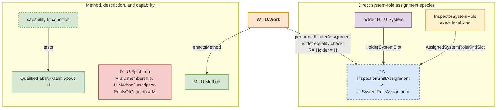

t. Open an actual binding claim only after identifying the application and the relevant bound value. Interpret a call, formula, tuple, edge or schema position under its selected representation scheme; it represents the declaration or binding without being that object.
6. **Keep the source label reduced-use when no governed claim is current.** A word can remain a cue, quotation, title, or local shorthand without being admitted as FPF-governed vocabulary.

Use Tech `position` for a place in a selected representation, such as a tuple component, call argument, edge endpoint or schema field. Recover its correspondence through the selected scheme and conventions; state it explicitly when the receiving claim needs that detail. The position remains distinct from the participant, SlotKind or SlotSpec it may represent. Its content can express or support a claim, but the position's presence alone establishes no obtaining relation. In every representation branch below, use C.29 only when a separate mathematical representation or transfer question remains.

#### A.6.RSIR:4.2 - Subject pattern selection

| Recovered object or claim kind | Apply this rule or pattern family | RSIR boundary |
|---|---|---|
| direct relation wording | `A.6.P` for recovery, then the rule that defines or tests the direct relation; use `A.6.REL` only when a receiving claim needs explicit occurrence identity or reference | RSIR stops when that direct rule is selected. An ordinary readable assertion may stop before explicit occurrence individuation or identifier assignment. |
| direct relation-participant meaning or actual participant | the direct relation pattern; add `A.6.5` only if a receiving use needs a reusable typed declaration | State the participant meaning and actual participant directly. Neither one is a `SlotKind`, `SlotSpec`, designation, operation binding, or representation position. |
| reusable relation-declaration slot, field, parameter, argument, or endpoint | `A.6.5` for one complete `SlotSpec` inside one exact `RelationSignature`, with `A.6.0` for the containing signature | The `SlotKind` is declaration-local and corresponds to one already recovered participant meaning; the declaration does not make the relation obtain. |
| assertion- or description-side participant designation | `C.2.1` for episteme identity and content; the direct assertion, evaluation, evidence-use, or description family for predicate, polarity, and use; `A.6.5` only when a compatible current `SlotSpec` types the designation | An ordinary assertion may name actual participants directly. A typed designation remains episteme content, distinct from the participant. Its presence alone does not establish obtaining; assess any asserted claim and grounds under the direct rule. |
| operation argument or result declaration | `A.6.1` and the exact mechanism edition and operation declaration | `ArgumentDeclaration` and `ResultDeclaration` are declaration content. Do not reuse relation `SlotSpec` vocabulary for them. |
| exact operation application or declaration-local argument or result binding | `A.6.1` and the exact mechanism edition and operation declaration | Identify the application occurrence independently; assert a binding only for the exact application and actual bound value under the declared predicate. Do not admit public `OperationApplication`, a universal input/output/result relation, or infer production, a produced entity, result episteme, evidence, or work from a result binding. |
| tuple component, formula or method-call argument, graph-edge endpoint, schema field or other representation position | the selected representation scheme and its applicable rule | Keep the position within its representation and recover the correspondence the receiving use needs. Form alone does not establish a participant, declaration or actual binding. |
| signature or law-governed declaration | A.6.0; A.6.5 for SlotSpecs in a RelationSignature, and A.6.1 for operation declarations | Recover the declaration's subject and ranges, Vocabulary, Laws and Applicability. Keep the signature episteme distinct from its subject, actual applications, evidence and publication. Describing an object does not make the declaration that object. |
| bare *role* already recovered as an exact local system-role kind — RSIR non-use | Apply `E.10.ROLE` once, then `A.2`, `C.3`, and the description or naming rules when their use is current | Do not apply RSIR. A system-role kind classifies entities already admitted as systems. It is not a `SlotKind`, assignment, capability, Method, status, or representation position. |
| bare *role* already recovered as a system-role assignment — RSIR non-use | Apply `E.10.ROLE` once, then `A.2.1`; when precise performed Work is claimed, recover each exact actual performer through A.13 and let A.15.1 independently admit the dated Work, adding F.6 only when the claim expressly consumes precise assignment-bound attribution through the same obtaining A.13 assignment; apply `A.6.5` only for a reusable species declaration | Do not apply RSIR. Recover the assignment occurrence and its declared `U.SystemRoleAssignment` species. The species defines the participant meanings; the occurrence supplies the holder System, assigned local kind, and any other participants. Taxonomy and scheme epistemes are not generic participants. Assignment extent follows uninterrupted predicate truth; a receiving assertion or use names any interpretation edition it depends on. |
| state of an assignment to a system role, or structure of relations among system-role kinds | `A.2.5`, `A.2.7` | Recover `SystemRoleAssignmentStateRelation` or `SystemRoleKindRelationStructure`; infer neither from ordinary label chains. |
| system-role-kind description or durable system-role-kind name | `F.4`, `F.5`, `F.18`, and `F.17` when public or cross-context reuse is current | Name the exact local kind or its description episteme. Do not hide assignment, capability, Method, or Work inside the name. |
| independently encountered system-role enactment or assignment wording | When precise performed Work is current, apply A.13 first and let A.15.1 independently admit the dated Work; apply A.2.1 and F.6 afterward only when the claim expressly consumes precise assignment-bound attribution through the same obtaining A.13 assignment. If the starting cue was bare *role*, apply `E.10.ROLE` once and do not apply RSIR after it selects this branch | Recover the exact actual performer `S : U.System` and dated `W : U.Work`. For an attribution-bearing claim, also recover the exact obtaining `RA : U.SystemRoleAssignment` and use `performedUnderAssignment(W, RA)` or the Plain sentence `S performed W under RA`; F.6 identifies neither S nor RA, and missing or failed F.6 leaves W intact. Create no second enactment object beside Work and assignment. |
| module interface or architecture interface | `A.6.M` for module-interface claims; `C.30`, `C.30.ASV`, `C.30.AD`, or `C.30.TFS-REL` for architecture-of, structural-view, architecture-description, or transformation-flow-structure claims; `A.6.0` plus `A.6.5` only for a reusable `RelationSignature` and its complete `SlotSpec`s; the selected representation pattern for interface diagrams or schema positions and their correspondence | Do not create generic `U.Interface`. |
| Markov blanket, Markov border, computational boundary, boundary leak, or active-inference boundary | Recover the current claim before choosing a pattern: accepted local Markov dynamics (`A.3.3`), mathematical or probabilistic lens (`C.29`, sometimes `C.26`), viability or measure-model-act envelope (`C.26.3`), holon delimitation or boundary crossing (`A.1` plus the direct governing relation pattern), relation precision (`A.6.P` after a relation-bearing case is recovered), reusable `RelationSignature` and `SlotSpec` declaration (`A.6.0`, `A.6.5`) or representation position and correspondence (the selected representation pattern), module-interface or interface-specification claim (`A.6.M`), functional port or functional element (`A.6.F`), physical component (`A.14`, `C.13`, `B.3.5`), boundary description or publication (`C.2.1` for claim-bearing description content, `C.30.AD` for architecture descriptions, `E.17` for reader-facing publication of an already accepted account), agency-threshold claim (`A.13` for the agency criterion, `C.16` when a value must be made interpretable as a measurement, `A.19` when a declared `CharacteristicSpace` or reusable by-value `CharacteristicSpacePredicate` over it is the current object), or boundary-package statement classification (`A.6.B`) only when L, A, D, or E classification is the recovered object. | Do not create `U.MarkovBlanket`, generic `U.Boundary`, generic `U.Interface`, or binary `U.Agent`; do not treat a statistical separation, interface, interface module, physical component, description, and boundary-package classification as the same object. |
| functional port or functional structure | `A.6.F`, `A.3.4`, `E.18`, `C.30.TFS-REL` | Do not equate port, function, module interface, and signature by vocabulary alone. |
| API, protocol, connector, service-access wording | Recover the governed object first: `E.17` for API or interface-description publication; `A.6.0` and `A.6.5` for a reusable `RelationSignature` and its `SlotSpec`s; the pattern defining the API-description claim and selected scheme for representation positions and needed correspondence; `A.6.M` for module-interface claims; `A.6.C` only when recovered protocol, service-term, SLA, or agreement-like wording bundles promise, utterance or publication, governance, Work or consequence, or evidence claims; `A.6.P:4.11a` when service or service-access wording still hides its exact referent or direct relation; `A.6.B` only for L, A, D, or E statement classification inside a boundary package. | API may be description, protocol episteme, exact service or access referent or direct relation, signature, publication, module interface, representation, or boundary-package statement classification. |
| capability | `A.2.2`; method, work, evaluation, or gate patterns only when they use an explicit capability criterion | Role labels and interface labels do not establish or demonstrate capability. |
| affordance or action invitation | `A.6.A` | Do not rename affordance as role, interface, or capability until its exact predicate and current subject assertion establish that value. |
| method, method description, work plan, or dated work | `A.3.1`, `A.3.2`, `A.15`, `A.15.1`, `A.15.2` | Method, description, plan, and work are distinct even when source wording says process. |
| function or functional wording | `A.6.F` | Function-like wording can point to several patterns; `A.6.F` governs that recovery. |
| concern, interest, viewpoint, problem, or characteristic-space selection | `A.7` for EntityOfConcern and description distinction; `C.22` or `C.22.2` for problem-card claims; `E.17.0` or `E.17.2` for viewpoint or view claims; `F.4` or `F.18` for system-role-kind-description or naming cases; `A.19` or `E.21` for characteristic-space cases | Do not mint generic `U.Concern` or `U.Interest` by wording alone. |
| publication, description, declarative representation, source wording | `C.2.1`, `E.17`, `C.2.P.DR`, `E.10`, `E.10.ARCH` | Do not let description or publication use displace the EntityOfConcern selected by the project concern. |

##### A.6.RSIR:4.2.1 - Relation-defined wording dispatch

When wording derives a qualification, status, or category from participation in a relation, recover the object needed by the next use before naming it:

1. If the claim concerns an actual entity participating under one named relation-participant meaning, state the direct relation, that meaning, and the actual participant. The participant retains its direct kind.
2. If reusable typed declaration is current, use `A.6.5` for the corresponding `SlotSpec` inside one exact `RelationSignature`. Its `SlotKind` is declaration-local and neither is the participant nor makes the relation obtain.
3. If an episteme asserts, evaluates, or describes the participation, `C.2.1` governs the episteme's identity and content, while the direct assertion, evaluation, evidence-use, or description family governs the exact predicate, polarity, or use relation. When a compatible `SlotSpec` is current, `A.6.5` governs the participant designation's `ValueKind` and `refMode` discipline; without reusable declaration, the assertion may designate the actual participants directly.
4. If the receiving use needs a local classification or quantification over such actual participants, use `C.3` and `C.3.1` for the local `U.Kind`, membership rule, and extent rule. Neither the participant-meaning label nor the declaration-local `SlotKind` admits that kind.
5. If the source exposes a tuple component, argument, edge endpoint, schema field or another representation position, interpret it under the selected scheme and recover the correspondence needed by the claim. A displayed value can state a participant or binding claim; its presence alone does not establish that claim.

For parameter, argument, or result wording, separately recover the A.6.1 declaration content, one independently identified exact operation application and any obtaining declaration-local binding, and the selected representation position. Open the binding only when the actual bound value matters to a receiving claim. Neither the declaration nor representation syntax establishes the binding; a result binding is distinct from production, a produced entity, a result episteme, evidence, and work.

When a receiving use compares or constrains a whole organization of relation occurrences, `A.22` may govern a selected `U.Structure`. One actual participant, corresponding `SlotSpec` or designation, operation binding, or representation position does not by itself establish such a structure.

#### A.6.RSIR:4.3 - Replacement candidate rule

Do not replace one umbrella with another. The minimum admissible repair candidate names:

- the current object or claim kind;
- the subject pattern;
- one result current for the receiving use: a retained reduced-use source label, a blocked stronger reading, or the next admissible use.

Name a direct relation, claim-bearing episteme, declaration-local `SlotSpec`, A.6.1 operation declaration or actual application binding, or representation correspondence only when that exact object is current for the receiving use. Do not fill an unused branch or require both a retained source-label use and a blocked overread. If the minimum cannot be named, leave the phrase in quote-only or reduced-use form and record the blocker.

#### A.6.RSIR:4.4 - Reduced-use source labels

Reduced-use labels are allowed. They are not failures. A source label remains reduced-use when it helps readers find or recognize the case but does not carry FPF-governed content.

Examples:

- “API role” can remain a quoted source phrase while the branch is selected with `E.10.ROLE`. The repaired claim may be an API description, an exact provider system-role assignment, a declaration or representation position, a promise-content episteme under A.2.3, an independently obtaining commitment under A.2.8, `PromiseContentUse`, a delivery or acceptance relation, another named direct relation, or an interface specification.
- "parameter" can remain ordinary prose while a complete `SlotSpec` is named only for a current reusable relation declaration, an operation `ArgumentDeclaration` or `ResultDeclaration` and any exact application binding stay under `A.6.1`, and a method-call, formula, or other representation position stays under its selected representation scheme.
- "function" can remain ordinary engineering language when no architecture, capability, method, work, mathematical, quality, or module claim depends on it.

#### A.6.RSIR:4.5 - Shortcut Cost and Reopen Condition

The subject pattern supplies the substantive definition or test once RSIR has identified the question. The selection table keeps relation and slot rules, operation declarations and bindings, representation, system-role kinds and assignments, and the neighboring engineering claims separate. RSIR does not perform those operations merely by naming their patterns.

The saved effort is that a practitioner does not run several full patterns before knowing which one is current. The loss budget is narrow: RSIR may select a direct pattern, preserve a reduced-use source label, or record a blocker. It may not decide the system-role kind, system-role assignment, signature, operation application or binding, evidence-use relation, status assertion, exact service or access relation, architecture description, or Method relation that belongs to the selected pattern.

Reopen RSIR when the selected pattern shows that the source phrase carried more than one governed object, the object kind was selected too early, a needed slot distinction was missed, or evidence, status, publication, gate, method, work, architecture, capability, or concern claims were folded into one label. The reopened repair splits the phrase into multiple governed values or keeps the excess wording reduced-use.

### A.6.RSIR:5 - Archetypal Grounding

**System case: module interface claim.** A team says "the cooling module exposes the heat-exchanger interface." RSIR first asks what claim is current. If the claim is substitutability or separate change, use `A.6.M`. If a reusable relation declaration for exchanged-medium and boundary-condition participant meanings is current, use `A.6.0` plus `A.6.5` for the `RelationSignature` and complete `SlotSpec`s. If the current use is a diagram, API schema, or other representation, interpret its positions under the selected scheme and state the correspondence needed by the receiving claim. If the claim is a functional port in a transformation-flow structure, use `A.6.F`, `A.3.4`, and `E.18`. RSIR does not create `U.Interface`.

**Bare-role case: API provider wording.** A source says “the API role is provider.” Apply `E.10.ROLE` once. If it recovers a provider System, local `ProviderSystemRole` kind, assignment, capability, provider Work, promise, access relation, publication, or another direct object, apply that object's rule and do not apply RSIR. Apply RSIR only when the still-unanswered question is the participant meaning in a direct relation, a reusable declaration, an interface claim, an operation declaration or binding, or an API-schema representation position. For protocol, service-term, SLA, or agreement-like wording that bundles several claims, use A.6.C to unpack the claims before stating each object or relation. Use A.6.M only for a module-interface claim and A.6.B only for boundary-package statement classification. Do not assign a system role to the API description.

**Evidence case: reviewer and report wording.** A report says “reviewer evidence role approved the gate.” Apply `E.10.ROLE` once and split the claims. Apply A.2/A.2.1 for any exact reviewer system-role kind or assignment. Use A.10 for evidence reliance on a named claim, B.3 only for an actual named assurance claim, F.10 for an exact status-use relation, E.24.PUB when publication availability is current, and E.17 when the accepted account needs a reader-facing publication form. Use A.21 for the gate decision and A.2.9 for any issuing speech act. None of those recovered branches needs RSIR unless a separate direct-participation, reusable-declaration, interface, operation, or representation-position question remains. No episteme receives a system-role assignment by being evidence.

**Slot case: method parameter.** A method description says "parameter target controls the model." The sentence does not identify what `target` designates or which control relation is claimed. Keep it as reduced-use source wording and recover those missing values before asserting the control claim. A separate positive example illustrates an A.6.1 argument label. In the current `recognizeAdmittedHolonCandidate` declaration, `candidate` is an `ArgumentDeclaration` meaning one exact entity being evaluated, with `ValueKind = U.Entity`; `recognitionJudgment` is the declared result meaning. Under A.6.1, the project independently identifies the bounded recognition-evaluation invocation `P-37` by that declaration's application predicate, identity rule, and extent rule. During `P-37`, Pump #37 is actually bound under `candidate`, and the returned value `unknown` is bound under `recognitionJudgment`. In a call representation such as `recognizeAdmittedHolonCandidate(target = Pump-37, ...)`, the named-argument position `target` corresponds to the declared `candidate` meaning but is neither the declaration nor either binding. The practitioner writes: "`target` is the call label; A.6.1 declares `candidate : U.Entity`; during exact application `P-37`, Pump #37 is bound as candidate." Stop there unless the receiving claim needs the result binding or another subject pattern.

#### A.6.RSIR:5.1 - Near-Miss Checks

| Source phrase | Positive recovery | Near miss to reject |
|---|---|---|
| “API role is provider” | Apply `E.10.ROLE` once. If it recovers `ProviderSystemRole`, an exact assignment, provider Work, API publication, promise, access relation, or another direct object, apply that object's rule and leave RSIR closed. Apply A.6.RSIR only for a remaining declaration, direct-participation, interface, operation, or representation-position question; use A.6.C only when protocol, SLA, service-term, or agreement-like wording bundles unlike claims. | Do not assign a system role to an API description or protocol, and do not repeat the E.10.ROLE recovery inside RSIR. |
| "endpoint parameter source" | Use the direct relation pattern when the phrase hides a participant meaning or actual participant; use `A.6.5` only for a complete `SlotSpec` in a current reusable `RelationSignature`; use `A.6.1` when it names an operation `ArgumentDeclaration`, `ResultDeclaration`, or an actual binding in one independently identified exact application; use the selected representation rule or E.17 when it is a representation position or API-description publication, and `A.6.P:4.11a` when a service-documentation label hides the concrete subject or relation; recover correspondence from the selected scheme, making it explicit when the receiving claim needs it. | Do not create an endpoint kind, a work-facing role from the word "source", a parameter ontology, a public application kind, a universal input/output relation, or a world-side participant or binding from representation shape. |
| “`Engineer-7#Verifier:Lab-A`” | Recover Engineer-7 as the holder System, VerifierSystemRole as the local kind, and any claimed assignment under its declared U.SystemRoleAssignment species. In this case Lab-A denotes the facility System where verification Work occurs; that Work-location claim is separate. | The spelling alone does not make Lab-A an assignment participant or establish Holder#Role:Context as an identity rule. Apply the species' own participant and identity rules. |
| "function of the pump" | `A.6.F`, `A.3.4`, `E.18`, or `C.30.TFS-REL` when the phrase names functional structure; `A.2.2` when it names a system capability. | Do not treat "function" as the recovered kind before the current claim is known. |
| “standard evidence role” | Apply `E.10.ROLE` once, then use A.10, B.3, F.10, or E.17 for the recovered evidence, source, status, assurance, or publication claim. Leave RSIR closed unless a separate direct-participation, declaration, interface, operation, or representation-position question remains. | Do not invent `U.EvidenceRole` or put the standard episteme into `U.SystemRoleAssignment`. |

### A.6.RSIR:6 - Bias-Annotation

This pattern has a relation-cluster bias because it sits in A.6. It mitigates that bias by stopping as soon as the applicable definition, constraint, or test is clear.

It has an interface and software-language stress case because API, endpoint, protocol, and interface wording often enters from software. The pattern deliberately keeps the recovery general: architecture interfaces, physical ports, functional ports, service-access descriptions, and publication forms are all possible, and none is selected by word choice alone.

It resists semio-bias by keeping descriptions, publications, records, reports, standards, and source labels under the patterns that define or constrain those objects and uses: `C.2.1`, `E.17`, `C.2.P.DR`, `A.10`, `B.3`, `F.10`, `C.28`, `E.10`, or `E.10.ARCH` when those objects or uses are current. A source label may help recognition; its presence is not evidence that the denoted object is the current EntityOfConcern or that a proposed action is admissible.

### A.6.RSIR:7 - Conformance Checklist

1. The repair starts with project concern, not with a replacement word.
2. The current EntityOfConcern or claim kind is named before a subject pattern is applied.
3. The repair stops once the applicable rule and concrete next action are clear.
4. When reusable relation declaration is current, slot discipline uses `A.6.5` and states one complete `SlotSpec = <SlotKind, ValueKind, refMode>` inside one exact `RelationSignature`; actual participants and representation positions remain outside it.
5. An assignment claim uses its declared U.SystemRoleAssignment species and participant meanings. A positive claim needs facts satisfying that predicate; add explicit occurrence identity when the receiving use needs it. A governed negative claim creates no obtaining assignment. Apply A.2.5 for a state claim, A.2.7 for a structure among kinds, and the applicable rule for capability, Method or Work. Do not repeat a settled result through RSIR.
6. Evidence-use and status-use cases are not represented through `U.SystemRoleAssignment` for epistemes. Apply `E.10.ROLE` once to bare *role*; if it recovers evidence use, status use, or another direct object, apply that object's rule and leave RSIR closed.
7. Interface wording is kept as a recognition cue but is not admitted as generic `U.Interface`.
8. Every neighboring object family selected in the dispatch table uses its defining or testing rule rather than being redescribed inside RSIR.
9. Relation-defined wording dispatches separately to the direct participant meaning and actual participant; a declaration-local `SlotSpec` when reusable typing is current; an assertion- or description-side designation whose episteme identity and content stay with `C.2.1`, whose predicate, polarity, and use stay with the direct claim family, and whose typing stays with `A.6.5` only when a compatible `SlotSpec` is current; a C.3 local kind when the receiving classification or quantification needs it; or a representation position with its recoverable correspondence. It does not create one umbrella qualification object.
10. Operation wording keeps A.6.1 `ArgumentDeclaration` or `ResultDeclaration` content, one independently identified exact application and obtaining argument or result binding, and any call or formula representation position distinct; it infers neither a public application kind nor production, a produced entity, a result episteme, evidence, or work from the binding.
11. Quote-only or reduced-use labels carry no action-facing claim beyond the claim admitted by the selected rule.

### A.6.RSIR:8 - Common Anti-Patterns and How to Avoid Them

| Anti-pattern | Why it fails | Repair |
|---|---|---|
| Rename *role* to *position* everywhere | It loses real system-role-kind and assignment cases and creates a new umbrella. | Start with `E.10.ROLE`; recover a system-role kind, assignment, direct participant, declaration-local `SlotSpec`, representation position and correspondence, episteme-use relation, another object, or ordinary prose from the current claim. |
| Treat interface as one root kind | It merges module, functional, protocol, API, signature, publication, representation, architecture, and boundary-package claims. | Recover the governing object first; then apply `A.6.M` for module-interface, `A.6.F` for functional port or functional structure, `A.6.0` plus `A.6.5` for a reusable `RelationSignature` and its `SlotSpec`s, the selected representation pattern for positions and needed correspondence, `E.17` for publication or API-description cases, `A.6.C` only when recovered agreement-like, protocol, or SLA wording bundles promise, utterance or publication, governance, Work or consequence, or evidence claims, `A.6.P:4.11a` when service or service-access wording hides its exact referent or direct relation, `A.6.B` only for L, A, D, or E statement classification inside a boundary package, or `C.30`, `C.30.ASV`, `C.30.AD`, or `C.30.TFS-REL` for architecture claims. |
| Put evidence and status into a system-role assignment | It gives epistemes a work-facing assignment they do not have. | Use evidence-use, source-use, status-use, assurance-use, or publication-use relations under A.10, B.3, F.10, E.17, C.2.1, or C.28 when those relations are current. |
| Use `A.6.5` as relation identity | Slot discipline does not say which relation is being asserted. | Apply `A.6.P` or the relation-specific pattern for relation identity; use `A.6.5` only for SlotSpecs. |
| Treat function as the recovered kind | Function-like wording may point to capability, method, work, architecture, mathematical function, quality, or module allocation. | Apply `A.6.F` after RSIR selects function-like recovery. |
| Keep a quoted source label but use it as governing content | Reduced-use wording carries an unsupported stronger claim. | State the actual use and its governing rule. Add a restriction only for a grounded, plausible misreading that changes the receiving use. |

### A.6.RSIR:9 - Consequences

`A.6.RSIR` adds a bounded recovery step when the engineering object or claim remains unclear after the F.19 reading with E.10 cues. The selected subject pattern then handles the substantive claim; neighboring patterns can refer to this recovery instead of repeating it.

The pattern also keeps useful source vocabulary alive. Engineers can still say interface, API, role, parameter, function, and endpoint. FPF simply refuses to let those words select ontology by themselves.

The cost is one explicit stop: after the direct pattern is clear, RSIR must stop. Otherwise it becomes the giant repair pattern it was created to avoid.

### A.6.RSIR:10 - Rationale

The RSIR cluster needs a bounded recovery step when F.19's whole-span reading and E.10's compact cues leave an engineering object or claim unclear. Direct relation, declaration, interface, system-role, Work, publication, evidence, and status rules retain their own objects and predicates. Apply the thinner `E.10.ROLE` entry once to bare *role*. If one concrete direct-participation, declaration, interface, operation, or representation question remains unanswered, apply RSIR to that question; otherwise leave RSIR closed.

The main ontological principle is separation among participant, declaration, application and binding, assertion and designation, and representation. An actual direct-relation participant retains its direct kind under one participant meaning. A corresponding `SlotSpec`, when reusable typed relation declaration is current, states a declaration-local `SlotKind`, exact `ValueKind`, and `refMode`. An assertion or description remains a C.2.1 episteme; its direct claim family supplies predicate, polarity, or use, and A.6.5 types a participant designation only against a compatible current `SlotSpec`. An A.6.1 declaration states reusable operation meaning, while one exact application and obtaining binding relate that occurrence to an actual value. A representation position may correspond to any of those objects without becoming one.

The second principle is direct rule use. Once the current object is recovered, apply the rule that defines, constrains, or tests the claim. RSIR only identifies that rule and its PatternID locator when the reference must travel.

### A.6.RSIR:11 - SoTA-Echoing

The comparisons below inform this bounded recovery: distinguish the engineering objects before selecting their direct rule. They do not supply the obtaining or identity rule for the recovered object.

| Practice or source line | Why it matters for RSIR | FPF adoption in this pattern |
|---|---|---|
| Modular ontology design-pattern work, including MODL, MOMo, and commonsense ontology micropatterns such as Shimizu and Hitzler 2024 and Eells, Dave, Hitzler, and Shimizu 2024. | Ontology-engineering contribution: use small reusable ontology structures without copying local slot doctrine across patterns. | Adopt and narrow: RSIR does not become an ontic registry. It recovers the current governed object, leaves participant meaning and actual participation with the direct relation pattern, uses `A.6.5` only for a current `RelationSignature` `SlotSpec`, uses the selected representation scheme for positions and correspondence, and uses `E.24` only for durable ontic decisions. |
| Ontology-interoperability lifecycle work such as Qiang 2025 and 2026. | A caution that overlapping labels and conflicting local concepts become expensive if not settled before reuse, matching, and validation. | Treat interface, slot, function, Method, concern, and bare *role* as recovery cues until the current EntityOfConcern, direct relation and participants, declaration, any representation position and correspondence, and direct pattern are named by use; bare *role* starts at `E.10.ROLE`. |
| Process-representation ODP work such as Norouzi, Hertling, Waitelonis, and Sack 2025. | A warning that process and workflow ontologies often hide implicit patterns from domain users. | Adapt for RSIR source labels: "process", "workflow", "method", "function", "parameter", and "interface" may remain useful source labels, but they do not carry FPF-governed content until the direct method, work, transformation-flow, role, slot, publication, or evidence pattern is selected. |
| gUFO, UFO, and OntoUML role, relator, situation, and high-order type practice, including Almeida, Guizzardi, Sales, and Fonseca 2026. | A foundational-ontology warning against flattening system classifications, assignment occurrences, participant meanings, declaration-local slots, representation positions, status classifications, and evidence uses into one taxonomy. | Use only as a bounded comparator. FPF recovers exact local system-role kinds and direct `U.SystemRoleAssignment` species separately; direct patterns retain participant meanings, A.6.5 retains declaration-local `SlotSpec`s, the selected representation scheme supplies positions and correspondence, and episteme uses retain their direct relations. |
| Engineering architecture practice around functions, ports, modules, interfaces, signatures, and views. | A.6.M, A.6.F, A.6.0, E.18, C.30, C.30.ASV, C.30.AD and C.30.TFS-REL define the different objects named by these related terms. | Adapt as a positive recovery map: preserve interface and function language as recognition cues, then recover module-interface, signature, functional port, transformation-flow, architecture-of, structural-view, architecture-description, API publication, protocol, or plain source-label use by current claim. |

### A.6.RSIR:12 - Relations

Use `F.19` for the whole-span reading with the compact cues in `E.10:0.2`. Apply `E.10.ROLE` once to bare claim-bearing *role*. Apply RSIR afterward only if one concrete direct-relation, declaration, interface, operation, or representation question remains; all other recovered branches use their direct rules and leave RSIR closed. `E.10.ARCH` describes both entries in the shared restoration architecture.

`A.6.5` defines complete declaration-local `SlotSpec = <SlotKind, ValueKind, refMode>` content inside one exact `RelationSignature` and, only when a compatible `SlotSpec` is current, participant-designation typing. `C.2.1` supplies the assertion or description episteme's identity rule, while the direct claim rule supplies predicate, polarity, and use. An ordinary assertion may designate actual participants directly without reusable declaration.

Apply `A.6.P` for relation precision restoration after the recovered object is a relation or relation-bearing claim.

`A.6.0` defines `U.Signature`; `A.6.1` defines operation argument and result declaration content plus the rules for any independently identified exact application and declaration-local binding; `E.20` supplies mechanism-introduction rules. A.6.1 admits no public `OperationApplication` U-kind or universal input/output/result relation, and its result binding alone establishes none of production, a produced entity, a result episteme, evidence, or work.

`A.2`, `A.2.1`, `A.2.2`, `A.2.5`, `A.2.7`, `A.15`, and Part F system-role-description and naming patterns define or constrain local system-role kinds, direct system-role assignments, capability, `SystemRoleAssignmentStateRelation`, `SystemRoleKindRelationStructure`, system-role–Method–Work alignment, and durable system-role-kind names.

Apply `A.6.M`, `A.6.F`, `A.6.A`, `A.3.4.P`, `E.18`, `C.30`, `C.30.ASV`, `C.30.AD`, or `C.30.TFS-REL` for the corresponding module-interface, functional, affordance, transformation, transformation-flow, architecture-of, structural-view, or architecture-description question.

Apply `C.2.1`, `E.17`, `C.2.P.DR`, `A.10`, `B.3`, `G.6`, `F.10`, or `C.28` for the corresponding episteme identity and content, publication, declarative representation, evidence, assurance, provenance, status, or causal-use question; the exact direct claim rule still supplies the predicate, polarity, or use asserted through that content.

### A.6.RSIR:End

## A.6.A - Affordance and Action-Invitation Precision Restoration (ACT-INV)

> **Type:** Architectural (A)
> **Status:** Stable
> **Normativity:** Normative (Core)

**Plain-name.** Affordance and action-invitation precision restoration.

**Use this pattern when** wording such as “affords”, “invites”, “calls for” or “actionable” leaves the intended claim or question unclear: who could do what, in which situation, on what grounds, and what the reader may do with that statement.

**What goes wrong if missed.** A physical opportunity, detected cue, proposed inquiry or interface prompt is read as a capability, duty, permission or completed action. The reader acts on the wording without recovering the claim that would justify that action.

**What this buys.** A sufficient statement of the actual opportunity, prompt, claim or question, with the participants, conditions and subject rule needed for its use. An unresolved rule or fact is returned as an exact gap. An ordinary sentence can be the complete result.

**First useful move.** Recover what the speaker means in this use. Compare the live alternatives—for example, an available physical action, detection of that opportunity, an operator prompt, or a proposed inquiry. State the supported interpretation or the question that distinguishes the remaining alternatives. Apply the recovered subject rule before asserting its result.

**Not this pattern when.** If the claim and its subject are already clear, use that subject pattern directly—for example, for a Method, MethodDescription, WorkPlan, actual Work, ability, duty, gate, evidence, evaluation or publication. A sufficient existing sentence needs no further recovery note.

**Governed move.** This pattern recovers the meaning of affordance-like and action-first wording. Its interpretation menu and optional recovery note do not define one common relation kind or a durable U-kind. Any actual opportunity, relation occurrence, Method, ability or Work that the result names keeps its own subject, obtaining conditions and identity rule.

Use **A.6.P** when the recovered content is a relation claim. Other recovered results, including an open inquiry question, go directly to their governing patterns. The recurring repair is to recover meaning, relevant participants and conditions, then express the result sufficiently for the receiving use.
Preserve an insufficiently articulated cue through `A.16.1` or publish its possible continuations through `B.4.1`. A question can become clear enough for inquiry while its answer remains unknown.
When the result selects a Method for enactment, identify that admitted U.Method. A cited U.MethodDescription has that Method as its exact EntityOfConcern and makes a substantive claim about it as a way of doing under A.3.2. A proposed action or question can remain expressible before any Method is admitted. A WorkPlan describes intended Work. If the sentence deliberately claims a particular dated Work occurrence, recover A.13 first and independent A.15.1 admission with enactsMethod; use F.6 only for a separate precise attribution through the same A.13 assignment.

This recovery lets ecological psychology, phenomenology, active inference, control, interface design and robotics keep their distinct subject meanings while comparing a concrete action question.

**Coordinates with.**
**C.16.Q** for evaluative-language repair; **C.2.2a, A.16, A.16.1, A.16.2, and B.4.1** for language-state chart positions, articulation and closure coordination, admissible moves, early cue classification, next-use docking, and admissible retreat when a published recovery result must be reopened; use **A.16.0** only when lineage, branch, loss, or an actual responsibility-handoff history itself must be published as an explicit trajectory account; **B.5.2.0** when the recovered result is an explanatory question or candidate inquiry; **C.2.LS, C.2.4, C.2.5, C.2.6, and C.2.7** for articulation, closure, anchoring, and representation-factor facets referenced but not governed here; **A.10** and **B.3** for evidence and assurance; **B.4** and **B.5** for anomaly-driven cycles; **E.17.0**, **E.17**, and **E.18** for viewpoint reference resolution, independent view conformance, and viewpoint publication; **F.9** for Bridges and bounded-use claims; **F.9.1** for optional stance notes about those claims; **C.3.3** for kind-bridge repair when endpoint kind mismatches appear.

**E.10.ARCH relation.**
A.6.A supplies the wording-recovery method when an `E.10` or `E.10.ARCH` use leaves an affordance-like or action-first phrase ambiguous. Recover the actual claim or question and then its direct governor. Evaluative content goes to `C.16.Q`; ability, Method, Work, duty, evidence, assurance, gate and decision claims use their own patterns. Keep a recovery note only when a later reader needs the interpretation or its grounds.

**Non-goal.**
This pattern does **not** assert that physical affordances, interface affordances, social affordances, epistemic probe moves, articulation-closure moves, latent policy cues, and control opportunities are one concept.

Its job is to publish a disciplined treatment of action-first language across those traditions, using a direct contrast when that is enough and an F.9 Bridge only for an exact cross-context semantic-correspondence claim, while preventing false identity by shared language.

The recovered meaning selects the next pattern:

* where the repaired statement is primarily **evaluative**, use **C.16.Q**;
* where it is primarily about **general capability**, capability wording, method wording, or method-description wording, use **A.6.F**, A.2.2 qualified holder capability, `U.Method`, or `MethodDescription` according to the claim being made;
* where it is primarily **deontic**, apply **A.6.B**;
* where it concerns intended work, use A.15.2 for the WorkPlan; where it deliberately asserts a particular dated Work occurrence, use A.13 and independent A.15.1 admission. Keep the Method, its description, plan and Work distinct. Ordinary practitioner action does not require invented formal identities.

### A.6.A:1 - Problem frame

FPF repeatedly encounters a predictable precision failure mode around **affordance-like and action-first** language.

Authors say:

* “this handle affords pulling”
* “the interface invites confirmation”
* “the alarm calls for rollback”
* “this discrepancy suggests probing deeper”
* “the draft is ready for formalization”
* “the model wants to brake”
* “the situation is actionable”

…but the intended meaning is actually one of several different **action-oriented families**, for example:

1. **Physical affordance** — a physical or environmental configuration offers a bodily action to an embodied agent.
2. **Interface affordance** — an operator-interface element, operator panel, alarm, or publication face presents an operator move.
3. **Social affordance** — another agent or interactional setting invites a response or coordination move.
4. **Epistemic probe move** — a problem situation invites asking, comparing, measuring, testing, or instrumenting.
5. **Closure-advance move** — a situation invites naming, rescoping, proxy declaration, or formalization.
6. **Latent policy cue** — a learned or distributed state carries an action-oriented tendency not yet locally articulated.
7. **Control opportunity** — a closed-loop state invites braking, rollback, replan, isolate, escalate, or override.

The recurrent failure modes are:

* **Site confusion.** The invitation-bearing site is unclear: physical entity, scene, interface entity, description episteme, carrier, policy state, or problem episode.
* **Enactor confusion.** The system that would act is unclear: for example, a human operator, robot controller, team or automation system. An assignment may help designate its holder, but is not itself the actor.
* **Action confusion.** The candidate action is hidden behind vague language like *actionable*, *calls for*, *ready for*, *natural next step*.
* **Invitation vs obligation collapse.** A situation that merely invites an action is rewritten as if it already created a duty.
* **Invitation vs capability collapse.** A local, situated action opportunity is rewritten as if it were a general capability claim.
* **Invitation vs work collapse.** Offered action is narrated as if it had already been executed.
* **Substrate confusion.** Ecological, embodied, latent-distributed, and symbolic-local action cues are silently collapsed.
* **Bridge illusion.** Similar language across traditions is mistaken for sameness.
* **Premature closure.** An early cue is published as if it were already a committed method, gate, or policy.

### A.6.A:2 - Problem

How can FPF let authors use the communicative convenience of **affordance-like and action-first** language while preventing category errors when the language crosses:

* ecological and phenomenological discourse,
* interface and operator-facing discourse,
* active-inference and world-model discourse,
* control, monitoring, and incident-response discourse,
* robotics and embodied-AI discourse,
* epistemic exploration and problem-framing discourse?

### A.6.A:3 - Forces

* **Action speed vs auditability.** Action-first language is attractive because it is fast; that same speed makes it unsafe at boundaries.
* **Situated opportunity vs its account.** A physical opportunity can depend on the agent and environment even when no current account detects it; an information-constituted opportunity follows its own subject rule.
* **Preconceptual cue vs later articulation.** Detection, verbal articulation and the obtaining of an opportunity can have different conditions.
* **Enactor specificity vs shared discourse.** A cue may be visible to one detector yet relevant to another would-be enactor.
* **Opportunity vs obligation.** Not every invitation is a gate or commitment.
* **Option plurality vs premature scalarisation.** Several candidate actions may co-exist without an admissible total ordering.
* **Cross-tradition dialogue vs false unification.** The framework should preserve parallels without asserting identity.
* **Different continuations.** A cue can support inquiry, an action option or an existing policy application; each requires its own grounds, with no compulsory sequence.

### A.6.A:4 - Solution - Recover the claim, apply its subject rule and return sufficient wording

#### A.6.A:4.0 - Trigger rule

Use A.6.A when the intended claim or question remains unclear for the receiving use. The following cues help locate that ambiguity:

* the prose uses tokens such as **affords**, **invites**, **calls for**, **actionable**, **ready for**, **ripe for**, **natural next step**, **the model wants**, **the interface tells**, **this problem asks for**;
* a boundary, gate, incident note, design note, or review note uses such language for admission, selection, triage, or action guidance;
* different traditions are compared using the same action-first wording;
* a draft introduces *model affordance*, *interface affordance*, *actionable insight*, *policy invitation*, or *ready for formalization* without declared sense;
* the author intends the phrase to carry more than one of: situational action opportunity, latent cue, operator move, probe move, closure move, or control move.

#### A.6.A:4.0a - Operational repair sequence

1. **Recover the statement and receiving use.** Read the sentence with its source context. State which interpretation, decision or action the reader needs it for.
2. **Compare the live interpretations.** Consider a physical opportunity, its detection, an operator prompt, a social response, a candidate inquiry, a proposed clarification, a learned policy tendency or a control option. Also consider an actual evaluation, ability, commitment or Work claim when the sentence supports that reading. Use §4.3 as a menu, not a required classification.
3. **Select what the grounds support.** State the intended interpretation and why a consequential rival is excluded. If the grounds do not choose, preserve the rival meanings and return the fact or question that would distinguish them. A short note is useful when a later decision needs those grounds; it is not a prerequisite to every repair.
4. **Recover the subject and relevant conditions.** Name the actual site, would-be actor, action and other participants only to the extent that they determine the claim. For an obtaining relation, recover its direct predicate and any needed occurrence identity under A.6.REL. For an inquiry, state the question and what an answer would resolve. A menu label supplies neither result.
5. **Express the first useful result.** Return a sufficient ordinary sentence, supported bounded claim, explicit question or exact missing basis. Use one of §4.5's optional forms only when the receiving use needs it. Separate a detector, viewpoint, source or representation when that distinction changes the result.
6. **Continue from that result.** Apply the subject pattern for a needed evaluation, Method selection, WorkPlan, actual Work, authority, gate or evidence claim. Use A.6.B for the actual boundary-bearing claim. Stop when the receiving question is answered; wording recovery creates no extra invitation occurrence to establish first.

#### A.6.A:4.1 - Recognition and assurance answer different questions

The first result is recognition of what the sentence means. Establishing the recovered claim then uses that subject's rule and evidence. An intelligible physical-opportunity claim can still lack support; an intelligible research question can be useful while its answer is unknown.

Use `A.16.1` or `B.4.1` when the cue cannot yet support a particular claim or question. When articulation is sufficient, express the recoverable content without requiring a relation record or a sense token. Any relevant `AE` or `CD` reading concerns the account and its next use; it does not establish a physical opportunity.

If an account later becomes unsupported, revise or withdraw it through the applicable subject pattern and A.16.2. With physical conditions fixed, changing its wording, carrier or detector establishes no beginning, ending or new occurrence of the physical opportunity. If information itself is constitutive under a source-specific relation predicate, use that predicate and its identity rule for the corresponding change.

#### A.6.A:4.1a - Optional recovery note

When a receiver needs a reusable account of the repair, a note may contain:

```text
trigger and source context
recovered statement or question
receiving use
participants and conditions that determine the result
subject rule and supporting sources, or the exact missing basis
material rival interpretations and their disposition, when needed
detector, viewpoint, representation and publication details, when relevant
next subject result or return, when one is needed
```

This form expresses the result without defining a common relation kind. For an actual relation claim, its participants, direction, applicability, evidence conditions and identity rule come from the direct governor. Use A.6.5 for a reference-backed designation only when a compatible declared SlotSpec is current; ordinary note wording needs no invented relation declaration.

Omit fields that do not change interpretation or use. A sufficient sentence remains a complete result. A particular receiving publication can require more structure under its own conditions; that requirement does not become a universal prerequisite to wording recovery.

**Viewpoint and view discipline.**
When `viewpointRef` is present, `effectiveReferenceScheme` is also explicit and the reference resolves under that scheme to one exact independently admitted `U.Viewpoint` episteme. `view` is a separate optional value: it names one independently identified C.2.1 episteme that already has `U.View` membership only because exact E.17.0 `EpistemeViewpointConformanceRelation(view, viewpoint)` obtains for at least one admitted viewpoint. The selected `viewpointRef` need not be the viewpoint to which an optional view conforms unless the record explicitly claims that relation. Including `viewpointRef` or `view` in a recovery note establishes neither `U.Viewpoint` nor `U.View` dependent-kind membership; it only cites already established objects. Detector, viewpoint selection, view membership, viewing construction and publication remain separate.

A sentence such as “X affords Y” needs repair when its intended action, participants or basis remain hidden for the receiving use. For a recovered relation claim, apply A.6.REL; for a recovered question, preserve the question. Earlier cue content may remain a cue pack, RoutedCueSet or another appropriate expression.

**Interpretation and enactment.**
A menu label names a candidate interpretation; it establishes neither an occurrence nor a common relation kind. A proposed action can remain a proposal. When it selects a Method, identify the admitted U.Method and treat any MethodDescription under A.3.2. Use A.15.2 for planning. For a deliberately asserted dated Work, recover its A.13 basis and independent A.15.1 admission; F.6 is additional only for precise assignment-bound attribution. A returned value, application binding, evaluation Work and result episteme retain their own identities and rules. A Work-to-result claim needs its direct predicate; a missing predicate blocks that claim without erasing an independently established binding.

**A.7 boundary note.**
When the site affects interpretation, distinguish an EntityOfConcern-side participant, a Description episteme participant and any non-claim-bearing site kind. Name a participating publication face, publication form, carrier or rendering separately under A.7. An optional note may use `siteClassification` and `publicationOrCarrierParticipation` for these distinctions; ordinary wording can express them too.

**Separation note.**
`detector` and `invitedEnactor` are not synonyms.
When both matter, they SHALL be published separately.

**Enactor note.**
When the result names an actual would-be enactor, it SHALL identify the System that would act. An assignment may designate that System through its holder, but the assignment is not the acting participant. An episteme, publication face or carrier may instead be part of the site.

**Episteme non-agency note.**
For a claim about actual enactment, identify the acting System and any carrier or acted-on system that matters. A description can guide that actor through its content; it is not itself the performer. Ordinary instrumental wording may remain when the actor and use are recoverable.

#### A.6.A:4.2 - Candidate interpretations

The `ActionInvitationSense` menu in §4.3 is a discovery aid. Its `AIS.*` labels can help compare interpretations or preserve search terms; using a label is optional. Choosing one label does not assert one common `actionInvitation` relation or impose common obtaining and identity conditions on the listed subjects.

For a consequential interpretation, recover the source-local meaning, the participants and action it concerns, the conditions under which the claim would hold, and the result the receiving use needs. Keep an unresolved interpretation as an alternative rather than assigning a default because the sentence occurs in an ecological, interface, control or research context.

If a local practice needs a named interpretation profile, it may specify applicable sites and actors, action structure, relevant substrate, admissible evidence, forms of expression, change conditions and cross-context use. Such a profile describes that local recovery use. A relation declaration, Method or commitment still needs its own independently applicable rule.

#### A.6.A:4.2a - A.16 articulation-token relation note

A recovery note may carry `articulationHint` as a **local articulation-cue field** when the receiving use needs it.

This field is deliberately **not** a new formality progression, **not** a maturity scale, and **not** a surrogate for **F**. Its only job is to preserve local articulation and closure cues until they can be related to `A.16` move logic and the explicit `C.2.4` and `C.2.5` governing facets.

Local `articulationHint` tokens SHALL be related to `A.16` move logic and to the explicit `C.2.4` and `C.2.5` governing facets one-for-one, and A.6.A SHALL treat them as local publication cues only.
Until then, local hints SHALL NOT be thresholded, aggregated, or compared across Contexts.

#### A.6.A:4.3 - Interpretation menu
Consider these candidate meanings and any source-local alternative that can change the result. The menu helps recover a claim; it does not select its truth conditions by classification.

| `ActionInvitationSense` token | Use when the action-first phrase means…                                                     |            Possible useful form | Typical substrate                                    | Must **not** be silently collapsed into                  |
| ----------------------------- | ------------------------------------------------------------------------------------------- | -----------------------------: | ---------------------------------------------------- | -------------------------------------------------------- |
| `AIS.PhysicalAffordance`      | a physical or environmental configuration offers a bodily action to an embodied agent       |    `CuePack` or `ActionOption` | `ecological-world-coupled` or `embodied-kinesthetic` | site-participant property alone, generic capability, executed work |
| `AIS.InterfaceAffordance`     | an operator-interface element, operator panel, alarm, or publication face presents an operator move | `ActionOption` or `PolicyHook` | `symbolic-local` or `hybrid`                         | duty or commitment, execution log                           |
| `AIS.SocialAffordance`        | another agent or social situation invites a response or coordination move                   |    `CuePack` or `ActionOption` | `embodied-kinesthetic` or `hybrid`                   | role assignment itself, deontic commitment               |
| `AIS.EpistemicProbe`          | a problem situation invites asking, contrasting, measuring, testing, or instrumenting       |  `ActionOption` or `OptionSet` | `hybrid`                                             | explanatory merit, evidence claim, finished method       |
| `AIS.ClosureAdvance`          | a situation invites naming, rescoping, proxy declaration, or formalization toward closure   |                 `ActionOption` | `symbolic-local` or `hybrid`                         | Formality **F**, acceptance status, quality ascription   |
| `AIS.LatentPolicyCue`         | a learned or distributed state carries an action-oriented tendency not yet locally articulated |       `CuePack` or `OptionSet` | `latent-distributed` or `hybrid`                     | explicit rationale, control adequacy, quality claim      |
| `AIS.ControlOpportunity`      | a closed-loop state invites braking, rollback, replanning, isolation, escalation, or override |    `OptionSet` or `PolicyHook` | `hybrid`                                             | bare “model wants”, obligation, work occurrence          |

**Using the menu.**

* In **ecological and embodied** contexts, consider the physical-opportunity reading, while checking whether the claim instead concerns its perception or detection.
* In **operator-interface, alarm, or operator-panel** contexts, consider the interface-prompt and control-option readings, retaining both only when the sentence makes both claims. If the wording instead claims module interface, functional port, API, protocol, signature, interface specification, or service-access compatibility, use `A.6.RSIR`, `A.6.M`, `A.6.F`, or `A.6.0` according to the recovered EoC rather than treating the cue as an action invitation.
* In **epistemic exploration** contexts, "this suggests probing, formalizing, or reframing" can mean an inquiry question, candidate investigation or proposed clarification. Recover that result directly.
* In **learned world-model, active-inference, or policy** contexts, consider a learned policy tendency and a control option as different readings. A model state does not by itself establish a control decision, duty or performed action.
* If the sentence is chiefly about **better, worse, fit, or merit**, use **C.16.Q** instead of A.6.A.

#### A.6.A:4.4 - Recover details that change the result

Use the following questions where their answer changes the recovered meaning or its use. They are not ten fields that every sentence must populate:

1. **Site tuple and site classification.**
   Site tuple members: named EntityOfConcern, scene, interface element or front-end element, Description episteme, episode, control state, or non-claim-bearing site kind - with publication or carrier participation stated separately when live.

2. **Invited enactor tuple.**
   Which System, including a qualified collective system, would act; an assignment may help identify its holder when that attribution matters.

3. **Candidate action tuple.**
   What action or inquiry the phrase concerns. If the result selects a Method for enactment, identify its exact `U.Method`; keep any MethodDescription, WorkPlan and actual Work separate under their direct rules.

4. **Intended meaning.**
   Which interpretation the context supports, and which consequential rival remains or is excluded. An `AIS.*` label is optional.

5. **Coupling frame.**
   The actual conditions and, where applicable, coupling relation on which the recovered claim depends; recover their rule rather than treating their names as proof.
   Examples: reach envelope, interface state, incident horizon, control horizon, probe pack, open issue set.

6. **Detector, viewpoint reference, and independent view.**
   Who or what detected the cue; which exact viewpoint episteme `viewpointRef` resolves to under the effective reference scheme when a viewpoint is selected; and, independently, which already-conforming `view : U.View` is cited when a view itself participates. None follows from another.

7. **Normal form and `articulationHint`.**
   Whether a particular expression form or articulation cue changes what the receiver can recover or do.

8. **Scope and time when relevant.**
   `U.Scope` and `Γ_time` SHALL be explicit when omission changes meaning.

9. **Representation substrate when relevant.**
   Especially when comparing ecological, embodied, latent-distributed, and symbolic-local treatments.

10. **Witness mode and evidence references.**
    Exemplars, sensory traces, probe notes, kinematic data, interface events, controller traces, run logs, or review notes.

#### A.6.A:4.5 - Normal-form discipline

Use a sufficient ordinary sentence first. The four forms below are optional ways to preserve cues, present a candidate, compare alternatives or refer to an existing policy. Select one only when it contributes to the receiving use; no sense token requires a default form.

**Docking note.**
Where the result selects a Method, cite that admitted Method. A MethodDescription, WorkPlan or Work is a separate object and is cited only when needed. A PolicyHook refers to an existing policy, Method, gate or protocol; each assertion about duty, admission or actual execution still follows its own rule.

**ANF-1 — `CuePack`.**
Use when preserving an early or incompletely articulated cue is the useful result, including `AIS.PhysicalAffordance`, `AIS.SocialAffordance`, and many cases of `AIS.LatentPolicyCue`.

A conforming `CuePack` publishes:

* exemplar or contrast episodes, sensory traces, or probe cues,
* site conditions,
* enactor descriptor or enactor constraints,
* a small gloss set of candidate actions,
* optional ordinal urgency or salience summaries,
* a qualification of a commitment, selection, gate or execution inference only when source context gives a plausible reader reason to make it and the distinction changes use.

**ANF-2 — `ActionOption`.**
Use when one candidate action tuple is explicit.

A conforming `ActionOption` publishes:

* one candidate action tuple,
* the would-be acting System and any assignment that the receiving claim actually needs,
* local guard sketch,
* expected near-field effect,
* an exact `U.Method` ref when the option selects that Method for enactment, plus a separate optional `U.MethodDescription` ref or `U.WorkPlan` ref only when that independently existing object is current,
* any separately established selection, duty or execution state needed by the receiving use. If such a state is unknown, the option form supplies no negative state either.

**ANF-3 — `OptionSet`.**
Use when several candidate actions coexist.

A conforming `OptionSet` publishes:

* explicit action members,
* any local comparator, triage rule, or partial order,
* admissible incomparability if no total order is admissible,
* prohibition on hidden scalarisation.

**ANF-4 — `PolicyHook`.**
Use when the receiving use needs an explicit reference to an existing controller, gate, playbook, Method or override protocol.

A conforming `PolicyHook` publishes:

* references to the existing policy, Method, gate or protocol content governing this use, resolved under the applicable reference scheme,
* applicable guard or trigger conditions,
* the acting or maintaining System when the receiving use needs that identity, plus the responsibility or authority basis and any assignment actually claimed; a missing responsibility rule blocks only the dependent attribution,
* escalation or override references when relevant,
* enough source content to recover the applicable rule; publication of the hook alone establishes no individual commitment, admission decision or Work occurrence.

#### A.6.A:4.6 - Separation from quality, capability, commitment, and work

A.6.A SHALL prevent the collapse of action invitation language into neighbouring families.

* A statement about **better, worse, fit, or merit** belongs to **C.16.Q**.
* A statement about **what a system can do in general** belongs to capability wording, method wording, or method-description wording under **A.6.F** and the subject pattern for the asserted capability, method, or method-description claim.
* For **what must or may be done**, distinguish a generic prescription, an individual duty, a grant and admission of a particular mechanism application. A.6.B distinguishes their boundary claims; the normative source, A.2.8 commitment rule, A.2.8.PER permission rule or application rule supplies the actual basis.
* Ordinary statements of **what someone did** may remain ordinary. A deliberately asserted dated U.Work follows A.13 and independent A.15.1 admission with its enactsMethod relation; precise assignment-bound attribution additionally uses F.6.
* A result that selects a Method identifies that Method without becoming a plan or occurrence; any `methodDescriptionRef` remains auxiliary. A proposed action can remain a proposal without inventing its Method. A Description episteme never acts and is never what Work enacts.
* When a sentence carries both evaluative and action-oriented content, make the two claims and their respective grounds distinguishable. Use linked records only when the receiving use needs them.

Two clear clauses or sentences may suffice.

Examples:

* “This scene is good for grasping” can combine a physical-opportunity claim with an evaluation under a particular criterion. Recover each claim and its rule.
* “This alarm requires rollback” needs the actual gate or duty rule, if that is the intended claim.
* “The robot can grasp this handle” can concern ability under conditions or a situated physical opportunity. Recover which result the reader needs and apply its rule.
* “The operator clicked rollback” reports an action rather than offering one. It needs no extra formal Work identity unless that identity is material to the receiving claim.

#### A.6.A:4.7 - Bridge discipline across traditions

Whenever two traditions are compared using action-first language, first ask whether the comparison asserts or relies on semantic correspondence between exact senses in different semantic contexts. If it does, resolve those senses and test F.9; cite an obtaining Bridge only when its direct predicate is true, and state a separate bounded-use claim only when a proposed use is live. That claim carries the use, direction, correspondence rule, tolerated loss, and polarity. If the comparison does not assert or rely on that correspondence, use E.17.ID.CR for bounded comparative review or the exact direct relation that supplies the contrast, then stop. Add an F.9.1 stance note only as optional reader help for an already constituted bounded-use claim.

Useful stance labels include, for example:

* **`localRename`**
* **`operationalizes`**
* **`partialAnalogy`**
* **`projection`**
* **`nonEquivalent`**

Examples:

* A named comparison between `AIS.PhysicalAffordance` and `AIS.InterfaceAffordance` may remain a direct bounded contrast under E.17.ID.CR or another exact direct relation. If it asserts cross-context semantic correspondence, any bounded partial analogy needs an obtaining F.9 Bridge and a matching use claim. An optional `partialAnalogy` note helps reject identity; the label alone establishes nothing.
* AIS.EpistemicProbe and AIS.ClosureAdvance use the direct progression or other relation actually claimed. Apply F.9 only if the statement asserts or relies on semantic correspondence between exact senses with different interpretation bases; a change of domain label alone does not open that branch.
* A named use from `AIS.LatentPolicyCue` toward `AIS.ControlOpportunity` needs F.9 only when it relies on cross-context semantic correspondence; then any operationalization or projection reading follows the obtaining Bridge and the use claim's direction, rule, and tolerated loss. Otherwise the exact direct relation must supply the proposed contrast or use.
* A robotics comparison from `AIS.PhysicalAffordance` toward `PolicyHook` may remain a direct contrast. If it relies on cross-context semantic correspondence, a projection reading requires the obtaining F.9 Bridge and a matching bounded-use claim under the controller frame; an F.9.1 note only explains that existing claim.
* Action invitation and quality ascription may co-occur, but co-occurrence is **not** identity.

#### A.6.A:4.8 - Change lexicon

When a recovery note changes, state what changed. The following verbs are useful descriptions, not a required common operation signature:

* **`publishRecovery(...)`** — publish the recovered claim, question or missing basis.
* **`withdrawRecovery(...)`** — withdraw that account.
* **`retargetSite(...)`** — change the named site in the account, applying the subject identity rule separately when an occurrence claim changes.
* **`retargetInvitedEnactor(...)`** — change the invited enactor tuple when that slot is ref-backed.
* **`reviseAction(...)`** — change the candidate action tuple by value (or split into the corresponding `retargetParticipant(...)` form if the account declares that action slot as ref-backed).
* **`reviseSense(...)`** — change the interpretation attributed to the wording; state the resulting change in the claim.
* **`reArticulate(...)`** — change the articulation cue while preserving the recovered meaning.
* **`reFrame(...)`** — change coupling frame.
* **`reGuard(...)`** — change guard sketch or hook condition.
* **`rePolicyHook(...)`** — change policy, gate, or method hook details.
* **`reView(...)`** — change detector publication, ref-backed viewpoint selection, or independent view inclusion under the declared ref-vs-value discipline. Changing `viewpointRef` does not mutate the viewpoint episteme; adding or replacing `view` does not establish E.17.0 conformance.
* **`rescope(...)`** — change `U.Scope`.
* **`retime(...)`** — change `Γ_time`.
* **`refreshWitnesses(...)`** — refresh witness bindings.
* **`changeRelationKind(...)`** — use only when an actual relation-kind claim changes under its direct governor. A different interpretation of wording need not be a change of relation kind.

These verbs describe changes to an account or its publication. Changed claim content, EntityOfConcern or effective reference scheme identifies a different episteme under C.2.1; an edition or other continuity relation needs its own basis. A change in the actual opportunity follows its direct obtaining and identity rule. Changing wording, its availability or its detector alone supplies no such world-side change. Invitation, commitment, capability and Work claims retain their separate predicates.

**A.6.P rewrite note.**
The technical retargeting forms apply only when a compatible declared SlotSpec makes the corresponding designation reference-backed. Then apply A.6.5 to the reference change. Otherwise describe the changed participant designation or other by-value content directly and apply C.2.1 to the resulting episteme; do not introduce a SlotSpec merely to revise an ordinary note.

#### A.6.A:4.8a - Classify the recovered boundary-bearing claim

When the recovered claim is boundary-bearing, use its actual A.6.B classification:

* **L** — the rule that defines or constrains the recovered subject, including an actual relation predicate when that is the claim; applicable enactor/site discipline and the F.9/F.9.1 boundary retain their direct governors.
* **A** — a predicate checked at entry or during an identified mechanism application to admit, continue or reject that application. A statement of allowable claim use or general scope does not qualify by itself.
* **D** — a generic prescription under its normative source, an individual duty under A.2.8, or a grant under A.2.8.PER. Individual commitments and grants need their own participants and obtaining basis; a generic prescription does not establish them.
* **E** — an observation, effect or evaluation result and the conditions under which it is obtained. A particular Work, evidence relation or carrier-condition claim uses its own rule. Cite a sensory result, event, probe or log only when its content supplies grounds for the claim; a reference list alone is insufficient.

Do not let bare action-first language carry L-, A-, D-, or E-classified claims, admissible-use consequences, or evidence consequences by itself.

#### A.6.A:4.9 - Lexical guardrails

Apply these rules when the wording carries a consequential claim:

* action-first expressions MUST be clarified when their action, participants, conditions or intended meaning remain materially ambiguous; ordinary recoverable wording and metonymy may remain;
* the claim, candidate action, question or missing basis meant by **actionable insight** MUST be recoverable; use C.16.Q when an evaluative meaning remains unresolved;
* an affordance claim MUST preserve the actor, site and coupling conditions that change its meaning; an implicit participant may remain implicit when the intended value is cheaply and uniquely recoverable;
* an invitation MUST NOT be presented as if it were already a duty, gate, or work occurrence;
* a latent policy cue MUST NOT be presented as if it were already an explanation;
* `articulationHint` MUST NOT be treated as **F**, as acceptance status, or as a replacement for `A.16` grounding references;
* generic `Surface` facet tokens MUST NOT be introduced inside A.6.A; publication face, publication form, interop publication form, carrier, or rendering participation must be declared under A.7 and publication-face and publication-form discipline, not by widening the site classification;
* unpack an adjective such as *graspable*, *deployable*, *actionable* or *ready* when a hidden actor, action or condition changes the claim;
* distinguish quotation or discussion of an expression from an assertion using it when the distinction affects interpretation.

#### A.6.A:4.10 - Elaborate only for the next use

Start with the recovered statement or question. Add participants, conditions, supporting sources, rival interpretations and expression structure only when the next use needs them. If further inquiry changes the interpretation, reopen it; elaboration is not a compulsory progression from cue to option to policy.

A move from a cue to a proposed action, from alternatives to a selection, or from a description to a Method, WorkPlan or Work claim requires that receiving subject's grounds. State the result of that move rather than silently upgrading the wording. Use §4.7 for a consequential comparison across traditions and A.6.B for an actual boundary-bearing claim.

#### A.6.A:4.10a - Continue from the recovered subject

Once the result identifies an actual authority, relation, Method, WorkPlan, Work, gate or inquiry question, continue through its direct pattern if further work is needed. A declaration-local planned-filling row is addressed through its WorkPlan. Preserve a separate recovery note only when a reader needs the interpretation or grounds; there is no common invitation occurrence to establish before continuing.

### A.6.A:5 - Archetypal Grounding

#### A.6.A:5.1 - Tell

Read an affordance-like sentence as a question about its intended meaning. The result can be an ordinary supported claim, a proposed action, an inquiry question, or an exact gap. Keep the subject conditions that make that result usable. An optional record can express the result but does not give different subjects one obtaining predicate.

#### A.6.A:5.2 - Show (System case)

**Draft:** “The alarm calls for rollback.”

**Repair A — control and incident line**

Recover the proposed use: OpsTeam_Phoenix is considering RollbackMethod_R41 on Release_R41 in ProdCluster_EU_1 during RunWindow_RW. RollbackRunbook_R41 describes that Method. AlarmBundle_AB9 exposes the cue about ServiceState_S7; AnomalyPolicy_AP7 specifies the detection criteria. AlertTrace_91 and ErrorBudgetSeries_4 are candidate evidence for applying IncidentPolicy_IP2 over Horizon_H15m.

The first useful statement is: “Check whether the current incident-policy guard and authority permit this team to use RollbackMethod_R41 on Release_R41 in this window; the alarm alone does not settle that question.” If the rule and facts establish a required rollback, state that independently grounded duty or gate result. Otherwise retain the proposed action or the precise missing condition. Nothing in these supplied names asserts a performed rollback.

If the receiving operational review uses `VP.OperationsControl`, resolve its `U.ViewpointRef` under `OperationsControlScheme_2026`. `OperationsRollbackView_9` remains an independently identified C.2.1 episteme and a `U.View` only if its exact E.17.0 conformance obtains. These are optional, separately established references, not additional requirements to understand the alarm sentence.

**Recognizable near misses.** A runbook reference alone does not identify the Method selected for enactment. A viewpoint field does not make a dashboard a `U.View`. The alarm, a recovery note or a `PolicyHook` does not prove duty, gate passage or performed Work.

**Repair B — ecological and robot line**

**Draft:** “This handle affords pulling.”

Recover the proposed physical claim: ServiceRobot_R2 can pull DoorHandle_17 along Axis_A1 in Window_W1 while the door is closed, under the actual reach, grip and clearance conditions described by ReachEnvelope_RE2, GripClass_G1 and ClearanceProfile_CP3. The reach description is not the physical reach condition itself. PerceptionStack_PS4 is the detector; DepthFrame_883 and ContactModelRun_17 are candidate evidence.

**Result with the supplied information.** These names identify the question but provide neither the physical obtaining predicate nor its required readings. Return: “Can R2 pull this handle along A1 in W1 under the specified grip, clearance and reach conditions? The applicable physical rule and its supported inputs are still needed.” A rule that requires sufficient contact force or a collision-free path must say so and be supported by the relevant measurements or model result. Naming G1, CP3 or a model run does not establish those conditions.

When that subject rule and the evidence support the claim, return the qualified physical statement directly. If the receiving task instead needs an executable manipulation plan and already has a suitable domain method, use its required observations and constraint representation. Reuse any adequate existing interpretation; producing another recovery note adds nothing by itself. With the same robot, grip, clearance, reach and door facts, changing PS4 can change detection without changing the physical opportunity. Changing an operator cue can likewise change what the operator notices. Withdrawing the description changes its availability; it does not close the door or remove the opportunity. A different, information-constituted relation must be assessed under its own predicate rather than inferred from this physical case.

#### A.6.A:5.3 - Show (Episteme case)

**Draft:** “This problem asks for a better question.”

**Repair A — epistemic probe line**

`ProblemFramingEpisode_PF3` is the framing account, `ResearchTeam_A` the intended inquirer and `Reviewer_A1` the detector of the problem. Keep `ExemplarPack_EP3`, `OpenIssueSet_O2`, `EpisodeNotes_3` and `CounterexampleCard_2` as its named source context.

For this worked case, take EP3 to compare detected and missed handle opportunities with the robot, grip and clearance facts fixed. O2 asks whether a changed physical opportunity or a changed detector explains the discrepancy. CounterexampleCard_2 records the same physical configuration with a different detection result. The recovered question is: “With the physical conditions held fixed, does changing PS4's detection configuration change which pulling opportunities are detected?” The counterexample motivates that inquiry; it does not already establish its answer or a general detector effect.

This question is the first useful result. If further question construction is needed, the team can select the already admitted `ContrastiveQuestioningMethod_Q2`; `ContrastiveQuestioning_Q2` is a separate MethodDescription with `ContrastiveQuestioningMethod_Q2` as its exact EntityOfConcern and substantive claims about how to perform that Method. An explanatory prompt follows B.5.2.0 when its conditions hold. Choosing the inquiry, scheduling it and actually performing it remain separate claims. No invitation occurrence or compulsory `OptionSet` precedes the question.

**Repair B — closure-advance line**

**Draft:** “The draft is ready for formalization.”

Recover the proposed clarification: `AuthorCollective_C1` would express `DraftHypothesis_H7` using `TypedInvariantSet_V1` within `ClaimScope_G1`. `ReviewPanel_R4` points to `AmbiguityMemo_8` and `ReviewCommentSet_5` as grounds for that move.

Return the actual question: “Which unresolved claims in H7 can V1 express under G1, and which ambiguities would remain?” If the receiving rule establishes readiness, state its qualified result and the proposed action. The named memo and comments alone establish neither readiness, Formality F, acceptance nor performed formalization. A sufficient question can remain open without becoming a generic invitation record.

### A.6.A:6 - Bias-Annotation

* **Gov bias:** this pattern may tempt authors to smuggle decisions into invitation language.
  *Mitigation:* explicit A.6.B claim classification and obligation barrier.
* **Arch bias:** an interpretation menu can be mistaken for one ontology of all action-oriented claims.
  *Mitigation:* recover each subject and its rule; make the menu and recovery record optional.
* **Ontology and episteme bias:** this pattern insists on separating invitation from evaluation, capability, commitment, and work.
  *Mitigation:* first separate a direct contrast from a cross-context semantic-correspondence claim; test F.9 only for the latter, and keep any bounded-use claim and optional F.9.1 reading note separate.
* **Prag bias:** it favors enactor, site, and action explicitness, which raises authoring cost.
  *Mitigation:* stop at a sufficient sentence; recover only details that change the receiving result.
* **Did bias:** repeated rewrites make the pattern teachable, but may over-formalize early cues.
  *Mitigation:* preserve an early cue or open question without requiring a sense token, record or closed answer.

### A.6.A:7 - Conformance Checklist (CC-A.6.A)

A text or pattern conforms to A.6.A iff:

1. **CC-A.6.A-1 — Recoverable claim or question.**
   The intended claim or question and the participants and conditions needed for its use are recoverable. Apply a direct obtaining predicate when an actual relation is claimed; no common relation kind or sense token is required. An ordinary sentence may suffice, and an unresolved question may be the result.
2. **CC-A.6.A-2 — Explicit site and site-facet relation binding.**
   When the site changes the meaning, identify it; distinguish EntityOfConcern, Description episteme, publication and carrier participation where the claim depends on that distinction.

3. **CC-A.6.A-3 — Explicit invited enactor.**
   Identify the would-be enactor when the claim or question depends on it.

4. **CC-A.6.A-4 — Enactor discipline.**
   Identify the System that would act. A cited assignment may designate its holder; it is not itself the enactor.

5. **CC-A.6.A-5 — Recoverable action and independently identified Method when selected.**
   State the action or inquiry being discussed. If the result selects a Method for enactment, identify its exact `U.Method` and keep any MethodDescription separate. A proposed action need not invent a Method, WorkPlan or actual Work.

6. **CC-A.6.A-6 — Explicit coupling frame.**
   Recover the actual conditions or coupling relation that determine the claim, when applicable; named configuration objects alone do not establish it.

7. **CC-A.6.A-7 — Detector, viewpoint reference, and view separation.**
   When current, `detector`, ref-backed `viewpointRef`, its effective reference scheme, and independent optional `view` are not silently collapsed. The reference resolves to an exact admitted viewpoint episteme; a cited view already passes E.17.0 independently.

8. **CC-A.6.A-8 — Lawful normal form.**
   When the receiving use needs one of §4.5's forms, apply its discipline. A sufficient ordinary sentence, claim or question has no additional record requirement.

9. **CC-A.6.A-9 — Articulation-hint discipline.**
   If omission changes meaning, `articulationHint` is explicit and is not treated as **F** or as an acceptance state.

10. **CC-A.6.A-10 — No invitation-as-obligation.**
    An invitation is not silently published as a duty or gate.

11. **CC-A.6.A-11 — No invitation-as-work.**
    An invitation is not silently published as a work occurrence.

12. **CC-A.6.A-12 — No capability collapse.**
    A situated invitation is not silently rewritten as a general capability claim.

13. **CC-A.6.A-13 — No site-participant-property collapse.**
    Affordance language is not published as a monadic site-participant property when enactor, site, and coupling frame matter.

14. **CC-A.6.A-14 — No hidden scalarisation.**
    `OptionSet` publication does not introduce a hidden comparator value or ranking without an explicit comparator or policy.

15. **CC-A.6.A-15 — No silent sense rewrite.**
    State what interpretation changed and how that changes the claim or its use. The optional verbs in §4.8 can express that change.

16. **CC-A.6.A-16 — No silent relation-family switch.**
    A changed interpretation or an additional quality, ability, commitment or Work claim is made explicit under its own governor. Use a relation-kind change only when an actual relation-kind claim changes; two distinguishable sentences need no mandatory pair of records.

17. **CC-A.6.A-17 — Bridge accountability.**
    A cross-tradition comparison first states whether it asserts or relies on semantic correspondence between exact senses in different semantic contexts. If yes, it cites an obtaining F.9 Bridge only after the predicate passes and adds a matching bounded-use claim only when a proposed use is live. If no, it uses E.17.ID.CR or the exact direct relation that supplies the contrast. Any F.9.1 stance note remains optional reader help for an already constituted claim.

18. **CC-A.6.A-18 — Boundary-claim hook when needed.**
    Apply L, A, D or E only when the recovered statement is an A.6.B boundary claim. For A, name the mechanism application and predicate checked at entry or during it; otherwise retain the direct rule for scope, claim use, duty, publication or the actual result.

19. **CC-A.6.A-19 — Consequential lexical ambiguity.**
    Action-first wording is repaired when its intended claim, participants or conditions remain unclear for the receiving use. A trigger token alone does not require replacement.

20. **CC-A.6.A-20 — Direct semantics for an actual relation claim.**
    An obtaining relation or individuated occurrence uses its own predicate and any needed identity rule under A.6.REL. A recovery note, menu label, detector change or publication event does not supply those semantics or establish world-side change.

21. **CC-A.6.A-21 — Material alternatives remain recoverable.**
    If a different interpretation changes a decision, retain the rival and the ground that excludes it, or return the missing discriminating question. Use a separate note only when the receiving use needs one.

22. **CC-A.6.A-22 — Record inclusion grants no dependent-kind membership.**
    `viewpointRef` resolves under the effective reference scheme to an independently admitted `U.Viewpoint`; optional `view` names an independently identified episteme whose `U.View` membership follows only from exact E.17.0 conformance. Neither field nor a recovery note establishes either membership.

### A.6.A:8 - Common Anti-Patterns and How to Avoid Them

| Anti-pattern                   | Symptom                                                                                     | Why it fails                                           | How to avoid or repair                                           |
| ------------------------------ | ------------------------------------------------------------------------------------------- | ------------------------------------------------------ | --------------------------------------------------------------- |
| **Site-participant-property affordance** | "The site participant is actionable" with no enactor or coupling frame | collapses relationality into monadic property language | publish site, enactor, action, and coupling frame |
| **Invitation-as-obligation**   | "This calls for rollback" is treated as if rollback is already required                     | hides A-classified or D-classified claim status and accountability | recover the actual claim and apply its duty or gate rule through A.6.B |
| **Invitation-as-work**         | “The system reacted” is used where only a cue or option exists                              | confuses offer with execution                          | keep invitation separate from A.15 and `U.Work`                   |
| **MethodDescription as invited Method** | `Enact(methodDescriptionRef=Runbook)` supplies no exact Method | makes a C.2.1 episteme the world-side way of doing | select exact `methodRef -> U.Method`; keep the description auxiliary |
| **Viewpoint or view by record inclusion** | a field name or bundle row is treated as proof of `U.Viewpoint` or `U.View` | bypasses reference resolution and E.17.0 dependent-kind rules | resolve `viewpointRef` under the effective scheme and establish any view's conformance independently |
| **Capability-as-invitation**   | “The robot can do X” stands in for a situated affordance                                    | destroys local enactor and site conditions             | separate capability description from action invitation          |
| **Latent cue as explanation**  | a model tendency is narrated as if it were already an explicit rationale                    | overstates articulation and evidence                   | state the supported model tendency; use a cue pack or option set only when that form helps the receiving use     |
| **Premature automation**       | a cue without required witness records is wired directly into gates or controllers with no explicit hook `authoritySourceRef` named source or guard | creates unsafe action-to-automation coupling                         | apply the existing controller or gate rule, recover authority and evidence, and use an explicit hook when its interface requires one                |
| **ArticulationHint as F proxy**| `hook-explicit` is treated as "more formal"                                                | recreates a forbidden second formality characteristic          | keep F in C.2.3; reserve articulation and closure semantics for `A.16` |

### A.6.A:9 - Consequences

**Benefits.**
This pattern turns ambiguous action-oriented wording into a usable subject claim, question or exact gap. It preserves the distinctions needed for embodied, ecological, learned-policy, interface and control uses while avoiding a compulsory intermediate record.

It also complements C.16.Q cleanly: C.16.Q repairs **evaluative** ambiguity, while A.6.A repairs **action-inviting** ambiguity.

**Trade-offs and mitigations.**
The pattern adds authoring overhead and can feel heavy in early exploration.

Mitigation: retain a sufficient ordinary sentence, including in technical and normative prose. Expand it when unresolved meaning would change the boundary, automation, assurance or publication use; formal vocabulary alone does not settle that question.

### A.6.A:10 - Rationale

Physical opportunities, their detection, operator prompts and inquiry questions can share an action-oriented sentence shape while having different obtaining and identity conditions. Recovering their meaning is a reusable method; their common grammar does not supply a common relation kind.

A universal invitation record would add an intermediate object whose truth conditions the menu cannot establish. A complete sum of independently specified relation kinds could serve a particular receiver, but it would require those actual predicates, identity rules and a receiving use. Wording recovery can usually stop earlier, at the supported subject claim or question. This reduces representation work while preserving consequential distinctions.

Use `C.16.Q` for an evaluative repair, `A.6.B` for the actual boundary-bearing claim, `A.15` for Method/Work distinctions and `A.16` for a needed account transition. `C.2.3` remains the direct governor of Formality F. A physical-opportunity statement, an open inquiry and a policy decision need not pass through the same intermediate relation.

### A.6.A:11 - SoTA-Echoing — choose wording recovery or a domain form by the receiving task

**Practice question.** For §5.2's “This handle affords pulling,” should the receiver first recover the supported claim or directly produce a domain-specific action representation? The selected answer for ambiguous documentation is §4.0a's six-step recovery, stopping at the useful statement, inquiry or missing basis. The serious alternative is to apply the source's established interpretation and manipulation method directly. **Adopt** that shorter route when the intended meaning and receiving interface are already settled. **Reject** choosing an operational form merely because the sentence contains “affords.”

[ReKep, PMLR 270 (2025)](https://proceedings.mlr.press/v270/huang25g.html) supplies a concrete form-and-method alternative: language instructions and RGB-D observations can be converted into constraints over 3D keypoints, then used in optimization for robot actions. It is a serious alternative for an actual manipulation task, not a proposed general theory of wording. **Adapt** its explicit interface demand to the last branch in §5.2: use the representation when the receiver needs that plan and has the required inputs. Its manipulation results do not establish the truth of this pattern's handle claim or validate the six-step recovery.

Compare the same receiving question and supplied inputs when choosing between recovery and a domain method:

| Receiving task and available basis | Direct source-specific method or form | Recovery-first choice and accepted cost |
| --- | --- | --- |
| Explain whether the supplied R2/G1/CP3 names support pulling; the physical rule and readings are absent. | A domain expert can immediately name the missing physical grounds. Attempting a manipulation representation requires additional observations and still leaves that evidential question to its domain rule. | §5.2 returns the bounded question and missing grounds. The six steps add interpretation work for a reader who has not yet distinguished opportunity, detection and command; no speed advantage over the informed expert is claimed. |
| Produce actions from an already understood instruction, with the domain method and required observations available. | Apply the method's representation and planning procedure directly. | Reuse the established interpretation and continue to that method. Another recovery note has no required role. The ordinary sentence alone does not deliver the executable plan. |
| Explain differing detections with physical handle facts held fixed, as in §5.3. | A manipulation-command form serves a different output; a source-specific inquiry method is suitable if it preserves that question. | Return the detector question first, then use an inquiry method only if further construction is needed. This avoids silently replacing inquiry with a movement target. |

The choice depends on the task, supplied information and required output. Ambiguous documentation needs interpretation before selecting a form; an already understood action task can proceed directly to its domain method. This reasoning supports the distinction but establishes neither a robot effect nor a measured reduction in effort.

The supporting sources constrain different claims:

* **Hansen (2024), §2**, distinguishes action possibilities from obligations and allows possibilities to escape immediate perception. **Adopt** those distinctions for the physical case; his account of perception supplies no universal ontology for metaphorical invitations. ([Frontiers][A6A-1])
* **Vauclin and colleagues (2023)** review attunement and action calibration in human person-plus-object systems. **Adapt** the distinction to the question about changed detection versus changed capabilities or physical conditions. The human findings do not establish the robot case; its physical rule and evidence remain necessary. ([Springer][A6A-2])
* **Pezzulo and colleagues**, in *Neural representation in active inference*, distinguish roles of generative models in action-perception, planning and imagination. **Adapt** that distinction when recovering a model-side claim from “the model wants”; the model tendency establishes no duty, explicit rationale or performed Work. ([UCL Discovery][A6A-3])
* **MOKA (2024)** supplies a compact point-based interface between image predictions and robot manipulation. **Adopt** the principle of an intermediate form with an actual receiver. Its robot-interface use neither makes such a form compulsory for an inquiry nor provides one obtaining predicate for every invitation. ([Robotics: Science and Systems][A6A-4])

Reopen the affected recovery when a source-specific meaning or physical criterion changes the supported interpretation, when new observations answer the named gap, or when the receiver now needs an executable interface. Recompare the method if a serious alternative preserves these distinctions with less required work. A new source's date, another field in a record, or shared terminology alone changes none of those conditions.

### A.6.A:12 - Relations

* **Uses:** **A.6.P** when the recovered content is a relation claim; **A.6.REL** for its direct predicate and any needed occurrence identity.
* **Builds on:** **A.3** and **A.7** for enactor discipline and EntityOfConcern and Description-episteme plus publication and carrier separation; **A.15** for keeping invitation distinct from enactment; **A.6.B** for boundary claim classification; **E.17.0**, **E.17**, and **E.18** for viewpoint reference resolution, independent view conformance, and viewpoint publication.
* **Works alongside:** **C.16.Q** for evaluative language; the two are siblings, not substitutes.
* **Coordinates with:** **C.2.2a, A.16, A.16.1, A.16.2, and B.4.1** for language-state chart positions, admissible moves before post-threshold repair, and retreat when a published recovery result must be reopened; use **A.16.0** only when lineage, branch, loss, or an actual responsibility-handoff history itself must be published as an explicit trajectory account; **B.5.2.0** for probe-question cases that are still prompt-shaped; **C.2.LS, C.2.4, C.2.5, C.2.6, and C.2.7** for language-state facet governance.
* **Must not replace:** **C.2.3** as the single subject pattern for **F**.
* **Uses for shared naming:** **E.10, F.17, and F.18** when an interpretation label or reusable recovery designation needs a shared name.

[A6A-1]: https://www.frontiersin.org/journals/psychology/articles/10.3389/fpsyg.2024.1388852/full "https://www.frontiersin.org/journals/psychology/articles/10.3389/fpsyg.2024.1388852/full"
[A6A-2]: https://link.springer.com/article/10.3758/s13423-023-02319-w "https://link.springer.com/article/10.3758/s13423-023-02319-w"
[A6A-3]: https://discovery.ucl.ac.uk/10191719/3/Friston_Neural%20representation%20in%20active%20inference.pdf "https://discovery.ucl.ac.uk/10191719/3/Friston_Neural%20representation%20in%20active%20inference.pdf"
[A6A-4]: https://roboticsconference.org/2024/program/papers/62/ "https://roboticsconference.org/2024/program/papers/62/"

#### A.6.A:12.1 - Early cues and recovered meanings
Use this method when the wording can support a useful interpretation or a question that distinguishes alternatives. Earlier cues may remain with `A.16.1` or `B.4.1`. A recovered inquiry can remain open, and a recovered physical claim can return its exact missing rule or fact.

#### A.6.A:12.2 - Continue from the recovered result
Apply `A.6.B` when the recovered claim is boundary-bearing and `A.15` when a Method, plan or performed Work question is live. Keep an alert-intervention or operator-intervention reading distinguishable from a generic interface cue when human factors, authority or the policy rule change the result. A common invitation record is not a prerequisite.

#### A.6.A:12.3 - Governance boundary
This pattern may cite an F.9 Bridge and bounded-use claim, an optional F.9.1 stance note, an A.16 articulation-state result, authority-reference fields, or language-state facet characteristics from `C.2.LS`, `C.2.4`, `C.2.5`, `C.2.6`, and `C.2.7`; it does not redefine any of them.

### A.6.A:End

## A.6.F - Function and Functional Precision Restoration (RPR-FUNCTION)

> **Type:** Architectural pattern
> **Status:** Stable
> **Normativity:** Normative unless explicitly marked informative

### A.6.F:1 - Problem frame

Use this pattern when `function`, `functional`, `functionality`, `effect`, or similar wording leaves an action-changing object, claim, or applicable rule unresolved. The reading may concern architecture, work, method, capability, a system-role kind or assignment, participation, actual functioning, responsibility, quality, mathematics, module allocation, or an interface. These are possible meanings to distinguish, not one semantic kind.

First recover the object or claim and the rule that defines or tests it. Return the repaired wording and next useful action, including any necessary stop. Use the optional `FunctionUseRepair` note in §4.2 only when a receiving use needs inspectable detail.

Stop when the source cue, exact entity, value, claim, or claim-bearing episteme, subject pattern, and the next admissible use are clear. If the next step must test whether named participants stand in a relation, add its admitted direct predicate. If it must preserve an affirmative, negative, or modal claim about that predicate, identify the exact `C.2.1` relational-assertion episteme and its claim. If it must track one particular obtaining instance, apply the subject pattern's identity rule and add the separately individuated occurrence. Otherwise leave those three branches empty. Add reusable declaration, other selected assertion, specification, or view episteme, or representation correspondence only when the next step needs it.

What goes wrong if A.6.F is missed: a function becomes a root kind; functional architecture becomes a peer ontology beside architecture; a capability becomes a function; a method or work occurrence becomes a function; a mathematical function becomes design ontology; a module allocation becomes functional truth; or a quality claim hides behind "functionality".

What A.6.F buys in practice: the practitioner can keep useful engineering language while naming the exact object or claim and going straight to its subject pattern. Direct participation, reusable declaration, claim-bearing description, and representation remain separate instead of becoming one generic function record.

Keep already clear wording, including an FPF claim whose object, meaning and applicable rule are recoverable. For a general relation question, evaluative language, grounded architecture adequacy, or an architecture structural view, use `A.6.P`, `C.16.Q`, `C.30`, or `C.30.ASV` respectively.

**E.10.ARCH subject-pattern relation.** When `E.10` encounters function-like wording whose exact entity, value, claim, claim-bearing episteme, direct relation, or subject pattern is hidden, `E.10.ARCH` may apply `A.6.F` until that object and the remaining action are clear or the wording is lowered to ordinary prose, quote-only wording, reduced-use cue, blocked use, or incomplete rewrite. A direct relation names its actual participants; a reusable `RelationSignature` and declaration-local `SlotSpec`s, selected assertion, specification, or view episteme, and representation correspondence are added only for a current receiving use. After recovery, apply the subject pattern; `A.6.F` alone establishes no architecture, mathematics, quality, work, evidence, assurance, gate, decision, or release claim.

### A.6.F:2 - Problem

FPF texts repeatedly use function-like wording for different FPF kinds and relations:

- required transformation or effect in an architecture view;
- capability of a System;
- method wording;
- work occurrence or work result;
- a system-role kind or assignment, participation, actual functioning, or responsibility;
- mathematical function or relation;
- quality, fitness, or characteristic wording;
- module allocation or interface relation;
- functional architecture shorthand.

These uses are all legitimate in ordinary engineering speech. They are not the same FPF object or claim. If the text does not name the exact entity, value, claim, or claim-bearing episteme and its subject pattern, subsequent reasoning cannot tell whether the sentence is about architecture, behavior, work, a system-role kind or assignment, participation, actual functioning, responsibility, mathematics, module structure, quality, evidence, or decision. When a separate direct relation, reusable declaration, assertion or specification, selected view, or representation is current, identify it as that separate object.

### A.6.F:3 - Forces

| Force | Tension |
| --- | --- |
| Familiar engineering speech vs object and claim precision | Engineers naturally say "function", "functional", and "functionality"; when the phrase carries an FPF claim, the exact entity, value, claim, or claim-bearing episteme and its subject pattern must be recoverable. |
| Functional architecture vs peer ontology | Functional architecture is useful, but it is the `FunctionalStructure` case of `ArchitectureOf@Context`, not a separate root architecture kind. |
| Capability or effect vs work or method | A function-like phrase may describe what a System can do, what a method prescribes, or what work has done; those are different values, claims, epistemes, and, where applicable, direct relations, each with its own subject pattern. |
| Mathematical function vs design relation | Keep an adequate mathematical definition or calculation. Use C.29 when a separate question about choosing a mathematical representation, transferring structure or relying on an inference remains. |
| Module allocation vs functional relation | Functional dependencies may be allocated to modules, but function and module-interface structure do not become one FPF kind. |
| Small repair vs unneeded evidence, quality, decision, or assurance apparatus | Most cases need the exact object or claim, its subject pattern, and a stop condition. Add direct-relation participants, reusable declaration, selected claim-bearing episteme, or representation correspondence only when the current use needs that object. |

### A.6.F:4 - Solution

A.6.F is an A.6.P RPR specialization for function-like wording. It does not mint `U.Function`. It assigns the use under repair to an exact entity, value, claim, or claim-bearing episteme and its subject pattern, then stops unless another claim remains current. It does not package direct relations, declaration-local `SlotSpec`s, assertions, specifications, views, and representation elements as peer records.

#### A.6.F:4.1 - Trigger rule

When function-like wording remains ambiguous, distinguish the readings below. They are possible meanings to inspect, not a `U.*` kind, claim kind, relation kind, or admission result:

One phrase may combine several readings or transfer metonymically between them. Recover the claim it makes and retain every distinction that changes its use.

- architecture or functional architecture;
- capability, effect, externally promised behavior, or user-visible functionality;
- method wording, work occurrence, or work result;
- a system-role kind or assignment, participation, actual functioning, or responsibility;
- mathematical function, mapping, relation, loss, objective, or value functional;
- quality, fitness, characteristic, score, or proxy wording;
- module allocation, interface, signature, port, API, protocol, flow, or mechanism relation;
- another independently established claim named by value, such as evidence, assurance, gate, decision, or release.

If none of those readings carries a current FPF claim, the wording may remain ordinary Plain prose.

#### A.6.F:4.2 - FunctionUseRepair

`FunctionUseRepair` is an optional pattern-local repair note for a receiving use that needs inspectable detail. Its `functionLikeReadingUnderRepair` value only helps a reader recognize and dispatch a possible reading; neither that value nor the three scan groups below is a `U.*` kind, claim kind, relation kind, or admission result. The recovered result belongs in `exactGovernedObjectOrClaim` under its subject pattern. The note carries no project-publication, evidence, decision, or `U.Function` authority. `FunctionalStructure` is an `ArchitectureStructureKindRef` value under C.30.ASV, not a kernel Function kind.

```text
FunctionUseRepair ::= {

  phrase,
  functionLikeReadingUnderRepair: {
    directObjectOrValueReading?:
      systemCapability |
      methodDescription |
      mechanismRealization |
      workPlan |
      workOccurrence |
      workResult |
      mathematicalFunction,

    claimOrConditionReading?:
      requiredTransformation |
      requiredEffect |
      inputCondition |
      outputCondition |
      systemRoleKindOrAssignmentCue |
      participationOrFunctioningCue |
      responsibilityCue |
      qualityExpression |
      characteristicExpression |
      functionalArchitecture |
      evidenceClaim |
      assuranceClaim |
      gateClaim |
      decisionClaim |
      publicationClaim,

    relationParticipantOrLocusReading?:
      functionalElementLocus |
      transformerSideFiller |
      candidateBearer |
      functionalPort |
      methodPosition |
      mathematicalRelation |
      moduleAllocation |
      interfaceRelation |
      signatureRelation,

    otherDeclared?
  },
  exactGovernedObjectOrClaim: oneOrMoreOf {
    exactEntityOrValueRef?,
    exactClaimOrClaimContent?,
    exactClaimBearingEpistemeRef?
  },

  directRelationPredicateUse?: {
    admittedDirectRelationKindRef,
    relationKindToken?,
    semanticPredicate,
    actualParticipantRefs,
    directRelationPatternRef
  },

  relationalAssertionUse?: {
    relationalAssertionEpistemeRef,
    assertedClaimContent,
    assertedSemanticPredicate,
    polarityOrModality,
    actualParticipantRefs,
    directRelationPatternRef
  },

  obtainingRelationOccurrenceUse?: {
    individuatedRelationOccurrenceRef,
    obtainingSemanticPredicate,
    actualParticipantRefs,
    occurrenceIdentityRuleRef,
    directRelationPatternRef
  },

  reusableDeclarationUse?: {
    relationSignatureRef,
    declarationLocalSlotSpecRefs
  },

  selectedClaimBearingEpistemeUse?: {
    assertionSpecificationOrViewEpistemeRef,
    selectedClaimOrDesignation
  },

  representationUse?: {
    representationElementRefs,
    interpretationOrCorrespondence,
    representedObjectOrClaimRef
  },

  sourceCueText?,
  subjectPatternApplicationRefs?,
  blockedLocalOverreadRefs?,
  admissibleUse,
  nonAdmissibleUse?,
  nextAdmissibleUse,
  stopCondition
}
```
The repair is complete when a practitioner can name the exact object or claim, apply its subject pattern, and state the remaining action. When a note is needed, at least one exact entity or value, claim or claim content, or claim-bearing episteme is required in `exactGovernedObjectOrClaim`. A source cue stays in `sourceCueText`; it is not a recovered value. When a direct relation is current, first name its admitted kind, semantic predicate, and actual participants in `directRelationPredicateUse`. Add `relationalAssertionUse` only when one exact `C.2.1` episteme affirms, denies, or otherwise modalizes that predicate. Add `obtainingRelationOccurrenceUse` only when the receiving use needs one separately individuated obtaining occurrence under the subject pattern's identity rule, applied through `A.6.REL`; a predicate or assertion never supplies occurrence identity. Add a reusable `RelationSignature` and declaration-local `SlotSpec`s only for reusable typed use; add another selected assertion, specification, or view episteme only when it is a separate claim-bearing object; add a representation and its interpretation or correspondence only when that representation matters, using C.29 when a separate mathematical-representation, transfer or inference question remains. If the text still hides a function, capability, work, method, system-role kind or assignment, participation, functioning, responsibility, module, evidence, gate, or mathematical-function collapse, the repair is incomplete.

Preserve the subject's necessary applicability and stop conditions in the repaired claim. Add `blockedLocalOverreadRefs` or `nonAdmissibleUse` as an explanatory guard only under F.19:4's full independent-ground, plausible-reader, contribution, and smallest-clear-correction test. An unused guard may be omitted without an absence entry.

#### A.6.F:4.3 - Repair assignments

When a function-like phrase is claim-bearing, recover the exact object or claim under concern before lowering or rewriting the phrase. C.30.ASV does not define a world-side or view-local `FunctionalElement` individual. Its `FunctionalStructureView` is the same `ArchitectureStructuralView` episteme about one selected functional `U.Structure`; a `FunctionalStructureViewUse` may cite exact `FunctionalElementClaim` epistemes and other values needed by the use. Required or desired effects, actual transformations, candidate bearers, capabilities, ports, allocations, and correspondences remain separately established claims or values. If a distinct functional-element individual is genuinely needed, first define its predicate and identity in a subject pattern; otherwise stop at the smaller exact requirement, behavior or effect claim, capability, participant, condition, port declaration, or other directly defined object. A field name or source cue is not a substitute for that object.

**Method-description guard.** A procedure, code file, solver model, recipe, protocol, or algorithm is only a clue. First identify the knowledge object and the exact method it is about. Then point to at least one claim that says how that method is done, such as its transformation or enactment concern, applicability, precondition, intended effect or preserved condition, bound, generic participant meaning, or internal method composition. Only then classify that already identified `U.Episteme` as `U.MethodDescription` under A.3.2. A title, author, citation, approval, file form, or runnable artifact alone is a near-miss. If no admitted `U.Method` is its exact `EntityOfConcern`, or no way-of-doing claim is present, do not use `U.MethodDescription`: keep the actual plan, work, result, formal substrate, mechanism declaration, representation, publication occurrence or form, or carrier with its subject pattern. A different code, text, diagram, or publication form does not decide membership. If claim content, exact method, or effective reference scheme changes, C.2.1 first identifies the resulting episteme; then apply A.3.2 to that individual.

| Function wording use | Recovered object or claim and subject pattern | Boundary |
| --- | --- | --- |
| required or desired functional behavior, transformation, or effect | Keep the requirement or other claim about the required or desired behavior or effect with its exact requirement, architecture, capability-gap, functional-view, method, or other claim-bearing pattern. Use `U.Transformation` only for one independently grounded actual bounded change under A.3.4. Use `TransformationFlowStructure` only for an independently selected structure over explicitly named loci, not for the required effect itself. | Requirement wording establishes neither an occurrence nor a filled `FunctionalElementClaim`. Stop at the claim pattern unless the changed referent, boundary, conditions, actual before/during/after facts, and continuity or reidentification rule are grounded. A functional view may cite the required claim, selected structure, bearer candidate, capability, and allocation without saying that the change occurred. |
| functional element in a view | Under C.30.ASV, use one `ArchitectureStructuralView` episteme whose `EntityOfConcern` is one selected functional `U.Structure`. When needed, add a `FunctionalStructureViewUse` that cites exact C.2.1 `FunctionalElementClaim` epistemes and only separately established behavior or effect, bearer, capability, port, allocation, or correspondence values. | This is a claim-and-view interface, not a `FunctionalElement` individual, loose table row, or module. If no bearer or candidate allocation is current, keep the requirement, required-behavior claim, required-effect claim, capability gap, functional-behavior slot, or candidate-allocation question with its subject pattern. |
| transformer-side filler and candidate bearer | For a design-only candidate, keep the candidate transformer-side system locus or candidate `U.System` reference without asserting an assignment or performed Work. If the local kind `TransformerSystemRole` is current, name that kind; add a separate judgment classifying a System under it only when that judgment obtains. If an assignment is independently current, recover its directly declared species and its obtaining occurrence with actual participant values, holder, applicability, and extent under A.2.1. If performed Work is independently current, point to its basis: A.13 first, independent A.15.1 Work admission second, and F.6 afterward only for precise assignment-bound attribution. Coordinate the selected locus with `A.3.4 TransformerRef?`, `A.7`, `A.15`, `A.15.1`, and `A.15.2` only for the claims that are actually current. | A `FunctionalElementClaim` may cite an independently established candidate-bearer locus, but that citation is not the whole transformer ontology. A kind, classification judgment, assignment species, assignment occurrence, and dated Work are independent facts; none manufactures another. |
| input condition, output condition, and functional ports | `A.3.4 InputConditionRefs?`, `OutputConditionRefs?`, and `FunctionalPortRefs?`; `U.Signature` discipline through `A.6.0` and `A.6.5` when accepted or produced states, media, flows, signals, information, work products, formal objects, or functional port signatures matter | A functional port is not automatically a module interface. Use A.6.M only when module-interface or substitution compatibility is the claim. |
| capability of a System | the qualified ability claim about an identified System under A.2.2 | Does not imply that a method, module, work occurrence, or successful transformation exists. |
| method or algorithm wording | `U.Method` only when the claim concerns a reusable semantic way of doing; `U.MethodDescription` only for an already identified `U.Episteme` that passes the A.3.2 guard above: one admitted `U.Method` is its exact `EntityOfConcern` and at least one claim says how that method is done | Procedure, code, solver, recipe, protocol, and algorithm forms are clues only; they establish neither membership, execution, nor evidence. |
| mechanism wording | `U.Mechanism` through `A.6.1` and `E.20` when a law-governed realization or operation structure is the claim | Does not become a method, Work occurrence, capability, selected functional structure, or functional-view claim by label. |
| work plan, work occurrence, or work result | Recover the exact `U.WorkPlan` under `A.15.2`, one dated `W : U.Work` on its A.13 basis with independent `A.15.1` admission and F.6 only for precise assignment-bound attribution, or the separately identified result entity or episteme together with the predicate that relates it to the current Work or application. Use `A.15.PROD` when production, entity inception, or production completion is current, and `A.6.RCD` only when the needed direct result relation has no current governor. | A plan, Work occurrence, and result are different objects. None implies reusable function ontology or completed functioning, and a result is not part of Work identity. |
| system-role or responsibility wording | `VP.AllocationResponsibility` is a recognition cue. A positive responsibility claim needs an applicable domain predicate and supporting facts about its participants and conditions; add explicit occurrence identity only when the use needs it. An absent predicate leaves an `A.6.RCD` missing governor, missing case facts leave the claim unknown, and contrary facts refute it. Establish any assignment independently under A.2.1. For actual Work use A.13 first, independent A.15.1 admission second, and F.6 only for precise assignment-bound attribution. | A system-role kind, classification judgment, assignment, function phrase, commitment, position, authority label, or Work attribution establishes no responsibility relation by form. Responsibility may obtain with or without a commitment; each relation keeps its own predicate and identity. |
| participation or actual functioning | Name the domain predicate, participants, conditions and case facts supporting the claim. Add explicit occurrence identity when the receiving use needs it. If no rule governs the needed predicate, return that `A.6.RCD` missing governor; if only case facts are missing, leave the claim unknown. | Assignment, capability, allocation, nearby Work, or a function label does not make participation or actual functioning obtain. |
| mathematical function or relation | Use its mathematical definition and applicable rule. When the use needs a separate C.29 lens account, state domain, codomain or relation domain, preserved and lost structure, admissible use and stop condition. | Mathematical form alone establishes no architecture, evidence, causal, assurance or decision claim. |
| quality or fitness expression | `C.25`, `C.16`, `C.16.Q`, `A.17`, `A.18`, or an admitted characteristic or measurement subject pattern according to the claim being made | Does not let "functionality" carry a quality claim without bearer and subject pattern. |
| module allocation | Recover the exact allocation or correspondence claim or relation under its subject pattern. When a functional view cites it, use `FunctionalStructureViewUse` with its `ArchitectureStructuralView` and the exact claim or relation reference; use `A.6.M` when a module-interface claim is being made. | Does not make function and module one FPF kind. One selected functional structure may have allocation claims involving several modules, one module may occur in claims about several functional structures, and a module may have no current functional-view claim. |
| interface relation, module-interface relation, or signature relation | Use `A.6.RSIR` first when bare interface, API, port, protocol, or service-access wording could point to several direct EoCs; then use `A.6.M` for the module-interface boundary and `A.6.0` and `A.6.5` for signature discipline, with `A.6.B`, `A.6.C`, or `A.6.P:4.11a` only when that boundary, interface condition, API, protocol, service, promise, or duty claim is being made | Does not turn a functional link, port label, API name, or signature into implemented compatibility. |
| evidence, result, assurance, gate, decision, or publication claim | the direct evidence, result, assurance, gate, decision, publication, or source pattern named by value | Function wording can point to these claims, but it does not authorize or prove them by itself. |
| functional architecture | `ArchitectureOf@Context` whose `structureKindRefs` includes `FunctionalStructure`, one selected functional `U.Structure`, and the `ArchitectureStructuralView` episteme about that structure. Use `FunctionalStructureViewUse` only when citations to exact `FunctionalElementClaim` epistemes or other separately established values change action. | Not a peer architecture ontology, functional-element individual, selected transformation-flow structure, or mathematical graph description by itself. |

**Required-versus-actual check.** “The cooling loop shall reduce outlet temperature by 8 °C within 60 seconds” remains a requirement or functional-view claim; by itself it identifies no `U.Transformation`. If a later run actually changes the loop state, identify that cooling occurrence separately under A.3.4 from the changed loop, exact boundary and conditions, actual before/during/after facts, and continuity or reidentification rule. Requirement-only material is the countercase and stop: it cannot admit an actual transformation, observed functioning, or evidence of success.

#### A.6.F:4.4 - Functional architecture boundary

Functional architecture is the `FunctionalStructure` case of `ArchitectureOf@Context`: the declared organization used to relate one selected functional structure to independently established claims about required behavior or effects, capabilities, functional dependencies, and constraints that a holon is to realize, before or alongside allocation to modules, local system-role kinds or assignments, work, evidence, control relations, selected transformation-flow structures, or mathematical descriptions of those structures. Under C.30.ASV, the view is an `ArchitectureStructuralView` episteme whose `EntityOfConcern` is that selected structure; it does not define a functional-element individual. A `FunctionalStructureViewUse` may cite exact `FunctionalElementClaim` epistemes and other separately established values needed by the use.

```text
Functional architecture shorthand:
  open the `ArchitectureOf@Context` form in the current C.30 edition;
  name the exact described holon and select one functional `U.Structure`;
  use the `ArchitectureStructuralView` episteme whose `EntityOfConcern` is that structure and whose exact viewpoint conformance obtains;
  add `FunctionalStructureViewUse` only when exact `FunctionalElementClaim` epistemes or other separately established values change action;
  require an independent A.3.4 basis for every actual-transformation reference;
  fill every other C.30 field required by this architecture use.
```
The view keeps requirement, required-behavior/effect, capability, dependency, and constraint claims with their subject patterns; their wording does not turn them into `U.StructureRef` values or actual transformations. An actual-transformation reference is admissible only after A.3.4 independently grounds the occurrence. A selected `TransformationFlowStructure`, path slice, crossing, flow valuation, or mathematical description may be related to functional structure through `C.30.TFS-REL`, `E.18`, or `E.18.2`, but it is neither the required effect nor the functional architecture itself unless the positive selected-structure co-reference check succeeds.

#### A.6.F:4.5 - Function-flow-module alignment note

Recover the local alignment when functional wording touches flow or module allocation but does not yet require a full structural view or `A.6.M` module-relation repair. Use this note only when the receiving use needs an inspectable alignment record; otherwise state the recovered alignment and boundary in the repaired wording.

```text
FunctionFlowModuleAlignmentNote:
required function or effect:
flow path or dependency:
proposed module allocation:
separateNeighborClaims:
known mismatch:
subjectPatternApplicationRefs:
admissible use:
non-admissible use?:
```

The note records only the local function-flow-module alignment and boundary. Its explanatory non-admissible-use guard is optional under the full F.19:4 test and needs no absence entry when unused. Functional architecture, module relation, implemented-interface, evidence-sufficiency, and architecture-decision claims remain with their subject patterns.

#### A.6.F:4.6 - Common kind and relation separations

| Confusion | Repair |
| --- | --- |
| function = module | Keep `VP.Functional` and `VP.ModuleInterface` distinct; connect them through declared correspondence, allocation, retargeting, or `A.6.M` module-relation repair. |
| function = capability | Capability is the qualified ability of a System under A.2.2. Keep a required or desired behavior/effect as claim content under its requirement, architecture, capability-gap, functional-view, method, or other subject pattern; neither that claim nor the capability establishes an actual transformation. |
| function = work | One `W : U.Work` is a dated world-side occurrence. Its result or output is a separately identified entity or episteme. Connect it only through the subject-specific direct result or production relation that actually obtains, or use one local `A.15.PROD` claim for the current production-work, inception, or completion question. Use `A.6.RCD` only when a needed relation has no current governor. Function wording remains design-side or description-side content unless an exact work-facing claim is current. |
| function = method | Method is a reusable way of doing. A method claim may state an intended effect, but that effect is neither the method nor an actual `U.Transformation`; apply A.3.4 only when the actual change occurrence is independently grounded. |
| function = system-role kind, assignment, participation, functioning, or responsibility | Recover only the branch the sentence asserts. A system-role kind is a local `...SystemRole` kind; an assignment is one occurrence and its declared `U.SystemRoleAssignment` species; actual Work requires A.13 and independent A.15.1 admission, with F.6 only for precise assignment-bound attribution; participation, functioning, and responsibility each need their domain predicate and supporting case facts; a missing rule, unknown fact and refuted claim have different outcomes. |
| mathematical function = holon purpose | Recover the intended connection to purpose. Use C.29 when it requires a mathematical representation or inference account, including preserved and lost structure and limits of use; an ordinary mathematical function needs no such account merely to remain a function. |
| functional diagram = evidence | Distinguish the diagram, the claim-bearing episteme it expresses and any publication. The content may support a claim under A.10; diagram presence alone does not. Use G.6 when the receiving use needs an addressable provenance path. |
| functionality = quality | Recover the quality bearer and subject pattern through `C.25`, `C.16`, or C.16.Q before using the wording as an adequacy claim. |

#### A.6.F:4.7 - Composability and compositionality

Composability and quality compositionality are separate claims. If the text says parts can be assembled, keep that as a structure or use claim. If it says a quality of the whole follows from parts, assign the quality-composition claim to `C.25` and C.16-backed measurement or quality claim:

```text
Composability:
  exactGovernedObjectOrClaim: the A.6.M `ModuleInterfaceClaim` content for "A and B can be assembled under interface X"
  selectedClaimBearingEpistemeUse: the exact C.2.1 episteme carrying that claim content
  directRelationPredicateUse?: only an exact domain predicate independently admitted for a direct module-allocation or module-interface relation, with its actual participants
  relationalAssertionUse?: the exact C.2.1 episteme that affirms, denies, or modalizes that admitted predicate, only when such a predicate is current
  obtainingRelationOccurrenceUse?: only when that admitted relation has a same-versus-new-occurrence rule and the receiving use needs explicit identity to distinguish, reidentify or refer to one obtaining occurrence, or to use it as a participant through A.6.REL
  reusableDeclarationUse?: one compatible RelationSignature and its declaration-local SlotSpecs, only when the receiving typed use needs them
  subjectPatternApplicationRefs: A.6.M for `ModuleInterfaceClaim`; C.2.1 for its claim-bearing episteme; A.6.RCD when a reusable direct relation is needed but absent; A.6.REL only after the direct relation is admitted and the receiving use needs explicit occurrence identity; A.6.0 and A.6.5 only for the reusable declaration
Quality compositionality:
  exactGovernedObjectOrClaim: the affected Q-Bundle and the exact structural-characteristic, causal-hypothesis, or evidence-relation claim that this use relies on
  directRelationPredicateUse?: the exact predicate defined or tested through C.16, C.16.Q, or A.10 and its actual participants, only when that relation is current
  relationalAssertionUse?: the exact C.2.1 episteme and its affirmative, negative, or modal quality or evidence claim when that assertion is current
  subjectPatternApplicationRefs: C.25; C.16 or C.16.Q; A.10 only when evidence use or reliance is the claim being made
Non-admissible:
  successful assembly is not quality propagation
```
Compositional formalisms may express explicit composition structures and view or model relations. They do not make safety, latency, reliability, or another quality propagate automatically.

A.6.F defines no separate quality-composition record. Use the claim form supplied by the applicable subject pattern. A composite family uses the exact C.25 Q-Bundle, including its bearer, scope, measures, qualification window, mechanisms or status, and evidence. A single characteristic or measurement follows C.16, with C.16.Q used only when quality wording still needs repair; name its bearer, scope, measure, and claim identity. Keep a causal inference with its causal pattern, and use A.10 only when evidence use or reliance is the claim being made. If those values cannot be named, keep the quality-composition claim unresolved rather than filling an A.6.F-only schema.

#### A.6.F:4.8 - Worked slices

**Function-like module claim; no direct relation.** A release note says, “The brake-control functional package is in the vehicle-control system.” The receiving question asks what interface `BrakeControllerPackage` presents in `Release-2026Q2` under `BrakeControlInterfaceSpec-v5`. That question selects the module-interface claim; the adjective `functional` alone selects neither that claim nor a new `U.Function` kind. Recover:

- `exactGovernedObjectOrClaim`: A.6.M `ModuleInterfaceClaim` content naming `BrakeControllerPackage`, `VehicleControlSystem`, `Release-2026Q2`, `VP.ModuleInterface`, `BrakeControlBoundary`, and an `interfaceSpecificationRef` that resolves `BrakeControlInterfaceSpec-v5`; its direct-relation disposition is `noDirectRelationClaimed`;
- `selectedClaimBearingEpistemeUse`: `BrakeArchitectureNote_v3 : U.Episteme` under C.2.1 carries that content and has `BrakeControllerPackage` as its exact `EntityOfConcern`;
- `directRelationPredicateUse`, `relationalAssertionUse`, and `obtainingRelationOccurrenceUse`: `not used`, because no domain rule has admitted a direct module relation predicate or an obtaining occurrence for this case;
- remaining action: apply A.6.M to the declared interface and admissibility conditions; do not infer a function allocation, direct relation, or implemented compatibility from the source phrase.

**Interrupted assignment; occurrence identity needed.** A maintenance log says, “Robot-7 resumed its inspection function after a documented period with no inspection assignment.” Treat `function` as a cue. Recover `InspectorSystemRole` and one declared direct species `CellInspectorAssignment <: U.SystemRoleAssignment`; then test its direct predicate for `Robot-7 : U.System` and the species-specific cell and interval participants. Keep `Robot7AssignmentLog_42` as the separate C.2.1 episteme that states the interval facts. A.2.1 says that the demonstrated non-assignment period ends the first assignment occurrence and the later resumption begins another. When the maintenance history must distinguish them, apply A.6.REL with that identity rule to keep `InspectorAssignment_PreGap` and `InspectorAssignment_PostGap` distinct. A taxonomy or scheme is not an assignment participant, and neither assignment implies inspection Work.

**Neighbor claims that need their own relation.**

- `TestArticle-7 participates passively in TestWork-9 during TestInterval-9` is not established by `TestArticleSystemRole` or `TestArticleAssignment-7`. Until a direct passive-test-participation predicate supplies participant order and identity, return `A.6.RCD missing-governor[direct passive-test-participation relation]`; the tester's Work and F.6 attribution remain usable.
- `Motor-M1 drives PumpAssembly-A during PumpRun-17` needs a direct motor-drive-functioning predicate. Assignment, torque capability, and pumping Work remain separate; without that predicate return `A.6.RCD missing-governor[direct motor-drive-functioning relation]`.
- `Hammer-3 supports PaperStack-9 during Interval-P` needs a direct artifact-support predicate. Do not replace that exact claim with an interchangeable list of use, load, support, or function kinds; without the predicate return `A.6.RCD missing-governor[direct artifact-support relation]`.

**Functional architecture phrase.** A team says, "the functional architecture is the user journey." A.6.F does not let the phrase create a separate architecture kind. For a receiving use that needs inspectable detail, the repair can be recorded as:

```text
FunctionUseRepair:
phrase: "functional architecture"
functionLikeReadingUnderRepair: functionalArchitecture
exactGovernedObjectOrClaim: the `ArchitectureOf@Context` claim record and its one selected functional `U.Structure`
selectedClaimBearingEpistemeUse: the exact `ArchitectureStructuralView` episteme whose `EntityOfConcern` is that structure, plus any exact C.2.1 `FunctionalElementClaim` epistemes cited by the use
subjectPatternApplicationRefs: C.30; C.30.ASV
blockedLocalOverreadRefs: the source claim "the functional architecture is the user journey"
nextAdmissibleUse: when the view changes action, use `FunctionalStructureViewUse` to cite the view, exact claim epistemes, and only separately established bearer, capability, port, allocation, or correspondence values
stopCondition: ordinary phrasing remains Plain when no architecture claim is made; requirement-only material remains a claim; an actual transformation appears only on an independent A.3.4 basis
```
**Functionality as quality.** A product note says, "new functionality improves adequacy." The repair separates the exact added-capability or required-effect claim from the quality claim. Capability or effect wording may stay as recognition, but the adequacy claim goes to `C.25`, `C.16`, C.16.Q, or the admitted characteristic or measurement pattern that states its bearer and criterion. A.6.F stops once those exact claims and subject patterns are clear; it adds no reusable declaration, view, or representation apparatus unless the receiving use actually needs it.

**Mathematical function or loss.** A model note says, "the loss function explains the holon purpose." The repair keeps the mathematical function under C.29 lens discipline: domain, codomain or relation domain, preserved and lost structure, lens-use admissibility value, and stop condition. The loss may inform a reasoning move; it does not become holon purpose, evidence sufficiency, causal proof, assurance, or project decision by itself.

**Pump-station functional dependency.** A maintenance note says, "the backup pump function is degraded." A.6.F first separates the required effect, the qualified ability claim about the holder System, the physical module allocation, the performed maintenance work, the evidence relation, and the quality claim. The functional wording may open a `FunctionalStructure` view under C.30.ASV or go to the capability pattern; it does not by itself prove the pump was tested, authorize operation, or make the backup module compatible with the main line.

**Product-platform allocation.** A hardware team says, "thermal management functionality moved to the chassis." The repair separates required heat-removal effect, module allocation, interface constraints, signature constraints, architecture structural view, and any evidence or gate claim. A.6.F keeps the function-like wording useful for architecture work while sending module-interface and evidence claims to their subject patterns.

### A.6.F:5 - Archetypal Grounding

| Tell-Show-Show row | Grounding |
| --- | --- |
| Tell | A practitioner reads “the function”, “functional architecture”, or “this functionality” and needs to know whether the sentence is about capability, effect, method, Work, a system-role kind or assignment, participation, actual functioning, responsibility, module allocation, mathematical relation, quality, or architecture. A.6.F asks for the exact object or claim and its subject pattern when the phrase leaves the meaning or applicable rule unresolved. |
| Show: `U.System` | A robot, software system, plant, product platform, or AI-agent system may have capabilities, required effects, control functions, module allocations, runtime flows, and user-visible functionality. Those are not one FPF object; A.6.F identifies the exact entity, value, claim, episteme, or direct relation current in each use and requires its subject pattern for it. |
| Show: `U.Episteme` — method-description case | An algorithm file is not automatically a method description. It passes the A.3.2 membership test only when one identified claim-bearing episteme has one admitted exact `U.Method` as its `EntityOfConcern` and says substantively how that method is done. File form, name, author, citation, approval, or executability alone is the near-miss; stop at the direct representation, publication, form, carrier, or other current pattern. |
| Show: `U.Episteme` — other function-like claims | A functional diagram, modeling-language view, architecture view or note, generated-code architecture note, benchmark report, or mathematical model may cue a claim-bearing episteme; a publication form can express its selected edition and a publication occurrence can make that edition available. Read the claim before the form: use C.30 for architecture and view claims, C.30.ASV for structural-view claims, and the pattern that defines any required representation correspondence; keep a benchmark report as an episteme and publication rather than evidence or a method description, and recover its independently established support relation and basis through A.10 before relying on it, using G.6 when an addressable provenance path is needed; use its subject pattern for a mathematical or formal claim and use C.29 when a mathematical-lens use is current. Neither the episteme, publication occurrence, form, carrier, nor correspondence becomes the function, capability, Work, evidence relation, architecture, or mathematical object by its form. |

### A.6.F:6 - Bias-Annotation

Scope: unresolved function-like wording that changes an FPF claim or its use.

| Bias risk | Mitigation |
| --- | --- |
| Function-root bias | Recover the object or claim and its applicable rule; A.6.F supplies no universal `U.Function` kind. |
| Functional-architecture exception bias | Functional architecture is normalized as `FunctionalStructure`, not a peer ontology. |
| Module bias | Function-to-module allocation uses correspondence or `A.6.M` module-relation repair; function and module remain distinct. |
| Mathematical bias | Keep adequate mathematical wording; open C.29 only for a remaining mathematical representation, transfer or inference question. |
| Check-only bias | Every conformance item carries a repair action or subject-pattern application. |

Use the checklist to verify a repair when needed; it adds no required project form.

### A.6.F:7 - Conformance Checklist

| ID | Requirement | Failed-check repair |
| --- | --- | --- |
| **CC-A6F-1 Exact object or claim.** | The repaired phrase makes its object or claim and applicable rule recoverable. A separate reference is needed only when the receiving use depends on it. When a direct relation is current, the admitted kind and semantic predicate are distinguished from the `C.2.1` relational-assertion episteme and from any separately individuated obtaining occurrence; each current branch names its actual participants, and neither a predicate nor an assertion supplies occurrence identity. A reusable declaration appears only when typed reuse is current; another selected assertion, specification, or view appears only when that claim-bearing episteme is current; representation correspondence appears only when representation is current. | Restore the missing distinction or leave the dependent claim unresolved; use `FunctionUseRepair` only when its inspectable detail is needed. |
| **CC-A6F-2 No `U.Function`.** | The use does not mint or rely on `U.Function` as a new root kind. | Assign the use to a functional view, capability, method, Work, exact system-role kind or assignment, direct participation, functioning, or responsibility predicate, mathematical lens, quality or characteristic, module allocation, or another subject pattern. |
| **CC-A6F-3 Functional architecture expansion.** | Functional architecture expands to an `ArchitectureOf@Context` claim record with one selected functional `U.Structure`. When the view changes action, use the `ArchitectureStructuralView` episteme whose `EntityOfConcern` is that structure and a `FunctionalStructureViewUse` that cites exact `FunctionalElementClaim` epistemes and only separately established values. No label or `@Context` suffix creates a functional-element individual or fills a claim. | Add the exact claim record, selected structure, view episteme, and any needed claim references; otherwise keep the phrase as ordinary recognition wording. |
| **CC-A6F-4 Function and capability split.** | Capability claims and function or effect claims remain distinct. | State the qualified holder-ability claim under A.2.2, using the subject pattern only as a locator, and keep the required behavior or effect claim with its requirement, functional view, method, or other exact claim-bearing source. |
| **CC-A6F-4A Required-effect and actual-change split.** | A required or desired behavior/effect remains claim content; every `U.Transformation` reference has an independent A.3.4 occurrence basis. | If only requirement, architecture, method, desired-effect, diagram, or assertion material is available, stop before `U.Transformation`. If an actual change is current, identify its changed referent, boundary, conditions, actual facts, and continuity or reidentification rule separately. |
| **CC-A6F-5 Function, work, and method-description split.** | Method, `U.MethodDescription` membership, work occurrence, and work result claims do not hide inside function wording; source form does not establish membership. | For a reusable way-of-doing claim, recover the exact `U.Method` under A.3.1. For `U.MethodDescription`, first identify the C.2.1 episteme, its exact admitted `U.Method` as `EntityOfConcern`, and at least one substantive way-of-doing claim under A.3.2. Otherwise use the direct plan, work, result, representation, publication, or other pattern. |
| **CC-A6F-6 Function and neighboring relations split.** | Local system-role kind, System-classification judgment, assignment species, assignment occurrence, participation, actual functioning, responsibility, Work, and capability remain separate. `VP.AllocationResponsibility` is only a recognition cue. | Name each current fact independently. A positive assignment claim needs its directly declared species and obtaining occurrence under A.2.1; actual Work points to its basis: A.13 first, independent A.15.1 Work admission second, and F.6 afterward only for precise assignment-bound attribution. For participation, functioning or responsibility, distinguish a missing governing rule from unknown or contrary case facts; use A.6.RCD for the missing rule. |
| **CC-A6F-7 Mathematical function boundary.** | A mathematical function keeps its definition and applicable rule. A separate C.29 lens account is needed only when a representation, transfer or inference question remains. | Resolve that question with the necessary correspondence, preserved and lost structure, admissible use and stop condition. Keep an already adequate mathematical use. |
| **CC-A6F-8 Quality and functionality boundary.** | Quality, fitness, characteristic, score, or "functionality" wording recovers bearer and subject pattern. | Assign the claim to `C.25`, `C.16`, `C.16.Q`, `A.17`, `A.18`, or the characteristic named by value or measurement subject pattern according to the asserted quality, characteristic, measurement, or comparison claim. |
| **CC-A6F-9 Module-interface boundary.** | Functional relation, module allocation, interface, signature, port, API, protocol, flow, and mechanism wording remain separated. | Add `A.6.RSIR` interface-cue recovery, `FunctionFlowModuleAlignmentNote`, the `A.6.M` module-interface boundary, the `A.6.0` and `A.6.5` signature discipline, declared correspondence, declared allocation, or `A.6.M` module-relation repair. |
| **CC-A6F-10 Useful action.** | The repair leaves a remaining admissible use: apply the subject pattern to the exact object or claim; open a functional view; add an alignment note; add the admitted direct-relation predicate, relational assertion, separately individuated obtaining occurrence, reusable declaration, selected claim-bearing episteme, or representation correspondence only for a named use; assign the claim to C.29, C.30, C.30.ASV, A.15, C.25, C.16, A.10, B.3, A.20, A.21, or C.11; or stop. | Restore that use, or classify the phrase as reduced-use cue, quote-only wording, blocked transfer, or incomplete rewrite. |

### A.6.F:8 - Common Anti-Patterns and How to Avoid Them

| Anti-pattern | Symptom | Repair |
| --- | --- | --- |
| **Root function kind** | The text treats function as a new universal FPF kind. | Name the exact object or claim and apply its subject pattern; use the optional `FunctionUseRepair` when the receiving use needs that record. |
| **Functional architecture exception** | Functional architecture is treated as a peer architecture ontology. | Expand to `FunctionalStructure` under `ArchitectureOf@Context` and C.30.ASV. |
| **Capability collapse** | What the System can do is treated as a functional dependency or vice versa. | Split capability claim from functional relation or effect claim. |
| **Work collapse** | Work occurrence or result is conflated with the function it serves. | Establish deliberately asserted Work through A.13 and independent A.15.1 admission, using F.6 only for precise assignment-bound attribution; relate any result separately. Keep ordinary functional wording when the intended claim is clear. |
| **Algorithm-form shortcut** | Procedure, code, solver, recipe, protocol, or algorithm form is treated as proof of `U.MethodDescription` membership. | Recover the claim-bearing C.2.1 episteme, one admitted `U.Method` as its exact `EntityOfConcern`, and at least one substantive way-of-doing claim under A.3.2; otherwise keep the source form with its subject pattern. |
| **Mathematical-function import** | A mathematical function, loss, objective, or value functional becomes design ontology. | Use C.29 and state preserved and lost structure plus stop condition. |
| **Module allocation shortcut** | A function is considered implemented because a module is named. | Add correspondence, allocation, module-interface boundary, signature-discipline boundary, or `A.6.M` module-relation repair. |
| **Functionality as quality proxy** | "Functionality" carries adequacy or quality claim without bearer and subject pattern. | Recover bearer and subject pattern through `C.25`, `C.16`, C.16.Q, or an admitted characteristic or measurement subject pattern. |
| **Sterile kind repair** | The wording is typed but no useful move remains. | Restore the direct action on the exact object or claim: use the pattern that defines or tests it, open the selected view, add the needed alignment or correspondence, or stop the stronger reading. |

### A.6.F:9 - Consequences

| Benefit | Cost or trade-off |
| --- | --- |
| Function-like prose remains usable without minting `U.Function`. | The object or claim and applicable rule must be recoverable; additional relation, declaration, assertion, specification, view, or representation objects appear only for a named use. |
| Functional architecture becomes a normal architecture-by-structure-kind case. | C.30 or C.30.ASV may be needed when the phrase carries an architecture claim. |
| Capability, method, Work, system-role kind, assignment, participation, functioning, responsibility, mathematical, quality, module, and interface claims stay separable. | One familiar word may require several independently established objects or claims when several readings are current. |
| C.29, C.25, C.16, A.15, C.30, and `A.6.M` govern only the claims that belong to them. | A conforming use stops once the exact object or claim, subject pattern, and remaining action are clear instead of opening all possible subject patterns. |

### A.6.F:10 - Rationale

Function-like wording is too useful to ban and too overloaded to leave unresolved. The smallest useful repair is not a new ontology or a generic record. Name the exact entity, value, claim, or claim-bearing episteme, apply its subject pattern, and state the remaining use. Add an explanatory rejected reading only under the full F.19:4 test.

This follows A.6.P: recover the direct predicate and participants when a relation question is current; add a reusable `RelationSignature` and declaration-local `SlotSpec`s only when typed use needs them; distinguish assertion, specification and view epistemes; and interpret a representation under its applicable correspondence. Use C.29 only for a remaining mathematical representation, transfer or inference question. Under C.30, functional architecture concerns selected structure for a described holon. A selected transformation-flow structure or mathematical graph description requires its own basis.

The pattern keeps ordinary language usable, including an FPF claim whose object and governing rule are already clear. Repair ambiguity when it changes an ontological, evidence, causal, assurance, bridge, gate, work, decision or admissibility claim. A generic record does not supply the missing meaning.

### A.6.F:11 - SoTA-Echoing

| Practice or source line | A.6.F adoption | Action consequence | Boundary |
| --- | --- | --- | --- |
| ISO/IEC/IEEE 42010:2022 architecture-description discipline | Adapt view and concern discipline to functional architecture as a structure-kind view over an architecture claim. | Functional architecture expands through C.30 and C.30.ASV rather than becoming a separate ontology. | ISO terminology does not mint `U.Function` or turn diagrams into architecture. |
| INCOSE systems-engineering and MBSE functional-analysis practice | Adopt the practical need to separate function, requirement, behavior, physical allocation, and verification claims. | A function-like phrase can guide architecture work only after capability or effect, allocation, evidence, and verification claims are separated. | Functional analysis practice is not evidence sufficiency, assurance, gate passage, or project decision by itself. |
| ISO/IEC 25010 quality-model practice | Treat functionality or functional suitability as quality wording when it evaluates a product or service. | Assign quality-like uses to C.25, C.16, or C.16.Q before they carry adequacy claims. | "Functionality" is not a free adequacy score and not an `ArchitectureOf@Context` claim or selected functional view. |
| C.29 mathematical-lens discipline | Use domain, codomain or relation domain, preserved and lost structure, admissible use and stop condition when a mathematical lens account is needed. | Resolve the remaining representation, transfer or inference question; retain an adequate mathematical use without adding a second account. | Mathematical functions, objectives and value functionals do not establish holon purpose, evidence, causal proof, assurance or a decision by themselves. |
| GonzoML neural-network architecture discussions | Adapt practitioner operation language involving blocks, activations, path-selection, memory, cache, loss functions, pruning, ablation, and architecture search as recognition material. | Function-like neural-network wording must resolve to the exact mathematical object, flow relation, module-interface claim, capability or effect, quality characteristic, decision, or evidence claim and its subject pattern. | Neural-network labels and benchmark results do not become FPF ontology, architecture decision, evidence sufficiency, gate passage, or assurance by themselves. |

### A.6.F:12 - Relations

Builds on: `A.6.P`, `A.6.RSIR`, `A.6.0`, `A.6.5`, `A.6.B`, `A.6.C`, `A.6.9`, `A.7`, `E.10`, `E.10.ARCH`, `C.2.P`, `F.18`, and `E.8`.

Coordinates with: `C.2.1` when the task must preserve an assertion about the direct predicate; `A.6.REL` only when the task needs explicit identity for an obtaining occurrence; `C.30`, `C.30.ASV`, `C.30.TFS-REL`, `E.18`, `A.15`, `A.2`, `C.29`, `C.25`, `C.16`, `C.16.Q`, `A.17`, `A.18`, `A.10`, `G.6`, `B.3`, `A.20`, `A.21`, `C.11`, `A.6.RSIR`, and `A.6.M` when a module or interface claim is being made.

Does not replace: C.30 grounded architecture and selected-structure adequacy, C.30.ASV architecture structural-view adequacy, E.18 selected transformation-flow structure, E.18.2 mathematical descriptions, C.29 mathematical-lens use, C.25 Q-Bundles, C.16 characterization, A.15 work and method discipline, A.10 or G.6 evidence, B.3 assurance, A.20 or A.21 gate or release records, or C.11 decisions.

### A.6.F:End

## A.6.M - Module and Interface Claim Repair

> **Type:** Architectural pattern
> **Status:** Stable
> **Normativity:** Normative unless explicitly marked informative

### A.6.M:1 - Problem frame

Use this pattern when module, component, interface, port, platform or open-architecture wording leaves a module-interface claim unresolved. The question is whether a holon is claimed as a replaceable, reusable or separately changed structural unit of a larger holon, under `VP.ModuleInterface` when that viewpoint matters. Keep already clear wording. Use `C.30.STRAT` first only when a covered stratification or architecture-operation label still hides the claim; return here if that recovery selects module-interface content. The claim does not itself make a direct module relation obtain.

The first useful output is a sufficient account of the recovered claim or question; an ordinary sentence can be complete. Use `ModuleRelationRepairNote` when its structure helps the receiving use, including policy, blocked-interpretation and neighboring-claim details only when they change that use:

```text
ModuleRelationRepairNote:
  wholeHolonRef:
  candidateModuleHolonRef:
  effectiveReferenceScheme: U.ReferenceScheme, byValue
  claimScope?: U.ClaimScope, byValue
  modelUseStructureRef?: only when one selected model-use structure changes module meaning
  moduleInterfaceViewpointRef?: VP.ModuleInterface
  selectedDependencyStructureRef?: U.StructureRef
  boundaryRef:
  interfaceSpecificationRef?: U.EpistemeRef constrained to InterfaceSpecification
  interfaceSpecificationGap?: exact missing-specification result
  admissibilityConditions:
  substitutabilityPolicyRef?:
  changePolicyRef?:
  directModuleRelationDisposition:
    noDirectRelationClaimed | admittedPredicateClaim | admittedRelationAndOccurrence | missingGovernor
  admittedRelationKindOrDeclarationRef?:
  relationParticipantRefs?:
  relationClaimContent?:
  obtainingRelationOccurrenceRef?: U.RelationRef
  missingRelationParticipantRefs?:
  proposedPredicate?:
  affectedUse?:
  futureDefinitionNeed?:
  definingPatternLocator?: PatternID used only as a locator
  claimBoundary:
  unsupportedModuleInference?:
  governedNonModuleClaimPatternRefs?:
  stopCondition:
```
Exactly one of `interfaceSpecificationRef` and `interfaceSpecificationGap` is current. `noDirectRelationClaimed` leaves the direct-relation fields empty. `admittedPredicateClaim` names an already governed predicate, its participants and the affirmative, negative, modal or unresolved claim being made; it requires no invented obtaining occurrence. `admittedRelationAndOccurrence` additionally identifies one independently obtaining occurrence when its identity matters. `missingGovernor` names the participants, proposed predicate, affected use and missing rule. Missing case facts under an available rule leave a factual question, not a missing governor. A PatternID may locate the rule but cannot substitute for its predicate, participants or facts.

Ordinary use stops when the whole, candidate module, boundary, interface specification or explicit gap, relation disposition, and conditions needed by the selected claim are clear enough to choose the next architecture move. Recover substitution or change policy when replacement or separate change is claimed, and a neighboring subject pattern when another claim remains current. Use the fuller `ModuleInterfaceClaim` record only when substitutability, conformance, publication, evidence, assurance, change policy, repeated reuse, or cross-team coordination requires durable claim content.

What goes wrong if A.6.M is missed: a functional link becomes a module interface; a signature becomes an implemented interface; a port label becomes proof of integration; "open" becomes a decoration; a platform label hides the actual extension rules; a stratification or architecture-operation source label bypasses `C.30.STRAT` and mints a false local kind; autonomy-like wording is confused with separate module change policy; and a module diagram starts being used for claims governed elsewhere.

What A.6.M buys in practice: the practitioner can repair one module or interface phrase into usable claim content, distinguish it from an independently admitted direct relation occurrence, see which FPF pattern defines or constrains any remaining non-module claim, and stop before full measurement, evidence, or mechanism-suite records are needed.

Not this pattern when the question under repair is the general architecture claim, selected architecture structure kind, structural view, stratification wording or source-label recovery, function wording, procedural or work-package wording, role or enactor wording, autonomous operation, independent acting, unsupervised decision or action, measurement, modularity characterization, or reusable-structure residue. Use `C.30`, `C.30.ASV`, `C.30.STRAT`, `A.6.F`, `A.15`, `A.2`, `E.16`, `C.31`, `C.16`, or `C.31.RSA` as appropriate. For any other claim being made, apply the governing FPF pattern and keep A.6.M only for the module-relation and interface-specification portion.

**E.10.ARCH relation.** A.6.M is the precision-restoration pattern for module-interface relation wording, interface-specification wording, platform-grammar wording, substitutability wording, change-policy wording, and open-architecture module-interface claims. `E.10`, `E.10.ARCH`, or `C.30.STRAT` applies A.6.M only after the recovered result is a module-interface relation, interface specification, platform grammar, substitutability policy, change policy, or open-architecture module-interface claim. If the source wording is still a stratification or architecture-operation source label covered by `C.30.STRAT`, apply `C.30.STRAT` first. If the claim being made is non-module work, role, evidence, assurance, gate, decision, characteristic, flow, autonomy, component, mechanism, or mathematical-lens use, apply the subject pattern named in `A.6.M:12` and keep A.6.M only for the module-interface slice when that module-interface relation remains the claim being made.

### A.6.M:2 - Problem

Engineering teams use module language for several different things:

- a component in a part-whole decomposition;
- a replaceable unit under a declared interface;
- a functional element;
- a software package, neural-network block, hardware board, chiplet, subsystem, service, team boundary, or delivery unit;
- a published API, protocol, signature, port, connector, or endpoint;
- a platform extension point;
- a control relation, deployment scope, or stratification or architecture-operation source label that still needs `C.30.STRAT` recovery;
- an open-architecture claim.

These are useful ordinary words, but they do not establish the same FPF claim. A module claim is not created by a label. A conforming module-interface claim names the candidate `U.Holon`, larger `U.Holon`, exact `VP.ModuleInterface` viewpoint episteme when needed, boundary, interface specification, admissibility conditions, substitutability policy when replacement is claimed, change policy when separate change is claimed, and any exact evidence, conformance, or admissible-use claim being made. It remains claim content unless a separate direct relation pattern has admitted a module relation and its obtaining predicate is satisfied.

The practical question is: does this phrase name a module relation, component relation, functional allocation, procedural or work-package relation, exact system-role-assignment occurrence, direct domain responsibility relation, deployment or placement structure, interface specification, signature declaration, port or endpoint slot, transformation-flow crossing, mechanism realization, platform grammar, control relation, autonomy-like operation claim, source label governed first by `C.30.STRAT`, or only plain source wording?

### A.6.M:3 - Forces

| Force | Tension |
| --- | --- |
| Engineering convenience vs relation precision | Practitioners need short words such as module and interface, but claim-bearing use must recover both holons, the boundary, interface specification, admissible use, and whether an independently admitted direct relation is actually current. |
| Module claim vs root or relation kind | A candidate module keeps its direct holon kind. Neither the source word nor a `ModuleInterfaceClaim` record admits `U.Module` or a general direct module relation; a reusable relation needs its own A.6.RCD settlement. |
| Interface label vs interface specification | An API name, port label, connector label, or signature may substantiate an interface claim, but it is not by itself substitutability or conformance. |
| Function-flow-module proximity vs false identity | Functions, E.18 flow relations, control relations, mechanisms, and module interfaces often meet at the same artifact, but each has a different subject pattern. |
| Open architecture payoff vs open label overread | MOSA and open-system practice make open interfaces useful only with standards, conformance expectations, replacement or change policy, and data or access constraints when those conditions are part of the claim being made. |
| Team boundary vs module boundary | Conway's law and mirroring practice make team communication boundaries and delivery-responsibility scopes architecture-relevant, but they do not turn a team boundary, delivery unit, system-role assignment, or responsibility relation into a module interface by identity. Assignment also does not establish responsibility: use its domain predicate and case facts; return an A.6.RCD missing governor only when the needed rule is absent. |
| Parallel decomposition vs serial bottleneck | Amdahl-style reasoning makes serial work, synchronization, communication overhead, and shared resource limits visible; more modules, teams, or parallel transformation-flow paths do not automatically improve throughput or evolvability. |
| Cheap repair vs full evidence pack | Most cases need a sufficient sentence or short repair note. Additional conformance, evidence, assurance, gate or mechanism-suite work depends on the receiving claim. |

### A.6.M:4 - Solution

A.6.M specializes `A.6.P` for module, component, interface, platform, and open-architecture wording when the recovered result is module-interface claim content, an interface specification, platform grammar, substitutability claim, or open-architecture module-interface claim. Stratification or architecture-operation source labels covered by `C.30.STRAT` are governed by `C.30.STRAT` until that repair recovers this module-interface content. A.6.M neither mints root kinds from those labels nor admits a direct module relation from record syntax.

A candidate module is an exact `U.Holon` used in a claim that treats it as a replaceable, reusable, or separately changed structural unit of a larger `U.Holon`, ordinarily under the exact `VP.ModuleInterface` viewpoint episteme. The claim names its boundary, interface specification, admissibility conditions, substitutability policy when replaceability is claimed, and change policy when separate change is claimed. Effective `U.ReferenceScheme` and `U.ClaimScope` qualify the claim; an optional selected model-use structure appears only when its organization changes module meaning. None replaces the two holons or makes a module relation obtain. A `FunctionalElementClaim` is different: it is a claim-bearing episteme cited by a functional structural view under C.30.ASV, not a root kind or a module relation. It binds required behaviour or effect to bearer or candidate bearer, capability, functional ports, and allocation claims when those claims are current; required or desired content is not an actual `U.Transformation`. The relation between functional and module claims is separately governed allocation or correspondence, not identity. One module candidate can correspond to many functional elements; many module candidates can correspond to one functional element; a functional element can remain unallocated; and a module candidate can be present in a module-interface view with no current functional behaviour in the functional view.

Functional ports and module interfaces may both use `U.Signature` discipline, but they govern different claims. A functional port constrains input condition, output condition, accepted-state, and produced-state slots for a functional behavior or transformation. A module interface constrains boundary, substitutability, compatibility, protocol references, schema references, version policy, change policy, and conformance expectations for a module relation. Do not move a functional-port claim into module-interface structure unless a module-interface or substitution claim is actually being made.

For modular synthesis, A.6.M supplies only the module-interface claim slice. A synthesis action may align required functional claims under `VP.Functional`, transformation-flow topology under `E.18` and `C.30.TFS-REL`, control structure under `C.30.LCA`, procedures and work packages under `VP.Procedural`, and module and interface claims under `VP.ModuleInterface`. `VP.AllocationResponsibility` is only a recognition cue for allocation or responsibility concerns: a positive responsibility claim needs its domain predicate and supporting participant and applicability facts, with explicit occurrence identity when the receiving use needs it. Missing facts leave that claim unknown; only an absent governing rule leaves an A.6.RCD missing governor. Use A.6.M to repair claims about modules and their interfaces; non-module candidate generation, allocation, responsibility, evidence, assurance, decision, Work, and characteristic claims remain with their direct patterns.

#### A.6.M:4.1 - `ModuleInterfaceClaim` record

Use `ModuleInterfaceClaim` only when the light repair note is not enough and durable claim content is needed. Its Plain reading is *claim about a module and its interface in a larger whole*.

```text
ModuleInterfaceClaim:
  claimEpistemeRef: U.EpistemeRef
  entityOfConcernRef:
    moduleHolonRef | selectedDependencyStructureRef |
    admittedDirectModuleRelationOccurrenceRef
  effectiveReferenceScheme: U.ReferenceScheme, byValue
  claimScope?: U.ClaimScope, byValue
  modelUseStructureRef?: U.StructureRef
  moduleHolonRef: U.HolonRef
  wholeHolonRef: U.HolonRef
  viewpointRef?: U.ViewpointRef = VP.ModuleInterface
  selectedDependencyStructureRef?: U.StructureRef
  boundaryRef: BoundaryRef
  interfaceSpecificationRef?: U.EpistemeRef constrained to InterfaceSpecification
  interfaceSpecificationGap?: exact missing-specification result
  functionalCorrespondenceRelationRefs?: FinSet(U.RelationRef)
  transformationFlowStructureRefs?: FinSet(U.StructureRef)
  transformationFlowRelationOccurrenceRefs?: FinSet(U.RelationRef)
  mechanismRefs?: FinSet(U.EntityRef constrained by the selected mechanism pattern)
  dependencyRelationOccurrenceRefs?: FinSet(U.RelationRef)
  substitutabilityPolicyRef?: U.EpistemeRef
  changePolicyRef?: U.EpistemeRef
  variabilitySlotRefs?: FinSet(SlotSpecRef)
  evidenceOrSourceRelianceRelationRefs?: FinSet(U.RelationRef)
  directModuleRelationDisposition:
    noDirectRelationClaimed | admittedPredicateClaim | admittedRelationAndOccurrence | missingGovernor
  admittedRelationKindOrDeclarationRef?:
  relationParticipantRefs?:
  relationClaimContent?:
  obtainingRelationOccurrenceRef?: U.RelationRef
  missingRelationParticipantRefs?:
  proposedPredicate?:
  affectedUse?:
  futureDefinitionNeed?:
  definingPatternLocator?: PatternID used only as a locator
  admissibleUse
  nonAdmissibleUse?
```

This form is claim content in one C.2.1 episteme. Its identity uses that content, the one exact `entityOfConcernRef`, and the effective `U.ReferenceScheme`. `claimScope` qualifies the claim when its coverage matters. `modelUseStructureRef` is present only when one independently selected model-use structure changes the meaning of *module* for this claim; it is not a module participant, whole, boundary, or source of relation obtaining. `VP.ModuleInterface` is a reference to the exact viewpoint episteme when viewpoint use matters; citing it does not make this claim a `U.View`. The interface-specification and direct-relation fields obey the same exclusive branches as `ModuleRelationRepairNote`. If `entityOfConcernRef` names an admitted direct module-relation occurrence, the disposition is `admittedRelationAndOccurrence` and `obtainingRelationOccurrenceRef` resolves that same occurrence. Under the other dispositions, `entityOfConcernRef` stays with the module holon or selected dependency structure.

A record, package path, file boundary, graph edge, list position, name or publication does not make a world-side module relation obtain. Its content may supply a claim or grounds; assess those under the applicable rule. A.6.M admits no general direct module relation kind. If the receiving use needs a predicate that no subject rule supplies, use A.6.RCD to settle participant meanings, obtaining conditions, applicability and any needed recurrence or identity rule. Use A.6.REL when explicit identity is needed to distinguish, reidentify or refer to an obtaining occurrence, or to use it as a participant. A separately constituted RelationSignature may declare reusable SlotSpecs; neither declaration nor claim creates the occurrence.

For an already defined domain predicate `p(M, W, B)` over module M, whole W and boundary B, a practitioner may report that its truth is unknown because required protocol facts are missing. If established facts violate its rule, the practitioner may instead assert that `p(M, W, B)` does not hold. Both use `admittedPredicateClaim`, preserving the predicate, participants and grounds without positing an obtaining occurrence. A positive claim may also use that branch when explicit occurrence identity adds nothing. Use `admittedRelationAndOccurrence` only when the obtaining occurrence is independently established and its identity is needed.

Well-formedness: the claim names both holons, one exact EntityOfConcern, an effective reference scheme, one boundary, and exactly one of an interface-specification reference and an explicit interface-specification gap. Its direct-relation disposition has exactly the fields required by the selected branch. Optional structure, relation, evidence, mechanism, policy, conformance, source, and reliance references are used only when those exact objects and claims are current under their direct rules.

#### A.6.M:4.2 - Interface specification is not a label

A.6.M calls the independently identified specification episteme an `InterfaceSpecification`. It is one `U.Episteme` under C.2.1 whose `EntityOfConcern` is the exact boundary named by the module claim. Its identity is `<exact ClaimGraph, that one EntityOfConcern, effective U.ReferenceScheme>`. Its claim content may include:

```text
InterfaceSpecification claim content:
  signatureRefs?: FinSet(SignatureRef)
  slotSpecSetRefs?: FinSet(SlotSpecSetRef)
  portEndpointSpecRefs?: FinSet(PortEndpointSpecRef)
  protocolRefs?: FinSet(EpistemeRef)
  schemaRefs?: FinSet(EpistemeRef)
  admissibilityConditions
  semanticConditions
  versionPolicyRef?
  changePolicyRef?
  conformanceExpectationRefs?
  evidenceOrSourceRelianceRefs?
  nonAdmissibleUse?
```

`interfaceSpecificationRef` is one `U.EpistemeRef` constrained to that specification form. Under the effective reference scheme it resolves one already identified `InterfaceSpecification`; it carries none of the specification content itself. Two spellings or serialized references may resolve the same unchanged specification. Retargeting the reference selects another already identified specification without changing the previous one. Changing identity-bearing specification content, its `EntityOfConcern`, or its effective reference scheme yields another episteme. When no complete specification is established, keep an explicit `interfaceSpecificationGap` rather than a partly filled reference.

A signature declares vocabulary, laws, and applicability. A slot or endpoint record names positions and field structure. A protocol or schema constrains interaction. A mechanism reference can substantiate a realization relation. Evidence relations, source relations, reliance relations, and conformance expectations substantiate reliance only when the corresponding evidence, source-use, assurance, or conformance claim is being made. A referenced specification may contain all the conditions needed for a simple interface; its citation alone does not establish that a candidate satisfies them. Any explanatory `nonAdmissibleUse` or `unsupportedModuleInference` is optional: retain it only when an independently grounded, plausible misreading changes truth or use under F.19:4.

#### A.6.M:4.3 - Repair applications for overloaded words

| Source wording | Governing repair application |
| --- | --- |
| `component` | First recover the claim actually made under `A.14`: for example `ComponentOf`, `ConstituentOf`, `PortionOf`, belonging under the collection's own rule, or `PhaseOf`. Apply A.6.M only when a module-interface relation is being claimed. |
| `module` | Recover a `ModuleInterfaceClaim` or `ModuleRelationRepairNote` over exact `U.Holon` refs under the exact `VP.ModuleInterface` viewpoint episteme when needed. Do not infer a direct relation occurrence; assert that the relation obtains only when its defining rule exists and current facts satisfy its predicate; a negative or unresolved predicate claim does not require an obtaining occurrence. |
| `functional element` | Keep it as a `FunctionalElementClaim` episteme cited by a functional structural view; use `A.6.F` to repair wording and connect it to module-interface structure only through an exact allocation or correspondence relation. Keep required or desired behaviour as claim content. Cite an actual `U.Transformation` only when A.3.4 independently supplies its changed referent, boundary, conditions, actual before/during/after facts, and continuity basis. |
| `work package`, `delivery unit`, or `team boundary` | Recover only the Work, Method, WorkPlan, system-role or responsibility claim actually made. For deliberately asserted dated Work use A.13, independent A.15.1 admission and F.6 only for precise assignment-bound attribution. An independent system-role kind or classification claim needs no assignment; responsibility needs its own rule and case facts. Relate these to module-interface structure only through the applicable correspondence, allocation or boundary relation. |
| `deployment scope` or `placement` | Recover a deployment or placement structure under `C.30` or `C.30.ASV` when that deployment or placement structure is being claimed. Relate it to module-interface structure only through declared correspondence or boundary relation. |
| `interface` | For the recovered module-interface claim, identify its InterfaceSpecification or the missing specification. If bare interface wording could mean another object, use A.6.RSIR first; a wire, port, API or flow need not be a module interface. |
| `signature` | Keep as A.6.0 declaration. It is not an implemented interface, mechanism, gate, evidence row, or substitution policy. |
| `port` or `endpoint` | Recover `SlotSpec`, endpoint field, or interface-specification field when the claim is being made. It is not a module, graph edge, transformation-flow crossing, or proof of integration. |
| `functional link` | Keep it as claim content in a functional structural-view episteme; relate it to module claims only through an exact correspondence, allocation, or retargeting relation. |
| `E.18 transformation-flow relation` or `path` | Keep under `E.18` and `C.30.TFS-REL`; it may inform an architecture-to-transformation-flow relation, but it is not an interface specification. |
| `platform` | Recover `PlatformGrammarRef`: extension rules, variability slots, interface specifications, substitution policy, and conformance expectations when platform extension, variation, substitution, or conformance use is being claimed. |
| stratification or architecture-operation source label | Apply `C.30.STRAT` first. Use A.6.M only when the recovered result is a module-interface relation, interface specification, platform grammar, substitutability policy, change policy, or open-architecture module-interface claim. Otherwise apply `C.30.LCA`, `C.30.ASV`, `A.6.F`, `E.18`, `C.16.P`, `C.29`, `C.2.P`, or use ordinary source-label disposition when no FPF-governed claim remains. |
| `open architecture` | Recover an `OpenArchitectureClaim` episteme: published interface specifications, substitution rules, change policy, data-rights or access constraints when those constraints are part of the claim, and exact conformance, evidence, source, or reliance relations only when that stronger reliance claim is being made. |

#### A.6.M:4.4 - First repair sequence

1. Name the phrase and the practical situation.
2. Recover the meaning using §4.3 when needed; a clear meaning needs no additional classification.
3. For a module-interface claim, identify the whole and candidate module holons. Keep any other claim with its governing pattern.
4. State the boundary and the declared interface specification or explicit interface-specification gap.
5. State the admissibility conditions needed by the claim. Recover substitution policy when replacement is claimed and change policy when separate change is claimed. Omit an inapplicable policy; keep a required but unestablished policy as an explicit gap.
6. Apply the subject pattern for any remaining non-module claim; §12 identifies the relevant boundaries.
7. Stop when the claim, direct-relation disposition and next use are clear. Use A.6.RCD only for a needed missing rule, and A.6.REL only when the receiving use needs explicit identity for an independently obtaining relation.

#### A.6.M:4.5 - Worked slices

**Ports line up.**

```text
Phrase:
  "The ports line up, so the modules are compatible."

ModuleRelationRepairNote:
  wholeHolonRef: VehicleControlSystem
  candidateModuleHolonRef: BrakeControllerPackage
  effectiveReferenceScheme: VehicleControlInterfaceScheme-2026Q2
  claimScope: BrakeControllerReleaseUse-2026Q2
  directModuleRelationDisposition: noDirectRelationClaimed
  boundaryRef: BrakeControlBoundary
  interfaceSpecificationGap: endpoint names are present, but protocol and semantic conditions are still missing
  admissibilityConditions: not yet declared
  claimBoundary: compatibility question; replacement, separate change, evidence and gate use are not assessed here
  unsupportedModuleInference: port labels alone do not establish implemented interface compatibility
  governedNonModuleClaimPatternRefs: A.6.5 for endpoint slots; A.6.B only if L, A, D, or E boundary-package statement classification is current; A.6.M only if a module-interface or substitution claim remains
  stopCondition: endpoint slots and missing interface-spec fields are visible
```

**Open platform claim.** A team calls its platform open. Suppose the published ExtensionGuide-v3 specifies AdapterBoundary and AdapterSpec-v3, lists the AdapterSlot, permits an adapter to be replaced after ProtocolTest-P and SchemaTest-S pass, and requires a major interface version for a semantic change. These supplied facts support a bounded claim:

```text
Phrase:
  "This is an open platform."

OpenArchitectureClaim:
  architectureClaimRef: PlatformArchitecture-v3
  platformGrammarRef: ExtensionGuide-v3
  interfaceSpecificationRefs: AdapterSpec-v3 at AdapterBoundary
  variabilitySlotRefs: AdapterSlot
  substitutabilityPolicyRef: ExtensionGuide-v3 replacement rule requiring ProtocolTest-P and SchemaTest-S
  changePolicyRef: ExtensionGuide-v3 major-version rule for semantic change
  conformanceExpectationRefs: ProtocolTest-P; SchemaTest-S
  evidenceOrSourceRelianceRefs?: omitted until a particular adapter test or reliance claim is made
  admissibleUse: plan an adapter substitution and identify its required tests
  nonAdmissibleUse:
    the published rules do not establish that a particular replacement adapter has passed those tests
```

The first slice makes the missing compatibility basis usable without requiring measurement. The second uses the supplied extension and replacement rules to identify the next action: test a proposed adapter under the two named tests before claiming its conformance. Publication of the rules supports planning; a test result would support a different claim.

Supplier-diversity, procurement suitability, use-context compatibility, business constraint, policy authorization, and provider-selection claims are not module-interface fields. If those claims are being made, A.6.M names only the module-interface slice; non-module selection, procurement, work, role, evidence, assurance, gate, release, and mechanism claims are governed by the patterns named in `A.6.M:12`.

**Team boundary claim.**
```text
Phrase:
  "The team communication boundary matches the module boundary."

ModuleRelationRepairNote:
  wholeHolonRef: PaymentsPlatform
  candidateModuleHolonRef: SettlementService
  effectiveReferenceScheme: PaymentsPlatformInterfaceScheme-2026Q2
  claimScope: SettlementServiceProductLineUse-2026Q2
  directModuleRelationDisposition: noDirectRelationClaimed; team/module correspondence remains diagnostic
  boundaryRef: SettlementServiceBoundary
  interfaceSpecificationGap: the service API exists, but semantic versioning, data schema, and semantic conditions are incomplete
  admissibilityConditions: module-interface conditions not yet established; assess team-delivery and on-call responsibility separately under their admitted predicates
  claimBoundary: assess any team, Work or procedural claim on its own basis; establish module-interface conditions separately
  unsupportedModuleInference: a communication boundary or delivery-responsibility relation alone does not establish module interface, substitutability or compatibility
  governedNonModuleClaimPatternRefs: A.2 for system-role claims; A.13 and A.15.1 for actual Work, with F.6 only for assignment-bound attribution; C.29 if the correspondence raises a separate mathematical transfer or inference question; A.6.M for the module-interface claim
  stopCondition: use the correspondence to locate an architecture question; it supplies no compatibility result
```

The third slice uses Conway-like mirroring as a diagnostic prompt. It does not make organization structure, communication relations, a system-role assignment, or delivery responsibility into module-interface structure by identity. Assess any team-delivery or on-call responsibility claim under its own admitted predicate for the actual Systems, scopes and intervals. Retain a supported claim, an adequately grounded negative, or an unresolved factual question as warranted. Return the exact A.6.RCD missing governor only when a needed defining, applicability or identity rule is absent.

If the repair proposes more modules, more open interfaces or more parallel transformation-flow paths, assess the possible costs before claiming improvement. Synchronization work, communication overhead, conformance work, shared-resource pressure, hidden exception cost, or cross-boundary change cost can become the claim being made. A.6.M repairs only the module-interface relation; speedup, bottleneck, modularity, measurement, work, and quality tradeoffs are governed by `C.29`, `E.18`, `C.31`, `C.16`, `A.15`, or the related subject pattern named by value when that related claim is being made.

#### A.6.M:4.6 - Lowering and Reopen Conditions

Lower only the part of an A.6.M repair that depends on an unavailable required basis, keeping the supported claim or explicit question usable. A missing interface specification can block a compatibility claim; a missing substitution or change policy blocks the replacement or separate-change claim that requires it. A policy not needed by the selected claim is inapplicable, not a reason to lower that claim.

Reopen the repair when any of these change: the whole holon, candidate module holon, boundary, interface specification, explicit interface gap, substitutability policy, change policy, platform grammar, conformance expectation, relied-on evidence relation, relied-on source relation, source-label recovery from `C.30.STRAT`, team-boundary correspondence, work correspondence, or the subject pattern for a related claim being made.

If the reopened material is no longer a module-interface relation, A.6.M keeps only the previous repair as source context and the claim being made is governed by the pattern named in `A.6.M:12`.

### A.6.M:5 - Archetypal Grounding

**Tell.** A module claim concerns a holon as a structural unit of a larger whole under a boundary, interface specification and applicable conditions. Replacement needs a substitution policy; separate change needs a change policy.

**Show.** A software package, neural-network block, chiplet, power converter, document template or organizational unit may be a module candidate. Identify the whole, boundary and interface specification, and the policies required by the actual replacement or separate-change claim. The claim remains distinct from an independently obtaining direct relation.

**Show.** A port or endpoint label, flow edge or function name may help locate relevant content. Evaluate that content under the applicable interface, correspondence or evidence rule; presence of the label alone establishes no compatibility.

Holon, relation, and episteme: the candidate module and whole retain their admitted holon kinds. A `ModuleInterfaceClaim` is content in a C.2.1 claim episteme and may concern the module holon, one selected dependency structure, or an independently admitted direct module relation occurrence; it is not that relation. The `InterfaceSpecification` is another independently identified episteme, and `interfaceSpecificationRef` only resolves it. Framework and module-description epistemes, authoring Work, publication occurrence, publication form, carrier, effective reference scheme, ClaimScope, and optional model-use structure retain separate identities and direct relations. Method descriptions enter as epistemes; method values enter through their Method pattern. Stratification and architecture-operation labels named by `C.30.STRAT` remain source labels unless `C.30.STRAT` recovers module-interface claim content that A.6.M can repair.

### A.6.M:6 - Bias-Annotation

| Bias risk | A.6.M repair |
| --- | --- |
| Box bias | Do not treat a diagram box as a module. Recover holon, whole, boundary, and interface specification. |
| Open-label bias | Do not treat "open" as substitutability. Recover standards, conformance expectations, data or access constraints, and change policy when those conditions are part of the claim being made. |
| Component bias | Do not treat every part as a module. Apply A.14 to component wording unless a module-interface relation is being claimed. |
| Interface-label bias | Do not treat API, port, endpoint, or signature labels as implemented compatibility. Recover the independently identified `InterfaceSpecification` episteme and a governed reference that resolves it, or record an exact specification gap. |
| Team-boundary bias | A team boundary or responsibility label does not establish a module boundary. Recover only the team, Work, system-role or responsibility claims actually needed, each under its rule and facts. Then assess the module-interface correspondence and specification. |
| Parallelism bias | Do not treat decomposition into more modules, teams, services, or transformation-flow paths as performance or evolvability improvement. Recover serial work, synchronization, communication overhead, shared resources, and bottleneck claims through `E.18`, `C.30.TFS-REL`, C.29, C.31, or neighboring characteristic patterns when those claims are being made. |
| Platform bias | Do not treat a platform name as architecture quality. Recover platform grammar and the claim named by value it can substantiate. |

### A.6.M:7 - Conformance Checklist

| ID | Check |
| --- | --- |
| `CC-A6M-1` | The repaired claim makes recoverable the whole holon, candidate module holon, effective reference scheme, claim coverage when it matters, and exact module-interface viewpoint episteme when used; already clear wording needs no further repair. No context suffix or optional model-use structure supplies those objects. |
| `CC-A6M-2` | The repair states whether the phrase is a module relation, component relation, function allocation, procedural or work-package relation, exact system-role-assignment occurrence, direct responsibility relation, deployment or placement structure, interface specification, signature, port or endpoint, transformation-flow crossing, mechanism realization, platform grammar, control relation, autonomy-like operation claim, `C.30.STRAT` source-label case, or open-architecture claim. |
| `CC-A6M-3` | No root kind is created for module, interface, platform, or open architecture, and `ModuleInterfaceClaim` is not treated as an independently admitted direct relation. The four direct-relation dispositions remain distinct; an admitted predicate may be affirmed, denied or left factually unresolved without an obtaining occurrence. A needed missing rule uses A.6.RCD; occurrence identity uses `A.6.REL` only after that relation is admitted and obtains. |
| `CC-A6M-4` | The independently identified `InterfaceSpecification` episteme, its exact C.2.1 identity, and an `interfaceSpecificationRef` that resolves it are recoverable when interface compatibility, substitutability, or conformance is claimed. A missing specification remains an explicit gap. |
| `CC-A6M-5` | Substitution or change policy is declared when replaceability, alternate supplier, upgrade, or platform extension is being claimed. Substitutability not established by the repair is marked as not established, not implied by wording. |
| `CC-A6M-6` | Function, transformation-flow, control, work, evidence, assurance, gate, decision, causal, and mechanism claims use their subject patterns. |
| `CC-A6M-7` | A failed check gives a repair action or subject-pattern application, not only a rejection. |
| `CC-A6M-9` | Normative wording makes clear who must do what, or which condition an object must satisfy. A module may be required to meet an interface constraint without being treated as an agent with a duty. |
| `CC-A6M-10` | Reopen only uses affected by a change in their whole, module, boundary, specification, policy, platform grammar, conformance expectation, relied-on basis or correspondence. Retain unaffected claims; lower only a dependent claim whose required basis is unavailable. |

### A.6.M:8 - Common Anti-Patterns and How to Avoid Them

| Anti-pattern | Symptom | Repair |
| --- | --- | --- |
| `BoxIsModule` | A diagram box, package, or file boundary is treated as a module or as proof that a module relation obtains. | Recover the two holons, claim content, boundary, and interface specification; interpret the box under its representation scheme and assess any claim-bearing content. Use a direct relation occurrence only after its governing predicate obtains. |
| `SignatureAsInterface` | A signature declaration is treated as implemented compatibility. | Keep signature under A.6.0 and add interface-specification fields only when interface compatibility is being claimed. |
| `PortAsProof` | Matching port or endpoint names are treated as integration proof. | Recover slot specs, protocol or schema, semantic conditions, and evidence, conformance, source relation, or reliance relation named by value. |
| `FunctionalLinkAsInterface` | A functional relation is treated as module boundary. | Keep `VP.Functional` and add correspondence or allocation only when module allocation or correspondence is being claimed. |
| `OpenByPublicationOnly` | Published interface text is treated as open architecture. | Add substitution policy, conformance expectations, change policy, source or evidence relation, and data or access constraints when those conditions are part of the open-architecture claim; non-module selection, procurement, work, evidence, assurance, gate, mechanism, and decision claims are governed by the patterns named in `A.6.M:12`. |
| `TeamBoundaryAsModule` | A team boundary, responsibility label, communication boundary or delivery unit is treated as a module interface. | Recover the actual team, Work, system-role or responsibility claim and its basis, without requiring the neighboring claims. Then assess the module-interface relation or correspondence. Use C.29 only when a separate mathematical representation, transfer or inference question remains. |
| `MoreModulesMeansBetter` | More modules, teams, services, threads, or parallel transformation-flow paths are treated as automatic improvement. | Recover serial work, synchronization, communication overhead, shared resources, and bottleneck claims; use C.29 when a mathematical speedup or correspondence claim leaves a representation, transfer or inference question, and characteristic tradeoffs are governed by `C.31` and `C.16`. |
| `PlatformAsKind` | A platform label becomes a root kind or quality claim. | Use `PlatformGrammarRef` and apply subject patterns for quality, measurement, and decision claims. |
| `StackAsArchitecture` | A stack diagram is treated as the architecture itself or as a module-interface relation by label. | Apply `C.30.STRAT` first; then use `C.30` or `C.30.ASV` for architecture or structural-view use, `A.6.M` only for a recovered module-interface relation, or ordinary source-label disposition. |

### A.6.M:9 - Consequences

Benefits:

- Module and interface talk becomes usable without minting false root kinds.
- Practitioners get a cheap relation repair before measurement or evidence work.
- MOSA and open-system claims become precise enough to make real substitution and change reasoning admissible.
- Functional, flow, control, mechanism, work, evidence, assurance, gate, decision, and causal claims stay with their subject patterns.

Costs:

- Ordinary architecture prose loses the convenience of treating boxes, ports, interfaces, and modules as one kind.
- Interface claims sometimes require additional records before substitutability can be relied on.
- "Open architecture" becomes harder to claim because interface publication alone is not enough.

### A.6.M:10 - Rationale

The central decision is to treat *module* as relation-sensitive claim language over exact admitted holons, not as a root kind and not as a relation admitted by notation. The same system, organization-as-system, episteme, Work occurrence, discipline, or other admitted holon may be claimed as a component under one direct relation, as a module candidate under one interface-and-change claim, or as a bearer/candidate bearer in functional claim content. `effectiveReferenceScheme` and `ClaimScope` make the claim interpretable and bounded. An independently selected model-use structure may qualify model-local meaning, but it neither becomes a holon nor supplies module membership. Method descriptions and publication-family material enter through their episteme and publication patterns; authoring, description edition, publication occurrence, form, and carrier remain distinct.

A.6.M follows `A.6.P`: overloaded relation language is repaired by recovering the actual subjects, claim content, direct-relation disposition, qualifiers, admissible use, and sources. A.6.M is the pattern for the module/interface claim repair. A direct module relation, if later needed, is admitted only by its subject pattern with A.6.RCD's participant, obtaining, applicability, and identity discipline; A.6.REL handles explicit identity when the receiving use needs it for an obtaining occurrence.

The pattern deliberately keeps measurement out of the first move. A module relation can be repaired before anyone knows whether external coupling density, interface standardization share, evidence reuse, or reusable-structure accounting will be needed. When those claims are being made, A.6.M applies `C.31`, `C.31.RSA`, and `C.16`.

### A.6.M:11 - SoTA-Echoing

| Source or practice | Role in this account | Adopt | Adapt for FPF | Reject or boundary | Practitioner implication |
| --- | --- | --- | --- | --- | --- |
| DoD OUSD(R&E) MOSA guidance and implementation guidebook (<https://www.cto.mil/sea/mosa/>; <https://www.cto.mil/wp-content/uploads/2025/03/MOSA-Implementation-Guidebook-27Feb2025-Cleared.pdf>) | Acquisition and engineering guidance on open modular systems, including the dated 2025 guidebook. | Modular design, interface standards, conformance verification, replacement policy, change policy, and competitive reuse are real conformance and substitution expectations. | Recover them as an independently identified `InterfaceSpecification` episteme plus an `interfaceSpecificationRef` that resolves it, `PlatformGrammarRef`, `substitutabilityPolicyRef`, `changePolicyRef`, conformance expectation, source relation, and evidence relation only where the recovered claim needs them. Non-module selection, procurement, policy, evidence, assurance, gate, decision, Work, system-role-assignment, responsibility, and mechanism claims keep their own direct patterns; a responsibility claim needs its own predicate and case facts, with A.6.RCD used only for a missing rule. | Do not treat `open`, interface publication, or modular-looking structure as substitutability, assurance, procurement suitability, supplier-set selection, policy authorization, quality proof, or decision authority. | A practitioner asking whether something is open first repairs the relation and interface specification; other claims remain with the patterns named in `A.6.M:12`. |
| Conway's law, the mirroring hypothesis, and Team Topologies and inverse Conway practice (<https://www.melconway.com/Home/Committees_Paper.html>; <https://doi.org/10.1016/j.respol.2012.04.011>; <https://itrevolution.com/wp-content/uploads/2022/06/TTOP_excerpt.pdf>) | Socio-technical conjecture, empirical mirroring research and organization-design practice; used diagnostically. | Team communication structure, boundary placement, and delivery-responsibility relations can create real pressure on module and interface boundaries and useful correspondence clues. | Recover the team, system-role, Work or responsibility claims actually needed under their separate rules and facts. Connect that material to `ModuleInterfaceStructure` only through declared correspondence, allocation, boundary relation, and preserved and lost structure note. Use C.29 when a separate mathematical representation, transfer or inference question remains. | Do not treat Conway's law, an org chart, assignment, responsibility label, or delivery unit as proof of module interface, substitutability, modularity quality, evidence, gate passage, or architecture decision. | A practitioner may use team-boundary mismatch as a diagnostic prompt, then repair each exact relation before deciding what architecture change is warranted. |
| Amdahl's law and communication and synchronization extensions (<https://www.cs.cmu.edu/~18742/papers/Amdahl1967.pdf>; <https://arxiv.org/abs/1306.3302>; <https://arxiv.org/abs/2603.20654>) | Amdahl's mathematical result and proposed extensions concerning communication, synchronization and scalable-workload fractions. | Serial work, synchronization, communication overhead, shared resources, and changing scalable workload fractions can limit the payoff of decomposition, parallelization, or specialization. | Keep an adequate mathematical calculation; use C.29 when its representation, transfer or inference conditions remain unresolved. Use `E.18` for transformation-flow structure, `C.30.TFS-REL` when the module claim uses an architecture-to-transformation-flow relation, and `C.31` and `C.16` for modularity and characteristic tradeoffs. | Do not treat module count, team count, service count, transformation-flow path count, or accelerator count as improvement, scalability, throughput, or evolvability by itself. | A practitioner considering a module split names the serial part, shared bottleneck, synchronization or communication overhead, and characteristic tradeoff before claiming improvement. |
| SEI Views and Beyond, ISO/IEC/IEEE 42010:2022, and multi-view architecture practice | Architecture-description and viewpoint discipline; not a source of module-quality judgments. | Module and component-and-connector views are distinct architecture descriptions. | Use `ModuleInterfaceStructure` and `RuntimeInteractionStructure` as structure-kind signals under `C.30.ASV`. | Do not reduce architecture to a module diagram. | Module repair stays one architecture-structure concern, not the whole architecture ontology. |
| Platform and product-line engineering practice (<https://tag-app-delivery.cncf.io/fr/whitepapers/platform-eng-maturity-model/>; <https://www.sei.cmu.edu/library/variability-in-software-product-lines/>; <https://arxiv.org/abs/2605.21353>) | Product-line variability, platform-engineering and review sources used for variability slots and extension rules. | Variation slots and extension rules matter for reuse and substitution. | Use `PlatformGrammarRef`, `variabilitySlotRefs`, and change policy instead of a platform root kind. | Do not treat platform name as architecture quality, architecture scale-preference evidence, procurement suitability, supplier-set selection, or decision authority. | The next module-repair action is to identify extension rules and substitution conditions; non-module quality, scale-preference, procurement, supplier-set, and decision claims are governed by the patterns named in `A.6.M:12` when those claims are being made. |
| Architecture-operation language, with neural-network and software-system intakes as source examples | Practitioner-language examples used for recognition. | `C.30.STRAT` source labels, including source examples such as `block`, `layer`, `expert`, `router`, `cache`, and `state`, are useful recognition prompts. | Keep them as source labels until the recovered FPF kind, relation, claim-use, or source-use disposition is known; use A.6.M only for module-interface relation, interface specification, platform grammar, substitutability, or open-architecture module-interface claims. | Do not import source-context labels as module kinds or evidence of adequacy. | The same repair works for neural-network block replacement, hardware module substitution, organizational module repair, and episteme-module repair without making any source context the ontology. |

### A.6.M:12 - Relations

| Pattern | Relation |
| --- | --- |
| `A.6.P` | A.6.M is an RPR specialization for module-interface claim and interface-specification language; its record forms do not create a direct relation occurrence. |
| `A.6.RSIR` | Bare interface-like wording is recovered before A.6.M is applied; A.6.M governs only recovered module-interface claim content, interface specification, platform grammar, substitutability policy, change policy, or open-architecture slice. |
| `A.6.RCD` and `A.6.REL` | A needed reusable direct module relation requires its subject pattern and A.6.RCD for participants, obtaining, applicability, recurrence, and identity. A.6.REL applies after admission when the receiving use needs explicit identity for an obtaining occurrence. |
| `C.2.1`, `A.2.6`, and `A.22` | Govern the `ModuleInterfaceClaim` episteme, the separate `InterfaceSpecification` episteme, effective reference scheme, ClaimScope, and any independently selected dependency or model-use structure. None creates a module relation. |
| `C.30.STRAT` | Recovers stratification and architecture-operation source labels before A.6.M governs only recovered module-interface relation cases. |
| `E.16` | Governs autonomy-budget, autonomous operation, independent acting, unsupervised decision or action, and freedom-of-action claims when those description or view uses are being made; A.6.M keeps only the module-interface relation, boundary, interface specification, and substitution or change-policy slice. |
| `A.14` | Component and part-whole wording uses A.14 first unless a module-interface relation is being claimed. |
| `A.6.0` and `A.6.5` | Signatures, slots, ports, endpoints, and field structure remain governed by signature and slot discipline. |
| `A.6.B`, `A.6.C`, and `A.6.P:4.11a` | Boundary, interface-specification, API, protocol, service, promise, and duty wording uses A.6.M only when the claim is module-interface relation, interface specification, substitutability, change policy, platform grammar, or open-architecture module-interface claim. |
| `C.30` and `C.30.ASV` | Architecture claims and module-interface structural views stay architecture-governed. |
| `C.33`, `C.34`, and `C.35` | Use these only when a module carrier, interface carrier, view, source label, generated map, or discovered structure needs architecture-specific captured-structure adequacy, lost-structure adequacy, preservation adequacy, or generated-carrier admission support. Use A.6.M for module-interface relation, interface specification, substitutability, change-policy, and platform-grammar claims. |
| `A.6.F` | Function and functional wording stays distinct from module allocation. |
| `A.15` and `A.2` | Method, WorkPlan, performed Work, exact system-role-kind and assignment claims, team-boundary wording, and delivery-unit wording keep their own defining or constraining patterns. Responsibility claims require their domain predicate and case facts; A.6.RCD addresses a missing rule, not unknown facts; `VP.AllocationResponsibility` is only a recognition cue. Use A.6.M only for a recovered module-interface relation or correspondence. |
| `E.18` and `C.30.TFS-REL` | E.18 transformation-flow relations, path slices, crossings, and flow valuations are not interface specifications. |
| `C.31` | Modularity and reusable-structure characteristics are governed by C.31 after relation repair when characteristic or measurement use is being made. |
| `C.31.RSA` | Reusable-structure accounting is governed by C.31.RSA when reusable loci, bespoke residue, or report-only share claims are being made. |
| `C.16` | Measurement, score, scale, unit, comparability, and evidence-stub admissibility remain C.16-governed. |
| `A.10`, `B.3`, `A.20`, `A.21`, `C.28`, `E.20`, `G.5`, `C.11` | Evidence, assurance, gates, causal use, mechanism suites, set-return selection, and local decisions use their subject patterns; they are not A.6.M claims. |

### A.6.M:End

## A.6.5 - Relation-Declaration Slot Discipline - SlotKind, ValueKind, RefKind, and participant-designation discipline

> **Type:** Architectural (A)
> **Status:** Stable
> **Normativity:** Normative unless marked informative

### A.6.5:1 - Problem frame

**Plain name.** Relation-declaration slot discipline.

**Use this when.** Use this pattern after the direct relation kind has been recovered and a reusable typed declaration of its participants is current for another assertion, comparison, substitution, or reference use. Typical triggers are one relation declaration reused across patterns, another relation referring to an explicitly individuated occurrence, or an engineer checking a proposed replacement participant against the declared ValueKind.

**Primary working reader and concern.** The intended reader is an engineer making one relation declaration reusable.

**Primary EntityOfConcern.** One `SlotSpec` declaration in one exact `RelationSignature`.

**First useful move.** Write the readable relation sentence, identify the relation kind and relation-participant meanings, and name where its predicate, applicability and any identity rule needed by the receiving use are defined. For every relation-participant meaning whose reusable typed declaration is current, add one SlotSpec to the `RelationSignature`, using the compact declaration notation `SlotSpec = <SlotKind, ValueKind, refMode>`. `refMode` states how an assertion or relation-occurrence description episteme carrying a relation-participant designation denotes the entity named under that meaning. When a reference is used, it retains its RefKind and its referent retains the declared ValueKind; the SlotSpec remains declaration content. If the direct relation or its relation obtaining predicate is still unclear, stop and use `A.6.P` or `A.6.RSIR`; declaration notation cannot recover a missing ontology.

**First-minute result.** For `Robot_7 is assigned to InspectorSystemRole for this inspection shift`, start from an independently defined species under `U.SystemRoleAssignment`, here illustrated as `InspectionShiftAssignment`, and use its predicate and case facts to determine whether a shift occurrence obtains. When reusable participant typing is needed, give `HolderSystemSlot` the value kind `U.System` and entity-reference mode; give `AssignedSystemRoleKindSlot` the value domain `InspectorSystemRoleKindDomain` and `ByValue` designation mode. Add another participant only when it changes the predicate or occurrence identity. An assertion designates the occurrence's participants and states its `assignmentInterval` separately. Stop there unless later work must substitute a participant, distinguish this assignment episode from another, or test an A.2.5 state condition.

**What goes wrong if missed.** In the readable sentence `Robot_7 is assigned to InspectorSystemRole`, the holder system, the exact system-role kind, each declaration-local SlotKind, and each participant designation carried by an assertion episteme can collapse into one word such as *role* or *holder*. A later claim then cannot tell what may be substituted, what retains identity, or whether it refers to a system, a system-role kind, an assignment occurrence, an assignment-state relation, or an assertion about either occurrence.

**What this buys.** Engineers retain a readable relation sentence while its load-bearing uses gain exact participant typing, unambiguous reference use, and a clear route to the definitions or constraints for predicate truth and occurrence identity.

**Not this pattern when.** Use `A.6.P` or `A.6.RSIR` first while the relation kind or its participants remain unresolved. Use `A.6.REL` for relation-occurrence identity, `A.6.0` for the containing `U.Signature`, `C.2.1` for an assertion or description, and `C.3` for a local kind needed by membership, substitution, typed quantification, or subkind use; use `C.3.2` for its declaration, membership judgment, or optional extension. In every other case, find the direct relation's accepted definition before applying this slot discipline.

The worked cases below are contrasts only; none supplies another relation's predicate or definition.

The following objects meet at this boundary and remain distinct:

1. an obtaining relation occurrence in the world;
2. the direct relation kind and its predicate;
3. a `RelationSignature` episteme whose content includes SlotSpecs corresponding to the direct relation's relation-participant meanings and restates its predicate, applicability, and identity rule for reuse;
4. a `SlotSpec` containing the declaration-local SlotKind name for one relation-participant meaning, its actual-participant ValueKind, and its designation mode;
5. an assertion or other episteme affirming, denying, modalizing or leaving unresolved whether the predicate holds.

Use the `A.6.REL` relation-object architecture. A **relation-participant meaning** specifies one domain contribution to the obtaining predicate. An **actual relation participant** is an entity participating in an obtaining occurrence under that meaning while retaining its own kind. A `SlotSpec` is declaration content corresponding to the participant meaning. A **relation-participant designation** is a value or reference carried by an assertion or description to designate the entity in that participant meaning. The entity is an actual participant in an obtaining occurrence only if the predicate holds; correct designation also serves negative or unresolved claims without establishing participation. Source-specific vocabulary retains its meaning until the applicable declaration or representation correspondence relates it to the FPF object.

A `RelationSignature` is a declaration episteme whose content includes SlotSpecs for reusable relation semantics. A world-side relation obtains under its direct predicate independently of those epistemes, and its own rule supplies any needed occurrence identity.
In Tech register, `SlotKind` is the declaration-local kind by which one `RelationSignature` distinguishes a relation-participant meaning. World-side relation prose names the meaning and actual participant directly; the relation occurrence contains no SlotKind. In an assertion or relation-occurrence description episteme, the corresponding SlotSpec distinguishes a relation-participant designation carried by value or by a reference of the declared RefKind. External representation elements retain their source-specific names. A declared correspondence must relate such an element to a named SlotSpec before an FPF relation claim can reuse it.

### A.6.5:2 - Problem

The engineering problem appears when the same relation declaration is used in another claim, substitution, or comparison. A ValueKind that covers participants for which the predicate has different meanings makes typed reuse unsound. A reference value leaves its referent kind unstated. A designator for an actual participant is promoted into a U-kind. A role value is confused with the system that holds it. A verb-shaped predicate is read as proof that the relation is work, a method, a transformation, or an acting holon.

These errors do more than blur terminology. They change which substitutions are valid, which object a later claim may reference, what makes the relation obtain, and which definition or constraint the repair must preserve.

### A.6.5:3 - Forces

| Force | Tension |
|---|---|
| Readability and reuse | The first relation sentence stays simple, while later claims may need exact typed SlotSpecs. |
| Local SlotKind and durable participant | A SlotKind is local to one declaration, while the relation participant keeps the identity and kind defined elsewhere. |
| Exact range and open-ended ontology | A ValueKind needs enough precision for the predicate without forcing every participant into a newly minted U-kind. |
| Embedded value and stable reference | An assertion or description may designate an entity by value or reference. When the relation obtains, that entity participates directly; the designation mode does not change the participant. |
| Logical form and constructive grounding | Predicate and slot discipline help review a relation, while FPF still needs grounded participants, a relation obtaining predicate, and an occurrence-identity rule when that identity is needed. |
| Grammatical verb and ontological kind | A verb can express a relation predicate without turning the relation into work, method, transformation, agency, or a holon. |

### A.6.5:4 - Solution

Apply relation-declaration slot discipline only after the direct relation and its relation-participant meanings have been recovered. Give every relation-participant meaning needed by the current typed use one complete `SlotSpec` in the `RelationSignature`. Let the direct-relation definition supply the obtaining predicate and occurrence-identity rule. Follow the `A.6.REL` minimum-current-object rule: a later use adds only its current object and the direct relation to an already recoverable object rather than restating the complete relation-object architecture.

#### A.6.5:4.0 - Ontological status of the discipline

Relation-declaration slot discipline is a rule set, not a durable U-kind. This pattern reuses `RelationSignature`, `SlotSpec`, `SlotKind`, `ValueKind`, and `RefKind` from the existing signature and relation vocabulary; it introduces no U-kind. A.6.5 constrains one `SlotSpec` declaration belonging to one exact `RelationSignature`. Operation argument and result declarations remain under `A.6.1`; mathematical operands and their order remain representation elements; use `C.29` when that representation is used as a declared mathematical lens.

A.15.3 may cite one exact SlotSpec as the target of a planned participant designation inside a `U.WorkPlan`. That citation does not fill the SlotSpec, extend SlotSpec to another description family, make the planned designation an actual participant, or make the direct relation obtain. Planned operation arguments and results instead cite their exact A.6.1 declarations. Only a declaration-local participant specification inside one exact `RelationSignature` is a SlotSpec. Method-description, plan, work, evaluation, card, schema, and record fields retain the kinds and declaration rules supplied by their defining patterns. A field that receives relation semantics follows the applicable declaration or representation correspondence route in §4.2; the field, SlotSpec, designation, and actual participant remain distinct.

#### A.6.5:4.1 - Keep pattern scope exact

| Object or claim | Defining or constraining content | What A.6.5 contributes |
|---|---|---|
| Direct relation kind, relation-participant meanings, and relation obtaining predicate | the direct-relation definition | no replacement; A.6.5 supplies the SlotSpec discipline for a compatible `RelationSignature` |
| Relation occurrence and identity | the direct-relation definition and `A.6.REL` | exact participant ValueKinds; refMode applies only to relation-participant designations in an assertion or relation-occurrence description episteme |
| `RelationSignature` declaration | `A.6.0` defines the containing signature | complete `SlotSpec` declarations inside its vocabulary item |
| Assertion that a predicate obtains | `C.2.1` defines assertion content; the direct claim pattern defines that claim family | no new assertion kind; the assertion can name exact relation participants |
| Local derived kind of participants | `C.3` and `C.3.1` define the kind, subkind, and continuity questions; `C.3.2` supplies its KindSignature, membership judgment, and optional extension | when a `RelationSignature` is needed, its SlotSpec uses the declared participant ValueKind while the SlotKind remains local to that declaration |
| Planned participant designation | `A.15.2` and `A.15.3` define the planned claim | one exact SlotSpec may be cited as the target of a planned filling; A.6.5 contributes only the declaration-local SlotKind, ValueKind, and refMode discipline and establishes neither the plan claim nor actual participation |

None of these objects gets its identity or truth condition from A.6.5. A.6.5 supplies the participant-declaration and designation-typing discipline at their shared boundary.

#### A.6.5:4.2 - Declare one complete SlotSpec for each relation-participant meaning needed by typed reuse

The following code block is a compact representation of a declaration. Its assignment mark, angle brackets, order, and alternatives are notation elements.

```text
SlotSpec := <SlotKind, ValueKind, refMode>
refMode := ByValue | RefKind
```

**SlotKind** is the declaration-local kind by which one exact `RelationSignature` distinguishes one relation-participant meaning. `HolderSystemSlot` and `AssignedSystemRoleKindSlot` are different SlotKinds inside the `InspectionShiftAssignment` declaration even when a receiving assertion designates the holder by reference and the assigned system-role kind by value. A receiving semantic field is covered by an explicit declaration against one exact SlotSpec. An external or independently named representation field keeps its source name and requires an explicit correspondence to the declared SlotSpec; use C.29 when that correspondence is part of a declared mathematical-lens use. Neither route makes the field a SlotSpec or the designation an actual participant. A mathematical operand or numbered argument belongs to its mathematical representation, not to the relation declaration.

**ValueKind** is the exact world-side kind admitted for an entity designated under the declared participant meaning. Recover it from the accepted declaration that defines that kind. The declaration may settle a durable U-kind, a current C.3 kind, a Concept-Set entry, or an imported sort whose bridge states the corresponding FPF kind. If one proposed ValueKind hides several kinds for which the predicate has different meaning, recover their real common kind or split the relation kind. A prose list of alternatives does neither.

**RefKind** is the kind of reference used when a named-use assertion or relation-occurrence description episteme carries a relation-participant designation by reference. A system applying the declared resolution Method obtains a referent of the declared ValueKind; resolution alone does not establish participation. `U.EntityRef`, `U.HolonRef`, `U.EpistemeRef`, and `U.StructureRef` are examples only where their exact RefKind declarations and admission predicates apply. The shorthand `byRef` is usable in a compact local sketch only when the exact RefKind is declared next to that sketch; it is not a complete `refMode` by itself.

**ByValue** means that an assertion or description carries a value as its participant designation. **By reference** means that it carries a reference value of the declared RefKind. In either case, check the designated entity against ValueKind separately from checking whether the predicate holds. A reference retains its RefKind, its referent retains its own kind, the SlotSpec remains declaration content, and any obtaining occurrence retains its direct identity.

**Naming and source-token repair.** Use `...Slot` for a declaration-local SlotKind inside one `RelationSignature`. Use `...Ref` for a reference kind or value, distinguishing that reference from its referent. For example, `HolderSystemSlot` is the SlotKind, `U.System` is the participant ValueKind, and `Robot_7_Ref : U.EntityRef` designates `Robot_7 : U.System`. If a relation independently admits a reference itself as a participant, retain that reference's kind and do not substitute its referent. Split a source word such as holder when it conflates these meanings. A source field keeps its own name and is related to the declared SlotSpec through the applicable declaration or representation correspondence.

#### A.6.5:4.3 - Apply the well-formedness constraints

```text
A6.5-S1 CompleteSlotSpec:
  every relation-participant meaning needed by reusable typed use has one SlotSpec
  with exactly one SlotKind, one ValueKind, and one refMode.

A6.5-S2 LocalSlotKind:
  SlotKind is interpreted only inside the exact RelationSignature that
  contains the corresponding SlotSpec.

A6.5-S3 ExactParticipantKind:
  each entity designated under a declared participant meaning has the declared ValueKind;
  actual participation additionally requires the direct predicate to obtain.
  A C.3 kind ordered by an explicit U.SubkindOf relation may narrow
  that range only when typed membership or substitution is current.

A6.5-S4 HonestReference:
  when refMode is a RefKind, the receiving assertion or description carries
  a reference of that RefKind whose resolution denotes an entity
  of the declared ValueKind, whether or not the predicate holds. The relation itself does not store it.

A6.5-S5 DirectPredicateDefinition:
  the identified direct-relation definition states the predicate,
  applicability, and any relation occurrence-identity rule.

A6.5-S6 NoHiddenUnion:
  one ValueKind does not hide participant kinds for which the direct
  predicate has different semantics. Recover one real common ValueKind or split the relation kind.

A6.5-S7 RepresentationBoundary:
  a representation or publication form does not become the
  world-side participant or relation occurrence by form.
```

A system performing typed substitution keeps the SlotSpec fixed, resolves any reference under its declared scheme, and checks the designated entity against the exact ValueKind; the designation must still satisfy the declared refMode and, when applicable, RefKind. A system performing retargeting changes a reference value in an assertion or description while preserving SlotKind, ValueKind, and RefKind. Neither designation operation by itself changes a world-side participant or makes the direct predicate true. The identified direct-relation definition supplies that predicate and identity rule; the current case must supply the relevant facts or constituting history. A system applies the direct obtaining test to those facts or constituting history, and a claim-bearing episteme records the warranted affirmative or negative claim, or leaves the factual question unresolved. Only when an explicit reliance judgment is current does `A.10` or the receiving evaluation separately record supported, refuted, or unresolved reliance. Type compatibility and assertion form do not by themselves establish obtaining or occurrence identity. Evidence supporting the case conclusion and any constitutive contribution are governed separately by the relevant evidence and direct-relation rules.

#### A.6.5:4.4 - Distinguish predicate grammar from holonhood and agency

A relation predicate is often written as a verb phrase: a system **is assigned to** a system-role kind, a part **belongs to** a whole, one claim **supports** another, or one occurrence **results from** Work. The grammatical verb only helps express the predicate. It does not settle the ontological kind of what the expression denotes.

Use the following definitions for that distinction:

- `A.15.1` and `A.3.1` supply the constructive assembly, composition, identity, and meta-holon-transition conditions that admit `U.Work` and `U.Method` as holon kinds. `U.Transformation` is instead a root U-kind under `A.3.4` for one independently grounded actual bounded change. Verb-shaped wording proves neither classification.
- One context-local system-role kind is admitted under `C.3` and described through `A.2`; it is neither a holon nor an assignment. An admitted `U.System` participates as holder in an assignment occurrence whose species is declared under `U.SystemRoleAssignment`.
- `U.Relation` is an individuable obtaining relation occurrence under `A.6.REL`. A SlotSpec does not give it constructive parthood or meta-holon transition and does not admit it as a holon.
- Only an admitted `U.System` acts. A system may be classified by an exact local system-role kind and may participate as holder in an obtaining `U.SystemRoleAssignment`; neither the kind nor the assignment acts. Work is performed, a Method is applied in Work, and a transformation occurs or is carried out.

When one word could denote a relation predicate or a holon occurrence, first ground the participants and ask what obtaining or occurrence identity rule the receiving claim needs. Then find its definition. Do not decide by part of speech.

Predicate grammar also decides neither claim polarity nor reliance. An ordinary relational assertion states affirmative or negative polarity for the exact direct predicate; a forecast, scenario, counterfactual, permission, or other claim family retains the rules that define that claim family. Only when an explicit reliance judgment is current for the declared use does `A.10` or the receiving evaluation separately state supported, refuted, or unresolved reliance. Those claim-side distinctions do not by themselves make the world-side relation obtain; any constitutive effect follows the direct relation's rule.

#### A.6.5:4.4a - Keep ordinary predicate parameters outside SlotSpec

A reusable predicate definition may be an ordinary A.6.0 `U.Signature` without being a `RelationSignature`. Its semantic parameters are not SlotSpecs unless an independently admitted direct relation kind has world-side participant meanings that a typed receiver must reuse. In particular, the `dependentContent` and `baseContent` parameters of `RuleContentBasisFindingDefinition@R7` are `U.ClaimGraph` values in a predicate declaration. They do not name relation participants, `SlotKind`s, occurrence positions, or a new relation kind.

A C.2.1 assertion of `derivedUsingRuleContent` or `evaluatedAgainstRuleContent` designates those exact values and its exact derivation or criterion-selection claim. A record or formula may represent the parameters; use C.29 when that representation is used as a declared mathematical lens. Table shape does not turn the parameters into SlotSpecs. If later work proposes a relation kind, it needs an independent A.6.RCD account of participant meanings, obtaining, applicability and any required occurrence identity. E.24 governs a proposed framework pattern, and E.24.UK applies when a new U-kind is proposed; the predicate declaration supplies none by implication.

#### A.6.5:4.5 - Use progressive elaboration

Start with the lightest object that supports the named engineering use. The branch diagram maps three independent receiving-use thresholds that share one recovered direct relation; none is a prerequisite for either of the others:

```text
readable assertion of the recovered direct relation
  +-- reusable RelationSignature with SlotSpecs, when the receiving use needs reusable participant typing
  +-- explicit occurrence individuation, when a named claim or direct relation relies on occurrence identity
      +-- relation-occurrence description episteme, when a receiving episteme describes the occurrence
      +-- stable relation-occurrence reference, when a receiving episteme contains a designation of it
  +-- local C.3 kind with an extent rule under C.3.2, when membership, substitution, quantification, or subkind use is current
```

The branches are independent thresholds; explicit occurrence individuation does not require a `RelationSignature`. The direct-relation definition supplies the obtaining predicate and direct occurrence-identity rule, while current case facts or constituting history must satisfy the predicate before that rule distinguishes an occurrence.

The local-kind branch does not turn every participant qualification into a kind. It is justified only when membership, substitution, quantification, or `U.SubkindOf` reasoning will be performed. C.3.2 supplies the KindSignature, pre-judgment admissibility, membership judgment, and any separately needed extension; a local-kind judgment does not require a RelationSignature or a materialized extension.

#### A.6.5:4.6 - Dispatch the world-side fact, claim, and local kind

| Current reading | Object or claim | Next pattern |
|---|---|---|
| Relevant current-case facts or constituting history satisfy the direct obtaining predicate for these participants | one world-side relation occurrence whose participants retain their own kinds | direct relation pattern for the test and identity rule; the current case for its factual basis; `A.6.REL` only when occurrence identity is consumed |
| A claim-bearing episteme designates the participants under declared SlotSpecs and records affirmative or negative polarity for the direct predicate; evidence and reliance remain separate when used | an assertion episteme about the direct relation; an affirmative assertion may designate an occurrence only after current-case facts or constituting history satisfy the direct predicate and the identity rule has been applied; the assertion states that result; assertion form by itself neither warrants nor constitutes the occurrence, and any constitutive contribution follows the direct relation's rule; forecasts, scenarios, counterfactuals, permissions, and other claim families retain their own defining rules | `C.2.1`, A.6.5, and the direct claim-family definition; add `A.10` or the receiving evaluation only when a reliance judgment is current |
| A typed claim ranges over all actual participants corresponding to one declared participant meaning | local C.3 kind whose extent rule selects those participants | `C.3` and `C.3.1` for kind, subkind, and continuity; `C.3.2` for the KindSignature, admissibility, membership judgment, and optional extension |

Keep the direct relation fact under its relation pattern, the claim under `C.2.1`, and introduce a C.3 local kind only when membership, substitution, quantification, or typed reasoning is current.

The declaration's exact local `ValueKind` constrains the actual participant corresponding to that meaning; when typed quantification is current, a separately defined C.3 local kind and its membership rule supply the reusable classification.

#### A.6.5:4.7 - Read the SlotSpecs of a Direct System-Role-Assignment Species

`A.2.1` defines the `U.SystemRoleAssignment` relation family through directly declared species. The family has no root `RelationSignature` that hides several participant laws. Conditional on an independently defined two-participant `InspectionShiftAssignment` species, a compatible `RelationSignature` declares the following SlotSpecs under A.6.5. Its predicate, applicability, and `InspectorSystemRoleKindDomain` remain supplied by that species' definition, not by the family citation:

| SlotKind | ValueKind | refMode | Meaning |
|---|---|---|---|
| `HolderSystemSlot` | `U.System` | `U.EntityRef` | The admitted system that is the holder; a receiving assertion designates it by an entity reference. |
| `AssignedSystemRoleKindSlot` | `InspectorSystemRoleKindDomain` | `ByValue` | The exact local system-role kind assigned under this direct species. |

Every assignment species declares its own participant meanings, predicate, applicability, and occurrence-identity rule. It adds another participant meaning only when its corresponding participant changes the predicate or occurrence identity. A `KindSignature`, system-role-taxonomy episteme, effective reference scheme, bridge, or model-use structure may interpret a receiving assertion or use when needed; it is not another participant merely because it helps interpret the claim.

`assignmentInterval` is not another SlotKind or a ValueKind admitted for a relation participant. It is a local content value in an assignment assertion or relation-occurrence description. The field states the currently known temporal extent of one occurrence, including an explicit open end when the occurrence is current. Under `A.2.1`, an occurrence of one direct species begins when its predicate starts obtaining for all fixed actual participants and continues while it obtains without interruption. Closing an open temporal description refines the same occurrence when continuity holds. A missing-evidence interval remains unknown and establishes neither continuity nor a split. The direct rule ends the occurrence when a participant changes or its predicate ceases to obtain; demonstrated non-assignment supports concluding that it ended. A.2.5 defines assignment-state predicates and direct state relations; the patterns for capability, performed Work, and supporting claims retain their distinct definitions.

#### A.6.5:4.8 - Recover interface and port relations before declaring slots

Keep recognizable source words such as **interface**, **port**, **endpoint**, **API**, and **signature** in the recognition sentence; do not erase them and do not promote them into a generic `U.Interface`. Then use this sequence:

1. Repeat the source sentence so the practitioner can still recognize the situation.
2. Say in ordinary language what connects, crosses, or is transferred between which exact entities.
3. Recover the exact direct relation and its definition. If no current definition supplies the needed participant meanings, predicate, applicability, and identity rule, require `A.6.RSIR` or record one missing-relation result naming the proposed participants, required predicate, and receiving use.
4. Only after the direct relation's definition is recovered, let its `RelationSignature` declare the SlotSpecs for participant meanings actually reused by the receiving typed claim.

**Compact contrast.** In “the evaporator outlet interfaces with the compressor inlet,” keep **interfaces** for recognition. If the intended claim is that refrigerant crosses from one named outlet to one named inlet, name that medium and those two endpoints and recover the exact transfer-relation definition before declaring any slots. If **interface** instead names a diagram boundary, API description, protocol, or publication form, use the definition for that object and use. A catalogue of possible participants closes neither branch; without a definition of the direct relation, stop before a `RelationSignature`.

#### A.6.5:4.9 - Name the operation by the object that changes

| Operation | Exact change | Relevant defining or constraining content |
|---|---|---|
| supply a designation under one SlotSpec in an assertion or description | carry a value or reference that designates an entity of the declared ValueKind, without thereby asserting participation | A.6.5 supplies designation typing; the direct-relation definition supplies the participant meaning and predicate |
| replace a participant designation in an assertion or description | change the designation associated with one SlotSpec while preserving that SlotSpec | resolve the new designation, then let a system apply the direct obtaining test to the relevant facts or constituting history before recording assertion polarity and any separate reliance posture |
| substitute a participant designation in typed reasoning | replace one designation with another while preserving the SlotSpec, resolving any reference under its declared scheme, and checking the designated entity against the ValueKind while the designation satisfies refMode and, when applicable, RefKind; designation substitution by itself does not replace a world-side participant or establish predicate truth | A.6.5; C.3/C.3.1 only when a local participant-kind or subkind use is current, and C.3.2 for that kind's membership judgment |
| retarget a reference | replace one reference value in an episteme with another of the same RefKind | the receiving episteme's definition states how it carries the designation; the effective reference scheme supplies the resolution rules and the RefKind declaration constrains the referent range; F.18 enters only when a durable name changes; world-side change is a separate claim |
| resolve a reference | obtain the designated referent from a reference under its reference scheme | the effective reference scheme supplies the resolution rules and the direct RefKind pattern constrains the referent range; F.18 enters only when durable naming is current |
| revise or re-edition a referent | change the referred object or episteme under its own continuity rules | direct object and edition patterns |

`F.18` supplies the rules for durable name designation; participant-designation substitution and reference resolution do not. When a system selects a method at run time, use the definition of that method family or selector; A.6.5 supplies no method-selection operation. Do not rename that choice with the generic slot `binding` metaphor. If early or late timing matters, name which operation in this table is early or late.

### A.6.5:5 - Archetypal Grounding

#### A.6.5:5.1 - System-role assignment: first minute, substitution, and repeated occurrence

**First minute.** Assume the case facts explicitly: `Robot_7` is an admitted `U.System`; `InspectorSystemRole` is a local system-role kind; and `InspectionShiftAssignment <: U.SystemRoleAssignment` declares only two participant positions, holder System and assigned system-role kind. `InspectionShiftAssignment-17` is the occurrence with those values that obtains without interruption from 09:00 to 17:00 on 13 July. A.2.1 supplies the family and continuity discipline; it does not inspect this robot or warrant the assertion. The species predicate, applicability, and `InspectorSystemRoleKindDomain` must come from the independent `InspectionShiftAssignment` definition, which is assumed but not supplied here. The `directClaimFamilyRef` below is a placeholder for that source. The stated case facts satisfy that predicate, and the `SystemRoleAssignmentAssertion` records affirmative polarity. Any evidence and reliance posture remain separately established. The following field block represents that assertion episteme:

```text
SystemRoleAssignmentAssertion:
  directClaimFamilyRef: <independent InspectionShiftAssignment definition>
  participantDesignations:
    HolderSystemSlot: Robot_7_Ref
    AssignedSystemRoleKindSlot: InspectorSystemRole
  assignmentInterval: [2026-07-13T09:00, 2026-07-13T17:00]
```

The two labels inside `participantDesignations` are convenient source-side labels in this compact representation. An explicit representation correspondence relates each label to the SlotSpec identified by the matching SlotKind in the `InspectionShiftAssignmentRelationSignature`; equal spelling does not identify field and SlotKind, and another source field keeps its own name. `assignmentInterval` is a different assertion field and corresponds to no relation-participant SlotSpec. `Robot_7_Ref : U.EntityRef` resolves to `Robot_7 : U.System`; `InspectorSystemRole` is carried by value under the declaration-local `InspectorSystemRoleKindDomain`. The assertion does not create the assignment, and neither the system-role kind, assertion, nor assignment performs inspection Work.

If inspection admission also needs `InspectionReady`, A.2.5 tests `InspectionShiftAssignment-17` against that exact `SystemRoleAssignmentStatePredicate`. The resulting `SystemRoleAssignmentStateRelation` is separate from the assignment and has its own maximal continuous truth interval. The assignment may continue while that state relation ceases to obtain.

**Substitution.** Assume `Robot_8_Ref : U.EntityRef` resolves to another admitted `Robot_8 : U.System`. Replacing only the `HolderSystemSlot` designation with `Robot_8_Ref` passes the declared ValueKind check, but it does not create an assignment for `Robot_8`. Current case facts must separately satisfy the direct `InspectionShiftAssignment` predicate before an affirmative assertion is warranted. The proposed designation can therefore be type-correct while the direct claim remains negative or unresolved.

**Repeated occurrence.** If the same two participants enter another inspection shift after a demonstrated non-assignment period, the A.2.1 continuity rule ends the first occurrence and starts another. A copied field block or reused row key does not merge them. Conversely, closing an open `assignmentInterval` for one uninterrupted assignment refines the same occurrence; an evidence gap alone does not split it. Under that continuing assignment, `true → false → true` for one fixed A.2.5 predicate creates two assignment-state-relation occurrences without creating another assignment.

#### A.6.5:5.2 - Hypothetical physical-assembly boundary

`Bearing_B isPartOf Pump_P` may remain a readable source claim, but current A.14 supplies no generic or installed-part occurrence-identity rule based on removal, reinstallation, installation interval, or installation work. `PartHolonSlot`, `WholeHolonSlot`, and their RefKinds are therefore only a hypothetical declaration candidate until an accepted direct part-relation pattern states the participant meanings, predicate, applicability, and same-versus-new-occurrence rule. Do not claim current conformance or an individuated part-relation occurrence from this sketch.

Conditional on such a future declaration, changing a proposed part designation from `Bearing_B_Ref` to `Bearing_C_Ref` could be ValueKind-compatible while the direct relation remains false because current case facts do not satisfy its predicate. Until that parthood relation is defined, keep the bearings, pump, installation work, proposed part relation, assertion, designations, and representation separate. The counterexample demonstrates that typed substitution cannot create obtaining; it does not supply the missing parthood settlement.

#### A.6.5:5.3 - Episteme fields are not relation participants by table shape

C.2.1 identifies an evaluation episteme by its exact EntityOfConcern, ClaimGraph, and effective ReferenceScheme. An EntityOfConcernRef designates that entity when such a reference is used. A card or tuple view may contain visible fields such as `entityOfConcernRef`, `claimGraph`, and `referenceScheme`. Their co-occurrence in one record does not by itself establish another world-side relation, make the fields participants, or declare SlotSpecs for them.

When a direct relation among an episteme and other entities is current, its definition states the relation kind, participant meanings, obtaining condition, and occurrence identity, and its compatible `RelationSignature` contains the needed SlotSpecs. A.6.5 supplies the rules for typing participant designations in a receiving assertion. This prevents a convenient episteme form from becoming a pseudo-relation merely because it can be drawn as a tuple or table.

#### A.6.5:5.4 - Relation-dependent result wording

After machining, the machined component can remain the same physical entity in a changed state. It does not acquire a special result kind. Start with one question: **did this same component continue through the change, or did a new entity begin?**

1. **Same component continued.** Name that component, the characteristic that changed, and the actual machining transformation. Use the pattern that defines that characteristic and A.3.4 for the bounded change. The component's identity continues; calling it the work's “result” adds no kind, participant meaning, or relation.
2. **A new entity began.** Use this branch only when a current definition supplies an admitted identity-inception predicate and identity rule and the current Work and change facts satisfy them. If no such definition exists, return one missing identity-inception result naming the candidate entity, relevant work and change facts, required inception predicate, and receiving use. Do not infer a generic work-result relation.
3. **The sentence names another relation.** Rewrite it with its one concrete verb and participants before declaring slots. For example, `Component_C was delivered to AssemblyCell_2` selects one candidate delivery claim about that item and receiver, not a `result` kind. Recover that direct relation's definition and any additional participant meanings it requires; if that definition cannot be recovered, return a missing-relation result. Handle an evaluation or acceptance sentence separately when that is the actual wording rather than listing possible pattern families.

Only the direct relation selected by one of those concrete sentences receives a compatible `RelationSignature`, and only when reusable typed use is current. Its assertion episteme records that relation; A.6.5 neither invents a broad result participant nor turns the domain choice into a catalogue.

#### A.6.5:5.5 - Formal reduced case

The expression `3 < 5` is notation in a mathematical assertion. Its numerals, comparison sign and operand places are representation elements; they are not thereby SlotSpecs. An ordinary comparison can stop with its mathematical meaning. Suppose a later FPF use needs to substitute operands under one reusable typed lesser-than declaration. The direct-relation definition must then supply the entities denoted by the numerals, the lesser-number and greater-number participant meanings and the obtaining condition. A compatible `RelationSignature` may declare `LesserNumberSlot` and `GreaterNumberSlot`, with a correspondence from the representation's operand places and designations. Operand order remains local to the representation. The mathematical interpretation and applicable rule supply the comparison's grounds; notation shape alone supplies no FPF relation declaration. This receiving use needs typed substitution but no explicit occurrence identity, so the engineer stops there.

### A.6.5:6 - Bias-Annotation

This pattern has a typed-declaration bias because it serves relation uses that depend on reusable participant typing. Progressive elaboration limits that bias: ordinary users stop at a readable relation sentence when no receiving use depends on SlotSpecs.

It also has a logic-facing bias because predicates and typed declarations make substitution and comparison reviewable. Constructive FPF adds what that logical form alone cannot supply: grounded participants, a direct obtaining condition, and an occurrence identity rule when identity is needed.

A declaration episteme describes reusable relation semantics; a separate representation episteme may represent an assertion or relation-occurrence description. Neither episteme is the world-side relation occurrence by form. Publishing an unchanged episteme preserves its C.2.1 identity; any effect on a world-side occurrence follows that occurrence's direct rule.

### A.6.5:7 - Conformance Checklist

1. The direct relation kind and the definition of its predicate, applicability, participant meanings, and any identity rule needed by the receiving use are named before SlotSpecs are declared.
2. Every participant meaning needed by reusable typed use has one complete `<SlotKind, ValueKind, refMode>` SlotSpec in the `RelationSignature`.
3. Each SlotKind is local to the one exact `RelationSignature` that contains its SlotSpec.
4. World-side relation prose names participant meanings and actual participants. Declaration prose uses `SlotSpec` for the complete declaration and `...Slot` for its declaration-local SlotKind. Receiving-episteme prose distinguishes a designation from its referent, using `...Ref` for the reference kind or value. For a field receiving relation semantics, apply the §4.2 declaration or representation-correspondence rule. Position and place remain ordinary representation words unless a specific declaration establishes a SlotSpec.
5. Each ValueKind is exact enough for the direct predicate and does not combine participant kinds for which the predicate has different semantics.
6. An assertion or description episteme that designates a participant by reference names the exact RefKind and resolves it to the declared ValueKind.
7. The actual relation participant, its reference, reference resolution, SlotSpec declaration, participant designation in the assertion, and relation occurrence remain distinct.
8. A C.3 kind is introduced only for a current typed-quantification, membership, substitution, or subkind use.
9. A verb-shaped predicate is not used as evidence of work, method, transformation, agency, or holonhood.
10. Only an admitted `U.System` is admitted for `HolderSystemSlot`. Each species under `U.SystemRoleAssignment` declares its `AssignedSystemRoleKindSlot` domain and any additional participant meaning whose value changes the predicate or occurrence identity.
11. `U.Work` and `U.Method` rely on their own constructive holon tests, while `U.Transformation` relies on `A.3.4`'s actual-bounded-change identity; A.6.5 admits none of them by grammar.
12. The direct-relation definition supplies the obtaining predicate and occurrence-identity rule; current-case facts or constituting history supply the factual basis; a claim-bearing episteme records polarity; and evidence or reliance remains a separate judgement.
13. A declaration, assertion, description, representation, or publication episteme does not create the world-side relation by form.
14. Ordinary use can stop before signatures, explicit occurrence identity, or C.3 kind derivation when the receiving use depends on none of them; typed reuse, occurrence identity, and local-kind quantification are independent thresholds, and none is a prerequisite for another.
15. Relation-declaration slot discipline remains a rule set; its pattern name does not admit another U-kind.
16. A relation fact, an episteme claim, and a locally derived kind are handled by the patterns that define those respective objects.
17. A SlotSpec declares one direct-relation participant meaning inside one exact `RelationSignature`. Method-description, operation, plan, work, evaluation, representation, card, schema, and record fields retain the kinds and declaration rules supplied by their defining patterns; a field that receives relation semantics uses the applicable §4.2 route.
18. An A.15.3 planned-filling row may cite an exact SlotSpec, but the planned designation remains plan content and establishes neither an actual participant nor relation obtaining.
19. Interface, port, endpoint, API, and signature language remains available for recognition. The text states what connects, crosses, or is transferred between which entities and recovers the direct-relation definition before declaring SlotSpecs; an unresolved case requires A.6.RSIR or an exact missing-relation result.
20. When result wording leaves continuation or inception unresolved, determine whether the same entity continued or a new entity began. Recover a separately asserted delivery, acceptance or evaluation relation from its predicate and participants; clear wording needs no additional history inquiry. A catalogue or generic result kind cannot supply a missing relation.

### A.6.5:8 - Common Failure Modes and Repairs

| Failure | Why it matters | Repair |
|---|---|---|
| Rule set treated as a root kind | A rule set is promoted into an unsupported world-side entity. | Keep A.6.5 as the rule set that constrains `SlotSpec` declarations; apply E.24.UK to any future U-kind candidate. |
| Generic `byRef` without an exact RefKind | A later use cannot tell what referent kind can be resolved. | Declare the exact RefKind, or expand the compact sketch next to its use. |
| Reference treated as the relation participant | A storage or publication choice changes the claimed world-side ontology. | Keep the referent as participant; state refMode only for the receiving assertion or description episteme that carries the designation. |
| One SlotSpec contains a ValueKind written as a list of unrelated alternatives | Different predicate semantics are hidden behind one participant meaning. | Recover the real common ValueKind when one exists; otherwise split the relation kind. |
| One source word names a SlotKind, participant ValueKind, reference and field | A reader cannot tell what may be substituted, resolved or renamed. | Distinguish the declaration, designation and referent. For example, HolderSystemSlot is local to the declaration, Robot_7_Ref is an entity reference and Robot_7 is its System referent. Keep the source field name and state the applicable correspondence. |
| Active grammar treated as proof of literal agency | A grammatical subject is assumed to be the acting System without grounds. | Recover the actor when the claim depends on literal action. Keep clear ordinary metonymy; use the defining patterns only for a remaining relation, Work, Method or transformation question. |
| A universal context, taxonomy, scheme, or model-use SlotSpec added to the `U.SystemRoleAssignment` family or every species | Interpretive or receiving-use material is turned into a world-side participant, and several assignment laws are hidden under one root signature. | Give each assignment species only `HolderSystemSlot`, its declaration-local `AssignedSystemRoleKindSlot`, and any additional participant meaning whose value changes the predicate or occurrence identity. Keep a `KindSignature`, taxonomy episteme, scheme, bridge, or model-use structure with the assertion or receiving use unless another relation independently makes it a participant. |
| Interface language erased or promoted | A recognizable source sentence is replaced by either a generic `U.Interface` or an untyped participant catalogue. | Keep the source word for recognition, state what connects, crosses, or is transferred between which exact entities, recover the definition of the direct relation, and declare only the SlotSpecs that a receiving typed use actually reuses. Stop at A.6.RSIR or a missing-relation result when the relation remains undefined. |
| Result-family catalogue | The word `result` triggers a list of possible relation families, so the reader cannot tell which object continued or what claim to make. | When that distinction is unresolved, ask whether the same entity continued or a new entity began. For continuation, name the changed characteristic and actual transformation. For inception, require an admitted identity-inception predicate and its definition. If another concrete verb such as `delivered` is present, recover that one relation and its participants. Return the corresponding missing-relation or missing identity-inception result when the needed definition is absent. |
| A participant designation is promoted into a new qualification ontic | A value or reference in an episteme is mistaken for a further world-side object. | Apply the three-way dispatch in A.6.5:4.6: direct relation fact, assertion episteme, or current local participant kind. |
| A method-description, operation, plan, work, evaluation, card, schema, or record field is called a SlotSpec | A reusable direct-relation participant declaration is invented from representation shape or broad wording. | Require the direct-relation definition and one exact `RelationSignature` and SlotSpec. Apply §4.2: explicitly declare a receiving semantic field against that SlotSpec, or keep an external or independently named representation field's source name and state its explicit correspondence to that SlotSpec. Keep the field, SlotSpec, designation, and actual participant distinct. Handle operation arguments and results under A.6.1 and use the definitions for the other fields. |
| An A.15.3 planned designation is treated as the actual relation participant | Plan content is mistaken for world-side participation and predicate satisfaction. | Keep the row in the WorkPlan; identify any later participant and obtaining relation independently under that relation's definition. |

### A.6.5:9 - Consequences

**Benefits.** Typed relation reuse becomes reviewable without treating an assertion or storage record as the world-side relation. Substitution checks can name the SlotKind and exact participant ValueKind. Reference changes can be distinguished from referent changes. Exact local system-role kinds remain separate from their holder systems and assignment occurrences, and relation predicates remain separate from Work and agency.

**Costs.** Load-bearing relation patterns need exact participant ValueKinds and designation modes. A proposed ValueKind may require a relation-kind split when the direct predicate has different semantics for different participant kinds. Existing compact `byRef` sketches may need adjacent expansion before another pattern can rely on them.

**Limits.** A.6.5 is limited to precise SlotSpec declarations and participant-designation typing. It neither defines the direct obtaining test nor decides a current case. The direct-relation definition supplies the predicate and identity rule, current facts or constituting history supply the case basis, and a claim-bearing episteme states the result. Separate patterns define evidence, reliance, model-use structure selection, and domain-interface semantics.

### A.6.5:10 - Rationale

SlotKind, ValueKind, and `refMode` answer three different engineering questions about one `RelationSignature`: **which participant meaning does this declaration distinguish**, **what kind must an entity designated under that meaning have**, and **how does a receiving assertion or description episteme designate that participant**. When `refMode` selects reference designation, RefKind names the exact reference kind. Keeping the answers separate is enough to support typed substitution and honest reference use without adding a universal relation record.

The direct-relation definition remains essential. A pair of typed participants does not say whether the relation obtains or whether repeated occurrences with the same participants are identical. Constructive ontology therefore combines logical slot discipline with grounding and domain identity rather than treating a schema as the world.

The predicate boundary prevents a second collapse. Natural language often verbalizes relations, work, methods, and transformations. FPF admits their kinds through direct ontological tests, not through grammar. This keeps only systems as actors and as actual participants corresponding to `HolderSystemSlot`, while preserving the accepted holonhood of work and methods and the separate actual-bounded-change identity of transformations.

### A.6.5:11 - SoTA-Echoing

| Source line | What it contributes | FPF adoption and practical effect |
|---|---|---|
| [Lean 4 reference: structures and fields](https://lean-lang.org/doc/reference/latest/The-Type-System/Inductive-Types/) | The Lean language reference makes each structure field and its type explicit; a later field type may depend on an earlier field. | **Adapt as a formal stress test.** In a SlotSpec, the declaration-local SlotKind and exact participant ValueKind are explicit. FPF does not infer that a Lean structure is a world-side relation or ontic. This informs the formal reduced case in A.6.5:5.5, where operand order remains local to the mathematical representation and an explicit correspondence relates operands to `RelationSignature` SlotSpecs before FPF reuse. |
| [TypeDB `relates` statement](https://typedb.com/docs/typeql-reference/statements/relates/) | In TypeDB 3.x syntax, each external role type is declared through a named relation type, with explicit scope when equal labels occur under different relation types. | **Adapt the declaration locality.** FPF uses `SlotKind`, not `SystemRole`, for the declaration-local name of a participant meaning inside a `RelationSignature`; the exact system-role kind remains the by-value participant under a direct assignment species' `AssignedSystemRoleKindSlot`, and occurrence identity remains with A.2.1 rather than storage identity. This prevents `HolderSystemSlot`, `AssignedSystemRoleKindSlot`, and `InspectorSystemRole` from collapsing in A.6.5:5.1. |
| [RDF 1.2 Concepts](https://www.w3.org/TR/rdf12-concepts/) | The RDF 1.2 Candidate Recommendation of 7 April 2026 distinguishes triple terms, propositions, asserted triples, and reifiers used in further statements. | **Adopt the separation.** A graph term or reifier may represent an assertion, but it does not replace the world-side relation, direct obtaining condition, or SlotSpec. This is the boundary exercised by the episteme case in A.6.5:5.3. |
| Almeida, Guizzardi, Sales, and Fonseca, [gUFO](https://arxiv.org/abs/2603.20948), 2026 preprint | This comparison line exposes relation aspects, reification choices, and higher-order typing pressure. | **Use as a stress comparator.** Keep relation occurrence, signature, assertion, and local typed projection distinct without importing the source taxonomy as FPF ontology. This informs the three-way dispatch in A.6.5:4.6 and the result-qualification case in A.6.5:5.4. |

### A.6.5:12 - Relations

- `A.6.0` defines `U.Signature` and `RelationSignature`; A.6.5 supplies SlotSpec declaration discipline inside their vocabulary declarations.
- `A.6.REL` defines explicit relation-occurrence individuation and the progressive threshold for stable reference.
- `A.6.P` and `A.6.RSIR` recover the direct relation and its participants before slot typing begins.
- Use `A.2.1` for the system-role-assignment family's discipline and continuity rule, the exact direct species definition for its predicate, applicability, participant meanings, and assigned-kind domain, and A.6.5 for the SlotSpec reading of that species' declaration.
- `C.2.1` defines episteme identity, assertion and description content, and their semantic fields; A.6.5 §4.2 gives the declaration and representation correspondence routes by which such fields receive relation semantics while field, SlotSpec, designation, and actual participant remain distinct.
- `C.3` and `C.3.1` define local participant kinds, subkind relations, and continuity when membership, substitution, typed quantification, or subkind use is current; `C.3.2` supplies the KindSignature, membership judgment, and optional extension.
- `A.15.3` may cite an exact RelationSignature SlotSpec for a planned participant designation; A.15.2/A.15.3 define the planned claim, the direct-relation definition supplies the participant meaning and later actual-participation predicate, and A.6.5 supplies only SlotSpec declaration discipline. Operation arguments and results remain A.6.1 declarations.
- `A.15.1` and `A.3.1` define the constructive holonhood and identity of Work and Methods; `A.3.4` defines the actual-bounded-change identity of transformations; `E.18` defines selected transformation-flow structures over those independently defined transformations and adjacent loci.
- `A.1`, `A.2`, `A.2.1`, and `A.15` keep acting systems, exact local system-role kinds, system-role assignments, Methods, and performed Work distinct.
- Use `A.2.4` for compact episteme evidence-use and status-use relation SlotSpecs, `A.10` for the full evidence-provenance path, and `F.10` for durable status semantics. A.6.5 does not duplicate those relations or make an episteme the holder system, assigned system-role kind, assignment occurrence, or assignment-state relation.
- A named C.30 architecture-relation pattern supplies the rule for its relation. `A.6.M` repairs module-interface claims and specifications; it admits no general direct module relation. After A.6.RSIR recovery, a direct relation needs its own definition before A.6.5 declares its SlotSpecs.
- `C.29` governs a declared mathematical-lens use of tuple, graph, database, or mathematical representations of a relation, assertion, signature, or occurrence description.
- `E.10` supplies wording-use recovery, `E.24.UK` supplies the U-kind admission test, and `F.18` supplies designation guidance after the object is known.

### A.6.5:End

## A.6.6 - Base Declaration Discipline: Say Exactly What Something Depends On
> **Status:** Stable
> **Type:** Definitional relation-discipline pattern

**Plain-name.** Saying exactly what something depends on.

**Use this pattern when** a sentence says that one thing is calibrated to, based on, attributable to, constrained by, or otherwise usable relative to another, and the actual relation is still hidden by words such as *anchor*, *support*, *ground*, or *based on*.

**First useful move.** Name the actual dependent and base, state the direct relation in an ordinary sentence, and apply that relation's own predicate to the current facts. Stop when this readable assertion answers the receiving question.

**What goes wrong if missed.** An umbrella word hides the relation kind or reverses its participants. At the opposite extreme, a simple assertion is expanded into slots, witnesses, editions, and a new record even though no later use needs them.

**What this buys.** A direct, testable assertion first. Scope, time, evidence, a reusable `RelationSignature`, or a reviewable record is added only when the direct predicate or one named receiving use needs that distinction.

**Not this pattern when.** If the direct relation and its participants are already clear, use its direct pattern. If *support* means evidence use, assurance, ordinary help, work enablement, navigation, source description, or another non-basedness reading, use that reading's direct pattern instead.

### A.6.6:1 - Problem frame

FPF repeatedly needs to express a family of situations of the form:

> **The use, admissibility, or interpretation at issue depends on an explicit relation between the actual dependent and its base.**

Examples occur across several disciplines:

* reference selection and identification (IDs, handles, pointers, registries),
* scale/datums/calibration (measurement traceability, baselines, normalisation),
* grounding of properties and abstractions to objects (attribution; “this property is about that thing”),
* admissibility/assurance (claims linked to evidence, checks, or proofs),
* publication discipline (what a statement is fit to be used for, where, and when).

An umbrella metaphor such as anchor can leave different relations and operations indistinguishable. When it hides the actual relation, recover that relation so its direction, invariants and applicable rules are clear.

This family can expose a typing mismatch: the named dependent or base may not satisfy the participant kind required by the direct relation, or its designation may not satisfy the receiving declaration's reference mode. Resolve the mismatch under the applicable rule; renaming participants or reversing direction does not fix it. Add SlotSpecs only when a reusable declaration needs them.

Every ordinary basedness assertion first needs only:

1. the actual **dependent**;
2. the actual **base**; and
3. the direct relation and its obtaining test.

Scope, time, evidence, continuity, or a reusable declaration is added only when the direct predicate or one named receiving use depends on it. Until the direct relation is named, umbrella words such as *anchor*, *ground*, *attach*, *support*, or *based on* usually mean only:

> “There is an under-described relation here.”

The repair is therefore progressive: recover and test the direct relation, stop if the assertion is enough, and materialize declaration or assertion machinery only for a concrete later use.

### A.6.6:2 - Problem

Typical failure modes this pattern is designed to eliminate:

1. **Relation-kind elision.**
   One verb phrase is used to cover: ID-to-registry reference, claim-to-evidence admissibility, calibration-to-standard, property-to-object attribution, policy gating, etc. Rules and invariants cannot be stated because the relation kind is unspecified.

2. **Perspective flip (dependent-view vs base-view).**
   The same situation is described alternately as “X is anchored/grounded” and “Y is an anchor/ground”, with incompatible naming, hidden directionality, and silent re-typing of the ends.

3. **Base–witness confusion.**
   Evidence, pins, certificates, or proofs are treated as “the base”, even when they are only witnesses for a base relation (or conversely: a true base is treated as a mere witness).

4. **Scope/time collapse.**
   A time-dependent assertion leaves its applicable interval or temporal rule unclear, so readers cannot tell which case it covers.

5. **`Γ_time` used as a proxy for freshness.**
   Authors treat `Γ_time` as “freshness” or “evidence decay”, collapsing TimePolicy with witness-timespan/freshness predicates.

6. **Decision use without its required basis.**
   Declarations that gate work, publication, or assurance omit the basis required by that decision. A witness, pin, or time selector is required only when that use needs it; omitting the required basis prevents its audit.

7. **Grounding conflation.**
   “Grounding” is used as if it were one relation, while FPF already distinguishes at least:
   * constructive grounding of a model-edge by a trace (`tv:groundedBy`),
   * situational/empirical grounding of an episteme via a grounding holon (C.2.1),
   * source-local meaning recovery and, when needed, an F.17 `SchemeSenseCell` and `LocalSenseBasisRelation` (not a base declaration).

8. **Slot/basing conflation.**
   A.6.5 separates a declaration-local SlotSpec, a designation carried in an episteme and the actual participant. Editing a designation does not itself change the obtaining relation.

9. **Anchor relapse (source or meaning surrogate).**
   “Anchor/anchoring” is used to mean “the source”, “the meaning”, “the global reference”, or “the thing that makes this true”. This hides the exact source, scheme, expression, local claim, and any obtaining basis relation behind a metaphor; the phrase alone does not let a reviewer recover them.

10. **Support bucket relapse.**
    “Support”, “support basis”, “support relation”, or “support record” is used as a generic container for unlike relations. Some cases are direct base-dependence; others are evidence use, assurance input, causal-use support basis, mathematical-lens use, work enablement, source description, publication companionship, or ordinary help. Treating them as one support relation recreates the under-described dependence that A.6.6 is meant to repair.

### A.6.6:3 - Forces

| Force | Tension |
| --- | --- |
| **Universality vs precision** | One discipline must cover calibration, evidence linking, reference selection, attribution, gating, etc., without collapsing them into one pseudo-relation. |
| **Minimal kernel vs decision auditability** | Few primitives are preferred, but decision-relevant declarations must expose the basis required by the decision, including witnesses, pins, or explicit time selectors when that use needs them. |
| **Two perspectives, one reality** | Dependent-view and base-view must both be expressible without renaming relation-end meanings or flipping meaning. |
| **Compatibility with A.6.5** | When a reusable base-relation declaration needs SlotSpecs, keep SlotKind, ValueKind, and RefKind distinct and do not collapse designation edits with changes to a participant or relation. |
| **Lexical guardrails** | Umbrella metaphors can hide participants, direction, and the applicable relation rule; the wording must recover those values. |
| **Cross-local integrity** | When a declaration actually depends on a relation between different local kinds, local senses, scopes, or planes, that exact relation must remain explicit and reviewable; different sources alone do not create a Bridge. |

### A.6.6:4 - Solution - State the direct relation, then add only what the receiving use needs

#### A.6.6:4.0 - Ordinary direct path

Start with a readable sentence:

> `Thermocouple channel TC-17 is calibrated to standard ITS-90 for rig R3.`

Identify `TC-17` and `ITS-90`, then apply the direct `calibratedTo` predicate and its applicability rule to the current facts. If the task only asks whether that calibration relation obtains for this rig, the sentence and predicate result are complete. Do not create a declaration record, witness set, edition, or assurance package merely because those fields could be written down.

Add a qualifier only when it changes the direct assertion or a named receiving use:

- name scope when the relation is limited to a range, population, rig, publication, or other exact extent;
- name time when the predicate or the use is time-dependent;
- cite an evidence-use or provenance relation when a claim about the relation is relied on;
- open occurrence identity only when another claim must refer to the same occurrence, compare it, qualify it, or record its history; and
- open a reusable declaration only when the reuse test in A.6.6:4.3 is met.

The assertion episteme, reusable declaration, world-side relation occurrence, evidence, and any Work remain different objects.

#### A.6.6:4.1 - Optional scoped assertion record

When replay, comparison, publication, or repeated review needs a stable representation, a project may show one C.2.1 assertion episteme in this local form:

```text
scoped witnessed base declaration :=
  < dependent,
    base,
    directRelationKind,
    assertionPolarity,
    scope?,
    gammaTime?,
    evidenceUseRefs? >
```

This is a representation of claim content, not a public kind, `RelationSignature`, or world-side occurrence. `directRelationKind` resolves to an already governed relation kind; an affirmative assertion requires that relation's predicate to obtain for the actual participants, while a negative assertion requires nonobtaining to be established under the applicable criterion or closure basis. Failure to establish the affirmative does not establish the negative. `scope` and `gammaTime` are present only when the direct relation or named use needs them. `evidenceUseRefs`, when present, resolve to exact A.2.4 evidence-use relations for this assertion. The evidence epistemes, producing Work, operation result, carrier, provenance, currentness, and later reliance remain separately identified under A.2.4 and A.10.

A.6.6 admits neither `U.BaseDeclarationDiscipline` nor `U.ScopedWitnessedBaseDeclaration`. The latter is a retired spelling and must not be used as a kind or as a world-side relation occurrence.

The record's C.2.1 identity follows its complete ClaimGraph, exact EntityOfConcern, and effective ReferenceScheme. Changing an identity-bearing value identifies another episteme; a representation-only edit need not. Neither change by itself begins, ends, or alters the world-side relation it describes.

#### A.6.6:4.2 - Direct relation and optional assertion are different objects

The useful stable picture is a direct arrow in ordinary reading:

> dependent **stands in the named direct relation to** base.

The arrow is not a generic mathematical constructor. Its participant meanings, predicate, applicability, and occurrence identity come from the selected direct relation pattern. A scoped assertion episteme may affirm or deny that this predicate holds, and evidence may support reliance on that assertion. Filling the optional record or merely asserting the claim establishes no occurrence. An episteme or publication may have a constitutive role under the direct relation's own rule; evidential support remains independently governed.

Calibration, attribution, policy dependence, constructive grounding, and other cases therefore remain different relation kinds. A.6.6 supplies a recovery discipline, not one universal `BaseRelation` kind.

#### A.6.6:4.3 - Reusable declaration only for a named reuse

Use the direct relation's A.6.0 `RelationSignature` only after its kind is admitted and a named receiving use needs reusable participant typing or declaration content. An observed second consumer is not required; a concrete anticipated use can justify the declaration. The signature states participant meanings, predicate, applicability and any needed occurrence-identity rule. A.6.5 SlotSpecs belong inside it; an ordinary one-case assertion may need none.

If no direct pattern supplies the relation kind, participants, or predicate, keep the exact local claim or return the A.6.RCD `missing-governor` result. Do not repair the gap by minting a generic `BaseRelation` kind or token, SlotSpecs, or a scoped-record type.

#### A.6.6:4.4 - What a reusable direct-relation declaration must say

For a named receiving use that genuinely needs a `RelationSignature`, the direct relation definition states:

- the dependent and base participant meanings and direction or symmetry;
- the obtaining predicate and applicability;
- the occurrence-identity rule when the receiving use needs that identity;
- admissible participant kinds and reference modes;
- any scope, time, evidence, or cross-local condition that changes this predicate or the named reuse; and
- the direct continuity or change rules, when that history is current.

Different exact local kinds, F.17 senses, scopes, or ReferencePlanes are handled by their applicable direct relations. Source difference alone creates no Bridge. A RelationSignature declares reusable content; the reusable form by itself neither asserts a current case nor establishes an occurrence.

#### A.6.6:4.4a - Claim-scoped non-kind predicate-base branch

When one identified derivation or criterion-selection claim uses exact claim content as its base, reuse A.6.6's endpoint, scope, time, witness, Bridge/loss, change, and overread discipline without pretending that a new relation kind or special base-declaration occurrence has been admitted. Identify the exact dependent `U.ClaimGraph`, exact nonempty selected base subgraph by value, the `derive` or `evaluate` mode, exact derivation or evaluation-and-selection claim identity, bounded receiving use, and effective reference scheme. Add an exact A.2.6 ClaimScope, temporal policy/domain, source or witness qualification, or cross-scheme Bridge and loss account only when that independently varying fact changes the assertion.

The assertion is ordinary C.2.1 claim content under `derivedUsingRuleContent` or `evaluatedAgainstRuleContent`. The dependent and base are predicate parameters, not automatically A.6.5 SlotSpecs, participants of a reusable relation occurrence, or an intrinsic `rule-bearing` classification. Same-scheme use adds no Bridge. A source edition, designation, acceptance/currentness fact, trace, or witness qualifies the assertion but does not enter semantic-base identity. Equal graphs under the same scheme count as one semantic base with multiple qualifications; a changed graph is another base.

Change only the fact that changed: declare or withdraw a selected base, repoint the dependent, rescope, retime, refresh witnesses, or change the predicate relation. A changed subject, content, mode, bounded use, scope extension, temporal policy, or interpreted endpoint identifies another C.2.1 assertion. A claimed edition succession additionally requires the continuity conditions of C.2.1:4.5. Do not infer a new relation kind, occurrence, evidence result, Work, authority, or reliance from that change.

A basis-family analysis is a separate, optional C.2.1 episteme opened only for a named comparison, replay, material-conflict, or reliance receiver. Its candidate universe, evaluations, pairwise compatibility, temporal partition, established family, and disposition neither edit this reusable predicate declaration nor become fields of each derivation or criterion-selection assertion. A separate claim about actual use in Work follows its own rule; neither R7 predicate establishes that use.

#### A.6.6:4.4.1 - Perspective and voice

State the relation in the shortest ordinary sentence that keeps both participants and direction recoverable: `TC-17 is calibrated to ITS-90` is valid. Functional or arrow notation may be added when it helps a formal receiver; it is not the default. Base-view wording is also valid when it preserves the same relation and direction. Do not turn `B validates X` into an inverse relation unless that inverse is independently defined.

#### A.6.6:4.5 - Lexical discipline

**Normative lexical rule.** In Tech or normative prose, do not use umbrella metaphors (`anchor`, `attach`, `ground`, or `support`) in place of the actual relation. Prefer an ordinary relation-specific sentence; add functional or arrow notation only when a named receiver benefits from it.

**Red-flag rule (`anchor*` as dependence metaphor).**
* In **Tech or normative** prose, repair `anchor*` when it leaves the relation or participants unresolved. Keep an adequate ordinary or already governed use.
* Source wording may remain for recognition or traceability alongside its recovered meaning. It cannot supply a missing rule merely by being renamed `validatedBy`, `verifiedBy`, `SupportRelation`, or another formal-looking token.

**Pattern-defined meanings.** E.10 MG-DA token-to-EntityOfConcern anchoring and A.10 evidence anchors retain their own definitions. Apply the relevant rule when that is the intended sense; do not open another basedness repair solely because the word appears.

**Naming guard for relation vocabulary.** Do not mint a new direct relation whose name merely preserves a metaphor such as `Anchor*`, `Ground*`, or `Attach*`. Name the actual relation kind and use the corresponding ordinary verb phrase. In an optional assertion record, the local `directRelationKind` field identifies that already admitted relation kind; the field is not another relation kind.
**Lane guard for meaning.** If the intent is “say what this expression means in this source”, do not introduce an `Anchor…` or `Ground…` relation. Recover the source-local claim under F.0.1; use F.17 only when a durable `SchemeSenseCell` or obtaining `LocalSenseBasisRelation` is actually needed. Semantic meaning assignment is not a base-declaration record.

**Grounding disambiguation.** When grounded leaves a consequential meaning unresolved, recover it. These branches illustrate distinct meanings, not an exhaustive classification:
* constructive grounding (`tv:groundedBy`, base is a trace),
* situational/empirical grounding (base is a grounding holon or experimental setup),
* source-local meaning lane (exact source, scheme, expression, local claim, and optional F.17 cell or basis relation; no special base-declaration object).

**Bind deconfliction note.** Do not use “bind/binding” as a synonym for declaring, refreshing, or changing an assertion or reusable relation declaration. This local edit vocabulary does not rename name binding or other already governed binding relations, including A.6.1 application bindings. Use the local declaration-change label only when a named receiver needs that history.

#### A.6.6:4.6 - Base-change operation lexicon

The following local labels classify changes to an optional assertion episteme or reusable declaration when a named receiver needs that history. They do not describe the beginning, ending, or change of the world-side relation itself, and an ordinary direct assertion needs none of them. In decision or publication use, preserve the prior episteme when changing its ClaimGraph, exact EntityOfConcern, or effective ReferenceScheme; such a change identifies another episteme. A representation-only edit need not do so. Claim edition continuity only when the C.2.1:4.5 rule and case facts establish it.

Operation classes (conceptual):
1. **declareBase** - create a new optional assertion with explicit `dependent`, `base`, `directRelationKind`, and `assertionPolarity`, or a new reusable declaration for that same already governed direct relation kind; add only the scope, time, evidence-use, or other qualifications that its direct predicate or named receiver needs.
2. **withdrawBaseDecl** — retire an assertion or declaration (or render it inapplicable by scope narrowing or time restriction, depending on the direct relation's declaration).
3. **rebase** — change `base` while keeping the same `dependent` and `directRelationKind` (legality depends on the direct relation's declaration; often requires witness refresh).
4. **repointDependent** — change `dependent` while keeping the same `base` and `directRelationKind`.
5. **rescope** — change `scope` (widen/narrow/translate) under the direct relation's scope rule; widening often triggers witness refresh.
6. **retime** — change `Γ_time` selector/policy when time matters; not a substitute for witness-timespan/freshness predicates.
7. **refreshWitnesses** — add/refresh witnesses/pins when decision use continues across time advances, scope widening, or evidence refresh.
8. **changeDirectRelationKind** — not an edit-in-place. Changing `directRelationKind` changes claim meaning; mint a new assertion or declaration rather than silently rewriting the kind. When edition history is needed, relate it to the prior episteme only if C.2.1:4.5's continuity rule and case facts establish that relation. Use F.13 for a separately current lexical-continuity claim.

**Relation to A.6.5 designation operations (informative).** Apply A.6.5 when the changed assertion designation is governed by a compatible RelationSignature SlotSpec. Other assertion or declaration fields retain their own C.2.1 or direct definition. State which content changed. A separately claimed world-side change uses the direct relation's rule; ordinary editing requires no invented Work occurrence.

**Relation to E.18 assurance ops (informative).** On `U.Transfer`, `ConstrainTo`, `CalibrateTo`, `CiteEvidence`, and `AttributeTo` have their own declared meanings and constraints. A project may use the local declaration-change labels to describe changes in a represented assertion, but those labels neither subsume the E.18 operations nor create their relations.

#### A.6.6:4.7 - Disambiguation guide for selecting the direct relation

When umbrella wording leaves the relation unclear, recover the direct meaning that fits the claim:

| Colloquial intent | Direct relation or reading (illustrative) | Participants and conditions | Typical supporting material, when needed |
| --- | --- | --- | --- |
| “This ID refers to that thing” | **Identification** (`identifies`) | For “ID I identifies entity E”, name I and E. If the source means an entity-ref or slot-content value instead, name that actual referent. | issuance record, registry pin |
| “This thing is indexed by that ID” | **Indexing** (`indexedBy`) | Entity E is indexed by ID I; apply the actual indexing rule. | issuance record, registry pin |
| “This thing is registered” | **Registration** (`registeredIn`) | Recover the participant registered, its registry or registry entry, and the domain's registration predicate and direction. | issuance record, registry pin |
| “Make measurements comparable by calibration” | **Calibration** (`calibratedTo`) | Name the instrument, model, or output said to be calibrated and the applicable standard or datum; the domain's calibration rule must determine their roles. | calibration Work plus certificate pin |
| “This is the datum of that” | **Datum relation** (`datumOf`) | Recover what is the datum of what, and the applicable domain rule; `datumOf` does not supply the calibration or normalisation predicate. | the domain-required basis; calibration Work or certificate pin only if that rule needs it |
| “Make measurements comparable by normalisation” | **Normalisation** (`normalisedTo`) | Name what is normalised—an instrument, model, or output—and the standard or datum used; recover the normalisation predicate and direction from its domain rule. | the domain-required basis; calibration Work or certificate pin only if that rule needs it |
| “This result bears on that claim” | **Evidence use** under A.2.4, with A.10 only when replayable provenance or reliance is needed | result or other evidence episteme and target claim, with the evidence-use direction defined by A.2.4 | exact evidence-use relation; producing Work, result binding, carrier, provenance, currentness, and reliance remain separate |
| “This edge is grounded in construction” | **Constructive grounding** (`tv:groundedBy`) | dependent: WM edge; base: constructor trace (`Γ_m`) | trace pins, edition pins |
| “This description is about X” | **Ordinary aboutness** under A.7/C.2.1 | description episteme and its exact EntityOfConcern X; aboutness alone does not establish a source-to-receiving construction | the source or describing relation required by the use |
| “Construct a view of the same entity” | **Viewing** (`viewedVia`) under A.6.3 | separately identified source and receiving epistemes, the same exact EntityOfConcern, and the construction rule | viewing pins |
| “Retarget a description to another entity” | **Retargeting** (`retargetedAlong`) under A.6.4 | separately identified source and receiving epistemes with different exact EntitiesOfConcern, the retargeting arrow `r`, and separate bounded-use assertion `q` | exact `r` and `q`, and a separate current-case judgement when that case is evaluated |
| “Allowed only under policy P” | **Constraint / policy** (`constrainedBy`, `permittedUnder`) | dependent: work-step / publication item; base: policy/rule | policy pin, waiver/work ref |
| “Property belongs to object” | **Attribution / aboutness** (`attributedTo`, `aboutEntity`, `characterises`) | dependent: property/abstraction; base: object | observation/derivation witnesses |
| “This expression means … in this source” | **Source-local meaning lane** (F.0.1; F.17 only when a durable address or basis relation is needed) | local expression and local-sense claim | exact source passage and, when current, an obtaining basis relation |

This table is illustrative. Each row keeps its own direct relation and governor; it is not a list of species of one universal base relation or record. Grammatical subject and object expose a sentence's direction but do not by themselves determine dependent/base allocation. Where the domain predicate or participant allocation is not supplied, recover it from the source or leave that local choice open; this guide does not define it. Ordinary aboutness and source-local meaning do not by themselves select a basedness or construction branch.

*Note.* A.6.3 defines the viewing arrow. A.6.4 keeps the retargeting arrow `r`, bounded-use assertion `q`, and current-case judgement separate: `q`'s ClaimGraph contains the invariant, visible loss, named receiving use, conditions, and affirmative or negative polarity; the judgement compares exact facts with `q` and returns exactly `satisfies`, `fails`, or `cannot decide`. A `cannot decide` judgement names the missing fact and reopen condition. This table directs those construction cases to their own patterns; it defines no second operator, arrow, assertion, judgement, application, or Work.

#### A.6.6:4.7a - Support wording selection test

When a draft uses `support`, `supported by`, `supporting`, `support basis`, `support relation`, or a support-headed compound, do not first choose a more formal synonym. Ask what assertion the next reader needs.

If the sentence is genuinely about basedness, write the smallest direct form:

```text
dependent stands in <direct relation> to base
```

Identify the actual participants and apply that direct predicate. Stop there when it answers the use. Add scope, time, an assertion record, a reusable `RelationSignature`, occurrence identity, or evidence only when the predicate or one named receiver needs it.

If the sentence is not basedness, use the matching ontology:

| Support wording means... | Use... |
| --- | --- |
| an episteme bears on a claim | the exact A.2.4 evidence-use relation; use A.10 when provenance, currentness, rival explanations, or bounded reliance must be replayed |
| a claim is acceptable for material reliance | A.10 for the actual bounded-reliance basis; B.3 only for a separately identified assurance claim, with the exact evidence-use relations kept separate |
| a causal, intervention, counterfactual, or simulation-only use is admissible | C.28 |
| a mathematical lens exposes preserved or lost structure | C.29 for that lens; C.26 only for its applicable quantum-like/contextual-model case; F.9 only for a separately obtaining correspondence between exact local sense cells; the direct mathematical pattern for the actual mathematical object or rule |
| one thing helps or enables work | the applicable work, resource, capability, or action relation, or ordinary Plain help |
| a file, section, packet, or companion helps a reader | E.17, E.11, or ordinary orientation |
| a source, model, diagram, or view describes something | A.7, C.2.1, E.17, and the direct describing or source-use relation |

Do not create `SupportRelation`, `SupportBasis`, `SupportRecord`, `validatedBy`, or `verifiedBy` as a fallback. Work, a result episteme, its carrier, provenance, evidence use, and later reliance remain separate.

### A.6.6:5 - Archetypal Grounding

#### A.6.6:5.1 - System archetype: calibration to a standard

**Tell.** A lab instrument channel `TC‑17` is described as “anchored to ITS‑90”. Later, the reference standard is swapped, the phrase “still anchored” is kept, and the applicability window silently expands. Downstream work disagrees and nobody can reconstruct what changed.

**Show.** First state the direct assertion: `TC-17 is calibrated to ITS-90 for rig R3 over 0–200 °C during the stated calibration interval.` Apply the calibration predicate and stop there if this answers the use. When a later publication or comparison needs the exact assertion edition, show the same claim in an optional scoped record:

```
BD#Calib_TC17_v5 :=
〈 dependent    = ThermocoupleChannelRef(TC-17),
base         = StandardRef(ITS-90 / CalStd-2025-09),
directRelationKind = calibratedTo,
assertionPolarity  = affirmative,
scope        = WorkScope{rig=R3, range=[0..200]°C},
gammaTime          = interval[2025-09-01, 2026-03-01] 〉
```

When a later decision relies on this assertion, identify the calibration-certificate episteme and its A.2.4 evidence-use relation to the assertion. Use A.10 when the decision needs a bounded-reliance judgment or the producing Work, operation result, carrier, provenance or currentness path. Distinguish changes by what actually changed:

* New standard ⇒ **rebase** + **refreshWitnesses**.
* Wider applicability window ⇒ **retime** and likely **refreshWitnesses**.
* Relation-kind change (“not calibration, just normalisation”) ⇒ **changeDirectRelationKind** is not an edit; mint a new assertion or declaration. Claim continuity with the prior episteme only when that history is needed and C.2.1:4.5's rule and case facts establish it.

#### A.6.6:5.2 - Episteme archetype: an evaluation result used as evidence

**Tell.** A report says that model M improved accuracy by 4%. The team points to `EvalRun-2025-10-12`, but that Work occurrence is neither the claim nor an evidence relation, and its log carrier does not become evidence merely by being attached.

**Show.** First recover the accuracy measure, reference condition or population, and percentage convention from the reported comparison. If those operands cannot be recovered, the exact 4% comparison claim remains unidentified; stop before relying on that numerical target. Once they are recovered, identify the result episteme that states the measured comparison and the target claim about the 4% improvement. State the exact A.2.4 evidence-use relation between that episteme and claim, including the relevant ClaimScope, polarity, window, and receiving use. If the decision also needs replayable source, carrier, provenance, currentness, or bounded-reliance information, use A.10 to cite the evaluation Work, its actual operation-result binding, the result episteme, the log carrier, and their independently obtaining direct relations.

Stop with the short evidence-use statement when it answers the question. No `validatedBy(claim, Work)` edge or scoped base-declaration record is required. If a project later needs a reusable evidence-relation declaration, that direct relation must first have its own participant meanings, predicate, applicability, and occurrence-identity rule.

#### A.6.6:5.3 - Structural archetype: constructive grounding of a model edge

**Tell.** Suppose a B.3.5 assurance requirement for this publication requires a recoverable constructor trace. A structural edge is published (“A componentOf B”) without that trace. It becomes treated as “obvious”, while the construction chain is not recoverable. Ordinary parthood does not require this trace; the failure here concerns the selected hypothetical assurance requirement.

**Show.** Locate the required constructor trace and test the direct `tv:groundedBy` predicate for the model edge and trace. If the trace remains unavailable, retain that gap and stop the dependent assurance claim. For illustration, suppose `ComposeCAL#c17` is recovered and the case facts satisfy the grounding predicate for `Edge:componentOf#17`. The short affirmative assertion may be enough; a publication needing a stable assertion edition with its qualifiers can represent it as:

```
BD#EdgeGrounding_ComponentOf_17 :=
〈 dependent    = WMEdgeRef(Edge:componentOf#17),
base         = TraceRef(Γ_m:ComposeCAL#c17),
directRelationKind = tv:groundedBy,
assertionPolarity  = affirmative,
scope        = PublicationScope{view=WMCardLite, system=S, line=L3},
gammaTime          = snapshot(2025-11-02) 〉
```

The printed trace reference names the intended constructor trace; its presence does not establish the trace or the grounding relation. If another use relies on the assertion that the grounding relation obtains, cite its exact evidence-use and provenance relations separately. This example shows why “grounding” must be disambiguated: here it is a declared constructive relation with an explicit base (trace), not a vague claim of “stability”.

### A.6.6:6 - Bias-Annotation

| Lens | Bias introduced by this pattern |
| --- | --- |
| **Governance / assurance** | Prefers explicit witnesses and time selectors when the decision's basis requires them; increases auditability but adds authoring overhead. |
| **Architecture** | Prefers the direct assertion and predicate first. It permits a reusable declaration or scoped assertion record only for a named receiver, reducing both hidden relations and record-first over-formalization. |
| **Onto-epistemic** | Makes the actual relation kind and direct predicate explicit; resists both metaphor-only wording and a universal base-relation kind. |
| **Didactic** | Teaches the short dependent–base–direct-relation question first; the optional record vocabulary appears only for a named later use. |

### A.6.6:7 - Conformance Checklist

An A.6.6 use conforms when the checks for its selected branch pass:

1. **CC-BD-1 - Direct assertion first.** The actual dependent, base, direct relation, and readable assertion or unresolved factual question are recoverable. The direct pattern supplies the predicate. Test affirmative obtaining or establish nonobtaining under its applicable criterion or closure basis; a record, label, or failure to establish the affirmative supplies no case result. Missing case facts leave the question unknown; only a missing governing rule requires A.6.RCD.
2. **CC-BD-2 - Ordinary stop.** If that assertion answers the receiving question, no SlotSpecs, declaration record, witnesses, edition, occurrence identity, or assurance package is required.
3. **CC-BD-3 - Reusable declaration is demand-driven.** A `RelationSignature` satisfies the reuse test in A.6.6:4.3 and applies only to an already admitted relation kind.
4. **CC-BD-4 - Assertion and occurrence stay separate.** A scoped witnessed record, when used, is a C.2.1 assertion or description episteme. It is not the world-side relation occurrence, and its form alone does not establish that occurrence; any constitutive contribution follows the direct relation's rule.
5. **CC-BD-5 - Qualifiers are local.** Scope and time are explicit when the selected predicate or named receiving use depends on them; they are not a universal field kit. `Gamma_time` is not used as a proxy for evidence freshness.
6. **CC-BD-6 - Evidence ontology is direct.** Evidence use follows A.2.4 and A.10. Work, operation result, result episteme, carrier, provenance, evidence-use relation, and reliance remain separate; no generic `verifiedBy` or `validatedBy` edge is minted.
7. **CC-BD-7 - Crossings are conditional.** An actual relation between two exact F.17 cells uses F.9 only when its predicate obtains and keeps the bounded-use claim separate. A ReferencePlane crossing uses its applicable plane relation. One creates neither the other.
8. **CC-BD-8 - No silent retyping or direction flip.** Participant kinds and direction follow the direct relation. A mismatch is repaired by the applicable narrowing, Bridge, retargeting, or direct relation rule, not by renaming an endpoint.
9. **CC-BD-9 - Plain language remains sufficient.** Ordinary relation-specific prose is preferred. Functional or arrow notation is optional and may not replace the readable assertion.
10. **CC-BD-10 - Wording does not create ontology.** Recover the meaning of anchor, ground, attach or support when it is unresolved. Keep an adequate ordinary or governed meaning; a metaphor or new label cannot supply an absent relation rule.
11. **CC-BD-11 - Meaning lane stays separate.** Source-local meaning starts with F.0.1 and uses F.17 only when a durable sense address or basis relation is needed; it is not a base-declaration record.
12. **CC-BD-12 - Change claims name the changed object.** Changing an assertion's or reusable declaration's ClaimGraph, exact EntityOfConcern, or effective ReferenceScheme identifies another episteme; representation-only editing need not. An actual relation change requires the direct relation's own change predicate and any separately current Work.
13. **CC-BD-13 - Optional history is proportional.** `declareBase`, `rebase`, `rescope`, `retime`, or `refreshWitnesses` is used only when a named receiver needs that declaration history. The label establishes no world-side fact.

### A.6.6:8 - Common Anti-Patterns and How to Avoid Them

| Anti-pattern | Why it fails | Repair |
| --- | --- | --- |
| **Generic support bucket** | Hides whether support means basedness, evidence use, assurance, work enablement, navigation, source description, or ordinary help | Apply the support wording selection test; state the direct relation or keep ordinary help instead of minting a support-headed relation or record |
| **Umbrella “anchored/attached/grounded” with no direct relation** | Hides relation kind and predicate | Name the participants, use the relation-specific verb, and apply its direct predicate |
| **Perspective flip without recoverable participants** | Direction and typing become ambiguous | Keep the same participants and direction in both active and passive wording; add formal endpoint names only when reused |
| **Work or carrier treated as evidence relation** | Collapses producing Work, result episteme, carrier, provenance, evidence use, and reliance | State the exact A.2.4 evidence-use relation; open A.10 only for the replayable provenance or reliance path |
| **Unclear temporal applicability** | Current or latest leaves the intended time-dependent claim ambiguous | State the applicable interval or temporal rule, using explicit Γ_time when the governing use needs it. Check witness freshness separately. |
| **Decision use without its actual basis** | A relied-on assertion cannot be checked | Cite the exact evidence-use, provenance, currentness, or assurance relations required by that decision; do not add a generic witness field or new document |
| **Semantic meaning expressed as basedness** | Confuses source-local meaning with another relation | Recover the source-local claim under F.0.1 and add an F.17 cell or basis relation only when needed |
| **Relation-kind change presented as an edit** | A semantic shift masquerades as continuity | State the new direct relation and use the applicable continuity rule when that history matters |
| **Using `*Slot` for a participant or designation** | Conflates declaration content, participant and reference | Reserve `...Slot` for a declaration-local SlotKind. Name the dependent and base directly, distinguishing their designations and any reference values under A.6.5. |
| **Optional record field treated as a carrier or free-text kind** | Lets a record label stand in for the direct relation | Make the field identify the already admitted relation vocabulary entry; keep the assertion, carrier, and relation occurrence separate |

### A.6.6:9 - Consequences

**Benefits**

- A readable direct assertion can close an ordinary question without record-first work.
- Reusable declarations are available when a receiving use needs their participant typing and laws.
- Scope, time, evidence, and continuity are explicit exactly where they change a predicate or receiving use.
- Evidence use, source-local meaning, semantic Bridges, plane crossings, and ordinary help keep their own ontologies.

**Trade-offs and mitigation**

- The author must identify the direct relation instead of hiding it behind *support* or *anchor*. The mitigation is one ordinary sentence and the direct predicate, not a universal form.
- A later replay or publication use may require more detail. Add only the missing declaration, qualifier, assertion, evidence, or occurrence identity at that point.

**Adoption test (informative).** A team has adopted A.6.6 when it can answer three questions in order: What are the actual participants and direct relation? Does its predicate hold for this case? Does a named later use require a reusable declaration, occurrence identity, scope, time, evidence, or history? A negative answer to the third question is a valid stop.

### A.6.6:10 - Rationale

**Why focus on base declaration rather than a metaphor.**
The recurring ambiguity is not “how to attach”, but which direct relation is being asserted between which participants. A readable relation-specific sentence exposes that answer; an optional declaration can then preserve it for a named reuse.

**Why keep the direct relation, assertion, and evidence separate.** The relation's predicate determines whether the world-side fact obtains. A C.2.1 episteme may affirm or deny it under the applicable polarity test, and A.2.4/A.10 may support reliance on that assertion. Conflating these objects lets a record or carrier stand in for truth.
A base is a participant in the selected direct relation. Evidence or other supporting material justifies an assertion only through its own direct relations. Conflating the two makes both reasoning and audit unreliable.

**Why add scope and `Gamma_time` conditionally.** They are required when the direct predicate or receiving use changes across extent or time. Adding them everywhere hides the ordinary relation behind a universal qualifier form.
Recover applicable extent and time from the direct relation and the receiving use. An already clear interval or temporal rule needs no duplicate field; an implicit current or latest that leaves the intended case ambiguous does.

**Why distinguish semantic revision from representation editing.**
Changing the relation kind changes the assertion's meaning. Preserve the former episteme when history matters and establish any claimed continuity under C.2.1; a new wording or representation alone need not change identity.

**Why retain a local declaration-change lexicon.** When a named receiver tracks assertion or declaration history, the labels distinguish which episteme field changed. They are optional and do not describe actual relation change without the direct relation's own predicate.
When that history is needed, explicit change classes distinguish rebase, retime, rescope, and witness refresh; a generic edit label hides those differences and recreates the ambiguity A.6.5 removed at the slot layer.

### A.6.6:11 - SoTA-Echoing

1. **RDF-star and statement qualification.**
   **Adopt/Adapt.** RDF-star/SPARQL-star explored attaching qualifiers/provenance to statements and edges. RDF 1.2's Candidate Recommendation Snapshot of 7 April 2026 distinguishes representing a proposition from asserting that it holds. We adopt the “qualified statement” intuition, but adapt it by requiring an explicit relation kind and by making `Γ_time` and USM scopes explicit when the direct relation or receiving use needs them.
   *Primary sources:* [Hartig and Thompson, *Foundations of an Alternative Approach to Reification in RDF* (first submitted 2014)](https://arxiv.org/abs/1406.3399), retained as history and marked obsolete by its authors; [RDF 1.2 Concepts and Abstract Data Model, Candidate Recommendation Snapshot, 7 April 2026](https://www.w3.org/TR/2026/CR-rdf12-concepts-20260407/).

2. **Wikidata-style statements with qualifiers and references.**
   **Adopt/Adapt.** Wikidata statements separate a core statement from optional qualifiers and references. We adopt that separation and adapt it by making decision-relevant basis requirements explicit through exact evidence-use relations, with slots only for a genuinely reused declaration, and explicit scope/time where the assertion or time-dependent use needs them.
   *Primary source:* [Wikidata, Help:Statements](https://www.wikidata.org/wiki/Help:Statements).

3. **Metrology traceability and calibration competence.**
   **Adopt/Adapt.** Calibration is an operation relating a standard's quantity values and uncertainties to indications, then using that information to obtain measurement results. Metrological traceability is a property of a measurement result related to a reference through a documented calibration chain. We retain the need for documented calibration evidence and adapt time-dependent applicability through explicit `Γ_time` and the witnesses or pinned calibration records required by the assertion or receiving use.
   *Primary sources:* [JCGM VIM, calibration (2.39)](https://jcgm.bipm.org/vim/en/2.39.html) and [metrological traceability (2.41)](https://jcgm.bipm.org/vim/en/2.41.html); [ISO/IEC 17025:2017](https://www.iso.org/standard/66912.html), edition confirmed in 2023.

4. **Assurance case metamodels for claim–evidence structure.**
   **Adopt/Adapt.** SACM formalises claim/evidence structures and emphasises structured support relations. We adopt the idea that decision-relevant admissibility links should be explicit, and adapt it by using FPF’s scope/time discipline and by treating relation-kind elision as a first-order defect.
   *Primary source:* [OMG Structured Assurance Case Metamodel (SACM), version 2.3, October 2023](https://www.omg.org/spec/SACM/2.3).

5. **Objects over a base as a stable mathematical lens.**
   **Adopt/Adapt.** Category-theory treatments of objects over a base, including slice categories, offer a mathematical way to compare an X-relative-to-B construction. Use that lens only when the selected mathematical construction and its correspondence to the direct domain relation are established under C.29. It supplies no universal obtaining predicate, scope, time or witness rule for calibration, evidence, attribution and the other distinct domain relations.
   *Primary source:* Riehl, *Category Theory in Context* (2016).

### A.6.6:12 - Relations

**Specialises A.6.P Relational Precision Restoration.** A.6.6 handles basedness wording by recovering the actual dependent, base, and direct relation, then stopping or opening only the additional object required by a named use.

**Builds on A.6.REL and `A.6.0`.** The direct pattern supplies relation obtaining and occurrence identity. A reusable `RelationSignature` is justified only for an already admitted relation kind and shared declaration content; the declaration form alone establishes no occurrence.

**Builds on A.6.5 only when reusable declaration content is current.** A SlotSpec declares a participant meaning, ValueKind and designation mode inside one RelationSignature. An ordinary assertion needs no SlotSpec record unless its receiving use requires that declaration.

**Coordinates with A.2.4 and A.10.** A.2.4 states the exact evidence-use relation. A.10 represents the independently established sources, Work, result epistemes, carriers, provenance, currentness, and later-use relations needed for bounded reliance. Neither pattern admits generic `verifiedBy` or `validatedBy` edges, and Work is not an evidence carrier.

**Coordinates with A.14 and C.2.1.** Constructive grounding and empirical grounding retain their exact direct predicates and participants. Their assertion epistemes and evidence remain separate from the world-side relations.

**Coordinates with A.6.3 and `A.6.4`.** A.6.3's viewing construction keeps the source and receiving epistemes distinct with the same exact EntityOfConcern. A.6.4 retargets between different exact EntitiesOfConcern; its retargeting arrow `r`, bounded-use assertion `q`, current-case judgement, operation application, and Work remain distinct. Ordinary aboutness alone selects neither construction. A.6.6 adds no second arrow or universal relative-to object.

**Coordinates with F.9 and ReferencePlane rules conditionally.** F.9 applies only to an obtaining Bridge between two exact F.17 cells and keeps its bounded-use claim separate. A ReferencePlane crossing uses its applicable plane relation. If both are current, state both; if only one is current, introduce no object from the other branch.

**Coordinates with A.2.6, A.7, and E.24.UK:** A.2.6 governs scope and Γ_time when the assertion or receiving use depends on them. A.7 distinguishes EntityOfConcern, description, specification and publication uses. E.24.UK supplies the U-kind admission boundary; an optional local record form admits no new kind.

**Coordinates with C.3.3 and E.18.** C.3.3 supplies `U.KindBridge` only for an independently established cross-local kind correspondence, with its exact kinds, direction, declared `CL^k`, and use/loss conditions; different participant kinds alone establish no KindBridge or silent re-typing. E.18 retains the meanings of its assurance operations on `U.Transfer`, including `CalibrateTo`, `CiteEvidence`, `AttributeTo`, and `ConstrainTo`; A.6.6's declaration-change labels do not replace them.

**Coordinates with E.8, F.0.1, F.15, and F.17:** E.8 governs pattern-authoring order and SoTA discipline. F.0.1 recovers exact source-local meaning; F.17 supplies an optional durable sense address or basis relation. F.15 supplies the carrier/source-currentness, provenance, and refresh validation harness when that validation is current.

**Feeds E.10, E.10.D1, and F.18 lexical governance.** Umbrella words trigger recovery of the direct relation. Ordinary relation-specific prose remains valid; notation and durable public names are added only for a named use.

### A.6.6:End

## A.6.7 - `MechSuiteDescription` — Shared Conditions for Joint Use of Distinct Mechanisms

> **Type:** Architectural pattern.
> **Status:** Stable.
> **Normativity:** Normative [A] (Core).

**Use this when.** Several distinct operation declarations must be used together under shared conditions. Select their exact contracts, cite the required specifications, and state the permitted operation order.

**First useful result.** Each protocol step resolves to one declaration edition and one operation in that declaration. Two implementations of the same declaration do not become two members.

**Not this pattern when.** Use A.6.1 for one operation declaration, A.3.1 for a way of doing, and A.15.2 for an ordinary plan or edition baseline. A suite is useful only when several declarations have joint conditions to express.

A `MechSuiteDescription` describes a finite set of distinct mechanism declaration contracts, their shared obligations, required specification references and permitted protocols. Two realizations of one contract remain one member. The description is distinct from a MechFamilyDescription and a publication Pack.

**Plain-name.** mechanism suite description; mechanism suite passport.

**Builds on.** A.6.1 (`U.Mechanism` canonical form), A.6.5 (SlotSpecs where a RelationSignature is current), E.10 (lexical + ontological rules; strict distinction; minimal specificity; kind suffixes), E.18 (transformation-flow structure and crossing visibility), E.18.1 (P2W carry-through), A.21 (gate-level decisions).

**Used by.** Mechanism stacks governed by **shared admissibility, transport and audit obligations** and selected operation declarations, including shared suites reused by Part G patterns such as G.5.

**Declared vocabulary and references.**

* **Declares:** `MechSuiteDescription` (KernelToken, Description) and the record names used by its canonical form: `MechSuiteId`, `SuiteObligation`, `SuiteObligations`, `SuiteSpecPins`, `SuiteProtocol`, `ProtocolStep`, `SuiteAuditObligations`.
* **Reuses (by reference):** `U.Mechanism` (members), `MechFamilyDescription` / `MechInstanceDescription` (optional citations), existing pinned references such as `CN‑Spec` / `CG‑Spec` (as pins), and E.18/P2W notions (as obligations/pins), without introducing new U-kinds.

**LEX.TokenClass.**
* `LEX.TokenClass(MechSuiteDescription) = KernelToken.`
* `LEX.TokenClass(MechSuiteId) = KernelToken.`
* `LEX.TokenClass(SuiteObligations) = KernelToken.`
* `LEX.TokenClass(SuiteSpecPins) = KernelToken.`
* `LEX.TokenClass(SuiteProtocol) = KernelToken.`
* `LEX.TokenClass(SuiteAuditObligations) = KernelToken.`

**EntityOfConcern.** A finite set of distinct mechanism declarations intended for joint use. The description's Tech name ends with `…Description`.
Lexical note: do **not** prefix this token with `U.`. The `U.*` namespace is for admitted U-kinds and governed kernel values; `MechSuiteDescription` is a description value for a suite of mechanism declarations, not a root kind.

### A.6.7:1 - Problem frame

An A.6.1 `U.Mechanism` declares its operations, arguments, results, laws, guards and any transport or audit conditions. Some architectures need several distinct declarations to be used together under shared conditions: for example, a characterization chain or an admissibility-gated selection protocol. The suite description states those joint conditions without redefining the member operations.

FPF already has `MechFamilyDescription`, but its meaning is: **many realizations of one and the same `U.Mechanism`**. That construct cannot correctly represent a bundle of different mechanisms (different declarations), and trying to overload it creates a level error.

Additionally, FPF reserves “Pack” for publication/shipping bundling (e.g., G.10); using “Pack” to mean “container of mechanisms” creates ontological collisions and downstream confusion.

### A.6.7:2 - Problem

The suite user needs one description that can:

1. represent a **set of distinct mechanisms** (distinct `U.Mechanism`),
2. declare **shared obligations** that must hold across the set (e.g., crossing visibility, admissibility-citation discipline, guard decision format, penalty routing),
3. provide **shared spec pins** (e.g., “this suite is governed by CN-Spec and CG-Spec”), without duplicating those spec contents,
4. constrain **allowed protocols** of use (allowed pipelines / permitted ordering), without turning the suite into a mechanism, and
5. preserve strict distinction among:

   * a description of several distinct mechanism contracts (`MechSuiteDescription`),
   * a description of realizations of one contract (`MechFamilyDescription`),
   * a publication bundle (`Pack`, e.g., G.10).

### A.6.7:3 - Forces

1. **Strict distinction (level hygiene).**
   *“many mechanisms”* must not be encoded as *“many realizations of one mechanism”*.
   Violating this blurs specialization laws, mechanism-declaration invariants, and audit/crossing responsibilities.

2. **Minimal specificity + kind suffix discipline (E.10).**
   The token name should encode only what is essential: it is a description, it is about mechanisms, it is a suite.
   It must not capture a particular domain (e.g., CHR) in the Kernel name.

3. **Governing spec ref centrality (CN‑Spec and CG‑Spec).**
   Suites must cite governing spec refs as pins, not duplicate their internals, otherwise multiple competing admissibility centers arise.

4. **Transport and crossing visibility discipline.**
   An asserted semantic correspondence needs its F.9 Bridge; a kind correspondence needs its C.3.3 basis; a plane relation retains its own defining rule. Expose the anchors required by each actual relation and receiving use. An independently governed E.18 crossing or A.21 gate retains its required bundle or gate evidence. Any applicable penalty routes to `R/R_eff` only; suites do not embed CL/Φ/Ψ/Φ_plane tables.

5. **Guard vs gate separation.**
   Mechanisms can output tri-state guard outcomes and explanations; **gate decisions** (including `block`) and `DecisionLog` remain gate-level (`OperationalGate(profile)`). A suite must not collapse these layers.

6. **Description and actual use.**
   Shared conditions constrain later use; they are not that use or its results. Implementation references may be cited under their own rules, while member declarations retain the operation semantics.

### A.6.7:4 - Solution

Declare the members and their shared conditions in a `MechSuiteDescription`:

#### A.6.7:4.1 - `MechSuiteDescription` (data model)

`MechSuiteDescription` declares:

1. **Suite identifier:** a stable identifier for downstream citation.
2. **Membership:** a finite set of distinct mechanism declarations.
3. **Suite obligations:** shared invariants that every member (and any permitted composition of members) must respect.
4. **Suite spec pins:** required citations/pins to governing spec refs and other “anchor” references.
5. **Suite protocols:** allowed pipelines of use (permitted ordering and optional steps), expressed at the descriptive level.
6. **Suite audit obligations:** required audit/pin visibility for downstream uses (UTS/Path pins, crossing pins, guard pins), expressed as required anchors (not run-time values).
7. **Notes:** optional explanations or boundaries needed to interpret or use the suite.

A minimal canonical form:

```
MechSuiteId := Identifier  // PascalCase; stable citation handle. Versioning MAY be carried externally.

SuiteObligation := declared suite-level obligation
// Canonical reusable names (not exhaustive):
//   bridge_only_crossings,
//   two_bridge_rule_for_described_entity_change,
//   transport_declarative_only,
//   penalties_route_to_r_eff_only,
//   guard_decision_tristate(pass|degrade|abstain),
//   unknown_never_coerces_to_pass,
//   gate_decision_separation,
//   guard_lexeme_reservations,
//   cg_spec_cite_required_for_numeric_ops,
//   no_silent_scalarisation_of_partial_orders,
//   no_silent_totalisation,
//   no_thresholds_in_suite_core,
//   crossing_visibility_required,
//   planned_slot_filling_in_work_planning_only,
//   finalize_launch_values_in_work_enactment_only,
//   implementation_export_discipline_when_cited

SuiteObligations := { SuiteObligation[*] } // clause set; duplicates-free.

MechSuiteDescription := ⟨
  mech_suite_id: MechSuiteId ,
  mechanisms: MechanismDeclarationRef[+] ,     // references to exact member declarations
  suite_obligations: SuiteObligations ,
  suite_spec_pins: SuiteSpecPins ,
  suite_protocols?: SuiteProtocol[*] ,
  suite_audit_obligations?: SuiteAuditObligations ,
  suite_notes?: DidacticNotes
⟩
```

**Norms.**

* **Suite identifier.**
  `mech_suite_id` MUST be present and stable: it is the citation handle for downstream planning and `U.Work.Audit`.

**Well-formedness constraints (admissibility; non-deontic).**

* **WF‑MS‑1 (Membership set semantics).** `mechanisms` resolves to pairwise distinct A.6.1 declaration epistemes under C.2.1 identity; field order carries no semantics. Two citations of the same declaration are one member.
* **WF‑MS‑2 (Protocol closure and resolution).** Every `ProtocolStep.mechanism` resolves to one member declaration at its selected edition, and `step.operation` resolves to one operation designator in that declaration. The selected operation supplies its arguments, results, laws and admission conditions. A stage label or unqualified family name is insufficient.
* **WF‑MS‑3 (Suite ≠ Pack).** `MechSuiteDescription` does not carry shipping/publication payloads; use the applicable shipping or publication pattern for those results.
* **WF‑MS‑4 (Suite ≠ Mechanism).** `MechSuiteDescription` contains no `OperationAlgebra`/`LawSet`/execution semantics and is not admissible where a `U.Mechanism.*` node is required.

* **Membership is by exact declaration (order-free).**
  `mechanisms` MUST resolve to a duplicates-free set of member declaration epistemes. Membership order has no semantics; intended ordering belongs in `suite_protocols`. Shared conditions and selected operations determine which joint uses the description permits.

**Declaration reference and edition selection.** `MechanismDeclarationRef` is a reference to an independently identified A.6.1 `U.Mechanism` episteme, not a new kind. Resolve it under the effective reference scheme to its content and EntityOfConcern. The published edition used for that resolution must be explicit or uniquely determined by the cited suite baseline. When several editions qualify, state a selection condition that yields one before using a protocol step; otherwise return the unresolved alternatives. There is no implicit latest.

Changing declaration content, EntityOfConcern or effective reference scheme follows A.6.1/C.2.1 identity. Changing a carrier, layout or citation alone can leave the member unchanged. A changed guard or argument selects a different declaration contract and requires the affected protocol bindings to be checked again. A claim that two declarations concern the same operation family needs that subject's own identity rule; suite membership does not establish it. Distinct declaration contracts can be selected without inventing a universal operation-family kind. A change to a shared specification or policy similarly reopens the steps and downstream results that depend on it. Reuse unaffected conditions and results when their grounds still hold.

* **No substitution by `MechFamilyDescription`.**
  A suite MUST NOT be encoded as a `MechFamilyDescription`.
  If desired, a suite MAY additionally **cite** `MechFamilyDescription` / `MechInstanceDescription` for particular members (e.g., “preferred realization for this context”), but such citations do not redefine membership.

* **No “Pack” meaning.**
  A suite MUST NOT be named or treated as a publication pack. `Pack` remains reserved for publication/shipping bundling (e.g., G.10).

* **No mechanism semantics in the suite.**
  A suite is a **Description**, not a mechanism: it does not define `OperationAlgebra` and does not absorb gate logic.

#### A.6.7:4.2 - SuiteObligations (canonical obligation vocabulary)

A MechSuiteDescription may state additional shared obligations within the member contracts and applicable FPF rules. The names in §4.1 are reusable examples, not an exhaustive inventory.

`SuiteObligations` SHOULD be written as an explicit, duplicates-free clause set. Select applicable clauses from the canonical vocabulary in §4.1 and state any additional obligations explicitly. The requirements below remain applicable under their stated conditions.

**Obligation meanings (normative).**

1. **`bridge_only_crossings`.**
   For an actual semantic correspondence between distinct recovered local senses, recover the F.17 endpoints and an obtaining F.9 Bridge, then the bounded-use and reliance claims required for this use. A suite creates none of those facts. A changed entity, reference scheme, plane or notation alone establishes no semantic crossing under A.6.4.

   1.1. **`two_bridge_rule_for_described_entity_change`.**

   * When both an F.9 semantic correspondence and a C.3.3 kind correspondence are claimed, establish each under its direct rule. Any separately claimed plane relation keeps its own governor. Changing the EntityOfConcern alone creates neither relation. Retain the separate use conditions and applicable penalty policy; do not invent a second Bridge from the change label.

   1.2. **`transport_declarative_only`.**
   * Well-formedness constraint: suite obligations do not introduce any additional graph edge kind beyond E.18 `U.Transfer` and do not embed CL/Φ/Ψ/Φ_plane tables. Any transport-related obligation is expressed only as referenced pins/anchors whose realization is mediated by E.18 / gate surfaces.

2. **`penalties_route_to_r_eff_only`.**
   Well-formedness constraint: CL/Φ/Ψ/Φ_plane penalties associated with crossing discipline route to `R/R_eff` only; suites do not define transport penalties that alter `F/G`.

3. **`guard_decision_tristate(pass|degrade|abstain)` and `unknown_never_coerces_to_pass`.**
   Well-formedness constraint: admissibility/eligibility outcomes use a tri-state guard result `GuardDecision := {pass|degrade|abstain}`. Unknown/insufficient evidence is not coerced to `pass`; it resolves to `{degrade|abstain}` under declared failure behavior (e.g., probe-only as a SoS‑LOG branch id, not as a new decision value).

4. **`gate_decision_separation`.**
   Well-formedness constraint: suites do not define or use `GateDecision` values (including `block`) as part of mechanism/suite semantics. Gate-level outcomes and `DecisionLog` remain on `OperationalGate(profile)`.

5. **`guard_lexeme_reservations`.**
   Well-formedness constraint: `USM.CompareGuard` and `USM.LaunchGuard` denote gate-owned guard events/pins; member mechanisms and suite protocols use `…Admissibility` / `…Eligibility` for guard predicates, not the reserved gate lexemes.

6. **`cg_spec_cite_required_for_numeric_ops`.**
   For a suite whose numeric comparison, aggregation or scoring is admissibility-gated under CG-Spec, the relevant member operations cite that specification and its needed subrefs. Keep the admissibility content in the specification; a suite does not create a second local version.

7. **`no_silent_scalarisation_of_partial_orders` and `no_silent_totalisation`.**
   Well-formedness constraint: if a member mechanism induces a partial order, it preserves set-/relation-valued semantics; it does not silently reduce to a scalar/total order. Any totalization is explicit and policy-bound.

8. **`no_thresholds_in_suite_core`.**
   Well-formedness constraint: suite core does not publish acceptance thresholds (“passing scores” / hidden cutoffs). Thresholds belong to acceptance clauses / task signatures / gate profiles.

9. **`crossing_visibility_required`.**
   Well-formedness constraint: any GateCrossing relevant to suite use publishes a `CrossingBundle` (E.18) and can be cited as an audit anchor.
   Apply E.18 only for an independently selected TransformationFlowStructure and its actual governed crossing; apply A.21 for a current work-entry gate. An edition, entity or notation change alone supplies neither that crossing nor a semantic Bridge.
   Suites may require `CrossingBundleRef` / UTS / Path pins and policy-id pins as anchors, and MUST NOT embed CL/Φ/Ψ/Φ_plane tables.

10. **`planned_slot_filling_in_work_planning_only`.**
    Well-formedness constraint: any planned slot filling used as a baseline for suite use is authored in `WorkPlanning` as a planned baseline (no run-time slot instances; no launch values).

11. **`finalize_launch_values_in_work_enactment_only`.**
   Well-formedness constraint: `FinalizeLaunchValues` (and any witness of actual launch values) occurs only in `U.WorkEnactment`; neither the suite nor any planned-baseline WorkPlanning plan item is a place for launch values.

#### A.6.7:4.3 - SuiteSpecPins

A `MechSuiteDescription` MUST be able to declare required spec pins as references, not as duplicated content. Canonically:

```
SuiteSpecPins := ⟨
  required_spec_refs?: {CNSpecRef?, CGSpecRef?, ...},
  required_edition_pins?: EditionPin[*],
  required_policy_id_pins?: PolicyIdPin[*],
  required_planned_baseline_ref?: PlannedBaselineRef?
⟩
```

**Norms.**

* If the suite is admissibility-gated for characterization, `CNSpecRef` and `CGSpecRef` MUST be required (as references/pins).
* Spec pins are citations and anchors. They do not replace the underlying `…Spec` objects.
* A suite may require an edition/reference baseline in ordinary A.15.2 WorkPlan content. Address it through the exact plan and its local content locator; it supplies no launch value or gate decision.
* Use A.15.3 typed planned filling only when an existing declaration member independently supplies the position meaning, designation, cardinality and actual-use predicate. A suite Description field is not a SlotSpec or operation argument merely because a plan names it. Missing planned information can remain unknown in the plan; a missing governor requires recovery or definition of that member before typed filling. Actual launch bindings and any FinalizeLaunchValues witness remain with actual enactment.

#### A.6.7:4.4 - SuiteProtocols

A suite MAY describe allowed protocols (pipelines) as descriptive constraints on how suite members are intended to be composed. A `SuiteProtocol` describes the member-operation sequence. Its description:

* MUST name the member mechanisms it uses (explicitly; no “implicit use”),
* MAY mark steps as optional,
* MUST NOT introduce hidden crossings or hidden admissibility steps,
* MUST identify any “publish/telemetry” as an external step of the surrounding protocol, realized through existing publication surfaces (e.g., Part G shipping), rather than as a hidden tail inside a mechanism. This external step is not a `ProtocolStep` in the suite-member sequence.

A canonical shape for the suite-member sequence:

```
SuiteProtocol := ⟨
  steps: [ ProtocolStep₁, …, ProtocolStepₙ ],
  invariants?: ProtocolInvariant[*],
  notes?: DidacticNotes
⟩

ProtocolStep := ⟨
  mechanism: MechanismDeclarationRef, // resolves to the exact selected edition
  operation: declaration-local operationDesignator,
  optionality: {required|optional},
  requires_pins?: PinRef[*]
⟩
```

#### A.6.7:4.5 - SuiteAuditObligations

A suite MAY require that downstream use provide certain audit anchors. These are **requirements**, not run-time values. A suite audit obligation MAY include:

* required `UTS` + `Path` pins,
* required crossing-surface visibility pins for any crossing relevant to suite use,
* required presence of `USM.CompareGuard` and/or `USM.LaunchGuard` **pins** (not gate checks),
* required declaration of guard ownership (e.g., a `GuardOwnerGateSlot` anchor),
* required expression of guard violations as `GuardFail` events aggregated by the guard-owning gate (per `GuardOwnerGateSlot`), not as extra mechanism/suite states,
* required policy-id pins for any degrade/sandbox/probe-only branches (SoS‑LOG branch id anchors).
* required parity/selection-grade pins when applicable (e.g., when suite use claims parity-grade comparison/selection surfaces downstream).

**Norm.** A suite must never publish a `DecisionLog` or `GateDecision`. If the suite requires guard pins, it requires their **presence** as anchors so that the gate-level owner can aggregate `GuardFail`s and decide `degrade|block` per gate profile.

#### A.6.7:4.6 - Examples

**Example 1 — compare two offers and retain the nondominated set.** The question is whether either offer can be discarded without accepting a worse cost or quality. This is a stipulated mathematical use; the following specifications and applications are case facts, not empirical measurements or dated Work claims.

**Selected contracts and specifications.** The baseline `OfferChoiceB1` selects `Dcmp = A.19.CPM §4.1` and `Dsel = A.19.SelectorMechanism §4.1`, including their operation-local declarations, application/binding predicates, identity and extent rules, in the same publication edition as this case. These references mean that edition's content, not a later revision. Resolve another publication's references again before reuse. Their effective scheme is the CHR reference scheme declared there.

The case's independently stipulated specification editions are:

| Reference | Content consumed in this use |
| --- | --- |
| `OfferCN@1` | Admits exactly offers A and B with complete cost and quality profiles on `OfferBasis@1`. Comparability is componentwise on those same positions and scales, with no normalization requirement. Both candidates meet acceptance; there is no additional acceptance threshold. |
| `OfferCG@1` | Admits `OfferPareto@1` in ComparatorSet. SCP permits order comparisons on each declared scale and conjunction of those comparisons; it permits no cross-characteristic addition. MinimalEvidence requires both exact profile values and their common basis. |
| `OfferPareto@1` | Lower cost and higher quality are better. X dominates Y iff X is no worse on both positions and strictly better on at least one. Equal profiles return parity; a trade-off returns the pair's incomparability token. No epsilon or tie-breaker applies. |
| `OfferSelection@1` | Select every nondominated candidate. Compare every unordered pair once under OfferPareto@1. No singleton preference or hidden default applies. Missing required comparison, failed evidence or unknown value means abstain; no degrade branch is enabled. |

These definitions are the cited case specifications, outside the suite description. `OfferBasis@1` gives position `cost` the price Characteristic and EUR ratio scale, and position `quality` the declared defect-free proportion Characteristic and a dimensionless ratio scale. The already admitted measure profiles are A=(10 EUR, 0.8), B=(12 EUR, 0.9). Both use these positions, with complete exact stipulated values.

**Filled suite description.** `OfferChoiceSuiteDescription` has `mech_suite_id = OfferChoiceSuite`, membership `{Dcmp, Dsel}`, required spec references `{OfferCN@1, OfferCG@1}`, and required policy/comparator references `{OfferSelection@1, OfferPareto@1}`. Its shared obligations are tri-state eligibility with unknown never passing, explicit numeric admissibility, set-valued comparison/selection without hidden scalarization or totalization, and gate-decision separation. The one protocol contains four required steps:

| Selected member | Operation | Required references |
| --- | --- | --- |
| Dcmp | CompareEligibility | OfferCN@1, OfferCG@1, OfferPareto@1 |
| Dcmp | Compare | the same three references |
| Dsel | SelectEligibility | OfferCN@1, OfferCG@1, OfferSelection@1 |
| Dsel | Select | the same three references |

The protocol invariant requires both members to use the same admitted profiles, scope, slices, scheme, plane and evaluation point, and Select to consume the actual returned Compare binding. The audit obligation is to recover those effective arguments, eligibility judgments and output bindings, including token provenance. There is no public naming, semantic/kind/plane correspondence, flow crossing, gate, implementation export or planned-launch claim in this use, so it requires none of their conditional anchors. The description supplies no operation law or runtime output of its own.

**Application and result.** Outside the description, stipulate one completed application of each of the four selected operations, in the listed order. Each takes up the following arguments and ends at its own return; those four invocation episodes are distinct from the evaluation point they share. `OfferScope@1` delimits the comparison and selection of A and B for this offer question; `{OfferSlice@1}` is its selected A.2.6 context-slice set. Both members bind that scope and set, the CHR reference scheme, the concept reference plane, and evaluation point `2030-01-01T00:00Z` in UTC. No additional CharacteristicSpacePredicate or MinimalEvidence override is used. Normalization has no dependency because OfferCN@1 compares the original matched scales.

The comparator guard uses A as LeftProfileSlot and B as RightProfileSlot, with OfferCN@1, OfferCG@1 and OfferPareto@1, and returns `pass`: both profiles are complete, admitted and scale-compatible. Application `c1` then returns `ComparisonResultSlot = {A ∥ B}`. Its returned binding, not an equal saved token, supplies the selection basis.

The selector guard binds CandidateSetSlot={A,B}, comparisonBasis={c1}, requiredComparisons={(A,B,OfferPareto@1)}, tokenProvenance={A ∥ B ↦ c1's returned binding}, and ComparisonResultSlot={A ∥ B}. CriteriaSlot contains the single clause “retain all nondominated candidates”; selectorPolicy is OfferSelection@1; TaskSignatureSlot is absent because no default is obtained from it. CN, CG and the common use arguments are those above. Coverage is complete and the guard returns `pass`. Select consumes that exact eligibility result and returns `SelectionSlot = {A,B}`. Incomparability is retained; neither offer is silently chosen as the winner.

**Changed condition and stop.** If B's quality is unknown, OfferCG@1's evidence condition fails: CompareEligibility returns `abstain`, no Compare result is fabricated, and the selector has no complete comparison basis. Its guard returns `abstain`, with no Select application or selected-set result. Changing only the selected comparator declaration to an unresolved edition also stops at protocol resolution before calculation. A suite-shaped record cannot cure either missing basis.

The description answers which contracts can be jointly used and under what conditions. The four stipulated applications answer what happened in this case. A gate decision, dated Work account or published result would need its own independently established basis.

**Declaration-change case.** The CHR `normalize` stage resolves to `apply` in a selected UNM declaration edition. Let D1 admit `pass` and policy-supported `degrade`, as A.19.UNM §4.1 does. Suppose a separately proposed D2 changes the operation guard to `pass` only. For the same input whose eligibility is `degrade`, D1 permits the qualified output and D2 does not. Merely pinning both sources or writing `UNM + normalize` cannot decide which contract governs. A step selecting D1 remains on D1; substituting D2 changes the member contract and requires the new guard to pass. These are illustrative edition names, not claims that both editions are published.

Two different realizers of D1 still use one member. UNM and the independently identified UINDM declaration are different members. A differently formatted publication of D1 can preserve the declaration identity. A new declaration about an independently established same family is still a new contract when its content changes; any family-continuity claim remains separate. Thus the protocol can resolve exactly even where family continuity is irrelevant or unresolved.

**Example 2 (non-conformant).** Misusing a family as a suite:

```
CHRMechanismFamily : MechFamilyDescription := { UNM, UINDM, USCM, ... }
```

This is a level error: `MechFamilyDescription` is reserved for realizations of a single mechanism declaration.

**Example 3 (non-conformant).** Turning a suite into a hidden gate:

* The suite declares `GateDecision` values or embeds a `DecisionLog`.
* The suite defines acceptance thresholds (“pass score ≥ 0.7”) as part of suite obligations.
* The suite embeds Φ/CL tables or invents an additional graph edge kind beyond E.18 `U.Transfer`.

All violate the separation between mechanism/suite descriptions and gate-level operational control.

### A.6.7:5 - Archetypal Grounding

A suite is an archetypal mechanism-suite “passport”:

* It answers **what mechanisms exist in the bundle** and **what shared invariants** make their composition lawful.
* It provides **shared governing spec anchors** (pins) that downstream planning and work must cite.
* It remains descriptive: it does not contain run-time outputs, and it does not replace the transformation-flow structure selected under E.18 for composition and crossing visibility.

### A.6.7:6 - Bias-Annotation

Common biases this pattern guards against:

* **Overloading “family”.** Treating “many different mechanisms” as “many realizations of one mechanism” destroys level hygiene and encourages semantic drift across members.
* **Publication conflation.** Using “pack” semantics to smuggle publication/shipping obligations into the meaning of a mechanism bundle.
* **Gate conflation.** Treating suite-level obligations as gate decisions (“block”) instead of keeping `block` at the gate layer.
* **Convenience totalization.** Collapsing partial orders into scalars “for ease of selection”, which undermines set-return semantics and admissibility gating.

### A.6.7:7 - Conformance Checklist

A `MechSuiteDescription` is conformant iff all applicable items hold:

**CC‑A.6.7‑1 (Correct level).** The suite’s `mechanisms` enumerate **distinct** `U.Mechanism` members. The suite is not encoded as `MechFamilyDescription`.

**CC‑A.6.7‑2 (Description token, not `U.*`).** The suite token is a Description token and MUST NOT be introduced under `U.*`. Its name ends with `…Description`.

**CC‑A.6.7‑3 (No execution semantics).** The suite MUST NOT define mechanism blocks (`OperationAlgebra`, `LawSet`, etc.) and MUST NOT be used as a mechanism node.

**CC‑A.6.7‑4 (No gate decisions).** The suite MUST NOT define `GateDecision`, MUST NOT publish `DecisionLog`, and MUST preserve gate/mechanism separation.

**CC‑A.6.7‑5 (Spec pins, not duplication).** If the suite is admissibility-gated for numeric comparison/aggregation/scoring, it MUST require `CG-Spec` citation pins (and SHOULD require `CN-Spec` pins where applicable). It MUST NOT duplicate spec content as “local CG-Spec”.

**CC‑A.6.7‑5a (CN+CG pins for admissibility-gated characterization).** If the suite is admissibility-gated for characterization, it MUST require both `CNSpecRef` and `CGSpecRef` as pins (references), consistent with A.6.7:4.3.

**CC‑A.6.7‑6 (Transport discipline preserved).** The suite MUST NOT introduce transport exceptions. An actual semantic crossing must recover its obtaining Bridge and bounded use under its direct rule, with any applicable penalties routed to `R/R_eff` only. Entity, scheme, plane or notation changes alone establish no Bridge.

**CC‑A.6.7‑7 (Tri-state guard discipline when used).** If the suite declares admissibility/eligibility semantics, it MUST use `GuardDecision := {pass|degrade|abstain}` and MUST NOT coerce unknown to pass.

**CC‑A.6.7‑8 (No thresholds in core).** The suite MUST NOT publish acceptance thresholds or “passing scores”. Thresholds must remain in acceptance clauses / task signatures / gate profiles.

**CC‑A.6.7‑9 (Crossing visibility anchors).** If suite use consumes an actual semantic crossing or an independently governed E.18 crossing/A.21 gate, require only that claim’s applicable visibility and audit anchors, including Bridge, CL, policy, UTS or Path pins when its direct rule requires them. A changed edition alone creates none of those objects; keep the exact changed edition pin without manufacturing a crossing.

**CC‑A.6.7‑10 (Suite id present).** The suite MUST declare `mech_suite_id: MechSuiteId` so that downstream planning/audit can cite it stably.

**CC‑A.6.7‑11 (Independent correspondence conditions).** A claimed kind correspondence MUST satisfy C.3.3 and retain the calibration and use conditions actually required there. When the use also relies on an F.9 semantic correspondence, establish that Bridge independently and retain both channels' applicable policies and penalties. A new EntityOfConcern of the same kind or a plane-only change creates neither correspondence by itself.

**CC‑A.6.7‑12 (Implementation export hygiene when cited).** If the suite cites realizations/implementations, the citations MUST preserve export/import discipline (LOG/CHR: no Γ export; CAL: exactly one Γ; imports acyclic).

**CC‑A.6.7‑13 (No Pack conflation).** The suite MUST NOT be introduced, named, or used as a publication/shipping `Pack`.

**CC‑A.6.7‑14 (Protocol closure & explicitness).** Each step resolves to one member declaration edition and one operation designator in that declaration (WF‑MS‑2). The operation's argument, result, law and admission meanings are recoverable. No unresolved edition choice, implicit operation or implicit crossing can supply that resolution.

**CC‑A.6.7‑15 (P2W split preserved when applicable).** If the suite requires a planned-baseline pin, that baseline MUST be a `WorkPlanning` plan item and MUST NOT contain launch values or `FinalizeLaunchValues` witnesses; such witnesses remain `U.WorkEnactment`-only.

### A.6.7:8 - Common Anti-Patterns and How to Avoid Them

1. **Anti-pattern: “Family-as-suite”.**
   Using `MechFamilyDescription` to list multiple distinct mechanisms.
   **Fix:** use `MechSuiteDescription` for “many mechanisms”, and keep `MechFamilyDescription` for “many realizations of one mechanism”.

2. **Anti-pattern: “Pack-as-suite”.**
   Naming/using the suite as a `Pack`.
   **Fix:** reserve `Pack` for publication/shipping bundling; use `Suite` for mechanism bundles.

3. **Anti-pattern: “Suite contains admissibility tables”.**
   Duplicating CG‑Spec or embedding CL/Φ/Ψ tables in suite obligations.
   **Fix:** publish pins and references only; keep admissibility content in `...Spec` and policy registries; keep crossing realization in E.18/gate surfaces.

4. **Anti-pattern: “Suite is a hidden gate”.**
   Introducing thresholds, `block`, or `DecisionLog` in the suite.
   **Fix:** suite declares guard formats and required pins; the gate issues decisions.

5. **Anti-pattern: “Implicit calls”.**
   A protocol implies “normalize happens somewhere” without explicit member and pin visibility.
   **Fix:** identify the selected member operations and required pins. When an E.18 flow structure is independently selected, keep its Uses edges explicit too.

### A.6.7:9 - Consequences

**Benefits.**

* Eliminates level confusion between “family of realizations” vs “bundle of mechanisms”.
* Lets several protocols reuse one identified set of shared conditions.
* Makes admissibility/transport/audit obligations shared and explicit, reducing semantic drift across member mechanisms.

**Costs.**

* Adds a description that must be maintained when its member contracts or shared conditions change. Publication is needed only when the receiving use requires it.
* Requires discipline: suites must remain descriptive and must not become “meta-mechanisms” or “hidden gates”.

### A.6.7:10 - Rationale

Characterization and admissibility-gated selection pipelines are unified by:

* shared governing spec refs (e.g., CN‑Spec / CG‑Spec),
* shared conditions for actual semantic, kind and plane relations, independently governed flow/gate crossings, and any penalties routed to `R_eff`,
* shared guard semantics (tri-state, no coercion),
* and explicit protocol constraints (allowed pipelines).

Encoding this unity as “one mechanism” or “one family” forces false commonality and invites hidden semantics. A dedicated **suite descriptor** preserves modularity and keeps the level separation clean.

### A.6.7:11 - SoTA-Echoing

**Question and selected answer.** How can a practitioner reuse several operation contracts under one set of conditions without selecting an implementation prematurely? For this question, **adapt** the explicit process-reference, input/output and requirement separation in [CWL Workflow v1.2.1, §3.3 and §4.3](https://www.commonwl.org/v1.2/Workflow.html#WorkflowStep). Its [abstract Operation](https://www.commonwl.org/v1.2/Workflow.html#Operation) describes inputs and outputs before binding a concrete process. This supplies a declaration-first composition comparison; FPF admissibility and operation identity retain their own rules.

**Serious alternative.** A pinned executable pipeline is preferable when the task is already to fit and run compatible estimators. [scikit-learn 1.9.1 Pipeline, `steps`](https://scikit-learn.org/stable/modules/generated/sklearn.pipeline.Pipeline.html) exposes named estimator steps; each has fit, and intermediate steps have transform. It is a substantive composition alternative, not evidence that every characterization contract should have that interface.

For OfferChoice, compare both approaches with the same two contracts, four operation uses and four specification references. **Adopt** explicit member/operation resolution and one common specification baseline; **reject** the shortcut of identifying these contracts only by stage names or selected realizers. An executable pipeline could carry the same facts through adapters and metadata, but those additions still need their declarations and checks. The suite keeps them inspectable before an implementation exists. The deliberate cost is another reference layer; it offers no execution or performance advantage. Once executable estimators and their composition fully answer the question, use that pipeline and do not add a suite merely for documentation.

This choice is expressed in §4.1's exact declaration/edition resolution, §4.4's separate protocol and the filled §4.6 case: a returned comparison binding supplies selection, and absent evidence stops the chain. The architectural comparison is a local inference from the stated use and these primary specifications, not a measured productivity result or a claim that either source defines FPF. Reopen it if a receiving use needs only one already complete executable pipeline, if an additional reference layer hides a required condition, or if a rival represents the same distinct contracts and joint conditions with less total reader work.

### A.6.7:12 - Relations

* **Relates to A.6.1:** suite members are `U.Mechanism`; the suite does not replace the mechanism definition.
* **Relates to A.6.5:** member operation declarations retain A.6.1 argument/result meanings, ValueKinds and binding rules. A.6.5 applies only where a cited `RelationSignature` independently declares participant SlotSpecs; there SlotKind stability, correct refMode and non-semantic SlotIndex remain required.
* **Relates to E.18 / P2W:** suite protocols describe intended composition; use E.18 for the selected transformation-flow structure and its crossings, and E.18.1 for P2W carry-through.
* **Suite conformance:** use §7 for the applicable requirements. Resolve required references and check the content and facts those requirements consume; a pin's presence alone does not establish conformance.
* **Relates to G.10:** suites are not packs; G.10 handles shipping of Part-G outputs as a SoTA pack, while E.17 publishes reader-facing forms of an already accepted engineering account.

### A.6.7:End

## A.6.9 - Cross-Context Sameness Disambiguation - Restoring the concrete claim behind "same", "equivalent", and "align" (RPR-XCTX)
> **Type:** Relational precision-restoration pattern; Architectural (A) — A.6.P specialisation (RPR)
> **Status:** Stable
> **Normativity:** Normative

**Use this pattern when** a document, table row, boundary statement, or publication claim uses *same*, *equivalent*, *aligned*, *mapped*, or *corresponding* in a way that may hide ordinary designation, a non-semantic lane or id claim, or a real relation between exact local senses.

**What goes wrong if missed.** A label match, explanation, ID mapping, or partial correspondence becomes global identity or a licence for an unspecified use. Direction, use rule, tolerated loss, evidence, and the actual downstream act disappear inside one umbrella word.

**What this buys.** The sentence becomes one concrete result: a same-context designation, a claim stated using its concrete predicate or constraint, an obtaining F.9 Bridge with a separate bounded-use claim when a use is proposed, or an explicit stop. A card is added only when the claims must travel.

> **Builds on:** A.6.P for relational prose repair; F.17 for exact scheme-based SenseCells; F.18 for designation; F.9 for the direct Bridge relation, profile, bounded-use boundary, and card boundary; C.2.1 for claim and description identity; F.0.1, F.7, and F.8 for sense-family and downstream naming discipline; A.7 and A.6.6 for lane and identifier dispatch
> **Coordinates with:** A.10 for evidence-provenance relations and local reliance dispositions; B.3 for assurance; E.17.0 for View membership; E.24.PUB for publication occurrence, form, and carrier; C.3.3 for the exact `KindBridge` relation and C.3.2 for a fresh target classification judgment; A.2.6 for scope operations; A.6.3.RT for representation transition; A.22 for structure; A.2.1, A.13, A.15.1, and conditional F.6 for system-role-kind, assignment, and Work claims

Use this pattern when umbrella sameness wording could hide which exact local senses, designation, lane, identifier, scope operation, representation transition, structure relation, or proposed use is current. The trigger starts a dispatch; it does not oblige the author to assert a Bridge or complete a card. Keep wording whose object, meaning and use are already clear.

When the remaining question is semantic, first test whether a Bridge obtains. For a proposed use of an obtaining Bridge, state the use separately in ordinary language: what someone will do, in which direction, by which correspondence rule, and how much semantic loss that use tolerates. Give that C.2.1 claim affirmative or negative polarity. F.9, A.10, and B.3 supply the exact follow-through; A.6.9 teaches the reader how to recover it from ambiguous prose.

### A.6.9:1 - Problem frame

Cross-context prose routinely compresses a multi-part claim into one adjective: *same*, *equivalent*, *align*, *map*, *matches*, or *corresponds*.

First decide whether this is a Bridge situation at all. A positive F.9 case has two exact F.17 `SchemeSenseCell` endpoints whose `<ReferenceScheme, LocalSenseClaim>` projections differ, plus an applicable relation-semantic profile whose predicate is true for those cells. Labels, identifiers, systems, mapping implementations, selected structures, cards, and publications may help identify endpoints or support the predicate; none by itself supplies a resolved endpoint or makes the profile predicate true.

If a Bridge obtains, several questions still remain independent:

* what concrete comparison, substitution, translation, explanation, publication, or other use is proposed;
* the direction of that use;
* the use-specific correspondence rule;
* the semantic-loss tolerance for that use;
* whether the C.2.1 claim about that use is affirmative or negative;
* whether current A.10 evidence or B.3 assurance supports relying on that claim;
* whether separate authorization is required; and
* whether any Work, assertion, publication, relation, operation application, or other receiving object actually occurred.

A.6.9 makes that dispatch visible. It prevents an explanation, mapping witness, score, or polished card from becoming global identity, authorization, or proof of performance.

### A.6.9:2 - Problem

When an umbrella predicate is used as if it were a complete answer, readers silently choose defaults:

* **Symmetry hallucination:** “equivalent” is read as symmetric even when the intended relation is narrower or broader.
* **Relation-to-use jump:** a true correspondence is treated as sufficient for the requested comparison or substitution.
* **Loss erasure:** “same” implies lossless transfer although units, granularity, preconditions, or stance differ.
* **Permission confusion:** “A is suitable for this comparison” is read as permission or authorization to perform it.
* **Implicit inversion:** relation symmetry is treated as two safe use directions, or endpoint order is mistaken for the safe inclusion direction.
* **Occurrence smuggling:** a named “publication use” or “mapping use” is treated as an actual publication or mapping operation.
* **Temporal incoherence:** an unpinned claim silently combines different glossary, schema, code-list, ontology, or model editions.

These are ontology and inference defects, not merely word-choice defects.

### A.6.9:3 - Forces

| Force | Pull | Push |
| --- | --- | --- |
| Brevity | One word such as “same” is fast. | It hides the object, action, direction, rule, tolerance, and stop. |
| Practical interoperability | Teams want shared labels and reusable mappings. | Shared labels and running code are not semantic identity or proof of a safe use. |
| Relation versus use | One semantic relation can remain fixed. | Different uses of it can have opposite polarity or different evidence. |
| Direction | A relation may be symmetric or oriented. | Every proposed use still has its own source-to-receiving direction. |
| Evidence evolves | Counterexamples and warrants change. | Evidence change should reopen reliance without silently reidentifying the Bridge. |
| Version drift | Canons and models change by edition. | The relation profile needs an applicability and as-of basis. |
| Practical safety | Cross-context reuse can save work. | Suitability, reliance, authorization, and actual performance must not collapse. |

### A.6.9:4 - Solution

Treat an umbrella sameness sentence as a **dispatch trigger**, not as an automatic Bridge and not as a demand for a card. Recover the concrete subject and action first. Then choose the smallest truthful branch:

1. **Ordinary designation inside one semantic bounded context.** If both expressions resolve to the same exact `<ReferenceScheme, LocalSenseClaim>` projection, keep ordinary designation and stop; use F.18 only when a durable name is needed. When only the admitted extent of that claim changes, apply A.2.6 `widen`, `narrow`, or `refit`. No F.9 Bridge is current.
2. **Lane or reference-plane repair.** If the sentence confuses Object, Description, Carrier, or `CHR:ReferencePlane`, restore the exact kinds under A.7 or the governing plane rule.
3. **Identification or indexing.** If the sentence means same id, key, code, or index target, use A.6.6. Identifier equality does not establish meaning correspondence.
4. **Scope operation.** A.2.6 is the pattern for `widen`, `narrow`, `refit`, and `translate` over exact scope values; when the sentence concerns claim extent, recover the exact `U.ClaimScope`. `translate` may consume an independently obtaining F.9 Bridge and a separate affirmative claim for that exact direction, rule, and tolerance; it is neither representation Work nor a structure crossing.
5. **Other locality hidden by context wording.** Route interpretation to the effective `U.ReferenceScheme`; claim extent to `U.ClaimScope`; empirical grounding to one exact `EpistemeEmpiricalGroundingRelation`; time to the qualification window required by the temporal predicate; a deliberately asserted actual composite project Work to A.13, independent A.15.1 admission and A.15.6; viewpoint use to the E.17.0 viewpoint relation and one `U.ViewpointRef` resolving exact P; and any world-side subject claim to the pattern that defines its relation predicate and obtaining condition. A bare context word supplies none of these governed objects or claims.
6. **Representation transition.** A representation change is not a Bridge. For ordinary A.6.3.RT use, name the same concern, content to survive, target representation, source comparison, admissible use boundary, and source-return trigger and destination. When cross-scheme dependency or reliance makes exact claim identity material, independently constitute source episteme `X` and receiving episteme `Y`, require `EntityOfConcern(X)=EntityOfConcern(Y)` exactly, and state exact `v : X -> Y` with scheme relation, preservation, loss, and prohibited strengthening. Assert `RepresentationSchemeTransitionRelation@Context` only when every six-participant obtaining condition and actual dated representation-transformation Work are present; performed Work alone neither proves `v` nor makes that relation obtain. A Bridge supplies neither `v` nor the Work and makes no transition occurrence obtain.
7. **Structure comparison or crossing.** Recover each exact `BoundedModelUseStructure` independently, then apply the conditional A.22 cross-structure rule in §4.8 only if exact governed subject crossings and a named receiving use remain. A SenseCell Bridge, label, diagram, shared participant, or reference supplies neither structure selection nor crossing; without an exact direct crossing governor, return the A.6.RCD missing-governor stop.
8. **Cross-local semantic relation.** Resolve two exact F.17 `SchemeSenseCell` values from different semantic bounded contexts, declare the F.9 relation-semantic profile, and cite a Bridge only when its predicate obtains. Scheme difference, same spelling, a mapping witness, or two endpoint references alone establishes no Bridge.
9. **Proposed use of an obtaining Bridge.** In a second sentence, name action `u`, direction `d`, use-specific rule `r`, tolerated loss `t`, and claim polarity under C.2.1. When someone will rely on that claim, recover A.10 or B.3 reliance for the same use.
10. **Explanation or unresolved proposal.** Say plainly what remains unestablished. A candidate or negative card carries no positive occurrence reference.
11. **Claim that the use happened.** Name the actual receiving object and use the rule that defines the claim about that object; the use position inside the C.2.1 claim is not that object.

For A.6.9, **semantic bounded context** is a Plain practice name for the local interpretation basis recovered from one exact cell's `<ReferenceScheme, LocalSenseClaim>` projection. It supplies only that interpretation basis; each receiving object or relation remains governed by the applicable branch above. Representation transition, A.2.6 scope translation, F.9 local-sense Bridge, and direct structure crossing remain four independently governed moves.

#### A.6.9:4.0 - Trigger and endpoint recovery

Open the dispatch when **same**, **identical**, **equivalent**, **align**, **map**, **match**, **correspond**, *treat as*, *reuse*, *share*, *unify*, *canonical source*, *synced*, *normalized*, *one-to-one*, *same ID*, or *mirrors* could hide the current object or action. Apply equivalent triggers in any language.

If the dispatch leaves a semantic-correspondence question, resolve the local senses before deciding whether a Bridge is current. A shared semantic-context projection still exits through ordinary designation. Each candidate endpoint reference must be a `SenseCellAddressRef` resolving one exact F.17 `SchemeSenseCell`. Keep the cell distinct from each C.2.1 description episteme about it, each F.18 designator, and each address reference. A reference resolves the cell, a designator names it, and a description claims something about it; only the cell fills the Bridge endpoint. A string, system, table, class name, file, context label, card, or identifier may be the source expression or a neighboring evidence object from which that cell is recovered. If a token is metonymic — *the system*, *the model*, *the service*, *that table* — test only governed referents that a plausible intended reader could recover from the local span, then recover the intended local expression and claim. If either endpoint remains unresolved, keep the sentence explanatory and return `unresolved SenseCell endpoint`.

Pin the endpoint reference-scheme and local-sense-claim editions, or an exact as-of basis, when the correspondence can change with a canon or model edition. `Γ_time` may be used as a compact card label for that basis. It is not a participant. It contributes to profile identity only when it states the profile's exact applicability or as-of basis.

Before testing a Bridge, check ontological strata. C.3.3 establishes only the exact `KindBridge` between source and target local kinds. C.3.2 makes a fresh target classification judgment under the target `KindSignature` edition and slice. Use the pattern that defines the measurement claim for value normalization, A.2.1 for system-role assignment, A.13 and independent A.15.1 admission for actual Work, with F.6 only for precise assignment-bound attribution, E.24.PUB for publication occurrence, form, and carrier, and A.6.3.RT for representation transition. F.9 can supply a semantic premise needed by one of those claims; each neighboring claim obtains only under its named subject pattern.

#### A.6.9:4.1 - Stable lens: relation, use claim, reliance, and receiving object

Keep these objects distinct:

1. **Bridge occurrence.** The direct relation has exactly two F.17 cell participants and obtains under one exact F.9 profile.
2. **BridgePredicateProfile.** It contains only Bridge kind, kind-defined symmetry or orientation, endpoint-sense readings, relation-specific correspondence or difference condition, applicability and as-of basis, Boolean truth condition, and stop dependencies.
3. **Bounded-use claim.** An ordinary C.2.1 claim says whether the exact obtaining Bridge is suitable for `<u,d,r,t>`. Its EntityOfConcern is the Bridge; its ClaimGraph designates the use, direction, rule, tolerance, and polarity; its effective scheme interprets them.
4. **Optional Bridge Card.** It packages claims and evidence when durable reuse pays. It neither creates the relation nor grants the use.
5. **Separately governed receiving object.** If the use happened, its Work, assertion, publication, direct relation, operation application, or other object keeps its own participants, obtaining or performance condition, and identity.

```text
Bridge(SourceSenseCell, ReceivingSenseCell; BridgePredicateProfile)
```

Use that notation only after the F.9 predicate passes. For a proposal, write `candidate Bridge(...)` or use a candidate card with no positive occurrence reference.

Changing `u`, `d`, `r`, or `t` changes the bounded-use claim, not the Bridge. Changing evidence, an A.10 relation or local `RelianceDisposition`, or a B.3 claim, record, or disposition reopens reliance without reidentifying the Bridge or the bounded-use claim. A changed endpoint or relation-semantic profile identifies another Bridge candidate.

#### A.6.9:4.2 - Explicit claim skeleton

Use this table for the semantic branch. The action, direction, rule, and tolerance rows apply only to a proposed use of an obtaining Bridge.

| Item | When required | Meaning and stop |
| --- | ---: | --- |
| `SourceSenseCellRef`, `ReceivingSenseCellRef` | every Bridge candidate | Exact F.17 addresses; unresolved endpoints stop the semantic branch. |
| semantic-context projections | every Bridge candidate | Derived `<ReferenceScheme, LocalSenseClaim>` pairs; they must differ for F.9. |
| `BridgePredicateProfile` | every Bridge candidate | Exact by-value relation semantics only; a label or id is insufficient. |
| `BridgeKind` and relation orientation | profile and readable explanation | What semantic correspondence or difference is claimed; not a use licence. |
| applicability / `Γ_time`, truth condition, dependencies | profile | When and how the direct predicate is tested; missing dependencies stop without inventing an occurrence. |
| action `u` | every proposed use | What the reader proposes to compare, substitute, translate, publish, or otherwise do. |
| direction `d` | every proposed use | Exact use-source to use-receiving order; relation symmetry supplies no direction by implication. |
| rule `r` | every proposed use | The correspondence rule the action will follow. |
| tolerance `t` | every proposed use | Which semantic loss is acceptable for this action; observed loss remains evidence. |
| polarity and effective ReferenceScheme | every bounded-use claim | Whether the claim is affirmative or negative and how its designations are interpreted. |
| A.10 or B.3 branch | when someone will rely on the claim | The exact evidence-provenance relation plus local disposition, or the B.3 claim or explicit disposition selected by its trigger. |
| permission result | only when permission is required | Cite the exact A.2.8.PER result the use needs: an obtaining strong grant, weak non-prohibition finding, exercise relation, or conflict result. Policy and predicates supply grounds; they are not that result. |
| receiving-object ref | only when the use is said to have happened | Exact Work, assertion, publication, relation, application, or other object under its subject pattern. |
| `ClaimMode` and card EntityOfConcern | only when a card pays | Actual card concerns the obtaining Bridge; candidate or negative card concerns the admitted F.9 Bridge relation kind and carries proposed endpoints and profile in its ClaimGraph. |

Only the two endpoint cells fill the direct relation's participant slots. Use content is ClaimGraph content, not another relation participant or profile component.

#### A.6.9:4.3 - Judgement and change

Choose the least-committing truthful Bridge kind: `Equivalence`, `Narrower-than`, `Broader-than`, `Partial-overlap`, `Disjoint`, or one declared cross-family relation kind. The kind settles relation semantics only.

If a Bridge obtains and a use is proposed, judge that use separately:

* `Partial-overlap` can support an affirmative label-use claim when its exact rule preserves the named differences; the Bridge does not grant that use automatically.
* `Disjoint` can support a contrastive explanation. A substitution that requires shared meaning receives negative polarity; other proposed uses still need their own rule and tolerance.
* `Equivalence` is symmetric, but `A -> B` and `B -> A` are different use claims.
* `Narrower-than` and `Broader-than` orient the semantic relation. Narrower-to-broader is usually easier to warrant, but every use direction still needs its own rule, tolerance, and polarity; recover reliance when someone will rely on that claim.
* For a broader-to-narrower use, establish the target conditions required by that use. This may require fresh classification, a bounded use restricted to qualifying cases, or refined cells with a separately tested Bridge. Merely changing a profile cannot make an unsupported use safe.
* Type-structure reuse requires a separate claim naming the structural rule and loss tolerance. Matched invariants can support that claim; no `CL` number grants it.

`CL` may remain optional evidence shorthand: `0` contradicted, `1` weakly comparable, `2` bounded support with counterexamples, `3` matched stated invariants with no current material counterexample. It is neither profile identity nor a suitability threshold.

Narrate changes by the object that changed:

1. `retargetEndpoint` for another source or receiving cell;
2. `replaceBridgeProfile` for changed relation-semantic content;
3. `reviseBoundedUseClaim` for changed `u`, `d`, `r`, `t`, effective scheme, or polarity;
4. `retestObtaining` for changed endpoint facts or dependencies under the fixed profile;
5. `reopenReliance` for changed evidence, currentness, A.10 relation or disposition, or B.3 claim, record, or disposition;
6. `reviseBridgeCard` for changed package content;
7. `publishBridgeCardEdition` for a publication occurrence; and
8. `recoverReceivingObject` when the use is claimed to have happened.

An inverse asymmetric relation and any direct A-to-C relation require their own profiles and tests. Two chained Bridges do not entail a third.

#### A.6.9:4.4 - Lexical guardrails

When normative or decision-carrying wording leaves its meaning unresolved, expose the action and any necessary stop:

| Intended meaning | Plain action | Exact follow-through |
| --- | --- | --- |
| ordinary same-context designation | “Both expressions designate this local sense.” | Make the common interpretation recoverable; use F.18 only for durable naming. No Bridge is needed. |
| cross-family semantic interpretation | “Use A to explain B by rule R.” | Test the cross-family Bridge and the separate explanation-use claim. State a non-use restriction only when its independently grounded contrast changes this use. |
| naming convenience | “Use the label ‘actor’ in this comparison; keep account and customer eligibility distinct.” | Obtaining Bridge plus a C.2.1 claim naming direction, label rule, and zero tolerance for eligibility transfer. |
| directional substitution | “For calculation X, read A as B by rule R within tolerance T.” | Obtaining Bridge, affirmative claim for `<X,A->B,R,T>`, and current A.10 or B.3 reliance. A proposed reverse use requires its own claim. |
| type-structure reuse | “Reuse this subtype row only while invariants I remain true and loss stays within T.” | Obtaining Bridge plus a separately warranted structural-use claim. |
| contrast | “These senses differ in this stated way.” | An obtaining Disjoint or Partial-overlap Bridge can support the contrast. Judge any proposed substitution separately under its rule and tolerance; contrast alone supplies no blanket prohibition. |
| unresolved proposal | “The mapping is available, but the semantic relation is not established.” | Candidate card or plain stop naming the missing endpoint, predicate fact, or dependency. |

Keep clear same, align or map wording, including in technical prose. Add a non-inference only when the rejected reading has independent local grounds, a plausible intended reader could take it here, and the distinction changes truth, understanding or action. Use the smallest sufficient correction under F.19:4.

#### A.6.9:4.5 - Disambiguation guide

| Trigger | First question | Default route | Stop |
| --- | --- | --- | --- |
| “A is the same as B” | Same local sense or relation between distinct senses? | designation first; otherwise least-committing F.9 kind | no exact cells or predicate -> explanatory only |
| “Align A and B” | Shared label, comparison, substitution, or structure use? | name the proposed action; test F.9 only if a semantic-correspondence claim remains | mapping score alone establishes neither relation nor use |
| “Map A to B” | Semantic reading or operational transformation? | operational only: use its defining operation rule, with Work only when performance is claimed; semantic as well: keep code or ETL as potential evidence and test F.9 | code direction is not use suitability |
| “Same ID/key/one-to-one” | Identifier relation or meaning relation? | A.6.6 first | collision-free ids do not establish sense identity |
| “B is a view/projection of A” | View membership, representation, or sense reuse? | E.17.0, C.29, or representation pattern first | dropped constraints block stronger use claims |
| “Equivalent” | What relation, action, direction, rule, and tolerance? | test overlap or inclusion before equivalence | symmetry alone grants no use |

#### A.6.9:4.6 - Mapping witnesses are not Bridges

A lookup table, aligner model, transformation function, API or ETL step may implement or represent a mapping. Its content may express claims or supply grounds for a Bridge or a bounded-use judgment; its mere presence or successful execution does not establish either. Code may run A → B while the semantic relation is symmetric, oriented the other way or absent. Even an obtaining Bridge needs a separate judgment for the operation's rule and tolerated loss.

When the mapping witness is used to support a semantic-correspondence claim, keep it in the A.10 evidence path or optional card. Test the F.9 predicate; if a Bridge obtains and a use is proposed, state the C.2.1 bounded-use claim and recover reliance when someone will rely on that claim.

#### A.6.9:4.7 - Coordination boundaries

- **Naming and endpoint objects:** F.18 selects designators; F.17 governs exact scheme-based cells and rows. A `SchemeSenseCell`, C.2.1 description episteme, designator, and resolving reference remain distinct; none creates a Bridge.
- **Reference scheme and scope:** C.2.1 is the pattern for the effective `U.ReferenceScheme`; A.2.6 is the pattern for `U.ClaimScope`, `widen`, `narrow`, `refit`, and `translate`. A.2.6 translation may consume an exact Bridge plus its affirmative bounded-use claim but is not representation Work or structure crossing.
- **Grounding:** C.2.1 alone supplies an `EpistemeEmpiricalGroundingRelation`. Its grounding holon is the participant against which covered empirical claims are grounded; it is not assumed identical to the episteme's EntityOfConcern.
- **Time:** the qualification window is part of the exact temporal or subject predicate and assertion. F.9 profile applicability or `Γ_time` does not become a generic context or time participant for another claim.
- **Project wording:** keep an ordinary project label or plan under its own meaning. When an actual composite project Work is deliberately asserted, use A.13, independent A.15.1 admission, and A.15.6 with exact work parthood. A label, plan or Bridge alone establishes no such occurrence.
- **Viewpoint:** E.17.0 governs the direct `EpistemeViewpointConformanceRelation`; one `U.ViewpointRef` resolves exact viewpoint episteme P. The viewpoint, its reference, candidate/View episteme, and evaluator remain distinct.
- **Evidence and assurance:** A.10 is the pattern for evidence provenance and local reliance; B.3 is the pattern for assurance claims, records, and explicit dispositions.
- **Representations and publications:** E.17.0 is the pattern for conformance-dependent View membership, E.24.PUB is the pattern for publication occurrence/form/carrier, and C.29 is the pattern for mathematical-representation objects. A.6.3.RT starts an ordinary same-concern representation move with content to survive, source comparison, loss, admissible use, and the source-return trigger and destination; its triggered exact construction independently identifies `X`, `Y`, and `v`; actual representation-transformation Work is required only for the six-participant occurrence.
- **Kinds and classifications:** C.3.3 establishes the exact `KindBridge` between source and target local kinds. C.3.2 separately judges the candidate under the target kind, target `KindSignature` edition, and target slice; the result may be `true`, `false`, or `unknown`. F.9 supplies only local-sense correspondence needed by that use.
- **Structures:** A.1.1/A.22 independently select each exact `BoundedModelUseStructure`; §4.8 applies the descriptive A.22 conditional cross-structure rule only after exact governed crossings and all four structure discriminators are recoverable. A SenseCell Bridge cannot substitute for that architecture.
- **Direct subject relations, Work, and system-role claims:** a world-side relation obtains under its own predicate and participant conditions, independently of whether an assertion describes it. A.2.1 governs assignment. Actual Work requires A.13 and independent A.15.1 admission; F.6 applies only for precise assignment-bound attribution, and A.15.6 for the separately claimed composite Work. A semantic relation or use claim establishes none of those occurrences by itself.
- **Permission:** apply A.2.8.PER and cite the exact result the proposed use needs—an obtaining strong grant, weak non-prohibition finding, exercise relation, or conflict result. Policy and direct predicates supply conditions or grounds but are not the permission result. Any required authority relation remains separate.

#### A.6.9:4.8 - Structure comparison and conditional cross-structure selection

Use this branch only when the receiving question depends on the organization of actual subject crossings among several bounded model-use structures. First recover every participating `BoundedModelUseStructure` independently under A.1.1/A.22: one exact model episteme, its admitted model-use holons, the exact obtaining applicability, actual-use, and fixed-content model-expression-coherence occurrences, the exact applied constraint claims, and one named bounded-model-use frame. A shared system, model, episteme, scope, or other participant does not merge two selected structures and proves neither overlap nor parthood.

Next enumerate every actually obtaining subject-crossing occurrence selected for the proposed organization. For each one, name its exact participants, relation kind and predicate, direction when asymmetric, applicability, obtaining result, occurrence identity, and recurrence rule, and test them against the pattern that defines those relation rules. An F.9 Bridge relates exact local senses only. Context labels, edge labels, Cards, registry rows, references, Views, diagrams, and common participants may help locate the proposed crossing's objects or evidence; only an occurrence satisfying its direct governor establishes that crossing. If no current pattern defines a required crossing, stop through A.6.RCD at the exact missing-governor question; do not replace it with a vague edge family.

Only then apply A.22's conditional cross-structure rule for one named receiving or crossing-analysis use. Declare the substrate as the exact independently selected `BoundedModelUseStructure` values; the selected relation organization as the exact obtaining crossing occurrences; the exact applied constraints and invariants; and the use frame as the question, admissible action and necessary use boundary. Those are the four A.22 discriminators. Include an explanatory forbidden reading only under the F.19:4 guard test. The A.22-local label `CrossContextRelationStructure` serves only as a retrieval aid under that rule; A.6.9 gives it no public-vocabulary use. The resulting `U.Structure` is the dependent organization identified by those four discriminators. Container or holon identity, context grouping, and the crossing occurrences remain governed separately. Any `U.View`, Context Map, diagram, Card, or publication that depicts, packages, or carries the organization retains its own identity and relation to it.

A selected structure can be described by its four discriminators without inventing a dated selection Work. If the claim concerns an actual selection judgment, identify that judgment and result under its own rule; preserve a C.2.1 result episteme with the structure as EntityOfConcern when persistence is needed. If a particular dated selection Work is deliberately asserted, establish its A.13 basis and independent A.15.1 admission, with F.6 only for precise assignment-bound attribution; identify the system, Method and participation or A.6.1 bindings required by that Work claim. An accountable decision additionally needs its own decision rule. These objects remain separate from the structure's four discriminators; every selected crossing still needs its direct governor.

### A.6.9:5 - Archetypal Grounding

#### A.6.9:5.1 - System archetype: IAM User and CRM Customer

The ambiguous sentence is: “An IAM User is the same as a CRM Customer.”

Treat this as a schematic hypothetical illustration. The abbreviated endpoint readings are:

- `SenseCell(IAMRoleReferenceScheme-v3, User-human-or-service-account-role)`;
- `SenseCell(CRMRoleReferenceScheme-v5, Customer-commercial-party-role)`.

These sketches name the intended scheme editions and sense readings. A full case must still resolve each `<ReferenceScheme by value, LocalExpression, LocalSenseClaim>` value, with `User` and `Customer` as the respective local expressions.

For the illustration, assume that the local meanings share some human cases, while service accounts and prospects provide cases excluded by the opposite reading. These are additional hypothetical premises, not facts recovered from the ambiguous sentence. Profile `P-IAM-CRM-OVERLAP-v2` states the symmetric `Partial-overlap` relation, exact endpoint readings, overlap and difference conditions, edition basis, truth condition, and required membership evidence. The example additionally stipulates that the profile applies and its predicate is true, and therefore uses `b-iam-crm` as an obtaining Bridge. The profile description lists what a full test needs; it does not supply that test or its evidence.

Now state the use separately. Dashboard team proposes `u-actor-label`: render IAM users as “actors” in a CRM-oriented comparison. Direction `d-iam-crm` is IAM-to-CRM dashboard reading. Rule `r-actor` keeps account eligibility and customer eligibility visible as separate columns. Tolerance `t-actor` allows the shared label but no eligibility, assignment, workflow, or Work inference. A C.2.1 claim about `b-iam-crm` is affirmative for `<u-actor-label,d-iam-crm,r-actor,t-actor>`.

Reliance on that claim remains conditional on the exact A.10 evidence-provenance relation and `RelianceDisposition=pass` for the named dashboard comparison. A hypothetical passing result would be an additional example premise, not a result recovered from the endpoint sketches. It would not authorize data processing, create a system-role assignment, or prove that a dashboard publication occurred. Reverse label reuse is another bounded-use claim even though the Bridge relation is symmetric.

An optional actual card may package the Bridge claim, this bounded-use claim, observed counterexamples, the A.10 path and disposition, currentness and any independently grounded use restriction that passes the F.19:4 test. Its EntityOfConcern is `b-iam-crm`; the card neither creates the relation nor performs the dashboard work.

If a later workflow isolates `HumanVerifiedUser` and `VerifiedCustomer`, refine both cells and test another Bridge. A stronger use claim over the broad cells cannot repair a false or unsuitable predicate.

#### A.6.9:5.2 - Episteme archetype: Person in two knowledge-graph schemes

The sentence is: “Person in KG-A is equivalent to Person in KG-B.” The named readings are `Person-including-fictional` under KG-A v4 and `Person-real-with-external-id` under KG-B v7. Sherlock Holmes illustrates the fictional-person distinction; the external-id rule adds another membership condition. These cues establish neither `Partial-overlap` nor inclusion.

To test `Partial-overlap`, recover the exact membership definitions and a common admissible case, an A-only case and a B-only case. To test inclusion, establish the chosen proper-inclusion predicate from those definitions and case facts; the short labels do not supply it. Until then, stop and name the missing membership definition or case fact. No exact overlap Bridge is asserted by this sketch.

The two proposed uses remain conditional illustrations. If an exact Bridge obtains, a glossary comparison that labels both rows “Person” while displaying the fiction and external-id differences can receive affirmative polarity only for a stated direction, correspondence rule and loss tolerance, with a warranted A.10 result when relied on. A type-structure merge receives negative polarity only when its exact direction and merging rule cannot preserve membership and its tolerance permits no such loss. Those rule and case premises still have to be supplied.

When their basis is supplied, both claims concern the same obtaining Bridge; neither changes its identity. Refining KG-A into `RealPerson` and `FictionalPerson` changes an endpoint and opens a new Bridge test.

#### A.6.9:5.3 - Published NAICS language and a `Conformist` cue

Consider a hypothetical application with the following independently identified objects. C.2.1 identifies exact model episteme edition `NAICS-2022-ClassificationEpisteme` by its exact ClaimGraph, EntityOfConcern, and effective ReferenceScheme; A.1 independently identifies exact `IndustryClassificationApplication-7 : U.System`. If availability matters, E.24.PUB separately tests `EpistemePublicationRelation(NAICS-2022-ClassificationEpisteme, ClassificationAudienceDeclaration-2, ClassificationUseDeclaration-5, NAICS-2022-TableForm, NAICS-2022-PDFCarrier)` together with its exact form-expression and form-bearing occurrences. The episteme, publication occurrence, form, carrier, declarations, and application system keep different identities. Publication establishes availability to the exact audience and use declarations. Access, adoption, applicability, actual use, performed Work, and any application-side parthood remain claims under their own predicates and facts.

Recover the use branch before selecting structure. Establish the A.13 basis and independent A.15.1 admission of ClassificationWork-4. This model-use claim additionally consumes assignment-bound attribution: require `HolderSystem(ClassificationAssignment-3)=IndustryClassificationApplication-7`, exact F.6 `performedUnderAssignment(ClassificationWork-4, ClassificationAssignment-3)`, and the application's actual use of the selected NAICS content during that Work concerning exact `ClassifiedOrganization-42`; only then may `ModelUseRelation(ClassificationAssignment-3, NAICS-2022-ClassificationEpisteme, ClassificationWork-4, ClassifiedOrganization-42)` obtain. A positive `NAICSClassificationModelUseStructure` additionally requires exact `ModelApplicabilityRelation(NAICS-2022-ClassificationEpisteme, ClassifiedOrganization-42, ClassificationClaimScope)`, fixed-content coherence with the exact classification-expression episteme under a declared predicate and ReferenceScheme, exact applied constraint claims naming the edition and classification distinctions to preserve, and `NAICSClassificationFrame`: “Which NAICS edition and distinctions govern the classification of `ClassifiedOrganization-42` as a complete organization?” Model use comes from the actual-use facts above; any application-system parthood claim requires its own predicate and facts. Without the complete A.1.1/A.22 basis, stop at publication availability or the exact direct relation that does obtain.

Treat DDD *Conformist* only as a Plain cue to a proposed directed subject dependency. Preserve the exact proposed source, target, direction, adoption condition, dependency predicate, update authority, required preserved meaning, permitted loss, claim scope, and standard-edition basis. A positive occurrence would additionally require exact participant meanings and fillers, its direct relation kind and predicate, obtaining and applicability conditions, occurrence identity and recurrence, all supplied by one compatible direct subject governor. The label, published-language status, table edge, and selected structure may cue or represent the proposal; only a compatible direct subject governor supplies its predicate and occurrence rules. When no such governor is current, return `missing CROSS-LOCALITY-BRIDGE governor`.

An F.9 Bridge may separately obtain between exact NAICS-side and application-side `SchemeSenseCell` values and may support one bounded interpretation claim. Adoption, dependency, update authority, preservation of application meaning, and a subject-crossing occurrence remain separately governed claims. A later NAICS edition is a distinct C.2.1 episteme. Before `NAICSClassificationModelUseStructure` is selected for that edition, establish applicability, actual use, coherence, preservation, loss, and any governed crossing for the exact edition. Republishing unchanged claims in another form or carrier changes the publication objects only; it does not establish the application's use of another episteme edition.

### A.6.9:6 - Bias-Annotation

This pattern is biased toward:

* **Explicit action over fluent ambiguity.** It slows only sentences that would otherwise hide what someone will do.
* **Relation-use separation.** One Bridge can support several independently tested uses without becoming a licence.
* **Locality of meaning.** Exact scheme and local-sense claims provide the interpretation basis without a reified context bearer.
* **Evidence humility.** Scores, counterexamples, and invariants inform claims and reliance but do not manufacture relation truth or permission.

The dispatch stays cheap: same-context designation and direct-relation cases stop before F.9. The heavier path is reserved for a cross-local relation that a named use will actually consume.

### A.6.9:7 - Conformance Checklist

A repaired sentence or boundary statement conforms iff:

1. **Concrete action.** The reader can say what object, comparison, substitution, translation, publication, or other action is at issue.
2. **Use the applicable subject rule.** Recover only the reference-scheme, scope, grounding, time, project, viewpoint, representation, structure, subject-relation, identifier, system-role or Work claim actually made. A clear ordinary statement does not require all those neighboring objects.
3. **Exact endpoints.** Every Bridge candidate uses two F.17 cell addresses resolving exact values.
4. **No context proxy.** Semantic bounded context is the Plain local interpretation basis recovered from the endpoint projection; it is not a project situation, model-use structure, scope, grounding, time, viewpoint, identity, or direct relation participant.
5. **Direct Bridge truth.** A positive occurrence appears only after the exact profile applies, its predicate is true, and dependencies are present.
6. **Profile boundary.** Profile identity contains relation semantics only, with no use, tolerance, polarity, reliance, authorization, or receiving object.
7. **Separate use claim.** Every proposed use of an obtaining Bridge names `u`, `d`, `r`, `t`, polarity, and effective scheme in a C.2.1 claim about the exact Bridge.
8. **Evidence honesty.** Mapping artifacts may carry claims and grounds; evaluate their contribution under the applicable evidence rule. Keep observed loss separate from the permitted loss in the bounded-use claim. CL grants nothing.
9. **Reliance branch.** Current reliance follows A.10 or B.3 for the same use and does not become authorization.
10. **Receiving-object boundary.** Any claim that the use happened names the actual object and states the concrete claim using the rule that defines its predicate.
11. **Card boundary.** Actual, candidate, and negative cards use the correct EntityOfConcern and never create a Bridge or receiving occurrence.
12. **Change honesty.** Endpoint, profile, use claim, reliance, card, publication, and receiving-object changes remain distinct.
13. **No inferred inverse or composition.** An asymmetric inverse, opposite use direction, or direct A-to-C Bridge gets its own exact judgement.
14. **Practical result.** The final sentence conveys the useful action and any necessary stop or reopen condition. An explanatory non-inference passes the independent-ground, plausible-reader and contribution tests in §4.4.
15. **Same-locality route.** Same projection uses ordinary designation and, when claim extent changes, A.2.6 `widen`, `narrow`, or `refit`; it does not mint a Bridge.
16. **RT boundary.** An ordinary A.6.3.RT note states the same concern, preserved content, representation delta, loss, admissible use, and source-return trigger and destination. A triggered exact construction adds exact `X`, `Y`, and `v`; actual representation-transformation Work enters only when the six-participant occurrence is asserted. None is scope translation or a Bridge.
17. **Structure boundary.** Each participating `BoundedModelUseStructure` is independently selected; every selected subject crossing satisfies the predicate and obtaining condition defined for that relation, with its participants and occurrence identity explicit; and the conditional A.22 cross-structure selection names exact substrate, relation organization, applied constraints and invariants, and receiving-use frame. Recover a separately claimed selection judgment or dated selection Work under §4.8; identify a result episteme when persistence is needed and an exact governed decision when an accountable choice is claimed. Missing relation law returns the A.6.RCD missing-governor stop; shared participants or artifact presence alone establish none of these facts; their content may supply claims or grounds under the applicable rule.
18. **Grounding and endpoint distinctions.** Grounding holon and EntityOfConcern are not assumed identical; every SenseCell, description episteme, designator, and reference remains distinct.
19. **Published-model crossing stop.** The NAICS replay independently identifies the exact episteme edition and application system, keeps E.24.PUB occurrence/form/carrier separate, recovers applicability and actual model use before structure selection, and treats *Conformist* as a proposal only. If the receiving use selects another edition, establish applicability, actual use, coherence, preservation, loss, and any governed crossing for that exact episteme before selecting the structure. A positive adoption, dependency, or update-authority crossing requires a current pattern that defines its predicate, obtaining condition, and identity rule; an F.9 Bridge or publication evidence may support but does not supply that governor.

### A.6.9:8 - Common Anti-Patterns and How to Avoid Them

| ID | Anti-pattern | Failure | Repair |
| --- | --- | --- | --- |
| `AP-XCTX-1` | Bridge by adjective | *Same* or *aligned* hides relation and action. | Name the action; dispatch it; test F.9 only if semantic correspondence remains. |
| `AP-XCTX-2` | Scheme difference becomes relation | Two schemes differ, so a Bridge is presumed. | Treat difference as a trigger only; establish the direct predicate. |
| `AP-XCTX-3` | Profile as use licence | Direction, rule, or tolerated loss is embedded in profile identity. | Move it to the separate C.2.1 bounded-use claim. |
| `AP-XCTX-4` | Bridge-alone substitution | An obtaining Bridge is cited as sufficient for a use. | Require the affirmative bounded-use claim and current A.10 or B.3 reliance. |
| `AP-XCTX-5` | Mapping artifact treated as sufficient proof | A lookup, score or successful ETL run is treated as proving the semantic relation or proposed use without the applicable rule. | Assess its content and grounds; test the Bridge predicate and bounded-use claim separately. |
| `AP-XCTX-6` | String or id becomes endpoint | A word, file, id, or system fills a SenseCell slot. | Resolve the exact F.17 cell; handle ids under A.6.6. |
| `AP-XCTX-7` | Symmetry grants two use directions | One symmetric occurrence is read as two licences. | State each direction in its own use claim. |
| `AP-XCTX-8` | Loss note becomes tolerance | An observed difference is assumed acceptable. | Keep it in evidence and name accepted loss as `t`. |
| `AP-XCTX-9` | Confidence laundering | Higher `CL` or reviewer approval grants a use. | Treat `CL` as evidence shorthand and recover claim polarity plus reliance. |
| `AP-XCTX-10` | Suitability becomes permission | An affirmative semantic claim is read as authorization. | Apply A.2.8.PER and cite the needed grant, non-prohibition, exercise, or conflict result; if it is absent or unresolved, state that exact result. |
| `AP-XCTX-11` | Named use becomes occurrence | “Publication use” is treated as a publication. | Recover the exact publication occurrence under E.24.PUB, or recover another receiving object and cite the pattern that defines it. |
| `AP-XCTX-12` | Chain upgrade | A-to-B and B-to-C become direct A-to-C equivalence. | Test a direct A-to-C Bridge and composite use independently. |
| `AP-XCTX-13` | Timeless or facetless claim | Edition or compared facet stays hidden. | State applicability and refine endpoint readings. |
| `AP-XCTX-14` | Kernel promotion | A strong Bridge is used to admit one global U-kind. | Apply E.24.UK and A.11 independently. |

### A.6.9:9 - Consequences

* **Pros**

  * Turns ambiguous sameness into a visible relation question and a visible action question.
  * Lets one Bridge remain stable while use direction, tolerance, evidence, and polarity change.
  * Prevents scores, cards, assurance, and publications from becoming hidden permission or occurrence.
  * Gives authors exact local stops instead of a vague “not equivalent”.

* **Cons**

  * A positive use normally needs two sentences instead of one adjective.
  * Reviewers must inspect the correspondence rule, tolerated loss, and evidence for the named action.
  * Many attractive “same” claims become only an explanatory comparison or a negative use claim.

**Adoption test (PRAG).** Take one sentence containing *same*, *equivalent*, *align*, or *map*. A practitioner passes when they can name the concrete action and state the truthful result of the selected branch. A non-semantic result uses its concrete predicate or constraint and exits before F.9.

For a semantic-correspondence question, resolve the local senses and decide whether the F.9 branch applies. If it does, recover the exact cells and profile and say whether the Bridge obtains. Distinguish a false predicate result or an inapplicable case from missing facts or a missing governor. Only a proposed use of an obtaining Bridge additionally needs the separate bounded-use claim and, when someone will rely on it, the applicable reliance result. Name any required authorization or claimed receiving occurrence that remains missing. If the wording prevents recovery, keep it explanatory and name the exact missing meaning; a complete false test is not missing information.

### A.6.9:10 - Rationale

Cross-context sameness wording is not one predicate. A.6.9 first restores the actual question and states designation, lane, id, scope, representation, structure, system-role-kind, assignment, and Work claims in ordinary language using their concrete rules. Add exact C.2.1 assertion and `ClaimGraph` identity only when a later use must carry or compare one of those claims independently. Only a remaining cross-local semantic question uses the F.9 Bridge predicate.

For that branch, exact cells and a relation-only profile make correspondence falsifiable. A separate C.2.1 claim makes the proposed use equally explicit without reidentifying the Bridge. A.10 or B.3 can reopen reliance without changing either object. Authorization and the actual receiving object remain visible rather than hiding inside *suitable*, *aligned*, or *mapped*.

The repair sequence is therefore: **name the action and route the object; for a remaining semantic-correspondence question, test F.9; for a proposed use of an obtaining Bridge, state the use claim and check reliance when someone will rely on it; recover permission or performance only when claimed.**

### A.6.9:11 - SoTA-Echoing

(informative; post-2015 alignment)

| SoTA practice | Primary source | What A.6.9 echoes | What A.6.9 adds | Stance |
| --- | --- | --- | --- | --- |
| Correspondences between viewpoints | ISO/IEC/IEEE 42010:2022 | Correspondence is not identity and retains intent and constraints. | Separates the direct semantic relation from each proposed use and actual publication or view object. | **Adopt + specialise** |
| Declarative validation shapes | W3C SHACL (2017) | Make implicit conditions testable. | Uses a profile for relation truth, a claim for bounded-use suitability, and a card only for packaging. | **Adapt** |
| Scored entity alignment with error analysis | BootEA (Sun et al., 2018) | Alignment evidence is graded and fallible. | Keeps scores and counterexamples as evidence rather than relation identity or a use licence. | **Adapt** |
| Textual entity matching | BERT-INT (Tang et al., 2020); Ditto (Li et al., 2021) | Matchers yield conditional, error-prone correspondences. | Requires exact endpoint readings, a falsifiable Bridge predicate, and a separate action-specific claim. | **Adopt conceptually** |
| Heterogeneous schema matching | SMAT (Zhang et al., 2021) | “Match” covers several relation types. | Distinguishes relation kind, relation orientation, proposed-use direction, rule, and tolerance. | **Adapt** |
| Human-in-the-loop matching | Mudgal et al. (SIGMOD 2018) | Scores require abstention and curated error cases. | Uses the exact A.10 evidence or B.3 assurance predicates and preserves explicit negative or blocked outcomes. | **Adapt** |

### A.6.9:12 - Relations

* **Specialises:** A.6.P by restoring the concrete object and action hidden by cross-context sameness wording.
* **Uses:** F.17 exact `SchemeSenseCell` identity; F.9 Bridge participants, relation-only profile, obtaining, occurrence identity, bounded-use boundary, and card boundary; C.2.1 claim identity and polarity; A.10 or B.3 for reliance.
* **Coordinates with:** F.18 and F.5 for designators; A.6.6 for identifiers; C.2.1 for effective reference scheme, episteme edition, and empirical grounding; A.2.6 for scope operations; A.15.6/A.15.1 for exact composite project Work; the patterns that define the temporal and direct predicates for their qualification windows; E.17.0 for viewpoint conformance and View membership; E.24.PUB for publication occurrence, form, and carrier; C.29 for mathematical representation; A.6.3.RT for the ordinary same-concern representation note, triggered exact construction, and occurrence only when actual Work is current; C.3.3 for the exact cross-local `KindBridge` and C.3.2 for the fresh target judgment; A.1.1/A.22 and the pattern that defines each selected structure crossing; A.2.8.PER for the exact permission result and any direct pattern needed for a separate authority relation.
* **Constrains:** every proposed use of an obtaining Bridge to cite an obtaining Bridge, state a separate C.2.1 claim for its exact direction, rule, tolerance, and polarity, recover current reliance when someone will rely on that claim, and state any claim about the actual receiving object using the rule that defines its predicate.

### A.6.9:End

## A.6.S - TargetSignature and optional ConstructorSignature - demand-driven signature engineering

> **Type:** Architectural (A)
> **Status:** Stable
> **Normativity:** Mixed (normative where RFC 2119 keywords appear; quadrant classification is governed by A.6.B)
> **One-liner:** Start from the actual signature assertion, revision, relation, operation application, or Work. Add a separate ConstructorSignature only when a named receiving use needs reusable constructor vocabulary, laws, and applicability. Keep an operation description, any mathematical arrow, its application, performed Work, and publication faces distinct.

**Object boundary.** A.6.S admits no `U.SignatureEngineeringPair` kind or durable arrangement individual. The spelling is retired. `TargetSignature` and `ConstructorSignature` are use-specific designations for two independently identified `U.Signature` epistemes; neither designation adds another kind, constitution relation, or identity discriminator. Merely pairing two documents or naming both signatures establishes no relation between them.

**Use this pattern when** a project already has, or genuinely needs, a reusable signature that declares how another signature is to be authored or revised, and at least one named receiving use needs that declaration to remain stable across applications, editions, or publishers.

**Do not use this pattern** merely because one signature is edited, one direct relation is stated, one view is prepared, or one work occurrence changes a carrier. Apply that direct rule and stop. A one-off revision needs no ConstructorSignature.

**First useful move.** Say what changes in ordinary language: for example, `The editor added the refund law to PaymentBoundarySignature and issued edition 4.` Identify the changed signature episteme and, when current, the operation application, System, Work, result, or edition relation. Only then ask whether a later receiver needs a reusable declaration of the constructor operations.

**What goes wrong if missed.** At one extreme, the signature, the operation description, and the Work that changes or publishes it collapse into one “contract/editing” story. At the other, every small edit acquires a second signature, a pair object, two operation lexicons, and a full attribution package.

**What this buys.** The light path stays light. Where repeatable constructor language has real users, the ConstructorSignature can preserve that language while the TargetSignature, operation description, A.6.2 arrow, application, Work, assignment, carrier, and publication view keep their own identities and direct relations.

### A.6.S:0 - PCP-TERM/LEX token guards (local-first)

This pattern reserves the following tokens in Tech (normative) register:

* **TargetSignature** — the engineered signature episteme (and its editions) under construction and stabilisation (**not** the EntityOfConcern, and **not** the target source or cell of an F.9 relation).
* **ConstructorSignature** — the enabling signature that describes constructor operations for TargetSignature evolution (do **not** mint a second Tech token such as `EnablingSignature`).

Rename-guards (common collisions):

* **enabling** — Plain adjective meaning “producing/maintaining the TargetSignature”; it is not a `U.*` token.
* **constructor** — distinguish the objects consumed by the claim: ConstructorSignature, constructor-operation description, any A.6.2 mathematical arrow, the applying System, and independently admitted Work. A system-role classification or assignment is a separate claim. Spell out Constructor Theory when that physics concept is intended.
* **target** — qualify the word when its intended object is ambiguous: for example, TargetSignature, F.9 target cell or target holon. A locally clear use needs no repeated expansion.
* **contract** — if source wording uses this Plain shorthand, recover whether it means `TargetSignature`, Contract Bundle, promise content, commitment, or work/evidence. In this pattern the intended recovered value is usually `TargetSignature`; promises, duties, and gates are classified under `A.6.B` and `A.6.C`.

### A.6.S:1 - Problem frame

Boundary descriptions often arrive as “half-signatures”: an n-ary relation in ordinary prose, overloaded markers such as *binding*, *anchoring*, or *contract*, and unstated assumptions about participants, applicability, and publication. Teams then revise the boundary through edits, reviews, and partial publications.

A.6.5, A.6.6, A.6.2-A.6.4, and E.17 already govern several different moves that may occur during that work. The missing discipline is not a universal engineering container. It is a proportional choice:

1. state the actual edit, relation, arrow, application, Work, edition, or view and stop when that answers the use; or
2. when a named receiver needs the same constructor vocabulary and laws again, identify a separate ConstructorSignature and state the exact dependency or use that connects it to the work.

Without that choice, four failures recur:

1. the TargetSignature, constructor-operation description, application, and performed Work are conflated;
2. a one-off revision is inflated into a durable two-signature apparatus;
3. semantic changes hide behind generic edit language instead of identifying the receiving episteme and any actual edition, continuity, or reference change; and
4. publication views acquire claims not present in the described signature.

An episteme does not act. When performed Work is claimed, recover each actual performer `U.System` and the complete A.13 core, then independently admit the dated occurrence under A.15.1, as set out in §4.0. A System may separately apply a described operation. Use F.6 afterward only for a receiving claim that consumes precise assignment-bound attribution through the same obtaining A.13 assignment; F.6 identifies neither assignment nor performer, and the assignment itself does not act.

### A.6.S:2 - Problem

FPF needs a pattern for **engineering signatures as boundary epistemes**: a disciplined way to construct, revise, and publish a target `U.Signature` from partial input, while maintaining:

* separation between *signature* and *mechanism* (A.6.0 vs A.6.1),
* separation between *laws*, *admissibility*, *deontics*, and *work evidence* (A.6.B),
* explicit multi‑view publication without semantic drift (E.17),
* reproducible evolution across editions without silent mutation.

### A.6.S:3 - Forces

* **Stability vs evolution.** TargetSignatures must be stable enough to coordinate, yet change as understanding improves.
* **Explicitness vs overhead.** Unpacking slots/bases/views increases clarity but also increases authoring effort.
* **Arrow law vs enacted work.** An A.6.2 arrow may state the effect-free relation between source and receiving signature epistemes. An application of the described constructor operation has its own predicate, extent, and identity rule under A.6.1. Claims about a created successor or written carrier identify the changed object and effect; any performed Work is admitted separately. For performed Work, recover each actual performer's complete A.13 core and let A.15.1 independently admit the occurrence, as in §4.0. Add F.6 only when a later claim expressly consumes precise assignment-bound attribution through the same obtaining A.13 assignment; F.6 checks that exact Work-assignment link and identifies neither the assignment nor the performer. Missing or failed F.6 leaves the Work intact.

* **Multi‑view richness vs semantic coherence.** Views help stakeholders, but they risk becoming divergent “versions of truth”.
* **Local meaning vs cross-local reuse.** Signature claim content pins its effective ReferenceScheme where interpretation matters. The local kind and any source-local meaning remain separate values. Use F.9 for an actual semantic Bridge between exact local senses whose `<ReferenceScheme, LocalSenseClaim>` interpretation bases differ, and judge its bounded-use claim separately. Distinct F.17 cells or a mapping alone do not establish that relation.
* **Contract talk vs ontology.** “Contract” language invites mixing promises, norms, and invariants; FPF requires quadrant discipline.

### A.6.S:4 - Solution - start with the direct move; add a ConstructorSignature for named reuse

#### A.6.S:4.0 - Keep the signature, arrow, application, and Work separate

The smallest account names the actual object and move. Describe a signature revision through its source and receiving signature epistemes. A changed C.2.1 discriminator identifies another episteme; an edition or continuity relation requires its own source use, continuation rule, and preserved or deliberately changed features. Republishing unchanged claim content need not identify another episteme. A view, direct relation assertion, operation application, carrier write, and performed Work remain under their own patterns.

A **ConstructorSignature** is optional. When used, it is a `U.Signature` whose reusable declaration content describes a family of constructor operations: its subject and value or result range, vocabulary, laws, and applicability. It does not perform those operations and does not contain the Work that applies them.

If a constructor family also uses an A.6.2 mathematical arrow, identify that arrow separately. The arrow relates exact source and receiving epistemes. Its rule states how their claim content, EntityOfConcern, and effective ReferenceScheme compare. When it reads a neighboring grounding, representation, conformance, edition, or provenance occurrence, name that occurrence and the endpoint facts compared; the arrow neither changes the occurrence nor makes it obtain. A.6.3 and A.6.4 apply only to their exact viewing or EntityOfConcern-retargeting cases.

When dated authoring, deriving, materializing, validating, storing, or publishing Work is claimed, first recover each actual performer as a System under A.1 and its complete A.13 core: the local agential system-role kind and criterion, System classification, obtaining A.2.1 assignment, and the scope, working situation, and window needed by the use, with evidence for those claims. A.15.1 then independently admits the dated occurrence from its performance history, at least one Method actually followed, temporal extent, and at least one obtaining locally declared containing-System relation. Use F.6 afterward only for precise assignment-bound attribution through that same obtaining assignment; missing or failed F.6 leaves the independently admitted Work intact. Additional classifications or assignments, an operation application and its bindings, the resulting episteme, and carrier, evidence, or publication relations enter only when their own claims are current. Add an agency-characteristic profile only when the local criterion, a claimed characteristic, or an assurance use requires it under A.13/A.15.1.

#### A.6.S:4.1 - Decide whether a second signature is needed

Start with the **TargetSignature**: the `U.Signature` being authored, stabilized, or revised. Its A.6.0 declaration content identifies its subject and value or result range and supplies the reusable vocabulary, laws, and applicability that make it a signature. It contains neither operational gates, deontic duties, evidence claims, nor construction Work merely because those topics occur nearby.

Add a **ConstructorSignature** when a named receiving use needs reusable constructor-operation vocabulary, laws and applicability under A.6.0:4.8. This may serve later editioning, another authoring System, publication or another concrete use that would otherwise reconstruct the same declaration. A concrete anticipated use can justify it; an observed second consumer is not required. A one-off edit, assertion, arrow, application or Work occurrence by itself supplies no such need.

The two signatures remain separate C.2.1 epistemes. State only the relation that is actually current:

* when one signature cannot interpret a required term or replay a law without the other, use the exact A.6.0 declaration-dependency claim;
* when a System uses a Method or MethodDescription that cites the ConstructorSignature while revising the TargetSignature, state that method/source use and any actual application or Work under its direct pattern;
* when both signatures are merely relevant to the same local question, name them without inventing a pair relation; and
* if a receiving use needs a relation between them, use its direct rule or A.6.RCD for a missing rule; add explicit occurrence identity only when needed. A new framework pattern follows E.24, and a proposed U-kind follows E.24.UK. A.6.S admits no generic pair relation.

`TargetSignature` and `ConstructorSignature` are Tech designations of each signature's place in this use, not local system-role kinds. A publication may explain TargetSignature as “the signature being engineered”; it need not introduce the abbreviation *SoI*. Do not conflate the TargetSignature with its exact C.2.1 EntityOfConcern. Distinct signature editions remain distinct epistemes when their C.2.1 discriminator triples differ; any empirical-grounding, edition, continuity, dependency, source-use, or publication relation remains separately identified.

**Mint-or-reuse note.** A ConstructorSignature is admitted by the ordinary A.6.0 membership rule, not by being named next to a TargetSignature.

#### A.6.S:4.2 - Choose the constructor vocabulary that the receiving use needs

A ConstructorSignature declares only operation families that a named receiver will reuse. It need not contain both A.6.5 slot operations and A.6.6 declaration-change labels, and it need not contain either family when another direct operation declaration is enough.

**Designation operations, when current.** Use A.6.5 for designations governed by a compatible RelationSignature SlotSpec: supplying or replacing a designation, typed substitution, reference retargeting and reference resolution. Keep the declaration, designation and actual participant distinct. Operation arguments and results remain A.6.1 declarations, and durable naming follows F.18. A reference retargeting and a change in its referent are different operations; ordinary wording may state either without a new SlotSpec.

**Assertion or declaration history, when current.** Use A.6.6 first to state the actual dependent, base, and direct relation. Stop when that readable assertion answers the use. If a named receiver needs the history of an optional assertion representation or reusable declaration, its local labels such as `declareBase`, `rebase`, `rescope`, `retime`, or `refreshWitnesses` may describe which represented field changed. They do not establish or change the world-side relation. Changing a witness reference is a designation edit. A claim that new evidence was produced needs its own basis; any deliberately asserted dated production Work follows §4.0.

**Mathematical arrows, when current.** An operation description may cite an A.6.2, A.6.3, or A.6.4 arrow only when that mathematical relation is useful to the receiver. The ConstructorSignature states the arrow family and the endpoint values or facts it reads or compares. The arrow remains effect-free; an application that produces a receiving episteme and any performed Work remain separate.

**Publication operations, when current.** For E.17 publication, a ConstructorSignature may declare a reusable publication or view-producing operation when its named receiver needs that declaration. Apply A.6.3 only when the operation uses a mathematical source-to-receiving viewing construction; identify those epistemes and the viewing rule. Keep the publication face faithful to its source and apply §4.4 for any separate `U.View` claim. For publishing a face, writing a carrier, committing a file, or issuing a release, distinguish any claimed operation application under A.6.1, any actual changed-object or effect claim, and Work admitted under §4.0. Neither signature performs those actions.

The test is practical: remove the proposed operation family. If the named receiver can still perform or assess its use without reconstructing a shared vocabulary or law, leave that family out.

#### A.6.S:4.3 - Change discipline: Viewing vs Retargeting vs editing

When more than one distinction is current, classify each move separately rather than forcing all four buckets into every revision:

1. **Publication form and conditional viewing.**
   A *presentation* change (views, stakeholder cards, projections) may be an E.17/E.24.PUB form or carrier change. Use A.6.3 only when a mathematical source-to-receiving viewing construction is current, preserving the exact EntityOfConcern; E.17.0 separately governs any `U.View` membership claim.

2. **Direct edits and conditional declaration history.**
   State a one-off vocabulary, law, applicability, or reference change directly. Use A.6.5 only when a compatible RelationSignature SlotSpec governs the needed declaration or designation operation; other references retain their direct rules. Use A.6.6 declaration history only after the actual base-dependence relation is stated and a named receiver needs that history.
3. **Editioning and reference retargeting.**
   When downstream use selects a new TargetSignature edition, identify that edition and retarget the references that must resolve it. Apply each reference's direct resolution and continuity rules; A.6.5 applies only where a compatible SlotSpec governs its designation. Preserve the previous episteme for uses that still select it.

4. **Epistemic retargeting and structural reinterpretation (A.6.4; rarer).**
   Use only when the source and receiving `EntityOfConcernRef` values resolve to different exact EntitiesOfConcern. A reference-only change that still resolves to the same entity stays with its actual reference operation. A.6.4 identifies the source and receiving epistemes and one exact arrow `r`. A separate C.2.1 bounded-use assertion `q` is about that exact `r`; its ClaimGraph contains the invariant, visible loss, named receiving use, conditions, and affirmative or negative polarity. A separate current-case judgement compares the exact facts with `q` and returns exactly `satisfies`, `fails`, or `cannot decide`; `cannot decide` names the missing fact and reopen condition. This is distinct from an ordinary new edition of the same TargetSignature.

Rule of thumb:

* If only the publication form or carrier changes, use E.17/E.24.PUB and stop; no slot/base declaration is required unless another receiving use needs it.
* If the change is “new TargetSignature edition for consumers”, identify the new edition and explicitly retarget the references whose receiving use now selects it.
* If the change is a different EntityOfConcern, use A.6.4's three-part account: the exact arrow `r`, a separate C.2.1 bounded-use assertion `q`, and a separate current-case judgement. A kind difference alone identifies none of them.

**EFEM discipline.**
When a constructor operation really uses an A.6.2 arrow family, declare its endpoint comparison and `entityOfConcernChangeMode` under A.6.2. An operation description that needs no mathematical arrow introduces none.
**Editioning is orthogonal**: you MAY mint a new edition even under `preserve`; references whose receiving use now selects that edition MUST be retargeted explicitly, with A.6.5 slot discipline where applicable.
For an actual measurement, actuation, validation run, carrier write, or other effect, identify any claimed operation application under A.6.1, changed-object or effect claim under its direct rule, and Work under §4.0 independently. An effect alone establishes neither application nor Work; the A.6.2 arrow performs none of these actions.

#### A.6.S:4.4 - Add publication and claim controls only when they are current

For E.17 publication, choose a faithful publication form for the bounded reader/use and point to the exact source episteme edition. Preserve E.17's no-content-extension rule: informative explanation may expose source meaning without adding boundary commitments. Only when the selected episteme's `U.View` membership is asserted or needed, resolve its exact viewpoint and E.17.0 conformance; add an A.6.3 source-to-receiving construction only when that separate relation is current. The publication occurrence, carrier, viewpoint use, conformance claim, and any publication Work remain separate. When E.17's CC-MVPK-3b boundary claim-set condition applies, keep normative face text traceable to that A.6.B claim set, with informative commentary; a face does not become a second boundary specification. No MVPK package is required merely because a signature changed.

Classify atomic boundary claims under A.6.B: law content; entry or continuation conditions of an identified mechanism application; generic prescriptions, individual commitments or grants; and observed, measured or evaluated results retain their distinct meanings. Evidence use and actual Work need their own basis. Correct classification needs no register by itself. Use the applicable claim register when stable identifiers serve reuse, a decision, audit or cross-face citation, retaining a claim ID or canonical source location for a material dependency. Keep a TargetSignature focused on its declaration content; ordinary claims and their direct patterns suffice when no register is needed.

#### A.6.S:4.5 - Signature-construction relation in a transformation-flow structure (informative)

If a team represents actual signature-construction Work as an E.18 `TransformationFlowStructure`, reference only the A.6.S objects and direct relations that the flow uses; do not convert them into a second graph ontology:

* Declared constructor arrows may appear at transformation-flow loci as independently defined A.6.2 values over signature epistemes. An actual operation application and any performed Work remain separately identified.
* Concrete carrier writes (commits, releases, registry writes, and carrier and source-currentness pinning) may be admitted as Work under §4.0; an E.18 Work locus may bind that already admitted Work. Use F.6 afterward only when the receiving flow account consumes precise attribution through the performer's obtaining A.13 assignment; missing or failed attribution leaves the carrier-write Work intact. Use A.10 for evidence and provenance, E.17 for publication, and the relevant carrier patterns for carriers. The constructor-operation declaration, any identified application that writes a carrier, and the admitted Work remain distinct.
* For validation and admission, E.18 governs any selected gate/check position; each check follows its own subject rule. When an actual gate decision is present, use A.21 and name its exact `GateDecisionResult`, bounded action, applicable `GateProfile` application, complete required `GateCheckApplicationResult` set, decision value, consequence, scope/window, and recheck condition. Use a short `GateCheckRef` only when a selected publication structure needs one, and a `DecisionLog` only when audit or reuse is current.
* When the source and receiving `EntityOfConcernRef` values resolve to different exact EntitiesOfConcern, use A.6.4: identify the exact arrow `r`, separate bounded-use assertion `q`, and any separate current-case judgement, then let E.18 place each only when that transformation-flow use is current. A kind change without that basis supplies no positive claim, and any actual operation application remains separate.

This mapping is optional. A one-off revision needs neither an E.18 flow nor a ConstructorSignature. When a flow is current, use E.18 for its structure and E.18.2 for any mathematical description of that selected structure, including a graph or path description. Use C.29 only for a declared mathematical-lens use. A.6.S identifies the TargetSignature and any independently justified ConstructorSignature and operation declarations.

#### A.6.S:4.6 - State during construction (informative)

Use an existing edition or status distinction when it answers the construction question. A different state claim needs its own definition; a convenient label does not admit a kernel kind.
In most cases, use:

* **edition** + explicit continuity/withdrawal links for semantic evolution, and
* a coarse **status** (`Draft`/`Review`/`Stable`/`Deprecated`) for process signalling.

If a project needs a reusable state-change policy, place it in the applicable signature's declared content or in a separately identified policy episteme, according to its actual EntityOfConcern and use. A one-off status change is stated directly.
Where state-change policy is normative, express it as a status or state-transition policy for the relevant signature episteme or publication under its effective scheme and ClaimScope, with A.2.4 and F.10 status-use discipline and A.6.5 slot discipline where needed. Do not call the episteme's status a system role or create a system-role assignment for it; use E.10.ROLE to route bare *role* wording to the actual status, state, declaration position, or other direct branch.

### A.6.S:5 - Worked cases

**Ordinary cheap stop.** An editor adds the law `Refund does not increase net balance` to `PaymentBoundarySignature` and issues edition 4. The changed ClaimGraph identifies a new signature episteme; the edition or continuity relation and the editor's Work are stated only when the receiving claim uses them. If nobody needs reusable constructor vocabulary, stop. No ConstructorSignature or pair object is created.

#### A.6.S:5.1 - Repeated engineering of a service boundary

**Working situation.** Several client teams and two authoring Systems will revise and republish the same payments boundary over multiple editions. They need one reusable account of the allowed authoring operations.

**TargetSignature:** `PaymentBoundarySignature` declares operations such as `Authorize`, `Charge`, and `Refund`; the participant meanings and ref modes reused in any actual relation declaration; laws such as idempotent charging; and the external-API applicability boundary. Keep operation arguments and results under A.6.1; A.6.5 governs participant positions only in an exact RelationSignature.

**ConstructorSignature:** `PaymentSignatureEngineering` is justified because the named authoring and review uses reuse the same operation vocabulary and laws. It may declare:

* a by-value law revision and a reference-retargeting operation when those distinctions are reused; apply A.6.5 only if the move concerns a SlotSpec in an exact RelationSignature, keeping ordinary law-content revision under its declaration rule and operation arguments/results under A.6.1;
* a direct calibration, provenance, or other relation assertion under its own pattern, with an A.6.6 declaration-change label only when a receiver tracks its represented history; and
* an E.17 publication operation for the repeated Plain, Tech, and interoperability publications, with a reusable view-producing operation only when needed and any A.6.3 construction identified separately.

`PaymentSignatureEngineeringPipeline`, if admitted as a System, may apply the described operations. Any claimed dated authoring or publication Work requires its complete A.13 performer core and independent A.15.1 admission as in §4.0. The ConstructorSignature does not act. Add the separate F.6 Work-assignment relation only for precise attribution through that same obtaining assignment; state an application binding, carrier, evidence relation, or additional classification or assignment only when its own claim is current.

The sentence `Charges are recorded in Ledger L for the external API` must first name and test its actual direct relation. Do not replace it with `declareBase`, a generic `baseRelation`, or a witness package. If later comparison needs a stable representation of that assertion and its scope, A.6.6 may add the optional declaration history.

The publication faces are faithful forms over the exact TargetSignature edition for their bounded readers and uses. Any claim that the selected episteme is a `U.View` requires its own E.17.0 conformance under §4.4. `Guarantees idempotency` is unpacked into the actual law, any separate mechanism admission condition, deontic commitment, and evidence-use claim; the word *contract* creates none of them.

#### A.6.S:5.2 - Repeated engineering of a model-correspondence signature

**Working situation.** A research group maintains a correspondence signature across several model editions and publishes mathematical and engineering views. A second group must reproduce the same revisions.

`ModelCorrespondenceSignature` is the TargetSignature. Its vocabulary, laws, and applicability state the exact correspondence claim and the schemes in which it is interpreted. An actual F.9 Bridge is cited only when a relation between two exact F.17 cells obtains and a separate bounded-use claim is current.

`CorrespondenceSignatureEngineering` is an optional ConstructorSignature because the second group reuses its declared revision and view-production vocabulary. A reference-retargeting operation may identify a new model edition. An A.6.2 arrow may compare exact source and receiving signature epistemes and any named neighboring facts; it changes none of those facts. The actual application, authoring System, Work, resulting episteme, and publications remain separate.

If the project only changes one reference dataset window once, state that direct revision and any needed Work or successor edition, then stop. Do not create the ConstructorSignature merely to host `retime`.

### A.6.S:6 - Bias-Annotation

Scope: signature-engineering uses that meet the entry condition; ordinary one-off revisions remain outside the two-signature branch.

* **Architecture bias (Arch):** a reusable ConstructorSignature can improve repeated work but can also turn one edit into a framework.
  *Mitigation:* require a named receiver for the reusable vocabulary and laws; otherwise use the direct move and stop.
* **Onto/Epist bias (Onto/Epist):** treating “editing the signature” as harmless can hide semantic change.
  *Mitigation:* distinguish a direct edit or new same-EntityOfConcern edition from an A.6.4 retargeting. A changed C.2.1 discriminator identifies another episteme; A.6.4 opens only when the exact EntityOfConcern changes.

* **Pragmatic bias (Prag):** repeatable operation declarations cost authoring effort.
  *Mitigation:* introduce them only when a named receiver would otherwise reconstruct the same vocabulary or law.

### A.6.S:7 - Conformance Checklist

| ID | Requirement | Purpose |
| ---: | --- | --- |
| **CC-A.6.S-1** | State the actual assertion, revision, relation, arrow, application, or Work first. If it answers the receiving use, no ConstructorSignature or pair object is required. | Preserves the cheap direct path. |
| **CC-A.6.S-2** | A ConstructorSignature appears when a named receiving use needs reusable constructor vocabulary, laws and applicability under A.6.0:4.8; a concrete anticipated use can qualify. It is an independently identified U.Signature, without a U.SignatureEngineeringPair. | Prevents an unsupported pair and needless second signature. |
| **CC-A.6.S-3** | When both signatures are relevant, state any actual dependency or source-use relation the receiving claim needs. They may also be named without a relation claim; co-mention alone establishes none. | Keeps the useful connection explicit without inventing a universal pair. |
| **CC-A.6.S-4** | The ConstructorSignature declares only operation families its named receiver reuses. A.6.5 slot verbs, A.6.6 declaration-change labels, A.6.2-A.6.4 arrows, E.17 views, assignment identity, and evidence are each conditional on their own current use. | Prevents the constructor menu from becoming a mandatory package. |
| **CC-A.6.S-5** | A meaning change identifies a new TargetSignature episteme when a C.2.1 discriminator changes. State edition, continuity, and reference-retargeting claims only under their actual predicates; use A.6.4 only when the exact EntityOfConcern-retargeting arrow `r` is current, and identify any bounded-use assertion `q` and current-case judgement separately. | Separates episteme change, editioning, reference change, and retargeting. |
| **CC-A.6.S-6** | If an A.6.2-A.6.4 arrow is declared, keep the arrow, any separately governed use assertion, any current-case judgement, operation description, application, and Work distinct. Name the endpoint values and neighboring facts read or compared; the arrow changes no neighboring relation occurrence. | Preserves the accepted arrow/application/Work boundary. |
| **CC-A.6.S-7** | If E.17 publication is used, each face is a faithful publication form over the exact source episteme and adds no new claim. A claimed `U.View` requires E.17.0 conformance; an A.6.3 construction is separate and conditional. Preserve applicable boundary claim-set traceability under §4.4. The publication occurrence, carrier, viewpoint use, conformance, and Work remain separate. | Prevents publication drift. |
| **CC-A.6.S-8** | A System, not a signature, assignment, or local system-role kind, performs actual Work. Recover each actual performer's complete A.13 core, including its classification and obtaining A.2.1 assignment, and let A.15.1 independently admit the Work as in §4.0; add the separate F.6 Work-assignment relation afterward only when the receiving claim consumes precise attribution through that same assignment. Add application, carrier, provenance, or evidence relations only when their own distinctions are needed. | Preserves agency without mandatory attribution paperwork. |
| **CC-A.6.S-9** | Laws, operational admissibility, deontic commitments, evidence use, and Work remain under their direct patterns. The TargetSignature and ConstructorSignature do not become all-purpose containers. | Preserves A.6.B and direct-relation boundaries. |
| **CC-A.6.S-10** | The account begins with an ordinary sentence naming what changed or was reused and what visible result follows. Formal vocabulary is added only where it changes a receiving inference. | Keeps the pattern usable by a cold reader. |

### A.6.S:8 - Common Anti-Patterns and How to Avoid Them

| Anti-pattern | Symptom | Why it fails | Repair |
| --- | --- | --- | --- |
| **Pair object by juxtaposition** | Two signatures are named and called `U.SignatureEngineeringPair`. | No admitted kind, predicate, applicability, or occurrence identity exists. | Retire the pair token; state the exact dependency or use that actually obtains, or merely name both signatures. |
| **ConstructorSignature for every edit** | A one-line revision acquires two operation lexicons, arrow metadata, assignment, evidence, and publication records. | Reusable declaration work has replaced the actual task. | State the direct revision and stop; add a ConstructorSignature only for a named reuse of its vocabulary and laws. |
| **One publication mixes declaration and work record** | Target laws, constructor notes, review history, gates, and Work evidence share one undifferentiated artifact. | Signature, operation description, application, Work, and carrier cannot be distinguished. | Separate only the objects current for the receiving use; do not create a ConstructorSignature merely to hold notes. |
| **Silent semantic edit** | A law or applicability changes while consumers still cite the old episteme. | A new C.2.1 discriminator triple is presented as the same episteme. | Identify the successor episteme and the exact edition, continuity, or reference change actually used. |
| **Arrow as performed operation** | An A.6.2 arrow is said to author, validate, or publish a signature. | Mathematical relation, application, and Work collapse. | Let the arrow compare exact epistemes; identify any application, System, and Work separately. |
| **View as another truth** | Plain and Tech faces add different commitments. | Publication gained semantics. | Keep each face a faithful E.17 publication form over the exact source episteme and state any new claim separately; use §4.4 for view membership and boundary claim-set integrity. |
| **Episteme as actor** | The ConstructorSignature builds or publishes the TargetSignature. | Hides the acting System and gives agency to a description. | Say what the signature describes; name the System and Work only when the receiving claim needs them. |

### A.6.S:9 - Consequences

**Benefits.** One-off work remains readable and cheap. Repeated engineering can still reuse a stable ConstructorSignature. Edition, view, arrow, application, Work, assignment, evidence, and carrier claims remain independently repairable.

**Costs.** A project must decide whether reusable constructor content exists instead of opening a standard package automatically. When it does exist, maintaining another signature costs attention. The mitigation is the named-receiver test and a declaration containing only the vocabulary and laws that receiver reuses.

**Adoption test (informative).** Ask three questions in order: What actual signature claim or change is current? Does that direct account answer the use? Which named receiver, if any, needs reusable constructor vocabulary and laws? A valid adoption result may contain one TargetSignature and one ordinary revision sentence, with no ConstructorSignature.

### A.6.S:10 - Rationale

Stable boundaries sometimes benefit from a reusable description of how they are revised. That is the useful two-signature technique: one `U.Signature` is the current target declaration, and another `U.Signature` declares constructor operations for a named reuse. It is not a universal architecture for editing and does not require a third pair object.

A.6.5, A.6.6, A.6.2-A.6.4, and E.17 supply distinct optional moves. Treating all of them as mandatory constructor primitives would recreate the ambiguity and overhead those patterns are meant to remove. The direct move comes first; the reusable ConstructorSignature packages only the operation language that has an actual receiver.

The result keeps viewing, declaration edits, episteme succession, reference retargeting, EntityOfConcern retargeting, application and Work distinct. A.6.B separately recovers the actual law, admissibility, deontic or observation claim hidden by contract wording.

### A.6.S:11 - SoTA-Echoing

* **Adopt: algebraic effects and effect systems separate operation signatures from handler semantics.**
  The cited effect-system work describes operation signatures independently of how effects are handled (Leijen 2017; Hillerström & Lindley 2018). A.6.S adopts that separation: a TargetSignature declares the boundary, while operation application, construction Work and operational enforcement retain their own identities and rules.

* **Adapt: categorical optics treat “focus” and “round‑trip laws” as a disciplined interface for bidirectional structure.**
  Categorical optics make preservation and round-trip laws explicit for bidirectional structure (Pickering, Gibbons & Wu 2017). A.6.S adapts the practice of stating the laws a constructor use needs. An A.6.3 viewing or A.6.4 retargeting still follows its own rule; this analogy alone establishes neither an optic nor a round-trip law for a particular constructor.

* **Adapt: architecture-description practice relates views to viewpoints and stakeholder concerns.**
  ISO/IEC/IEEE 42010:2022 contributes that discipline. FPF's local adaptation identifies the exact `U.Viewpoint` episteme and tests the selected episteme's `U.View` membership through E.17.0 conformance; a publication face remains the separate form over its source for a bounded reader/use, with membership and A.6.3 construction conditional under §4.4. Any separate `responsibility` or `view-accountability` claim needs its actual participants and governing predicate. A ConstructorSignature is added only when a named receiver reuses the view-producing operation declaration; it is not required to explain how every view was produced.

* **Adopt in spirit: behavioural protocol disciplines treat boundaries as typed interaction protocols with safety commitments.**
  Session and behavioural type practice treats boundaries as protocols with progress and safety properties, which matches the A.6 split between signature laws and mechanism entry gates. A.6.S does not import tooling or typechecking, but it adopts the practice of making boundary interactions explicit and law‑governed (the MPST sources discussed in A.6.1).

### A.6.S:12 - Relations

* **Depends on:**

  * A.3.1/A.3.2/A.15/A.15.1/A.15.2 — Method, MethodDescription, WorkPlan, Work, and work-result separation
  * A.7 — Strict Distinction (object ≠ description ≠ carrier; Face ≠ Surface)
  * A.6 — Signature Stack: Classify and Place Boundary Claims
  * A.6.0 — `U.Signature`
  * A.6.2 — effect-free episteme-arrow discipline, only when a constructor operation uses a mathematical arrow; endpoint facts are read or compared, not changed by the arrow
  * A.1, A.13, and A.15.1 — System admission, the complete actual-performer core including local-kind classification and an obtaining A.2.1 assignment, and independent dated-Work admission; F.6 follows only for precise attribution through that same assignment
  * C.2.1 — episteme identity through claim content, exact EntityOfConcern, and effective ReferenceScheme, with empirical grounding and edition continuity kept as separate direct relations
  * (optional) E.18 — TransformationFlowStructure, when signature-construction work is represented as a transformation-flow structure
  * E.10 and LEX discipline — if the publication uses Plain twins (“SoI”) or shorthands, keep their exact Tech readings recoverable and keep Plain twins out of normative register
  * A.6.3 — `U.EpistemicViewing`
  * A.6.4 — EntityOfConcern-retargeting arrows, their separate C.2.1 bounded-use assertions, and separate current-case judgements
  * A.6.5 — relation-declaration slot discipline
  * A.6.6 — Base Declaration Discipline
  * A.6.B — Boundary Norm Square & Claim Register discipline
  * E.17 and E.17.0 — MVPK and multi‑view describing

* **Coordinates with:** A.6.5 for a compatible RelationSignature SlotSpec and its designation operations, and A.6.6 for direct base-dependence assertions and optional declaration history. Neither vocabulary is mandatory.

* **Constrains:** a signature-engineering use only where the relevant meaning change, edition, reference retargeting, view, application, or Work claim is current; one distinction does not make the others mandatory.

### A.6.S:End

## A.6.H - Wholeness Language Unpacking — RPR-WHOLE

> **Type:** Relational-precision specialization
> **Status:** Stable
> **Normativity:** Normative unless explicitly marked informative

**At a glance.** Use A.6.H when words such as *whole*, *part*, *integrity*, *complete*, *turnkey*, or *end-to-end* hide the exact object or relation on which a decision depends.

**Use this when.** Enter after A.6.P:4.11 has recovered the concrete candidate objects and the sentence needed by the receiving use, and that sentence genuinely asks about a whole, part, structure, integrity, coverage, or completion. A.6.H helps the practitioner expose the candidate whole or other bearer, its boundary when relevant, the independently identified parts or constituents, and the exact direct claim together with the rule that defines, constrains, or tests it.

**Not this pattern when.** Do not enter merely because a source contains a trigger word. Apply `C.16.P`/`C.16` when the current question is characteristic or measurement, `A.10`/`B.3` for evidence use or assurance, `C.2.1` for episteme identity or edition, `E.17`/`E.24.PUB` for publication, and the applicable A.3/A.15 rule for Method, WorkPlan, or Work. Keep using A.6.P when the candidate objects or the receiving sentence are still unknown.

**What goes wrong if missed.** A situation record, diagram, bundle, adjective, phase label, or coverage slogan becomes the supposed whole or relation. Parts, members, portions, phases, method factors, Work parts, evidence, and measured characteristics are then silently treated as one generic “part of” claim.

**What this buys.** A short identity-first repair from overloaded prose to one or more direct claims with exact participants and, when needed, PatternID locators for their definitions or tests—or to an explicit blocker when a needed predicate is absent.

**What changes in practice.** The practitioner writes the few direct sentences the next decision consumes: which entity, which relation and participants, and which rule defines or tests the claim. Add a blocked-inference guard only when its rejected reading has an independent local ground, is plausible for the intended reader, and changes truth, understanding or use; use the smallest clear correction under F.19.

### A.6.H:1 - Problem frame

Natural language compresses several different engineering questions into the same small vocabulary:

- What individual is being treated as one whole?
- Where is its boundary, and what lies outside it?
- Which independently identified objects are parts, constituents, members, portions, or proper temporal restrictions?
- Which relations among those objects actually obtain?
- Does a named use need a construction trace or a selected structure?
- Is the same whole being recognized again, or must it be reidentified?
- Is “complete” about performed Work, capability, specification, evidence, or another exact coverage claim?
- Is “integrity” a measured characteristic, an assurance claim, or a claim that an assembled entity remains one whole?

Those questions have different participants, predicates, and subject patterns. A.6.H keeps the source wording readable while making the load-bearing claims exact.

A word is load-bearing here when a requirement, invariant, interface statement, architecture choice, model relation, decision, test oracle, assurance use, or downstream action depends on its interpretation. `E.10` is the pattern for shared wording-use discovery. A.6.H begins only after the current wholeness-family claim has been selected by value.

### A.6.H:2 - Problem

Without an exact-object discipline, the following failures recur:

1. **Candidate-whole ambiguity.** “The whole system” is asserted before one candidate entity, boundary, or identity rule is recoverable.
2. **Reference-level drift.** One noun phrase alternates among a referent, a claim-bearing episteme, a publication form or carrier, intended Work, performed Work, and evidence.
3. **Parthood overload.** Physical components, conceptual constituents, collection members, measured portions, and temporal restrictions are written as one generic inclusion.
4. **Order-as-structure.** A method factor, step description, plan item, or performed occurrence is treated as a component because a diagram places it inside a box.
5. **History-as-parthood.** A `v2`, revision, edition, shift, retry, or monitoring window is routed through `PhaseOf` before episteme identity or Work-temporal law is applied.
6. **Construction-by-list.** A list of objects, repeated trace, or selected diagram is treated as proof that one whole or direct relation obtains.
7. **Coverage-as-wholeness.** “Complete”, “turnkey”, or “end-to-end” is treated as a whole-level property without a scope, covered items, direct coverage or completion predicate, or current Work state.
8. **Integrity collapse.** A measured characteristic, security or data-integrity term, evidence report, assurance claim, and structural-whole claim are all forced through mereology.
9. **Change-by-vocabulary.** Generic verbs such as *recompose*, *rephase*, or *recomplete* replace the exact changed object and direct changed relation.

The practical failure is non-decidability: another reader cannot tell which object is at issue, what relation is claimed, what evidence would bear on it, or which stronger use is blocked.

### A.6.H:3 - Forces

| Force | Tension |
| --- | --- |
| Conversational economy vs. recoverability | Ordinary prose needs compact words, while a load-bearing use needs exact objects and relations. |
| Whole recognition vs. relation truth | Recognizing one candidate whole does not establish its parts, structure, integrity, or completion. |
| Stable identity vs. change | A useful history needs continuity, while changed epistemes, Work occurrences, and replaced carriers must not be collapsed. |
| Structural description vs. performed reality | Method descriptions, plans, diagrams, and evidence can guide work without becoming the performed occurrence or its parts. |
| Minimal apparatus vs. downstream assurance | Most cases need one readable direct claim; some need a construction trace, selected structure, measurement chain, or assurance relation. |
| Cross-domain wording vs. subject-specific rules | *Module*, *pipeline*, *team*, *integrity*, and *complete* travel across domains, but their governed objects do not merge. |

### A.6.H:4 - Solution

#### A.6.H:4.1 - Entry and result contract

Enter with:

- one exact sentence or decision that depends on wholeness-family wording;
- the concrete candidate objects recovered under A.6.P:4.11;
- the receiving use that would change if the wording were read differently; and
- any already known definition, constraint, or test and its PatternID locator when that reference must travel.

Return one of:

1. one or more readable direct claims, each naming the predicate or claim family, ordered participants, material qualification, and the PatternID locator when its defining or testing content must be cited;
2. one concrete next action for a still-current measurement, evidence-use, episteme, publication, Method, plan, Work, production, or completion question: apply the named rule when its entry holds, or stop when no such question remains; or
3. an A.6.RCD `missing-governor[...]` result naming the exact participants, proposed predicate, affected use, and absent definition, applicability, or occurrence-identity rule. Name a future pattern or declaration need only when one is actually identifiable.

When evidence cannot yet select among several readings, keep the candidate objects, discriminating questions, and affected receiving use explicit in ordinary prose. Under an already known rule, missing case facts leave the claim unknown; contrary facts can support a negative result. Neither is a missing-governor result. An ordinary shared note may hold the alternatives, keeping each separately recoverable. Its contents may supply claims or grounds, but its presence alone establishes no whole, relation occurrence, identity, coverage, assurance result, or new kind.

#### A.6.H:4.2 - Apply the exact-object sequence

Use the following sequence only as far as the current sentence requires:

1. **Recover the working question.** State what a reader must decide, do, accept, measure, rely on, start, continue, or stop. The cue word selects no branch.
2. **Name the subject and reference level.** Distinguish the referent entity, claim-bearing episteme, publication occurrence, publication form, presentation carrier, Method, MethodDescription, WorkPlan, performed Work, and evidence carrier. Keep only the subjects current in this case.
3. **Recover a candidate whole only for an actual whole claim.** Identify the candidate individual, its direct identity pattern, relevant boundary or delimitation, environment, and at least one interaction, dependency, or constraint across that boundary when the use needs it.
4. **Identify the alleged parts independently.** A label, location, list, graph node, file section, timestamp, or common name does not by itself establish the claimed parthood. Recover each component, constituent, entity said to belong to a collection, portion, temporal restriction, Method factor, Work part, or other object using the rule that defines or tests that claim.
5. **State each needed direct relation claim separately.** Name its participants and test the predicate under the asserted polarity, modality or conditions. Identify an occurrence explicitly only when the receiving use needs that identity. Recognition of the whole or the mere presence of a trace, view or record does not establish the relation; relevant content can supply facts to test under its rule.
6. **Add construction or selected structure only when the receiving use consumes it.** `C.13` may report already recovered parts, relations, constraints, and a construction rule. `A.22` may identify one selected structure when its selection basis and identity discriminators are current. Neither creates the direct facts.
7. **Recognize or reidentify the whole only when that question is current.** Use `A.1` for holon recognition and `B.2` for a remaining whole-reidentification question after direct existing-whole explanations have been tested. A changed adjective or part list alone decides neither.
8. **Separate coverage, completion, and performed Work.** Name what is covered, under which scope and criterion, by which relation, and whether the claim concerns a MethodDescription, capability, plan, Work occurrence, production result, evidence set, or another subject. Apply the rule for that subject. For a deliberately asserted dated Work, recover A.13's performer basis and independently admit the occurrence under A.15.1; use F.6 afterward only for precise attribution through the same assignment. A.15.PROD governs its production claim when applicable. Ordinary practitioner action needs no invented Work identity.
9. **Stop after unpacking.** State each recovered whole, relation, characteristic, Work, evidence use, or verdict directly. Apply another named rule only when one exact question remains and its entry holds; otherwise stop with the completed claims or exact blocker.

#### A.6.H:4.3 - Classify `integrity` by the claim it carries

The word `integrity` never chooses mereology by itself.

| Current sentence | First exact objects | Governing exit | Blocked overread |
| --- | --- | --- | --- |
| “Structural integrity is measured at X.” | bearer, integrity Characteristic, Scale or coordinate, Unit when needed, measurement method, result, evidence pointer, and time stance | `C.16.P`, then `C.16` and the exact measurement pattern | Do not invent a candidate whole, boundary, parts, or `PhaseOf` merely because the Characteristic is named *integrity*. |
| “This report supports the integrity claim.” | target claim, supporting content and its claim-bearing episteme, any needed carrier reference, evidence-use relation, relying use, limitations, and currentness when required | `A.10`; `B.3` only when an assurance claim is current | A report title, provenance link, or measured value alone establishes no assurance result. |
| “The assembled pump remains an integral whole.” | exact pump, direct identity rule, boundary, independently identified parts, direct assembly or parthood relations, any current selected structure, and the whole-recognition or reidentification question | `A.14`, `C.13`, `A.22`, `A.1`, or `B.2` as selected by the actual claim | The adjective *integral* or presence of a BoM or assembly record does not establish the whole or relations; relevant recorded facts may support the claim under its rule. |
| “Data integrity” or another defined term of art | exact bearer, defined Characteristic or constraint, threat/assumption or qualification basis, and receiving use | the characteristic, constraint, security, measurement, or evaluation pattern | Do not reinterpret the term as structural wholeness unless the sentence separately makes that claim. |

If the source leaves these readings genuinely open, preserve the alternatives and block the named use until evidence discriminates them.

#### A.6.H:4.4 - Select the direct relation, not a generic part edge

| Intended claim | Required test and subject pattern | Typical non-inference |
| --- | --- | --- |
| Physical or structural component | Identify both entities, the direct `ComponentOf` predicate, boundary relevance, and obtaining facts under `A.14`/the structural pattern. | Diagram containment or removal from a list does not establish component parthood. |
| Conceptual or content constituent | Identify the exact episteme or publication-unit whole and the exact constituent under `A.14`. Keep the described referent separate. | A section in a file is not therefore a component of the described system. |
| Measured portion | Name the whole, portion, extensive measure μ, compatible unit, additivity/non-overlap rule, and boundary under `A.14`. | A percentage, share, or smaller numeral does not make a structural component. |
| Collection belonging | Name the collection, its identity rule, the entity said to belong, and the collection's own rule for when belonging begins and ends. | Belonging alone is not transitive parthood and does not make an acting collective system; neither does it prohibit a separately grounded part relation. |
| Proper temporal restriction of an enduring individual | Apply the subject's direct identity rule, then use `PhaseOf(x,y)` only when `x` is the same exact `y` restricted to a proper interval. Ordinary restrictions may nest or overlap. Coverage and non-overlap apply only to a separately selected exhaustive partition under A.14. | A timestamp, state label, or changed property alone does not create a phase object. |
| Distinct episteme history | Compare C.2.1 claim content, EntityOfConcern, and effective ReferenceScheme. When a discriminator changes, identify another episteme; assert `EpistemeEditionRelation` only when its independent historical-continuation predicate obtains. | `v2`, a filename, shared title or publication order does not by itself establish identity or continuity. Revision or source-use facts matter only through the relevant identity or continuation rule. |
| Performed Work interval, episode, part, retry, resumption, or later occurrence | After the Work basis in §4.2, use A.15.1 `TemporalPartOf_work`, `EpisodeOf_work`, `OperationalPartOf_work`, another admitted Work-part relation, or a separately identified Work occurrence according to its predicate. | A shift, phase, step, log row, or MethodDescription section never routes Work through generic `PhaseOf`. |
| Method factor, order, branch, or join | Identify exact Methods and method-composition claims under `A.3.1`/`B.1.5`; use B.1.4 only for a bounded aggregation of already recovered order relations. | A box, sequence position, description constituent, plan item, or Work part is not a Method part by appearance. |

#### A.6.H:4.5 - Unpack `complete`, `turnkey`, and `end-to-end`

Ask what the next reader may do because the claim is supposedly complete.

| Candidate reading | What must be named | Direct return |
| --- | --- | --- |
| Complete whole or assembly | candidate whole, identity, boundary, required parts, direct relations, construction rule when current, and completion predicate | `A.1`, `A.14`, `C.13`, `A.22`, or the exact construction/completion pattern |
| Specification coverage | exact claim-bearing episteme, described EntityOfConcern, effective ReferenceScheme, required content or criterion set, coverage predicate, scope, and gaps | `C.2.1` and the exact coverage/evaluation pattern; `A.3.2` only when the episteme is classified or used as a MethodDescription under its membership rule |
| Capability coverage | exact holder, capabilities, required actions or conditions, scope, and direct coverage criterion | `A.2.2` and the exact capability/coverage pattern |
| Work coverage or completion | Work occurrence(s) admitted under §4.2, temporal extent, performed parts or episodes when needed, completion or production predicate, acceptance boundary, and evidence | `A.15.1`, `A.15.PROD`, or the applicable completion/acceptance pattern |
| Evidence coverage | exact claim set, evidence-bearing objects, evidence-use relations, scope, limitations, and relying use | `A.10`; `B.3` only for an assurance claim |
| End-to-end method or workflow | Methods, method parts and joins, exposed interactions, failure and stop conditions; performed runs remain separate | `A.3.1` and `B.1.5`, with §4.2 for an asserted actual Work |

A sentence may require several rows. Write several direct claims; an ordinary note may hold them when each remains separately recoverable.

#### A.6.H:4.6 - Use wording as a cue, not as ontology

The following recurring expressions are useful review cues:

- *whole*, *entire*, *integrated*, *coherent*, *holistic* — ask whether there is an actual candidate whole, a measurement or assurance claim, or only rhetoric;
- *part*, *piece*, *component*, *module*, *element*, *subsystem*, *includes*, *contains*, *comprises* — recover the object and direct relation rather than accepting the noun;
- *phase*, *version*, *revision*, *edition*, *lifecycle* — apply the direct identity pattern before any history label;
- *complete*, *turnkey*, *end-to-end*, *fully specified* — recover the exact coverage or completion claim;
- *pipeline*, *workflow*, *process*, *step*, *stage* — distinguish Method, MethodDescription, WorkPlan, performed Work, order relation, and publication representation;
- *collection*, *group*, *team*, *set* — distinguish who or what belongs under the collection's own rule, an acting system, system-role assignments, and a selected collection structure;
- *context*, *environment*, *discipline as a whole* — name the actual bounded context, episteme family, community, organization, or other subject before making a boundary or nesting claim.

When a cue occurs inside a defined term of art, retain the definition and its PatternID locator when needed. Open A.6.H only if the sentence also makes an unresolved whole, part, structure, coverage, or completion claim.

#### A.6.H:4.7 - Describe change through the object that changed

When a wholeness-looking story changes, name the exact object and direct relation:

- for a different boundary or interaction claim, state the changed object and apply the applicable boundary or delimitation rule;
- for an added, removed, or differently related item, test the parthood, collection's own belongs-to, portion, or selected-structure claim;
- for changed episteme content, EntityOfConcern, or effective ReferenceScheme, compare C.2.1 identity and test edition continuity separately;
- for a different publication form, occurrence, or carrier, state that publication or carrier claim and apply its rule;
- for a changed Method, MethodDescription, WorkPlan, Work history, production result, or completion claim, state that object and apply its rule;
- for a changed coverage scope, criterion, evidence set, or assurance use, repair that direct claim rather than inventing a generic completeness status.

Do not substitute a generic change lexicon for those objects and predicates. A readable verb is welcome when the exact direct claim remains recoverable.

#### A.6.H:4.8 - Guardrails

1. No situation record, card, bundle, adjective, table, graph, or trace is the whole or direct relation by presence.
2. No generic `partOf` closes a load-bearing claim when a direct relation kind or subject pattern is required.
3. No order, plan, or Work history is structural parthood by position.
4. No claim that an entity belongs to a collection is upgraded to component assembly or acting-system identity.
5. No cross-boundary flow or influence is treated as a part merely because it crosses the boundary.
6. No `integrity` reading is selected before the bearer, claim, and receiving use are known.
7. No plan, description, or publication is treated as performed Work.
8. No version, revision, edition, phase, filename, or provenance label decides identity or continuity.
9. No construction trace or selected structure creates its listed parts or relations.
10. No coverage statement becomes assurance, acceptance, readiness, or completion beyond its exact predicate and evidence.

### A.6.H:5 - Archetypal Grounding

#### A.6.H:5.1 - Assembled pump

Source sentence: “After seal replacement, the assembled pump remains an integral whole.”

1. The subject is `PumpUnit-37`, not the maintenance record, drawing, or seal-replacement Work.
2. The pump's direct identity rule decides whether the same individual continued.
3. The current use names the pump boundary, impeller, casing, replacement seal, and the exact assembly or parthood relations on which operation depends.
4. If the decision consumes one selected organization of those relations, A.22 governs that structure; if it consumes a construction account, C.13 reports already recovered facts.
5. A.1 recognizes the candidate whole; B.2 opens only if the replacement leaves a genuine whole-reidentification question.
6. For an actual calibration, seal-replacement or inspection Work claim, use the basis in §4.2. State any claimed change separately under the rule for the changed object.

#### A.6.H:5.2 - Laboratory pipeline

Source sentence: “The whole chromatography pipeline is turnkey, and the chemist owns the whole thing.”

The repair separates the following claims and unresolved questions; `turnkey` and `owns` still need the receiving decision and discriminating facts:

- the reusable procedure is one exact Method or composite Method under A.3.1/B.1.5, with exact joins and exposed interactions;
- identify its procedure document as a separate episteme under C.2.1. It is a `U.MethodDescription` under A.3.2 only if its exact EntityOfConcern is an admitted Method and it makes a substantive claim about that Method as a way of doing;
- “turnkey” becomes the exact specification, capability, Work, or evidence coverage claim needed by the receiving use;
- treat *owns* as a local wording cue. First state the decision that depends on it and the exact proposed sentence. Candidate readings include, for example, property or title, possession or custody, operational control, decision authority, stewardship or responsibility, assignment, commitment, and permission; they have different participants and predicates. Apply the direct rule when one exists, or return A.6.RCD `missing-governor[...]` naming the participants, proposed predicate, affected use, and absent definition; and
- identify any asserted dated laboratory run as Work using §4.2.

Thus “the laboratory owns the instrument,” “the chemist has custody during the run,” “the chemist may authorize disposal,” and “the chemist is responsible for calibration” are four different claims. None follows from belonging to the team, classification, assignment, commitment, or permission merely by form.

No one claim is a component relation merely because the source uses *pipeline* or *whole*.

#### A.6.H:5.3 - Paper, proof, and revision

Source sentence: “Section 3 is part of the proof, and v2 is part of v1.”

- Recover whether Section 3 is a constituent of the paper episteme, a publication-unit constituent, or a described proof step. Keep those subjects separate.
- Recover argument order under its subject pattern rather than as physical containment.
- Compare the exact C.2.1 triples for the two labelled epistemes. Changed claim content identifies two epistemes. Assert `EpistemeEditionRelation(E_v1,E_v2)` only when its historical-continuation predicate obtains.
- If the subject rule and A.14 admit a proper temporal restriction of one unchanged episteme, `PhaseOf(E@τ,E)` may state that restriction. Needing or using the episteme only during an interval states a use or applicability condition; it does not by itself identify a temporal part. Neither claim connects v1 to v2.
- Keep any drafting, review, or publication Work separate from publication occurrences and from the two epistemes that participate in `EpistemeEditionRelation`.

#### A.6.H:5.4 - Integrity measurement and assurance

Source sentence: “The structural integrity score is 0.82, so the system is assured.”

First recover the bearer, integrity Characteristic, Scale, measurement method, result episteme, evidence, and time stance under C.16.P/C.16. For “the system is assured”, name the exact target claim and assurance use before applying B.3; then recover the evidence-use relation, scope, limitations, and relying context. The score alone does not establish that assurance result.

### A.6.H:6 - Recognition and assurance stay separate

**Recognition questions** decide which objects and direct relations are current:

- Is there one candidate whole under A.1?
- Which independently identified parts, constituents, members, portions, or temporal restrictions participate?
- Which direct relations obtain?
- Does a selected structure or construction account matter to this use?
- Does the same whole persist, or is reidentification current?

**Evidence-use questions** under A.10 decide what the evidence supports for the stated relying use:

- Which claim is being supported?
- Which evidence bears on it through which relation?
- What scope, limitation, time stance, and relying use apply?
- Does the evidence support recognition, relation truth, measurement, completion, or another claim?

Apply B.3 only when an actual named assurance claim and assurance use are current. Evidence can make an assertion inspectable without becoming constitutive of the whole or relation.

### A.6.H:6.1 - Bias-Annotation

- **Governance bias.** The pattern favors reviewable direct claims over rhetorically satisfying wholeness language. Ordinary prose and explicit unresolved alternatives mitigate this when a decision is not yet due.
- **Architecture bias.** Use the applicable patterns and small typed vocabularies instead of one reusable wholeness schema. The minimum-current-object rule mitigates unnecessary apparatus.
- **Ontological/epistemic bias.** It insists on separating referent, episteme, publication, Method, plan, Work, and evidence. This cost is paid only when the distinction changes the receiving use.
- **Pragmatic bias.** It favors early disambiguation to avoid downstream refactoring. A local direct sentence is sufficient; reusable declarations or structures are added only for a named later use.
- **Didactic bias.** It uses recurring cue words and worked cases to teach the route; `F.19` governs the connected language-and-precision reading, with `E.10` cues and direct wording rules where needed.

### A.6.H:7 - Conformance Checklist

| ID | Requirement |
| --- | --- |
| `CC-A6H-1` | The entry names the working decision, concrete candidate objects, receiving use, and load-bearing sentence. |
| `CC-A6H-2` | The subject level is explicit when referent, episteme, publication, carrier, Method, plan, Work, or evidence would select different relations. |
| `CC-A6H-3` | An actual whole claim identifies the candidate individual, direct identity pattern, boundary or delimitation when relevant, and independently recovered parts or constituents. |
| `CC-A6H-4` | Every direct relation claim identifies its participants and satisfies the rule for its polarity or stated modality. An affirmative occurrence claim requires adequately grounded obtaining facts; a negative claim requires its own non-obtaining criterion or adequate closure basis. Missing facts establish neither result. Representation content may supply facts; co-listing or form alone does not establish the relation. |
| `CC-A6H-5` | `PortionOf` names an extensive measure μ, compatible unit, and additivity/non-overlap basis. |
| `CC-A6H-6` | `PhaseOf` is used only for a proper temporal restriction admitted by A.14 and the unchanged individual's direct identity rule. A use window alone establishes no temporal part; changed epistemes use C.2.1 and Work uses A.15.1. |
| `CC-A6H-7` | Method factors, description constituents, plan items, and performed Work parts remain separate and use their subject patterns. |
| `CC-A6H-8` | `integrity` is classified as a characteristic/measurement, evidence/assurance, actual structural-whole claim, or another defined term before another rule is applied. |
| `CC-A6H-9` | `complete`, `turnkey`, and `end-to-end` name the exact covered objects, scope, criterion, predicate, gaps, and applicable defining or testing rule. |
| `CC-A6H-10` | C.13 construction and A.22 selected structure are added only for a named use and create no direct part or relation occurrence. |
| `CC-A6H-11` | A.1 recognition and B.2 reidentification are opened only for their actual questions; an adjective, list, or changed label decides neither. |
| `CC-A6H-12` | The result is one or more subject-qualified assertions, an explicit unknown result, a needed next action or a missing-governor result. An ordinary note may hold them; its presence alone establishes no whole, relation occurrence, or new kind. A PatternID locates needed defining or testing content, or an identifiable future definition need. Any added blocked-inference guard satisfies the F.19 conditions stated at entry. |

### A.6.H:8 - Common Anti-Patterns and How to Avoid Them

| Anti-pattern | Failure | Repair |
| --- | --- | --- |
| Holistic-as-evasion | “We took a holistic view” replaces the actual decision, subject, boundary, or relation. | Name the receiving use and exact claim, or remove the load-bearing assertion. |
| Universal part-of | Components, constituents, members, portions, phases, Method factors, and Work parts share one edge. | Recover each object and direct predicate under its subject pattern. |
| Record-as-whole | A `wholenessSituation`, bundle, BoM, graph, or trace is treated as the whole or relation. | Recover the candidate entity, independently grounded facts, exact assertion and predicate, and the subject pattern only as its ClaimGraph locator. |
| Structure-as-sequence | Method order or plan order becomes containment. | Recover exact Methods and order/join claims under B.1.5/B.1.4; keep Work separate. |
| Version-as-phase | Different epistemes are called phases of one document lineage. | Apply the C.2.1 identity triple, then test `EpistemeEditionRelation` independently. |
| Work-phase shortcut | Shift, monitoring window, episode, retry, or resumption uses generic `PhaseOf`. | Apply A.15.1's exact temporal-part, episode, operational-part, retry, resumption, or occurrence rule. |
| Integrity-as-wholeness | A measurement, security property, report, or assurance claim is forced through parts and boundary. | Use the four-way integrity classification in 4.3. |
| Completeness-by-rhetoric | “Turnkey” or “end-to-end” supplies no covered set, scope, criterion, or subject pattern. | State the exact specification, capability, Work, evidence, construction, or completion claim. |
| Description/referent drift | The same noun alternates among a system, model episteme, document, carrier, plan, and Work. | Name each current subject and its direct relation. |
| Generic change narration | A new change verb replaces the changed object and predicate. | State the exact boundary, relation, episteme, publication, Method, Work, or coverage change. |

### A.6.H:9 - Consequences

| Benefits | Costs and mitigations |
| --- | --- |
| Decidable disagreements | The practitioner must name the exact subject and receiving use before arguing about the word. |
| Local repair | One sentence may become several direct claims; stop after the claims the receiving use actually needs. |
| Separate rule sources | Mereology, episteme identity, Work, measurement, evidence, publication, and assurance retain their distinct rules. |
| Honest uncertainty | An unresolved case blocks only the named use; the candidate readings and discriminating questions remain explicit. |
| Reusable evidence-use claims | Recognition facts and evidence-use claims can be checked independently; B.3 assurance applies only for an actual named assurance claim and use. |
| Less ontology by wording | Familiar trigger words no longer mint kinds, relations, structures, or lifecycle objects. |

The practical test is simple: **if “whole” matters, name the thing, the relation, and what the reader may do with the claim.**

### A.6.H:10 - Rationale

Wholeness language is useful because it compresses boundary, identity, relation, construction, coverage, and assurance into ordinary speech. The same compression becomes dangerous only when downstream work relies on one particular reading.

The minimal repair is an exact-object sequence that starts with the working decision, recovers only the objects that decision consumes, and applies another rule only for a still-current concrete question. This preserves conversational economy while preventing a representation, record, label, or adjective from replacing an in-world object or relation.

The sequence also preserves two positive uses. `PhaseOf` can state a proper restriction of one unchanged enduring individual, including an unchanged episteme, when A.14 and the subject's direct rule admit it; fixed episteme identity alone does not establish the restriction. Ordinary whole recognition remains useful when a candidate entity, boundary, parts, relations, and direct identity rule are current.

### A.6.H:11 - SoTA-Echoing

| Source tradition | Source contribution | Local adoption | Rejected shortcut |
| --- | --- | --- | --- |
| [ISO/IEC/IEEE 42010:2022](https://www.iso.org/standard/74393.html), architecture-description practice | Distinguish the entity of interest from its description and make concerns, viewpoints, environment, and boundary explicit. | Recover the candidate referent and boundary before treating a description or publication as evidence about it. | A view, diagram, or architecture document is the system whole or establishes its parts. |
| [ISO/IEC 21838-2:2021](https://www.iso.org/standard/74572.html), upper-ontology discipline | BFO distinguishes continuant parthood from occurrent parthood; its temporal parthood has occurrent domain and range. | FPF's A.14 makes a local choice: proper temporal restriction of one unchanged enduring individual, including an unchanged episteme, under its direct identity and relation tests. This differs from BFO temporal parthood and supplies no episteme-edition or Work shorthand. | One universal part edge or lifecycle object covers components, versions, and Work. |
| [ArchiMate 3.2](https://www.opengroup.org/sites/default/files/docs/downloads/n221p.pdf), enterprise-architecture relation practice | Different structural and behavioral relations answer different questions. | Use the source vocabulary as a comparison aid while retaining FPF subject patterns and occurrence rules. | A modelling-language edge label establishes the in-world FPF relation. |
| [Team Topologies](https://teamtopologies.com/), sociotechnical boundary practice | Team boundaries, interaction modes, and cognitive load affect organization and flow. | Treat team and ownership wording as cues. Recover the claim actually made using the distinctions in §5.2, and use A.6.RCD only when no current pattern defines the needed predicate. | A team boundary or a list of who belongs to the team establishes no ownership, responsibility, assignment, or Work by itself. |
| ISO/IEC/IEEE 29148:2018, requirements quality | Requirements should identify the item, condition, and verifiable claim without referent/document ambiguity. | Recover subjects, scopes and predicates on load-bearing surfaces. Add a guard only under the F.19 conditions stated at entry. | A specification sentence becomes true or complete because the document is complete-looking. |
| [NIST SP 800-53 Rev. 5](https://csrc.nist.gov/publications/detail/sp/800-53/rev-5/final), security and privacy controls | Integrity claims depend on exact information, constraints, threats, controls, assessment, and evidence. | Recover the data/security integrity characteristic, measurement, evaluation, or assurance question and apply its rule before any structural-whole reading. | Every occurrence of *integrity* means wholeness or mereological coherence. |

Whenever *fraction*, *percentage*, or *share* is used as a part claim, recover the extensive measure μ and additivity basis before `PortionOf`; otherwise keep the value with the pattern that defines its measurement, allocation, collection belonging, or other actual claim.

### A.6.H:12 - Relations

- **Specialises:** `A.6.P` after its 4.11 whole/part/integrity/coverage branch has recovered exact candidate objects and the receiving sentence.
- **Uses for direct mereology:** `A.14`; construction accounts to `C.13`; selected structures to `A.22`; holon recognition to `A.1`; and remaining whole reidentification to `B.2`.
- **Uses for episteme and publication questions:** `C.2.1`, `A.3.2`, `E.17`, `E.24.PUB`, and `C.29` as selected by the exact subject.
- **Uses for Method, plan, and Work questions:** `A.3.1`, `B.1.5`, `A.15.2`, the A.13/A.15.1/conditional F.6 basis in §4.2, `A.15.PROD`, and `B.1.4` only for bounded aggregation of already recovered temporal or order relations.
- **Uses for integrity, evidence, and assurance questions:** `C.16.P`, `C.16`, the exact measurement pattern, `A.10`, and `B.3`.
- **Uses for absent relation governance:** `A.6.RCD` after participants, required predicate, and blocked receiving use are exact.
- **Does not establish from wording or record form alone:** a whole, lifecycle or other new kind, automatic edition series, universal part relation, coverage status, assurance verdict, or direct relation occurrence.

### A.6.H:End

# Cluster A.V - Constitutional Principles of the Kernel

## A.7 - Strict Distinction: Repair Conflations of FPF Objects (Clarity Lattice)
> **Status:** Stable

### A.7:0 - Use this when

Use this pattern when one sentence, diagram, card, identifier, file, plan, or run is being read as several nearby FPF objects and the team needs to recover the exact relation position before checking the recovered claim under its exact subject predicate. A frequent case is deciding whether the live object is a Method, an episteme that qualifies as MethodDescription, a system Capability, a WorkPlan, or dated Work.

**What goes wrong if missed.** A label such as *algorithm*, *SOP*, *recipe*, or *script* is treated as membership evidence; a direct Method reference is forced through a document; or a description, plan, capability and occurrence inherit one another's force.

**What this buys.** A practitioner can identify the current object, make the smallest direct claim, and stop without manufacturing a description, execution, evidence, gate, or authority relation.

**Primary working object.** The exact sentence or publication position whose nearby objects have been conflated. A.7 restores the distinctions; A.3.1 is the pattern for the Method, C.2.1 is the pattern for episteme identity, A.3.2 is the pattern for same-individual `U.MethodDescription` membership, A.15 is the pattern for plan and Work, and naming/reference patterns contain the defining content for designation and resolution.

**First useful move.** Name the object the receiving use actually needs. For a suspected MethodDescription, first identify one admitted `U.Episteme`, then require one admitted `U.Method` as its exact `EntityOfConcern` and at least one substantive claim about that Method as a way of doing. For a direct Method use, resolve the identifier or receiving `methodRef` under its effective reference scheme; do not invent a MethodDescription.

**Not this pattern when.** If the current object and direct relation are already clear, use the applicable pattern immediately. A.7 supplies no decision about Method identity, episteme identity, MethodDescription membership, capability adequacy, work readiness, occurrence, evidence, publication, or gate passage; handle each such claim under its applicable pattern.

### A.7:1 - Intent

Use the following distinctions to recognize and correct category errors. The pattern develops four recurrent confusion families:

1. **System-role kind vs function-like wording** (classification versus the actual functional, behavioural or other claim),
2. **MethodDescription vs Method vs Capability vs Work** (description vs abstract way-of-doing vs system ability/envelope vs performed occurrence),
3. **Holon vs System vs Episteme** (what can act and what cannot),
4. **EntityOfConcern vs Description episteme, View, and Publication** (the item under concern vs epistemes and publication relation positions that make it available; specification is a gated use or refinement of a Description episteme, not a third peer member of this distinction).

It harmonizes A.2 and A.2.1 for system-role kinds and system-role-assignment relations, A.3.4 for transformation, A.10 for evidence-provenance and carrier and source-currentness relations, A.14 for advanced mereology, A.15 for System-Role-Method-Work alignment, C.2.1 for episteme constitution and its separate empirical-grounding and edition relations, E.17 for publication and view discipline, and F.9, F.17, and F.18 for bridge and naming discipline.

### A.7:2 - Problem frame

* **Holons (A.1) and systems.** All holons are part-whole units; a System can act because its organization satisfies A.1. Add a local system-role-kind classification or assignment only when the receiving claim uses that stronger distinction.
* **Transformation (A.3.4), Work, and optional attribution.** A claimed change names the affected entity and the direct transformation facts used by the claim. For a precise dated Work claim, first recover each actual performer System and its A.13 core: local agential kind and criterion, classification, obtaining assignment, scope, working situation, window, and supporting evidence. Then admit the occurrence independently under A.15.1 from its performance history, at least one Method actually followed, temporal extent, and at least one obtaining local containing-System relation. A short Work reference may leave these facts implicit only when they remain recoverable. If the current claim must also identify the assignment under which the Work was performed, name the same obtaining assignment and check that attribution separately through F.6. F.6 identifies neither performer nor assignment, and a failed check leaves Work intact.
* **Method and Work backbone (A.3.1, A.3.2, A.15).** Keep MethodDescription, Method, Capability, WorkPlan, and Work distinct. Name only the values used by the current claim. A System acts; a local kind, assignment, Method, or episteme does not.
* **Evidence (A.2.4, A.10).** Identify the exact episteme and the claim for which it is used as evidence. Add provenance, carrier, source-currentness, and reliance relations when the use requires them. Systems inspect or revise epistemes, publish or store their representations on carriers, and rely on their claims; those epistemes do not perform these actions.

Practitioner check: recover the intended referent and action in sentences such as “the document decided” or “the process executed itself”. Correct a literal or metonymic claim that assigns the action to a participant unable to perform it. Keep established shorthand when the capable System and its action are recoverable.

Boundary for use from other patterns: A.7 restores the `EntityOfConcern`, the admissible describing relation, and the publication boundary; then use the defining or testing rule for the remaining claim, with its PatternID kept only as a locator. Do not let A.7 turn an architecture, structure, work, method, evidence, characterization, or decision question into a general discussion of descriptions. If the `EntityOfConcern` is itself a Description episteme or view, keep the pattern centered on that episteme as the item under concern; description-of-description or publication-force issues open only when they are the exact claim being made.

### A.7:3 - Problem

When documents blur the above lines, three classes of defects appear:

1. **Category collapse.** People write “function”, “role”, or “process” interchangeably; teams then disagree whether they are changing a MethodDescription, a Method, a Capability envelope, or reporting an actual Work occurrence.
2. **Agency misplacement.** Epistemes (documents, models) are treated as doers; collectives as raw sets; or a “holon” is used where **only a system** makes sense.
3. **Audit failures.** A MethodDescription alone is taken to establish that its Method was performed; a Work claim lacks its occurrence basis or time span; or a Description episteme, a Description episteme admitted for specification use, a View, publication face, publication unit, or carrier is treated as the `EntityOfConcern`, decision, permission, gate, work occurrence, or assurance result merely because of its label or publication position.

### A.7:4 - Forces

| Force                                        | Tension                                                                                                                             |
| -------------------------------------------- | ----------------------------------------------------------------------------------------------------------------------------------- |
| **Didactic brevity vs conceptual precision** | Teams want short words (“process”, “function”) ↔ the framework must keep the four distinction families apart.                          |
| **Universality vs domain idioms**            | We admit engineering idioms (procedure, SOP, algorithm, workflow) ↔ internally we must map them unambiguously.                    |
| **Parsimony vs completeness**                | Minimal concept set ↔ enough distinctions to avoid the classic traps: system-role kind versus function; description, Method, Capability, and Work; and episteme versus carrier. |

### A.7:5 - Solution — The **Clarity Lattice** (normative distinctions & safe vocabulary)

#### A.7:5.1 - **Terminology (normative): orthogonal characteristics**
- **senseFamily** — the categorical characteristic, used by F.7/F.8/F.9: {Role | Status | Measurement | Type‑structure | Method | Execution}. Rows must be **sense‑uniform**.
- **ReferencePlane** — the referent mode per CHR: {world/external | conceptual | epistemic}.
- **EntityOfConcern and Description-episteme boundary** — the item under concern is separated from Description epistemes (E.10.D2, C.2.1). Specification use requires an independently constituted Description episteme, checkable claims, and a named harness, validation, conformance, measurement, or evaluation relation capable of checking them for the stated use. When viewpoint selection affects reliance, preserve or explicitly update the named describing use and its selected viewpoint. Formality, acceptance conditions, a C.16 measurement criterion, and verification practice may contribute under their direct rules. Specification is not a third member of the strict distinction.
- **DesignRunTag** — identifies design or run use; it does not select a ReferencePlane.
- **Publication face, form, unit, carrier, and rendering boundary** — Description epistemes, including Description epistemes admitted for specification use, may be made available through publication units, publication forms, faces, renderings, and carriers. Their publication positions do not by themselves identify the `EntityOfConcern`, the Description episteme, or a specification-use gate or refinement; readable form alone establishes no evidence, gate passage, work, assurance, or decision force. The ordinary didactic faces for architectural patterns in FPF are:
  {**PlainView** (explanatory prose), **TechCard** (typed cards and IDs), **NormsCard** (TechCard profile for checklists), **AssuranceLane** (evidence bindings)}. Publication faces and forms are orthogonal to the `EntityOfConcern` and Description-episteme boundary, to specification-use gates and refinements, and to DesignRunTag.
- **Direct Description account and specification-use boundary** — a Description episteme is independently identified under C.2.1 by its complete claim content, exact `EntityOfConcern`, and effective `ReferenceScheme`. A.7 introduces no universal EntityOfConcern-to-Description constructor or morphism. When it matters how the claims were produced, selected, carried, or revised, state the exact authoring, measurement, observation, model, source-use, representation, refinement, or other direct relation that is current. A later specification-use claim must satisfy the preceding conjunction under E.10.D2 and the direct pattern that supplies the capable checking relation.

A.7 establishes the following **distinction groups**. Use their **names** and **scope** exactly as below.

#### A.7:5.2 - System-role kind vs function-like wording, functional behaviour, capability, method, and work

* **System-role kind.** One local `U.Kind` with `U.System` candidates and an operative condition for a stable, assignable, work-facing contribution. Its member/non-member boundary and continuity rule complete the C.3 recovery. A practice or source reference locates defining content; the reference label alone identifies no kind. An obtaining assignment occurrence may relate a system to that kind only through a directly admitted `U.SystemRoleAssignment` species. The kind is not the behaviour. Example: the kind currently named `CoolingCirculatorSystemRole`, whose ThermalLoop-7 provenance locates one definition.
* **Function-like wording.** A source phrase such as "function", "behaviour", "service", or "does X" may name a required transformation or effect (A.3.4), functional behaviour (A.6.F), a capability envelope, a method, performed work, a quality, or a structure. Recover the governed claim before choosing the FPF term.
* **Under a system-role assignment.** A System or acting holon that holds an assignment may have a **Capability** to enact a **Method** under conditions. A precise Work claim still uses A.13 to identify the actual performer and A.15.1 to admit the dated occurrence independently. Add F.6 only if the claim must also identify the assignment under which that Work was performed. The system-role kind, assignment, Method, Capability, transformation, and effect do not substitute for the Work or performer.

**System identity and changing contributions.** A `U.System` can keep its identity while its classifications and obtaining assignments change. A contribution named by a system-role kind may call for a Method, a Capability envelope to enact that Method under conditions, and possible Work occurrences; none follows from the kind alone.

**Normative guard:** Use **system-role kind** for that exact local `U.Kind`, an admitted direct species under `U.SystemRoleAssignment` for assignment occurrences, **functional behaviour** for a behaviour claim stated with A.6.F, **Method** for the abstract way-of-doing, **Capability** for a holder System's bounded ability or envelope for a Work family or result class under stated conditions, **Work** for the performed occurrence, and **Transformation** or effect wording for an actual change identified with A.3.4. Do not call the kind or assignment itself a function, and do not define Method as Capability or as the transformation or effect itself.

#### A.7:5.3 - MethodDescription vs Method vs Capability vs Work (description vs way-of-doing vs ability envelope vs occurrence)

* **MethodDescription** — one already identified claim-bearing `U.Episteme` whose exact C.2.1 `EntityOfConcern` is one admitted `U.Method` and whose claims, under its effective `U.ReferenceScheme`, say something substantive about that Method as a way of doing. A transformation or enactment concern, generic participant meanings, applicability, precondition, intended effect or preserved condition, bound, or internal method composition can satisfy the positive threshold. The labels *algorithm*, *SOP*, *recipe*, *script*, *procedure*, code, diagram, or design-time artifact are cues only. Authoring, revision, citation, publication, approval, or use time establishes neither episteme identity nor `U.MethodDescription` membership. Its publication cites A.10 carrier/source-currentness refs when the carrier is used as evidence or source.
* **Method** — the **abstract order-sensitive way of doing**, whose composition is governed by B.1.5. A Method is not an occurrence, description episteme, or system ability. Actual participants and operation values remain occurrence-side facts of separately admitted `U.Work` and its direct bindings.
* **Capability** — a named holder System's **bounded ability or envelope** for a Work family or result class, stated with its operating and resource conditions, measures, qualification window, and currentness condition. Name a Method or system-role assignment only when that exact condition or fit input is current. It is not the MethodDescription and not the performed Work.
* **Work** — the **dated run-time occurrence** (what actually happened), with resource spend (Γ\_work) and temporal coverage (Γ\_time).

**Designation, reference, and description are different.** A Method identifier designates one exact `U.Method` under the applicable designation rules of an effective `U.ReferenceScheme`. A receiving claim's `methodRef` separately resolves under its effective scheme to that same Method. Neither operation needs a MethodDescription. Cite a separate `methodDescriptionRef` only when that receiving claim actually depends on claims in an exact episteme edition that has already passed A.3.2 membership.

**Minimally viable reference and membership case.** Under `MaintenanceReferenceScheme-2026`, identifier `PumpSealInspectionMethod` designates exact admitted Method `M-PSI`. `MaintenancePlan-47` is a separately governed `U.WorkPlan`; its `methodRef = PumpSealInspectionMethod` resolves directly to `M-PSI`, without a description hop. Episteme `PumpSealInspectionGuide-e3` is independently identified by C.2.1 from its exact claim content, `EntityOfConcern = M-PSI`, and effective scheme. Its claims state the inspection precondition, ordered clean–inspect–classify way of doing, rejection bound, and stop; the same episteme therefore passes A.3.2 membership as `U.MethodDescription`. If `MaintenancePlan-47` relies on those exact e3 claims, a separate `methodDescriptionRef = PumpSealInspectionGuide-e3` may be cited. The plan, Method, MethodDescription, Capability and any later Work remain different objects.

**Recognizable near misses.** A catalogue row containing only `PumpSealInspectionMethod` designates or mentions a Method but is not a MethodDescription. A file named `PumpSealInspectionSOP-v3.pdf` supplies neither the C.2.1 episteme identity nor the substantive method claim by filename. `methodRef = PumpSealInspectionMethod` does not imply that a description exists. A newly authored, revised, cited, approved, published, or used episteme does not gain membership unless its exact Method EntityOfConcern and substantive way-of-doing claim satisfy the same test.

**Normative guard:** A MethodDescription alone does not establish that its Method was performed. Its claims may support a named claim only through the applicable evidence-use relation; never present Method or Capability as if it had happened; never define Method as Capability; never infer MethodDescription membership from form, label, lifecycle time, or use. Resolve direct Method designation and receiving references without mandatory description indirection.

#### A.7:5.4 - Holon vs System vs Episteme (who can act)

* **System or acting holon.** A System can act because its physical or operational organization satisfies A.1. An ordinary sentence may name the recognizable System by a contribution noun: `The engineer designed the pump`, `The reviewer checked the manuscript`, or `The service accepted the request`. Keep that wording when the System and contribution are recoverable and no receiving inference depends on a local system-role kind or assignment identity.
* **System-role kind and assignment, when current.** Add a local system-role-kind classification and obtaining assignment when their identity, extent, or participants are used by the claim, including the A.13 core for precise Work admission. State the admitted assignment species when that relation is current. Precise attribution of an already admitted Work to that assignment remains a separate F.6 claim. The assignment and kind do not make the System able to act and do not act themselves.
* **Capability, Method, and Work, when current.** Name Capability only for an ability or envelope claim, Method only for the way of doing, and Work only for a performed occurrence. An ordinary actor sentence need not materialize all three.
* **Episteme.** An episteme cannot act. A System may author, revise, use, or publish it; state the actual operation, Work, carrier, publication, evidence, or source relation only when the receiving claim uses that distinction.
* **Holon.** Use the umbrella word when it adequately identifies the subject. An entity claimed to act must satisfy A.1 as a System; name that distinction explicitly when the capable participant would otherwise be unclear. An assignment is not the System-admission test.

**Progressive example.** `The design team selected valve V-12` is enough for an ordinary design account when the team is a recoverable collective System and no later inference needs a precise Work or assignment identity. If an audit claims dated `ValveSelectionWork-47`, use A.13 to recover `DesignTeamSelectionSystem` as the actual performer with its core basis, then A.15.1 to admit the Work independently from the occurrence facts in :2, including at least one Method actually followed. If the audit must also identify the assignment under which that Work was performed, use F.6 to check `ValveSelectionAssignment-47` and compare its holder with the already identified performer. Keep the core's admitted assignment species, assigned local kind, extent, and evidence recoverable; add another Method, Capability, or further evidence detail only to the degree used by the audit.

#### A.7:5.5 - Episteme vs publication carrier and source-currentness record

* **Episteme** — one C.2.1 knowledge holon identified by its complete claim content, exact `EntityOfConcern`, and effective `ReferenceScheme`. Its content may include a claim, model, or requirement set.
* **Publication carrier** — the physical or digital bearer of an episteme publication or stored representation (file, volume, dataset item).
* **Source-currentness record** — a record of claims about source currentness for a stated use and conditions, distinct from the source episteme and the carrier bearing the record. Use the applicable A.10/G.11 relations when the receiving evidence, source, or reliance claim depends on them.
* **Use:** Evidence use relates an exact episteme to the claim for which it is used (A.2.4). Arguments and validity concern its claims; provenance and reproducibility also need the source, production, carrier, or checking conditions on which the particular use depends. Apply A.10 and B.3 only for the provenance, reliance, or assurance claims actually made.

**Normative guard:** When “we updated the spec” matters to the receiving use, state whether its C.2.1 claim content, EntityOfConcern, or ReferenceScheme changed, a carrier changed, or a source-currentness claim was updated. Name the affected object and its direct relation; a carrier change alone does not establish a new episteme.

#### A.7:5.6 - Formal inclusion, world-side collection, and collective System

- **Mathematical or representation inclusion** — say that an element is in a set, a value fills a tuple place, or a value lies in a coordinate domain under the applicable mathematical statement. Keep the statement with its defining mathematical rule; use `C.29` for an actual mathematical-lens use and `A.19` when a characteristic scale or coordinate is current. No world-side belongs-to relation follows.
- **World-side collection** — identify the collection and use its subject-specific belongs-to rule. That rule says who or what may belong, when belonging begins and ends, whether it may recur, and how past belonging is stated. Belonging alone establishes neither parthood nor holonhood, but it does not prohibit a separately grounded constructive part relation.
- **Collective System** — treat a team or other grouping as an acting System only after the candidate passes all six `A.1` matters. A list, formal set, catalogue, or belongs-to statement does not establish that result.
- **Use the direct relation for every stronger claim:**

  - **ComponentOf** — mechanical or structural part in systems.
  - **ConstituentOf** — logical or content part in epistemes.
  - **PortionOf** — quantitative portion with conserved extensives.
  - **PhaseOf** — a proper temporal restriction of the same unchanged enduring individual, admitted under A.14 and its direct identity rule; Work parts use A.15.1.
  - **System-role assignment** — a System is the `HolderSystemSlot` value in one obtaining occurrence of a directly admitted `U.SystemRoleAssignment` species.

**Normative guard:** Formal inclusion establishes no world-side belonging. Collection belonging establishes neither constructive parthood nor holonhood and does not make either impossible. If a grouping is claimed to act, test it against all six `A.1` matters. Add a local system-role kind, assignment, Method, Work, or constructive part relation only when that separate claim obtains.

#### A.7:5.7 - Match composition to its subject

* **System aggregation and delimitation** — use B.1.2:4 to coordinate the independently established parts, crossings and whole-characteristic claims needed by the engineering decision. Each characteristic keeps its own aggregation or inference rule.
* **Method composition** — use B.1.5 to determine whether constituent Methods and their relations construct one reusable way of doing, including its order and branching.
* **Temporal aggregation** — first establish Work occurrences and temporal parts under A.15.1, or the identities and temporal relations of other subjects under their own rules. B.1.4 combines those recovered relations for a stated window and use.
* **Work-resource aggregation** — use B.1.6 for resource spend and yields tied to admitted Work, with the required measurements, accounting boundary and aggregation policy.

**Normative guard:** Select the rule for the actual composition claim. For domain “process” or “behaviour”, recover the object and predicate under its direct rule; it may concern a Method, Work, A.3.4 transformation, A.6.F functional behaviour, mechanism, or another domain object. Add an explicit distinction only when the intended value is not cheaply recoverable.

#### A.7:5.8 - EntityOfConcern and Description-episteme boundary vs publication face, form, unit, and carrier boundary (orthogonal, normative)
* **EntityOfConcern-to-description boundary.** A.7 keeps the EntityOfConcern and an episteme that describes it distinct; E.10.D2 supplies the Description and specification-use repair. What the `EntityOfConcern` value is and how it is described are different questions. A Description is a `U.Episteme` about that exact entity under its effective scheme. A named describing use may separately select one viewpoint when the selection changes what is read or checked. Specification is a checkable use or refinement of the independently constituted Description episteme and requires checkable claims plus a named harness, validation, conformance, measurement, or evaluation relation capable of checking them for the stated use. Formality, acceptance, a C.16 measurement criterion, or verification practice may contribute to that test but does not substitute for it. When viewpoint selection affects reliance, preserve or explicitly update the named describing use and its exact selected viewpoint. EntityOfConcern, Description, selected viewpoint, and specification use remain distinct.
* **Publication governs availability.** Publication units, publication forms, faces, renderings, and carriers make Description epistemes available to readers or tools, including Description epistemes admitted for specification use. That availability relation alone identifies neither the `EntityOfConcern` nor the Description episteme and grants no specification use or evidence use. A description may independently concern one of these publication objects. Name A.10 carrier/source-currentness relations when the receiving evidence, source, or reliance use depends on them.
* **Publication-face field pins.** A **TechCard** retains the source pins needed to interpret its claims. For a displayed numeric or comparable characteristic value, resolve the characteristic and its interpretation rule; the **CHR-Pins** fields are {**UnitType**, **ScaleKind**, **ReferencePlane**, **EditionId**}, with each supplied when it affects that interpretation. An E.17 publication profile is separately selected. A nonnumeric description requires no unit or scale merely from being shown as TechCard.
* **Semantic and plane boundary.** A context or ReferencePlane difference alone establishes no F.9 Bridge, `CL`, or trust penalty. When two exact F.17 local senses and the direct F.9 predicate establish a Bridge, cite that relation and a separate bounded-use claim; `CL` remains optional evidence shorthand. A cross-plane use cites its applicable plane relation. Apply a trust penalty only when a named current policy applies to the exact use.

#### A.7:5.8a - Same or near-same EntityOfConcern across descriptions and views

Different descriptions, views, viewpoints, publication units, or role-method-interest positions may concern the same `EntityOfConcern`, different entities of concern, or an unresolved candidate set. A.7 does not accept sameness by publication title, view label, carrier continuity, shared ordinary name, or common reader interest.

Use this split when the text needs to say whether two descriptions or views are about the same thing:

| Case | A.7 relation case | Admissible move |
| --- | --- | --- |
| same referent by value | the localized `EntityOfConcern` or relation named by value, carried by the current claim, or selected by a reference case and the resolved `entityOfConcernRef`, where live, refer to the same item by declared reference discipline | same-entity work inside the declared use |
| preserved by viewing | A.6.3 viewing preserves the exact EntityOfConcern while producing another episteme whose claim content or effective ReferenceScheme may differ; any representation relation and any viewpoint selected for a named describing use remain separate | same-EntityOfConcern Description, Specification, or view transformation |
| publication-unit primary only | a bounded publication unit states what it is mainly about, plus its carried move and outside-work boundary, without establishing a claim-bearing episteme trace by itself | publication-unit stability only |
| bridge-conditional semantic reuse | An F.9 Bridge obtains between two exact local senses, and a separate affirmative bounded-use claim names the proposed use, direction, correspondence rule, tolerated loss, and polarity. A practitioner may first use F.18 to settle the governed value's designations and, only when a durable term row is needed, then use F.17 to constitute that row; neither step establishes the Bridge or licenses reuse, while publication, evidence, and any reliance judgement remain separate. | bridge-scoped semantic reuse only; no entity-identity conclusion follows |
| retargeted under invariant | A.6.4 identifies an exact arrow r between epistemes with different EntitiesOfConcern. A separate C.2.1 bounded-use assertion q about exact r states the invariant, visible loss, named receiving use, conditions, and affirmative or negative polarity. A separate current-case judgement compares exact facts with q's conditions and proposition and returns `satisfies`, `fails`, or `cannot decide`; `cannot decide` names the missing fact and reopen condition. | retargeted use only after an affirmative q for the named use receives a separate `satisfies` judgement; otherwise retain the exact result, including the missing fact and reopen condition for `cannot decide` |
| unresolved candidate | construction/reference/bridge/witness trace is insufficient | candidate tracking, question framing, or non-use |
| different entity | the applicable identity or reference rule and the available facts establish that the two descriptions concern distinct entities | keep the established difference; a missing sameness or reuse path alone leaves identity unresolved |

When a sameness, difference, or reuse claim needs mathematical justification, use the defining mathematical rule; use C.29 only for an actual lens. E.18 and E.18.1 govern their transformation-flow and problem-to-work carry-through claims. Use E.18 for a gate crossing only when that crossing belongs to the selected transformation-flow structure. A structural, graph, flow, or architecture-description comparison uses its relevant architecture pattern. If no rule supplies the needed identity, correspondence, or postulate-theory justification, leave that claim unresolved.

#### A.7:5.8b - Compact relation-position recovery aid

When a visible representation could be read as several FPF objects, recover the position used by the claim: the EntityOfConcern, description or view, publication object, or a separate evidence, gate, Work, authority, source or mathematical-use relation. Apply the pattern for that position; §§5.5–5.9 distinguish the relevant objects and relations.

If the object and direct claim are already clear, apply the subject rule immediately. A separate recovery note is unnecessary.

#### A.7:5.9 - Direct Description account and specification-use boundary (normative)

To say that one episteme describes something:

1. identify the Description episteme through its complete C.2.1 claim content, exact `EntityOfConcern`, and effective `ReferenceScheme`;
2. state the claims it makes about that EntityOfConcern in ordinary language;
3. when the receiving use asks how those claims arose or are carried, name the exact authoring, measurement, observation, model, source-use, representation, refinement, or other direct relation and its participants; and
4. keep any publication occurrence, form, face, carrier, evidence use, Work, or specification-use gate separate.

If the EntityOfConcern is itself an episteme, the new Description does not automatically copy, preserve, refine, or extend its claims. Any representation, source-use, comparison, refinement, or loss claim needs its own direct rule. If the EntityOfConcern is a system, structure, Method, Work occurrence, physical object, characteristic, relation, or other non-episteme, claims are likewise not “inside” it waiting to be copied; the actual measurement, observation, model, postulate, authoring, or other relation explains the claim when that explanation is current.

**Example.** `PumpPerformanceDescription-e4` is a C.2.1 episteme whose EntityOfConcern is pump P-12 and whose claims state the measured flow and pressure under the named scheme. `MeasurementRun-88 produced ObservationEpisteme-88`, and that observation supports the stated measurement claim through its direct evidence-use relation. The Description, pump, measurement Work, observation episteme, evidence use, and publication carrier remain different objects. No universal constructor is needed.

A Description episteme becomes usable as a specification when its C.2.1 constitution, checkable claims, and a named harness, validation, conformance, measurement, or evaluation relation capable of checking them for the stated use are recoverable under E.10.D2 and the applicable direct pattern. When viewpoint selection affects reliance, preserve or explicitly update the named describing use and its selected viewpoint. Formality, acceptance conditions, measurement criteria, and verification practice contribute under their own rules; formal notation alone is insufficient. Specification use remains separate from the EntityOfConcern, Description identity, publication expression, and Work.

A Description episteme, its specification-use status, and a publication result are distinct from the activity producing them. Admit a deliberately asserted dated describing, formalizing, specifying or publishing Work using the basis in :2. Use B.1.5 for Method composition, A.15.1 for Work occurrences and temporal parts, B.1.4 for aggregation of already established temporal relations, and B.1.6 for resource spend and yields tied to that Work. An ordinary statement about authoring needs those relations only when its claim uses them.

#### A.7:5.10 - Outcome specification strict distinction

A.7 supplies only the distinction. The authoritative promise-facing `OutcomeSpec` shape is in A.2.3:4.1.1, and the authoritative unit-of-delivery counting rule is in A.2.3:4.1.2.

An `OutcomeSpec` is a specification-use episteme form, not a new U-kind, a Work occurrence, an affected entity, a post-work state, an operation-result binding, or a verdict episteme. Its mode says which facts the promise constrains:

* `WorkOnly` constrains selected facts about one or more delivery Work occurrences;
* `ResultOnly` constrains the exact affected referent and required post-work state, regardless of method; and
* `Composite` constrains both.

**Readable example.** `The provider cuts and styles the client's hair within 20 minutes, and the resulting hairstyle meets the stated evening-style condition.` The first clause constrains delivery Work and may name the exact Method. The second constrains the client's post-work hairstyle state. Exact affected-referent, actual-change, production, delivery, acceptance, and evidence-use relations are stated only when the receiving claim needs them. No `U.Work.Delta` field or universal delta record is required; an optional mathematical change expression remains a separate lens when a named comparison uses it.

Evidence supports assertions about the selected Work facts, affected referent, post-work state, and direct relations. Evidence and its carrier do not become any of those facts. Counting is also separate: A.2.3's `unitOfDelivery` says how accepted delivery is counted and how double counting is prevented; it is not part of `OutcomeSpec`.

### A.7:6 - Worked cases

#### A.7:6.1 - System and episteme

**Digital twin and asset.** In this example, `Twin-e4` is a C.2.1 description episteme about the asset. `Maintenance system M updated the asset configuration using Twin-e4.` This ordinary sentence keeps the acting System, asset, and episteme visible. If the receiving claim concerns exact Work, carrier change, evidence, source currentness, or an assignment, add those objects and direct relations separately. Twin-e4 supplies the representation used by M; the updating action belongs to M. A cross-plane use cites only its applicable plane relation and policy.

**Review and manuscript.** `Reviewer Dana reviewed Manuscript-e7 and wrote Review-e2.` This is valid ordinary actor wording when Dana is a recoverable System and no inference uses assignment identity. `PeerReviewGuide-e2` is a MethodDescription only if its exact EntityOfConcern is the PeerReview Method and its claims say substantively how that Method is performed. For a precise audit, use A.13 to identify the review performer and A.15.1 to admit the review Work independently. Add F.6 only if the audit must also identify the assignment under which that Work was performed. Keep the resulting review episteme, manuscript and review carriers, and evidence or source relations separate.

#### A.7:6.2 - Progressive technical examples

**Pump in a cooling loop.** `Pump P-12 circulated coolant during the 10:00-10:45 run.` If that sentence remains ordinary actor wording, no full performance record is required. For a precise Work claim, recover the actual performer and its A.13 core, then use A.15.1 to admit the dated run independently with at least one Method actually followed, the interval, and an obtaining containing-System relation. That core includes an obtaining assignment, here `CoolingLoopCirculationAssignment-17`, its admitted species, holder and assigned-kind participants. Add F.6 only if the claim must also identify the assignment under which the run was performed. Add Capability and another Method only for their own claims; none follows merely from the noun *pump*.

**Standard used in a design.** `The design team used Safety Standard S-174 when selecting valve V-12.` The standard is an episteme and does not act. Its PDF and printed volume are carriers; name them when the receiving source or evidence claim uses them. `Valve Selection SOP v5` is a MethodDescription only after the A.3.2 membership test; the ordinary sentence does not require an assignment. A reliance-bearing Work account uses A.13 to identify the actual performer and A.15.1 to admit `ValveSelectionWork-47` independently. Keep its :2 admission basis, including the core assignment and Method actually followed, recoverable. Add F.6 only if the account must also say under which assignment the Work was performed. Evidence use and current source edition remain separate.

**Set and team.** `{Alice, Bob, 3.14}` is a set and cannot act. `Cooling maintenance team T repaired pump P-12` is ordinary actor wording when T is already recoverable as a collective System. Add its coordination Method, Work occurrence, local system-role kind, or assignment only when the corresponding stronger claim is current.

### A.7:7 - Conformance Checklist (normative)

| ID                                       | Requirement                                                                                                                                                                                                                                                                                    | Practical test                                                                                                                            |
| ---------------------------------------- | ---------------------------------------------------------------------------------------------------------------------------------------------------------------------------------------------------------------------------------------------------------------------------------------------- | ----------------------------------------------------------------------------------------------------------------------------------------- |
| **CC-A7.1 (System, system-role-kind, and behaviour split)** | A System acts because it satisfies A.1. A local system-role kind classifies it; an assignment occurrence relates it to that kind only when the direct assignment predicate obtains. Method, Capability, Work, transformation, kind, and assignment keep their separate meanings. | Accept ordinary actor wording when the System and contribution are recoverable; add classification, assignment, Capability, Method, or Work only for the stronger current claim. |
| **CC‑A7.2 (Transformer-system-role assignment domain)** | A suffixed source designation such as `TransformerSystemRole@ValveSelectionContext` is only a locator. The exact kind must first be recovered through its C.3 candidate domain, membership distinction, boundary probes, and continuity rule; the suffix identifies none of them. A direct `U.SystemRoleAssignment` species must then admit that kind in its declaration-local kind slot and systems in its holder slot. | Type-check the exact species, holder, kind domain, predicate, applicability, and occurrence identity; do not filter a permissive family value by a role label. |
| **CC-A7.3 (Episteme non-agency)** | An episteme does not act or hold a work-facing assignment. A System may author, revise, use, or publish it. | The ordinary sentence names the acting System; add exact Work, carrier, publication, evidence, source, or assignment relations only when the receiving claim uses them. |
| **CC‑A7.4 (MethodDescription ≠ Method ≠ Capability ≠ Work)** | **MethodDescription** is the same independently identified C.2.1 episteme only when its exact EntityOfConcern is one admitted Method and at least one substantive way-of-doing claim obtains; **Method**, **Capability**, and **Work** retain their separate meanings. Form, label, design-time status, authoring, revision, citation, publication, approval, or use time grants no membership. | Identify the episteme triple and apply the A.3.2 threshold; then name each current Method, Capability claim and dated Work occurrence separately. |
| **CC-A7.5 (Composition fits its subject)** | Use B.1.2 for a system-aggregation decision, B.1.5 for Method composition, A.15.1 for Work occurrences and temporal parts, B.1.4 for aggregation of recovered order or temporal relations, and B.1.6 for Work-resource aggregation. | The claimed result and its required inputs determine the applicable rule; a generic “process” label supplies none of them. |
| **CC-A7.6 (Carrier/source-currentness reference)** | An evidence-use claim **SHALL** identify the exact episteme and the claim for which it is used. Cite A.10 carrier/source-currentness refs when the particular evidence, source, or reliance use depends on them. | Recover the episteme and target claim, then the carrier or source-currentness facts required by that use; ordinary citation does not itself assert an evidence-use relation. |
| **CC-A7.7 (Formal inclusion, collection, and collective)** | Mathematical set, tuple, coordinate, and other formal inclusion stays with its defining mathematical rule and creates no world-side relation. Use `C.29` for an actual mathematical lens and `A.19` for the relevant characteristic scale or coordinate. A world-side collection uses its own identity and belongs-to rule. A grouping claimed to act must separately pass all six `A.1` matters. | Check the distinct formal, collection, and collective-System claims. Infer neither belonging from formal inclusion nor parthood or holonhood from belonging; do not prohibit a separately grounded constructive part claim. |
| **CC‑A7.8 (Diagram legend)** | Domain “process” or “behaviour” keeps its recovered meaning under the direct rule for that claim. For composition, select the subject's rule under :5.7; disambiguate an unclear domain use explicitly. | A clear domain sentence may stand; an ambiguous one identifies its actual object and predicate without forcing a Method/Work binary. |
| **CC-A7.9 (Progressive actor wording)** | A contribution noun may stand for a recoverable System in ordinary prose. An assignment, local system-role kind, Capability, Method, or Work is added only when that exact distinction changes a receiving inference. | `The engineer designed the pump` may stand. For a precise Work claim, recover the A.13 core and A.15.1 admission basis stated in :2, including the core assignment and at least one Method actually followed. Add F.6 only if the receiving use must also identify the assignment under which that Work was performed. |
| **CC-A7.10 (Work-facing chain clarity)** | A diagram shows only the positions used by its claim. MethodDescription membership, Capability, assignment, Work, and evidence are not inferred from a complete-looking chain. | Begin with the acting System and direct claim; expand the chain only for a named design, attribution, or reliance use. |
| **CC-A7.11 (Acting participant)** | The acting System is recoverable, whether named directly, by an ordinary contribution noun or by a locally clear actor designation. | Clarify the subject where its identity or kind changes the claim. Assignment identity is required only for the corresponding assignment or precise attribution claim. |
| **CC‑A7.12 (System-role domain guards)** | Work-facing assignment species declare `HolderSystemSlot` for systems or acting holons and a local system-role-kind domain for `AssignedSystemRoleKindSlot`. Epistemes may be used through reference-use, constraint-source-use, evidence-use, status-use, source-use, publication-use, requirement-use, definition-use, explanation-use, assurance-use, or gate-use relations, but those uses create neither a system-role kind nor an assignment. | Each assignment names its occurrence and declared species. The species defines participant meanings, predicate, applicability, and occurrence identity; the occurrence supplies holder, assigned kind, case applicability, and extent. Episteme uses name the relation. |
| **CC-A7.13 (EntityOfConcern and Description visibility)** | Each Description episteme is independently identified by complete claim content, exact EntityOfConcern, and effective ReferenceScheme. A.7 supplies no universal describing constructor. | Text or diagram keeps the EntityOfConcern and Description episteme visible and states any current authoring, measurement, observation, model, source-use, representation, or refinement relation separately. |
| **CC-A7.14 (Description-source discipline)** | A Description about an episteme does not automatically copy or preserve its claims; a Description about a non-episteme does not extract claims from the subject. | Name the exact source-use, representation, refinement, measurement, observation, model, authoring, or other relation that warrants the claim when that explanation is current. |
| **CC-A7.15 (Specification-use boundary)** | When text claims specification force for a specification, formal specification, requirement, acceptance item, harnessed invariant, or measurement-criterion object, it retains the independently constituted Description episteme, checkable claims, and a named harness, validation, conformance, measurement, or evaluation relation capable of checking those claims for the stated use. Preserve or explicitly update the named describing use and selected viewpoint when they affect reliance. C.2.3 formality, A.21 gate or acceptance discipline, C.16 measurement criteria, A.6.2 refinement, and other direct patterns may contribute under their own conditions. E.17 expresses an already admitted specification use; E.10 governs its suffix. Neither publication, suffix, nor formal notation substitutes for the admission conjunction. | Recover the episteme, claims and capable checking relation for the stated use, plus any reliance-relevant viewpoint selection. Specification remains a use of the Description episteme, not a peer ontology class. |
| **CC-A7.16 (Method and Work separation)** | A Description episteme, its specification-use status, and a publication result do not carry the cost or time actuals of the activity producing them. | Recover any separately admitted describing, formalizing, specifying, or publishing Work; keep Method composition, Work histories and temporal parts, and Work resource relations distinct. |
| **CC-A7.17 (Publication face and form discipline)** | Distinguish publication face, form, unit, carrier and rendering when the claim uses those positions. `PlainView`, `TechCard`, `InteropCard` and `AssuranceLane` are faces over epistemes or views; A.7 introduces no new publication kind. | Check the actual publication object and relation under their direct rules. Use F.18 when a durable name needs settlement; token form alone establishes no kind or membership. |
| **CC‑A7.18 (Semantic and plane crossings).** | A face relying on an obtaining F.9 Bridge cites its two exact F.17 local senses, that Bridge, and a separate bounded-use claim; `CL` is optional. Other semantic relations use their own predicates and participants. Cross-plane content cites the applicable plane relation. Context or plane difference alone creates no Bridge, `CL`, or penalty; any trust penalty cites the named current policy and its applicability to this use. | Audit resolves the exact semantic or plane relation and any current policy application without inferring one from labels, contexts, planes, cards, or `CL`. |
| **CC-A7.19 (UTS row reference)** | When a selected durable naming settlement and the receiving use require an F.17 term row, public names shown on faces **SHALL** point to that UTS row with twin labels (Tech/Plain), edition pins, and carrier/source-currentness refs when the source or evidence use depends on them. | If the row is needed, recover its identifier, labels, edition pins, and applicable source/evidence refs. Otherwise keep the sufficiently defined local designation; publication alone requires no row. |
| **CC-A7.20 (Direct Method reference)** | An identifier's designation of one exact Method under an effective ReferenceScheme and a receiving claim's resolved `methodRef` remain separate from `U.MethodDescription` membership. Neither requires a description hop; `methodDescriptionRef` is optional and edition-specific only when the receiving claim uses that episteme's claims. | Resolve the identifier and receiving reference directly to the Method, then apply A.3.2 independently only for an actually cited description episteme. |

### A.7:8 - Canonical rewrites (didactic library)

The middle column stipulates facts for each teaching case, including its named System, Method, classification, object, or occurrence; these facts are not recovered from the short quotation in the first column. In a real repair, establish the needed facts before using the corresponding rewrite. Keep an ordinary deployed-System metonymy when that is the recoverable intended reading, and do not invent an actor, Method, classification, or assignment to complete a chain.

| Source wording | Start with | Add only for the stronger claim |
| --- | --- | --- |
| “The process enforced the rule.” | `Control system CS-4 enforced Rule R during Run 12.` | If dated Work is current, recover the actual performer and its A.13 core, then admit the occurrence independently through A.15.1 with the :2 basis, including at least one Method actually followed. If the account must also identify the assignment under which the Work was performed, check it separately through F.6. Add another Method or further evidence detail only when the receiving claim needs it. |
| “The specification decided to tighten limits.” | `Design-control team D changed the limit in Specification-e4.` | The successor episteme, authoring Work, carrier and publication relations when current. The specification never acts. |
| “Our role is pump; the role circulates coolant.” | `Pump P-12 circulates coolant in loop L.` | The local system-role kind for a classification claim; the assignment occurrence only for assignment or attribution; Capability, Method, and Work only for their respective claims. |
| “We followed the blueprint, so it is done.” | `Team T used Method M; completion still requires evidence of the performed Work.` | The blueprint label identifies neither a Method nor a MethodDescription. Cite a MethodDescription only after A.3.2 membership is established and its exact claims are used; keep the blueprint carrier, Work and evidence relations separate. |
| “Team = set of members; it repaired the pump.” | `Team T repaired pump P-12` only after T is recoverable as a collective System under all six `A.1` matters. | State any world-side belongs-to rule separately; add coordination Method, Work, local kind, assignment, or constructive part relation only when that stronger claim is current. |
| “Method composition establishes the cost of the work.” | `Method composition follows B.1.5; Work cost requires the actual resource and time relations used by B.1.6.` | Admit the Work under A.15.1 and recover the resource measurements, accounting boundary and aggregation policy required for that cost claim. |
| “Holon has TransformerRole.” | `System S counts under the kind currently named TransformerSystemRole for the ValveSelection use.` | Recover the C.3 kind independently. Add the exact assignment occurrence and species only when an assignment claim is current; the use label is not part of kind identity. |
| “Publication is a special mechanism.” | `Publication makes Description episteme E available through form F on carrier C.` | State the publication occurrence, view or conformance, carrier, and publishing Work under their direct patterns; no universal describing operation is introduced. |

### A.7:9 - Anti‑patterns (with fixes)

1. **System-role-kind-as-behaviour** — calling the **system-role kind** a function or saying it acts.
   **Fix:** Name the acting System and direct behaviour or Work first. Add the local kind, assignment, Method, or Capability only when that stronger claim is current; none of them acts.

2. **Episteme‑as‑system** — “the model routed traffic” when “model” denotes an episteme rather than the deployed acting System.
   **Fix:** Name the System that used the episteme; keep recoverable deployed-System shorthand when that is the intended referent. Add Work, carrier, assignment, evidence, or source details only when the receiving claim uses them.

3. **Missing performed-occurrence claim** — a receiving decision needs facts about actual Work but receives only Method, description or Capability claims.
   **Fix:** Admit and state that Work under the basis in :2. An ordinary action sentence or design-time distinction diagram needs no invented Work identity.

4. **Composition blur** — using one “process operator” for unlike claims.
   **Fix:** Recover the subject and intended result, then use :5.7 to select the system, Method, temporal or Work-resource rule and its prerequisites.

5. **Formal set, world-side collection, and collective collapse** — mathematical inclusion or collection belonging is used to make a grouping act or to infer constructive parthood.
   **Fix:** Keep formal inclusion with its mathematical or representation rule; state world-side belonging under the collection's own rule; require all six `A.1` matters for a collective System; state any constructive part relation separately.
6. **Unspecified evidence use** — citing content as evidence without identifying the episteme, target claim, or conditions needed for that use.
   **Fix:** Recover the evidence-use relation. Add A.10 carrier/source-currentness refs when that evidence or source use depends on them; a carrier reference alone does not establish support.

7. **Holon/system drift** — “holon maintains temperature”.
   **Fix:** Identify the acting System when “holon” leaves the capable participant unclear. Ordinary wording may stand when that participant is already recoverable.

8. **Function and system-role-kind swap in tables** — columns labelled “Function” whose entries are local system-role kinds.
   **Fix:** Rename the column to **System-role kind**. If behaviour is also being compared, give it a separate column and state the actual behaviour claim under its direct rule, including A.6.F functional behaviour or A.3.4 transformation where applicable.

9. **Process‑word leakage** — domain “process” used as FPF operator.
   **Fix:** Use the exact Γ operator for the composition claim. Keep a clear domain use of “process”; if it is ambiguous, state the actual Method, Work, transformation, mechanism, or other object intended.

10. **Carrier and episteme swap** — “we versioned the model” meaning a file was renamed.
    **Fix:** State whether the **episteme content** changed; if only a carrier was renamed, say so.

11. **Publication-as-mechanism** — modelling “publication” as if it were a Method or Mechanism.
    **Fix:** Identify the Description episteme through C.2.1 and keep specification use and publication separate. State any actual authoring, measurement, observation, model, source-use, representation or refinement relation needed by the claim. An asserted dated build, render or upload Work uses the basis in :2; the publishing System acts on carriers.

12. **Form-first MethodDescription** — “this is an SOP/algorithm/script, therefore it is a MethodDescription.”
    **Fix:** Identify the C.2.1 episteme, resolve one admitted Method as its exact EntityOfConcern, and find at least one substantive way-of-doing claim; otherwise retain only the source cue.

13. **Mandatory description hop** — a Method identifier or receiving `methodRef` is forced through a document or description edition.
    **Fix:** Resolve designation and the receiving reference directly to the exact Method under their effective ReferenceScheme discipline; cite `methodDescriptionRef` separately only when its claims are actually used.

14. **Lifecycle time as membership** — authoring, revision, citation, approval, publication, or use is treated as creating MethodDescription membership.
   **Fix:** Keep the actual authoring, revision, citation, approval, publication or use relation under its subject rule; admit dated Work separately only when claimed. Apply the A.3.2 membership test to the independently identified episteme.

### A.7:10 - Consequences

| Benefit                      | Why it matters                                    | Trade‑off / Mitigation                             |
| ---------------------------- | ------------------------------------------------- | -------------------------------------------------- |
| **Category safety at scale** | Makes category slips in claims across holarchies easier to recognize and correct. | Slight explicitness; mitigate by keeping ordinary System-and-action wording and adding assignment, kind, Method, Capability, Work, carrier, or evidence detail only when a receiving inference needs it. |
| **Inspectable evidence use** | Claim-relative evidence use and the needed A.10 provenance, carrier and source-currentness relations expose the audit basis. | Recover only the relations and facts needed by that use. |
| **Composition rule selection** | The subject determines which Γ rule and premises govern an aggregation claim. | Check the invariant under that rule and its actual premises. |
| **Readable repair examples** | The rewrites show how a recovered distinction changes the sentence. | Establish the teaching case's stipulated facts in a real use before adopting its rewrite. |

#### A.7:10.1 - EntityOfConcern and publication-boundary consequences

| Benefits | Trade‑offs / Mitigations |
|---------|---------------------------|
| **Category-error detection and correction.** Clear separation of System and Episteme, `EntityOfConcern` and Description-episteme boundary, specification use or refinement, and publication availability helps expose recurring modeling defects. | Name publication face, form, unit, carrier, and rendering uses when the distinction matters; E.8 supplies publication-face guidance. |
| **Audit and explanation share referents.** References distinguish the evidence episteme, target claim, carrier and any needed source-currentness claim. Different publication faces can explain or expose those same values. | Add only the face and reference detail the receiving use needs. |
| **Cross-context and plane safety.** Faces expose an obtaining F.9 Bridge only for two exact local senses and keep its bounded-use claim and optional `CL` separate; cross-plane use exposes its applicable plane relation. | Authors must name only current relations and policies; tooling may assist, but no penalty follows automatically from context, plane, Bridge, or `CL`. |

### A.7:11 - SoTA‑Echoing

* **Digital twins (ISO 23247-1/-2, 2021).** The public previews of [Part 1, §§3.2.2–3.2.5](https://gso-sims-preview-doc-aws.s3-eu-west-1.amazonaws.com/iso-23247-1-2021-en.html) distinguish observable manufacturing elements from synchronized digital representations; [Part 2, §§3.5/5.2.3–5.2.4](https://cdn.standards.iteh.ai/samples/78743/024341895c784ad18c5f6361d5ae074e/ISO-23247-2-2021.pdf) distinguishes implementing and management systems and permits a digital-twin entity to denote a system or systems. **Adapt:** distinguish the representation from its implementing System, and identify the FPF kind from the actual referent.
* **Observability (OpenTelemetry).** [Semantic Conventions 1.44.0](https://opentelemetry.io/docs/specs/semconv/) defines attribute meanings; the [Specification Overview 1.60.0](https://opentelemetry.io/docs/specs/otel/overview/) and [exporter description](https://opentelemetry.io/docs/concepts/components/#exporters) distinguish export components and their data mappings. **Adapt:** keep semantic definitions and transport or representation mappings distinct. Publication-face and publication-form orthogonality is the FPF use of that distinction.
* **Active inference.** In [*Active Inference: A Process Theory* (2017), §§2–2.2](https://discovery.ucl.ac.uk/id/eprint/1530701/1/Friston_Active_Inference_Process_Theory.pdf), Friston, FitzGerald, Rigoli, Schwartenbeck and Pezzulo distinguish a generative model, policies, the generative process, and the action/observation cycle. **Adopt** this historical model/action distinction for A.7's referent recovery; identify the model and acting System under their own FPF rules.
* **Constructor theory.** [Deutsch's *Constructor Theory*, arXiv:1210.7439v2 (17 January 2013), §§1.1/2.14/2.15](https://arxiv.org/abs/1210.7439v2) distinguishes tasks and constructors and also treats information and knowledge as abstract constructors. [Marletto's *Constructor theory of life* (2015), §3.1](https://www.constructortheory.org/wp-content/uploads/2016/03/ct-life.pdf) retains embodied knowledge's constructor role; her [*Constructor Theory of Thermodynamics* (2016)](https://www.constructortheory.org/wp-content/uploads/2016/07/THD-ArXiv-Final.pdf) concerns thermodynamic work and work media. **Adapt** the historical task/realization distinction. A.7 uses that distinction without assigning these source meanings of knowledge or thermodynamic work to `U.Episteme` or `U.Work`.
* **Quality-diversity (MAP-Elites).** In [*Illuminating search spaces by mapping elites* (2015), §3/Fig. 2](https://arxiv.org/pdf/1504.04909), Mouret and Clune describe storing candidate solutions by feature-space cell and retaining the best found for an occupied cell. The returned feature-performance map differs from the run producing it; default parent selection chooses one elite. **Adopt and adapt** this historical archive/execution distinction and collection-valued output example; govern any FPF typed-space or order claim by its own rule.
* **Formal verification and quantities.** [*LiquidHaskell: Experience with Refinement Types in the Real World* (2014)](https://goto.ucsd.edu/~nvazou/real_world_liquid.pdf), by Vazou, Seidel and Jhala, presents logical refinement predicates and contracts. Koenig and Leino's [*Programming Language Features for Refinement*, KRML 248 (2015)](https://leino.science/papers/krml248.pdf), together with the [Dafny Reference Manual's refinement section](https://dafny.org/dafny/DafnyRef/DafnyRef#sec-refinement), describes restricted program refinement. [uom 0.38.0](https://docs.rs/uom/0.38.0/uom/#design) supplies dimension-safe quantities with declared units and conversions. **Adapt** these distinct practices to motivate the specification-use boundary: the claiming specification, formality, refinement, measurement-criterion, and publication patterns govern the applicable check, law, and pins.

### A.7:12 - Rationale (informal)

* **Engineering cognition:** A small, repeatable grammar helps practitioners recognize and correct category slips such as “process vs procedure vs execution”.
* **Didactic primacy:** Practitioners start with a readable sentence naming the System, action, subject, or Description. They add assignment, local system-role kind, Method, Capability, WorkPlan, Work, MethodDescription, carrier, source, or evidence relations only when the current claim uses those distinctions.
* **Publication boundaries:** A card or table makes claims available; it may also be the subject of a different description. Identify which relation is current before treating it as the EntityOfConcern, a Description, a specification use, or evidence. Keeping those positions separate lets one source support several publication forms without changing its claims merely through presentation.

### A.7:13 - Relations

 **Builds on:** A.1 (Holon), A.2 and A.2.1 (system-role kinds and system-role-assignment relations), A.3.1/A.3.2/A.3.4 (Method, MethodDescription, Transformation), A.10 (evidence-provenance, carrier, and source-currentness relations), A.14 (Advanced Mereology), A.15/A.15.1/A.15.2 (System-Role–Method–Work, Work, and WorkPlan Alignment).
* **Constrains:** A.13 (Agency sits on systems only; epistemes non-behavioural), B.1.2:4 system-aggregation and delimitation decisions, B.1.5 Method composition, B.1.4 temporal aggregation, and B.1.6 Work-resource aggregation. These uses preserve the System, Method, Work, and Episteme distinctions; publication follows its own availability conditions in E.24.PUB.
* **Extends:** E.8, E.10, Part F and Part G, B.3, and the C-cluster by enforcing the EntityOfConcern/Description boundary, specification-use and publication orthogonality, System/Episteme separation, same or near-same EntityOfConcern discipline across views, and progressive actor wording. Publication remains the separately governed availability of an exact episteme through a form and carrier.
* **Coordinates with:** E.18 for crossing visibility, A.21 for gate checks, E.17 for publication, and E.10 for lexical checks. F.17 identifies exact local senses and F.9 governs an obtaining Bridge between two such senses; a ReferencePlane crossing follows its applicable plane relation. The bounded-use claim, reliance, optional `CL`, and any named policy penalty remain separate.

### A.7:14 - Practitioner one-page review (copy-paste)

**Ordinary repair account**

> `Engineer Dana repaired pump P-12. MaintenanceNote-e4 describes the repair. Carrier C bears publication form F.`

Keep the sentence this short when the receiving use needs no stronger distinction. Contribution nouns such as *engineer*, *reviewer*, *pump*, *team*, or *service* are acceptable when the underlying System and contribution are recoverable and no decision, attribution, admission, or reliance depends on a hidden kind or assignment identity.

**Reliance-bearing expansion, when needed**

> `The practitioner used A.13 to identify System S as the actual performer with its core basis, then used A.15.1 to admit dated Work W independently from its performance history, enacted Method M, temporal extent, and obtaining containing-System relation. If the receiving account must also say under which assignment W was performed, the practitioner uses F.6 to check that relation against the same obtaining assignment A and compare S with A's holder. Keep the required core facts recoverable; add Capability C, another Method, further detail of local system-role kind K, method-description episteme D, carrier P, evidence-use relation R, or resource relations only where the receiving claim relies on them.`

**Six checks**

1. **Acting subject:** Is the acting System recoverable? If assignment identity is not used, do not invent it.
2. **Current distinctions:** Are Method, Capability, Work, assignment, local kind, and MethodDescription named only for claims that actually use them?
3. **Description boundary:** Is each Description episteme independently identified by claim content, EntityOfConcern, and effective scheme, with any authoring, measurement, source-use, representation, or refinement relation stated separately?
4. **Method and Work:** Use B.1.5 to judge Method composition; use A.15.1 and B.1.6 for the Work occurrence and its resource actuals, and B.1.4 when already established temporal relations need aggregation.
5. **Episteme and carrier:** Does the episteme remain non-acting and distinct from its publication form and carrier?
6. **Grouping:** If a group acts, is it recoverable as a collective System rather than merely a set?

**Diagram legend stub**

* `process` in source language may mean Method, Work, transformation, mechanism, or another direct object; recover the live claim.
* A system-role-kind column lists local classifications, not behaviour.
* A behaviour column states the actual behaviour claim under its direct rule; it need not display a full assignment chain.

### A.7:End

## A.7.1 - Consequence-Guided Ontological Problem Solving

> **Type:** Architectural (A)
> **Status:** Stable
> **Normativity:** Normative

### A.7.1:0 - Use this when

Use this pattern when a clear or apparently clear engineering claim produces the wrong action, identity, dependence, obtaining, responsibility, or projection consequence, and a typed or constructive distinction may repair it. One grounded counterexample or one subject-pattern invariant can trigger the work; you do not need two polished alternative ontologies before starting.

The first useful move is to state the affected engineering result and the smallest defeated or disputed claim, then enter the first diagnostic locus that can change that result. Stop as soon as an admitted working account determines the next move truthfully.

**Not this pattern when.** If the blocker is missing observation or evidence, reopen the domain or evidence question and its predicate. If wording alone hides the distinction, use `F.19`, with `C.2.P` or `E.10` for a remaining semantic question. If the problem is a material premise conflict between FPF methods, use `A.7.2`. A proposed new framework pattern or U-kind follows the applicable `E.24` or `E.24.UK` admission, with `A.8` and `A.11`; a local clarification or saved result alone requires neither proposal.

The primary reader is a domain engineer or ontology analyst responsible for the affected use. The procedural content describes the consequence-guided ontology-analysis Method developed in §4. To assert `U.MethodDescription` membership for a pattern episteme, identify that admitted Method as its exact EntityOfConcern and satisfy A.3.2. When actual ontology-analysis Work is claimed, recover the performing `U.System` through A.13 and let A.15.1 independently admit the dated `U.Work` and enacted Method. Add F.6 only when the analysis result also consumes precise assignment-bound attribution through the same obtaining A.13 assignment; missing or failed F.6 leaves the Work intact. The reader, performer System, description episteme, Method, any assignment and attribution, Work, and returned engineering result remain separate.

### A.7.1:1 - Problem frame

A maintenance sentence can be lexically clear and still merge two relation occurrences across removal and reinstallation. A responsibility claim can use a plausible system-role word or assignment while omitting the direct responsibility predicate and its participants. A graph or logical type can look exact while omitting the construction that changes the action. In these situations, a glossary is too little and an exhaustive ontology exercise is too much.

The governed concern is the smallest ontology-analysis application that changes one declared engineering use, result, or guarantee. The ordinary product is a repaired statement, Method choice, action, subject-qualified result, or explicit blocker—not an ontology artifact by default.

### A.7.1:2 - Problem

Ontology work often starts from available vocabulary rather than a failed consequence. That encourages blanket constructive replay, premature kind admission, and durable records even when direct kinds and relations already decide the next action. The opposite failure treats clear words as sufficient and leaves a category error inside Work, evidence, system-role-kind, assignment, state, capability, relation, responsibility, or representation claims.

The practical question is which distinction changes the engineering move at the required guarantee, and which sufficient return requires the least effort.

### A.7.1:3 - Forces

| Force | Tension |
|---|---|
| Consequence focus vs ontological completeness | The next action may need one distinction, while the subject admits many legitimate constructions. |
| Subject-pattern reuse vs missing ontology | Existing patterns should decide ordinary cases, yet a durable missing distinction sometimes must be admitted. |
| Early stop vs hidden projection loss | Coarse accounts are economical until a consequential counterexample defeats them. |
| Domain inquiry vs ontology analysis | Missing facts require observation; conflated kinds require conceptual repair. |
| Working account vs reusable record | A local decision may be enough; recurrence, automation, dispute, or high consequence can justify durable capture. |

### A.7.1:4 - Solution

#### A.7.1:4.1 - Retain the complete application boundary

The analysis described here narrows C.19.2's method claims to consequence-guided ontology questions. Retain the declared use, problem-facing result, claimed guarantee, horizon and useful threshold. Keep the description episteme, described Method, reader and result distinct; add the performer, assignment and dated Work basis in §0 only when such a Work is asserted. This relation between descriptions alone establishes no relation occurrence between their described Methods.

The normal short path uses the already selected A.7.1 analysis method as its one current apparatus. It begins from an engineering subject, subject predicate, and the pattern content locating that predicate; subject and predicate are inputs and constraints, not apparatus candidates. Use `C.18` only when the team must generate or reframe alternative analysis methods, models, formalisms, or other direct-kind apparatuses for the same declared use. Use `C.11` only when two or more already available apparatuses are eligible for that same use and guarantee and a local choice is needed. Apply A.15.2 when planning remains necessary, the §0 basis when dated Work is asserted, and C.24 when tool-call enactment planning is the remaining question.

#### A.7.1:4.2 - Start from the defeated consequence

Name five things in ordinary domain language:

1. the affected engineering result and its required guarantee;
2. the smallest claim whose current reading fails or is disputed;
3. the observed consequence failure, subject-pattern invariant, or grounded counterexample;
4. at least one candidate correction or a request to recover one; and
5. any action that must remain blocked until the distinction is settled, with the rule or consequence that requires that stop.

One defeated reading is enough. Recovering or constructing an alternative can be part of the work.

#### A.7.1:4.3 - Enter one of four diagnostic loci

The four loci are a named diagnostic set; they are not a mandatory sequence.

1. **Domain inquiry.** Ask whether the relevant behaviors, interventions, evidence, and consequences are known. If not, return domain, measurement, or evidence work without ontology invention.
2. **Wording use.** Ask whether one term or sentence obscures distinct claims. Use `F.19`; continue to `C.2.P` or `E.10` only when a semantic question remains.
3. **Working typed account.** Test whether direct kinds, participant positions, relation direction, temporal qualification, evidence relation, and occurrence identity suffice for the use. Reuse the direct relation, local system-role-kind, system-role-assignment, state, capability, Method, Work, responsibility, and evidence patterns already in FPF.
4. **Subject-specific constructive ground.** Return to the exact subject construction only when action, identity, dependence, obtaining, constitution, or decision-changing CT2R loss differs across constructions. Use the direct relation-occurrence, local system-role-kind, direct `U.SystemRoleAssignment` species, system-recognition, Work-occurrence, state or capability, responsibility, or structural-construction pattern. Do not default to `C.13` or a generic constructive calculus.

#### A.7.1:4.4 - Perform only consequence-changing ontology work

1. Select the first locus capable of resolving the delta.
2. Perform the required domain inquiry, wording repair, typing, evidence assessment or construction analysis.
3. Use exact `A.7.CP` claim IDs through `ClaimUsedAsReasoningBasisRelation@Context` only when those claims are load-bearing in the work. Do not traverse the compact by default.
4. Preserve direct evidence, currentness, source-use, kind-admission, and subject-construction patterns.
5. Return the repaired result immediately when the next action is truthful at the declared guarantee.

The method result uses one of these closed local dispositions in its result episteme: `repairedEngineeringStatement`, `methodChoice`, `actionSelected`, `noOntologyIntervention`, `returnToDirectOwner`, or `unresolvedWithBlocker`. These are method-result dispositions, not new U-kinds. Each names the affected use, practical result or blocked claim, and stop/reopen condition.

#### A.7.1:4.5 - Decide whether the working account is enough

A working account is sufficient when admitted direct kinds and relations determine the next move and plausible constructional alternatives do not change the result or guarantee. Stop without declaring the alternatives false. Do not create an occurrence ledger, evidence apparatus, publication package, or ontology record whose distinctions cannot change the use.

Save the ontology result when reuse, dispute, consequence, automation or cross-pattern change makes persistence valuable. Admission of a proposed framework pattern or U-kind follows E.24 or E.24.UK respectively; a local distinction follows its subject rule. Persistence alone opens no new-kind admission. If a needed predicate or kind remains unadmitted, return the missing governor or affected blocked claim; rely on it only after the applicable positive admission.

#### A.7.1:4.6 - Reopen and teach without premature structure admission

Reopen on a consequential counterexample, changed guarantee, failed use, projection loss, changed occurrence identity, or a newly admitted subject-pattern distinction. Reopen only the affected engineering and ontology decisions.

A short presentation of the domain inquiry, wording repair, typed account or constructive ground may remain an ordinary explanation. Identify any claim-bearing episteme under C.2.1 when its identity matters; persistence is a separate choice. A reusable CGUS requires one identified A.22 structure, local locus bindings, selected relations and applied constraints, and at least two potential continuations; its present-case continuation results remain separate.

### A.7.1:5 - Archetypal Grounding

**Support occurrence inquiry.** A maintenance claim says bearing B1 continued supporting shaft S1 after removal and reinstallation. The A.7.1 analysis method is already selected; the bearing/shaft subject and the applicable subject predicate are inputs and constraints, so the work creates no option set. Recover the exact load-bearing relation and its obtaining and occurrence-identity rules before counting occurrences. If an admitted subject rule makes removal end one occurrence and reinstallation begin another, apply that rule and the current facts to repair the warranty and incident-attribution claim. If the receiving use needs that distinction but no applicable rule defines it, return the missing governor and blocked claim. Use `A7CP-01` and `A7CP-10` only when their claims are load-bearing in this reasoning; neither compact claim defines the subject relation.

**Missing telemetry non-use.** A team cannot determine pump state because telemetry was never collected. State kinds, evidence relations, and candidate actions are already clear. The result is `returnToDirectOwner` for measurement and evidence work with the blocked state claim; no premise-use occurrence or ontology artifact is minted.

**Construction-changing case.** A maintenance account uses “part” both for an item belonging to inventory collection R and for a component installed in pump P. Suppose R's membership rule includes exactly items with an active inventory entry. Closing that entry ends belonging to R; it does not by itself remove the installed component. Physical removal changes ComponentOf only under the direct A.14/subject predicate and case facts. If one item participates in both relations, test each separately. Use C.13 when the decision also needs the resulting construction account. Repair the maintenance claim to name the actual change and preserve any unaffected relation.

### A.7.1:6 - Bias-Annotation


Ontology-display bias favors elaborate category systems even when existing predicates and current facts already decide the case. Lexical bias treats clear wording as proof of sound ontology. Evidence bias converts unresolved reliance into a third world state. The mitigation is a defeated consequence, first-capable locus, subject-qualified result or blocker, and positive stop.

### A.7.1:7 - Conformance Checklist

| ID | Check |
|---|---|
| `CC-A7.1-1` | The use names one engineering result, guarantee, smallest disputed claim, and consequence failure. |
| `CC-A7.1-2` | One grounded defeated reading can trigger the method; fabricated alternatives are not required. |
| `CC-A7.1-3` | The work enters the first capable domain, wording, typed-account, or constructive-ground locus rather than a mandatory ladder. |
| `CC-A7.1-4` | The normal case uses the already selected A.7.1 analysis method as its one current apparatus; the engineering subject and its subject pattern remain inputs and constraints. Candidate generation and choice open only for alternative direct-kind apparatuses eligible for the same use and guarantee. |
| `CC-A7.1-5` | Keep the reader, description episteme, Method and problem-facing result distinct. A MethodDescription claim satisfies A.3.2; an asserted dated Work uses the independent A.13/A.15.1 basis in §0, with F.6 only for the precise attribution consumed. Local system-role-kind classification and the obtaining assignment remain separate claims. |
| `CC-A7.1-6` | Only load-bearing `A.7.CP` claims receive reasoning-basis relation occurrences. |
| `CC-A7.1-7` | Direct relation, local system-role-kind, assignment, state, capability, responsibility, evidence, source-use, Work, and kind-admission patterns remain authoritative. |
| `CC-A7.1-8` | The result uses one declared local disposition and includes stop/reopen or exact blocker. |
| `CC-A7.1-9` | A saved ontology result serves reuse, dispute, consequence, automation or cross-pattern change. Any new framework-pattern or U-kind proposal satisfies its applicable admission; saving a local distinction does not itself open that proposal. |
| `CC-A7.1-10` | No provisional branch presentation is treated as an admitted CGUS. |

### A.7.1:8 - Common Anti-Patterns and How to Avoid Them

| Anti-pattern | Repair |
|---|---|
| Begin from a glossary or full ontology checklist. | Begin from the affected result and defeated claim; enter only the capable locus. |
| Treat missing evidence as a missing kind. | Return to measurement/evidence with the exact blocked claim. |
| Run constructive analysis for every typed relation. | Stop when direct kinds, positions, direction, time, and identity already determine the move. |
| Treat a graph, predicate, or formal class as the world construction. | Recover CT2R loss and the direct subject construction before reverse inference. |
| Let a description episteme, local kind or assignment act. | Name the capable System when it is unclear. For a deliberately asserted dated ontology-analysis Work, apply the §0 basis; keep local-kind classification, assignment and any F.6 attribution distinct. Ordinary reader action needs no invented Work identity. |
| Copy the twelve compact claims into the method. | Cite exact `A7CP-*` IDs only when load-bearing; keep `A.7.CP` as the authoritative source. |

### A.7.1:9 - Consequences

The pattern gives ontology work a practical exit. It can repair a consequential conflation, return to the unresolved domain question, or stop at an adequate working account without declaring the unneeded alternatives false. The practitioner must identify the defeated claim and what result resolves it. This bounds the ontology work while retaining the facts and distinctions the engineering action needs.

### A.7.1:10 - Rationale

Ontology effort should scale with the consequence that changes. A subject-pattern invariant or grounded counterexample exposes why the current account fails. The four loci distinguish where repair can occur without forcing an order. C.19.2 supplies the consequence-relative effort boundary, result separation and sufficient one-apparatus path.

**Repair only the ontology that changes the engineering move.**

### A.7.1:11 - SoTA-Echoing

| Practice question | Source contribution | FPF alignment | Disposition |
|---|---|---|---|
| How should analysis effort be bounded? | Resource-rational cognition ties analysis to decision value under limited resources (Lieder & Griffiths 2020). | The useful threshold, first-capable locus, and positive subject-qualified result or blocker bound current ontology work. The missing-telemetry case demonstrates non-use. | **Adapt.** No universal cost scalar decides ontology truth. |
| How much model detail is useful? | Resolution is question-relative and balances decision distortion against parsimony (Merrick & Weyant 2019). | A working account is enough when alternatives cannot change the result or guarantee; consequence-changing cases reopen it. | **Adapt.** FPF preserves multiple direct ontological accounts under their applicable patterns rather than one resolution axis. |
| Do different ontology questions need different methods and outputs? | Competency-question research distinguishes purposes and expected products (Keet & Khan 2024). | The four diagnostic loci and result dispositions keep domain, wording, typed, constructive, and return outcomes distinct. | **Adapt.** No mandatory competency-question artifact is imposed. |
| When should a coarse account be refined? | Counterexample-guided abstraction refinement repairs only distinctions exposed by a consequential counterexample (Clarke et al. 2000, canonical verification lineage). | A grounded counterexample can trigger one application and reopen the smallest receiving claim. | **Comparator only.** Model-checking authority and tooling are not generalized to ontology. |


### A.7.1:12 - Relations

- **Description-level specialization:** A.7.1 narrows the method claims stated by `C.19.2` to ontology analysis. It retains the use, problem-facing result, guarantee, horizon, useful threshold and stop/reopen conditions. On the ordinary one-apparatus path, the selected analysis Method is the apparatus and the engineering subject and its rule are inputs. Alternative generation and choice use C.18/C.11 only under §4.1. Description membership and actual Work use the separate conditions in §0; this description-level relation alone establishes no relation between the described Methods.
- **Consumes:** exact `A.7.CP` claim epistemes through `ClaimUsedAsReasoningBasisRelation@Context` only when the ontology-analysis work relies on them.
- **Coordinates with:** `A.7.2` when a material cross-pattern premise conflict is current; neither method is the other's parent or source of premise truth.
- **Returns to:** direct relation, local system-role-kind, assignment, System, state, capability, Method, Work, responsibility, evidence, temporal, structural, and domain patterns for the claim being repaired.
- **Uses for new framework-pattern or U-kind proposals:** `E.24` or `E.24.UK`, with `A.8` and `A.11`. A.7.1 itself admits neither; local kinds and relations retain their subject rules.
- **Preserves:** current `A.7` Strict Distinction and `A.22.CGUS` admission law.

### A.7.1:End

## A.7.2 - FPF Ontology-Premise Reconciliation

> **Type:** Architectural (A)
> **Status:** Stable
> **Normativity:** Normative

### A.7.2:0 - Use this when

Use this pattern when two or more dated applications of current FPF methods or patterns yield ontology-claim or decision epistemes whose claims or practical consequences cannot jointly support the same receiving claim or consequence in the same scope. Trace each result to the exact pattern or method clauses, premises, and source-use occurrences that the application actually used; a difference between texts alone is not a conflict. One material contradiction is enough; recurrent conflict is not required.

The first useful move is to name the smallest receiving ontology claim and, for each dated application, the result claim or decision, the practical consequence it would support, and the clause, premise, or source use on which it relied. If the apparent conflict disappears after recovering the applicable scopes, return a context split. Different scope labels alone do not resolve incompatible claims in their shared domain.

**Not this pattern when.** A vocabulary difference, unlike source function, or different subject with no shared practical consequence is not a premise conflict. Use `A.7.1` for one engineering ontology defect, `F.19` for wording repair with `C.2.P`/`E.10` for a remaining semantic question, direct evidence-use or formal patterns for missing warrant, and source-currentness patterns for stale editions.

The primary reader is an FPF maintainer, architecture steward, or pattern author responsible for a material cross-pattern contradiction. The procedural content describes the reconciliation Method in §4. A `U.MethodDescription` assertion requires that admitted Method as the episteme's exact EntityOfConcern and A.3.2 membership. For any precise dated reconciliation `U.Work`, use A.13 to identify the actual performer System and let A.15.1 independently admit the occurrence. If the case or receiving result must also identify the assignment under which the reconciliation Work was performed, check that relation separately through F.6 against the assignment used by A.13. A short result may omit an assignment identifier it does not use; no unused assignment or attribution is presumed. The pattern episteme, described Method, reader, performing System, any separately established assignment species and occurrence, optional attribution check, Work, source uses, and returned FPF decision remain distinct.

### A.7.2:1 - Problem frame

Neighboring FPF pattern epistemes and `U.MethodDescription` epistemes can state different premises about existence, constitution, identity, dependence, obtaining, representation, agency, or formal projection. One dated application of a system-role-assignment clause may conclude that a relation does not obtain for its exact participants and scope because the instituting act required by its applicable rule has not occurred, while another concludes that the same relation obtains from a signed organization chart alone. Both texts may be internally clear, yet these application results conflict about assignment constitution in the same scope; duty and responsibility remain separately governed claims.

The governed concern is one bounded reconciliation of exact FPF receiving claims and their practical consequences. The ordinary result can be compatibility, separation, non-composition, no-conflict stop, or unresolved escalation. Convergence is not mandatory.

### A.7.2:2 - Problem

A premise catalogue does not repair dated applications whose result claims conflict. Prestige ranking of sources can hide the receiving claim, while broad foundation rewriting can damage unrelated pattern decisions. Conversely, treating different source functions as automatically incomparable can leave a real same-claim contradiction unresolved.

Reconciliation recovers what each application actually used, what source content bore on the receiving claim, and which evidence and currentness assertions the comparison needs. Reopen an FPF decision only when that comparison establishes a conflict requiring repair.

### A.7.2:3 - Forces

| Force | Tension |
|---|---|
| Compatibility vs honest pluralism | Shared use is valuable, but some methods should remain context-separated or non-composable. |
| Small repair vs foundation drift | Reopen the decision that carries the conflict without rewriting unrelated ontology. |
| Source use vs source prestige | Sources matter through exact claim use, not status labels or total rankings. |
| Formal comparability vs domain evidence | Typed consequences can expose contradiction, but formal shape cannot settle the world by itself. |
| Current decision vs reopenability | The current published FPF decisions supply an internal basis, while grounded counterexamples and contradictions can require reconsideration. |

### A.7.2:4 - Solution

#### A.7.2:4.1 - Recover the exact conflict

1. Name the smallest disputed receiving ontology claim and its current edition.
2. For each dated application, name its resulting ontology-claim or decision episteme, the practical consequence the receiving use would take from it, and the exact method clause, premise, or source-use occurrence on which the work relied.
3. Recover the FPF claim epistemes, dated application Work, direct kinds and relations, and source-use occurrences needed for this comparison. Include A.7.CP reasoning-basis occurrences only for claims actually used; recover scope and currentness where they affect the result.
4. Test whether the result claims support incompatible answers to the same receiving claim or practical consequence in the same scope. If not, return `noConflictStop` or `contextSplit`.
5. Compare exact source content through direct evidence, formal-semantics, domain, scope, and currentness patterns. Do not rank source labels.
6. Translate candidate distinctions into FPF objects and constructive consequences. Test them against subject evidence and only the `A7CP-*` claims used by the reconciliation work.
7. Reopen the smallest FPF decision set, preserve unaffected subject-pattern decisions, and repair the method clause or subject-pattern decision that caused the dated applications to yield incompatible results. Run enough of the affected application again to obtain a checked result; do not stop at rewriting a premise list.
8. Return one declared result with affected use, stop, and reopen condition.

#### A.7.2:4.2 - Use one closed reconciliation result set

The result episteme uses exactly one local disposition:

- `reconciledCompatibility` — repaired clauses and checked application results now support compatible use for the named claim and scope;
- `contextSplit` — the apparent incompatibility disappears under the recovered contexts or scopes; each claim retains its separate subject-matter warrant;
- `doNotCompose` — both may remain current, but their outputs must not be combined for the named use;
- `unresolvedEscalation` — evidence or decision authority is insufficient, with the exact blocked use and receiving subject pattern named;
- `noConflictStop` — the apparent conflict disappears after claim, consequence, or scope recovery.

These are reconciliation-result dispositions, not new U-kinds. Compatible co-use is demonstrated only when warranted. A current conflict does not have to end in one winner.

#### A.7.2:4.3 - Record claim-relative source use

`OntologyClaimSourceUseRelation@Context` relates one source episteme, one receiving ontology claim, and the dated ontology-decision or reconciliation work occurrence that actually consumes that source for that claim. It is local to this use and does not create a universal source-authority relation.

```text
OntologySourceUseFunctionValue ::=
  formulateReceivingClaim
  | constrainReceivingClaim
  | testOrStressReceivingClaim
  | interpretFormalOrImplementationSemantics
  | compareReceivingAlternatives
  | traceLineage

OntologySourceUseDispositionValue ::=
  adopt | adapt | reject | comparatorOnly | lineageOnly | unresolved

ReceivingClaimChangeDispositionValue ::=
  changed | unchanged | undeterminedPendingResolution

OntologyClaimSourceUseRelation@Context <: U.Relation

RelationSignature:
  SourceEpistemeSlot:
    SlotKind: SourceEpistemeSlot
    ValueKind: U.Episteme
    refMode: U.EpistemeRef
  ReceivingOntologyClaimSlot:
    SlotKind: ReceivingOntologyClaimSlot
    ValueKind: U.Episteme
    refMode: U.EpistemeRef
  OntologyDecisionWorkSlot:
    SlotKind: OntologyDecisionWorkSlot
    ValueKind: U.Work
    refMode: WorkRef

semanticDirection: SourceEpistemeSlot -> ReceivingOntologyClaimSlot
  through the named OntologyDecisionWorkSlot

RelationOccurrenceQualifiers:
  sourceUseScope: U.ClaimScope
  useFunction: OntologySourceUseFunctionValue
  sourceContentSliceRef?: U.EpistemeRef
  sourceContentKindRef?: U.KindRef
  modelUseStructureRef?: U.StructureRef
  sourceCurrentnessResultRef?: U.EpistemeRef
  receivingClaimCurrentnessResultRef?: U.EpistemeRef
  landedFPFDecisionRef?: U.EpistemeRef
  evidenceUseRelationRefs[]?: U.EntityRef
  disposition?: OntologySourceUseDispositionValue
  blockedOverreadRef?: U.EpistemeRef
  receivingClaimChangeDisposition?: ReceivingClaimChangeDispositionValue

OccurrenceIdentity:
  <exact source-episteme edition,
   exact receiving-claim edition,
   exact ontology-decision work occurrence,
   useFunction,
   sourceUseScope,
   maximalContinuousUseInterval>
```
The source participant is the source episteme and edition consumed. The receiving participant is the ontology-claim episteme and edition being formulated, constrained, tested, interpreted, compared, or traced. For the Work participant, use A.13 to identify the actual performer and A.15.1 to admit the dated ontology-decision `U.Work` independently. If the case must also identify the assignment under which that Work was performed, F.6 checks the assignment used by A.13 and compares its holder with the already identified performer. The assignment relates the independently identified System to its assigned-kind value; that System performs the Work.

The minimal occurrence needs only those three exact participants, `useFunction`, `sourceUseScope`, and the maximal continuous interval during which the named Work actually consumes content from that source episteme for that receiving claim. Citation, access, bibliography membership, prestige, publication status, or co-location alone is insufficient. If the Work consumes a separately identified claim or content episteme within the source, `sourceContentSliceRef` names that slice. A different consumed source or receiving-claim edition, Work occurrence, function, scope, or maximal continuous use episode identifies another occurrence. Correcting knowledge of the same actual episode changes the assertion, not that occurrence. A changed optional qualifier identifies another occurrence only when it changes the direct use predicate; a later review record alone does not.

Add `modelUseStructureRef` only when one independently selected `BoundedModelUseStructure` changes interpretation of this use. Add source-content kind, currentness-result, published-decision, evidence-use, disposition or receiving-claim-change references only when the reconciliation actually asserts or consumes that item under its subject rule. A `blockedOverreadRef` additionally requires F.19's independent local ground, plausible intended-reader error and effect on truth, understanding or use; state only the smallest needed correction. A recorded `unresolved` disposition needs no fabricated blocked-overread episteme. Record `unchanged` only when the Work reaches that result; an absent change disposition makes no claim.

#### A.7.2:4.4 - Identify source-use conflict without ranking traditions

`OntologySourceUseConflictFinding@Context <: U.Episteme` cites two or more exact source-use occurrences and states a conflict only when their content bears on the same receiving claim or same practical consequence in the same scope and their conclusions cannot jointly hold.

Different use functions are neither automatically comparable nor automatically insulated. Compare their exact content through direct evidence, formal-semantics, domain, scope, and currentness patterns. A finding can support adoption, adaptation, rejection, context split, non-composition, or unresolved return only with the exact counterexample, contradiction, proof consequence, or evidence relation that warrants it. “Stronger source” without claim-specific grounds is not a resolution.

#### A.7.2:4.5 - Stop and reopen

Stop with `noConflictStop` when the shared claim or consequence disappears after recovery. Stop with `contextSplit` or `doNotCompose` when that boundary truthfully protects the use. Stop unresolved only with the exact missing evidence basis or decision predicate and source and blocked use.

Reconsider affected uses when a source or receiving-claim edition changes, needed currentness changes, new domain or formal evidence bears on the same claim, a grounded blocked-overread issue becomes relevant, the consumed FPF decision changes, or later applications of repaired clauses yield incompatible same-scope consequences. Reopen only dependent source-use, application-result and receiving decisions; preserve results whose grounds remain unchanged.

### A.7.2:5 - Archetypal Grounding

**Compatible repair.** The receiving claim asks whether a `MaintenanceCoordinatorAssignment` obtains for holder `MaintenanceSystem-4` and assigned kind `MaintenanceCoordinatorKind` in scope `S`. Its independently admitted local rule requires a policy-valid assignment act and treats the signed organization chart as evidence only. The chart is present, but current facts establish that the required act did not occur. One dated application of the local rule concludes that the relation does not obtain; another application of a chart-sufficiency clause concludes that it obtains for the same participants and scope. Reconciliation Work recovers both result claims, their method clauses, source uses, and reasoning-basis uses of `A7CP-01`, `A7CP-03`, `A7CP-05`, and `A7CP-06`. It repairs the assignment clause to apply the local obtaining rule and use the chart as evidence for an assertion. Replaying both applications now yields the supported non-obtaining conclusion, without inventing an assignment occurrence. The result is `reconciledCompatibility` for that claim and scope.

If the evidence does not establish whether the required act occurred, reliance on the obtaining claim remains unresolved. Under a different independently admitted rule, authorized signing may itself be the required act; establish that actual act instead of applying this case's evidential-only rule. A separate policy-valid act may create `MaintenanceCommitment-17`, borne by `MaintenanceSystem-4`; neither this commitment nor the assignment claim by itself establishes responsibility. Test any responsibility claim separately against its admitted maintenance-responsibility predicate, actual participants, applicability, and identity; if that governor is missing, return the exact missing governor.

**Context split.** One dated application uses a pattern's `ComponentOf` clause for a pump assembly; another applies a maintenance-set pattern's belongs-to rule to a candidate item. Both result claims say “part”, but their subjects, receiving claims, constructions, and consequences differ. The result is `contextSplit`; neither source clause nor application result defeats the other.

**Non-convergence.** Two dated method applications yield incompatible same-scope dependence claims, but available evidence and formal consequences warrant neither correction. If the receiving question is whether the outputs may be combined for an assurance use requiring compatibility, return `doNotCompose` for that use. If the receiving decision instead needs the unresolved premise settled, return `unresolvedEscalation` with the result claims, missing evidence basis or decision rule, its source and the reopen condition. Familiarity or institutional status settles neither question.

### A.7.2:6 - Bias-Annotation


The dominant biases are prestige hierarchy, forced convergence, and formal-shape authority. The mitigations are claim-relative source-use occurrences, same-claim/same-consequence tests, direct evidence/currentness patterns, a smallest-decision repair, and truthful context-split/non-composition outcomes.

### A.7.2:7 - Conformance Checklist

| ID | Check |
|---|---|
| `CC-A7.2-1` | The conflict names exact receiving claims, practical consequences, contexts, scopes, and current editions. |
| `CC-A7.2-2` | Vocabulary difference or unlike source function alone does not trigger reconciliation. |
| `CC-A7.2-3` | Keep the reader, pattern episteme, described Method and result distinct. Any MethodDescription claim satisfies A.3.2. For an asserted dated reconciliation Work, retain the independent A.13/A.15.1 basis in §0, including the separately admitted assignment species and obtaining occurrence used by A.13; add F.6 only for the precise attribution consumed. A short result may omit unused identifiers without presuming their facts. |
| `CC-A7.2-4` | Every load-bearing common claim is cited from `A.7.CP` through an actual reasoning-basis occurrence. |
| `CC-A7.2-5` | Every source-use occurrence has the three participants, source and receiving-claim editions, function, claim scope and maximal continuous actual-use interval. Corrected knowledge of that interval does not itself change occurrence identity. Include only qualifiers used or asserted in this reconciliation, with blocked-overread references satisfying §4.3's F.19 conditions. |
| `CC-A7.2-6` | Evidence, publication, formal semantics, and currentness remain with subject patterns. |
| `CC-A7.2-7` | The repair reopens the smallest decision set and preserves unrelated FPF decisions. |
| `CC-A7.2-8` | The result is one of the five declared dispositions with affected use and stop/reopen condition. |
| `CC-A7.2-9` | Compatibility is demonstrated rather than assumed; context split and non-composition remain valid outcomes. |

### A.7.2:8 - Common Anti-Patterns and How to Avoid Them

| Anti-pattern | Repair |
|---|---|
| Rank sources or traditions before naming the receiving claim. | Recover exact source content, use function, scope, currentness, and consequence. |
| Rewrite a premise list while dated applications keep yielding conflicting results. | Repair the smallest method clause or subject-pattern decision that causes the incompatible result, then check the affected application result. |
| Force one ontology because shared terminology looks desirable. | Permit `contextSplit` or `doNotCompose` when constructions or uses differ. |
| Treat citation, publication, or a completed review dossier as an obtaining source-use relation. | Require actual consumption by dated decision work for one receiving claim; keep optional content-slice, model-use, currentness, evidence, and disposition records only when this reconciliation uses them. |
| Let a pattern, source, reader label, system-role kind, or assignment perform reconciliation. | Use A.13 to identify the actual performer and A.15.1 to admit the dated reconciliation Work independently. Retain the separately declared assignment species and obtaining occurrence used by A.13; add F.6 only if the result must also identify the assignment under which that Work was performed. Neither the kind nor the assignment acts. |
| Copy the common compact into this method. | Cite exact `A7CP-*` claims; keep `A.7.CP` as the authoritative source for the claim content and relation definition. |

### A.7.2:9 - Consequences

The Method can establish compatible co-use, retain scoped alternatives, block composition for a named use, or return an unresolved decision with its reopen condition. Its cost is recovering the source, receiving claim and actual application facts, including currentness where it affects the comparison. That work is justified by a material conflict and stops at the sufficient scoped result.

### A.7.2:10 - Rationale

The receiving claim supplies the adjudication question. This keeps source kind, currentness, evidence use, local use function, disposition, and claim change orthogonal. Repairing the smallest method decision preserves corpus stability, while non-convergence outcomes prevent a neat vocabulary from overruling absent evidence.

**Repair the smallest foundation conflict; do not manufacture one foundation.**

### A.7.2:11 - SoTA-Echoing

| Practice question | Source contribution | FPF alignment | Disposition |
|---|---|---|---|
| Do unlike formal modalities or calculi share one world semantics? | Typed proof traditions preserve exact operator and inference behavior (Rijke, Shulman & Spitters 2020; Acclavio, Catta & Straßburger 2021). | Formal source use is one local function; representation or notation cannot settle the receiving ontology claim by form. The non-convergence case retains direct formal patterns. | **Adopt as formal comparator.** FPF does not import either calculus as universal ontology. |
| Do different ontology questions warrant different comparisons? | Keet & Khan 2024 distinguish competency-question purposes and products. | Reconciliation starts from one receiving claim and practical consequence instead of comparing whole source traditions. | **Adapt.** No mandatory question taxonomy or artifact is imported. |
| Can modal expression, object, scope, and satisfier be collapsed? | Moltmann 2024 separates modal expression, object, scope, weak/strong permission, and action satisfiers. | The method compares exact claim contents and constructive consequences instead of vocabulary labels; direct permission patterns retain their semantics. | **Adapt as a consequence-sensitive source use.** No modal-object or truthmaker U-kind is imported. |
| Do capability claims require more than possibility wording? | Toyoshima et al. 2022 retain bearer and realization conditions in applied-ontology capability accounts. | A source can test one receiving capability claim while `A.2.2` remains the FPF subject pattern. | **Comparator only.** The external hierarchy is not imported. |

A source contributes through its content and the receiving claim. A newer publication alone does not reopen unrelated FPF decisions.

### A.7.2:12 - Relations

- **Coordinates with:** `A.7.1`. `A.7.2` is neither its parent nor child; it handles material cross-pattern premise conflict and can return repaired subject-pattern decisions to it.
- **Consumes:** exact claim contents from `A.7.CP` through actual `ClaimUsedAsReasoningBasisRelation@Context` occurrences; it does not copy or own the compact. Pattern epistemes and `U.MethodDescription` epistemes supply clauses or declared premises; their described Methods remain distinct, while dated application Work and its separately governed result claims supply the reconciliation inputs.
- **Defines:** `OntologyClaimSourceUseRelation@Context` and `OntologySourceUseConflictFinding@Context` for bounded ontology-decision and reconciliation source use only.
- **Coordinates with:** `A.10` for evidence use, `G.11` for currentness, `C.29` and direct formal patterns for formal semantics, `C.2.1` for source epistemes, `E.24.PUB` for publication-occurrence, form, and carrier questions, `E.17` for multi-view publication, and subject patterns for the receiving ontology claim.
- **Preserves:** current published FPF decisions as an internal basis, with grounded, claim-specific reconsideration. Use `E.9.DA` review or DRR discharge when that separately governed question is current.
- **Does not define:** a universal source-authority kind, source role, prestige ranking, evidence relation, publication relation, or source-currentness relation.

### A.7.2:End

## A.7.CP - Constructive-Premise Compact and Reasoning-Basis Use

> **Type:** Architectural (A)
> **Status:** Stable
> **Normativity:** Normative

### A.7.CP:0 - Use this when

Use this pattern when reasoning, ontology analysis, choice, or reconciliation actually relies on a broad constructive claim and another person must be able to recover which claim, exact receiving claim or result, posture, scope, work occurrence, and interval carried that reliance.

The first useful move is to name the dated reasoning work, each exact claim-bearing result or receiving decision it is forming, the exact `A7CP-*` claim IDs used for that result, and whether each use is an `adoptedPremise` or `conditionalAssumption`. Leave the other compact claims latent.

**Not this pattern when.** Use the relevant subject pattern for citation, publication, shared vocabulary, ordinary `A.7` category-error repair, source currentness, or domain/evidence questions when no compact claim is used in reasoning. No reasoning-basis occurrence obtains in that case.

The primary reader is an author or reviewer who must make one load-bearing constructive premise use recoverable. The governed object is one `ClaimUsedAsReasoningBasisRelation@Context` occurrence and the exact compact claim content it cites.

### A.7.CP:1 - Problem frame

Dated work applying an FPF method can rely on broad claims such as “a publication does not create world-side obtaining” or “a MethodDescription episteme does not perform Work”. A `U.MethodDescription` episteme may state or cite one of those claims as a declared premise or branch condition for its described `U.Method`. `ClaimUsedAsReasoningBasisRelation@Context` obtains only when one actual inference, comparison, or choice in dated Work relies on that claim for the exact receiving result. Copying the claim into every method description makes it drift; leaving the dated reliance implicit hides whether a particular result used an adopted premise, a conditional branch, or no common claim at all.

The compact publishes twelve stable claim contents once. A `U.MethodDescription` episteme can declare an intrinsic premise or a branch condition for its described Method; a dated application records only the compact claims actually used in its reasoning. Ordinary Work therefore does not acquire a foundation checklist.

### A.7.CP:2 - Problem

Three conflations make premise use unreliable:

1. claim content is confused with the posture in which one work occurrence uses it;
2. citation or co-location is confused with actual reliance in reasoning; and
3. a support pattern is treated as a method that performs or governs the consuming work.

The result is either hidden premises or a copied catalogue that becomes a second ontology authority. Both failures obscure occurrence identity and reopen behavior.

### A.7.CP:3 - Forces

| Force | Tension |
|---|---|
| Stable claims vs local use | Claim content should be durable, while posture, work, context, and interval vary per use. |
| Recoverability vs cheap first use | Load-bearing use needs a trace; ordinary method use should not traverse twelve claims. |
| Shared support vs subject rules | Common claims coordinate patterns while evidence, currentness, construction, Work and kind admission keep their own rules. |
| Adopted premise vs conditional assumption | Both can support reasoning, but their defeaters and reopen conditions differ. |
| Reuse vs copied variants | One authoritative source avoids divergent copies; consumers still need locally intelligible action guidance. |

### A.7.CP:4 - Solution

#### A.7.CP:4.1 - Publish the compact once

The compact carries these stable claim contents:

1. **`A7CP-01 Existence and obtaining`.** World-side obtaining is not created by a claim, database row, predicate, or publication merely representing it.
2. **`A7CP-02 Constructive settlement`.** When identity, constitution, dependence, or obtaining changes a consequence, name the construction or direct governing relation that grounds it; a reconstructible trace is not itself the world construction.
3. **`A7CP-03 Constitution and social objects`.** Constituting acts, admitted systems, and the relations they institute remain distinct from descriptions of those acts and relations.
4. **`A7CP-04 Epistemic openness and fallibility`.** Evidence and reliance may remain unresolved without turning unresolved evidence into a third world-side obtaining mode.
5. **`A7CP-05 Representation boundary`.** Descriptions, logical forms, database rows, graphs, and publications represent or carry claims under their applicable relations; their form alone does not establish the truth of their world-side claims.
6. **`A7CP-06 Agency and work attribution`.** A `U.MethodDescription` episteme describes an admitted `U.Method`; for a precise performed-Work claim, recover each exact actual performer through A.13 and let A.15.1 independently admit the dated `U.Work`. Only when the claim or its receiving use expressly consumes precise assignment-bound attribution does F.6 separately relate that Work to the same obtaining A.13 assignment; F.6 identifies neither the assignment nor the performer, neither the system-role kind nor the assignment acts, and missing or failed F.6 leaves the Work intact. A result follows only through its own separately established relation—for example, a production, operation-result, measurement, evaluation, decision, delivery, or acceptance relation—not from Work in general.
7. **`A7CP-07 Kind discipline`.** Use direct existing kinds and local admission before proposing a universal kind, root relation, or role-like surrogate.
8. **`A7CP-08 Scoped pluralism`.** Different source traditions or apparatuses may be useful for different receiving claims; compatibility is tested by consequences, not achieved through prestige hierarchy.
9. **`A7CP-09 Structure and wholeness`.** A description of structure is not the structure; not every construction is mereology, and `C.13` alone defines constructional mereology.
10. **`A7CP-10 Time, identity, and currentness`.** World-side temporal qualification, occurrence identity, claim/publication currentness, and source supersession are separate questions.
11. **`A7CP-11 Subject-pattern separation`.** Capability, state, architecture, role, method, work, evidence, permission, and relation families retain their subject patterns even when an ontology method diagnoses a conflict among them.
12. **`A7CP-12 Formal projection non-reversal`.** CT2R and formalization may preserve, collapse, or omit structure. Logical validity or representation form alone establishes no unique world construction.

The twelve IDs form a stable closed compact in this pattern. They are not steps, completeness criteria for every ontology use, or twelve intrinsic premise kinds.

#### A.7.CP:4.2 - Record actual reasoning-basis use

`Premise` and `assumption` name postures of exact claim use, not disjoint claim kinds.

```text
ClaimUsedAsReasoningBasisRelation@Context <: U.Relation

RelationSignature:
  BasisClaimSlot:
    SlotKind: BasisClaimSlot
    ValueKind: U.Episteme
    refMode: U.EpistemeRef
  ReasoningWorkSlot:
    SlotKind: ReasoningWorkSlot
    ValueKind: U.Work
    refMode: WorkRef
  ReceivingReasoningResultSlot:
    SlotKind: ReceivingReasoningResultSlot
    ValueKind: U.Episteme
    refMode: U.EpistemeRef

semanticDirection: BasisClaimSlot -> ReceivingReasoningResultSlot
  through the named ReasoningWorkSlot
ReasoningBasisPostureValue ::= adoptedPremise | conditionalAssumption

RelationOccurrenceQualifiers:
  basisClaimAddress: ClaimAddress
  posture: ReasoningBasisPostureValue
  reasoningUseScope?: U.ClaimScope
  modelUseStructureRef?: U.StructureRef

OccurrenceIdentity:
  <exact basis-claim edition and claim ID,
   exact reasoning-work occurrence,
   exact receiving-result edition,
   posture,
   reasoningUseScope when present,
   maximalContinuousRelianceInterval>
```

`BasisClaimSlot` is the exact claim-bearing episteme used, and `basisClaimAddress` is a `C.2.1 ClaimAddress` selecting the exact claim inside that same edition by its intrinsic ClaimGraph identity. `ReasoningWorkSlot` is the dated reasoning, choice, ontology-analysis, or reconciliation `U.Work` that relies on it. `ReceivingReasoningResultSlot` is the claim, comparison, decision, or other claim-bearing result episteme whose content that Work forms or revises using the basis claim. If the practical result is world-side, use the direct result claim that bears on it; the world-side object retains its subject pattern. Use A.13 to identify the admitted `U.System` that performs the Work and retain the obtaining occurrence of the separately declared `U.SystemRoleAssignment` species used by A.13. Independently admit the dated Work under A.15.1. Recover the obtaining F.6 attribution for that exact Work-assignment pair only when the claim or its receiving use expressly consumes precise assignment-bound attribution; the assignment holder must be the same System. The assignment's existence, holder, or interval does not establish that attribution; the independently identified System performs the Work. Claim episteme, described Method when one is used, Work occurrence, assignment occurrence, attribution, use posture, receiving result, and any world-side result remain distinct. The words “premise” and “assumption” are not relation participants.

The relation obtains during the maximal continuous interval in which the named work actually relies on the exact basis claim to form or revise the exact receiving result. Access, citation, publication, co-location, or use of the claim elsewhere in the same work is insufficient. `reasoningUseScope` appears only when this premise use is narrower than or otherwise differs from the receiving result's declared claim scope; `modelUseStructureRef` appears only when an independently selected `BoundedModelUseStructure` changes interpretation. Source currentness, evidence, publication, work method, and the receiving result's own governance remain with their subject patterns.

One occurrence is identified by the exact basis-claim edition and ID, reasoning-work occurrence, receiving-result edition, posture, optional narrower use scope, and maximal continuous reliance interval. If one Work uses the same basis claim for two independent results, record two relation occurrences that share the Work participant but name different receiving results; do not duplicate the Work. An actual change to any of these identity values identifies a different or later result-specific occurrence. Correcting a later assertion about the same historical use does not itself change that occurrence.

#### A.7.CP:4.3 - Keep posture and transition explicit

`adoptedPremise` means the named work presently uses the basis claim as accepted support for the exact receiving result. `conditionalAssumption` means the work uses it for that result only in a narrower model, scenario, proof, or branch with an explicit test, defeater, or reopen condition. Every conditional assumption actually used can function as a premise inside that bounded subargument; not every adopted premise is conditional. Neither posture changes the basis-claim episteme's intrinsic kind.

The same claim can have different postures in different Work or for different receiving results of one Work. An actual posture transition creates a later occurrence for the affected receiving result. Reconsider that result and its dependents; another result remains reusable when its own premise use and all other consumed grounds remain unchanged.

#### A.7.CP:4.4 - Use the cheapest truthful path

1. Name the exact reasoning work and each exact receiving claim, decision, comparison, or other claim-bearing result it is forming.
2. For each receiving result, cite only the compact IDs that are load-bearing.
3. Record one relation occurrence per exact basis claim, receiving result, posture, and continuous reliance interval; reuse the same work reference across independent results.
4. Name a narrower `U.ClaimScope` or selected `BoundedModelUseStructure` only when it changes this premise use.
5. Keep evidence, currentness, source use, kind admission, subject construction, work method, and result governance with their subject patterns.
6. Stop when every load-bearing receiving result points to its exact premise-use occurrences. Do not inspect unused compact entries.

### A.7.CP:5 - Archetypal Grounding

**Relation-occurrence inquiry.** Ontology-analysis work returns `SupportOccurrenceInquiryDecision-17`: the receiving claim requires an occurrence distinction, but the applicable subject rule does not yet establish whether removal and reinstallation identify one occurrence or two. The result relies on `A7CP-01` and `A7CP-10` to keep the represented relation, its obtaining, occurrence identity, and currentness separate; it returns the missing subject rule instead of inventing that rule. Two reasoning-basis occurrences name the same work and receiving result but different basis claims. The other ten claims stay latent.

**Role/chart reconciliation.** Reconciliation work returns `AssignmentConstitutionDecision-42`, which distinguishes assignment constitution from a chart that evidences the assignment. Four result-specific relation occurrences connect that decision to `A7CP-01`, `A7CP-03`, `A7CP-05`, and `A7CP-06`. Source-use and evidence relations stay under their subject patterns.

**Same-work selective reopen.** `ReasoningWork-19` returns `WarrantyClaimAnalysis-19` and `AlternativeOntologyComparison-19`. Each has its own relation occurrence to `A7CP-10`. The warranty analysis uses that claim as an adopted premise. The comparison uses it only as a conditional assumption in a named branch separating temporal qualification, occurrence identity and currentness. If the comparison later adopts that separation as an accepted basis, its changed posture and revised result receive a later reasoning-basis occurrence. Reopen the comparison result and its dependents. In this case, the warranty analysis does not depend on that comparison and its other grounds are unchanged, so its earlier result and premise use remain reusable.

**No compact use.** Missing telemetry blocks a state claim while the relevant state and evidence distinctions are already clear. Work returns to measurement/evidence. No compact claim is load-bearing, so no reasoning-basis occurrence is created.

### A.7.CP:6 - Bias-Annotation


The main biases are foundation maximalism, premise-kind inflation, and trace-by-citation. The mitigation is one compact publication source, exact claim IDs, two context-local postures, actual work participation, and a non-use rule that keeps ordinary reasoning cheap.

### A.7.CP:7 - Conformance Checklist

| ID | Check |
|---|---|
| `CC-A7CP-1` | Every relation occurrence names one exact basis-claim episteme/ID, dated reasoning-work occurrence, exact receiving-result episteme, posture, optional narrower use scope, and maximal continuous reliance interval. |
| `CC-A7CP-2` | The work actually relies on the claim for that exact receiving result; citation, access, publication, or use elsewhere in the work is insufficient. |
| `CC-A7CP-3` | `adoptedPremise` and `conditionalAssumption` are use postures, not intrinsic claim kinds. |
| `CC-A7CP-4` | An actual change of posture or another occurrence-identity value identifies a different or later result-specific occurrence and reopens that result and its dependents. Correcting knowledge of a historical use changes the assertion, not the occurrence; reuse other results only when their consumed grounds remain unchanged. |
| `CC-A7CP-5` | Consumers cite only load-bearing claim IDs and do not copy the compact. |
| `CC-A7CP-6` | The support pattern is not a Method, performer, work plan, result, or mandatory catalogue traversal. A `U.MethodDescription` episteme may declare a premise or branch condition for its described Method, but only an admitted `U.System` performs dated reasoning Work. Any assignment, F.6 attribution, and result relation used by the case must obtain separately. |
| `CC-A7CP-7` | Evidence, currentness, source use, subject construction, kind admission, and work method remain with subject patterns. |
| `CC-A7CP-8` | The twelve compact claims retain their stable IDs and contents as one closed support set. |

### A.7.CP:8 - Common Anti-Patterns and How to Avoid Them

| Anti-pattern | Repair |
|---|---|
| Require every ontology use to check all twelve claims. | Cite only actual load-bearing claims; unused entries remain latent. |
| Treat a citation or work-wide claim use as a premise-use occurrence for every result. | Name the dated work, exact receiving result, and inference or comparison that actually relies on the basis claim; use separate relation occurrences for independent results. |
| Define “premise” and “assumption” as separate episteme kinds. | Keep one exact claim episteme and record the context-local posture. |
| Let the compact, a MethodDescription episteme, its described Method, a system-role kind, or an assignment perform the consuming Work or bring about its result. | Name the admitted `U.System` that performs the dated reasoning `U.Work` and retain the assignment species and obtaining occurrence used by A.13. When the claim or its receiving use expressly consumes precise assignment-bound attribution, name the obtaining F.6 attribution for that exact Work-assignment pair. State any result only through the direct result relation that the case independently establishes. |
| Copy the compact into `A.7`, `A.7.1`, or `A.7.2`. | Keep one authoritative source and use exact claim-ID references. |
| Hide evidence or currentness inside the relation. | Cite direct evidence/currentness results without turning them into relation fields. |

### A.7.CP:9 - Consequences

The compact makes consequential constructive reliance recoverable from one claim source. Ordinary use requires no traversal of unused claims. For a load-bearing use that another reader must recover, identify the basis claim, Work, receiving result and posture. That account supports reconsidering only results that depend on a changed ground.

### A.7.CP:10 - Rationale

Claim content and reasoning posture vary independently. One source for the content and a separate relation for its actual use let readers recover both without treating premise and assumption as different claim kinds. The System performs the reasoning Work; the episteme supplies the claim on which that Work relies.

**Use only the premise the work actually relies on.**

### A.7.CP:11 - SoTA-Echoing

| Practice question | Source contribution | FPF alignment | Disposition |
|---|---|---|---|
| Can exact claim content be reduced to possible-world equivalence? | Fine 2017 argues for exact truthmaker content beyond coarse modal equivalence. | Compact claims retain exact contents and IDs; FPF does not merge them into one modality field. | **Comparator only.** No truthmaker ontology is imported. |
| How should formal claims preserve typed behavior? | Homotopy type theory and related typed proof practice preserve exact proposition/type roles (Rijke, Shulman & Spitters 2020). | Reasoning-basis use cites an exact claim episteme and does not infer world ontology from formal form. | **Adapt as formal comparator.** Direct formal patterns keep proof semantics. |
| Do bearer and realization distinctions matter for capability claims? | Applied-ontology capability work retains bearer and realization conditions (Toyoshima et al. 2022). | `A7CP-11` keeps capability claims under `A.2.2` rather than importing a compact capability ontology. | **Comparator only.** The external hierarchy is not imported. |
| Do weak permission, strong permission, and action satisfiers have the same content? | Moltmann 2024 distinguishes those contents and their use. | `A7CP-11` protects direct permission patterns; exact claim IDs can support analysis without becoming permission objects. | **Adapt as separation pressure.** No modal-object U-kind is added. |


### A.7.CP:12 - Relations

- **Defines:** the twelve `A7CP-*` constructive claim contents and `ClaimUsedAsReasoningBasisRelation@Context`, whose direct result-specific edge states that dated reasoning work used one exact basis claim to form or revise one exact receiving result episteme.
- **Is consumed by:** dated Work applying the Methods described by `A.7.1` or `A.7.2`, which cites compact claims and exposes relation occurrences only for load-bearing actual reliance. Their procedural epistemes may separately declare premises or branch conditions; any MethodDescription membership satisfies A.3.2. Neither a MethodDescription nor a Method is a participant of `ClaimUsedAsReasoningBasisRelation@Context`.
- **Coordinates with:** `A.7` for the object and relation distinctions needed by the receiving claim.
- **Retains subject rules:** `A.10` and `G.11` govern evidence/currentness; `E.24`/`E.24.UK` govern applicable pattern/U-kind admissions; subject construction patterns govern constructive settlement; `A.7.2` governs ontology source-use relations.
- **Does not define:** a premise method, source authority, evidence relation, work plan, performer kind, common realism checklist, or universal foundation ontology.

### A.7.CP:End

## A.8 - Universal Core Principle: Test a U-Kind Across Domains

> **Type:** Kernel admission discipline pattern
> **Status:** Stable
> **Normativity:** Normative unless a section is explicitly informative

### A.8:0 - Use This When

Use this pattern when a candidate durable U-kind is proposed as a kernel-level universal primitive rather than as a local concept, C.3 `U.Kind`, direct subject-pattern value, Concept-Set row, slot, relation, record, publication form, or dependent durable value.

**What goes wrong if missed.** A local domain noun enters the kernel as if it were universal, or a genuinely universal primitive is rejected because its domain projections use different words.

**What this buys.** Kernel admission becomes a falsifiable cross-domain claim: the candidate must keep the same abstract contribution across diverse domain families while losses and local differences stay visible.

Typical moments:

- a candidate U-kind is proposed because several domains use similar words;
- a local subject value starts being treated as universal because it is useful in one field;
- `E.24.UK` admits a durable U-kind candidate, and the remaining question is whether it belongs in the universal core;
- source or draft type wording claims kernel-level status and must be recovered into current U-kind governance.

**Primary EntityOfConcern.** The EntityOfConcern is the universal-core admission claim for one candidate U-kind.

**First useful move.** Apply `E.24.UK` first. If the candidate survives as a durable U-kind and claims kernel-level status, test whether it makes the same abstract contribution in at least three foundationally different domain families.

**Not this pattern when.**

- If the issue is C.3 typed claim quantification, use `C.3` and `C.3.1`.
- If the issue is whether the public `U.*` spelling should survive at all, use `E.24.UK`.
- If the candidate can be expressed by composition, dependent value, slot relation, or direct subject pattern, use `A.11` and the direct pattern before A.8.

### A.8:1 - Problem Frame

FPF needs universal primitives while keeping domain-specific concepts outside the kernel. A term used in software, finance, biology or physics may still name a local kind. A kernel-level U-kind must retain its defined contribution when applied across the foundational domains in its claimed scope.

When source wording proposes a kernel-level U-kind, recover its admission claim: `E.24.UK` decides durable U-kind admission basis, and A.8 tests the universal-core claim.

### A.8:2 - Problem

Without A.8:

1. **Parochial drift.** A local domain concept enters the kernel and later cracks outside its home domain.
2. **Kernel bloat.** Near-universal values accumulate because each domain asks for its own core noun.
3. **False universality.** Search frequency, source prestige, or familiar spelling replaces cross-domain evidence.
4. **C.3 confusion.** A context-local `U.Kind` is mistaken for a universal FPF U-kind.

### A.8:2.1 - Forces

| Force | Tension |
|---|---|
| Universality vs parsimony | FPF needs a small kernel, but some concepts really do carry the same modeling work across domains. |
| Domain familiarity vs abstract contribution | Familiar words and prestigious sources can hide that the candidate only works in one tradition. |
| Same word vs same work | Different domains may use different words for the same abstract contribution, and the same word may name different local objects. |
| Stable kernel vs evolving FPF | A kernel primitive must survive new pattern families without forcing every local distinction into U-kind status. |

### A.8:3 - Solution

Use the three-domain falsification test only after `E.24.UK` has admitted the candidate as a durable U-kind candidate.

The candidate passes A.8 only when all four conditions hold:

1. **Distinct domain families.** At least three projections come from foundationally different domain families.
2. **Same abstract contribution.** Each projection shows the same kernel contribution, not merely a similar word.
3. **Non-trivial diversity.** Each projection supplies a distinct test of the contribution, with facts or correspondence evidence not subsumed by the other projections.
4. **Recorded losses.** Differences, losses and comparison risks are visible enough to distinguish the shared contribution from local conditions. An F.9 Bridge is needed only for the semantic-correspondence claim governed by that pattern.

Use the following fields to make each projection inspectable. Equivalent prose or a shared table is sufficient when it preserves these values:

```text
UniversalCoreProjection:
  CandidateUKind:
  UKindAdmissionResultRef: exact accepted E.24.UK output; follow it to the shared decision only when common inputs or decision mode are needed.
  DomainFamily:
  DomainTerm:
  LocalEoC:
  SameAbstractContribution:
  DifferenceOrLoss:
  EvidenceRef:
```

At least three supported projections are required. Try to defeat the proposed universal-core claim: a supported counterexample within its claimed scope refutes that form of the claim. A misidentified local object or invalid projection first needs correction. Three successful cases support this admission test; they do not prove universality over every future case.

### A.8:3.1 - Archetypal Grounding - Diversity Evidence

Test one proposed contribution across different domain families. If it fails a valid projection, reconsider the proposed core claim. Any local, dependent or subject-constrained use of the content still needs the conditions supplied by E.24.UK, A.11 and the defining subject rule.

| Candidate under test | Domain-family projections | What must stay the same | What may differ |
| --- | --- | --- | --- |
| `U.System` | thermodynamic control volume; biological cell or organism; cyber-physical system | acting physical or operational holon satisfying all six constructive components and the applicable kind-specific condition in A.1:4.2–4.3 | boundary physics, substrate, observability, and control style |
| `U.Episteme` | theorem or proof text; clinical guideline; model card or safety case | claim-bearing non-agentive knowledge object that can be used, cited, revised, or published | carrier, notation, authority source, and assurance regime |
| `U.Work` | machining run; lab assay; review or approval act | dated performed occurrence: A.13 identifies the actual performer and A.15.1 independently admits the Work from that performer basis plus its Method, history, extent, and obtaining containing-System relation; F.6 adds an assignment check only when the current use must also say under which assignment the Work was performed | physical medium, institutional form, measurement trace, and evidence carrier |

These rows identify candidate comparisons, not completed admissions. Each needs an E.24.UK basis, actual projection evidence and stated differences or losses.

**Worked projection and counterexample.** Consider an illustrative U.Episteme core claim, with an accepted E.24.UK admission result already available. The receiving team must decide whether one claim-bearing, non-agentive kind can cover mathematical, clinical-research and engineering knowledge objects. Assume the three source epistemes below are independently identified under C.2.1; their stated content is the evidence for this projection exercise.

| Domain family and source | Local EntityOfConcern, claim and effective scheme | Preserved contribution and local limit |
| --- | --- | --- |
| Mathematics: Theorem-e1 | Integer addition; `2 + 2 = 4` under its arithmetic scheme, with a derivation as warrant and no experimental verification. | A non-acting episteme bears a claim about its subject. Mathematical derivation supplies this claim's warrant. |
| Clinical research: StudyReport-e2 | Study S; its report states that 12 of 100 observed cases met outcome criterion O in population P under observation scheme Q. | The same claim-bearing contribution remains; empirical design, measurements and population limits govern this claim's warrant. |
| Engineering: Assessment-e3 | Pump P; the assessment reports 10 L/min at 100 kPa and conformity to R, which requires at least 8 L/min under those same conditions. | The same contribution remains; measurement conditions and the acceptance rule govern this claim's use. |

The three cases test distinct warrant and application conditions while preserving the proposed contribution. The comparison retains the derivation, population boundary and acceptance rule locally; it transfers none of them into a universal assurance rule. Under the stipulated evidence, it supports the claim-bearing U.Episteme contribution in this A.8 test.

Now strengthen the proposed core definition to “every episteme is experimentally verified.” The mathematical case supplies a counterexample within the intended scope: its warrant is derivation, not an experiment. Reject that stronger core claim, retain the supported contribution, and keep experimental verification under the subject and evidence rules that require it. A new counterexample reopens the affected universality claim and uses that depend on it; independently supported claims remain reusable.

Record domain-family coverage, each distinct test, and the differences or losses needed to assess the comparison. Quality-diversity telemetry such as `Diversity_P` or `IlluminationSummary` can contribute only under its governing C.17, C.19 or direct rule; it does not itself admit a U-kind or establish the projection.

### A.8:3.2 - Bias-Annotation

A.8 resists kernel growth based on familiar names because downstream patterns may rely on each admitted primitive. The three-domain test also resists rejection based only on different spellings: compare the actual contribution and retain differences and losses.

### A.8:4 - Conformance Checklist

| Check | Requirement |
| --- | --- |
| `CC-A8-1` | The candidate has an `E.24.UK` durable U-kind admission basis before A.8 is applied. |
| `CC-A8-2` | The A.8 claim is kernel-level universal-core admission, not C.3 typed reasoning. |
| `CC-A8-3` | At least three domain-family projections are recorded. |
| `CC-A8-4` | Each valid projection tests the same abstract contribution and contributes distinct evidence; repair a misidentified object or invalid projection before judging the candidate. Successful cases support the test rather than proving all future applications. |
| `CC-A8-5` | Differences and losses are explicit; same-word evidence alone is insufficient. |
| `CC-A8-6` | A failed A.8 test does not support the proposed universal-core claim. Reconsider local use, a dependent value, a Concept-Set row, C.3 `U.Kind`, or a subject-pattern expression under E.24.UK, A.11 and the defining subject rule; select an alternative only when its own conditions hold. Rejection or an unresolved proposal remains possible. |

### A.8:4.1 - Common Anti-Patterns and How to Avoid Them

| Anti-pattern | Why it fails | Correct action |
|---|---|---|
| Same-word admission | A term is admitted because many domains use the same word. | Require three domain-family projection records that show the same abstract contribution. |
| Prestige admission | A famous source or standard is treated as universal-core evidence by itself. | Record how the candidate is used in multiple domain families and state difference and loss. |
| Local success as kernel status | A local pattern works well and is therefore promoted to universal primitive. | Try dependent value, Concept-Set row, C.3 `U.Kind`, or direct subject-pattern value first. |
| False demotion by vocabulary mismatch | A universal candidate is rejected because domains use different names. | Compare abstract contribution, not spelling. After the ontic test, use F.18 for naming and F.9 only for a remaining cross-local semantic-correspondence claim. |

### A.8:4.2 - Consequences

A passed A.8 test strengthens the case for kernel placement but does not bypass E.24.UK admission predicates, A.11 parsimony, or the exact subject assertion. A failed test does not support the proposed universal-core claim. Reconsider the useful content under E.24.UK, A.11 and the defining subject rule; a local, dependent, or subject-constrained alternative needs its own basis. The failed placement test does not invalidate an independently established admission. The cost is evidence work across at least three domain families.

### A.8:4.3 - Rationale

Universal core primitives are expensive because every downstream pattern can rely on them. A.8 therefore treats universality as a claim about repeated abstract contribution across different foundational domains, not as a claim about lexical frequency, popularity, or early convenience.

### A.8:4.4 - SoTA-Echoing

The design combines the separation of upper-level commitments from domain concepts, comparison across heterogeneous cases, and explicit treatment of diversity. A.8 uses them as an FPF admission test: identify the same contribution, preserve local conditions, and seek a counterexample. The minimum of three domain families is this pattern's admission rule, not a logical proof of universality. C.17/C.19 govern any quality-diversity telemetry used as evidence.

### A.8:5 - Relations

- **Builds on:** `E.24.UK`, `A.11`, `C.3`, `C.3.1`, `F.8`, and `F.18`.
- **Coordinates with:** Concept-Set and F.18 for naming domain-family projections after the ontic question is settled. Use F.9 only for a cross-local semantic-correspondence claim in comparison, naming or translation: resolve two exact F.17 `SchemeSenseCell` values with different semantic-context projections and test the F.9 predicate under its profile, applicability and dependency conditions. State any proposed use of an obtaining Bridge in a separate bounded-use claim. Ordinary designation or an already shared meaning follows its direct rule.
- **Does not replace:** `E.24.UK` for U-kind admission, `A.11` for parsimony, or `C.3` for typed claim quantification.

### A.8:End

## A.9 - Choose and Check an Aggregation Law for the Intended Result

> **Status:** Stable

### A.9:1 - Context

**Use this when** a receiving decision needs a combined result, but the law that gives the proposed operation its meaning or preserves a needed property is unresolved. The same input values can support different operations: component success probabilities combine differently for “both succeed” and “at least one succeeds”. Reordering functions can change their result even when the notation looks like an ordinary fold.

The first useful result is a justified combining law with its applicable conditions, a supported limited result or bound, retained separate inputs, or the exact missing premise. Reuse an adequate domain law and its current applicability result without creating another A.9 record.

**Non-use boundary.** B.1 governs whole/part construction, C.29 governs mathematical representation and correspondence, and ULSAM performs an explicitly selected CHR fold over admitted measures. None supplies one universal aggregation algebra. Use their direct results when they already answer the question; A.9 supplies only the unresolved law-selection or property check. Composition of functions or Methods does not require a measured quantity merely to enter this pattern.

### A.9:2 - Problem

| Failure | Practical consequence |
|---|---|
| An operation is chosen from the numbers alone. | A sum, minimum or product answers a different question from the one the receiver needs. |
| A roll-up hides dependence, overlap or interaction. | Repeated evidence is counted as independent, or component claims are promoted to an unsupported whole claim. |
| Reordering or repartitioning is assumed harmless. | Ordered Methods or numerical computation return a different result. |
| Failure of an aggregation model is treated as a new whole. | A repairable model premise is confused with the independent identity question. |

### A.9:3 - Forces

| Force | Tension |
|---|---|
| Simple operation, faithful meaning | A compact formula must still express the intended result under the actual subject model. |
| Reuse, changed conditions | Retain a justified law while reopening the specific dependence or applicability premise that changed. |
| Local work, combined result | Parallel or separate computation helps only when its recombination preserves what the receiving use needs. |
| Useful answer, incomplete basis | A bound or separate inputs can be a better answer than an unsupported scalar. |

### A.9:4 - Solution — Select the Law Before Relying on Its Result

1. **Name the intended result and operands.** State what the combination must mean, which inputs contribute and what operation is proposed. For reliability, distinguish joint success from alternative success. For a composed Method or function, retain the intended order and participant meanings.
2. **Recover the subject model and conditions.** Identify dependence, overlap, interaction, grouping and numerical interpretation where they change the result. For quantities, also recover the Characteristic, Scale, units and measurement conditions. Use C.29 when the representation or its correspondence to the subject is unresolved; mathematical notation alone is not that correspondence.
3. **Select a justified law.** Use the direct domain source or Method that supports this operation for this result. Reuse its current applicability judgment when adequate. If no available law is justified, name the missing model or condition; do not pick a convenient average or a generic weakest-part rule.
4. **Check the property needed by the current action.** A requested reorder needs an order-invariance claim; a repartition needs valid decomposition and recombination; a bound needs the model that warrants it. For a numerical reproducibility claim, state whether the use requires the same exact value, the same bits, or an error bound before accepting a regrouping. Use the applicable argument or warranted test under those conditions. The table below supplies possible questions, not a compulsory set of five checks.
5. **Return the warranted answer and limit.** Apply the justified law, or return a supported bound, separate inputs or the exact missing/defeated premise. If a condition changes, withdraw only the conclusion that depended on it and recover the needed model. Pass an actual CHR measure fold to ULSAM when that mechanism use is current. Use B.3 only for a receiving claim that requires assurance.

Describing the choice does not perform the fold, establish parthood or authorize reliance. No additional record is needed when the law, inputs, conditions and answer are already recoverable in the working account.

#### A.9:4.1 - Select Only the Relevant Property

| Property or legacy code | Question and applicability |
|---|---|
| Singleton base case — **IDEM** | If the construction has this requirement, does a one-element input return the corresponding element? This differs from algebraic idempotence `x ⊕ x = x`. Repeated sources need their own dependence treatment. |
| Reordering — **COMM** | Does exchanging the operands preserve the intended result under the actual operation and model? Keep order when it is consequential. Commutativity alone does not establish independence of the observations. |
| Repartitioning or moving computation — **LOC** | Do the declared decomposition, recombination and numerical conditions preserve the required result? Exact arithmetic and floating-point implementations may answer differently. |
| Weakest-part bound — **WLNK** | Does the specified result and dependency model justify this bound? A bound need not be the exact result, and it is not a cap on every aggregate. |
| Monotonicity — **MONO** | Under which input/output order and side conditions can improving an input not worsen the result? Interactions can defeat the proposed claim. |

A layered-control contract may state a reference signal, guaranteed tracking error and cycle time. Check the needed composition property under its control model. Possessing that contract alone proves neither reordering nor repartitioning valid.

#### A.9:4.2 - Keep Whole Reidentification Separate

If observations defeat a law's premise, reopen the model, applicability conditions and resulting claim. B.2 is needed only when the current question also concerns whether the existing whole still satisfies its identity rule. A failed aggregation model alone neither identifies a new whole nor establishes a Meta-Holon Transition.

### A.9:5 - Archetypal Grounding

These six cases are constructed model checks, not empirical performance reports. Read each row from the intended result through its model to the warranted answer.

| Intended result and stated model | Selected law, result and limit |
|---|---|
| Total of disjoint exact resource contributions 2 and 3 on one additive quantity scale | Addition gives `2 + 3 = 5` under B.1.6. No weakest-part cap applies to this total; exceeding either part creates no new whole. |
| Probability that both independent components succeed, with probabilities .9 and .8 | The joint-success model selects multiplication: `.9 × .8 = .72`. A minimum would not calculate that probability. |
| Probability that at least one of those same independent components succeeds | The alternative-success model selects `1 - (1-.9)(1-.8) = .98`. Identical marginals and unchanged components support a different law because the intended event changed. |
| Compose `f(x)=x+1` and `g(x)=2x` in the required order | `g(f(x))=2x+2` differs from `f(g(x))=2x+1`. Keep the order; no Characteristic or measurement Scale is required for this function-composition claim. |
| Reorder or repartition disjoint exact additive resource contributions | Exact addition permits the stated reorder and regrouping. That argument establishes neither arbitrary floating-point regrouping nor independence of repeated-source evidence. Check the actual numerical and source conditions when they matter. |
| New evidence defeats independence in the reliability cases, while the assembly retains its identity | Withdraw the .72/.98 computations that used independence. Obtain a justified dependence model or return only a supported bound or the separate marginals. The same assembly remains the subject unless its independent identity rule requires a different conclusion. |

For the additive construction, the singleton base case returns 2 from the one-element input `[2]`. It does not claim `2 + 2 = 2`. Nor does writing the same observation twice create two independent observations.

### A.9:6 - Conformance Checklist

| ID | Requirement | Purpose |
|---|---|---|
| **CC-A9-1** | Name the intended result, inputs, operation, subject model, applicability conditions and justified law. Add Characteristic, Scale, units and measurement conditions for the quantitative branch. | Recover what the result means without excluding non-quantitative composition. |
| **CC-A9-2** | Select only the property needed by the current action and supply its applicable argument or warranted test. Distinguish singleton identity from idempotence and repeated-source handling. | Avoid a compulsory universal algebra. |
| **CC-A9-3** | Claim order or partition independence only under the actual model and recombination/numerical conditions. | Preserve lawful sequential or parallel composition. |
| **CC-A9-4** | Use a weakest-part bound only for a result and dependency model that justify it; distinguish a bound from a calculated value. | Prevent both unsupported optimism and a false universal cap. |
| **CC-A9-5** | Return the warranted result, bound, separate inputs or missing premise; reopen the conclusion when its supporting condition fails. | Make incomplete evidence usable without inventing a scalar. |
| **CC-A9-6** | A claimed Meta-Holon Transition satisfies B.2's existing-whole comparison and the candidate whole's identity rule. | Keep reidentification independent of a model failure. |

### A.9:7 - Consequences

The practitioner can explain why the chosen operation answers the actual question and what would defeat it. A combined result remains usable only while the stated model and conditions apply. Lawful reordering or repartitioning can support distributed calculation.

The cost is recovering the domain meaning, dependencies and any property required by the action. A sufficient existing law can make this cheap. When its basis is absent, a qualified bound or retained inputs preserves useful information and exposes the missing premise. Whole recognition uses A.1; use B.2 for a remaining whole-reidentification question.

### A.9:8 - Rationale

A common Γ notation locates a construction but cannot choose between joint success, alternative success, additive accounting and ordered composition. Those results have different laws even when some inputs or symbols coincide. Selecting the receiving meaning before the operation prevents a syntactically valid calculation from answering the wrong question.

Checking only the needed property also keeps the burden proportionate. A request to reorder exact additive contributions requires a different argument from a safety bound or a floating-point reproducibility claim. Retaining that distinction preserves a supported result while a different property remains unknown.

### A.9:9 - Relations

| Pattern | Contribution and boundary |
|---|---|
| A.1 and B.1 | Identify the whole, parts and construction when those are the subjects; they supply no universal aggregation algebra. |
| A.7 | Keeps the mathematical operation, its subject, performed Work and claims about its result distinct. |
| A.8 | Tests a proposed durable U-kind's universal-core placement only when that separate admission question is live. |
| C.29 | Governs the mathematical representation and its subject correspondence; domain theory supplies the application law. |
| A.19.CN, A.19.CHR and A.19.ULSAM | CN records the selected characteristic basis and aggregation claim; ULSAM operates the selected CHR fold under its own admissibility and scale rules. A.9 settles an unresolved choice or needed property before reliance. |
| B.1.5 and B.1.6 | Supply direct Method-composition and resource-accounting rules for those uses. |
| B.3 | Supplies assurance when the receiving claim requires it. |
| B.2 | Governs whole reidentification independently of aggregation-law failure. |

### A.9:10 - Application situations

Apply the method to an unresolved choice in resource combination, joint or alternative reliability, control composition, numerical regrouping or ordered Methods. Use the subject source for the intended result and its applicability.

### A.9:11 - SoTA-Echoing

**Practice question.** Which law, and which property check, preserve the intended result when dependence, order or numerical interpretation matters?

The selected line separates the subject model from the permitted computation. For the reliability branch, the NIST/SEMATECH *e-Handbook*, [§8.1.8.2, series model](https://www.itl.nist.gov/div898/handbook/apr/section1/apr182.htm), and [§8.1.8.3, parallel model](https://www.itl.nist.gov/div898/handbook/apr/section1/apr183.htm), supply concrete competing laws with their independence and failure-event assumptions. **Adopt** that event-first choice in §4 steps 1–3 and §5's .72/.98 cases. With the same component data, neither a familiar product nor a minimum answers both questions. A minimum can still supply a bound where the intended event warrants it. These sources support those non-repairable or first-failure reliability models; they establish no law for every aggregate.

For computation, [MPI 5.0, §7.9.1, Reduce](https://www.mpi-forum.org/docs/mpi-5.0/mpi50-report/node132.htm), supplies the practical comparison. Its reduction contract permits regrouping under associativity and, where applicable, reordering under commutativity. It also recognizes that floating-point addition can change under those freedoms and advises enforcing an evaluation order when the application requires it. The source supplies both a serious parallel-reduction default and an explicit-order alternative, not proof that a caller's domain operation has the assumed properties.

**Adapt** this contract distinction in §4 step 4 and the `LOC` question. Given the same operands and required result, first check only the property needed for the proposed rearrangement. A tree reduction is appropriate when that property or an adequate error bound holds. An explicit ordered fold is the stronger answer when a particular evaluation order is part of the required result. It preserves that result at the possible cost of parallelism; it does not become the most accurate summation algorithm merely by fixing order. **Reject** treating acceptance by a reduction interface as evidence that rearrangement is harmless.

For a constructed binary64 calculation with round-to-nearest, ties-to-even, `(10^16 + (-10^16)) + 1` yields `1`, while `10^16 + ((-10^16) + 1)` yields `0`. The inputs, two additions and operand order are the same; grouping alone changes the answer. If the receiver requires the left-associated result, the second calculation fails that requirement. If a justified receiving tolerance permits both, this example alone does not forbid regrouping. Both candidates can be compared from the same operands and result requirement before choosing an implementation.

Reopen the selected law when the intended event or dependence model changes. Reopen only the affected computation claim when the numeric representation, allowed error, grouping or order changes. A stronger reduction method matters when it preserves the required result with a preferable cost; its speed alone does not establish the domain law.

### A.9:End

## A.10 - Evidence Graph Referring: Claim-Bound Evidence and Provenance Graph

> **Type:** Kernel pattern
> **Status:** Stable
> **Normativity:** Normative

### A.10:1 - Problem frame

Use this pattern when a source, carrier, result episteme, credential, dashboard, provenance label, generated explanation, model card, or review note is being relied on for a named claim or bounded action and the source-to-use account is still implicit.

**Primary EntityOfConcern.** The live object is the exact relied-on claim and bounded use. A.10 builds a descriptive evidence-provenance path that represents the independently established sources, carriers, work, result epistemes, provenance relations, currentness, and later-use relations needed to judge that use. The path is not a new world-side relation and its edges establish none of the facts they cite.

**First useful move.** Name the selected claim `C` in episteme `E` and its bounded use `U`. Recover the cited sources, carriers, and direct relations `S`, and currentness `T` when it affects that use. Use §4.5 to determine the bounded A.10 disposition `D`, or name what is missing for that classification. When `C` states a local result `R`, retain the rule that defines or tests `R` and the episteme stating it. Add a dated `U.Work` occurrence only when that Work is itself a current claim. If the account says that Work returned, produced, or obtained a value, name the exact A.6.1 application binding, one local A.15.PROD claim, or a direct subject relation under its own pattern; otherwise keep the Work and value as separate facts. Mark any missing rule or relation as a gap.

**What goes wrong if missed.** Carrier presence becomes truth, provenance becomes approval, a result record becomes performed work, MethodDescription becomes a run trace, a graph edge becomes an obtaining relation, and a currentness or assurance decision is inferred from display styling.

**What this buys.** A source-to-use account that can be replayed, contested, refreshed, narrowed, or handed to the pattern that defines or tests an additional claim, while keeping the claim, carrier, performed work, local result, result episteme, provenance, currentness, reliance, assurance, and action distinct.

**Not this pattern when.** A.10 does not establish measurement, formal, causal, diagnostic, conformance, comparison, selection, acceptance, gate, permission, commitment, Work, or decision results. It does not establish representation correspondences. Use the pattern that defines or tests each result, A.15.1 and A.6.1 for performed Work and actual bindings, C.2.1 for the result episteme, G.11 for currentness, and B.3 only when an actual named assurance claim is current. Use A.6.3.RT for a same-EntityOfConcern representation transition, or the applicable direct transition pattern for another transition. Use C.29 only for an unresolved mathematical-lens choice, transfer or reliance question.

Use A.2.4 first when only the first evidence-use or status-use classification of an episteme is at issue. Enter A.10 when carrier identity, source recovery, provenance, currentness, rival explanations, or bounded reliance must remain replayable.

Here `path` means a path in a descriptive evidence/provenance graph, never a route of action or a universal evidence relation.

### A.10:2 - Problem

Source-backed reasoning fails in recurring ways:

1. the relied-on claim is not named;
2. a carrier or publication face is substituted for the claim it represents;
3. a method description, plan, signature, or stored reference is substituted for actual work and bindings;
4. a local domain result is replaced by a generic evidence or result field;
5. provenance, currentness, reliance, assurance, and authorization are collapsed; or
6. a graph edge is asserted before the direct source, work, production, representation, participation, or use relation is known to obtain.

The practical effect is false authority and unreplayable decisions: a badge looks like permission, a dashboard looks like a gate decision, or a model output looks like an accepted conclusion.

### A.10:3 - Forces

- **Minimality vs consequence.** Orientation needs a small path; material reliance needs the exact fields that change the decision.
- **Carrier identity vs claim content.** The same content can appear in several carriers and editions; a carrier can be authentic while the claim is false or stale.
- **Reusable method vs performed work.** A method is a repeatable way of doing. Ordinary reading, orientation, or reliance can remain ordinary; a claim about performed `U.Work` requires the dated occurrence and exact bindings consumed by the claim.
- **Provenance vs result establishment.** A.10 must make a result traceable without establishing the result itself.
- **Graph convenience vs ontic discipline.** A graph can represent many relations compactly but cannot make them obtain.
- **Contestability vs confidentiality.** Reliance must be challengeable while sensitive carriers may require scoped, redacted, hashed, or access-controlled views.

### A.10:4 - Solution — recover exact objects before drawing the path

#### A.10:4.1 - Start with the relied-on claim

Name the C.2.1 episteme and select the claim or proposition being relied on from its ClaimGraph. Recover that claim's subject, interpretation basis, polarity or status when current, and uncertainty or qualification when relevant. If the claim is used as evidence for another target claim, name that target separately under A.2.4. When the selected claim states a local result, use the pattern that defines or tests that result: C.16 for measurement, C.28 for causal support, A.19 for comparison or selection, G.4 for an acceptance-clause application, A.21 for a gate decision, C.11 for an option-set choice, and the applicable formal, diagnostic, conformance, identity, permission, or commitment pattern. When *role* leaves the intended claim unresolved in a technical result, use E.10.ROLE to select the exact local system-role-kind classification, `U.SystemRoleAssignment` occurrence or state, relation among system-role kinds, declaration, participation, interface, or representation claim before citing its governor.

A source episteme may contain several claims. Keep an ordinary source citation ordinary; use C.2.1:4.2.5 `ClaimAddress` only when an exact intrinsic claim reference is needed and resolves uniquely. If that needed address does not resolve uniquely, follow C.2.1's whole-episteme or separately identified claim-episteme alternative.

A carrier, citation, provenance entry, or A.10 classification does not constitute the result episteme or the domain result. When their identity is live, use C.2.1 for the result episteme and the direct subject pattern for the domain result; use A.15.PROD when inception through Work is claimed.

#### A.10:4.2 - Ground source, carrier, publication, and representation

Recover the selected source episteme and its edition and claim content. When availability, form, or carrier matters, separately recover the `EpistemePublicationRelation` occurrence, publication form, carrier, or face involved, together with any copy, extraction, or transformation between source and use. Use E.24.PUB for publication, form, and carrier relations, E.17 for multi-view publication, and C.29 for mathematical representation correspondences. The descriptive graph points outward to those independently established objects and relations.

Carrier authenticity, integrity or provenance can support a named origin, history, build or transformation claim under its direct rule. The content may also support another claim through that claim's evidence or constitutive relation. Carrier presence or provenance alone establishes no additional truth, approval, permission, assurance or Work occurrence.

#### A.10:4.3 - Separate method, work, participants, and local result

Under A.3.2, an already identified episteme is a `U.MethodDescription` when its `EntityOfConcern` is one admitted `U.Method` and it makes at least one substantive claim about that Method as a way of doing. Generic participants, parameters, effects—including intended effects—and operating conditions can supply such claims; a name, date, or approval alone cannot. A particular work-plan intention, actual-participant binding, or proof/test occurrence remains a separate claim. Generic participant meanings and method claims do not establish actual operation-application bindings or that Work occurred.

Source production, measurement, verification, interpretation, transformation, query, review, publication, or later reliance may be described ordinarily. When the current claim says that one of these is a dated `U.Work` occurrence, first recover each actual performer's A.13 core and independently admit the occurrence through A.15.1 from its performance history, enacted Method, extent, and containing-System relation. Add F.6 afterward only when the evidence account also needs precise assignment-bound attribution. The A.13 core always includes the obtaining assignment. A short account may omit an assignment identifier unused by the receiving claim only when the complete core and all consumed relations remain recoverable; a precise attribution claim additionally requires the F.6 facts. Affected or evaluated referents, resources, and actual participants enter only through direct subject relations or A.6.1 operation-application bindings. Capability, authority, and responsibility remain separate predicates. A compatible signature, plan, description, log schema, or graph node establishes none of those bindings.

For every cited result, recover its defining or testing rule and identify its result episteme separately when that identity matters. A PatternID can locate the rule without requiring a new pattern application. The provenance path may represent exact Work, participants, entities, domain results, result epistemes, and outcomes only after their direct relations are established. Relate Work to a returned or produced value only through an exact A.6.1 application binding, one exact local A.15.PROD claim, or a direct subject predicate under its own pattern; otherwise show the two facts separately and return the reason-specific non-assertability result if that connection is needed.

#### A.10:4.4 - Build a descriptive evidence-provenance path

The minimum A.10 path records only what the bounded use needs:

| Field | Required content |
| --- | --- |
| Relied-on claim | The selected claim or proposition in one identified C.2.1 episteme; a separate target claim when the evidence use distinguishes it |
| Bounded use | The ordinary orientation, learning, action, or reliance use being judged, and its premise, reference, decision-use, operation-argument, or other direct use relation. Add an exact later `U.Work` occurrence only when it is independently current. |
| Sources and carriers | Selected source epistemes and editions; publication occurrences, forms, carriers, and faces when material; transformations; and direct provenance/citation relations |
| Work and bindings | Only independently current dated `U.Work`, its complete basis, and the performers, Methods, resources, direct relations, and A.6.1 bindings used by the claim. A claimed Work-to-value link also needs an A.6.1 application binding, one local A.15.PROD claim, or a direct subject predicate defined by its own pattern. |
| Result rule | The defining or testing rule for each asserted local result, and its result episteme when that identity is used |
| Time/currentness | Source and result windows plus G.11 currentness when currentness affects use |
| Challenge | A live rival explanation when it needs discrimination; a locally grounded, plausible unsupported use when excluding it changes reliance; an available contest/redress path when a party is affected; and the stop or reopen condition applicable to this use |

For every unsupported-use guard in this pattern, require an independent local ground for the rejected reading, a plausible intended-reader error, and a change in truth, understanding or use. State only the smallest correction needed under F.19. A live rival explanation remains a substantive alternative to test, not a mandatory invented opponent.

Graph nodes retain their admitted kinds. Each edge cites one independently established direct relation; no generic `evidences`, `verifiedBy`, `validatedBy`, `measuredBy`, `producedByWork`, or criterion-participant relation is minted as a fallback. A project may label display edges for navigation, but the label has no ontic force.

#### A.10:4.5 - Classify bounded reliance

The canonical local `RelianceDisposition` member set is exactly: `pass`, `degrade`, `abstain`, `reopen`, `evidence-needed`, `assurance-needed`, and `blocked-current-use`. `pass` supports only the exact bounded use; `degrade` supports only the named narrower or reversible use. `assurance-needed` says that A.10 alone cannot support the attempted use because a direct domain rule or receiving decision requires a separately stated assurance claim. It creates no assurance claim and does not open B.3 until that claim is current. No disposition is claim truth, `CV.Status`, gate decision, selector outcome, approval, permission, release, assurance, or Work authorization.

When an actual named assurance claim is current, use B.3 for that assurance question. A.10 continues to supply the exact source and provenance paths but does not issue the assurance result. Consequential evidence use without such a claim stays with the direct safety, access, status, gate, permission, release, responsibility, or controlled-action pattern.

A reliance limitation qualifies the attempted use. When advice must also say what to do next, use `C.11.DUA` to compose a feasible continuation from that limitation. Further inquiry is one possible continuation. Retain the unsupported claim boundary when choosing a narrower use, another action or a stop. Use an already adequate `C.11` choice directly.

#### A.10:4.5a - Route unlike exploratory inputs without changing their kind

When an observation, objective, former cue, novelty characterization, or similarly interesting item is proposed as a premise for an exploratory or creative move, recover the item under its direct owner before applying this bounded reliance classification. Do not rename every item `signal` or `cue`, and do not create a second premise-disposition vocabulary.

| Incoming item | Source/result recovery | A.10 use | Receiving choice |
| --- | --- | --- | --- |
| Evidence-bearing measurement, assessment, experiment, inference, or capability result | The selected claim in an identified C.2.1 episteme and the measurement, capability, experiment, inference or other rule that defines or tests its result. | State the relied-on claim, evidence-provenance path, bounded premise use, and existing `RelianceDisposition`; exclude a locally plausible unsupported use when that distinction changes reliance. | When an option or probe comparison is current, `C.11` compares the available alternatives and emits its `ChoiceResult`. |
| Objective, reward, utility term, loss, preference, or heuristic that is not evidence | The exact objective, evaluation, preference, Method, or source-local construction. | Apply A.10 only to a separate evidence or source-reliance claim about that construction or its bounded transfer; the numeric objective is not self-authenticating evidence. | Enter the term as the declared `EvaluativeMeasure`, `PreferenceOrder`, or `ChoiceRule` input that it actually supplies, with assumptions and limits visible. |
| A former pre-articulation cue that has now been articulated | `A.16.1` no longer owns the articulated result. Use `B.4.1`, `B.5.2`, or the direct endpoint claim owner selected by the articulation. | Qualify reliance only when that articulated claim is actually used as a premise. | `C.11` owns any current option/probe comparison; the earlier cue pack neither selects nor evidences the move. |
| A non-evidential `C.17` novelty, surprise, use, or creativity characterization | `C.17` owns the characteristic claim, its scale/basis, and its limitations. | Apply A.10 only when evidence or source reliance for that characteristic claim is current; characterization is not evidence merely by being decision-relevant. | `C.11` may consume the bounded characteristic together with other premises and still choose, reject, probe, or reroute. |

The composition retains the direct source result and an existing `RelianceDisposition` when bounded reliance is current. A later `ChoiceResult` is required only for an actual option/probe comparison under `C.11`. If the source claim is already qualified and the current `C.11` record can use it directly, stop; no intermediate premise record is required.

#### A.10:4.6 - Currentness, actual use, and graph limits

Source availability and source currentness are distinct. Record issue/effective windows, supersession, revocation, source-order rules, and the G.11 currentness result when a use depends on them.

Actual reliance requires one exact premise, reference, decision-use, operation-argument, or other direct relation to the result episteme. When that reliance is also claimed as dated `U.Work`, recover the Work independently. Storage, indexing, citation, graph membership, visibility, or co-location establishes neither reliance nor performed Work.

Part-whole, temporal, production, publication, representation, provenance, participation, and reliance relations must each be established separately. The A.10 graph may cite them together for replay but never substitutes one for another.

#### A.10:4.6a - Authority-reliance use of ordinary A.10 evidence-provenance paths

Use this subsection when an authority-looking carrier is being relied on. The A.10 path represents one named claim, its exact sources and direct relations, and one bounded use; it is not an authority relation. If the Work occurrence, gate decision, speech act, commitment, permission, exact system-role assignment, assignment-state assertion, or other required relation already exists in a project-side source, recover that object by value and let the graph cite it.

Start with A10-lite for source-finding, orientation, learning, and bounded reversible probes. It is sufficient only when these fields supply the evidence required by the claim and its direct rule; reversibility alone does not establish sufficiency:

| Field | Required content |
| --- | --- |
| claim or effect | The claim, effect, or source-backed reliance use the evidence carrier is being asked to evidence for the named work occurrence or reliance use. |
| evidence carrier | The display, badge, credential, attestation, dashboard tile, copied text, generated text, log, trace, source file, report, or other `SymbolCarrier`/publication carrier. |
| producer, issuer, verifier, or source contact | Name the admitted System that issued, attested, copied, generated, verified, displayed, or maintains the source-backed content, and the direct issuer, verification, publication, register, or source-maintenance relation used by this claim. If dated Work is asserted, first recover each precise performer's A.13 core and independently admit the Work under A.15.1. The core includes the obtaining assignment; add an F.6 link through that same assignment only when this evidence path consumes precise assignment-bound attribution. |
| method use or Work occurrence | Name the ordinary source-finding or method use. Add admitted measurement, verification, review, build, attestation, copy, extraction, generation, query, trace, or log `U.Work` only when independently current. If that Work is said to have returned, produced, or first constituted the carrier or result, cite an exact A.6.1 application binding, one local A.15.PROD claim, or a direct subject predicate under its own pattern; otherwise keep the facts separate. |
| time window | Issue time, effective window, decay, supersession, revocation, policy or gate version, and reopen condition, each when the selected source or bounded use depends on it. Name a missing required value rather than inventing one. |

Minimum evidence-provenance path for routine reliance:

| Field | Required content |
| --- | --- |
| evidenced claim or effect | Approval, permission, gate passage, local system-role-kind classification, system-role-assignment occurrence or state, relation among system-role kinds, status currentness, work occurrence, evidence relation, assurance input, or other claim named by value or effect being attempted. Use E.10.ROLE only when a technical *role* claim remains ambiguous. |
| evidence carrier | The visible or recovered carrier, with enough identity to reopen it. |
| issuer, performer, trust root, status register, and source-side predicates | Name every object this path actually uses: the admitted System performing source-side Work; the trust-root or status-register episteme, register, or service; and the issuer, publication, registration, status-source, source-maintenance, trust, acceptance, or currentness predicate by which that object bears on the relied-on claim. For admitted Work, first recover every precise performer's A.13 core and independently admit the Work under A.15.1. The core includes the obtaining assignment; add an F.6 link through that same assignment only when this path consumes precise assignment-bound attribution. If no current pattern defines or tests the needed predicate, return the A.6.RCD `missing-governor` result. Authority and source-maintenance responsibility remain separate relations. |
| affected entity and relying context | The release, service, model, person, admitted System and any separately obtaining assignment, policy subject, work target, claim, audience, tenant, environment, or other entity for which reliance is attempted. |
| time window and freshness | Retain each issue/effective, decay, supersession, revocation, policy/gate-version, or reopen value that the selected source or bounded use consumes; report a missing required value. |
| relevant Work occurrence or method trace | Any independently current production, verification, query, generation, review, or other `U.Work`, plus the method trace when the method matters. Connect that Work to the carrier or result only through an exact A.6.1 application binding, one local A.15.PROD claim, or a direct subject predicate under its own pattern; otherwise record them separately. |
| evidence relation and rival explanation | Which source claim or content bears on the target claim, through which evidence relation, and which live rival explanation must be distinguished—for example, stale status, a spoofed badge, a copy changing the claim, or a scope change defeating the use. Recover the relevant episteme from its carrier. |

Expanded fields are collected only insofar as they decide the current reliance question. Evidence depth follows consequence severity, reuse, contestability, cross-context movement, and the evidence relation required for the attempted claim. Do not expand a source-finding note into a full evidence dossier, and do not collect every expanded field merely because a carrier is copied, generated, credential-like, provenance-like, or cross-context.

**Adversarial misuse guard.** When a carrier appears to support a claim, name what it appears to establish and any live competing explanation. An apparently current credential may have an authentic carrier but a stale displayed status; a copied approval may be genuine but concern a different scope or window. Test the source, issuer, or currentness predicate and relying context that distinguish that explanation; include source-side Work and precise attribution only when the claim uses them. Authenticity and provenance can contribute to their named claims, but appearance or provenance alone does not establish additional truth, currentness, or authority. If the required predicate has no governor, return that A.6.RCD gap.

**Data-minimization and privacy boundary.** Preserve the source, provenance and direct-relation account sufficient for the intended use. Use redacted, hashed, scoped or access-controlled references when raw material would disclose secrets, unnecessary personal or tenant identifiers, privileged records, or sensitive security, incident, model or data provenance. Redaction creates no source relation; it must preserve enough recoverability for the relying context.

| Expanded field | When it is needed |
| --- | --- |
| method trace or work trace | The selected provenance, attestation, generated/copy/dashboard/rollback source relation, or Work claim depends on how the method was applied or the Work occurred. A source relation alone need not assert Work. |
| evidence-carrier integrity | A plausible spoof, stale source, copy, transformation, rendering, redaction, or context shift could change the relied-on claim or its use. Check the integrity property that discriminates that risk. |
| identity or holder binding | The claim depends on a credential holder, admitted System, separately obtaining assignment holder, acting holon, issuer, performer, delegate, revoker, verifier, or relying party. |
| verifier context, relying-party context, and acceptance rule | The evidence relation is accepted only for a verifier, audience, tenant, environment, release line, policy subject, operational mode, or consumer-side policy or gate rule that accepts the evidence for this use. |
| proof, cryptographic-signature, or status verification result | The selected credential, provenance, attestation, authenticity, revocation, or currentness claim requires that verification result under its source specification or verification/use policy. Retain every check required by that regime. |
| policy version, gate version, and decision source | The attempted permission, release, rollback-authority, policy-authorization, or other use depends on that policy or decision. Gate version and gate-decision source are required for a gate-dependent use. |
| source-chain transform notes | Evidence relation passed through extraction, copy, rewrite, representation shift, explanation rendering, summary, export, redaction, or another transform step before reliance. |
| source order and supersession rule | Multiple source candidates disagree or freshness or priority may defeat the visible publication face, publication carrier, rendering, or cue. Include the direct register or status-source-order relation when a register entry is the source for an exact system-role-assignment occurrence, status assertion, permission, commitment, or gate state. |
| minimum disclosure boundary | Raw evidence would expose secrets, personal data, tenant identifiers, privileged logs, tokens, security-sensitive traces, or unnecessary identities. |

Case repairs:

| Case | Evidence repair |
| --- | --- |
| Stale credential badge or status display | Name the exact issuer or trust-root object and its direct issuer or trust relation; name the exact status register, entry, and direct registration or status-source relation when one exists; then show the verifier and relying-party context and the proof, status, freshness, window, entry-version, and integrity facts needed to resolve the stale-source claim. Include holder or subject binding when the claim or regime requires it, validity limits when present or required, and revocation/status checks when the mechanism is present or the selected verification/use policy requires them. Display presence is not an obtaining system-role-assignment occurrence, status assertion, or permission. |
| Verifiable credential, credential view, or register excerpt | Treat it as an `A.10` carrier. Name the exact issuer or trust-root object and relation; the exact status register, entry, and registration or status-source relation when present; the selected source `U.Episteme` and edition and, when availability matters, its exact `EpistemePublicationRelation`; verifier, relying context, acceptance rule, and the proof/currentness facts required by that rule. Include holder or subject binding only when required by the claim or verification regime, validity limits when present or required, and status/revocation checks when that mechanism is present or the selected verification/use policy requires it. Passing the applicable checks may evidence credential currentness for that bounded use; it does not imply a holder-bound claim where none was established. A strong grant, exercise, weak non-prohibition or non-violation finding, or conflict requires `A.2.8.PER`; an actual commitment requires `A.2.8`; an issuing act requires `A.2.9`; an exact system-role assignment requires `A.2.1`; a status assertion requires its direct status pattern; an entry predicate requires its defining pattern and `A.6.B` boundary classification; and gate passage requires `A.21`. Display presence creates none of them. |
| Copied approval or review summary | Show the original `A.2.9 SpeechActRef` or issuing act when approval or authorization is claimed, or the original reviewed source when only review-content currentness is claimed. Add the copy relation, currentness, scope, and window. Add a separately identified dated `U.Work` only when it is current, and connect it to the copy or result only through an A.6.1 application binding, one local A.15.PROD claim, or a direct subject predicate defined by its own pattern. State separately whether the claim concerns an `A.2.8.PER` grant, finding, exercise, or conflict result; an `A.2.8` duty, recommendation, or prohibition commitment; or another Work relation. Copy evidence is not approval by itself. |
| Provenance, authenticity, or attestation label | Show the bounded origin, history, build, or process claim; selected source `U.Episteme`, the exact `EpistemePublicationRelation` occurrence when availability is material, or evidence carrier; the method/Work trace, source-specific proof, and carrier-integrity facts that this claim and its verification regime require; the verifier or relying policy that accepts them; and any live rival that changes reliance. Provenance does not show truth, safety, approval, release, gate passage, permission, or assurance unless another FPF relation named by value carries that additional claim or effect. |
| Dashboard status tile | Recover the dashboard query and the source relation or source-bearing record it uses, with the time, window, currentness, source order, freshness policy, and live rival relevant to the claim. For a gate-dependent use, cite the current `A.21` `GateDecisionResult`, directly or through its `DecisionLogRef`, with gate profile, gate version, release target, and work target. For a release claim not dependent on a gate, cite that claim's own rule and decision source; do not invent a gate result. A.10 records this source-to-use account. A status display is not gate passage or Work occurrence by itself. |
| Rollback command-like cue | Show command record or issuing speech act, authorization relation, actor, affected work target or claim target, scope, window, and whether the cue is only an `A.6.A` action invitation. A command cue is not performed-work evidence. |
| Rollback performed-work result | Show `A.15.1` `U.Work` occurrence, method trace or work trace, logs, outcome evidence, and time window. Performed-work evidence is not approval, assurance, or gate passage by itself. |
| Generated explanation | Use `E.17.EFP` for the explanation relation. For reliance, recover each operative claim's source basis or independently established inference/result under its direct rule, including any source passage, carrier, `relationFunctionClaimRef` or `authoritySourceRef` that the claim uses. A.10 can then qualify reliance on that claim. Fluent wording alone supplies no evidence, approval, authorization, gate passage, performed Work or assurance. |
| Model card or datasheet used as evidence | Show documented bounded-use statement or external intended-use field, version, window, evaluation condition, limitations, evidence carriers, and whether a `B.3` assurance claim is being made. Documentation does not become readiness or assurance by presence. |
| Extracted source-to-use path to gate or release claim | Name the selected source `U.Episteme` ref and, when availability is material, the exact `EpistemePublicationRelation` occurrence ref; the source-bearing relation or pattern reference that identifies the rule carrying the claim; the actual transformation chain and any loss or non-commutativity, identifying its first step when present; the FPF relation or pattern that defines or constrains each relevant transform (`A.6.3.CR`, `A.6.3.RT`, `A.6.3.CSC`, `E.17.EFP`, `E.17.ID.CR`, or `E.18` where applicable); and the bounded inference relation after the transform. A lossless chain retains those actual relations without a fictional lossy step. When the claim consumes a relation-function or authority-source claim, name its `relationFunctionClaimRef` or `authoritySourceRef`; otherwise retain the direct source reference already recovered. State what change reopens the use and which source, transformation, evidence relation or rule must then be rechecked. Identify any gate or release claim whose use remains blocked by an unresolved dependency. |
| Conflicting source relations | When display, source publication carrier, decision log, recency signal, freshness signal, copied summary, generated summary, credential status, provenance label, or assurance evidence disagree, name the visible source relation, rival source relation, source-order rule, decision-source relation, freshness policy, and supersession rule. Do not choose by color, visual salience, confidence wording, copied wording, or apparent recency; the work claim or reliance claim is contested until the source-order question is resolved. |
| Sensitive evidence-provenance path | Use redacted, hashed, scoped, or access-controlled carrier refs when raw carriers expose secrets, personal data, security-sensitive traces or data, privileged logs, tenant identifiers, or unnecessary identities. Redaction does not create a source relation; it must preserve enough recoverability for the relying context. |
| Pointer or proof-status evidence-provenance path | Use a hash, proof or status verification result, selected source `U.Episteme`, exact `EpistemePublicationRelation` occurrence when availability matters, source or source-currentness relation, scoped pointer, disclosure receipt, or access-controlled view instead of copying raw sensitive carriers or payloads when that pointer preserves enough recoverability for the relied-on claim or effect. Do not copy raw secrets, tokens, privileged logs, personal identities, or tenant details merely to make the path look fuller. |

If the path is incomplete, name the missing source, carrier, Work, result rule, direct relation or needed currentness fact and narrow or block only the dependent use. Select a feasible continuation under C.11.DUA when one is still needed: recover or verify the source, refresh a query, narrow reliance, choose a permitted reversible probe, or stop. An explicit WorkPlan is needed only when planning that continuation requires it; reversibility alone establishes no permission or evidential sufficiency.

**Missing source-relation repair assignment.** If the relying actor cannot recover or verify the source relation, first name the missing relation or source-bearing record and the affected use. Source-finding, a request, narrowing, or a stop may be the complete continuation. If the selected continuation allocates or requests repair, recover the recipient and the independently obtaining project-side responsibility, allocation, permission, or commitment relation that the instruction consumes. An assignment to an admitted System must identify that System and its actual assignment basis. Plan or request the future repair under its applicable planning or assignment rule; this is not an assertion that repair Work has occurred. The source-side objects and relations identified above remain separate facts, not responsibility by source label or form. Return an exact A.6.RCD missing governor only when the selected assignment claim requires that missing predicate. Source exposure and the affected party's challenge remain available independently of who may later perform repair.

| Viewpoint | Prompt |
| --- | --- |
| Relying actor | Which claim named by value or effect needs an evidence relation, and what is the minimum carrier, source-bearing record or relation, time, and evidence-provenance path for that claim or effect? |
| Issuer, verifier, or status relation maintainer | Which facts in the selected source relation and verification regime must be exposed or repaired for this claim? |
| Auditor or technical reviewer | Can the carrier and selected source relation be recovered, together with the method/Work trace, time, and live rival that this reliance question needs? |
| Security reviewer or compliance reviewer | Which applicable verification, source-order, supersession, and disclosure conditions decide this reliance question? |
| LLM user or tool user | Which generated or copied operative claims map to source passages or carriers, and which claims remain only source-finding? |
| Author of model documentation or data documentation | Which intended-use, evaluation-condition, version, window, limitation, and evidence carriers bound the model documentation or data documentation? |

**Repeated source failure.** When the same carrier family repeatedly yields stale, contested or missing-source findings, identify the upstream cause and repair the affected source relation or display. Select the change that addresses that cause: for example, expose the decision-source reference, add a needed currentness check, preserve claim-to-source correspondence through copying, or show the scope of an attestation. Recheck uses that depended on the repaired source. Repetition does not require each relying user to reconstruct the path manually.

Display the claim, recoverable source and carrier references, relying context, and the time/currentness values that affect use. Add a guard only under §4.4's F.19 conditions. A display of source availability must identify that limited claim; approval, permission, gate passage, Work and assurance retain their separate rules.

Incident-learning fields for evidence and currentness overread: visible carrier or publication face, intended claim or effect, missing evidence-provenance field, evidence carrier named by value, exact source-side predicate actually used, ordinary method trace or admitted Work trace, and needed time relation; any live rival relevant to the incident; current safe disposition; and the smallest upstream repair to the implicated source relation, instrumentation, or publication. Identify the selected source episteme and the publication occurrence, form, carrier, or source display when that object needs repair; the field definitions above determine which facts must remain recoverable.

Contestability and redress relation: when an evidence-provenance path or source-currentness relation affects person or team status, access, responsibility, a compliance relation, or a release decision, the A.10 result names the disputed claim, evidence carrier, affected use or harm, available challenge, review, redress, communication, source, publication, register, access, or contact relation, allowed evidence or argument, possible disposition change, outcome route, reopen trigger, and safe interim disposition. Source exposure remains independent of who may later perform review or repair Work. Name a responsibility, allocation, commitment, permission, or authority relation—or its exact missing governor—only when the current claim consumes that relation, including when allocating future review or repair; its absence does not close the challenge.

**Positive repaired evidence-use statement.** When the source account is complete, write the smallest bounded statement: named relied-on claim; carrier and source; direct provenance and citation relations; ordinary bounded use; and `RelianceDisposition`. Include currentness, a locally plausible unsupported use, and a stop or reopen condition when each changes that reliance decision. Add producing or interpreting `U.Work`, each actual performer's A.13 core, independent A.15.1 admission, Method, actual bindings, and later Work only when those facts are current. Add F.6 afterward only when the receiving account needs precise assignment-bound attribution. A claimed Work-to-value link needs an exact A.6.1 application binding, one local A.15.PROD claim, or a direct subject predicate under its own pattern. Add authority or responsibility only when an exact relation is independently required by the use. A short Work statement may omit an unused assignment identifier only when the complete A.13 core, including its obtaining assignment, and every consumed relation remain recoverable; an assignment is never the authority or responsibility result.


#### A.10:4.6b - Local evidence-use classifier and `RelianceDisposition` for source-bearing carrier or display reliance

Use this subsection when a visible carrier, publication face, selected source `U.Episteme` ref, exact `EpistemePublicationRelation` occurrence ref when availability is material, source relation ref, or display is being relied on for a named claim or act. First recover the claim kind, the pattern or source rule that defines or tests the claim, the source/provenance path, and the bounded use. Broad words such as `source`, `metric`, `confidence`, `conformant`, `safe`, `ready`, `certified`, `approval`, or `permission` are recovery prompts, not relation names.

This is a local reliance-use classifier, not a Core evidence-kind ontology. Use only the row that decides the attempted use. The path represents exact direct relations and the `RelianceDisposition` records one bounded A.10 judgment; neither becomes a general evidence or authority relation.
Affordability: ordinary orientation or source-finding can stop here; bounded reliance states one evidence use and the currentness window, unsupported-use boundary, and stop or reopen condition that apply to it. If a direct domain rule requires assurance, state the exact assurance claim and then use B.3. Plain wording remains ordinary unless it changes one of the named source, evidence, gate, assurance, Work, decision, or control claims.

Stop when the bounded claim and use, source, evidence relation and applicable currentness and stop/reopen conditions are recoverable. Reuse already established subject results when their grounds still apply. Open B.3, A.21, B.2.5, a Work pattern or another supplier only for an unresolved question under its entry conditions; an official-looking, quantitative, generated, credentialed or safety-related display does not itself create that question.


Plain disposition palette: `RelianceDisposition=pass` means proceed only inside the bounded evidence use; `degrade` means use only a narrower or reversible version; `abstain` means do not decide yet; `reopen` means a changed or contested evidence relation defeated the previous classification; `evidence-needed` names missing evidence at the decision point; `assurance-needed` says a separately stated assurance claim is required before this attempted use can proceed; `blocked-current-use` blocks the attempt until its evidence-provenance path or source relation changes.

| Source-looking evidence use or attempted use | First A.10 action | Escalation trigger | Forbidden overread |
| --- | --- | --- | --- |
| Ordinary source-backed report, record, citation, observation, model card, datasheet, data card, or publication excerpt | Name the claim, carrier, producer or Method trace when relied on, evidence-provenance path, and bounded evidence use. Add currentness, a locally plausible unsupported use, and a stop or reopen condition when they change reliance. | Open B.3 only when an actual named assurance claim is current; open A.21 for a relied-on gate decision, A.15 or A.15.1 for Work, or another pattern only when that relation is actually claimed. | Evidence presence as approval, gate passage, assurance, release permission, Work authority, control authority, or safety acceptance. |
| Confidence, calibration, prediction interval, abstention reason, or selective-action cue | Name the act and the assumptions of the selected inference or calibration method. Retain its calibration population and exchangeability when that method requires them, and the window, shift, applicability, and stop condition that bound this evidence use. Use `pass` or `degrade` only for that use; exclude a locally plausible unsupported wider use when the distinction matters. | Open C.27 or G.11 when timing, expiry, refresh, distribution shift, monitoring, or applicability changes the act; open B.3 only for an actual named assurance claim. | Confidence as global permission, trust, readiness, safety, release reliance, or engineering justification. |
| Generated explanation, generated summary, or didactic reconstruction | Recover the explanation/source relation under E.17.EFP. For a claim used beyond source-finding, recover its source basis or independently established inference/result and its A.10 evidence-provenance path. | Apply the rule defining or testing that operative claim; B.3, A.21 or A.15 applies only to its own current question. | Treating fluent wording alone as evidence, assurance, approval, gate passage, Work or permission. |
| Conformance label, `CV.Status`, benchmark result, score, semantic-fidelity marker, or CV-looking publication near release | Recover the declared relation: measurement or marker relation, `A.20` step-local CV status, `A.21` gate check, `E.19` admission/refresh review result, `E.21` pattern-quality evaluation result, `C.16` characterization, or external-rule source named by value. A score label alone selects neither E.19 nor E.21. | Open `A.21` only when a named gate applies its profile rule to the effective check-application results and returns a `GateDecisionResult`; open `B.3` only when an assurance claim is being made. | Conformance or a score as an unrestricted value, adequacy, release, safety, trust or gate conclusion outside the declared relation. |
| Provenance, authenticity, C2PA-like credential, SLSA-like attestation, build record, or status-register display | State the bounded origin, history, build, or currentness claim being evidenced and the source relation carrying it. Retain the method/production trace, holder, status, verifier rule, and relying-context facts required by that claim or verification regime. | Open the record or relation that carries truth, permission, safety, release, gate passage, work occurrence, or assurance only when that relation is being claimed by value. | Provenance, authenticity, or status-currentness as truth, safety, approval, permission, release, gate passage, or assurance. |
| Contest, redress request, challenge, appeal, or conflicting source relation | Name the contested claim, evidence carrier, source-order or currentness issue, affected use or harm, available challenge or redress relation, allowed evidence, possible disposition change, outcome route, and reopen trigger. Add a review-responsibility relation or missing governor only when the claim assigns future review Work. | Open neighboring system-role, assignment-state, commitment, gate, control, assurance, Work, or representation patterns only when those effects are claimed by value. | Appeal-channel presence, challenge form, or redress workflow presence as truth, compliance proof, social-effect acceptance, completed redress, gate passage, or work authorization. |

For A.10 use, `RelianceDisposition` is a local disposition over the evidence-provenance path and the bounded reliance use. Outside a table column already headed `RelianceDisposition`, write the qualified form `RelianceDisposition=...` and bind it to the named bounded evidence use, with currentness and window, an unsupported-use boundary, and a reopen or stop condition when applicable; it is not `CV.Status`, `GateDecisionResult`, selector result, or `ProblemCard@Context` state.

Observed-effect or consequence evidence supports what happened or is credibly recorded. If the claim says that the source caused, prevented, would have changed, or causally contributed to the effect, use `C.28` for that causal question while retaining its A.10 evidence path and any separately required Work or assurance relation. A normative responsibility or allocation claim uses its own direct rule; the phrase 'responsible for' must be resolved from the source claim before selecting either branch.

If a proxy marker, benchmark, confidence value, dashboard metric, or score becomes the primary driver for action, release, resource allocation, people status, team status, or P2W priority, check whether the claim being made also raises an `E.13` proxy-to-objective question. Do not open `E.13` for every metric; open it only when the proxy is being used as the target or decision driver.

Use `C.26.1` when publication, observation, or another interaction changes the represented state while its output is being used as if it were a passive read, export, comparison, or decision input. First identify what the interaction changed and which use of the output must change. This is the probe-coupled question for a dashboard, warning, label, or public status display; ordinary influence without the false passive-read use does not activate it.

| `RelianceDisposition` | A.10 classification | Minimum A.10 statement |
| --- | --- | --- |
| `RelianceDisposition=pass` | The evidence relation named by value is present and current for the named use, evidence of the required kind is present, the source relation is current enough for that use, and the evidenced use is bounded. | State the evidenced claim, act, work occurrence, review claim, or P2W carry-through use and its evidence-provenance path. Add the applicable window and any locally plausible unsupported use that must be excluded. |
| `RelianceDisposition=degrade` | The source relation carries only a narrower claim, smaller audience, reversible local act, lower assurance input, or shorter window. | State the narrowed bounded evidence use, the proposed or locally plausible wider use it excludes, and the applicable stop condition. |
| `RelianceDisposition=abstain` | Evidence is insufficient, stale, out-of-context, uncalibrated, conflicted, or not tied to the claimed relation, while immediate rejection is not justified. | State the claim not decided and the missing evidence or relation needed before use. |
| `RelianceDisposition=reopen` | A contest, changed representation, changed selected entity, stale source, expired window, changed profile, conflicting source, retargeting, or new evidence defeats the previous evidence-provenance path. | State the source or relation to reopen and the previous use that is no longer evidenced. |
| `RelianceDisposition=evidence-needed` | The visible carrier, selected source `U.Episteme` ref, exact publication-occurrence ref when availability is material, source relation ref, or display may matter, but evidence of the required kind or the source-currentness relation is absent. | State the missing evidence kind, the pattern or source rule that defines or tests it, and the decision point so delay does not become indefinite. |
| `RelianceDisposition=assurance-needed` | A direct domain rule or receiving decision requires a separately stated assurance claim before the attempted use may proceed, and the current A.10 basis alone cannot supply it. | State the required assurance claim and its direct domain basis. Apply B.3 only after that claim is current; until then block or narrow the attempted use. |
| `RelianceDisposition=blocked-current-use` | No current evidence-provenance path carries the evidence relation needed for the attempted act, work, claim, gate, release, assurance, review, control-bearing feedback, or P2W use. | State the blocked use and the neighboring pattern or project record required before a new attempt. |

Minimum contest relation with possible redress: a contest relation exists when the affected party can identify the disputed claim or source, affected use or harm, an available challenge, review, redress, communication, source, publication, register, access, or contact relation, evidence or argument allowed in challenge, possible disposition change, outcome route, and reopen trigger. A system-role label, assignment, feedback channel, complaint form, or appeal label without those recoverable values is not enough to change the disposition. Responsibility for future review Work is a separate claim.

Affected-party contestable minimum: even when raw evidence stays restricted, the contesting party must be able to see enough of the claim, source class, disposition, affected use, available challenge or contact route, and allowed challenge evidence to challenge the result. Privacy, security, or privilege can narrow disclosure; they cannot erase the challengeable minimum while still claiming contest or redress.

False-negative reliance guard: a blocked, abstained, or evidence-needed use is not final if challenge evidence, missing affected-party evidence, changed source relation, changed selected source `U.Episteme` edition, changed `EpistemePublicationRelation` occurrence when availability is material, changed publication form, changed evidence carrier, changed representation, or redress can materially change the disposition. If refusal is based on missing evidence, name the missing evidence kind and decision point rather than closing the dispute by vagueness.

Sensitive evidence boundary: use scoped, hashed, redacted, or access-controlled evidence refs when raw carriers would expose personal data, secrets, tokens, privileged logs, tenant identifiers, incident details, security-sensitive traces, or unnecessary identities. A redacted path must still preserve enough recoverability for the relied-on claim, disposition, and contest relation.

Worked source-overread slices:

| Slice | A.10 usable classification | Unsupported lift |
| --- | --- | --- |
| Software supply-chain attestation is cited near a release conversation. | The attestation may evidence its named bounded origin, build-method, or production-trace claim. Recover the verifier-rule, holder, and currentness facts that this claim or its verification/use regime requires. | Runtime safety, release approval, gate passage, or assurance unless `B.3`, `A.21`, or another relation that carries the asserted use is established for that use. |
| A verified provenance credential, watermark, or authenticity mark appears on a publication face. | The mark may evidence where the carrier, signature, assertion, or manifest came from under the verifier regime. | Truth of the represented world-state, safety, permission, or adequacy by provenance alone. |
| A confidence interval or calibration result is used for one reversible act. | State the act, context, calibration condition, and bounded evidence use, with the applicable window, unsupported-use boundary, and stop condition. | Global readiness, trust, safety, release reliance, or engineering justification. |
| A generated explanation or summary says a result is reliable. | Keep source-finding or explanation use until the operative claim has a recovered source basis or independently established inference/result under its direct rule and bounded A.10 reliance. | Evidence, approval, gate passage, Work or assurance inferred from fluent wording alone. |
| Contest or redress is claimed after a source relation, selected source `U.Episteme`, exact publication occurrence, publication form, or evidence carrier is challenged. | State the disputed claim, affected use or harm, available challenge or redress relation, allowed challenge evidence, possible disposition change, outcome route, and reopen trigger. Add future-review responsibility only when that stronger claim is current. | Claim truth, compliance proof, completed redress, or social-effect acceptance by appeal-channel presence. |
| A harmed party gives challenge evidence that could change the disposition, but the receiving System answers "evidence insufficient" without naming the missing evidence kind or decision point. | Treat the refusal as `RelianceDisposition=reopen` or invalid `RelianceDisposition=evidence-needed`; name the missing evidence kind, decision point, available challenge route, and possible disposition change. | Closed refusal, completed redress, or `RelianceDisposition=blocked-current-use` by vague insufficiency. |

#### A.10:4.6c - Route a Changed Claim Across Several Actual Receiving Uses

Use `A.10.1` when a later or replacement source may materially change a claim and the receiving uses must still be found across a bounded frame or closed across several actual uses. `A.10` continues to govern each exact one-use source-to-use account, direct-use relation, and `RelianceDisposition`. Applying `A.10.1` bounds the receiving-use search frame, states source-outward and receiver-oriented coverage and gaps, classifies found candidates as `depends`, `mentions only`, or `unresolved`, and prepares only action-changing `depends` branches for application of their direct subject-pattern guidance.

If one already-known bounded reliance use is the whole question, apply `A.10` and the direct subject guidance. A citation, carrier, declared edge, or graph-reachable node does not become affected merely because the source changed. The completed A.10.1 account cites each independently obtained subject result afterward; it neither replaces that result nor changes A.10's disposition set.

#### A.10:4.7 - Causal support in evidence-provenance paths

An A.10 path used for a causal claim cites the exact C.28 components it actually carries; it does not compress them into one alternative-valued “support basis” or copy C.28's field list.

```text
causalSupportComponentRefs?: CausalSupportComponentRefs
causalUseSupportResultRef?: CausalUseSupportResultRef
```

`CausalSupportComponentRefs` remains defined only by C.28. A.10's ordinary evidence-provenance path still identifies the exact source, carrier, Work or data, provenance relations, and bounded use required by this pattern. Inside the C.28 contract, cite only the components the causal claim actually relies on. When C.28 admits another specialist component, A.10 can cite it through that contract without defining a second schema.

Examples:

- an observational cohort path cites the observation and measurement Work plus `observationalOrNaturalBehaviorData`; an intervention-effect statement still needs a C.28 identification or design result;
- a randomized estimate path cites assignment and Work evidence, its identification or design result, estimate, uncertainty, and limits;
- a prospective counterfactual-sampling path may cite the realizability result, its decision Method, the sampling construction or obstruction required by its status, and any unresolved question; counterfactual-quantity bounds use a separate identification result, and the prospective path claims no performed sampling or data;
- a performed counterfactual-sampling path cites independently admitted dated sampling Work and the resulting sample or data; add precise assignment-bound attribution only when the receiving support claim uses it. Only the complete Work/data path may support `realizedCounterfactualSamplingData`;
- a simulation path cites model output, assumptions, validation, and bounded model use; it does not become realized or interventional evidence by relabeling;
- a target-trial emulation path cites its `TargetTrialMappingResult`, including the observational source, protocol-to-data mappings, gaps, residual-confounding assessment, and sensitivity mappings; reporting completeness alone establishes neither identification nor low bias;
- an off-policy or causal-RL path cites its exact `OffPolicyCausalEvaluationResult` with the question, behaviour and evaluation policies, overlap check, supported and unsupported use, and reopen condition. It also cites optional details about history or horizon, confounding, changed endpoints or transport, the estimator, and uncertainty only when they change what the path supports, where that support came from, whether it is current, its bounded use, or when it reopens;
- a causal-representation path cites its exact `CausalVariableRepresentationRecord` with the question, source representation, selection or abstraction Method, representation assumptions, intervention-validity result, supported and unsupported use, and reopen condition. It also cites optional invariance, fidelity, query-preservation, uncertainty, or shift-limit results only when they change what the path supports, where that support came from, whether it is current, its bounded use, or when it reopens;
- a transport path cites every changed endpoint, assumptions, overlap evidence, formula or comparator, uncertainty or unresolved assumptions, and bounded use carried by its transportability result; and
- an observationally identified estimate cites both the evidence path and separate identification and estimate results.

What changes in practice: the path exposes where every relied-on component came from and may cite the C.28 support-result episteme. A.10 creates none of the C.28 components, the causal verdict, or downstream authority by carrying their refs.

### A.10:5 - Archetypal Grounding

**Runtime acceptance from a measurement result.** C.16 dated measurement work obtains a pressure measurement result with uncertainty under a named model and calibration; a distinct C.2.1 episteme states it. If the claim that this Work first constituted that episteme is current, A.15.PROD recovers one local entity-inception claim. Separate evaluation work applies the declared G.4 pressure clause through A.6.1 bindings and obtains `unknown`; another C.2.1 episteme states that verdict. Later C.11 decision work uses the verdict episteme as a premise and defers. A.10 can trace the source publications, calibration and measurement work, result episteme, evaluation work, clause declaration, exact bindings, provenance, and any currentness or live rival that affects reliance. The supplied G.4 `unknown` and C.11 deferral are separate results, not an A.10 disposition. The bounded claim/use and the evidence basis needed by §4.5's seven-value rule are not specified here, so the A.10 reliance classification remains unresolved. Select that claim and use and recover their required basis before classifying them; neither `unknown` nor deferral fills the gap. No ledger edge establishes measurement, verdict, decision, or use.

**Complete the bounded classification.** Continue the constructed case with claim C in Verdict-e7: “The evaluation of PressureClause-v3 for Batch-B17 returned unknown.” The intended use U is to report that clause verdict for Batch-B17. Stipulate that Verdict-e7 and the current clause are recoverable, the independently checked evaluation bindings select that batch and return `unknown`, their source and provenance relations hold, and the relevant window covers this use. No unresolved rival changes that reporting claim. These facts supply the missing basis; they are not inferred merely from the word `unknown`. A.10 returns `RelianceDisposition=pass` for reporting C within U. The pressure-acceptance verdict remains G.4 `unknown`, and the separately established C.11 deferral remains unchanged. A pass for reporting the verdict does not authorize acceptance of the batch.

**Meta-analysis.** Source study publications, datasets, analysis code, inclusion work, statistical method, and synthesis work are recovered by their direct relations. The application of the statistical method and the result relation establish the pooled estimate and uncertainty; the relied-on claim in the result's C.2.1 episteme states that pooled estimate and uncertainty. A.10 records source identity, transformations, coverage, provenance, currentness, and the bounded clinical or policy use, not a generic `validatedBy` relation.

**Credential display.** A credential view can support credential currentness when the issuer or trust-root object and relation, verifier, relying use, and applicable verification facts are recoverable. Retain validity limits when present or required, status-source/register and revocation facts when the mechanism is present or the selected verification/use policy requires them, and holder binding when that claim or regime requires it. A bearer credential need not identify its holder, and a holder need not be the credential subject; neither case relaxes the actual selected policy. Permission remains with A.2.8.PER, commitment with A.2.8, an issuing act with A.2.9, and an exact system-role-assignment occurrence with A.2.1. A status assertion requires its direct status pattern; an entry predicate requires its defining pattern and A.6.B boundary classification; gate passage remains with A.21. Display presence creates none of them.

### A.10:6.1 - Bias-Annotation

A.10 corrects carrier-authority bias and graph-authority bias. A polished badge, attestation, dashboard, generated explanation, or provenance mark can make an unsupported claim look settled; a tidy graph can make an ungrounded edge look like an obtaining relation. The repair is to recover the claim, source, carrier, direct relations, bounded use, and disposition. Add Work and its local result, defining rule, and result episteme when asserted, and currentness or a live rival when it changes reliance. More impressive paperwork is not a substitute.

### A.10:6 - Conformance Checklist

1. **Claim:** the selected claim or proposition and its C.2.1 episteme are named, together with a separate target claim when the evidence use distinguishes it. An asserted local result retains its defining or testing rule.
2. **Result rule:** each asserted local result retains the rule that defines or tests it. Cite the applicable FPF pattern or domain source when that reference is needed. Use E.10.ROLE only for a remaining ambiguity about a technical *role* claim.
3. **Carrier/source:** the selected source episteme and edition, any material publication occurrence, form, carrier, or face, the copy/transform chain, and direct provenance or citation relations are recoverable.
4. **Work:** whenever production, interpretation, transformation, evaluation, or reliance is asserted as dated `U.Work`, point to its basis: the A.13 core including the obtaining assignment first, independent A.15.1 Work admission second, and F.6 afterward only for precise assignment-bound attribution. Add direct relations, A.6.1 bindings, and resource-use facts only when the receiving claim uses them. Ordinary source-finding action need not be admitted as `U.Work`.
5. **MethodDescription boundary:** the identified episteme meets A.3.2's positive membership rule. Its generic method claims, including intended effects, establish no actual participants, occurrence, use, proof/test event, or result.
6. **Result boundary:** domain result, result episteme, carrier, provenance entry, outcome, and later action remain distinct.
7. **Graph boundary:** every asserted edge names an independently established direct relation; no edge establishes work, participation, production, result, currentness, reliance, or representation by graph membership.
8. **Time/currentness:** edition, window, supersession, revocation, source order, and G.11 result are explicit when they affect use.
9. **Reliance:** bounded use and local `RelianceDisposition` are present. A live rival and stop/reopen condition are included when they affect reliance; any unsupported-use guard satisfies §4.4's full F.19 test. B.3 opens only for an actual named assurance claim.
10. **Contest/privacy:** the affected party can challenge the claim and disposition, while sensitive carrier access is minimized without erasing recoverability.

### A.10:6.2 - Common Anti-Patterns and How to Avoid Them

- **Carrier as truth.** Recover the claim and direct source relation; authenticity or availability is not truth.
- **MethodDescription replaced by a plan or run trace.** Recover the substantive generic method claims, including any intended effect, separately from a particular plan, dated Work, and actual bindings.
- **Generic result field.** Recover the domain result and its defining or testing rule; identify the result episteme separately when its identity matters.
- **Edge as fact.** Establish the direct relation first; then let the graph represent or cite it.
- **Provenance as assurance or permission.** Enter B.3, A.2.8.PER, A.21, or the pattern that defines or tests the additional claim only when that claim is live.
- **Citation as actual use.** Ground the exact premise/reference/argument relation and any later Work claimed as such.
- **Full dossier by default.** Collect only fields that decide the bounded use, consequence, contestability, and reopen condition.

### A.10:7 - Consequences

**Benefits.** Reliance becomes replayable without turning A.10 into an authority over the results it cites. The same path can expose stale sources, hidden transformations, ungrounded work, incompatible currentness, or an unsupported lift from provenance to action.

**Trade-offs.** Subject-pattern recovery takes more effort than a single evidence edge. The gain is that later users can challenge exactly the claim, work fact, source relation, currentness result, or reliance boundary that failed.

**Failure containment.** Missing source, work, direct binding, rule for a cited result, currentness, or use relation blocks or narrows only the affected reliance use. It does not authorize a universal evidence or result relation.

### A.10:8 - Rationale

Evidence use is a relation-specific claim about why one later use may rely on one episteme. Provenance records make the source history recoverable; they do not create the source facts, local result, truth, work, or use. Keeping the descriptive graph outward-facing keeps each cited result with the rule that establishes it while still making complex source chains inspectable.

### A.10:8.1 - SoTA-Echoing

These sources contribute concrete distinctions to source-to-use recovery. Apply their relevant contracts to the selected claim and verification/use regime; identify FPF objects and direct relations independently.

| Source | Practical lesson for A.10 | Limit on reliance |
| --- | --- | --- |
| [W3C PROV-O, Recommendation 30 April 2013](https://www.w3.org/TR/prov-o/) | Qualified provenance descriptions and stable source/activity/agent references help recover source, copy, and transform identity. In an A.10 path, every edge cites an independently established direct relation between the appropriate FPF objects. | A PROV-shaped graph, `wasGeneratedBy` label, or qualified relation does not establish FPF Work, participation, result, truth, currentness, or later use. |
| [W3C Verifiable Credentials Data Model v2.0, Recommendation 15 May 2025](https://www.w3.org/TR/2025/REC-vc-data-model-2.0-20250515/) | Distinguish issuer, represented subject, holder, verifier, validity, status, proof, and relying context. Recover the verifier rule and the currentness facts needed for the bounded use and its local disposition. Check validity limits when present or required, status when the mechanism is present or the selected policy requires it, and holder binding when the claim or verification regime requires it. Retain any stronger requirement of the actual selected policy. | The holder need not be the subject; bearer credentials need not identify the holder. A conforming or cryptographically verifiable credential does not by itself create transitive trust, permission, a `U.SystemRoleAssignment` occurrence, gate passage, assurance, or truth of every represented claim. |
| [SLSA specification v1.2](https://slsa.dev/spec/v1.2/) and [in-toto Attestation Framework v1.2](https://github.com/in-toto/attestation/blob/df02077bf97218a8860a5c534eff1f1381f56984/spec/v1/README.md), with its [`Statement/v1` contract](https://github.com/in-toto/attestation/blob/df02077bf97218a8860a5c534eff1f1381f56984/spec/v1/statement.md) | Distinguish artifact subject, predicate type, producing context, source inputs, authenticated envelope, verifier expectation, and versioned attestation. Recover the bounded build/source claim and the producing Work or System, verifier rule, holder, and window required by that claim or regime. Keep provenance separate from the reliance decision and exclude a locally plausible unsupported wider use. | A signed attestation, SLSA level, or verification summary is not runtime safety, release approval, gate passage, assurance, or proof that an uncited Work/result relation obtains. SLSA and in-toto versions are separate; `Statement/v1` alone does not identify an in-toto minor specification version. |
| [C2PA Content Credentials Technical Specification 2.4, April 2026](https://spec.c2pa.org/specifications/specifications/2.4/specs/C2PA_Specification.html) | For claim-bound content attribution, distinguish asset/manifest identity, claim generator, assertions, ingredients/actions, signature validation, trust policy, and specification version. Recover the carrier, manifest/assertion, transformation, verifier/trust regime, edition, and currentness window relevant to that claim. | A valid manifest, repository receipt, authenticity mark, or visible Content Credential does not establish truth of the represented world state, authorship beyond its exact assertion, permission, safety, or adequacy. |
| Mitchell et al., [*Model Cards for Model Reporting*, FAT* 2019](https://doi.org/10.1145/3287560.3287596), and Gebru et al., [*Datasheets for Datasets*, CACM 64(12), 2021](https://doi.org/10.1145/3458723) | Use intended-use, evaluation-condition, performance/limitation, motivation, composition, collection, and maintenance disclosures to find sources. For every operative claim relied on, recover its source, carrier, and bounded use, plus Work and the local result when asserted. | A model card, datasheet, polished summary, or disclosed limitation is not evidence for an unstated claim, performed evaluation, assurance, approval, or deployment permission. |

Credential, attestation, documentation and provenance content must be interpreted under the direct rule for the claim. Their format alone supplies no additional authority.

### A.10:9 - Relations

- **Builds on:** C.2.1 for claim and result epistemes; E.24.PUB for publication, form, and carrier relations and E.17 for multi-view publication; A.13 for every precise performer's local core, A.15.1 for independent dated Work admission, and F.6 only for a current precise assignment-bound attribution; A.6.1 for actual operation bindings; A.15.PROD when entity inception through Work or production completion is current; and the selected A.2-family rule for a technical *role* claim, with E.10.ROLE only when its meaning remains unresolved.
- **Coordinates with:** A.2.4 for first-use evidence/status classification; G.11 for currentness; C.29 for mathematical representation; B.3 for assurance; C.16 for measurement; C.28 for causal use; A.19 for comparison/selection; G.4 for acceptance declarations and applications; C.11 and A.21 for option-set choice and gate results, respectively.
- **Constrains:** provenance and reliance descriptions only. A.10 does not create another pattern's result, occurrence, participation, representation, currentness, assurance, permission, commitment, gate, or decision.

### A.10:10 - Older source text interpretation and neighboring-pattern notes

Treat legacy names such as `manifest`, `creator`, `observer`, `symbol register`, `SCR`, `RSCR`, `MIC`, `verifiedBy`, `validatedBy`, or evidence `path` as recovery prompts, not decisions about object kinds or current relations.

- For a manifest or source register, recover what the claim selects: for example, claim-bearing content, a source register or service, a publication occurrence or form, a carrier, or a provenance description. Recover the source, edition, claim, and direct relations relevant to that use; the old name does not decide among these objects.
- For a creator, observer, producer, verifier or maintainer claim, recover the System and the participation relation actually asserted. A recognizable ordinary actor designation needs no further expansion. If dated Work is asserted, recover every precise performer's A.13 core and independently admit the Work under A.15.1. Add F.6 only for precise assignment-bound attribution, and other direct relations or A.6.1 bindings only when consumed. A label or assignment alone establishes neither participation nor authority or responsibility.
- Keep an ordinary method-instantiation note as such. If it asserts performed Work, recover the Method, occurrence, enactment, ordering, participants and result that the claim consumes under their direct rules; the note's presence alone establishes none of them.
- A `work result`, `measurement result`, `validation result`, or `verification result` label requires the exact domain result and a separate C.2.1 episteme; the legacy field name establishes neither.
- Read a resource roster's actual claims about resources. Distinguish those claims from the resources and resource-use relations described, and from the carrier or provenance account through which the claims are encountered. Use C.2.1 or E.24.PUB when those distinctions change the use; an ordinary roster citation can remain ordinary.

When older text also claims approval, permission, gate passage, assurance, causality, comparability, representation, publication effect, or decision, use the pattern that defines or tests that additional claim and let A.10 retain only source recovery, provenance, bounded reliance, and contestability.

### A.10:10a - Evidence carriers for quantum-like statements

Use A.10 when a quantum-like statement is being relied on. Name the minimal claim, selected source episteme and edition, any material publication occurrence, form, or carrier, bounded use, and `RelianceDisposition`. Include time/currentness, a live rival, and a locally plausible unsupported-use boundary when they change reliance. Add producing or interpreting dated `U.Work`, Method, actual bindings, and a Work-to-value predicate only when those facts are independently current. Use C.16 for a measurement claim, the relevant C.26 pattern for actual probe or frame effects, and C.29 for a mathematical-lens correspondence. Use F.9 when the claim needs a Bridge between exact senses in different contexts; then distinguish that relation from the judgment of its bounded use and tolerated loss. Use B.3 only for an actual named assurance claim. Consequential uses without one retain their direct safety, permission, gate, release, or other governing rule.

The `quantum-like` label has no evidence weight. A descriptive graph may represent the source and use relations only after those relations are established.

### A.10:10b - C.29 mathematical-lens use relation

When a mathematical lens is used in the evidence account, use C.29 for the representation correspondence, declared lens use, and lens-use boundary claim. A.10 may cite that C.29 episteme and record its provenance, currentness, bounded reliance, and later use; an A.10 graph edge does not establish the correspondence. Use C.16 when measurement construction is the question and B.3 only when an actual named assurance claim is current.

### A.10:End

## A.10.1 - Revalidate Affected Uses When a Relied-on Source Changes

**Pattern type.** Method pattern.

**Status.** Stable.

**Normativity.** Normative unless a passage is marked informative.

> **One-sentence summary.** When a relied-on source claim changes and its receiving uses are not yet fully known, bound where uses count, search from both source and receiver sides, confirm actual dependence, and apply direct subject guidance only across action-changing reach; finish with the useful direct result and its material limits, adding a common account only for a receiving use that needs it.

### A.10.1:1 - Problem Frame

Use this pattern when a claim-bearing source has been revised, replaced, refined, superseded, or challenged and the practical question is not merely whether the source is current, but which existing results or actions actually relied on the changed claim.

The primary `EntityOfConcern` is the bounded source-to-use structure: the changed claim and the exact direct use relations through which receiving results, decisions, specifications, plans, or actions depended on it. The practitioner is not asked to know every receiving use in advance. The first move is to state the source comparison and the present decision that bounds where a receiving use would count.

**First useful move.** Compare source episteme `S0` with later or replacement episteme `S1` for the present question `Q`. Establish the action-relevant claim difference or name what prevents that comparison.

When relevant meaning, applicability and access remain compatible, a repaired reference can be the completed result. It needs no multi-use search or additional subject-result record. A new URL, file, layout, revision label, carrier, or publication occurrence alone establishes no material claim change. Missing claim content or access leaves a scoped gap rather than establishing unchanged meaning.

When a material change makes several receiving uses worth discovering, state:

> The material claim change is `ΔC`. Uses count for question `Q` within search frame `F`; the first known coverage limits are `G`.

**What goes wrong if missed.** One team replays every analysis because a version changed. Another preserves every result because the represented world did not change. A third follows citations or graph edges and calls every reachable item affected while missing an undeclared use of the premise. All three replace actual reliance with a proxy.

**What this buys.** The practitioner can finish with a repaired reference, a qualified subject result, or a scoped limit. When a common receiving question needs an affected-use account, it remains local, replayable, and honest about coverage. Inspected unaffected uses remain usable for their stated conditions; unresolved reliance and inaccessible surfaces bound the conclusion. Only `depends` branches enter the subject judgment, and reach stops at the last receiving action that can change.

**Not this pattern when.**

- Use `A.10` when one already-known bounded reliance use is the whole question.
- Use `C.2.1`, `E.17`, or `E.24.PUB` when source identity, edition continuity, publication, carrier, form, audience, or availability is the live question and no revalidation across several uses is needed.
- Use `G.11` when currentness, decay, refresh planning, or refresh reporting is the live result.
- Use `E.15` when the changed object is one FPF pattern edition; it retains Delta-Class, predecessor-function continuity, pattern checks, and its own change result.
- Use the direct subject pattern for a world-side change with no source change; examples include a changed sensor, market, organization, configuration, or situation affecting a law's applicability.
- Use the direct subject pattern for the judgment or action needed after discovering an affected use. Section 4.5 identifies the governing contributions for those questions.

**What changes in practice.** A source change no longer means “redo everything” or “update the link.” The team first establishes whether claim content changed or names the missing fact. If affected-use discovery is needed, it states where uses count and how that area was searched, confirms reliance in receiving content, and revalidates only the smallest action-changing branch. A sufficient direct result closes its receiving question.

### A.10.1:2 - Problem

Source-change impact is difficult precisely when the receiving uses are partly unknown. A source register may know the source but not every later premise. A receiving decision may use an equivalent claim without retaining the same citation. A dependency graph may include declared edges that do no current work and omit an informal premise that does.

The cheapest apparent boundaries are therefore unreliable:

1. a file or edition label says too little about changed meaning;
2. a citation, mention, link, carrier, adjacency, or graph path says too little about actual reliance;
3. a repository search says too little about surfaces it could not inspect;
4. transitive reach says too much when no downstream action can change; and
5. a local revalidation summary says too little about the subject result that justified it.

Without a bounded search frame, “no affected use found” can silently mean “we searched one convenient repository.” Without application of direct subject guidance and an independently obtained subject result, “preserved” or “reopened” becomes an ungoverned universal status. The method must make both errors visible without turning every source change into a corpus-wide programme.

### A.10.1:3 - Forces

| Force | Tension |
| --- | --- |
| Unknown receiving uses vs bounded effort | Receiving uses cannot all be named before discovery, but a global corpus search is rarely justified. |
| Source-outward trace vs receiver-side reality | Backlinks and lineage find declared uses; receiver inspection finds equivalent or undeclared premises. Neither direction alone is generally adequate. |
| Automation vs judgment | Search, lineage, traces, and AI can find candidates; the practitioner tests actual reliance in the receiving content under the direct rule. |
| Local closure vs hidden gaps | Independent resolved branches should finish, while inaccessible or unindexed surfaces must not become implicit evidence of no impact. |
| Reuse vs changed grounds | Reuse an unaffected result directly; when a consumed premise changes, recheck the needed condition and retain the result if it remains justified. |
| Common move vs subject authority | Source-to-use discovery is reusable; materiality remains specific to the subject, including any separate evidence, assurance, or release question. |
| Short account vs recoverability | The result should be usable without a universal impact record, yet another practitioner must be able to reproduce the frame, coverage, direct-use test, and stop. |

### A.10.1:4 - Solution

Use the outline in 4.1 to locate the current move; sections 4.2–4.7 give its comparison criteria, fields, and stop conditions.

#### A.10.1:4.1 - Perform the Nine-Step Move

1. **Start from the changed source, not a presumed receiver.** Name the predecessor and later or replacement source epistemes, the claim set whose change may matter, and the present question that bounds the search. Leave source identity, edition continuity, access, or applicability unresolved when the required fact is missing.
2. **Compare claims rather than files.** Separate changes in proposition, subject, scope, applicability, assumptions, limits, evidence status, and effective conditions from wording, layout, publication, carrier, and revision-label changes. If comparison establishes compatible meaning, applicability and access, finish with any needed reference repair. If comparison cannot establish them, return the material gap; neither branch requires a multi-use search merely to record its stop.
3. **Select a receiving-use search frame.** Use the search-frame fields in 4.3 to state where a receiving use would count for the present question.
4. **State reproducible discovery coverage.** Name the source identifiers, aliases and claim addresses actually needed; the included search surfaces; the source-outward and receiver-oriented routes; and each known unsearched, inaccessible, stale, unindexed or identity-ambiguous surface within the frame.
5. **Discover and then name candidate receiving uses.** Use search, citations, lineage, traces, indexes, owner knowledge, or tools to find candidates. Inspect the receiving content and recover the exact premise, evidence-use, operation-argument, specification, decision-basis, or other direct relation. Discovery alone establishes no reliance.
6. **Classify and bound reach.** Distinguish actual dependence, irrelevant mentions and unresolved uses within the searched frame. Group equivalent irrelevant mentions when one inspected reason covers them. Retain the direct-use basis and gaps that can change the receiving conclusion, without a separate exclusion record for each mention. Follow a `depends` branch only through another exact use relation while a receiving action can change. Supply the discovery-and-reach content needed by each subject judgment.
7. **Apply the direct subject pattern's guidance.** Use the discovery-and-reach statement to apply that guidance to the changed claim, exact direct use, current conditions, affected reach, coverage limits, and material subject facts. The practitioner or admitted System carrying out that application may find that the proposed dependence must be narrowed or rejected or that stronger evidence is required. Use adequate existing evidence and return the supported subject result or its scoped blocker directly to its existing consumers. Further inquiry is selected for the receiving question; a discovery gap alone does not commission Work.
8. **Supply a common account when a receiver needs it.** A sufficient direct subject result can finish the use. If another receiving question needs an overview, cite the independently governed results and summarize only the consequences it needs. That summary neither replaces those results nor changes `A.10 RelianceDisposition`.
9. **Stop at the completed receiving answer.** Apply the branch conditions in 4.7. Preserve the coverage and direct-use basis needed for the conclusion actually returned, including material gaps. Name a next actor or reopen observation when the receiving use needs that continuation. An unresolved independent branch need not delay a completed one.

The numbered outline presents the information dependencies of the Method. Discovery, source recovery, subject inquiry and communication may overlap; the numbering alone establishes neither a lifecycle nor a sequence of dated Work. An A.22.CGUS claim additionally requires its independently identified structure and admission conditions.

#### A.10.1:4.2 - Compare the Source at Claim Size

Recover each source as a C.2.1 claim-bearing episteme, separately from its file or display. Name the predecessor and later or replacement episteme, relevant claim content, subjects, interpretation bases and effective conditions. Use claim addresses when needed and uniquely resolved; include an edition relation only when established.

Treat a difference as material here only when it can alter a receiving action or result. Useful comparison dimensions are:

| Comparison dimension | Question |
| --- | --- |
| Proposition or result | Does the later source state a different fact, value, rule, or result? |
| Subject and scope | Does the claim now concern a different entity, population, configuration, jurisdiction, interval, or use? |
| Applicability and assumptions | Did an entry condition, premise, model assumption, or interpretation basis change? |
| Limits and uncertainty | Did a supported range, exclusion, uncertainty, evidence status, or unsupported use change? |
| Effective conditions | Did an effective date, validity window, revocation, supersession, or conditional branch change? |

Wording can change without meaning changing; one word can also reverse an obligation. A text diff is a locator, not the semantic verdict.

If the same source episteme is merely republished on a new carrier, update the governed identity, publication, representation, availability, or one-use reliance facts through `C.2.1`, `E.17`, `E.24.PUB`, and `A.10` as applicable. Do not open the several-use search unless availability itself changes the bounded reliance question.

#### A.10.1:4.3 - Bound the Search Frame and Make Coverage Reproducible

These fields apply when affected-use discovery is selected. Set the frame before treating found candidates as the universe. Keep it in the existing result or working source at the detail needed to interpret the search. A harmless reference repair opens none of these fields. A claim of no impact across a frame does require adequate coverage and support for that frame.

| Search-frame field | Minimum useful content |
| --- | --- |
| Present question | The decision, result, release, account, or other use for which impact matters now. |
| Organizational and product boundary | Named project, product, portfolio, organization, or other working boundary. |
| Receiving families | Decision, result, model, specification, plan, account, procedure, or other families in which a use would count. |
| Conditions | Configurations, jurisdictions, populations, situations, intervals, horizons, or editions that bound applicability. |
| Discovery surfaces | Repositories, registers, model stores, data catalogues, decision records, account stores, owner-held sources, and other included locations. |
| Owners and access | Responsible contacts, access limits, and any surface whose owner or identity is unresolved. |
| Explicit exclusions | The boundary and exclusion reasons needed to delimit this question. Group equivalent exclusions; do not enumerate every non-receiving product, period or mention. |

Coverage is adequate only relative to that frame. Use complementary routes:

- **Source-outward discovery** starts from source identifiers, aliases, citations, backlinks, provenance, data or model lineage, declared traces and transformations, using claim addresses where they help locate the relevant content.
- **Receiver-oriented discovery** inspects the included receiving families for the same or an equivalent premise, limit, parameter, assumption, evidence use, or decision basis, even when the source identifier is absent.

One justified complete index may cover both directions. Otherwise state both routes and their limits. For every surface, record the query or inspection basis, the source identifiers and aliases used, the date or source value inspected when it matters, and the result or gap. An unsearched, inaccessible, stale, unindexed, or identity-ambiguous surface is a discovery-coverage gap. For an uninspected surface, use occurrence remains unknown; absence from the returned search results establishes neither no use nor no impact.

#### A.10.1:4.4 - Confirm Direct Reliance Before Following Reach

Search output supplies candidates. The receiving content supplies the reliance test.

| Discovery disposition | Use it when | What follows |
| --- | --- | --- |
| `depends` | The receiving action, interpretation, condition, result, check, specification, or public reference uses the changed claim through an exact direct relation and could change if that claim changes. | Include the use in affected reach and prepare a discovery-and-reach statement for application of its direct subject-pattern guidance. |
| `mentions only` | The content cites, lists, stores, describes, or sits near the source, but its current action or result does not use the changed claim. | Exclude it from affected reach. Group equivalent irrelevant mentions and retain a short reason in the existing result when its receiver needs it; no separate certificate is required. |
| `unresolved` | The premise, equivalent claim, applicability, direct relation, receiving content, or necessary access cannot yet be recovered or contested dependence remains. | Name the missing fact or owner. Continue independent resolved branches, but do not classify this candidate as unaffected. |

These discovery dispositions answer whether a found candidate belongs in the affected branch. They are not `A.10 RelianceDisposition` values. Use `A.10` to judge whether one bounded evidence use passes, degrades, abstains, reopens, needs evidence or assurance, or is blocked for current use.

A citation, a present or missing trace, storage, indexing, carrier co-location, succession, ownership, declared dependency, graph reachability, or a shared keyword does not establish `depends`. A missing trace may be a discovery or coverage gap; it is not impact and it does not prove no impact. Conversely, an undeclared use can `depend` when the receiving content actually uses an equivalent premise.

Follow a `depends` branch only through another exact direct use relation. Stop before a downstream item whose action, condition, result, or required check cannot change. The affected reach is the smallest dependency-closed structure that contains every in-frame use that can change an action; it is not every transitively reachable node.

For a branch that needs subject judgment, supply the following discovery-and-reach content at the detail required by its receiver. It may already be present in the direct result; no second statement is needed:

| Position | Required content |
| --- | --- |
| Source change | Predecessor and later or replacement epistemes; exact material claim difference; unresolved identity, edition, or applicability facts. |
| Search and coverage | Present question, bounded frame, included surfaces, source-outward and receiver-oriented routes, explicit exclusions, and known gaps. |
| Direct use | Named receiving result or action, exact premise or other direct use relation, current conditions, and the evidence for `depends`. |
| Reach and stop | Further exact receiving uses followed, last action that can change, `mentions only` and `unresolved` candidates relevant to the branch, and the stop reason. |
| Subject application and result | The direct subject pattern to apply, its needed current inputs, the independently governed subject result to obtain, and the existing consumer that should receive that result. |

The statement is usable claim content for that subject judgment, not a new mandatory carrier or universal record. A table, list, matrix, or optional `G.6` path slice may present it; the representation establishes none of its relations.

#### A.10.1:4.5 - Apply Direct Subject Guidance and Keep the Result Independent

Discovery and reach classification prepare the branch for subject judgment. A practitioner or admitted System applies the direct subject pattern's concrete rule or test to each `depends` branch. Recover or recheck facts about current conditions, evidence, authority, cost, and Work only where those facts can change the independently governed result.

| Live question | Governing contribution to apply |
| --- | --- |
| Source and claim identity | `C.2.1` |
| One bounded evidence or source reliance use | `A.10` |
| Truth claim or measurement, formal, causal, diagnostic, conformance, comparison, or acceptance result | The direct definition or test: `C.16` for measurement, `C.28` for causal support, `A.19.CPM` for comparison of admitted CHR profiles under an explicit comparator, `A.19.SelectorMechanism` for selection from admitted candidates under explicit criteria after comparison, `G.4` for an acceptance-clause application, and the applicable truth, formal, diagnostic, or conformance pattern. |
| Choice or decision | `C.11` or the applicable subject decision pattern |
| Assurance | `B.3`, only when an actual named assurance claim is current |
| Authority, responsibility, commitment, permission, gate, or release | The direct authority, commitment, permission, gate, or release pattern |
| Currentness and refresh planning | `G.11` |
| Planned or performed Work and actual bindings | `A.15.2` for a current WorkPlan/PlanItem question; `A.13` and independent `A.15.1` for a deliberately asserted dated Work; `F.6` only for precise assignment-bound attribution; `A.6.1` for actual operation bindings |
| FPF pattern-edition continuity | `E.15` |

A practitioner or admitted System may, by applying the direct subject rule or test, narrow or reject the proposed affected reach. Keep the independently obtained result on its existing direct route: the engineering source-change result governed by `SYSE.19` goes to `SYSE.14`; revision feedback governed by `FIN.17` goes to `FIN.4`; and the assumption-impact result governed by `STR.2` goes to `STR.3` and `STR.4`.

When a common account is needed, it cites independently governed subject results and is never their own input. The information dependency is:

> material source change → needed discovery and reach → application of direct subject guidance → independently governed subject result → common account, if a further receiving use needs it

#### A.10.1:4.6 - Complete the Affected-Use Revalidation Account

Prepare a common account only when a receiving question needs an overview beyond the sufficient direct results. Cite each independently governed result used by that overview. A repaired reference or direct subject result can close its own question without this account. Identify the account episteme under C.2.1 when that identity matters; preserving it durably is a separate choice.

| Account position | Content when needed for this receiving question |
| --- | --- |
| Source comparison | Source epistemes, relevant claim addresses and material change or gap. Include publication, carrier and access distinctions when they affect the conclusion. |
| Search frame and coverage | The question, boundary, discovery basis and material limits of a search actually performed. Preserve enough to judge any no-impact claim at its stated scope. |
| Candidate uses | Direct-use bases for affected branches and unresolved candidates that limit the conclusion. Equivalent irrelevant mentions may share one short exclusion reason. |
| Action-changing reach | The dependent branch, last action that can change and why reach stops there. |
| Subject applications and results | The subject result and its governing contribution, with the conditions and existing receiver material to this overview. |
| Local summaries | The supported use consequences that the receiver needs, with the cited subject basis. |
| Reuse and continuation | Earlier values and inspected independent results needed for reuse; material gaps and any continuation or reopen condition the receiving use needs. |

`Preserved`, `narrowed`, `reopened`, `superseded`, `reliance withdrawn`, and `blocked` are local prose summaries, not a universal status vocabulary. When they summarize subject judgments, they require those judgments' basis. They replace neither `RelianceDisposition` nor assurance, permission, authority, release or decision.

Keep earlier source editions and prior results recoverable for their original uses and conditions. A later source does not rewrite what an earlier source meant. Reuse a result directly when its conclusion and conditions remain applicable and the changed content lies outside its consumed basis. If a consumed premise changed, recheck the affected condition or step under the subject rule; retain the result when that check still justifies it, with the updated basis. Unaffected work need not be repeated.

#### A.10.1:4.7 - Stop, Return Gaps, and Reopen Locally

Close the branch that answers the present question:

| Branch taken | Sufficient completion |
| --- | --- |
| Compatible meaning, applicability and access; only a reference or carrier changed | Complete the needed reference repair. No affected-use search, separate subject-result record or common account follows merely to certify that stop. |
| A claim of no impact within a receiving-use frame | Supply a bounded frame, adequate discovery coverage and the actual-use basis supporting that claim. Equivalent irrelevant mentions may be grouped. Missing coverage limits the claim; absence of a search hit alone does not establish no impact. |
| Affected uses need subject judgment | Return their independently governed supported results or scoped blockers with the direct dependence, action-changing reach and material coverage limits. Finish independent resolved branches. A common summary follows only when its receiver needs it. |
| Comparison, dependence, access or subject qualification remains unresolved | Return the exact gap and its effect on current use. Preserve independently supported results. Name further Work only when it is needed and selected for the receiving question. |

Retain the history and reasoning needed to reuse the result. State who must receive an unresolved action question or what would reopen a continuing use when that information changes practice; a completed small repair need not create a monitoring arrangement.

An inaccessible or unsearched surface is not established unaffected. Reopen locally when a source, claim, direct relation, included surface, subject result or applicability condition changes enough to affect the current conclusion. Use `A.15.9` and `C.11.DUA` when further acquisition is considered; attainable contribution and whole burden govern its selection without weakening support or authority conditions.

### A.10.1:5 - Archetypal Grounding

**Tell.** A source change matters through a claim that a receiving use actually relied on. Search finds candidates; the practitioner applies the subject rule to determine whether a result or action can change. The following constructed cases use named subject patterns; their stated project facts and results are illustrative.

#### A.10.1:5.1 - Show: Sensor-Calibration Range

A pump-controller project used edition E2 of a sensor-calibration `MethodDescription`. E2 states that temperature compensation for module `TS-2` is valid from `-20 °C` to `50 °C`. E3 narrows ordinary validity to `-10 °C` through `50 °C` and requires a new calibration Method and evidence below that range. The service-release requirement includes cold start at `-15 °C`, below E3's ordinary validity range.

The search frame is the named pump-controller project, `TS-2` configurations, current service-release interval, and the model, test, safety, interface-architecture, and decision stores used for that release question. Other hardware configurations are excluded when they do not use `TS-2` under the changed condition.

The source-outward route follows exact E2 references and established traces. The receiver-oriented route scans the included stores for the old temperature range and equivalent cold-start premises. Inspection finds:

- the thermal-model parameter bound `depends`;
- the cold-start test condition `depends`;
- the safety claim's use of evidence produced under that condition `depends`, and its action-changing reach continues to the service-release premise; and
- the interface description's bibliography entry `mentions only`.

The affected reach stops at the last service-release action that can change. A practitioner or admitted System applies `SYSE.19` to the discovery-and-reach statement. The independently governed engineering revalidation result records tests using the new calibration Method at `-15 °C` for units `S006`–`S008`, supporting that release condition, and leaves `S009`–`S010` without the needed calibration evidence. That result goes directly to `SYSE.14`, where the authorized release decision remains. The release coordinator also needs one overview across the unit groups. That common account cites the engineering result, preserves the bibliography-only use and unaffected configurations, and summarizes the affected release branches. The engineering result could otherwise finish its direct receiving use without a second account.

#### A.10.1:5.2 - Show: Financial Model and Data Refresh

A market-data supplier corrects a yield-curve claim for a named date range. The old claim was used by a valuation model and a cash forecast; a nearby finance memo merely cites the vendor report.

The search frame fixes the corporation and portfolio, jurisdiction, decision date, currency and instrument families, model and dataset inventory, finance-account stores, and the desks and periods explicitly excluded from the current question. Data lineage and source identifiers provide the source-outward route. A receiver-side scan checks model inputs, forecast assumptions, liquidity-account premises, and exposure calculations for the same or an equivalent claim.

The valuation input and forecast assumption are `depends`. The nearby memo is `mentions only`. One local workbook cannot be accessed, so that workbook is a discovery-coverage gap; it is not called unaffected. A practitioner or admitted System applies `FIN.17` to the resolved discovery-and-reach statements, retaining finance-specific model, data, jurisdiction, accounting, reconciliation, evidence, and authority judgments within that application. The independently governed finance result goes as revision feedback directly to `FIN.4`. The portfolio receiver needs an overview of the resolved models and the inaccessible workbook. That account cites the finance result and retains the workbook's coverage limit. It adds no exclusion record for each vendor-report mention.

#### A.10.1:5.3 - Show: A Changed Research Estimate Is Only One Kind of Strategic Signal

An industry-research edition corrects an adoption estimate used as a premise for one strategic assumption and option. Nearby scenario prose cites the report without using the estimate.

The search frame fixes the named strategic decision, assumption and option registers, current scenario set, decision horizon, and source store. Source references and a receiver-side assumption scan identify the relied-on assumption branch as `depends` and the nearby citation as `mentions only`. An inaccessible business-unit assumption store remains a coverage gap.

A practitioner or admitted System applies `STR.2` to the discovery-and-reach statement. That application keeps signal qualification, uncertainty, the affected strategic assumption, option or commitment consequences, horizon, and the assumption-impact result within `STR.2`'s governing scope. The independently governed assumption-impact result goes directly to `STR.3` and `STR.4`. A market or competitor change with no changed source claim goes straight to `STR.2`; it is not forced through A.10.1.

#### A.10.1:5.4 - Reduced Boundary Cases

| Case | A.10.1 response | Direct continuation |
| --- | --- | --- |
| The same source episteme appears at a new URL with a new layout. | Compatible claims, applicability and access; repair the reference and finish without multi-use discovery or another result record. | `C.2.1`, `E.17`, `E.24.PUB`, and `A.10` when availability affects one bounded use. |
| A bibliography or catalogue mentions the changed source but uses none of its claims. | `mentions only`; no affected reach. Group equivalent mentions and retain a short reason only when the existing result's receiver needs it. | No subject revalidation follows from mention alone. |
| Candidate content appears to use the claim, but the premise or applicability cannot be recovered. | `unresolved` with the exact missing fact. | Return the exact gap now. Obtain the missing basis only when a needed stronger conclusion warrants that contribution. |
| An included repository is inaccessible or its index is stale. | Record a discovery-coverage gap; finish independent resolved branches. | Do not call possible uses in that surface unaffected. |
| The source is unchanged but the represented world changed. | Outside this pattern's selected branch. | Use the direct configuration, currentness, change, or decision pattern. |

### A.10.1:6 - Bias-Annotation

This pattern counteracts version bias, visibility bias, graph-completeness bias, and authority transfer. A newer or official source deserves inspection, but recency and status do not establish materiality for a named use. A visible link or graph path is easier to count than an undeclared premise, and a polished impact report can look like a subject verdict.

The repair is deliberately asymmetric: tools may broaden candidate discovery, while inspection of direct receiving content and application of the direct subject rule or test narrow what can be concluded. The pattern therefore favors recoverable local closure over confident global claims. Sensitive repositories may use scoped, redacted, hashed, or responsible-party-attested searches, but their access limits remain visible.

### A.10.1:7 - Conformance Checklist

| ID | Requirement | Purpose |
| --- | --- | --- |
| **CC-A10.1-1 (Source and claim).** | A conforming use **MUST** name predecessor and later or replacement source epistemes, exact claim addresses or recoverable content, and unresolved identity or edition facts. | Prevents carrier or version labels from becoming source meaning. |
| **CC-A10.1-2 (Material difference).** | Material claim changes **MUST** be separated from wording, publication, carrier, layout, and revision-label changes; established compatible meaning, applicability and access **MUST** take the cheap stop. Missing comparison or access facts **MUST** remain a scoped limit rather than proof of no change. | Keeps harmless republishing cheap and one-word semantic changes visible. |
| **CC-A10.1-3 (Bounded frame).** | The present question, organizational or product boundary, receiving families, conditions, discovery surfaces, owners, and explicit exclusions **MUST** be stated before a clean no-impact conclusion. | Makes “where uses count” inspectable. |
| **CC-A10.1-4 (Coverage and gaps).** | When a search supports the returned impact conclusion, coverage **MUST** name exact identifiers and aliases, source-outward and receiver-oriented routes or a justified index covering both, included surfaces, and each known unsearched, inaccessible, stale, unindexed or identity-ambiguous surface within the frame. | Prevents omitted coverage from becoming evidence of no use. |
| **CC-A10.1-5 (Direct reliance).** | Every `depends` disposition **MUST** cite an exact receiving action or result and the direct premise, evidence-use, operation-argument, specification, decision-basis, or other relation by which it uses the changed claim. | Rejects mention, adjacency, and graph reachability as impact. |
| **CC-A10.1-6 (Discovery dispositions).** | A searched frame **MUST** distinguish dependent, irrelevant and unresolved candidates at the detail needed for its conclusion. Equivalent irrelevant mentions **MAY** be grouped; a separate exclusion record per mention is not required. Discovery values **MUST NOT** replace `A.10 RelianceDisposition` or a subject result. | Keeps discovery membership distinct from use admissibility and subject judgment. |
| **CC-A10.1-7 (Action-changing closure).** | Reach **MUST** follow only exact direct use relations and **MUST** stop after the last receiving action, condition, result, or check that can change. | Prevents transitive fanout. |
| **CC-A10.1-8 (Dispatchable statement).** | Every branch prepared for application of direct subject-pattern guidance **MUST** carry the changed claim, bounded frame, coverage and gaps, exact direct use, current conditions, action-changing reach, stop, and direct subject pattern. | Gives the applying practitioner or admitted System a usable input without a universal impact record. |
| **CC-A10.1-9 (Subject governance).** | Truth, evidence, causality, choice, currentness, assurance, authority, permission, release, planning, Work, and other subject results **MUST** remain governed by their direct patterns and continue to their existing consumers. | Prevents common discovery from becoming domain authority. |
| **CC-A10.1-10 (Acyclic completion).** | A common account summarizing a subject judgment **MUST** cite its independently governed result and **MUST NOT** be used as that result's own input. A sufficient reference repair or direct result needs no additional account. | Preserves the changed source → subject result → completed account direction. |
| **CC-A10.1-11 (Local summaries and reuse).** | Local summaries of subject judgments **MUST** retain their subject basis. Inspected unaffected uses and earlier source/result values **MUST** remain recoverable for their stated conditions. A changed consumed premise requires the affected recheck; a still-justified result may be retained with its updated basis. A harmless reference repair requires no separate preservation judgment. | Preserves valid results without ignoring changed grounds or repeating unaffected work. |
| **CC-A10.1-12 (Honest stop).** | Completion **MUST** meet the branch conditions in 4.7 for the conclusion actually returned. A no-impact claim requires adequate frame, coverage and actual-use support; unresolved coverage **MUST NOT** be called unaffected. Further records, Work and continuation fields are required only by the receiving use. | Makes local closure reproducible without claiming global completeness. |

### A.10.1:8 - Common Anti-Patterns and How to Avoid Them

| Anti-pattern | Failure | Repair |
| --- | --- | --- |
| **Version fanout** | A new edition reopens every downstream result. | Compare claims first; follow only actual action-changing dependence. |
| **Carrier preservation** | The same world object or familiar file shape is treated as proof that all uses remain valid. | Separate source episteme, claim content, publication, carrier, and world-side change. |
| **Search hit equals impact** | Every textual hit is classified affected. | Inspect the receiving content and exact direct use relation. |
| **Declared graph equals reality** | Every reachable node is reopened and undeclared premises are missed. | Combine source-outward and receiver-oriented discovery; establish each relation independently. |
| **One convenient repository equals coverage** | “No use found” hides inaccessible, stale, or excluded surfaces. | State the frame, surface-by-surface basis, explicit exclusions, and gaps. |
| **Unresolved means unaffected** | A missing premise or inaccessible source receives a silent clean result. | Return `unresolved` or the coverage gap. Name a responsible practitioner/System only when a selected continuation requires that allocation. |
| **Subject judgment in the common account** | “Preserved” or “reopened” is issued before engineering, finance, strategy, assurance, permission, or release judgment. | Apply the direct subject guidance and pass its independently governed result to its existing consumers. Add a local summary only for a common receiving question. |
| **Completed account fed back into its own result** | The common summary becomes circular evidence for the subject verdict it contains. | Keep the acyclic application and direct subject-result-to-consumer route. |
| **Perpetual impact programme** | Every change creates a standing corpus-wide monitoring obligation. | Stop at the present bounded question; use `G.11` only when a named currentness or refresh need remains. |

### A.10.1:9 - Consequences

**Benefits.** Source changes receive effort proportional to their actual use. Teams can preserve inspected unaffected results, expose undeclared dependencies, continue clean branches despite a local gap, and apply the correct governing pattern to each affected question while preserving its evidence and authority boundaries. The account remains usable without a mandatory graph, matrix, workflow, or new ontology.

**Costs and limits.** Claim-sized comparison and receiver-oriented inspection require judgment. Coverage can be expensive when repositories are fragmented or access is restricted. The method makes those limits visible; it cannot convert incomplete access into assurance. A genuinely broad claim with many actual consumers can still produce broad revalidation.

**Failure containment.** A missing source fact, unresolved direct relation, inaccessible surface, or subject blocker narrows or blocks only the affected frame or branch. It neither invalidates unrelated uses nor supports a global unaffected-use claim.

### A.10.1:10 - Rationale

A source change matters through reliance, rather than source succession alone. A.10 handles one known source-to-use account; A.10.1 discovers several partly unknown receivers and therefore needs a bounded search frame, complementary discovery and its own coverage limits.

The search frame solves the unknown-receiver problem without claiming a universal corpus. Complementary discovery solves a second asymmetry: source-side traces miss undeclared or equivalent premises, while receiver-side searches can miss transformed or aliased source content. The direct-use test then prevents either search route from becoming semantic authority.

The subject-application/result sequence is deliberately acyclic. The common method can identify where subject judgment is needed, but applying it does not establish engineering release, finance reconciliation, strategic consequence, assurance, permission, or other domain meaning. When a receiver needs an overview, completing it afterward preserves that use without replacing the independently governed results that justify it. A sufficient direct answer needs no duplicate completion.

No new kind or primitive relation is needed. Existing epistemes, direct relations, subject results, Work, plans, publications, and representations can carry every required claim. The method contributes a reusable action boundary, not an impact ontology.

### A.10.1:11 - SoTA-Echoing

| Problem-solving claim | Practice and source | A.10.1 alignment and working implication | Adoption |
| --- | --- | --- | --- |
| Reverify only the slice that can affect the checked property, and reuse an unchanged prior result when its actual dependency is outside the change. | Dependency-aware incremental build practice distinguishes actual from declared dependencies ([Bazel dependency concepts](https://bazel.build/concepts/dependencies)); change-aware model checking reuses prior results through property-relevant dependency slices (Li, Chen, Huang, and Ding, [2024](https://doi.org/10.1002/smr.2626)). | Sections 4.3–4.4 require actual receiving-use inspection, action-changing closure, and explicit reuse conditions. A build or program graph is only an analogy: it cannot establish prose meaning or reliance. | **Adopt and adapt.** Adopt dependency-bounded reverification and result reuse; adapt the dependency test to exact claim use and independently governed subject results. |
| Traceability, heterogeneous-model links, and automated analysis can lower the cost of candidate impact discovery, but conflict and semantic judgment remain explicit. | A systems-engineering change-impact case connects heterogeneous model semantics, traceability, conflict handling, and versioning (Wu et al., [2025](https://doi.org/10.1016/j.aei.2025.103490)); `SYSE.19` supplies the current FPF-aligned engineering host. | Section 4.3 uses traces and tools for source-outward discovery, pairs them with receiver inspection, and treats gaps and `unresolved` candidates as results rather than hiding them. The calibration case in section 5.1 shows the practical boundary. | **Adapt.** Use tools to find candidates and coverage limits; retain direct-use and subject-authority tests. |
| Broad rerun and graph reach do not replace discovery of actual reliance. | Broad replay can be warranted by a genuinely broad change or a subject rule. Graph reach alone can omit undeclared uses and include irrelevant nodes; rerunning known consumers does not establish that all consumers were found. | Sections 4.2–4.7 bound the frame, inspect receiver-side content and extend revalidation when actual dependence or a material coverage gap requires it. | **Reject as automatic defaults.** Retain broad replay when its frame or subject rule warrants it. |

The practical SoTA contribution is the combination of claim-sized comparison, bounded bidirectional discovery, actual-use classification, dependency-closed reach, reuse of unaffected results, and an acyclic subject-application/result sequence. No one graph, repository, or status vocabulary substitutes for that combination.

### A.10.1:12 - Relations

**Builds on:**

- `C.2.1` for source-episteme identity, claim content, subject, interpretation basis, edition continuity, and publication/carrier separation.
- `A.10` for each exact source-to-use account and its independent `RelianceDisposition`.
- `A.11` for using existing kinds, relations, results, records, forms, and representations instead of minting an impact ontology.

**Coordinates with:**

- `G.6` when an addressable evidence or provenance path slice is useful; graph representation remains optional and establishes no reliance.
- `G.11` when currentness, decay, or the completed result justifies a refresh plan or report; G.11's result shape remains unchanged.
- `E.15` as the specialization for changes to one FPF pattern edition, retaining Delta-Class, predecessor-function continuity, proportionate pattern checks, and its candidate-plus-change-account result.
- `B.3` and every direct evidence, truth, causal, choice, authority, permission, gate, release, planning, and Work pattern governing the corresponding results.

**Supplies:** A practitioner using A.10.1 obtains a bounded discovery-and-reach statement for application of `SYSE.19`, `FIN.17`, `STR.2`, `PSDA.15`, or another direct subject pattern when its actual receiving content relied on the changed claim. The independently governed subject result continues directly to its existing consumers. A common A.10.1 account cites it only when a further receiving question needs that overview.

If an already localized earlier decision use still needs comparison of its relied-on basis with a later result, `C.11.DBR` prepares that separate current-choice question. Unknown receiving uses stay here, and an adequate subject decision goes directly to its existing consumers. Pass the localized premise and use, not a completed account that already contains the decision to be made.

**Constrains:** changed-source affected-use discovery and local closure only. A.10.1 creates no new source, relation, graph fact, subject verdict, assurance, authority, permission, release, Work occurrence, plan, or universal status.

### A.10.1:End

## A.11 - Ontological Parsimony

> **Type:** Kernel parsimony and admission discipline pattern
> **Status:** Stable
> **Normativity:** Normative unless a section is explicitly informative

### A.11:0 - Use This When

Use this pattern when FPF work proposes a new U-kind, core relation, dependent durable value, or public structural name and the current question is whether existing ontology can express the claim without the proposed durable ontology addition.

Typical moments:

- a new U-kind seems useful after `E.24.UK` recovers the candidate object;
- a proposed root kind may actually be a dependent value, slot, relation, record, publication form, lens, local frame, or C.3 `U.Kind`;
- two candidates overlap strongly;
- a name is convenient but the ontology may already be expressible through existing patterns.

**Primary EntityOfConcern.** The EntityOfConcern is the parsimony claim for one candidate ontology addition.

**First useful move.** Recover the candidate with `E.24.UK` or the subject pattern, then find the best current FPF expression for the receiving claim or use.

In this pattern, an **existing governed expression** is an expression whose use is defined by an applicable pattern. It can identify an admitted kind or dependent value, slot, relation, record, publication form, lens or local frame, or state a claim governed by the applicable pattern.

**What goes wrong if missed.** FPF grows duplicate kinds for claims already carried by governed expressions. Later patterns then argue over words instead of recovering the EntityOfConcern, exact relation or slot, and admissible claim.

**What this buys.** A small ontology can still express rich project situations: A.11 either identifies the existing governed expression that carries the claim or supplies a positive parsimony finding, with a boundary, for the candidate's complete admission test.

**Not this pattern when.** The current question is only a local display name, publication title, naming taste, or ordinary glossary cleanup. Use the relevant Part F naming pattern unless the name is being asked to carry durable ontology.

### A.11:1 - Problem Frame

FPF needs enough primitives to be useful, but every new primitive creates learning cost, bridge cost, and future repair cost. Ontological parsimony is not anti-growth. It tests whether composition, reuse, dependent-value settlement, and subject patterns can express the action-facing claim without material loss. A positive parsimony finding is necessary for the proposed addition; it does not complete its admission.

When source or draft wording proposes a candidate durable value in `U.*` form, treat that as a proposal requiring an admission decision. Apply A.11 after `E.24.UK` recovers the governed object and before naming patterns choose a public label.

For a relation-kind candidate, first apply `A.6.P`. If the participants are exact but no current direct relation expresses the named receiving claim, apply `A.6.RCD`. Stop when it returns an existing exact predicate, a local compound claim, or subject-bounded or reusable predicate-definition content. A derived relation-kind candidate continues only when a named use needs stable occurrence semantics and supplies its proposed direct settlement; an irreducible primitive relation-kind candidate continues only under A.6.RCD disposition 4.

### A.11:1.0 - Problem

A useful project word, slot-position label, publication form, diagram element, mathematical lens, or repeated source term can start acting like a durable FPF kind before the governed object and subject pattern are recovered. The problem is to decide whether the candidate preserves an action-facing distinction that the best existing governed expression cannot carry, or should remain that expression or a local name.

### A.11:1.1 - Forces

| Force | Tension |
| --- | --- |
| Expressive reach vs. kind inflation | FPF must name durable objects clearly, but each extra root kind increases learning, checking, and bridge cost. |
| Local usefulness vs. universal burden | A local project name may be helpful in one context, while a U-kind becomes a cross-corpus obligation. |
| Composition vs. material loss | Existing slots, relations, and patterns often express the claim, but some candidates preserve a distinction that composition would hide. |
| Reader clarity vs. ontology compactness | A plain label can help users, but a convenient label must not conceal a relation, slot position, publication form, or mathematical lens. |
| Growth vs. reopenability | FPF needs new primitives when problems demand them, but admitted values need reopen conditions when overlap or fuzziness appears. |

### A.11:2 - Solution

Use four gates to establish the parsimony finding for the proposed ontology addition. Apply every gate to the same candidate, receiving claim or use, and facts. Find the best existing expression first; then state the material loss, overlap discriminator, newly admissible claim or action, and nearest excluded case for that same use. A positive finding continues the complete admission test under E.24/E.24.UK or the candidate's direct subject-kind governor; it is not that admission result or project-side permission.

| Gate | Test question | Pass condition |
| --- | --- | --- |
| Composition | What is the best existing governed expression for this exact receiving claim or use? | Pass only when that expression loses a stated claim, boundary, or admissible use. |
| Non-redundancy | How far does the candidate overlap an existing governed value or relation, and what discriminates the remainder? | Pass only when the bounded remainder changes an admissible claim for the same use. |
| Action-facing contribution | Which exact claim or action becomes admissible because this addition exists? | Pass only when that contribution reaches the named use rather than supplying naming comfort or source prestige. |
| Sharp boundary | What is the one-sentence inclusion test, and which nearest case is excluded? | Pass only when both cases can be distinguished from stated facts without private author intent. |

The questions can be answered as an ordinary comparison. The following view may help retain or communicate the result. If an E.24-family decision is current, put or reference the parsimony evidence there and resolve this view back to that decision, preserving every required E.24:4.0a value. The view is not a second independently editable admission decision; a local wording or existing-expression answer need not create one.

```text
ParsimonyAdmissionRecord:
  Candidate: candidate examined by this parsimony inquiry
  RecoveredGovernedObject:
  E24FamilySettlementDecisionRef: exact E.24:4.0a shared decision when one is current
  ReceivingClaimOrUse:
  CurrentFactsRef:
  ExistingExpressionAttempt: best existing governed expression for that claim or use
  MaterialLossIfComposed: exact lost claim, boundary, or admissible use
  OverlapWithExistingValues: extent plus discriminator
  ActionFacingContribution: exact newly admissible claim or action
  BoundaryTest: inclusion test plus nearest excluded case
  Disposition: parsimony finding and continuation; cite the separate admission result when current
```

Possible continuations of the parsimony finding:

- retain as a root U-kind only with the corresponding complete admission result;
- retain as a dependent durable value only with its complete root-coupled settlement: same-individual dependence keeps the root individual's identity and adds a stable membership condition implying root-kind membership for that same individual; identity dependence identifies a distinct individual through a governed relation to a named root individual and all additional discriminators;
- retain as a local C.3 kind or typed claim under its direct rule;
- express through an existing governed expression;
- keep as source wording or a local name;
- for a relation-kind candidate, stop at the exact `A.6.RCD` existing-predicate, local-compound, subject-bounded-law, or reusable-predicate-definition result; none of these stops admits a relation kind;
- continue a derived relation-kind candidate only with the required stable occurrence semantics, named receiving use, and proposed direct settlement; or
- continue an irreducible primitive relation-kind candidate only when `A.6.RCD` disposition 4 passes: every accepted derivation loses the exact action-facing distinction, and independent receiving uses and obtaining, recurrence, applicability, and occurrence-identity laws are supplied.

These are continuation alternatives, not a single admission-result vocabulary. An actual U-kind decision uses E.24.UK:4.1–4.2: exactly `root`, `same-individual-dependent`, `identity-dependent`, `reuse`, `local-kind`, or `reject`. Only the first three are positive admissions after the complete test; the remaining three are non-admission exits.

### A.11:2.1 - Archetypal Grounding - Maintenance

| Candidate claim | Parsimony result | Why |
| --- | --- | --- |
| `CoolingPump` as a new root U-kind | First recover the project claim that distinguishes role classification, function, capability, component relation, or another governed expression. If that claim identifies an admitted `U.System` in an exact local cooling-circulator role, use the C.3 classification; otherwise return the missing discriminator. Add an assignment occurrence, capability, Method, or Work only when its own predicate is current. | The useful result follows the grounded project claim; the noun alone neither selects the role reading nor creates a universal kind. |
| `Actuator` or another transformer-like noun | Recover the governed object and predicate needed by the candidate use; keep an ordinary functional or other subject claim with its direct rule. Use A.3 for a grounded acting-side claim and A.3.4 to identify any independently claimed actual change. An asserted Work needs the complete A.13 core and independent A.15.1 admission, with F.6 only for consumed precise attribution. If the facts do not select the predicate, return the missing discriminator. A new durable value still needs the parsimony finding and complete E.24.UK admission. | Neither the noun nor an identified change supplies an acting System, assignment, or Work. Those claims need their own facts. |
| Provenance-chain wording | Use A.10 for one source-to-use account and bounded reliance. Open G.6 when the use needs path identity, slicing, citation, or local refresh through already established objects and relations. Continue a new durable-value proposal only if the direct evidence or provenance patterns cannot express the needed claim without material loss; complete admission remains separately required. | Parsimony tries subject patterns before minting a kernel addition; a chain label does not itself require an addressable path. |
| `SmallPart` or similar vague size class | Reject or keep local. | The boundary depends on private scale expectations unless a direct measurement or classification pattern supplies a crisp rule. |

**Worked case: retain a local classification.** A maintenance inventory needs to select the installed pumps whose specified function is coolant circulation in Loop-L. The stated project facts admit P-17 as a `U.System` and establish that it is an installed pump with that function. P-18 is also an installed pump, but its specified function is fuel supply. The project already has a C.3 local kind `CoolingPumpInLoopL` whose membership rule is exactly the inventory selection condition; its classification admits P-17 and excludes P-18.

The proposal is to add a root `U.CoolingPumpInLoopL` with the same membership rule. The four gates give one result. Composition already expresses the selection without loss; the proposed extension coincides with the local kind; the new root admits no additional claim or maintenance action; and the P-18 boundary is already supplied by the local rule. Return **reuse** of the local kind, with no new U-kind admission. If later work needs a claim the local classification cannot express, reopen that particular loss and the applicable admission test; the useful project label remains available in the meantime.

A retained addition also needs a reopen condition. Reconsider the parsimony finding and admission under its governing rule when usage collapses, overlap is discovered, an existing expression becomes adequate, the boundary becomes fuzzy, or the name hides the underlying claim. A scheduled review is useful only when it helps detect such a change.

### A.11:4 - Bias-Annotation

A.11 corrects kind-inflation bias. A useful word, field name, record label, or diagram element can start behaving like a universal kind because it appears often, feels important, or has prestige in a source tradition. The repair is ontological: recover the governed object and try the best existing governed expression before admitting a new durable value.

It also corrects false-parsimony bias. A compact ontology is not achieved by refusing every new value. If composition hides a reviewable distinction or blocks an action-facing claim, a positive parsimony finding supports continuing the candidate's admission test and states its boundary, overlap, and reopen condition.

### A.11:3 - Conformance Checklist

| Check | Requirement |
| --- | --- |
| `CC-A11-1` | The candidate's governed object is recovered before parsimony is judged. |
| `CC-A11-2` | If the candidate uses `U.*` force, `E.24.UK` is applied before F.5, F.8, or F.18 naming. |
| `CC-A11-3` | The best existing governed expression is attempted by value. For a relation-kind candidate this includes the exact `A.6.P` / `A.6.RCD` disposition. A representation may supply evidence. A derived relation-kind candidate requires its justified stable occurrence semantics, receiving use, and direct settlement; only a primitive candidate requires A.6.RCD disposition 4's irreducibility test. Admission remains the complete governing result. |
| `CC-A11-4` | Material loss is stated as a lost claim, lost distinction, lost boundary, or lost admissible use, not as naming discomfort. |
| `CC-A11-5` | Strong overlap lowers or rejects the candidate unless the difference changes claims. |
| `CC-A11-6` | The parsimony finding identifies the applicable section 2 continuation and, for a relation-kind candidate, the exact `A.6.RCD` result. Any actual U-kind admission cites the complete E.24.UK result rather than treating a continuation as admission. |

### A.11:5 - Common Anti-Patterns and How to Avoid Them

* **Slot label becomes kind.** A system-role designation, transformation-participant label, source-maintenance position, carrier position, or boundary slot is renamed as if the label created a new universal kind; recover the admitted System, exact local system-role kind or direct relation, any separately obtaining assignment, and Work only when each is current.
* **Publication form becomes ontology.** The appearance of a card, record, view, dashboard, figure, or report title does not establish a new durable kind or make a depicted relation obtain. Recover what the claim selects: claim-bearing content, a publication form, a carrier, or another subject. Use C.2.1/E.24.PUB when that distinction changes the claim; a form can itself be a legitimate subject, and a view-episteme remains distinct from its carrier.
* **Mathematical lens becomes object.** A graph, tuple, algebra, metric, coordinate, or threshold does not establish a new durable kind by mathematical appearance. Recover its actual object and predicate. Use C.29 only for an actual lens-use claim, identifying the represented subject, correspondence, and preservation/loss boundary. An ordinary threshold, measurement, formal declaration, or other governed claim stays with its direct subject rule.
* **Local project name becomes kernel vocabulary.** A useful project label is promoted to durable FPF vocabulary before composition and direct-pattern expression are tried.
* **Overlap is ignored.** A candidate is admitted even though an existing pattern already carries the same claim with clearer boundaries.
* **Parsimony as refusal.** A new value is rejected because "fewer kinds is better" even though existing composition loses a distinction users need to claim, compare, repair, stop, or rely on.

### A.11:6 - Consequences

| Consequence | Benefit | Cost or boundary |
| --- | --- | --- |
| Smaller durable vocabulary | Reusing adequate expressions reduces the number of U-kinds that readers must learn and relate across domains. | The comparison must show the best existing expression by value. Keep it recoverable when later use depends on it. |
| Better U-kind admissions | Complete admission requires the parsimony evidence: material loss, non-redundancy, action-facing contribution, boundary test, and reopen condition; these do not replace the other admission conditions. | Some attractive names remain local or dependent even when they are common in source traditions. |
| Clearer neighboring-pattern use | Readers know when to use E.24.UK, A.8, C.3, Part F naming, or a direct subject pattern. | The pattern supplies the parsimony finding; the governing admission test decides admission and Part F chooses the public name. |

### A.11:7 - Rationale

Ontological parsimony preserves FPF's ability to handle many domains without turning every local distinction into a root object. The pattern follows the same discipline used by `E.24.UK`: recover the governed object first, then decide whether a new durable value is needed. Using an existing governed expression is a successful result, not a failure to mint a kind.

The practical criterion is not abstract minimalism. A candidate earns a positive parsimony finding only when users gain a claim, comparison, repair, stop condition, reliance condition, or boundary they cannot recover by composition without material loss. Admission still requires its complete governing test. That keeps parsimony tied to FPF's work-facing purpose rather than to a taste for small vocabularies.

### A.11:8 - SoTA-Echoing

Ontology-engineering approaches to modularity, reuse and explicit competency questions supply the comparison discipline used here. A.11 asks whether the candidate changes admissible claims, boundaries or work-facing use, beyond whether a class can be defined.

Constructional-ontology and BORO-like source lines contribute the separation of identity, construction, dependency and part-whole relations. A.11 uses those distinctions to recover what a candidate denotes before testing whether it needs a new durable kind; U-kinds remain subject to their complete FPF admission conditions.

### A.11:9 - Relations

- **Builds on:** `E.24.UK`, `A.6.P`, `A.6.RCD`, `A.8`, `C.3`, `F.8`, `F.18`, and direct subject patterns.
- **Coordinates with:** `E.24.CD` for candidate detection and `E.24.PUB` when a publication form or structural name created the admission claim.
- **Does not replace:** universal-core testing in `A.8`, typed claim quantification in `C.3`, or naming discipline in Part F.

### A.11:End

## A.11.OP - Decision-Relevant Least Action and Operational Parsimony: Test a Proposed Requirement

> **Type:** Part A pragmatic principle pattern
> **Class:** `Prag`
> **Status:** Stable
> **Normativity:** Normative unless marked informative

**Plain name.** Keep only work that changes a substantive choice or result, or protects a condition on which the use relies.

**Primary reader.** A practitioner or designer deciding whether one proposed action or supporting apparatus should be mandatory.

### A.11.OP:1 - Problem frame

**Use this when.** Use this pattern when someone proposes making an action or apparatus mandatory and a plausible question remains: does this requirement change the subject work, or does it only make the route look controlled?

The primary `EntityOfConcern` is one proposed mandatory requirement under one declared use and one substantive horizon. The pattern screens the requirement for a substantive contribution. A contribution is necessary, but does not alone make the work obtainable, worthwhile or obligatory; *action*, *apparatus*, *requirement*, and *horizon* keep their ordinary meanings.

**First useful result.** Return one of two short answers:

- retain the requirement for this use and horizon because it has a named substantive contribution and its direct choice, realization, assurance or authority basis justifies requiring the work; or
- remove the requirement or leave it optional because it has no such contribution, or because a contribution does not justify its burden for this use.

For a proposed inquiry whose worth is still open, use `C.11.DUA` to compare what can be gained with feasible effort, delay, opportunity cost and downside; use `C.11` when a current chooser and options need a local choice. Finish with the supported answer and feasible continuation, which may retain the current action, narrow a claim or decline an unsupported use.

Ordinary use needs no score or separate record. Name the receiving decision, result, reliance, or recovery condition in the same sentence as the disposition.

**Three recognition cases.**

- A team has added a second status update before a repair decision. Every possible status leaves the same repair action, and no later user relies on the duplicate update.
- A laboratory considers a bounded probe that leaves today's setup unchanged but can determine which of two methods will be used next week.
- A release route contains both a deterministic build step that creates the selected publication and an assurance check whose evidence is consumed by the release decision.

These are one recurring problem across unlike situations: mandatory effort can be ceremonial, immediately productive, decision-relevant only later, or necessary because another use relies on the assurance or recovery condition it preserves.

**What goes wrong if missed.** Requirements accumulate because each sounds prudent in isolation, while their possible results change no substantive choice and produce no selected result. The opposite error removes exploration, deterministic realization, safety evidence, recovery support, or a small discriminating cue merely because it does not change the next administrative state.

**What this buys.** The practitioner can remove ceremony without treating the fewest steps as the goal. Useful exploration, realization work, assurance, option preservation, and recovery remain when their receiving use is named.

**Not this pattern when.**

- When the question is the force or applicability of an instituted obligation, use its direct authority. Apply A.11.OP only to discretionary apparatus inside the space it leaves. If the present question concerns the obligation's merits, use `C.11.DUA` to examine its protective contribution, burden and feasible amendment; that appraisal does not cancel its current force.
- When several already qualifying alternatives need comparison, use their direct choice, apparatus, architecture, or Method Engineering pattern.
- When the question is whether a new durable ontology value should exist, use `A.11`.
- When the question is how to use an already selected pattern, use `E.11.PUA` or `E.11.PUR`.
- When ongoing Work needs one next action chosen from current facts, use `A.15.7`.
- When an available direct-kind apparatus is already being configured for a declared use, use `C.19.2` for that application question.

### A.11.OP:2 - Problem

Methods and their administrative or support arrangements can accumulate apparatus, such as duplicate reads, checks, and handoffs. Each addition can be defended by a possible future benefit. If hypothetical usefulness is enough, every requirement survives. Attention and elapsed time then move from the subject result to the route's own states and receipts.

Simple minimization fails in the other direction. A deterministic assembly step may have no rival outcome yet still create the selected result. A decision maker may use new information to change a later policy while leaving the immediate action unchanged. A safety check may return the expected result while supplying evidence on which release reliance depends. A practitioner may use a recovery cue to avoid continuing from the wrong place. Counting branches, steps, documents, or minutes does not distinguish those cases.

The problem is therefore not how to minimize action in general. It is how to admit one proposed mandatory requirement only when a materially plausible difference reaches a named substantive use, without weakening the direct authority that governs the action.

### A.11.OP:3 - Forces

| Force | Tension |
| --- | --- |
| Economy versus result production | Removing ceremony saves effort, but a deterministic action can be the work that realizes the selected result. |
| Immediate economy versus delayed information value | A probe can leave the next action unchanged while changing a later decision inside the relevant horizon. |
| Light use versus assurance | Ordinary decisions should stay conversational, but a relied-on exposure, release, rollback, or recovery condition may need evidence. |
| Local closure versus open-world reuse | A declared horizon makes action possible; unspecified future reuse cannot justify every precaution. |
| Parsimony versus authority | A burden screen can expose ceremony, but it cannot override law, regulation, Guard-Rails, assurance floors, or direct duties. |
| One general rule versus direct owners | The recurring admission question should be easy to find, while Method, choice, apparatus, evidence, assurance, and Work claims retain their own patterns. |
| Plain guidance versus theory laundering | Use epistemic and counterfactual distinctions without importing a universal engineering objective from free-energy or physical least-action formalisms. |

### A.11.OP:4 - Solution

Apply one bounded admission question before making the proposed action or apparatus mandatory.

> **Admission rule.** An author or method designer **MUST NOT** make a proposed action or apparatus mandatory unless at least one materially plausible result can change a named substantive decision or branch within the declared horizon, the action realizes an already selected transformation or required subject result, or removing it changes a named assurance or recoverability condition on which the declared use relies.

Passing one branch establishes only a substantive contribution for this use and horizon. It does not establish that the work can be obtained or is worth requiring. Complete any live worth or choice question through its direct owner before selecting the requirement.

#### A.11.OP:4.1 - Name the use and nearest substantive horizon

1. Name the proposed requirement and the declared use for which mandatory status is being considered.
2. End the horizon at the nearest named substantive decision, receiving use, selected transformation result, assurance use, or recovery use that can justify the requirement.
3. Name the possible result or removal consequence that reaches that horizon. Do not use the requirement's own status, completion flag, receipt, or other administrative transition as its receiver.

The nearest substantive horizon is not necessarily the next event. It may include a later decision when the dependency from the present result to that decision is stated. End it before any further use whose receiver and dependency have not been named.

#### A.11.OP:4.2 - Compare keeping and removing through three branches

| Admission branch | Passing condition | Boundary of the result |
| --- | --- | --- |
| **Decision-changing result** | At least one materially plausible result changes a named subject branch or selection among named alternatives inside the horizon. An information-gathering action passes when one of its possible results changes a later policy even if the immediate action stays the same. | The passing basis is the result-to-decision dependency. Obtainability, expected contribution after uncertainty, burden and eventual choice remain open. |
| **Selected realization** | The action performs a required part of an already selected transformation or obtains the required subject result. A deterministic step needs no fabricated rival outcomes. | This branch establishes the action's contribution to the selected result; it presupposes selection and leaves feasibility, authorization, actual Work, and result status to their direct owners. |
| **Assurance or recoverability preservation** | Removing the action changes a named assurance or recoverability condition on which the declared use relies. | This branch preserves that condition; its required level and evidential basis come from the direct assurance or recovery owner. |

Compare the concrete situation with and without the requirement. A passing branch removes the objection that the work contributes nothing. Retain it only as far as its direct basis justifies requiring it. An already selected transformation or established reliance can supply that basis without another comparison.

When a proposed inquiry could matter but its worth remains open, apply `C.11.DUA` to the actual demand and receiving question. Identify the attainable observation, what it could change, and its whole cost within the receiving horizon. Compare available continuations through `C.11` when a local choice is needed. A useful possible result can still arrive too late, require unavailable means, or cost more than its contribution. Keep the presently supported answer or select a feasible alternative under its actual limits. Do not invent an OptionSet or an inquiry merely to certify that none is needed.

If no branch passes, remove the requirement or leave it as an optional convenience. Convenience and prior investment do not supply the missing receiving difference.

#### A.11.OP:4.3 - Judge material plausibility through the subject claim

*Materially plausible* means more than logical possibility and less than certainty. The direct owner of the claimed consequence supplies its standard of evidence. A low-probability result can remain material when its consequence changes exposure or the admissible policy. A large information volume is material only when some possible result changes a named receiving use.

When the branches cannot be distinguished, name the exact claim and missing basis and return them to that claim's direct owner. Keep the qualified answer already supported. A bounded experiment is one possible continuation only when an attainable result and worthwhile contribution justify its whole burden under §4.2. Unresolved usefulness alone does not select an experiment or create permanent mandatory status.

#### A.11.OP:4.4 - Return authority and claims to their direct owners

Apply this screen only inside the space left by every applicable direct authority. The direct owner establishes the obligation or floor and resolves disputes about its basis or applicability.

When the requirement itself is being appraised, use `C.11.DUA` to compare the protected bearer and interest, the threshold and horizon, the causal contribution claimed, and who bears the burden. Identify who can amend the requirement and whether that amendment is feasible in time. Keep its merits and present force distinct: neither a protective label nor a burdensome rule settles the merits, and an unfavorable appraisal supplies no unilateral waiver. The legal, ethical and domain claims remain with their direct owners.

A passing branch establishes only the named contribution. Every downstream claim remains with the direct pattern named in Relations; obtain the required result by value instead of treating this screen as its substitute.

#### A.11.OP:4.5 - Keep the result light and reopenable

For ordinary use, say:

> Keep `<requirement>` for `<declared use>` until `<nearest substantive horizon>` because `<named contribution and the basis for requiring this work>`.

or:

> Remove or demote `<requirement>` for `<declared use>` because keeping and removing it produce the same substantive decision and result and change no relied-on assurance or recovery condition.

If a proposed inquiry has a contribution but is unavailable or not worthwhile, finish with the current supported answer and selected continuation. Keep a short reason or limitation in that result when the recipient needs it; add no empty probe fields or separate omission account.

Record the disposition in the existing record kind appropriate to a named later use when its recipient must cite, compare, audit or rely on it. Otherwise the one-sentence result is complete.

Reopen the disposition when the horizon, plausible results, selected transformation, direct duty, assurance floor, recovery reliance, or burden-bearing alternative changes.

#### A.11.OP:4.6 - Keep framework layers distinct

FPF owns this cross-domain admission principle. A Method Engineering DPF may use it when deciding which requirements should be mandatory in a named Method situation; that DPF still owns the Method-specific design. A local practice framework may bind the principle to its own execution and assurance mechanisms. Those mechanisms retain local scope, and the FPF admission condition must still be established for the declared use.

### A.11.OP:5 - Archetypal Grounding

#### A.11.OP:5.1 - Duplicate status update and deterministic publication build

A publication repair route asks for a second status update immediately before the repair decision. The update has the same possible values as the first one. None changes `repair`, `stop`, or `publish`, no receiver cites it, and removing it changes no assurance or recovery condition. The second update passes no branch, so the route removes it or leaves it as an optional convenience.

The same route runs a deterministic build after the sources and publication form have been selected. The build has no decision-changing outcome by design, but it assembles the selected sources into the required publication. It passes selected realization and remains. Any claim about the assembled publication or its release still needs its direct owner.

#### A.11.OP:5.2 - Exploration whose value appears in a later decision

A maintenance team must choose next week between Method A and Method B for a recurring seal failure. A bounded probe performed today can return one of three observations: evidence favoring A, evidence favoring B, or an unresolved result that triggers a hold. Today's immediate action is unchanged, but every possible probe result has a named effect on the later Method-selection decision.

The probe passes the contribution screen. Its horizon ends at that named selection and window. The team still has to decide whether to obtain it.

For a constructed comparison, suppose A, B and holding are all available within the applicable operating constraints. The team minimizes expected hours of later rework or deferral over the same maintenance horizon. Its current model gives three conditions with weights 0.4, 0.4 and 0.2:

| Selected continuation | Condition favoring A | Condition favoring B | Unresolved condition |
| --- | --- | --- | --- |
| Method A | 0 hours | 10 hours | 5 hours |
| Method B | 10 hours | 0 hours | 5 hours |
| Hold | 4 hours | 4 hours | 4 hours |

These are illustrative planning inputs. On this basis, A and B each cost five expected hours; holding costs four. Suppose the probe distinguishes the three conditions in time. Choosing A, B or holding after its result costs 0.8 expected hours before probe effort. At one hour for the whole probe, the total is 1.8 hours, so the team selects the probe and the stated conditional continuation. At five hours for the same probe, still available before selection, the total is 5.8 hours: the completed advice is to hold on the current basis. If the probe cannot return before selection, its information does not serve this horizon. The operating constraints and uncertainty remain visible in each answer.

If instead the team establishes that every materially plausible observation leads to Method A and no other reliance changes, the probe fails even the contribution screen for that use. The team can choose A directly, without inventing a study and then recording why it was omitted.

#### A.11.OP:5.3 - Assurance evidence with an unchanged operating decision

A pressure-system release check is expected to confirm the current operating decision. The release authority nevertheless relies on its evidence, and omission changes the accepted exposure for release. The check passes assurance preservation even when its most likely result leaves the operating branch unchanged.

`B.3`, the applicable evidence pattern, and the release authority set the assurance floor and disposition. A.11.OP returns only that the check is non-ceremonial for this named release reliance. A candidate check qualifies here only when the relying condition, exposure change, and direct owner are known.

Now consider a local rule requiring a copy of the same accepted check record. In this constructed case, every relying reader already has the original, and retyping adds no independent verification. It consumes the technician's only hour available for correcting an identified defect. The local rule owner can amend this copying requirement today while retaining the required check and its accessible evidence. The useful amendment is to use the original record and recover that hour for correction. The protected people and pressure-system condition, the lost correction opportunity and the feasible authority to amend supply the comparison. If the amendment cannot be obtained in time, the technician follows the applicable requirement or authorized hold route; a favorable merits comparison alone does not authorize omission.

#### A.11.OP:5.4 - Recovery cue and discriminating language

After an interrupted multi-part analysis, a small progress marker identifies the last closed item and the next item. Removing it can cause the practitioner to repeat completed work or resume from the wrong branch. The marker passes recovery preservation while that continuation use relies on it. If the task is short and the next item is already unambiguous, the marker becomes optional.

In another case, a sentence must distinguish a reusable Method from dated Work that enacted it. The distinction changes whether the practitioner repairs a description claim or a performance claim. The requirement to preserve that distinction passes the decision-changing-result branch for this use. Other terminology remains informative unless a named interpretation or action depends on it.

#### A.11.OP:5.5 - Speculative compliance without a receiver

A team proposes generating a compliance packet for possible future reuse. No applicable authority or named receiving use has been established for the packet, so it passes no branch and is not mandatory.

If an applicable duty or relying receiver is later established, reopen the disposition under that direct authority. The earlier speculative possibility was not evidence that the duty already existed.

### A.11.OP:6 - Bias-Annotation

Scope: **Universal** for the cross-domain admission question governed by this pattern.

| Lens | Likely bias | Countermove |
| --- | --- | --- |
| **Gov** | Parsimony language is used to bypass an instituted duty, safety rule, or assurance floor. | Return authority and applicability to the direct law, duty, Guard-Rail, evidence, gate, or assurance owner. |
| **Arch** | Every special case receives another owner, or this pattern absorbs Method, choice, Work, evidence, and assurance decisions. | Keep one three-branch admission screen and return every downstream claim to its direct pattern. |
| **Onto/Epist** | An author declares ordinary words such as *action*, *apparatus*, or *horizon* as new kinds, or treats information volume as decision relevance. | Keep the words ordinary and name the exact receiving decision, result, reliance, or recovery condition. |
| **Prag** | “Less is better” deletes exploration, deterministic realization, prevention, or recovery; “might help” preserves ceremony forever. | Compare keeping and removing at the nearest named substantive horizon through all three branches. |
| **Did** | The branch table becomes a mandatory form that costs more than the judgement it supports. | Keep ordinary use to one disposition sentence and introduce durable evidence only for a named relying use. |

### A.11.OP:7 - Conformance Checklist

| Check | Passing condition |
| --- | --- |
| `CC-A11.OP-1` Governed requirement | One proposed mandatory requirement, one declared use, and one nearest substantive horizon are recognizable. |
| `CC-A11.OP-2` Substantive receiver | The justification reaches a named subject decision, receiving use, selected result, assurance use, or recovery use; the requirement's own route state is not its receiver. |
| `CC-A11.OP-3` Three-branch comparison | Keeping and removing the requirement have been compared through decision-changing result, selected realization, and assurance or recoverability preservation. |
| `CC-A11.OP-4` Material plausibility | Each claimed difference has the basis appropriate to its subject, evidence, risk, causal, decision, or assurance claim; bare logical possibility and information volume are insufficient. |
| `CC-A11.OP-5` Deterministic realization | A required deterministic step is retained when it realizes the already selected result without fabricated outcome branches. |
| `CC-A11.OP-6` Delayed decision value | For an inquiry proposed for a later decision or reliance, at least one materially plausible result reaches that named use inside the horizon. This contribution is not sufficient to require acquisition; a live inquiry decision also establishes obtainability and worthwhile contribution under its direct owner. |
| `CC-A11.OP-7` Assurance boundary | A retained assurance or recovery action names the relied-on condition and its direct owner; that owner establishes the floor and evidential basis. |
| `CC-A11.OP-8` Disposition boundary | Passing a branch establishes contribution only. The final disposition uses the applicable choice, realization, assurance or authority basis; appraisal of a requirement's merits remains separate from its current force. |
| `CC-A11.OP-9` Light result | Ordinary use ends in the direct one-sentence disposition; a durable result uses an existing record kind required by a named later use. |
| `CC-A11.OP-10` Direct-owner return | Each downstream claim remains with the direct pattern named in Relations and is obtained from that pattern by value. |
| `CC-A11.OP-11` Reopen condition | The disposition names or makes recoverable which change in horizon, result, transformation, duty, reliance, or alternative can reopen it. |
| `CC-A11.OP-12` Theory boundary | Epistemic value and a counterfactual horizon may inform the comparison. Expected free energy, variational free energy, and Hamiltonian least action do not supply a universal engineering admission rule. |

### A.11.OP:8 - Common Anti-Patterns and How to Avoid Them

| Anti-pattern | What fails | Repair |
| --- | --- | --- |
| **Fewest steps wins** | Deterministic realization, exploration, assurance, or recovery is deleted because it adds work. | Apply all three branches and compare substantive consequences, not step count. |
| **Next-click horizon** | A probe is judged useless because it changes a later decision rather than the next administrative action. | End the horizon at the nearest named substantive receiver and state the dependency. |
| **Infinite downstream usefulness** | Any requirement survives because it might help an unnamed future user. | Require a named receiver, decision, reliance, or recovery use; otherwise remove or demote it. |
| **Administrative self-receiver** | A receipt is justified because it updates the route state that exists only to carry the receipt. | Name a subject decision or reliance outside the requirement's own administration. |
| **Fabricated alternatives for deterministic work** | A build or transformation step must invent outcome branches to look decision-relevant. | Retain it through selected realization when it performs the already selected result. |
| **Precaution label as assurance** | Calling a step “safety” or “compliance” creates an unsupported floor. | Name the direct authority, evidence, exposure, and relied-on condition; return their disposition to the direct owner. |
| **Possible contribution as sufficient reason to require work** | A probe is demanded because it could matter, despite unavailable means, excessive burden or a missed receiving window. | Establish contribution here; complete the live demand or choice question through C.11.DUA or C.11 and retain a useful current answer when acquisition is not selected. |
| **Mandatory parsimony record** | The screen creates the same ceremony it is meant to remove. | Use one ordinary disposition sentence unless a named later use needs a durable episteme. |
| **Free-energy or physics laundering** | Expected free energy, variational free energy, or Hamiltonian least action is presented as proof of a universal engineering rule. | Keep only the bounded epistemic, pragmatic, horizon, and risk distinctions; reject mathematical equivalence and mandated scalarization. |

### A.11.OP:9 - Consequences

The pattern changes practice before a requirement is installed. A designer names the receiving horizon and checks what keeping or removing the requirement changes. Duplicate status work becomes removable without making “less paperwork” a universal argument. Deterministic transformations remain because they produce the selected result. Exploration, assurance, recovery, and small cues have a substantive reason to remain when their delayed or relied-on consequence is explicit. Their direct basis determines whether to require them; a relevant but excessive inquiry can give way to a qualified current answer.

| Benefit | Cost or boundary |
| --- | --- |
| Mandatory effort is tied to a decision, result, reliance, or recovery use. | The designer must name that receiving use instead of appealing to generic prudence. |
| Immediate and delayed value are distinguished without a universal calculation. | Material plausibility still depends on the applicable subject, evidence, risk, or assurance basis. |
| Ordinary application stays conversational. | Consequential or disputed use may need an existing claim-bearing episteme for its relying consumer. |
| Direct owners remain intact. | The screen decides only whether the requirement is non-ceremonial for the declared use and horizon. |
| Local closures can remove speculative work and still reopen. | A changed horizon, duty, result, reliance, or alternative can legitimately reverse the earlier disposition. |

### A.11.OP:10 - Rationale

Operational parsimony is about relevance, not abstract minimization. The fewest-step method can be wrong when one additional action realizes the chosen result, changes a later policy, or preserves a relied-on condition. The longest method can also be wrong when its extra actions have no substantive receiver. Comparing keeping and removing one proposed requirement makes that difference visible without inventing a global cost function.

The three branches distinguish contributions that a step-count screen would confuse. Decision-changing result recognizes exploration and discrimination. Selected realization recognizes deterministic work. Assurance or recoverability preservation recognizes a named relied-on condition. None alone establishes obtainability, net value or an obligation. Existing selection or reliance can settle the need; otherwise the direct choice or demand method completes it. This preserves useful work while allowing a probe that could matter to lose against an available continuation.

The horizon must be substantive and bounded. A next-event horizon hides delayed information value; an indefinite horizon lets hypothetical future usefulness justify everything. The nearest named receiver is the smallest horizon that can carry the reason and the smallest reopen boundary when the use changes.

The rule coordinates existing decisions, transformations, results, evidence, assurance, and recovery uses. Keeping these objects under their direct patterns preserves FPF layering while giving practitioners one discoverable admission question.

### A.11.OP:11 - SoTA-Echoing

| Practice question | Best-known line and serious alternative | Contribution to the Method | Source roles and limits | Reopen condition |
| --- | --- | --- | --- | --- |
| How should a process designer recognize information-seeking action whose value appears in a later decision rather than the immediate result? | Historical anchors distinguish epistemic from pragmatic value and evaluate present action across counterfactual future policies. The serious default is an immediate-result screen that calls a probe useless when the next action stays unchanged. | The default deletes useful exploration. **Adapt:** the decision-changing-result branch recognizes a probe's contribution when a materially plausible result changes a named later policy inside the substantive horizon; the receiving choice still decides whether obtaining it is worthwhile. | Friston et al., [“Active Inference: A Process Theory”](https://direct.mit.edu/neco/article/29/1/1/8207/Active-Inference-A-Process-Theory) (2017), supplies the epistemic/pragmatic distinction; Friston et al., [“Sophisticated Inference”](https://direct.mit.edu/neco/article-abstract/33/3/713/97487) (2021), supplies the counterfactual policy horizon. They supply historical discriminators, not evidence of a universal engineering threshold, FPF ontology, or effectiveness claim. Naming the receiving decision makes a delayed contribution visible when the immediate-result screen would omit it. | Reopen if stronger current evidence changes the epistemic/pragmatic distinction, defeats the receiving-decision test, or supplies a lower-effort discriminator that preserves the same exploration boundary. |
| When does relevant uncertainty justify another inquiry? | The constructed-value-of-information line separates decision relevance from uncertainty magnitude and examines uncertainty in the prioritization itself. The serious alternative treats either large uncertainty or a possible decision change as a sufficient acquisition rule. | **Adapt:** contribution screens a demand; the receiving decision then compares attainable gain with the whole burden. Use a proportionate sensitivity comparison when plausible input changes could reverse that result. | Runge et al., [A Simplified Method for Value of Information Using Constructed Scales](https://pubsonline.informs.org/doi/10.1287/deca.2023.0474) (2023), supplies preliminary decision-relevance assessment. Davis et al., [Constructed value of information with iterative scoring and parametric uncertainty](https://pubmed.ncbi.nlm.nih.gov/41678595/) (2026), supplies a later research-priority comparison in which scoring uncertainty can change priorities. Their domain results motivate these distinctions; they do not establish a universal required score, authority or engineering threshold. `C.11` and `C.11.DUA` carry the local choice and advice methods. | Reopen when a relevant source or actual use changes how attainable information alters the receiving decision, or defeats the proportionality of the comparison. |
| Can expected free energy or physical least action serve as a universal scalar rule for admitting engineering actions? | The selected critical line shows that expected free energy is not obtained merely by projecting variational free energy forward, while least-action results in the free-energy principle depend on a particular random-dynamical and Bayesian construction. The serious alternative is to transplant EFE, VFE, or Hamiltonian “least action” as a general engineering objective. | The transplant launders model-dependent mathematics into authority and can hide the actual receiving use. **Reject:** no EFE/VFE/Hamiltonian equivalence or mandatory score enters the Solution. **Adapt:** judge information-seeking work by a named receiving decision and counterfactual horizon, with risk and ambiguity supplied by their direct owners. | Millidge, Tschantz, and Buckley, [“Whence the Expected Free Energy?”](https://direct.mit.edu/neco/article/33/2/447/95645/Whence-the-Expected-Free-Energy) (2021), supplies failure evidence against the simple VFE-forward account. Friston et al., [“The free energy principle made simpler but not too simple”](https://www.sciencedirect.com/science/article/pii/S037015732300203X) (2023), supplies the model-dependent least-action construction. Neither source establishes an engineering duty, assurance floor, scalar optimum, or universal process law. The qualitative rule asks for the receiving use and its governing conditions. | Reopen if a current primary result establishes a transferable engineering admission rule with explicit scope and lower decision error at comparable effort, or if a governed use requires a quantitative comparator under its own direct pattern. |

### A.11.OP:12 - Relations

- **Classified by:** `E.3` as one `Prag` principle. It primarily advances P-1 Cognitive Elegance, P-7 Pragmatic Utility, P-10 Open-Ended Evolution, and P-11 State-of-the-Art Alignment while respecting the other Pillars.
- **Coordinates with:** `A.11` for whether an ontology addition is needed. A useful operational requirement does not by itself require a new ontology value; an admitted value does not by itself justify mandatory work.
- **Coordinates with:** `E.11.PUA` and `E.11.PUR`, which govern use, recommendation, coordination, and reuse after a pattern has been selected. A.11.OP asks whether an extra mandatory requirement belongs in the first place.
- **Coordinates with:** `C.11.DUA` for the merits and feasible continuation of an advice or evidence demand, including a single requirement with no live OptionSet; `C.11` for a current local choice and probe-worthiness; and `C.19.2`, `A.19`, and Method Engineering for their apparatus, architecture or Method comparisons. A.11.OP supplies the contribution screen. These direct owners complete the applicable demand, selection or configuration question.
- **Coordinates with:** `E.13` for proxy-to-value repair and `E.23` for operations inside repeated evaluated improvement. A.11.OP retains the initial action-admission question.
- **Coordinates with:** `A.3.1` and `A.3.2` for Method and MethodDescription identity, `A.15.1` for dated Work, and `A.15.7` for next-action choice during ongoing Work. A.11.OP governs design-time admission of the requirement.
- **Constrained by:** applicable law and regulation, `E.5` Guard-Rails, `A.10` reliance boundaries, `B.3` assurance floors, and any other direct subject or authority pattern for the use.
- **Consumed by:** Method Engineering and other DPFs when they decide whether domain-specific requirements or support apparatus deserve mandatory status. Those frameworks retain their domain decisions and evidence.
- **May be specialized by:** local practice frameworks for concrete execution and assurance. Their local arrangements remain local rather than FPF authority.

### A.11.OP:End

## A.12 - Acting-Side Externalization and Reflexive Split: Identify Who Acts on What

> **Type:** Part A architectural ontology pattern
> **Status:** Stable
> **Normativity:** Normative unless a section is explicitly informative

### A.12:0 - Use This When

Use this pattern when self-action or passive wording hides the acting participant or the subject claimed to change, or when interaction is mistaken for parthood.

Typical moments:

- "the robot calibrates itself";
- "the model updates itself";
- "the document refreshes its own cross-references";
- "the organization corrected itself";
- "the system verifies that its own change succeeded";
- "the lathe makes the workpiece, therefore the workpiece is part of the lathe during manufacturing".

**First useful move.** Name the proposed acting participant and the subject claimed to change, then state the relation between them that matters to your question. For the robot below, the calibration controller acts on the sensor suite. Keep ordinary wording when those participants and their relation are already clear. Use §4.1 when their identities or a particular System, change, Work or evidence claim need the precise account.

**What goes wrong if missed.** A controller and controlled part can collapse into one object, an automated publication update can hide its performer, and the performer’s output can be mistaken for sufficient evidence of success. Changing another holon can also be mistaken for containing it.

**What this buys.** You can locate the acting participant, trace the claimed change, and ask separately what establishes the change or its success. When both participants are distinct parts of one holon, Reflexive Split exposes their internal relation.

**Not this pattern when.**

- If the current question is whether a bounded change occurred, use `A.3.4`.
- If the current question is whether work was performed or succeeded, use `A.15` and `A.15.1`.
- If the current question is an assignment occurrence, use `A.2.1`; if it is a relation among exact local system-role kinds, use `A.2.7`. For another participation relation, use the pattern that defines that relation.
- If the current question is evidence independence or source use, use `A.10` and the evidence-use or source-use patterns.
- If the current question is part-whole admission, use `A.1`, `A.14`, and `C.13`.

### A.12:1 - Problem Frame

Separate the acting and changed participants before deciding whether the claimed change, Work or evidence obtains. Their participation, System recognition and part-whole relations are separate questions. A self-action sentence may describe internal regulation; §4.2 gives the conditions for that reading.

### A.12:2 - Problem

Without A.12:

1. **Self-action hides the acting side.** "The system changed itself" leaves unclear who acts, what changes, and which participation relation is asserted.
2. **Transformation and work collapse.** A bounded transformation, a method, a work occurrence, and evidence of success are treated as the same claim.
3. **Epistemes become agents.** An episteme is treated as the acting participant because its carrier or an executing System is described as updating, deciding or verifying.
4. **Reflexive systems become single blocks.** A regulator and regulated part are hidden inside one block, so failure analysis and architecture work lose the internal relation that mattered.
5. **Transformation becomes containment.** A system changing another holon is treated as that holon's containing whole.
6. **Evidence becomes self-certifying.** The acting system's own output is treated as sufficient evidence for the success or safety of its work.

### A.12:3 - Forces

| Force | Tension |
| --- | --- |
| Causal clarity vs convenient speech | Everyday speech compresses "self-repair" and "automatic update"; engineering use needs the acting side and changed object. |
| Internal regulation vs object collapse | A larger holon may contain both regulator and regulated parts; that does not make the regulator and regulated position identical for the current claim. |
| Automation vs accountability | Automated action may require distinct System, role, Method, Work and evidence claims; include each only when the explanation needs it and its basis holds. |
| Episteme use vs episteme agency | A carrier update, another episteme edition and a changed publication relation need different identity tests (§4.3). A Work performer or `U.SystemRoleAssignment` holder must be an admitted `U.System`. |
| Boundary crossing vs parthood | When an exact boundary-crossing relation independently satisfies the predicate, applicability, and identity rules that define it, it does not thereby make the acting system a part of the changed holon or the larger whole containing it. Without those rules, keep the crossing claim open rather than inferring either crossing or parthood. |

### A.12:4 - Solution

Separate the acting participant from the subject claimed to change. Add the precise claims needed to explain the case.

#### A.12:4.1 - Acting-Side Externalization

When a precise change-bearing account is needed, use the following frame to distinguish the participants and the claims you are making. It is not a required form for an ordinary acting-side explanation. Fill a neighboring-claim position only when that claim is needed and its own admission conditions hold:

```text
ActingSideExternalization@Context:
  changedSubjectRef: one exact continuing referent identified by the identity rule that defines that referent
  actingEntityRef: exact U.Entity proposed for the acting side
  actingSystemRef?: U.System, fill only after actingEntityRef satisfies the complete A.1 U.System criterion
  actingSystemA13CoreRef?: A.13 performer basis, required when an actual Work performer is claimed
  a1RecognitionDispositionOrBlockerRef?: required when this account needs an A.1 recognition result and actingSystemRef is unfilled
  actingSystemRoleAssignmentRef?: U.RelationRef constrained to U.SystemRoleAssignment, only when one exact obtaining work-facing assignment is current
  actingSideParticipationRef?: one exact obtaining relation occurrence satisfying the predicate and participant meanings that define the participation, causal, or interaction claim
  transformationRef?: U.Transformation, fill only when A.3.4 identifies a bounded change of changedSubjectRef
  methodRef?
  methodDescriptionRef?
  workPlanRef?
  workOccurrenceRef?
  holonBoundaryCrossingRelationRef?: one exact obtaining relation occurrence satisfying the predicate, applicability, and identity rules that define the crossing relation
  evidenceRelationRefs?
  strongerOwnerRefs:
```

Identify `actingEntityRef` and `changedSubjectRef` as distinct participants in the claim. `changedSubjectRef` is a question-local position, not a U-kind or union ValueKind: its value retains its independently admitted kind and identity rule. A presentation carrier does not become a `U.Holon` by filling it. Fill `transformationRef` only when A.3.4 establishes a bounded change of that same continuing referent.

Use the complete A.1 criterion or an applicable established A.1 result before classifying the acting entity as a `U.System`. When this account needs recognition and it is not established, retain the entity and its `recognized | rejected | unknown` disposition or blocker. Leave `actingSystemRef` unfilled until recognition is established; once recognized, it names the same entity under `U.System`. Tight coupling or membership in a larger holon does not merge the acting and changed positions.

`ActingSideExternalization@Context` describes the relation frame; it does not define a U-kind or establish that a change occurred. Each neighboring claim has its own participants and defining or testing rule. Neither A.12 frame has a generic context, scope or qualifier position. Ask what the proposed qualifier changes:

- If claim content, EntityOfConcern or the effective reference scheme changes, C.2.1 identifies another episteme.
- If the question is whether a `U.ContextSlice` belongs to a claim’s set-valued applicability boundary, use A.2.6’s `U.ClaimScope` and membership evaluation.
- Select A.1.1’s `BoundedModelUseStructure` only when the decision depends jointly on one model edition’s applicability, actual use in assigned Work, fixed-content expression coherence, applied constraints and complete selection-use frame.

For another condition, state the condition or relation and apply its defining or testing rule. A pattern citation is usually enough to locate that rule. Recover its identity-bearing defining or constraining ClaimGraph only when the graph’s identity changes interpretation, comparison, migration, conflict, publication or reuse. A claim phrase or nearby participant does not fill an A.12 field unless it satisfies that field’s meaning.

Use:

- `A.3.4` when `transformationRef` becomes current;
- `A.3.1` for Method identity, `A.3.2` for MethodDescription admission, `A.15.2` for a WorkPlan, and `A.15.1` for a dated Work claim; `A.15` connects these distinct claims, and an actual Work occurrence follows the performer/admission/attribution order below;
- `A.2.1` when an exact assignment occurrence becomes current, and `A.2.7` only when a relation among exact local system-role kinds becomes current;
- `A.10` when evidence or source independence becomes current;
- `A.1`, `A.14`, and `C.13` when holon identity, part-whole, or constructive grounding becomes current.

For a dated Work claim, first establish each actual performer’s A.13 core: an admitted System, a local agential system-role kind and criterion it satisfies, an obtaining assignment, and the scope, situation and window the use needs, supported by evidence. Add an agency-characteristic profile only for a consumed Grade/autonomy/profile claim, a characteristic-dependent local criterion, or an assurance use that requires it. Then admit the occurrence independently under A.15.1 from its performance history, enacted Method, temporal extent and obtaining containing-System relation. Only if precise assignment-bound attribution is also claimed does F.6 relate that admitted Work to the same obtaining assignment. A Work-only account stops after admission.

#### A.12:4.2 - Reflexive Split

Use Reflexive Split when the acting and changed participants are two distinct entity parts or subsystems of one containing holon, with an independently obtaining part relation for each. Establish those premises before using this frame; the word "self-" alone does not establish them. If the source supports another reading, keep that acting-side or relation account and leave any unsupported internal-parts claim open.

```text
ReflexiveSplit@Context:
  containingHolonRef: exact U.Holon
  actingPartOrSubsystemRef: exact U.Entity
  changedPartOrSubsystemRef: exact U.Entity
  holonDelimitationRelationRefs?: exact obtaining parthood relations to containingHolonRef
  holonBoundaryCrossingRelationRef?: one exact obtaining relation satisfying the predicate, applicability, and identity rules that define the crossing relation
  actingSystemRoleAssignmentRef?: U.RelationRef constrained to U.SystemRoleAssignment, only when one exact obtaining work-facing assignment is current
  transformationRef?
  methodRef?
  workOccurrenceRef?
  evidenceRelationRefs?
```

`ReflexiveSplit@Context` carries no system-recognition position. Its two part-or-subsystem fields identify exact entities, not phases, assignments, relation occurrences, or generic structures. Each filled entity position needs an independently obtaining parthood or subsystem relation to `containingHolonRef` under A.14 and the direct part-relation specialization.

When the acting-position entity must also be evaluated as a system, use a companion `ActingSideExternalization@Context`: its `actingEntityRef` identifies that exact `U.Entity`; its disposition or blocker remains explicit before recognition; and its optional `actingSystemRef` may identify the same entity only after A.1 recognition. Do not insert `actingSystemRef` or an A.1 disposition into `ReflexiveSplit@Context`.

A temporal phase, system-role assignment, parthood occurrence, software-module description, or selected structure remains a separate object under the identity and relation rules that define it. A software component fills a part-or-subsystem field only when it is itself the exact entity and its direct part relation obtains. If a source supplies only unlike positions such as phases or assignments, state those direct relations and do not force them into this frame.

The minimal rule is:

```text
actingPartOrSubsystemRef != changedPartOrSubsystemRef
```

for the current change-bearing claim.

For controlled self-change, this split supplies the internal acting and changed participants. Connect their action to the rule or intended result that selects the intervention, its effect on later operation and the consequences used to revise it. **C.43:4.1.2** develops that account. An updater installing a poor setting can satisfy Reflexive Split; whether the update is suitably controlled and improves the result are further questions. If only roles or successive states are established, retain the supported acting-side account without inventing internal entity parts.

#### A.12:4.3 - Episteme And Publication Cases

If a source says "the document updates itself", identify the acting participant and decide which changed-object reading the claim needs:

- **Carrier-change reading.** One exact publication file, representation carrier, or source-record carrier continues through a separately grounded change under its direct carrier identity rule. It may fill `changedSubjectRef` as that exact carrier, not as a `U.Holon` merely by carrier form; use A.3.4 only when the bounded change of that same referent is independently admitted.
- **Episteme-edition reading.** Changed claim content identifies another episteme, with the predecessor, successor, and exact edition relation governed separately. Do not call it transformation of one unchanged episteme.
- **Relation-occurrence reading.** One exact episteme-related direct relation—for example constitution, empirical grounding, edition, reference, or publication use—obtains when its actual participants satisfy its direct predicate. Its direct identity and change rules determine whether that occurrence continues, ceases, or is replaced. Use C.2.1 for episteme identity and edition distinctions and E.17 or E.24.PUB for publication use. The relation occurrence does not fill `changedSubjectRef`; if an actual change is also claimed, identify its continuing subject and A.3.4 facts separately.

Choose the reading before filling a singular field; carriers, epistemes and relation occurrences are not interchangeable values. Call the acting entity a `U.System` only after A.1 recognition, and fill a work-facing assignment only when that `U.SystemRoleAssignment` obtains. Use C.2.1 for episteme identity, E.17/E.17.2 for publication relations and E.24.PUB for the publication-form boundary when those claims are needed.

#### A.12:4.4 - No Containing-Whole Inference From Interaction

Treat the interaction and part-whole claims separately. A system changing another holon does not thereby become its part or the larger whole containing it.

For a part-whole claim, use A.14 or the rule defining the exact part-whole predicate to test parthood independently of the interaction claim.

#### A.12:4.5 - No Self-Evidence Shortcut

A producer’s output does not automatically establish a claim of success, safety, adequacy or authorization. State the claim you need to support, then use A.10 to identify its evidence and provenance. The producer’s output may contribute when that evidence relation supports the claim.

Use B.3 when a separate assurance conclusion is requested. Introduce an observer, measurement setup or independent source only when its contribution matters to the evidence account.

### A.12:5 - Archetypal Grounding (Worked Cases)

#### A.12:5.1 - Robot Self-Calibration

Source wording: "the robot calibrates itself."

CalibrationController-R17 acts on SensorSuite-R17; both are parts of Robot-R17. The precise account below takes their A.1 recognition and two independently obtaining A.14 `ComponentOf` relations as premises, then distinguishes performer admission, Work, attribution and change:

```text
ReflexiveSplit@RobotInternals:
  containingHolonRef: Robot-R17
  actingPartOrSubsystemRef: CalibrationController-R17
  changedPartOrSubsystemRef: SensorSuite-R17
  holonDelimitationRelationRefs: ComponentOf(CalibrationController-R17, Robot-R17); ComponentOf(SensorSuite-R17, Robot-R17), each independently obtaining under A.14

ActingSideExternalization@RobotCalibration:
  changedSubjectRef: SensorSuite-R17, the exact continuing U.Holon identified under A.1 for this claim
  actingEntityRef: CalibrationController-R17
  actingSystemRef: CalibrationController-R17, the same entity after it satisfies the complete A.1 U.System criterion
  actingSystemA13CoreRef: A.13 core for CalibrationController-R17 as precise performer in this action, including CalibrationAssignment-R17 as the same obtaining assignment
  actingSystemRoleAssignmentRef: CalibrationAssignment-R17, one obtaining work-facing U.SystemRoleAssignment held by CalibrationController-R17
  transformationRef: SensorCalibrationTransformation-R17, independently admitted under A.3.4 as a bounded change of SensorSuite-R17
  workOccurrenceRef: CalibrationWork-R17, independently admitted under A.15.1 from its performance history, enacted Method, temporal extent, and containing-System relation; because this case claims exact assignment-bound attribution, F.6 afterward relates the already admitted Work to CalibrationAssignment-R17
  strongerOwnerRefs: A.1 identities of SensorSuite-R17 and CalibrationController-R17; A.14 part relations; A.13 performer core including A.2.1 CalibrationAssignment-R17; A.15.1 CalibrationWork-R17; F.6 performed-under-assignment relation; A.3.4 SensorCalibrationTransformation-R17
```

Robot-R17 remains the containing holon. CalibrationWork-R17 and SensorCalibrationTransformation-R17 are separate admitted objects. The A.13 core includes CalibrationAssignment-R17; after independent A.15.1 Work admission, this case’s additional F.6 attribution uses that same obtaining assignment. The references name the admissions used by the example; each admission still needs its stated basis.

#### A.12:5.2 - Document Cross-Reference Update

Source wording: "the document updates its cross-references."

BuildRunner-4 updates the cross-references in PublicationFile-17. BuildScriptEpisteme-9 has the already admitted CrossReferenceUpdateMethod-3 as its exact EntityOfConcern and describes how that Method updates links, satisfying A.3.2. The script is its MethodDescription; BuildRunner-4 is the acting participant. This case follows the publication carrier through the update.

The bounded case-local continuity rule treats PublicationFile-17 as the same carrier only if the file object opened for the build still exists when the build closes, every write asserted to update PublicationFile-17 targets that same open object, and the build neither deletes and recreates that file, atomically replaces it, nor substitutes another carrier. E.24.PUB states which publication form the carrier bears; it does not supply this case-local identity rule. If a continuity fact fails, identify the replacement carrier rather than asserting a transformation of one continuing file. If carrier identity is unresolved, stop before asserting that change. A changed C.2.1 episteme discriminator selects the separate episteme-edition reading.

```text
ActingSideExternalization@DocumentBuild:
  changedSubjectRef: PublicationFile-17, the exact continuing U.PresentationCarrier reidentified by the bounded case-local continuity rule stated above
  actingEntityRef: BuildRunner-4
  actingSystemRef: BuildRunner-4, the same entity after it satisfies the complete A.1 U.System criterion
  actingSystemA13CoreRef: A.13 core for BuildRunner-4 as precise performer in this action, including CrossReferenceUpdateAssignment-27 as the same obtaining assignment
  methodRef: CrossReferenceUpdateMethod-3, admitted under A.3.1
  methodDescriptionRef: BuildScriptEpisteme-9, admitted under A.3.2 as a description of CrossReferenceUpdateMethod-3
  actingSystemRoleAssignmentRef: CrossReferenceUpdateAssignment-27, one obtaining work-facing U.SystemRoleAssignment held by BuildRunner-4
  transformationRef: PublicationCarrierChange-27, independently admitted under A.3.4 from the build boundary, the before/during/after carrier-state facts below, and the bounded case-local continuity rule
  workOccurrenceRef: DocumentBuildWork-27, independently admitted under A.15.1 from its performance history, enacted CrossReferenceUpdateMethod-3, temporal extent, and containing-System relation; because this case claims exact assignment-bound attribution, F.6 afterward relates the already admitted Work to CrossReferenceUpdateAssignment-27

  strongerOwnerRefs: E.24.PUB PublicationFormBearingRelation for the before/after bearing facts; bounded case-local PublicationFile-17 continuity rule, not E.24.PUB; A.1 recognition of BuildRunner-4; A.13 performer core including A.2.1 CrossReferenceUpdateAssignment-27; A.15.1 DocumentBuildWork-27; F.6 performed-under-assignment relation; A.7 carrier/episteme distinction; A.3.1 CrossReferenceUpdateMethod-3; A.3.2 BuildScriptEpisteme-9; A.3.4 PublicationCarrierChange-27; A.10 source recovery and bounded reliance on the build log
```

Before the boundary, exact `PublicationFormBearingRelation(PublicationFile-17, CrossReferencePublicationForm-26)` obtains and the borne form contains stale form-level link addresses. During the boundary, the same open file object remains in place while its link-address state is rewritten; the build log records no replacement event. After the boundary, exact `PublicationFormBearingRelation(PublicationFile-17, CrossReferencePublicationForm-27)` obtains and the borne form contains the refreshed addresses. Those facts, the build-open/build-close boundary, and the case-local continuity rule ground `PublicationCarrierChange-27` under A.3.4. They do not decide episteme identity: if claim content, EntityOfConcern, or the effective reference scheme changed, C.2.1 identifies another episteme and any historical continuation needs a separately governed edition relation.

An episteme-edition case instead identifies predecessor and successor epistemes plus their edition relation. A reference-relation case identifies one relation occurrence and its defining rule. Keep those accounts separate from the carrier-change case; they are not alternative values for its singular fields.

#### A.12:5.3 - Lathe And Workpiece

Source wording: "the lathe makes the workpiece, so the workpiece belongs to the lathe during manufacturing."

Lathe-3 is the acting participant; Workpiece-8 is the changed subject. That distinction does not establish that Workpiece-8 is part of Lathe-3. Test any such parthood claim independently under A.14 or its defining part-whole rule. The precise account separates the admitted Work and change:

```text
ActingSideExternalization@Machining:
  changedSubjectRef: Workpiece-8, the exact continuing U.Holon identified under A.1 for this claim
  actingEntityRef: Lathe-3
  actingSystemRef: Lathe-3, the same entity after it satisfies the complete A.1 U.System criterion
  actingSystemA13CoreRef: A.13 core for Lathe-3 as precise performer in this action, including MachiningAssignment-8 as the same obtaining assignment
  actingSystemRoleAssignmentRef: MachiningAssignment-8, one obtaining work-facing U.SystemRoleAssignment held by Lathe-3
  transformationRef: MachiningTransformation-8, independently admitted under A.3.4 as a bounded change of Workpiece-8
  workOccurrenceRef: MachiningWork-8, independently admitted under A.15.1 from its performance history, enacted Method, temporal extent, and containing-System relation; because this case claims exact assignment-bound attribution, F.6 afterward relates the already admitted Work to MachiningAssignment-8
  strongerOwnerRefs: A.1 identities of Workpiece-8 and Lathe-3; A.13 performer core including A.2.1 MachiningAssignment-8; A.15.1 MachiningWork-8; F.6 performed-under-assignment relation; A.3.4 MachiningTransformation-8
```

`MachiningWork-8` and `MachiningTransformation-8` are independently identified; this account asserts no Work-to-change relation between them.

The additional proposed claim is: "Lathe-3 transmits cutting force to Workpiece-8 during MachiningTransformation-8." To decide whether it supports a boundary-crossing explanation, a defining rule must supply the force-transfer or crossing relation kind, obtaining predicate, applicability and occurrence identity. This case supplies no such rule: that is its A.6.RCD `missing-governor`, and `holonBoundaryCrossingRelationRef` stays unfilled. The missing rule leaves this extension open; the acting/changed distinction remains usable and parthood still requires its own test.

### A.12:5.4 - Bias-Annotation

| Bias risk | Failure | Mitigation |
| --- | --- | --- |
| Self-action convenience | "The system changed itself" hides the acting side and exact continuing changed subject. | Recover that changed subject by the identity rule that defines it, identify the acting-side entity, and then state each direct relation used by the claim. |
| Episteme agency | A document, model, report or source record is treated as acting. | Identify the acting entity; apply A.1 if Systemhood is claimed and §4.1’s admission order if Work is claimed. Keep C.2.1 episteme identity and E.17/E.24.PUB publication claims separate. |
| Containing-whole inference from interaction | A system that changes another holon is treated as that holon’s containing whole. | Test parthood independently under A.14 or C.13. §5.3 shows how the acting-side account remains usable while a crossing claim is open. |
| Self-evidence shortcut | The acting system’s output is treated as sufficient evidence by default. | Apply §4.5’s claim-first evidence question; add B.3 only for an assurance conclusion. |

### A.12:6 - Conformance Checklist

| Check | Requirement |
| --- | --- |
| `CC-A12-1` | A self-action or passive change account names the proposed acting participant and changed subject separately. When the precise frame is used, it identifies one exact continuing `changedSubjectRef` by that referent’s identity rule and requires `actingEntityRef`. Fill the optional `actingSystemRef` only after complete A.1 recognition; it identifies the same entity under `U.System`. When this account needs an A.1 recognition result and recognition is not established, keep the exact disposition or blocker. A filled `transformationRef` identifies an A.3.4 bounded change of that same `changedSubjectRef`. `ReflexiveSplit@Context` carries only acting and changed part positions; a companion acting-side frame carries this recognition boundary when needed. |
| `CC-A12-2` | A Reflexive Split case identifies distinct exact entity parts or subsystems inside one containing holon, and each position has its independently obtaining direct part relation. Temporal phases keep their phase identity rules; assignments use A.2.1; parthood uses A.14 or the exact part-relation rule; descriptions use C.2.1; selected structures use A.22. None fills an A.12 part position merely by being nearby. |
| `CC-A12-3` | An acting-side account uses the existing entities and relations it requires. A proposal for a new durable kind, including a transformer, boundary or interaction kind, needs the separate A.11 and E.24.UK admission process. |
| `CC-A12-4` | Bounded transformation claims require `A.3.4`; Method identity uses `A.3.1`, MethodDescription admission uses `A.3.2`, and a WorkPlan uses `A.15.2`. For an actual Work claim, establish each performer's A.13 core before independent A.15.1 occurrence admission. The profile is conditional as stated in §4.1. |
| `CC-A12-5` | A system-role-assignment field is filled only by one exact obtaining work-facing `U.SystemRoleAssignment`; any claim that exact Work was performed under it uses `F.6`. System-role-kind relation claims require `A.2.7`. |
| `CC-A12-6` | Evidence and source-use claims use A.10's direct relations; a separately current assurance conclusion uses B.3. |
| `CC-A12-7` | Episteme and publication cases do not assign agency to the episteme or publication form. |
| `CC-A12-8` | Changing another holon does not make it a part of the acting system. A filled singular crossing reference resolves one exact obtaining relation and its defining rule. If that rule is absent, leave the field unfilled and state the A.6.RCD `missing-governor` problem: the participants, needed sentence and receiving use. An ordinary explanation is enough; no additional record is required. Any containing-whole claim requires a separately admitted exact part-whole relation. |

### A.12:7 - Common Anti-Patterns and How to Avoid Them

| Anti-pattern | Symptom | Repair |
| --- | --- | --- |
| Self-action literalism | "The system fixed itself" is accepted as one undivided claim. | Identify the acting and changed participants. Use `ReflexiveSplit@Context` only when §4.2’s two-entity-part and one-holon conditions hold. |
| Transformer kind inflation | The acting side is modeled as `U.Transformer`, as a special system kind, or as a provisional phrase placed in a `U.System` slot. | When System recognition is needed, retain the `U.Entity` and A.1 disposition or blocker until `actingSystemRef` can identify that same entity as a System. Add a local `TransformerSystemRole` classification only after A.2/C.3 establishes the system-role kind from its system-candidate domain, work-facing membership distinction, member/non-member boundary and continuity rule. Add participation or assignment only when that relation is claimed. |
| Boundary as object by word | Boundary or interaction words become durable root objects. | Identify the relation actually claimed: holon delimitation, boundary crossing, transformation, signaling, evidence, source use or publication use. Apply its defining or testing rule; §4.1 gives the condition for recovering an identity-bearing ClaimGraph. |
| Work success by action | Because a system acted, the work is treated as successful. | Use A.15.1 and evidence-use patterns for performed work and success. |
| Evidence by producer | The acting system’s own output is accepted as enough evidence. | Use §4.5 to identify which claim the output supports under A.10. |
| Manufacturing as containment | A tool or teacher changing another holon is treated as its containing whole. | Keep transformation and part-whole claims separate. |

### A.12:8 - Consequences

Positive consequences:

- Self-action claims become inspectable without denying real internal regulation.
- Transformation, Work, assignment and evidence claims can be tested separately.
- An automated publication update identifies its performer separately from the script and changed content.
- Internal control loops and automated changes can be traced through their acting and changed participants.
- Interaction cases retain a separate parthood question.

Costs:

- When the acting/changed distinction matters, a compact "self-" sentence needs unpacking.
- Some diagrams need one more internal distinction between acting and changed positions.
- Supporting a success or safety claim can require evidence beyond the producer’s success message.

### A.12:9 - Rationale

The acting/changed distinction helps trace an internal control loop, locate the performer of an automated update and separate a produced result from the evidence supporting a claim about it. Those questions can require different admissions; §4.1 gives their conditional routes.

### A.12:10 - SoTA-Echoing

| Source or practice | Contribution to the distinction | FPF use |
| --- | --- | --- |
| Control practice | Distinguishing controller, controlled object, feedback and plant structure helps inspect regulation. | Use Reflexive Split for internal regulation when the two-entity-part and one-holon conditions hold. |
| [Constructor theory: introductory account](https://www.constructortheory.org/what-is-constructor-theory/) | A substrate undergoes a specified possible task; a constructor retains the capacity to perform the task again. | Keep the changed substrate and proposed acting entity distinct. FPF separately requires A.1 for a System claim and A.3.4 for a bounded change claim. |
| Assurance and evidence practice | A produced result and evidence supporting a claim about it are different objects. | Use A.10 for the claim’s evidence and provenance; use B.3 when an assurance conclusion is requested. |
| Software and automation practice | An automated-update sentence can hide the distinction between the executing entity, script and changed object. | Identify the acting entity and apply A.1 before calling it a System. Apply A.3.2 before treating the script as a MethodDescription; keep change, Work and evidence claims separate. |

### A.12:11 - Relations

- **Builds on:** `A.1` for holon and System admission, `A.2.1` for a directly declared assignment species and its obtaining occurrence, `A.2.7` for relations among exact local system-role kinds, and `A.3.4` for bounded transformation.
- **Coordinates with:** `A.10` for evidence, `A.14` and `C.13` for part-whole claims; `A.3.1`, `A.3.2`, `A.15.2`, `A.15.1` and the integrating `A.15` for Method, MethodDescription, WorkPlan and Work; `C.2.1` and `E.17` for episteme and publication cases; and `B.2.5` for supervisor-subholon feedback.
- **Does not own:** transformation occurrence evidence, work success, evidence independence, part-whole admission, MHT declaration, or the architecture of the larger holon.

### A.12:End

## A.13 - The Agential Role & Agency Spectrum

> **Status:** Stable

### A.13:0 - Use This When

Use this pattern when a precise claim of agency matters: which System qualifies for a local goal-directed system-role kind, and which assignment actually holds for the action in question? Start with that System, the kind and criterion it satisfies, the obtaining assignment, and only the scope, situation and window the use needs. Keep the evidence for those facts recoverable. The first result is a supported agency claim, not a five-characteristic measurement exercise.

Open the characteristic profile when a Grade, autonomy or profile claim consumes it, when the local kind’s criterion depends on a characteristic, or when a named assurance use requires it. Otherwise stop at the core. A characteristic-only claim about an admitted System need not assert a system-role assignment.

Ordinary use of "agent" does not by itself require this precise account. Use A.12 for an acting/changed-participant question and A.15.1 for whether a particular dated Work occurrence took place.

### A.13:1 - Intent & Context

A.13 separates a precise agency claim from a claim about the holder’s agency characteristics. The former identifies a System’s local kind and obtaining assignment; the latter states the characteristics the receiving use needs.

A.1 establishes the holder as a `U.System`. A.2 and A.2.1 distinguish a local system-role kind, classification by that kind, and an obtaining occurrence of a directly declared `U.SystemRoleAssignment` species. A.12 helps recover the acting and changed participants when that distinction matters.

This distinction serves three uses:

1. Define **agency** as an assignment claim: a local agential system-role kind is assigned to a `U.System` through an obtaining `U.SystemRoleAssignment`, rather than being an intrinsic holon type.
2. Describe a multi-dimensional **spectrum of agency** through the agency-characteristic profile when its values are needed.
3. Provide a **didactic grading system** for communicating a profile summary.

### A.13:2 - Problem

Treating agency as an intrinsic property or a mere label hides different questions:

1. **Episteme-as-Actor:** When "the specification decided to update the system" hides the actor, use A.12 to identify the proposed acting entity. A precise agency claim needs that entity admitted as a System under A.1, distinct from the specification under A.7.
2. **Type Inflation:** Adding a root agent kind duplicates existing ontology when System, local kind and assignment already express the needed claim. The same System may qualify for an agential system-role kind and receive an assignment in one working situation but not another. Scope and window remain separate; a root label alone does not express these differences. A.11 tests a proposed ontology addition for material loss under the best existing expression.
3. **Unsupported Claims:** A label such as "agent" supplies neither the local kind criterion and obtaining assignment nor evidence for a claimed autonomy profile. Those claims need their own support under A.10.
4. **The Binary Trap:** "Agent/not-agent" alone does not distinguish a thermostat’s feedback, a cruise-control system’s prediction and a strategic robotic swarm’s self-learning capabilities.

### A.13:3 - Forces

| Force | Tension |
| :--- | :--- |
| **Scientific Fidelity vs. Simplicity** | Spectrum accounts draw attention to different capacities and levels of agency. A teachable summary still needs to state which characteristics and measurement bases it uses. |
| **Role vs. Type** | The same System can qualify for a local agential kind and hold its assignment in one situation but not another. Characteristic claims are additional when consumed by the use. |
| **Measurement vs. Label** | A quick label such as "Level 3 agent" summarizes more detailed claims. When assurance consumes agency characteristics, it needs their evidence-backed values, not that label. |
| **System-only Action vs. Collective Action** | A precise agency claim for a team or swarm needs the collective admitted as a `U.System`, not merely named as a group. |

### A.13:4 - Solution

Establish the agency core first. Add the characteristic profile when the receiving claim requires it; use a Grade only as its didactic summary.

#### A.13:4.1 - The Core Definition: Agential participation through an exact system-role assignment

An ordinary-language **"agent"** is not a fundamental FPF type. When a precise agency claim is needed, name four things:

1. the acting holder recognized as a `U.System`;
2. the exact local agential system-role kind whose membership criterion the holder satisfies;
3. an occurrence of a directly declared `U.SystemRoleAssignment` species that assigns that kind to the holder and actually obtains; and
4. any claim scope, working situation, and time window needed by the intended use, kept separate from the assignment's identity.

This keeps a useful ordinary word without creating a universal `Agent` or `AgentialRole` kind. Classification by the local kind does not establish an assignment or performed Work. An episteme cannot be this assignment’s holder because the holder must be a `U.System`. Evidence supports the core facts independently of any profile; a characteristic-only claim about an admitted System need not add an assignment.

#### A.13:4.2 - Local Agential System-Role Kinds and Their Specializations

*   **Local agential system-role kind:** A practice or source may define a local kind whose stable work-facing contribution is goal-directed action. The kind classifies candidate Systems under its own criterion; it is not a universal root kind, an assignment occurrence, or Work.
*   **Specialized agential system-role kinds:** A local practice may distinguish transformation, observation, planning, or another contribution when it supplies a real criterion for the distinction. An assignment to one such kind establishes only that assignment; any transformation, observation, plan, or performed Work still needs its own claim.

#### A.13:4.3 - Measuring Agency: The Agency Characteristic Profile and the Spectrum

The agency-characteristic profile describes distinct capabilities of the holder. Use it for a consumed Grade/autonomy/profile claim, a characteristic-dependent local criterion or a named assurance use that requires it. A.13 defines this domain profile; A.17, A.18, A.19, C.16 and A.10 govern characterization, measurement and evidence.

The following descriptions state what the five characteristics concern. A measured value also needs its declared characteristic definition, scale, measurement method and evidence basis under the patterns above. Each measurement names its holder and, where relevant, task family or work target, claim scope, situation and time window. A.10 governs the claim’s evidence and provenance.

1. **Boundary Maintenance Capacity (BMC):** The ability of the System to maintain its own structural and functional integrity against perturbations. The maintained property is the holder’s integrity, not merely the value it controls.
2. **Predictive Horizon (PH):** The temporal or causal depth of the holder’s internal model. State which depth the claim uses; the horizon is distinct from prediction accuracy.
3. **Model Plasticity (MP):** The rate at which the holder can update its internal model in response to prediction errors. Describe the model update and its rate; evaluate capability acquisition separately under E.10.LRN.
4. **Policy Enactment Reliability (PER):** The probability that the holder will successfully execute its chosen `U.Method` under operational conditions. The event is successful Method execution; a result or safety claim needs its own basis.
5. **Objective Complexity (OC):** A measure of the complexity of the objective the holder can pursue, from simple set-points to abstract, multi-scale goals. These examples distinguish objectives; a complexity comparison needs a declared criterion and scale.

##### A.13:4.3.1 - Task-family specialization claims

When assessing a holder’s **time-to-usable specialization**, name the holder, `TaskFamily` and work target. Use C.22 for the task anchor and C.22.1 for adaptation time or budget to the declared work-measure threshold. Keep task family, work target, claim scope, situation, measurement window, threshold, adaptation budget and provenance basis distinct where the claim uses them. The same holder can show different specializations for different task families; this does not establish greater intelligence in general or a new U-kind.

Low-human-overlap or newly discovered task families remain admissible when the task family, evidence basis, and reuse window are explicit by value.

#### A.13:4.4 - The Agency Grade (Didactic Layer)

Engineers and managers can use the **Agency Grade** as a **non-normative, didactic** summary of a profile. The scale runs from 0 to 4; an assurance use that consumes agency characteristics needs their supported values, not this summary.

| Grade | Label | Illustrative agency-characteristic profile | Archetypal Example |
| :--- | :--- | :--- | :--- |
| **0** | **Non-Agential** | `BMC ≈ 0`, `PH ≈ 0`, `MP ≈ 0` | An admitted System whose supported profile has the stated values. A document or another non-System has no Agency Grade. |
| **1** | **Reactive** | `BMC > 0`, `PH ≈ 0`, `MP ≈ 0` | A thermostat; a simple feedback controller. Follows fixed rules. |
| **2** | **Predictive** | `BMC > 0`, `PH > 0`, `MP ≈ 0` | A model-predictive controller with a fixed model; a chess engine that plans moves but doesn't learn new strategies. |
| **3** | **Adaptive** | `BMC > 0`, `PH > 0`, `MP > 0` | A self-calibrating sensor system; a machine learning agent that updates its model with new data. |
| **4** | **Reflective/Strategic** | High `BMC`, `PH`, `MP`, `PER`, and `OC`. Capable of meta-cognition (reasoning about its own reasoning) and pursuing abstract goals. | An autonomous R&D system; a cohesive, self-organizing DevOps team. |

The Grade 0 label summarizes a profile; it does not settle the separate local-kind classification or assignment claim.

The profile states characteristic claims and their supporting evidence; the Grade is a pedagogical summary. An actual Grade claim needs a supported profile and a stated mapping from its values to the label, including thresholds when the mapping uses them. Without that basis, leave the Grade unresolved. CC-A13.3 governs that support; CC-A13.4 excludes the Grade as a normative premise.

### A.13:5 - Archetypal Grounding

Start with the controller: “Thermostat_Model_T800 holds T800-home-heating-assignment as HomeHeatingController for household-temperature control.” In this constructed case, Thermostat_Model_T800 identifies one installed unit, admitted as a System, in House-H1 from 08:00 to 12:00 on Day-D. The local HomeHeatingController criterion is the ability to read the household temperature and selected set-point, command heating below the set-point and stop heating at or above it. The stipulated device behavior satisfies that criterion at the selected 21 °C set-point. The directly declared HomeHeatingAssignment species assigns a qualifying System to that kind when the household controller designation and enabled control connection obtain; both hold for T800 in that household and window.

The core result is that this System qualifies for HomeHeatingController and holds the obtaining assignment for the stated use. No Grade or autonomy measurement is needed for that result. If the household withdraws the designation while the device retains its capabilities, the assignment ceases under its rule; classification may remain true, and the precise agency claim must change. The table gives further schematic variations for individual and collective Systems, then a knowledge-artifact contrast. Its local kind names and profile/Grade assumptions are illustrative.

| Archetype | Holder (`U.System`) | Illustrative local agential system-role kind | Distinct obtaining assignment occurrence | Agency-characteristic profile sketch (illustrative assumptions) | Illustrative Agency Grade |
| :--- | :--- | :--- | :--- | :--- | :--- |
| **Simple Controller** | `Thermostat_Model_T800` | `HomeHeatingController` | `T800-home-heating-assignment` assigns `Thermostat_Model_T800` to `HomeHeatingController` for household-temperature control. | `BMC`: High (assumed).   `PH`: Zero (no prediction).   `MP`: Zero (fixed logic).   `PER`: Very High.   `OC`: Low (single set-point). | **Grade 1 (Reactive)** |
| **Advanced Controller** | `PredictiveCruiseControl_v3` | `VehicleDynamicsController` | `PCC-v3-vehicle-dynamics-assignment` assigns `PredictiveCruiseControl_v3` to `VehicleDynamicsController` for the driving situation supplied by the working case. | `BMC`: High.   `PH`: High (predicts traffic flow).   `MP`: Zero (fixed model).   `PER`: High.   `OC`: Medium (optimization). | **Grade 2 (Predictive)** |
| **Learning System** | `SelfCalibratingSensorArray` | `IndustrialProcessAdaptiveController` | `sensor-array-process-adaptation-assignment` assigns `SelfCalibratingSensorArray` to `IndustrialProcessAdaptiveController` for the calibration task family and window supplied by the working case. | `BMC`: High.   `PH`: High.   `MP`: Medium (assumed).   `PER`: High.   `OC`: Medium. | **Grade 3 (Adaptive)** |
| **Collective acting holder** | `DevOpsTeam_Phoenix` (a collective `U.System`) | `ProjectPhoenixDeliveryCoordinator` | `phoenix-team-delivery-assignment` assigns the collective System `DevOpsTeam_Phoenix` to `ProjectPhoenixDeliveryCoordinator` for the project work being claimed. | `BMC`: High (assumed).   `PH`: High (release planning).   `MP`: High (assumed).   `PER`: Medium-High.   `OC`: High (abstract business goals). | **Grade 4 (Reflective/Strategic)** |
| **Knowledge artifact** | No acting holder. `ISO_26262_Standard.pdf` is a file carrier; the selected standard edition and any exact claim episteme made available through it remain distinct. | **N/A** | **N/A**: neither the carrier nor an episteme is a `U.System`, so neither can receive an agential system-role assignment. | N/A | **N/A — no System holder or agency-characteristic profile** |

The profile values above are illustrative assumptions, not measured results. The case explanations support narrower statements:

- The thermostat “maintains temperature” in the household-control use. That does not establish the thermostat’s own structural and functional integrity under perturbation; `BMC: High` remains an assumption.
- “Learns drift” leaves the sensor’s model/parameter-update versus capability-acquisition meaning unspecified. `MP: Medium` does not supply that missing account.
- The team’s retrospectives name an activity, not a measured rate of internal-model update. `MP: High` remains an assumption; E.10.LRN keeps model change and capability acquisition separate.

**Key takeaway from grounding:**
The same ontology works for a thermostat, a predictive controller, a learning System, and a collective System: classification by a local kind and an obtaining assignment are both stated, while scope, situation, Work, evidence, profile, and grade remain separate. An exact ISO claim episteme may be cited in an A.10 evidence-provenance account or a B.3 reliance claim; any direct relation relied on by that account or claim must actually obtain under its own defining rule. Its file carrier merely bears a publication form.

### A.13:6 - Conformance Checklist

Apply these normative checks to the corresponding agency, profile or Grade claim in an FPF publication:

| ID | Requirement (Normative Predicate) | Purpose / Rationale |
| :--- | :--- | :--- |
| **CC-A13.1 (Holder Type)** | The holder System of an obtaining agential `U.SystemRoleAssignment` **MUST** be a `U.System`. | Prevents the "episteme-as-actor" category error. Enforces **Strict Distinction (A.7)**. |
| **CC-A13.2 (Assignment Mandate)** | A precise claim of agency **MUST** name the exact local agential system-role kind and an obtaining occurrence of a directly declared `U.SystemRoleAssignment` species. Any claim scope, working situation, and time window needed by the use remain separate. | Binds agency to a specific holder and assignment without turning a generic context field into their identity. |
| **CC-A13.3 (Characteristic Evidence)** | An actual claim about a holder's Agency Grade or autonomy profile **MUST** have a supported agency-characteristic profile with recoverable evidence and provenance under A.10. A Grade claim also states the mapping from those values to its didactic label. Use an Evidence Graph Ref when that representation is needed. | Supports the characteristic values and the Grade interpretation. |
| **CC-A13.4 (Grade is Didactic)** | The **Agency Grade (0-4)** **SHALL NOT** be used as a normative input for formal reasoning. It is a didactic summary of the agency-characteristic profile. | An assurance case that consumes these characteristics uses their supported values, not the Grade. |
| **CC-A13.5 (Collective as System)** | To claim agency for a collective (e.g., a team or swarm), it **MUST** first be admitted as a `U.System` under the complete A.1 criterion. Identify its defined boundary and coordination `U.Method`; those two features alone do not establish Systemhood. | Distinguishes an admitted collective System from a mere set or collection (`MemberOf`); parthood claims use A.14. |
| **CC-A13.6 (MHT for Emergent Agency)** | If a collection of Systems develops a new supervisory structure and crosses a documented agency-characteristic threshold, apply B.2’s whole-reidentification test. When B.2 establishes the transition, a **Meta-Holon Transition (MHT)** **MUST** be declared. | Supervision and threshold crossing prompt the inquiry. If the same whole explains the changed facts, stop without MHT. A prior description as non-agential or at a lower didactic Grade may describe the starting case; it is not a normative premise. |

### A.13:7 - Consequences

| Benefits | Trade-offs / Mitigations |
| :--- | :--- |
| **Agency core:** Local kind, classification and obtaining assignment answer different questions; the same System may qualify and be assigned in one situation but not another. | **Modeling granularity:** Distinguish those claims and any performed Work; state scope or window when it changes the claim. Use a short ordinary-language account first and expose identifiers only when needed. |
| **Characteristic claims:** The profile separates the capabilities being claimed and the evidence needed for their values. | **Measurement effort:** Testing, analysis and data gathering take work. Build the profile iteratively; an initial estimate can be used with its uncertainty and evidence limits explicit. Missing support for that estimate does not imply low System reliability or assign a `Reliability (R)` score; any local R result needs its own bearer, scale, rule and support. |
| **Didactic communication:** The 0–4 scale gives a short vocabulary for discussing profiles, from simple automation to strategic intelligence. | **Grade misuse:** A Grade claim needs the underlying profile under CC-A13.3 and cannot replace its characteristic values in formal reasoning under CC-A13.4. |
| **Collective agency:** The same core distinguishes agency claims for admitted team, swarm and organization Systems. | - |

### A.13:8 - Rationale

The core answers which System qualifies for a local kind and holds its assignment. The profile answers separate questions about that holder’s capabilities. A Grade summarizes the profile for communication; it does not replace the detailed characteristic results needed by an assurance use.

The following research contributions inform different agency questions:

- Levin’s [scale-free cognition paper (2019)](https://www.frontiersin.org/journals/psychology/articles/10.3389/fpsyg.2019.02688/full) proposes an account of individuality and goal-directedness while allowing more than one useful agent definition.
- Levin’s [TAME proposal (2022)](https://www.frontiersin.org/journals/systems-neuroscience/articles/10.3389/fnsys.2022.768201/full) describes a rich space of capacities rather than one privileged scalar of cognition. It motivates distinguishing capabilities instead of treating "agent" as a sufficient comparison.
- Friston et al.’s [active-inference account of agency (2013)](https://pubmed.ncbi.nlm.nih.gov/24093015/) is a historical anchor concerning prior beliefs about action in an embodied account. That question differs from defining A.13’s five measurement scales or Grade mapping.

### A.13:9 - Relations

*   **Builds on:**
    *   `A.1 Holonic Foundation`: Establishes that only `U.System`s can be bearers of behavioral roles.
    *   `A.2 System-Role Kinds and Assignments`: Distinguishes an exact local system-role kind, classification by that kind, and an obtaining `U.SystemRoleAssignment`.
    *   `A.12 Acting-Side Externalization and Reflexive Split: Identify Who Acts on What`: Separates acting and changed participants when that distinction matters; its precise frame is conditional on the claims needed.
*   **Coordinates with:**
    * `B.2 Meta-Holon Transition (MHT)`: New supervisory structure together with a documented agency-characteristic threshold crossing prompts the whole-reidentification inquiry. B.2 first tests whether the same whole suffices; only an established transition warrants the MHT declaration.
    * `B.3 Trust & Assurance Calculus`: A profile can supply evidence-backed characteristic results when a named reliability, safety or other assurance argument uses them. Retain each result’s bearer, scale and basis; the didactic Grade is not the assurance input.
    * `D.2 Recognize Ethical Concerns Across Levels and Scopes (Multilevel Ethics)`: For a multilevel ethical concern, name the local gain, possible loss, affected levels or scopes and next subject question. State responsibility or accountability separately under the rule defining that relation and its participants; use an agency-characteristic input only if that rule calls for it.

### A.13:End

## A.14 - Advanced Mereology: Components, Portions, Aspects & Phases
> **Type:** Kernel mereology and part-whole relation discipline pattern
> **Status:** Stable

**At a glance.** Use A.14 when wording such as *part*, *member*, *portion*, *aspect*, or *phase* could hide different claims. Recover whether the subject is a constructive part, belongs to a collection, is an amount of the same stuff, is one aspect, or is the same holon during a proper time interval before downstream architecture, Work, assurance, or U-kind admission relies on it.

**Use this when.** Use this pattern when a text says that something is part of something else, belongs to a collection, is some amount of the same stuff, is an aspect of one holon, or is the same holon during a time interval, and choosing the wrong relation would change identity, aggregation, responsibility, evidence, or structural grounding.

**What goes wrong if missed.** Teams count members as components, portions as components, aspects as separate wholes, or phases as separate objects; constructive traces and Working-Model relation claims then ground the wrong EntityOfConcern.

**What this buys.** One human-facing relation catalogue that keeps constructive components and constituents, measured portions, bearer-dependent aspects, proper temporal phases, and collection belonging under each collection's own rule distinct without inventing a catch-all *aspect* or *member* vocabulary.

**Not this pattern when.** Use the direct pattern when the current question is only a selected Characteristic (`C.16`/`A.19`), viewpoint or view (`E.17.0`/`E.17.1`), representation or projection (`C.29` or its direct projection pattern), temporal claim without a `PhaseOf` relation (`C.27.TA`), constructive trace (`C.13`), Working-Model assurance grounding (`B.3.5`), meta-holon transition (`B.2`), or general U-kind admission (`E.24.UK`).

### A.14:1 - Problem frame - why an advanced mereology?

Before choosing a relation, identify the candidate part and whole, or the entity and collection. Use their normal identity rules. A local system-role kind, Method, Work occurrence, view, or trace does not become a structural part merely because the text calls it one; use its own pattern unless a separate part claim is established.

Four recurring questions then matter:

1. **Quantities vs. parts.** Engineers routinely need “some of the fuel”, “the first 10 pages”, or “a 30% subset of data”. These claims concern measured stuff or extent: use **PortionOf** when its measure and boundary conditions hold, and account for conservation. State any separately obtaining structural relation independently.

2. **Selected concern vs. structural aspect.** Engineers also say “the thermal aspect”, “the safety view”, or “the inspection slice”. A Characteristic, viewpoint, representation, selected partition, or time window does not become a world-side part by that wording. `AspectOf` is used only for a bearer-dependent structural part distinguished under a named facet rule.

3. **Change vs. replacement.** “The prototype **before calibration**” may be a proper temporal restriction of the same continuing pump. By contrast, “v2 of the spec” first opens C.2.1 identity and, for two different epistemes, its independent edition-continuity test; “shift 1 vs. shift 2” first opens A.15.1 Work-part or occurrence law. None of those labels selects `PhaseOf` by itself.

4. **Belonging vs. construction.** “Vehicle 12 belongs to Fleet North” uses the fleet's own rule. That sentence alone makes neither the vehicle a constructive part nor the fleet an acting System, and it does not prohibit either separate claim.

### A.14:2 - Problem — what breaks without these distinctions?

If we only have “generic partOf” plus Component/Constituent, five classes of errors appear:

1. **Conservation errors.** Counting “20 L of fuel from Tank A” as a component supplies no measure, additivity or conservation account for additions and removals. Establish the common measure and boundary under :5.1, then reconcile the remaining fuel with the actual additions and removals under the applicable conservation law.

2. **Aspect creation by wording.** A selected Characteristic, view, projection, partition rule, dashboard slice, or concern label is turned into a world-side part without identifying the aspect, bearer, facet rule, or identity condition.

3. **Temporal smearing.** Flattening “before/after” for one enduring holon into a timeless whole collapses history; treating two changed epistemes or two Work occurrences as temporal pieces of that holon collapses identity and occurrence history. Resolve those identities and Work relations before temporal aggregation (B.1.4) or Method composition (B.1.5).

4. **Identity confusion.** Modelling a “new version” as a component or phase lets a label decide identity. For an episteme, first compare the C.2.1 identity triple and then test edition continuity separately; for another enduring holon, apply its direct identity rule to determine whether the same individual persists or a reidentification question opens.

5. **System-role leakage.** A local system-role kind, assignment, or relation-position label is put into a part tree (“the PumpRole is part of the plant”), making structural reasoning brittle.

### A.14:3 - Forces

| Force | Tension |
| --- | --- |
| **Expressiveness vs. parsimony** | Portion, aspect, and phase claims need usable direct relations, while the catalogue must not turn every concern word into a part kind. |
| **World-side structure vs. analysis** | A real bearer-dependent aspect must be stateable, while Characteristics, views, projections, partitions, and time windows keep their own meanings. |
| **Universality vs. domain nuance** | One relation discipline must serve physical systems and epistemes, while measurement, facet rules, and time behave differently by subject. |
| **Identity vs. change** | Preserve the holon's identity through allowed change, while making reidentification explicit when its rule fails. |
| **Readable claim vs. assurance** | The ordinary relation sentence must stand on its own, while a named assurance use may require a `sum`, `slice`, or `set` account. |

### A.14:4 - Solution — extend the mereology catalogue, keep it clean

**A.14 defines three additional direct sub-relations of `partOf`:**

1. **PortionOf** — a measured part of a whole under one extensive measure and boundary rule.
2. **AspectOf** — a bearer-dependent structural part distinguished under a named facet rule.
3. **PhaseOf** — the same holon restricted to a proper time interval.

Two neighboring distinctions govern how these relations are used:

- **Keep local kinds, Methods, and Work out of structural part trees.** Do not treat a local system-role kind or a Method as a structural part. A separately identified System or Episteme may have its own direct part relation; use method-composition patterns for submethods and A.15.1 for Work parts and occurrences.
- **Use the collection's own belongs-to rule.** State who or what may belong, what makes belonging begin and end, and how recurrence and past belonging are handled. FPF does not use one public `MemberOf` relation for unlike collections. Belonging alone establishes neither holonhood nor parthood, and it does not rule out a separately grounded constructive part relation after all six A.1 matters pass.

The classical pair **ComponentOf** (structural, discrete) and **ConstituentOf** (conceptual, logical/epistemic) remain as in the kernel; § 6 distinguishes them from **PortionOf**, **AspectOf**, **PhaseOf**, and collection belonging.

### A.14:5 - Formal cores (normative semantics)

#### A.14:5.1 - PortionOf — metrical part of a measurable whole

**Intent.** Capture “some of the same stuff/extent”, governed by a measure that adds up.

**Applicability.** Any `U.Holon` that carries an **extensive** measure μ on the chosen scope
(examples: mass, volume, length‑of‑text, byte size, wall‑time budget).

**Primitive.** `PortionOf(x, y)` means: *x is a measured part of y of the same kind of stuff/content, allowing x = y; the strict case is ProperPortionOf under POR-2*.

**Axioms (A14‑POR‑\*)**

* **POR‑1 (Partial order).** PortionOf is reflexive, antisymmetric, transitive on its domain.
* **POR‑2 (Metrical dominance).** If `x ProperPortionOf y` then `0 < μ(x) < μ(y)` for the agreed μ.
* **POR‑3 (Additivity on disjoint portions).** If `PortionOf(x,y)`, `PortionOf(z,y)`, and `x ⟂ z` (the two portions do not overlap), and their join is admitted under the same measure and boundary rule, then `μ(x ⊔ z) = μ(x)+μ(z)` and `PortionOf(x ⊔ z,y)`. `ProperPortionOf` additionally requires the joined measure to remain strictly below `μ(y)`; a join equal to the whole is `PortionOf` but not `ProperPortionOf`.
* **POR‑4 (Kind integrity).** x and y must share the same **measure kind** and **unit** (or a declared conversion).
* **POR‑5 (Boundary compatibility).** For physical wholes, the whole’s boundary encloses the union of its portions; cross‑boundary “leaks” are interactions, not portions.

**Didactic tests.**

- ✔ “5 kg from a 20 kg billet” — PortionOf.
- ✔ Two disjoint 5 kg cuts from the same 20 kg billet have a 10 kg join under the same mass unit and boundary rule; that join is still a ProperPortionOf the billet.
- ✔ “The report text rendered on pages 1–10” — PortionOf when the identified text span and whole report text satisfy the same-content and boundary rules, using page count under fixed pagination or a separately established token count.
- ✘ “The pump module of the plant” as an integrated structural part — use **ComponentOf** for that claim, not PortionOf.
- ✘ “The Methods section of the paper” as a conceptual part of its argument — use **ConstituentOf** for that claim, not PortionOf.

Either object may also support a separate PortionOf claim when it satisfies the same-stuff/extent, measure and boundary conditions above.

#### A.14:5.2 - PhaseOf — temporal part of the same holon

**Intent.** Capture “the same holon during a sub‑interval”, preserving identity through change.

**Applicability.** Any `U.Holon` that persists across time with a recognised **holon identity**.

**Primitive.** `PhaseOf(x, y)` means: *x is y itself restricted to a proper time interval*. Identify that temporal part of the holon; a time-limited use of y or a claim about y retains its own applicability rule.

**Axioms (A14‑PHA‑\*)**

* **PHA‑1 (Strict temporal parthood).** `PhaseOf` is irreflexive, asymmetric, and transitive on proper temporal restrictions of one continuing holon. In particular, `PhaseOf(y,y)` is false: a whole-lifetime or self-reference is not a proper temporal part.
* **PHA‑2 (Proper interval and same holon).** `PhaseOf(x,y)` requires the interval of x to be a proper sub-interval of y's interval and the holon-identity rule to hold throughout both. It does not require x to be a maximal cell of a partition.
* **PHA‑3 (Nesting and overlap are allowed).** Temporal restrictions of the same holon may nest or overlap. A week may be part of a year-long phase, and a diagnostic window may overlap a calibration window. Those facts are not contradictions and do not by themselves select an aspect or partition.
* **PHA‑4 (Selected partition is an additional claim).** When a use needs exhaustive non-overlapping cells, declare one holon, one interval to be covered, one analysis aspect or partition rule, and the selected family of `PhaseOf` values. Only cells of that same explicitly selected partition must be pairwise non-overlapping and jointly cover the declared interval. Another aspect or rule may select a different, overlapping family.
* **PHA‑5 (Identity through change).** Properties may vary between phases while the holon's complete identity rule holds continuously. For an episteme, this includes its unchanged C.2.1 identity triple; a stable name or theorem statement alone does not establish that identity.
* **PHA‑6 (Identity failure).** If the holon-identity criterion fails, do not assert **PhaseOf** across that boundary. Apply the subject's identity and continuation rules; use **B.2** only for a whole-reidentification claim and declare MHT only after its conditions hold.

**Didactic tests.**

- ✔ “PumpUnit\#3 **before** calibration” — PhaseOf(Pump\#3\_pre, Pump\#3).
- ✔ If `PhaseOf(Pump#3@week-32, Pump#3@2026)` and `PhaseOf(Pump#3@2026, Pump#3)`, transitivity also gives `PhaseOf(Pump#3@week-32, Pump#3)`. A high-vibration diagnostic window may overlap a calibration window for the same pump; neither is thereby a cell of one selected partition.
- ✔ “Specification episteme E during τ₂” — PhaseOf(E@τ₂, E) when E@τ₂ is identified as a proper temporal restriction of E itself and the C.2.1 identity triple remains unchanged. ✘ “Spec v2” — if a C.2.1 discriminator changed, identify another episteme and test `EpistemeEditionRelation(E_v1,E_v2)` separately; the label proves neither identity nor continuity.
- ✘ “Shift 1 of the same batch run” — use A.15.1 `TemporalPartOf_work`, `EpisodeOf_work`, `OperationalPartOf_work`, or another exact Work-part or occurrence relation whose predicate obtains.
- ✘ “Prototype vs. production unit” — identify each holon and any separately established relation. The labels alone select neither **PhaseOf**, **ComponentOf**, **ConstituentOf**, nor MHT.

#### A.14:5.3 - AspectOf — bearer-dependent structural part under one named facet rule

**Intent.** State that one identified bearer-dependent part is an aspect of its bearer without turning a Characteristic, viewpoint, representation, concern, partition, or time window into a part.

**Participants and qualifier.** `x` and `y` occupy the `U.Holon` parthood domain: `x` is the aspect and `y` its bearer. Each must already satisfy its applicable holon-kind and identity rule; `AspectOf` does not grant systemness, agency, or independent-whole status. The qualifier `f` names the facet rule used in this occurrence; it does not introduce a universal `U.Facet` kind.

**Primitive.** `AspectOf(x, y; f)` means: *x is the bearer-dependent structural part of y distinguished under facet rule f*. The notation shows the required qualifier; the public sentence may remain “x is an aspect of y under the f rule.”

**Obtaining conditions and properties (A14-ASP-*).**

- **ASP-1 (Identified occurrence).** Name x, y, f, the relation occurrence, and the aspect-identity rule. The facet rule states what distinguishes x from the rest of y and what change preserves or ends this aspect.
- **ASP-2 (Structural dependence).** `AspectOf(x,y;f)` implies `ut:StructPartOf(x,y)`, `x != y`, and asymmetry for that occurrence. It implies none of ComponentOf, ConstituentOf, PortionOf, PhaseOf, collection belonging, or independent systemhood.
- **ASP-3 (Facet-local and non-transitive).** An occurrence under f gives no occurrence under another facet. `AspectOf` is not assumed transitive through another bearer or facet; state every relied-on relation directly.
- **ASP-4 (Bearer and aspect identity).** If the bearer is reidentified, or f and the aspect-identity rule no longer identify x, the old occurrence ends. A changed view, diagram, name, or measurement does not by itself change the world-side occurrence.
- **ASP-5 (Neighbor boundary).** A measured quality routes to `C.16`/`A.19`; a viewpoint or view to `E.17.0`/`E.17.1`; a representation or projection to `C.29` or its direct projection pattern; a selected temporal window to `PhaseOf` or `C.27.TA`; a selected partition to the pattern governing that structure. None creates `AspectOf` by selection alone.

**Didactic tests.**

- ✓ In this constructed case, Reactor-7 and ThermalEnvelope-7 are independently admitted holons. The thermal-boundary rule distinguishes ThermalEnvelope-7 as the connected enclosure of insulation panels, seals, and boundary interfaces that constrains heat transfer across the reactor boundary. ThermalEnvelope-7 is identified by the continuing enclosure under that rule, not by a fixed panel list. `AspectOf(ThermalEnvelope-7, Reactor-7; thermal-boundary)` obtains while that enclosure and Reactor-7 continue. Replacing one panel under the same rule preserves the aspect; dismantling the enclosure, replacing the facet rule with a different boundary, or reidentifying Reactor-7 ends the occurrence. A changed temperature reading or dashboard view does not.
- ✗ “Safety is an aspect of the design” when *safety* is only a Characteristic, concern, viewpoint, or heading. Recover that actual claim first.
- ✗ “Pump-7 during warm-up is its thermal aspect.” Use `PhaseOf` for the proper temporal restriction and `A.19` for a measured thermal Characteristic when those claims obtain.

#### A.14:5.4 - CT2R-LOG and Compose-CAL handshake

- A direct structural parthood claim is usable without this assurance handshake. If the publication elects B.3.5 or a named current requirement demands it, link the claim through `tv:groundedBy` to its applicable current C.2.1 `Γ_m.sum` or `Γ_m.slice` construction-trace episteme and declare `validationMode=axiomatic`. The direct relation pattern decides whether the occurrence obtains and how it is identified; the relevant entity pattern decides identity through change. The trace only reports that basis.
- **AspectOf** uses one current `C.13 slice` trace when that assurance branch is elected. The trace names the aspect, bearer, facet rule, relation occurrence, and identity conditions; it creates none of them.
- **PhaseOf** is temporal parthood and shall not be grounded through `Γ_m`. Its assurance follows the same-holon and proper-interval criteria, the separately declared selected-partition rule when one is claimed, and `Γ_time` ordering (`B.1.4`).
- A collection's own belongs-to relation remains distinct from constructive parthood (`CC-MEM-2`). State its participants, what makes it obtain, and whether later belonging is the same occurrence or a new one under the collection's pattern. A direct claim needs no B.3.5 fields. If B.3.5 assurance is elected, link `validationMode=axiomatic` to one current `C.13 set` trace that reports the relation that already obtains. The trace supports neither a ComponentOf inference nor a universal prohibition on separately grounded parthood.

Two quick identity tests apply before relying on a trace. The same listed constituents can form a different whole when their direct assembly relations or rule differ. Conversely, a permitted constituent replacement can preserve the same whole. An equal input list, a repeated trace, or `validationMode=axiomatic` decides neither case.

### A.14:6 - Choosing the right relation (decision table)

| You want to say... | Use | Why |
| --- | --- | --- |
| “This is a piece of the same stuff or extent.” | **PortionOf** | One extensive measure and conservation rule govern the claim. |
| “This is a discrete structural part inside the whole.” | **ComponentOf** | The part is structurally integrated; amount and facet selection do not decide it. |
| “This is a logical or content part of a conceptual whole.” | **ConstituentOf** | The claim concerns conceptual or epistemic assembly. |
| “This dependent structural part is one aspect of this bearer under this facet rule.” | **AspectOf** | Name the aspect, bearer, facet rule, occurrence, and identity rule; a Characteristic, view, projection, partition, or time window is not enough. |
| “This is the same entity during a proper sub-interval.” | **PhaseOf** | The same holon and its identity rule hold over a proper temporal restriction. |
| “This item belongs to that collection.” | **The belongs-to rule defined for that collection** | Name the entity and collection, state what makes belonging begin and end, and distinguish recurrence. Belonging establishes neither parthood nor its impossibility. |
| “This System is classified by a local work-facing kind, has an assignment to that kind, or participates in a direct relation.” | The corresponding local system-role-kind classification, `U.SystemRoleAssignment`, or direct relation participation; use A.6.5 when the relation needs reusable participant typing. | Kind classification, assignment occurrence, and relation participation are not parts. |

> **Firewall reminder.** If the sentence is about system-role-kind classification or assignment, how action is done, or what happened when, use `A.2`/`A.2.1`, `A.3.1`, or `A.15.1` as appropriate. For an episteme, use A.14 for content parthood or a proper interval of one unchanged C.2.1 identity; changed claims, EntityOfConcern, or effective reference scheme identify another episteme, and any historical continuation uses C.2.1 `EpistemeEditionRelation` only when its predicate obtains.

### A.14:7 - Archetypal Grounding

| Relation | Physical or engineering-design example | Text, publication, or episteme example or boundary |
| --- | --- | --- |
| **PortionOf** | 50 L from the 200 L fuel stock in Tank-A, under one volume measure and its stated conditions. | The report text on pages 1–10 within a 120-page edition under fixed pagination; token count is a separate measure. |
| **ComponentOf** | Impeller ComponentOf PumpUnit. | The printed region occupied by Figure 2, independently identified as a physical part of the poster. |
| **ConstituentOf** | Control law ConstituentOf Controller Design. | Lemma A ConstituentOf Theorem Proof. |
| **AspectOf** | ThermalEnvelope-7 AspectOf Reactor-7 under the thermal-boundary rule; `A.14:5.3` shows the bearer, enclosure, occurrence, identity, preservation, and ending conditions. | A selected view, concern, heading, or projection of an episteme is not AspectOf. Use this relation only if a bearer-dependent structural aspect, facet rule, occurrence, and aspect identity are independently established. |
| **PhaseOf** | PumpUnit-3 before calibration, with the same holon identity. | One unchanged theorem episteme restricted to a proper interval while its C.2.1 identity remains fixed. |
| **Collection belonging** | “Vehicle 12 belongs to Fleet North under its registration rule.” The rule supplies beginning, ending, recurrence and history; the claim establishes neither holonhood nor parthood. | The same discipline applies to collections of epistemes. A listing establishes belonging only when the collection's rule makes that act constitutive and its conditions hold. |

### A.14:8 - Bias-Annotation

A.14 corrects parthood bias: ordinary words such as *part*, *member*, *phase*, *aspect*, *section*, *version*, *module*, *function*, *role*, and *ingredient* can hide different objects or relations. Recover whether the source means component, constituent, measured portion, bearer-dependent aspect, proper temporal phase, collection belonging, local system-role-kind classification, assignment, Method, Work, evidence, or transformation.

It also corrects analysis and representation bias. A Characteristic, viewpoint, view, projection, selected partition, dashboard slice, diagram, table row, or time window may describe or foreground something about a bearer without becoming a world-side structural aspect. `AspectOf` begins only after the aspect, bearer, facet rule, relation occurrence, and aspect identity are established. Publication or construction traces report such a claim; they do not create it.

### A.14:9 - Conformance Checklist - type guards

#### A.14:9.1 - Global firewall and scope

| ID            | Requirement                                                                                 | Purpose                                                 |
| ------------- | ------------------------------------------------------------------------------------------- | ------------------------------------------------------- |
| **CC-A14-0** | A local system-role kind **MUST NOT** occur as a node in any `partOf` chain by kind identity; a `U.System` classified by that kind remains eligible for holon mereology on its independent system identity. `U.Method` **MUST NOT** occur in A.14 structural `ComponentOf` or structural `partOf` chains by method identity alone; A.3.1 and B.1.5 define submethod assembly. If an exact admission predicate establishes a different entity, such as a `SystemRoleKindDescription`, Work occurrence, `U.SystemRoleAssignment` occurrence, `SystemRoleKindRelationStructure`, method relation structure, or episteme, name that entity, assertion, and subject-pattern locator. | Keeps local system-role kinds out of holon mereology by kind identity and keeps method holarchy out of structural component mereology while preserving admitted entities. |
| **CC‑A14‑0a** | `U.MethodDescription` / `U.WorkPlan` and other describing epistemes **MAY** participate in `partOf` only as `U.Episteme` nodes: content `ConstituentOf`, measured text `PortionOf`, or `PhaseOf` for a proper interval of one unchanged C.2.1 identity. A changed C.2.1 discriminator identifies another episteme; connect two such identities only through an independently obtaining `EpistemeEditionRelation`. They **MUST NOT** be asserted as `ut:StructPartOf` of any `U.System`. | Allows episteme structure and legitimate temporal restriction without smuggling Methods or automatic edition continuity into structure. |
| **CC‑A14‑0b** | A collection-belonging relation **MUST NOT** be inferred or auto-rewritten as any `partOf` sub-relation. This non-inference does not prohibit a separately grounded constructive part relation for the same entities. | Separates collection belonging from parthood without assuming they can never coexist. |
| **CC‑A14‑0c** | `SerialStepOf` / `ParallelFactorOf` **MUST NOT** appear in any `partOf` chain or table in A.14; model order and concurrency potential via **A.15** and direct method-composition patterns such as `B.1.5`. If a node linked by those relations is also a submethod, state that `U.Method` claim separately before using method holarchy. | Prevents the “order‑as‑structure” and “edge-as-part” category errors.       |

#### A.14:9.2 - PortionOf guards

| ID                                 | Requirement                                                                                                                                                               | Purpose                                 |
| ---------------------------------- | ------------------------------------------------------------------------------------------------------------------------------------------------------------------------- | --------------------------------------- |
| **CC‑POR‑1 (Domain)**              | `PortionOf(x,y)` is valid only if the modelling scope declares at least one **extensive measure** μ for y (mass, volume, token count, byte size, wall‑time budget, etc.). | Prevents “portion” without a measure.   |
| **CC‑POR‑2 (Kind)**                | x and y **SHALL** share the same μ‑kind and compatible units (or an explicit conversion).                                                                                 | Prevents apples‑to‑oranges addition.    |
| **CC-POR-3 (Monotone additivity)** | For disjoint portions `x ⟂ z` with `PortionOf(-,y)`, whose join is admitted under the same measure and boundary rule: μ(x ⊔ z) = μ(x)+μ(z). | Justifies the additive measure of that admitted join; additions, removals and boundary flows still need their applicable conservation account. |
| **CC‑POR‑4 (Boundary)**            | For physical systems, the whole’s boundary encloses the union of portions; cross‑boundary flows are **not** portions.                                                     | Distinguishes stock vs flow.            |
| **CC‑POR‑5 (Non‑replacement)** | When replacing a measured portion of y, state the removed and inserted amounts under their applicable measure and boundary rules, and test y's identity under its governing rule. Add **ComponentOf** or **ConstituentOf** only when that separate structural or content relation obtains. | Avoids inferring another relation from a measured replacement. |

#### A.14:9.3 - PhaseOf guards

| ID                                    | Requirement                                                                                                                                                      | Purpose                                |
| ------------------------------------- | ---------------------------------------------------------------------------------------------------------------------------------------------------------------- | -------------------------------------- |
| **CC‑PHA‑1 (Proper interval & holon identity)** | `PhaseOf(x,y)` requires `x ≠ y`, a proper sub-interval of y's interval, and the complete identity rule for y valid throughout both restrictions. Identify x as the temporal restriction of y itself under §5.2; an interval of use alone is insufficient. | Excludes self/whole-lifetime phasing and prevents re-identification by stealth. |
| **CC‑PHA‑2 (Nesting & overlap)** | Nested or overlapping `PhaseOf` values for one holon **MAY** obtain. Do not infer a partition, aspect difference, or holon difference merely from overlap. | Keeps universal temporal parthood consistent and permits ordinary windows. |
| **CC‑PHA‑3 (Selected partition)** | If a claim selects an exhaustive partition, it **MUST** name one holon, covered interval, aspect or partition rule, and family of phase cells. Only cells of that same selected partition are required to be pairwise non-overlapping and jointly cover the declared interval. | Makes coverage and non-overlap local to the claim that needs them. |
| **CC‑PHA‑4 (Identity failure)** | If the holon-identity criterion fails, **PhaseOf** does not span that boundary. Apply the subject's identity and continuation rules; a claimed **Meta‑Holon Transition** must independently satisfy B.2. | Keeps temporal parthood separate from whole reidentification. |
| **CC-PHA-5 (Episteme & Work boundary)** | `PhaseOf` **MAY** restrict one unchanged `U.MethodDescription` episteme to a proper interval only after its C.2.1 identity triple remains fixed. Changed description epistemes use `EpistemeEditionRelation` only when C.2.1's historical-continuation predicate obtains. Work intervals, episodes, performed parts, retries, resumptions, and later occurrences **SHALL** use A.15.1's exact relations; generic `PhaseOf` is not their substitute. `PhaseOf` never applies to a local system-role kind by kind identity or to `U.Method`. | Keeps episteme identity, edition continuity, and Work-temporal law with their subject patterns. |

#### A.14:9.4 - AspectOf guards

| ID | Requirement | Purpose |
| --- | --- | --- |
| **CC-ASP-1 (Participants and rule)** | Name the aspect and bearer in the `U.Holon` parthood domain, the facet rule, the relation occurrence, and the aspect-identity rule. The relation grants neither systemness nor independent-whole status. | Prevents an aspect label from admitting its own object. |
| **CC-ASP-2 (Obtaining)** | The facet rule must state what distinguishes the aspect and what change preserves or ends it. A chosen concern, Characteristic, viewpoint, view, projection, partition, label, or temporal window establishes no `AspectOf` occurrence. | Keeps selection and description from becoming world-side parthood. |
| **CC-ASP-3 (Relation properties)** | `AspectOf(x,y;f)` implies one asymmetric `ut:StructPartOf(x,y)` occurrence with `x != y`. Infer neither another facet occurrence, transitivity, ComponentOf, ConstituentOf, PortionOf, PhaseOf, collection belonging, nor independent systemhood. | Keeps the relation facet-local and non-omnibus. |
| **CC-ASP-4 (Identity and assurance)** | Bearer reidentification or failure of the facet and aspect-identity rule ends the old occurrence. A direct claim needs no B.3.5 fields; after profile election it uses one current `C.13 slice` trace and `validationMode=axiomatic`. | Keeps occurrence identity and optional assurance separate. |

#### A.14:9.5 - Grounding and validation (normative)

| ID | Requirement | Purpose |
| --- | --- | --- |
| **CC-GND-1** | A direct `ut:StructPartOf` assertion is usable without this assurance profile. When its publication elects B.3.5 or a named current requirement demands that profile, the assertion must use `validationMode=axiomatic` and link through `tv:groundedBy` to its applicable current C.2.1 `sum` or `slice` construction trace. The trace reports independently grounded participants, direct relation occurrences, the construction rule, and identity or reidentification conditions; it creates none of them. | Makes an elected assurance basis inspectable without making it the relation's truth-maker. |
| **CC-GND-2** | For epistemic edges (`ut:EpiPartOf` and its sub-types), retain the independently established content-part basis. When a publication choice or named current requirement elects B.3.5, supply the support references and `validationMode` required by the applicable epistemic branch. Preserve any evidence reference independently required by the receiving use. | Harmonises evidence treatment for epistemic edges. |
| **CC-GND-3** | The public query Standard remains `?x ut:PartOf+ ?y`; every result still depends on its direct relation semantics and identity. Alias, trace, or validation mode creates or reidentifies no occurrence. | Preserves one query surface without moving authority into assurance apparatus. |

*Note.* Property names and trace semantics are defined in CT2R-LOG and Compose-CAL.

#### A.14:9.6 - Collection belonging and separately grounded parthood

| ID | Requirement | Purpose |
| --- | --- | --- |
| **CC-MEM-1** | State collection belonging with the predicate defined for that subject. Name the entity, collection, collection identity rule, what makes belonging begin and end, whether it can recur, and how past belonging is said. | Keeps unlike fleets, corpora, communities, populations, products, and Suites under their own rules. |
| **CC-MEM-2** | From collection belonging alone infer neither a constructive part relation nor holonhood. Also do not infer that either is impossible. | Separates non-implication from universal prohibition. |
| **CC-MEM-3** | If the same collection independently passes all six `A.1` matters and a constructive part relation obtains, publish that second claim under its direct pattern. A direct belonging sentence needs no B.3.5 fields. When B.3.5 assurance is elected for it, use `validationMode=axiomatic` and one current `C.13 set` trace; the trace reports the collection, entities, relation occurrences, rule, and identity conditions and creates none of them. | Keeps collection belonging, constructive parthood, assurance, and collective action separate. |

#### A.14:9.7 - CT2R‑LOG handshake (Working‑Model → Assurance)

| ID                 | Requirement                                                                                                                                                              | Purpose                                                                                 |
| ------------------ | ------------------------------------------------------------------------------------------------------------------------------------------------------------------------ | --------------------------------------------------------------------------------------- |
| **CC-A14-10** | A published direct relation may remain usable without B.3.5 fields. When its publication elects B.3.5, follow the relation's branch: structural parthood links its current `sum` or `slice` construction trace, while collection belonging links one current `C.13 set` trace under the collection's own rule; both declare `validationMode=axiomatic`. The direct relation and identity tests remain decisive; trace and mode create neither occurrence nor identity. | Keeps direct use lightweight while making an elected assurance posture inspectable. |
| **CC‑A14‑11**      | **PhaseOf** edges **SHALL NOT** use Γ_m for grounding. The relation record **SHALL** provide identity and proper-interval criteria per **CC‑PHA‑1/2**; a selected exhaustive partition additionally follows **CC‑PHA‑3** and references **Γ_time** when ordering matters. | Keeps temporal parthood distinct from construction and partition-specific constraints.       |

#### A.14:9.8 - Relation-use decision procedure

**Step 0 — Recover the claim.** If the sentence concerns system-role-kind classification or assignment, Method, Work, evidence, a Characteristic, viewpoint, view, projection, partition, or temporal claim without parthood, use that direct pattern. A.14 is not selected merely because ordinary speech says *part* or *aspect*. State different obtaining relations as separate claims.

**Step 1 — Does the claim concern measured stuff or extent?** If yes, use **PortionOf**. Declare μ, unit, boundary, and additivity conditions.

**Step 2 — Does the claim concern a discrete integrated or conceptual part?** If yes, use **ComponentOf** or **ConstituentOf**. Do not use PortionOf merely because the part can also be measured.

**Step 3 — Is it the same holon during a proper sub-interval?** If yes, use **PhaseOf** after the holon-identity and interval tests. Another episteme or Work occurrence uses its own identity and relation patterns.

**Step 4 — Is it a bearer-dependent structural aspect?** Use **AspectOf** only after naming the aspect, bearer, facet rule, relation occurrence, and aspect-identity rule. If the source names only a Characteristic, viewpoint, view, projection, selected partition, concern, or time window, return that actual claim instead.

**Step 5 — Does the entity belong to a collection?** Use the belongs-to rule defined for that collection after naming the entity, collection, beginning, ending, recurrence, and history conditions. Infer neither part nor holonhood and do not infer that separately grounded parthood is impossible. If collective action is current, apply all six A.1 matters separately.

**Quick spot-tests.**

| Smell | Likely error | Fix |
| --- | --- | --- |
| “20% of the chassis” | A percentage substitutes for the structural or measured-extent predicate. | Establish ComponentOf for an integrated part; state a separate PortionOf claim for same-stuff extent under its measure and boundary conditions. The percentage alone establishes neither. |
| “Chapter 2 is 15% of the book” | Content assembly and text measure are collapsed. | State the chapter's conceptual contribution as ConstituentOf and its measured text share as a separate PortionOf claim when their respective conditions hold. |
| “Safety is an aspect of the design.” | Characteristic, concern, viewpoint, or structural aspect remains unresolved. | Recover the actual claim. Use AspectOf only with an identified aspect, bearer, facet rule, occurrence, and identity condition. |
| “The dashboard slice is an aspect of the reactor.” | A view or projection is made into a world-side part. | Use the view, publication, or representation pattern; add AspectOf only for an independently established reactor aspect. |
| “Spec v2 overlaps v1.” | A version label is asked to decide identity and phase. | Compare C.2.1 identities and test edition continuity; use PhaseOf only for one unchanged episteme over a proper interval. |
| “Team is part of the project.” | Collection belonging is confused with constructive parthood. | State the affiliation rule. If an integrated whole is also claimed, apply all six A.1 matters and state the part relation separately. |

#### A.14:9.9 - Mereology in composition and aggregation

| Receiving use | Mereological hooks (what A.14 supplies) | Key effect |
| ---------------------------- | ------------------------------------------------------------------------------------------------------------------------------------------------------ | --------------------------------------------------------------------------------------------- |
| **System aggregation decision (B.1.2:4)** | Add measures of disjoint portions only under :5.1 and the selected whole-characteristic rule in B.1.2:4.4. Establish ComponentOf and boundary integration separately. AspectOf remains facet-local structural parthood; PhaseOf requires its own holon identity and temporal restriction. | Supports justified quantitative roll-up while preserving the distinct component, aspect and phase claims. |
| **Γ\_epist (B.1.3)** | PortionOf of text or data uses a declared measure; ConstituentOf composes arguments or sections; AspectOf is available only for an independently admitted episteme-dependent structural aspect under a declared facet rule. A viewpoint, view, heading, or projection remains with E.17 or C.29. PhaseOf may restrict one unchanged episteme to a proper interval. | Preserves provenance and prevents description choices from creating episteme parts. |
| **Γ\_ctx / Γ\_time (B.1.4)** | **PhaseOf** supplies proper temporal restrictions, including nested or overlapping windows. A separately selected partition supplies non-overlap and coverage only for its own cells. Order/dependencies live in **Γ\_ctx** and method graphs (A.15/B.1.5). **PortionOf** is orthogonal (quantities inside steps/runs). | Ensures chronological consistency without turning every temporal restriction into one partition. |
| **Γ\_method (B.1.5)** | Γ\_method composes Methods rather than A.14 structural parts. A recipe-labelled claim-bearing episteme is a **MethodDescription** only when its `EntityOfConcern` is one admitted `U.Method` and at least one substantive way-of-doing claim obtains under A.3.2; any graph form is a representation handled by C.29. When a recipe refers to stuff-like inputs, those are **PortionOf** statements on resources. | Separates recipe composition from structure. |
| **Γ\_work (B.1.6)** | For a Work consumption claim such as “consumed 5 kg from Tank A”, identify the consumed fuel as a PortionOf the stock before consumption under its mass measure and boundary rule. | Connects the portion identity to the consumption delta; B.1.6 supplies the resource-balance account. |

### A.14:10 - Common Anti-Patterns and How to Avoid Them

- **Member as component.** A person, team, document, or object belongs to a collection and is then counted as structurally integrated.
- **Aspect by label.** A Characteristic, concern, viewpoint, view, projection, partition, heading, dashboard slice, or time window is called an aspect and entered into a part tree. Recover the actual claim; require the full AspectOf occurrence when structural parthood is intended.
- **System-role expression as part.** A local kind, assignment, or relation position is put into a part tree instead of using its direct pattern.
- **Method as part.** A Method, recipe, or algorithm is treated as a structural component instead of using Method, MethodDescription, Work, or transformation patterns.
- **Portion without measure.** Some fuel, data, time, or text is named as a portion without measure kind, unit, boundary, and additivity conditions.
- **Phase as replacement or lineage.** Another episteme, version label, or Work segment is treated as PhaseOf without applying C.2.1 or A.15.1.
- **Diagram or trace as relation.** The presence or form of a breakdown, graph, table or trace is taken as proof of parthood or identity. Inspect its content and the applicable relation and identity rules; the content may supply grounds, while the representation alone establishes no occurrence.

### A.14:11 - Pedagogy aids (non-normative)

**Practitioner checklist**

1. What subject and relation does the sentence claim?
2. Does every PortionOf have a declared extensive measure, unit, boundary, and additivity condition?
3. Does every AspectOf name the aspect, bearer, facet rule, occurrence, and identity rule—and avoid replacing a Characteristic, view, projection, partition, or time window?
4. Is every PhaseOf a proper interval of one continuing holon rather than another episteme or Work occurrence?
5. Does every collection claim use its own belongs-to rule without inferring or prohibiting a separate part relation?
6. Are local system-role kinds, assignments, Methods, Work, views, and traces kept outside the part tree unless an independently admitted entity and direct part relation are current?

### A.14:12 - Consequences

**Benefits**

- **Predictable composition.** Additive portions, facet-local aspects, same-holon phases, and explicit collection rules keep unlike claims separate.
- **Analysis does not create ontology.** Characteristics, viewpoints, views, projections, partitions, and time windows remain usable without being turned into structural parts.
- **History without confusion.** Aspect and phase identity changes are explicit; collection history stays with the collection's rule.
- **Readable first use.** A practitioner can state the direct component, constituent, portion, aspect, phase, or belongs-to sentence before any elected assurance account.

**Trade-offs and mitigations**

- **More distinctions.** Authors must name a measure for PortionOf, a facet and identity rule for AspectOf, or a proper interval and holon identity for PhaseOf. The decision table and practitioner checklist organize that first relation choice.
- **Aspect judgement.** Distinguishing a structural aspect from a Characteristic, view, projection, or temporal claim requires judgement; neighboring patterns provide the stop and route.
- **Optional assurance effort.** `sum`, `slice`, and `set` traces are added only when B.3.5 or another named current requirement elects them.
- **Escalation discipline.** When the holon's identity rule fails, use the direct reidentification pattern rather than preserving an AspectOf or PhaseOf occurrence by label.

### A.14:13 - Rationale

A.14 exists because part-whole words carry identity, aggregation, measure, facet, time, and assurance commitments. The pattern keeps those commitments in the direct relation instead of letting everyday nouns, concerns, views, diagrams, or breakdown tables decide ontology. Component, constituent, portion, bearer-dependent aspect, proper phase, and collection-belonging claims can then support downstream work without smuggling Characteristics, viewpoints, local kinds, assignments, Methods, Work, or publication claims into mereology.

### A.14:14 - SoTA-Echoing

The collection-belonging rule uses a constructional question: what is the collection, what gives it identity, and which relation actually obtains? A subject-specific rule supplies the belonging predicate.

| Source line | Useful contribution | Limit | A.14 decision and destination |
| --- | --- | --- | --- |
| Partridge et al., [the constructional turn](https://www.utwente.nl/en/eemcs/fois2024/resources/papers/partridge-et-al-taking-a-constructional-turn-to-radically-enrich-a-top-ontologys-foundation.pdf), and [BORO C-FORS 2025](https://research.borosolutions.net/boro-ontology/) | Set, sum, tuple, and assembly constructors have different outputs, dependence, and identity conditions. | BORO's extensional, 4D, and unrestricted-composition commitments are not FPF defaults. | **Adapt.** The collection rule in §4 and `CC-MEM-1` distinguish a collection's own belongs-to rule from a `C.13 sum`; `CC-MEM-2/3` require a separate constructive-part claim rather than deriving or prohibiting it from belonging. |
| Florio and Linnebo, [constructional ontology](https://www.utwente.nl/en/eemcs/fois2024/resources/papers/florio-linnebo-introduction-to-constructional-ontology.pdf), and Borgo and Righetti, [applied constructional ontology](https://doi.org/10.3233/FAIA250480) | Givens, constructors, inputs, and construction processes must be distinguished; set, sum, and ordered-pair constructions are not interchangeable. | The applied work is exploratory and does not supply FPF's domain-facing identity, admission, use, or history rules. Its plural membership is not a world-side belongs-to predicate. | **Adopt the explicit-choice obligation; reject predicate import.** The decision table and Step 5 ask for the entity, collection, and its own beginning, ending, recurrence, and history conditions. |
| Kit Fine, [*Towards a Theory of Part*](https://doi.org/10.5840/jphil20101071139) | Composition comes before derived part claims, and different operations have different application, identity, presence, and character principles. | Fine's broad use of *part* can also cover set elements or sequence places; that umbrella is too broad for a practitioner-facing FPF relation. | **Adopt operational priority; narrow the public result.** `CC-MEM-2` blocks both the inference from belonging to parthood and the inference that parthood is impossible; `CC-MEM-3` admits the second claim only after all six `A.1` matters pass. |
| Kit Fine, [*The Identity of Social Groups*](https://doi.org/10.5334/met.45) | Structured groups can persist through changing manifestations, and the same participants need not identify the same group. | An identity-through-change rule does not make a register, corpus, product series, or Suite a structured whole. | **Adopt the identity questions, not automatic embodiment.** `CC-MEM-1` requires the collection's identity and belonging history; the A.1 gate remains separate. |


The resulting collection alternatives are deliberately distinct:

- **Selected:** an ordinary subject-specific belongs-to sentence plus the collection's own rule.
- **Rejected:** one generic `MemberOf`, because it collapses formal inclusion, classification, participation, collection belonging, and constructive parthood.
- **Rejected for present public use:** one qualified generic collection-belonging predicate, because its qualifiers must recreate every subject rule.
- **Retained as a separate possible claim:** constructive parthood, but only when its direct relation obtains and all six `A.1` matters pass.

A.14 supplies no immediate cross-domain query key for all belongs-to relations; use `F.18` to name a narrower relation when repeated query, comparison, or declaration use justifies that extra vocabulary.

The rest of the catalogue retains its own governing source lines:

- **Metrical mereology** advances motivate **PortionOf** with explicit μ and Σ-laws, preventing the classic “stuff as components” fallacy.
- **Temporal parts and identity through change** motivate **PhaseOf** as transitive proper temporal parthood, with nesting and overlap allowed, partition-specific coverage and non-overlap, and escalation when identity criteria fail.
- **Engineering product models**, including the ISO 15926 family, pressure authors to keep functional classification, physical product breakdown, and stocks or consumables distinct; A.14 routes those claims to their direct relations instead of one part tree.
- **Knowledge-episteme edition histories** in contemporary MBSE and open-science practice motivate explicit endpoint identities and provenance-preserving composition. FPF uses the C.2.1 identity triple and independently obtaining `EpistemeEditionRelation` for distinct editions; A.14 retains `PhaseOf` only for a proper temporal restriction of one unchanged episteme.

The catalogue keeps direct component, constituent, portion, bearer-dependent aspect, phase, and collection-belonging claims distinct, while a separately grounded constructive part claim remains possible without another universal relation vocabulary.


#### A.14:14.1 - Aspect branch application


For AspectOf, the BORO and CCO rows above supply the constructor-sensitive question: which bearer, facet rule, dependent aspect, and identity conditions make this structural part? Fine's composition-first pressure blocks a bare *aspect* label from deciding parthood. A.14 adapts that line in `A.14:5.3`, the decision procedure, and `CC-ASP-1` through `CC-ASP-4`; `C.13 slice` remains an optional report, not the constructor of the aspect. The serious alternatives are routed rather than renamed: measured Characteristic (`C.16`/`A.19`), viewpoint or view (`E.17`), representation or projection (`C.29` or its direct pattern), selected partition, and temporal restriction (`PhaseOf`/`C.27.TA`). Identify the actual relation before reusing the word *aspect*.


### A.14:15 - Relations

- **Builds on:** `A.1`, `A.7`, `B.1`, `B.2`, `C.13`, and `B.3.5` for holon identity, strict distinction, gamma-flavour separation, meta-holon transition, constructive grounding, and Working-Model assurance.
- **Coordinates with:** `C.16` and `A.19` for measured Characteristics; `E.17.0`/`E.17.1` for viewpoints and views; `C.29` and direct projection patterns for representations; `C.27.TA` for temporal claims; and `A.2`, `A.2.1`, `A.3.1`, `A.3.2`, `A.15`, `A.15.1`, and `A.3.4` when wording concerns a local kind, assignment, Method, Work, or transformation rather than parthood.
- **Used by:** architecture, description, evidence, and U-kind admission patterns when their structural claim depends on a clean parthood relation.

### A.14:End

## A.15 - System-Role–Method–Work Alignment

> **Type:** Architectural (A)
> **Status:** Stable
> **Normativity:** Normative unless marked informative

**At a glance.** Use this pattern when a team must say which System performed which Work, under which assignment, which Method the Work enacted, and which plan applied without confusing any of those values with a description, capability, record, or result. A precise actual-performer branch first reuses A.13's core, then A.15.1 independently admits the dated Work, and only afterward F.6 uses the same obtaining assignment when precise assignment-bound attribution is current; an agency characteristic profile remains conditional on its receiving use.

**Use this when.** Use A.15 when a receiving decision needs to connect classification or assignment, Method, capability, planning and performed Work while keeping the particular claims distinct. Recover only the values and relations that decision consumes.

**Start here when.** The team is mixing system classification or assignment with recipe, schedule, capability, or performed Work, often under an ambiguous source word such as *role*, *process*, *workflow*, or *activity*.

**First output.** For planning, identify the intended WorkPlan, performer, local system-role kind and Method only as the next decision requires them. For precise actual performance, recover the A.13 core and independently admit dated Work under A.15.1 from its history, Method, extent and containing-System relation. Add F.6 `performedUnderAssignment` only for precise assignment-bound attribution, using that same obtaining assignment. State that the System performed the Work under the assignment and that the Work enacted the Method only when both relations obtain. Keep descriptions, plans, capability claims, records and results distinct.


**Minimum sufficient use.** Recover only the values and relations needed by the receiving use. Ordinary orientation can stop at one clear sentence. A reliance-bearing claim may also need exact occurrence identity and extent, the selected source and its currentness, a capability-fit claim, and the evidence or assurance claim actually relied on.

**Recovered-reference sufficiency condition.** Proceed when every value and relation consumed by the claim is recoverable with the meaning, identity and conditions that use needs. Otherwise narrow the claim or recover the missing basis. A bounded reversible probe is one option when its attainable contribution justifies its burden under C.11.DUA. Record a repair or decision request, prospective plan entry or source gap only when the continuation needs it.

**Ordinary use.** “Robot-7 performed InspectionWork-17 under InspectionAssignment-17, and the Work enacted TurbineInspectionMethod” can be enough when the A.13 core, same obtaining assignment, F.6 link, and `enactsMethod` relation remain recoverable and the receiving use needs no additional identifiers. A Grade or autonomy profile is not implied.

**Reliance-bearing use.** Use the fuller frame when assignment identity, assignment state, Method edition, capability fit, plan baseline, approval, evidence, release, or disputed responsibility changes the decision. Responsibility and authority remain separate direct relations; neither follows from a system-role kind or assignment.

**Stop condition.** Stop when the needed values and relations are clear enough for the supported next use and further separation would not change that use.

**Admissible-use examples.**

| Admissible project use | Source-finding or reversible probe | Non-admissible use |
| --- | --- | --- |
| A maintenance team identifies the local inspection kind, assignment species and occurrence, Method, and any description or WorkPlan needed by its decision. After inspection, it identifies dated Work independently of the inspection record. | A briefing lacks a source or relation required for its attempted use; use it to locate or recover that basis before making the unsupported claim. | The presence or form of a dashboard, copied approval, generated explanation, label or briefing is treated as proof of assignment, Method, WorkPlan or performed Work. Its content may supply evidence when A.10 supports that use. |

**Alignment frame in plain terms.** The system-role kind says what contribution kind is in question. The assignment relates this System to that kind while its predicate obtains. The Method is the way the Work is done. A MethodDescription describes the admitted Method; a WorkPlan states possible future Work. Dated Work is what happened. A log reports it and remains distinct from that occurrence.

**What goes wrong if missed.** A team collapses classification, assignment, recipe, plan, capability, and performed Work into one fuzzy “process” or “role” label, then mistakes documentation for execution, capability for performance, a schedule for an occurrence, or an assignment for responsibility.

**What this buys.** A compact trace answers who performed the Work, under which assignment, which Method it enacted, and which separate plan and evidence applied, while leaving each additional claim to its direct pattern.

**Not this pattern when.** Use `A.15.1` for one dated Work occurrence, `A.15.2` for planning or schedule baselines, `A.15.5` for work-entry readiness, `A.16` or `A.16.1` for a cue that has not become an alignment question, `A.6` or `A.6.B` for boundary or policy wording, `E.10.ROLE` when *role* is still unresolved, and `A.15.4` when a visible item is being relied on by appearance.

**Related pattern contributions.** Use `A.2` and C.3 to identify exact local system-role kinds, `A.2.1` for direct `U.SystemRoleAssignment` species, A.13 for the precise local agency core and any conditionally consumed profile, `F.6` for performed-Work attribution through that same assignment, `A.15.1` for dated Work, `A.15.2` for WorkPlan epistemes, `A.15.3` for declaration-local planned-filling content inside a WorkPlan, `A.15.4` for work-relevant reliance by appearance, `A.15.5` for work-entry readiness, `F.11` to align Method and Work vocabulary across contexts, and `F.17` for the human-facing term sheet.

**Causal-use work boundary.** Causal inquiry can use the Method, plan, performer and Work distinctions when those claims are needed. `C.28` separately governs the causal-use question, rung, estimand, identification, estimate, sampling and simulation contributions, and supported or unsupported uses. Alignment alone does not establish causal admissibility.

**Related-record mistakes.** A cue, publication, plan, record, result, evidence item, or approval can help locate a value without becoming that value. Recover the dated Work under `A.15.1`. State a subject-specific production or result relation only under its direct pattern; for a production-work, entity-inception, or production-completion question, A.15.PROD may instead return one local claim or exact blocker. Use `A.15.4` only when reliance on an encountered appearance is the problem.

**Boundary to coarsened renderings.** A briefing, summary, redacted note, or coarsened rendering may orient work. Rely on it for an execution, approval, gate, or evidence question only when the exact sources and relations required by that use remain explicit and reopenable. Use `A.6.3.CSC` when coarsening itself changes what may be relied on.


**Outside-practice result boundary.** When one receiving decision or piece of Work needs a bounded result governed by another practice, use `A.15.9` to inspect an already-available result before requesting anything new, ask only for the remaining gap, and preserve supplier Method and authority separately from the receiving decision. A.15 keeps the underlying Method, Work, performer, assignment, communication, result, and record distinctions unchanged.

### A.15:1 - Problem frame

When the alignment is already clear and ongoing Work still needs one next action chosen from current facts within an applicable domain Method, use `A.15.7`. It keeps the domain Method, steering Method, deciding System, intended performer, and any later WorkPlan or performed-action claim separate.


Complex work requires several independent distinctions: what a System is; which local system-role kind classifies it; which assignment occurrence obtains and which declared `U.SystemRoleAssignment` species it instantiates; how Work is done through `U.Method`; whether an episteme is a `U.MethodDescription`; which holder capability is relied on; what `U.WorkPlan` states; which dated Work happened; and which separate assertions, records, results, and evidence concern that Work.

A.15 brings these already defined values together without creating a new process object or redefining their ontologies:

* **A.2 and C.3** identify a local system-role kind and any classification judgment. Classification neither creates an assignment nor proves Work.
* **A.2.1** identifies an assignment occurrence and its declared species under `U.SystemRoleAssignment`. The species declares `HolderSystemSlot`, a declaration-local `AssignedSystemRoleKindSlot` with its local system-role-kind domain, its predicate and applicability, any additional participants, and its occurrence-identity rule. The occurrence supplies the actual participants and extent. Taxonomy, scheme, signature, assertion, evidence, and interval may interpret or describe the claim; they are not generic participants.
* **A.13, A.15.1, and F.6** govern ordered but distinct results. A.13 supplies the exact System, local agential kind and criterion, classification, obtaining assignment, scope, working situation, window, and adequate core evidence; its characteristic profile is conditional. A.15.1 then independently admits dated Work. Only after admission, and only when the receiving use expressly consumes precise assignment-bound attribution, does F.6 relate that Work to the same assignment through `performedUnderAssignment`. Its holder projection is used only to compare holder equality with the actual performer already recovered through A.13; F.6 identifies neither assignment nor performer. Missing F.6 attribution does not revoke Work membership.
* **A.3.1 and A.3.2** keep `U.Method` distinct from `U.MethodDescription`.
* **A.15.1 and A.15.2** keep actual dated Work distinct from intended WorkPlan and from every record about either.
* **A.2.2, A.10, and neighboring direct patterns** keep capability-fit claims, evidence use, source currentness, publication, responsibility, authority, access, results, and assurance outside assignment and Work identity.

When source wording such as *process*, *workflow*, *action*, *activity*, *schedule* or *role* leaves its meaning unresolved, use F.19 and then the applicable `E.10`, `E.10.ARCH` or `E.10.ROLE` rule. Keep ordinary wording when the needed object, relation or action is already clear. Recover the precise FPF value only when the receiving claim depends on it.

### A.15:2 - Problem

Without this alignment, several category errors recur:

1. **System-role-kind as part.** `AuditorSystemRole` is placed in structural `partOf` decomposition although it is a local kind used to classify systems.
2. **Description as execution.** A recipe, algorithm, SOP, or MethodDescription is treated as proof that Work occurred.
3. **Capability as Work.** Ability and actual performance are collapsed.
4. **Incomplete Work basis or attribution.** A Work claim lacks its required performer, assignment, or Method basis, or a precise assignment-bound attribution claim lacks its holder-equality check.
5. **Assignment as responsibility or authority.** Holding a system-role assignment is treated as if it established a duty, permission, responsibility, authority, or approval relation.
6. **Universal assignment record.** A permissive root signature hides different direct species and turns taxonomy, scheme, context, or source into generic participants.
7. **Actor by association.** A kind, assignment, capability, Method, description, plan, or record is made to act. Only the admitted holder system performs Work.
8. **Process soup.** One overloaded source word stands for classification, assignment, Method, description, plan, Work, result, and record at once.

### A.15:3 - Forces

| Force | Tension |
| --- | --- |
| Structure and enactment | Stable structural decomposition must remain distinct from system classification, assignment, Method, plan, capability, and dated Work. |
| Simple and specialized assignments | A simple assignment should remain light, while a real commission, position, or locus must retain the participant that distinguishes its species and occurrence. |
| Method, plan, and occurrence | A reusable Method, its description, intended Work, and performed Work must stay connected without becoming one record. |
| Clarity and precision | Practitioners need ordinary readable claims, while reliance-bearing use may need exact occurrence identity, evidence use, source currentness, or assurance. |
| Accountability and proportionality | Auditability may require a full trace, but ordinary orientation should stop at the shortest sufficient relation chain. |

### A.15:4 - Solution

Recover the actual values first, then state only the relations needed by the receiving use. A.15 aligns system-role kind, assignment, Method, MethodDescription, capability, WorkPlan, Work, and separate records; it does not create a universal process object or a universal assignment signature.

When wording about changing, producing, selecting, deriving, controlling or maintaining leaves its object unresolved, use `E.10.ARCH`. A workflow graph, process calculus, matrix, category, embedding or neural representation may describe or serve as a lens over a Method relation structure; its representation form alone establishes no Method, assignment, WorkPlan or Work occurrence.

#### A.15:4.1 - Core entities kept distinct

* **Exact local system-role kind.** A value such as `InspectorSystemRole : U.Kind` is admitted under A.2 with C.3 through its `U.System` candidate domain, operative work-facing membership condition, member/non-member boundary, and continuity rule. It is not a system, assignment, relation slot, capability, Method, Work, responsibility, or authority. A system classification judgment and an assignment occurrence are separate claims.
* **`U.SystemRoleAssignment`.** This is the relation family consumed by A.15 and F.6. It has no permissive root `RelationSignature`. Each direct species declares `HolderSystemSlot : U.System`, a declaration-local `AssignedSystemRoleKindSlot` whose ValueKind is one exact local system-role-kind domain, its predicate and applicability, every real additional participant, and its occurrence-identity rule.
* **`U.Method`.** The run-independent semantic way of doing. A Work occurrence can stand in `enactsMethod(W, M)`; the Method does not act.
* **`U.MethodDescription`.** An already identified `U.Episteme` whose exact `EntityOfConcern` is an admitted Method and whose substantive claims say how that Method is done, as judged by A.3.2. Wording, file form, or publication alone establishes no membership.
* **Holder capability (A.2.2).** The holder's ability to perform named work under stated conditions and bounds. Its assertion, evidence, currentness assessment and fit to a demand remain separate. Ability establishes neither assignment nor performed Work.
* **`U.WorkPlan`.** A `U.Episteme` about possible future Work, including intended windows, dependencies, performers, and budgets. It does not bring a future Work occurrence into existence.
* **`U.Work`.** The admitted kind for concrete dated Work occurrences. One Work individual has its own temporal extent, at least one obtaining A.15.1 `enactsMethod` relation, and at least one obtaining locally declared containing-system relation. It may stand in further enactment, affected-referent, binding, resource-use, production, and result relations when the receiving use needs those independently obtaining facts. Any log, ticket, assertion, description, or performed-work record is a separate episteme.

**Work occurrence and record boundary.** Do not add a universal `primaryTarget` field, a local `kind` field, or an Operational, Communicative, and Epistemic enumeration to Work identity. Recover the exact affected-referent, transformation, speech-act effect, commitment effect, production, delivery, acceptance, or other relation under its direct pattern. Those adjectives can remain recognition cues; they do not define Work subkinds by enumeration.

**Didactic note for managers: the chef analogy.** `ChefSystemRole` is one local system-role kind. A kitchen-assignment species defines the holder and assigned-kind positions and adds shift, station, or commission only when it changes the assignment. A particular assignment fills those positions with the chef System, the kind, and any additional value. A cookbook can be a MethodDescription; the chef's skill can be a capability; a WorkPlan can schedule cooking; and making one souffle on Tuesday is dated Work. Its temporal and resource-use relations can state the 25-minute extent, eggs, butter, and consumed gas, while a kitchen log remains a separate episteme. A restaurant vocabulary or scheme can help interpret the claims without becoming a participant in every assignment. The cookbook, skill, plan, assignment, and log do not cook.

#### A.15:4.2 - Canonical relations



The diagram shows a simple direct assignment species. A stronger appointment can declare a real additional participant such as a review commission; that specialized occurrence itself is the `U.SystemRoleAssignment`. Do not create a weaker generic occurrence beside it. The displayed F.6 edge is included because this example claims precise assignment-bound attribution; a Work claim that does not need that attribution omits it.

* **Capability fit.** A MethodDescription, WorkPlan, or work-admission assertion may require a holder capability threshold. The fit condition compares the holder's qualified ability claim with the receiving work conditions and bounds and may cite declared measures, `U.Characteristic` values, Q-Bundle slots, or architecture-characteristic criteria. It is neither an assignment participant nor a second capability kind.
* **MethodDescription membership.** `D` is a `U.MethodDescription` only when A.3.2 recovers Method `M` as its exact EntityOfConcern and at least one substantive way-of-doing claim. “D describes M” is shorthand for that constitution and membership result, not another binary relation.
* **`enactsMethod(W : U.Work, M : U.Method)`.** This relation states which exact Method the dated Work enacts. A.15.1 defines its participant order, predicate, occurrence identity, and multiplicity. It neither attributes a performer nor turns a description into the Method.
* **`performedUnderAssignment(W : U.Work, RA : U.SystemRoleAssignment)`.** F.6 defines this relation. For a precise actual performer, `RA` is the same obtaining assignment used by A.13 for the exact action, scope, working situation, and window. It must be an occurrence of a declared assignment species, have the A.13-qualified System as holder, and cover the Work while the species predicate obtains. The assignment is the attribution ground, not the actor. A record may state the relation without constituting it. Read an existing `performedBy(W, RA)` claim only through the F.6 compatibility boundary after resolving the holder System; do not author new claims with that spelling.

One assignment occurrence continues through the maximal uninterrupted interval in which its direct species predicate obtains for fixed participants. A declared interval, taxonomy, scheme, KindSignature, assertion, evidence item, or selected model-use structure can describe or interpret the claim but does not create the occurrence or become a generic participant.

For a precise performed occurrence, first recover the A.13 core for the exact actual performer System and action, then admit `W : U.Work` under A.15.1 from its independent occurrence, Method, extent, and containment facts. Only afterward trace `W` to the same `RA` through F.6 `performedUnderAssignment` when the receiving use needs precise assignment-bound attribution, and compare `RA.HolderSystemSlot` with the already recovered performer; F.6 identifies neither. Trace `W` to `M` separately through `enactsMethod`. Cite a characteristic profile only when conditionally consumed; cite a MethodDescription, plan, capability claim, evidence item, taxonomy, or scheme separately only when the receiving use relies on it. The performer System acts; the kind, assignment, capability, Method, description, plan, evidence, and record do not.

#### A.15:4.3 - Bounded specialization scouting and `CheckpointReturn`

When one human-plus-AI pair faces a new task or solution family, identify each participating human or AI service as an admitted System before using this alignment. The pair may use four local system-role kinds for this bounded work: `OutcomeCriterionHolderSystemRole`, `AIScoutSystemRole`, `AISpecialistProbeSystemRole`, and `CommitAuthoritySystemRole`. Claim an assignment only by naming its occurrence and declared species under `U.SystemRoleAssignment`. The `CommitAuthoritySystemRole` name does not supply decision authority; any authority relation must obtain independently.

First distinguish the probe's question. If another probe could change which option survives the `OptionSet`, return to C.11. If changed live facts or domain-Method limits could change the next action during ongoing Work, return to A.15.7. Use the enactment checkpoint below only when the action or option is fixed, tool or service calls must be planned, and route shape or rollout order is uncertain.

The pair declares one outcome criterion, explores several candidate routes for that fixed action or option, spends a bounded scouting or probing budget before commitment, and returns one `CheckpointReturn` comparing the tested routes. Keep scouting budget, probing budget, and commit checkpoint distinct. Use A.15 only for this dyadic assignment, Method, plan, and Work alignment; use C.24 for checkpoint-record semantics and E.16 for budget and guard enforcement.

Every `CheckpointReturn` carries:

- the declared outcome criterion and current `TaskFamily`;
- the candidate approaches actually tested;
- evidence observed for each tested approach, including progress toward the work-measure threshold and important failure signals;
- burned and residual budget;
- the recommended next use: continue probing, commit to planned Work, narrow the Method or claim, use the direct pattern for another claim, or stop; and
- the commit trigger that would justify leaving the bounded probe.

The return is evidence about candidate approaches, observed results, budget, and the commit trigger. It is not the selected Method, `U.WorkPlan`, or actual Work. Execution-evidence, provenance, and rollout-decision claims need their own admitted values and relations before committed rollout.

Low-human-overlap approaches remain admissible here only while they stay tied to the outcome criterion, budget limits, and the exact evidence or provenance relation used by the receiving claim.

#### A.15:4.4 - Boundary to A.15.4 Work-Relevant Appearance-Based Reliance Repair

Use `A.15.4` when an encountered episteme, carrier, display, credential view, generated explanation, copied statement, provenance mark, dashboard tile, schema wording, API wording, or source-relation chain is being relied on by appearance for Work, assignment currentness, assignment state, source currentness, approval, authorization, gate passage, evidence, engineering justification, release, or another reliance-bearing claim.

A.15 itself keeps the exact local system-role kind, holder system, direct assignment occurrence, Method, MethodDescription, WorkPlan, dated Work occurrence, and every separate episteme distinct. A.15.4 recovers the project-side value and relation that must hold before the visible item can warrant the attempted use.

A principle scheme, functional diagram, scenario, screen, or explanation that exposes an `E.18.1` P2W carry-through structure may help a team plan Work or find a source. It does not become the selected Method, plan, Work occurrence, result, evidence, or authority by publication.

#### A.15:4.4a - Inspecting Method–Work Alignment Across an Unfolding Structure

Do not create a linkage record merely because one unfolding structure mentions several Method- and Work-related values. Keep each direct relation under the pattern that defines it. When a receiving use must preserve an inspectable explanation across those relations, write one bounded `C.2.1` episteme whose EntityOfConcern is the exact selected unfolding `U.Structure`. Its ClaimGraph may cite, as separate claims, the selected Method and Method-relation structure, MethodDescription epistemes, relevant local system-role kinds and assignment occurrences, the Work that enacts the Method, Work-part relations, independently identified transformations and their direct Work-to-change claims, intended WorkPlans, readiness results, capability-fit conditions, evidence, assurance, and gate decisions. Include only claims needed by that receiving use.

Call this episteme a *Method–Work alignment account* in ordinary prose. Its identity comes from its EntityOfConcern, ClaimGraph, and effective ReferenceScheme, not from a field bundle. Each claim in the account remains defined or tested by its own pattern: A.3.1 for Method, A.3.2 for MethodDescription, A.15.2 for planning, A.15.5 for readiness, A.15.1 for dated Work and Work relations, A.10 for evidence, B.3 for assurance, A.20 for internal-constraint results, and A.21 for gate decisions. If the useful account would need several unrelated entities of concern, split it instead of using one umbrella record.

Another structure, such as CGUS, P2W, P2S, an improvement-loop slice or a transformation-flow slice, may cite the episteme when its receiving use needs the alignment explanation. Recover the cited claims under their source, identity and applicability conditions; reuse an established result while those grounds remain valid.

#### A.15:4.5 - Boundary to A.15.5 Work-Entry Readiness

Use `A.15.5` when the current question is whether intended Work is ready to enter its boundary. A.15 keeps system-role kind, assignment, Method, plan, and Work distinct; A.15.5 carries `WorkEntryReadiness@Context`, `FullKitCondition`, commitment disposition, resource-readiness references, WIP or flow-policy references, planned baselines, and launch-gate references when those values are current.

Readiness is not performed Work, evidence sufficiency, or gate passage. A briefing, dashboard, source bundle, or P2W record may cue A.15.5, but a readiness result needs the WorkPlan being judged, the PlanItem content used by the criterion, missing inputs, any performed preparation Work, the planned baseline, and the stop or degraded-use condition. Address the PlanItem content through that WorkPlan; it is not another readiness target.

### A.15:5 - Archetypal Grounding

Use this alignment whenever the live question joins a holder system, exact local system-role kind, assignment occurrence, Method, plan, capability, or performed Work. Physical engineering, knowledge work, and socio-technical work can use the same distinctions without turning A.15 into a universal process ontology.

**Boundary case — possessed algorithm versus enacted Method.** `Robot-7 : U.System` is classified under `InspectorSystemRole` and is the holder of `InspectionAssignment-17`, an occurrence of a direct maintenance-assignment species. A capability claim may say that Robot-7 can inspect turbines, and source prose may say it “possesses inspection algorithm A”. Neither claim is dated performance, and neither makes `TurbineInspectionProcedure-v3` a `U.MethodDescription`. If `InspectionWork-17` occurs, first recover Robot-7's full A.13 core through that same obtaining assignment and let A.15.1 independently admit the Work. Then, because this alignment also expressly consumes precise assignment-bound attribution, establish F.6 through `InspectionAssignment-17`. The already recovered performer performed the Work under that assignment, and the Work enacted `TurbineInspection@Maintenance-2026`. Use A.3.2 to decide whether the procedure episteme is a MethodDescription. Robot-7 acts; the kind, assignment, capability, algorithm wording, Method, and description do not.

| Alignment position | Manufacturing | Scientific peer review |
| --- | --- | --- |
| Exact local system-role kind | `WeldingRobotSystemRole` | `PeerReviewerSystemRole` |
| Holder system | `ABB_Robot_Model_IRB_6700`, designating one particular robot `U.System` in this hypothetical case; IRB 6700 is its model designation | `Dr_Alice_Smith`, modeled as an admitted `U.System` |
| Direct assignment species and occurrence | `FactoryWeldingAssignment` with the robot and `WeldingRobotSystemRole`; include another participant, for example a factory line or work order, only if that species predicate depends on it | `JournalReviewAssignment` with Alice and `PeerReviewerSystemRole`; a commission-sensitive appointment species also carries the exact review commission |
| Separate semantic sources when used | `FactoryProductionSystemRoles-2026` and `Factory-Line-B-Scheme` may be used as sources for classification or interpretation claims under the applicable source and evidence relations | `PhysicsPeerReviewSystemRoles-2026` and `PhysicsLetters-A-Review-Scheme` may be used as sources for classification or interpretation claims under the applicable source and evidence relations |
| Selected model-use structure, only when current | Cited by the receiving factory interpretation claim, never inserted as a participant of every assignment species | Cited by the receiving journal interpretation claim, never inserted as a participant of every assignment species |
| `U.MethodDescription` episteme | The procedure episteme available through `Welding_Procedure_WP-28A.pdf`, with admitted `WeldingMethod` as exact EntityOfConcern and substantive way-of-doing claims | The guideline episteme available through `Peer_Review_Guidelines_v3.docx`, with admitted `PeerReviewMethod` as exact EntityOfConcern and substantive way-of-doing claims |
| Holder capability, when relied on | ability to execute a 3F welding seam within a declared envelope and current window | ability to evaluate a quantum-optics manuscript within a declared envelope and current window |
| Work occurrence | `Weld_Job_#78345`, whose temporal relation covers 15:32–15:34 UTC on 2025-08-15; separate resource-use relations connect 1.2 kWh and 5 g Argon, and `enactsMethod` connects `WeldingMethod` | `Review_of_Manuscript_#PL-2025-018`, whose temporal relation ends on 2025-08-15; a separate resource-use relation connects four hours of reviewer time, and `enactsMethod` connects `PeerReviewMethod` |

**Worked continuation: attribution can remain open after Work is identified.** In a constructed inspection, Robot-7 is an admitted System satisfying the local InspectorSystemRole criterion of detecting the specified blade discontinuities from the required images. InspectionAssignment-18 obtains under its direct maintenance-assignment species for Robot-7 in the morning inspection window. The performance history places InspectionWork-18 from 08:10 to 08:25 on Day-D; its independently established `enactsMethod` relation identifies the admitted `TurbineInspection@Maintenance-2026` Method, and the locally declared containing-System relation identifies the independently admitted System MaintenanceCell-1. These facts satisfy the stated A.13 core and the independent A.15.1 admission basis.

The receiving attribution question additionally asks whether InspectionWork-18 was performed under InspectionAssignment-18. The case establishes that Robot-7 accepted the inspection task under InspectionAssignment-18 and carried out InspectionWork-18 as that assigned task. The assignment's holder is Robot-7 and its obtaining interval is 08:00–09:00. With the declared species and its obtaining conditions also established, these facts satisfy the F.6 constraints and the separate Work–assignment link. Another assignment with the same holder and interval does not inherit that link. If later evidence leaves the assignment's ending time unresolved, reopen that attribution and every decision relying on it. Preserve the independently established performance history and Method enactment. Retain Work identity where its independent admission grounds still hold, and recheck any admission condition that actually consumed the disputed premise. Missing F.6 attribution alone establishes neither no Work nor successful inspection; success requires its own result and evidence claim.


**Key takeaway.** Both cases use an admitted holder System, a local system-role kind, an assignment occurrence and its declared species, a Method, a separate MethodDescription, a capability relied on for the case, and dated Work. Their taxonomies, schemes, commissions, records, and results remain separate values and relations. This common alignment does not erase their different domain ontologies.

#### A.15:5.1.a - Briefing guides orientation, not execution

**Source set.** A release team has one deployment method description, one current work plan, one approval or decision record when required, and the evidence records and evidence relations used to decide whether the rollout may proceed. A short rollout briefing is prepared for the daily stand-up.

**Briefing slice.** `For stand-up orientation: the source bundle reports that the rollback procedure passed its named check. Before rollout, recover that result and the deployment Method, WorkPlan and any required authorization and evidence under their applicable conditions.`

This briefing may orient the team and cue attention. If the team wants to execute from the briefing alone, use `A.15.4` or the evidence, gate, decision, or assurance pattern that defines or tests the claim to recover the missing project-side kind and reference. Inside `A.15`, keep only the system-role kind, assignment, Method, plan, and Work-occurrence separation.

#### A.15:5.1.b - P2W principle-scheme publication guides planning, not occurrence

**Source set.** A team has a principle scheme that shows an `E.18.1` P2W carry-through structure for a fabrication task: signature or principle episteme, method-family selection, selected method, `U.WorkPlan`, an actual Work occurrence admitted under `U.Work`, a separate work-result record, and result measurement.

**Published slice.** `For the proposed next batch, Method M-2 is selected from the declared family; prepare WorkPlan WP-17 before performing that batch's planned Work.`

This publication can guide Method inspection and planning. Keep the selected Method, WorkPlan, any earlier actual Work occurrence, its record and result measurement distinct. For evidence, gate or engineering reliance, recover the required project-side claim under its direct rule. If that basis is missing, retain the supported planning use and state only the gap or continuation the receiver needs.

#### A.15:5.1.c - Scenario guides method selection, not performed work

**Source set.** A method-selection scenario says that material X is below threshold T, resource window W is available, and the fabrication cell is under setup condition S. The scenario is admitted source material; a publication form or carrier may expose that source material for choosing between method families but does not become the selected method or plan.

**Published slice.** `Under scenario S, method family MF-2 is admissible for planning; choose the selected method and prepare the work plan before execution.`

The scenario can guide Method-family selection and planning. Identify a selected Method or resulting WorkPlan in the account where that result is needed. Ground any later dated Work independently under A.15.1; a record may designate it but is not that occurrence. For evidence, gate or engineering-justification reliance, recover the required relation or decision under A.10, A.20, A.21 or B.3. If it is unavailable, narrow the use and keep the needed gap or continuation in the receiving account.

### A.15:6 - Bias-Annotation

Bias lenses: **Gov**, **Arch**, **Onto and Epist**, **Prag**, **Did**. Scope: **Universal** for system-role–Method–Work alignment across engineering, operational, and knowledge-work settings.

| Bias risk | Failure | Repair |
| --- | --- | --- |
| Governance bias | A familiar system-role label, assignment row, approval display, or status is treated as proof that Work happened or responsibility obtains. | Keep classification, assignment, Work, responsibility, authority, and evidence in their direct relations. |
| Architectural bias | A system-role kind, capability, fit condition, Method, or record is placed in structural decomposition. | Keep structure, classification, dependent capability, relations, epistemes, and dated Work distinct. |
| Epistemic bias | A recipe, schedule, roster, or log is treated as its world-side referent. | Recover the exact Method, assignment, WorkPlan, Work, and obtaining relations; keep the source as an episteme. |
| Pragmatic bias | One overloaded *process* or *role* term is retained because it feels shorter. | Use `E.10.ARCH` or `E.10.ROLE`, then write the shortest sentence that names the recovered values. |
| Didactic bias | The chef analogy hides direct-species and occurrence requirements. | Recover the concrete assignment species; add F.6 only for precise assignment-bound attribution. An ordinary explanation needs no complete schema. |

### A.15:7 - Conformance Checklist

| ID | Check | Why |
| --- | --- | --- |
| **CC-A15-1** | Keep exact local system-role kind, `U.SystemRoleAssignment`, `U.Method`, `U.MethodDescription`, qualified holder-ability claim, `U.WorkPlan`, `U.Work`, and every record or result distinct. | Prevents one alignment frame from becoming one object. |
| **CC-A15-1a** | Treat a dated Work individual as world-side; keep assertions, descriptions, logs, tickets, and performed-work records as separate epistemes. Actual performer, Method, temporal, locally declared containing-system, affected-referent, binding, and resource-use relations obtain independently and are not stored fields of the occurrence. | Blocks record fields from constituting Work. |
| **CC-A15-2** | Keep the reusable Method, its description, intended Work, and performed Work distinct. Operational events do not mutate a MethodDescription or WorkPlan. | Prevents recipe, schedule, and execution collapse. |
| **CC-A15-3** | For a precise actual performer, reuse the A.13 core and independently admit dated Work through A.15.1. Only when the receiving use expressly consumes precise assignment-bound attribution, relate that Work through the same obtaining occurrence of a directly declared species under `U.SystemRoleAssignment`; confirm that `RA.HolderSystemSlot` equals the already recovered performer and that the assignment predicate covers the Work interval. Require a characteristic profile only when conditionally consumed. | Preserves the independently recovered performer and Work while adding only the conditional attribution; F.6 discovers neither and no universal assignment signature is invented. |
| **CC-A15-4** | For precise assignment-bound attribution, trace the A.13-qualified `H` through the same obtaining assignment `RA`, then `W -performedUnderAssignment-> RA`, `RA.HolderSystemSlot -> H`, and `W -enactsMethod-> M`. Cite characteristic profile, MethodDescription, plan, capability, source, and evidence separately only when relied on. | Preserves one inspectable A.13→A.15.1→F.6 chain without turning interpretation metadata into participants. |
| **CC-A15-5** | Keep system-role kinds, capabilities, fit predicates, Methods, and evidence or assurance records out of `partOf` hierarchies unless another direct pattern admits a structural relation. | Blocks classification, evidence, and assurance as parts. |
| **CC-A15-6** | Attribute resource use to dated Work through exact obtaining relations, not to a MethodDescription, WorkPlan, capability, assignment, or fit predicate. | Keeps costs with performance. |
| **CC-A15-7** | Use `U.WorkPlan` for intended Work and identify actual Work independently. | Stops schedule-as-performance drift. |
| **CC-A15-8** | Resolve genuinely ambiguous *process*, *workflow*, *activity*, *schedule* or *role* wording through F.19 and the applicable E.10 rule. Retain ordinary wording whose meaning is already clear. | A cue prompts inspection rather than automatic formalization. |
| **CC-A15-9** | State `enactsMethod` and `performedUnderAssignment` separately. Only the admitted holder System with its A.13 core performs Work; a profile is conditional. A capability or algorithm-possession phrase proves neither performance nor MethodDescription membership. Spontaneous physical evolution without this alignment is not Work. Use A.3.4 to identify an actual bounded change, and A.3.3 when a `U.Dynamics` episteme describing its state space and transition law is needed. | Prevents kind, assignment, capability, Method, description, plan, dynamics, and records from becoming actors. |
| **CC-A15-10** | Treat a speech act that institutes an assignment, authorization, or gate-relevant effect as its own Work occurrence only when A.15.1 admission and the exact effect relation obtain. | Keeps the communicative Work distinct from later operational Work. |
| **CC-A15-11** | Recover the assignment's direct species, exact local assigned-kind domain, real participants, predicate, and occurrence. Taxonomy, scheme, signature, context, and source are cited separately when the receiving claim uses them. An approver or deployer label neither creates a Work subkind nor proves performance. | Prevents a permissive assignment record and kind-by-label. |
| **CC-A15-12** | For causal intervention or sampling, state the Method, description, plan, dated Work, assignment attribution or enactment claims the use needs, under their own rules. Use `C.28` for the causal-use question, rung, estimand, separate support components, support result and admissible-use boundary. | Keeps work alignment from becoming causal authority or a compulsory full claim set. |
| **CC-A15-13** | Use A.15.4 when a visible item is relied on by appearance; retain only the system-role–Method–Work separation here. | Keeps reliance repair out of the alignment kernel. |
| **CC-A15-14** | Keep an E.18.1 P2W structure, its publication, selected Method, WorkPlan, Work, result record, and measurement distinct. | Publication alone establishes none of the project-side values. |

### A.15:8 - Common Anti-Patterns and How to Avoid Them

- **System-role-kind as part.** Do not place `InspectorSystemRole`, a capability, fit condition, or evidence or assurance record in structural decomposition merely because it appears on an architecture diagram.
- **Universal assignment signature.** Do not give `U.SystemRoleAssignment` one permissive root signature. Recover the direct species and its exact local assigned-kind domain.
- **Generic assignment beside an appointment.** Let the specialized appointment occurrence itself belong to `U.SystemRoleAssignment`; F.6 uses its common holder projection.
- **Recipe as evidence.** A MethodDescription can identify or constrain a Method but does not prove performed Work.
- **Plan as performed Work.** A schedule or intended-assignment claim remains distinct from dated Work, which is identified independently under A.15.1; use A.15.2 for WorkPlan membership.
- **Capability as Work.** Ability, a capability statement, or a passing fit condition is not performance.
- **Assignment as responsibility or authority.** Recover the direct neighboring relation required by the claim, for example responsibility, commitment, permission, authority, access, or gate passage, or return its exact missing governor.
- **Approval collapse.** Keep approval or authorization Work and the operational Work it permits as separate occurrences and effect relations.
- **Process soup.** Resolve ambiguous source wording before relying on it; do not create a generic process object.
- **Appearance as execution.** Use A.15.4 when a dashboard, credential, copied approval, generated explanation, provenance label, or command-like cue is being relied on by appearance.
- **P2W publication as Work.** A principle scheme, functional diagram, scenario, screen, or explanation can guide planning without becoming Method, WorkPlan, Work, result, evidence, gate, or justification.

### A.15:9 - Consequences

| Gain | Cost or trade-off |
| --- | --- |
| Teams can ask which System performed which Work, under which assignment and Method, without making a kind or document act. | Reliance-bearing use must recover the assignment occurrence and its declared species rather than stop at a familiar label. |
| Simple assignments stay simple while commission-, position-, or locus-sensitive assignments preserve their real participants. | Each bounded vocabulary must admit the direct species and local system-role-kind domain it actually uses. |
| MethodDescription, WorkPlan, Work, result, and evidence can change independently. A MethodDescription can be revised without rewriting past Work; a holder can be replaced when the replacement satisfies the required classification, assignment, and capability-fit conditions. | A decision-relevant case may need several short direct claims instead of one overloaded record. |
| Responsibility, authority, permission, capability, assignment state, and result stay available without being inferred from assignment. | The receiving use must say which of those additional relations it truly needs. |
| The chef analogy and ordinary first sentence make the distinction teachable. | Readers still need one concrete direct-species example so the analogy does not hide assignment identity. |

For example, `AuditorSystemRole` can be the local kind used by an audit-assignment species. A particular assignment names its holder System, but this precise attribution still requires F.6 to relate `ApprovalWork-17` to that same assignment and confirm holder equality with the A.13-qualified performer after A.15.1 independently admits the Work. Any decision authority, responsibility, gate effect, Method, capability fit, result, and evidence are separate claims. The kind name and assignment prove none of them.

### A.15:10 - Rationale

The practical failure is simple: teams often store classification, assignment, recipe, plan, capability, execution, result, and evidence in one “process” record, then cannot tell which fact changed. A.15 keeps the values separate and adds only the two alignment relations needed most often: performed-Work attribution and Method enactment.

The separation follows established ontology and practice distinctions among enduring systems, relation occurrences, event-like Work, and epistemes. Process-theory formalisms such as Petri nets and process calculi remain source lineage for dynamic interaction, but their word *process* is recovered here to Method, MethodDescription, WorkPlan, dated Work, Dynamics, Transformation, or a separate episteme rather than imported as one FPF object. FPF adapts the useful distinctions through local system-role kinds, assignment species and their occurrences, a common holder projection, Methods, WorkPlans, dated Work, and neighboring relations; it does not import a foreign hierarchy.

The distinction is operationally useful. When work fails, a team can ask whether the wrong system was assigned, the assignment did not cover the Work, the Method was unsuitable, the MethodDescription was wrong, the plan was stale, the capability claim was unsupported, or the performed occurrence departed from the Method. Correcting one answer need not rewrite the others.

### A.15:11 - SoTA-Echoing: Adopted Invariants and Rejected Shortcuts


| Practice need | Source line and status | FPF adaptation | Rejected shortcut |
| --- | --- | --- | --- |
| Keep case, decision, plan, and executed occurrence separable. | OMG CMMN 1.1 (2016) and OMG DMN 1.5 (2024) provide mature modeling lineage; ITIL 4 Change Enablement (2023) provides current practitioner guidance. | Keep MethodDescription, WorkPlan, approval Work, and operational Work separate, with every Work occurrence admitted on its own A.15.1 basis. | One undifferentiated *process* object. |
| Keep system classification, relation occurrence, and dated Work distinct. | Almeida, Guizzardi, Sales, and Fonseca, gUFO (2026 preprint), is a current foundational-ontology comparator rather than imported hierarchy. | Retain FPF's exact local system-role kinds, direct assignment species, holder projection, and Work identity laws. | A foreign role hierarchy or relation model deciding FPF identity. |
| Recover event, performer, qualified association, and records without making a log row the event. | OCEL 2.0 (2024) is current object-centric event-log practice; W3C PROV-O (2013) is representation lineage. | Identify dated Work and the exact assignment occurrence first; keep logs and provenance as separate epistemes and relations. | Anonymous Work, assignment by label, or record-as-occurrence. |
| Keep authorization acts and the operations they permit distinct. | ITIL 4 Change Enablement (2023) and DMN 1.5 (2024) separate assessment, decision, authorization, scheduling, and realization. | Admit each communicative or operational Work occurrence independently and state its exact effect relation. | Approval collapsed into later operational Work, or label-defined Work subkinds. |
| Keep bounded exploration separate from committed rollout. | Current agentic tool-use, self-correction, and human-in-the-loop work-control practice extends the ReAct, Toolformer, and Reflexion lines with explicit checkpoints and bounded tool use. | When an action or option is fixed, tool or service calls must be planned, and route shape or rollout order is uncertain, use exact local system-role kinds and assignments for the participating systems, and return candidate evidence, budget, and a commit trigger in `CheckpointReturn`. | One successful probe silently becomes the selected Method, WorkPlan, or rollout. |

Use the direct FPF identity rules for the alignment claims above. Use `C.30.AD` for an architecture-description question.

For visible credential, provenance, dashboard, explanation, or composed-source cases that require a project-side value and relation before reliance, use A.15.4.

### A.15:12 - Relations

* `A.15.9` coordinates one receiving decision or piece of Work with one bounded result governed by another practice. It first tests an already-available result, requests only a remaining gap, and preserves supplier Method and authority separately from receiver decision authority; it creates no new alignment object or result kind.

* `A.15.7` supplies the situation-responsive steering Method after current Work, its domain Method, and relevant facts are known; it returns the selected action, intended performer, and stop or feedback condition without making the answer into Work.


* **Architecture-work boundary:** C.32.P2S and C.32.PAD may cite MethodDescriptions, pattern-use references, exact system-role assignments, separate responsibility or authority relations, readiness exits, and expected structure effects. C.32.ADR may publish those references. A.15 supplies only Method, description, plan, readiness, performed Work, and attribution distinctions.
* **Uses:** `A.7` for strict distinction among system-role kind, assignment, Method, MethodDescription, plan, Work, and records.
* **Builds on:** `A.2` and C.3 for exact local system-role kinds and classification; `A.2.1` for direct `U.SystemRoleAssignment` species; A.13 for the precise local agency core and conditionally consumed profile; `A.2.2` for capability; `A.2.5` for `SystemRoleAssignmentStateRelation`; `A.2.7` for relations among system-role kinds; `A.6.5` for relation-slot discipline; A.3.1/A.3.2/A.3.3/A.3.4 for Method, MethodDescription, Dynamics, and Transformation, respectively; `A.15.1` for independent Work admission; `A.15.2` for WorkPlan; `A.15.3` for declaration-local planned-filling content inside that WorkPlan; `A.15.5` for readiness; and F.6 for the later `performedUnderAssignment` relation and holder-equality projection only when precise assignment-bound attribution is consumed.
* **Coordinates with:** A.15.4 for work-relevant reliance repair; E.10, E.10.ARCH, and E.10.ROLE for wording recovery; A.6 for boundary and policy claims; A.10 for evidence and provenance; B.3 for assurance; A.20 and A.21 for constraints and gates; C.28 for causal-use admissibility; C.29 for mathematical-lens use; E.18.1 for P2W carry-through; C.32.P2S for architecturing-flow references; and E.17.EFP for generated-explanation faithfulness.
* **Used in:** claims that must keep systems, local system-role kinds, assignments, Methods, WorkPlans, Work occurrences, result records, and reliance repairs distinct. A.15 is not a generic process ontology, workflow engine, evidence graph, gate pattern, or publication pattern.

### A.15:12a - Coordinated-work evidence and distributed-state relation note

Use A.15 first when the claim concerns which system performed which Work, under which system-role assignment, which Method the Work enacted, and which separate result is claimed. Coordinated Work, routine skill, team alignment, tacit knowledge, and fit among assignment, Method, and Work are not quantum-like by default.

Application choices:

1. Name the holder systems, local system-role kinds, exact assignments, Methods, Work occurrences, and separate results needed by the claim.
2. State which Work occurrences and which separate C.2.1 assertions, traces, observations, reports, or metrics make the coordination visible.
3. Ask whether ordinary system-role–Method–Work alignment explains the case. If yes, stop in A.15.
4. Add a C.26.2 low-recoverability distributed-state reading only after establishing its collective `U.System` bearer and boundary under C.26.2, and only when no participant statement, local component report, single evidence record, dashboard, or exported representation carries the inferred state faithfully enough for its intended use. Without that collective bearer, retain ordinary A.15 alignment of individual performers.
5. State the weakest evidence-bound reading, its time window, rival explanations, and export loss.
6. Use A.10 for evidence provenance and bounded reliance, and C.26.2:4.11 to select the evidence posture and additional support for the intended use. Obtain a B.3 assurance result for the named target claim and receiving use when an actual assurance claim is current. QLP-3 use or a direct domain requirement for assurance requires that claim and result. Momentary, low-consequence local Work guidance does not by itself require B.3.

The C.26.2 reading is a minimal evidence-bound `U.Episteme` claim about that collective System. It is not a group mind, performed Work, evidence sufficiency, or assurance by itself.

| Position | Required content |
| --- | --- |
| Evidence or provenance relation | Exact Work, or a separate assertion, trace, observation, report, or metric about it, connected to the reading through an independently established direct evidence/provenance relation, recoverable through A.10 or G.6 |
| Time window | When the reading holds and when it decays or needs refresh |
| Probe or occasion | The question, task, workshop, incident, handover, dashboard, or coordination situation that made the state inferable |
| Weakest claim | The minimal distributed-state reading carried by the sources |
| Rival explanations | For example, routine compliance, policy, command, coincidence, incentive, documentation, or local skill |
| Export loss | What is lost when the reading is summarized into one report, score, or statement |

Useful outputs are an A.15 alignment claim when assignments and Work explain the case; a C.26.2 reading about the declared collective System within its boundary when the evidence survives ordinary rivals; an A.10 account of the evidence relation; a B.3 assurance result for a current named assurance claim, including the claim required by QLP-3 use or a direct domain rule; or no distributed-state reading when the sources, rivals, or time window cannot be named.

### A.15:12b - C.29 mathematical-lens use relation

When a mathematical lens helps select a Method, compare Method families, shape a WorkPlan, or diagnose Work, use C.29 only for the mathematical-lens use supporting that diagnostic or selection reason. The next concrete value remains under its direct pattern: `ChoiceResult` or another local choice record when a choice is made, the selected Method when Method selection is claimed, `U.WorkPlan` for intent, dated Work for execution, a separate result record for a result claim, and A.15.4 when a reliance appearance is being used as the reason before the required relation is known. A mathematical lens may explain why a distinction is useful; it does not make a plan into performed Work or a Method explanation into execution evidence.

### A.15:12c - P2W Work-Family Split

When an E.18.1 P2W use reaches work planning or work-entry readiness, keep the selected Method, one `U.WorkPlan` with any declaration-local `SlotFillingsPlanItem` content, `WorkEntryReadiness@Context`, dated Work occurrence, and separate result records distinct. A planned-filling row is addressable only through that WorkPlan and gains no independent identity. A principle scheme, functional diagram, or scenario may guide Method inspection and planning only after the current work-family value is named.

Work planning may cite evidence and currentness requests for the direct relation under repair. A.15.5 may cite the exact WorkPlan and designate declaration-local PlanItem content when its readiness criterion uses that content. Name evidence, gate passage, performed Work, result measurement, assurance, or refresh before relying on a planning or readiness record for that stronger claim.

### A.15:12d - P2W Performed-Work Relation

When E.18.1 reaches performed Work, keep `U.Work` as the admitted kind and identify one exact dated occurrence under it. `WorkEnactment` is not a second kind or pseudo-object between plan and occurrence.

A performed-work record is a separate `U.Episteme`. It may cite a WorkPlan, planned baseline, and exact Work occurrence. It can state bindings, performed values, substitutions, variance, telemetry, outputs, outcome claims, and result references only through independently obtaining relations; none is stored in or constituted by the Work occurrence. Comparator, transport, `PrincipleFrame`, formal-substrate signature, evidence, assurance, and gate relations remain separate.

### A.15:12e - P2W Integration as System-Role Assignment and Work Feasibility

When E.18.1 uses *integration* to ask whether an admitted system can hold an exact local system-role kind and perform Work under interface constraints, name the system-role kind, the direct `U.SystemRoleAssignment` species and occurrence when assignment is claimed, the Method or MethodDescription, the relevant WorkPlan or Work occurrence, and the interface constraints defined by the architecture or module-interface pattern.

Classification, assignment, capability fit, interface satisfaction, authority, responsibility, Method selection, planning, and performed Work remain separate claims. Other connected values, for example artifacts, telemetry, acceptance records, diagrams, selected structures, checks, gates, evidence, and provenance, also keep their direct relations.

### A.15:12f - Lowering, Repair, and Refresh Conditions

Lower an A.15 claim when the holder system, exact local system-role kind, direct assignment species or occurrence, Method, MethodDescription, WorkPlan, readiness relation, dated Work, or capability fit cannot be named at the granularity needed by the next use. A weaker result can be a separation note, missing-source note, A.15.4 repair request, decision request, prospective WorkPlan entry, or A.15.5 readiness-gap note.

Repair the changed relation or its account and recheck every claim that depends on that change. A corrected assignment or `SystemRoleAssignmentStateRelation` does not by itself rewrite the Method or historical Work; a changed WorkPlan does not rewrite performed Work. Corrected evidence may change what is justified about an assignment or Work without changing the past occurrence. Preserve independently supported claims and unchanged dependencies.

Refresh before reliance when the exact local system-role kind or its criterion changes, the assignment species or predicate changes, another assignment occurrence is needed, the Method family or WorkPlan changes, the execution window changes, or a result, evidence, assurance, gate, reliance, or mathematical-lens relation is no longer current. A taxonomy, scheme, KindSignature, or selected model-use structure triggers refresh only when the receiving claim actually depends on the changed semantic basis. If the remaining question is no longer system-role–Method–Work alignment, use its direct pattern and keep only the A.15 separation still needed.

### A.15:End

## A.15.1 - `U.Work`: Dated Performed Work Occurrence

> **Type:** Architectural (A)
> **Status:** Stable
> **Normativity:** Normative unless marked informative

**At a glance.** Identify one dated performed occurrence from its actual history, each performer System's A.13 core, at least one Method actually followed, temporal extent and a locally declared containing-System relation. A.15.1 admits Work on that basis before any F.6 assignment-bound attribution. Add the A.13 characteristic profile only when its values are consumed by the local criterion or receiving claim. A plan or log is an episteme about Work, not the occurrence. Start with the compact example; use the precise account when the claim needs it.

**Use this when.** Use this pattern when a plan, MethodDescription, schedule, log, telemetry stream, dashboard, approval-looking cue, publication face, result statement, or evidence relation is being treated as if performed Work; or when the exact dated action, A.13-qualified performer basis, Method, interval, or containing-System relation needed for Work admission is missing. Use F.6 separately after admission when a precise claim about the assignment under which the Work was performed is current.

**Primary reader.** Engineers, operators, process owners, modelers, auditors, and FPF authors who need to say what actually happened without turning plans, descriptions, logs, outputs, measurements, or changes into Work.

**First useful object and short-account rule.** Name the dated candidate action, actual performer Systems and their §4.0 agency bases, Method followed, extent and the declared System boundary containing the complete occurrence. Keep their evidence recoverable. Admit `W : U.Work` after these facts pass §4.1. Only then, if precise assignment-bound attribution is needed, use F.6 with the same obtaining assignment and the case fact for that pair. A Work-only account may stop after admission. Add another enactment, containment, binding, resource-use, profile or assurance claim only when the receiving use needs it; §4.6 gives the direct route for a result, change, production, delivery or judgment.

Use the following route:

1. Recover the direct subject first. If the question is only about a Method, plan, capability, result, change, resource, evidence item, or publication, use that subject's pattern and stop.
2. Identify the candidate performer as an exact System under A.1 without using the candidate Work to prove systemhood.
3. For every precise Agent claim, recover the A.13 core in §4.0 under independently stated criteria. Observed behavior may supply evidence; assuming that the candidate is already Work may not supply the proof. Open the characteristic-profile branch only under its stated receiving-use condition.
4. Test the actual bounded candidate action, every actual performer's A.13 core, at least one Method actually followed, the interval, and one declared Work-to-System relation whose stated boundary contains the complete occurrence. On pass, admit `W : U.Work` and its A.15.1-owned relations.
5. Only after admission, and only when precise assignment-bound attribution is current, use F.6 with the same obtaining A.13 assignment for each performer.
6. Add direct Work-to-referent, operation-binding, resource-use, result, change, production, delivery, evaluation, or acceptance claims only when their own predicates and case facts obtain.

**Compact positive example.** Before inspection, `Robot-7` is independently admitted as a System. `InspectionControllerSystemRole` has a declared A.2 membership criterion for goal-directed, condition-sensitive regulation of the inspection action; evidence shows that Robot-7 satisfies it. `InspectionAssignment-17` is an obtaining direct assignment of that kind for the service scope, working situation, and window. The exact 09:00–09:20 inspection history on 2026-07-27, `TurbineInspectionMethod`, and the declared containment within `InspectionService-A` independently satisfy the A.15.1 occurrence test, so first admit `InspectionWork-17 : U.Work`. Then separately use the direct case fact for the pair to establish F.6 `performedUnderAssignment(InspectionWork-17, InspectionAssignment-17)` and say: `Robot-7 performed InspectionWork-17 under InspectionAssignment-17`. A separate assurance use can evaluate obstacle response, policy choice, persistence or operational closure under its declared criteria. Cite A.13 characteristic-profile values only when that use actually consumes those characteristics; the core Work claim needs no profile here.

**Nearest non-use example.** A dashboard says *inspection complete* but exposes only a schedule row and a copied log. Keep the schedule as WorkPlan content and the log as possible evidence. Until the A.13 performer basis and performed occurrence can be recovered, do not call either one Work.

**Recognition check.** First, can the team point to one exact dated action, every actual performer System with its A.13 core, at least one Method actually followed, the extent, and one exact containing-System relation? If not, do not admit `U.Work`. Second, if precise assignment-bound attribution is current, can it point from that already admitted Work to the same obtaining A.13 assignment through the direct F.6 case fact, holder equality, declared species, and coverage? If not, retain independently grounded Work and leave that attribution unresolved; use §4.1 if the finding also questions an admission premise.

**Stop condition.** Stop the admission branch once the candidate is either admitted as one `U.Work` individual at the needed granularity from the A.13-qualified performer, occurrence, Method, extent, and containing-System facts, or lowered to a truthful neighboring claim. If precise assignment-bound attribution is current, continue only until F.6 establishes or rejects the exact Work-assignment relation. Missing or rejected F.6 attribution alone does not revoke independently established Work membership. Recheck an admission premise only when the same finding questions that premise under §4.1. A missing optional profile blocks only the Grade, autonomy, profile, criterion-dependent, or assurance claim that requires it.

**What changes in practice.** A team no longer promotes a plan, log, output, state change, or assignment into Work. It identifies one occurrence and its actual performer basis first, then adds only the result, change, resource, or evidence relations that the current decision consumes.

**What this buys.** One independently admitted dated Work identity whose A.13-qualified actual performer Systems, enacted Methods, temporal extent, and required containing-System relations remain inspectable, plus a separately decidable F.6 relation whenever a receiving use needs exact assignment-bound attribution, together with only the direct neighboring relations and conditional profile or assurance claims used by the current decision.

**Not this pattern when.** Use the direct pattern when the current question concerns agency (`A.13`), a Method (`A.3.1`), MethodDescription (`A.3.2`), plan or schedule (`A.15.2`), readiness (`A.15.5`), appearance-based reliance (`A.15.4`), evidence or assurance (`A.10` or `B.3`), publication-use behavior (`E.17`, with `E.24.PUB` for publication identity), or a declarative representation (`C.2.P.DR`).

### A.15.1:1 - Problem Frame

After we have separated **which system-role assignment obtains** (via `U.SystemRoleAssignment`), **what capability is being relied on** (through an A.2.2 qualified holder-ability claim), **how in principle** the Work is done (the exact `U.Method`), and which claim-bearing episteme, if selected, describes that Method (`U.MethodDescription`), we still need a precise concept for **what happened as performed Work** in real time and space.

Every Work individual has an A.13 core basis for every claimed actual performer System, an independently grounded performance history, at least one enacted Method, temporal extent, and at least one locally declared containing-system relation. Several such relations may obtain under different exact system boundaries. The A.13 core already contains one obtaining assignment for its scope, situation, and window; an F.6 relation may later use that same occurrence but is not a Work-membership premise. A Work stands in a direct work-to-referent, binding, or resource-use relation only when that relation obtains world-side; none is a field stored in the occurrence. A separate assertion or description may designate that individual and state the relations, but the episteme neither creates the relations nor becomes the Work occurrence.

### A.15.1:2 - Problem (what breaks without a clean notion of Work)

1. **Plan and occurrence confusion.** Schedules and diagrams get mistaken for performed work, so audits and KPIs attach to plans or representations instead of dated occurrences.
2. **Method-description and work conflation.** A method description, code artifact, or SOP is reported as if it were performed work; conversely, logs are treated as recipes.
3. **Who and when leakage.** People and calendars are baked into method descriptions; reuse and staffing agility collapse.
4. **Resource misattribution.** Performed energy, material, time or cost use is booked to a Method or assignment as though it occurred there. State the actual resource-use relation involving the dated Work; keep estimates and derived Method-level statistics separate under their accounting rules.
5. **Mereology muddle.** Teams hand-wave over work parts, retries, overlaps, or long-running episodes; roll-ups double-count or miss work.

### A.15.1:3 - Forces (what the definition must balance)

| Force                              | Tension we resolve                                                                                    |
| ---------------------------------- | ----------------------------------------------------------------------------------------------------- |
| **Universality vs. domain detail** | One Work notion for surgery, welding, ETL, proofs, lab cycles—while letting each keep its vocabulary. |
| **Granularity vs. aggregation**    | Selected-grain occurrences vs. composite Work; we need roll-up without presuming partlessness or letting Work parthood create another object's composition. |
| **Concurrency vs. order**          | Parallel or overlapped activities need clear part and overlap semantics.                              |
| **Identity vs. retries**           | A failed attempt, a retry, and a resumed episode—what is “the same” work?                             |
| **Time realism vs. simplicity**    | We need intervals and coverage but cannot bury users in temporal logic notation.                      |

### A.15.1:4 - Solution — admit dated Work occurrences under `U.Work`

#### A.15.1:4.0 - Recover the A.13 agency basis before claiming an Agent performer

This pattern does not define another kind of Agent and does not infer agency from Work. In precise FPF prose, **Agent** is shorthand for the A.13 core result about one exact admitted `U.System`, one exact local agential system-role kind and its membership criterion, classification of that System under the kind, one obtaining assignment of that kind, and the claim scope, working situation, and time window needed by the use. Evidence must support each asserted core fact. An agency-characteristic profile is a separate conditional result, not a universal member of that core.

Before concluding that a candidate occurrence is Work:

1. admit the exact candidate performer `S` as `U.System` under A.1 without using the candidate Work, assignment, capability, or actor-like name to establish systemhood;
2. state the proposed action, relevant objective or norm, conditions, System boundary, scope, working situation, and window without calling the occurrence Work;
3. recover an exact local agential system-role kind `K` under A.2 whose independently stated membership criterion names the stable work-facing contribution and the minimum goal-directed, condition-sensitive regulation required at this grain;
4. establish with appropriate evidence that `S` satisfies that criterion and is classified under `K`;
5. recover one direct A.2.1 assignment species that assigns `K` and one obtaining occurrence `RA` whose holder is `S`, assigned-kind value is `K`, predicate and participants pass, and extent covers the scope, situation, and window; and
6. open A.13's agency-characteristic profile only when the receiving claim asserts a Grade, autonomy, or profile value, the local membership criterion explicitly consumes one of its characteristics, or a named assurance use requires it. Then cite only the characteristic values, evidence, and qualification limits that use consumes. Otherwise the core basis stops at item 5 plus the evidence needed to establish items 1–5.

The local membership criterion is the positive discriminator. It may require selection or regulation among admissible continuations, or maintaining or returning to a declared target under relevant perturbation. Initiating, continuing, redirecting, regulating, pausing, and stopping are possible evidence, not a universal checklist. A closed loop can pass a narrow Grade-free regulation role and fail a broader inspection, diagnosis, or project-decision role. A separately asserted Grade still requires the auditable profile specified by A.13. This preserves A.13's agency spectrum without turning that optional characterization layer into a universal Work precondition.

Only then test the candidate action, Method followed, time, containing-System relation and other needed facts under §4.1. On pass, admit `W : U.Work` without assuming an F.6 conclusion. F.6 may then attribute W through the same obtaining RA. Underlying observations of the action can support the independently defined A.13 criterion; the assumption that it is already Work cannot establish agency or assignment. Test assignment under its own species rule, and do not use F.6 to establish Work membership. A profile substitutes for none of these tests.

Do not infer agency from systemhood, acting eligibility, an actor-like product name, assignment alone, capability, causal power, physical change, participation, containment, being the project system-of-interest, or one irrelevant feedback loop. If the exact local kind or its criterion, classification, obtaining assignment, required scope, situation, or window fit is missing, lower the sentence to functioning, behaviour, interaction, causal participation, transformation, or an unresolved performer claim as the available evidence warrants. If only a conditionally required profile or assurance basis is missing, retain any independently grounded core agency and Work claims and lower only that stronger profile, Grade, autonomy, or assurance claim.

#### A.15.1:4.1 - Definition and occurrence identity

`U.Work` is the admitted U-kind for dated 4D occurrence holons. One Work individual is one independently identified performed occurrence with its own temporal extent. Admit a candidate when the exact performance history is grounded; every claimed actual performer is an admitted `U.System` with a current A.13 core basis under section 4.0 for the exact action, scope, working situation, and window; the action actually follows at least one exact Method; its extent is known; and at least one locally declared Work-to-System relation places the complete occurrence inside an exact System boundary. On admission, state the obtaining `enactsMethod` and containing-System relations. A.15.1 neither assumes nor requires F.6 `performedUnderAssignment` to establish `W : U.Work`.

Elsewhere in FPF, a **complete A.13/A.15.1/F.6 basis** is the combined post-admission basis used only when a receiving claim needs both admitted Work and precise assignment-bound performer attribution. Its order is fixed: section 4.0 supplies the A.13 core and evidence for every performer; A.15.1 independently admits one dated Work occurrence with at least one obtaining `enactsMethod` relation, its temporal extent, and at least one obtaining locally declared Work-to-System relation whose stated boundary contains the complete occurrence; only then does F.6 test the link through the same covering A.13 assignment occurrence for every precisely attributed performer. This combined basis is not the A.15.1 admission test. A missing F.6 link alone leaves `W : U.Work` intact and the exact assignment-bound attribution unresolved. Add an A.13 characteristic profile only when the receiving claim consumes a Grade, autonomy or profile result, a criterion-dependent characteristic, or an assurance result.
A failed F.6 test alone leaves independent Work admission intact. If the same finding also invalidates a premise actually consumed by the A.13 or A.15.1 admission, recheck that premise and its dependent conclusions. Preserve independently grounded history and relations; an unresolved attribution is neither proof of no performance nor proof of success.

The canonical F.6 relation `performedUnderAssignment(W, RA)` is checked only after `W` is admitted and attributes that exact Work occurrence to one exact assignment occurrence. For an obtaining attribution, its attribution-facing holder projection is `S = attributedPerformerSystem(W, RA) = RA.HolderSystemSlot`; this projection does not discover `S`, and the direct case fact must establish that the System already recovered through A.13 performed `W` under `RA`. The assignment must also cover the attributed extent. In practitioner prose name both objects: `S performed W under RA`. If the relation is unresolved, retain independently grounded Work and do not assert that sentence; apply the preceding premise-recheck rule if needed. The legacy spelling `performedBy(W, RA)` is a deprecated compatibility alias only; do not author new claims with it, and never say that `RA` performed `W`.
One or more exact `enactsMethod` relations connect the Work individual to the `U.Method` values actually enacted. At least one locally declared Work-to-System relation locates the complete occurrence under an exact containing-system boundary; several may obtain under different valid boundaries. Direct work-to-referent, binding, and performed resource-use relations are recovered independently only when they obtain and the current claim needs them. An occurrence designator permits reference but does not identify work by label, ticket, trace, record, or storage convention; an assertion or description about the occurrence is a separate `U.Episteme`.

The actual `enactsMethod` relation obtains between the Work occurrence and the exact `U.Method`; it is not a field of either participant. An exact `U.MethodDescription` may be cited when its claims identify, constrain, or justify that method for the receiving use; the description is not enacted and its fields do not become actual work bindings. A selected model-use structure likewise enters only through the exact receiving relation whose interpretation it changes.

Call a selected MethodDescription, continuity policy or criterion a later **edition** only when the C.2.1 `EpistemeEditionRelation` to the earlier episteme is established. Otherwise identify the separate episteme and leave that continuity claim open. A replacement use and a negative continuity claim each need their own basis; missing evidence for an edition establishes neither.

#### A.15.1:4.1a - Direct Work relations used by this pattern

These relations are world-side facts, not fields stored in Work. For each A.15.1-owned relation below, both participants must already be independently admitted under the stated kinds. The exact relation kind plus the ordered participant pair identifies the relation occurrence for ordinary use; if a later claim must distinguish its history or compare two occurrences, use A.6.REL. A changed participant pair identifies another occurrence. State a relation only when its predicate passes.

| Relation and participant order | When it obtains and where it applies | Identity, multiplicity, and boundary |
| --- | --- | --- |
| `enactsMethod(work, method)` with `<U.Work, U.Method>` | The performed occurrence actually follows that exact way of doing over the stated Work extent or an explicitly named performed part. A plan, MethodDescription, label, or intended use does not establish it. | Identity is this relation kind plus the ordered Work–Method pair. Every Work enacts at least one Method. Several may obtain when each Method is actually enacted and its covered extent or performed part is stated. |
| `TemporalPartOf_work(part, whole)` with `<U.Work, U.Work>` | The first Work is a proper temporal sub-occurrence of the second: its exact extent is strictly inside the whole's extent and all of its performed content belongs to that same occurrence history. It applies only when the slice is itself useful as an independently admitted Work individual. | Identity is this relation kind plus the ordered part–whole pair. A part may belong to several larger Work occurrences when the predicate passes for each; no unique parent is assumed. An interval, telemetry segment, or record is not thereby a Work part. |
| `EpisodeOf_work(episode, whole)` with `<U.Work, U.Work>` | The first Work is an independently admitted event-bounded sub-occurrence of the second. Actual start and end events and the performed content must establish both the episode boundary and its inclusion in the whole. A named use selects which already grounded episode matters; it does not create the episode. | Identity is this relation kind plus the ordered episode–whole pair. Several episodes and several larger wholes are allowed when each predicate passes. If boundary facts permit more than one grouping, a cited continuity-policy episteme may support the assertion but is not a participant and does not make the relation obtain. |
| `OperationalPartOf_work(part, whole)` with `<U.Work, U.Work>` | The first Work is an independently admitted performed sub-occurrence whose performed content is a constitutive part of the whole occurrence at the stated operational grain. Mere overlap, a Method factor, schedule row, interval, or result label does not establish it. | Identity is this relation kind plus the ordered part–whole pair. Several parts and several containing Work occurrences are allowed when each predicate passes. State any Method-factor relation separately. |

To recover these connections in practice, **B.1.5.EW** starts with an action and asks what encompassing work is under way through it. Adding a value can be part of computing a total while report preparation is ongoing. This does not make the report complete, create a separate occurrence for every description, or count the same resource use several times. Independently claimed Work parts still satisfy the predicates above.

**Containing Systems.** Current assertions do not use bare `executedWithin`. Declare a direct local predicate such as `workOccursWithinPlantBoundary(work, system)` with participant order `<U.Work, U.System>`. Its predicate must say which exact system delimitation and qualification window make the complete Work occurrence lie within that System for the stated use, and must route that delimitation to A.1, A.14, or the applicable domain pattern. Its ordinary occurrence identity is the exact local relation kind plus the ordered Work–System pair. The A.15.1 occurrence basis includes at least one such obtaining relation. The same Work may stand in several true containing-System relations at different valid boundaries; no universal uniqueness or automatic “immediate” System is assumed. A part relation between Systems, organizational accountability, colocation, or a diagram does not by itself create another Work-containment relation. If the use needs one and none is declared and grounded, return `missing-governor[work-containment]`. Historical `executedWithin` is only a route cue to recover this local relation; do not author a new current claim with it.

**Retries and resumptions.** Bare `retryOf` and `resumptionOf` are likewise route cues, not complete universal relation names. A domain that needs either relation declares a local two-participant species over `<U.Work, U.Work>`. A retry predicate states which earlier Work ended without satisfying which independently named completion condition, which target remains current, and which facts make the later Work another attempt rather than mere repetition. A resumption predicate states the earlier unfinished Work, the interruption boundary, and the direct continuity facts that make the later Work continue it rather than start another attempt. For either species, the exact local relation kind plus its ordered later–earlier pair identifies the ordinary occurrence; the declaration states applicability and whether more than one predecessor is allowed. A repeated label, shared Method, or temporal adjacency establishes neither relation. A continuity-policy episteme may support an ambiguous judgment but is not a participant and cannot replace the local predicate.

Ordinary interval relations are not an A.15.1 synonym list. When a Work use needs overlap, precedence, containment, or another interval relation, use C.27.TA to name the temporal bearer, reference, intervals, direct temporal predicate, and the use that needs it; use B.1.4 only when those already recovered relations are aggregated. These declarations also do not replace F.6 `performedUnderAssignment` or a domain-specific Work-to-referent predicate. A consumer names the relation and actual participants rather than citing “the Work record.”

If the receiving sentence says that a referent changed, identify one exact `U.Transformation` independently under A.3.4. If a declared domain predicate relates exact Work W and transformation T, name that predicate, its participant order, and the facts that make it obtain. If no one direct predicate suffices but a one-case compound claim does, use A.6.RCD disposition 2 only when the substrate-admitted constructor, governed base predicates, actual participants, and case facts are recoverable; the result is C.2.1 claim content, not a relation kind or occurrence. Otherwise retain W and T separately and return `missing-governor[work-to-change]`, or A.6.RCD's missing-substrate result when the proposed constructor itself has no current semantics. Shared time, referent, or wording does not establish that Work-to-change claim. A morphism, delta expression, state-plane trace, pre-state, or post-state may represent or support the neighboring change claim; none is a Work field or identity discriminator.

> **Memory aid:** *Work = “how it went this time”* (dated, resourced, attributable).

#### A.15.1:4.2 - Core occurrence references and neighboring links

**When current Work also uses live steering.** One current Work occurrence may enact both its domain Method and the `A.15.7` steering Method, but only if each `enactsMethod` relation is independently grounded. Merely consulting the pattern or a MethodDescription, or admitting the steering Method as a submethod of a composite Method, proves neither enactment. The next-action answer says what should happen next; it neither creates another Work occurrence nor changes Work that has already occurred. Treat choosing as a smaller Work occurrence only when its own A.15.1 basis and its relation to the larger Work are both needed and grounded.

When a separate assertion or description episteme describes one Work occurrence, recover the following content at the granularity required by the current use. Each item names an occurrence designator, a world-side relation or temporal fact, or a reference to another episteme; the list is not a slot or field schema for the Work individual:

1. **Occurrence and extent** — one occurrence designator plus exact start and end, or an explicitly open end for in-flight work; add location only when the work claim depends on it.
2. **Performer System and agency basis** — for admission, name every actual performer `U.System` and its A.13 core, including the obtaining assignment for the action, scope, situation, and window. After Work admission, use F.6 only when the receiving claim needs the exact assignment under which that System performed the Work; keep the declared species, holder, other participants, and coverage recoverable.
3. **Enacted method** — actual `enactsMethod -> U.Method`. Cite `methodDescriptionRef -> U.MethodDescription` only when the receiving claim depends on that exact description episteme; the description is not enacted.
4. **Containing Systems** — name at least one locally declared Work-to-System predicate, its actual Work and `U.System` participants, and the exact system boundary and qualification window that make it obtain. Name several when different valid boundaries matter to the receiving use. A System's part relation to a larger holon does not by itself establish another Work-containment relation.
5. **Work-to-referent relation used by the claim** — name the declared domain predicate, its participant order, and the actual Work and referent participants only when that predicate obtains and the receiving claim uses it. "Work on X", shared timing, a record mention, or a convenient `affected` field establishes no such relation. If the use needs the relation but no predicate governs it, keep the Work and referent and return `missing-governor[work-to-referent]`. An obtaining work-to-referent fact does not by itself assert change, production, delivery, or acceptance.
6. **Actual participation and bindings** — for an operation argument or result, name one identified A.6.1 application and its exact declaration-local binding. For another participant, parameter, supplied constituent, premise, or reference use, name the declared subject predicate, participant order, and actual values. If the required route is absent, name the missing relation or binding in the `missing-governor` result rather than asserting it. A MethodDescription field, plan row, type-compatible value, or log token establishes none of them.
7. **Performed resource use** — name the declared resource-use predicate and its actual Work, resource, amount, unit, and extent participants at the boundary needed by costing or sustainability use. If no predicate governs the needed use, return `missing-governor[resource-use]`; do not infer use from colocation, timing, or a plan estimate.
8. **Continuity policy for an unresolved segmentation** — when a named identity, episode, retry, resumption, or aggregation use has more than one defensible segmentation, cite `workContinuityPolicyRef` to the exact C.2.1 episteme whose claims state the branch criterion and tolerances for that use, and interpret those claims under its effective `U.ReferenceScheme`. If the criterion or its applicability cannot be recovered, leave that segmentation unresolved. The episteme is a `U.MethodDescription` only if it independently satisfies A.3.2's method-description criterion. A simple uninterrupted occurrence needs no continuity-policy reference; the policy supports a judgment about the occurrence and neither constitutes nor rewrites it.
9. **Work mereology and temporal relations** — exact parent, part, predecessor, successor, overlap, retry, or resumption relations only when their predicates obtain.
10. **Actual change and production claims** — identify each actual transformation independently under A.3.4; connect it to Work only through a declared domain predicate with its exact Work and transformation participants or a filled A.6.RCD disposition-2 claim with recoverable constructor, base predicates, participants, and case facts. Otherwise return `missing-governor[work-to-change]`. Keep the current A.15.PROD production-work, entity-identity-inception, and production-completion claims separate. None follows from work identity or parthood.
11. **Evaluation and downstream claims** — use the one matching §4.6 row for evaluation work and result, evidence use, delivery or transfer, and acceptance; omit every row that is not current.
12. **Evidence, publication, and model use** — cite only the exact evidence-use, publication-use, currentness, claim-scope, reference-plane, bridge, or selected model-use relation needed by the receiving claim.

#### A.15.1:4.3 - Clear distinctions in a Work claim

| You are pointing at…                          | The right FPF concept  | Litmus                                                          |
| --------------------------------------------- | ---------------------- | --------------------------------------------------------------- |
| A claim-bearing episteme expressed through a **recipe, code artifact, or diagram** and substantively about one admitted exact method | **`U.MethodDescription`** | Does the same episteme meet A.3.2's exact membership threshold? Otherwise retain the claim-bearing episteme and any representation, publication, or formal-substrate object independently identified by its own pattern; do not call the episteme a MethodDescription. |
| The **semantic "way of doing"**               | **`U.Method`**             | Same method identity across notations?                         |
| The **assignment** (which admitted System is assigned under which local system-role kind in this case) | **one obtaining occurrence of one directly declared species under `U.SystemRoleAssignment`** | Can this assignment occurrence change without changing the System or its declared species? |
| The **ability** ("can do within bounds")      | **Qualified holder ability (A.2.2)**         | Would remain even if not assigned?                             |
| The **dated occurrence** with logs and resource-use evidence | One Work individual admitted under **`U.Work`** | Did the exact action happen during the stated extent, with every actual performer's A.13 core, at least one Method actually followed, and at least one declared containing-system relation under an exact boundary? If precise assignment-bound attribution is also claimed, does a separate F.6 relation obtain for the already admitted Work? Are any claimed binding, work-to-referent, or resource-use facts independently obtaining? |
| The **actual state change associated with this occurrence** | **`U.Transformation` plus a named domain predicate, or a C.2.1 local compound claim under A.6.RCD disposition 2** | Is the change independently grounded under A.3.4? Does the direct predicate obtain for exact W and T, or does the local claim expose its constructor, governed bases, participants, and case facts? If neither route is present, retain both objects and return `missing-governor[work-to-change]`. |

#### A.15.1:4.4 - Publication-use boundary for `U.Work`

A publication about one Work occurrence projects an already declared assertion or description episteme; it does not create the world-side occurrence, add performed-occurrence facts, or make a plan, source reconstruction, dashboard, publication face, or carrier count as performed work.

Preparation is classifiable as one Work individual under `U.Work` only after it actually occurs and its performer's A.13 basis, at least one enacted Method, temporal extent, and at least one obtaining locally declared Work-to-System containment relation are independently grounded. After that admission, establish the covering assignment's F.6 attribution separately only when the receiving preparation claim needs precise assignment-bound performer attribution. Add a Work-to-referent, binding, or resource-use fact only through its own obtaining relation when the receiving claim needs it. `WorkEntryReadiness@Context` under `A.15.5` asks whether intended Work is ready to enter a Work boundary; a readiness label, full-kit checklist, or launch-looking cue is not a performed occurrence.

| Publication-use pressure | Work-local rule |
|---|---|
| PlainView, TechCard, InteropCard, or AssuranceLane presents work material | Project only the work-occurrence references needed by that view: temporal extent, actual performer System and its A.13 basis, enacted Method, and at least one obtaining local containing-system relation, plus the assignment and F.6 attribution when the receiving claim uses their identity, and any separately established binding, resource-use, or Work-to-referent relation on which the view relies. Project a neighboring result, change, production, delivery, evidence, or judgment only through its matching §4.6 row; do not add a consequence field to Work. |
| numeric, comparable, aggregation, or benchmark content appears | Pin the comparator, aggregation policy, CG-Spec, reference plane, and transport edition needed by the claimed comparison; do not hide scalarization in the publication face. |
| publication cites method-description, work-plan, or cross-context material | Keep the Work occurrence as the dated performed individual admitted under `U.Work`. Cite the exact selected method-description or work-plan episteme. For a semantic crossing, cite an obtaining F.9 Bridge between two exact `SchemeSenseCell` values and state the proposed action, direction, correspondence rule, and tolerated loss in a separate bounded-use claim. Cite a UTS, reference-plane, or edition relation only when its own predicate obtains. |
| reconstructed records look like a performed occurrence | Do not synthesize a surrogate Work occurrence; a publication may cite only Work individuals that meet the occurrence basis in this pattern. |

#### A.15.1:4.5 - Crossing visibility for work publications

When a work publication relies on another selected method-description episteme, name that episteme and the relation the publication actually uses; do not infer an edition from a version label or later date. For a semantic crossing, name the two F.17 sense cells and test the F.9 Bridge predicate profile, then state the proposed action, direction, rule, and tolerated loss in a separate C.2.1 bounded-use claim. For a reference-scheme, claim-scope, model-use, reference-plane, unit, or publication change, cite the direct relation that the publication actually uses. State reliance through the applicable A.10 account of independently established evidence-use relations or the B.3 assurance result, and state any penalty only under its separate policy; none of these facts changes the Work occurrence's identity.

A claim that a planned, gate-selected, or launch-labelled value was actually used requires a named direct predicate with its actual participants to obtain, or an exact A.6.1 operation-application binding to connect one identified application to that value. If the required predicate or binding rule is undefined, keep the planned designation and return `missing-governor[actual-use]`. If the rule exists but its positive test fails or lacks a deciding fact, keep the planned designation and return `factually unsupported` or `missing-information`, respectively. Do not back-fill a plan or infer an actual binding from shared wording. Pre-state and post-state references remain with an independently governed transformation or comparison claim; bracketing the Work interval does not bind them to the occurrence.

#### A.15.1:4.6 - Route a result or consequence without folding it into Work

Start with the ordinary sentence the reader needs, then select exactly one row for each separate claim. An absent row stays absent; the table is not a result record to fill.

| Reader's sentence | What to identify | Stop / non-inference |
| --- | --- | --- |
| **This work happened.** | A.15.1: exact `W : U.Work`, every actual performer's A.13 basis, independently grounded performance history, enacted Method, extent, and at least one locally declared containing-system relation with its boundary | the presence or form of a log, plan, output or verdict does not establish W; inspect its evidence content. F.6 alone is not the admission basis |
| **S performed W under RA.** | F.6 after Work admission: the same obtaining A.13 assignment, declared species and participants, direct case fact for the exact pair, holder equality, and interval coverage | a covering assignment or admitted Work alone does not establish `performedUnderAssignment` |
| **The application returned X** or **X is a result of W.** | for an application return, the exact A.6.1 application and result binding; for a Work-to-result claim, its already declared domain predicate, exact W and X participants, and obtaining facts. If the required Work-to-result predicate is absent, retain any independently established application binding and return `missing-governor[work-to-result]`. Use A.6.P.WMR when the source wording hides which route is intended | a result binding is not production, delivery, acceptance, or a universal work-result relation |
| **This referent changed through W.** | A.3.4: one exact `U.Transformation`; then name the declared domain predicate with exact W and T participants, or one C.2.1 local compound claim under A.6.RCD disposition 2 with its substrate-admitted constructor, governed base predicates, actual participants, and case facts. Without either, return `missing-governor[work-to-change]` and keep W and T separately usable | temporal overlap, a delta picture, or common referent does not connect the change to W |
| **W produced X**, **X first existed through changes attributed to W**, or **production completed.** | the one current A.15.PROD branch: production-work participation, entity-identity inception, or production completion, each with its own criterion and boundary | one branch establishes neither of the other two nor delivery or acceptance |
| **Evaluation found V.** | identify the evaluation application and result binding or direct evaluation-result relation. Admit a separate evaluation `U.Work` only when that dated occurrence is claimed; identify a C.2.1 evaluation-result episteme when the result content needs its own reference | a performed evaluation, returned value and result episteme remain different objects; a value claim alone requires no additional Work identity |
| **These observations support the claim.** | A.10 account of the independently established evidence-provenance relations supporting the named claim, or A.2.4 for the lighter episteme evidence-use relation | evidence supports the named claim for the bounded use; it does not create the work, result, or verdict |
| **X was delivered or transferred.** | name the declared delivery or transfer predicate, its exact source, destination, transferred X, and any required occurrence or interval participants. Use A.2.3 for a separately current promise-content claim; if no delivery or transfer predicate governs the claimed transfer, return `missing-governor[delivery-or-transfer]` | production, a package, or a handoff label does not establish transfer |
| **X was accepted.** | name the criterion, verdict and declared acceptance predicate with its actual participants. Identify evaluation or acceptance Work separately when that occurrence claim is needed. Use A.2.3 only for a current promise-content claim; if no predicate governs the asserted acceptance, return `missing-governor[acceptance]` | delivery, a passing evaluation value or evidence alone does not establish acceptance |

**Three-question result check.** (1) **Did the Work occur?** Recover its §4.0–4.1 admission basis; add F.6 only for the separate assignment-bound claim. (2) **What result or consequence is claimed?** Identify the returned value, entity, change, production claim or transfer through its §4.6 row. (3) **Who judged or accepted what, by which criterion and evidence?** Keep the judgment, returned value, evidence and acceptance relation distinct; add a dated evaluation Work identity only when that claim is needed. Stop after the last current question.

### A.15.1:5 - Work mereology (how occurrences form holarchies)

Work identity is occurrence-grounded and 4D. Start from the actual performance history: work-entry and end events, occupied spatiotemporal extent, actual performer Systems with their A.13 bases, enacted Methods, the exact locally declared containing-system relations needed by the use, any direct work-to-referent relations, actual bindings, resource use, and exact work-part or temporal relations. A separately asserted F.6 relation relates the Work to the obtaining assignment under which it was performed; it neither admits nor reidentifies the Work. A distinct actual work-entry after an established completion or termination identifies a later occurrence; a proper work part and its parent are distinct individuals; independently grounded concurrent performances are distinct. A record, trace, policy episteme, or later judgment creates none of them.

#### A.15.1:5.1 - Parts and wholes of Work (occurrence facts)

* **Temporal-part (`TemporalPartOf_work`).** Both participants are independently admitted Work individuals. The first is a proper temporal sub-occurrence of the second under the §4.1a predicate, with its own exact extent and performed content. Use it when a later resource, evidence, KPI, acceptance, repair, or aggregation claim needs that Work part as an individual. A bare interval, telemetry window, or evidence slice stays a C.27.TA temporal aspect or its direct domain object; it is not the first participant of `TemporalPartOf_work`.
* **Episode-part (`EpisodeOf_work`).** Both participants are independently admitted Work individuals. The first is an event-bounded performed sub-occurrence of the second under the §4.1a predicate. Entry, resumption, mode switch, switch-to-method, interruption, switch-away, completion, or a declared pause may supply candidate boundary events. Cite an exact `workContinuityPolicyRef` only when direct facts permit more than one grouping for the named use; timestamps, a policy, or an episode-looking label alone establish no episode relation.

`workContinuityPolicyRef` designates the C.2.1 episteme stating the named use, boundary events, tolerated variation and branch criterion. Interpret it under its effective `U.ReferenceScheme`. Add claim scope, qualification window or model-use structure only when it changes the segmentation assertion. The policy supports classification of the existing history for that use; another policy can support a competing assertion. Apply §4.1's edition rule: unestablished continuity remains unresolved, rather than becoming a negative continuity claim. A policy is a `U.MethodDescription` only after A.3.2 admission, and its selection does not change the occurrence or its actual parts.

* **Operational-part (`OperationalPartOf_work`).** A **work-part occurrence** that may enact a factor of a recovered `U.Method`, for example, an incision occurrence within an appendectomy occurrence, possibly **overlapping** with others in time. If a method-description reference is used, it identifies, describes, constrains, or evidences that method factor; the referenced `U.MethodDescription` is not enacted. If no `U.Method` factor is recovered, keep the material as the work part, evidence segment, telemetry segment, mechanism material, system-component behavior, or missing-source-relation note that was actually identified; do not infer a method factor from its label.
* **Concurrent work parts (derived use-side reading; no fourth parthood relation).** First state each exact work-part relation to the same parent. Then use C.27.TA to state the exact temporal-overlap predicate, reference, intervals, and use. If a claim also says that the parts were coordinated, name its declared coordination predicate and actual participants. Shared parentage and overlap do not by themselves establish coordination, and `ConcurrentPartOf_work` is not introduced as a primitive work-part relation.

**Naming threshold.** First identify the actual Work part under its occurrence and relation rules. Give it a stable name when a current or later use needs a distinct reference—for example for resources, evidence, KPI, acceptance, repair or aggregation. Otherwise retain the interval, evidence slice, telemetry or other object actually needed. A name creates no occurrence; a proposed new U-kind has its separate admission test.

**Didactic rule:** **Method composition is not proof of Work decomposition, and Work decomposition is not proof of method composition.** A temporal work part may enact the same whole method during a slice. An episode may continue one method or mode, span several operational parts, or repeat the same method fragment; an evidence policy may support a finer segmentation claim without changing method identity. An operational part may correspond to a method factor only when that factor is recovered as `U.Method`.

**Quick choice test.**

- Ask **"do I need only an interval or aspect, or an independently admitted Work sub-occurrence?"** Use C.27.TA or the direct temporal object for the first. Use `TemporalPartOf_work` only for the second, after its proper-sub-occurrence predicate passes.
- Ask **"does this named use need an event-bounded fragment of the parent?"** If yes, recover the candidate boundary events. Cite `workContinuityPolicyRef` only when interruption, resumption, switch, replacement, or pause leaves the grouping ambiguous for that use; then use `EpisodeOf_work` only when its direct predicate is satisfied.
- Ask **"which performed sub-occurrence has its own actual performer System with an A.13 basis, temporal extent, enacted Method, affected referent, bindings, resource use, or separately consumed place in an aggregation?"** If that is current, use `OperationalPartOf_work` or another declared Work-part relation. When precise assignment-bound attribution is also current, check the separate F.6 relation only after admitting the sub-occurrence. A neighboring evaluation or effect claim does not establish Work parthood by itself.
- Ask **"which way-of-doing part is being composed?"** If the answer needs preconditions, effects, interface, and whole-method relation, recover a `U.Method` submethod under `A.3.1` and `B.1.5`; do not make the work part itself carry the method identity.

#### A.15.1:5.2 - Key relations among Work

**Temporal order and overlap.** A.15.1 supplies each Work occurrence and its exact extent; it does not declare `precedes`, `happensBefore`, `overlaps`, `contains`, and `within` as interchangeable relation names. Use C.27.TA to name the temporal bearer, reference, exact intervals, direct temporal predicate, and use that needs it. A differently named predicate is used only when its own declaration gives the same participant meanings and law. Use B.1.4 after those temporal facts are recovered when the task asks for a roll-up.

**Retry and resumption.** Use only a locally declared retry or resumption species that passes §4.1a. Name that predicate and the actual later–earlier Work pair. Bare `retryOf` or `resumptionOf` wording is a prompt to recover the local relation, not a positive claim.

**Causal use.** If one Work occurrence is claimed to explain, trigger, or cause another, keep the Work-to-Work relation separate from the causal-use claim. Use `C.28` or the pattern that defines and tests that causal use.

#### A.15.1:5.3 - Work-occurrence relations used by Part B roll-ups
`A.15.1` supplies the identity of each independently identified Work occurrence or Work part and makes its exact temporal and performed resource-use relations recoverable. It does not itself return a temporal aggregate or resource ledger.

* **Temporal coverage.** When a receiving use needs utilization, elapsed time, phase coverage, or another roll-up over Work intervals, open `B.1.4`. Its recovered `ContextTemporalAggregation@Context`, coverage and non-overlap conditions, aggregation policy, and optional `Gamma_time` notation govern union, hull, or another admitted temporal aggregate. The work intervals remain A.15.1 facts.
* **Resource aggregation.** When a receiving use needs a total over materials, energy, time, money, tool wear, or another performed resource value, open `B.1.6`. Its recovered `WorkResourceAggregation@Context`, typed resource-accounting basis, evidence refs, overlap or deduplication policy, ledger, aggregation rule, and optional `Gamma_work` notation govern the aggregate. Each contributing performed resource-use relation obtains separately with its exact Work occurrence as a participant; any ledger or assertion about that relation is a separate episteme.

**Manager's tip:** cite the exact `B.1.4` or `B.1.6` aggregation result and policy beside the KPI. A Work-part list, shared parent, or operator spelling supplies neither the aggregate nor its policy.

#### A.15.1:5.3a - Before A Timetable Becomes Architecture Evidence

A timetable, workflow row or architecture table can help locate candidate Work and may contain evidence. Its presence or layout alone establishes no Work occurrence, part, overlap or order. Before relying on its content in an architecture decision:

1. identify each Work occurrence from every actual performer's A.13 basis, independently grounded performance history, enacted Method, actual interval, and an obtaining relation to a containing System; when precise assignment-bound attribution is current, apply F.6 separately after admission;
2. if several rows are claimed as parts of one Work whole, identify that whole and every part independently, then state the exact Work-part relation that holds;
3. if two occurrences are claimed to overlap or follow one another, state their actual intervals and the exact C.27.TA temporal relation; and
4. state coordination, participation, resource use, result, or acceptance only through its own obtaining relation when the architecture decision needs it.

Two activities with similar names or one planned time window can still be distinct Work, and a schedule row may remain only plan content. If the actual occurrence or required relation is missing, preserve the plan, description, interval, or separately grounded Work that is available and stop the stronger architecture claim.

#### A.15.1:5.4 - Identity and reidentification of Work

Two descriptions, assertions, records, or traces resolve to the same Work occurrence only when they designate the same actual world-side performance history, not merely the same name, policy label, similar policy content, or later date. First compare the direct facts at the selected grain:

* the same actual work-entry or start and compatible occupied spatiotemporal extent;
* the same performance history, with each actual performer System's A.13 basis, enacted Method, and the locally declared containing-system relations used by the identity claim, plus every actually obtaining work-to-referent, binding, and resource-use fact used by that claim, placed at the interval where it obtains; any separately asserted F.6 relation remains an attribution fact rather than a Work-identity discriminator;
* compatible work-part and temporal relations; and
* no fact that already identifies distinct individuals: a proper part versus its parent, independently grounded concurrent performances, or a later work-entry after the first occurrence's established completion or termination.

A corrected or later description of the same actual start, open end, or completed end can refine the assertion without changing the occurrence. A change of performer, assignment, enacted Method, referent, binding, resource use, or obtaining containing-system relation during an otherwise unended performance history is an actual change to state explicitly; that change alone neither splits nor preserves the Work occurrence.

When a named receiving use must decide whether an interruption, resumption, method or mode switch, performer replacement, retune, rework, referent or binding change, or composite boundary stays inside one parent, cite the exact continuity-policy episteme, its effective reference scheme, applicable scope and window, and the branch criterion it applies to those facts. The selected policy can support one identity or segmentation assertion for that use. A later or competing policy episteme may support another assertion; call it a later edition only when the C.2.1 `EpistemeEditionRelation` is established. Otherwise retain the separately identified policy and any supported replacement-use claim without inferring non-continuity. Neither branch retroactively changes what occurred.

#### A.15.1:5.5 - Interruptions, retries, resumptions, and description changes

* **Established end and later entry:** identify a later Work occurrence when the first occurrence has actually completed or terminated and another work-entry occurs. A larger composite Work may contain both only through explicit work-part relations.
* **Retry:** identify the later Work occurrence independently. Add a retry relation only through a locally declared species whose exact predicate connects it to the ended attempt and whose participant meanings, identity, cardinality, and applicability are stated; bare `retryOf` remains only a route cue.
* **Ambiguous interruption or resumption:** preserve the actual boundary events and facts. If a named use must decide same-parent versus separate-occurrence grouping, apply its exact `workContinuityPolicyRef`; without that criterion, return an unresolved segmentation rather than making the policy implicit.
* **Performer, assignment, method, referent, binding, retune, or mode change:** state the actual change where it occurs. Split or retain the parent only when the direct facts already decide the boundary or a policy current to the named identity, episode, retry, resumption, or aggregation use supplies the criterion.
* **Method-description episteme change:** record the newly selected description episteme separately. That selection neither splits nor preserves Work by itself; only an accompanying actual occurrence change enters the boundary judgment. Call the two descriptions editions only when their exact C.2.1 `EpistemeEditionRelation` obtains.
* **Rework:** identify the later performance independently. Relate it as another occurrence, episode, or operational part only after the applicable direct predicate and any genuinely needed boundary policy are satisfied. Keep causal attribution with the governing causal-use pattern.

These rules answer Work-occurrence identity and segmentation. When the current question is instead whether exact performer, support, and continuation-state relations let the admitted occurrence continue or recover under interruption, handoff, or degraded support, use the actual-Work branch of `A.15.8`. It neither splits nor preserves the Work occurrence; return every identity, retry, or resumption claim here.

Plans, costs, quality statistics, telemetry evidence, and method-reliance claims may depend on whether the selected history is a temporal part, event-bounded episode, operational part, or later occurrence. Name a continuity-policy episteme, effective reference scheme, scope, and qualification window only when that distinction is actually current. Otherwise retain the direct occurrence facts and stop; do not add policy apparatus to a simple uninterrupted case.

#### A.15.1:5.6 - Work mereology does not compose effects or transformations

A parent Work can have exact work parts without having one composite effect or composite transformation. Any temporal aggregate uses `B.1.4`; any performed-resource aggregate uses `B.1.6`; each names its own concern, policy, evidence, and result. Identify every actual transformation independently under A.3.4. Connect one to Work only through a named domain predicate and exact participants, or a C.2.1 local compound claim under A.6.RCD disposition 2 with its constructor, governed bases, participants, and case facts recoverable; otherwise return `missing-governor[work-to-change]`.

Work parthood, method parthood, temporal inclusion, a common affected referent, a list of changed characteristics, or adjacent plan items establishes neither transformation parthood nor a composite transformation. If a production or effect claim needs transformation composition, name the declared composition predicate, its participants, and the facts that make it obtain. If none is available, retain the exact Work and independently identified transformations and return `missing-governor[transformation-composition]`. A.15.PROD may still recover any independent production-work, entity-inception, or completion claim that does not depend on that missing composition.

### A.15.1:6 - Archetypal grounding (parallel domains)

#### A.15.1:6.0 - Change without Work and self-directed Work

- **Change without Work:** `LunarTideRise-2026-07-27` may be identified under A.3.4 as a Transformation of the exact water body over the stated interval. The case supplies no actual performer `U.System` with an A.13 agency basis for a tidal action, no Method that such a performer followed, and no containing-System relation for a performed occurrence, so A.15.1 does not admit Work. A causal explanation, assignment-like label, or hypothetical F.6 link supplies none of those missing admission facts.
- **Self-directed Work:** in the rehabilitation case, the current model admits `MotorControlRightArmSystem-7 : U.System` and `Person-7 : U.System`; A.14 `ComponentOf(MotorControlRightArmSystem-7, Person-7)` and `ComponentOf(LeftArm-7, Person-7)` obtain, so the mover and the affected limb are distinct parts of one person. `SelfCarePerformerSystemRole` is a declared local agential kind for the stated stretch action; the case gives its target-relative membership criterion, classifies `MotorControlRightArmSystem-7` under it, makes `SelfCarePerformerAssignment-7` obtain for the scope and window, and cites evidence that the System satisfies that local criterion; this case makes no Grade or autonomy-profile claim. `MotorControlRightArmSystem-7` then performs `LeftArmStretchWork-7` from `2026-07-27T07:30:00+03:00` to `2026-07-27T07:35:00+03:00` under that assignment; F.6 `performedUnderAssignment` obtains and the Work enacts `AssistedLeftArmStretchMethod-E1`. Clinic relation specification `ClinicRehabRelations@Clinic-E1` declares `RehabWorkOccursWithinPersonBoundary@Clinic-E1(work, system)` for the stated person delimitation and five-minute window, and the case facts make it obtain for that Work and `Person-7`. The same specification declares `RehabWorkStretchesLimb@Clinic-E1(work, limb, interval)`, which obtains for that Work, `LeftArm-7`, and the five-minute interval. Separately, A.6.1 application `AssistedStretchApplication-7` binds its declared `AffectedLimbArgument` to `LeftArm-7`. The first Work-to-limb fact and the operation binding remain different; neither is a primitive self-relation, and this case-specific decomposition is not a required anatomy for every self-directed action.

These branches test admitted facts, not human resemblance. A non-human or molecular-scale System can perform Work when its A.1 admission, A.13 local kind and criterion, classification, obtaining assignment for the scope, working situation, and window, evidence adequate for those core claims, exact performance history, actual enacted Method, extent, and at least one obtaining local Work-to-System containment relation ground A.15.1 admission; unfamiliar agency is not a reason to reject it. If a receiving use also claims the exact assignment under which that Work was performed, check F.6 separately after admission. Add an A.13 characteristic profile only for a Grade, autonomy or profile claim, a criterion-dependent characteristic, or a named assurance use.

The following constructed cases use stipulated project facts and admission premises. They illustrate the Method rather than report observed practice. Each is presented as readable content of an assertion or description episteme. Arrow notation abbreviates the stated world-side relations; MethodDescription and policy references identify separate epistemes. The bullet layout declares no fields on Work.

#### A.15.1:6.1 - Surgical case (overlap and episodes)

* **Top work occurrence:** `Appendectomy_Case_2025-08-10T0905_1142`.
* **Actual method and containing-system relation:** `enactsMethod -> Appendectomy@Hospital-2025`; `SurgicalWorkOccursWithinServiceBoundary@Hospital-8472(Appendectomy_Case_2025-08-10T0905_1142, SurgicalService_A)` obtains under the service delimitation declared in `SurgicalServiceWorkBoundaryRelations@Hospital-8472`.
* **Patient and administered dose:** project relation specification `MED-ADM-2026`, owned by `ClinicalAdministrationRelations@Hospital-8472`, declares `ClinicalWorkAdministersDoseToPatient(dose, patient, clinicalWork, interval)`. The stipulated administration facts make it obtain for `MedicineDose_8472`, `Patient_8472`, `Appendectomy_Case_2025-08-10T0905_1142`, and the surgery interval. This relation establishes only that administration claim. The case names no admitted predicates for theatre, consumables, or staff-time resource use, so those optional claims return `missing-governor[SURGERY-RESOURCE-USE]` and do not enter Work identity.
* **`methodDescriptionRef`:** `Appendectomy_v5`, an episteme whose exact EntityOfConcern is admitted `Appendectomy@Hospital-2025` and whose substantive claims describe its operative steps under A.3.2.
* **A.13 Agent basis, performer System, and assignment:** `SurgicalTeamSystemRole` is a declared local agential kind for coordinated operative action; its criterion requires goal-directed, condition-sensitive regulation of the stated surgical action, the case classifies `OR_Team_A : U.System` under it, and cited evidence supports that local criterion and classification for the surgery scope and window; no Grade or autonomy-profile claim is used. `SurgicalTeamAssignment` is the directly declared assignment species whose signature gives the holder and assigned-kind participant meanings. `OR_Team_A_SurgicalTeamAssignment_2025-08-10` is the obtaining occurrence: its holder is `OR_Team_A`, its assigned kind is `SurgicalTeamSystemRole`, and its extent covers the surgery. The stated facts establish F.6 `performedUnderAssignment` for this Work and that occurrence. The team System acts; the kind, species, and occurrence do not.
* **Operational parts:** `Incision` (09:15–09:22), `Exploration` (overlaps with monitoring), `Closure` (11:10–11:35).
* **Episode:** a brief power dip occurs from 10:02 to 10:07. The named surgery-continuity use applies `HospitalWorkContinuityPolicy_2025`, a C.2.1 policy episteme interpreted under `Hospital-Operating-Scheme-2025`; its stated pause-and-resumption criterion keeps both event-bounded fragments under the same parent Work. The power dip alone would not decide that grouping.
* **B.1.4 temporal roll-up:** `SurgeryORUtilizationAggregation-8472` uses union under `ORUtilizationUnionPolicy-2025`; `SurgeryPatientLeadTimeAggregation-8472` uses hull under `PatientLeadTimeHullPolicy-2025`. Both consume the named surgery and part intervals; neither supplies a resource-use or acceptance relation.
* **B.1.6 resource roll-up:** no positive aggregate is asserted in this case because the direct theatre-, consumables-, and staff-time resource-use predicates are absent. Preserve the Work and the administration relation and return `missing-governor[SURGERY-RESOURCE-USE]`; open B.1.6 only after the project declares those predicates and supplies their actual participants and facts.

#### A.15.1:6.2 - ETL pipeline (parallelism and retries)

* **Top work occurrence:** `ETL_Nightly_2025-08-11T01:00-01:47`.
* **Actual method and containing-system relation:** `enactsMethod -> Nightly_ETL_Load@DataOps-2025`; `ETLWorkOccursWithinPlatformBoundary@WarehousePlatform(ETL_Nightly_2025-08-11T01:00-01:47, DataPlatform_Prod)` obtains under the platform delimitation declared in `ETLWorkBoundaryRelations@WarehousePlatform`.
* **Dataset participation; resource stop:** relation specification `ETL-DATA-REL-2025`, owned by `ETLDataUseRelations@WarehousePlatform`, declares `SourceDatasetParticipatesInETLWork(dataset, work, extent)` and `DestinationDatasetParticipatesInETLWork(dataset, work, extent)`. The stipulated job facts make the first obtain for `RawOrders_2025-08-11`, `ETL_Nightly_2025-08-11T01:00-01:47`, and its extent, and the second for `WarehouseOrders_2025-08-11` with the same Work and extent. Neither predicate means later analytics use or dataset transformation. The case names no direct cluster-time or storage-use predicate, so those optional claims return `missing-governor[ETL-RESOURCE-USE]`.
* **Actual change, no connection yet:** A.3.4 identifies `WarehouseOrders_LoadTransformation_2025-08-11` as the bounded change of the exact dated warehouse partition across 01:00–01:47 under the declared source-snapshot and partition-write conditions. Before that boundary the partition lacks `AcceptedOrdersRowSet_2025-08-11`; after it, the project data-state relation to that row set obtains. This case declares neither a direct W-to-T predicate nor a complete A.6.RCD disposition-2 claim with a constructor, governed base predicates, participants, and case facts, so it returns `missing-governor[ETL-WORK-TO-CHANGE]`. Keep the Work, transformation, and dataset-participation facts; shared time, destination label, and post-state do not connect W to T.
* **A.13 Agent basis, performer System, and assignment:** `ETL_Runtime` is independently admitted as the exact running System. `BatchExecutionControllerSystemRole` is a declared local agential kind whose membership criterion requires condition-sensitive regulation of the stated batch action against the batch completion and failure policy. The runtime's scheduler, authoritative state, policy branches, retry/redirect behavior, and stop conditions support its classification under that local criterion at this grain; no Grade or autonomy-profile claim is used. `TransformerRuntimeAssignment` is the direct assignment species; `ETL_Runtime_TransformerAssignment_2025-08-11` is the obtaining occurrence with holder `ETL_Runtime`, assigned-kind value `BatchExecutionControllerSystemRole`, and an extent covering the ETL interval. Actual trace facts then support the dated ETL action and Method enactment; F.6 relates that Work to the same assignment. Code, a model artifact, the assignment alone, or a successful output does not supply agency or Work.
* **Parallel parts:** `Extract_A` ‖ `Extract_B`; `Transform` starts when either completes (overlap).
* **Retry:** `WarehouseWriteAttempt-1` ended at 01:36 without satisfying `WarehousePartitionWriteComplete@ETL-2025`; `WarehouseWriteAttempt-2` then entered to satisfy that same condition for the same dated partition and source snapshot with a smaller batch. Local declaration `ETLRetryRelations@WarehousePlatform` defines `RetriesWarehousePartitionWrite(later, earlier)` over `<U.Work, U.Work>` by exactly those facts and permits one immediate failed predecessor. The relation obtains for the two named attempts; a generic `retryOf` token is not used.
* **B.1.4 temporal roll-up:** `ETLSLACoverageAggregation-2025` uses hull under `ETLSLAHullPolicy-2025`; `ETLClusterUtilizationAggregation-2025` uses union under `ETLClusterUnionPolicy-2025`. They consume the named Work-part intervals and do not establish dataset participation, resource use, or change.
* **B.1.6 resource roll-up:** no compute or storage aggregate is asserted until the ETL project declares cluster-time and storage-use predicates and supplies the exact Work, resource, value, unit, and extent participants. Until then return `missing-governor[ETL-RESOURCE-USE]`; the two dataset-participation relations remain valid.

#### A.15.1:6.3 - Thermodynamic cycle without a whole-rig performer shortcut

`Carnot_Cycle_Run_2025-08-09T1300_1306` is a candidate Work designator, and `Carnot_Cycle_Operation@ThermoLab` is the proposed enacted Method. A state-plane trace can support thermodynamic state and Transformation claims, while a declared `ThermoWorkOccursWithinRigBoundary@ThermoLab` relation can locate an independently admitted Work occurrence inside `LabRig_7`.

The current case admits `LabRig_7` as a System and supports its containment and thermodynamic participation, but it does not independently declare a local agential kind for the rig whole, classify the rig under it, establish an obtaining assignment, or supply evidence that the rig whole satisfies such a criterion for the proposed cycle action. Do not invent whole-rig initiation, redirection, or stop facts. Recover the exact human operator, controller runtime, or coordinated team, its A.13 core, and the independently grounded occurrence, Method, extent, and containment facts before admitting the candidate as performed Work. Only after admission may a precise assignment-bound claim add F.6.

Until then, retain the supported System functioning, thermodynamic change, Method proposal, state-plane representation, and evidence claims. Lower only the unsupported Agent, performer, `U.Work`, and F.6 claims. A containing System, controlled apparatus, MethodDescription, or trace does not perform by being the locus or evidence of the cycle.

#### A.15.1:6.4 - Claim handling (episodes versus monitoring slices)

* **Top work occurrence:** `ClaimHandling_Case_8142_2026-06-03`.
* **Actual method and containing-system relation:** `enactsMethod -> ClaimHandling@InsuranceOps-2026`; `ClaimWorkOccursWithinOperationsBoundary@InsuranceOps(ClaimHandling_Case_8142_2026-06-03, ClaimsOperations_A)` obtains under the operations delimitation declared in `ClaimsWorkBoundaryRelations@InsuranceOps-2026`.
* **Claim and resource stop:** this case names `Claim_8142`, handler-time intervals, and `ClaimsPlatform_A`, but supplies no admitted Work-to-claim, handler-time-use, or case-system-time-use predicate. Keep the grounded claim-handling Work and return `missing-governor[CLAIM-REFERENT-AND-RESOURCE-USE]` for those optional relations. Callback and monitoring records remain neighboring evidence or telemetry, not occurrence constituents.
* **`methodDescriptionRef`:** `Claims_Method_v7`, an episteme whose exact EntityOfConcern is admitted `ClaimHandling@InsuranceOps-2026` and whose substantive claims describe its handling procedure under A.3.2.
* **A.13 Agent basis, performer System, and assignment:** `ClaimsHandlerSystemRole` is a declared local agential kind for claim-resolution action; its criterion requires goal-directed, condition-sensitive regulation of the stated handling action, the case classifies `ClaimsTeam_A : U.System` under it, and cited evidence supports that local criterion and classification for the claim scope and window; no Grade or autonomy-profile claim is used. `ClaimsHandlerAssignment` is the directly declared assignment species whose signature gives the holder and assigned-kind participant meanings. `ClaimsTeam_A_HandlerAssignment_2026-06-03` is the obtaining occurrence: its holder is `ClaimsTeam_A`, its assigned kind is `ClaimsHandlerSystemRole`, and its extent covers the claims Work. The stated facts establish F.6 `performedUnderAssignment` for this Work and that occurrence. The team System acts; the kind, species, and occurrence do not.
* **Episode policy:** `InitialReviewEpisodeWork-8142` and `ResumedResolutionEpisodeWork-8142` are first independently admitted as Work individuals with their own A.13-qualified actual performers, performance histories, enacted Methods, extents, and containing-System relations. Any precise assignment-bound attribution for either episode is checked separately through F.6 after admission. The named claims-handling continuity use then applies `ClaimsWorkContinuityPolicy_v7`, a C.2.1 policy episteme interpreted under `Claims-Handling-Scheme-2026`. Its stated under-one-hour callback criterion supports assertion `ClaimsSegmentation-v7-8142` that the two named Work individuals stand in `EpisodeOf_work` relations to `ClaimHandling_Case_8142_2026-06-03`. The policy supports the ambiguous grouping; it does not create either episode Work or relation.
* **Competing policy with unresolved edition continuity:** `ClaimsWorkContinuityPolicy_15min-Alt`, interpreted under the same reference scheme, states a fifteen-minute callback threshold. Applied to the same 29-minute gap, it supports assertion `ClaimsSegmentation-15min-8142` that the resumed performance is a later Work occurrence rather than an episode under the first parent. The case establishes neither positive nor negative C.2.1 edition continuity between the two policies. The receiver can select the alternative for this use while retaining that uncertainty. Switching policy changes the use-local segmentation judgment, not the actual interval history. A claim that it is a later edition requires C.2.1's historical-continuation predicate to be established.
* **Temporal monitoring slice:** `MonitoringSlice_09:15-09:20` is a C.27.TA temporal aspect used for queue-latency evidence. It is not a `TemporalPartOf_work` participant or an episode. If a later use needs an independently admitted Work sub-occurrence with its own performed content and exact extent, identify that Work first and test the applicable §4.1a part predicate.
* **Method relation:** under `ClaimsSegmentation-v7-8142`, both episodes enact the same claim-handling method; under `ClaimsSegmentation-15min-8142`, each of the two Work occurrences enacts that method. The segmentation choice changes neither enactment fact. The five-minute slice does not prove a submethod.

#### A.15.1:6.5 - Internal-combustion engine without cell-whole performerhood

`EngineRun_Cell7_2026-06-03T1300_1330` is a candidate Work designator and `FourStrokeEngineOperation@TestBench-2026` is the proposed Method. `Engine_Cell7` may be an admitted containing System, and `EngineUnderTest_7` may exhibit functioning, behaviour, causal participation, state change, and resource use under separately governed claims.

Those facts do not classify the cell whole or engine-under-test under a local agential kind. This case supplies no independent A.13 local-kind criterion, cell-whole classification, obtaining agential assignment, or evidence that the cell whole satisfies such a criterion. Recover the exact operator, controller runtime, or coordinated team, its A.13 core, and the independently grounded test action, Method, extent, and containment facts before admitting performed test Work. Only afterward may a precise assignment-bound attribution add F.6. If the admission basis is absent, keep the engine-cycle, telemetry, Method-factor, Transformation, and resource claims and leave the performer and Work unresolved.

Crank-angle intervals and one-second telemetry windows remain C.27.TA temporal aspects unless a receiving use first identifies an independently admitted performed Work sub-occurrence and the `TemporalPartOf_work` predicate passes. Intake, compression, combustion-expansion, and exhaust are Method factors only when A.3.1/B.1.5 establish their Method identities and whole-Method relation; physical strokes and traces do not become submethods or Work parts by label.

#### A.15.1:6.6 - Detector receiver: narrow control agency versus broad reception Work

`Receiver_Rx42` is an admitted System whose components can function and interact with `RF_TestSignal_42_2115`. A named automatic-gain-control loop may support a narrow A.13 claim only if a local `GainRegulationControllerSystemRole` has an independent target-relative membership criterion, the exact controller System satisfies it, an assignment obtains for the relevant window, and evidence shows that the System satisfies that criterion; add a characteristic profile only if the receiving use consumes one. That narrow claim does not make the receiver whole an Agent for envelope detection, diagnosis, or a broader reception service.

Admit `ReceiverReception_Rx42_2026-06-03T2115_2120` as Work only after the exact performer System, its complete A.13 basis, actual performance history, `enactsMethod` fact for `EnvelopeDetection@RadioLab-2026`, temporal extent, and containing-System relation independently pass A.15.1. Only after that admission may a precise assignment-bound claim add F.6. Otherwise retain receiver functioning, component behavior, waveform interaction, retuning trace, and Method proposal without a Work assertion.

A one-second reception slice remains a C.27.TA temporal aspect unless an independently admitted performed Work sub-occurrence and the direct part predicate are established. Tuning, rectification, smoothing, and acoustic output may be Method factors, component behaviors, mechanism material, evidence traces, or operational Work parts only under the pattern that defines the claimed relation; an AGC loop or detector component does not settle those identities.

#### A.15.1:6.7 - Classification work without result collapse

`Pump37_RecognitionWork_2026-07-20T1015_1022` is one Work individual admitted under `U.Work`, with temporal extent 10:15–10:22. `RecognitionEvaluatorAssignment` is a directly declared species whose signature uses the local `RecognitionEvaluatorSystemRole` domain. The case declares `RecognitionEvaluatorSystemRole` as a local agential kind, gives its evaluation-action membership criterion, classifies `RecognitionEvaluator_A` under it, and cites evidence that the System satisfies that local criterion for the scope and window; no Grade or autonomy-profile claim is used. `Pump37_EvaluatorAssignment_2026-07-20` is its obtaining occurrence, with `RecognitionEvaluator_A` as holder and an extent covering the Work. Exact F.6 `performedUnderAssignment` and `enactsMethod(Pump37_RecognitionWork_2026-07-20T1015_1022, HolonRecognitionEvaluation@FPF)` obtain. `FPFRecognitionWorkBoundaryRelations` declares `RecognitionWorkOccursWithinServiceBoundary(work, system)`; under its stated service delimitation and 10:15–10:22 window, the relation obtains for this Work and `FPF_Recognition_Service_A`. A.6.1 application `Pump37_RecognitionApplication_2026-07-20T1017` has obtaining `candidateArgument -> Pump_37` and `judgmentResult -> unknown` bindings, so candidate participation and returned value need no generic affected-referent or Work-result relation. This case supplies no admitted evaluator-time or runner-compute resource-use predicate; return `missing-governor[PUMP37-RESOURCE-USE]` for those optional claims without lowering the Work or application bindings.

The returned `unknown` value remains the A.6.1 result binding. No `U.Transformation` of `Pump_37` or of a classification record is asserted. This evaluation Work remains admitted from the stated performer's A.13 basis, independently grounded performance history, enacted Method, extent, and the obtaining service-boundary relation just stated; its covering assignment and F.6 attribution remain separate obtaining facts. The application binding is another separate fact, and the absent optional resource-use predicates do not lower the Work. No pre-state, post-state, or delta is needed. Candidate-side criterion satisfaction remains under A.1; evidence and assurance remain neighboring relations; and any materialized classification assertion or evaluation-result episteme remains under C.2.1.

#### A.15.1:6.7.1 - Filled result route: build, verify, transfer, accept

`BuildRunnerAssignment` is a directly declared species whose signature uses the local `BuildRunnerSystemRole` domain. The case declares `BuildRunnerSystemRole` as a local agential kind, gives its build-action membership criterion, classifies `BuildRunner_A : U.System` under it, and cites evidence that the System satisfies that local criterion for the scope and window; no Grade or autonomy-profile claim is used. `BuildRunnerAssignment_2026-07-21` is its obtaining occurrence, with that System as holder and an extent covering 09:00–09:12. The exact action history, Method, extent, and `BuildWorkOccursWithinServiceBoundary` fact first admit `ReleaseBinary12_BuildWork_2026-07-21T0900_0912 : U.Work`. The separate F.6 test establishes attribution of that Work to the same assignment with `BuildRunner_A` as holder. Those facts establish distinct Work and attribution results. The rows below add only the result and consequence claims that are current in this case. Every additional verification, evaluation, or acceptance Work named in a row needs its own A.15.1 admission basis; any precise assignment-bound attribution for it needs its own later F.6 check. It does not inherit `BuildRunner_A` or the build assignment.

| Current case claim | Exact object or relation | Kept separate from |
| --- | --- | --- |
| build application returned the binary | A.6.1 application `BuildApplication_12` of declared operation `storeWrite@BuildOps-v12`, with argument binding `storeTarget -> ArtifactStorePartition_12` and result binding `builtBinary -> ReleaseBinary_12` | entity inception, production completion, delivery, acceptance |
| subject practice also needs a direct result relation | case-local occurrence `BuildRunReturnedBinary_12` under already declared predicate `BuildRunReturnedBinary@BuildOps-v12`, relating the build Work to `ReleaseBinary_12`; if that declaration were absent, this row would be omitted and the A.6.1 binding retained | a universal `WorkResultRelation` |
| the artifact-store partition changed | A.3.4 identifies `ArtifactStorePopulationTransformation_12`. BuildOps relation specification `BuildOpsWorkChangeRelations-v12` declares the direct predicate `BuildWorkPopulatedStore@BuildOps-v12(work, transformation)` with participant order `<work, transformation>`. Its test requires the named Work to be the performed process that, through exact `storeWrite@BuildOps-v12` application `BuildApplication_12` and its `storeTarget -> ArtifactStorePartition_12` binding, brings about the independently identified population transformation of that same partition. The stipulated Work, application, target binding, and transformation facts make the predicate obtain for `ReleaseBinary12_BuildWork_2026-07-21T0900_0912` and `ArtifactStorePopulationTransformation_12`; C.2.1 assertion `BuildWorkPopulatedStore-12` states that positive claim | the application remains an independently identified occurrence used by the predicate test; shared time, artifact label, or returned binary cannot establish the direct W-to-T claim |
| this was production, the binary first existed, and production completed | three separate A.15.PROD local claims: whole-production-work participation for the build Work; inception of `ReleaseBinary_12` at 09:11 under `ReleaseBinaryIdentitySpec_v12`; completion at 09:12 under `BuildCompletionCriterion_v12` | one omnibus production/result record |
| verification returned `pass` | separate `ReleaseBinary12_VerificationWork_2026-07-21T0913_0918 : U.Work`, A.6.1 application `VerifyApplication_12`, result binding `verdict -> pass`, and C.2.1 episteme `BinaryVerificationResult_12` when the verdict content needs its own reference | acceptance and the build Work's result binding |
| checksums and test logs support that verdict claim | A.10 account citing evidence-provenance relation `BinaryVerificationEvidenceUse_12`, bounded to the verification claim and staging decision | truth by carrier presence or acceptance |
| the binary moved to staging | relation occurrence `ArtifactTransferToStaging_12` under declared predicate `ArtifactTransferredToStaging@BuildOps-v12`, with participants `ReleaseBinary_12` and `StagingSystem_A`, establishes transfer from the declaration's fixed source `ArtifactStorePartition_12` to that staging System | production, verification, acceptance |
| staging accepted the binary | `StagingAcceptanceWork_12`, `StagingAcceptanceCriterion_v12`, and its returned verdict remain available, but this case declares no acceptance predicate relating that verdict to `ReleaseBinary_12`; return `missing-governor[STAGING-ACCEPTANCE]` and do not assert acceptance | transfer, evidence, or a bare `pass` value cannot fill the missing relation |

The readable report is therefore: the build Work occurred; a different entity was returned and produced; `BuildWorkPopulatedStore-12` states the positive local W-to-T claim; separate verification Work returned a verdict supported by evidence; and the entity was transferred to staging (`ArtifactTransferToStaging_12`). Acceptance remains at `missing-governor[STAGING-ACCEPTANCE]`. Removing any non-current row does not alter the identity of the build Work.

### A.15.1:6.8 - Bias-Annotation

| Bias | How A.15.1 prevents it |
| --- | --- |
| Plan-as-work bias | `U.WorkPlan`, schedules, method descriptions, and intended parameter bindings stay separate from the dated occurrence. |
| Log-as-work bias | Telemetry, dashboards, provenance rows, and work publications can evidence or describe a work occurrence; they do not become the occurrence. |
| Method-as-occurrence bias | `U.Method` and `U.MethodDescription` identify or describe the way of doing; an independently grounded assertion that one Work individual is admitted under `U.Work` designates the dated performed occurrence. |
| Evidence-as-authority bias | Evidence, assurance, gate, release, and causal-use claims keep their subject patterns and do not follow from a work record by appearance. |
| Record-handling-as-transformation bias | Copying, formatting, evaluating, or publishing records can be grounded as Work occurrences admitted under `U.Work` without an automatic change claim. Any claimed record or dataset transformation still needs independent A.3.4 identity plus a declared predicate with the exact Work and transformation participants, or a filled C.2.1 local compound claim under A.6.RCD disposition 2; otherwise return `missing-governor[work-to-change]`. |

### A.15.1:7 - Scope Declaration and Rationale

* **Applicability:** Use the same occurrence test for pragmatic costing, architecture use, teaching examples, and source or evidence questions; when the current claim is only about a description, publication, source, or evidence relation, apply the direct pattern for that claim.
* **Scope declaration:** The occurrence head is universal. Temporal semantics use the declared temporal reference. A simple uninterrupted occurrence needs no continuity-policy episteme; identity, episode, retry, resumption, or aggregation claims cite `workContinuityPolicyRef` and its effective `U.ReferenceScheme` only when the named use must resolve an ambiguous boundary. Add claim scope, a qualification window, model-use structure, evidence use, or source-currentness assessment only when changing that neighboring fact would change the receiving assertion or reliance; otherwise omit it.
* **Rationale:** Gives FPF a clean, actionable notion of **occurrence** with an A.13 agency basis for every actual performer `U.System`, an independently grounded performance history, an obtaining `enactsMethod` relation, temporal extent, and containment. When precise assignment-bound attribution is current, a separately checked F.6 relation uses the covering occurrence of the exact directly declared `U.SystemRoleAssignment` species. Costing, quality, and audit then rest on independently identified Work occurrences rather than plans, recipes, assignments made to act, or a generic role-enactment fact.

### A.15.1:8 - Conformance Checklist (admission checks)

**CC-A15.1-1 (Strict distinction).**
`U.Work` is the admitted kind for dated performed Work occurrences. Each Work individual is world-side; it is not a `U.Method` (reusable way), `U.MethodDescription` (description), local system-role kind, System-classification judgment, `U.SystemRoleAssignment` (assignment), `U.WorkPlan` (plan or schedule), or assertion, record, log, or publication about Work.

**CC-A15.1-2 (Required occurrence basis).**
A conforming world-side Work account starts with one exact dated candidate action and every actual performer `U.System` with its A.13 local kind and criterion, classification, obtaining assignment, scope, working situation, and window, plus evidence adequate for those core claims and any characteristic profile conditionally consumed by the receiving use. It establishes that the action actually followed at least one Method, has a temporal extent, and lies inside at least one locally declared Work-to-System boundary; on that independent basis A.15.1 admits the occurrence under `U.Work` and states its owned relations. F.6 is not an admission condition. When the receiving claim also needs precise assignment-bound performer attribution, apply F.6 afterward to the already admitted Work and the same obtaining A.13 assignment. The account also names every declared Work-to-referent, participation, or resource-use predicate used by the receiving claim, or returns the exact missing governor instead of inventing a relation.
**CC-A15.1-3 (Time window).**
A conforming assertion or description about one Work occurrence designates a world-side individual with a closed temporal extent `[t_start, t_end]`, or an explicitly open end while the occurrence is in flight. The episteme states or designates that extent and, where relevant, location or asset; neither an interval field nor the presence of the record creates the occurrence.

**CC-A15.1-4 (Interpretation and policy basis).**
A load-bearing work claim names direct occurrence facts first. It cites `workContinuityPolicyRef`, its effective `U.ReferenceScheme`, and applicable scope or qualification window only when a named identity, episode, retry, resumption, or aggregation use must resolve an ambiguous segmentation. Any selected method-description episteme, aggregation-policy episteme, selected model-use structure, acceptance criterion, evaluation work, result episteme, and evidence use remains a neighboring claim rather than a work-identity field.

If two local senses must be related, F.9 receives two exact `SchemeSenseCell` endpoints and one `BridgePredicateProfile`; a Bridge is positive only when that profile's predicate obtains. State the proposed comparison, substitution, translation, or publication separately in a C.2.1 bounded-use claim, with its action, direction, correspondence rule, and tolerated loss. State reliance through the applicable A.10 account of independently established evidence-use relations or the B.3 assurance result. A different reference scheme, system-role assignment, selected description episteme, or model-use structure alone establishes none of these facts.
**CC-A15.1-4b (No mandatory state-plane or delta).**
A Work claim needs no `StatePlaneRef`, pre-state, post-state, or delta merely to establish occurrence identity. If the receiving claim says that a referent changed, A.3.4 identifies the transformation and its state or boundary facts. Connect it to Work only through a declared domain predicate with exact W and T participants, or one C.2.1 local compound claim under A.6.RCD disposition 2 with a recoverable constructor, governed base predicates, actual participants, and case facts; otherwise return `missing-governor[work-to-change]`.
**CC-A15.1-5 (SystemRoleAssignment interval coverage).**
Every obtaining F.6 `performedUnderAssignment(W, RA)` attribution cites two assignment identities already recovered through A.2.1 and the performer’s A.13 core: the exact directly declared species and the same obtaining occurrence `RA` of that species. The species supplies the signature, participant meanings, predicate, and applicability. The occurrence supplies the actual participant values, including the holder System, and has an extent covering the Work or exact performed part. The holder equals the exact admitted `U.System` already recovered as actual performer through A.13. If holder equality or coverage fails, keep the Work occurrence, performer claim, assignment occurrence, and attribution separate; repair or reject only the attribution, or establish a retroactive occurrence only under A.2.1's exact rule for its directly declared species. F.6 discovers neither identity nor performer.

**CC-A15.1-6 (Actual participant and operation binding).**
For an operation argument or result, name one identified A.6.1 application and its exact declaration-local binding. For any other actual parameter, participant, premise, constituent, reference use, resource, or work-to-referent claim, name the declared subject predicate, participant order, and actual participant values. If the required route is absent, name the missing relation or binding in the `missing-governor` result and do not assert it. A MethodDescription declaration, default, A.15.3 planned filling, gate selection, compatible ValueKind, or stored token establishes no actual binding.
**CC-A15.1-7 (Capability check).**
Any capability threshold relied on for a Work occurrence is the declared bound in the selected method-side claim and is tested by a named A.2.2 capability-fit predicate against each performer System's qualified ability claim for the work interval or declared checkpoints. Name that predicate, holder and ability claim, threshold, work need and result. If the fit predicate is absent, return `missing-governor[capability-fit]` and assert neither fit nor failed fit. A `U.Method` or `U.MethodDescription` may cite or describe the threshold but creates neither capability nor fit. State a failed fit in its evaluation-result episteme or direct characteristic/evaluation relation, never as an intrinsic work outcome.

**CC-A15.1-8 (Acceptance criteria).**
An acceptance claim names the criterion episteme or comparator specification, applicable conditions, returned verdict and declared acceptance predicate with its actual participants. Identify the evaluation or acceptance Work when its occurrence is claimed; the verdict alone does not require an additional Work identity. A claim of historical criterion continuity needs the C.2.1 `EpistemeEditionRelation`; a version label is insufficient. If no predicate governs acceptance, return `missing-governor[acceptance]`. Success class, measurement, comparison result and acceptance verdict remain distinct; none is a Work field or a condition of Work membership.
**CC-A15.1-9 (Resource honesty).**
Performed resource-use facts (energy, materials, machine-time, money, tool wear) are attributed through declared predicates that name the particular Work, resource, amount, unit, and extent participants, not to `U.Method`, `U.MethodDescription`, a system-role kind or assignment, or an assertion of holder ability. If no predicate governs the needed use, return `missing-governor[resource-use]`; estimates remain in Method descriptions or plans. Any aggregate ledger, unit conversion, allocation, or overlap and deduplication result belongs to `B.1.6` and cites the contributing Work occurrences and resource-use facts.

**CC-A15.1-10 (Mereology declared).**
When exact work-part relations obtain among Work individuals, declare each relation: temporal-part, episode-part, operational-part, or another relation with its own predicate. Ambiguous mixtures lower aggregation and identity claims. Each A.15.1 work-part relation uses two independently admitted Work participants and the predicate and identity rule in §4.1a. A bare interval stays with C.27.TA or its direct domain object. Concurrency adds a separately declared temporal-overlap claim through C.27.TA. If the reader also claims coordination, name its declared predicate and actual participants; overlap alone does not establish it.

**CC-A15.1-11 (Temporal coverage selection).**
For a temporal roll-up, `B.1.4` names the exact Work refs, aggregation concern, time window, coverage and non-overlap conditions, and policy selecting union, convex hull, or another admitted result. A.15.1 supplies the occurrence intervals but does not own the aggregate.

**CC-A15.1-12 (Resource aggregation).**
For a resource roll-up, `B.1.6` names the exact Work refs, typed resource basis, units, evidence, delimitation and time window, overlap or deduplication policy, ledger, and aggregation rule. A.15.1 supplies performed resource-use facts but does not own the aggregate ledger.

**CC-A15.1-13 (Identity and retries).**
A distinct actual work-entry after an established completion or termination identifies a later Work occurrence; a proper work part and its parent and independently grounded concurrent performances are also distinct individuals. Add an `EpisodeOf_work` relation only when its §4.1a predicate holds. Add a retry or resumption relation only under an exact locally declared species whose participant meanings, predicate, identity, cardinality, and applicability pass §4.1a; bare `retryOf` and `resumptionOf` are route cues only. An interruption, performer or assignment replacement, method or mode switch, retune, rework, affected-referent change, or binding change is stated as direct history and neither splits nor preserves the parent by itself. Cite `workContinuityPolicyRef` only when a named use needs a branch criterion for that ambiguity. A changed MethodDescription or another policy episteme alone revises at most the dependent description or segmentation judgment. Call the policy an edition only when an exact C.2.1 `EpistemeEditionRelation` obtains; a non-continuing replacement can support a different judgment without rewriting the occurrence.
**CC-A15.1-14 (Concurrency and ordering).**
Overlaps and precedences among Work occurrences use C.27.TA with an exact temporal bearer, reference, intervals, and declared predicate. A list of familiar interval words supplies no relation declaration, and implicit "step order" is not performed-work evidence.

**CC-A15.1-15 (Cross-locality evaluation).**
A work occurrence keeps one identity when several receiving uses evaluate it. Each use names the reference scheme, claim scope, criterion, qualification window and result basis it needs; a separate evaluation Work is identified only when that occurrence claim is current. When two local senses must be related, test the exact F.9 Bridge, then state the proposed comparison or substitution, direction, rule, and tolerated loss in a separate bounded-use claim and check reliance under A.10 or B.3. A shared work name, record, or Bridge carries no acceptance across uses.
**CC-A15.1-16 (Method-description changes do not decide Work identity).**
If the selected MethodDescription episteme changes during the occurrence, state the description-selection or override claim separately. That selection change alone neither splits nor preserves Work. When an accompanying actual performer-system, covering-assignment, enacted-method, binding, affected-referent, mode, or extent change creates a boundary question for a named use, apply that use's exact continuity-policy criterion. A later or competing policy episteme may support another judgment; it is a later edition only when its exact C.2.1 `EpistemeEditionRelation` to the earlier policy obtains. Otherwise retain the separately identified policy and leave edition continuity unresolved unless a negative result is independently established. Neither changes the occurrence.
**CC-A15.1-17 (Distributed performers).**
If multiple admitted `U.System`s jointly perform the same top-level Work occurrence, name every actual performer and recover its A.13 basis before A.15.1 admission. If precise assignment-bound attribution is current, use F.6 after admission to check the exact assignment for each System. If the use instead needs a parent Work with child occurrences, admit every child independently from its own performer basis, history, Method, extent, and containment, then add any needed F.6 attribution and Work-part relation. A lead, responsibility, or coordination claim remains separate and cannot substitute for the actual performer set.

**CC-A15.1-18 (Logs are evidence, not work by themselves).**
Logs and telemetry support a claim about Work only through an exact evidence-use relation that identifies the candidate action, every actual performer System with its A.13 basis, at least one Method actually followed, temporal extent, and at least one obtaining local Work-to-System containment relation. Those facts may support A.15.1 admission but the log creates none of them. When a precise assignment-bound attribution is also current, support its separate F.6 assertion without making the log or evidence constitute the relation.

**CC-A15.1-19 (Affected referent and work scope).**
Each assertion or description about a Work occurrence designates the exact Work individual and states a direct work-to-referent relation only when the receiving use needs one. That relation must obtain independently; naming the referent in the episteme establishes neither actual change, production, delivery, acceptance, nor a universal `affected` relation. When the receiving use needs no such relation, omit it without lowering the Work occurrence.
**CC-A15.1-20 (Actual change stays neighboring).**
When the receiving claim needs actual change, identify an exact `U.Transformation` under A.3.4. Connect it to Work only through a declared domain predicate with exact W and T participants, or one C.2.1 local compound claim under A.6.RCD disposition 2 with a recoverable constructor, defined base predicates, actual participants, and case facts; otherwise retain both objects and return `missing-governor[work-to-change]`. Work can occur without a current transformation claim, and a no-op, evaluation, inspection, communication, or record-handling occurrence is not forced into a delta schema. The inverse also holds: an accompanying occurrence is admitted as Work only when every actual performer System has an A.13 basis and the exact performance history, enacted Method, temporal extent, and at least one obtaining local containing-system relation independently ground A.15.1 admission. Any precise assignment-bound attribution is then checked separately through F.6. Apply the paired first-use probe to natural change and self-directed action; do not invent an assignment for a causal participant, reject a non-human performer by resemblance, or collapse internal performer and affected positions into a primitive self-relation.
**CC-A15.1-21 (Record handling remains Work without automatic transformation).**
Copying, formatting, evaluating, or publishing records can be admitted as `U.Work` when every actual performer System has an A.13 basis and the exact action history, at least one obtaining `enactsMethod` relation, extent, and at least one obtaining local containing-system relation are grounded. A precise assignment-bound attribution is a separate later F.6 result. State an affected referent, binding, or resource-use fact only through its independently obtaining relation when the receiving claim uses it. Identify any actual record or dataset transformation separately under A.3.4; a label, output record, or post-state picture does not establish it.
**CC-A15.1-22 (Containing-System relation declared).**
Each Work occurrence has at least one obtaining locally declared Work-to-System relation whose predicate names the exact system delimitation and qualification window that contain the complete occurrence. Name several when distinct valid boundaries matter; none is inferred from a System part relation, accountability, colocation, or a diagram. Keep every containing System distinct from the affected referent. If the receiving claim relates Work to that referent or to a Transformation, name the separate declared predicate, actual participants, and obtaining facts; containment and shared timing establish neither. Bare `executedWithin` is a historical route cue, not a current positive relation.

**CC-A15.1-23 (No transformation composition from Work mereology).**
Exact Work parts support only their declared work-part facts and provide inputs to separately recovered `B.1.4` or `B.1.6` aggregation claims. They establish neither component transformations, transformation parthood, a composite transformation, nor a parent effect. Recover each actual transformation independently; when a production or effect claim needs unavailable transformation composition, return `missing-governor[transformation-composition]`.
**CC-A15.1-24 (No new claims on publication views).**
MVPK views about Work project the declared assertion or description of the Work occurrence; they do not add properties or claims. Numeric or comparable content names unit, scale, reference-plane, and `EditionId` pins; work-publication views do not use "signature" for these publication pins.

**CC-A15.1-25 (No Gamma leakage).**
Publication views cite exact `B.1.4` temporal-aggregation or `B.1.6` work-resource-aggregation results and policies when showing aggregates. They do not encode aggregation semantics in prose or imply defaults. Optional Gamma notation lives with its recovered Part B aggregation claim; the view carries only pinned references needed by the publication use.

**CC-A15.1-26 (No input-output re-listing).**
Publication views do not restate method-description input and output lists; they publish presence pins and source references only under the publication-use pattern governing that view.

**CC-A15.1-27 (Comparator ordering and return sets).**
Across-occurrence comparison presented on a publication view about Work uses a declared `ComparatorSet` (map-then-compare), returns sets when order is partial, and lowers hidden scalarization or ordinal-mean claims.

**CC-A15.1-28 (Comparator and transport pins).**
Numeric or comparable acceptance or KPI claims on a publication view about Work pin `ComparatorSet.edition`, comparator-spec edition, and, where conversions occur, `TransportRegistry.edition` with the selected transport policy ids. When two local senses must be related, cite the exact obtaining F.9 Bridge only as the correspondence premise, state the proposed bounded reuse in a separate C.2.1 claim, and check reliance under A.10 or B.3. A selected reference-plane change remains with CHR and its direct relation; the Bridge transfers neither reuse nor a plane value. Penalties affect the reliability relation only.

**CC-A15.1-29 (Telemetry-reference pins, when applicable).**
If a work occurrence feeds G.11 or QD and OEE portfolios, the evidence relation cites the telemetry, archive, and policy references declared by the governing comparison, archive, evidence, or refresh pattern. Illumination remains report-only telemetry unless a governing comparison, archive, or selection pattern promotes that use.

**CC-A15.1-30 (Part naming parsimony).**
Give an independently admitted Work part a stable name only when a current or later use needs to identify it distinctly. An interval, telemetry segment, pause, event-log row, engine-stroke label or detector component does not become a Work part by naming. Use §5.1's occurrence and naming tests; retain a sufficient temporal, evidence or other neighboring object.

**CC-A15.1-31 (Method and work granularity are coupled but not isomorphic).**
A work part may enact a recovered submethod, but the correspondence is not automatic. A temporal work part usually enacts the same whole method during a slice. An episode may continue under one method or mode, span several operational parts, or repeat the same method fragment; an evidence policy may support a finer segmentation claim without changing method identity. An operational work part corresponds to a method factor only when that factor is recovered as `U.Method` under `A.3.1` and `B.1.5`; otherwise keep it as the work part, method-description node, evidence segment, mechanism material, or system-component behavior actually identified.

**CC-A15.1-32 (Work rows do not create architecture).**
Before a timetable, workflow, or architecture row supports a Work whole, part, overlap, or order claim, every Work occurrence is independently admitted from each actual performer System's A.13 basis, grounded action history, enacted Method, actual interval, and required containing-System relation; every whole, part, and temporal relation is then established separately. Apply F.6 afterward only for a precise assignment-bound attribution. Similar labels, shared rows, or planned co-occurrence establish none of these facts.

### A.15.1:9 - Work-to-aggregation interface

`A.15.1` makes the occurrence-side inputs recoverable without storing them in the occurrence: a separate assertion or description episteme designates exact Work individuals or work parts and states their temporal extents and the separately obtaining resource-use relations selected for aggregation. `B.1.4` identifies the temporal-aggregation claim and result; `B.1.6` identifies the resource-aggregation claim, ledger, and result. Neither becomes a Work field.

#### A.15.1:9.1 - Temporal aggregation return

For utilization, lead time, cycle time, phase coverage, or another temporal roll-up, use `B.1.4`. Name the exact work refs, carrier or aggregation concern, time window, coverage and non-overlap conditions, aggregation policy, and admissible use there. Union, convex hull, and optional `Gamma_time` notation are properties of that recovered temporal aggregation, not fields or identity invariants of a Work occurrence.

When the exact `B.1.4` result selects the Work-interval profile, retain these use-specific choices:

* **Union of intervals** for utilization or availability: preserve every covered instant and do not count overlap twice.
* **Convex hull** `[min t_start, max t_end]` for lead time or cycle time: preserve elapsed span from first start to last end, including gaps.
* **Declared algebraic behavior:** for either exact set-based policy, duplicate input is idempotent, input order is irrelevant, and adding intervals cannot shrink the union or hull. If another policy lacks those properties, name it rather than borrowing the union/hull result.

Never switch union and hull silently between KPIs. The formulas above profile a recovered B.1.4 aggregation over Work intervals; the selected B.1.4 claim, not A.15.1, states the temporal result.

#### A.15.1:9.2 - Resource aggregation return

For a total or ledger over performed resource-use facts, use `B.1.6`. Name the exact work refs, typed resource-accounting basis, units, measurement or evidence refs, holon delimitation, time window, overlap or deduplication policy, aggregation rule, and admissible use there. Additivity, allocation, traceability, the aggregate ledger, and optional `Gamma_work` notation belong to that recovered resource-aggregation claim, not to Work-occurrence identity.

**Filled heterogeneous BuildOps route.** Published case-local specification `BuildOpsResourceUseRelations-v12` declares `BuildWorkUsesResource@BuildOps-v12(work, resource, amount, unit, extent)` with participant order `<work, resource, amount, unit, extent>`. Its test requires the named Work actually to occupy or consume the named resource during that extent, with the amount measured in the named unit. Separate case facts state that `ReleaseBinary12_BuildWork_2026-07-21T0900_0912` occupied `BuildPoolCPU_A` for `24` `runner-core-minute` during `09:00-09:12`, and consumed `0.84` `kWh` of `GridElectricity_BuildZone3` within `BuildService_A_Delimitation-v12` during the same extent. Those facts make relation occurrences `BuildRunUsedCPU_12` and `BuildRunUsedElectricity_12` obtain with those exact participant tuples. `BuildRunnerAllocationEvidence_12` and `BuildZone3EnergyMeasurement_12` support the facts; neither record is the resource use, and neither relation is a field of the Work.

B.1.6 result `BuildResourceAggregation_12 : WorkResourceAggregation@Context` names concern `Build12MeasuredResourceUse`, bounded context `BuildOps-v12`, that exact Work, and the two relation occurrences. It uses typed basis `BuildComputeAndElectricityBasis-v12`, measures `BuildRunnerCoreMinuteMeasure_12` and `BuildZone3KWhMeasure_12`, evidence refs `BuildRunnerAllocationEvidence_12` and `BuildZone3EnergyMeasurement_12`, holon delimitation `BuildService_A_Delimitation-v12`, and window `09:00-09:12`. Policy `BuildResourceRelationDedup-v12` counts each exact relation occurrence once across repeated evidence or a parent/child view. Rule `BuildTypedResourceVectorSum-v12` adds only entries of the same resource type and unit. Ledger `BuildResourceLedger_12` contributes `<BuildRunUsedCPU_12, 24 runner-core-minute>` and `<BuildRunUsedElectricity_12, 0.84 kWh>` and returns `Build12MeasuredResourceVector = <24 runner-core-minute, 0.84 kWh>` without summing or converting its unlike components. Its admissible use is the measured resource-disclosure input for Build 12; it proves no Work identity, production result, efficiency, cost, sustainability verdict, or acceptance.

When an exact `B.1.6` aggregation must allocate shared or overlapping resource use, retain these non-default policy examples:

* **Parent attribution:** book a declared shared fixed value once at the parent and independently measured variable values at children.
* **Pro rata by wall time:** divide a declared shared value by relative durations only when that driver is admissible for the resource basis.
* **Driver based:** allocate by a measured driver such as CPU share, weight, or priority and state the exact allocation rule that uses it.

Whichever policy is selected, add only disjoint or explicitly deduplicated values and keep every aggregate figure traceable to its contributing Work refs and evidence. A policy label alone establishes neither allocation nor ledger value.

A Work publication or KPI may cite either result through the E.17 publication face that projects that exact result. It may not recreate an unselected operator, infer an aggregate from parthood, or turn an aggregation record into a Work occurrence.

### A.15.1:10 - Work-claim interpretation checks

When another decision relies on Work, apply only the following checks that its claims consume; reuse an established result while its basis remains applicable:

1. **Method-description interpretation, when used.** Does `methodDescriptionRef` resolve to the selected `U.MethodDescription` episteme under the effective `U.ReferenceScheme` used by the receiving claim? If the claim also says this is an edition of an earlier description, does the exact C.2.1 `EpistemeEditionRelation` obtain? If two local senses must be related, test an F.9 Bridge and state the bounded use separately rather than treating the reference change as a Bridge.
2. **Performer and conditional assignment coverage.** For every admitted `U.System` named as performer, does section 4.0 recover its A.13 basis? If this receiving check expressly consumes precise assignment-bound attribution, does the account also cite the exact directly declared assignment species and the same obtaining occurrence `RA` already recovered through A.2.1 and A.13, and does F.6 obtain for the already admitted Work and that `RA`? Does `RA` carry the actual participant values, have that System as holder, and cover the Work or exact performed part? If no attribution is current, stop after the performer and Work checks. If the conditional attribution branch fails, repair or reject the unsupported attribution. Retain independently grounded Work and performer claims; under §4.1, recheck any admission premise also affected by that finding.
3. **Evaluation or acceptance, when claimed.** Identify the criterion, its application to the required subject facts, returned value and evidence. Assert acceptance only under its own predicate and actual participants. Identify evaluation Work separately when its dated occurrence is claimed; keep result content and acceptance distinct. Historical criterion continuity requires the C.2.1 relation.

These checks tell the reader which description, assignment, criterion, evaluation, and relation to cite. They neither create one judgment-context object nor make acceptance part of work identity.

### A.15.1:11 - Common Anti-Patterns and How to Avoid Them

* **"The log is the performed occurrence."** Dumping telemetry without recoverable candidate-action facts—every actual performer System's A.13 basis, at least one Method actually followed, time window, and at least one obtaining local containing-system relation, plus any other relation the receiving claim uses—does not establish Work. Recover and admit the occurrence independently, keep the log as evidence, and add F.6 only afterward when precise assignment-bound attribution is current.
* **Record-handling-as-transformation.** ETL, copying, formatting, evaluation, or publication work is treated as proof that a record or dataset changed -> Keep the grounded Work occurrence, but assert actual change only after A.3.4 identifies the transformation and either a declared domain predicate with the exact Work and transformation participants obtains or a C.2.1 local compound claim under A.6.RCD disposition 2 exposes its substrate-admitted constructor, governed base predicates, actual participants, and case facts; otherwise return `missing-governor[work-to-change]`.
* **Silent cross-locality acceptance.** "Ops accepted it, so audit accepts it." -> Name each receiving criterion, evaluation work, and result episteme. Assert acceptance only through that use's declared predicate and actual participants; otherwise return `missing-governor[acceptance]`. If the criteria use different local senses, test the F.9 Bridge, state the proposed cross-local comparison or substitution in a separate bounded-use claim, and check reliance; the Bridge itself transfers no acceptance.
* **Description-change-as-occurrence-change.** Selecting another MethodDescription episteme is treated as automatically splitting or preserving Work -> State the description-selection change separately. Only when an accompanying actual history change creates an identity question for a named use should its continuity-policy criterion be applied; the policy revises the judgment, not the occurrence. Call the descriptions editions only when their exact C.2.1 relation obtains.
* **Performed cost and estimate collapse.** Treating an estimate or Method-level statistic as actual resource use -> recover the dated Work and its resource-use relations. Keep forecasts, allocation and derived statistics under their own accounting rules.
* **Part ambiguity.** Mixing retries, episodes, and operational parts with no declared relation → Choose and declare the part relation.
* **Timetable-as-Work-architecture.** Rows with similar labels or one planned window are treated as one Work whole, its parts, or overlapping Work → Recover every actual Work occurrence first; then establish each Work-part and temporal relation separately. Keep an unperformed or ungrounded row as plan or description content.
* **Slice-as-episode.** A monitoring interval, telemetry window, crank-angle segment, or one-second reception trace is called an episode only because it has timestamps -> Keep it as a C.27.TA temporal aspect, evidence relation, or telemetry relation. Use `TemporalPartOf_work` or `EpisodeOf_work` only after the first participant is independently admitted as Work and the corresponding §4.1a predicate passes; add a continuity policy only if direct boundary facts leave its grouping ambiguous.
* **Episode-as-new-work by habit.** A pause, retune, or interruption is always recorded as either a new occurrence or the same one -> Preserve the boundary events first. Apply exact `workContinuityPolicyRef` only when a named use must decide the grouping; otherwise return unresolved segmentation rather than forcing either answer.
* **Method-factor-as-work-part by label.** A step, stroke, receiver component, graph node, or method-description section is treated as a work part or submethod by name -> Recover the current object: `U.Method` factor, `U.MethodDescription` constituent, `TemporalPartOf_work`, `OperationalPartOf_work`, evidence segment, mechanism material, system-component behavior, or missing-source-relation note.
* **Granularity inflation.** Every interval or trace row receives a durable Work-part name -> admit the Work part independently and name it only when the receiving use needs a distinct reference under §5.1.
* **Union-hull confusion.** Changing KPI coverage silently between reports -> recover the exact `B.1.4` temporal aggregation and cite its policy per KPI.
* **Double-count in overlaps.** Summing child and parent resource facts as one ledger -> recover the `B.1.6` aggregation claim and apply its exact overlap or deduplication policy.

### A.15.1:12 - Existing work-log repair applications

1. **Recover occurrence assertions.** For existing logs, first recover the exact candidate action, every actual performer System's A.13 basis, at least one Method actually followed, the extent, and at least one obtaining locally declared containing-system relation; admit the Work only from those independent facts. If precise assignment-bound attribution is current, then recover the same covering assignment occurrence and its separate F.6 relation. Add optional `methodDescriptionRef` and only those independently obtaining work-to-referent, binding, and resource-use relations on which the receiving claim relies. Do not create Work by creating a record.
2. **Recover the work-judgment basis.** Name the direct occurrence facts first. Add exact `workContinuityPolicyRef`, effective reference scheme, scope, or qualification window only when the identity, episode, retry, resumption, or aggregation judgment has more than one defensible branch. Keep any selected MethodDescription episteme, aggregation policy, criterion, and evidence-use relation outside the Work.
3. **Record a continuity policy only for an actual ambiguity.** Cite exact `workContinuityPolicyRef` and its named use when an interruption, resumption, replacement, switch, or composite boundary could support more than one segmentation. If direct facts already close a simple uninterrupted case, omit the policy.
4. **Separate temporal aspect, temporal Work part, episode, and operational part.** Keep a bare interval or aspect with C.27.TA or its direct domain object. Use `TemporalPartOf_work` only between independently admitted Work individuals when the proper temporal-sub-occurrence predicate passes; use `EpisodeOf_work` only for an independently admitted event-bounded Work sub-occurrence; and use `OperationalPartOf_work` only for an independently admitted performed constituent of the whole. Recover any Method factor separately.
5. **Name only useful Work parts.** Apply §5.1's threshold to the current or later use. Preserve the independently established relation, evidence or telemetry slice when it is sufficient, without adding a Work-part identity.
6. **Use B.1.4 for temporal roll-up.** Cite the exact temporal aggregation and its union, hull, coverage, and non-overlap policy in the KPI rather than recreating it on Work.
7. **Use B.1.6 for resource roll-up.** Recover the typed resource ledger, evidence basis, allocation, and overlap or deduplication policy there; each contributing performed resource-use relation remains independently obtaining with an exact Work occurrence as a participant.
8. **Pull plans out.** Keep calendars and planned fillings in exact `U.WorkPlan` content; establish performed values only through direct relations in which the Work occurrence participates and through exact A.6.1 bindings.
9. **Bind actual values directly.** For an operation argument or result, name the identified A.6.1 application and its exact binding. For any other participant or parameter, name the declared subject predicate, participant order, and actual values; return the matching missing-governor result when that predicate is absent. Retain MethodDescription defaults and WorkPlan choices as non-actual neighbors.

### A.15.1:13 - Consequences

| Benefits                                                                                                                 | Trade-offs and mitigations                                                                 |
| ------------------------------------------------------------------------------------------------------------------------ | ------------------------------------------------------------------------------------------ |
| **Auditable occurrence claims.** Cost, time and quality accounts can refer to independently identified Work through their governing relations. | Identify the occurrence separately from the assertion or description; record creation is not occurrence creation. |
| **Sound roll-up inputs.** Exact Work refs, intervals, parts, and performed resource-use facts make temporal and resource aggregation replayable. | **Separate aggregation.** Recover temporal aggregation in `B.1.4` and work-resource aggregation in `B.1.6`; cite their policies and results rather than copying Gamma semantics into Work. |
| **Cross-locality clarity.** Exact method-description, scheme, scope, criterion, evaluation, and acceptance relations prevent silent meaning drift. | **Bridge upkeep.** Maintain F.9 Bridges only for exact local-sense crossings that a receiving use actually needs. |
| **Explicit occurrence identity.** Distinct parts, overlaps and retries provide the inputs needed to detect double-counting and identity errors. | Their correct use still requires the applicable identity, temporal and accounting rules. |

### A.15.1:13.0 - Rationale

`U.Work` is retained as the admitted kind for dated Work occurrences because performer System, local system-role kind, system-role assignment, Method, MethodDescription, WorkPlan, affected entity, actual change, evaluation-result episteme, delivered entity, and downstream effect are different FPF objects. One Work individual is the world-side occurrence. Every actual performer is an admitted `U.System` with an A.13 agency basis for the action, scope, and window. A.15.1 admits the occurrence from that performer basis plus independently grounded history, Method, extent, and containment. Only when precise assignment-bound attribution is current may F.6 then relate that already admitted Work to the same obtaining assignment already recovered through A.13; it identifies neither. An assertion or description about the Work is a separate episteme. Missing assignment attribution alone does not revoke Work membership; a finding against a separate admission premise requires its own recheck under §4.1. Add direct Work-to-referent, binding, resource-use, or change facts only when their own relations obtain.

### A.15.1:13.1 - SoTA-Echoing


| Source tradition | Source reference and contribution | FPF use | Shortcut rejected |
| --- | --- | --- | --- |
| Occurrent and 4D occurrence ontology | ISO/IEC 21838-2:2021, BFO 2020, and BORO-style extensionalism are mature identity lineage, not a newly published operational practice. | `U.Work` admits dated occurrence holons; each Work individual has its own temporal extent and participates in separately obtaining occurrence relations, while assertions and records about it remain separate epistemes. Parts, retries, resumptions, and overlaps stay explicit. | Treating a Method factor, diagram, system-role label, log entry, or record schema as the performed occurrence. |
| Object-centric event logging and process mining | The [OCEL 2.0 semantic specification](https://www.ocel-standard.org/specification/overview/) remains the semantic basis; the [OCEL 2.1 revision](https://www.ocel-standard.org/specification/formats/bundled/) adds a compact single-file CSV serialization and a bundled format using CSV or Parquet tables. | Event records can support Work claims only when they designate independently grounded candidate actions and make every actual performer's A.13 basis, enacted Method, temporal extent, local containing-system relation, and any relied-on object, binding, resource-use, interpretation, or policy relation recoverable. Any precise assignment-bound attribution remains a separate later F.6 result. A serialization revision changes neither Work identity nor these admission conditions. | Treating telemetry or event rows alone as Work occurrences or as membership evidence for `U.Work`. |
| Observability and telemetry practice | [OpenTelemetry Specification 1.60.0](https://opentelemetry.io/docs/specs/otel/) for trace, metric and log representation. | Telemetry can support, replay, measure, or diagnose a claim about Work, but the occurrence still needs every actual performer's A.13 basis, independently grounded history, enacted Method, temporal extent, and local containing-system relation. Add F.6 only for a separately claimed precise assignment-bound attribution, and add another enactment, affected-referent, binding, or resource-use fact only when the receiving claim uses it. | Counting trace, metric, or log existence as the performed Work, a result, or dominance evidence without the direct evidence, comparison, or archive relation. |
| Provenance and evidence-provenance practice | W3C PROV is a mature recommendation; the [2025 PROV-O and BFO alignment](https://pmc.ncbi.nlm.nih.gov/articles/PMC11833102/) is a later interoperability contribution. | Assertions or descriptions about Work cite the evidence-provenance relations and currentness notes their use needs without letting evidence, assurance, gate, or provenance claims replace the occurrence. | Using a provenance relation, assurance statement, or gate result as if it were the performed Work. |
| Temporal-interval and aggregation practice | Interval-algebra lineage plus current operations-management use of utilization, lead-time, and resource-ledger roll-ups. | A.15.1 supplies identified Work intervals, parts, and performed resource-use facts; use `B.1.4` for temporal aggregation and `B.1.6` for work-resource aggregation, each with its stated policy and admissible use. | Mixing union, hull, parent cost, child cost, and ordinal comparison on the Work object without a recovered Part B aggregation claim. |


### A.15.1:14 - Relations

* **Builds on:** A.1 for exact System admission; A.2 for local agential system-role kinds and classification; A.2.1 for direct assignment species and occurrences; A.13 for the precise agency claim, characteristic profile, scope, window, and evidence; A.3.1 for `U.Method`; A.3.2 for `U.MethodDescription`; C.2.1 for episteme editions and effective `U.ReferenceScheme`; A.2.6 for claim scope; and C.27.TA for temporal qualification.
* **Coordinates with:** F.6 for attribution through the same obtaining A.13 assignment; A.15 for alignment; A.6.1 for actual bindings; A.3.4 for actual Transformations; A.15.PROD for production and inception; B.1.4 and B.1.6 for aggregation; E.10/E.10.ROLE for Agent, performer, and role wording; A.10, B.3, E.17, and A.15.4 for evidence, assurance, publication-use, and appearance-based reliance; A.15.5 for readiness; and C.32.P2S for carry-through. Permission, gate, result, production, delivery, and acceptance remain independent of Work identity.
* **Informs:** reporting and KPI patterns, assurance and evidence patterns that use Work as the reference occurrence, and planning patterns that compare exact `U.WorkPlan` claims with independently identified Work occurrences.

### A.15.1:15 - Didactic quick cards

* **What is Work?** *How it went this time* → dated, attributable, and actually enacted.
* **Performer chain:** Who performs? **An admitted System with an A.13 agency basis at this grain.** Did dated performance occur? **A.15.1 independently admits Work.** When precise assignment-bound attribution is current, under which assignment? **The same obtaining A.13 assignment later tested by F.6; otherwise stop at admitted Work.** Can? **Capability.** How? **Method.** Intended? **WorkPlan.**
* **Three-question result check:** Did the Work occur? What separate result or consequence is claimed? Who judged or accepted what, by which criterion and evidence? Use section 4.6 and stop after the last current question.
* **Passive stop:** Containing equipment, affected subjects, causal participants, actor-like labels, and assignments do not perform by implication.
* **Roll-ups:** A.15.1 supplies exact Work references, intervals, parts, and performed resource-use facts; cite B.1.4 for temporal aggregates and B.1.6 for resource ledgers, each with its declared policy.
* **Episodes vs retries:** record end, interruption, resumption, and later work-entry facts first; add a continuity policy only when a named use still has more than one defensible grouping.

### A.15.1:15a - P2W Performed-Work Use Relation

When E.18.1 reaches performed Work, first recover each actual performer System's A.13 local kind and criterion, classification, obtaining assignment, scope, working situation, and window, with evidence adequate for those core claims and a characteristic profile only when conditionally consumed. Then identify the exact candidate action, Method actually followed, extent, and at least one obtaining locally declared containing-System relation, and admit one Work individual under `U.Work`. Only after admission, if precise assignment-bound attribution is current, use F.6 to relate that Work to the same assignment. Add only the actual operation binding, resource use, or Work-to-referent relation on which the receiving sentence relies. Planning may name intended performer conditions but does not backdate an A.13 assignment, agency claim, or Work occurrence.
A Work occurrence may be designated by an episteme that also cites a `U.WorkPlan`, exact A.15.3 planned-filling claim, or prior readiness claim as a baseline. For an operation argument or result, cite one identified A.6.1 application and its exact binding. For another participant, premise, resource use, or work-to-referent claim, name the declared predicate, participant order, and actual values; if that predicate is absent, return the corresponding `missing-governor` result. Do not copy a result or consequence into Work; follow the concrete §4.6 route.

### A.15.1:16 - Lowering, Repair, and Refresh Conditions

Lower a candidate Work assertion when any claimed actual performer lacks the complete A.13 basis for the action, scope, and window, or when the exact candidate-action history, occurrence designator, temporal extent, at least one Method actually followed, or one required locally declared containing-System relation cannot be recovered. A missing, unresolved or failed F.6 relation lowers the precise `performedUnderAssignment` and assignment-bound performer claim. Preserve independent Work admission; if that finding also questions an actual admission premise, recheck it and its dependents under §4.1. Lower an additional enactment, Work-to-referent, operation binding, or resource-use claim separately when its direct basis is missing. Do not lower supported System functioning, behaviour, causal participation, Transformation, plan, Method, evidence, or telemetry claims merely because the Agent, Work, or attribution branch fails.
Repair the Work assertion or description when a subsequent source changes the resolved temporal extent, actual performance history, an actual performer System's A.13 basis, enacted Method, selected method-description reference, direct binding, resource-use claim, work-to-referent relation, obtaining containing-system relation, or work-part relation. Repair the separate F.6 attribution when the covering assignment, direct pair fact, holder equality, species, participants, or coverage changes; do not rewrite Work membership merely because attribution changes. Reidentify only when the direct A.15.1 boundary rules decide the change or the selected policy's branch criterion applies to a named ambiguous use. Repair a result or consequence through the matching §4.6 row rather than editing Work.

Before a new receiving use, confirm that the occurrence and related results still have the meaning, applicability and currentness that use requires. Reuse a result with unchanged grounds; recheck changed, missing or expired dependencies, using A.10.1 when a changed relied-on source affects several uses. If the question is no longer about performed Work, apply its direct pattern and keep a Work reference only when the claim depends on that occurrence.

### A.15.1:End

## A.15.2 - `U.WorkPlan`: Plan Content for Coordinating Future Work

> **Type:** Architectural (A)
> **Status:** Stable
> **Normativity:** Normative unless marked informative

**At a glance.** Use `U.WorkPlan` when a system needs one plan to coordinate possible future performed Work for an already existing subject over a stated horizon. One `PlanItem` names the intended Method, window, performer System or local system-role-kind condition, and only the resource, dependency, commitment, target, or baseline needed now. The plan states what is intended; it neither makes Work happen nor turns a merely possible performance into an existing entity.

**Use this when.** Coordinate possible future Work through a schedule, rota, ticket or other plan content. Identify the existing subject, intended performances, horizon and reference scheme, then state enough constraints to make the current coordination decision. Use §4.3 when schedule or workflow wording leaves the claim unclear.

**First useful object.** One WorkPlan about a present subject, interpreted under one reference scheme, with a horizon and one usable PlanItem. Later fulfilment or variance checking is a separate use.

**Ordinary path.**

1. Identify the already existing subject whose future work is being coordinated, the horizon, and one `PlanItem`.
2. In that item name the possible future performance, target Method, planned window, and the intended performer System or local system-role-kind condition needed now.
3. Add only the resource, dependency, commitment, target, or baseline needed for the current coordination decision.

**Filled ordinary example.** A plan about existing `Lathe-7`, interpreted under `FabMaintenanceScheme-E2`, can set horizon `2026-07-27`, item `inspect-spindle`, method `SpindleInspectionMethod-E2`, window `08:00–09:00`, intended performer System `MaintenanceTech-4` with local kind `MaintenanceTechnicianSystemRole`, a one-hour machine reservation, dependency `lockout complete`, and baseline `normal vibration`. The team can coordinate tomorrow's rota and reservation from that content and stop. No future Work occurrence, fulfilment policy, variance rule, or relation kind is needed. If lockout will not be complete by 08:00, the planners defer that item or revise its window and reservation; the plan does not establish that inspection occurred.

**Detailed authoring and later comparison.** Use §4.1–4.4 to settle plan identity, item content and organization. Open §4.5 only when a receiving question asks whether an independently identified Work occurrence fulfilled or deviated from a plan item. Choose the smallest A.6.RCD result that this comparison needs.

**Stop condition.** Stop once a system can coordinate the intended work at the needed granularity. If step 3 identifies another claim, use that pattern and make no WorkPlan claim. If no pattern states the predicate needed for a later fulfilment, variance, or occurrence-facing relation, stop only that stronger use; the plan and any local comparison whose predicate and supporting facts can be stated remain usable.

**What goes wrong if missed.** Intended work can be mistaken for completed performance, and later changes to the plan can erase the baseline needed for comparison.

**What this buys.** The team can coordinate intended Work now and, when needed, compare actual performance with the identified plan under an explicit policy.

**Not this pattern when.** Use the direct pattern when the current claim is a dated performed work occurrence (`A.15.1`), A.15.3 declaration-local planned-filling content, work-entry readiness or full-kit condition (`A.15.5`), a reliance appearance being used before the governing pattern or relation is recovered (`A.15.4`), a method (`A.3.1`), a method description (`A.3.2`), evidence or assurance (`A.10` or `B.3`), an internal constraint result (`A.20`) or gate decision (`A.21`), publication-use behavior (`E.17`, with `E.24.PUB` for publication identity), a non-agentive forecast or dynamics model (`A.3.3`), or a declarative representation overread as a work-control or method claim (`C.2.P.DR`).

### A.15.2:1 - Context (plain‑language motivation)

**Before and during Work.** Before Work begins, keep intended-work content in this WorkPlan. Use `A.15.5` when the question is whether that Work is ready to start, and use `C.11` only when a known chooser must compare an already formed `OptionSet`. Do not invent current Work for `A.15.7`. During Work, an `A.15.7` answer remains separate from the plan. Revise the WorkPlan only when the intended-work content actually changes, and identify any later performed action under `A.15.1` rather than back-filling the plan.


Intended operations are coordinated in **time**. Even with suitable performers, capabilities, and methods, no intended performance begins merely because it is forecast or described: a system must decide when and by whom possible future work is intended, under what **constraints** and **budgets**. Teams need a first-class concept for **plans and schedules** that does **not** get confused with:

* the **semantic “way of doing”** (that is `U.Method`),
* the **written recipe** (that is `U.MethodDescription`),
* the **performed work occurrence** (an individual admitted under `U.Work`), or
* the **state-change model** (that is `U.Dynamics`).

`U.WorkPlan` identifies that intended-work episteme.

### A.15.2:2 - Problem (what breaks without `WorkPlan`)

1. **“Workflow = schedule” conflation.** A way-of-doing description is used to answer a scheduling question while time, performer or resource constraints remain unstated.
2. **Plan and occurrence blur.** Gantt bars or Kanban tickets are reported as if the work already happened; audits and costing degrade.
3. **Specification and time leakage.** A reusable MethodDescription embeds one staffing or calendar choice without distinguishing it from the Method's required conditions.
4. **Missing comparison basis.** Without the planned baseline and applicable comparison rule, a later time, cost or quality difference cannot be classified as plan variance.
5. **Structure entanglement.** Equipment or organization structure is copied into a plan without stating which structural relation constrains the intended Work.

### A.15.2:3 - Forces (what the definition balances)

| Force                              | Tension we resolve                                                                                      |
| ---------------------------------- | ------------------------------------------------------------------------------------------------------- |
| **Universality vs. domain idioms** | One plan concept that fits hospitals, fabs, data centers, and research labs—while honoring local terms. |
| **Commitment vs. flexibility**     | Plans need enough firmness to coordinate, while remaining easy to update as reality changes.                         |
| **Intended performer vs. performed-work assignee** | Plans may name intended performers; the assignment used for performed work is still checked for the work interval. |
| **Budgets vs. performed resource use** | Plans state targets and reservations; A.15.1 and the exact resource-use or ledger pattern govern performed resource-use facts. |
| **Decomposition vs. fulfilment**  | Plan tasks decompose conveniently; they do not force a shape on performed Work occurrences.                       |

### A.15.2:4 - Solution - `U.WorkPlan` as the time-bound intention for `U.Work`

#### A.15.2:4.1 - Definition, membership, and identity

`U.WorkPlan` is a same-individual dependent kind under `U.Episteme`. C.2.1 first identifies exact episteme P by:

```text
<exact ClaimGraph, one already identified present EntityOfConcern, effective U.ReferenceScheme>
```

A.15.2 recognizes that same P as `U.WorkPlan` when its ClaimGraph substantively declares coordination of possible future performed work over one exact horizon through at least one `PlanItem` and, when it contains several items, their plan-content organization. The intended-performance designator may denote one proposed future performance, a named repeated-work family, or one bounded proposed group. It remains claim content: planning it neither asserts the existence of a dated Work occurrence nor makes a merely possible performance into C.2.1's already identified EntityOfConcern.

The present EntityOfConcern is the already identified existing entity that the plan's claims are about: for example, a system, asset, or promise-content episteme for which work is being coordinated. When the plan claims are expressly about their own coordination commitments, C.2.1's reflexive option permits P itself. When the claims concern several entities jointly, C.2.1 still requires one independently identified joint EntityOfConcern; otherwise split the claim content rather than filling the position with a list of unrelated or merely possible referents.

The stable positive membership condition is substantive intended-work content. At least one `PlanItem` must name its intended-performance designator, intended method or method family, planned window or entry condition, intended performer System or local system-role-kind condition, and enough constraints, resources, dependencies, commitments, targets, or baseline to make one coordination decision—for example, reserve a machine, order two items, staff a window, or set the target to be checked later. A calendar picture, ticket title, publication, approval cue, method description, forecast, or list of dates that supplies no such intended-work claims does not gain `U.WorkPlan` membership by format.

The dependent kind supplies no second identity rule. Changing exact ClaimGraph content, the present EntityOfConcern, or the effective `U.ReferenceScheme` identifies another episteme under C.2.1. An explicit `EpistemeEditionRelation` may preserve historical continuity only when its own predicate obtains. Changing only a file path, carrier, layout, publication occurrence, ticket key, or version label leaves identity unchanged when the three C.2.1 discriminators are preserved.

Planned Methods, possible-performance designators, intended performer Systems, local system-role-kind conditions, windows, desired fillings, capability-fit requirements, resource budgets, dependencies, commitments, acceptance targets, and expected effects are claim content or separately governed planned claims. They establish no dated Work occurrence, obtaining `U.SystemRoleAssignment`, capability-fit result, actual participant, resource use, Transformation, result value, result episteme, produced entity, delivery, acceptance verdict, or downstream outcome.

> **Strict distinction (memory aid):**
> **Method** = *how in principle*. **MethodDescription** = *how it is written*.
> **WorkPlan** = *when, by whom in intent, under which constraints*.
> **Work** = *how it went this time*.

#### A.15.2:4.2 - `PlanItem` content

A `PlanItem` is a declaration-local content component in one exact `U.WorkPlan`, not a U-kind, future or performed work occurrence, method part, assignment, relation occurrence, or result record. Its designator is interpreted inside that exact plan episteme. A receiving episteme may refer to the content component, but the designator or reference does not make its intended claims actual.

Choose only the claims the team will use to coordinate the intended work. The list is an open recognition palette, not a record schema or a kind defined by enumeration. When one row mentions a neighboring relation, state its own participants and predicate rather than treating the row or reference as proof that it obtains:

1. **Target Method and description use** — identify the Method intended for enactment. When a plan claim relies on a MethodDescription, cite that episteme and the instruction, constraint or justification it supplies. A.3.2 requires the admitted Method as its exact EntityOfConcern and substantive way-of-doing claims. Call it a later edition only when the C.2.1 `EpistemeEditionRelation` obtains. The plan describes intended Work that is to enact the Method, with a System as its intended performer; the MethodDescription supplies the claims used in planning. These intended relations do not establish an actual Work occurrence.
2. **Planned window or entry condition** — earliest start, latest finish, timebox, recurrence, blackout period, or another exact intended temporal condition.
3. **Intended performer and system-role-kind conditions** — an intended performer `U.System` designator, the local system-role kind under which that performer is expected to qualify, its admission conditions, and, only when it already obtains, an assignment occurrence whose species is declared under `U.SystemRoleAssignment` and that is expected to cover later Work. A proposed holder-and-kind pair is not an actual assignment.
4. **Capability requirement** — an exact A.2.2 threshold or `CapabilityFitCondition` needed for planned work entry. Cite an existing capability claim only when the plan relies on it. The plan establishes neither the holder's actual ability nor fit for the later work interval.
5. **Resource budgets and reservations** — intended energy, materials, machine windows, money, and exact reservation claims. A planned budget is neither a performed resource-use fact nor a B.1.6 aggregate ledger result.
6. **Dependencies and commitments** — state the source item or commitment, the affected target item, and the condition that blocks, orders, overlaps, or excludes the planned work. A cited gate, approval, source-currentness, or promise claim keeps its own predicate; the citation establishes neither gate passage, approval, promise fulfilment, nor world-side ordering.
7. **Acceptance targets** — name the criterion and target value or window that a later evaluation will test. The target is not the evaluation or acceptance verdict.
8. **Location, affected-subject, and asset constraints** — where a proposed performance is intended to occur and which existing referent it is intended to concern, without asserting actual participation or change.
9. **Desired planned bindings** — use A.15.3 only when the plan intentionally fills one exact participant, argument, or result member already declared by A.6.5, A.6.1, or another pattern that states both the member meaning and its later actual-use predicate. A.15.2/A.15.3 state the intended choice; the declaration states what later counts as actual use. Without that member, keep an ordinary plan choice when typed reuse is unnecessary, or return `missing-governor` when it is necessary.
10. **Expected effect, result, or delivery target** — write the planned sentence with its intended subject and target: for example, the machine state sought, measurement window to be met, entity to be produced, or publication or delivery to be completed. Use the pattern that defines that effect. The broad words `output`, `result`, `outcome`, `deliverable`, or `handoff` do not name one plan field or universal kind.

A method description may describe generic participant meanings and intended effects, but it supplies no planned filling by itself. A desired filling remains planned; an expected result or effect remains expected. Neither establishes a dated Work occurrence admitted under `U.Work`, actual participant, operation application, actual change, returned value, result episteme, produced entity, acceptance verdict, delivery occurrence, or downstream outcome.

> **Keep the baseline identifiable.** Record later fulfilment or variance claims separately from the plan being compared. A new plan may use actual observations as its basis, but changing its identity-bearing content identifies another episteme under C.2.1. Keep step logic and solver details in the applicable Method or representation.

#### A.15.2:4.3 - Clear distinctions for schedule, process, and workflow wording

| If you say…                                 | In FPF it is…                                        | Why                                               |
| ------------------------------------------- | ---------------------------------------------------- | ------------------------------------------------- |
| "The **schedule** for tomorrow's surgeries" | **`U.WorkPlan`** | Episteme declaring intended cases, windows, intended performer Systems and local system-role-kind conditions, resources, dependencies, and targets without asserting occurrence. |
| "The **workflow** for appendectomy" | a `U.Method`, or its `U.MethodDescription` when A.3.2 admission holds | Distinguish the way of doing from the episteme describing that admitted Method; neither supplies a schedule merely by form. |
| "The **process** already ran at 10:00" | a Work occurrence only when A.15.1 grounds that dated individual | Recover the performer's A.13 core, independent occurrence history, enacted Method, temporal extent and containing-System relation. Add F.6 only for precise assignment-bound attribution and other result or resource claims only when needed. |
| "The **thermodynamic trajectory**" | a trajectory representation or model; **`U.Dynamics`** only when the episteme meets A.3.3's state-space and transition-law criterion; add exact changed-subject and `U.Transformation` claims only when their direct predicates obtain | A trajectory expression is neither plan nor performed work by form. |
| "The **plan** assigns Dr. Lee" | **`U.WorkPlan`** carrying a claim about the System intended to perform the Work and its local system-role-kind condition; cite an assignment occurrence and its declared species only when that assignment already exists | The plan does not create or validate an assignment for the performed Work interval. |
| "The **budget** for Shift-B" | **`U.WorkPlan`** planned resource-budget claim | The plan states the budget. A.15.1 identifies later Work, the applicable resource-use predicate states what it consumed, and B.1.6 aggregates those facts only when a ledger or allocation result is needed. |

> **Schedule-word guard.** Schedule-like words do not determine the kind by themselves. Use `U.WorkPlan` only when the text actually states intended Work, a horizon or window, the System intended to perform the Work or its local system-role-kind conditions, and enough constraints, resources, dependencies, targets, or baseline to coordinate it. Otherwise use the pattern for the Method, instructions, dated Work, evidence, gate, publication use, or representation actually claimed.

#### A.15.2:4.4 - Plan mereology (composition of plans ≠ composition of methods or work occurrences)

Keep these three relations distinct:

* **Method composition** admits a composite `U.Method` only when A.3.1/B.1.5 supplies the submethods, whole-forming relations, and whole-level commitments.
* **Work organization** starts with exact A.15.1 work-part relations. Temporal overlap is an independently governed interval fact under C.27.TA, and coordination is a separate direct claim when it obtains. Shared parentage or overlap creates neither a `ConcurrentPartOf_work` primitive nor coordination.
* **Plan-content organization** arranges declaration-local `PlanItem` components inside the exact ClaimGraph for coordination. It is epistemic organization, not world-side work or method mereology.

Common plan-content claim families include:

* **precedence or dependency constraints** naming exact source and target item designators, start or finish conditions, and any prerequisite or gate condition;
* **overlap or exclusivity constraints** naming the exact scheduling policy and the windows it permits or excludes;
* **refinement claims** stating which intended-performance designator is preserved and exactly which window, constraint, target, or budget is tightened; and
* **alternative claims** stating the alternatives and the independently governed condition used to choose among them.

Start with the readable plan constraint—for example, “item B starts only after clearance claim C for item A is current.” Keep that claim inside the WorkPlan ClaimGraph and name the two item designators, the condition, scope, and qualification. A graph edge, row order, or repeated spelling creates no world-side ordering, assignment, resource use, work parthood, or relation kind. If several plans reuse the same parameterized rule, A.6.RCD may supply a predicate-definition episteme. Open relation-kind admission only when a named receiver must distinguish occurrences of that relation; then E.24/E.24.UK and the standalone direct pattern must supply obtaining and identity before A.6.REL is used. If the rule, its source predicates, or occurrence identity cannot be stated, return the corresponding A.6.RCD blocker rather than minting `Precedes_pl`, `MutuallyExclusive_pl`, `Refines_pl`, or another pseudo-kind here.

**Didactic rule:** A `PlanItem` does not force an identical work shape. A later one-case comparison with an independently identified Work occurrence remains a separate local plan-use assertion unless an admitted direct relation has actually been supplied.

#### A.15.2:4.5 - How `WorkPlan` meets `Work`

Ask one concrete question first: “Did Work W satisfy plan item I under policy F?” Identify W under A.15.1, then name exact WorkPlan episteme P, declaration-local item I, and policy episteme F. Check only the independently obtaining facts that F requires—for example, enacted Method, required assignments, and Work extent in the hospital case below. Put the answer in a separate C.2.1 assertion whose EntityOfConcern is P. The assertion neither changes P nor admits a `WorkPlanFulfilmentRelation` kind.

A positive answer requires every fact in F's positive criterion. State a negative answer only when F contains an applicable failure or closure criterion and the case facts satisfy it. Missing occurrence facts return `missing-information`; an absent predicate or policy authority returns `missing-governor`. Neither stop is a negative claim. The assertion keeps W, P, I, F, polarity, and the supporting facts explicit; a matching label, window, ticket, record link, or policy name closes nothing. Several Work occurrences may satisfy different parts of I, or one consolidated Work may satisfy several items, only when F states that mapping. Unplanned Work remains valid Work; a separate assertion may classify it as unplanned for one named variance or improvement use.

If a receiving practice repeatedly needs the same parameterized fulfilment rule but consumes no relation-occurrence identity, use A.6.RCD disposition 3 to publish one predicate-definition episteme with one truthful exact EntityOfConcern, participant meanings, derivation, applicability, polarity, dependencies, and currentness; it is not a `RelationSignature` or relation kind. Only when a named receiver also needs distinguishable fulfilment occurrences may A.6.RCD return a relation-kind candidate for E.24/E.24.UK admission, a standalone direct subject settlement, and later A.6.REL discipline. Until those requirements are met, return the exact blocker only for the stronger use; do not infer partlessness, deny the local assertion or reusable predicate semantics, or add a universal `fulfils` edge.

A variance question is handled in the same economy. Use a separate local comparison assertion unless the measurement, evaluation, acceptance, resource, or temporal pattern already states the exact comparison. Name one planned value in exact P and I, one independently established actual value, the comparison method, scale, qualification window, and result. Do not make variance an intrinsic field of a Work occurrence, enter it into P's identity-bearing claim content, or rewrite the plan. Common comparison questions include:

* **schedule variance:** actual Work extent against the planned window, using the exact temporal comparison and any B.1.4 aggregate needed by the receiving KPI;
* **resource or cost variance:** exact A.15.1 performed resource-use facts or a B.1.6 aggregate result against the planned budget;
* **method variance:** actual `enactsMethod` against the intended method, including an exact substitution claim when the comparison asserts substitution;
* **description-selection variance:** the method-description episteme cited by a named assertion about a Work occurrence or by a separately governed instruction-use claim, compared with the description reference planned earlier; call either object an edition only when the C.2.1 `EpistemeEditionRelation` predicate obtains, and do not treat that episteme as enacted;
* **acceptance-target variance:** a separately governed measurement, evaluation, or acceptance verdict against the planned target; and
* **assignment variance:** for every actual performer, compare the exact obtaining assignment occurrence used by F.6 with the corresponding intended performer and local system-role-kind conditions in the plan. Check the occurrence's directly declared species, actual holder System, assigned local system-role-kind value, every additional participant that the plan constrains, and the part of its covering interval constrained by the plan. Report a **species mismatch** when the actual occurrence instantiates a different assignment species; when the species matches, report an **occurrence-value mismatch** only for a holder, assigned-kind value, plan-relevant additional participant, or interval value that differs from the plan. Do not collapse either comparison into a label match.

> **Manager's view:** A usable coordination plan can stop before later comparison. If a receiving question needs fulfilment or variance, recover the relevant baseline and policy under §4.5; missing comparison grounds limit that use rather than cancelling the plan's membership.

### A.15.2:5 - What a good `WorkPlan` states (review checklist)

Apply the items needed by the coordination or comparison claim; this is a recognition palette, not a required full schema:

1. **Present EntityOfConcern, horizon, and cadence** (for example, the current service system and “W36 surgeries” or “daily ETL”), with possible future performances kept as plan-content designators.
2. **`PlanItem` content components** with intended-performance designator, target Method, the selected method-description episteme when one plan claim relies on it, planned windows, and dependencies.
3. **Intended performer System and local system-role-kind conditions**, any reference to an existing assignment occurrence and its declared species, and the A.2.2 capability threshold or fit condition; a proposed holder-and-kind pair or threshold is not an assignment or fit result.
4. **Safety envelopes**, constraints, and other admissibility conditions for planned work.
5. **Resource budgets** and exact **reservation claims** on assets.
6. **Acceptance targets** with their direct criteria and intended qualification windows.
7. **Cross-context interpretation boundary:** before copying a planned value, target, or verdict into another context, pin both effective reference schemes and resolve the two F.17 `SchemeSenseCell` values. F.9 says only whether their Bridge obtains. A separate C.2.1 claim says whether this exact reuse is acceptable in this direction, under this correspondence rule and tolerated loss; A.10 governs ordinary evidence reliance and B.3 governs assurance-bearing reliance. A negative use claim leaves the Bridge true but stops the reuse; a non-passing reliance result stops or narrows it. Establish any value conversion, target comparison, commitment, acceptance, verdict reuse, plan coordination, or Work claim separately under the pattern that defines it.
8. **Baseline when the receiving comparison needs one.** Keep the earlier plan identifiable. Claim edition continuity only when `EpistemeEditionRelation` obtains, and use a change note when the attributed difference needs explanation. If continuity is unestablished, leave it unresolved; a first plan has no earlier plan relation, and a negative continuity claim needs its own basis.
9. **Policy pointers** to A.15.1 work continuity, B.1.4 temporal aggregation, B.1.6 resource aggregation, and any exact local comparison policy needed by the receiving KPI.
10. **Exception question** stating how ad hoc or emergency Work will be handled by a local plan-use assertion; use one reusable predicate-definition episteme only for repeated semantics, and require an admitted direct relation kind before claiming fulfilment or exception occurrences.

### A.15.2:6 - Archetypal grounding (parallel domains)

These constructed cases stipulate their project facts. The hospital case follows one plan item through a later comparison; the other cases show different constraints and reuse limits.

#### A.15.2:6.1 - Hospital OR day plan (shift rota + cases)

* **WorkPlan:** `OR_DayPlan_2025-08-12-E3 : U.WorkPlan` is one C.2.1 episteme. Its present `EntityOfConcern` is exact existing system `OR-Service-System-12 : U.System`; its effective reference scheme is `HospitalORPlanningScheme-E4`; its horizon is `2025-08-12T00:00:00+03:00/2025-08-13T00:00:00+03:00`. Proposed case performances remain ClaimGraph designators and are not dated Work occurrences.
* **One `PlanItem`:** `Case_1_Appendectomy` coordinates proposed performance `PlannedAppendectomy-Case1` through the following exact content.

| PlanItem concern | Filled value |
|---|---|
| target method | `LaparoscopicAppendectomyMethod-E2 : U.Method` |
| planned window | `2025-08-12T09:00:00+03:00/2025-08-12T10:30:00+03:00` |
| intended performer and system-role-kind conditions | one performer System satisfying `SurgeonSystemRole` and `AppendectomyLeadCapability-v3`; one performer System satisfying `AnesthetistSystemRole` and `ORAnesthesiaCapability-v2`; these are intended conditions, not system-role assignments |
| budget and reservations | 90 minutes of `OR-3`, one `SterileKit-A17`, and consumables budget `ORCase1-Consumables-B3` |
| dependency | positive `PreOpClearance-Case1-E2` claim must be current before the planned window starts |
| acceptance target | `procedureCompleteBy10:30`, compared under C.27.TA against the exact Work extent after Work occurs |
| baseline | exact C.2.1 episteme `OR-DayBaseline-2025-08-05-E1` |

* **Later Work:** The case independently admits DrK and DrM as Systems. Under the local A.13 criteria, DrK regulates the operative action to the procedure target and DrM maintains the declared anesthesia conditions under relevant perturbations; the stipulated observations support these classifications for the surgery scope and window. Under the directly declared assignment species, the stipulated case facts establish obtaining `RA-Surgeon-DrK-2025-08-12` and `RA-Anesthetist-DrM-2025-08-12` occurrences with those Systems as holders and the intended local kinds, covering that window. The observed performance history and the local containing-System predicate place the complete occurrence within `OR-Service-System-12`. These premises and the enactment and extent below independently admit `AppendectomyWork-2025-08-12-Case1 : U.Work` under A.15.1, with `workContinuityPolicyRef = SingleProcedureFromAnesthesiaStartToHandover-E1`, temporal extent `2025-08-12T09:04:00+03:00/2025-08-12T10:21:00+03:00`, and `enactsMethod` to `LaparoscopicAppendectomyMethod-E2`. Because the named one-case policy expressly consumes both assignment-bound attributions, F.6 afterward establishes `performedUnderAssignment` for `RA-Surgeon-DrK-2025-08-12` and `RA-Anesthetist-DrM-2025-08-12` through those same assignments. The named policy tests the exact within-window claim qualified under C.27.TA. The plan created none of those facts, and either failed F.6 relation alone would prevent this attribution-dependent fulfilment conclusion while preserving independent Work admission. If the same finding questions an actual admission premise, recheck that premise and its dependents under A.15.1.
* **Named one-case policy:** `ORCase1FulfilmentPolicy-E2` is one exact C.2.1 episteme about exact plan episteme `OR_DayPlan_2025-08-12-E3`, interpreted under `HospitalORPlanningScheme-E4`. Its ClaimGraph is limited to item `Case_1_Appendectomy` and states positive polarity only when the identified Work enacts the target Method, both required `performedUnderAssignment` relations obtain, and its extent lies inside the planned window. It uses only those four facts for this local conclusion, does not travel to another plan episteme, and admits no fulfilment relation kind.
* **Visible result:** C.2.1 assertion episteme `OR-DayPlan-Case1-Fulfilment-Assertion-E1` has `OR_DayPlan_2025-08-12-E3` as its exact `EntityOfConcern`; its ClaimGraph names `AppendectomyWork-2025-08-12-Case1`, item `Case_1_Appendectomy`, policy `ORCase1FulfilmentPolicy-E2`, the four supporting facts, and positive polarity. The result says that this Work satisfies this plan item under that policy. It does not rewrite the plan and does not assert a universal relation.
* **Nearest false shortcut:** a theatre log row carrying key `Case_1_Appendectomy` and start time `09:04` establishes neither `performedUnderAssignment` nor `enactsMethod`. Without those independently obtaining facts the local conclusion returns `missing-information`; matching labels and times produce neither negative polarity nor fulfilment.
* **Edition boundary:** this is the first plan episteme selected for the day. Changing its ClaimGraph identifies another episteme; edition continuity with the earlier plan requires its own C.2.1 basis. If that relation is unestablished, continuity remains unresolved rather than becoming negative. A reused label or `Rev-4` note supplies no such basis. A later fulfilment policy must identify whichever plan it judges.

#### A.15.2:6.2 - Fab maintenance weekend (asset reservations)

* **WorkPlan:** `Fab_Maintenance_W36` is interpreted under `FabMaintenancePlanningScheme-E3`, has horizon `[2025-09-06T00:00Z, 2025-09-08T00:00Z)`, and concerns already identified `Fab-Production-System-4 : U.System`. `Tool_42` and `Tool_13` remain exact assets named by the PlanItems; they are not an unproved joint EntityOfConcern.
* **`PlanItem` content:** `Tool_42 chamber clean` under `ChamberCleanMethod-E2`; `Tool_13 calibration` under `ToolCalibrationMethod-E1`; the ClaimGraph carries an exact exclusivity constraint with production windows under the named scheduling policy, not a reusable `MutuallyExclusive_pl` relation kind.
* **Reservations:** nitrogen, DI water, metrology window.
* **Later local assertion:** The exact chamber-cleaning Work occurrence is identified independently as an individual admitted under `U.Work`. `FabChamberCleanPlanUsePolicy-E1` asks whether that Work enacted `ChamberCleanMethod-E2`, stayed inside the planned window, and kept nitrogen use within the reserved amount. A.15.1 supplies the Work and enactment facts; C.27.TA qualifies the within-window claim; B.1.6 supplies the resource aggregate used in the budget comparison. In this illustrative case the three policy conditions all obtain, so a separate C.2.1 assertion about the plan states positive fulfilment. Early completion and nitrogen underrun additionally require the corresponding strict comparisons. A shared item label or reservation row supplies none of those facts.

#### A.15.2:6.3 - Data-center rollout (multi-context plan)

* **WorkPlan:** `DC_Rollout_Phase-2` is interpreted under `DCOperationsPlanningScheme-E5`, has horizon `[2025-09-01T00:00Z, 2025-09-15T00:00Z)`, and concerns already identified `Service-A-Operations-System : U.System`. The Security Audit scheme remains a separate interpretation source used only through the branch below.
* **Interpretation boundary:** Operations uses `DCOperationsPlanningScheme-E5`; Security Audit uses `SecurityAuditScheme-E4`. Their acceptance criteria remain separate; apply the branch in checklist item 7 before proposing any cross-context reuse.
* **Bridge premise:** exact F.17 cells `OperationsReadyCell-E3` and `SecurityAuditPassedCell-E2` participate in F.9 Bridge `OpsAuditReadinessOverlapBridge-E1` under `OpsAuditPartialOverlapProfile-E1`. The Bridge obtains as `partial-overlap`: both senses exclude a known blocking security defect, while Operations readiness also requires rollback rehearsal and live monitoring and the audit sense applies its own security criteria.
* **Rejected verdict transfer:** C.2.1 claim `AuditPassAsOperationsReadyUse-E1` proposes copying `GateDecision=pass` from A.21 gate `SecurityAuditGate-E2` into an A.15.5 work-entry readiness result, from the audit cell to the Operations cell, by identity transfer and with zero tolerance for omitted readiness conditions. The claim is negative because the two senses do not align on rollback rehearsal or monitoring readiness. A.10 evidence-provenance path `OpsAuditTransferEvidencePath-E1` has `RelianceDisposition=pass` for that negative claim, so the team retains the A.21 audit decision and evaluates Operations readiness separately under A.15.5. The obtaining Bridge remains true. A narrower plan use may cite the audit decision as one readiness input; it still cannot transfer the verdict.
* **`PlanItem` content:** `Deploy Service A`, `Pen-test A`; exact dependency and window claims name their predicates and conditions inside the plan ClaimGraph.
* **Later local assertions:** Exact deployment and audit Work occurrences are identified independently as individuals admitted under `U.Work`. Separate operations and audit evaluations apply their own targets and produce separately governed verdicts; plan-use assertions state exact local fulfilment and per-context comparison without adding those actual facts to the plan content or creating one cross-context fulfilment relation.

### A.15.2:7 - Scope Declaration and Rationale

* **Applicability:** Use the same intended-work test for coordination, budgeting, architecture planning, teaching examples, and source or evidence questions. When the current claim is performed work, a non-agentive forecast, dynamics, evidence, assurance, publication use, appearance-based reliance repair, or declarative representation, apply the direct pattern for that claim.
* **Scope declaration:** Domain-general where a system is actually coordinating possible future performed work. A tide table, weather forecast, simulation schedule, or predicted natural trajectory is not a WorkPlan unless its claim content also coordinates a system's intended Work. Interpret the plan through its effective `U.ReferenceScheme` and, when the use needs a bounded claim set or model-applicability question, the exact `U.ClaimScope` and `ModelApplicabilityRelation` governed by A.2.6 and A.1.1. An already identified `BoundedModelUseStructure` enters only when a separate receiving claim or use relation states how that structure changes this plan use and its direct predicate obtains; otherwise omit the structure rather than inventing a context field. Ordinary project, domain, or context wording stays Plain and creates no container or identity field. For cross-context sense reuse, apply checklist item 7.
* **Rationale:** Planning and scheduling become a first-class episteme that systems can use to coordinate intended Methods, intended performer Systems and local system-role-kind conditions, and possible future Work without turning the episteme into an actor or the proposal into an occurrence or assignment.

### A.15.2:7a - Conformance Checklist

| ID | Requirement | Practical test |
| --- | --- | --- |
| CC-A15.2-1 | Exact C.2.1 ClaimGraph, one already identified present EntityOfConcern, and effective `U.ReferenceScheme` identify the episteme; A.15.2 adds one stable intended-work membership condition and no second identity. | A possible future performance or PlanItem designator is not used as an existing EntityOfConcern merely because it appears in the plan. Carrier, layout, publication, ticket key, and version label can change without reidentification when the three discriminators remain fixed. |
| CC-A15.2-2 | A conforming `U.WorkPlan` makes substantive claims for coordinating possible future performed Work over an exact horizon through at least one `PlanItem`. | The plan states an intended-performance designator, Method, window or entry condition, the System intended to perform the Work or its local system-role-kind condition, and the constraints, resources, dependencies, commitments, targets, or baseline needed by its receiving use without asserting that a Work occurrence exists. |
| CC-A15.2-3 | Every `PlanItem` remains declaration-local plan content and names the possible future performance and claims it coordinates. | A `PlanItem` designator is not treated as a U-kind, future entity, method part, Work occurrence, assignment, relation occurrence, or result record. |
| CC-A15.2-4 | Claims about a System intended to perform the Work, its local system-role-kind conditions, and A.2.2 capability requirements remain planned. Cite an assignment occurrence and its declared species only when that assignment already obtains; the plan supplies no capability-fit result. | Publishing a proposed holder-and-kind pair or threshold creates neither assignment, capability, nor fit for the later Work interval. |
| CC-A15.2-5 | A desired participant, argument, or result uses A.15.3 only after one exact declaration member supplies its reusable meaning and later actual-use predicate. | The plan states the intended choice; it does not turn method-description wording, a broad field label, a compatible ValueKind, or a planned reference into participation. Keep ordinary plan content when typed reuse is unnecessary; otherwise return `missing-governor`. |
| CC-A15.2-6 | An expected change, result, entity, delivery, acceptance, or outcome names its intended subject and target and remains a plan claim. | No `output`, `result`, `outcome`, `deliverable`, or `handoff` field is treated as a universal kind or as proof that the object exists or the effect occurred. |
| CC-A15.2-7 | `PlanItem` organization names exact local predicates and conditions but does not admit relation kinds or force the same shape on performed Work. | Graph order and spellings such as `Precedes_pl` or `MutuallyExclusive_pl` establish no reusable relation or world-side fact. |
| CC-A15.2-8 | A one-case fulfilment answer is A.6.RCD disposition 2: a separate assertion about exact plan episteme P, item I, Work W, and policy F. F names the independently obtaining Work facts and the positive or negative criterion used. | Shared labels or links cannot close the claim. Negative polarity needs an applicable explicit criterion and case facts; unavailable facts return `missing-information`, absent predicate or policy authority returns `missing-governor`. Repeated semantics may use a predicate-definition episteme; only an occurrence-facing receiver can open relation-kind admission. |
| CC-A15.2-9 | A variance question compares exact planned and actual values through one local comparison assertion or the measurement, temporal, resource, evaluation, or acceptance pattern that defines the comparison. | Comparison method, scale, qualification window, and result are explicit; no universal variance relation or intrinsic Work field is inferred. |
| CC-A15.2-10 | Cross-context planning pins each effective reference scheme and applies the separate Bridge/use/reliance branch in checklist item 7. | F.9 is cited only for an exact `SchemeSenseCell` Bridge; the separate C.2.1 use claim and A.10 or B.3 reliance result decide whether the attempted use proceeds, narrows, or stops. Run target conversion, commitment, acceptance, and verdict reuse under the pattern that defines each claim; the Bridge establishes none of them. |
| CC-A15.2-11 | Evidence, assurance, gate, launch-value, and result-measurement claims stay in the patterns that govern those relations. | Evidence-reference notes or requests do not become evidence, assurance, gate passage, or result measurement. An A.15.5 readiness result and `GateDecision=pass` alone establish neither an A.2.8.PER permission relation nor a Work occurrence. |
| CC-A15.2-12 | Planned preparation tasks may appear in the WorkPlan, but A.15.5 governs the local readiness criterion and result. | The plan says what should be prepared; it neither performs the preparation nor decides readiness for work entry by itself. |

### A.15.2:7b - Common Anti-Patterns and How to Avoid Them

- **Future-work-as-entity.** Do not use a possible future performance or PlanItem designator as C.2.1's already identified EntityOfConcern or as a dated Work occurrence; keep it in plan claim content until an exact direct entity or occurrence exists.
- **Plan-as-actual.** Do not treat a Gantt bar, Kanban ticket, shift rota, or calendar booking as performed work; identify or cite an exact Work occurrence admitted under `U.Work` only when A.15.1's occurrence basis is present.
- **Workflow-as-schedule.** Do not infer a plan from a MethodDescription or flowchart; recognize a `U.WorkPlan` only when the claims state a present subject, intended-performance designator, horizon, window, constraints, the System intended to perform the Work or its local system-role-kind conditions, and any baseline needed for the current coordination decision.
- **Assignment-or-capability-by-plan.** Do not treat an intended performer System, local system-role kind, proposed holder-and-kind pair, threshold, or capability reference as an obtaining `U.SystemRoleAssignment`, actual holder ability, or fit result for later Work; apply A.2.1/A.2.2 at the exact interval and use.
- **Budget-as-cost.** Do not book planned budgets as performed resource use; establish performed facts on exact A.15.1 Work and any aggregate ledger or allocation under B.1.6.
- **Plan-shape overreach.** Do not force performed Work to match plan decomposition, infer non-fulfilment from a missing link or unavailable facts, or mint a fulfilment relation from a local comparison. Stop at a positive or governed-negative local compound assertion when it suffices; use a predicate-definition episteme for repeated semantics without occurrence identity; open relation-kind admission only for a named occurrence-facing need.
- **Context-bridge overreach.** Do not bridge contexts as wholes or use F.9 to convert planned values, commitments, criteria, or verdicts. F.9 relates exact `SchemeSenseCell` values; apply checklist item 7 for the separate use claim and reliance result before any cross-context plan use.
- **Evidence-note-as-claim.** Do not treat evidence-reference notes, gate-preparation notes, or source-currentness requests as evidence, gate passage, assurance, or release authorization.
- **Readiness-or-gate-as-permission.** A ready result reports entry conditions and an A.21 gate decision governs its declared crossing; neither institutes permission or performed Work. Recover an exact current A.2.8.PER grant when permission is required.
- **Description-as-planned-filling.** Do not turn a method-description word such as input or output into a planned slot. Use A.15.3 only when one exact declaration member already states what the value means and what later counts as actual use. Otherwise keep the choice as ordinary plan content or return `missing-governor` when typed reuse is required.
- **Expected-as-actual.** Do not treat a desired filling, expected effect, output, result, outcome, deliverable, or handoff as an actual participant, change, returned value, produced entity, delivery, acceptance, or downstream effect.

### A.15.2:7c - Consequences

| Benefit | Trade-off and mitigation |
| --- | --- |
| Plans become inspectable without being confused with performed work. | More explicit claims; mitigate by using compact `PlanItem` content for ordinary coordination. |
| Variance becomes meaningful because planned baseline and performed work stay separate. | Requires discipline around baselines; keep the exact plan episteme and baseline visible, and name an edition relation only when its predicate actually obtains. |
| Cross-context reuse exposes the correspondence and conditions on which the proposed transfer depends. | Apply checklist item 7 to the changed sense or value actually being reused; establish its required correspondence, use claim and reliance basis. |
| P2W carry-through can prepare work without pretending work already happened. | Use `A.15.1`, `A.15.3`, `A.15.4`, `A.15.5`, `A.10`, `B.3`, `A.20`, or `A.21` only when the source actually makes the corresponding performed-work, planned-filling, appearance-based reliance, readiness, evidence, assurance, internal constraint, or gate claim. |

### A.15.2:7d - SoTA Alignment

| Source tradition and contribution | FPF use | Shortcut rejected |
| --- | --- | --- |
| ISO 21502:2020 project-management guidance and PMBOK Guide Eighth Edition (2025), cited for planning practice | A plan is an intended-work coordination episteme: horizon, selected delivery approach or Method family, baseline, dependencies, resource expectations, and acceptance targets are declared before performed Work and compared with performed values after Work occurs. | Treating a schedule, ticket, or baseline as evidence that the Work already occurred. |
| ISO 55000:2024 asset-management practice | Asset reservations, maintenance windows, lifecycle objectives, risk, and value expectations belong in planning until A.15.1 identifies the performed Work and the applicable change and resource-use predicates are satisfied. | Treating planned asset availability or reserved capacity as actual asset intervention or actual resource consumption. |
| [ISO 9001:2015](https://www.iso.org/standard/62085.html) with Amendment 1:2024, a quality-planning source | Preserve planned quality objectives, acceptance targets and performance-evaluation criteria so actual results can be compared with that baseline. | Rewriting the plan after the fact so that quality, cost or schedule variance disappears. |
| Mature adaptive-work representation practice such as OMG CMMN 1.1 (2016) | Weakly structured or ad hoc Work can still be compared with identified plan content through a local assertion, or through a direct relation when one is actually defined. | Treating CMMN as current universal practice; forcing every emergency, adaptive, or consolidated Work occurrence into the original plan shape; or minting a universal fulfilment relation from one comparison. |


### A.15.2:7e - Relations

* **Builds on:** C.2.1 for episteme identity and local assertion identity; `A.15` for System-Role-Method-Work alignment; `A.15.1` for independently identified performed Work occurrences admitted under `U.Work`; A.2.1 for direct `U.SystemRoleAssignment` species; A.2.2 for qualified holder-ability claims, thresholds and fit conditions; A.3.1 for `U.Method`; and A.3.2 for `U.MethodDescription`.
* **Coordinates with:** A.15.3 for planned filling against exact governed declarations; A.6.1 for operation argument and result declarations; A.6.5 for RelationSignature participant declarations; A.6.RCD for the existing-direct/local-compound/reusable-predicate/relation-kind economy; E.24/E.24.UK for any later kind admission; A.6.REL only after an admitted direct or derived relation needs occurrence discipline; A.15.4 for work-relevant appearance-based reliance repair; A.15.5 for work-entry readiness; C.27.TA for direct temporal-aspect claims; B.1.4 for temporal aggregation; B.1.6 for performed-resource aggregation; A.10 for accounts of independently established evidence-provenance relations; B.3 for assurance; A.20 for internal constraint results and A.21 for gate decisions; C.32.P2S for architecturing-flow references to intended work; E.17 for publication-use questions; and F.9 only for exact cross-context `SchemeSenseCell` correspondence, with any proposed use and reliance routed through checklist item 7.
* **Used by:** P2W carry-through when principle-to-work reasoning reaches WorkPlanning, and P2S carry-through when architecture-selected structures require intended-work epistemes. Both uses keep present plan subject, possible future performance, readiness, performed Work, actual use, evidence, gate, comparison, result, and downstream effect separately governed.

### A.15.2:8 - P2W WorkPlanning use

When `E.18.1` reaches WorkPlanning, one exact `U.WorkPlan` retains its present EntityOfConcern and states possible future performed Work over an exact horizon through `PlanItem` content: intended-performance designators, windows, Methods, intended performer Systems and local system-role-kind conditions, capability requirements, constraints, budgets, dependencies, commitments, targets, evidence-reference notes, and source-currentness requests. If the plan chooses a value for a reusable declaration member, use A.15.3; if it states an expected effect, name the intended subject and target under the pattern that defines that effect.

When the P2W use also needs a readiness question, the WorkPlan may supply target PlanItems, planned preparation tasks, reservations, and planned baselines. `A.15.5` supplies the exact readiness criterion and local result about that plan content; the criterion may consume current commitment, resource, work-in-progress or load, flow-policy, and launch-gate claims only through their separately governed values, boundaries, counting or threshold rules, and qualification windows.

If the same P2W source material also claims performed work, an actual launch value or participant, evidence, gate passage, result, measurement, publication use, appearance-based reliance repair, or refresh, state that claim outside the WorkPlan under the pattern that defines it. The WorkPlan establishes none of them.

### A.15.2:9 - Launch-value and actual-use boundary for P2W

For P2W use, `U.WorkPlan` may state intended performer Systems and local system-role-kind conditions, planned values, exact A.15.3 fillings, constraints, reservations, commitments, and evidence-reference notes. A.15.5 may later publish one C.2.1 work-entry readiness result whose exact EntityOfConcern is this WorkPlan; its ClaimGraph may designate the relevant declaration-local PlanItem content used by the readiness criterion. An A.21 `GateDecision` separately selects, narrows, blocks, or passes its declared crossing under one current `GateProfile`. Neither result institutes permission.

When the entry criterion consumes permission material, keep the current A.2.8.PER values distinct. A `GrantedPermissionRelation@Context` occurrence is strong permission only for its exact beneficiary, action specification, `U.ClaimScope`, and `validityWindow`. A `NonProhibitionFinding@Context` reports only its frame-relative result for its `evaluationWindow`; it is not a grant. A `PermissionNormConflictFinding@Context` exposes overlap for its `overlapWindow`, and a current resolution result is usable only when the A.2.8.PER resolution predicate obtains and the result names its `effectiveWindow`; an unresolved conflict stops or degrades the proposed use. `PermissionExerciseRelation@Context` and `NonViolationFinding@Context` require already dated actual Work and therefore cannot be prospective proof that the intended performance may start. When the governing entry policy requires a grant, absence or unavailability of that exact current grant permits no authorization claim; readiness, gate passage, or non-prohibition cannot stand in for it. The WorkPlan, readiness result, gate decision, permission values, and their windows make no planned value actual and create no Work occurrence.

At performed-work entry, identify one exact Work occurrence as an individual admitted under `U.Work` by A.15.1. For an actual relation participant or another world-side value, name the direct relation and its obtaining predicate. For an operation argument or returned result, use A.6.1 only after the exact application and its declaration-local binding predicate obtain. Keep the gate decision, plan claim, readiness result, permission facts, Work occurrence, actual-use relation, provenance, change, result episteme, production, delivery, acceptance, and downstream effect separate.

### A.15.2:10 - Lowering, repair, and refresh conditions

Lower a candidate `U.WorkPlan` claim when the reader cannot identify one present EntityOfConcern, the effective `U.ReferenceScheme`, the horizon, one substantive `PlanItem`, or its intended-performance designator well enough to coordinate the intended work. Split the claim content when several existing subjects have no one jointly identified EntityOfConcern. Retain any independently identified planning cue, schedule or forecast representation, method-description note, missing-source-relation note, `A.15.4` repair request, publication-use cue, readiness-gap note for A.15.5, or evidence-reference note; do not claim a conforming WorkPlan without its membership basis.

When intended-work content changes, revise the affected claims and reconsider dependent coordination or comparison uses. A change to ClaimGraph, present EntityOfConcern or effective reference scheme identifies another C.2.1 episteme. Test `EpistemeEditionRelation` separately: established continuity supports an edition claim, an established negative result excludes it, and absent evidence leaves it unresolved. A replacement use can be selected without settling historical continuity. A file, layout, ticket key or revision label alone establishes neither reidentification nor continuity.

Do not rewrite an independently identified Work occurrence when only the plan changes, and do not make a revised plan evidence that Work occurred. Repair an actual participant, resource use, change, result, production, delivery, acceptance, evidence, or downstream effect under the pattern that defines that claim. When a one-case local fulfilment or variance assertion is no longer enough, use A.6.RCD disposition 3 if repeated predicate semantics are sufficient. Only when a named receiver needs distinguishable relation occurrences does kind admission open; if no truthful occurrence settlement or governing pattern is available, preserve the plan, local assertions, and reusable definition and return `missing-governor` for that stronger use.

Before a new reliance-bearing use, confirm that the selected plan and supporting claims remain applicable and sufficiently current. Reuse unchanged grounds and recheck affected dependencies. Where the use crosses local senses, apply checklist item 7 to the actual correspondence, proposed transfer and reliance question; establish any required value conversion or verdict use under its own predicate. Keep only intended-work claims in the plan being used; route a separate readiness, performance, evidence, gate or result claim to its governing pattern.

### A.15.2:End

## A.15.3 - `SlotFillingsPlanItem`: Plan a Value for an Existing Declaration Member

> **Tech-name:** `SlotFillingsPlanItem`
> **Plain-name:** planned-filling plan item
> **Short code:** `SFPI`
> **Type:** WorkPlanning pattern
> **Status:** Stable
> **Normativity:** Normative unless explicitly marked informative

> **Builds on:** `C.2.1` episteme identity, `A.15.2 U.WorkPlan`, `A.6.5` relation-declaration SlotSpec discipline, `A.6.1` operation declarations, and the pattern that defines any other target member
> **Used by:** plans that must remember a chosen future relation participant, operation argument, expected result, or another value tied to an already declared member before work begins


**At a glance.** Use `SlotFillingsPlanItem` when a plan must preserve a concrete choice before Work begins—for example, `Robot_8_Ref` as the planned holder for a future system-role assignment, with the assignment species named separately, or `Pump_37_Ref` as the planned `candidate` in a recognition operation. Point to the declaration member that already defines that position, record the planned value and conditions, and later compare them with what actually happened without rewriting the plan. A field name, compatible type, Method phrase, form position, or plan label is not such a declaration.

**Use this when.** Use this pattern only when the choice points to a member already defined in a `RelationSignature`, an A.6.1 `OperationDeclaration`, or another declaration whose own pattern states both the member's meaning and the rule for its later actual use. If the plan merely says *use this method*, *reserve this resource*, or *meet this threshold* without reusing such a member, keep ordinary A.15.2 plan content. A planned row establishes no dated work, relation participant, operation application, returned value, change, delivery, or outcome.

**First useful object.** One `PlanItem` inside an identified `U.WorkPlan` with at least one row that names the intended future use, declaration episteme, declaration-local member, planned value or designation, and the conditions under which that choice applies. The row follows the member's designation rule and semantic cardinality; it does not redefine either.

**Working use order.**

1. Identify the `U.WorkPlan` episteme and the future performance being planned. Keep the WorkPlan's already identified present EntityOfConcern unchanged.
2. Open the declaration that will be used later and choose one member it actually defines. Verify that the declaration's own pattern states both what that member means and what must hold for actual use.
3. Record the declaration episteme, its local member designator, and the planned value or designation. Do not substitute a description, record, form field, or matching label.
4. Apply the member's ValueKind, designation rule, and semantic cardinality. Add conditions and edition pins only when they can change which planned value is effective. State prohibitions, exclusions, and completeness as separate plan claims; omission is not prohibition.
5. When the later use occurs, establish each claimed relation participant or operation binding independently. Identify a dated Work under A.15.1 only when that occurrence claim is needed. Compare actual with planned under the applicable policy, preserving the plan as the baseline.

**Ordinary use.** One row is enough: declaration episteme, member designator, planned value or designation, and the condition under which it is intended. The declaration's own pattern must already define the member and its later actual-use rule.

**Reliance-bearing use.** Add concrete reference kinds, declaration or value episteme pins, alternative-selection conditions, target-declared cardinality, and a later comparison policy only when coordination, replay, audit, or work-entry preparation would change without them.

**Stop condition.** Finish with one of these results. (1) The row resolves to an existing declaration member, and the planned value meets its ValueKind, designation, cardinality, and condition rules. (2) No reusable member is needed, so the choice stays ordinary A.15.2 plan content. (3) Typed reuse is needed but the member, its meaning, its actual-use rule, or the pattern that defines them is missing; return `missing-governor` for that planned use. (4) Required planning information is missing or unresolved; name what must be recovered (§12b). Do not invent a SlotSpec, wrapper declaration, generic field, or actual-use relation here.

**What goes wrong if missed.** A plan silently turns method prose or a schema field into a slot, treats type compatibility as planned or actual participation, treats omission or an empty filler as a prohibition, or later edits the baseline to match what happened.

**What this buys.** The team can later say what it intended, what actually happened, and whether the two differ, while the declaration, plan, work, and actual participation remain separate objects.

**Not this pattern when.** Use the exact declaration predicate and ClaimGraph located through `A.6.5`, `A.6.1`, or another declared-member source when defining the member; use A.15.2 for ordinary intended work without a planned filling; use A.15.1 for dated work; and use the exact applicable predicates for actual relation participation, operation bindings, methods, evidence, assurance, gates, acceptance, results, publication, or representation.

### A.15.3:1 - Context

A WorkPlan may need more precision than *use this Method* or *perform this task*. An inspection plan may need to remember that `Robot_8_Ref` is intended for `HolderSystemSlot` in the cited `InspectionRobotSystemRoleAssignmentSignature` episteme. A recognition plan may need to remember that `Pump_37_Ref` is intended for the declaration-local `candidate` argument.

The declaration already states the participant, argument, or result meaning. The WorkPlan states the intention. A.15.3 joins them only as plan content. It neither changes the declaration nor makes the planned value participate.

### A.15.3:2 - Problem

The following five failures motivate this boundary:

1. **Generic slot creation.** Any description field named input, output, role, result, or parameter is treated as a SlotSpec.
2. **Declaration-family collapse.** RelationSignature SlotSpecs and operation arguments or results are placed in one undifferentiated slot schema.
3. **Plan-as-actual inference.** A planned value is treated as a participant in an obtaining relation or an actual operation binding.
4. **Description-as-declaration inference.** A `U.MethodDescription` that mentions an input or effect is treated as if it declared a reusable participant locus.
5. **Baseline rewrite.** Performed values are copied back into the plan, erasing substitution and variance.

### A.15.3:3 - Forces

| Force | Demand |
| --- | --- |
| Planning usefulness | Preserve the value or designation intended for later work. |
| Declaration locality | Read each member only inside the cited declaration episteme and the pattern that defines it. |
| Family separation | Keep RelationSignature participants distinct from A.6.1 operation arguments and results. |
| Intention versus actuality | Permit useful planned claims without asserting work or participation. |
| Replay versus burden | Pin only the editions and conditions that can change a later planning or comparison decision. |

### A.15.3:4 - Solution

#### A.15.3:4.0 - What the plan item is—and is not

`SlotFillingsPlanItem` is a content form inside one `U.WorkPlan` ClaimGraph. It is not a U-kind, dependent durable kind, `U.Relation` occurrence, ontic `SlotRelation`, independent record, or second slot ontology. Its item and row designators have meaning only within that WorkPlan episteme.

C.2.1 and A.15.2 identify the WorkPlan episteme. Changing an identity-bearing row creates different WorkPlan claim content and therefore another WorkPlan episteme. The two are historical editions only if an `EpistemeEditionRelation` predicate obtains between them; a shared file, label, carrier, or revision order does not supply that continuity. A reference may point to the WorkPlan and this content component, but it gives the PlanItem no separate identity or edition rule.

A **planned-filling claim** says: for this intended future performance and under these conditions, use this value or designation for this declared member. A.15.2 and A.15.3 state that intention. The member's own pattern still defines what the participant, argument, or result means and what must hold for its later actual use.

The phrase **planned filling** does not mean that a declaration is filled, a relation obtains, an application occurs, or a value is actually bound. The row is plan content and needs no relation kind of its own. A later claim that the plan was fulfilled, missed, or changed belongs to A.15.2, A.6.RCD, or the applicable comparison pattern.

A planned-filling row states a positive intention. To prohibit or exclude a value, require its absence, or claim the list is complete, write a separate constraint or negative plan claim with its own applicability and polarity rule. Omission, an empty filler, and a negated reference do not express those claims.

#### A.15.3:4.1 - Use only members that a declaration already defines

Each row points to one member in one declaration episteme selected for the intended future use. First choose what is being planned; then open the pattern that defines that member and the rule for its actual use:

| Planned choice | Existing declaration member | What remains defined elsewhere |
| --- | --- | --- |
| participant in a future direct-relation claim | one `SlotSpec` in one `RelationSignature` episteme | the relation pattern defines participant meaning and the obtaining predicate; A.6.5 defines the local `SlotKind`, `ValueKind`, and `refMode`; A.15.3 records only the planned designation |
| argument in a future operation application | one `ArgumentDeclaration` in one A.6.1 `OperationDeclaration` | A.6.1 and the cited mechanism define the argument meaning, ValueKind, designation rule, binding predicate, and cardinality; A.15.3 records only the planned value |
| expected result of a future operation application | one `ResultDeclaration` in one A.6.1 `OperationDeclaration` | A.6.1 and the cited mechanism define result meaning and the result-binding predicate; an expected value is not a returned value |
| another declared future use | one declaration member whose own pattern defines both the member meaning and its actual-use predicate | cite that pattern and declaration; if either definition is absent, return `missing-governor` instead of inventing a target |

A `U.MethodDescription` is not a target merely because it mentions inputs, effects, parameters, bounds, or acceptance conditions. Nor does a suite description, kit description, table, schema, card, checklist, interface form, or database field expose an A.6.5 SlotSpec unless a cited `RelationSignature` actually contains that SlotSpec. Operation arguments and results stay in A.6.1 declarations; planning them does not turn them into A.6.5 SlotSpecs.

One item may contain several rows when they serve the same intended performance, baseline policy, and rule for revising the plan. Each row still resolves to its own declared member. Split the item when those three controls differ. The WorkPlan's present EntityOfConcern remains its C.2.1 identity discriminator; a merely possible future performance does not replace it.

#### A.15.3:4.2 - State one planned-filling row

A conforming item contains or resolves these values:

```text
SlotFillingsPlanItem:
  planItemDesignator
  workPlanRef
  intendedPerformanceDesignator
  plannedFillingRows:
    - rowDesignator
      targetDeclarationRef
      targetOperationDesignator?
      targetMemberDesignator
      targetMemberFamily:
        RelationSignatureSlotSpec |
        OperationArgumentDeclaration |
        OperationResultDeclaration |
        OtherDeclaredMember
      memberDefinitionPattern
      plannedValueOrDesignation
      planningConditions?
      declarationEditionPin?
      plannedValueEditionPin?
  baselinePolicyRef?
  laterComparisonPolicyRef?
```

This block represents WorkPlan claim content; it is not an ontic record schema or a second authority for rows. `targetMemberFamily` is an open local dispatch vocabulary, not a public kind or closed inventory. For an operation argument or result, `targetOperationDesignator` is required so the member resolves inside the cited mechanism episteme; it stays absent for relation SlotSpecs. The `memberDefinitionPattern` field points to the pattern that defines the member and its actual-use predicate. A.15.3 still states only the plan's intention.

Read the designation rule from the selected member instead of copying it into the plan. An A.6.5 member uses its `refMode`; an A.6.1 member uses its `bindingDesignationRule`. A ByRef value must use the concrete reference kind required there and resolve to the declared ValueKind. A generic `Ref`, `SpecRef`, stored token, or merely compatible value does not pass.

Use the selected member's semantic cardinality. For a single-valued member, conditions and a resolution rule must make at most one planned value effective for one intended use. Alternatives need conditions and a rule that selects among them; row order supplies neither priority nor exclusivity. A multivalued member keeps the declaration's set, sequence, multiset, repetition, and ordering semantics. If the declaration and cited policy do not decide the needed cardinality, return `missing-governor` for the member cardinality or selection policy.

Omitting a row leaves that planned filling unstated by this item. It does not say the value or later participant is absent. Prohibition, exclusion, required absence, and closed-world completeness remain separate plan claims with their own applicability and polarity rules.

`intendedPerformanceDesignator` names the future use being planned; it does not make a future Work occurrence or entity exist. The enclosing WorkPlan keeps its already identified present EntityOfConcern under C.2.1 and A.15.2.

Add time, location, capability, readiness, gate, evidence, source-currentness, bridge, or publication conditions only when changing one would change whether the planned value applies or which value is selected. Cite the separate claims that establish those conditions. `planningConditions` points to them; it creates none of them and is not a generic condition bundle.

When a baseline or comparison policy selects a planned value or judges a match, identify its kind, defining pattern, applicable episteme, conditions and reference scheme. A generic `PolicyRef` or shared label supplies no policy. Pin a declaration or value when another resolution could change the planned meaning, and make the reference and pin agree. Such a pin identifies the selected episteme; it asserts historical continuity only when the C.2.1 `EpistemeEditionRelation` is separately established.

#### A.15.3:4.3 - Plan a future relation participant

For a RelationSignature row:

1. open the relation pattern and its obtaining predicate;
2. choose the `RelationSignature` episteme the plan will use;
3. choose its declaration-local SlotSpec and `SlotKind`;
4. check the planned designation against the SlotSpec's `ValueKind` and `refMode`;
5. apply the declaration's semantic cardinality and participant constraints; and
6. record the row as a positive intended designation.

The row does not fill the SlotSpec. The SlotSpec remains reusable declaration content. The planned designation does not become the actual participant, and the direct relation does not obtain until its direct predicate is satisfied for independently identified participants.

#### A.15.3:4.4 - Plan a future operation argument or result

Open the cited A.6.1 mechanism episteme, choose its `operationDesignator`, then choose the `argumentDesignator` or `resultDesignator`. Apply that declaration's ValueKind, `bindingDesignationRule`, binding predicate, semantic cardinality, and the plan's stated conditions.

The row plans a value; it is not an application or binding. An actual argument binding needs an identified application whose argument-binding predicate holds. An actual result binding additionally needs that application to return the value under the declared result meaning. Type compatibility, an expected result, a method phrase, a ticket value, or a matching token establishes neither binding.

#### A.15.3:4.5 - Compare later use without changing the plan

When actual use is compared with the plan, establish the relation participation under its obtaining predicate or the operation argument/result binding under A.6.1. A plan row, matching label, type or value supplies none of those facts by itself. Add an independently admitted A.15.1 Work identity only when the comparison also consumes that dated occurrence claim.

If the team must state whether actual use matched the plan, name the comparison policy and the independently established actual facts. A one-off comparison may use A.6.RCD disposition 2 for a local compound assertion. Repeated parameterized comparisons may use disposition 3: keep a compound law subject-bounded when every reuse concerns one exact subject, or identify a reusable predicate-definition episteme when the rule is used across subjects. Do not admit a comparison relation kind unless a later calculation or decision needs distinct comparison occurrences as such; then name that use and follow relation-kind admission. None of these comparisons changes the WorkPlan or creates a universal planned-to-actual relation.

An unplanned participant is still an actual participant when the relation's obtaining predicate holds for the complete participant set. To say that a planned value was missing, excluded, or substituted, apply the comparison policy's closure or negative criterion to the case facts. An absent log, unresolved reference, or unavailable fact yields `missing-information`, not a negative use or variance result; absent authority yields `missing-governor`.

#### A.15.3:4.6 - Preserve revisions and replay

Pin a declaration episteme or edition-bearing planned value only when choosing another one could change the planned meaning. *Latest*, a mutable alias, a publication face, or an untyped policy label is not a reproducible reference.

If the selected declaration member changes before use, revise the WorkPlan claim content. An identity-bearing change creates another WorkPlan episteme; assert historical continuity only when `EpistemeEditionRelation` obtains. Preserve the earlier WorkPlan reference already cited by work or another actual use, and state substitution or variance separately. A carrier or representation change alone does not reidentify the plan while the C.2.1 discriminators stay fixed.

When a card, table, view, index or generated summary presents selected WorkPlan content, use its publication rules to trace that content to the plan. A new planned row, default, condition or baseline rule belongs in a revised WorkPlan under §4.0; it cannot acquire authority merely from appearing in the view.

### A.15.3:5 - Archetypal Grounding

These constructed cases supply illustrative planning facts; they do not report observed executions.

#### A.15.3:5.1 - Planned holder designation against one direct system-role-assignment species

An inspection team plans a future assignment of `Robot_8`. It names `InspectionRobotSystemRoleAssignment` as the species and `Robot_8_Ref` as the intended holder. **Plan result:** one row points to the cited `InspectionRobotSystemRoleAssignmentSignature` episteme and its `HolderSystemSlot`; `Robot_8_Ref : U.EntityRef` resolves to admitted `Robot_8 : U.System`. The species declares `InspectionRobotSystemRoleKindDomain` as the domain of its local assigned-kind slot and uses `InspectionRobotSystemRole` as the required value. This plan item records only the planned holder designation. The enclosing A.15.2 WorkPlan separately states `InspectionRobotSystemRole` as the intended local system-role-kind condition; naming the species fills no occurrence participant. A.2.1 defines the species predicate and occurrence identity, while A.6.5 defines the declaration-local SlotKinds, ValueKinds, and reference modes.

The row establishes neither a `U.SystemRoleAssignment` occurrence nor actual participation. Later, an affirmative assignment assertion is available only when the direct species predicate holds for its complete real participant set and its occurrence law is satisfied. A type-compatible planned holder can therefore remain the baseline while that predicate either fails under a stated negative criterion or cannot yet be resolved; taxonomy, reference scheme, or generic context is not added as a world-side participant.

**Blocked near-miss:** `Bearing_C isPartOf Pump_P` cannot supply a relation row. A.6.5:5.2 keeps `PartHolonSlot` and `WholeHolonSlot` hypothetical until a part-relation pattern defines their meanings, predicate, applicability, and occurrence identity. Return `missing-governor: planned part-relation participant designation for <Bearing_C, Pump_P>` or keep the choice as ordinary A.15.2 plan content; do not present the sketch as an admitted `RelationSignature`.

#### A.15.3:5.2 - Planned argument and expected result against A.6.1

A team plans one Pump #37 recognition evaluation. It expects the application to use Pump #37 as `candidate` and return `true` if the cited criterion, construction facts, reidentification rule, interpretation basis, and required fastening-relation fact are available and determine satisfaction. The condition reference records that expectation; it makes none of those claims true. `Pump37-Classification-Plan-E1_Ref` identifies the WorkPlan, `HolonRecognitionMechanism-E1_Ref` identifies the cited A.6.1:5.7 mechanism episteme, and `Pump37-ExpectedTrue-Conditions-E1_Ref` identifies the separate condition claims. The WorkPlan concerns the already admitted Pump #37, uses `PumpMaintenanceEvaluationScheme-E1`, and coordinates intended `HolonRecognitionEvaluation@FPF` during 10:00–10:15 UTC on 2026-07-21 with intended performer `RecognitionEvaluator_A`. These are planning claims; the later application below is established separately.

The WorkPlan carries this copyable planning content:

```text
SlotFillingsPlanItem:
  planItemDesignator: pump37-recognition-baseline
  workPlanRef: Pump37-Classification-Plan-E1_Ref

  intendedPerformanceDesignator: planned-pump37-recognition-use-01
  plannedFillingRows:
    - rowDesignator: candidate-pump37
      targetDeclarationRef: HolonRecognitionMechanism-E1_Ref
      targetOperationDesignator: recognizeAdmittedHolonCandidate
      targetMemberDesignator: candidate
      targetMemberFamily: OperationArgumentDeclaration
      memberDefinitionPattern: A.6.1
      plannedValueOrDesignation: Pump_37_Ref
      planningConditions: Pump37-ExpectedTrue-Conditions-E1_Ref
      declarationEditionPin: HolonRecognitionMechanism-E1
    - rowDesignator: expected-recognition-true
      targetDeclarationRef: HolonRecognitionMechanism-E1_Ref
      targetOperationDesignator: recognizeAdmittedHolonCandidate
      targetMemberDesignator: recognitionJudgment
      targetMemberFamily: OperationResultDeclaration
      memberDefinitionPattern: A.6.1
      plannedValueOrDesignation: true
      planningConditions: Pump37-ExpectedTrue-Conditions-E1_Ref
      declarationEditionPin: HolonRecognitionMechanism-E1
```

In that operation declaration, `candidate` accepts exactly one `U.Entity` through a `U.EntityRef`; `recognitionJudgment` returns exactly one carried-by-value member of `RecognitionJudgmentValue = {true, false, unknown}`. The rows cite those rules instead of redeclaring them.

Later, A.6.1 identifies `Pump37RecognitionApplication-2026-07-21T100000Z`. The application binds Pump #37 as `candidate`, but a required fastening-relation fact is unavailable, so it returns `unknown`. **Comparison result:** the plan expected `true` under its cited conditions; the actual application returned `unknown` because one availability condition failed. An A.6.RCD disposition-2 local compound assertion may state that comparison from the preserved plan episteme, application, result binding, and failed condition. It neither rewrites a row nor admits a universal planned-to-actual relation.

The plan rows themselves identify no application, bind no candidate, return no result, prove no A.1 criterion, create no result episteme, and warrant none of those actual-use claims. Those later facts remain with A.6.1, A.1, C.2.1, and the applicable evidence or assurance patterns.

#### A.15.3:5.3 - Hardware-acceptance pseudo-slots rejected

A hardware acceptance method says to use a calibrated instrument, selected reference plane, calibration record or certificate, and threshold. That sentence describes a method; it declares no A.6.5 SlotSpecs. Keep those choices as ordinary A.15.2 plan content, each under the pattern that defines the plane, calibration or evidence reference, and threshold.

Open A.15.3 only when an A.6.1 declaration, a `RelationSignature` SlotSpec, or another declared member already defines both the position and its actual-use rule. Otherwise return `missing-governor` for typed reuse; do not wrap the method description or equipment card in a fictitious slot-bearing declaration. Measurement, evidence sufficiency, readiness, acceptance, and actual instrument use remain separate.

#### A.15.3:5.4 - Edition-sensitive selector or archive planning

A selector or archive plan may need to preserve a comparator, descriptor definition, distance definition, evidence policy, or another edition-sensitive choice. A suite description, archive card, or generated view does not make those labels declaration members.

If a cited declaration exposes an A.6.1 argument or result, a `RelationSignature` SlotSpec, or another member whose defining pattern supplies its meaning, actual-use predicate, and cardinality, record one A.15.3 row per chosen member and pin only editions that affect the plan. Otherwise keep the choice as ordinary A.15.2 content or return `missing-governor` for typed reuse. The later application, dated work, archive or selection result, evidence path, publication, and variance remain separate; a card used as a view conveys the selected plan rather than establishing additional planning claims.

### A.15.3:6 - Scope Declaration and Rationale

**Scope.** A.15.3 records only positive planned designations against declared members inside one WorkPlan. It does not define declarations, prohibitions, negative constraints, work identity, actual participation, applications, comparison results, evidence, readiness, gates, production, delivery, acceptance, publication, or downstream effects.

**Rationale.** The practitioner gets a reusable planned baseline without another U-kind or universal slot relation. Each declaration family keeps its own member meanings and actual-use rules; A.15.3 adds only the planned choice.

### A.15.3:7 - Conformance Checklist

| ID | Requirement | Practical test |
| --- | --- | --- |
| CC-A15.3-01 | The item is WorkPlan content, not a U-kind, record, or relation occurrence. | Its designator resolves inside one cited WorkPlan episteme; no independent PlanItem identity or row authority is claimed. |
| CC-A15.3-02 | The WorkPlan keeps its already identified present EntityOfConcern; the item separately names the future performance being planned. | Planning that performance does not make it an existing entity, reference target, or dated Work. |
| CC-A15.3-03 | Every row points to one declaration episteme and member whose pattern defines both member meaning and actual-use predicate. | The declaration reference, local member designator, family, defining pattern, and predicate route all resolve; A.15.3 states only the intention. |
| CC-A15.3-04 | Relation rows use only admitted A.6.5 SlotSpecs inside cited `RelationSignature` epistemes. | A.2.1 `HolderSystemSlot` resolves; hypothetical `PartHolonSlot` and `WholeHolonSlot` do not and return the named blocker. |
| CC-A15.3-05 | Operation rows use A.6.1 argument or result declarations. | Mechanism episteme, operation designator, member designator, ValueKind, designation rule, binding predicate, and cardinality resolve together. |
| CC-A15.3-06 | Any other target has a pattern that explicitly defines it. | Missing member meaning, actual-use predicate, or defining pattern yields `missing-governor`, not a generic target. |
| CC-A15.3-07 | The planned value follows the member's ValueKind, designation rule, and cardinality. | A single-valued target has at most one effective planned value; conditions and a resolution rule select among alternatives, while multivalued and ordering semantics come from the declaration. |
| CC-A15.3-08 | A row states a positive intention. | Omission is open-world; prohibitions, exclusions, required absence, and completeness use separate plan claims rather than empty or negated fillers. |
| CC-A15.3-09 | Planned filling remains planned. | No row establishes dated work, relation obtaining, application, binding, returned result, change, production, delivery, acceptance, or outcome. |
| CC-A15.3-10 | Plan revision follows C.2.1 WorkPlan identity. | Changed identity-bearing content identifies another WorkPlan episteme; edition continuity is asserted only when `EpistemeEditionRelation` obtains, and PlanItems gain no separate edition ontology. |
| CC-A15.3-11 | Later actual facts are established independently. | Establish actual relation participation and operation bindings under their direct predicates. Identify Work under A.15.1 only when that dated occurrence claim is needed; none follows from a plan row. |
| CC-A15.3-12 | Later comparison preserves the cited baseline and polarity. | Substitution or variance uses a stated comparison policy; a missing-filler or negative result needs its closure or negative criterion and case facts. |
| CC-A15.3-13 | Edition, reference, and policy pins are concrete and decision-relevant. | No implicit *latest*, generic RefKind, generic PolicyRef, publication face, or conflicting pin controls a row. |
| CC-A15.3-14 | Conditions retain their own grounds; a view alone adds no plan authority. | Cite the governing conditions from their own patterns. Trace a view to its WorkPlan; any new planned row or rule requires the corresponding plan revision. |

### A.15.3:8 - Common Anti-Patterns and How to Avoid Them

| Anti-pattern | Failure | Repair |
| --- | --- | --- |
| Generic slot-bearing description | Any description with fields is treated as a reusable declaration. | Point to a declared `RelationSignature` SlotSpec, A.6.1 argument or result, or another member whose pattern defines its meaning and actual use. |
| Dependent PlanItem U-kind | A ClaimGraph component receives a rival identity and ontic settlement. | Keep `SlotFillingsPlanItem` as declaration-local WorkPlan content. |
| Planned SlotRelation | The plan claim is reified as an obtaining world-side relation. | Keep planned filling as positive claim content; open an actual relation only under its direct predicate. |
| Declaration/plan responsibility blur | The declaration pattern is said to make the planning intention, or A.15.3 is said to define actual use. | Let the declaration pattern define member meaning and actual-use predicate; let A.15.2 and A.15.3 state the intention. |
| Method-description slot | Generic method wording is mistaken for a declaration member. | Keep it as ordinary plan content or return `missing-governor` when typed reuse is required. |
| Relation/operation collapse | A.6.1 arguments and results are written as A.6.5 SlotSpecs. | Dispatch by target family and keep each declaration vocabulary local. |
| Row-count cardinality | Row count or order silently defines multiplicity, alternatives, or sequence. | Use the declaration's cardinality; for alternatives, state conditions and a resolution rule. |
| Empty filler as prohibition | Omission, null, or a negated reference is read as *must not use*. | State prohibition, exclusion, required absence, or completeness as a separate plan claim. |
| Plan-as-actual | A planned value is treated as actual participation or a returned result. | Establish the relation or application binding independently; identify Work separately when that occurrence claim is needed. |
| Generic reference or policy | `Ref`, `SpecRef`, `PolicyRef`, or a shared label is treated as sufficient. | Use the concrete RefKind and identify the policy's kind, defining pattern, episteme, applicability, and reference scheme. |
| Latest-as-baseline | A mutable label stands for a declaration or value episteme. | Pin the selected episteme when another resolution could change the planned or comparison result. |
| Backfilled plan | Actual values replace planned rows after work. | Preserve the cited plan episteme and state a neighboring substitution or variance claim. |

### A.15.3:9 - Consequences

| Benefit | Cost and control |
| --- | --- |
| Planned choices remain replayable. | Each row must point to a declared member and the pattern that defines it. |
| Declaration families remain coherent. | Planners must dispatch relation participants and operation values separately. |
| Actual-use claims have separate grounds. | A matching plan row supplies neither relation participation nor an application binding; add Work admission only when the claim consumes it. |
| Missing declared semantics becomes visible. | Return the specific missing-governor result when the member or actual-use rule is absent; distinguish missing planning information under §12b. |

### A.15.3:10 - Rationale

Planning needs a way to preserve intended values without turning every planning field into ontology. Existing `RelationSignature` SlotSpecs, A.6.1 operation declarations, and other declarations already define reusable member meanings and actual-use predicates. A.15.3 records only the intended use of those members inside one WorkPlan.

The split is concrete: the declaration pattern defines member meaning and actual-use rule; A.6.5 or A.6.1 defines the applicable declaration form; the WorkPlan records intention under C.2.1 and A.15.2. Establish a later application, relation occurrence, result or comparison under its own predicate. Identify dated Work only when its occurrence is claimed. The planning row supplies none of those actual-use facts by itself.

### A.15.3:11 - SoTA-Echoing

| Source contribution | Adoption in A.15.3 | Rejected shortcut |
| --- | --- | --- |
| ISO/IEC/IEEE 12207:2017 and ISO/IEC/IEEE 15288:2023 distinguish process descriptions, planning, execution, and information items while allowing local life-cycle adaptation. | Keep the declaration, intended plan content, and performed work separate. | Treating a process-tooling layout or checklist field as an FPF declaration. |
| [SLSA v1.2 build provenance](https://slsa.dev/spec/v1.2/build-provenance) separates build definition, including resolved dependencies, from run details; [in-toto Statement v1](https://github.com/in-toto/attestation/blob/main/spec/v1/statement.md) separates subjects from the typed predicate content. | Cite declaration and edition only when replay depends on them; keep run, provenance, result, and evidence claims separate. | Importing a supply-chain record schema as a universal slot or result ontology. |
| Nix flake-lock practice makes selected dependency revisions explicit for reproducibility. | Pin the selected declaration or value episteme when another resolution could change the planned meaning. | Saying *latest* when a later comparison needs one edition. |

### A.15.3:12 - Relations

- **Builds upon:** C.2.1 and A.15.2 for WorkPlan identity, present EntityOfConcern, intended-performance designators, and intended-work content; A.6.5 for SlotSpecs inside `RelationSignature` epistemes; A.6.1 for operation argument and result declarations; and the pattern that defines any other admissible declaration member.
- **Coordinates with:** A.15.1 for dated Work; relation patterns for actual participants; A.6.1 for applications and bindings; A.6.RCD for local fulfilment or variance claims when no comparison relation is already defined; A.15.5 for work-entry readiness; and the evidence, gate, evaluation, result, production, delivery, acceptance, publication, and currentness patterns when those claims are made.
- **Does not replace:** a declaration, method or method description, WorkPlan, dated Work, actual participant or binding, constraint or negative plan claim, comparison result, result episteme, evidence, gate, production, or publication object.

### A.15.3:12a - P2W planned-filling use

When P2W reaches intended work and a planned value reuses a declaration member admitted by 4.1, carry the WorkPlan, intended-performance designator, declaration episteme, member designator, defining pattern, planned value, and each condition or pin whose change would alter the effective planned value or later comparison. The declaration pattern defines the member and actual-use rule; A.15.2 and A.15.3 state the intention. P2W creates neither the declaration, plan claim, participant, nor application binding.

If no reusable member is needed, carry ordinary A.15.2 plan content. If typed planned use is needed but the member, its meaning, its actual-use predicate, or its defining pattern is absent, carry `missing-governor` for that intended use. For an incomplete or unresolved plan, name the planning information to recover (§12b). A planned-filling row does not carry performed work, readiness, evidence, gate, result, measurement, publication, delivery, acceptance, exclusion, or completeness claims. Preserve each separately—for example, A.15.1 identifies performed Work and A.15.5 decides work-entry readiness.

### A.15.3:12b - Lowering, repair, and refresh conditions

Use ordinary A.15.2 plan content when no reusable declaration member is needed. For typed use, name any missing or unresolved planning information, including the intended-performance designator, declaration episteme or member designator; an operation argument or result also requires its operation designator. Recover that information so the row identifies the intended use and resolves to an existing declaration member. Return `missing-governor` only when the needed member or its defining pattern does not exist, or the member's meaning, designation rule, cardinality, or actual-use predicate has not been defined. Do not replace that blocker with a generic slot-bearing description.

State prohibitions, exclusions, required absence, and completeness under their plan-constraint or negative-claim patterns instead of using omission or an empty filler. A later missing-filler, substitution, or variance result needs a comparison policy whose closure or negative criterion applies to the case facts.

Revise the WorkPlan ClaimGraph when the target member, planned value, intended-performance designator, condition, or relied-on declaration episteme changes. If a C.2.1 identity discriminator changes, identify another WorkPlan episteme and relate it to the earlier one only when `EpistemeEditionRelation` obtains. Preserve the earlier WorkPlan reference already cited by work or another actual use. Refresh only a declaration, reference resolution, policy, or WorkPlan episteme whose changed resolution would alter the later decision; re-evaluate an actual-use change under its relation predicate or A.6.1 application predicate.


### A.15.3:End

## A.15.4 - Work-Relevant Appearance-Based Reliance Repair

> **Type:** Architectural (A)
> **Status:** Stable
> **Normativity:** Normative unless marked informative

**At a glance.** Use `A.15.4` when a dashboard tile, credential view, copied approval, generated explanation, publication face, API response, source pointer, or weak indication is about to justify work or reliance, but the prerequisite for that use is unclear. Ask three questions: **What am I about to do or rely on? Which exact fact, relation, decision, or result would warrant that use? Can I open it and confirm that it covers this case and time now?** Keep the appearance at the lightest safe use until that prerequisite can be checked.

**Use this when.** Use this pattern only while appearance hides the direct object and test needed for one attempted use. If the direct question and the pattern that defines or tests it are already known, apply that pattern directly.

**First output.** Start with one ordinary sentence:

> This green tile points to `GateDecision-42`, but its link is stale. Use the tile only to find the current decision; do not deploy `Release-42` until that decision says `pass` for this release, target, scope, and window.

That sentence is a complete first result for this one-prerequisite use: it identifies the attempted use, appearance, missing prerequisite, allowed use now and return condition. If the prerequisite is recovered immediately, omit the note and apply its direct rule.

When a short worksheet is useful, unpack the same result without adding ontology:

```text
Attempted use:
Appearance:
Missing prerequisite:
Safe use now:
Blocked overread:
Return when:
```

Keep each independently required object, its subject pattern and test, native reference, required posture or currentness, and dependency on the attempted use separately recoverable. Retain a sufficient existing note or exact accessible source account. Use `RequiredPositionEntries` when rows help compare or inspect the prerequisites; in that layout, use one row per direct object:

```text
RequiredPositionEntries:
  - SubjectPatternLocator:
    DirectObjectKind:
    ProjectSideObjectRef:
    RequiredPostureOrCurrentness:
    DependencyOnAttemptedUse:
```

These rows represent prerequisites defined by their subject patterns. When the analysis needs a separately referable claim, identify the C.2.1 episteme whose EntityOfConcern and ClaimGraph carry it; use an existing sufficient account when available. Split claims with different entities of concern. For a separated handoff, include the interpretation and source return the recipient would otherwise lose; a link is sufficient when that recipient can access and use it.

**First repair use in practice.** Choose the sufficient supported continuation: orientation or source finding, preservation of an early cue under A.16.1, ordinary planning, a bounded reversible probe, narrowed reliance, or a stop on the unsupported use. Admit WorkPlan content under A.15.2 only when that coordination claim is made.

**What goes wrong if missed.** The appearance is treated as proof of approval, gate passage, evidence, assurance, performed Work, currentness, or release authorization. Work then proceeds or stops while the relation or result that must support the claim is missing, stale, revoked, or contradicted.

**Subject of the repair in plain terms.** The pattern handles one attempted-use question. It does not introduce a local repair relation. The appearance, attempted use, direct prerequisites, safe current use, and blocked overread retain the kinds and relations supplied by their own patterns.

**First repair checks.**
1. Name the appearance by its actual kind without treating it as the required relation or result.
2. Name the exact attempted use and the subject that use concerns.
3. Name the first missing prerequisite and the pattern that defines or tests it. A note stopping the unsupported use can finish there; a decision to proceed still requires every prerequisite consumed by that use.
4. Keep each independently required claim, instituted effect, relation occurrence, result, decision, assignment, evidence relation, currentness relation, or plan separately recoverable. Choose typed rows when their arrangement helps comparison or inspection.
5. Before allowing the attempted use, establish each required relation or result under its own criterion and match its applicable participants, scope, time and reliance basis to this case. Reuse an applicable established result; recheck what is changed, missing or expired.
6. A relevant permission or norm conflict, gate decision, or work-entry-readiness result remains a separate prerequisite. An unresolved conflict blocks only the affected use and does not make an independently obtaining grant cease.

**Not this pattern when.** Stay in A.15 when the question is only separation among the acting System, local system-role kind, classification judgment, direct `U.SystemRoleAssignment` species, `U.Method`, `U.MethodDescription`, `U.WorkPlan`, and `U.Work`. Stay in `A.15.2` for WorkPlan construction, `A.15.3` for declaration-local planned-filling content, and `A.15.5` for full-kit condition or work-entry readiness. Stay in `A.16.1` and `C.2.4` for pre-articulation cue preservation, `C.16.Q` for a dynamic-quality claim, `A.6.A` for an action invitation, and E.17 for publication-face exposure. When the direct evidence, gate, constraint, boundary, permission, authority, Work, or other claim is already known, use the pattern and test selected by the §3 lookup instead of A.15.4.

**What this buys.** The practitioner can keep a useful source-finding or limited-use continuation while withholding an unsupported stronger conclusion. Repeated ambiguity can then be repaired in the source or presentation that causes it.

### A.15.4:1 - Problem Frame

A display or copied claim can look sufficient for a decision while the required fact, relation or result remains hidden. The practitioner must recover the prerequisite for that particular use and decide which continuation its grounds support.

**Plain recognition line.** Follow the displayed claim or pointer to the required relation or result and its test. A recoverable native reference can serve that purpose; appearance alone establishes no authorization or other relied-on fact.

**Reliance-appearance and claim/effect-position discipline.** In this pattern, `source` is not a generic kind. The value required for the attempted use is an actual relation occurrence, decision/finding/status result, plan, Work occurrence, or claim about that object. Apply the criterion defined for that value. A project record may be a `U.Episteme` that names it, and a publication relation may expose that record; their presence or form alone establishes neither the relation nor a passing result; inspect their content under the governing predicate. If no typed reference and applicable test can be recovered, keep the appearance at orientation, source-finding, cue-pack preservation, repair request, or bounded-probe use.

**How to read the optional note and rows.** The labels below are worksheet prompts for objects and relations defined by their own patterns; they add no generic source kind or repair relation:
- `RelianceAppearanceRef` names the dashboard tile, credential view, copied wording, generated explanation, publication face, carrier, display, API wording, source-finding pointer, or low-articulation indication whose appearance is tempting the work or reliance use. `RelianceAppearanceKind` states its actual kind rather than making these items one kind. If the live value is a preserve-worthy early cue, use `PreArticulationCuePack` under `A.16.1`.
- `WorkOrRelianceUseKind` and `WorkOrRelianceUseRef` name the use being justified: intended work, reliance on a claim, reliance on performed work, a work-relevant P2W claim, or a P2W chain position. These fields select the current branch; they do not create a durable kind.
- When the worksheet is selected, `RequiredPositionEntries` carries the prerequisite set for the attempted use, with one row per independently required direct object. Every row states `SubjectPatternLocator`, `DirectObjectKind`, the native `ProjectSideObjectRef` required for that object, `RequiredPostureOrCurrentness`, and `DependencyOnAttemptedUse`. The locator points to the pattern whose content defines, constrains, or tests the direct object; a proxy or navigation pattern is insufficient. One row may point to a required claim, another to an instituting speech act, grant, conflict finding, gate decision, assignment, evidence/currentness relation, plan, or other direct object; the row set creates none of them and never turns a claim into an instituted effect.
- `AllowedUseNow` states what use remains admissible after repair, such as orientation, source-finding, bounded reversible probe, narrowed reliance, or proceed-inside-recovered-relation.
- `AppearanceOverreadBlocked` names the false use that the reliance appearance would create by appearance, for example treating a dashboard color as gate passage or a copied approval as a current speech act.
- `RecoveryOrStopCondition` names the failed prerequisite and what must change. On return, recheck that premise and affected dependents; every prerequisite still needs an applicable result under its own criterion, currentness and reliance conditions. Reuse unchanged applicable results. A relevant `PermissionNormConflictFinding@Context` retains its separately recoverable A.2.8.PER disposition; an unresolved or norm-selecting result blocks the affected use without changing grant currentness.

Here evidence, attestation, provenance, and currentness relations retain their direct predicates and identity rules. A.10 makes the independently established relations, their sources, and the bounded reliance on them recoverable in a descriptive account; it defines no universal evidence-provenance relation. That account supplies no authorization by itself.

### A.15.4:2 - Problem - Cluster Boundary

A.15 remains the kernel for separating an acting System, exact local system-role kind, classification judgment, direct `U.SystemRoleAssignment` species, `U.Method`, `U.MethodDescription`, `U.WorkPlan`, and dated `U.Work`. A.15.4 starts only when a reliance appearance begins to justify a work or reliance claim and the team still needs to recover the required relation or result, its project-side reference, and the rule or test that applies. If those are already known, use them directly; A.15.4 adds no enduring relation around them.

### A.15.4:2.1 - Forces

| Force | Tension |
| --- | --- |
| Work momentum vs. prerequisite recoverability | Teams need to keep work moving, but a reliance appearance can make the wrong claim look like work authorization while a required relation or result is still unnamed. |
| Cheap first note vs. high-impact reliance | Routine source-finding should stay light, while release, safety, compliance, exact system-role-assignment, credential-status, assignment-state, and gate cases need the distinctions and evidence required by their direct rules. |
| Publication face vs. required value | The visible carrier may be useful for orientation, but the work or reliance claim belongs to the project-side FPF kind, relation or result, and reference named by value. |
| Neighboring claims vs. local repair | A.15.4 can recover a missing prerequisite for the attempted work or reliance use, but evidence, gate, assurance, boundary, work-occurrence, and the permission/authority object selected by the §3 branch use the patterns and tests that define them. |
| Repeated ambiguity vs. individual burden | Repeated ambiguity about a required claim, instituted effect, relation, result, or reference should become prerequisite-lookup or source-relation repair work, not repeated manual reconstruction by every acting practitioner. |

### A.15.4:3 - Solution - Work-Relevant Appearance-Based Reliance Repair


#### A.15.4:3.3 - Core stress-case rule


**Ordinary local note.** The opening sentence or six-line note can stop at the first missing prerequisite when its result is a bounded stop or source-finding continuation. A decision to proceed must still satisfy all prerequisites required for that use.

For several prerequisites, a high-impact use, audit, handoff, or later reliance, keep each prerequisite separately recoverable together with the allowed use, blocked overread, and recovery or stop condition. Use a sufficient note, exact accessible source account, or worksheet selected for comparison or inspection.

The reliance appearance may be a tile, credential view, approval-looking memo, generated explanation, copied review, provenance mark, API wording, functional-description publication, or composed source-relation chain. The A.15.4 check asks whether every direct object required by the attempted use resolves and meets the posture and currentness predicates defined for that object, not merely whether a project-side reference is named or the reliance appearance is impressive, fluent, easy to inspect, or visually salient.

**Choose the worksheet detail by use.** The questions below help recover the distinctions required by the attempted use and each prerequisite's own rule. Such a rule may require assignment identity, assignment state, credential status, assurance, currentness, revocation, or cross-context detail. Keep that detail available in whichever expression serves the use. The fields are optional worksheet aids or C.2.1 ClaimGraph content when persisted.

| Field | Working question |
| --- | --- |
| acting or affected system | Who would act, rely on the appearance or be affected? Use ordinary practitioner wording unless a precise System, Agent or dated Work claim is needed; then recover the applicable A.1, A.13 and A.15.1 basis. |
| system-role-assignment claim | Which assignment occurrence is being claimed, and which `U.SystemRoleAssignment` species declares it? A context field ending in `...SystemRoleAssignmentRef` is typed by `U.RelationRef constrained to U.SystemRoleAssignment` and resolves the occurrence. Keep capability, authority, responsibility, and Work attribution separately recoverable. |
| intended work or work target | Is the user planning intended work, relying on a dated `U.Work` occurrence or result, or making another reliance claim? Name that branch and its required relation or result before the reliance appearance guides it. |
| affected resource or claim | Which resource, claim, gate, credential, credential-status, system-role-assignment-state relation or assertion, evidence, approval, or source-finding pointer with an authority relation is supposedly affected? |
| context | Which bounded context, environment, project slice, API setting, connector setting, protocol setting, or relying situation makes the claim applicable? |
| policy or gate version | Which policy, gate profile, constraint version, method version, or register edition applies to the claim? |
| time window | During which window is the claim, effect, source relation, or recovered-use boundary claimed to hold? |
| currentness or revocation field | Is the source relation current, stale, revoked, superseded, expired, contradicted, or unknown? |
| issuer or required reference | Which issuer, project reference, register entry, source-currentness or credential-status record, speech act, gate decision, evidence relation, or work-occurrence record is required for the current use, and where is its criterion defined? |
| verifier or relying context | Who is checking or relying on the claim, and in which context? |
| evidence or attestation relation | Which independently established evidence, provenance, or attestation relation does the A.10 account cite for this claim and bounded use? |
| sourceRelationClass | Which `E.17:5.1b` source-relation class or claim-use class applies to the reliance appearance and required claim or use? |
| unsupported effect | Which requested work claim, reliance claim, required value, or downstream effect remains unsupported and needs narrowing, repair, reopening, probing, or blocking? |

Start with the A.15.4 first repair checks above when the reliance appearance is being used as a reason for intended work, reliance, or a work-relevant claim. If the direct question is already known, use the §3 lookup and test its exact predicate and subject assertion; permission or authority uses the single branch there. Use A.15.4 only when `SubjectPatternLocator` and the project-side reference must still be recovered before a system-role-assignment, method, plan, Work, work result, result measurement, or another work or reliance claim can proceed.

**When a reliance appearance seems to authorize work or reliance.** Use A.15.4 when a publication, display, credential view, wording, or explanation looks like permission, prohibition, readiness, or evidence for intended work or reliance. This is a recognition moment, not a new kind. The repair question remains: what does the user intend to do next, what relation or result would make that use admissible, and which project-side reference and test are required?

Here "authority-looking case" is only a recognition phrase for the encountered situation. The record, relation, slot filler, or project-side reference that authorizes, forbids, records, or supports the required relation is named by value under its FPF pattern. Use `E.17:5.1c` for the shared meanings of `orientation use`, `reliance use`, operative claim, unsupported downstream use, and `reopen trigger`; use `E.17:5.1d` when the primary question under repair belongs to another FPF rule or result.

Name the attempted use, recover each required object and apply its governing predicate. Keep episteme, publication and display distinct when those differences affect access or reliance. Follow a record's reference and inspect the content needed for obtaining, applicability, currentness and evidence. Cite the defining ClaimGraph when its identity changes the use; an ordinary pattern citation is otherwise sufficient.

**Positive repaired disposition.** After recovering every prerequisite consumed by the attempted use, confirm that each satisfies its own criterion, applicability, currentness and required evidence or source relation. Reuse unchanged applicable results. A permission/norm conflict retains its separate A.2.8.PER disposition: an unresolved or norm-selecting result blocks the affected use without cancelling an independently obtaining grant. State the next supported action; a failed prerequisite blocks only the use depending on it.

Reliance dispositions after prerequisite recovery:

| Work or reliance disposition | Use when | Minimum useful result |
| --- | --- | --- |
| Orientation or source-finding note | The reliance appearance is only a publication face, publication carrier, rendering, cue, retrieval cue, learning aid, or reversible local probe trigger. | Use a sufficient ordinary sentence or note. Name the first missing direct object in plain language; choose `RequiredPositionEntries` only when rows help the current comparison or inspection. |
| Routine reliance note | The team needs ordinary bounded reliance without release, safety, compliance, delegated system-role-assignment claim, assignment-state claim, credential-status claim, contested source relation, or cross-context reuse. | Keep each independently required object separately recoverable in a sufficient note, accessible source account, or selected rows. Name the acting or affected System, target, situation, window, assignment occurrence, capability, authority, or responsibility only when this attempted use relies on that value; each stronger relation must obtain independently or return its exact missing governor. |
| High-impact reliance disposition | The attempted use is external-impact, irreversible, release-bearing, gate-bearing, compliance-bearing, safety-bearing, delegated, revoked, system-role-assignment-state-claim-bearing, credential-status-claim-bearing, contested, or cross-context; or one prerequisite triggers high-impact conditions defined for it. | Keep the additional distinctions required by the attempted use and each prerequisite available in the selected expression. When permission or authority is current, choose exactly one row in the §3 branch rather than copying the whole catalogue here. |

If the worksheet helps, use only the rows and fields that the attempted use actually needs:

| Field | Value |
| --- | --- |
| `RelianceAppearanceRef` | Name the appearance being relied on by value, such as the dashboard tile, credential view, copied text, generated explanation, publication face, publication carrier, rendering, or source-finding cue. |
| `RelianceAppearanceKind` | Name the encountered object or relation kind without granting authority by appearance: selected `U.Episteme`, exact `EpistemePublicationRelation` occurrence or reference, publication form, MVPK face, publication carrier, rendering, `PublicationUnit`, dashboard tile, credential view, generated wording, copied wording, or source-finding cue. |
| `WorkOrRelianceUseKind` and `WorkOrRelianceUseRef` | Name the use being justified by value: intended work, reliance on a claim, reliance on a dated `U.Work` occurrence, method-family selection, selected method, method of work, work plan, planned work, work result, result measurement, release reliance decision, non-work reliance claim, work-relevant P2W claim, or P2W chain position. A planned baseline remains claim content in one exact `U.WorkPlan`; performed work becomes `U.Work` only after its exact actual performer is identified and that performer's A.13 core basis is independently recovered and the dated occurrence is independently admitted through `A.15.1`; work-result measurement belongs with the evidence relation or result-measurement record that carries it. |
| `RequiredPositionEntries` | In this worksheet, use one row per independent direct object, whether it is a claim, instituted effect, relation occurrence, result with a pattern-defined criterion, gate decision, assignment, evidence/currentness relation, plan, or other prerequisite. Each row names its `SubjectPatternLocator`, exact `DirectObjectKind`, native typed `ProjectSideObjectRef`, `RequiredPostureOrCurrentness`, and `DependencyOnAttemptedUse`. The locator must identify the pattern whose content defines, constrains, or tests that direct object. Do not pack several independent prerequisites into one row or coerce their native refs into one generic `U.EntityRef` list. |
| `AllowedUseNow` | State the safe current use. `proceed-inside-recovered-relation` is allowed only after every required entry passes its `RequiredPostureOrCurrentness` and exact-use match; otherwise retain orientation, source-finding, bounded probe, repair request, narrowed reliance, or blocked unsupported use. |
| `AppearanceOverreadBlocked` | State the overread being blocked, such as treating display color as gate passage, copied approval as a current speech act, a credential screenshot as permission, or a generated explanation as evidence. |
| `RecoveryOrStopCondition` | Name the failed prerequisite and what would restore the required basis. Before proceeding, revisit that result and any dependencies affected by the change; reuse unchanged applicable grounds. Apply each direct object's criterion and keep separately required conflict, gate and readiness results recoverable. |

**Borrowed episteme and publication discipline.** A.15.4 borrows the `C.2.1`, `E.17`, and `E.24.PUB` distinctions rather than minting a new generic `U.*` kind. The claim-bearing FPF kind here is `U.Episteme`. When availability of its selected edition matters, name the exact `EpistemePublicationRelation` occurrence or reference. Publication forms, MVPK faces, publication carriers, renderings, `PublicationUnit` instances, and source-finding cues are separate kinds or relation positions in the case; no publication-kind shortcut replaces them. A planned baseline remains one exact `U.WorkPlan` episteme; any A.15.3 planned-filling rows remain declaration-local ClaimGraph content inside it. Launch values and finalization values remain their own project records, decision logs remain gate or decision records, performed-work evidence remains evidence, and dated Work occurrences remain `A.15.1` matters.

When a required relation or result, its project-side reference, or its test is incomplete, choose one `A.15.4` disposition after naming the work or reliance use and the exact direct objects it requires. Pick the lightest disposition that preserves practical work and recoverability:

1. Use the reliance appearance only for orientation or source-finding.
2. Reopen the selected source `U.Episteme` for the current claim, the exact `EpistemePublicationRelation` occurrence when availability is the issue, the source-bearing relation, register entry, direct record, or direct relation; or refresh source-currentness, credential-status, system-role-assignment-state, context-state, or another currentness relation.
3. Narrow the acting or affected System, an exact context field ending in `...SystemRoleAssignmentRef` when assignment identity is current, requested operation or work class, affected work target, affected resource, affected claim, context, and effective window until the recovered record or relation really covers the recovered use. Check capability through A.2.2, precise assignment-bound Work attribution through F.6, and authority or responsibility through its separately admitted direct predicate or exact missing governor.
4. Use a bounded reversible probe when its own conditions permit it. Add a WorkPlan only when coordination of that probe needs one; reversibility supplies no missing permission or safety condition.
5. Separate finding or exposing the missing source from assigning its repair. For source finding, ask an identified issuer, maintainer, verifier, holder, publisher, source contact, or acting user to expose the source or record on the strength of the direct source, publication, register, communication, access, or contact fact already available; this request neither assigns Work nor implies responsibility. Assign prospective repair Work, or say who must repair, only when an applicable allocation, responsibility, commitment, permission, or authority relation selects the System. Without that stronger relation, return the exact A.6.RCD missing governor for the repair assignment while keeping the cheap information request available. Keep every additional missing gate, evidence, assignment, state, currentness, or boundary object separately recoverable.
6. Repair the `U.WorkPlan`, `U.MethodDescription`, dashboard label, source-relation link, or boundary wording that made the overread plausible.
7. Proceed only inside the recovered scope and window.
8. Block only the work claim or reliance claim that lacks the required relation.


#### A.15.4:3.4 - Repair assignment rule


**Missing source exposure versus repair assignment.** If a required source or record is unavailable, first make the light request: ask an identified issuer, maintainer, verifier, holder, publisher, source contact, or acting user to expose or locate it using the available direct source, publication, register, communication, access, or contact fact. This request is source finding, not prospective Work allocation, and creates no duty, authority, or responsibility. If the current move instead assigns repair Work, decision Work, planning Work, or source-relation-gap Work, select the admitted System through an independently obtaining allocation, responsibility, commitment, permission, or authority relation. An exact system-role kind or assignment may be an applicability ground but supplies none of those stronger relations. Without one, record the exact A.6.RCD missing governor for the repair assignment while retaining the safe source-finding request and narrowed use.

**Reliance-appearance kind check.** First name the actual kind of the reliance appearance: episteme, publication occurrence, publication form, carrier, rendering, dashboard tile, credential view, generated/copied wording, or source-finding cue. If it exposes a typed ref, follow that ref to the required relation or result and apply the criterion defined in its `SubjectPatternLocator`. Resolve an exact defining or constraining `ClaimGraph` only when the rule identity or edition changes this use. If the required object and its grounds remain unrecoverable, retain only the supported orientation or source-finding use. A record's content may supply those grounds even though its form alone does not.

**Source-relation guard.** Release urgency, delegated-claim urgency, compliance concern, color, salience, copied wording, or generated wording does not replace the source relation named by value. A dashboard tile may guide release only as a current view of the relevant `GateDecisionResult` plus evidence relation, currentness relation, scope, and window.


#### A.15.4:3.5 - Prerequisite lookup table


Patterns and checks by required direct-object kind:

- cue-only orientation: use only for attention, learning, source-finding, or a reversible local probe trigger; stay with `A.16`, `A.16.1`, or `A.6.A` when those claims are being made.

**Permission and authority branch — use only when that is the live claim.** Do not route from *approved*, *authorized*, *allowed*, *may*, or the look of a permit. Ask what is true now and choose one row.

| Plain question | Pattern and required object | What closes or blocks this branch |
| --- | --- | --- |
| Did an admitted system perform an approval, authorization, delegation, grant, or revocation communication? | `A.2.9`; one `SA : U.SpeechAct` occurrence. | Identify the System that actually performed the communication and independently recover its A.13 core basis, then let A.15.1 admit the speech-act Work independently. If the reliance claim must also identify the assignment that covered the communication, or the policy makes that assignment material, name the assignment already used in the A.13 account and use F.6 to compare its holder with the performer. Add the context, time, act type, and evidence needed for reliance. The assignment supplies neither performerhood nor authority. A `SpeechActRecord`, message, or carrier is not the act, and the act alone does not make an institutional effect obtain. |
| Does a policy-valid strong grant currently obtain for this beneficiary and action? | `A.2.8.PER`; one `GrantedPermissionRelation@Context` occurrence. | Match beneficiary, action specification, policy/context, scope/window, and instituting `SpeechActRef`. A valid revocation, supersession, or policy failure may prevent or end the grant. An unresolved same-case conflict can block this attempted use without making the grant cease to obtain; keep those results separate. This is the permission-side instituted effect. |
| Before action, did a current frame complete enough for this use contain no applicable prohibition? | `A.2.8.PER`; one `NonProhibitionFinding@Context`. | Name the frame, use, beneficiary/action, scope/window, and evaluation. A stale or incomplete frame returns `unresolved`, not permission. |
| Did dated Work actually exercise one obtaining grant? | `A.2.8.PER`; one `PermissionExerciseRelation@Context` occurrence. | Identify who actually performed the Work, independently recover that System's A.13 core basis, and use A.15.1 to admit that dated occurrence before matching its action and performer to the grant's beneficiary branch. If the exercise result must also identify the assignment under which the Work was performed, check that separately through F.6 against the assignment used by A.13. No dated Work means no exercise; non-exercise is not violation. |
| After Work, did a current sufficiently complete frame find no applicable violation? | `A.2.8.PER`; one `NonViolationFinding@Context`. | Independently admit the acted-on Work under A.13/A.15.1. Recover the checked frame, its sufficient completeness and currentness, applicable prohibitions, evaluation and finding. Identify a separate dated evaluation Work only if that occurrence is asserted; then it needs its own admission basis. Add F.6 only for a consumed assignment-bound claim. Exercise or non-exercise alone settles no violation result; a stale or incomplete frame returns `unresolved`. |
| Do an obtaining grant and a current norm reach incompatible conclusions for the same beneficiary/action and overlapping scope/window? | `A.2.8.PER`; one `PermissionNormConflictFinding@Context`. | Cite the applicable precedence rule or an authorized decision. If the decision is asserted as dated Work, identify its actual performer, independently recover that System's A.13 core basis, and use A.15.1 to admit it independently. Add F.6 only if the conflict record must also identify the assignment under which that decision Work was performed. If neither an applicable precedence rule nor an authorized decision resolves the conflict, keep the conflict `unresolved` and block the affected use. |
| Is an actual system or separately governed party obliged, prohibited, or given a recommendation-as-duty? | `A.2.8`; one `U.Commitment`. | Name the actual duty bearer, direct predicate, modality, exact referents, scope and window, applicable constitutive policy and rule, and actual instituting basis. A system-role kind or assignment may satisfy a rule antecedent but is not the duty bearer or commitment. The utterance, record, and carrier are not the commitment. |

A gate or readiness result remains an additional `A.21` or `A.15.5` prerequisite; it creates none of these objects. If the issue is only wording, classify it through `A.6` or the single permission-word branch in `A.6.B`. If only a permit, badge, message, record, or tile is visible, stay at orientation or source finding until one row above passes its stated test.
- system-role-assignment reliance: use `A.2.1` and name the assignment occurrence and its declared species. Assignment-state reliance instead uses the A.2.5 `SystemRoleAssignmentStateRelation`; credential-status reliance uses the exact proof or status result under `A.10`; context-state reliance uses its applicable direct state pattern and record; and a state established by a gate decision keeps its separate A.21 `GateDecisionResult`. Keep every required object separately recoverable.
- boundary, policy, API, schema, "allowed", "authorized", "approved", "recommended", or "guaranteed" wording: split the statement through `A.6` or `A.6.B`. When its live job is permission or authority, return to the branch above; the displayed word does not choose the object.
- gate decision or gate passage: cite `A.21` `GateDecisionResult` (the result referenced by the local `GateDecisionRef` used below), its `gateRef`, `profileApplicationRef`, `rationale`, `DecisionLogRef`, gate profile, gate version, complete check set and check-application results, scope, window, and replay or freshness pins.
- Flow constraint-validity witness: cite `A.20` `ConstraintValidityResult`, its evaluation state, outcome when present, and `witnessOrReason`, the `GateCheckRef` that resolves to the `GateCheckApplicationResult` citing this result through `sourceResultRef`, `PathId` or `PathSliceId` when applicable, window, sentinel, and pins when those fields are needed for the claim.
- release, deployment, repair, inspection, or rollback work occurrence: cite the actual performer's A.13 basis, one dated `U.Work` occurrence independently admitted under `A.15.1`, and the direct evidence or provenance relation recovered through `A.10` when reliance on the occurrence is needed. If the reliance claim must also identify the assignment under which the Work was performed, check that relation separately through F.6.
- evidence, provenance, authenticity, currentness, copied-source, or generated-source relation: recover each independently established direct relation under its defining pattern. Use A.10 for the descriptive claim-bound account, currentness and bounded RelianceDisposition; the account cites the relations and their basis rather than creating them.
- an actual named assurance claim: apply B.3 to that claim and its limitations and reopen condition. A safety, compliance, trust, release, or characteristic claim first uses the direct pattern that defines or tests it; use B.3 only when that use separately requires assurance. Work-entry readiness uses A.15.5 and gate decisions use A.21.
- generated explanation: use `E.17.EFP` for explanation faithfulness or source-finding relation, then require the independently established source relation recovered through `A.10` for every operative claim that will be relied on.
- ambiguous approval, permission, or authorization wording: use the permission and authority branch above and choose by the plain question it answers now, never by the displayed word.

Recovered prerequisites for A.15.4 closure:
| Pattern or relation used | Recovered output for this A.15.4 repair | A.15.4-local use |
| --- | --- | --- |
| `A.6` or `A.6.B` | Typed claim IDs (`L-*`, `A-*`, `D-*`, and `E-*`) plus the pattern that defines or constrains the current boundary claim or the current effect-bearing claim. | Use for wording, boundary, API, schema, or use-boundary recovery before intended work or reliance. |
| `A.10` | A descriptive claim-bound evidence-provenance account, the direct relations and currentness facts it cites, and its RelianceDisposition for the attempted use. | Use for evidence, provenance, authenticity, credential-currentness, copied-source, or generated-source recovery. |
| `B.3` | Typed assurance claim, no-assurance-use disposition, or rejected or downgraded assurance claim. | Use only when the work or reliance claim under repair relies on a typed assurance claim. |
| `A.21` | `GateDecisionResult`, `gateRef`, `profileApplicationRef`, `DecisionLogRef`, gate profile, gate version, scope, window, and replay or freshness pins. | Use for gate-passage reliance in the named scope and window. |
| `A.20` | `ConstraintValidityResult` with its evaluation state, outcome when present, and `witnessOrReason`, `PathId` or `PathSliceId` when applicable, window, sentinel, and pins when those fields are needed for the claim. | Use for flow constraint-validity reliance. |
| Permission or authority is current | Use the single branch above and carry the native object named by the selected row with its own closing conditions. | Do not mint or cite a generic permission-result object. |
| `A.13` and `A.15.1`; F.6 when the assignment matters | Identify the actual performer from the performance facts and independently recover its A.13 core basis; A.15.1 independently admits the dated `U.Work` occurrence. If this reliance must also state under which assignment the Work was performed, F.6 checks that separate relation. Add the direct evidence or provenance relation recovered through `A.10` when the reliance uses it. | Use for reliance on performed Work without turning the assignment check into a Work premise. |
| `E.17.EFP` | Explanation class, source-finding relation, and faithfulness relation over the selected source `U.Episteme`, with the exact `EpistemePublicationRelation` occurrence named separately when availability is material. | Use for generated-explanation faithfulness and source-finding before operative reliance. |

For a consequential reliance claim, keep every participant, condition and evidence basis required by its governing rules recoverable. The preceding lookup identifies their separate sources; it does not impose all listed objects on every case. A sufficient orientation, source-finding or reversible-probe result can stop at its narrower boundary.
Quick dispositions:

| Encountered case | First `A.15.4` disposition |
| --- | --- |
| Release dashboard tile exposing a source relation | If the tile is a current dashboard view of `A.21` `GateDecisionResult` with `decisionValue=pass` (recovered directly or through a `DecisionLogRef` that cites it) plus release scope or work target, environment, scope, window, gate profile, gate version, and direct support relation recovered through `A.10`, it may carry gate-passage reliance for that release and environment. |
| Release dashboard tile without current gate or evidence relation | Use the tile only for display or source-finding until the current `A.21` `GateDecisionResult` (recovered directly or through a `DecisionLogRef` that cites it), release scope or work target, environment or scope, time window, gate profile, gate version, and direct support relation recovered through `A.10` are recoverable. Open `B.3` only when an assurance claim is being made. |
| Copied review summary or copied approval | Treat it as copied wording and a currentness cue. If the intended use relies on permission or authority, use the single branch above and follow only the selected row. Gate passage still needs the `A.21` decision. Performed Work still needs its actual performer identified and that performer's A.13 core basis independently recovered and the dated occurrence independently admitted through `A.15.1`; if the relied-on account must also identify the assignment, check it separately through F.6. Reliance still needs the applicable direct evidence/currentness relation recovered through `A.10`. |
| Delegation chain with forwarded approval | Each link names delegator, delegatee, delegated operation or work class, affected work target, affected resource, affected claim, scope, window, the delegation record or relation permitting delegation, subdelegation allowance if any, revocation relation, currentness relation, and evidence relation. A forwarded approval is not delegated authority by copy alone. |
| System-role-assignment, revocation, assignment-state, or credential-status display | Resolve an assignment claim to both its occurrence and declared `U.SystemRoleAssignment` species. Resolve the other claims to the assignment-state relation, state-changing speech act, context-state record, credential proof or credential-status result, or gate decision with freshness field, revocation relation, or revocation record; visual display cannot defeat a higher-priority revocation or supersession relation. |
| Conflicting source relations | Do not resolve by color, visual salience, copied wording, or apparent recency. Name source-relation order, the decision or rule establishing that order, freshness policy, and supersession rule; the work claim, reliance claim, or effect is contested until resolved, while source-finding and bounded reversible probes remain available. |
| Register-backed credential-status view | Recover the entry episteme, publication and the rule under which the register is authoritative for this claim. Then test only the direct status, assignment, grant, exercise or finding that the attempted use consumes, with its evidence/currentness and revocation conditions. Any asserted Work needs A.13 and independent A.15.1 admission; add F.6 only when assignment-bound attribution is needed. The entry may be authoritative under its rule, but presence alone establishes neither exercise nor non-violation. |
| Rollback command-like cue | Treat it as a cue, or use `A.6.A` when it is an action invitation, unless the command record, authorization, work occurrence, performed-work result, or gate decision is recoverable. |
| Generated explanation says "authorized" | Use the explanation only to find source publications, claim-bound source relations, or required relations and results. If permission or authority is the live claim, route through the single branch above. The explanation itself supplies none of that branch's objects and proves neither gate passage nor performed work. |
| Extracted source publication, rewrite, representation shift, explanation, then gate or release claim | Return to the selected source `U.Episteme` and, where the break concerns availability, its exact `EpistemePublicationRelation` occurrence, form, or carrier; otherwise return to the source-bearing relation, transform record, evidence relation, explanation relation, or required relation or result at the first lossy or non-commutative transformation operation. The gate claim or release claim waits for the required transform record, evidence relation, explanation relation, gate decision, or assurance claim. |
| Repeated green-tile failures without recoverable source relation | Treat recurrence as upstream source-relation repair work: expose decision refs, fix dashboard semantics, add claim-bound source relations and currentness, revise boundary wording, or add review cues so the acting user is not repeatedly forced to reconstruct missing source relation. |

### A.15.4:3.1 - Archetypal Grounding - Worked Dashboard And Approval Examples

Constructed dashboard case:

At 09:20 UTC on 2026-05-08, a green tile for `Release-2026.05.08-prod` points to an unavailable gate decision. The immediate question is whether the release gate passed; the engineer uses the tile for source finding and withholds that claim. The source now yields `GateDecision-May08-prod`: `pass` for that release in production during 09:00–10:00 UTC, under the applicable GateProfile, with its required evidence and currentness basis. Matching the release, environment and window supports gate-passage reliance. It establishes neither deployment nor any separate permission or readiness prerequisite. A later superseding `block` decision reopens this reliance and the decisions depending on it. The repair exposes the decision reference, scope and window on the tile, so the next receiver can follow that decision directly.

| Step | Required record or relation |
| --- | --- |
| Question in this case | Whether the release gate passed for the named release, environment and window. The rows below identify the needed gate basis and separately conditional neighboring claims. |
| Gate decision record | Cite the current `A.21` `GateDecisionResult` (recovered directly or through a `DecisionLogRef` that cites it), gate profile, gate version, release scope or work target, scope, window, and replay or freshness pins. Without that record, the tile is not release authorization or gate passage. |
| Flow constraint-validity witness | Cite `A.20` `ConstraintValidityResult` and its `witnessOrReason` only when the claim is about flow constraint validity, not about the gate decision itself. |
| Evidence and currentness relation | Use `A.10` for the dashboard query, publication-carrier integrity, evidence refs, time, window, freshness field, revocation relation or revocation record, verifier context, relying context, and rival explanation such as stale display or copied status. |
| Assurance claim | Use B.3 when the attempted use requires a separately named assurance claim, with its target, evidence basis, limitations, and reopen condition. Safety, compliance, trust, release confidence, or a characteristic label alone does not establish that requirement. Use A.15.5 for work-entry readiness and A.21 for a gate decision. |
| Repaired gate-use reliance | With the decision and evidence relation recovered, rely on gate passage only for the named release scope or work target, environment, gate profile, gate version, time, and window. A claim that deployment happened still needs its actual performer identified and that performer's A.13 core basis independently recovered, the dated Work independently admitted through A.15.1, and the evidence or provenance relation needed for the relying context. If that claim must also identify the assignment under which deployment was performed, check the assignment separately through F.6. |
| Blocked overreads | The dashboard color does not create approval, deontic permission, compliance proof, rollback success, work occurrence, or assurance by display. |

Approval memo green-tile case:

An approval memo may carry an approval claim when it exposes the `A.2.9` `SpeechActRef`, the identified actual performer, that performer's independently recovered A.13 core basis, and the A.15.1 account that independently admits the speech-act Work. If the approval use must also identify the grantor assignment, or that assignment changes policy applicability, add `actingSystemRoleAssignmentRef : U.RelationRef constrained to U.SystemRoleAssignment` and use F.6 to compare its holder with the already identified performer. Keep affected release scope or work target, judgement context, time, window, publication-carrier refs, evidence refs, and the instituted effect separate. Authority is never supplied by the assignment. The memo supports only the bounded approval use defined in `A.2.9`; release, deployment, rollback, or other performed Work needs its own A.13/A.15.1 basis and any independently established support relation recovered through A.10 for reliance.

Credential-status and system-role-assignment-state green-tile case:

For a register-backed credential or assignment-state response, identify the entry episteme and its publication separately from the status assertion or `SystemRoleAssignmentStateRelation`. Apply the named register rule to determine which claim the entry supports, with the issuer/holder binding, relying situation, freshness and window it requires. Recover authorized entry-producing Work only when that rule or the current claim consumes it. Test the direct status relation or finding and its evidence under the selected §3 rule. A response's presence alone supplies no further Work, gate, permission or evaluation result.

Situation viewpoint prompts:

| Viewpoint or repair concern | Prompt |
| --- | --- |
| Acting practitioner | What can I safely do next without turning the encountered episteme or episteme publication into unsupported work or reliance justification? |
| Release engineer | Which gate decision is current, and does this question also require a separately established deployment Work or other prerequisite? |
| Source, gate, evidence, or assignment-record contact | Which source-currentness value, assignment-state relation or assertion, credential-status value, decision ref, or evidence relation needs exposure? Which direct source, publication, register, communication, access, or contact fact supports that request? Only if repair Work is being assigned: which allocation, responsibility, commitment, permission, or authority relation selects its performer? |
| Audit or peer-review viewpoint | Which prerequisite, object, and test in the §3 lookup must be recoverable? If permission or authority is current, which one row in that branch answers the live question? |
| Boundary claimant | Is the operative claim clear? If wording still hides its predicate or governed value after F.19, use A.6 or A.6.B to recover it. |
| Manager | Is repeated ambiguity prerequisite-lookup or source-relation repair work rather than another manual check for the acting practitioner? |
| LLM user or tool user | Which required relation, result, or source relation does the explanation help find, and which operative claims still need an independently established source relation recovered through `A.10`? |
| Security or compliance source contact | Which revocation relation, currentness relation, proof, credential-status record, system-role-assignment-state assertion, source-relation order, or supersession relation needs exposure, and which direct source, register, communication, access, or contact fact supports asking for it? If repair Work is assigned, which independent allocation, responsibility, commitment, permission, or authority relation selects the performer, or which exact missing governor blocks only that stronger move? |
| Model or data documentation steward | Which intended use, evaluation condition, version, window, limitation, and evidence relation bound the model or data documentation? |
| Assurance viewpoint | Which named claim actually has a `B.3` assurance claim, with what assurance tuple, evidence relation, limitations, and reopen condition? |

Search cues for A.15.4 include: approval, approval-looking display, authorization, authorization-looking display, permission, permission display, allowed wording, green dashboard, release tile, release readiness, model card, datasheet, data card, provenance, provenance mark, attestation, attestation label, credential, credential badge, generated explanation, copied review, copied approval, review summary, compliance-looking mark, delegation, delegation display, revocation, revocation status, gate passed, gate passage, rollback successful, rollback cue, and assurance label. These are retrieval cues only; decide the required relation or result, the pattern whose content defines or tests it, and the project-side reference from the work or reliance question under repair, not from the displayed word, publication-carrier name, or source name.

Use the prerequisite lookup in §3.5 once the direct question is clear; return to A.15.4 only if an appearance still hides that question or its basis.

For a state label intended to guide action, expose the source reference and the scope, time and currentness needed by that action. For example: `Gate decision: pass; GateDecisionRef; release; environment; window`. Add a denied overread only when it is locally plausible and changes the use; F.19 governs that wording decision.

For incident learning, retain only the content needed to explain or repair the overread: encountered selected episteme, publication occurrence, form, or carrier; work or reliance claim under repair; required relation or result, its `SubjectPatternLocator`, and project-side reference; acting or affected System; a context field ending in `...SystemRoleAssignmentRef` only when assignment identity matters to F.6 attribution or another direct relation that independently obtains; separately recoverable capability, authority, and responsibility claims when current; affected target, context, and window; missing or stale source, publication occurrence, source-bearing relation, register entry, or project-side reference; the direct source, publication, register, communication, access, or contact fact supporting a cheap exposure request; and, only for prospective repair Work, the selecting allocation, responsibility, commitment, permission, or authority relation or exact A.6.RCD missing governor; plausible overread; safe disposition; and smallest upstream repair.

Contestability and redress relation: when an authority-looking case affects assignment state, credential status, access, assignment, responsibility, release blockage, compliance claim, or safety-impacting Work, name the available challenge, review, redress, communication, source, publication, register, access, or contact relation before the work claim or reliance claim hardens. Recover the disputed source relation or claim, affected use or harm, allowed evidence or argument, possible disposition change, outcome route, and reopen trigger. Keep cheap source exposure available even when no one yet bears responsibility for future repair. Only a claim that a System must conduct later review or repair Work needs its own allocation, responsibility, commitment, permission, or authority relation; if that relation is absent, its exact missing governor blocks that stronger duty claim, not the challenge itself.

Lintable overread cues:

| Lint signal | Required relation or result named by value |
| --- | --- |
| Ambiguous `approved`, `authorized`, `allowed`, `recommended` or `guaranteed` wording | First read the full claim under F.19. If its governed meaning remains unclear, use A.6/A.6.B; route a permission or authority question through the branch above. A word alone selects no object. |
| Dashboard tile, credential-status color, system-role-assignment-state color, or release tile used as release evidence or gate passage | Require `A.21` `GateDecisionResult` (recovered directly or through a `DecisionLogRef` that cites it) plus direct evidence and currentness relations recovered through `A.10`. A displayed assignment-state label is neither `SystemRoleAssignmentStateRelation` nor its assertion. |
| Register screenshot or entry used as status, permission, assignment or gate evidence | Recover the entry and publication, applicable register rule, direct object or finding, and required evidence/currentness. Identify any entry-producing, exercised or evaluation Work only when the rule or occurrence claim requires it, then apply A.13/A.15.1 and conditional F.6. A register entry may support the rule's exact claim; its presence alone establishes neither actual exercise nor non-violation. |
| Generated explanation uses `authorized`, `approved`, or similar wording | Use `E.17.EFP` for explanation/source-finding and `A.10` to recover the independently established source relation for the claim; if permission or authority is current, choose one row in the single branch above. |
| Model card, datasheet, label, or note cited as readiness, safety, compliance, or release confidence | Recover the direct readiness, safety, compliance, or release claim and its criterion, intended-use match, evidence, and limits. Use A.15.5 for work-entry readiness, A.21 for a gate decision, and B.3 only for an independently current named assurance claim. |
| Provenance or attestation label cited as truth, safety, release, permission, or authority | Require the bounded `A.10` provenance/process-trace claim plus the applicable pattern and test for the relied-on truth, safety, release, permission, or authority claim. For the last two, use the single branch above; the label is not its result. |
| Evidence, assurance, gate, or work-occurrence words without the relation or result that carries that claim or effect | Recover the independently established support relation through A.10, the separately named B.3 assurance claim, A.21 gate decision, or A.15.1 work-occurrence account as required by the attempted use. |

Stress cases for practice:

| Case | Expected A.15.4 disposition |
| --- | --- |
| Green release dashboard tile with no `GateDecisionRef`. | Source-finding only; recover the `A.21` `GateDecisionResult`, directly or through a decision log that cites it, plus `A.10` evidence before gate-passage reliance. |
| Copied approval from last month. | Treat the copy as a source-finding cue; use the permission/authority branch above to choose the one live question, then recover currentness and evidence for that selected object. |
| Register-backed credential badge screenshot after revocation. | Recover the entry, publication, status rule, direct status and required evidence/currentness/revocation basis. Add entry-producing Work only when the rule consumes it. A valid revocation blocks reliance even while the old entry remains visible. |
| Register entry says `grant exercised; no violation`, but matching actual Work is unavailable. | Keep those claims unresolved. Recover the acted-on Work under A.13/A.15.1, the exercise predicate and the sufficiently complete current checked frame. A separate evaluation Work is needed only when that occurrence is claimed; it then needs its own basis. Add F.6 only for consumed attribution. Entry presence establishes neither result. |
| Generated explanation says `authorized by policy`. | Use `E.17.EFP` for explanation/source-finding and `A.10` to recover the independently established source relation for the claim; if permission or authority is current, choose and verify one row in the single branch above. |
| Boundary wording says `guaranteed approved for production`. | Split the sentence through `A.6` or `A.6.B`; use `A.6.C` for agreement-like or promise-bearing content and the single permission/authority branch above only for the permission or authority claim that remains. |
| Dashboard says green while decision log says blocked. | Treat as conflicting source relations; name source-relation order, the decision or rule establishing that order, freshness policy, and supersession rule before the work claim or reliance claim is used. |
| CRISPR lab dashboard says the guide edit is ready. | Treat the dashboard as orientation or source-finding until the protocol publication or protocol record, approval record or gate record, exact direct system-role-assignment occurrence when assignment identity matters, evidence relation, current lab context record, and `U.WorkPlan` for the intended edit are recoverable. Recover capability, authority, responsibility, permission, and Work attribution separately when current. If the question is full-kit or work-entry readiness for the intended edit, use `A.15.5`; the readiness tile still does not create biological-intervention authorization, deontic permission, safety, or performed Work. |

### A.15.4:3.2 - Archetypal Grounding - High-Impact Reliance-Repair Slice

In this constructed case, a lab manager sees `CRISPR-guide-G42 ready` and a copied approval. The intended use is to determine the next permitted preparation or intervention step. The local policy separately requires the following prerequisites; this is not a universal kit for all appearance-repair cases.

```text
A.15.4 structured local note:
  RelianceAppearanceRef: B17-G42-GreenTile plus B17-CopiedApprovalMessage
  RelianceAppearanceKind: dashboard display plus copied wording
  WorkOrRelianceUseKind: intended work
  WorkOrRelianceUseRef: B17-GeneEditIntervention
  RequiredPositionEntries:
    - EntryId: B17-PROTOCOL
      SubjectPatternLocator: E.24.PUB
      DirectObjectKind: EpistemePublicationRelation
      ProjectSideObjectRef: B17-ProtocolPublication-e5
      RequiredPostureOrCurrentness: obtains; protocol edition e5 is currently available to the B-17 lab audience for this intervention use
      DependencyOnAttemptedUse: the intended Work must use the applicable protocol edition
    - EntryId: B17-GRANT-ACT
      SubjectPatternLocator: A.2.9
      DirectObjectKind: U.SpeechAct occurrence
      ProjectSideObjectRef: B17-GrantSpeechAct
      RequiredPostureOrCurrentness: actual performer identified; performer's A.13 core basis independently recovered; speech-act Work independently admitted through A.15.1; when this case must identify the grantor assignment, F.6 checks that assignment and compares its holder with the performer; recognized by the current grant policy
      DependencyOnAttemptedUse: grounds B17-InterventionGrant; the act itself is not permission
    - EntryId: B17-GRANT
      SubjectPatternLocator: A.2.8.PER
      DirectObjectKind: GrantedPermissionRelation@Context occurrence
      ProjectSideObjectRef: B17-InterventionGrant
      RequiredPostureOrCurrentness: obtains and is current for the exact beneficiary, intervention action, sample batch, scope, and window, with no valid revocation or supersession ending the grant
      DependencyOnAttemptedUse: the intervention requires this strong grant
    - EntryId: B17-CONFLICT
      SubjectPatternLocator: A.2.8.PER
      DirectObjectKind: PermissionNormConflictFinding@Context
      ProjectSideObjectRef: B17-InterventionPermissionNormConflictFinding
      RequiredPostureOrCurrentness: current disposition=settledByApplicableRule; B17-ConflictPrecedenceRule-e2 matches this beneficiary, intervention action, sample batch, scope, and window and selects the grant for this attempted intervention
      DependencyOnAttemptedUse: an unresolved or norm-selecting disposition blocks AllowedUseNow for this intervention; the finding neither revokes nor ends B17-InterventionGrant
    - EntryId: B17-CONFLICT-EVIDENCE
      SubjectPatternLocator: A.10
      DirectObjectKind: C.2.1 episteme carrying an A.10 evidence-provenance account
      ProjectSideObjectRef: B17-ConflictFindingEvidence
      RequiredPostureOrCurrentness: supports only the current B17-InterventionPermissionNormConflictFinding disposition and the applicability of B17-ConflictPrecedenceRule-e2 to this exact attempted use
      DependencyOnAttemptedUse: supplies the evidence/currentness path for B17-CONFLICT without becoming the finding, rule, or grant
    - EntryId: B17-GATE
      SubjectPatternLocator: A.21
      DirectObjectKind: GateDecisionResult
      ProjectSideObjectRef: B17-InterventionGateDecision-e2
      RequiredPostureOrCurrentness: current GateDecisionResult with decisionValue=pass under the applicable GateProfile application, with its DecisionLog recoverable
      DependencyOnAttemptedUse: the current lab policy separately requires gate passage; this decision does not create the grant
    - EntryId: B17-WORK-ENTRY
      SubjectPatternLocator: A.15.5
      DirectObjectKind: C.2.1 result episteme carrying an A.15.5 readiness claim
      ProjectSideObjectRef: B17-WorkEntryReadiness-e3
      RequiredPostureOrCurrentness: current A.15.5 readiness claim for the exact plan item and intended B17-GeneEditIntervention in B17-GeneEditWorkPlan-e4, performer, kit, context, and entry window; ReadinessResultValue=ready, seeking a separately governed commitment is its stated next move, and no StopCondition is triggered
      DependencyOnAttemptedUse: the current lab policy separately requires work-entry readiness; readiness does not create the grant or gate decision
    - EntryId: B17-ASSIGNMENT
      SubjectPatternLocator: A.2.1
      DirectObjectKind: B17EditorSystemRoleAssignment, a direct species of U.SystemRoleAssignment
      ProjectSideObjectRef: B17-EditorAssignment
      RequiredPostureOrCurrentness: obtains, names the intended performer as holder, and covers the proposed Work window
      DependencyOnAttemptedUse: supplies the holder-and-kind condition consumed by the grant beneficiary branch; any later precise Work attribution requires its own F.6 check after Work admission
    - EntryId: B17-PROTOCOL-EVIDENCE
      SubjectPatternLocator: A.10
      DirectObjectKind: C.2.1 episteme carrying an A.10 evidence-provenance account
      ProjectSideObjectRef: B17-ProtocolPublicationEvidence
      RequiredPostureOrCurrentness: supports only the claim that B17-ProtocolPublication-e5 obtains and exposes protocol edition e5 for this lab audience and intervention use throughout the decision window
      DependencyOnAttemptedUse: supplies the publication/currentness evidence required for B17-PROTOCOL without standing in for that publication relation
    - EntryId: B17-GRANT-EVIDENCE
      SubjectPatternLocator: A.10
      DirectObjectKind: C.2.1 episteme carrying an A.10 evidence-provenance account
      ProjectSideObjectRef: B17-InterventionGrantEvidence
      RequiredPostureOrCurrentness: supports only the claim that B17-InterventionGrant obtains and is current for this beneficiary, action, batch, scope, and window, including the instituting act, policy, revocation, and supersession sources used by that claim
      DependencyOnAttemptedUse: supplies the evidence/currentness path required for B17-GRANT without creating or replacing the grant
    - EntryId: B17-GATE-EVIDENCE
      SubjectPatternLocator: A.10
      DirectObjectKind: C.2.1 episteme carrying an A.10 evidence-provenance account
      ProjectSideObjectRef: B17-InterventionGateEvidence
      RequiredPostureOrCurrentness: supports only the claim that B17-InterventionGateDecision-e2 is the current GateDecisionResult with decisionValue=pass for this attempted use under its GateProfile application, with its DecisionLog recoverable
      DependencyOnAttemptedUse: supplies the evidence/currentness path required for B17-GATE without becoming gate passage
    - EntryId: B17-ASSIGNMENT-EVIDENCE
      SubjectPatternLocator: A.10
      DirectObjectKind: C.2.1 episteme carrying an A.10 evidence-provenance account
      ProjectSideObjectRef: B17-EditorAssignmentEvidence
      RequiredPostureOrCurrentness: supports only the claim that B17-EditorAssignment obtains, has the intended performer as holder, and covers the proposed Work window
      DependencyOnAttemptedUse: supplies the evidence/currentness path required for B17-ASSIGNMENT without creating or extending the assignment
    - EntryId: B17-PLAN
      SubjectPatternLocator: A.15.2
      DirectObjectKind: U.WorkPlan
      ProjectSideObjectRef: B17-GeneEditWorkPlan-e4
      RequiredPostureOrCurrentness: current plan for the intended performer, intervention, sample batch, method, resources, and window; not actual Work or permission
      DependencyOnAttemptedUse: coordinates intended Work; after the other entry prerequisites pass, seek the separately governed commitment required by this case before starting
  AllowedUseNow: source-finding and prerequisite refresh only; do not intervene while any entry is absent or fails its required posture or currentness
  AppearanceOverreadBlocked: tile color and copied message do not authorize biological work or prove safety
  RecoveryOrStopCondition: revisit each missing or failed prerequisite and its affected dependencies; retain unchanged applicable results. The conflict must have a current grant-selecting disposition, the gate must pass, and readiness must be ready for this use. These results permit the stated commitment-seeking next move. Intervention remains blocked until the separately required commitment and all other entry conditions obtain.
```

**Named-but-revoked grant near-miss.** Suppose `B17-InterventionGrant` and its complete-looking record are present, but policy-valid `B17-GrantRevocation` took effect before the intervention window. The `B17-GRANT` entry then fails `RequiredPostureOrCurrentness` because the grant no longer obtains. A current protocol, plan, `GateDecisionResult` with `decisionValue=pass`, readiness result, and green tile do not repair that failure: `AllowedUseNow` remains source-finding and prerequisite repair, and the intervention stays blocked.

### A.15.4:4.1 - Bias-Annotation

A.15.4 corrects appearance-based reliance. A publication face, dashboard tile, credential view, generated explanation, copied approval, provenance mark, schema wording, or API response can look ready for work before the required relation or result and its project-side FPF reference are named. The repair keeps the reliance appearance separate from the source relation or other relation that supports the claim.

It also corrects over-repair bias. Retain a sufficient ordinary result, choose rows when they help comparison or inspection, and persist the analysis as a reusable claim only when a later use needs it.

### A.15.4:4 - Conformance Checklist

| ID | Requirement (Normative Predicate) | Purpose and Rationale |
| :--- | :--- | :--- |
| **CC-A15.4-1 (One attempted use; proportionate prerequisite account)** | Before an appearance guides work or reliance, a conforming use names one exact attempted use and every independently required object. A sufficient ordinary note or exact accessible source account may carry these prerequisites; their subject pattern and test, exact kind, native project-side ref, required posture and currentness, and dependency on the attempted use remain separately recoverable. If `RequiredPositionEntries` is selected, use one row per direct object and keep those values matched to that object. Do not pack several independent prerequisites into one row or coerce their native refs into a generic `U.EntityRef` list. If a required prerequisite is absent or fails its posture, `AllowedUseNow` stays at the safe narrowed use. | Keeps the ordinary path light and every prerequisite under the rule or test that defines it. |
| **CC-A15.4-2 (P2W publication use boundary)** | A principle scheme, functional diagram, scenario, screen, or explanation that exposes a P2W chain guides only the `A.15` work or planning kind selected by the project use: method-family selection, selected method, `U.WorkPlan`, dated `U.Work`, work-result record, or result measurement. Claims outside that selected use require their own relation or result and source relation named by value. | Keeps P2W publication use tied to the work use under repair instead of turning publication form into project authority. |
| **CC-A15.4-3 (Lowering and refresh)** | When a required relation or result, its `SubjectPatternLocator`, source-currentness relation, revocation relation, affected Work target, relying context, or time window cannot be recovered, the disposition is orientation, source-finding, contested use, bounded reversible probe, repair request, or blocked unsupported claim. The note states the return or refresh condition for the first failed prerequisite; independently required currentness, decision, evidence, state, copied-source, generated-source, and publication objects remain separately recoverable in the selected form. | Keeps A.15.4 useful without admitting a repair relation or generic source kind. |
| **CC-A15.4-4 (Exact reopening judgment)** | Before allowing the attempted use, establish each consumed prerequisite under its own criterion and applicability, currentness and evidence rules. Recheck changed or failed premises and their dependents; retain unchanged applicable results. Keep permission/norm conflict separate from grant currentness: an unresolved or norm-selecting result blocks the affected use. A separately required gate and readiness result must satisfy their direct rules; neither substitutes for permission or a required commitment. | Prevents named records and green displays from replacing the current basis of the attempted use. |
| **CC-A15.4-5 (Register source and effect)** | For register-backed reliance, distinguish the entry episteme, publication, authoritative-source rule and the direct relation or finding. Recover entry-producing, exercised or evaluation Work only when the rule or occurrence claim consumes it; each asserted Work needs A.13 and independent A.15.1 admission. Add F.6 only for assignment-bound attribution. A failed F.6 test alone leaves independent Work admission intact; recheck any admission premise also affected by that finding. Use the entry only for claims supported under its rule and evidence/currentness basis. | Preserves rule-governed register authority while rejecting inference from entry presence alone. |

### A.15.4:5 - Common Anti-Patterns and How to Avoid Them

- **Appearance as source relation.** A dashboard tile, credential display, copied approval, generated explanation, provenance label, command-like cue, or composed source-relation chain is used as if presentation itself carried the work-relevant source relation. First name the work or reliance claim under repair, work-relevant P2W claim under repair, or P2W chain position under repair, then recover the required relation or result, its `SubjectPatternLocator`, and project-side reference. If that value is missing, lower only the unsupported reliance.

### A.15.4:6 - Consequences

| Consequence | Trade-off and cost | Mitigation |
| --- | --- | --- |
| Work can continue at the lightest use supported by a recovered relation instead of stopping on every suspicious display. | The practitioner names the claim being made and the required relation or project reference before relying on the appearance. | Retain a sufficient ordinary result; use rows when they help comparison or inspection. |
| Appearance-based approval, evidence, assurance, gate, and work-occurrence overreads are blocked. | Some convenient dashboard or copied-text shortcuts become unusable until source-currentness relation is recovered. | Keep orientation, source-finding, and bounded reversible probes available when no external-impact reliance is being made. |
| Repeated ambiguity becomes prerequisite-rule or source-relation repair work rather than repeated manual heroics. | The repair may reveal missing register entries, stale selected source epistemes, non-current or unresolved `EpistemePublicationRelation` occurrence refs, or underspecified gate and evidence relations. | Assign only prospective repair work or source-relation gap work; do not backdate evidence, gate passage, work occurrence, or assurance. |

### A.15.4:7 - Rationale

Practitioners often encounter a claim through a display, generated explanation, copy or credential view before its basis is recoverable. A.15.4 connects that encountered expression to the predicate and evidence required for the attempted use. The practitioner can retain a useful source-finding continuation while withholding an unsupported stronger claim.

The repair is deliberately local and creates no new authority relation. Once the exact evidence, gate, assurance, system-role assignment, assignment state, Work, publication, boundary, permission, or authority object selected in §3 is recovered, apply the predicate defined for it through `SubjectPatternLocator`. Resolve an exact defining or constraining `ClaimGraph` only when rule identity or edition changes this use; an ordinary PatternID is otherwise enough.

### A.15.4:8 - SoTA-Echoing


| Claim need | Source contribution | Named source | FPF application | Shortcut rejected |
| --- | --- | --- | --- | --- |
| Dynamic authorization or policy-response displays need requested operation named by value, affected resource or work target, situation, and window. | Dynamic authorization practice separates subject, requested operation, affected resource or work target, situation, and window before a relying use is allowed. | NIST SP 800-207 Zero Trust Architecture; Cedar Policy Language Reference Guide v4.5; OpenFGA authorization-modeling docs. | The local note names the attempted work or reliance use, affected resource or work target, policy version, situation, and time window before treating a visible allow or deny response as a source for work or reliance. | Adopt bounded currentness, source-relation, and bounded-use invariants; adapt them through FPF project records named by value; reject treating policy-looking output as permission or work-relevant source relation by display. |
| Register-backed credential status or system-role-assignment state needs source and effect separation. | Credential and status practice distinguishes issuer/holder claims, presentation and status checks; a register-backed use additionally needs the rule establishing that register's authority. FPF adds the separate Work and relation analysis when those claims are consumed. | W3C Verifiable Credentials Data Model v2.0 Recommendation and register-backed status practice. | Treat the entry as authoritative source only under the named rule for its exact effect; test the direct relation or finding and the evidence and currentness claims separately. | Adopt register authority and currentness checks; reject entry or display presence as the status, assignment-state relation, Work, exercise, non-violation, gate passage, permission, or authority itself. |
| Provenance and attestation marks need source relation and process-trace relation without becoming truth, release, or work evidence. | Provenance and attestation practice separates origin relation, process traceability relation, build claim, supply-chain claim, and verification metadata from truth of downstream claims, release authorization, or deontic permission. | C2PA Specifications 2.4 content provenance and attestations; SLSA v1.2 provenance; in-toto Statement v1 attestations. | Follow the mark to the independently established provenance or process-trace relation. Use A.10 for bounded reliance on it and the direct subject pattern for any further truth, release, permission, gate or Work claim. | Adopt source traceability and process traceability; reject provenance-mark-as-truth, release authorization, deontic permission, gate passage, assurance, or work occurrence. |
| Change, gate, release, and approval displays need decision, schedule, and performed-work separation. | Release and change practice separates approval/authorization acts, permission and authority objects, gate decisions, planned schedules, and performed work. | ISO/IEC/IEEE 15288:2023 and ISO/IEC/IEEE 12207:2017 life-cycle process separation; ITIL 4 Change Enablement and release/change practice. | An approval-looking display supports reliance only when it exposes the exact §3 branch object, `GateDecisionResult`, `U.WorkPlan`, or dated `A.15.1` Work occurrence required by the attempted use, plus the evidence/currentness relation needed for reliance. | Adopt decision, permission/authority, schedule, and performed-work separation; reject a green tile, copied approval, or generated explanation as any of those by appearance. |

**Digital-identity and provenance boundary.** The cited identity, provenance, policy, and change sources supply currentness, credential-status, system-role-assignment-state, provenance, and change-practice checks. They do not turn a credential, provenance label, attestation, policy response, register excerpt, or dashboard display into Work, gate passage, permission, authority, assurance, release, or another project relation. Use §3 to recover the exact relation or result and its applicable test before relying.


### A.15.4:9 - Relations

* **Cluster relation:** `A.15.4` is a cluster member under `A.15` for work-relevant appearance-based reliance repair; it does not replace the A.15 system-role-kind, assignment, Method, plan, and Work kernel.
* **Uses:** `E.17`, `E.17:5.1b`, `E.17:5.1c`, and `E.17:5.1d` for source-relation and use-boundary vocabulary; `E.17.EFP` for explanation faithfulness and source-finding; `A.16.0` for source transfer; `A.6`, `A.6.B`, and `A.6.C` for boundary wording; `A.10` for evidence and currentness; `B.3` for assurance; `A.15.5` for work-entry readiness; `A.20` for constraint validity; `A.21` for gate decisions; `A.2.1` for exact system-role assignments; `A.2.5` for assignment-state relations; A.13 for actual performers' core agency bases; A.15.1 for independently admitted dated Work; F.6 only when the receiving result must also identify the assignment under which that Work was performed; and `A.2.8`, `A.2.8.PER`, and `A.2.9` only through the single permission and authority branch in §3.
* **E.10 and E.10.MOVE relation-selection rule:** When the direct question is already known, apply its subject pattern directly or use the §3 lookup. Use `E.10.MOVE` when work-entry or readiness wording still hides the governed claim. Use `E.10.ARCH` when the distinction among a world-side fact, reusable declaration, claim or report, and representation remains unresolved. Permission or authority uses the single §3 branch. `A.15.4` starts only while a required relation or result is still hidden by the reliance appearance.
* **A.15 boundary relation:** use `A.15` directly when the remaining question under repair is system-role-kind, assignment, Method, plan, and Work alignment rather than a reliance appearance being used as a reason for Work or reliance.

#### A.15.4:9.1 - C.29 mathematical-lens use relation

> Use C.29 when a mathematical lens helps diagnose the apparent claim or bound a proposed inference. Return the result to the direct prerequisite test in A.15.4. For a Method, MethodDescription, plan or performed Work claim, use A.3.1, A.3.2, A.15.2 or A.15.1 respectively; A.15 explains their alignment. The lens supplies no missing subject relation.

#### A.15.4:9.2 - P2W Result-Related Source Boundary

When a P2W use under `E.18.1` produces result wording, use this pattern only when a reliance appearance such as publication, dashboard, generated explanation, copied statement, provenance mark, schema wording, API wording, or composed source-relation chain is about to justify result-related work or reliance by appearance. No generic `WorkResult` kind is admitted.

Recover the required relation or result and its project-side reference before relying on any result-related cue: result artifact, resource ledger, launch-values-bound record, substitution record, telemetry, acceptance record, quality-evaluation record, done-state update, feedback pin, result measurement, evidence relation, assurance claim, parity relation, refresh relation, or system-role-assignment enactability claim. If the applicable rule, relation, or result is missing, use the reliance appearance only for orientation or source-finding and block only the unsupported result-related work or reliance.

#### A.15.4:9.3 - Lowering, Repair, and Refresh Conditions

Lower an `A.15.4` use when the attempted Work or reliance claim, required relation or result, relying context or window, or one required evidence, gate, assurance, system-role assignment, assignment state, Work, publication, boundary, permission, or authority object selected in §3 cannot be recovered. The lowered use is orientation, source-finding, contested use, bounded reversible probe, repair request, or blocked unsupported claim.

Repair the local note or persisted claim when its appearance, source currentness, revocation, source order, dashboard or credential publication, copied or generated source relation, boundary wording, or work-result cue changes. Repair the recovered value through the applicable evidence, assurance, gate, constraint, system-role-assignment, assignment-state, Work, publication, boundary, permission, or authority pattern named in §3; A.15.4 does not replace the repair defined there.

Before a consequential reliance use, confirm that the needed grounds remain applicable and sufficiently current. Reopen a changed, missing or expired prerequisite and every dependent use affected by it; retain unchanged applicable results. Apply the direct pattern to repair the failed premise, then reconsider the narrow disposition under A.15.4.


### A.15.4:End

## A.15.5 - Work-Entry Readiness and Full-Kit Preparation

> **Type:** Architectural (A)
> **Status:** Stable
> **Normativity:** Normative unless marked informative

**At a glance.** Judge whether an intended performance in a WorkPlan and PlanItem satisfies a local work-entry criterion at the stated time. Apply that criterion to the current inputs it requires. Identify a separate checking Work only when its dated occurrence is claimed. Keep the result and its grounds recoverable for the receiving use; readiness creates neither the intended Work nor its prerequisite facts.

**Use this when.** Use this pattern when a team is about to commit, release, launch, or admit intended work and needs to know whether the needed inputs, currentness refs, publication refs, resources, planned fillers, constraints, and gate conditions are ready enough for that work entry.

**Primary EntityOfConcern.** The C.2.1 readiness-result episteme has the `U.WorkPlan` being judged as its exact EntityOfConcern. Its ClaimGraph designates the relevant `PlanItem`, intended performance, criterion, evaluated facts, verdict, and applicability window. Preserve the plan's exact intended-work kind or work-family classification when that distinction is current; it remains ClaimGraph content and does not instantiate a dated `U.Work`. The plan names the target `U.Method`; cite a separately constituted `U.MethodDescription` episteme only when the readiness criterion or planned use relies on that exact description. The intended-performance designator, intended-work kind, plan item, method, and description are not a dated target `U.Work` occurrence.

**First output.** A readable result identifying the WorkPlan, PlanItem and intended performance; criterion and evaluation time; readiness value; consumed input propositions and their qualification intervals; reliance window; and stop or recheck condition. Add a checking-Work reference only when that occurrence matters. Inputs keep their own predicates and identities.

**Ordinary route.** Identify the plan content, criterion and evaluation time. Check the criterion against its current inputs and return `ready`, `readyWithKnownGaps`, `notReady` or `unknown`, with the reliance window and stop or recheck condition. Reuse applicable input results. Stop when this answers the receiving question; add a separate checking Work, result-episteme reference, gate, permission or assurance claim only when the use needs it.

When degraded support, handoff, or continuation-state evidence can change work entry, use the present-WorkPlan branch of `A.15.8` to test the proposed performer, support, and state configuration, then return here with its bounded result. Ordinary full-kit checking does not require `A.15.8`.

**What this buys.** A team can decide the next bounded move—start no work yet, prepare an exact missing input, recheck, or submit declared checks to a gate—without turning a plan, green label, commitment, reservation, permission fact, or preparation activity into target Work or into one all-purpose readiness object.

**Not this pattern when.** Use `A.15.2` for the work plan itself, `A.15.3` for planned slot fillers, `A.15.1` for dated performed work, `A.21` for gate decisions, `A.15.4` only when a reliance appearance is already being used as a reason for work or reliance before the subject pattern slot, relation, or project-side reference is named, `B.1.6` for resource aggregation after work, `E.18` for transformation-flow structure, and `E.18.1` for P2W carry-through from accepted problem-side material.

### A.15.5:1 - Problem Frame

Teams often say that work is "ready", "full-kitted", "committed", "green", "released", or "good to start." Those words can point to different FPF values: an intended WorkPlan, a PlanItem baseline, a performed preparation activity, a gate decision, a source-currentness relation, resource availability, or resulting performed work.

`A.15.5` gives the readiness question and its local result one place without importing a management framework object as an FPF kind. Readiness is pre-work-entry unless a recheck after launch or post-launch variance claim is explicitly current. A readiness claim may cite preparation or checking Work, but it is neither that Work nor the target performed Work.

### A.15.5:2 - Problem

Without one explicit local work-entry readiness claim and result semantics:

1. Full-kit preparation becomes an attractive umbrella for planning, source relations, gate passage, and performed work.
2. A green tile or ready label is treated as a `GateDecisionResult`.
3. Declaration-local planned-filling content inside the WorkPlan is overread as evidence that the planned values were actually prepared or used.
4. Resource readiness is confused with resource consumption.
5. A committed item becomes "done" by position in a board, not by a separately established completion claim about dated `U.Work`.

### A.15.5:3 - Forces

| Force | Pressure |
| --- | --- |
| Work-entry speed | Teams need a short readiness result before work entry. |
| Open-world discipline | An input omitted from one criterion is not thereby absent; an unavailable required fact returns `unknown` unless an applicable explicit failure condition is established. |
| Plan and work split | A readiness claim can cite intended work and performed preparation or checking Work without becoming performed target Work. |
| Gate separation | An A.21 gate may consume a readiness result as a declared check input, but readiness does not publish a `GateDecisionResult`. |
| Full-kit usefulness | Full-kit thinking is valuable when it states what must be known, prepared, reserved, or checked before work starts. |

### A.15.5:4 - Solution

State readiness as a domain-local result about the identified plan content. When the result needs its own reference, identify its C.2.1 episteme; retain a durable representation when later access requires it. A.15.5 supplies the readiness criterion and value semantics, not another root kind or default relation occurrence.

**Ontology boundary.** Plans, Methods, performed Work and readiness results remain distinct. Full-kit and TameFlow MOVE wording supplies no additional root kind; use the actual plan, input or result needed by the question.

#### A.15.5:4.1 - One work-entry readiness claim

Start with one ordinary sentence:

> At evaluation time T, criterion C applied to intended performance I in PlanItem J of WorkPlan P yields readiness value R for use through window V; stop or recheck when Q occurs.

`P` is a WorkPlan episteme; `J` and `I` are its declaration-local content, not already existing future performances. `C` is the criterion episteme applicable to that item and evaluation time. `R` is one local `ReadinessResultValue`. If the account also identifies a dated checking occurrence W, admit it independently under §4.2's A.13/A.15.1 rule and add F.6 only for a consumed assignment-bound claim. The readiness verdict remains separate from that Work, a gate decision, permission or commitment.

The local value family is:

- `ready` — every input required by C is determined and satisfies C for V;
- `readyWithKnownGaps` — C explicitly admits the named gaps for this exact bounded use, every non-waived input is determined and satisfied, and V plus the stop condition expose the remaining risk;
- `notReady` — an applicable failure or closure condition in C is determined for this case; and
- `unknown` — one required fact, currentness result, predicate, or applicability basis cannot be determined, and no already determined applicable failure or closure condition settles the result as `notReady`. Absence of an assertion or persisted episteme is not by itself `notReady`.

When the result needs a separate identity, its C.2.1 episteme has P as EntityOfConcern and a ClaimGraph stating J, I, C, R, the evaluated facts, evaluation time, reliance window and recheck condition under the effective reference scheme. Include W only when its occurrence is a claimed input. C.2.1 supplies identity. For reusable predicate semantics use A.6.RCD's corresponding branch; open relation-kind admission only when a receiving use needs distinct readiness occurrences.

The result episteme reports the check. It is not performed target work, and the checking Work is not the result. If a current claim says that exact checking or preparation Work first constituted that episteme, recover only that local entity-identity inception claim under A.15.PROD; A.15.5 does not infer or copy it.

#### A.15.5:4.2 - Readiness criterion and full-kit inputs

Use one exact readiness criterion when the entry question depends on what must be known, prepared, reserved, gathered, communicated, assigned, or pinned before work starts. The criterion states:

- the exact WorkPlan and its present EntityOfConcern, PlanItem, intended-performance designator, any exact intended-work target and intended outcome or value claim current in the plan, any current intended-work kind or work-family classification, target `U.Method`, evaluation time, and applicability window it judges;
- each required positive or negative predicate, the allowed named gaps if any, and the rule for `ready`, `readyWithKnownGaps`, `notReady`, and `unknown`;
- which changed fact, expired interval, new conflict, source revision, or resource or assignment change ends reliance; and
- the stop, degraded-use, preparation, or recheck action for each non-ready result.

Full-kit thinking supplies a recognition palette for inputs; it is not a `FullKitCondition` object or a field bundle. Open only the input claims that C actually consumes:

1. exact A.15.2 plan content and any A.15.3 planned fillings, with the declaration member and conditions that give each filling meaning;
2. current information, source-currentness, publication, measurement, evidence, or assurance claims under their subject patterns;
3. exact resource-availability or reservation claims, intended performer Systems and local system-role-kind conditions, any already obtaining occurrence of an exact directly declared `U.SystemRoleAssignment` species when C requires an assignment, capability threshold or fit result, and exact commitment claims when C uses them; plus any exact current work-in-progress or load and flow-policy claims under the pattern that defines their counted work, boundary, threshold, and qualification window;
4. preparation or checking results required by C, and separately admitted preparation/checking Work only when its actual occurrence is consumed by the criterion;
5. exact prospective A.2.8.PER grant, non-prohibition, or conflict facts and their qualification windows when permission is current; and
6. an exact A.21 `GateDecisionResult` only when a current A.21 profile application governs the declared check applications and their mappings to that decision. The gate decision remains a separate result.

An exact post-launch variance or recheck result may enter only after the target Work is actual and only through the measurement, comparison, evaluation, resource, temporal, acceptance, or other pattern that defines that exact result. Name the target Work, comparison or evaluation rule, local result, qualification window, and subject pattern. It may trigger or inform an explicitly marked recheck; it neither proves that readiness held before entry nor rewrites the earlier readiness result.
For each input, name the subject pattern, exact proposition or relation occurrence, and the interval or currentness result on which this readiness check relies. A generic input, evidence, context, resource, assignment, or policy reference supplies none of those facts. Omission says only that the current criterion did not consume that input; it does not prove absence.

Full-kit preparation can include gathering information, coordinating intended performer Systems and local system-role-kind conditions, producing a missing source `U.Episteme` or source publication, reserving a resource, pinning a planned filling, or creating shared understanding. When a dated occurrence is claimed as `U.Work`, actual performance and the admission basis below must be established. Plan the preparation beforehand; cite its actual result or admitted Work only after the corresponding facts are established.

For every cited preparation or readiness-checking Work occurrence, first recover each actual performer's A.13 core for the action and independently admit the exact dated `U.Work` under A.15.1 from its performance history, at least one actual `enactsMethod` relation, temporal extent, and at least one obtaining locally declared containing-system relation. Only when the readiness claim also needs precise assignment-bound attribution, establish F.6 afterward through the same obtaining A.13 assignment and keep its declared species, participants, holder, coverage, and exact Work-assignment link recoverable. Name another enacted Method, boundary, direct participant relation, or A.6.1 binding only when the readiness claim uses it. The system performs the work; an assignment, plan, method description, checklist, criterion, readiness result, evidence path, or dashboard does not. A planned preparation task remains A.15.2 content until the occurrence facts obtain.

**Boundary with planned fillers and appearance-based reliance.** A missing planned value stays with A.15.3 as a planned-filling baseline or with the subject pattern when an evidence, currentness, publication, gate, permission, or assurance relation is already known. Use A.15.4 only when a reliance appearance, such as a dashboard label, copied approval, publication face, or credential view, is being used as the reason to treat the readiness or work-reliance claim as carried before that subject pattern relation has been recovered.

#### A.15.5:4.3 - Commitment and Launch Boundary

Keep commitment facts separate from the readiness value. The criterion may consume exact current commitment claims and their qualification intervals, but `ready`, `readyWithKnownGaps`, `notReady`, or `unknown` does not mean `committed`, institute a commitment, discharge one, or authorize entry. State the practical next move—stop, prepare, probe, seek a separately governed commitment, submit to a gate, launch only under its separately satisfied entry conditions, or recheck—as the result's bounded use and return condition, not as another ontic status family. The older labels `readyForProbe`, `readyForCommitment`, `committed`, `blocked`, and `requiresGateDecision` therefore resolve to a local readiness value plus an explicit next move, commitment claim, stop, or gate question; they are not additional `ReadinessResultValue` members.

Use `A.2.8.PER` when a pre-entry readiness criterion consumes permission material. Name each exact value and its own qualification: a current `GrantedPermissionRelation@Context` occurrence with its beneficiary, permitted-action specification, `U.ClaimScope`, and `validityWindow`; a distinct `NonProhibitionFinding@Context` with its frame and `evaluationWindow`; and any `PermissionNormConflictFinding@Context` with its `overlapWindow`, disposition, and, when settled, the subject pattern's resolution result and `effectiveWindow`. Non-prohibition is not a grant, a grant does not resolve conflict, and an unresolved current conflict blocks or degrades the readiness use under the criterion. `PermissionExerciseRelation@Context` and `NonViolationFinding@Context` require already dated actual work: cite either only as evidence about a different exact Work occurrence, or in an explicitly marked post-launch recheck after the target Work is actual, with its own `exerciseInterval` or `evaluationWindow`. Neither retrospective result proves current grant, capability, future exercise or non-violation, readiness, gate passage, or target-work performance. The readiness result institutes no permission, exercises none, resolves no conflict, and turns no non-prohibition finding into a grant. Use A.21 only when a current profile application governs the declared check applications and their mappings to a distinct `GateDecisionResult`. Keep `DecisionLogRef`, scope, currentness result, and effective window recoverable for this readiness use. A readiness badge, green tile, full-kit label, or commitment board position is not gate passage; gate passage creates none of the permission objects.

#### A.15.5:4.4 - Relation to A.15 Family

| Current claim | Subject pattern |
| --- | --- |
| Intended target work and horizon | `A.15.2 U.WorkPlan`. |
| Planned fillings before work | A.15.3 declaration-local planned-filling content inside the exact `U.WorkPlan`. |
| Preparation activity that actually happened | `A.15.1 U.Work`. |
| Target work that actually happened | `A.15.1 U.Work`. |
| Readiness before work entry | `A.15.5` local result claim; C.2.1 identifies a result episteme when that content needs its own reference. |
| Resource budgets or reservations before work | `A.15.2` plan content plus the exact predicate and source for the current resource-availability or reservation claim; A.15.5 cites the current claim only when the criterion consumes it. |
| Resource consumption by work | `B.1.6` plus `A.15.1`. |

#### A.15.5:4.5 - Relation to P2W and Pattern Use

When `E.18.1` carries accepted problem-side material to a readiness question, `E.18.1` names that carry-through relation and cites `A.15.5` for the readiness result. When a user needs to know which pattern to use before readiness is current, use `E.11.PUR`.

### A.15.5:5 - Archetypal Grounding - Worked Slices

The following constructed cases stipulate their project facts and illustrate the separate readiness, occurrence and reliance questions.

#### A.15.5:5.1 - Fixture deformation test

**Situation.** An accepted cooling-fixture ProblemCard has been carried through E.18.1 into `WorkPlan-LAB-043 : U.WorkPlan`; that P2W carry-through creates neither readiness nor target Work. Its `PlanItem-TEST-043` designates possible future performance `planned-fixture-deformation-test-043`, classifies the intended work as fixture-deformation testing under the plan's current scheme, selects `FixtureDeformationTestMethod-E2 : U.Method`, and relies on `FixtureDeformationTestProcedure-E5 : U.MethodDescription` with that admitted Method as its exact EntityOfConcern and substantive setup-limit claims under A.3.2. The plan also carries declaration-local planned-filling rows `SFI-043` for specimen and instrument choices, planned resource reservation `FixtureBayReservation-043`, and intended performer-system and `FixtureTestTechnicianSystemRole` conditions. The rows have no identity outside this WorkPlan. None is target test Work.

`FixtureTestEntryCriterion-E2` requires, for the proposed 09:00–09:30 UTC start window on 2026-07-27, a resolved specimen identity, heat-flow invariant claim, boundary-condition plan, sensor-calibration result, selected fixture-drawing edition, resource-availability claim, and fixture-test-technician assignment, all current for this use. The assignment basis is explicit once: `FixtureTestTechnicianAssignment` is a directly declared `U.SystemRoleAssignment` species. It defines the holder and assigned-kind positions, uses `FixtureTestSystemRoleKindDomain`, requires `FixtureTestTechnicianSystemRole`, and applies to this laboratory test. Its obtaining occurrence `FixtureTestTechnicianAssignment-043` has `FixtureTechnicianSystem-043` as holder and covers the proposed start window. The A.15.3 rows preserve only the planned specimen and instrument choices. The calibration result, its A.10 evidence path and currentness result, and the E.17 drawing-edition publication use remain separate inputs. The criterion explicitly treats known expiry or a recorded unresolved required-input status as failure and returns `notReady`. If the input or its status cannot be determined and no such failure is established, return `unknown`. A change to a consumed input, assignment coverage, resource availability or start window reopens the affected readiness conclusion; unchanged applicable input results remain reusable.

`LabMetrologySystem-2` and `LabOperationsCoordinatorSystem-1` are independently admitted Systems. For this constructed case, `CalibrationCheckingSystemRole` requires condition-sensitive calibration checking, and `ReadinessCheckingSystemRole` requires selection of readiness/preparation actions against the entry criterion; the stipulated observations support both classifications for this checking scope and window. The directly declared `LabMetrologyAssignment` and `LabOperationsCoordinationAssignment` species establish their holder/kind meanings, and case facts make `RA-LabMetrology-2-E7` and `RA-LabOperationsCoordinator-1-E4` obtain for those Systems and local kinds throughout 08:40–08:50 UTC on 2026-07-27.

The performance history identifies `CalibrationCurrentnessCheck-043` during 08:40–08:45 and `FixtureEntryReadinessCheck-043` during 08:46–08:50. They enact `CalibrationCurrentnessCheckMethod-E1` and `FixtureEntryReadinessEvaluationMethod-E2` respectively. The locally declared `LabCheckingWorkOccursWithinService@LAB043` predicate relates each complete occurrence to admitted `LabQualityServiceSystem-043` under the stated checking boundary. These premises admit both as Work under A.15.1. The first finds the expired calibration result; the second applies the readiness criterion. Their separate F.6 attributions use the same obtaining assignments and the case's Work-assignment facts. Neither is the intended fixture test.

The C.2.1 episteme `FixtureTestEntryReadinessResult-E1`, whose exact EntityOfConcern is `WorkPlan-LAB-043`, states `notReady` for `PlanItem-TEST-043`: the calibration result is expired and the fixture-drawing edition remains unresolved. Its stop is `do not start planned-fixture-deformation-test-043`; its return condition is `obtain a current calibration result, select the drawing edition, and rerun the readiness check`. The preparation and checking Work occurred; the target test did not. No A.21 gate decision or A.2.8.PER permission result follows from this readiness result.

**What changes in practice.** The team withholds the target test and prepares the current calibration and selected drawing. After those inputs are available, it reapplies the criterion and reuses other unchanged applicable grounds. Any assignment of that preparation has its own allocation basis; the readiness result itself supplies no duty or target Work.

#### A.15.5:5.2 - Documentation Repair Probe

Situation: an assisting agent can run a reversible documentation probe to find source-currentness gaps.

Use A.15.5 for the probe only if its work-entry decision needs a readiness criterion; an ordinary sufficient reversible probe needs no automatic formal plan or readiness result. When that branch is selected, apply the criterion to the probe's WorkPlan and return the bounded value. If the account later claims the performed probe as a dated Work, recover its A.13 core and independent A.15.1 admission, adding F.6 only for precise attribution. A target-repair readiness question is then evaluated separately; the probe plan, readiness, actual occurrence and target-repair result establish different claims.

#### A.15.5:5.3 - Release screen with separate readiness, gate, and permission windows

At 10:00 UTC on 2026-07-27, the evaluator applies `ReleaseEntryCriterion-E3` to `ReleasePlan-E7` and `PlanItem-Deploy-12`. The result says `ready` for reliance only in `[10:00, 10:30)` and requires recheck when a consumed source, resource, assignment, permission or gate input changes. All times below use UTC on that date.

At `10:05`, the current A.21 application of profile `Release-Core-E4` consumes that readiness result through one identified `GateCheckApplicationResult`, cited by its `GateCheckRef`, among the complete effective check set. The gate returns a `GateDecisionResult` with `decisionValue=pass` for `[10:05, 10:20)`; `DecisionLogRef=ReleaseGateLog-12` cites the separate log recording that result. That gate result is not the readiness result and does not institute permission.

Separately, exact A.2.8.PER `GrantedPermissionRelation@Context` occurrence `DeployGrant-12` covers the named beneficiary and deployment action for `[09:00, 11:00)`. `DeployNonProhibitionFinding-E2` reports `nonProhibited` from its named current frame, explicitly complete for this use, in evaluation window `[10:00, 10:15)`; it is not the grant. A `PermissionNormConflictFinding@Context`, if an incompatible current norm is established over the same content and window, would be a third permission-side input and an unresolved disposition would stop the use. A policy that requires readiness, gate passage, a current grant, and the frame-relative non-prohibition result may rely on those distinct inputs at `10:10`; it must re-evaluate the relevant branch when any window ends or a conflict appears. None of them proves that deployment Work occurred. A.15.1 identifies that Work only after its dated occurrence basis obtains.

If a dashboard shows green but the exact readiness result or its reliance window, the current A.21 profile application and `DecisionLogRef`, or the required permission value and qualification window cannot be recovered, the display remains a cue, an appearance-based reliance question, or a prompt to open the exact A.10 evidence-provenance and applicable currentness question for the claim being relied on. It is not readiness, evidence sufficiency, gate passage, authorization, or performed work by appearance.

### A.15.5:6 - Bias-Annotation

- **Ready-label bias.** A green tile, ready label, release screen, or commitment board position can look stronger than the recoverable claim. Recover whether the current object is readiness, appearance-based reliance repair under `A.15.4`, gate decision, work authorization, or performed work.
- **Full-kit umbrella bias.** Full-kit preparation is useful, but it can hide planned baselines, performed preparation work, resource readiness, source currentness, and target work. Keep each current value in its subject pattern.
- **Baseline-as-actuals bias.** Planned fillers and readiness references do not prove launch values, performed values, variance, or results.

### A.15.5:7 - Conformance Checklist

| ID | A conforming readiness use... | Check |
| --- | --- | --- |
| `CC-A15.5-1` | names the exact WorkPlan, PlanItem, intended performance, criterion, and evaluation time. | The readiness result cannot float free of the plan content and bounded entry question it judges. |
| `CC-A15.5-2` | separates readiness from performed work. | No target `U.Work` occurrence is asserted unless dated work evidence is current. |
| `CC-A15.5-3` | separates full-kit inputs, checking results and preparation/checking Work. | A readiness claim need not identify a separate checking Work. Every dated Work it does assert needs A.13 and independent A.15.1 admission; F.6 applies only to a consumed precise assignment-bound claim. |
| `CC-A15.5-4` | cites planned baselines without rewriting them. | A.15.3 planned-filling rows remain declaration-local content inside the exact WorkPlan. |
| `CC-A15.5-5` | keeps gate decisions in A.21. | Readiness labels do not create `GateDecisionResult` without A.21 fields. |
| `CC-A15.5-6` | keeps resource readiness and resource aggregation distinct. | Planned reservations and actual consumption are not merged. |
| `CC-A15.5-7` | states stop, degraded-use, or recheck condition. | The reader can identify the next supported action; committing or launching still requires its separately satisfied conditions. |
| `CC-A15.5-8` | keeps prospective and retrospective permission inputs temporally typed and non-productive. | A current grant uses its `validityWindow`; non-prohibition uses its `evaluationWindow`; conflict uses its `overlapWindow` and any subject-pattern resolution `effectiveWindow`. Exercise and non-violation appear only for different dated Work or an explicit post-launch recheck, with their own intervals. None proves another permission value, readiness, gate passage, capability, or target-work performance. |
| `CC-A15.5-9` | keeps the readiness result, domain-local inputs, provenance, assurance, and any inception claim under their subject patterns. | C.2.1 identifies the readiness-result episteme; each measurement, evaluation, resource, permission, gate, or other input keeps its own result algebra; use A.10 for provenance and state any assurance result separately under B.3, and A.15.PROD is opened only for a separately current local entity-identity inception claim. |

### A.15.5:8 - Common Anti-Patterns and How to Avoid Them

| Anti-pattern | Why it fails | Better use |
| --- | --- | --- |
| Ready label as authorization | A label is treated as permission, conflict resolution, work authorization, or gate passage. | Use `A.2.8.PER` for the exact permission/conflict result, A.21 for gate decision, or A.15.4 when a reliance appearance is being used as a reason for work or reliance before the subject pattern slot, relation, or project-side reference is named. |
| Full kit as work done | Prepared inputs are treated as target work completion. | Record preparation work separately and target work only when it occurs. |
| Baseline as actuals | Planned slot fillers are treated as launch or performed values. | Keep planned fillers in A.15.3 and record variance after work. |
| MOVE imported as kind | TameFlow source wording becomes an FPF object. | Recover intended work, commitment, readiness, gate, preparation work, or performed work under FPF patterns. |

### A.15.5:9 - Consequences

Benefits:

- Teams can inspect work-entry readiness without flattening plan, preparation, gate, resource, and performed-work claims.
- The adapted pre-entry Full-Kitting distinctions supply a recognition palette for a local readiness criterion; neither TameFlow nor its source vocabulary governs FPF readiness.
- The result exposes the exact input claims and qualification intervals on which a later gate or work-entry decision may rely.

Costs:

- Some "ready" claims become incomplete until the target work, missing inputs, and stop condition are named.
- A full-kit check may expose missing preparation Work or inputs that need their own plan, subject-pattern currentness, evidence-provenance, publication, resource, or assignment claims.

### A.15.5:10 - Rationale

The readiness question is practical and recurrent: should this intended work enter the work boundary now? FPF already has the kinds needed to answer it. One local criterion and result claim keep the answer inspectable without collapsing the plan, its inputs, the checking Work, gate, permission, or target Work into one object.

The result depends on the inputs actually consumed by its criterion. It may use an immediate A.15.4 disposition without making that note a new formal object. Later reliance needs the claim and its grounds recoverable under the relevant access and currentness conditions; a durable representation is one way to provide that access. A missing input may need preparation, clarification or a direct subject-pattern check, rather than automatically becoming a source-repair problem.

### A.15.5:11 - SoTA-Echoing

| Source family | Bounded source contribution | Local adoption |
| --- | --- | --- |
| Steve Tendon, [*The Book of TameFlow: Theory of Constraints Applied to Knowledge-Work Management*](https://leanpub.com/tameflow) | Adapt only the pre-entry Full-Kitting distinctions used to recognize minimum outcome or value, target scope, commitment, WIP pressure, and preparation inputs. Reject source `MOVE` or Full-Kitting as an FPF kind or universal readiness ontology; the source remains scoped to knowledge-work management. | Use the adapted distinctions only as inputs to an FPF-local readiness criterion and result; keep WorkPlan, PlanItem, gate, preparation Work, resource, assignment, permission, and performed-Work claims under their subject patterns. |


### A.15.5:12 - Relations

- **Builds on:** `A.15`, `A.15.1`, `A.15.2`, `A.15.3`, `A.15.4`, `A.21`, `B.1.6`, `E.18`, `E.18.1`, and `E.24`; consumes current `A.2.8.PER` grant/non-prohibition/conflict refs as prospective inputs, and exercise/non-violation refs only as evidence about different dated work or in an explicit post-launch recheck after target work is actual.
- **Coordinates with:** `E.11.PUR` for recommended pattern use before readiness is selected, `E.10.MOVE` for readiness wording repair, `C.32.P2S` when readiness prepares work that realizes architecture-selected structures, and `A.3.4.P` when workflow or process wording is primarily transformation-situation wording.
- **Does not replace:** target `U.WorkPlan`, its declaration-local planned-filling content, `U.Work`, `GateDecisionResult`, the A.15.4 reliance question and note, resource aggregation, or transformation-flow structure.


### A.15.5:End

## A.15.6 - Recover What Project, Process, or Case Wording Refers To

> **Type:** Architectural (A)
> **Status:** Stable
> **Normativity:** Normative unless marked informative

**Plain name.** Recover what project, process, or case wording refers to.

**Primary reader.** This pattern is for the FPF practitioner who must identify what project-, process-, or case-management wording actually refers to before relying on the claim, then open the pattern that defines or constrains that subject.

### A.15.6:1 - Problem frame

**Use this when.** Use this pattern when project, process, case, program, initiative, or situation wording is about Work and change, but the claim does not yet reveal whether it concerns one performed Work whole, a reusable way, a selected structure, or another named subject or claim being followed to a closure decision.

Use it also when a team cannot keep its problem-development, solution-development, and development-platform questions connected. This branch recovers the selected subjects without collapsing them into one project object. When a systemic account is needed, A.1.STM supplies its common target-system and intended-use basis; the local subjects may still be Methods, epistemes, Work, capabilities or other results.


Use it also when **project system-of-interest** wording leaves unclear whether the claim concerns a local focus or the common **project target system**, whether an actual `U.System` or only a future holder is intended, or whether designation is being inferred from a role label.

An `@Project` name alone establishes no locality, authority, parthood, or identity. A claim of locality to one actual project requires a direct relation to its performed project Work, as section 4.5 states.

**First useful move.** If the project focus itself is unresolved, state the sought outside difference, relying use, conflicting interests, comparison-and-acceptance conditions, receiving decision, evidence horizon, and main uncertainty. Compare candidate project subjects and materially different solution forms before designating a project system-of-interest or Method-of-interest.

Otherwise ask what the next decision is about: the Work that happened, the reusable way of doing, the organization of particular Method-side objects and relations, a TransformationFlowStructure, the referent being changed, or the System whose change or later use organizes the project.


In the process branch, choose `U.Method`, a `U.Structure` selected under `A.22`, or `TransformationFlowStructure` before choosing a viewpoint, record, suffix, dashboard, or publication.

In the system branch, distinguish the common project target from a local system-of-interest and an actual holder from a future description. Keep designation, the participants' working agreement, technical classification and assignment as separate claims.

**Three short recognition cases.** Use these before the full pump example.

- **Project:** a plan designates `PumpUnit-3` for an upgrade. While work is only intended, use A.15.2 for the `U.WorkPlan` and stop there. After performance, use A.15.1 to identify the composite project `U.Work`; add a work-to-pump or work-to-change relation only under its own predicate. Stop when the current plan or Work question is answered—the plan, Work, and pump are not one project object.
- **Process:** several inspections use `BearingInspectionMethod-4`. Use A.3.1 for that reusable `U.Method` and stop when the way-of-doing question is answered. Open A.22 only when the organization of identified method-side objects and obtaining relations changes the next action, and E.18 only when transformation flow is the question. One inspection Work merely enacts the Method.
- **Case:** a failed pressure test opens a closure question about `PumpUnit-3` or about one readiness or acceptance claim. Use the pattern for that subject—A.15.5 when readiness is current, otherwise the pattern that defines or tests the acceptance or the named subject—and stop when the closure answer and its basis are known. Name later release or pumping use, when relevant, as outside the case closure rather than absorbing it into a case object.

**What goes wrong if missed.** A plan is counted as performed work, a temporary organization is identified with its project, one work occurrence is mistaken for a repeatable process, or a case record replaces the named subject or claim whose bounded closure is being managed. Parallel `@Project`, `@Process`, and `@Case` names then create apparent kinds without identity rules.

**What this buys.** Project Work receives one occurrence identity under A.15.1. Process improvement can select one reusable `U.Method`, one A.22 `U.Structure`, or one `TransformationFlowStructure` without collapsing them. Case Work stays oriented to the subject its claims actually concern.

Plans, organizations, Transformations, descriptions, publications, results, and evidence can then be related without being collapsed. Any responsibility assertion must name its own direct relation and participants; if no pattern defines that relation, return `missing-governor` and name the participants.

**Not this pattern when.** Use `A.15.1` directly when the subject is already known to be performed work, `A.3.1` when it is already a reusable method, `A.3.4` when it is already a bounded transformation, or `E.18` when it is already a selected transformation-flow structure. This pattern recovers the direct subject from management wording; it does not replace those ontics or domain management methods.

**No new management kinds.** Project, process, case, program, initiative, and situation are useful Plain cues, not automatic FPF kinds. Start with the positive recovery in section 4: an actual project may be composite `U.Work`; a process concern may select `U.Method`, an A.22-selected `U.Structure`, or `TransformationFlowStructure`; a case concern follows the named subject or claim to its closure. Plans, organizations, changes, descriptions, results, and evidence keep their own identities and relations.

A method-side structure may be called `MethodRelationStructure` locally only after A.22 selects it for one question and use; the label or an `@BoundedContext` suffix adds no identity. Likewise, familiar management wording does not create a project, case, situation, selection, or result relation. If the required relation or claim has no current defining pattern, return the named participants and `missing-governor`; do not repair the gap by minting a management kind.

### A.15.6:2 - Problem

The same happening can be approached through three legitimate concerns. A project manager may need the identity, cost, completion, or result of one unique Work whole, but a result or measure remains its own subject when that is what the claim asserts. A process engineer may need one reusable `U.Method`, one A.22-selected `U.Structure` whose organization changes the next question or action, or a `TransformationFlowStructure`. A case worker may need to follow one named subject or claim to a bounded closure while keeping the named downstream use outside that closure.

Treating these concerns as three views of one unspecified "project situation" loses the direct subjects. Treating them as three sibling kinds duplicates ontics already supplied by `U.Work`, `U.Method`, `U.Transformation`, selected structures, epistemes, characteristic bearers and assignments, relation occurrences, and continuing referents. The engineering problem is to recover the subject or claim and its direct relations while keeping familiar Plain wording available for retrieval.

### A.15.6:3 - Forces

| Force | Tension |
|---|---|
| Familiar management vocabulary vs kind precision | Project, process, and case are useful recognition words, but they do not by themselves provide FPF identity rules. |
| Unique occurrence vs repeatable way | One Work whole has a dated 4D identity and is first admitted by A.15.1 from A.13-qualified actual performer facts, independently grounded performance history, an enacted Method, extent, and containment. When precise assignment-bound performer attribution is current, the combined A.13/A.15.1/F.6 basis additionally relates that already admitted Work through the same obtaining assignment. A reusable Method may be enacted by many Work occurrences, but every enactment claim must state the obtaining A.15.1 relation between that Work and Method. Relations among method-side values remain direct until all four A.22 discriminators select a `U.Structure`; a `TransformationFlowStructure` separately organizes transformation flows. A selected method-side structure or transformation-flow structure is neither the dated Work nor a Method holon. |
| Case subject or claim vs neighboring history | A case follows the named subject or claim in its closure question; Work, changes, editions, measurements, decisions, evidence, records, and downstream use remain separately defined. |
| Intention vs actuality | A charter, plan, authorization, or funded intention can establish intended work without making performed work occur. |
| Actual system vs intended future system | A plan can describe the system the work is meant to produce or use, but an intended future System cannot be treated as an existing `U.System` or assignment holder before its applicable identity-inception boundary. |
| Project designation vs system-role classification and assignment | A project may designate one System without classifying it under a local system-role kind or asserting a system-role assignment. Conversely, an A.2 classification under a local system-role kind, or even an assignment occurrence and its declared `U.SystemRoleAssignment` species, does not prove that the project designated the holder. |
| Expected target vs actual result | An objective or target guides work; an actual change, produced entity, evaluation, delivery, acceptance, or later use needs the pattern and facts that define its relation to the Work. |
| Temporary work vs temporary organization | A team or organization may change while the same work whole continues, or persist across several work wholes. |
| Description coherence vs EntityOfConcern honesty | Shared source events tempt authors to call project, process, and case accounts views of one entity even when their descriptions concern different entities. |
| Continuity vs. organizational change | Recover the actual history first; use a Work-continuity policy when interruption, replacement, split or merge leaves an identity question for the receiving use. |

### A.15.6:4 - Solution

Recover the direct subject selected by the working concern. Use the pattern whose `Solution` answers that subject question, then relate plans, Systems, Transformations, results, descriptions, and publications through their own obtaining relations.

#### A.15.6:4.0 - Recover the subject before adding management detail

1. Read the working question, not the management label. Ask whether it is about one performed Work whole, a reusable way, an organization of already identified things and relations, a transformation flow, or a named subject or claim being followed to closure.
2. Name that subject in ordinary language. Use `A.15.1` for Work, `A.3.1` for a Method, `A.22` for a selected `U.Structure`, `E.18` for a transformation-flow structure, or the pattern that defines the other subject or claim.
3. Add only the plan, system, assignment, change, result, description, evidence, or publication relations needed by the current question. A common label or record makes none of those relations obtain.
4. Stop when the direct subject and the claim needed now are clear. Continue to section 4.1 for actual-project qualification, 4.2 for a process concern, or 4.3 for case closure only when that further question remains current. If a needed relation has no defining pattern, return its participants and `missing-governor` rather than inventing one.

#### A.15.6:4.0a - Select or reopen one bounded project focus

Use this branch only while the next decision still depends on selecting or reopening the problem, direct project subject, solution form, Method relation, or development-platform contribution. If one already identified Work, Method, System, transformation, structure, episteme, capability, population, relation, or other subject answers the current question, use its direct pattern and stop rather than completing a project template.

**Project-focus decision** is Plain wording for one conforming C.11 `ChoiceResult` over an already-current `OptionSet`. It introduces no project-focus kind, project record, project-partition object, relation kind, or actual project occurrence. If options are still being invented, expanded, or reframed, complete that work under the Method that governs the project question. If the rows are only labels or fragments and the question is several complete ways to obtain the same result, stop here and apply `C.38`. If the hard work is open-ended invention, expansion, or reframing, apply `C.18`. Return only after a current `OptionSet` exists; do not manufacture a winner to enter this branch.

When the result needs its own reference, identify its C.2.1 episteme through all three discriminators. Preserve a durable representation when later access requires it:

| C.2.1 discriminator | Project-focus value |
| --- | --- |
| exact claim content | one `U.ClaimGraph` that states the current C.11 inventory and result together with the five project-focus content groups below |
| exact `EntityOfConcern` | the exact `DecisionSubject` whose current choice result is being recorded, at the declared `DecisionSubjectGranularity` |
| effective `U.ReferenceScheme` | one named project-decision scheme and edition whose designation, interpretation, comparison, and evaluation rules give the C.11 terms, alternatives, focus content, and result their meaning |

This aboutness choice lets one chooser revise the selected problem without inventing a project-focus object. Authority, commitment, budget ownership, Agent status, and performed Work remain neighboring claims under their own governors; none changes the `EntityOfConcern` merely by appearing in the decision record. One chooser's C.11 result also does not establish a shared understanding or agreement among project participants. When that common basis is at issue, use A.1.STM:4.1 to compare their target and use accounts and resolve the consequential differences.

The minimally useful result carries the full C.11 choice discipline through five connected content groups:

1. the observed situation, sought outside difference, and already-available bounded problem options in the current `OptionSet`;
2. affected entities and interests, materially relevant alternatives, and one explicit comparison basis: a `PreferenceOrder` or `EvaluativeMeasure`, plus the current `BeliefState` and `OutcomeModel` and any decision-relevant dependence layer;
3. the selected option's direct-subject disposition: one exact System, Method, capability, Work, episteme, population, relation, arrangement, or other admitted subject when that choice changes the decision, or an explicit unresolved-subject disposition;
4. the identified `DecisionSubject` and `DecisionSubjectGranularity`, one explicit `ChoiceRule`, and, when an inquiry alternative is live under C.11, its probe-worthiness account using `ProbeActionSet`, `ProbeBudget`, `CostToProbe`, and the applicable `ValueOfInformation` or `ValueOfComputation`; and
5. one explicit `ChoiceResult`—`choose now`, `reject current set`, `probe again`, or `reroute`—with the receiving decision or use, evidence horizon, principal uncertainty, next question, and observation that reopens the choice.

Keep any inquiry limitation or reason needed by the decision or its recipient in the same result; inactive inquiry adds no placeholder or omission account.

An unresolved direct subject does not force a false selection. A `choose now` result may select a bounded problem whose option explicitly leaves that disposition unresolved and names the next question; otherwise return `probe again` with the exact next probe or `reroute` to the pattern that now owns the question. If the current set itself still needs reframing, return to the option-formation step at the start of this branch.

Stop when the lawful `ChoiceResult` and the reason it is lawful are recoverable. Changing the selected problem, `OptionSet`, comparison or acceptance basis, direct-subject disposition, `ChoiceRule`, `ChoiceResult`, or receiving decision changes the identity-bearing `U.ClaimGraph` and therefore identifies another episteme even when the chooser remains the same. Another supporting item, evaluation, or publication does not reidentify the focus episteme unless claim content, `EntityOfConcern`, or effective scheme also changes.

Call a later focus episteme another edition only when an exact C.2.1 `EpistemeEditionRelation` obtains under the named **project-focus continuation rule**: the later episteme actually uses the earlier one as its revision source; preserves the exact `DecisionSubject` as `EntityOfConcern`, the receiving-use lineage, and the scheme features that keep the decision interpretable; explicitly records every deliberately changed focus-defining claim or permitted scheme feature; and is not a fork, translation, retargeting, or independent reconstruction. Shared chooser, performers, organization, budget source, label, or calendar alone establishes neither episteme identity nor edition continuity. Focus succession decides no performed-Work identity question.

Proceed by logical dependency, not by a compulsory Work sequence:

1. problematize the situation and comparison basis;
2. compare candidate direct subjects for the current decision. Designate a local system-of-interest when its System boundary matters; when constructing the systemic account of the project, establish the common target and intended use through A.1.STM rather than treating whichever local subject is current as the target;
3. describe the use or operation in which the subject is expected to matter, keeping functioning, behaviour, interaction, causal participation, intended Work, actual Work, and Method enactment under their own governors;
4. compare materially different solution forms, which may be Systems, Methods, epistemes, arrangements, or combinations;
5. designate a project Method-of-interest only when that Method's identity, architecture, comparison, enactment, development, or maintenance is the current question; and
6. recover the Methods and arrangements used to develop it and the other Methods whose change affects the selected problem or solution.

Inspect the account through the lightest optional view that changes the decision:

| View | Working question | First useful result | Boundary |
| --- | --- | --- | --- |
| Problem factory | Which problem merits attention and resources, for whom, and under what comparison and acceptance conditions? | A C.11 `ChoiceResult` over bounded problem options, including an honest unresolved, probe, or reroute result. | Not a System, Method, Work occurrence, phase, level, or organization. |
| Solution factory | Which materially different System, Method, episteme, arrangement, or combined candidates should remain, be selected, or be rejected? | A `ChoiceResult` with alternatives, evidence needs, and reopen condition. | Selection performs no Work, realizes no candidate, and implies no Method. |
| Factory of factories | Which provider Systems, Methods, capabilities, tools, assignments, organization arrangements, and cultural practices enable or distort the first two views? | One bounded platform or organization-change `ChoiceResult` and its receiving contribution claim. | A platform improvement is not project success without receiving contribution and outside consequence. |

The development lemniscate is a didactic view of recurrent dependency and feedback among these questions. It is not a universal Method, lifecycle, calendar sequence, Work occurrence, level stack, or organization. For a mantra or diagram, state whether the order shown is teaching order, logical dependency, Method unfolding, planned Work order, observed Work order, or feedback; one order establishes none of the others.

Return ordinary prose and add a small map only when it changes the decision. The account may be distributed across existing artifacts and may remain partly unresolved. A missing chooser, granularity, current option set, comparison basis, lawful choice result, direct-subject disposition, or receiving decision is a named stop or reroute—not an invitation to fill a project template. A missing performer basis or authority claim leaves only a selected claim that depends on it unresolved. An actual project occurrence still enters section 4.1 and receives its identity only as admitted composite `U.Work`.

#### A.15.6:4.1 - Recover an actual project as composite `U.Work`

In Plain use, **actual project** denotes one composite `U.Work` occurrence: the performed work whole. A project-focus decision, temporary organization, `U.WorkPlan`, authorization, schedule, budget, dashboard, or repository is a neighboring object or claim; none supplies another identity for the performed whole.

First recover every actual performer System's A.13 core: the exact admitted System, local agential system-role kind and classification, obtaining assignment for the scope, working situation, and window, evidence adequate for the local criterion and classification, and any characteristic profile conditionally consumed by a Grade, autonomy, criterion-dependent, or assurance claim. Recover the exact composite performance history, Method actually followed, temporal extent, containing-System relation, and independently admitted Work parts. Use those facts to admit the candidate composite `W : U.Work` under A.15.1 and state the Work-part relations; do not use an F.6 conclusion as an admission premise. Only afterward, when precise assignment-bound attribution is current, use F.6 to relate that already admitted Work to each performer's same obtaining A.13 assignment, preserving direct case support, holder equality, species, participants, and coverage. A short attribution account may omit an unused identifier only when every required link remains recoverable. Admit each included Work occurrence independently. A shared project label, plan membership, focus decision, continuity policy, or temporal containment establishes neither the composite Work nor its parthood.
Only then apply five project-specific qualification tests to the admitted Work:

1. The composite work has a temporary or transient boundary with a start and a completion or termination condition.
2. An accepted intention episteme states the intended objective and any intended product, service, result, or value. For this qualification, either an existing direct predicate connects its intended-performance designation to the admitted Work and obtains, or one local claim under A.15.2 or A.6.RCD names the plan or decision, designation, Work, applicable policy, and independently obtaining Work facts. If no predicate or claim constructor governs the needed connection, return `missing-governor` and name the unsupported relation; use test 5's `factually unsupported` or `missing-information` result when a governor exists but the case does not support the positive claim. Do not imply a generic plan-or-decision relation.
3. Apply A.15.1's Work-part and identity rules. When interruption, resumption, split or merge leaves an identity question that the receiving use must resolve, use the applicable continuity policy. The policy neither creates the Work nor its parts.
4. At least one independently admitted performed Work occurrence is connected to the composite Work by an obtaining work-part relation.
5. For each claim used to qualify the project, name what the claim is about—the participating system, affected referent, transformation, result referent, or another subject actually asserted—and say how that subject matters to the Work. Then choose one truthful claim form: state an obtaining direct relation of the needed kind; use a typed `A.6.1` binding for one reusable-operation application; state a local production, inception, or completion claim under `A.15.PROD`, or another relation-defined claim under `A.6.RCD`; or return one non-assertability result. For non-assertability, state whether the reason is `factually unsupported`, `missing-information`, or `missing-governor`. Only `missing-governor` means that no pattern currently admits the relation or claim needed for the question, so only that reason reopens ontology. Project wording and container membership supply none of these links.

No performed work means no actual project occurrence yet. A proposal, charter, authorization, schedule, budget decision, or funded intention can establish a `U.WorkPlan` and related commitments. It does not backdate performed work, a future system, an assignment, an actual change, or a result.

The project occurrence uses the identity, temporal extent, parts, episodes, continuity, and relation-specific aggregation defined in `A.15.1`. Project wording adds no second identity rule. When a reader asks for the project result, ask first: **What exactly is the result, and result of or for what?** Keep that referent in the kind or claim already established for it, then apply test 5. If the required governor exists, the available case basis is sufficient to apply its positive test, and that test fails, return one non-assertability result with reason `factually unsupported`; if a fact needed to decide the test cannot be recovered, use `missing-information`; only when no predicate, applicability condition, or other rule defines the required relation or claim use `missing-governor` and reopen ontology. A negative additionally needs an applicable non-obtaining criterion or complete closure basis and satisfying facts. Otherwise keep an intended target in the plan.

Whole-project roll-up requires obtaining work-parthood plus an aggregation policy defined for the one relation and measure being aggregated. Outputs, effects, verdicts, epistemes, deliveries, and uses do not become one result merely because they share the project label.

#### A.15.6:4.1a - Connect project work to the common target and any local system-of-interest

Start with an ordinary sentence: **this project work is intended to change, produce, restore, evaluate, or prepare the use of this system**. Name the composite project `U.Work` when it has been performed; while it is only intended, name the `U.WorkPlan`. Recover the actual system or intended-holder designator, the plan or decision that selected it, the change or use being pursued, and the next decision that needs the designation.

Distinguish **system-of-interest**, a system selected for one investigation or decision, from **project target system**, the system in the role of the common target whose intended functioning, change or cessation in its environment organizes the joint undertaking. A test rig may be the local system-of-interest while a pump remains the project target. The target's functional role, such as circulating coolant, is a third distinction. Calling the pump the target neither creates a new U-kind nor changes its System identity.

The target-system role is required when giving a systemic account of the project. A.1.STM:4.1–4.3 explains how participants agree the intended use and boundary, derive the needed functioning, construction, Methods and creator contributions, and connect their local subjects to that common purpose. A direct-subject or case result can close locally without completing this account. Conversely, an agreed target does not make each intermediate result a System. State a missing or contested common basis when it remains unresolved.

When the designated system already exists, identify that same entity under its admitted `U.System` kind. The plan or decision may say why it matters to the project, but that designation does not put the system inside a project container. Actual links still come from relations that obtain: a work-to-referent or work-to-change relation, one independently identified Transformation, a branch-local A.15.PROD production or inception claim, an evaluation, a participation or use relation, or another separately defined direct relation. Include only links used by the named decision.

When the System is only intended, agree the target role, required holder characteristics and intended use while keeping the holder's designator inside the `U.WorkPlan`, decision, System description, or other claim episteme. Before its identity rule first holds, there is no future `U.System`, system-role-assignment holder, or Transformation of that not-yet-existing System. A.15.PROD may later state the identity-inception boundary. After inception, relate the actual System to the earlier description through the applicable reference or identity claim, then test project designation, participation, local system-role classification, and any assignment at their own times. For a series or family, keep the common requirements and the later individual holders distinct; a specification or collection does not become one System. A.1.STM:4.2 develops this case.

Project designation, local system-role classification, and system-role assignment do not entail one another. For a generic focus claim, classify an actual System under `SystemOfInterestSystemRole` only after A.2 identifies that local kind and its feature criterion and the System satisfies it. When assignment identity or its window matters, A.2.1 names an occurrence with the System as holder and its declared `U.SystemRoleAssignment` species. That species declares `SystemOfInterestSystemRoleKindDomain` for the assigned-kind position; the occurrence supplies `SystemOfInterestSystemRole` as a value from that domain. Designation, passive affectedness, or a familiar label establishes neither classification nor assignment; an assignment does not prove project designation. For a technical project-target claim, the local kind's criterion must distinguish the common target of the named undertaking, not merely a system under investigation; apply A.2 and A.2.1 to that declared kind and assignment species rather than inherit the generic name's meaning. A patient record, damage claim, measurement result, or other non-System case subject can remain central to project Work but cannot be classified under a system-role kind or hold such an assignment.

When one project question spans operation or use of the project system-of-interest together with production, identity inception, later change, verification, feedback, or recursive builder questions, E.18.NET may select the relevant independently identified TFS or nested-network members. The selection must pass its four A.22 discriminators: direct members, obtaining cross-member relation occurrences, applied constraints, and one `networkUseFrame`; all endpoint bindings must resolve. If a member or relation is ungrounded, keep a Plain proposed network explanation and name the missing member, governor, false or unresolved predicate, occurrence, or binding. The selected network is a non-agentive `U.Structure`, not the project, performed Work, a case, or evidence of work parthood.

When the network-selection judgment needs a separate reference, identify the C.2.1 result episteme whose EntityOfConcern is the selected network and whose claim explains its use under the stated basis and qualification window. A durable representation may preserve access. Project Work, changes, case closure, production, evidence and decisions retain their own claims; recording the selection establishes none of them or a `projectHasNetwork` relation.

**Use the lightest claim that answers the project-selection question.** A plan or decision designation and every independently obtaining Work, change, production, evaluation, delivery, acceptance, or use fact remain usable. Often the ordinary sentence “this plan designates PumpUnit-3 as the system this upgrade is about” answers a local designation question; do not construct a conjunction around it. It does not by itself establish the participants' common target, agreement or expected contribution. Keep the larger systemic question at its own scope through A.1.STM.

For one bounded decision that genuinely needs the combined truth, a C.2.1 local compound claim may cite the named plan or decision, composite Work, actual System, direct facts, applicability, and case facts. Its constructor semantics must be recoverable, but A.6.RCD does not require a separately materialized substrate document for a simple one-case claim. Name and pin the substrate when the derivation is nontrivial, intended for interoperability, used as proof, or reused. Repeated parameterized use may justify a reusable predicate-definition episteme. Admit a relation kind only when a named receiver also needs distinguishable project-selection occurrences with their own identity.

Return `missing-substrate[project-selection-conjunction]` only when the stronger compound claim is needed and no current substrate supplies the proposed operator semantics. The blocker stops that compound claim; it does not invalidate the plan designation or any direct fact.

For `PumpUnit-3`, the plan and upgrade decision directly designate the pump, while the admitted composite Work, Work parts, and pump-change facts remain supported independently by their defining patterns and facts. That answers the local designation and Work questions; the common target and use basis is supplied separately through A.1.STM. Open a compound local claim only for a decision that consumes the conjunction, and materialize or pin its substrate only under the conditions above.

#### A.15.6:4.2 - Recover a process concern through `U.Method`, a selected `U.Structure`, or `TransformationFlowStructure`

When the question is about repeatability, ordering, throughput, variation, control, or improvement, select the subject that the claim actually concerns:

- `U.Method` for the reusable way of doing;
- a `U.Structure` selected under `A.22` when the organization of already identified method-side objects and relations changes the next question or admissible action;
- `TransformationFlowStructure` when the question concerns the organization of transformation flows.

Keep a measure, evaluation result, relation occurrence, event collection, or dated Work as its own subject when that is what the claim asserts.

For a method-side `U.Structure`, identify the constituents, the selected obtaining relations, the applied constraints, and the frame that states the selection question, permitted action, and prohibited overread. Only then may `MethodRelationStructure` serve as a local designator. If any discriminator is absent, keep the direct relations unbundled.

A Work occurrence supports only facts grounded in its history and relations. For Method enactment, establish A.15.1 `enactsMethod` for that Work and Method. For an operation application, identify its A.6.1 declaration, application and argument/result bindings. A trace or record may supply evidence; a shared label, compatible result or record presence alone establishes neither predicate and does not retype Work as a Method or structure.

Do not force multi-object event data into one preselected case key or one flattened sequence. Preserve the relevant object and event relations, then select a process execution, grouping, query, or constraint only when the current use needs it. The selection is a modeling decision. A selection-result episteme concerns the observed material and serves as evidence only through an independently obtaining evidence-use relation; neither the selection nor that evidence use establishes Method identity. Stop when the reusable way, selected organization, or transformation-flow question has been answered.

#### A.15.6:4.3 - Recover a case concern through one named subject or claim

A case label is a cue to read the closure question. Recover:

1. the named subject or claim and the pattern that identifies it;
2. only the Work, changes, conditions, measurements, evidence, decisions, and references used by this closure question;
3. the pattern and facts that define the closure basis;
4. the later receiving use, named plainly but kept outside the closed case.

The subject need not be one continuing changed entity. It may be any independently identified thing or claim needed by the closure question—for example, a maintained System, patient, material batch, episteme edition thread, characteristic bearer or assignment, measurement or result episteme, relation occurrence, decision, Work occurrence, or selected edition-lineage structure. Each keeps its own identity rule. Changed claim content identifies another episteme; a value neither changes nor acts merely because it is measured.

Do not infer the case subject from a log's case key or from one record format. Object-centric evidence may connect several objects and several possible groupings. Select the grouping the closure question needs and state the information lost by any flattening. CMMN, DCR, Declare, and similar notations can help represent flexible case work, but their usefulness or ease of use is a separate use question; notation does not choose the subject, close the case, or prove that Work occurred.

When case claims need separate reference, identify their C.2.1 epistemes. A case record has no ontic participant slots; a SlotSpec belongs to the RelationSignature that declares it. Split closure, relation, evidence and network-selection claims when they concern different subjects. Select a structure under A.22 when a current or later use needs that organization and its four discriminators pass; otherwise keep the sufficient direct claims.

You may state the working boundary without asserting a new relation. If a later use requires a relation from the closed case to that use, apply the pattern that defines or tests that relation. If none does, return its participants and `missing-governor`; prose or a record cannot make it obtain.

A reusable Method or completed Work alone closes no case and proves no Transformation. State the separate closure or change claim and apply the pattern that defines it.

#### A.15.6:4.4 - Do not force the three readings into one view family

Project, process, and case wording is only a cue to inspect the claim. Under `C.2.1`, each description is identified through its actual claim content, the `EntityOfConcern` recoverable from that content, and the effective reference scheme; a management topic does not assign that `EntityOfConcern`.

| Description wording | Recover the direct EntityOfConcern from what the claim actually says |
|---|---|
| project cost, completion, or result | Select the composite project `U.Work` only when cost, completion, or another predicate is actually asserted of that Work. If the claim is about a measure, transformation, produced entity, value, condition, verdict, decision, relation occurrence, or result episteme, select that named subject instead. |
| process repeatability, variation, throughput, or improvement | Select `U.Method` only when the claim concerns the reusable way; select an A.22 `U.Structure` or `TransformationFlowStructure` only when it concerns that admitted organization. Otherwise select the measure, evaluation result, obtaining relation, relation-bearing claim, or admitted collection-as-whole of occurrences actually asserted. |
| case condition, trajectory, closure, or next downstream use | Select the subject or claim named by the closure question: a continuing referent and its conditions, an episteme edition thread, characteristic bearer or assignment, measurement or result episteme, relation occurrence, Work, decision, or another directly identified subject. Name the downstream receiving use but keep it outside the closed case. |

One description keeps one truthful `EntityOfConcern`. When independent claims have different direct subjects, keep separate epistemes rather than inventing a union concern. An E.17.0 viewpoint episteme states the concern and conformance rules for a description; it does not turn different direct subjects into views of one entity. When accounts with different `EntityOfConcern` values must be related, keep each episteme and its own viewpoint-conformance judgment explicit, then state the correspondence relations required by the use of those accounts; source-event proximity creates neither conformance nor a new multi-view family.

If the description needs empirical grounding, identify the admitted grounding holon and the `EpistemeEmpiricalGroundingRelation` defined by `C.2.1`. `GroundingHolonSlot` belongs to that relation's `RelationSignature`; it is not a slot of the description episteme. Project Work, `U.Method`, a selected method-side `U.Structure`, `TransformationFlowStructure`, transformation, and affected referent do not acquire episteme or grounding-relation slots from the account.

For process and case descriptions, readability, simulation support, and ease of use are properties of the representation in a stated use. They can change which representation a team chooses, but they do not identify the described subject, establish claim truth, close a case, or prove that Work occurred.

#### A.15.6:4.5 - State project-local relations

An existing `@Project` name is a compatibility and retrieval cue. It does not establish identity, parthood, authority, viewpoint, or locality.

When a record or relation is genuinely local to one actual project, name the obtaining relation to the composite `U.Work` and use a typed reference:

| Current referenced object | Honest reference head |
|---|---|
| the selected composite project-work occurrence | `projectWorkOccurrenceRef : U.EntityRef`, constrained to ValueKind `U.Work` |
| another specific work occurrence | `workOccurrenceRef : U.EntityRef`, constrained to ValueKind `U.Work` |
| a repeatable method | `methodRef : U.EntityRef`, constrained to ValueKind `U.Method` |
| a selected method-side structure | `methodRelationStructureRef : U.EntityRef`, resolved to the `U.Structure` selected under `A.22`; the local designator `MethodRelationStructure` adds no kind or identity constraint |
| a transformation-flow structure | `transformationFlowStructureRef : U.EntityRef`, constrained to ValueKind `U.Structure` |
| the entity being changed | `affectedReferentRef : U.EntityRef`, narrowed to the ValueKind already admitted for that entity when the reference must carry that constraint |

Use `projectWorkOccurrenceRef` only for the identified project-work occurrence. Do not use a generic project reference when the relation actually concerns a `U.Method`, selected `U.Structure`, `TransformationFlowStructure`, affected referent, description, publication, viewpoint, source use, evidence, or authority.

#### A.15.6:4.6 - Apply work continuity rather than label or focus continuity

Project-focus succession and actual-project Work continuity are different questions. A changed focus-defining claim, `EntityOfConcern`, or effective scheme identifies another C.2.1 episteme. It becomes another focus edition only through an obtaining `EpistemeEditionRelation` under the project-focus continuation rule in 4.0a; a same chooser or label is insufficient. Neither another focus episteme nor an edition relation continues or reidentifies performed Work. Conversely, one composite Work may continue under its declared A.15.1 policy while its focus episteme changes.
For interrupted, resumed, split, merged or performer-changing project Work, recover the actual history and apply A.15.1's identity and Work-part rules. Use a continuity policy when the named use still needs a boundary judgment:

- performer or team replacement changes participation and A.13/F.6 bases but need not change parent-Work identity;
- interruption and resumption may be episodes of one parent Work or later occurrences; establish their identities and the applicable part or locally declared resumption relation, using a continuity policy only for the remaining ambiguity;
- split and merge require independently identified Works and the obtaining Work-part or other direct relations actually claimed; predecessor or successor wording needs its own governed predicate;
- failed or terminated Work remains actual project Work even when its intended result is absent or adverse; and
- continuous operations qualify as a project only when one finite composite Work first passes independent A.15.1 admission and obtaining work-parthood, then passes the five project-specific qualifications; any precise assignment-bound performer attribution is a separate later F.6 result.

The organization performing or coordinating project Work is a neighboring `U.System`. Organization, project-focus, DecisionSubject, or label continuity does not decide project-Work continuity.

#### A.15.6:4.7 - Use the recovered subject and stop

Section 4.0 is the first pass. Sections 4.1–4.6 add only the branch detail needed by the current question. The worked cases below point back to those tests instead of restating them as new admission rules.

Stop when the direct subject, the required relation or claim, and its basis are clear. Continue to `A.15.7` only when ongoing Work now needs a next-action choice; continue to `A.3.1.MR` only when several Work occurrences or sources still support competing candidate Methods. A later decision, publication, evidence, or assurance question opens its own pattern rather than extending this recovery indefinitely.

### A.15.6:5 - Archetypal Grounding

The following constructed cases illustrate the distinctions with stipulated admission and relation facts; they are not field observations.

**Integrated pump-modernization case: one project, several subjects.** Before performance, `PumpUpgradePlan-7 : U.WorkPlan` describes intended upgrade Work, the existing `PumpUnit-3`, a proposed replacement controller, and expected later pumping use. At this point there is no actual project Work, no replacement-controller System, and no achieved vibration reduction.

The stipulated upgrade history runs from 08:00 UTC on 2026-07-20 to 16:00 UTC on 2026-07-23. `MaintenanceTeam-4` and `ControllerAssemblyCell-2` are independently admitted Systems. The local `UpgradeCoordinatorRole` and `ControllerProductionPerformerRole` criteria require respectively goal-directed upgrade coordination and condition-sensitive controller production; observations support those classifications. The directly declared `UpgradeCoordinationAssignment` and `ControllerProductionAssignment` species assign those kinds when the project designation and relevant control connection obtain. The stipulated designations and connections establish `RA-Upgrade-Team4` and `RA-Controller-Cell2` for the stated scope and window. The composite enacts `PumpUpgradeMethod-E7`; the local containing-System predicate places it within admitted `PlantMaintenanceService-3`. Together with independently admitted diagnosis, bearing-replacement, controller-production-and-installation and qualification Works and four obtaining Work-part relations, those facts admit `PumpUpgradeWork-7` under A.15.1. F.6 is then checked separately for any precise assignment-bound attribution through the same assignments. A common timestamp or project label supplies no Work parthood.

The five project qualifications add only what this use needs. A local C.2.1 claim may record that the admitted composite Work fulfilled the intended-performance designation under the stated policy; it creates no universal plan-to-Work relation. `MaintenanceTeam-4` and `ControllerAssemblyCell-2` remain neighboring performer Systems, not the project. A failed pump-qualification test may still leave actual project Work while the intended result remains unachieved.

Apply section 4.1a to the project system-of-interest. The plan and upgrade decision designate the already existing `PumpUnit-3`; direct Work-to-pump and Work-to-change facts separately say how the pump matters. Classification under a local `SystemOfInterestSystemRole` and any assignment occurrence require their own tests. A proposed controller remains plan content until its identity rule first holds; production completion, later operation, classification, and assignment are separate claims.

Apply section 4.3 separately to the pump, calibration, and controller-production cases. The pump case follows pump condition through repair and test while later pumping use stays outside closure. The calibration case follows `TestRig-2` and the calibration facts used by qualification. The controller-production case closes only when the applicable Work, change, inception, completion or readiness, evidence, and decision facts support that result. Any Work-realized change separately names the performer System with its A.13 basis, Work, changed referent, and the relation connecting Work to change, plus F.6 attribution only when the receiving question explicitly asks under which assignment the Work was performed.

Apply section 4.2 to the process question. `BearingDiagnosisMethod-4` is the reusable way. An A.22-selected enactment-review structure may organize independently admitted Work and the obtaining relations that state which Method each occurrence enacts, but it neither composes the Methods nor proves pump change. If event data links the work order, pump, controller, test rig, measurements, and several Work occurrences, keep those object relations visible; select a grouping or query only for the question being answered.

Expected and actual results remain apart. A vibration target in the plan is intended. A pump Transformation, production result, evaluation episteme, delivery, acceptance, and later use each need their own pattern and facts. If result wording hides the relation, apply A.6.P.WMR and return its one applicable outcome. Whole-project roll-up requires an obtaining Work-part basis and one policy for the stated relation and measure.

After the project completes, `PumpingRunWork-8` is separate Work unless an obtaining Work-part relation says otherwise. Likewise, controller-production and pump-test transformation-flow structures remain independent. Select an E.18.NET network only when the engineering question needs both and the required cross-boundary relation occurrences obtain; the network is not the project and performs no Work.

**Receiving decisions.** A cost question requires the resource-use facts and accounting rule in addition to Work parthood; this case supplies no cost ledger, so the total remains open. To improve diagnosis across upgrades, the team compares outcomes of independently grounded `BearingDiagnosisMethod-4` enactments under the same diagnosis criterion. To decide whether PumpUnit-3 may return to service, it applies the pump case's acceptance and release conditions. If the final vibration test fails, that last use remains blocked while the performed upgrade and diagnosis observations remain available. Repair is planned from the failed condition; the failure does not erase earlier Work or establish a new Work-part relation.

**Construction case: bricks become a wall.** Vasya performs one bounded wall-building occurrence. For the project question, first admit the composite `U.Work` from Vasya's A.13 basis, grounded action history, enacted Method, extent, containing-System relation, and Work-part relations. Then add F.6 only if the claim needs the exact assignment under which Vasya performed it. Keep the intended wall description, resources, completion condition, and any actual-change, identity-inception, or completion claim separate.

For the process question, select the repeatable bricklaying `U.Method`; use an A.22-selected `U.Structure` only when its four discriminators make method-side organization matter, or `TransformationFlowStructure` when transformation-flow organization matters. Vasya's Work supports an enactment observation only when A.15.1 states that it enacts the Method. A declared operation application instead needs its A.6.1 declaration and typed binding.

For the case question, follow the subject named by closure: pre-existing bricks or other continuing materials for actual A.3.4 changes, a production or identity-inception claim while the wall comes to exist, or the continuing wall only after inception. Do not give a not-yet-existing wall a transformation history. These are related project, process, and case subjects, not three kinds of one object.

**Medicine case: a patient episode.** A hospital improvement initiative can be admitted as the composite Work that introduces and evaluates a new care arrangement after its A.13-qualified actual performers, performance history, enacted Method, extent, containment, and obtaining Work-part relations pass A.15.1. Any precise assignment-bound attribution follows separately through F.6. The clinical-pathway concern selects `U.Method`, an A.22-selected `U.Structure` only when its four discriminators make care-method organization change the next action, or `TransformationFlowStructure` when the question concerns care-flow organization. Evaluation across Work occurrences uses only occurrences for which A.15.1 states the enacted Method, or for which a declared A.6.1 operation and typed application binding support the observed fact. One patient's changing condition is the case concern only when that is what the claim asserts; diagnostic claims, treatment Work, evidence, and decisions remain separate subjects and relations. The improvement plan, care team, patient record, and performed clinical Work likewise retain their own identities.

**Learning case: a course redesign.** The finite redesign effort is composite project Work only after its A.13-qualified actual performers, performance history, enacted Method, extent, containment, and obtaining Work-part relations pass A.15.1; any precise assignment-bound attribution follows separately through F.6. The teaching `U.Method`, an A.22-selected `U.Structure` used only when its four discriminators make teaching-method organization change the next action, and `TransformationFlowStructure` for learning-flow organization are distinct possible process subjects tested across cohorts. One learner's changing mastery is a case concern only for claims actually about that learner or condition. Use C.2.1 and E.24.PUB to distinguish the epistemes and publications encountered through a syllabus, progress card, and course dashboard; none is the performed redesign, teaching Method, structure, or learner.

**Research case: an experimental materials campaign.** The finite campaign that prepares alloy specimens, performs load tests, and analyzes measurements is admitted as composite project `U.Work` only after its actual performers have A.13 bases and its performance history, enacted Method, extent, containing System, and obtaining relations to independently admitted preparation, testing, and analysis Work parts pass A.15.1. Any precise assignment-bound attribution is checked afterward through F.6. Identify the reusable experimental `U.Method` separately from the protocol episteme; the latter is a MethodDescription only under A.3.2. The selected preparation-test-analysis organization is a transformation-flow structure only when that organization changes the research decision. Each specimen remains the affected referent followed through preparation and testing. The hypothesis, preregistration, measurement-result episteme, and article are separately identified epistemes; publishing the article does not perform the experiment, and a surprising measurement does not become an actual Problem until the C.22.PFR condition and applicability relations obtain. Thus project progress, protocol improvement, specimen history, result interpretation, and publication can change independently.

**Situation-wording contrast.** The Plain word *situation* does not select one common kind. An operating pump configuration comprises the admitted `U.System`, its parts, and state relations, plus Work or transformation only when the account actually asserts those facts. A proof gap is carried by the proof episteme and the named unresolved-consequence and proof-acceptance applicability relations needed for the proof decision. A multi-party emergency comprises the participating Systems, actual Transformations, response Work, and relevant temporal or causal relations; an emergency description is a separate episteme. A future scenario is a `U.MethodDescription` only when the same episteme meets A.3.2's criterion for describing one independently admitted Method. A possible-state description keeps its own claim content; describing a future state alone does not admit a MethodDescription. Recover those direct subjects and relations; do not put all four under root `U.Situation`.

**Incident-wording contrast.** Do not mint `U.IncidentSituation`. Recover only what the decision or action at hand needs: the actual event or bounded change, responsive `U.Work`, participating Systems, obtaining relations, and the incident-description episteme or publication. An incident record describes or publishes claims about those subjects; it is not the incident by form.

**Planning-only boundary.** A funded proposal with objective, schedule, assigned team, and charter can establish intended project work and a `U.WorkPlan`. Before a candidate composite Work has A.13-qualified actual performers and independently passes A.15.1 for its performance history, enacted Methods, extent, at least one obtaining local containing-system relation, and obtaining Work-part relations, there is no actual project Work to which cost, result, or completion claims can attach. F.6 may add precise assignment-bound attribution only after that admission. The first performed task or its timestamp alone does not close the admission gate.

### A.15.6:6 - Bias-Annotation

This pattern has a project-recovery bias because project wording is widespread in FPF names. The process and case branches prevent that bias from making composite work the subject of every management claim.

It has a 4D work-occurrence bias for actual projects. The guard has an explicit order: first A.13-qualified performer facts and A.15.1 Work admission with obtaining work-parthood; separately, F.6 attribution when a precise assignment-bound claim is current; apply the five project-specific qualifications to the independently admitted Work. A temporary organization, plan, Transformation, product, dashboard, or time-contained occurrence remains a neighboring object unless the admission and qualification facts establish the composite Work and the claim is actually about it.

The examples include engineering, medicine, and learning to resist software-document bias. **Working product** is Plain recognition wording, not an episteme kind, result kind, or universal relation position. Recover the entity under the pattern that defines or constrains it, then state the production-work, entity-identity-inception, changed-referent, measurement, evaluation, delivery, acceptance, or later-use claim that the decision actually needs. Keep the Plain wording only while the needed relation or claim remains recoverable.

### A.15.6:7 - Conformance Checklist

1. Start with section 4.0: read the claim and name the subject it actually concerns rather than interpreting the management label as a kind.
2. For an actual project, apply A.15.1 to the composite `U.Work`, then the five project qualifications in section 4.1. Planning material remains content of its `U.WorkPlan` until Work occurs.
3. Use obtaining Work-part relations and A.15.1 identity rules; apply a continuity policy only for the boundary question the receiving use needs. A time interval, team, charter, repository, policy or label establishes neither parthood nor continuity.
4. For a process concern, choose among `U.Method`, an A.22-selected `U.Structure`, and `TransformationFlowStructure` as section 4.2 states. Before using Work as evidence, use A.15.1 to state which Method the Work enacts, or identify the A.6.1 application and bindings that support the claim.
5. Preserve multi-object evidence until the current use selects a grouping, query, or constraint. Record what a flattening omits; do not identify its result with a Method, Work occurrence, or case subject.
6. For a case concern, name the subject or claim, the references used by closure, the closure basis, and the downstream use that remains outside. Keep the case record as a separate episteme.
7. Recover each description's claim content, EntityOfConcern, and effective scheme under C.2.1. Treat notation readability or simulation support as a representation-use question, not as subject identity, claim truth, case closure, or performed Work.
8. Keep project system-of-interest designation, System identity, local system-role classification, and any assignment occurrence separate in every direction. Do not backdate a future System.
9. Use section 4.1a for a project-selection account. A direct designation may answer the ordinary case; a stronger compound claim needs recoverable constructor semantics, and `missing-substrate` blocks only that stronger claim.
10. Keep performer, Work, change, result, success, acceptance, evidence, decision, description, publication, and later use as separate claims. Apply the pattern that defines or tests the current relation.
11. For result wording, name the referent and say what it is a result of or for; then use the applicable A.6.P.WMR outcome. Whole-project aggregation also needs its Work-part basis and relation-and-measure policy.
12. Use E.18.NET only for independently identified transformation-flow structures connected by obtaining cross-boundary relation occurrences. The network is not the project, an actor, performed Work, or evidence of Work parthood.
13. For a Transformation, first identify the actual bounded change and continuing referent. Add an actor-side or Work-realization claim only when its own predicate and facts establish it.
14. Reuse of one Method or transformation-flow structure elsewhere has its own enactment or selection facts and creates neither cross-project Work parthood nor cross-case identity.


### A.15.6:8 - Common Anti-Patterns and How to Avoid Them

| Anti-pattern | Failure | Repair |
|---|---|---|
| Charter-created project occurrence | Authorization or funding is counted as performed project work. | Keep the `U.WorkPlan` and any separately defined decision claim; admit actual project work only after the complete `A.15.1` occurrence basis obtains. |
| Interval-made work part | An occurrence is called part of project Work because its timestamp lies inside the chosen project interval. | Admit the occurrence and composite Work independently, then state the obtaining work-part relation. Otherwise retain only the temporal relation. |
| Team-is-project | The temporary organization and the work it performs share one identity. | Identify the organization as `U.System`, the project as composite `U.Work`, and connect them through participation relations. |
| Occurrence-is-process | One successful or failed execution is treated as the repeatable Method, or a local structure label is treated as an admitted process object. | Select `U.Method`, an A.22-selected `U.Structure`, or `TransformationFlowStructure` according to the claim. Fill all four A.22 discriminators before locally calling the structure `MethodRelationStructure`; otherwise keep direct relations unbundled. Work supports a Method-enactment observation only when A.15.1 states which Method it enacts. An operation-application observation instead needs the declared A.6.1 operation and typed application binding. |
| Case-file or changed-entity substitution | A record replaces the subject, or every case is forced into one continuing affected entity. | Read the closure claim, select the `EntityOfConcern` it names, preserve episteme-edition, characteristic or measurement, relation, decision, result, and continuing-referent identity laws, and keep the case file as a separate episteme. |
| Three-view collapse | Project, process, and case topics assign subjects to descriptions and accounts with different subjects are published as one multi-view description. | Recover each EntityOfConcern from actual claim content; split independent subjects into separate epistemes and add correspondence relations where useful. |
| Suffix-provided locality | `@Project` or `@BoundedContext` is expected to establish identity, authority, or a selected structure. | Name the obtaining relation and typed reference. For a method-side structure, fill A.22's four discriminators; no suffix contributes locality or identity. |
| System-role-kind-by-label | A System is classified under `SystemOfInterestSystemRole` because someone called it the project system-of-interest. | Keep project designation Plain, or identify the local system-role kind and test the System against its A.2 feature criterion. Only then, if assignment identity matters, recover an assignment occurrence and its declared `U.SystemRoleAssignment` species. The species defines participant meanings and the predicate; the occurrence supplies the participants and extent for the case. |
| Assignment proves project designation | An obtaining system-role assignment is treated as proof that one project designated its holder. | Use the designation stated by the named plan or decision for the ordinary claim. If a named decision consumes a compound selection truth, use the lightest A.6.RCD disposition and keep assignment, Work, change, and use facts separate. |
| Backdating a future System | A planned controller or plant is treated as an admitted System, classified under a local system-role kind, or made an assignment holder before it exists. | Keep the designator and expected use in plan content; after identity inception, test designation, classification, and assignment separately. |
| Project-result field | Entities, values, conditions, choices, measurements, verdicts, decisions, relation occurrences, changed referents, and claim-bearing epistemes are grouped as one intrinsic result of the project. | Ask what the result is and what it is a result of or for. Keep that subject in the kind or claim already established for it, then choose one WMR outcome. If no positive assertion is available, return one non-assertability result marked `factually unsupported`, `missing-information`, or `missing-governor`; only the last is an ontology blocker. |
| Network-is-project | A network of transformation-flow structures is treated as the project, workflow actor, or work-breakdown structure. | Keep the `E.18.NET` structure non-agentive and include Work in the project only through obtaining `A.15.1` work-parthood. |
| Probe-is-constructor | The `A.6.RCD:4.2` conjunction row or a reference scheme is treated as if it supplied constructor semantics. | A simple one-case claim may use recoverable constructor semantics without a separately materialized substrate document. Pin the substrate for nontrivial, interoperable, proof-bearing, or reusable derivation; otherwise return `missing-substrate` only for the stronger unavailable claim. |
| Actor invented or suppressed | Every Transformation is forced to have a Work performer, or project Work, a TFS or network, a Method, a record, or the changed subject is silently put in an acting position. | Ground the A.3.4 change first. Add a causal or interaction participant only when the applicable direct predicate and the case facts establish that position. For a Work-realized change, establish the performer System with its A.13 basis, Work, changed referent, and the relation that connects Work to the change, plus F.6 attribution only when the receiving question explicitly asks under which assignment the Work was performed; a short account may omit an unused assignment identifier. Otherwise invent no actor, assignment, Method, or Work. |

### A.15.6:9 - Consequences

**Benefits.** Cost and completion claims can refer to one actual composite Work occurrence through their direct predicates. Any responsibility assertion separately names its relation and participants or returns `missing-governor` with the unsupported relation. The project system-of-interest, selected project-relevant network, case subjects, system-role classifications and assignments, changed referents, produced entities, evaluations, deliveries, acceptance decisions, and downstream uses retain their own facts.

A team can say plainly which System the project is about without inventing a kind or assignment and can tell when that System is only intended. Process evaluation can use Work observations whose A.15.1 relation states which Method was enacted, or operation-application observations supported by a declared A.6.1 operation and typed binding, without turning observed Work into a Method or structure. Case Work can close around a continuing entity, episteme edition, characteristic inquiry, relation, decision, or result while naming—but not absorbing—the downstream use.

**Costs.** Practitioners must distinguish intended from performed work and recover a continuity policy when an identity ambiguity requires it. A legacy `@Project` reference may need its actual relation made explicit; descriptions with different EntitiesOfConcern need separate identities rather than one project label.

**Limits.** This pattern does not supply project-management, process-management, or case-management methods. It does not decide success, acceptance, evidence strength, authority, or result semantics. It only recovers the direct FPF subject and relations those methods operate on.

### A.15.6:10 - Rationale

Apply A.13 and A.15.1 first to admit and identify actual project Work: recover every actual performer System's local agential kind and criterion, classification, obtaining assignment, scope, working situation, and window, with evidence adequate for those core claims and a characteristic profile only when conditionally consumed; name the exact performance history, at least one Method the Work enacts through an obtaining relation, the Work extent, at least one obtaining locally declared containing-System relation, and the Work-part relations that constitute the composite. Only after admission, use F.6 for each precise assignment-bound attribution. Add an episode, continuity, or aggregation claim only when the project use needs it. A short project account may omit assignment identifiers or further valid boundaries its receiving claim does not use. State resource use, Work-to-referent facts, change, production, evaluation, delivery, acceptance, and later result use as separate claims, each under its direct relation predicate and case basis. The project-specific tests qualify that admitted Work; they do not constitute it. Adding a project kind would duplicate the Work identity while mixing it with plans, organizations, Transformations, and descriptions.

Process and case concerns reveal why one project container is insufficient. Repeatability belongs to `U.Method`; direct method-side relations remain unbundled until the structure's constituents are identified independently, its selected relations obtain, its constraints are applied, and one frame names the selection question, permitted action, and prohibited overread. Only then select one `U.Structure` under `A.22` and, if useful for that question, call it `MethodRelationStructure`. Transformation-flow organization belongs to `TransformationFlowStructure`. None is the unique dated Work occurrence. A case remains centered on the subject or claim named by its closure question, even when several Methods, structures, Work occurrences, Systems, results, measures, and decisions are relevant. Direct recovery therefore preserves more engineering information than a three-label hierarchy.

The system-of-interest and project-target distinctions follow the same economy. A plan or decision can designate a system; a shared systemic account additionally explains why that system's intended use organizes the participants' joint undertaking. A.1.STM develops that basis and the connection of local contributions to it, while A.2 separately answers whether an actual System is classified under a defined local system-role kind and `U.SystemRoleAssignment` answers which assignment occurrence obtains. Use that designation directly when it answers the question. For a one-case compound claim, recover the constructor semantics and direct facts; materialize or pin a substrate only for nontrivial derivation, interoperability, proof, or reuse. Return `missing-substrate` only for a needed stronger claim whose operator semantics are unavailable. An intended future System remains claim content until inception. Reopen A.6.RCD for a reusable predicate or relation kind only when a named receiver needs that stronger result.

### A.15.6:11 - SoTA-Echoing

| Source contribution | What it contributes | FPF adoption |
|---|---|---|
| [PMI, What Is a Project](https://www.pmi.org/about/what-is-a-project) | Practice terminology emphasizes a temporary endeavor producing a unique product, service, or result through structured activities. | **Adapt as vocabulary pressure.** After A.13 and A.15.1 independently admit the actual referent as composite performed `U.Work`, qualify it as project Work; when precise assignment-bound attribution is current, add F.6 afterward. Keep intended product or result, task descriptions, and deliverables as related values rather than a project kind. |
| [APM, What Is Project Management](https://www.apm.org.uk/resources/what-is-project-management/) | Project practice describes a unique transient endeavor and discrete packages of work directed toward planned objectives. | **Adopt the work selection.** Use independently admitted transient composite Work and obtaining Work-part relations, while separating the temporary performing organization. |
| Winch, [*An Action Theory of the Project*](https://doi.org/10.1177/87569728241270574), 2025 issue | Distinguishes temporary organization, permanent organization, future-oriented action, intention, and intended future state. | **Adapt.** Keep organization, performed Work, plan or intention, affected referent, and intended state as related objects with different identities. |
| Sydow, Lundin, Ekstedt, and Braun, [*The theory of temporary organization three decades later*](https://doi.org/10.1016/j.scaman.2025.101405), 2025 | Project plasticity and continuity persist across changing organizational arrangements. | **Adopt as a continuity safeguard.** Use A.15.1 identity and Work-part rules, and a continuity policy when needed for the boundary question; team identity or a project label is insufficient. |
| Adams et al., [*Defining Cases and Variants for Object-Centric Event Data*](https://arxiv.org/abs/2208.03235), 2022, and Küsters and van der Aalst, [*OCPQ*](https://arxiv.org/abs/2506.11541), 2025 | Real events may relate to several objects; one preselected case key or flattening can lose information, while object-centric queries and constraints select bounded answers. | **Adopt for process and case recovery.** Preserve object relations until a named use selects a grouping, query, or constraint. A selection-result episteme may serve as evidence through an independently obtaining evidence-use relation; it is not automatically a Method, Work occurrence, or case subject. |
| Jalali, [*Evaluating user acceptance of knowledge-intensive business process modeling languages*](https://doi.org/10.1007/s10270-023-01120-6), 2023 | In two studies of trained course participants, CMMN, DCR, and Declare received different perceived-usefulness and ease-of-use results; interactive simulation may influence learning and perceived usability. | **Adapt as a representation-use boundary.** A notation can help practitioners work with flexible cases, but it does not choose the case subject, establish closure, or prove Work. Keep perceived ease of use and simulation support visible when selecting a description form. |


FPF uses these contributions to distinguish temporary organization, intended and performed work, and the subjects selected by process and case questions. Its own admission and relation rules then test those particular claims. The project, process and case accounts can inform one another without acquiring a shared identity.


### A.15.6:12 - Relations

- `A.1` defines the identities of participating Systems, affected holons, and description-grounding holons.
- `A.3.1` defines reusable `U.Method` identity and composition. Apply `A.22` to select a method-side `U.Structure`: identify its constituents, selected obtaining relations, applied constraints, selection question, permitted action, and prohibited overread. Use `MethodRelationStructure` only as a local designator after that selection.
- Use `A.3.4` for one actual bounded change of one continuing referent. State actor-side participants only when the applicable dynamics, interaction, participation, or causal-use predicate obtains; Work-facing performer, assignment, Work, and work-to-change claims remain separate.
- Apply `A.13` first to recover each actual performer's local agential kind and criterion, classification, obtaining assignment, scope, working situation, and window, with evidence adequate for those core claims; add a characteristic profile only when a Grade, autonomy or profile result, criterion-dependent characteristic, or assurance use consumes it. `A.15.1` then independently supplies the admission and identity test for performed `U.Work`: performance history, actual performers, at least one enacted Method, extent, at least one obtaining locally declared containing-System relation, and the Work-part relations that constitute a composite. Only after admission does F.6 add any precise assignment-bound attribution through the same assignment. Name another enacted Method, episode, continuity claim, or relation-specific aggregation only when the receiving use needs it. A short account may omit unused assignment identifiers or further valid boundaries. Project qualifications add no second Work identity or container-made parthood.
- Use `A.15.2` for intended work and `U.WorkPlan` before and during performance; a merely intended future System remains plan content rather than an actual holder.
- Use `A.2` to identify and classify local system-role kinds from their feature criteria. When assignment identity matters, `A.2.1` adds an assignment occurrence and its declared `U.SystemRoleAssignment` species. The species defines participant meanings and the predicate; the occurrence supplies the participants and extent for the case. Neither classification nor assignment grounds project designation.
- Use `A.15.PROD` only for the selected production-work, entity-identity-inception, or production-completion question; it supplies no universal project-result relation.
- `A.6.RCD` defines the economy among one-case claims, reusable predicates, and relation kinds. For project selection, use the direct plan or decision designation when sufficient. A one-case compound claim needs recoverable constructor semantics but no separately materialized substrate document unless nontrivial derivation, interoperability, proof, or reuse requires one; `missing-substrate` blocks only a stronger claim whose operator semantics are unavailable.
- Apply `A.6.P.WMR` when result wording hides the relation. Choose one of four outcomes: obtaining direct relation, typed A.6.1 binding, local claim under `A.15.PROD` or `A.6.RCD`, or one non-assertability result. Its reasons are `factually unsupported`, `missing-information`, and `missing-governor`; only the last reopens ontology. WMR admits no `ProjectResultRelation` or `WorkResultRelation`.
- `A.7` restores the EntityOfConcern, description-episteme, and publication boundary before a project card, charter, repository, dashboard, or other record is related to the composite work occurrence.
- `C.2.1` defines description and record episteme identity through actual claim content, one `EntityOfConcern` recoverable from that content, and the effective reference scheme. Management topics assign no subject; empirical grounding, viewpoint membership, scope, edition, and publication remain separate relations.
- Use `E.17` and `E.24.PUB` to publish project, process, and case accounts without replacing their direct subjects.
- `E.18` defines one selected transformation-flow structure. `E.18.NET` defines a non-agentive network only when independently identified structures and obtaining cross-boundary relations are selected; its use frame can answer one named project question without making the network the project, a case, an actor, performed Work, or a source of work parthood.
- Use `A.6.REL` when a Work, Method, Transformation, result, or correspondence relation occurrence must be identified because it participates in another relation.
- `A.1.STM` supplies the common target and intended-use basis for a systemic project account, distinguishes that target from a local system-of-interest, and connects local results through the system-thinking long dependency. Its first-unsupported-dependency mode remains available when the shared basis is sufficient; none of these uses changes the recovered subjects' identities or relations. Use `E.10` to recover project, process, case, and situation wording when source expressions remain ambiguous.

### A.15.6:End

## A.15.7 - Situation-Responsive Work Steering and Next-Action Selection

> **Type:** Architectural (A)
> **Status:** Stable
> **Normativity:** Normative unless marked informative

**Plain name.** Choose the next action while Work is under way and current facts matter.

**Primary reader.** A person, team, robot, AI system, organization, or other deciding System that must choose what should happen next during ongoing Work, or someone supporting that choice.

### A.15.7:1 - Problem frame

**Use this when.** Use this pattern when you are in the middle of Work, current facts can change what should happen next, and a domain Method still sets what is allowed.

**First useful result.** Give a short answer with three visible parts:

1. **Decision now:** take this next action because this current fact and the Method's limits make it the best supported choice.
2. **Performer:** name the intended System performer. If another System made the choice, name the chooser separately.
3. **Stop and feedback:** say when to stop, fall back, or look again, and which resulting observation can inform the next choice.

For a reversible local choice, ordinary project language is enough. When a use needs to cite, compare, audit, or rely on an identified claim, use an existing sufficient episteme or identify one under C.2.1. Preserve access when later reliance requires it. The answer does not itself perform or predict the action, and this pattern adds no universal action, situation, or next-step kind.

**Three recognition cases.**

- A DJ is already performing. The current track is ending, the room response has changed, a promised genre constraint still applies, and several known tracks remain possible. The question is what to play next, who will make the transition, and what cue would make the DJ abandon it.
- A case worker is handling an open case. New evidence may make the displayed case state stale, while policy and authority still bound the allowed response. The question is whether to refresh, take the safe fallback, compare several live actions, or stop.
- A robotic maintenance system receives a recommendation during inspection. A sensor state has changed since the recommendation was produced. The question is whether the recommendation remains usable, needs refresh, or must give way to a safe response.

**What goes wrong if missed.** A plan, policy, score, case file, recommender output, dashboard, trace, or pattern body is treated as the chooser. Every cue is forced into a heavy decision record, or every adjustment is called improvisation. The team may also invent an option set after the real issue has become stale information, missing authority, missing capability, or no current Work at all.

**What this buys.** The user gets one practical next action without losing the domain Method, current Work, deciding System, performer, authority, and stop or feedback condition. Familiar recognition, quick adaptation, explicit comparison, candidate generation, and tool-call planning remain different branches rather than one universal procedure.

**Not this pattern when.** Use the nearest applicable pattern instead:

- Before Work exists, use `A.15.2` for intended-work content and `A.15.5` for work-entry readiness.
- After an interruption, use `A.15.10` when the purpose, governing method or unfinished contribution must be recovered before a useful next action can be selected. If these are already available, continue here.
- When ongoing Work is blocked because an exact performer, support, or continuation-state relation is missing or unsupported—not because known candidates need choosing—use the actual-Work branch of `A.15.8` to repair that configuration or stop, then return here.
- For a settled short procedure with no material branch, use the applicable domain Method; consult its `A.3.2` MethodDescription when a description is needed.
- For a choice outside current Work when the chooser and `OptionSet` are already known, use `C.11`.
- For missing action candidates, use a subject-specific generation Method; use `C.18` only for an actual open-ended candidate archive and front.
- After the action is fixed, use `C.24` if calls to tools or services must be planned. An already prescribed action can enter C.24 directly before Work begins; it needs no A.15.7 decision.
- For a plan revision before Work, use `A.15.2`.
- For retrospective Method recovery, use `A.3.1.MR`.

**Adapt to the domain.** Apply the steering Method to the domain facts, constraints and intended result that can change the next action. For example, a DJ tests a transition against the promised genre and live response; a maintenance practitioner tests an intervention against the equipment state and applicable safety conditions. The same steering operations can yield different actions because their domain premises differ.

### A.15.7:2 - Problem

Situation-responsive Work needs more than permission to vary. A practitioner must notice which facts can change the continuation, remain within the applicable domain Method, distinguish choosing from performing, and know when to stop or reconsider. Existing choice doctrine begins too late when the available actions are still being recovered from current Work. Planning begins too early when the Work is already happening. Tool-call planning begins after the underlying action has been fixed.

Without a direct Method, teams oscillate between two errors. They follow an obsolete plan as though nothing changed, or they call unconstrained variation improvisation and lose reviewability. In both cases the current fact, relevant Method limits, chooser, performer, and return condition disappear.

### A.15.7:3 - Forces

| Force | Tension |
| --- | --- |
| Responsiveness versus method discipline | Current facts may require a different continuation, but the domain Method still limits admissible action. |
| Speed versus truthfulness | A cheap reversible choice should stay light; stale or consequential input needs refresh, comparison, fallback, or stop. |
| Recognition versus explicit comparison | A familiar cue may support one response without constructing an `OptionSet`; several live alternatives may require `C.11`. |
| Choice versus action | The deciding System and intended performer may be the same or different, and neither a score nor a document occupies either position. |
| Domain Method versus steering Method | The reusable way being performed and the Method for choosing its next action are distinct even when the same Work enacts both. |
| Feedback versus retrospective rewriting | A new observation may inform the next choice or a later Method change; it does not rewrite completed Work or the earlier Method. |
| Plain use versus durable reliance | Most local choices need a readable sentence; another use may need a separately identified claim-bearing episteme and exact supporting relations. |

### A.15.7:4 - Solution

Use the following steering Method. Keep the answer as small as the current decision permits, and stop as soon as a direct result or honest blocker is available.

#### A.15.7:4.1 - Keep the two Method positions distinct

The **domain Method** is the reusable way whose current enactment is being steered. It states the applicable way of doing, participant meanings, intended result or preserved condition, allowed variation, and stops.

The **steering Method** supplied here uses current facts to choose one next action within those limits.

One current Work occurrence may enact the domain Method and, when this steering Method is actually used, also enact the steering Method. Before either claim, use A.13 to identify the actual performer and A.15.1 to admit the dated Work independently. If this account must also say under which assignment the Work was performed, check that relation separately through F.6. Ground each `enactsMethod` claim separately; neither follows from the other. If the choice must be treated as a smaller Work occurrence, identify its own performer and Work basis and state its relation to the larger Work only when that relation actually obtains.

A domain Method may instead be an admitted composite containing the steering Method as a submethod. That requires the identity of both Methods and an exact composition relation under `A.3.1` and `B.1.5` or another direct composition rule. Method composition still does not prove that a particular Work occurrence enacted the submethod.

Reading this pattern, consulting a MethodDescription, following a plan, or receiving a recommendation does not by itself establish those Method, composition, or enactment claims.

#### A.15.7:4.2 - Run the seven-step steering Method

1. **Confirm current Work or close this entry.** Name the ongoing Work occurrence at the grain that changes the decision. When the performed-Work claim matters, first use A.13 to identify the actual performer, then let A.15.1 independently admit the dated occurrence from its performance history, enacted domain Method, time, and required containing-System relation. If this steering account must also identify the assignment under which the Work was performed, check that assignment separately through F.6; F.6 identifies neither performer nor assignment. Its failure alone leaves independently admitted Work intact; if the same finding questions a premise of that admission, recheck that premise and the claims that depend on it. If Work has not begun, stop using this pattern: use `A.15.2` for intended-work content, `A.15.5` for work-entry readiness, or `C.11` only when a known chooser must compare an already formed `OptionSet`. Do not turn intended Work into a current occurrence or every small action into separate Work.
2. **Use only action-guiding information about current facts.** Name the relevant observation, participant response, available material, resource or safety limit, commitment, case fact, or time pressure. Recover the source and time conditions that can change its use. A missing timestamp or the age of a record alone does not defeat still-applicable information. When a changed condition or missing required support defeats a relied-on claim, retain the other qualified information and name the affected limit. Use `C.11.DUA` to compare a feasible, timely refresh with a supported narrower action, the declared safe fallback or stopping. Obtain the needed evidence for the selected use; do not act on an unsupported premise because refresh is costly. A directly checkable live cue needs an ordinary observation sentence, not a universal situation record or evidence dossier.
3. **Recover both Method positions.** State the domain Method and its relevant allowances and stops. State the steering Method only when it is actually used, and choose the separately grounded co-enactment or admitted-submethod account in §4.1. A description, plan, policy, score, case model, recommender output, or dashboard may inform the decision; it neither acts nor decides.
4. **Form the smallest honest set of available actions.** Include only actions allowed now by the domain Method and named constraints. If the Method already requires one action and no material branch remains, follow it and stop using this pattern. If no acceptable action is known, use a subject-specific generation Method; use `C.18` only when an open-ended candidate archive and front are actually needed. Do not hide invention inside choice.
5. **Use the lightest truthful choice mode.** State the cue, comparison, quick forecast, value concern, or mandatory criterion that can change the answer. A reliable cue may select a familiar response after an applicability and consequence check. An unfamiliar or consequential case may require diagnosis, adaptation, or a quick mental or physical forecast. When several live alternatives genuinely require comparison, pass the chooser, current `OptionSet` and comparison basis to `C.11`. Include an inquiry question only when it is live under C.11's conditions; an already supported choice needs no invented probe or omission account.
6. **Keep choosing, authority, and acting separate.** Name the deciding System and the intended performer. If the choice depends on permission, responsibility, commitment, capability, or authority, establish that exact relation instead of inferring it from a system-role label or recommendation score. If the required relation does not obtain or cannot be grounded, seek the missing basis from an appropriate source or stop. An obligation for another System to supply it needs its own ground.
7. **Return decision, performer, and feedback separately.** State the selected action and the reason that distinguished it, the intended performer, and the nearest stop, fallback, new observation, or return to ongoing Work. If the choice changes intended-work content, update the `U.WorkPlan` separately. If the receiving claim needs a distinct Work occurrence for the performed action, follow step 1 for its performer and independent admission; add F.6 only for assignment-bound attribution. Otherwise retain the action and observation at the current Work grain. Ground any asserted operation application separately. Retain the resulting observation without rewriting the earlier Method or Work.

#### A.15.7:4.3 - Select the current branch

| Current situation | What to use now | Result and stop |
| --- | --- | --- |
| The domain Method already requires one action | Follow the Method or its selected description directly. | The required action and its existing stop; no steering or decision wrapper. |
| One familiar live cue points to one response and a quick consequence check passes | Use the recognition branch in this pattern. | One decision, intended performer, live cue, and nearest return to ongoing Work. |
| Several admissible actions remain and comparison can change the choice | Use `C.11`; add `A.19` kernels only when their comparison or selection result matters. | A `ChoiceResult` under the applicable constraints. Return a fixed action here for performer and feedback; keep any retained tie-set explicit, and follow a `reject current set`, `probe again`, or `reroute` result to its stated next question. |
| The available actions are absent or inadequate | Use a subject-specific generation Method; use `C.18` only for an actual open-ended archive/front question. | New candidates or an honest failure to generate; no premature choice. |
| The action is fixed but calls to tools or services must be planned | Use `C.24`. | A call plan and checkpoint return; the call plan is not the underlying choice. |
| A changed condition or missing required support defeats an action-guiding claim | Keep the other qualified information; compare feasible, worthwhile refresh with a supported narrower action, the named safe fallback or stopping under §4.2. | Qualified information supports the selected continuation, with the affected limit stated. Age or a missing administrative time field alone does not invalidate an applicable claim. |
| Safety, authority, capability, applicability, or current Work is unresolved | Use the pattern that defines or tests the missing claim—for example, `A.2.2` for capability, `A.15.1` for performed Work, and `A.15.5` only for work-entry readiness; keep safety, authority, and applicability with the pattern that defines them. | The missing claim grounded under its own rule, or a named unresolved claim with return or stop; no action, permission, capability, Work, or Method change is inferred from the unresolved claim. |

A current account may treat an unexamined outcome or recurring adjustment as ordinary, so that no question enters this choice. `B.5.PI` uses a selected demonstration, handover or other ordinary work occasion to compare a result with its use and develop a question or retain an early cue. It requires actual access and attention, not a prior diagnosis. Use it when that contribution is needed; ordinary next-action selection does not require auditing every action.

When an available method repeatedly goes unconsidered at a relevant moment, use `A.15.11` to connect it with an occasion in the work. This can make a useful candidate available to step 4; the current constraints still determine which actions are admissible.

#### A.15.7:4.4 - Keep the first result light

For a reversible local use, speak plainly: “Choose track B because the room response changed and it still satisfies the promised genre constraint; the DJ performs the transition; abandon it if the next cue shows the transition is failing.”

When a current or later use needs an identified claim-bearing episteme, reuse a sufficient one or identify one under `C.2.1`. State the decision or observation it concerns and the distinctions on which that use relies. Arrange durable access when later reliance requires it. Do not mint a general `SituationRecord`, `NextActionRecord`, or `FeedbackRecord` merely to preserve the template.

### A.15.7:5 - Archetypal Grounding

#### A.15.7:5.1 - DJ performance

In this constructed case, `SetWork-1` runs from 20:00 to 21:00 UTC on 20 July 2026 within the admitted containing System `EventService-1`. Its independently identified performer System is the DJ. The local `SetPerformerRole` criterion requires control over track selection and transition; the observed behavior satisfies it independently of the Work label. The directly declared `SetPerformanceAssignment` species assigns that kind when event designation and control of the set's playback obtain. Both stipulated facts establish `RA-DJ-Set1` for the stated set and window. Performance history establishes enactment of `EventPerformanceMethod-1`. No assignment-bound attribution is requested. The DJ is already performing under that Method. The current track is ending, the DJ directly hears that room response has fallen, one promised genre constraint still applies, and three known tracks fit the remaining time. The DJ rules out one track because its transition violates the domain Method, recognizes a familiar cue favoring a second, briefly checks how the transition is likely to land, and chooses it.

The answer names the chosen track and reason, the DJ as chooser and intended performer, and the condition for abandoning the transition. The described selection, cue check and stop condition supply the separate basis for saying this Work also enacts the steering Method. The performance history supplies its domain-Method enactment; neither claim follows merely from the other. The playlist shows available material; it is not the performer, the whole Method, or proof that either enactment obtains.

#### A.15.7:5.2 - Social dance or jazz

During one performance, a participant recognizes a familiar phrase ending and chooses a contribution that fits the domain Method and the other participants' current response. A quick forecast is enough because the contribution is reversible and the next cue arrives immediately. If several materially different contributions need comparison, the chooser forms a current option set and opens `C.11`; otherwise no formal comparison record is needed.

The performers, deciding System, musical or movement material, interaction, Methods, and Work occurrence remain distinct. “Improvisation” is a retrieval word here, not a universal Method or permission for random variation.

#### A.15.7:5.3 - Case handling and stale information

A worker is performing one case-handling Work occurrence under a domain Method. A displayed case state predates newly filed evidence. The new evidence changes a fact consumed by the displayed state, so the worker refreshes that affected claim before relying on it. If refresh is unavailable, the worker uses the declared safe fallback or stops. The case file records claims; it neither chooses, supplies authority, nor performs Work.

The worker also uses an identified procedure whose version and applicability remain unchanged. The displayed copy has no separate expiry field, and this use requires none. The worker retains that procedure while refreshing the case-state claim affected by the new evidence. The result names the current next action and its limits, with no separate certificate for retaining the unaffected procedure.

If the organization's admitted case-handling Method already includes this steering Method, state that composition separately. Do not infer it from the case model or a repeated workflow label.

#### A.15.7:5.4 - AI recommendation

An AI system using a model proposes the next inspection action, but a sensor condition changed after the model's input window closed. The model and recommendation remain separate from the deciding and performing Systems. The responsible deciding System refreshes the input, tests the recommendation under the current Method and safety constraints, uses a safe fallback, or stops. A confident score establishes neither currentness, authority, capability, nor the action.

### A.15.7:6 - Bias-Annotation

- **Optimization bias:** do not force every responsive choice into a fully enumerated optimization problem.
- **Human-only bias:** deciding and performing Systems may be people, teams, robots, AI systems, organizations, or other equipped or combined arrangements.
- **Automation bias:** a recommender output, score, dashboard, or case file informs a decision only through current and applicable claims; it does not become the chooser.
- **Improvisation romanticism:** responsiveness remains bounded by the domain Method, actual constraints, and stop conditions.
- **Record inflation:** durable records are optional and use-driven; a direct observation sentence can be enough.

### A.15.7:7 - Conformance Checklist

- **CC-A15.7-1 — Current Work.** Is ongoing Work identified, or did the user correctly stop and name `A.15.2`, `A.15.5`, or `C.11` for the question that remains?
- **CC-A15.7-2 — Method limits.** Is the applicable domain Method and the relevant allowance or stop explicit?
- **CC-A15.7-3 — Action-guiding information.** Does every stated fact matter to the action, and is the observation, report, recommendation, or other information current enough when that matters?
- **CC-A15.7-4 — Method relation.** Are domain and steering Methods distinct, with co-enactment or composition asserted only from its own basis?
- **CC-A15.7-5 — Available actions.** Are mandatory action, recognition, comparison, generation, and tool-planning branches kept separate?
- **CC-A15.7-6 — Chooser and performer.** Are the deciding System, intended performer, and any authority or capability claim stated separately?
- **CC-A15.7-7 — First result.** Does the answer visibly state the decision, performer, and stop or feedback condition?
- **CC-A15.7-8 — No backdating.** Are later observations, plan changes, performed actions, and Method changes identified separately rather than written back into earlier Work?
- **CC-A15.7-9 — Plain use.** Can a cold practitioner understand what to do before meeting the formal distinctions?

### A.15.7:8 - Common Anti-Patterns and How to Avoid Them

| Anti-pattern | Repair |
| --- | --- |
| “The dashboard chose the next action.” | Name the deciding System; state which current dashboard claim it used and why that claim remained applicable. |
| “We improvised.” | State the relevant domain-Method limits, current fact, chosen action, performer, and stop. |
| “Every cue needs a decision dossier.” | Keep a reversible live cue in ordinary language unless another use relies on a durable claim. |
| “The steering Method is obviously part of the domain Method.” | Either state two separately grounded enactments or admit the exact submethod relation; infer neither from consultation. |
| “The recommendation was recent enough.” | State the action-changing qualification window or refresh, safe fallback, or stop. |
| “The plan already contains the action, so Work occurred.” | Keep plan revision, next-action answer, and performed Work separate. |
| “Several options might exist, so use C.11 first.” | Recover the current Work, relevant Method limits, facts, and available actions first; use `C.11` when the live alternatives genuinely need comparison. |

### A.15.7:9 - Consequences

| Benefit | Cost or caution |
| --- | --- |
| Responsive Work remains methodical without becoming rigid. | The practitioner must identify the few facts that can actually change the next action. |
| Familiar cue recognition stays lightweight. | High-consequence cases require grounds adequate to the consequence. An already supported choice may suffice; uncertainty in a consumed premise can require comparison, refresh, fallback, or stop. |
| Choosing, authority, and acting remain visible. | A recommender cannot absorb accountability merely because it supplies a score. |
| Feedback can improve later choices or Methods. | Completed Work and earlier Method claims cannot be rewritten after the fact. |
| `C.11`, candidate generation, and `C.24` keep clear entry points. | The user must stop this pattern when another question becomes current. |

### A.15.7:10 - Rationale

This pattern supplies a reusable Method for a common working question: what should this deciding System do next during current Work, given current facts and the Method that still bounds the Work? Keeping that Method separate from the domain Method preserves two independently testable claims while allowing either co-enactment or an admitted composite.

The pattern begins before late-stage option comparison and ends before tool-call planning or performed-action recording. That placement keeps the first result small and makes explicit comparison, generation, planning, evidence, and assurance conditional rather than universal burdens.

### A.15.7:11 - SoTA-Echoing

| Source line | Contribution | FPF adoption |
| --- | --- | --- |
| Reviews of [high-risk decision-making](https://pmc.ncbi.nlm.nih.gov/articles/PMC10564111/) (2023) and [recognition-primed decision-making in sport](https://pmc.ncbi.nlm.nih.gov/articles/PMC9252097/) (2022) | Distinguish direct recognition, diagnosis or adaptation, quick simulation, rule-based response, analytic comparison, and adaptive response in different situations. | **Adopt the plurality of choice modes.** Do not turn one occupational model into a universal law; use the lightest truthful mode for the current case. |
| Mature representation standard: [OMG CMMN 1.1](https://www.omg.org/spec/CMMN/1.1/About-CMMN) (2016) | Represents discretionary, event-centered case work whose later actions can depend on changing case information. | **Use as a representation contrast, not as current universal practice.** A notation or case file does not identify the deciding System, establish authority, or supply this Method. |
| [OMG Essence 2.0 Beta 2](https://www.omg.org/spec/Essence/2.0/Beta2) (beta, March 2026) | Offers a beta proposal for describing and composing engineering-method elements. | **Use only as neighboring beta Method Engineering.** Its beta status and method-description purpose do not make it a stable next-action doctrine. |
| Method Engineering lineage: the [2010 situational Method Engineering review](https://www.jucs.org/jucs_16_3/situational_method_engineering_state.html) and a [2023 review](https://doi.org/10.1016/j.procir.2024.06.001) | Describe ways to construct or adapt Methods for a situation. | **Keep as neighboring Method Engineering.** Constructing or describing a Method and choosing the next action during its enactment are distinct activities; a claim about a dated Work occurrence of either requires its own A.15.1 basis after A.13 identifies the performer. |

### A.15.7:12 - Relations

- **Builds on:** `A.3.1` for domain and steering Method identity; A.13 for each actual performer; `A.15.1` for independently admitted current Work and each separately obtaining enactment; F.6 when the result must also identify the assignment under which that Work was performed; and `A.10` for source/currentness reliance when it changes the action.
- **Coordinates with:** `A.15` for SystemRole–Method–Work alignment before next-action selection; `A.15.6` for recovery of the direct subject from project, process, or case wording before live Work steering; `A.15.2` for intended-work content and a separate WorkPlan change; `A.15.5` for work-entry readiness; `B.1.5` for admitted Method composition; `C.11` for comparison among a current `OptionSet`; `A.19` only for a current comparison or selector result; `C.18` only for an actual open-ended candidate archive/front; `C.24` for tool-call planning after the action is fixed; and `G.11` for scoped refresh.
- **Keeps separate:** chooser, intended performer, authority, capability, MethodDescription, plan, recommendation, performed action, result, and later Method or description change.

### A.15.7:End

## A.15.8 - Work-Performance Configuration and Recovery Testing

> **Type:** Architectural (A)
> **Status:** Stable
> **Normativity:** Normative unless marked informative

**Plain name.** Test whether the exact performer, support, and continuation-state configuration for Work can continue or recover when something important changes.

**Primary reader.** A practitioner preparing or performing human, automated, biological, organizational, computational, or mixed Work whose result may depend on several Systems, tools, records, resources, and environmental conditions.

### A.15.8:1 - Problem frame

**Use this when.** Use this pattern when a result succeeds in one configuration but may fail after interruption, handoff, delay, support loss, replacement, or changed conditions, and the decision needs to know which exact relation to repair or test. Choose the branch for the focus being examined:

- **Actual-Work branch:** start from one exact dated `U.Work` occurrence already admitted under `A.15.1`. Name actual performers, assignments, and attribution only where their direct rules pass.
- **Present-WorkPlan branch:** start from one exact present `U.WorkPlan` under `A.15.2`. Intended performers and intended performance remain declaration-local plan content; they are not an existing future `U.Work`, obtaining assignment, or actual attribution.

Start with a sentence appropriate to that branch:

> **Actual Work:** For this admitted Work occurrence, these Systems performed it under the direct attribution rules; these other Systems or values supported it; this is where the state needed to continue lives; this dependency failed under this probe; repair this relation or stop.
>
> **Present WorkPlan:** For this present WorkPlan, these Systems are named only as intended performers in its declaration-local content; these other Systems or values support the proposed configuration; this is where the state needed for intended performance would be recovered; this dependency is unsupported by the current plan or probe claim; repair the plan relation or stop.

**First useful result.** Return a short branch-specific account naming the exact Work or WorkPlan focus, required result and receiving decision, actual or intended performers, supports, continuation-critical state, probe and observation, the direct relation result or exact blocker, and the next repair or stop.

**What changes in practice.** Instead of saying that a person, tool, team, organism, service, or machine must “pay attention”, “remember”, or become one “extended performer”, the practitioner names the exact relation whose loss changes continuation or recovery and challenges that relation under one representative condition. The next move becomes a bounded configuration repair, direct domain test, plan change, or stop.

**Cheap non-use.** Do not use this pattern merely because Work uses a tool, a person takes notes, software has state, a bacterium responds to its environment, or several Systems participate. Stop when current results from directly governed domain Work already identify the actual configuration, continuation state, representative recovery evidence, and limits needed by the decision, with the applicable Method and evidence boundary explicit. If `A.15.5` has established an ordinary full kit and no interruption, handoff, support loss, or configuration ambiguity can change entry, stop there. If the configuration is adequate and only the next action during current Work is open, use `A.15.7`. For ordinary preparation and return after an interruption, use `A.15.10` when the purpose, method or unfinished contribution must be recovered; that use does not require a configuration test.

**Not this pattern when.** Use `A.1` or `B.2` when the current question is whether a proposed whole is a System or must be reidentified; `A.2.2` for capability of one admitted holder; `A.15.1` for Work occurrence identity or resumption segmentation; `A.15.2` for the WorkPlan; `A.15.5` for ordinary entry readiness; `A.15.7` for next-action selection; `A.22` for one selected Structure; `C.30` for architecture; the direct representation pattern for a representation; `A.10` for evidence reliance; or the applicable domain Method when only its test, threshold, algorithm, safety rule, or intervention is missing.

### A.15.8:2 - Problem

Performance often depends on relations among actual or intended performers, supporting Systems, physical resources, representations, records, services, models, environmental conditions, and state needed for continuation. A perfect run can hide that one dependency is stale, inaccessible, inconsistent, unavailable to a successor, or supported only by the current session.

Umbrella words conceal different objects. “Attention” may mean sensing, selection, monitoring, search, checking, or a holder capability. “Memory” may mean internal state, a record, model state, retrieval, cultural continuation, or a relied-on claim. “Work state” may mix world state, epistemes, carriers, and cues. Treating these words as fields on one composite performer hides the relation that must change and can incorrectly assign System identity, Work, capability, authority, or evidence.

The missing practical move is neither a theory of mind nor a universal resilience procedure. It is to recover the exact Work-dependent configuration, expose the minimum state needed to continue, challenge the weakest decision-changing dependency, and return the observation to its direct owner.

### A.15.8:3 - Forces

| Force | Tension |
| --- | --- |
| Useful whole versus justified whole | A coupled arrangement can be a useful unit of analysis without being one admitted `U.System`, performer, Agent, or capability holder. |
| Actual versus prospective | Actual Work permits obtaining performer and support claims; a present WorkPlan permits only current claims about plan content and a proposed configuration. |
| Compact result versus exact ownership | A reader needs one short result, while System identity, Work, capability, representation, evidence, architecture, and choice remain independently governed. |
| Perfect-run success versus recoverability | Success in one live configuration does not establish recovery after interruption, handoff, staleness, or degraded support. |
| Transferable skeleton versus domain mechanism | Many domains share the configuration-and-probe move, but their checkpoints, cues, thresholds, safety conditions, and recovery mechanisms differ. |
| Recognition versus assurance | One credible failure can open the pattern; consequential use may require much stronger evidence, authority, and stop rules. |
| State availability versus state correctness | A carrier may be present while its value is stale, inconsistent, uninterpretable, inaccessible, or unsafe to use. |

### A.15.8:4 - Solution

Choose one branch, keep every System and value separately identified, recover only relations that can change the named result or decision, and run the least burdensome representative probe capable of exposing a dependency that can change the decision. Return the branch-specific result to direct owners. Do not first decide whether cognition, mind, or agency is “extended”.

#### A.15.8:4.1 - Keep the governed object and non-kinds explicit

This pattern introduces no root `U.ExtendedPerformer`, `U.WorkSystem`, `U.WorkState`, `U.Attention`, `U.Memory`, or joint-cognition kind. It does not admit an arrangement as a System, performer, Agent, Structure, ArchitectureRelation, or capability holder merely because its constituents are coupled or jointly useful.

In the actual branch, the governed world-side focus is one exact admitted `U.Work` occurrence. In the prospective branch, it is one exact present `U.WorkPlan`; proposed performance stays declaration-local content of that episteme. Supporting Systems and values may be inside or outside a selected containing-System boundary. Their contribution, dependency, access, update, control, or other relations must be directly declared and supported when the result relies on them.

An arrangement remains ordinary prose unless another use needs an exact `U.Structure` admitted under `A.22`. An architecture claim enters only through `C.30`. A configuration account can designate several independently governed Systems and values without making them one whole or using a plural EntityOfConcern.

#### A.15.8:4.2 - Follow the seven-step configuration-and-recovery sequence

1. **Choose the branch and name its focus, required result, and receiving decision.** For an actual case identify one exact dated `U.Work` occurrence under `A.15.1`. For a prospective case identify one exact present `U.WorkPlan` under `A.15.2` and the declaration-local intended-performance content used by the configuration claim. Use `A.15.5` only when entry readiness is current. Do not call intended performance a future Work entity.
2. **Keep performers, intended performers, supports, and values separate.** In the actual branch identify the admitted Systems that performed the Work, with assignments and attribution only where their direct predicates pass. In the prospective branch name intended performers only inside the exact WorkPlan's claim content. In either branch identify supporting and external interacting Systems, physical resources, representations, records, models, tools, services, and environmental conditions without forcing them into one whole.
3. **Recover concrete contributions and dependencies.** Translate words such as *attention*, *memory*, *computation*, and *checking* into exact sensing, selection, monitoring, operation, record, state, evaluation, communication, access, update, control, or other direct relations. For actual Work, retain only relations whose obtaining, loss, or change can alter continuation, result, or recovery of that occurrence. For a WorkPlan, retain only relations whose obtaining, loss, or change can alter the current plan, proposed configuration, or intended-performance content. For every attempted relation claim, name the exact participants and receiving use. When a current predicate definition, applicability condition, occurrence rule, or other governor can state or test it, apply that governor and preserve its result: use `factually unsupported` only when the available case basis is sufficient and the positive test fails, `missing-information` when a needed fact is unavailable, and an inapplicable or negative result only under the governor's own rule. Return `missing-governor` only when no current rule can state or test the attempted claim for those participants and that use. Name capability and authority only when their direct claims are current.
4. **Expose the minimum continuation state.** For each value needed after interruption, handoff, support loss, or delay, state what it concerns, where it resides, who or what may update and use it, how currentness or consistency is determined, and which return condition makes it usable. Keep world state, claims, carriers, and cues distinct.
5. **Select a representative decision-changing condition.** Choose one representative interruption, handoff, degraded support, changed performer, changed tool or environment, or delayed-continuation condition. Apply it to the named Work occurrence in the actual branch. In the prospective branch, formulate it as a condition of the current WorkPlan, proposed configuration, or intended-performance content. If the receiving claim identifies a distinct test or later-performance Work occurrence, admit it through A.13 and A.15.1; an ordinary observation can remain within the current Work grain. A proposed condition stays in the plan or probe claim. Do not demand a ritual battery.
6. **Run the direct domain probe and observe recovery.** Select an applicable human-factors, biological, software, robotics, operations, rehearsal, safety, or other domain `U.Method` only to define or constrain the probe, mechanism, thresholds, safety rules, and evidence rules. When the account claims a distinct dated probe Work, recover each actual performer through A.13, admit that Work independently under `A.15.1`, and ground its enactment of the Method. Add A.2.1 and F.6 only when this probe account expressly consumes precise assignment-bound attribution through the same obtaining A.13 assignment. A missing or failed attribution alone leaves independently admitted probe Work intact. If the finding also questions a premise of that admission, recheck that premise and its dependent claims. When the probe remains prospective, keep it as a condition in the WorkPlan or probe claim. Observe result recovery, time or burden where material, wrong continuation, missing or stale state, unsupported dependency, protected-condition loss, and fallback or stop. This pattern supplies no universal cue, timeout, checkpoint algorithm, intervention, or safety threshold.
7. **Return one branch-specific account to direct owners.** State which exact Work occurrence or present WorkPlan is the focus, what configuration is supported for which occurrence or intended-performance content and window, what failed or remains unknown, and the next relation or configuration repair or stop. Return System identity to `A.1` or `B.2`, Structure to `A.22`, architecture to `C.30`, capability to `A.2.2`, actual Work and resumption identity to `A.15.1`, plan content and plan change to `A.15.2`, representations to their direct owners, evidence to `A.10`, and a receiving choice to `C.11` or `A.15.7`.

#### A.15.8:4.3 - Return the first result in plain language

Use this compact form and omit rows the receiving decision does not need:

> **Focus:** exact actual `U.Work` occurrence … / exact present `U.WorkPlan` … and its declaration-local intended-performance designator …
>
> **Required result and receiving decision:** …
>
> **Actual performers for the Work / intended performers in the plan, plus supports:** …
>
> **State needed to continue and where it is recovered:** …
>
> **Probe and observation:** …
>
> **Direct relation result or exact blocker, and next repair or stop:** …

For a small reversible use, this ordinary prose is enough. The result describes support for one configuration and window; it does not certify every configuration, create a whole, or make the repair decision.

#### A.15.8:4.4 - Persist only the account another use needs

When a current or later use needs an identified account, reuse a sufficient episteme or identify one under C.2.1. Arrange durable access when later reliance requires it.

- An actual-branch account selects the exact `U.Work` occurrence as its one truthful EntityOfConcern.
- A prospective-branch account selects the exact present `U.WorkPlan` as its one truthful EntityOfConcern. Its ClaimGraph may designate the declaration-local intended-performance content but does not turn that designator into an entity.
- The ClaimGraph may also designate independently governed actual or intended performers, supports, state bearers, exact relation claims, and the direct governor's result. It may record the ordinary A.6.RCD blocker `factually unsupported`, `missing-information`, or `missing-governor` only under that pattern's three-way split; these phrases are not new kinds or relation values. Probe observations, uncertainty, and the repair or stop remain separate claim content.
- The effective `U.ReferenceScheme` always supplies the designation and interpretation rules needed by those claims and adds only the measurement, comparison, or evaluation rules actually used. Any actual measurement, comparison, or evaluation occurrence remains under its direct pattern.
- If one focus cannot truthfully carry the combined claims, keep claims local or use several epistemes. Do not invent a plural focus.

The account describes the configuration or WorkPlan; it is distinct from its focus and carrier. Its content may supply evidence under A.10, while the presence of an account alone establishes no described relation or future performance.

#### A.15.8:4.5 - Separate recognition from assurance

- **Recognition:** one actual or credible failure under interruption, transfer, support loss, or stale intermediate state is enough to open `A.15.8`. One ordinary sentence can name the first weak relation and probe.
- **Assurance:** safety-, release-, compliance-, irreversible-, or high-impact use adds the applicable direct test, evidence, assurance, authority, and stop rules. A successful probe does not establish universal readiness or waive those rules.

### A.15.8:5 - Precision restoration

Recover the exact object or relation before relying on the umbrella word.

| Source phrase | Recover before relying on it | Do not infer |
| --- | --- | --- |
| *extended performer* | Select the branch first. For actual Work, name admitted performer Systems and obtaining assignments or attribution only through direct rules. For a WorkPlan, keep intended performers in declaration-local plan content. In both branches name supports, exact relations, and the boundary selected for the use. | Coupled things form one System, Agent, mind, performer, or capability holder. |
| *attention* | After branch selection, recover the exact observation, sensing, selection, prioritization, monitoring, search, checking, or capability claim whose obtaining, loss, or change affects the named Work or current WorkPlan. | One scalar resource or mechanism is shared by a person, model, robot, organization, and collective. |
| *memory* | Recover the exact holder capability, internal state, model state, record or episteme, persistent runtime state, cultural-continuation claim, or retrieval, update, and forgetting relation that is current. | Storage, retrieval, capability, knowledge, model state, and cultural continuation are one value. |
| *computation* | Recover the exact operation, Method, performed Work, performing System, inputs, outputs, and resource relation when each is current. | A model, calculator, or service performs the containing Work merely because it computes. |
| *checking* | Recover the actual observation, monitoring, evaluation, verification, validation, assurance, or decision and its separately governed result. Identify dated Work only when that occurrence is part of the claim. | A checklist or score performs checking, supplies authority, or proves fitness. |
| *work state* | Recover the minimum exact world-side states, claims, intermediate results, commitments, configuration values, bearers, carriers, update/use relations, and currentness conditions needed for the named continuation. | One new `U.WorkState` object; a record is identical to world state; or persistence proves resumability. |
| *cue* or *return point* | Recover the exact sign, representation, event, location, state condition, or source-finding aid; who or what interprets it; and the observation that it changes recovery. Use `A.10` when it is relied on as evidence and `A.15.4` when appearance-based reliance hides its owner. | A cue is evidence of correctness, a universal trigger, or an obtaining recovery relation by appearance alone. |
| *configuration* or *arrangement* | Recover the exact Systems, values, and obtaining or proposed relations needed by the branch. Use `A.22` or `C.30` only when a selected Structure or architecture claim is actually required. | A support list is already one Structure, architecture, whole, or performer. |

**Bias check.** Human-centered cognitive vocabulary and anthropomorphic AI vocabulary are easy to recognize and therefore easy to overgeneralize. Begin with the exact Work or WorkPlan and direct relations. A bacterium, computation, machine, person, or team enters by the same FPF branch and relation rules; none requires mental, stakeholder, or ethical vocabulary unless the receiving question independently does.

### A.15.8:6 - Worked cases

#### A.15.8:6.1 - Literature qualification across a researcher, services, and files

**Situation.** In this constructed case, `LiteratureQualificationWork-2026-08-27-AM` runs from 09:00 to 11:00 UTC on 27 August 2026 within the admitted containing System `ResearchService-3`, enacting the admitted `LiteratureQualificationMethod-2`. The independently identified performer System `Researcher-17` satisfies the local `LiteratureQualifierRole` criterion by controlling source selection and claim qualification. The directly declared `ResearchAssignment` species assigns `LiteratureQualifierRole` to a System when its question designation and authorized source access obtain. Those stipulated facts establish `RA-Researcher17-Question6` throughout this interval and complete the A.13 core. That core and the independent performance history ground A.15.1 admission. Because this account also compares accountability, F.6 then checks attribution through that same assignment. A later attribution failure alone preserves Work admission; a finding that questions an admission premise reopens that premise and its dependents. A search service, language-model service, repository, pinned papers, claim sheet, and unresolved-question note support the Work; none becomes a performer or constituent of a new whole merely by appearing in the configuration. A reviewer may continue later.

**Probe.** The fresh-session and reviewer-handoff probe removes the original model session and asks the reviewer to recover the bounded question, exact source editions, accepted and rejected claim reasons, open uncertainty, and next probe.

**Observation and result.** The reviewer can recover the papers but cannot distinguish why one claim was rejected because the claim sheet lacks a decision reason and one citation lacks an edition pin. The result focuses on the exact Work occurrence, identifies the missing source and record relations, and returns two repairs to their representation and source owners. The unsupported claim stops. No “extended researcher”, composite System, or researcher capability is inferred.

**What changed.** Repair the source pin and decision record before continuing; do not ask the person or model to “remember better”.

#### A.15.8:6.2 - Non-human distributed computation after worker loss

**Situation.** In this constructed case, `SettlementComputationWork-2026-08-27-Run42` runs from 08:00 to 12:00 UTC on 27 August 2026 within the admitted containing System `SettlementService-2`, enacting `SettlementMethod-5`. Its independently identified performer Systems `Worker-1` and `Worker-2` satisfy the local `SettlementExecutorRole` criterion through observed message processing and settlement-effect control. The directly declared `SettlementExecutionAssignment` species assigns that kind when registration for Run42 and connection to its queue obtain. Those stipulated facts establish `RA-Worker1-Run42` and `RA-Worker2-Run42` throughout the Work window. Performance history independently grounds the Work and its Method enactment. No assignment-bound attribution is required for these workers. They exchange messages and use an object store, configuration values, intermediate results, completed-effect records, and provenance records. Another worker must continue without duplicating an irreversible settlement effect.

**Probe.** The independently identified `RecoveryTestController-Run42 : U.System` satisfies the local `RecoveryProbeControllerRole` criterion by controlling worker removal and observing recovery. `WorkerLossRecoveryProbeWork-Run42-P1 : U.Work` runs from 09:15 to 09:20 UTC on the same date within `SettlementService-2`. Its history independently establishes that it enacts the admitted `WorkerLossRecoveryTestMethod-1`. The directly declared `RecoveryControllerAssignment` species assigns `RecoveryProbeControllerRole` when probe designation and connection to the control interface obtain. Those stipulated facts establish `RA-Controller42-P1` for that interval and complete the A.13 core. The comparison also uses which assignment covered the probe, so F.6 checks attribution through this same assignment. The probe removes one worker after a message has been emitted but before its local completion record is available, then attempts recovery from the selected state mechanism. If the F.6 link failed, attribution would be unresolved; Work admission would also need rechecking only if the finding questioned one of its premises.

**Observation and result.** Process state is recoverable, but channel state and the completed-effect provenance relation are not mutually consistent. The branch-specific account names those state bearers and update/use relations and returns the missing idempotency or provenance condition. A Chandy-Lamport snapshot, event sourcing, transaction protocol, or another computing Method may be selected as the reusable way for the repair. If the receiving account needs a distinct repair Work, admit its performer and occurrence through A.13 and A.15.1 and ground its Method enactment. An ordinary repair need not acquire a separate occurrence identity.

**What changed.** Add or repair the exact checkpoint, provenance, or idempotency condition. No human attention, memory faculty, or cognitive ontology enters.

#### A.15.8:6.3 - Equipped performer in a present WorkPlan

**Situation.** `ConcertPerformancePlan-2026-09-12` is one exact present `U.WorkPlan`. Its declaration-local content names a musician and a robotic prosthesis controller as intended performers for a proposed performance after device replacement. It also names an instrument, cue source, power support, control link, and allowed latency. None of this content is a future Work occurrence or obtaining assignment.

**Probe.** The current plan proposes a rehearsal under changed latency and a degraded visual-cue condition. Its material, timing, control, threshold, and stop rules are taken from the applicable music-performance, robotics, human-factors, and safety Methods. If the account identifies a dated rehearsal Work, first recover each actual performer through A.13 and admit that Work independently under `A.15.1`. Add F.6 only for required assignment-bound attribution. Its failure alone preserves independent Work admission; recheck an admission premise and its dependents when the same finding questions that premise.

**Observation and result.** Current evidence does not support recovery after cue loss within the required timing window. The WorkPlan-focused account names the intended performers, support and control relations, return condition, uncertainty, and the planned probe. It returns a plan repair: restore a redundant cue/control relation or narrow the supported configuration. Capability claims for the musician, device, or any independently admitted whole stay separate.

**What changed.** Repair the proposed sensing, control, cue, or recovery relation before declaring entry readiness; do not infer one timeless capability holder.

### A.15.8:7 - Conformance and practical checks

A use conforms to this pattern only when it passes the checks that its claimed result needs:

1. A cold reader can obtain the first result without deciding whether cognition or mind is extended.
2. The selected focus is exactly one admitted actual `U.Work` occurrence or one exact present `U.WorkPlan`; intended performance remains declaration-local plan content.
3. Actual performers, intended performers, supports, values, and environmental conditions remain distinct. Every attempted relation claim names exact participants and the receiving use, applies a current direct governor when one exists, and preserves its `factually unsupported`, `missing-information`, inapplicable, negative, or other direct result; `missing-governor` is used only when no rule can state or test that claim.
4. No arrangement becomes a System, performer, Agent, capability holder, Structure, architecture, or evidence merely by inclusion or wording.
5. Continuation-critical state names its concern, bearer or carrier, update and use relations, currentness or consistency condition, and return condition when each matters.
6. The probe uses the least burdensome representative condition that can change the receiving decision; its mechanism, thresholds, safety rules, and evidence rules come from an applicable direct domain Method. For any dated probe Work, recover the exact actual performer through A.13 and let A.15.1 independently admit the occurrence; add F.6 only for an expressly consumed precise assignment-bound attribution, whose failure alone preserves independent Work admission unless the finding also questions an admission premise.
7. A distinct test or later-performance Work asserted by the account has its own A.13 and A.15.1 basis; ordinary observations may stay within the current Work grain. A proposed condition remains a plan or probe claim.
8. The result names one unsupported dependency and next repair or stop, or states that the selected probe found none within its declared window.
9. A relied-on account has one truthful C.2.1 focus and effective ReferenceScheme; incompatible focuses split instead of forming a plural EntityOfConcern.
10. Recognition and assurance remain separate; high-consequence use opens direct evidence, assurance, authority, and domain-stop rules.

**Recognition check.** Ask a reader to produce the compact result from one case in ordinary language. If the reader first needs a theory of attention, a new performer whole, a capability diagnosis, or a full architecture model, repair the entry and boundary.

**Assurance check.** For consequential use, identify the exact direct test, evidence, criterion, authority, protected condition, applicability window, and stop. If any is absent, retain the configuration observation but do not upgrade it to readiness, safety, release, or permission.

### A.15.8:8 - Anti-patterns

- **Composite by coupling.** Treating person, device, service, records, and environment as one performer because they jointly matter.
- **Future Work from a plan.** Giving intended performance, intended performers, or proposed relations actual Work identity or obtaining attribution.
- **Umbrella slots.** Adding universal attention, memory, cue, or Work-state fields instead of recovering exact objects and relations.
- **Carrier equals state.** Treating a note, trace, checkpoint, model context, or file as identical to the world state or claim it carries.
- **Perfect-run readiness.** Generalizing one successful live configuration to interruption, handoff, support loss, or changed conditions.
- **Probe as assurance.** Treating success under one probe as universal capability, safety, permission, release, or certification.
- **FPF as domain algorithm.** Inventing a universal timeout, checkpoint, cue, redundancy, practice, or recovery procedure in this pattern.
- **Configuration as architecture by default.** Naming a support list a Structure or ArchitectureRelation without the direct admission and selection rules.

### A.15.8:9 - Consequences and trade-offs

| Consequence | Practical effect |
| --- | --- |
| Named failure relation | Repairs target an assignment, interface, carrier, update rule, source pin, control link, support condition, or return condition rather than a vague lack of attention or memory. |
| Neutral transfer | The same entry and result work for people, software, machines, organisms, teams, and mixed configurations. |
| Preserved ownership | Work, plan, capability, System identity, representation, evidence, architecture, and choice remain independently checkable. |
| Better handoff and degraded-mode evidence | A representative interruption or support-loss probe exposes dependencies hidden by a perfect run. |
| Additional modeling cost | The practitioner must identify exact relations, carriers, currentness conditions, and the receiving decision instead of keeping one umbrella noun. |
| Bounded conclusion | A result supports only the tested configuration, condition, and window; further assurance or transfer needs direct Methods and evidence. |

### A.15.8:10 - SoTA-echoing source effects

Use these source contributions to identify relations and select probes while retaining their domain limits.

| Source tradition | Use of the cited contribution | Action-changing contribution retained | Limit retained |
| --- | --- | --- | --- |
| Clark and Chalmers, [“The Extended Mind”](https://era.ed.ac.uk/items/4830feaf-cf19-4870-964e-df0a4a96699e/full) (1998) | Retain as historical lineage and a live contrast; reject constitutive extension as an FPF System-admission or performer-attribution rule. | Makes constitutive extension a live alternative and therefore forces an explicit boundary rather than an implicit “extended performer”. | Coupling or parity is not an FPF System-admission test, Work-attribution rule, or design Method. |
| Hutchins, [cockpit memory](https://doi.org/10.1207/s15516709cog1903_1) (1995), and Hollan, Hutchins, and Kirsh, [distributed cognition](https://escholarship.org/uc/item/8sb9s5rm) (2000) | Retain as historical cognitive-science lineage; adapt only the search for information propagation and material supports. | Inspect information propagation and material supports around activity, not only an unaided person. | An analytical unit is not automatically one System or capability holder, and the human-technology lineage is not universal ontology. |
| Hollnagel and Woods, [cognitive systems engineering](https://doi.org/10.1006/ijhc.1982.0313), and Fern, [NASA HMI study](https://ntrs.nasa.gov/citations/20160012462) (2016) | Retain human-factors and cognitive-systems-engineering lineage plus the 2016 NASA application; adapt only coordination/recovery search and stress-scenario use. | Add coordination, synchronization, interface, and recovery relations and use stress scenarios instead of component lists alone. | “Joint cognitive system” remains a source-local stance and supplies no general whole identity, authority, safety, or evidence rule. |
| NASA, [Objective Function Allocation Method](https://techport.nasa.gov/projects/95457), page updated 2024 | Adapt the cited official project record as a scoped systems-engineering and human-factors allocation example. | Compare alternative human, automation, and robotic allocations as performance configurations rather than by static stereotypes. | Allocation quantities and trade-offs remain systems-engineering and human-factors Methods. |
| ISO [6385:2016](https://www.iso.org/standard/63785.html) and ISO/IEC [CD 25589](https://www.iso.org/standard/90831.html) | Use the cited ergonomic standard as a scoped inventory reference and the cited committee-draft edition as a specialist contrast. | Make workers, equipment, space, environment, interaction, and current human-machine-teaming questions visible in the inventory. | One is ergonomic and human-centred; the cited edition of the other is a specialist draft. Neither creates a transdisciplinary `WorkSystem` or team kind. |
| Hodgetts and Jones, [interruption recovery](https://pubmed.ncbi.nlm.nih.gov/16938050/) (2006); Ratwani and Trafton, [cue association](https://pubmed.ncbi.nlm.nih.gov/21077561/) (2010); Ülkü et al., [resumption timing](https://pubmed.ncbi.nlm.nih.gov/39994973/) (2025) | Retain the 2006/2010 human-task studies as empirical lineage and adapt the 2025 study as a bounded probe source. | Make actual return cues and resumption conditions testable rather than inferred from perfect-run performance. | Bounded human laboratory tasks establish no universal cue, delay, mechanism, threshold, or transfer to unlike Work. |
| Chandy and Lamport, [distributed snapshots](https://doi.org/10.1145/214451.214456) (1985), and Marinho et al., [workflow provenance](https://doi.org/10.1016/j.datak.2021.101877) (2021) | Retain mature distributed-systems lineage and adapt the 2021 provenance result as a non-human recovery stress test. | Supply the decisive non-human contrast: recovery may require consistent process, channel, control-flow, and provenance state. | Snapshot and provenance techniques are direct computing Methods, not universal FPF algorithms or proof that every Work needs a checkpoint. |
| Hu, Wang, and McAuley, [MemoryAgentBench](https://arxiv.org/abs/2507.05257) (ICLR 2026), and Liu and Gabriel, [PM-Bench](https://arxiv.org/abs/2607.12385) (COLM 2026) | Adapt these cited benchmarks only for their configuration-specific probe distinctions. | Separate retrieval, updating, long-range use, forgetting, deferred-intention execution, and environment monitoring into configuration-specific probes. | Benchmark labels are not FPF kinds or capability holders; the reported results do not transfer outside tested agent configurations without evidence. |

### A.15.8:11 - Relations

A.15.8.MS constructs how methodological material is obtained and applied across the named tasks, including a Method Base only when its maintained shared selection earns its cost. It returns the exact actual-Work or WorkPlan continuation question here when interruption or support loss is material.

- **Builds on:** `A.1` and `A.13` for admitted Systems and exact actual-performer cores; `A.15.1` for independent actual-Work admission; `A.2.1` and `F.6` only for an expressly consumed precise assignment-bound attribution; `A.15.2` for present WorkPlans and declaration-local intended-performance content; `A.6.REL` and direct relation patterns for obtaining relations; `A.6.RCD` for the exact `missing-governor`, `factually unsupported`, and `missing-information` split; and C.2.1 when a use needs an identified account episteme.
- **Coordinates with:** `A.15.5` for work-entry readiness; `A.15.7` for next-action selection after a configuration blocker is repaired; `A.2.2`, `E.23.CAE`, and `E.23.CDI` for holder capability, the wider access/expression differential, and capability development; `A.22` and `C.30` for selected Structure and architecture; `C.27.TA` for temporal/currentness claims; `C.2.P.DR` and direct representation patterns for carriers and representations; `A.10` for evidence reliance; `A.15.4` for appearance-based reliance repair; `C.11` for receiving decisions; direct domain patterns and Methods for probe mechanisms, thresholds, and safety rules; and direct subject patterns for authority and evidence. An `A.15.8` observation may support an `E.23.CAE` configuration disposition, while the exact Work/WorkPlan relation test remains here.
- **Informs:** domain patterns for equipped or joint performance, human capability development, organizational coordination, operations and service recovery, human factors, robotics, software and distributed systems, and biological Work when they retain their own quantities, mechanisms, evidence, and stops.

### A.15.8:12 - Didactic quick card

**Which branch?** Actual dated Work, or a present WorkPlan with intended performance only as plan content. **Who performs?** Independently identified actual performer Systems; add assignment-bound attribution only when needed. Keep intended performers within plan content. **What supports?** Separately identified Systems and values through exact relations. **What must survive?** The minimum state, its carrier, update/use, currentness, and return condition. **What do we test?** Use an applicable direct domain Method to define one decision-changing loss, handoff, delay, or reconfiguration; identify a distinct dated probe Work only when the account needs that occurrence claim, with its A.13 and A.15.1 basis. **What comes back?** The direct relation result or exact blocker and the next repair or stop—not a new performer whole.

### A.15.8:End

## A.15.8.MS - Configure Methodological Support for Work

> **Type:** Method pattern
> **Status:** Stable

> **Primary working result:** a tested configuration that covers a bounded set of named-user tasks, or a truthful lower result: several retained candidates, a stated split boundary, or a missing priority or test. Method material, user Systems, participating Systems, relations, Work, results, and gaps remain separate. An A.22 selected structure is returned only when its independent selection-use basis exists.

### A.15.8.MS:0 - Use This When

Use this pattern when Method material exists but named user Systems still cannot reliably find the current edition, distinguish status, compare alternatives, tailor a branch, use a needed tool or automation, give feedback, or stop at the right boundary. A named user may be human, automated, biological, organizational, computational, or mixed; performance, capability, permission, and authority still require their own governed facts. Begin with the failed or at-risk user task, not with a repository or platform design.

The first useful result is a bounded task-set and gap table: one row for each named user and use, with the actual material or aid, receiving Work or decision, use relation, task, mandatory or optional criterion, evidence status, qualification window, and stop. Several rows do not become one Work occurrence or one EntityOfConcern. A small manual arrangement can be enough; a curated Method Base is added only when its collection and current-edition discipline change a named task.

“Method Base and enactment-support arrangement” is a Plain practice name for the separately identified Method or candidate accounts, descriptions, representations, collections, editions, Systems, direct relations, assignments, permissions, authority, capabilities, constraints, user Work, and results configured for the named uses. It is not one FPF technical kind and does not make a repository, interface, provider, tool, prompt, or proposed organization a Method, actor, authority, capability, Work occurrence, or selected `U.Structure`.

Do not use this pattern to decide whether a Method is fit or effective, to perform the receiving domain Work, or to develop user capability. It configures and tests the way Method material is obtained and used for bounded tasks; those neighboring judgments remain separate.

#### A.15.8.MS:0.1 - Working Distinctions

| Item | Working meaning here | Boundary |
| --- | --- | --- |
| bounded task set | A finite set of rows, each naming one user System, material or aid, receiving Work or decision, use relation, task criterion, evidence status, window, and stop. | It is not a plural Work occurrence or a new whole. Each task, Work occurrence, and relation keeps its own identity. |
| configuration candidate | One identified combination of material, Systems, relations, conditions, and stops proposed for some or all rows in the bounded task set. | A candidate can be sufficient, insufficient, untested, failed, or non-dominated for the stated use without becoming a selected A.22 structure. |
| Method Base | A Plain maintained boundary for a project-level entry collection together with its separately identified edition account, publication occurrence, and retrieval use. | It is not one technical kind. A folder, catalogue, repository, or publication alone does not establish collection membership, currentness, or usability. |
| enactment-support arrangement | Plain name for the identified material, Systems, conditions, and relations chosen to help named users carry out specified Method-related tasks. | It is not a generic `SupportRelation`, one product-shaped object, or an automatically selected structure. |
| named-user task Work | Independently admitted dated Work in which a user System actually performs the retrieval, comparison, tailoring, tool, automation, feedback, or other named task. | This is an ordinary descriptive phrase, not another `U.Work` subtype. A click trace, access grant, planned task, or tool output alone does not establish the Work or its result. |
| direct System-use relation | A domain relation whose actual Work and System participants, predicate, extent, and use are explicit. | It creates no entitlement, capability, assignment, permission, authority, or task success unless those predicates independently obtain. |
| proposed organization | A recoverable proposal for constituents, relations, constraints, and use frame. | It is not a selected A.22 `U.Structure` until the selection-use basis obtains. |
| task result | An observation-bounded result for one performed user task. | It does not prove Method fit, effectiveness, transfer, or general holder capability. |

### A.15.8.MS:1 - Problem Frame

Method descriptions and representations do not reach practice by their existence alone. A user may find an obsolete edition, miss candidate status, choose the wrong branch, expose confidential material to a provider, or accept a tool suggestion beyond their authority. The material can be correct while the surrounding user task fails.

The practical question is therefore specific: which named users need which Method-related tasks, under what conditions, which criteria and stops are mandatory for the bounded use, and what smallest supported change would cover them or expose an unresolved choice? Repositories, search, prompts, automation, training, provider access, permissions, and feedback matter only through their contribution to those tasks and their own governed relations.

### A.15.8.MS:2 - Problem

One failure treats a Method Base as a folder and declares success when files are uploaded. Another builds a platform before observing a user task. A third lets tool integration stand in for access, assignment, capability, permission, authority, or performed Work. A fourth groups all components under a convenient label and calls the proposal a selected structure.

These shortcuts hide the actual failure. Users cannot tell whether the wrong edition, missing relation, denied access, unsuitable representation, absent assignment, missing permission, authority boundary, capability gap, or untested task caused it. Repairs then grow around the platform rather than around Work.

### A.15.8.MS:3 - Forces

| Force | Tension |
| --- | --- |
| User-task value | A small configuration may solve the problem, while platform ambitions encourage premature breadth. |
| Current material | Users need trustworthy status and editions, while publication and collection membership do not establish currentness by themselves. |
| Tool assistance | Search, PLM, CI, prompts, and automation can reduce burden, while their presence alone establishes no authority. |
| Organizational precision | Relations and constraints may need an A.22 structure, while a proposal must remain useful before selection facts exist. |
| User and provider boundaries | Human and non-human user Systems and provider Systems can contribute differently, while vague “support” wording can merge performance, service, capability, permission, authority, and result. |
| Testing | Observed user performance is needed to test the arrangement, while a successful bounded task proves neither general capability nor Method effectiveness. |

### A.15.8.MS:4 - Solution

A.15.8 configures and tests continuation of one actual Work or present WorkPlan. Here the design question is how performers obtain and apply methodological material across the named tasks; it can return a small direct arrangement or a justified shared Method Base. Pass an actual interruption or support-loss question to A.15.8 without repeating its recovery Method.

Build a bounded set of named-user task criteria and assess the available configuration. For a small reversible task, a configuration with acceptable burden that meets every mandatory criterion and respects every stop can be the sufficient result. Use matching task observations or run the needed task probe. Open comparison when a live choice could change that result; compare alternatives against the same task set and repair the first defeated material, relation, condition, or task. Return several candidates, a stated split boundary, or a missing priority or test when that choice remains unresolved.

Use a cheap ordinary task-and-gap row for a small reversible case. When success depends on a Work or WorkPlan performer-support configuration, interruption, handoff, stale state, support loss, or recovery, apply the current `A.15.8` branch and probe rather than redefining it here. When several criteria, missing evidence, or incomparability make the configuration choice non-trivial, consume current `A.19.CPM` comparison results and `A.19.SelectorMechanism` selected-set semantics rather than forcing one route. A.15.8.MS specializes these patterns for Method material through two content branches.

In the direct branch, take the `C.37` direct exit when one owning result already supplies the complete one-result/one-use selection and limits. When the A.15.8.MS task row owns that use, keep the same logical basis: receiver/action, direct result, exact claim, applicable reliance, receiving task result, exposure and loss, disposition and return. Retain it in that row only when later use needs it; a sufficient immediate answer needs no new C.37 record or C.37.MP profile.

In the profile branch, consume one complete C.37.MP profile when complementary governed representations must be allocated to unlike named Method-related actions. That profile contains one complete C.37 claim group per action and a separate Method-specific result showing the shared source, correspondences, conflicting omissions, edition relations, decisions to keep representations separate, and conditions that require reconsidering several selections.

Both branches preserve Method and candidate status, the A.3.2.DE source account, Method Base collection and edition facts, retrieval and tailoring particulars, provider and AI boundaries, named-use task rows, and their return paths. Neither a C.37 row nor the C.37.MP cross-use result selects the support configuration.

If the task set, a required comparison basis, or the task evidence needed to judge adequacy cannot be recovered, return `missing-task-set`, `missing-configuration-basis`, or `missing-task-test`. If retained candidates require an absent priority or decision, return `unresolved-configuration-choice[...]`; do not improvise a platform or call a local minimum the arrangement.

#### A.15.8.MS:4.1 - Pattern-Use Unfolding

1. **Construct the bounded task set.** For each named user System and use, name the actual Method, candidate account, description, representation, aid, or other support result to be retrieved or used; the receiving Work or decision; the use relation; and the Work task. Mark each criterion mandatory or optional for this configuration decision and state pass, failure, qualification window, and stop observations. A user System may be human, automated, biological, organizational, computational, or mixed.
2. **Select only the needed Method content and branch by use.** Identify the admitted Method or status-preserved candidate account and its current A.3.2.DE MethodDescription or candidate-account edition.

   **Direct branch:** use the owning complete one-result/one-use answer and its material limits. When the A.15.8.MS task row owns the use, retain the applicable complete C.37 basis there if later use needs reconstruction; otherwise finish the sufficient immediate answer. Do not create a C.37.MP row or duplicate standalone account, or report their absence as a gap.

   **Profile branch:** when complementary governed representations serve unlike named actions, consume one complete C.37.MP profile. Require one complete C.37-bearing row for every action, then require the separate cross-use result that returns all rows to the same Method source and records correspondences, conflicting omissions, edition relations, keep-separate decisions, and changes that reopen several rows. If the source account, a direct result, reliance or receiving layer, one action row, or the cross-use result is missing, stale, or for another action set, return that exact gap instead of importing colocated artifacts as a profile.
3. **Identify the participating Systems and current relations.** Keep the project, users, provider, repository, tools, and automation as independently identified Systems where applicable. State actual access or provision, assignment, permission, authority, capability, publication, and direct System-use relations separately; return a missing relation rather than inferring it from configuration.
4. **Assess the available route and compare for a live choice.** For a small reversible task, keep an available configuration when the task evidence supports every mandatory criterion, no stop is violated, and its burden is acceptable for this use. This sufficient result needs neither a second route nor a proof that no smaller route exists. Open comparison when a failed criterion, material burden, changed task, or plausible alternative could change the configuration decision enough to justify the comparison's cost. For every candidate actually considered, map every mandatory and optional task criterion, stop, burden, risk, and required relation. Include cross-task effects such as shared currentness, duplicated maintenance, conflicting confidentiality, latency, provider exposure, or incompatible authority. A per-task minimum does not automatically make their union a smallest shared configuration.
5. **Keep evidence status distinct.** For each candidate-and-criterion cell record ordinary evidence status: observed pass, observed failure, untested, insufficient because a declared feature or relation is absent, or unknown because information is missing. These phrases are task-account content, not new FPF kinds. Do not convert `untested` into `insufficient`, or a pass by one route into failure by another.
6. **Resolve the live choice without forcing a winner.** When step 4 already establishes an adequate route for the bounded task, retain that result without claiming that it is the smallest or best route. When comparison is needed, a small reversible case may use an ordinary comparison row if explicit yes/no coverage and burden make the order clear. When comparison is multi-criteria, partial, evidence-gated, or otherwise non-trivial, use `A.19.CPM` and, when selection is required, `A.19.SelectorMechanism`; preserve incomparability, `degrade`, `abstain`, and a selected set. Claim one smallest sufficient route only when it covers every mandatory criterion, violates no stop, and the declared comparison and selection basis supports a singleton. If that comparative claim remains unsupported, retain the alternatives and missing priority or evidence, or split the arrangement by a stated task, user, confidentiality, authority, or maintenance boundary.
7. **Configure only a justified test route or retained set.** Set the retrieval and selection aids, status and provenance cues, tailoring rules, tool or automation behavior, provider boundary, decision boundary, feedback receiving use, and stop conditions supported for the declared tasks. Choosing a candidate for bounded testing is not an A.22 structure selection and does not erase other retained candidates.
8. **Add a curated Method Base only when needed.** Identify the project or namespace, collection purpose, current entry-disposition rule, admitted entry kinds, return conditions, edition policy, and continuity. Institute membership only through the identified granted-permission occurrence, admitted Work, operation application, result binding, and direct belongs-to predicate required by the local declaration. A label, folder, record, result token, or publication occurrence creates no membership.
9. **Select an A.22 structure only when organization changes the action.** Identify independently admitted constituents, the identified obtaining relation occurrences selected, applied constraints, and named use frame. Then identify the selecting System through A.13, independently admit the dated selection Work through A.15.1, and ground its Method enactment and direct participation or operation-binding facts. If those neighboring facts are missing, keep the proposed organization and return `missing-selection-basis`.
10. **Keep editions and reliance accounts separate.** When a curated Method Base is used, maintain its C.2.1 edition account. Add a named-use episteme when a receiving decision needs that separate focus and its claims about the Systems, Work, capabilities or direct relations relied on. Use C.13 only when a materialized construction account changes the receiving use. Publication and actual access remain separate results.
11. **Choose and run task probes.** Cover every materially different mandatory task family with a representative row or state why one observed row covers several; add at least one discriminating condition for each live weakness that can change the configuration decision. For a simple case, observe the user performing the task. Identify a dated task Work only when the receiving claim needs that occurrence; then supply A.13 and independent A.15.1 admission, with F.6 only for needed assignment-bound attribution. When configuration or recovery under interruption, handoff, changed performer, stale state, or support loss matters, apply one `A.15.8` actual-Work or present-WorkPlan branch at a time and use its least burdensome representative probe that can change the decision. Admit a distinct probe Work when the account claims that occurrence. Do not call convenience statistically representative or merge several Work foci into one.
12. **Repair, recompare, and rerun only the affected position.** Change the material, System, relation, constraint, access condition, assignment, permission, authority, capability input, edition fact, provider boundary, feedback path, or user step that defeated a criterion. Preserve unaffected collection, proposal, candidate, and task facts. Rerun the same criterion. If the bounded task set, candidate universe, criteria, scope, evidence status, or window changes, make a new comparison or selection use rather than reusing the prior minimum.
13. **Return the bounded result and next use.** Report per-task evidence status, supported configuration, retained candidate set, split boundary, failed task, changed position, rerun result, or named missing premise. State whether it can feed a representative Method trial, a description or representation correction, a collection repair, another user-task repair, or later capability development. Reopen only the affected row, configuration comparison, or directly governed result.

#### A.15.8.MS:4.2 - Record the Result

| Result position | Required content |
| --- | --- |
| bounded task set | One row per named user System and use: material or aid, receiving Work or decision, use relation, Work task, mandatory or optional criterion, pass and failure observations, qualification window, and stop. |
| Method material | Admitted Method or candidate status and current MethodDescription or candidate-account edition. Direct branch: one complete one-result/one-use answer, or one A.15.8.MS task row embedding the applicable C.37 group once, with receiver/action, direct subject result, exact claim, applicable evidence/reliance layers, receiving result, exposure and loss, disposition, status boundary, provenance, currentness, and return. Profile branch: one complete C.37.MP profile containing those complete action rows plus a separate result showing their shared source, correspondences, conflicting omissions, edition relations, decisions to keep representations separate, and conditions that require reconsidering several selections. A missing C.37.MP result is a gap only when the profile branch is required. |
| participating Systems and relations | Independently identified Systems and the access, provision, assignment, permission, authority, capability, publication, direct-use, and other relations that obtain or remain missing. |
| available route and live alternatives | The available configuration and any alternatives actually considered, with coverage of the same task rows, stops, burdens, risks, cross-task effects, and required relations. A sufficient direct result does not require inventing another candidate. |
| evidence matrix | Per candidate and criterion: observed pass, observed failure, untested, insufficient by a declared missing feature or relation, or unknown from missing information; source and window for each observation. |
| adequacy or comparison result | For a sufficient available configuration, the supported task coverage, acceptable burden and stops. For a live comparison, the ordinary comparison or cited A.19 basis and its retained candidates, singleton justification, unresolved priority or evidence, abstention, or stated split boundary. |
| configured route | Retrieval, comparison, tailoring, tool or automation, provider, feedback, and decision conditions chosen for testing or supported for the bounded task set. |
| optional collection | Collection identity and purpose, entry rule, identified membership occurrences, edition, publication, and any construction account, each separately identified. |
| optional structure | Constituents, selected relations, constraints, use frame, selection-use basis, or proposed organization plus the named missing fact. |
| test selection | Representative coverage of the materially different task rows, discriminating changed conditions, any A.15.8 actual-Work or WorkPlan branch, and pass or failure observations chosen before Work. |
| observed performance | The user action, direct System interaction, observation, task result, evidence status and gap. Each claimed dated Work has its own A.13 and independent A.15.1 basis; add F.6 only for needed assignment-bound attribution. |
| repair and rerun | Failed criterion, smallest changed position, preserved facts, rerun result, and any new comparison required by a changed task set or basis. |
| return | Supported configuration, retained candidate set, split boundary, bounded task pass, named defect, missing priority or test, non-overread, next use, and reopen condition. |

#### A.15.8.MS:4.3 - What Changes in Practice

Teams stop measuring progress by uploaded files, platform features, or one locally successful task. They can show which named uses a configuration covers, which are untested or incompatible, why one route is supported or several remain, and which edition, relation, condition, permission, authority, capability input, or Work result must change.

The same discipline makes automation safer. A user System or provider may be human or non-human and may retrieve, compare, or propose; performed Work, consumed output, permission, authority, capability, evidence status, and result remain visible and separately testable.

### A.15.8.MS:5 - Worked Build and Test Replays

#### A.15.8.MS:5.1 - Minimal One-Task Manual Replay

This constructed replay shows the cheap branch. The named Method and MethodDescription editions are admitted. `CalibrationEngineer-5` is an independently identified System meeting the local `MethodMaterialRetrieverRole` criterion by controlling material selection. The directly declared `CalibrationRetrievalAssignment` species assigns that kind when service designation for family-B retrieval and access to its material obtain. Those stipulated facts establish `RA-CalEngineer5-Retrieve-B` throughout both retrieval intervals. The two retrieval Works occur within the admitted containing System `CalibrationPreparationService-1` on 27 August 2026: `W-ME10-Retrieve-Cal-B-0` from 08:00 to 08:02 UTC and `W-ME10-Retrieve-Cal-B-1` from 08:05 to 08:07 UTC. Their performance histories independently establish enactment of the admitted `MethodMaterialRetrievalMethod-1`; no assignment-bound attribution is needed for this comparison.

`CalibrationEngineer-5` must retrieve the current description of admitted Method `M-Calibrate-Sensor-B` for planned calibration Work. The pass criterion is: return `MD-Calibrate-Sensor-B-v4`, its current status, applicability to sensor family B, and the stop for an unknown serial class. The failure criterion is return of another edition or omission of status, applicability, or stop.

This is one receiver and one exact action. Candidate `REP-Cal-B-Retrieval-1` is a `C.2.1` episteme constituted by the maintained index row. Its exact use claim is that v4 is the current family-B description and carries the unknown-serial stop for this retrieval. It exposes currentness, applicability, the stop, and publication link; it withholds a stable audit digest and makes no capability, permission, authority, Work, or calibration-result claim. The A.15.8.MS task row is the owning domain result for this use and carries the receiving task criterion, observation, and return. That one embedded realization supplies the complete one-result/one-use selection boundary, so the `C.37` direct exit applies: no C.37.MP profile row and no duplicate standalone C.37 account are created. If a later decision relies on the retrieved content as evidence, its exact A.10 path and disposition must be added for that later use.

The initial shared-folder route contains v3 and v4 but exposes neither currentness nor applicability. In `W-ME10-Retrieve-Cal-B-0`, the user retrieves v3; the task returns `task-fail[wrong-edition]` without changing either edition or admitting a capability claim.

| Candidate configuration | Criterion coverage and burden | Disposition |
| --- | --- | --- |
| Rename v4 to “FINAL” and leave both files in the folder | Cheap, but the label supplies no governed currentness relation, applicability, or stop and obscures why v3 remains. | Insufficient for the declared criterion. |
| Add one manually maintained index row naming the Method, v4, currentness basis, family-B applicability, unknown-serial stop, and publication link | Covers every current criterion with one new episteme and no new platform. The folder remains a carrier; the index does not become the Method, publication occurrence, Work, or authority. | Retain as the only currently supported sufficient configuration for this one-task set; this does not exclude the untested portal. |
| Build a search portal with automated recommendations | Could add later functions, but no present criterion requires them and their provider, access, suggestion-use, and authority relations are ungrounded. | Untested and larger than this one-task need; do not claim failure. |

The repair adds only the retained index row and its maintained currentness cue. In `W-ME10-Retrieve-Cal-B-1`, the same user retrieves v4, sees family-B applicability, and stops on an unknown serial class. The receiving task result is `task-pass` for this exact retrieval action, so the use-bounded row disposition is `select` inside the stated v4/family-B window. Return if the source edition, currentness cue, applicability, unknown-serial stop, or task observation changes.

For the bounded set containing only this task, the currently supported set is the singleton containing the index row: the rename route is insufficient by its declared missing features, while the portal remains untested and is not ruled out as logically insufficient. This establishes neither unique sufficiency nor multi-task minimality, Method fit, general user capability, a selected A.22 structure, or worth in another project.

If the maintained index and matching observed retrieval result are already available when this same bounded task is raised, check that the edition, currentness basis, task conditions and acceptable burden still apply, then finish with the adequate route. No portal comparison or new minimality claim is needed. A new audit task, changed stop or defeated currentness cue reopens the affected adequacy question; the next replay shows why.

##### A.15.8.MS:5.1.1 - Configure a Tailoring Aid and Repair Its Failed Check

Extend the constructed calibration setting with a different task: prepare a plan for one named sensor using the permitted choices in the current MethodDescription. This example concerns support for that preparation; it does not report a real calibration or establish its effectiveness. Assume the following domain facts are supplied with the admitted v4 description: the planner may select an approved fixture whose working interval contains the sensor's required interval, but must retain the prescribed test points, acceptance rule, and unknown-serial stop. The current fixture register already establishes approval and intervals; matching numbers alone would not establish approval. The user's assignment, permission and required preparation are also assumed independently established for this bounded planning task.

The input is sensor B-17 with a required interval of 0–10 V, description v4, and two current approved fixture entries: F10 covers 0–10 V and F5 covers 0–5 V. The output criterion is a plan naming B-17, the exact v4 edition and a covering fixture, with the unchanged test points, acceptance rule and serial-class stop. Unknown sensor class, absent approval, incompatible units, or an interval not covered by any available fixture must return the specific missing premise before a plan is released for use. This does not authorize actual calibration.

Configure one local planning worksheet to consume those inputs. Its tailoring rule is explicit: establish sensor class and the register's currentness; check the supplied approval relation and compatible units; require `fixture lower bound <= required lower bound` and `required upper bound <= fixture upper bound`; copy the allowed selection into the plan while retaining v4's fixed operations and stops. Selecting a parameter within these declared options creates a plan for this case; it does not by itself alter reusable Method semantics. If the task needs a new acceptance rule, return to Method design and A.3.1.MV instead of silently editing the template.

In the first constructed planning attempt, the worksheet lists both fixtures but checks approval only. The user chooses F5 and obtains a plan labelled ready. The task fails: 5 V does not cover the required upper bound of 10 V. The register and v4 rule are correct, so the repair belongs to the worksheet's omitted interval check. Add that check before export. In a separate repeat of the same task, F5 is rejected with the uncovered 5–10 V interval, F10 is accepted, and the resulting plan retains the prescribed operations and stops. A further changed-input probe with an unknown serial class stops before fixture selection. These are stipulated observations in the constructed replay. A receiving claim that distinguishes dated Work occurrences must supply each occurrence's A.13 and A.15.1 basis.

The receiving result is bounded: the repaired worksheet supports this permitted plan adaptation under the named edition, register and task conditions. The earlier retrieval result alone supplied none of this evidence. A changed fixture register reopens its coverage and currentness premises; a changed tailoring rule reopens the affected plan construction; a failed repeat returns to the defeated worksheet check. Neither the successful preparation nor the worksheet's ready label establishes release authority, general user capability, Method fit, or the result of performing the calibration.

#### A.15.8.MS:5.2 - Two-Task Trade-off with Two Retained Candidates

Extend the constructed case with a second mandatory action. `CalibrationEngineer-5` must retrieve the current description for planned family-B calibration Work. Computational user System `AuditService-2` must use the exact v4 edition in `ReleaseAudit-7` under a stable digest and audit currentness record. These are different receiver/action pairs, so they require different use-bounded claim groups even when one maintained source could realize both. No `AuditService-2` task Work has yet occurred.

The Method-specific problem is now cross-use allocation of complementary governed representation results. The C.37.MP profile branch applies. Each row below embeds the applicable complete `C.37` group and preserves admitted Method `M-Calibrate-Sensor-B` and current A.3.2.DE result `MD-Calibrate-Sensor-B-v4` as its source. The rows select for their own actions; they do not yet constitute the C.37.MP cross-use result or select a support configuration.

| C.37.MP row and exact action | Direct result, exact claim, and reliance | Exposure and loss | Receiving result, disposition, and return |
| --- | --- | --- | --- |
| `MRP-Cal-B-Retrieve-1`: `CalibrationEngineer-5` retrieves material for planned family-B calibration Work. Qualification window: the currentness cue is checked at retrieval and remains usable only for that v4 family-B use through the planned Work. | `REP-Cal-B-Retrieval-1` is the directly governed `C.2.1` index episteme. Exact claim: v4 is current for family B and carries the unknown-serial stop and publication link. A.2.4 classifies the intended status-evidence use. A.10 path `P-Cal-B-Retrieve-v4` carries that currentness/applicability premise with `RelianceDisposition=pass` inside the stated window. | Exposes current edition, family-B applicability, stop, and link; omits the stable audit digest and audit currentness record, which this action does not require. | `task-pass` from `W-ME10-Retrieve-Cal-B-1`; `select` for this retrieval action. Return to A.3.2.DE for changed source claims, `C.2.1` or A.10 for a failed direct result, or this row when the use, window, disposition, or observation changes. Stop if the edition or cue changes, applicability no longer covers family B, or the serial class is unknown. |
| `MRP-Cal-B-Audit-1`: `AuditService-2` uses the exact edition in `ReleaseAudit-7`. Qualification window: at audit start the currentness record must identify v4 and the stable digest must identify the exact v4 bytes used by that audit run. | `REP-Cal-B-Audit-1` is a governed `C.2.1` audit-register episteme tied to a separately identified `E.24.PUB` publication result. Exact claim: the named digest and record bind the audit use to the current v4 edition. A.2.4 classifies the intended audit-evidence use. A.10 path `P-Cal-B-Audit-v4` returns `RelianceDisposition=abstain` until the digest/currentness pair is checked inside the audit window; missing, stale, out-of-window, or mismatched values stop before reliance. | Exposes edition identity, stable digest, and audit currentness record; omits the human applicability explanation and unknown-serial stop, which this action does not consume. Publication does not supply reliance or the task result. | `missing-task-test[AuditService-2]`; no audit task Work exists and no `task-pass` is claimed. The row is `unresolved`, not failed. Return to A.3.2.DE for changed source claims, `C.2.1`, `E.24.PUB`, or A.10 for a failed direct result, or this row when its use, window, stop, task observation, or disposition changes. |

C.37.MP now returns cross-use profile result `MRP-Cal-B-Retrieve-Audit-1` rather than treating row colocation as composition:

| Profile position | Cross-use result |
| --- | --- |
| shared Method source | Both rows return to admitted Method `M-Calibrate-Sensor-B` and current MethodDescription `MD-Calibrate-Sensor-B-v4`. |
| cross-use correspondence | The retrieval currentness cue and the audit digest/currentness pair must designate the same exact v4 edition. Matching the label `v4` is insufficient; a changed edition reopens both rows and this correspondence. |
| conflicting omissions | Retrieval needs family-B applicability and the unknown-serial stop but omits the stable digest. Audit needs the digest and audit-currentness record but omits the human applicability explanation and serial-class branch. Combining the presentations does not erase either omission or prove consistency. |
| edition relations | The retrieval row is qualified for the planned family-B Work window; the audit row is qualified only for the named `ReleaseAudit-7` run after its digest/currentness check. A serial-class change can reopen retrieval alone; a digest mismatch can reopen audit alone. |
| keep-separate decision | `REP-Cal-B-Retrieval-1`, `REP-Cal-B-Audit-1`, their C.37 dispositions, and their receiving task results remain separate. The profile creates no super-representation, common task pass, publication, or support arrangement. |
| profile return | Retain retrieval as `select` and audit as `unresolved`; return `missing-task-test[AuditService-2]` and the unchecked digest/currentness relation. Reopen both rows only when their shared source identity or correspondence changes. |

The configurations below compare how those two governed results and the explicit cross-use relation could be supplied and maintained. `C.37` does not choose among them, and the C.37.MP profile does not rank them; A.15.8.MS retains that configuration decision.

| Candidate configuration | Engineer retrieval row | Audit-service row | Cross-task burden and disposition |
| --- | --- | --- | --- |
| Manual index row only | Observed pass in `W-ME10-Retrieve-Cal-B-1`. | Insufficient: the editable row supplies no stable publication digest or audit currentness record. | Exclude for the two-task mandatory set. |
| One signed read-only register supplies separate retrieval and audit presentations | Untested for the engineer; its declared retrieval presentation can expose applicability and the stop. | Untested for `AuditService-2`; its declared audit presentation can expose the digest and currentness record. | One maintained source for two governed results, but the case lacks approval-latency evidence. Retain. |
| Manual retrieval index plus a signed audit log | The existing retrieval pass remains relevant to the index route. | Untested for `AuditService-2`; its declared design can expose the audit record. | Lower expected retrieval delay but duplicated currentness maintenance and an untested consistency relation. Retain. |

The last two candidates cover the declared features differently, but the case supplies neither audit-task evidence nor a priority between approval latency and duplicated currentness maintenance. The audit profile row therefore remains `unresolved`, the cross-use profile returns its unchecked correspondence and `missing-task-test[AuditService-2]`, and reliance stops; retain both candidates with `unresolved-configuration-choice[approval-latency-vs-duplicate-currentness-maintenance]`. If a receiving decision authorizes a split, name the user/task boundary, currentness owners, and consistency relation; do not call the union globally minimal.

#### A.15.8.MS:5.3 - EC-417 B2 Bounded Task Set and Evidence

The EC-417 B2 material exists, but `TraceReviewer-17`, `SafetyReviewer-17`, and `ReleaseDecider-17` need support for three distinct tasks. The intended task set has the following criteria; its tailoring operation still lacks the [definition needed for reuse](https://github.com/ailev/FPF/blob/main/FPF-Spec.md#a158ms531---missing-tailoring-definition):

| Task row | Mandatory pass and stop observations |
| --- | --- |
| retrieval by `TraceReviewer-17` | Recover `MBE-EC417-B2-1`, candidate status, prompt episteme `ATP-2`, confidentiality boundary, and D0 stop. |
| tailoring by `SafetyReviewer-17` | Use the non-confidential fixture, preserve signed-before-closure, reject a stale edition, and stop on missing permission or authority. |
| branch selection by `ReleaseDecider-17` | Distinguish A, B2, and R and stop when assignment, permission, authority, confidentiality, or reversibility is absent. |

The receiving relations remain direct: `TraceReviewer-17` retrieves the edition and prompt episteme for trace-review preparation; `SafetyReviewer-17` uses the tailoring aid in named tailoring Work; `ReleaseDecider-17` uses the selection aid in named branch-selection Work. None is release Work or the release decision.

| Candidate configuration | Evidence against the same three rows | Disposition for this case |
| --- | --- | --- |
| Published files and manual lookup only | The case supplies no performed task evidence for current status, `ATP-2`, D0, stale-edition rejection, signed-before-closure, or A/B2/R stops through this route. | Untested. Do not call it failed or insufficient from absent task evidence alone. |
| Bounded PLM retrieval and selection aids plus the non-confidential CI tailoring fixture | Retrieval and branch-selection pass their declared checks through the identified PLM and CI Systems. Tailoring observations cover the fixture, signed-before-closure and stale-edition rejection, but not the permission/authority stop. | Supported for the observed actions; the missing tailoring definition and `missing-task-test[tailoring-permission-authority-stop]` prevent a pass for the complete three-task set. No claim of global minimality or parity superiority. |
| Add an AI-provider route and feedback path | The case supplies no AI-provider interaction, used suggestion, review of such a suggestion, feedback Work, or feedback receiving use. No mandatory row currently requires this branch. | Outside the supported pass and untested; retain as named gaps, not features. |

The configured PLM/CI route includes the Method Base edition and status cues, PLM retrieval and branch-selection aids, the CI fixture and stale-edition rejection, `ATP-2`, and the confidentiality, signed-evidence, assignment, permission, authority, reversibility, and D0 stops. The manual and AI routes lack parity evidence, so this table does not select the globally smallest arrangement. It identifies the only configuration with performed observations across all three tasks; the missing tailoring definition and tailoring-stop test still prevent complete task-set support. It is not an A.22 selected structure.

##### A.15.8.MS:5.3.1 - Missing Tailoring Definition

The case names tailoring aid `TAIL-EC417-B2-1` and Work `W-MESUP-EC417-Tailor-1`, but does not identify the object and edition to adapt, the alteration or selection performed, or the resulting tailored object. The fixture and guard observations below do not recover those missing values. The method engineer configuring this support task must recover them before offering it as a repeatable tailoring instruction or claiming tailoring coverage. Until then, return `missing-task-set[tailoring-input-action-result]` and retain only the described CI-use, signed-before-closure and stale-edition observations. This missing definition is separate from the untested permission/authority stop; neither gap turns the admitted Work into a performed failure.

#### A.15.8.MS:5.4 - Three Performed Tasks and Their Bounded Reach

The supplied EC-417 account takes the three Work occurrences below as admitted premises. Their admission is not established by these task observations. An actual use must recover each performer through A.13 and each independent A.15.1 basis, including Method, time and containing-System relation; use F.6 only if the account needs attribution through the same obtaining assignment. Without those grounds, retain the reported observations without asserting the Work identity.

| User Work | System interaction and observed result | Result boundary |
| --- | --- | --- |
| `W-MESUP-EC417-Retrieve-1` by `TraceReviewer-17` | The user retrieves `MBE-EC417-B2-1` through `SYS-EC417-PLM-1` and recovers candidate status, `ATP-2`, the confidentiality boundary, and the D0 stop. The local `SupportSystemUsedInWork@EC417` occurrence obtains for that Work-System pair and interaction interval. | The result establishes this retrieval task only; it creates no general access entitlement, capability, or authority. |
| `W-MESUP-EC417-Tailor-1` by `SafetyReviewer-17` | The user applies the tailoring aid with a non-confidential `SYS-EC417-CI-1` fixture, recovers signed-before-closure, and rejects the stale edition. Its separate direct System-use occurrence obtains. | The result establishes these observations only; the [tailoring operation remains undefined](https://github.com/ailev/FPF/blob/main/FPF-Spec.md#a158ms531---missing-tailoring-definition), and stopping on missing permission or authority remains untested. It neither performs release Work nor approves closure. |
| `W-MESUP-EC417-Select-1` by `ReleaseDecider-17` | The user applies the selection aid through `SYS-EC417-PLM-1` to distinguish pre-entry A, bounded B2, and post-entry R and stops B2 when a named assignment, permission, authority, confidentiality, or reversibility condition is absent. Its separate direct System-use occurrence obtains. | The result establishes this bounded selection task only; the tool does not make the release decision or acquire authority. |

`RES-MESUP-EC417-B2-1` returns `task-pass` for retrieval and branch selection. It retains the observed tailoring fixture, signed-before-closure and stale-edition results, but returns `missing-task-set[tailoring-input-action-result]` and the separate `missing-task-test[tailoring-permission-authority-stop]` for the full tailoring task. The other user's branch-selection stop does not fill that gap. No AI-provider interaction, used AI suggestion, review of such a suggestion, feedback SpeechAct, or feedback receiving use is part of that pass. Retrieving `ATP-2` is not provider use.

No repair and rerun occurrence is asserted for EC-417: no performed task is reported as failed, and an untested tailoring stop is not a performed failure. If a later task fails, apply step 12 and preserve the new observation and rerun separately from these histories; identify dated Work only when needed by the receiving claim. The minimal one-task replay supplies the filled failure-repair-rerun branch; the two-task extension supplies the unresolved-trade-off branch.

#### A.15.8.MS:5.5 - Proposed Organization, Not a Selected Structure

`PSO-EC417-B2-Use-1` is a case-local proposal designator. Its four candidate A.22 groups remain disjoint:

1. the identified collection, entries, edition, aids, prompt episteme, Systems, and three Work occurrences;
2. two instituted entry-membership occurrences and the three direct PLM and CI System-use occurrences;
3. current-edition, status, confidentiality, signed-before-closure, assignment, permission, authority, reversibility, and D0 constraints; and
4. the use frame for retrieval, comparison, tailoring, and bounded PLM and CI use for `WP-EC417-B2-Trial-1`.

The case supplies no selecting System, enacted selection Method, dated structure-selection Work, or direct participation or operation-binding facts. `ESA-EC417-B2-1` returns `missing-selection-basis` and designates no selected `U.Structure`. This gap does not erase the three task observations.

#### A.15.8.MS:5.6 - Collection and Edition Remain Subordinate Results

`MBC-EC417-B2-1` identifies the project collection and its entry-disposition rule. Two admitted curator Work occurrences, their permissions and operation applications, positive result bindings, and identified `MethodBaseEntryBelongsTo@Project` predicates establish membership for the candidate-account and WorkPlan epistemes. The collection, membership episodes, assertion or evidence accounts, optional construction account, edition, publication occurrence, and named-use reliance episteme remain separate results.

Those facts make the named material eligible for the three user tasks; they do not show that the tasks succeeded. Conversely, the bounded task results do not prove general capability, select the proposed structure, admit `C-EC-Release-v2` as a Method, perform release Work, or establish Method fit or effectiveness.

### A.15.8.MS:6 - Bias-Annotation

| Recurring bias | Likely drift | Repair |
| --- | --- | --- |
| task-set omission bias | One visible task defines the arrangement while another mandatory use remains invisible. | Build one row per named user and use, then compare every candidate against the same bounded set. |
| forced-winner bias | A local minimum or one observed pass becomes the single arrangement despite incomparability. | Preserve retained candidates, missing priorities, abstention, or a stated split boundary. |
| evidence-status bias | No test evidence is reported as failure or insufficiency. | Separate observed pass, observed failure, untested, feature-level insufficiency, and missing information. |
| repository bias | Uploading files is reported as a usable Method Base. | Test the declared task rows and retain the collection predicates separately. |
| platform bias | Feature breadth replaces the failed task set. | Include an element only for a named criterion, stop, cross-task dependency, or directly supported relation. |
| tool-authority bias | A recommendation or branch display becomes a decision or permission. | Keep tool interaction, user Work, permission, authority, and result separate. |
| structure-selection bias | A complete proposal table becomes an A.22 selected structure. | Require the selecting System, Method, Work, and participation or binding facts. |
| success inflation | One task pass becomes capability or Method-effectiveness evidence. | Bound the result to observed Work and return neighboring claims separately. |

### A.15.8.MS:7 - Conformance Checklist

- [ ] A bounded task set names one user System and exact action per row, the actual material or aid, receiving Work or decision, use relation, mandatory or optional criterion, pass and failure observations, window, and stop.
- [ ] Human, automated, biological, organizational, computational, and mixed users remain possible; performer, capability, permission, and authority claims use their direct governors.
- [ ] In the direct branch, the complete one-result/one-use selection, material loss and direct receiving result remain usable. A later receiving need gets its complete basis once in the owner; an immediate answer needs no new C.37.MP row, standalone C.37 account or omission record.
- [ ] In the profile branch, every consuming action recovers one complete row with its embedded C.37 claim group, required Method claims, direct governed result, applicable evidence/reliance layers, receiving result, exposure and loss, status boundary, disposition, and return.
- [ ] The same branch also recovers one C.37.MP cross-use result that names the shared Method source, correspondences, conflicting omissions, edition relations, keep-separate decisions, and changes that reopen several rows. Row colocation is not that result.
- [ ] Neither C.37, an action row, nor the C.37.MP cross-use result is treated as selecting the support configuration, admitting a Method, publishing material, establishing access, capability, authority, Work, or task success.
- [ ] Every candidate configuration is checked against the same task rows, stops, burdens, risks, cross-task effects, and evidence window.
- [ ] Observed pass, observed failure, untested, feature-level insufficiency, missing information, and an unresolved use-bounded row are not substituted for one another.
- [ ] A sufficient direct route has supported mandatory task coverage, acceptable burden and respected stops; it makes no smallest-or-best claim. A comparative singleton has its declared comparison and selection basis; unresolved comparison preserves candidates, abstention, a split boundary, or a missing priority or test.
- [ ] A simple task uses the cheap branch; configuration or recovery testing reuses A.15.8, and non-trivial comparison or selection reuses A.19 rather than copying their kernels.
- [ ] Project, user, provider, repository, tool, and automation Systems and their access, assignment, permission, authority, capability, publication, direct-use, Work, and task-result facts remain separate.
- [ ] A curated collection has a project or namespace, purpose, current rule, identified membership predicates, edition policy, and return conditions.
- [ ] An A.22 selected-structure result has all four discriminator groups plus an actual selection-use basis; otherwise the result remains a proposal and returns the named missing fact.
- [ ] Each positive task result rests on observed performance and the direct relations actually used. Any claimed dated Work has its independent A.13 and A.15.1 basis; assignment-bound attribution additionally uses F.6.
- [ ] Provider or AI use, review, feedback, capability, fit, effectiveness, transfer, and authority are claimed only when their own facts obtain.

### A.15.8.MS:8 - Common Anti-Patterns and How to Avoid Them

| Anti-pattern | Repair |
| --- | --- |
| “The Method Base is the repository.” | Identify the collection, membership rule, edition, publication, access, task set, and observed uses separately. |
| “The profile row chose the support arrangement.” | Use the row only for its exact representation/action claim group; compare and select support configurations in A.15.8.MS. |
| “C.37 selected the representation, so the task passed.” | Keep use-bounded disposition separate from performed Work and the receiving task result. |
| “The PLM route passed, so manual lookup is insufficient.” | Record PLM as observed pass and manual lookup as untested unless a declared missing feature proves insufficiency. |
| “Choose the smallest arrangement for each task and combine them.” | Check shared currentness, maintenance, confidentiality, latency, authority, and provider effects; return a retained set or stated split when the union has no supported order. |
| “The interface gives users access.” | Establish the actual access relation and relevant permission; an interface is only one System or presentation element. |
| “The AI supported the decision.” | Name the provider interaction, consumed suggestion, review, applicable permission and authority, and result; identify dated review Work only if needed. Return any missing premise. |
| “All components are listed, so the structure is selected.” | Keep a proposed organization until A.22 selection-use facts obtain. |
| “Three users passed, so the team is capable.” | Report the three Work-task observations and evaluate capability under `A.2.2` only when its holder, Work family, envelope, measures, and window are present. |
| “Feedback is available through the form.” | Require actual feedback Work or SpeechAct and a named receiving use before claiming feedback occurred or was used. |

### A.15.8.MS:9 - Consequences

Declared task coverage and observed performance show what users can obtain from the Method material and where the configuration needs repair. Repairs are smaller because the defeated task row, edition, representation-use claim, relation, constraint, permission, authority, capability input, interaction, or Work result is visible. A useful result may be one supported configuration, several retained candidates, a stated split, or a missing priority or test.

The cost is preserving the distinctions and grounds needed by the named uses. Direct results, collection and edition facts, publication, participants, relations, observations and criteria may share a sufficient account when its C.2.1 focus and claims remain truthful. Separate them when their uses require it; retain durable accounts only for later reliance. Some sophisticated features remain untested; some choices remain set-valued; and a proposed organization may remain unselected even when all bounded tasks pass.

### A.15.8.MS:10 - Rationale

Enactment assistance is relational and work-bound. A repository can hold material; a representation can expose a claim; a tool can return a value; a provider can offer a service; a user System can perform Work; a policy can institute permission; an assignment or authority relation can obtain. None substitutes for the others.

FPF supplies the generic one-receiver/one-action representation-selection discipline in `C.37`, configuration-and-recovery in `A.15.8`, and comparison and set-valued selection in `A.19.CPM` and `A.19.SelectorMechanism`. A.15.8.MS specializes those moves for Method material and adds the bounded task-set bridge across Method or candidate status, A.3.2.DE results, Method Base collection and edition facts, retrieval, tailoring, provider and AI particulars, and their receiving uses.

The direct branch remains cheap: use the complete one-result/one-use answer without a new profile or duplicate account. Retain the full applicable selection basis in its owning task result when a later receiver needs it. A.15.8.MS opens C.37.MP only when unlike actions need the Method-specific cross-use allocation, including source correspondences, conflicting omissions, edition relations and return conditions. Neither C.37 nor the profile selects the support configuration.

A.15.8.MS brings these contributions together for Method-material tasks: identify the tasks that need support, choose the comparison and recovery approach required by those tasks, and return observed gaps to the practice responsible for the failed material, relation or condition. The constructed one-task and two-task replays and the bounded EC-417 case show how to apply this combination; they do not establish general effectiveness.

### A.15.8.MS:11 - SoTA-Echoing

| Source | Adopted or adapted contribution | Boundary and practitioner implication |
| --- | --- | --- |
| Daalhuizen and Cash, [Method content theory](https://doi.org/10.1016/j.destud.2021.101018); Gericke, Eckert, and Stacey, [Elements of a design method](https://doi.org/10.1017/dsj.2022.23) | Adopt user-relevant content, representation, tools, adaptation conditions, and intended-use questions. | These inputs help construct task rows; they do not establish task Work, configuration adequacy, or one selected arrangement. |
| Gericke et al., [method ecosystems](https://doi.org/10.1017/dsj.2020.21) | Adapt attention to interacting Methods, actors, tools, representations, and organizational conditions. | The position paper identifies no universal platform or selected structure. Practitioners keep Systems, relations, task criteria, and evidence status explicit. |
| Stacey et al., [Methods as engineering knowledge](https://doi.org/10.1017/dsj.2025.9) | Adopt maintained knowledge, provenance, retrieval, and use as engineering concerns. | Knowledge maintenance, publication, and availability do not establish actual user Work, task coverage, fit, or effectiveness. |
| Inkermann, [AI-supported design-Method use](https://doi.org/10.1017/pds.2026.10419) | Adopt explicit AI contribution, criteria, provider-to-output traceability, transparency, responsibility, and feedback questions. | The framework is exploratory. It supplies no autonomous authority, effectiveness, or general configuration-selection claim; EC-417 keeps provider use and feedback untested. |


### A.15.8.MS:12 - Relations

- A.3.2.DE supplies use-bounded MethodDescription or candidate-account content. The direct branch uses the complete one-result/one-use answer and retains its full applicable C.37 basis only for a later receiving need, without a C.37.MP row or duplicate account. The profile branch consumes C.37.MP's complete action selections and Method-specific cross-use result. A.15.8.MS still owns its separate support-configuration comparison.
- `C.37` governs use-bounded representation selection and co-use. It does not select the support configuration, establish Method status, publication or access, capability, authority, Work, task result, or arrangement adequacy.
- `A.15.8` governs generic actual-Work or present-WorkPlan performer-support configuration and recovery probes. A.15.8.MS supplies Method-material-specific users, tasks, supports, criteria, and repair returns.
- `A.19.CPM` governs non-trivial comparison results; `A.19.SelectorMechanism` governs set-valued selection. A.15.8.MS does not turn a configuration pass into a forced winner.
- `A.22` defines selected structures and their discriminators; a retained candidate, proposal label, colocation, or selected test route establishes none of them.
- `A.2.2` defines capability; `A.2.8.PER` defines granted permission and exercise; `A.13`, `A.15.1`, and `F.6` define or constrain performer, Work admission, and assignment-bound attribution claims.
- `A.6.1` defines reusable operation declarations, applications, and result bindings; a result designator or record does not make an application occur.
- `C.2.1`, `C.13`, and `E.24.PUB` define or constrain the separate episteme, collection account, edition and publication, and carrier claims used here.
- A later representative Method trial consumes only tested task conditions and named gaps; coherence, fit, worth, capability development, and cultural continuation remain neighboring practices.

### A.15.8.MS:End

## A.15.9 - Use or Request a Bounded Result from Another Practice

> **Type:** Method pattern
> **Status:** Stable
> **Normativity:** Normative unless explicitly marked informative

### A.15.9:1 - Problem frame

**Plain name.** Use the outside-practice result this decision can rely on; obtain a new contribution when it is worth the work.

**Use this when.** One decision or piece of Work can change because of a legal interpretation, safety limit, tax consequence, privacy condition, calculation, objection, observation, or another result governed by a different practice. The available source or request instead names a department, title, document, meeting, approval, provider, or tool, so the receiver still cannot tell what result is needed or how it may be used.

**Primary reader.** The person, team, organization, or other deciding System that owns the receiving decision or Work. When acquisition is selected, seek a supplier able to return the needed result from the applicable practice; neither *supplier*, *specialist*, *profession*, nor *professional result* is a new FPF kind.

**First useful result.** Give the useful answer the present basis supports, with the limitation that changes its receiving use. An answer can finish at a narrower action, conditional conclusion, retained alternative, or exact unsupported-use blocker.

A missing result for a stronger claim does not itself select acquisition. Request the smallest additional contribution only when it is obtainable and worth its whole burden for this question. A simple answer can remain two ordinary sentences without a separate acquisition disposition.

**What changes in practice.** The receiver checks a result before commissioning more Work, asks for an answer rather than a department or document, and states where supplier judgement ends and the receiving decision begins. A usable existing answer can stop the work before any new request, assignment, meeting, delivery, or acceptance ceremony.

**Cheap non-use.** Do not open this pattern merely because another practice originally produced a source. If the current result, its limits, and its permitted use are already clear and no cross-practice boundary changes the next action, use the result under its direct pattern and stop. Use `A.10` directly when the only open question is evidence, currentness, or bounded reliance. Use the `RESULT-TO-NEXT-MOVE` entry when a result already exists and only its next downstream question is open.

**Not this pattern when.** Use the supplier's domain Method for the specialist answer itself; `A.2.2` for capability; `A.13` for agency; `A.15.1` for dated Work; `A.2.9` for communication; `C.11` for a live choice among an existing `OptionSet`; and `C.38` only when the question has changed from one bounded contribution to several complete ways of obtaining the same receiving result.

### A.15.9:2 - Problem

A receiver often asks for *legal approval*, *a safety review*, *an architect sign-off*, *a tax memo*, or *an AI check*. Those phrases identify a search direction or artifact, not the result that can change the receiving decision. They hide the subject, configuration, interval, assumptions, evidence, qualification, authority boundary, and non-use condition.

The opposite failure is to rebuild an organization around a small question. A reversible exchange acquires a fixed role catalogue, responsibility matrix, approval workflow, supplier account, and mandatory record even though an existing qualified answer could have closed the issue. The administrative apparatus grows while the result remains vague.

The missing move is small: start with the receiver's decision, inspect what already exists, preserve the useful answer and its limits, and select further acquisition only when its obtainable contribution warrants the work. Preserve the supplier's Method and authority and use the result inside its supported boundary. The request, planned or actual Work, communication, result, evidence, acceptance, reliance, authority, and receiving decision remain different facts.

### A.15.9:3 - Forces

| Force | Tension |
| --- | --- |
| Reuse versus fresh Work | A current qualified result can be cheaper and safer than a new request; a narrower answer can remain useful when a stronger one is unsupported. Acquisition must earn its cost without treating a stale or wrong-configuration answer as adequate. |
| Small request versus useful boundary | The receiver needs a short request without omitting the subject, situation, use, and stop that make the answer meaningful. |
| Supplier judgement versus receiver authority | The supplier governs its Method and professional conclusion; the receiver still owns the decision that consumes it unless a separate authority relation says otherwise. |
| Informal exchange versus recoverability | Two sentences may be enough for a reversible choice; consequential reliance may require exact sources, Work, evidence, authority, dissent, and currentness. |
| Named specialist versus supported performer | A title, department, credential, provider label, or tool name can help find a candidate but does not establish capability, assignment, authority, or performed Work. |
| Recognition versus assurance | A vague outside-practice dependency is enough to open the pattern; high-consequence use requires stronger direct evidence, assurance, and stop rules. |
| Shared move versus domain ownership | The inspect-reuse-or-request boundary transfers across practices, while every domain keeps its own questions, Methods, evidence standards, acceptance, and consequences. |

### A.15.9:4 - Solution

Begin with one receiving decision or piece of Work and one result that could change its next action. Inspect an available result before commissioning anything new. Return what it supports now, including a real stop where required. If a particular additional contribution is worth obtaining, bound the request, let the supplying practice govern how it answers, then assess and use the return without transferring either side's authority.

#### A.15.9:4.1 - Follow the nine-step bounded-result sequence

1. **Name the receiving decision or Work.** State who will use the result, what action can change, and the consequence of delay or error. Do not begin with a department, profession, meeting, or document.
2. **Inspect an already-available result first.** Identify the exact result or claim, its subject, conditions, source, date or window, qualification, and intended use. Apply `A.10` only to the evidence, currentness, provenance, and bounded reliance actually needed. Use the result where adequate and retain the limit that matters. A stale, wrong-configuration, unsupported, or merely authoritative-looking answer leaves that exact claim unqualified; an independently supported narrower answer can still finish this use.
3. **Select acquisition before constructing the request.** When a missing result or proposed inquiry makes acquisition live, use `C.11.DUA` to compare an obtainable calculation, interpretation, limit, objection, observation, decision, or other contribution with the present answer, narrower action, alternative, deferral, or stop. Include formulation, qualification, delivery, supplier Work, interpretation and use, delay, displaced work, and downside within the receiving horizon. Being able to change the answer is necessary for a useful contribution, but does not alone make obtaining it worthwhile. If acquisition is selected, ask for the smallest result that can supply that contribution; permit a supported result, bounded objection, or blocker as its return.
4. **Bound the subject and use.** State the subject, configuration or situation, interval, assumptions, important exclusions, acceptance condition, and non-use boundary at the grain that can change the answer.
5. **Preserve the supplier's practice and Method.** Name the supplying practice and applicable Method, source, or inquiry status when known. The request may state needed inputs and evidence, but it does not replace the supplier's Method. If no applicable Method or source is known, state the missing basis. Inquiry into that basis is further acquisition subject to step 3; naming the gap creates no assigned Work.
6. **Recover performer and authority only when reliance needs them.** A small exchange may not need either. When they matter, establish capability, access, conflict, assignment, permission, authority, responsibility, and commitment under their direct patterns. When the receiving claim identifies a dated supplier Work, recover each actual performer through `A.13`, let `A.15.1` independently admit the dated Work, and use `F.6` afterward only if the receiving use also needs to say exactly under which assignment the Work was performed. Failure of that attribution alone preserves independently admitted Work and separately supported results. If the finding also questions an admission or result premise, recheck that premise and its dependents.
7. **Keep request, Work, communication, and result distinct.** State the request content separately from the act of requesting or communicating it. Identify a request episteme when the use needs that content separately referable. A WorkPlan, assignment, commitment, communicative Work, dated supplier Work, source or returned result, evidence, delivery, acceptance, and later effect each require their own basis. Sending a file or holding a meeting establishes none of the stronger facts by itself.
8. **Assess and use the result.** Check the subject, conditions, provenance, evidence, uncertainty, qualification, dissent, currentness, and authority boundary that matter to this use. Rely within the supported limit, reject the unsupported use, or keep the blocker. Select any repair request or other new contribution through step 3. The supplier does not make the receiving decision merely by supplying the result.
9. **Reopen locally.** Name the source, Method, subject configuration, use, capability, authority, conflict, evidence, or later observation whose change can alter the disposition. Reopen only the affected request, result, reliance, or receiving decision.

The sequence is logical, not a compulsory workflow. Step 2 can close a useful narrower answer as well as full reuse. Step 3 opens when acquisition is live, and the later steps only when their qualification, request, return, or reliance question is current. Several independent contributions may proceed concurrently, and one receiver may use one result while another claim remains blocked.

#### A.15.9:4.2 - Return the first result in ordinary language

For a small reversible use, give the answer directly and retain only what its recipient needs to interpret it. When the existing contractor date is already admissible, for example: “Use the published cutoff for employee items. Keep the contractor submission date unchanged; that source does not cover the contractor batch.” This completes the present answer without a request or a statement explaining why no request was made.

When acquisition has been selected under §4.1, a compact request may read:

> For [receiving decision], answer [smallest result question] about [subject and configuration] for [window and use]. State the supported result, a bounded objection, or the exact blocker; do not decide the receiving question for us.

Do not add a field merely because it appears in a larger case. Add the supplier, Method, performer, Work, evidence, authority, acceptance, or reopen detail only when it changes or supports the receiving use.

#### A.15.9:4.3 - Persist only what another use must recover

If several contributions, audit, dispute, or consequential reliance require a durable account, use one or more ordinary `C.2.1` epistemes. Each account identifies its truthful EntityOfConcern and effective reference scheme, then designates only the request, Work, result, relation, evidence, disposition, and reopen facts actually used. This pattern adds no professional-contribution kind, universal account schema, profession taxonomy, or approval record.

Keep incompatible focuses separate. An account about the receiving decision is not the supplier Work; an account about a returned result is not the world-side subject it concerns; a file carrying either account is not the result or authority. Use `A.10` for source-to-use reliance on evidence and the direct subject pattern for the result's own identity and validity.

#### A.15.9:4.4 - Separate recognition from assurance

- **Recognition.** A title-, department-, document-, approval-, or tool-shaped request that cannot yet name the result and receiving use is enough to open `A.15.9`. One available-result check and a short answer with its use limit can finish the question. A new request is one possible selected continuation.
- **Assurance.** Safety-, release-, compliance-, irreversible-, or high-impact use adds the applicable domain Method, evidence, authority, independence, assurance, acceptance, and stop rules. A concise request does not lower those burdens, and a fluent answer does not satisfy them.

### A.15.9:5 - Worked cases

#### A.15.9:5.1 - Reuse closes a payroll scheduling question

An administrator asks whether moving one contractor submission from Thursday to Friday will miss the current pay run. The existing Thursday submission is already admissible under the contractor arrangement; only the proposed later date is unresolved. Before requesting new payroll Work, the administrator finds a dated payroll result covering the same payroll entity, cutoff, and calendar edition. The source is current for employee payments but explicitly excludes the contractor batch.

The administrator returns: “Use the current result for employee items. Keep the contractor submission date unchanged; the checked source does not cover that batch.” The present scheduling answer is complete, while permission to move the contractor item remains unestablished. If moving it later becomes valuable enough to warrant an obtainable contractor-cutoff result, step 3 selects that acquisition.

#### A.15.9:5.2 - A heat-pump choice needs one acoustic result

An engineering team is choosing a compressor operating region. It already has a general product noise rating, but the decision concerns tonal noise in a named room, mounting configuration, and speed range. The general rating is useful source material but is not qualified for that use.

Suppose the existing qualified operating region remains available, but the proposed region could meet an important capacity need before the controller choice. The acoustics team can answer the configuration-specific question in that window using an available test setup; the expected gain over keeping the existing region warrants the preparation, test, interpretation, and delay together. This case premise selects acquisition; a general rating or merely cheap test would not do so.

The team requests: “For the controller decision, return the observed tonal-noise and vibration limits for this compressor, mounting, room, and speed range, with the tested conditions and unsupported region. A supported limit, objection, or missing-test blocker is useful; the acoustics result does not choose the controller.” The acoustics practice keeps its Method and evidence rules; the engineering team keeps the architecture decision. If the question later becomes which complete internal, provider, reuse, or redesign way can make the same accepted control result available, leave this one-contribution question and use `C.38`.

#### A.15.9:5.3 - A fluent tool output is not specialist approval

A case worker receives a generated summary labelled *verified legal review*. The summary cites no governing edition, jurisdiction, case configuration, performing Agent, Method, or authority. It may help locate sources, but it cannot support the current eligibility decision.

The case worker returns: “The generated summary can help locate sources, but is not qualified for this eligibility decision in this jurisdiction. That decision remains blocked on the missing legal basis.” A dated legal-result request becomes a continuation only if the obtainable contribution warrants acquisition for this case. If later evidence supports the tool or another Agent as the actual performer of bounded legal-research Work, those facts still do not create legal authority or make the receiving administrative decision.

### A.15.9:6 - Precision restoration

| Source phrase | Recover before relying on it | Do not infer |
| --- | --- | --- |
| *professional result* or *specialist return* | The actual governed result kind, subject, conditions, supplier practice, and receiving use. | A new FPF result kind or universal profession ontology. |
| *ask legal / safety / architecture / finance* | The smallest result question and the decision it can change. | A department, title, or field name already identifies the answer. |
| *review* | The reusable Method, planned Work, dated review Work, communication, and returned result that are actually claimed. | Scheduling or delivery proves Work, acceptance, or adequacy. |
| *approved* or *signed off* | The exact result plus any separately supported authority, permission, acceptance, or gate relation. | A word, signature image, or provider status transfers decision authority. |
| *specialist* | The practitioner or other supplying System relevant to the result. If a precise Agent claim is needed, recover its A.13 local-kind classification and obtaining assignment. Add capability, access, conflict and authority only when consumed by the use. | Title, credential, organization, species, or tool label establishes those relations. |
| *AI review* or *tool check* | The source or result, actual performer if current, Method, dated Work, provenance, checks, evidence, and authority boundary needed by this use. | Fluency, automation, branding, or activity establishes truth, Work, permission, or acceptance. |
| *received* or *delivered* | The communication or transfer that occurred, the independently identified result, and any separate acceptance and use. | Delivery is production, acceptance, reliance, or effect. |

**Bias check.** Prestige, recency and popularity can help locate a source; assess its claims against the receiving question's evidence and applicability requirements. Official status may matter through an applicable authority or binding rule, whose scope must be established separately. That status alone does not establish empirical adequacy or fit outside that scope.

### A.15.9:7 - Conformance and practical checks

A use conforms only when the checks needed by its claimed result pass:

1. The receiving decision or Work, receiver, and action that can change are recognizable to a cold reader.
2. An already-available result is inspected before new supplier Work is requested, unless none can reasonably be found at the required cost.
3. The first result gives the useful supported answer and its material limit or exact blocker. Any new request is selected for its obtainable contribution against the whole acquisition burden under `C.11.DUA`; a limitation alone requires neither a request nor a separate no-request explanation.
4. Subject, configuration or situation, interval, assumptions, intended use, and non-use boundary are present at the grain that can change the answer.
5. The supplying practice keeps its Method, evidence standards, qualification, and domain authority; the receiver keeps its own decision authority unless a separate relation says otherwise.
6. Request, WorkPlan, assignment, communicative Work, dated Work, result, evidence, delivery, acceptance, reliance, authority, and receiving decision are not collapsed.
7. A performer, capability, assignment, authority, or Work claim appears only when its direct basis is current. Actual performer recovery follows `A.13`, independent Work admission follows `A.15.1`, and `F.6` applies after that admission when the receiving claim requires precise assignment-bound attribution.
8. `A.10` governs evidence, provenance, currentness, and bounded reliance rather than being copied here.
9. A supported result, bounded objection, and honest blocker are all usable returns; an approval-looking label cannot erase a blocker.
10. The reopen condition names the smallest changed fact that can alter this use, not a ritual periodic review.

**Recognition check.** Give a reader a department-, document-, approval-, or tool-shaped request. The reader should be able to name the receiving decision, return the supported answer or exact blocker, and select further acquisition only when worthwhile, without designing an organization.

**Assurance check.** For consequential reliance, ask which direct domain Method, evidence, source edition, independence or conflict condition, authority, acceptance rule, applicability window, and stop are required. Missing assurance narrows or blocks reliance; it does not erase a separately identified source or result.

### A.15.9:8 - Anti-patterns

- **Request the artifact.** “Send a report” replaces the question and receiving use.
- **Mandatory fresh work.** A current qualified result is ignored because the workflow expects a new review, or a useful narrower answer is withheld until every gap becomes a request.
- **Approval by appearance.** A title, logo, signature, provider label, dashboard state, or *verified* tag is treated as authority or acceptance.
- **Receiver takeover.** The request dictates the supplier's Method or rewrites the professional conclusion to fit the desired decision.
- **Supplier takeover.** Supplying one result is treated as making the receiver's decision.
- **One contribution account as ontology.** Request, assignment, Work, communication, result, evidence, acceptance, and authority become fields of one invented world-side object.
- **Tool exceptionalism.** AI output is either accepted by fluency or rejected by species rather than assessed under the same direct result, evidence, Work, and authority rules.
- **Local change, global reopen.** One changed source or condition forces every contribution and decision to be repeated.

### A.15.9:9 - Consequences and trade-offs

| Consequence | Practical effect |
| --- | --- |
| Existing-result stop | Avoids unnecessary specialist Work, delay, and duplicate review while keeping stale or wrong-case answers visible. |
| Smaller requests | Suppliers receive a decision-relevant question and may return an objection or blocker without manufacturing a document-shaped success. |
| Preserved authority | Supplier judgement and receiver decision stay independently reviewable. |
| Better failure information | Missing Method, capability, access, authority, evidence, or current source limits the affected claim without automatically commissioning its replacement. |
| Cross-domain reuse | Engineering, administration, finance, governance, science, medicine, law, safety, and other practices can share the boundary without sharing one domain Method. |
| Additional precision cost | Consequential cases require exact subject, conditions, evidence, authority, and use instead of a familiar approval label. |
| Bounded conclusion | The result supports only the named receiving use and limits; broader transfer needs another check. |

### A.15.9:10 - Rationale and SoTA use

The Method starts with the result and its receiving use: define what the receiving decision needs, reuse a qualified result when possible, retain a useful narrower answer, select worthwhile obtainable acquisition, and preserve the supplier's Method and authority separately from the receiver's decision. `SYSE.9` demonstrates the bounded-request, specialist-Method, authority-split, and receiving-use parts of this move in engineering, while `C.11.DUA` governs acquisition value and feasibility; the unlike administration, finance, and governance cases show that the boundary transfers while their domain content does not.

`A.10` already owns evidence, provenance, currentness, and bounded reliance, while `RESULT-TO-NEXT-MOVE` already routes an obtained result to the downstream question that is current. `A.15.9` contributes only the cross-practice receiving-decision boundary, the existing-result stop, the bounded request after acquisition is selected, the supplier/receiver authority split, and local reopen.

### A.15.9:11 - Relations

- **Builds on:** `A.15` for System-role-Method-Work separation; `A.10` for evidence, provenance, currentness, and bounded reliance; `A.13` and `A.15.1` when actual performer and Work facts matter; `A.2.2` for capability; `A.2.1` for assignment identity and the obtaining assignment required by the A.13 core; `F.6` when later precise assignment-bound Work attribution is needed; `A.2.9` for communication; `C.2.1` for any persistent claim-bearing account; and the direct subject pattern for the result itself.
- **Coordinates with:** `C.11.DUA` for the value and feasibility of acquiring a further contribution; the supplying DPF or domain Method for the answer; `E.18.1` for accepted-problem carry-through; `A.15.7` when a qualified result becomes one fact in ongoing Work steering; and `RESULT-TO-NEXT-MOVE` when the result exists and a later downstream question becomes current.
- **Question-change boundary with C.38:** stay in `A.15.9` when one receiving decision needs one bounded result from another practice. Move to `C.38` only when the new question is how several complete ways could make the same receiving result available. From `C.38`, return here only for one missing or unqualified outside-practice result inside a way.
- **Keeps outside:** supplier-domain ontology and Methods, organization design, procurement and service arrangements, fixed role catalogues, universal approval workflows, the receiving choice, actual realization, and authority transfer.

### A.15.9:End

## A.15.10 - Resume Interrupted Work

> **Type:** Method pattern
> **Status:** Stable
> **Normativity:** Normative unless marked informative

### A.15.10:1 - Problem frame

Use this pattern when work has been interrupted or handed to another performer and the next step depends on recovering what was being attempted, how it was being done, or which result can already be used. Use its preparation branch before a likely interruption when a small retained cue can prevent a consequential loss.

The first useful result is a performed continuation under the recovered purpose and method, or a specific missing contribution that prevents it. Sometimes the useful result is to abandon an obsolete continuation. A note can help obtain these results; creating a note is not the result the practitioner came for.

Begin with the existing work and its ordinary records, tools and surroundings. You need access to the material that supports the next operation and the capability to use it, or a way to obtain the missing contribution. Another performer's memory or a fluent summary may not contain what you need.

If the question, rules and unfinished action are already available, continue directly. A brief interruption does not require a written checkpoint. Use A.15.8 when you need to test or repair a performer, support or recovery dependency; use A.15.7 when the basis for continuing is available and only the next action remains to be chosen.

### A.15.10:2 - Problem

A bookmark can retain the paragraph while losing the question that made it worth reading. A task list can retain the next item while losing the rule for completing it. A colleague can receive a polished conclusion without the condition that limits its use.

Consequently, a practitioner may restart everything, repeat finished work or confidently continue a different task. Requiring a detailed account at every pause creates another failure: preparation and record keeping consume more effort than the interruption would have cost.

The practical question is how to retain or recover enough meaning to continue the work, without turning every switch of attention into a reporting procedure.

### A.15.10:3 - Forces

| Need | Difficulty |
| --- | --- |
| Preserve the point of the work | The current position can survive after its purpose or governing method has been lost. |
| Keep preparation small | A complete history can be more expensive to create and read than a bounded reconstruction. |
| Use current conditions | A faithful old note can be wrong about what is available now. |
| Transfer work | The recipient may have different capabilities, access and responsibilities. |
| Resume without false confidence | Remembering an intended action is not evidence that it was completed. |
| Protect the main work | Reminders and self-monitoring can become a competing workload. |

### A.15.10:4 - Solution

Recover the question, the method and the useful state of the work together. Reconstruct only what the next operation needs; then perform that operation. Prepare for an interruption only when doing so is likely to be worthwhile.

#### A.15.10:4.1 - Decide what could be lost

Ask what would make a return go wrong: losing the purpose, a condition of the method, an unfinished reasoning step, the location of a result, an access route or the occasion for returning.

Use what already holds that contribution. An open calculation, a marked physical arrangement, a working document or a shared task may be enough. Retaining another copy adds a consistency problem unless it serves a different use.

Choose a small preparation when reconstructing the contribution is likely to be difficult, costly or consequential. If it is cheap to reconstruct, leave it to the return. If the interruption is sudden, start with recovery in §4.3. This judgement needs no new estimate, form or justification record merely to make an ordinary reversible choice.

#### A.15.10:4.2 - Leave a usable return when preparation helps

Preserve the contributions that are at risk:

- the result being sought and the current question;
- the method or instruction that governs the unfinished operation, including a condition easily forgotten;
- the last established result and what remains tentative or unfinished;
- the material needed to continue, and where it can be obtained; and
- the next useful operation or open choice, together with a cue that will bring the work back when appropriate.

Keep these in the working material when possible. A short comment beside a calculation may do more than a separate summary. A pointer to a method is useful only if the returning performer can reach and interpret the needed instructions.

Arrange the return cue where it will be encountered: on reopening the work, at the relevant event, or through an agreed reminder. A saved file that the performer will not know to open does not supply that cue. Use a time reminder only when time is the relevant trigger. Avoid copying sensitive material into a reminder when an accessible protected source can supply it.

Choose a pause point with a recoverable distinction between established and unfinished work when circumstances allow. Do not assume that every subtask boundary is equally easy to resume, and do not delay a necessary interruption merely to complete a record.

#### A.15.10:4.3 - Reconstruct the working question and method

On return, recover why this work was undertaken and whether that purpose still applies. Read the relevant working material, including the operative part of the method when the summary or bookmark does not preserve it.

For an uncertain continuation, try stating:

> We are trying to obtain this result. This is the question still open. These rules govern the next operation. This contribution is established; this other part has not yet been completed.

This can be an internal or spoken reconstruction. It is not a required written formula.

If you cannot recover a decisive relation, use its source rather than filling the gap with a plausible story. Reconstruct a small missing calculation or argument, ask for the unavailable contribution, or return to the last reliable point. B.5.RA helps recover an argument; B.5.RC helps reconstruct a construction. Repeat the whole task only when the needed contribution cannot be recovered adequately through a smaller safe operation under the applicable rules.

A remembered intention, a selected next step and a performed operation remain different. When the completion of an important step is uncertain, inspect its result or repeat the smallest safe operation that settles the uncertainty. Do not repeat an irreversible action merely because its record is missing.

#### A.15.10:4.4 - Restore the conditions needed now

Compare the recovered account with conditions that can change the continuation: the question, inputs, material state, definitions, decision criterion, available tools, access or responsible performer. Inspect only the dependencies that matter to the intended use.

A retained record says what was known or intended when it was made. Assess whether its claims still apply to the physical state, access or permission needed now; continued availability of the record alone establishes none of those conditions. If a changed premise affects a result, revise the affected reasoning; B.5.RR supplies that operation. If a support dependency is missing or its recovery is in question, use A.15.8. When the working basis is usable but entry conditions remain unresolved, A.15.5 supplies the readiness question.

Retain a result whose conditions still hold. Reopen a result whose changed condition matters. Set aside a continuation that no longer serves the current purpose. Do not require a complete recheck merely because time has passed.

#### A.15.10:4.5 - Continue far enough to use the recovered basis

Perform a bounded, useful next operation under the recovered method. For example, finish the pending comparison, derive the next consequence, or use the recovered observation to select the next action. A.15.7 helps if that action is still open.

Let the operation expose a consequential missing link. If it does, recover that link rather than treating the difficulty as proof that all previous work is unusable. Stop or obtain help when access, capability or a protected operating condition is missing.

Update the working result in its normal place. Correct a misleading return cue or retire an obsolete one if it would cause a later mistake. An uninterrupted continuation requires no extra “resumed successfully” report.

#### A.15.10:4.6 - Transfer the contribution to another performer

When someone else continues, supply what they need to act, not a transcript of everything the previous performer did. Preserve the purpose, governing method, established and unfinished contributions, relevant conditions and accessible source material.

The recipient reconstructs and uses those contributions. Where misunderstanding would change the work, a brief explanation of the intended next operation or a small actual continuation can expose the mismatch. Do not demand a ceremonial read-back when shared material and ordinary performance already make it clear.

A handoff does not itself supply the recipient's capability, access or authority. Obtain a missing contribution through its direct owner; A.15.9 can help frame a bounded request. If responsibility must change, make that change through the applicable arrangement rather than inferring it from receipt of a message.

### A.15.10:5 - Archetypal Grounding

#### A.15.10:5.1 - A bookmark survives but the reading method does not

An AI assistant resumes a wording review at paragraph six. Its summary says “five paragraphs done; next, six”, but the operative instruction was to determine what each optional expression contributes, not just to replace conspicuous jargon.

It opens the method's operative section and the last substantive result. The fifth paragraph was completed; the sixth was only located. It reads the sixth paragraph as a connected argument and tries removing “approved” from a procedure name. The word identifies which procedure may be used, so deletion would change the instruction. It retains the word and explains that contribution through the review's existing result.

The return recovered both the position and the method. It did not require reviewing the first five paragraphs again. The assistant's reconstruction does not imply a human memory mechanism.

#### A.15.10:5.2 - The recipient receives a conclusion with an obsolete condition

A colleague takes over a comparison of two providers. The working sheet says “A costs 600; B costs 680; choose A”. The underlying calculation includes a 100-unit reuse credit for A. The next task is to confirm the choice for the revised specification.

The recipient recovers the price comparison method and the condition for the credit. The revised specification makes the credit inapplicable. Retaining the unchanged quoted costs, the recipient recalculates A as 700 and compares it with B at 680. With the other selection conditions unchanged, B is now the cheaper option. If another criterion would change the selection, price alone would not settle it.

The handoff did not justify accepting the old choice or rerunning every part of the procurement study. Recovering one condition identified the reasoning that needed revision.

#### A.15.10:5.3 - An ordinary pause needs no checkpoint

A designer stops to answer a short question. The drawing remains open at the unresolved joint, the two alternatives and their load condition are visible, and the designer can still explain the pending comparison. They continue the comparison directly.

If the drawing is later transferred to a colleague, the same visible marks may be insufficient: the colleague may not know which load condition governs the comparison. A short annotation at that point can supply the missing contribution. The useful support depends on the receiver and the work, not on a universal note format.

These are constructed illustrations. They demonstrate the operations and their different branches; they are not evidence of general productivity gains.

### A.15.10:6 - Bias-Annotation

Much interruption research studies humans doing short tasks or office work. Its findings do not establish identical mechanisms in AI, teams or machinery. The general method concerns recoverable purposes, instructions, results and conditions. Human stress, memory and learning remain matters for the appropriate human-specific methods.

External support is sometimes helpful and sometimes costly. Confidence that one will remember can be inaccurate, but that fact does not justify a universal reminder or record policy.

### A.15.10:7 - Conformance Checklist

- The continuation serves a current purpose and an identifiable working question.
- The performer can recover the operative method, not only the position.
- Established results, tentative conclusions and unperformed steps are distinguishable where the next action relies on them.
- A retained cue can be found and interpreted when needed.
- Changed conditions reopen only affected reliance; an old record is not treated as a current observation.
- Missing capability, access or authority remains a missing contribution.
- Preparation and reporting are omitted when ordinary continuation already suffices.
- The result is useful continuation, a warranted change of direction or a specific blocker.

### A.15.10:8 - Common Anti-Patterns and How to Avoid Them

| Failure | Consequence | Repair |
| --- | --- | --- |
| Resume from a cursor alone | The performer applies a different rule to the right item. | Recover the governing method and the last established result. |
| Turn a planned step into a completed step | Later reasoning relies on a result that was never obtained. | Inspect the result or reconstruct the smallest safe missing contribution. |
| Retain everything in a separate report | Preparation, reading and synchronization displace the work. | Keep only the threatened contributions in existing working material. |
| Trust the old account as present state | A changed input, tool or physical condition invalidates continuation. | Inspect the dependencies that can change the next use. |
| Restart all work after any doubt | Valid results and effort are discarded. | Return to the last reliable point and revise the affected part. |
| Equate delivery with a usable handoff | The receiver lacks a rule, access or capability needed to act. | Restore that contribution and test understanding through useful continuation when needed. |

### A.15.10:9 - Consequences

A return becomes an act of reconstructing and using the work, rather than locating an item or rereading its history. Useful preparation can reduce reconstruction and wrong continuation. Its cost includes writing, retrieving, interpreting and maintaining the support.

The method can expose that a different result is now needed, that help is required or that the work should stop. It does not guarantee uninterrupted attention or successful recovery under every configuration.

### A.15.10:10 - Rationale

A continuation depends on more than a position. Purpose selects what matters, the method determines what the next operation means, and prior results constrain what can be used. Retaining any one of these while losing another can produce plausible work toward the wrong result.

Preparing a cue and resuming later are temporally related contributions. During continuation, applying the subject method and regulating the return can contribute simultaneously to the encompassing work. Their occurrence does not by itself establish Method parthood; use B.1.5 when that relation matters. A longer interruption and a higher method level are also different distinctions.

Configuration recovery testing asks whether a dependency withstands a condition; this method supplies the ordinary preparation and reconstruction that can be performed or tested. A configuration test is not a mandatory predecessor of every return.

The smallest useful support is receiver-relative. A familiar short cue can work for the original performer while a colleague needs the rule behind it. Conversely, a full narrative can obscure the two lines the colleague needs. Existing material plus a bounded reconstruction is a serious alternative to writing a new account.

### A.15.10:11 - SoTA-Echoing

[Leroy and Glomb, 2018](https://doi.org/10.1287/orsc.2017.1184) investigated a brief ready-to-resume intervention across four studies. The reported benefit concerns attention residue and performance on the interrupting task under anticipated time pressure. It does not establish that every return to the original task becomes faster. It supplies a historical reason to prepare an unfinished question before switching.

[Van Zoonen and Scharp, 2025](https://doi.org/10.1037/str0000362) tested a related daily intervention with 50 workers over four days. Its questions concerned progress, where to continue and remaining challenges. The study reported reduced effects of intrusions through attention residue, but the intervention also increased overall exhaustion on average. Adopt the brief preparation as an available human technique, retaining burden and the study's scope. The study's submitted form is research apparatus, not a required working record.

[Gilbert and colleagues, 2023](https://doi.org/10.3758/s13423-022-02139-4) review intention offloading: reminders interact with internal memory, confidence, effort, reward and the reliability of external support. These costs and limits support choosing reminders for a particular use rather than treating more reminders as inherently better. Laboratory cost and reward findings do not fix a general threshold for professional work.

[Ngai and Gilbert, 2026](https://doi.org/10.1186/s41235-026-00714-0) report that predictions combined with feedback can improve offloading decisions under particular experimental conditions; prediction alone did not produce the relevant improvement. Transfer to everyday use remains uncertain. A reminder policy therefore remains revisable through the work it helps or burdens.

The synthesis here joins selective external support with reconstruction of the governing method and changed-condition reasoning. The human studies supply bounded techniques and counterexamples; they do not establish the whole cross-agent method or a common cognitive mechanism. Reconsider the preparation branch when relevant field evidence changes its benefit or burden for the intended setting.

### A.15.10:12 - Relations

- A.15.1 governs the identity and temporal extent of actual Work; a return does not settle occurrence identity by itself.
- A.15.2 governs WorkPlan content. A return plan remains a plan until work is performed.
- A.15.5 handles entry readiness; A.15.7 selects a next action once the working basis is available.
- A.15.8 tests and repairs configuration and recovery dependencies when that question is current.
- A.15.9 helps obtain a bounded missing contribution from another practice.
- B.5.RA recovers an argument; B.5.RC reconstructs a construction; B.5.RR revises reasoning affected by a changed premise.
- C.11.DUA keeps preparation, advice and demands for further evidence proportionate to the decision.
- E.23.CAE distinguishes apparent capability loss from failures of access, selection or expression when competing explanations require a probe.
- B.1.5 supplies Method parthood when the constituent and encompassing methods must be stated.

### A.15.10:End

## A.15.11 - Make Applicable Methods Noticeable in Work

> **Type:** Method pattern
> **Status:** Stable
> **Normativity:** Normative unless marked informative

### A.15.11:1 - Problem frame

Use this pattern when a useful way of working repeatedly goes unused because the practitioner or agent does not recognize an occasion for it. Use it also to introduce a promising possibility into successful work: a failure need not occur before a better way becomes worth considering.

A colleague can know how to compare alternatives yet estimate a proposed addition without asking whether it is worth making. An assistant can retrieve an applicable method when asked while never offering it at the moment it would help. A learner can recognize a difficulty after a teacher points it out but overlook it during the whole task.

The subject is the arrangement that brings a potentially useful method into consideration during work. It connects an occasion, a recognizable relation to the work, and access to the needed operation. A cue is something encountered that makes that relation available: a question in a working document, a contrasting case, a colleague's agreed intervention or an event in a tool.

The first useful result is a method considered at the point where it could help, followed by use, a named unresolved condition or dismissal. Someone arranging the opportunity needs a method that may help, or a specific question about a missed opportunity. The recipient need not already have diagnosed the omission.

When no useful method or meaningful question has yet been identified, B.5.PI helps bring ongoing work into inquiry. Arranging a reminder for a known method does not supply that preceding contribution. The cue arranged here can make that inquiry method available at an ordinary handover or demonstration, without anticipating the particular difficulty it may reveal.

If the useful method is already being considered, continue with selection or application directly. If its description cannot be obtained, repair access. If the performer recognizes the need but cannot perform the operation, obtain that contribution or develop the capability. More reminders alone do not supply it.

### A.15.11:2 - Problem

A searchable library helps someone who has begun to search. A well-written description helps someone who reaches and understands it. Neither ensures that a familiar, apparently adequate way of working will make room for a relevant alternative.

The missed relation may be between levels of work. A component can function correctly while its contribution no longer serves the larger task. Conversely, improving a constituent capability can be more useful than replacing the whole method. Unless that relation is noticed, the practitioner may keep optimizing the wrong contribution.

Prompting creates its own problem. Frequent recommendations interrupt work, consume interpretation time and can turn an adequate direct answer into an unnecessary procedure. The practical question is where and how to make a useful possibility apparent, while preserving the option to continue without it.

### A.15.11:3 - Forces

| Need | Difficulty |
| --- | --- |
| Reach the work before a query exists | The person who would benefit may not see a reason to search. |
| Show applicability | A shared word or resemblance can hide different conditions. |
| Preserve the encompassing task | A locally attractive improvement can displace more valuable work. |
| Support learning | Giving the answer can help this attempt without developing later use. |
| Keep attention available | Recognizing and dismissing advice also costs effort. |
| Respect different performers | A human, an organization and an AI system need different arrangements and learning methods. |

### A.15.11:4 - Solution

Connect a possible contribution with an occasion already present in the work. Make the relation understandable and the operation reachable; then see whether that arrangement helps enough to keep it.

Use what is already known before spending effort on the arrangement. Stop when the available information already settles that it would not be worthwhile. Construct a countercase or run a trial only when its result could change whether or how to use the arrangement.

#### A.15.11:4.1 - Choose the work and the possible contribution

Start from work someone actually does. State what could improve: a choice, a result, the range of situations the performer can handle, or the effort required. Identify who can arrange the opportunity and who would encounter it. The same person can prepare a cue for their own future work.

Identify how the selected action contributes to the encompassing work. When the proposed improvement depends on cooperating methods, recover the larger method and the constituent methods that make the action possible; they may be performed together in the same action. Use B.1.5.EW when that connection is unclear. Judge the improvement under the conditions of the encompassing work, including any missing capabilities or resources on which it depends.

When no question has yet been raised, B.5.PI uses an ordinary work occasion to compare a result with its use and develop a question or retain an early cue. Arrange that opportunity without presupposing a particular error.

When the useful contribution is uncertain, examine a small, permitted sample of the work with a relevant practitioner or source. Ask what an available alternative could make possible. C.40 and C.40.CD supply constructive inquiry where the question or method itself needs development. Do not install a standing prompt merely because a topic sounds relevant.

#### A.15.11:4.2 - Make the relevance relation explicit

Read the candidate method's operative instructions. Recover the result it can obtain, the inputs and capabilities it needs, and the conditions that limit its use. Connect that result to the receiving task.

A useful cue can take this form:

> This feature of the work makes this question worth considering. This method could obtain this contribution, provided these conditions hold.

Use the language of the work. For example: “Before estimating the extra report, compare what decision it would improve with the report we already have.” Naming a pattern can provide access after this relation has become clear.

When a plausible false match could change the suggestion, use a nearby case in which the method should not be suggested. Matching existing observations can supply this comparison. If the same cue recommends the method there, refine the relation or leave the recommendation tentative. Shared terminology is a lead for investigation; applicability depends on what the operation would do under the actual conditions.

#### A.15.11:4.3 - Place the cue where it can be encountered

Choose an existing occasion: preparing a plan, receiving a result, changing a tool, estimating an addition or revisiting a commitment. Put the cue in material used at that occasion, or arrange an intervention by a participant who already attends to it.

Select the means according to the performer. A visible comparison can help a human notice a relation. An organization's existing review meeting can bring a specialist into the choice. A tool can provide relevant instructions to an AI agent when an existing software event occurs. These arrangements share a functional purpose without requiring the same internal mechanism.

A short execution checklist is one possible cue. Give it a real occasion and user, express each check as something that user can inspect, and say what to do when a condition is unmet or cannot be determined. Distinguish checking a known condition from discovering whether the chosen method and its result fit the work. A pattern's Conformance Checklist can supply content, but copying it does not automatically produce a usable execution aid.

For example, before using a calculated amount in a quotation, a check can ask whether the amount is defined for these inputs and means what the quotation requires. An unresolved item leads to examination of that case, not a forced tick. Keep a way to raise a consequential concern that none of the listed checks expresses; use B.5.PI to develop the question and B.5.EA when a participant cannot yet put the difference into words. Passing the listed checks establishes only what those checks support.

Choose timing that preserves the work. An explanation during a difficult movement can disrupt the action it is intended to help; an agreed pause may be the useful occasion. A quiet pointer may suffice where interruption would cost more. Use only observation and access already authorized for this purpose.

#### A.15.11:4.4 - Make the next operation attainable

Ensure that the recipient can interpret the cue and reach enough instruction to begin. A familiar pattern name may be sufficient for an experienced practitioner; another recipient may need a small contrast showing why the method fits.

When the relation is not yet discernible to a person, obtain a suitable learning method and practice. When the relation is understood but execution is unavailable, identify the missing capability, resource or supporting participant. E.23.CDI frames capability development; obtain a teaching or training method suitable for the practice being learned.

Keep the action proportionate to the present need. Sometimes a colleague's direct answer is enough. Sometimes the recipient needs a reusable method or practice across changed conditions. Introducing a method does not by itself choose between those purposes.

#### A.15.11:4.5 - Try the intended arrangement

When a trial can change the arrangement decision and its result is not already available, use a safe instance of the receiving work. Establish whether the cue is actually encountered, whether its relevance can be recovered, and what the participant then does. Include a condition that defeats the proposed match when a plausible false recommendation could change the outcome.

Keep the intended aids available. If a coach adds an explanation during the trial, that explanation becomes part of what enabled the result. If an AI assistant receives additional context, its success applies to that context. To claim use without those aids, examine that different configuration separately.

Use E.23.CAE when distinguishing recognition, access, adaptation and capability change would alter the remedy. A bounded practical repair can proceed without a complete causal diagnosis. If the arrangement fails, locate the failure: no encounter, unclear relation, unavailable instruction, missing capability, inappropriate method or excessive burden.

#### A.15.11:4.6 - Compare with continuing without the suggestion

Ask what changed in the receiving work and what the arrangement cost. Include preparing and maintaining the cue, interpreting false matches, acquiring any missing capability, performing the method and displacing other work.

C.11.CRC compares a finite change with the current configuration. C.11.DUA examines the work that following the suggestion would impose on its recipient and whether that work helps their decision. Use them when the choice needs that examination. An ordinary reversible decision can remain a brief judgement.

Compare at the level where the gain is needed. A better component result may leave the whole task unchanged. A small preparatory improvement may enable several larger methods at once. Recognition, correct application and worthwhile use are separate outcomes.

Keep, revise or remove the arrangement accordingly. A recipient can dismiss an inapplicable suggestion or one not worth its burden without producing a refusal record. Where a real accountability requirement applies, use its existing record rather than inventing one for every cue.

#### A.15.11:4.7 - Adjust after use

Repeated false matches can reveal a poor occasion, an overbroad relevance relation or a different recipient need. Repeated recognition followed by inability calls for a capability or support change. Advice that has become familiar and adds no value can be shortened or removed.

Retain aids that remain useful in the intended configuration. If independent performance is the goal, arrange a separate transition and assess it under the relevant learning method. Removing every aid is not a universal measure of mastery.

### A.15.11:5 - Archetypal Grounding

The cases below are constructed examples of the method, not measurements of its effectiveness.

#### A.15.11:5.1 - An optional report enters a portfolio decision

A team estimates six hours to add a chart to a weekly report. The existing report already supports the current staffing decision. Their planning sheet asks only how long the addition will take, so that estimate is taken as a reason to start implementation.

A planner adds one question beside the estimate: “Which decision becomes better with this addition, compared with the report we already use?” The linked instruction explains how to compare an attainable addition with the current arrangement. For this example, adding and using the question takes ten minutes.

For this staffing use, the team finds no improved decision and keeps the current report. Under the stated estimates, preparing and using the cue leaves five hours and fifty minutes available for other work compared with adding the chart. A different benefit of the chart would reopen the comparison.

For a different, one-off cue whose only possible benefit is saving at most two minutes, while preparation and explanation would take twenty minutes, the planner stops before creating or testing it. The known benefit does not justify that work.

Now change the report case: the new report is needed for an already accepted contractual obligation. The same optional-improvement question no longer settles whether to provide it. The team retains the obligation and compares ways to satisfy it. This contrast narrows the cue to optional additions and prevents an attractive cost comparison from silently changing the commitment.

#### A.15.11:5.2 - A model-review question reaches an assistant

An organization has an instruction for examining how data were recorded. Its assistant usually starts fitting a model as soon as a table arrives. The column label “measurement” does not reveal that some entries are selected or censored.

At the existing model-review step, the organization makes a question available: “What procedure produced each kind of record, including values omitted or reported only as bounds?” In this example the data documentation says that an entry “below 5” records any value under the instrument's reporting threshold. The assistant obtains the relevant modeling instruction. For that record, it evaluates the proposed model's probability of a value below 5 instead of treating 5 as an observed value.

If the documentation instead says that values below 5 are absent from the dataset, the receiving calculation changes. The cue has exposed a condition to investigate; the modeling method determines the calculation. If documentation is unavailable, the result is a specific missing fact, not a guessed observation procedure.

The assistant's access to this question is part of the configured work. This case establishes neither parameter learning nor recognition without the provided question.

#### A.15.11:5.3 - A teacher distinguishes noticing from movement capability

During a familiar dance figure, a learner remembers the sequence and follows the rhythm in a simpler version, but loses balance during a turn. At an agreed pause, the teacher asks the learner to compare the two versions and identify where continuing the figure becomes difficult.

The cue makes a coordination question available. It does not establish the cause of the loss or supply the bodily method that would repair it. The teacher now needs a movement-practice method for examining the loss of balance and choosing a suitable exercise within the learner's limits. After practice, the relevant return is to the figure with its rhythm, balance and partner relations occurring together.

Repeating “notice your balance” is unhelpful once the learner already recognizes the difficulty. The next contribution lies in acquisition or execution, not in making the question more prominent. For an artificial performer, the corresponding next contribution must be selected from its own sensing, control and learning methods; a human first-person instruction is not automatically an executable robot instruction.

#### A.15.11:5.4 - A checklist supports a handover without claiming completeness

A laboratory's existing handover requires the recipient to know which sample each result concerns. A short execution check asks the producer to compare the identifiers on the result and the specimen record before transfer. The action for an unresolved match is to recover that correspondence before using the result; a tick without that comparison supplies no assurance.

The identifier check can pass while the recipient still cannot use the result because its unit or measurement condition is unclear. The handover therefore leaves room to name a concern outside the listed checks and obtain the relevant explanation. B.5.PI helps develop the question if neither person can yet state it. The checklist remains useful for its selected condition; it is not enlarged into a claim that every possible problem has been excluded.

### A.15.11:6 - Bias-Annotation

The person arranging a cue has a candidate method in mind and can mistake its uptake for success. Retain cases where the appropriate outcome is to dismiss the method or continue with a simpler answer.

Institutional authority and repeated prompting can make an optional suggestion feel compulsory. State optionality where it affects the recipient's choice. A method supplier's wish for adoption does not establish value for the work.


### A.15.11:7 - Conformance Checklist

For a consequential use, inspect the arrangement and the resulting work:

- Is there a recognizable occasion and a reason the candidate could change the receiving work?
- Can the recipient recover the applicability relation and a condition that would defeat it?
- Is the cue encountered through the intended means, with the needed access and authority?
- Does the next operation have its necessary capabilities and supports, or does the result identify what is missing?
- Were any extra explanations or aids retained in the claim about what worked?
- Does the comparison include the cue's burden and its effect on the encompassing task?
- Can a useful dismissal, revision or removal count as success?
- When a checklist carries the cue, can the user inspect its condition and continue when it is unmet, unknown or insufficient for the receiving use?

Use the questions that can change the judgement about this arrangement.

### A.15.11:8 - Common Anti-Patterns and How to Avoid Them

**Publishing without arranging an encounter.** An unused method receives a clearer title and another index entry, but the intended practitioner still never reaches either. Improve the occasion and route into the work.

**Matching a topic while missing a condition.** A cue for comparing optional additions is shown when the task is to fulfil a binding reporting obligation. Retain the obligation and compare permissible ways to meet it.

**Repeating a cue after recognition succeeds.** A learner or agent can identify the need but lacks a constituent capability. Obtain the missing contribution; repetition does not resolve that failure.

**Counting uptake as value.** Counting more opened patterns or applications can conceal delay or displaced work. Examine what improved, including cases where no intervention was preferable.

### A.15.11:9 - Consequences

A useful method can enter work before the recipient formulates a search query. Its relation to the task becomes available for examination, including rejection. The arrangement can be as small as a question beside an existing estimate.

This adds preparation and maintenance costs and can create distraction. It also depends on someone finding a method worth introducing. It does not guarantee discovery of every unknown possibility. Repeated use can justify improving a shared arrangement; a one-off direct answer can remain the better choice.

### A.15.11:10 - Architectural Rationale

Publishing a method, recognizing its relevance, obtaining its instructions, learning it and performing it require different contributions. Connecting them at a real work occasion addresses the gap left when a capable recipient never begins to search. It also makes a failed connection repairable without assuming that every omission is a memory defect.

The method keeps the constituent and encompassing work visible because the value of advice can change between them. A local improvement earns its place through what it enables or preserves in the whole, with the necessary constituents still available. B.1.5.EW helps identify which constituent actions perform the larger work; this pattern uses that relation to choose and assess the suggestion.

The general contribution is the construction of an encounter and a usable relevance relation. Domain methods still determine whether the proposed operation is sound, and capability-development methods determine how a performer learns it. A configurable assistant, a human teacher and a revised working document are alternative implementations; none is prescribed for every use.

### A.15.11:11 - SoTA-Echoing

The practice question is how to make a useful method available before a recipient asks for it, without imposing more burden than the contribution warrants. The selected answer is a methodological synthesis: arrange an encounter, expose the relation, preserve access and prerequisites, and compare use with non-intervention. No single cited experiment validates this complete method across domains.

**Adapt relational comparison; reject a hint as proof of spontaneous use.** Gick and Holyoak's [Schema Induction and Analogical Transfer](https://doi.org/10.1016/0010-0285(83)90002-6) (1983) remains a historical experimental anchor for this distinction. Their comparison of example structures informs §4.2; their prompted and unprompted conditions inform §4.5. A principle or diagram added to one story did not reliably produce the same benefit as their richer comparisons. These bounded tasks do not prescribe an example quota or establish transfer to all work. Relational comparison is worth its added effort when a simple pointer leaves applicability unclear.

**Adapt cue placement and cost comparison.** Tsai and Gilbert's [Strategic reminder setting for time-based intentions](https://doi.org/10.3758/s13421-025-01708-x) (2025) examines short laboratory intentions, reminder effort and cue visibility. It informs §§4.3 and 4.6: an external cue changes both the remembering task and the ongoing work. The serious alternative is using the support already available. These experiments concern known intentions and cannot establish discovery of an unnoticed method. Use their contribution after identifying a candidate occasion; do not generalize their brief delays or participant exclusions into everyday guarantees.

**Adopt separate questions about immediate assistance and later use.** Teo and colleagues' [AI Assistants Overassist](https://arxiv.org/html/2607.21306v1) (2026 preprint), §§3.1–3.5, separates intervention timing, immediate results and performance on a related problem under different retained contexts. It informs §4.5 and the comparison with no intervention in §4.6. A supplied answer may be the right immediate contribution, while development requires a different comparison. The simulated students and context manipulations do not establish parameter learning or human acquisition; the arrangement still needs examination in its receiving work.

**Adapt a checklist to actual execution.** Degani and Wiener, [Human Factors of Flight-Deck Checklists: The Normal Checklist](https://ntrs.nasa.gov/api/citations/19910017830/downloads/19910017830.pdf) (1990), §§3.1.4 and 5.2.2, distinguishes doing items from verifying their state and describes a correct response being given without the corresponding verification. This historical aviation analysis informs §4.3 and §5.4: choose a real occasion, inspect the relevant condition, and give an unresolved item a continuation. A publication's conformance list and a usable execution aid have different jobs. The aviation method does not make any finite list comprehensive for all work; an unlisted concern retains its own path into inquiry.

Reopen the choice when a simpler entry works just as well, a cue repeatedly misfires, changing work defeats its relevance, or a stronger subject method offers the same gain with less disruption. Human learning and automatic recommendation require their own more specific evidence when those are the intended claims.

### A.15.11:12 - Relations

- **A.15.7** chooses an action from the available situation and applicable methods. This pattern constructs an encounter when a relevant possibility repeatedly fails to enter that choice.
- **A.15.8** examines performer and support dependencies. **A.15.10** retains or reconstructs an interrupted continuation; this pattern can introduce a method that has never belonged to the present work.
- **B.1.5.EW** recovers how constituent actions enact encompassing work and which whole conditions constrain those actions.
- **B.5.PI** connects ordinary work with inquiry before a known problem or help request; **B.5.EA** develops an unformulated distinction. They supply what merely arranging a known-method cue cannot.
- **C.40** and **C.40.CD** develop problems and useful possibilities where the candidate relation is still missing.
- **C.11.CRC** compares the finite change with the current configuration. **C.11.DUA** examines and repairs the demands imposed by advice. **C.11** supplies the resulting choice when it needs explicit treatment.
- **E.23.CAE** distinguishes explanations of changed performance when that distinction matters; **E.23.CDI** frames development of the required capability.
- **E.11** governs publication entries that can carry part of the encounter. A publication entry remains one possible means.

### A.15.11:End

## A.15.PROD - Production Work, Entity-Identity Inception, and Production Completion Recovery

> **Type:** Architectural (A)
> **Status:** Stable
> **Normativity:** Normative unless marked informative

**Plain name.** Separate production work, when this exact entity first exists, and when production was completed.

**At a glance.** Production wording often compresses three questions: is this dated Work the whole production Work or only a declared part; when did changes attributed to that Work first make the applicable identity rule true so this entity began to exist; and, for completion, which subject state satisfied the criterion and which separate governor made that satisfaction close the exact production Work? This pattern answers each question with separate local claims. It introduces no universal production relation or production-work kind. Call one specification or criterion an edition of another only when their exact C.2.1 `EpistemeEditionRelation` obtains.

**Plain claim-record gloss.** A local compound relation-bearing claim is one checkable statement for one selected question, built from already governed facts. It is neither an omnibus production record nor a new relation kind. Whole production work, first existence, and completion therefore remain three separate claims even when they cite overlapping facts.

### A.15.PROD:1 - Problem Frame

**Use this when.** Practitioners **SHOULD** use this pattern when work is said to have *made*, *produced*, *built*, *assembled*, *grown*, *generated*, *finished*, or *completed* something and the receiving decision needs to know which exact production question is true. They **SHOULD** prefer it when one work occurrence is nested in larger work, several work parts occur concurrently, an entity becomes identifiable before all work ends, or completion is being confused with delivery, acceptance, release, publication, or availability.

**Primary EntityOfConcern by selected branch.** Production wording is the umbrella. A production-work-participation claim concerns exact `currentWork`; an entity-inception claim concerns exact `producedEntity` after inception. Completion needs two claims when Work closure is asserted: the state-satisfaction claim concerns exact `completionSubject`, while the production-work-completion claim concerns exact `productionWork` and cites the separate closure governor. Keep each in its own C.2.1 episteme when persisted; never manufacture a union concern.

**Primary working reader.** A practitioner or modeler responsible for settling one of these production, identity, or completion questions for a current engineering, manufacturing, construction, lifecycle, audit, or scientific use before relying on delivery, acceptance, release, publication, or availability.

**Primary viewpoint.** The practitioner **SHOULD** recover the smallest receiver-relevant claim: select one branch, identify its exact `EntityOfConcern`, and stop when that branch is decided or its exact blocker is known. This pattern is not a form to fill in.

**First useful move.** The practitioner **SHOULD** first ask which answer the receiving action or decision needs now:

1. Is this dated Work the whole production Work for this use, or a declared proper part of it?
2. Which identity rule applies to the candidate, and at what boundary did changes attributed to this Work first make that rule true so this entity began to exist?
3. Which subject state satisfies the applicable completion criterion, and which declared predicate or local claim makes that satisfaction close the exact production Work at this boundary?

The practitioner **MUST NOT** substitute one branch's conclusion for another branch's answer. Shared facts may support more than one branch only through each branch's own predicate and applicability.

**What goes wrong if missed.** Any work-caused change is called production; an entity is treated as existing before its identity rule first holds; a finishing operation is mistaken for entity creation; a plan, log, post-state picture, or first observation is treated as the change-producing link; and a later delivery or acceptance claim is used to revise historical completion without a new basis and claim.

**What this buys.** Teams can attribute production work at the right work boundary, state when one entity first exists, and preserve historical completion without inventing a universal relation kind. Narrow and larger production readings can coexist through exact work-part relations. Identity, completion, rework, delivery, acceptance, release, publication, and availability remain independently inspectable.

**Cross-domain recognition test.** These three non-exhaustive recognition situations show that the same three production questions remain separate across heterogeneous practice:

| Recognition situation | First current question | Blocked overread |
| --- | --- | --- |
| A fastening step is said to have "produced Car 42". | Is the step whole production work or a proper part, did Car 42 already exist, and which completion criterion is current? | The last visible step establishes neither first existence nor completion by narrative order. |
| A culture run or spontaneous biological process is said to have "produced Batch B17". | Does the case satisfy the common performer/Work route in section 4.2; only then, which identity or completion branch is current? | Growth or reaction may ground an actual transformation, while production through Work still requires independently admitted Work and its own attribution basis. |
| A build pipeline is said to have "produced ReleaseBinary 12". | Which dated build work and governed effects first established the exact artifact identity, or satisfied the build-completion criterion? | Build success, publication, release, deployment, and availability remain different claims. |

**First worked replay — Car 42.** Apply the common performer/Work route in section 4.2 to `FasteningCell-7`, `NutFasteningWork-42`, and their enacted fastening Method. The named Work-to-change predicate, finishing-state criterion, and separate closure rule establish that the Work completed the required fastening; Car 42 already existed. A missing Work-to-change or Work-closure governor returns the exact blocker shown in case 5.1 while preserving the independently established Work, transformation, or state-satisfaction claim.

**So-what adoption test.** Would replacing the separate branch answers by one broad production sentence change what the receiver may rely on, schedule, audit, accept, release, or reopen? If yes, the practitioner **SHOULD** apply this recovery. If only one already-governed neighboring claim is current, the practitioner **SHOULD** use its direct pattern instead.

**Not this pattern when.** Practitioners **SHOULD** use `A.15.1` directly when the only question is what work occurred; `A.3.4` when the only question is what actually changed; `A.3.1` when the only question is the reusable way of doing; the direct identity pattern when only entity identity is current; or the direct evaluation, delivery, acceptance, release, publication, availability, evidence, or assurance pattern when only that neighboring claim is current. This pattern coordinates those objects only for a selected production-recovery question.

**Local claim and ontology boundary.** This pattern introduces neither a production-Work U-kind nor universal production, inception or completion relation kinds. The default result is a local compound claim under A.6.RCD disposition 2; identify its C.2.1 episteme when a receiving use needs that separate identity. A reusable predicate-definition episteme is justified when its parameterized participant meanings serve a named use. Consider a derived relation-kind candidate when a named use needs an obtaining occurrence as a participant, comparison object or otherwise identified relation; A.6.RCD and later admission govern that continuation.

### A.15.PROD:2 - Problem

Production speech crosses several ontological boundaries. Dated Work is an occurrence. A transformation is the bounded change of a referent. An identity-specification episteme states when a candidate counts as the entity in question; a named applicability predicate or filled local claim applies it to the candidate basis and boundary. Entity-identity inception is the first boundary at which that applicable rule becomes true. For completion, a criterion first tests the state of `completionSubject`; a separate closure predicate or local claim says whether that satisfaction closes `productionWork`. A measurement or evaluation result is a separately defined value or episteme about its own concern; it is neither the produced entity nor Work completion itself.

These boundaries often differ. A ship can first exist while outfitting continues. A car can already exist before a required nut is fastened. A finished product can later be damaged, delivered, rejected, repaired, republished, or made unavailable. One broad production predicate hides those differences and also hides the exact missing governor when attribution cannot be established.

### A.15.PROD:3 - Forces

| Force | Tension |
| --- | --- |
| Familiar production language vs exact claim identity | One sentence often carries work participation, entity inception, completion, and later acceptance at once. |
| Narrow work vs containing work | A finishing occurrence may itself be production work for one bounded use and a proper part of a larger production occurrence for another. |
| Product-class identity before the entity exists | Entity-inception recovery remains blocked unless the exact identity-specification episteme and either a named applicability predicate or a filled local claim apply it to the candidate basis, subject context, and inception boundary before inception; no surrogate future entity is introduced. |
| Actual work effects vs observation | Logs, deltas, pictures, and first observations may support a claim; exact named predicates and obtaining facts establish the Work-to-change or change-to-identity links. |
| Work composition vs transformation composition | A.15.1 may ground composite work while no accepted transformation-composition governor exists. |
| First existence vs completion | Identity and completion may coincide, but neither criterion entails the other. |
| Historical truth vs later state | Index earlier completion by its exact criterion, applicability basis, boundary, and state; later damage, loss, rework, delivery, or acceptance receives a separate claim. |
| Reusable language vs ontology economy | Repeated domain use may justify predicate semantics, but a convenient production label does not justify a universal relation kind. |

### A.15.PROD:4 - Solution

The practitioner **MUST** choose one of the three production questions, name the Work and the affected referent, candidate basis, or produced entity involved, and gather only the facts that decide that question. The practitioner **MUST** state each answer as a separate local compound relation-bearing claim and **MUST** stop or return an exact blocker when a required predicate, criterion, applicability rule, boundary fact, work granularity, or transformation-composition rule is missing. If another person, tool, or later decision must reuse the answer, identify that claim as one C.2.1 episteme. When the receiving use also depends on availability to an audience through a form or carrier, establish the separate E.24.PUB publication occurrence.

**Core and branch cut.** The common recovery core is receiver-first question selection, exact-object recovery, closure through declared predicates or one local claim selected under A.6.RCD disposition 2, and a deliberate stop. The production-work, entity-identity-inception, and production-completion branches add only their own `EntityOfConcern`, criterion or boundary, and branch-specific base. One branch neither inherits facts from another nor turns the common method into an omnibus production object. Work identity, transformation identity, subject identity, evidence, assurance, delivery, acceptance, release, publication, and availability remain with their subject patterns.

#### A.15.PROD:4.1 - Split the three questions before recovering evidence

| Question | Claim content | Ordinary stopping result | What it does not establish |
| --- | --- | --- | --- |
| Production-work participation | exact `currentWork` is itself `productionWork`, or exact `currentWork` is a declared proper work part of exact `productionWork` | one local positive or negative compound claim, or an exact work-grounding blocker | entity inception, completion, delivery, acceptance, or a universal production-work kind |
| Entity-identity inception | governed actual effects of exact `identityClosingWork` made exact `producedEntity` satisfy the rule in exact applicable `productIdentitySpecification` for the first time at exact `inceptionBoundary` | one local inception claim after the entity exists, plurality of incomparable minimal claims, or an exact blocker | production completion, later persistence, acceptance, or a reusable binary relation kind |
| Production completion | exact `completionSubject` satisfies exact applicable `productionCompletionCriterion` at `completionBoundary`, and a separate declared closure predicate or local claim connects that satisfaction to exact `productionWork` | one state-satisfaction claim plus, when asserted, one historically indexed Work-completion claim; otherwise the exact closure blocker | entity inception, delivery, acceptance, release, publication, or availability |

The three claims may cite overlapping facts. They remain different claims because they answer different receiving questions and can have different boundaries, criteria, and truthful C.2.1 `EntityOfConcern` values.

#### A.15.PROD:4.2 - Recover the smallest exact base

The practitioner **MUST** use only objects needed by the selected branch:

| Working name | Exact object and governor | Required contribution |
| --- | --- | --- |
| `productIdentitySpecification` | one exact C.2.1 predicate-definition episteme whose subject pattern states the identity rule; any continuing-edition relation to another specification episteme is stated separately | states the identity rule before inception without pretending that a future entity exists |
| identity-specification applicability basis | one named applicability predicate with its actual participants and boundary facts, or one filled local compound claim selected under A.6.RCD disposition 2 | applies the exact specification episteme to the candidate basis, subject context, and candidate `inceptionBoundary`; it introduces no universal applicability relation |
| `producedEntity` | one exact `U.Entity`, designated only after inception | is the entity whose identity rule first became true |
| `productionMethod` | one exact `U.Method` under A.3.1 | states the governed way of doing, intended production effect, applicability, and relevant identity or completion criterion meaning |
| `currentWork` | one exact Work individual admitted under `U.Work` by A.15.1 | designates the world-side dated occurrence. Recover every exact actual performer through A.13, then let A.15.1 independently admit the Work from its history, at least one obtaining `enactsMethod` relation, extent, and at least one obtaining locally declared containing-system relation. When this production claim also consumes precise assignment-bound attribution, reuse the already grounded A.13 assignment occurrence and its directly declared species, then test the separate F.6 relation through that same assignment. Missing or failed F.6 alone preserves independently admitted Work. If the same finding questions an admission premise, recheck that premise and its dependent claims. Name an additional enactment, binding, resource-use, or affected-referent relation only when the production claim uses that independently obtaining fact; none is a field stored in the occurrence. |
| `productionWork` | one exact Work individual admitted under `U.Work` by A.15.1 | designates either the same occurrence as `currentWork` or the exact larger Work occurrence of which `currentWork` is a declared proper part |
| `actualTransformation` | one or more independently identified `U.Transformation` occurrences under A.3.4 | names what changed without becoming the work or the produced entity |
| work-to-change basis | one named domain predicate with exact Work and transformation participants and obtaining case facts, or one filled local compound claim selected under A.6.RCD disposition 2 | establishes that selected actual changes are effects of exact work; coincidence is insufficient |
| `completionSubject` | the exact state-bearing entity or continuing referent judged by the completion criterion | keeps the criterion's subject explicit instead of applying a product-state test to Work |
| `productionCompletionCriterion` | one exact C.2.1 predicate-definition episteme whose subject pattern states the state-satisfaction rule; any continuing-edition relation to another criterion episteme is stated separately | states what state of `completionSubject` counts as satisfying the production requirement at the candidate boundary |
| production-work closure governor | one declared subject predicate or one filled local A.6.RCD claim that connects exact criterion satisfaction for `completionSubject` to closure of exact `productionWork` at the boundary | states why the Work is complete; criterion satisfaction alone does not supply this link |
| local assertion | one C.2.1 episteme | carries only the state-satisfaction claim or the production-work-completion claim needed by the selected question |

A neighboring object enters only when a named predicate or filled local claim connects it to the selected Work, entity, or claim and omitting that connection would change the named action or decision. Otherwise keep method descriptions, work plans, objectives, commitments, product specifications, evaluation results, and E.24.PUB publication occurrences, forms, and carriers separate. None is constitutive of every production occurrence.

#### A.15.PROD:4.3 - Select one production-work branch

**Whole-work branch.** `currentWork = productionWork` is admissible only when that exact dated Work enacts `productionMethod`; the method states its intended production effect; a named applicability claim applies the method to this case's inputs and conditions; the named work-to-change predicates obtain for the exact Work and transformations; and the identity or completion criterion that decides the selected question is named and applicable. A familiar broader production label establishes no parent work.

**Proper-part branch.** Exact `currentWork` is admissible as a proper part of exact `productionWork` only when `OperationalPartOf_work` or another exact A.15.1 work-part relation with fitting occurrence semantics obtains. Interval overlap or concurrency is asserted separately and establishes neither parthood nor coordination. The containing Work must likewise enact the production method; the method must state its intended production effect; a named applicability claim must apply it to the containing case; the named work-to-change predicates must obtain; and the identity or completion criterion that decides the selected question must be named and applicable. A shared label, project membership, common referent, temporal containment, overlap, or adjacency in a plan establishes no work parthood.

The two branches can support different bounded uses. A nut-fastening occurrence can be the whole production work for a narrowly bounded finishing operation and also a proper part of a larger car-production occurrence, provided each local claim names its exact extent, criterion, and work relation. `productionWork` is a relation-defined reading of one Work occurrence admitted under `U.Work`, not an intrinsic kind.

#### A.15.PROD:4.4 - Ground actual effects without inventing transformation composition

The practitioner **MUST** first recover every actual transformation independently through A.3.4: changed referent, exact extent or formal boundary, boundary conditions, actual before/during/after facts, and continuity or reidentification rule. The practitioner **MUST** then name the declared domain predicate for each exact Work-to-transformation pair, state its participant order, and show the case facts that make it obtain. If no one direct predicate suffices, use a local compound claim selected under A.6.RCD disposition 2 only when its constructor, governed base predicates, actual participants, and case facts are recoverable. If neither a direct governor nor a sufficient compound-claim rule exists, keep the Work and transformation separate and return `missing-governor[work-to-change]`. If a governor exists but a deciding case fact is unavailable, return `missing-information`; if the available basis is sufficient and the positive test fails, return `factually unsupported`. A negative conclusion additionally needs the governor's applicable non-obtaining criterion or complete closure basis. Temporal overlap, a common changed referent, a delta expression, a log record, or a post-state picture may supply evidence for those facts; the declared predicate or compound claim and its obtaining facts establish the link.

One transformation identified at the resolution needed by the production claim establishes neither presence nor absence of finer transformation parts. Work parts, method parts, samples, temporal subdivisions, concurrent changes, and flow representations do not establish transformation parts or a composite transformation.

If the selected production claim uses only independently identified transformations, continue without a composition claim. If it asserts positive composite-transformation identity, transformation parthood, or transformation holonhood and no accepted governor supplies that basis, return the exact missing-governor blocker. Composite `identityClosingWork` under A.15.1 does not cure that blocker and does not imply an isomorphic composite transformation.

#### A.15.PROD:4.5 - Recover entity-identity inception

**Definition: A15PROD-D1 (Entity-identity inception).** Entity-identity inception is the boundary at which exact `producedEntity` first satisfies the identity rule stated by exact `productIdentitySpecification` and a named applicability predicate or filled local claim applies that specification to the candidate basis, subject context, and boundary. Plain: **when this exact entity first exists**. `inceptionBoundary` is a case-local boundary designator, not a second technical term, claim kind, or relation kind.

For this branch, the practitioner **MUST** complete all five steps:

1. recover exact `productIdentitySpecification` as one C.2.1 predicate-definition episteme in the subject pattern that states the identity rule. Before inception, the governed question remains about exact work, method, actual effects, that specification episteme, and its candidate basis; no future `producedEntity` participant exists;
2. recover the named applicability predicate or filled local claim that applies that specification episteme to the exact candidate basis, subject context, and candidate `inceptionBoundary`, together with the exact actual effects of exact work and the declared links by which those effects bear on that rule;
3. find the earliest exact `inceptionBoundary` at which the rule in that applicable specification episteme becomes true and designate the resulting exact `producedEntity` only on the after-side of that boundary; the pre-inception candidate basis remains distinct from that entity;
4. identify exact `identityClosingWork`, using the one closing work occurrence when it exists or, for jointly necessary concurrent or nested work parts, their exact composite work under A.15.1 and its declared work-part relations; and
5. state a positive local inception claim only after exact `producedEntity` exists and the claim names exact `productIdentitySpecification`, its named applicability predicate or filled local claim, exact `identityClosingWork`, exact `inceptionBoundary`, and all declared Work-to-change and change-to-identity predicates or compound bases. Identify its C.2.1 episteme when a receiving use needs the separately referable claim. Add an E.24.PUB occurrence only when a receiving use also needs that episteme to be available through a named form or carrier.

A local inception claim **MUST** be indexed by the exact specification episteme and applicability basis used at `inceptionBoundary`. A later specification episteme does not silently rewrite that earlier claim. If an exact C.2.1 `EpistemeEditionRelation` connects the two specifications, the lineage can trigger refresh of a current dependent use, but the later specification still needs its own applicability basis at the boundary being judged. When that relation is unestablished, leave continuity unresolved and evaluate the later specification's applicability independently. Call it non-continuing only when the applicable continuity rule supports that negative result. Changed applicability yields either a separately qualified claim under its new exact basis or an exact blocker; it does not move the earlier indexed boundary.

Supporting material, whether a representation, plan, record, rule episteme, or observation, enters one of the five steps only through its declared relation to that step; it does not replace the required Work, applicability, effect, or boundary predicate. Absence of recoverable work granularity for `identityClosingWork` yields a **work-granularity blocker**. Several incomparable minimal work composites yield several local inception claims and remain plural unless a separate selection rule applies.

**Regulated-identification boundary.** Identifier allocation and entity inception are separate claims. If the applicable subject-identity rule makes allocation constitutive, apply that rule. When a practice keeps allocation at build or registration separate from entity status, the identifier supplies designation and continuity only. First existence then requires a separate applicable identity rule; its absence yields the identity-governor blocker.

#### A.15.PROD:4.6 - Recover state satisfaction and historically indexed production completion

Completion wording often hides two claims. First ask whether the exact state-bearing subject satisfied the applicable criterion. Then ask whether the subject practice makes that satisfaction sufficient to close the exact production Work.

The **state-satisfaction claim** names:

- exact `completionSubject` whose state is judged;
- exact `completionBoundary`;
- exact `productionCompletionCriterion` episteme applicable to that subject and boundary;
- the named applicability predicate or filled local claim; and
- the actual boundary-state facts and the criterion predicate they satisfy.

When persisted, this C.2.1 episteme has `completionSubject` as its exact EntityOfConcern. It says nothing yet about whether Work is complete.

The separate **production-work-completion claim** names exact `productionWork`, the exact state-satisfaction claim, the same boundary, and the declared closure predicate or filled local A.6.RCD claim that makes this criterion satisfaction sufficient to close that Work. Its exact EntityOfConcern is `productionWork`. If no closure governor is available, keep the positive state-satisfaction claim and return `missing-governor[production-work-completion]`; do not apply a subject-state predicate to Work by metonymy.

Index every historical state-satisfaction and Work-completion claim by its exact criterion episteme, applicability basis, boundary, and boundary-state facts. Later damage, loss, destruction, delivery, rejection, acceptance, release, publication, or unavailability receives a separate claim. Rework or later production Work that closes under an applicable criterion at a later boundary receives another local Work-completion claim.

Entity-identity inception, criterion satisfaction, and production-Work completion remain separate even when they share a boundary. A later evaluation-result episteme may support one of these claims under a direct evidence-use relation; the branch's declared predicates and facts still establish its boundary, subject state, and Work closure.

Past Work and the two completion claims remain addressable after later destruction or evidence decay. A later assertion carries its own evidence currentness and reliance status. The produced entity, measurement or evaluation result, delivered entity, acceptance verdict, release, publication, availability, and downstream effect remain objects and claims defined and tested separately.

**Practice-specific criteria stay local.** NASA systems-engineering guidance, Scrum's Definition of Done, and similar authoritative practice sources can supply a criterion for the exact subject and practice use they address. Exact A.15.1 Work identity and a subject-practice closure predicate or local claim separately establish whether criterion satisfaction closes that Work. Transition, delivery, review, and release retain their own claims.

#### A.15.PROD:4.7 - State one local claim and stop

The default A.6.RCD disposition is **local compound relation-bearing claim**. For an ordinary positive answer, the practitioner **MUST**:

1. name the receiving action or decision, state what it must decide, and select one production question;
2. recover the exact participants, direct predicates, applicability facts, and boundary facts needed by that question;
3. state the smallest readable conjunction of those governed facts and the one answer it supports, or return the exact missing-information, missing-governor, criterion, applicability, work-granularity, or boundary-state blocker; and
4. keep any durable answer in one truthful C.2.1 episteme with exact claim content, one exact `EntityOfConcern`, and an effective `U.ReferenceScheme`, then stop without introducing a relation kind, relation signature, or relation occurrence.

This ordinary positive branch does not require the practitioner to name a substrate document, constructor, hidden-witness policy, polarity algebra, or ordered-boundary operator. It requires the governed facts and a readable answer. Open author-side semantic replay only when A.6.RCD:4.2 requires a substrate pin—nontrivial, interoperability-facing, proof-bearing, high-consequence, or reusable use—or when the current negative claim or first-satisfying-boundary claim actually depends on negation, witness, ordering, or earliest-boundary semantics.

**Branch constructor semantics for the triggered replay.** These are branch-local claim constructors, not a universal production algebra:

| Branch | Least constructor over governed base claims | Hidden-participant, polarity, and time policy |
| --- | --- | --- |
| production-work participation | one typed conjunction over exact A.15.1 work identity, actual method enactment, method applicability and intended production effect, affected referent, direct work-to-change facts, the receiver's current criterion, and either exact work identity or one exact A.15.1 proper-part relation | every participant and conjunct remains named; no projection hides work, transformation, or criterion witnesses; a negative result requires the selected substrate's explicit negation law rather than absence of a base assertion |
| entity-identity inception | one time-indexed conjunction over identity-specification applicability, exact work and governed effects, direct work-to-change and change-to-identity links, and satisfaction of the applicable identity predicate, followed by the substrate's earliest-satisfying-boundary selection over its declared ordered candidate-boundary domain | the candidate basis remains distinct from the after-side entity; work parts and actual transformations remain named or follow the substrate's explicit witness policy; incomparable minimal work composites remain plural, and A.15.PROD supplies no arbitrary minimization rule |
| production completion | one boundary-indexed conjunction first states criterion satisfaction for exact `completionSubject`; a second conjunction states exact `productionWork`, that satisfaction claim, and the declared closure predicate or local closure rule | the claims keep their different entities of concern; no earliest-boundary operator is implied unless separately required, and missing closure semantics preserves satisfaction while blocking only Work completion |

For DPF or FPF authoring and every other pin-triggering use, the responsible author or modeler **MUST** name the exact selected substrate and edition and replay its constructor inputs, output claim, applicability, hidden witnesses, polarity law, and temporal policy. A negative or earliest-boundary claim **MUST** recover the specific negation, witness, ordering, or selection semantics it consumes even when no broader replay is needed. If no current substrate supplies semantics that the claim actually requires, return the exact **missing-substrate blocker**. A.15.PROD supplies no fallback operator.

For an ordinary positive result, the truthful `EntityOfConcern` is exact `currentWork` for production-work participation and exact `producedEntity` for entity-identity inception. Completion uses exact `completionSubject` for the state-satisfaction episteme and exact `productionWork` for a separate Work-completion episteme. A modeler **MUST** split claim content that cannot truthfully concern one exact entity and **MUST NOT** manufacture a union concern from work, method, transformations, criteria, evidence, and receivers.

A named use of reusable predicate semantics may justify one predicate-definition episteme, with the subject pattern locating its defining ClaimGraph. Consider a subject-specific derived relation kind when a named use consumes occurrence identity. The subject definition must then state obtaining, applicability, base dependencies and occurrence identity, adding recurrence, cessation and continuation conditions when those distinctions matter. A.6.RCD defines that candidate-construction branch; A.15.PROD defines no such kind admission by itself.

#### A.15.PROD:4.8 - Separate recognition from assurance

**Recognition branch for ordinary work.** Use the three questions in section 1, the branch outcomes in section 4.1, and the ordinary claim rule in section 4.7. Stop with one readable answer or exact blocker; open only the specific semantic replay needed for a negative claim, an earliest-boundary judgement, or an A.6.RCD:4.2 substrate pin.

**Assurance branch for authors and high-consequence use.** Replay the exact basis in six visible groups:

- **Work and Method.** Check exact work identity and every relied-on work-part relation, the actual `enactsMethod` relation, method applicability, and the intended production effect.
- **Actual change and entity inception.** Check every work-to-change and change-to-identity predicate and retain the explicit non-inference from work or method composition to transformation composition.
- **State satisfaction and Work closure.** Check every criterion-applicability fact and boundary-state satisfaction fact. Keep the state-satisfaction claim separate from the closure predicate or local claim that closes the Work.
- **Claim epistemes and their current basis.** Check the exact identity-specification and completion-criterion epistemes, the named applicability predicate or filled local claim for each episteme at its claimed boundary, any separately current C.2.1 `EpistemeEditionRelation`, C.2.1 identity, and the evidence-use relations actually relied on.
- **Positive and discriminating cases.** Replay both, so removal of one deciding fact blocks only the claim that consumes it.
- **Pinned author substrate.** When A.6.RCD:4.2 requires a pin, DPF and FPF authors **MUST** record the selected substrate and edition and expose direct base predicates, applicability, hidden participants, polarity law, boundary domain and ordering, witness policy, and every earliest-boundary rule used by the claim.

Assurance may warrant reliance on the claim. Work, change, entity inception, and completion remain established by their branch predicates and obtaining facts.

**Assurance scope by use.** Replay only what the actual reliance consumes. A model or declaration checks exact claim content, one truthful `EntityOfConcern`, reference scheme, participants, predicates, polarity, and boundary indexing. A conformance use checks that the selected branch reaches one grounded answer or blocker and stops. Each assurance use assesses the stated claim; it neither widens that claim nor replaces the branch predicates and facts.

#### A.15.PROD:4.9 - Run the recovery sequence and stop deliberately

The ordinary sequence is section 4.7 applied to the selected branch. If several production questions are current, handle each as a separate claim. For production-work participation, choose the whole-work or proper-part branch in section 4.3; for inception or completion, use sections 4.5 or 4.6. Stop after the readable answer or exact blocker. If later reuse needs a durable claim, identify its C.2.1 episteme; if the receiving use also needs availability through a form or carrier, establish the separate E.24.PUB occurrence. Open delivery, acceptance, release, publication, availability, result, evidence, assurance, or relation-kind questions only when the named action or decision asks one of them; none follows from the production answer.


##### A.15.PROD:4.9.1 - Triggered author replay


Continue only for an A.6.RCD:4.2 pin-triggering use or when a negative or earliest-boundary answer consumes additional semantics:

1. name the branch-local constructor and, when a pin is required, the exact substrate and edition; expose only the inputs, applicability, hidden-participant or witness policy, polarity law, boundary domain and ordering, and temporal rule that can change this answer;
2. for entity inception, verify the ordered candidate-boundary domain and earliest-satisfying rule; for a negative claim, verify the applicable negation law; for completion, keep the claim indexed by its criterion, applicability basis, and boundary;
3. if one required operator or substrate is unavailable, return the exact missing-substrate blocker rather than lowering the absence to a negative production answer; and
4. stop after the author replay returns the same ordinary answer or blocker.

### A.15.PROD:5 - Archetypal Grounding

The following constructed cases isolate the production questions under stated domain premises. The ReleaseBinary case exposes a complete build-to-inception basis; the other cases retain their named assumptions and conditional claims.

#### A.15.PROD:5.1 - Car 42 and the required nut

**Identity boundary.** Car 42 already satisfies its identity rule before `NutFasteningWork-42`.

**Assignment declaration.** `Car42FasteningAssignmentSpecies` is a directly declared `U.SystemRoleAssignment` species. Its ordered participant positions are holder and assigned system-role kind; their domains are `U.System` and `Car42FasteningPerformerSystemRoleKindDomain`.

**Assignment occurrence rule.** The species applies to fastening Car 42. It assigns `Car42FasteningPerformerSystemRole` when the cell designation and enabled fastening-control connection obtain. The kind's criterion is condition-sensitive control of the specified fastener attachment; stipulated observations show that `FasteningCell-7` satisfies it. The designation and connection establish `Car42FasteningAssignment-42` from 08:00 to 08:20 UTC on 27 August 2026. Holder, assigned-kind value and that uninterrupted interval identify the occurrence.

**Work and Method basis.** The common route in section 4.2 is instantiated here: A.13 recovers `FasteningCell-7 : U.System` through obtaining `Car42FasteningAssignment-42`. Its independent performance history places `NutFasteningWork-42` from 08:05 to 08:10 UTC on that date, enacting the admitted `Car42FasteningMethod`, within admitted `CarAssemblyService-42` under the declared `FasteningWorkOccursWithinService@Car42` predicate. These facts and the A.13 core independently admit the Work under A.15.1. Because this case consumes precise assignment-bound attribution, F.6 then relates the admitted Work through the same assignment.

**Actual-change basis.** A.3.4 separately identifies `Car42FastenerAttachmentTransformation`. It concerns the same continuing car and does not bring Car 42 into existence.

**Whole-work branch for the narrow use.** `NutFasteningWork-42` can be the whole `productionWork` when its fastening method is applicable and `FasteningWorkChangedAttachment@Car42(work, transformation)` obtains for that Work and `Car42FastenerAttachmentTransformation`.

**State satisfaction.** At the fastening boundary, `Car42FinishingStateSatisfactionClaim` has exact EntityOfConcern `Car42` and states that the car satisfies `Car42FinishingCriterion-v1`.

**Work closure.** Separately, subject-bounded `Car42FasteningClosureRule-v1` supports `Car42FasteningWorkCompletionClaim`, whose EntityOfConcern is `NutFasteningWork-42`, because the required attachment state is satisfied and no required fastening activity remains for this narrow use.

**Wider-work contrast.** For the broader factory use, the same occurrence can be a proper operational part of `CarProductionWork-42` under an exact A.15.1 part relation. The verb *fasten* and narrative order decide none of these claims.

**Result and missing grounds.** Applying section 4.7 to the case facts returns: **this Work completed the required fastening for this use; Car 42 already existed**. The case uses `Car42FasteningPredicates-v1` for the Work-to-change predicate and `Car42-Claims-v2` for the separate state-satisfaction and Work-completion claims. If `FasteningWorkChangedAttachment@Car42` is undefined, return `missing-governor[CAR42-FASTENING-WORK-TO-CHANGE]` and obtain its governing predicate before attributing the attachment change to this Work. If `Car42FasteningClosureRule-v1` is absent, preserve the independently grounded `Car42FinishingStateSatisfactionClaim` and return `missing-governor[CAR42-FASTENING-WORK-COMPLETION]`; obtain the completion rule before claiming that this Work completed the required fastening. These two missing grounds concern different claims.

#### A.15.PROD:5.2 - Incomplete but identifiable Ship 27

**Identity rule and applicability.** Exact ship-identity specification episteme `SHIP-ID-2` states the hull-closure rule. Local applicability claim `ShipIdentitySpecApplies-2` applies it to exact candidate hull basis `Ship27-HullBasis`, exact yard context `Yard-27`, and the ordered candidate boundaries ending at `inceptionBoundary`.

**Entity inception before later Work ends.** Exact hull-assembly work can close that specification's rule at `inceptionBoundary` while outfitting, software installation, trials, and commissioning continue. The resulting inception claim concerns when Ship 27 first exists and remains indexed by `SHIP-ID-2` and `ShipIdentitySpecApplies-2`.

**Ordinary answer.** Ship 27 first exists at `inceptionBoundary` under that exact specification and applicability basis; later Work continues, and production completion remains a separate question.

**Continuing edition — assignment declaration.** `ShipIdentityRuleRevisionAssignmentSpecies` is a directly declared `U.SystemRoleAssignment` species. Its ordered positions are holder and assigned system-role kind, with holder domain `U.System` and assigned-kind domain `ShipIdentityRuleReviserSystemRoleKindDomain`.

**Continuing edition — assignment predicate.** The assignment predicate applies to ship-identity revision in `Yard-27`. It obtains when the holder is designated to revise that rule and has the operative access needed for revision. `ShipIdentityRuleReviserSystemRole` requires controlled revision that preserves the declared identity claims and exposes a changed claim; the stipulated revision actions satisfy this criterion independently of Work admission. The designation and access establish the assignment from 10:00 to 11:00 UTC on 27 August 2026. Holder, assigned-kind value, `Yard-27` and that uninterrupted interval identify one occurrence.

**Continuing edition — Work and Method.** Applying the common route in section 4.2, A.13 recovers `YardIdentityGovernanceSystem` through obtaining `ShipIdentityRuleReviserAssignment-2R`, whose assigned-kind value is `ShipIdentityRuleReviserSystemRole` and whose interval covers the full Work. The independent revision history runs from 10:05 to 10:30 UTC in that interval, enacts the admitted `ShipIdentityRuleRevisionMethod`, and lies within admitted `YardGovernanceService-27` under the declared `IdentityRevisionOccursWithinService@Yard27` predicate. With the A.13 core, these facts independently admit `ShipIdentityRuleRevisionWork-2R` under A.15.1. Because this branch consumes precise assignment-bound attribution, F.6 then relates the admitted Work through that same assignment.

**Source expression and predicate.** C.2.P recovers the source expression *hull assembly closes Ship 27 identity* in `SHIP-ID-2`. Predicate-definition episteme `YardRevisionSourceUsePredicates-v1` declares case-local predicate `usesAsRevisionSource(work, sourceEpisteme)` with participant order `<revision Work, source episteme>`.

**Source-use obtaining test.** The predicate applies only to ship-identity revision Work under `ShipIdentityRuleRevisionMethod`. It is true only when that Method application opens the source episteme and uses the selected source claim as a premise.

**Edition basis.** The exact source-use participants are `ShipIdentityRuleRevisionWork-2R` and `SHIP-ID-2`. The revision Work opens `SHIP-ID-2`, selects its hull-closure claim as an explicit premise, and produces `SHIP-ID-2R`, whose separate C.2.1 ClaimContent says that hull assembly plus installed propulsion closes Ship 27 identity. Those facts make `usesAsRevisionSource(ShipIdentityRuleRevisionWork-2R, SHIP-ID-2)` obtain.

The applicable continuity rule for this specification family requires exact use of `SHIP-ID-2`, preservation of the same identity-rule definition as EntityOfConcern and of the listed identity claims, and explicit identification of the corrected claim content without a reference-scheme retargeting. The current source use and preserved and deliberately changed features satisfy that rule, so `ShipIdentitySpecEdition-2-to-2R : EpistemeEditionRelation` obtains for `SHIP-ID-2` and `SHIP-ID-2R`. The performer, Method, Work, provenance, and replacement facts supply evidence for the test; no label makes continuity true. The lineage carries forward neither old applicability nor a new inception boundary.

**Lineage blockers.** Keep the two failures distinct:

- If the source-use predicate is not defined, return `missing-governor[SHIP-IDENTITY-REVISION-SOURCE-USE]`.
- If its definition is current but the actual premise-selection facts cannot be recovered, return `missing-information[SHIP-IDENTITY-REVISION-SOURCE-USE]`.

Either result keeps `SHIP-ID-2R` usable as a separately identified specification episteme but leaves `ShipIdentitySpecEdition-2-to-2R` unestablished. A similar title, later date, common publisher, or bare provenance edge does not restore that lineage.

**Unestablished continuity.** `SHIP-ID-3` is another exact specification episteme, but this case establishes no `EpistemeEditionRelation` from `SHIP-ID-2` or `SHIP-ID-2R` to it. That leaves continuity unresolved; it does not establish a negative result. A later date, similar ship terminology, and use by the same yard do not make it an edition. A use selecting `SHIP-ID-3` must establish its applicability independently and constitute a separately qualified C.2.1 claim or return the exact blocker; lineage-based refresh cannot substitute it for either earlier specification.

The continuing edition reopens dependent current uses through the named lineage. A separately identified specification with unresolved continuity still needs its own applicability basis without altering earlier claims.

**Author-side substrate.** Exact substrate edition `YardIdentityHistory-v3` defines time-indexed conjunction over the named work, applicability, actual-effect, work-to-change, change-to-identity, and identity-satisfaction claims. It also defines earliest selection over its declared ordered candidate-boundary domain.

The positive replay returns exact boundary `tI` because the identity predicate stated by `SHIP-ID-2` is false at every earlier candidate boundary and true at `tI`. Exact Work and transformation witnesses remain named.

**Nearest substrate failure.** A snapshot substrate can conjoin facts at `tI` but supplies no ordered boundary domain or earliest-selection law. It cannot establish inception even if a later image satisfies the rule, so the branch returns the exact missing-substrate blocker rather than treating first observation as first existence. The example adds no universal earliest operator or arbitrary minimal-work selection.

**Designation is not identity.** The cited IMO integrated scheme uses an IMO ship identification number as a stable designator across later flag, name, ownership, or type changes and states that allocation does not define ship status. Ship identity and continuity therefore still require their applicable subject rules. If the receiving use cannot recover a separate ship-identity rule for this candidate basis and boundary, the inception branch returns the exact identity-governor blocker.

**Larger Work.** A larger exact production-work occurrence contains the identity-closing and later Work through declared A.15.1 part relations.

**State satisfaction.** At `completionBoundary`, one claim may state that Ship 27's actual state satisfies the applicable completion criterion.

**Work closure.** A separate yard closure predicate or local claim must connect that satisfaction to completion of the larger production Work. Without it, preserve the state claim and return `missing-governor[SHIP27-PRODUCTION-WORK-COMPLETION]`.

Delivery, class acceptance, and operational release remain separate. The sentence `the yard produced Ship 27` is admissible only after the writer selects Work participation, first existence, state satisfaction, or Work completion.

#### A.15.PROD:5.3 - Nested and concurrent attribution

**Work structure.** Factory work may contain project work, subassembly work, `identityClosingWork`, and completion-closing work. Every selected work-part relation remains explicit. Jointly necessary concurrent work parts use exact composite work under A.15.1.

**Plural minimal composites.** Two incomparable minimal work composites yield two local inception claims, each indexed by its exact identity-specification episteme and applicability basis. Nested or concurrent attribution creates no additional inception occurrence, and none of those work compositions establishes transformation composition.

**Epistemic basis remains separate.** The identity-specification and completion-criterion epistemes remain cited by the local claims. Each applicability basis remains its named predicate or filled local claim, and any C.2.1 edition relation between such epistemes is separate. None is a work participant.

#### A.15.PROD:5.4 - Pressure adjustment without entity inception

**Work, Method, and change.** A dated pressure-adjustment Work occurrence may enact an exact pressure-adjustment method, while A.3.4 independently identifies a pressure transformation.

**Work-to-change claim.** Open a positive claim only when the subject practice supplies a named predicate with Work and transformation participant positions and the case facts make that predicate obtain. Otherwise keep the two occurrences separate and return `missing-governor[pressure-work-to-change]`.

**Stop.** If the affected vessel or process already exists and no production-completion criterion is current, the result records the exact Work, the exact transformation, and their obtaining Work-to-change predicate. The production-work-participation, entity-inception, and completion branches remain unopened.

#### A.15.PROD:5.5 - PumpSkid assembly before PumpSkid identity

**Actual Work and change.** Mounting, wiring, fluid-connection, and whole-configuration changes may each be independently identified under A.3.4, and exact work parts may be grounded under A.15.1.

**Inception basis.** A PumpSkid inception claim may proceed only when a named applicability predicate or filled local claim applies the exact PumpSkid identity-specification episteme to the candidate configuration and boundary. Named Work-to-change and change-to-identity predicates must also obtain for the actual participants and case facts. A missing applicability or link returns its exact blocker.

**Transformation-composition boundary.** A claim that additionally requires positive composite-transformation identity or transformation parthood stops at `missing-governor[transformation-composition]`. Work or method decomposition supplies no proof of transformation decomposition.

#### A.15.PROD:5.6 - Completion persists after later destruction

**Historical positive case.** The product's state satisfied criterion episteme `PC-3` at boundary `tC`, and the subject-practice closure rule made that satisfaction sufficient to close the named production Work.

`CompletionHistory-v1` keeps the Work identity, applicability of `PC-3`, subject-state facts at `tC`, state-satisfaction claim, and separate Work-completion claim explicit. The two claims keep their different entities of concern. The history uses the declared boundary and does not apply an earliest operator. Record a later accident and destruction in separate claims while retaining the historical claims at `tC`.

**Nearest historical failure.** Keep the later certificate or an unindexed current-state predicate, but remove the semantics that say the subject satisfied `PC-3` at `tC`. The historical check then returns the exact missing-substrate blocker; neither the certificate nor the current-state predicate supplies the missing boundary-indexed satisfaction or Work-completion basis.

If only the closure rule is missing, the state-satisfaction claim remains and only Work completion returns its exact missing governor. Current evidence, availability, replacement Work, acceptance status, and insurance decisions remain separate.

#### A.15.PROD:5.7 - Non-agentive biological synthesis

**Actual transformation.** A spontaneous reaction or biological growth process may be independently grounded as one or more actual transformations under A.3.4. The transformed referent may itself be a `U.System`; the performer question remains separate.

**Performer and Work result.** Apply the common route in section 4.2. A production-through-Work claim opens only after A.13 recovers every exact actual performer and A.15.1 independently admits dated Work with an applicable enacted Method. This case stipulates neither basis, so it retains the referent and transformations and returns the performer/Work blocker. Assignment-bound attribution and F.6 are additional only when the receiving use expressly consumes them; their absence is not itself a Work-membership failure.

Entity inception and completion then still need their own exact identity, state-satisfaction, and Work-closure governors. Do not turn observed growth into the missing performer-side basis.

#### A.15.PROD:5.8 - Scrum Increment before review or release

**Product-state and identity basis.** The Scrum Guide and one exact organizational Definition of Done episteme are authoritative practice sources for this bounded software-product use. When `PBI-84` first satisfies that criterion at `tD`, the local product-state and Increment-identity claims may be stated under their exact applicability rules. Work that does not meet that Definition of Done is not part of the Increment.

**Review and release stay separate.** Multiple Increments may exist before Sprint Review, and review is not a release gate.

**Current A.15.PROD use.** The pattern may use the applicable Definition of Done for the state-satisfaction or identity question it actually answers, while keeping Sprint Review, delivery, and release separate.

**Work-completion boundary.** The guide does not identify exact A.15.1 Work, its performer basis, or a local predicate that makes satisfaction close that Work. A Work-completion claim therefore needs an additional subject-practice closure governor. Otherwise keep the product-state claim and return the exact Work-completion blocker.

#### A.15.PROD:5.9 - ReleaseBinary 12: complete build-to-inception replay

BuildOps asks one question: **when did exact `ReleaseBinary_12` first exist?** Verification, transfer, release, deployment, publication, and availability are not part of this answer. The constructed case uses one affected referent and one transformation; it does not hide an unnamed effect chain.

**Ordinary answer.** The runner performed the named Work under the applicable build Method. The named Work-to-change predicate connects that Work to the store-population transformation, and the named change-to-identity predicate says that the transformation made the applicable binary-identity rule become true first at 09:11. Therefore **`ReleaseBinary_12` first exists at 09:11 through this build Work; decide completion and later uses separately.** The table below supplies the exact assurance basis for that answer.

| Needed fact | Exact case fact |
| --- | --- |
| Work, performer, and method | Applying the common route in section 4.2, A.15.1:6.7.1 first reuses `BuildRunner_A : U.System`'s A.13 core for this action, including the exact direct assignment species and obtaining occurrence `BuildRunnerAssignment_2026-07-21`; A.15.1 then independently admits `ReleaseBinary12_BuildWork_2026-07-21T0900_0912 : U.Work` from its performance history, enacted Method `ReproducibleBuild@BuildOps-v12`, interval 09:00–09:12, and the obtaining `BuildWorkOccursWithinServiceBoundary` relation to `BuildService_A`. Because this case claim consumes attribution under that assignment, F.6 then establishes the exact relation. The enacted Method states the intended effect of producing an immutable binary. Method-applicability claim `ReproducibleBuildApplies-12` applies that Method to exact build input and configuration `BuildInputSet_12`. |
| Application and candidate basis | After the produced entity exists, A.6.1 application `BuildApplication_12` has result binding `builtBinary -> ReleaseBinary_12`; that binding designates the returned entity but establishes neither its inception nor its boundary. The same identified application is an application of declared operation `storeWrite@BuildOps-v12` and has argument binding `storeTarget -> ArtifactStorePartition_12`; A.15.1:6.7.1 uses this application and binding in the obtaining test for the named Work-to-transformation predicate below. Before inception, `BuildOutputBasis_12` designates the candidate bytes, manifest, digest, and their positions in that partition, not a surrogate future binary. |
| Actual transformation | A.3.4 independently identifies the one transformation consumed here: `ArtifactStorePopulationTransformation_12 : U.Transformation`, the change of `ArtifactStorePartition_12` from no complete candidate tuple at 09:00 to the written bytes, manifest, and digest at 09:11, after which that tuple remains fixed through build completion at 09:12. |
| Work to change | A.15.1:6.7.1's BuildOps relation specification declares `BuildWorkPopulatedStore@BuildOps-v12(work, transformation)` with participant order `<work, transformation>`. Its stated test and the stipulated Work, application, target-binding, and transformation facts make `BuildWorkPopulatedStore@BuildOps-v12(ReleaseBinary12_BuildWork_2026-07-21T0900_0912, ArtifactStorePopulationTransformation_12)` obtain. Shared timing or the result binding alone would not establish this predicate. |
| Identity criterion and applicability | Predicate-definition episteme `ReleaseBinaryIdentitySpec_v12` says that this BuildOps binary exists when one immutable byte sequence, manifest, and digest are fixed together and addressable by that digest in `ArtifactStorePartition_12`. Applicability claim `ReleaseBinaryIdentitySpecApplies-12` applies that episteme to `BuildOutputBasis_12`, the BuildOps-v12 context, and the ordered candidate boundaries from 09:00 through 09:12. This is the criterion episteme for the selected inception question; `BuildCompletionCriterion_v12` belongs to the separate completion question at 09:12. |
| Change to identity | BuildOps predicate-definition episteme `ReleaseBinaryIdentityPredicates-v12` declares case-local predicate `StorePopulationClosedBinaryIdentity@BuildOps-v12(transformation, identitySpecification, candidateBasis, boundary, producedEntity)` with that participant order. Its test requires the governed store change to make the applicable identity rule false at every earlier candidate boundary and true at the named boundary. The stipulated case facts make it obtain for `<ArtifactStorePopulationTransformation_12, ReleaseBinaryIdentitySpec_v12, BuildOutputBasis_12, 09:11, ReleaseBinary_12>`. |
| Local result | C.2.1 episteme `ReleaseBinary12InceptionClaim` has exact `EntityOfConcern = ReleaseBinary_12` and states only that this entity first exists at 09:11 through the governed effects of `ReleaseBinary12_BuildWork_2026-07-21T0900_0912` under `ReleaseBinaryIdentitySpec_v12` and `ReleaseBinaryIdentitySpecApplies-12`. It asserts neither build completion nor verification, transfer, acceptance, release, deployment, publication, or availability. |

**Nearest failing variant.**

Keep every fact above, including the result binding, store transformation, work-to-change predicate, identity specification, applicability, ordered boundaries, and the state that satisfies the identity rule at 09:11. Remove only the declaration and obtaining fact for `StorePopulationClosedBinaryIdentity@BuildOps-v12`.

The exact result is `missing-governor[RELEASE-BINARY-CHANGE-TO-IDENTITY]` for `<ArtifactStorePopulationTransformation_12, ReleaseBinaryIdentitySpec_v12, BuildOutputBasis_12, 09:11, ReleaseBinary_12>`. A timestamp, completed write, or `builtBinary` binding cannot replace that missing change-to-identity predicate.

**Author-side replay of the same result.** Case substrate `ReleaseBinaryInceptionClaims-v1` defines a time-indexed conjunction over the named Work, performer basis, method applicability, the performed `storeWrite` application fact (not the later result binding), affected referent, transformation, work-to-change predicate, identity specification, applicability claim, and change-to-identity predicate.

Its declared ordered boundary domain is 09:00-09:12, and its earliest-satisfying rule returns 09:11. The positive replay therefore yields `ReleaseBinary12InceptionClaim`.

In the failing variant, the same constructor lacks exactly the change-to-identity conjunct and returns `missing-governor[RELEASE-BINARY-CHANGE-TO-IDENTITY]`, exactly as the ordinary replay does. These case-local predicates and this substrate introduce no universal production, work-to-change, or change-to-identity relation kind.

### A.15.PROD:6 - Bias-Annotation

**Scope limitation.** These annotations cover the three production-recovery branches and their named neighboring claims; they do not classify production language outside a current A.15.PROD use.

| Bias | Countermeasure |
| --- | --- |
| Verb bias | The countermeasure treats *make*, *produce*, *build*, *finish*, and *complete* as retrieval cues and selects one of the three questions by exact facts. |
| Record bias | The countermeasure keeps plans, logs, pictures, tickets, certificates, and publications as epistemic or publication objects until direct relations connect them to work, change, identity, or completion. |
| Final-step bias | The check rejects creation by last-visible-step order and replays the exact applicable identity-specification episteme, its direct applicability basis, and the exact work effects. |
| Container bias | A project, factory, batch, case, or common referent supplies no proof of work parthood or production attribution. |
| Composition bias | Work parts, method parts, samples, and flow structure supply no transformation-part inference. |
| Present-state bias | The check evaluates completion at its historical boundary under the exact criterion episteme used there, not only from the entity's current state. |
| Universal-relation bias | The countermeasure prefers the local compound claim that answers the receiver over a broad production relation name. |

### A.15.PROD:7 - Conformance Checklist

| Check | Requirement |
| --- | --- |
| `CC-A15.PROD-1` | The receiving use selects production-work participation, entity-identity inception, production completion, or an explicit subset. One branch conclusion is never another branch's answer; shared facts support each branch only through its own predicate and applicability. |
| `CC-A15.PROD-2` | `currentWork` and `productionWork` designate exact A.15.1 Work occurrences admitted under `U.Work`, not plans, labels, projects, methods, logs, publications, or records that describe those occurrences. |
| `CC-A15.PROD-3` | The whole-work branch names actual `enactsMethod`, method applicability and intended production effect, affected referent, exact work-to-change facts, and the criterion current for the receiver. |
| `CC-A15.PROD-4` | The proper-part branch names an exact A.15.1 work-part relation and gives the containing work the same grounding required by the whole-work branch. |
| `CC-A15.PROD-5` | Every actual transformation is independently identified under A.3.4; work, method, samples, temporal subdivision, and flow representations do not imply transformation composition. |
| `CC-A15.PROD-6` | Every Work-to-change and change-to-identity link names a declared predicate with participant order and obtaining facts or a filled local A.6.RCD claim. Completion separately names the criterion-satisfaction predicate for `completionSubject` and the closure predicate or local claim for `productionWork`; neither substitutes for the other. |
| `CC-A15.PROD-7` | Exact `productIdentitySpecification` is identified as a C.2.1 episteme before inception without a surrogate future `producedEntity`; a named applicability predicate or filled local claim applies it to the candidate basis, subject context, and exact `inceptionBoundary`, and the entity is designated only after that exact applicable rule first holds. Publication availability, when required, is a separate E.24.PUB occurrence. Any claim that this is an edition of another specification names an obtaining C.2.1 `EpistemeEditionRelation`. |
| `CC-A15.PROD-8` | A positive inception claim satisfies `A15PROD-D1` and names exact `identityClosingWork`, exact `productIdentitySpecification`, its named applicability predicate or filled local claim, exact `inceptionBoundary`, exact `producedEntity`, and first satisfaction of that exact applicable specification's rule. |
| `CC-A15.PROD-9` | Concurrent or nested identity-closing work is composed only through exact A.15.1 work-part relations; incomparable minimal composites remain plural, and each local inception claim retains its exact identity-specification episteme and applicability basis. |
| `CC-A15.PROD-10` | A completion use first names exact `completionSubject`, criterion episteme, applicability, boundary-state facts, and state-satisfaction predicate. A separate Work-completion claim names exact `productionWork` and the closure predicate or local claim that makes that satisfaction sufficient to close it. Missing closure semantics blocks only Work completion. |
| `CC-A15.PROD-11` | Historical state-satisfaction and Work-completion claims retain their exact criterion episteme, applicability basis, boundary, and boundary-state facts. Rework, a later criterion, damage, loss, delivery, acceptance, release, publication, or availability receives a separate claim. |
| `CC-A15.PROD-12` | Each separately identified local assertion is one C.2.1 episteme with one truthful exact `EntityOfConcern`, claim content, effective reference scheme, and decided positive or negative polarity; no union concern is manufactured, and unresolved information sufficiency or reliance remains separately evaluated. |
| `CC-A15.PROD-13` | An unresolved basis is returned as the exact missing-information, missing-governor, work-granularity, criterion, applicability, boundary-state, or transformation-composition blocker, not as a third predicate value. |
| `CC-A15.PROD-14` | The current no-mint result introduces no universal production relation kind, `U.ProductionWork`, relation signature, or relation occurrence and asserts no universal reducibility. A subject-specific candidate requires A.6.RCD when a named use consumes occurrence identity; its definition states obtaining, applicability, base dependencies and occurrence identity, with recurrence, cessation and continuation when relevant. A primitive candidate additionally demonstrates failed lossless derivation, one action-facing distinction every accepted derivation loses, and independent receiving uses. |
| `CC-A15.PROD-15` | Recognition and assurance remain separate. Evidence and evaluation can support a branch claim; the branch predicates and obtaining facts establish Work, transformation, entity inception, or completion. |
| `CC-A15.PROD-16` | The produced entity, measurement or evaluation result, delivered entity, acceptance verdict, release, publication, availability, and downstream effect remain distinct; each positive claim names its declared predicate or its own subject pattern, and a missing predicate returns the corresponding blocker. |
| `CC-A15.PROD-17` | A practice-specific source is used only for the branch question it answers: a stable identifier alone does not establish entity status or inception; a systems-engineering realization criterion does not collapse transition into completion; and a Scrum Definition of Done does not supply work identity, effects, review, or release. |
| `CC-A15.PROD-18` | An ordinary positive local claim names its governed base facts, the exact Method and/or criterion applicability consumed by its branch, readable conjunction, answer, and stop without requiring a substrate document. A pin-triggering use names the exact substrate and edition and replays only the constructor semantics it consumes. A negative or earliest-boundary claim exposes its polarity, witness, boundary-domain, ordering, or selection law; unavailable required semantics returns the exact missing-substrate blocker. |

### A.15.PROD:8 - Common Anti-Patterns and How to Avoid Them

| Anti-pattern | Failure | Repair |
| --- | --- | --- |
| Every work-caused transformation is production | Modification of a continuing entity is treated as entity creation or completed production. | The repair first recovers work plus actual change and opens only the production question needed by the receiver. |
| The final visible step created the product | Narrative order substitutes for first satisfaction of the exact applicable identity-specification episteme. | The repair recovers exact `identityClosingWork`, actual effects, the specification episteme, its named applicability predicate or filled local claim, and the earliest satisfying boundary. |
| Plan or log as production work | Intended or recorded material is treated as the dated occurrence. | The repair recovers exact A.15.1 work and relates plan, log, and evidence separately. |
| Shared label as work parthood | Two occurrences called *assembly* are treated as parent and part. | The repair states the exact A.15.1 work-part relation or keeps the occurrences separate. |
| Work parts imply transformation parts | Composite work is used as proof of a composite transformation. | The repair keeps transformations independently identified and returns the missing transformation-composition governor when needed. |
| Completion equals acceptance | A later customer or regulator verdict is used as the production-completion criterion. | State completion at its exact historical boundary and govern acceptance separately. |
| Current damage erases completion | Present nonconformance is used to deny an earlier satisfied criterion. | Keep the earlier claim indexed by its criterion, applicability basis, boundary, and boundary state; state the later transformation separately. |
| One omnibus production episteme | Work, inception, completion, delivery, and evidence are put into one claim with a union concern. | The repair splits one local C.2.1 episteme per selected question and direct neighboring claim. |
| Relation-name escalation | Familiar production wording is promoted to a universal relation kind. | The repair stops at A.6.RCD disposition 2 unless the named use of reusable predicate semantics or occurrence identity justifies the corresponding A.6.RCD continuation. |

### A.15.PROD:9 - Consequences

| Benefits | Trade-offs and mitigations |
| --- | --- |
| Production attribution becomes replayable at exact work boundaries. | More than one local claim may replace one familiar sentence; the three-question first move keeps ordinary use short. |
| Entity first-existence and production completion no longer overwrite each other. | The added cost is one exact identity-specification or completion-criterion episteme and its applicability basis for each current claim; name a separate C.2.1 edition relation only when lineage is current. Reuse the specification episteme already identified by the subject pattern instead of copying it. |
| Narrow and containing production work can coexist without a new kind. | Absence of exact work mereology yields an unresolved work-granularity blocker. |
| Historical completion survives later change while current evidence remains refreshable. | Boundary truth and present reliance stay separate; direct evidence and refresh patterns define or constrain current reliance. |
| Missing transformation composition no longer blocks independent production claims. | A composition-dependent claim stops at an explicit blocker; independently identified transformations and exact blockers remain useful results. |

### A.15.PROD:10 - Rationale

Production-work participation, first existence and completion can concern different entities, predicates and boundaries. A branch-local claim connects the declared predicates and obtaining case facts needed by one receiving question. The bases differ across manufacturing, construction, biology, software and epistemic production; keeping those bases explicit preserves the domain distinctions and locates a missing predicate. A subject-specific use requiring another relation follows A.6.RCD.

Use A.6.RCD when a named use needs reusable participant meanings or relation-occurrence identity. Predicate reuse alone stops at a reusable predicate-definition episteme. A derived-kind candidate additionally states obtaining, applicability, base dependencies and stable occurrence identity, with recurrence, cessation and continuation when relevant. A primitive candidate additionally requires failed lossless derivation, one action-facing distinction lost by every accepted derivation, and independent receiving uses. This pattern neither forbids nor admits a subject-specific derived or primitive relation kind.

The three-question split also preserves time correctly. Work may begin before an entity exists and continue after it first exists. Completion may occur at inception or later. Delivery, acceptance, release, publication, and availability may occur later still. Keeping each boundary and criterion separate gives practitioners useful historical claims without treating every neighboring event as part of production identity.

### A.15.PROD:11 - SoTA-Echoing

Scrum, NASA systems-engineering guidance, and IMO regulation are authoritative practice or regulatory sources for their named local questions. They are not treated here as SoTA merely because they are official or widely used. Manufacturing-information, product-information lifecycle, event-log, constructional-ontology, and provenance sources remain bounded comparators. None supplies a universal production ontology or a cross-domain answer to every A.15.PROD branch.

The Method combines Work identity and parthood with separate identity and completion rules supplied by the subject practice. The sources below contribute local criteria, designations or information distinctions; their authority within those uses does not establish one cross-domain production ontology.

| Source, named branch question, and classification | Exact answer carried into A.15.PROD | Use and limit |
| --- | --- | --- |
| Schwaber and Sutherland, [*The Scrum Guide*](https://scrumguides.org/scrum-guide.html), official edition 2020. **Authoritative practice source for the bounded Scrum question.** | The guide makes the applicable Definition of Done the quality-state criterion, says that an Increment is born when a Product Backlog item meets it, excludes work that does not meet it, permits multiple Increments before Sprint Review, and says that review is not a release gate. The guide does not identify exact Work or provide the subject-practice rule that closes Work. | **Adopt for this bounded practice question, not as SoTA or a cross-domain production rule.** The Definition of Done supplies only the branch-specific criterion; a Sprint, backlog item, Increment label, review, or release supplies neither the exact A.15.1 Work, its performer and effects, nor a universal production rule. |
| NASA [NPR 7123.1D, *Systems Engineering Processes and Requirements*](https://nodis3.gsfc.nasa.gov/displayDir.cfm?Internal_ID=N_PR_7123_001D_&page_name=Chapter3) and the official [NASA Systems Engineering Handbook product-realization guidance](https://www.nasa.gov/reference/5-0-product-realization/). **Authoritative agency practice source family for its tailored realization question.** | The sources distinguish implementation or integration, verification, validation, and transition. The handbook also keeps a validated end product separate from its later transition to the next product layer or user. They do not identify the exact local Work or make criterion satisfaction close that Work. | **Adopt for the named NASA practice branch, not as SoTA or a universal completion rule.** The tailored product-layer success, verification, or validation criterion can supply a local state-satisfaction basis; a validation report, transition record, or delivery is not the world-side boundary or the separate Work-closure governor. |
| IMO [Resolution A.1215(34), *Integrated IMO Identification Number Scheme*](https://wwwcdn.imo.org/localresources/en/OurWork/IIIS/Documents/A%2034-Res.1215%20-%20INTEGRATED%20IMO%20IDENTIFICATION%20NUMBER%20SCHEME%20%28Secretariat%29.pdf) and [Circular Letter No.5096](https://wwwcdn.imo.org/localresources/en/OurWork/IIIS/Documents/Circular%20Letter%20No.5096%20-%20Implementation%20of%20Resolution%20A.1215%2834%29%20-%20IMO%20Integrated%20Identification%20Number%20Scheme%20%28Secretariat%29.pdf). **Authoritative regulatory source family for ship designation.** | The cited scheme allocates an identifier at build or first registration, keeps it unchanged through the ship's life, and explicitly says that allocation does not define ship status. It supplies neither an applicable identity rule nor inception or Work completion. | **Adopt the stable-designation boundary, not as SoTA or an identity-inception rule.** The number can help reidentify Ship 27 but does not by itself make the hull basis the ship, locate first existence, or establish completion, delivery, or operational status. |
| [IEC 62264-2:2026](https://webstore.iec.ch/en/publication/75127). **Standard reference for the manufacturing-information question: which operations objects and relationships can an interface exchange?** | Sections 4.2, 4.6, and 4.8 keep exact work, actual resources, criterion or test content, boundary-state facts, records, and evaluation results separately recoverable; case 5.6 preserves an earlier completion claim after later destruction. | **Adopt and adapt as an information-interface reference, not a SoTA-bearing production-recovery answer.** An exchanged operations object, record, test result, or work definition establishes neither a Work occurrence admitted under `U.Work` nor any work-to-change, inception, or completion fact by form. |
| Failla, Rossoni, Quirini, and Colombo, ["Managing lifecycle of product information with an ontology-based knowledge framework"](https://doi.org/10.1016/j.jii.2025.100820), 2025. **Research proposal for the product-information traceability question.** | Sections 4.2 and 4.8 and cases 5.2 and 5.5 preserve traceability between product knowledge and a project instance while keeping templates, cloned information individuals, records, and the project-world entity distinct. | **Adapt for product-information lifecycle traceability, not physical or project-world inception.** The paper does not supply A.15.PROD's identity-specification applicability, earliest world-side boundary, work-to-change chain, or completion architecture. |
| [IEEE 1849-2023 XES](https://standards.ieee.org/ieee/1849/10907/). **Standard reference for the event-evidence interchange question.** | Sections 4.4 and 4.8 and the plan-or-log anti-pattern let logs and event streams support reconstruction while exact A.15.1 work, A.3.4 transformations, work-to-change facts, identity, and completion remain independently governed. | **Adopt for evidence interchange; reject as ontology.** A logged event, timestamp, trace order, or extension attribute establishes neither a performed occurrence nor a causal, production, identity, or completion link by form. |
| Borgo and Righetti, ["Towards Applied Constructional Ontology"](https://doi.org/10.3233/FAIA250480), 2025. **Ontology-design analogy about givens, constructors, dependence, mereology, and identity choices.** | The Rationale and the construction-label and composition anti-patterns retain only the caution that a chosen ontology construction or label does not settle a product-construction fact. The paper supplies no production-work, project-world inception, or production-completion practice answer. | **Retain as a sharply limited design analogy, not SoTA-bearing product-construction evidence.** Lexical proximity between constructional ontology and constructing products supplies no support for sections 4.3-4.6 or case 5.5. |
| The historical [W3C PROV-DM Recommendation](https://www.w3.org/TR/prov-dm/), 2013. **Historical lineage for provenance generation and availability.** | Sections 4.1, 4.5, and 4.6 deliberately separate production-work participation, entity-identity inception, production completion, and later availability so each can have its own work, rule, boundary, and evidence. | **Reject wholesale; retain as lineage.** PROV remains useful for provenance interchange, but its generation bundle is not imported as FPF's universal production ontology. |

The practical source-use result is visible in the Solution, checklist, and cases: the Scrum source supplies a bounded product-state criterion without collapsing review into release; NASA guidance distinguishes realization activities from transition; and IMO regulation supplies stable designation without status or inception. These are authoritative local constraints, not evidence that any one source is the best-known cross-domain production architecture.

### A.15.PROD:12 - Relations

- **Builds on:** `A.13` for the exact actual performer; `A.15.1` for Work identity, Work parts, concurrency, continuity, and independent Work admission; `F.6` only for a production claim that consumes precise assignment-bound attribution through the same obtaining A.13 assignment; `A.3.1` for the production Method, intended effect, and applicability; `A.3.4` for actual transformations and the transformation-composition stop; `C.2.1` for local claim and predicate-definition epistemes; and `A.6.RCD` for disposition, derivation, blocker, and subject-specific continuation.
- **Coordinates with:** `A.1` and the subject-specific identity owner; `A.6.1` for an actual application and result binding without treating either as inception; `C.2.P` for exact source expressions; `A.15.2` for plans distinct from Work; `A.15.6` for project and process wording recovery; `A.10` for an evidence-use or bounded-reliance claim; `B.3` for assurance; `E.24.PUB` for availability through a publication occurrence, form, and carrier; and `G.11` when a pinned definition, substrate edition, or applicability settlement changes.
- **Coordinates with:** the exact characteristic-state, evaluation, completion-criterion, delivery, acceptance, release, availability, and refresh predicates or patterns selected by the current case.
- **Informs:** production attribution, manufacturing and construction histories, biological and informational entity inception, rework analysis, product-lifecycle records, completion audits, and P2W or P2S continuation when the receiving action or decision asks one of the three recovered questions.

### A.15.PROD:13 - Lowering, Repair, and Refresh Conditions

An ordinary production-work claim lowers when its exact Work, Method enactment, Method applicability, intended production effect, affected referent, Work-part relation, Work-to-change predicate or local claim, or the criterion and its applicability consumed by the receiver is missing.

An inception claim lowers when its exact identity specification and applicability, identity-closing Work, actual effects, Work-to-change and change-to-identity bases, or after-side entity cannot be recovered. A claim that this is the first satisfying boundary additionally needs an ordered candidate-boundary domain and an earliest-satisfying rule.

A completion use preserves a valid state-satisfaction claim whenever possible. That claim lowers only when its completion subject, criterion and applicability, boundary, boundary-state facts, or state-satisfaction predicate is missing. The separate Work-completion claim lowers when exact production Work or its closure predicate or local claim is absent; loss of that link does not erase the state-satisfaction claim.

An ordinary positive claim needs no materialized substrate document. A negative claim needs the selected substrate's applicable negation law. A pin-triggering or earliest-boundary use needs only the constructor, witness, polarity, ordering, or time semantics it actually consumes; missing required semantics yields the exact missing-substrate blocker. A representation, record or publication may carry the required declared semantics or evidence. Its form or presence alone supplies no missing operator or rule.

A maintainer **MUST** repair only the affected local claim when later information changes work identity or parthood, a direct work-to-change fact, the exact identity-specification episteme or its applicability basis, the exact completion-criterion episteme or applicability relation, a boundary state, a relied-on base-predicate edition, or the selected substrate edition or constructor semantics. An earlier inception or completion claim remains indexed by the exact specification or criterion episteme and applicability basis used at its boundary. An obtaining C.2.1 `EpistemeEditionRelation` can trigger lineage-aware refresh of current dependent uses but does not rewrite that claim; a specification whose continuity is negative or unresolved still needs an independent applicability judgement. A later transformation, delivery, acceptance, release, publication, or availability claim does not by itself repair or invalidate an earlier production claim.

A relying practitioner **MUST** refresh an earlier claim after a change to its exact identity-specification episteme or direct applicability basis, completion-criterion episteme or applicability relation, any relied-on C.2.1 `EpistemeEditionRelation`, relied-on base-predicate edition, selected substrate edition, constructor semantics, witness or hidden-participant policy, polarity law, temporal policy, work-continuity policy, evidence basis, reference scheme, claim scope, or receiving use. Follow an obtaining edition relation only to discover the continuing later episteme, then re-evaluate that episteme's applicability for the current use. A separately identified replacement with unestablished continuity carries no warranted lineage or inherited applicability; keep continuity unresolved until its rule decides it. Refresh claim currentness and reliance separately from the historically indexed occurrence, exact specification or criterion episteme, applicability, and boundary facts.

A maintainer **MUST** reopen source binding only for the branch whose practice answer changed: a changed Scrum Definition-of-Done rule reopens the software-Increment branch; a changed NASA realization, verification, validation, or transition rule reopens the affected systems-engineering completion use; and a changed IMO identification rule reopens regulated ship designation and continuity, not a generic entity-inception claim. A new source that actually answers cross-domain whole/proper-part production-work attribution reopens section 4.3 and the FPF synthesis hypothesis. A changed comparator reopens only the information, evidence, analogy, or lineage boundary it supports unless a direct subject rule also changes.

### A.15.PROD:End

## A.16 - Language-State Moves: Choose the Next Publication and Use of a Cue or Claim

> **Type:** Architectural (A)
> **Status:** Stable
> **Normativity:** Normative unless marked informative

**Plain-name.** Language-state move coordination.

**Start here when.** You have a cue or claim-bearing episteme and need to choose its next publication or use, including reopening or retiring it. For an early cue, preserve what is available without claiming that it already meets a downstream pattern's entry conditions.

**First useful move.** Name the cue or current claim-bearing episteme and the intended next use. Then decide which identity case applies:

1. a precursor cue or witness is being preserved in its first typed publication;
2. the same episteme edition is being issued in another publication form; or
3. changed C.2.1 identity content requires a separately identified successor episteme.

Choose one admissible move from §4.1 and make the content in §4.4 recoverable from its publication. Add a short move note when the existing material does not convey that content. Stop when the next use is supported; add history, Work, publication, rendering, or authority detail only when that use depends on it.

**Typical next patterns.** Use `A.16.1` for early preservation, `B.4.1` for route publication, `B.5.2.0` for cue-derived abductive prompting, precision repair in `A.6.P` or `C.16.Q`, wording recovery in `A.6.A` followed by the recovered subject rule, and `A.16.2` when the right move is reopen, backoff, respecify, or retire.

**Not this pattern when.** Use `A.16.0` when history itself needs an accountable trajectory; use `A.6.P` or `C.16.Q` for their precision repairs and `A.6.A` to recover an ambiguous action-oriented claim or question; use `E.18` only when the current subject is an independently selected TransformationFlowStructure, and `E.18.2` for its mathematical description. When *move* means a project action rather than this local publication transition, use `E.10.MOVE`, then route the actual question through `E.11.PUR`, `A.15.5`, `A.15.1`, `A.15.2`, or its more specific subject pattern.

### A.16:1 - Problem frame

The language-state `U.CharacteristicSpace` in `C.2.2a` makes positions explicit, but practitioners still need admissible moves for preserving, publishing, narrowing, reopening, or docking selected content to a later use. Those moves must not become a second formality-only climb, a generic one-pass process, or an invisible jump into a stronger pattern claim.

The existing publication or a short local note can make the move recoverable. A fuller history is warranted only when lineage, branching, loss, supersession, or a history-dependent responsibility handoff changes what a later reader may conclude.

### A.16:2 - Problem

Without one coordination rule, authors force cues into anomaly or requirement language too early, describe every change as maturation, hide reopen and backoff, confuse a new form with a new episteme, treat route selection or publication as authority, or wrap every move in a trajectory account.

### A.16:3 - Forces

| Force | Tension |
| --- | --- |
| **Coordination vs duplication** | Coordinate moves over the declared language-state chart without recreating `A.19`, endpoint patterns, or `E.18`. |
| **Local sufficiency vs history visibility** | Use sufficient local content while preserving richer history when it changes a later decision. |
| **Early capture vs endpoint discipline** | Preserve low-articulation content without claiming that an endpoint test has passed. |
| **Continuity vs identity change** | Keep a form-only publication of one episteme distinct from the first typed preservation and from a content-changing successor episteme. |
| **Advance vs retreat** | Support formalize and operationalize together with reopen, sketch-backoff, respecify, and retire. |
| **Plain use vs assurance detail** | Keep the shortest practitioner path short while exposing exact Work, publication, or authority relations when they are genuinely current. |

### A.16:4 - Solution

`A.16` defines admissible move names, guards, identity decisions, and next-use docking. It does not define formality `F`, make Work occur, pass an endpoint test, create publication availability, establish authority, or supply a rival path calculus.

Here *move* means a typed transition in the publication of selected episteme content. Observation can supply a precursor cue for early preservation under `A.16.1`; `B.4.1` begins when route publication becomes worth making explicit. A.16 starts when a cue is deliberately noticed, stabilized, route-published, projected, formalized, operationalized, reopened, respecified, or retired.

#### A.16:4.1 - Canonical move table

This is the one canonical move table. Later examples apply it; they do not define another move family.

| Move | Use it when | Publication result | Keep explicit |
| --- | --- | --- | --- |
| `notice` | a low- or unstable-articulation cue is worth preserving | preservation-worthiness becomes explicit; a first typed preservation may begin | why the cue is worth preserving and which witnesses remain |
| `stabilize` | the noticed cue needs a steadier local shape before route or endpoint choice | `PreArticulationCuePack` or an equivalent early form may become admissible | cue nucleus, anchors, contrasts, witnesses, and preservation rationale |
| `route` | a stabilized cue has several plausible downstream directions or one route must be selected | `RoutedCueSet` or another route-bearing publication makes plurality and any selection explicit | live routes, selected route if any, selection reason, and reopen condition |
| `projection` | one aspect of an explicit route must be foregrounded without claiming endpoint admission | a typed route-bounded partial publication on an existing MVPK face | what is foregrounded, what is omitted or lost, and how reopen remains possible |
| `formalize` | articulation or closure can increase under a named later rule | a more explicit symbolic, slot, or normal-form publication | the rule used, changed facets, and any new evidence-generating Work boundary |
| `operationalize` | selected content is ready to face a method, Work, gate, or other operational question | the episteme or project record is docked to the pattern that defines or tests that use | the exact downstream contribution, its guard, and any world-facing Work boundary |
| `reopen` | the current route, frame, or closure no longer holds cleanly | a publication in the same broad family expresses the reduced closure claim | reopened rivals, retained witnesses, and which prior endpoint-use or current-use claim no longer holds |
| `sketchBackoff` | an endpoint-bound or operational form over-commits the available grounds | an exploratory cue-bearing form becomes admissible again | retained anchors and witnesses, withdrawn closure, and the next safe question |
| `respecify` | the broad family remains plausible but its framing scaffold, facet reading, or route specification is wrong | a revised framing or route specification replaces the earlier one | replaced commitments, invariants that stay fixed, and any episteme-identity change |
| `retire` | a cue, route-bearing publication, episteme, or branch is no longer current for the named use because its grounds failed, a successor took over, or a current-use decision ended | retirement or withdrawal is explicit | reason, exact retired object, preserved history, and supported successor information or an unresolved successor question when the receiving use needs it |

The table names moves, not the resulting objects. `PreArticulationCuePack`, `RoutedCueSet`, and `U.AbductivePrompt` are publication forms defined elsewhere. A claim-bearing episteme remains `U.Episteme`; `E.24.PUB` separately defines a bounded publication occurrence.

`projection` means route-bounded partialization. Its result must be a typed publication form; an MVPK face alone or an untyped placeholder is not enough. `respecify` changes framing, route specification, or a facet-profile reading. Precision repair remains with `A.6.P` or `C.16.Q`; recovery of an ambiguous action-oriented claim or question remains with `A.6.A`.

Do not use A.16 to decide measurement admissibility, Bridge substitution, endpoint ontology, or another subject claim. Name the applicable pattern and test directly; A.16 coordinates only the publication move that makes that question current.

#### A.16:4.2 - Guard discipline

State the guard through named language-state facets and the route condition that matters. Use `AE` from `C.2.4`, `CD` from `C.2.5`, `LanguageStateAnchoringMode` from `C.2.6`, and `LanguageStateRepresentationFactorBundle` from `C.2.7`, separately or through one published facet profile. Add witnesses, scope, and `GammaTime` selectors when needed. “The idea matured” is not a guard.

A summarized chain may omit repeated unchanged fields, but it must leave every move identity, endpoint-rule change, loss, and status change that affects interpretation reconstructible. A later higher-closure publication does not retroactively strengthen an earlier cue; later retreat does not erase the earlier publication.

#### A.16:4.3 - Decide identity before describing movement

Do not use “move between publication forms” as a shortcut across these three cases:

1. **First typed preservation.** A precursor cue, trace, contrast, or witness may have no source episteme or source publication form. Name the precursor and the first typed preservation form. C.2.1 governs the identity of the first claim-bearing episteme when one is admitted.
2. **Same episteme edition, another form.** When EntityOfConcern, ClaimGraph content, and effective reference scheme remain the same, one episteme edition may be issued in another form or on another carrier. Name the episteme and source and target forms only when they matter. `E.24.PUB` governs each claimed availability occurrence; neither form nor occurrence creates a successor episteme.
3. **Content-changing successor.** When a C.2.1 discriminator changes, identify a separate target episteme. Name the source and target epistemes, the changed discriminator, what content is preserved, changed, and lost, and the exact lineage relation only when its predicate obtains. A repeated label, form, carrier, or move name proves no continuity. Use `A.16.0` only if the multi-step or branching history is load-bearing.

The same discipline applies to project records through their own identity patterns. `E.24.PUB` says that an already identified episteme was made available for a bounded use; it says neither that content changed nor that an endpoint test passed.

#### A.16:4.4 - Minimum content for a move

Make the following content recoverable in the publication or, where needed, a short move note. Include conditional details only when they change the use:

| Field | Minimum content |
| --- | --- |
| Current item | precursor cue or exact source episteme/project record; source form only when one exists and matters |
| Identity case | first typed preservation, same edition in another form, or content-changing successor |
| Move and guard | one move from §4.1 and the changed facet or route condition that justifies it |
| Target | exact target episteme/project record when identified, typed target publication form, and the concrete object or claim that the downstream pattern defines, constrains, or tests; name the exact `ClaimGraph` carrying that rule only when its identity or edition changes the use |
| Preservation | witnesses or anchors retained; for a successor episteme, content preserved, changed, and lost plus any exact lineage relation |
| Return | endpoint condition not yet met, omitted or lost content, and reopen or retirement condition |

Add an `EpistemePublicationRelation` occurrence only when bounded availability matters. Add the MVPK face only when rendering matters. Neither replaces the form, episteme, or next pattern.

#### A.16:4.5 - Work crossing and actual relation changes

Some `formalize` and `operationalize` moves only re-express available content. Others require measurement, experiment, installation or use of instrumentation, or execution. Expose the needed action and use the applicable measurement, experiment, gate, or endpoint pattern. If the receiving claim requires a distinct dated `U.Work`, establish its A.13 basis and independent A.15.1 admission; use F.6 afterward only for precise assignment-bound attribution. A.16 records the pending or separately established crossing; it does not establish that the action occurred or produced a result.

Next-use docking and a Work crossing do not by themselves establish a change in authority, responsibility, permission, or commitment. If one of those relations actually changes, record it as a separate claim: the exact relation under its governing pattern; participants in that relation's own roles, including exact giving and receiving admitted systems when its predicate requires them; any exact `U.SystemRoleAssignment` occurrences through which they participate; its object or action, scope, and effective interval; and the assigning, instituting, revoking, or superseding act when its pattern requires one. A.2, A.2.1, and the applicable deontic or authority pattern establish and test that claim.

Use `A.16.0` for such a handoff only when its legitimacy or interpretation depends on upstream move or lineage history. Otherwise the local account of the needed or performed action and the separately established relation are enough.

#### A.16:4.6 - Keep coordination claims separate

Do not compress several claims into `AuthorityState`. A reusable language-state coordination readout is only a compact view of independently established facts, not a new U-kind or world-side state. Include only the fields needed by the reader:

| Claim | What to show |
| --- | --- |
| Route plurality or selection | live routes; selected route if any; selection reason; route-bearing publication |
| Endpoint admission or use disposition | named endpoint test, its result, and the exact stronger use admitted, narrowed, or blocked |
| Publication availability | exact episteme, form, bounded use, and `EpistemePublicationRelation` occurrence when current |
| Current use or retirement | exact cue, episteme, publication, or branch and the currentness, withdrawal, supersession, or retirement claim that applies |
| Actual relation change | only an independently established authority, responsibility, permission, or commitment relation with participants, object or action, scope, interval, and act; otherwise omit the optional claim or report the unresolved change; state that a relation is unchanged only when an applicable negative criterion or complete closure basis supports that claim |

Open route plurality is not a lineage fork. A multi-route state keeps several directions live inside one route-bearing publication. A lineage fork has separately identified successor members, their preserved and lost content, and any exact lineage relations that obtain.

`EndpointAdmissionProfile` may still be reused as a declarative decision profile for next-use docking. It combines the relevant `C.2.2a` position, `C.2.LS` facet readings, route condition from `B.4.1`, prompt readiness from `B.5.2.0`, and visible witness or grounding conditions. Apply it to judge only whether docking to the later question is admissible: relation-like content toward `A.6.P`, an open question and rival set toward `B.5.2.0`, evaluative content toward `C.16.Q`, ambiguous affordance-like wording toward `A.6.A` and then the recovered subject, viability or other quality-family content toward `C.25` when quality-family decomposition is the question, and executable docking toward `A.15`. Apply the selected pattern's own tests. A.6.A may return a sufficient claim, question or exact missing basis; that recovery establishes no common invitation relation. Tone, style or apparent explicitness supplies no subject result by itself. The admission result creates no authority, responsibility, permission, commitment, publication, gate, or Work state.

#### A.16:4.7 - One history threshold

Local publication content is sufficient when the move or short chain is reconstructible without extra lineage machinery. Use `A.16.0` only when at least one of these is load-bearing:

- derivation, supersession, fork, merge, or retirement structure;
- a multi-move history whose compression would hide a change in the applicable pattern or rule;
- loss notes or reopen conditions spanning more than one move; or
- an actual responsibility handoff, Bridge entry, or viewpoint entry whose legitimacy or interpretation depends on upstream history.

A.16 defines move admissibility and A.16.0 packages the trajectory account. A graph representation alone does not establish a TransformationFlowStructure. Use E.18 only for an independently selected structure that meets its rules, and E.18.2 for a mathematical description of that structure. Publication faces and bounded audience availability remain under E.17 and E.24.PUB; use C.29 when mathematical-lens adequacy is the current question.

### A.16:5 - Worked moves and recoveries

#### A.16:5.1 - Incident-control line

An operator alert about a production disturbance may follow `notice -> stabilize -> route -> operationalize`, then `reopen` when counter-evidence arrives. The alert need not become an anomaly or requirement immediately. Each step names the form and next pattern; any dated response Work remains a separate claim.

#### A.16:5.2 - Inquiry and admissible retreat

An inquiry cue about a model-versus-observation discrepancy may follow `notice -> stabilize -> route -> projection -> formalize`. If the framing over-commits while anchors remain unstable, continue with `reopen -> sketchBackoff -> respecify`, retaining the witnesses and withdrawing only the unsupported closure.

#### A.16:5.3 - Three identity cases in one line

A raw vibration trace and operator contrast may first be preserved as `PumpVibrationCuePack-1`; no fictional source episteme is required. Publishing the unchanged cue-pack episteme in a review card and a long-form note is a form-only case under E.24.PUB. If later analysis changes its ClaimGraph from “unexpected vibration” to a bounded bearing-fault proposition, C.2.1 identifies a successor episteme; its publication or an accompanying note states the changed claim, retained trace, discarded rival, and any exact `EpistemeEditionRelation` that obtains.

#### A.16:5.4 - Retired route or branch

A `RoutedCueSet` may keep evaluative and abductive routes live. If review later shows the evaluative route unsupported, record that route's retirement while the abductive route remains current. Do not rewrite the history as though only one route ever existed. A route inside one publication becomes a lineage branch only after a separate successor member is identified.

#### A.16:5.5 - Premature endpoint capture

`notice -> gate decision` is not admissible merely because the cue sounds urgent. Recover the contributions required by the applicable endpoint test; stabilize or publish a route when that test or the receiving use needs it. Reopen an over-committing requirement label and publish the earlier safe form instead of defending the label.

#### A.16:5.6 - Silent route drift into Work planning

If an evaluative note starts guiding Work planning, make the changed route or operational use explicit in the existing material or an accompanying note. Apply A.15.2 to the WorkPlan content. Name an acting system, Method, system-role assignment, or Work only when the claim depends on that distinction; none is contained in the earlier cue.

#### A.16:5.7 - Form, pattern, and face stay distinct

“The move publishes a Tech face” and “the move enters A.6.P” omit the actual form. Name the typed publication form first, the object or claim that the cited pattern defines, constrains, or tests second, and the MVPK face only when rendering or review depends on it.

#### A.16:5.8 - Short compound histories

`notice -> stabilize -> route -> projection` into `U.AbductivePrompt` and `endpoint admission -> reopen -> sketchBackoff -> route` can be summarized only when each intermediate move, changed rule, loss, and independent status claim remains reconstructible. Retreat preserves the earlier endpoint result in the history. When comparing histories, do not treat `route -> projection` and an unsupported `cue -> requirement` leap as one “formalization speed”; compare the moves, forms, applicable rules, and independent status claims.

### A.16:6 - Bias and common mistakes

A.16 biases authors toward typed movement and away from “it naturally matured.” Make the move recoverable in sufficient existing content; add a note only for information the receiving use would otherwise lose.

- **Trajectory-wrapper inflation.** Do not wrap every move in A.16.0.
- **Pattern-as-form or form-face collapse.** A pattern, publication form, episteme, occurrence, carrier, and MVPK face remain different.
- **Identity laundering.** A new form is not automatically a new episteme; changed C.2.1 content cannot be hidden as mere reformatting.
- **Irreversible maturity story.** Reopen, sketch-backoff, respecify, and retire are admissible.
- **Route/fork confusion.** Several routes in one publication are not separate successor epistemes.
- **Silent branch disappearance.** Retire, merge, or show that a route never became a separate branch.
- **Status bundle.** Do not call route selection, endpoint admission, publication, current use, and actual authority one state.
- **Hidden Work.** Formal wording, a gate-facing form, or an operational hook establishes no Work or Work result.
- **Endpoint substitution.** A.16 docks to the endpoint pattern; it never relaxes or replaces that pattern's conditions.
- **Old formality-only climb.** Unpack “informal to formal” into the actual move, facet change, route selection, identity case, and use change.
- **Hidden-lineage laundering.** If an endpoint claim depends on earlier move publications that cannot be recovered anywhere in the publication chain, treat the history as incomplete until those records or an adequate A.16.0 account are supplied.

### A.16:7 - Conformance checklist

Use this one checklist for authoring and review:

1. `A.16` does not redefine `F`, an endpoint test, Work, publication, or a graph-path calculus.
2. The publication or accompanying note identifies one move from §4.1 and its facet or route guard; rhetorical relabeling is insufficient.
3. The identity case is explicit. A precursor needs no invented source episteme; a form-only case preserves all C.2.1 discriminators; changed content identifies a target episteme and records preserved, changed, and lost content.
4. The source condition, typed target form, and object or claim that the downstream pattern defines, constrains, or tests are recoverable. The publication occurrence and MVPK face are added only when material and substitute for none of them.
5. `projection` names a typed route-bounded form and its omissions; `respecify` does not hide an A.6.P, C.16.Q, or A.6.A precision repair.
6. Route plurality or selection, endpoint disposition, publication availability, and current-use or retirement claims remain separate.
7. A multi-route publication is not called a lineage fork. A true fork names separate successor identities, losses, and exact lineage relations.
8. Reopen, backoff, respecify, and retire say which witnesses remain and which closure, route selection, endpoint use, publication, or current-use claim changes.
9. Any dated Work and Work-result claim is established separately under its own patterns.
10. Docking or a Work crossing alone establishes no authority, responsibility, permission, or commitment change. A real change names the exact relation and its own participants, object or action, scope, interval, and instituting or ending act. An unchanged-relation claim requires an applicable negative criterion or complete closure basis.
11. Use `EndpointAdmissionProfile` only to judge admissible docking; apply all of the endpoint pattern's own conditions.
12. Sufficient local publication content stands alone. A.16.0 opens only at the §4.7 threshold, and E.18 opens only for an independently selected TransformationFlowStructure.
13. A summarized chain leaves intermediate move identities, endpoint-rule changes, losses, and material status changes reconstructible.
14. Compared histories are typed by form, move, applicable pattern or rule, and independent status claims; they are not compared as generic “maturity speed.”

### A.16:8 - Consequences

**Benefits.** Practitioners can advance or retreat without inventing maturity, Work, publication, or authority claims. The three identity cases prevent both false continuity and needless successor creation. Local publication content can be sufficient; A.16.0 opens when history is load-bearing, while E.18 requires its independently selected transformation-flow subject.

**Trade-off.** A consequential move needs explicit guards and preservation content. The move table, minimum content, history threshold, and checklist provide one reusable account of those requirements.

**Failure containment.** A missing endpoint rule, Work relation, publication occurrence, lineage predicate, or actual authority relation blocks only that additional claim. The cue and any independently admitted earlier publication remain available.

### A.16:9 - Rationale

`C.2.3` defines formality; `C.2.2a` and `A.19` define position semantics; A.16 defines admissible movement; A.16.0 records only history that needs its own accountable publication. Keeping identity, route, endpoint, publication, current use, and actual authority separate prevents a convenient process word from becoming a substitute ontology.

### A.16:10 - SoTA-Echoing

**Incident-response contribution.** [NIST SP 800-61r3 (2025), §2](https://nvlpubs.nist.gov/nistpubs/SpecialPublications/NIST.SP.800-61r3.pdf) connects lessons from incident-response activities to revisions of cybersecurity practices; learning can affect ongoing work rather than wait for recovery to end. A.16 uses that feedback idea for reopening a publication or its use. The source's scope is cybersecurity incident response.

**Historical provenance contribution.** [W3C PROV-DM (2013), §5.2.2](https://www.w3.org/TR/2013/REC-prov-dm-20130430/#term-revision) distinguishes revision as a particular derivation relation between entities. This supplies a historical comparison for stating a lineage predicate rather than inferring it from a repeated label. C.2.1 supplies FPF episteme identity.

**FPF adaptation.** The ten moves and the threshold for a separate A.16.0 history are FPF's coordination choices. Neither cited source establishes that move set or the threshold. Keep sufficient local content, expose consequential loss and retreat, and use E.18 only for an independently selected TransformationFlowStructure.

**Local stance.** Admissible language-state movement needs typed moves, explicit identity and status claims, and retreat options. It needs neither a mandatory formality climb nor a single “authority” scale.

### A.16:11 - Relations

- **Builds on:** `C.2.1` for episteme identity; `C.2.2a` for language-state positions; `C.2.LS` for facet profiles; `C.2.4` for articulation, `C.2.5` for closure, `C.2.6` for anchoring, and `C.2.7` for representation-factor readings; `A.18` for Scale semantics; and `A.19` for CharacteristicSpace and Coordinate semantics.
- **Coordinates with:** `A.16.0` for accountable trajectories; `A.16.1` for early preservation; `A.16.2` for retreat and respecification; `B.4.1` for route publication; `B.5.2.0` for abductive prompting; `A.6.P`, `A.6.A`, `C.16.Q`, and `C.25` for endpoint-local questions; `E.11.PUR`, `A.15.5`, `A.15.1`, and `A.15.2` for non-A.16 move wording and project action; `E.24.PUB` for bounded publication availability; `E.18` for an independently selected TransformationFlowStructure and `E.18.2` for its mathematical description; and `E.10.MOVE` when source wording does not mean this local move.
- **Constrained by:** A.2/A.2.1 and the applicable deontic or authority pattern for any actual relation change; A.13 followed by independent A.15.1 for precise performed Work, F.6 only afterward when precise assignment-bound attribution is current, A.15.PROD for production or inception, and the applicable domain predicate for result claims.

### A.16:End

## A.16.0 - Keep an Episteme's Language-State and Publication History Recoverable

> **Type:** Architectural (A)
> **Status:** Stable
> **Normativity:** Normative unless marked informative

**Technical alias.** `LanguageStateMoveTrajectory` names the optional history-account form described here. It is not an additional U-kind or an identity rule for the filled account.

**Builds on.**
`C.2.1`, `C.2.2a`, `A.16`, `A.19`, `E.24.PUB`, `E.17`, `E.10`, `F.18`.

**Used by.**
`A.16.1`, `A.16.2`, `B.4.1`, `B.5.2.0`, `A.6.P`, `C.16.Q`, `A.6.A`, `F.9.1`, `E.17.1`.

**Use this when.** Use this pattern when one local language-state move is no longer enough because a reviewable history must keep episteme editions, publication forms, branches, retirements, or losses visible, or because an actual responsibility handoff depends on that history.

**What goes wrong if missed.** Readers treat cue packs, routed cue sets, endpoint-bound publications, and next-use dockings as successive states of one unchanged episteme; forks, losses, authority changes, and work-requiring crossings become implicit, and an actual responsibility change may be mistaken for semantic docking.

**What this buys.** One optional trajectory account that records lineage, position claims, move kinds, publication forms, losses, and the next use and authority boundary without wrapping every local `A.16` move in heavy history machinery.

### A.16.0:1 - Problem frame
In engineering, inquiry, operator, and management practice, teams sometimes need more than a local move note. When branch structure, supersession, retirement, bridge-sensitive loss, a multi-step change in the applicable rule, or an actual responsibility handoff whose legitimacy depends on upstream history matters, readers need one place that identifies the episteme editions, publication forms, and links involved.

Cue packs, routed cue sets, abductive prompts, typed route-bounded projection forms, partial normal forms, and endpoint-bound records may appear in that history as publication forms or published records. They are not the disturbances, telemetry traces, model outputs, bodily tensions, or carrier documents that ground it.

The trajectory account records the selected episteme edition at each load-bearing step, the form and publication occurrence when availability matters, and independently established lineage links among distinct epistemes when claims change.

### A.16.0:2 - Problem
Without an explicit trajectory-account pattern for those heavier cases:

1. history is mistaken for a generic one-pass process story rather than read as typed language-state moves over a declared `U.CharacteristicSpace`;
2. an early seam form is confused with an endpoint-admitted episteme or with the publication occurrence that makes an episteme edition available;
3. forks, merges, route retirement, supersession, and route-sensitive loss become implicit and unverifiable;
4. every local move is either over-wrapped in ad hoc history prose or under-described in a way that hides a work boundary or a separately established responsibility or authority change;
5. bridge and viewpoint docking inherit under-described upstream history.

### A.16.0:3 - Forces
| Force | Tension |
| --- | --- |
| **History value vs wrapper inflation** | Publish lineage only when it matters, without making trajectory accounts mandatory around every admissible move. |
| **Lineage fidelity vs readable publication** | Trajectory history must stay branch-aware without becoming unreadable bookkeeping. |
| **Seam usefulness vs endpoint discipline** | Upstream publications must be useful while remaining visibly upstream of endpoint admission. |
| **Account clarity vs neighboring rules** | The trajectory account must explain heavy-history cases without taking over the position, move, publication, path, or endpoint rules. |
| **Local move lineage vs bridge entry** | A trajectory may later cross viewpoint or context boundaries, but that crossing does not redefine its move or lineage semantics. |

### A.16.0:4 - Solution
`LanguageStateMoveTrajectory` is an **optional account form** for history across positions in the language-state `U.CharacteristicSpace` named in `C.2.2a`. A filled history account is an ordinary C.2.1 episteme when its claim content, EntityOfConcern and effective ReferenceScheme are identified. Its content can state selected source editions, independently obtaining lineage, typed moves, publication forms and any availability occurrence that matters.

It does not define position semantics, move admissibility, publication forms, or transformation-flow structure. Use `C.2.2a` and `A.19` for positions, `A.16` for moves, `E.24.PUB` for publication availability, and `E.17` for publication faces. `E.18` applies only when the current subject is an independently selected TransformationFlowStructure; `E.18.2` describes that structure mathematically.

It answers the question: `when the history matters, which episteme edition is current, what precedes or branches from it, which moves and links connect the entries, how is each edition published when availability matters, what was lost, and which rule or use applies next?`

#### A.16.0:4.0a - Identify the account and its expression

1. **Apply the history threshold.** Keep the local A.16 publication content when it answers the receiving question. Use the fuller account only when branch, loss, lineage or an actual responsibility history changes a later use.
2. **Identify the account's subject.** For a source-centred history, name the exact source episteme as EntityOfConcern and state the relevant edition and relation claims in the account's ClaimGraph. For a relation-centred account, identify the independently obtaining relation it concerns. A negative or unresolved lineage claim remains about an independently identified source or other subject; it creates no relation occurrence.
3. **Recover the relevant history claims.** Distinguish the source editions, position claims, actual lineage, moves, losses and next use needed here. Use their direct rules below. Distinguish an unknown link from a no-successor result supported by an applicable negative criterion or complete closure basis. Neither result establishes continuity.
4. **Choose an adequate expression.** The `LanguageStateMoveTrajectory` form can express that account. Under E.24.PUB, publication form is a relation-defined participant meaning over an independently identified entity; using the form admits no subtype or second account individual. Recover its expression relation, carrier and any availability occurrence only when the receiving claim needs those distinctions.
5. **Return the history needed by the next use.** Make the relevant branch, loss, limit or responsibility fact recoverable. Stop when that use is supported; a further account of the account's own history is needed only if another receiving question requires it.

The filled account has its own C.2.1 identity. Described source editions, position claims, loss notes and relation facts contribute to its content; they are not additional identity fields. A source-history event and the account acquiring knowledge of that event are different changes. Changed account content identifies another episteme, with edition continuity asserted only when its own relation obtains.

Several unrelated sources displayed in one table do not become one history individual. A common carrier or form can support separately grounded accounts and expression claims. Each claimed E.24.PUB publication occurrence still concerns one exact selected episteme edition and one bounded use. Publishing a history account is also distinct from publishing each source edition that it describes.

#### A.16.0:4.1 - Keep the account positions distinct
Keep the account's own identity and publication distinct from these seven values described in its history:

- **selected episteme edition** - the current `U.Episteme` whose claims are being positioned or re-expressed;
- **lineage links** - independently established derivation, supersession, fork, merge or retirement relations among the selected epistemes, each under its defining predicate; state a no-successor result when that is the supported account;
- **grounds or witnesses** - disturbances, discrepancies, traces, model outputs, bodily tensions, contrasts, or exemplars that justify the history;
- **publication form** - a cue pack, routed cue set, prompt form, typed route-bounded projection form, partial normal form, or endpoint-bound record used to express an edition;
- **publication occurrence** - an `EpistemePublicationRelation` occurrence only when availability to an audience for a bounded use matters;
- **publication face** - the MVPK face on which a form is rendered when face typing matters;
- **carrier** - the document, console note, card, trace file, model output, or other entity that bears the form.

A form, face, carrier, or publication-occurrence change can leave the selected episteme unchanged. A changed C.2.1 discriminator identifies another episteme. Call it a continuing edition only when the exact C.2.1 EpistemeEditionRelation obtains; any other lineage claim requires its own defining predicate and obtaining facts. Publication alone creates neither the episteme nor a lineage link.

Several live routes for one selected edition are **not** yet a lineage fork. A fork claim requires independently identified successor epistemes and the obtaining lineage predicate under its direct rule. Disclose losses and any authority facts that the selected account or that rule actually needs; authority is not a universal extra fork participant. Publication of the successors is not a universal prerequisite, and two publications of the same edition create no fork.

A trajectory step may reuse one edition in another form, add a successor episteme, or relate several epistemes through fork, merge, supersession, or retirement. It does **not** describe a trajectory of the source phenomenon.

Here `route` names an `A.16` move-family label or a typed upstream publication-form cue. It is not an action route, work sequence, workflow, or transformation-flow path.

#### A.16.0:4.2 - Position-account discipline
The position read by this pattern is the slot-explicit claim defined in `C.2.2a`: a partial coordinate publication in the declared language-state `U.CharacteristicSpace`, where each basis-slot reading is published as a `ValueSet(slot)`, interval, or other admissible set-valued claim.

Early seam publications may leave some slots unknown or wide. That uncertainty is admissible only if it is explicit. A trajectory account therefore records the position claim for the current episteme edition and, when needed, for predecessor or sibling editions that justify the move reading.

#### A.16.0:4.3 - Use threshold and core trajectory record
Local `A.16` publication content is sufficient when no load-bearing branch, loss, or supersession structure needs publication and no actual responsibility handoff depends on upstream history. An existing version history can also supply the answer when the needed source-use, continuity and loss facts are already recoverable there; the form does not require copying them into another document.

Use the `LanguageStateMoveTrajectory` account form when at least one of the following changes the receiving use:

- derivation, supersession, fork, merge, or retirement structure;
- multi-step loss notes or reopen conditions that would be hidden by a compressed move note;
- an actual responsibility handoff whose legitimacy or interpretation depends on upstream history;
- bridge or viewpoint entry that depends on upstream route, loss, or lineage structure.

An account using this form identifies its own subject, claim content and effective ReferenceScheme. It makes the following history content explicit to the extent needed by the selected use:

- the current selected episteme edition;
- predecessor, sibling, or ancestor editions when the current reading depends on lineage;
- the obtaining lineage link kind, such as `derivedFrom`, `supersedes`, `forkedFrom`, `mergedFrom` or `retiredWithSuccessor`; a supported `retiredWithoutSuccessor` result is a claim about the retired episteme, not a link to an invented successor;
- the current position claim and any load-bearing predecessor position claims;
- the typed move or move sequence;
- the publication form and, when availability matters, the publication occurrence;
- the MVPK face only when rendering matters;
- the next question or use, the applicable pattern, and its concrete contribution;
- when an actual responsibility handoff is load-bearing, the separate participants, relation, object or action, scope, interval, and instituting-act references required by `A.16.0:4.6`;
- the grounds or witnesses and still-live rivals needed to justify the entries, with any loss note, reopen condition, branch-specific authority note or bridge-sensitive note that matters.

#### A.16.0:4.4 - Recorded move-family discipline
The `LanguageStateMoveTrajectory` account form records the `A.16` move family: `notice`, `stabilize`, `route`, `projection`, `formalize`, `operationalize`, `reopen`, `sketchBackoff`, `respecify`, and `retire`.

Not every account uses every move. Forward movement, retreat, reframing, and explicit retirement belong to one family defined in `A.16` when that history is worth publishing.

`A.16` defines the detailed move guards. `A.16.0` records the moves and their satisfied guards; it does not replace them.

#### A.16.0:4.5 - Seam publication and face discipline
A trajectory account may refer to seam publication forms that remain upstream of endpoint admission. Examples include:

- `PreArticulationCuePack`;
- `RoutedCueSet`;
- `U.AbductivePrompt`;
- partial normal forms already typed elsewhere;
- other explicitly typed upstream publications that preserve a non-endpoint position.

These are not a rival publication-face sequence. They are typed publication forms rendered, when necessary, on existing MVPK faces under `E.17`.

Untyped placeholders such as "route-bounded publication face" are non-conformant in a trajectory account unless the text also names the actual publication form and, separately, the MVPK face if face typing matters.

#### A.16.0:4.6 - Endpoint docking and next use
A trajectory does not need to terminate to be useful. What matters is a visible docking milestone to the next pattern-based question or later use.

Typical next-use patterns include:

- `A.6.P` for relation precision or repair;
- `A.6.A` when action-oriented wording leaves the intended claim or question unclear; return the recovered meaning to its subject pattern for any further result;
- `C.16.Q` for quality or evaluative-characterization wording repair;
- `B.5.2` for abductive inquiry;
- `A.15.2` for planning future Work, including its target Method;
- `C.25` for quality-family decomposition and Q-Bundle structure.

Name the next pattern and what its content defines, constrains, or tests. The account already identifies the selected episteme edition; add a project record, particular publication form, or publication occurrence only when that distinction changes the next use. This is next-use docking, not a transfer of responsibility, and a pattern reference alone does not prove endpoint admission.

**Separate responsibility-handoff branch.** Open this branch only when responsibility, commitment, permission, or authority actually changes. Name the exact relation before and after the change under its applicable pattern, then the participants in that relation's own roles. Include giving and receiving admitted systems when its predicate requires them and, when their system-role classification matters, the exact system-role kinds and assignments through which they participate. State its governed object or action, scope, effective interval, and any assigning, instituting, revoking, or superseding act that the relation requires. The trajectory account cites that relation and its history; episteme lineage, publication form, publication occurrence, endpoint admission, and next-use docking neither create nor prove it.

After docking to a next use, monitoring, maintenance, revisit, or later re-entry may continue through new lineage entries or later trajectories. Keep lineage continuity separate from the current endpoint use and from any separately established responsibility or authority relation.

#### A.16.0:4.7 - Re-expression and additional world-facing Work
Some `formalize` and `operationalize` steps re-express already available grounds through rewriting, slot-explicit articulation, route-bounded partialization, view retargeting, or normal-form repair. Performing those activities can itself be dated Work under A.15.1; the distinction here is whether new world-side measurements or interventions are needed.

Some steps additionally require new measurements, experiments, installation or use of instrumentation, or execution. Make that needed action and its reason visible; use the relevant measurement, experiment, gate, or endpoint pattern to describe or test it. A distinct Work identity is needed only when the receiving claim or reliance depends on that occurrence: establish the A.13 basis and independent A.15.1 admission, then apply F.6 if precise assignment-bound attribution is needed. An assertion or `ClaimGraph` identity is likewise conditional on its use.

A work-boundary crossing does not by itself transfer responsibility or authority. If a separate actual responsibility handoff occurs, use the triggered branch in `A.16.0:4.6` and keep its relation distinct from the Work, episteme lineage, publication, and endpoint use.

#### A.16.0:4.8 - Relation to `A.16` and `E.18`
A language-state trajectory account does not by itself establish an E.18 TransformationFlowStructure, and A.16.0 does not define language-state move semantics.

- `A.19` and `C.2.2a` define the declared characteristic-space reading of positions;
- `A.16` defines move kinds and guards;
- `E.17` defines publication-face discipline; `E.18` governs an independently selected TransformationFlowStructure and `E.18.2` its mathematical description;
- endpoint patterns define, constrain, or test endpoint-local claims and uses;
- `E.24.PUB` distinguishes the selected episteme edition, publication form, carrier, bounded use, and any publication occurrence that matters.

`A.16.0` standardizes only the heavier history package for cases where that history is itself worth publication.

The word `move` remains inherited from `A.16` and means a typed language-state publication transition. `A.16.0` does not generalize it into project action, work-entry readiness, pattern-use recommendation, performed work, work plan, workflow, or transformation-flow path. If source wording uses move-like language outside this scope, restore the concern through `E.10.MOVE` before selecting `E.11.PUR`, `A.15.5`, the A.15 work family, or another applicable pattern.

#### A.16.0:4.9 - Bridge and viewpoint entry
A trajectory may later cross a viewpoint or context boundary. When that happens:

- the trajectory establishes neither an F.9 Bridge nor the suitability of any bounded cross-context use; exact relation and use claims remain with `F.9`;
- stance notes remain with `F.9.1`;
- viewpoint reuse remains with `E.17.1`;
- endpoint-local semantics remain in the rules defined or tested by the named endpoint patterns; publication availability remains a separate `E.24.PUB` relation.

`A.16.0` only makes those entry points explicit. It establishes no current reliance, authorization, or receiving use. When those questions are live, apply triggered `A.10` or `B.3` for reliance, the pattern that directly constrains the receiving action for authorization, and evidence of the receiving Work or publication for occurrence. No bundled record is required when those questions are not live.

### A.16.0:5 - Archetypal Grounding
**Tell.** A language-state trajectory account is not `we kept refining the note`. It is an optional, lineage-aware account of episteme editions and their publication history, with declared position claims, move kinds, losses, and the next applicable pattern or use.

**Show (System).** A service disturbance is a system-side phenomenon, not a trajectory lineage member. It grounds an alerting episteme lineage. One stabilized cue pack may first keep two routes live in one `RoutedCueSet`; record a fork only after distinct successor epistemes and their independently established fork links are identified.

**Show (Episteme).** A model-vs-observation discrepancy is a witness-lane tension, not the positioned episteme edition or its lineage. Once the discrepancy is preserved in a cue pack, one branch may express the selected edition in a typed prompt form and later formalize it; if the claims change, identify another episteme and assert continuation only when its exact relation obtains. Another branch may reopen or retire if the provisional route proves unsupported.

#### A.16.0:5.1 - Five identity and use cases

These are constructed distinctions. History account H1 has source episteme S0 as its exact EntityOfConcern, claims about S0's language-state history and an effective ReferenceScheme.

| Change or receiving question | Result |
|---|---|
| H1's unchanged claims are displayed in another arrangement or on another carrier. | H1 remains the same episteme. Recover the changed form, bearing or availability relation only when needed. |
| The author learns a new supported fact about S0's history and changes the account's claim content. | The resulting account H2 is another episteme. It is a continuing edition of H1 only if the C.2.1 edition relation obtains. Learning this fact did not itself change S0's history. |
| Independently identified S1 and S2 are successors of S0, and the actual historical facts satisfy the selected lineage rule's fork predicate; neither successor has been published. | The fork already obtains and can be described. Two different publications of S0 alone would not satisfy this case. |
| A route projection retains a conclusion but omits an assumption needed to reconstruct its applicability. | The loss note identifies that assumption and which receiving use can no longer recover it, retaining the supported content and stating the needed reopen condition. |
| Under an already defined review-responsibility rule, Ana is responsible for review case K until time t; an authorized instituting act G assigns that responsibility to Boris from t. | Cite the rule, both actual relations, their participants, review scope, time and instituting act. The history account reports this change. Language-state movement, a new form or next-use docking supplies none of those responsibility facts. |

For a question about whether S0 has a successor when the evidence is incomplete, keep S0 as the account's subject and state that unresolved claim. For a question about an actual independently identified lineage relation R, an account may instead have R as its subject. A table showing unrelated S0 and T0 does not supply a common history-object identity.

### A.16.0:6 - Bias-Annotation
The pattern biases authors toward lineage-aware history accounts rather than stage stories that conflate re-expression with changed claims. That bias is intentional when branch, loss, next-use, actual responsibility, or authority semantics matter. The counter-bias is equally intentional: reuse sufficient local publication content instead of adding another account.

### A.16.0:7 - Conformance Checklist
- `CC-A.16.0-1` The `LanguageStateMoveTrajectory` account form **SHALL NOT** be treated as mandatory wrapper syntax around every `A.16` move or as an additional U-kind.
- `CC-A.16.0-2` Identify the account episteme through its own C.2.1 content, subject and scheme. Distinguish it from the source editions and relations it describes, and distinguish each selected publication edition from grounds, form, availability occurrence, face and carrier.
- `CC-A.16.0-3` Position claims used in the trajectory **SHALL** be published as slot-explicit claims in the declared language-state `U.CharacteristicSpace`, not as folk stage labels.
- `CC-A.16.0-4` State the independently obtaining fork, merge, supersession, derivation or retirement facts whenever the account depends on them. Distinguish negative claims supported by an applicable criterion or complete closure basis from unresolved claims; neither creates a relation. Successor publication and generic authority are not universal fork requirements.
- `CC-A.16.0-5` Publication form and MVPK face **SHALL NOT** be collapsed, and untyped seam placeholders **SHALL NOT** substitute for typed publication forms.
- `CC-A.16.0-6` `projection` **SHALL** be read as route-bounded partialization with visible loss notes and an admissible reopen condition.
- `CC-A.16.0-7` Work-requiring `formalize` or `operationalize` steps **SHALL** expose the work-boundary crossing; they **SHALL NOT** call that crossing a responsibility handoff unless the separate `A.16.0:4.6` branch is satisfied.
- `CC-A.16.0-8` When the history is represented by an independently selected TransformationFlowStructure, authors **SHALL** apply E.18 to that structure and use E.18.2 when a mathematical description is needed. A graph rendering alone establishes neither subject.

### A.16.0:8 - Common Anti-Patterns and How to Avoid Them
- **Meta-wrapper inflation.** Treat `A.16.0` as obligatory around every move. Repair by using sufficient local `A.16` publication content unless a later use depends on the history.
- **One-publication myth.** Record a changed claim discriminator under the same episteme edition. Repair by identifying the different epistemes and only the lineage links whose predicates obtain.
- **Pattern and form collapse.** Treat a pattern reference as if it were a publication form. Repair by naming the form and the cited pattern's concrete definition, constraint, or test separately.
- **Form and face collapse.** Treat seam publications as if they minted a second MVPK face family. Repair by naming form and face separately.
- **Multi-route and fork collapse.** Treat several live routes for one selected episteme edition as if they were already several successor epistemes.
- **Hidden work crossing or invented responsibility handoff.** Do not describe operationalization as purely linguistic when it required new world-facing work, and do not treat that crossing or next-use docking as a responsibility transfer. Publish the work boundary; open the separate `A.16.0:4.6` branch only for an actual responsibility, commitment, permission, or authority change.

### A.16.0:9 - Consequences
Readers can recover which epistemes supplied later claims, what changed or was lost, and how that history constrains the next use. The trade-off is more explicit publication of position claims, lineage links, move kinds, loss notes, next-use docking, and any actual responsibility handoff when history is worth publishing.

### A.16.0:10 - Rationale
Language-state work needs one trajectory-account normal form for the subset of cases where history itself matters. Without it, readers have to reconstruct lineage, branch structure, retirement, next-use docking, and any actual responsibility handoff from fragments. With it overused, every local move becomes over-wrapped. The pattern exists to hold the middle line.

### A.16.0:11 - SoTA-Echoing

**Practice question.** What is the lightest history that lets a later reader recover which note supplied a claim, what changed or was lost, and how that affects the next use?

The selected line retains only the source and loss relations needed by that question. [W3C PROV-DM, Recommendation of 30 April 2013, §§2.2.1.2 and 5.2.1–5.2.2](https://www.w3.org/TR/2013/REC-prov-dm-20130430/), supplies the substantive provenance distinction: derivation connects an output to what it used, can be expanded when activity details matter, and is broader than revision. **Adapt** that selective detail in §§4.0a and 4.3. A PROV derivation or revision assertion supplies no automatic C.2.1 edition relation, truth warrant or language-state position; those claims still need their own facts and rules.

The serious alternative is ordinary version history with relevant diffs and change notes. *Pro Git*, second edition, [§2.3, Viewing the Commit History](https://git-scm.com/book/en/v2/Git-Basics-Viewing-the-Commit-History), supplies a concrete implementation: patches expose textual changes and a graph exposes repository branches and merges. This is often sufficient and should be reused. Its limit for the present question is that a file parent or deletion does not by itself say which source claim was used, whether episteme continuity holds, or which omitted condition changes reliance.

For the same three notes in §14, both approaches can expose the missing restart window. The targeted history also makes two needed judgments explicit: S1 used S0 but failed the stated continuation rule; S2 returns directly to S0 and restores the observations and rivals needed by the diagnostic question. This requires no new incident observations. Its cost is a short semantic annotation after the same content comparison; its gain is that the next reader need not reconstruct why the capacity conclusion was withdrawn. **Reject** deriving those judgments solely from chronological adjacency or repository ancestry. When the existing change note already supplies them, §4.3 stops without another account.

The loss annotation has a separate practice basis. The *Site Reliability Workbook* (2018), [chapter 10, “Missing context” and “Key details omitted”](https://sre.google/workbook/postmortem-culture/), contrasts an inadequate incident account with one that retains the context and facts needed for learning and action. **Adopt** that action-changing-detail criterion in §4.3 and §14's restart-window loss. This is failure evidence for an unqualified summary, not a requirement to write a full postmortem or a source for FPF lineage identity. The selected history preserves an unresolved diagnostic question; it need not manufacture a settled cause or corrective action.

Reopen the choice of account when the receiving question needs an unrecorded branch, source use, lost condition or authority fact. If an existing note or diff annotation now makes all those facts recoverable, reuse it. If automated interchange becomes the actual need, compare an adequate structured provenance representation with this small human-readable account; prose alone may then cease to suffice.

### A.16.0:12 - Relations
- Builds on: `C.2.2a`, `A.16`, `A.19`, `E.17`.
- Coordinates with: `C.2.LS`, `A.16.1`, `A.16.2`, `B.4.1`, `B.5.2.0`, `B.5.2`, `A.6.P`, `C.16.Q`, `A.6.A`, `F.9`, `F.9.1`, `E.17.1`, and `E.10.MOVE` when move-like wording is not a language-state trajectory-account claim.
- Constrains: trajectory-account publication, branch visibility, seam publication reading, docking visibility, and anti-pipeline language across the cluster.

### A.16.0:13 - Worked trajectories

#### A.16.0:13.1 - Multi-route state before fork
A routed operator cue may first keep intervention and inquiry routes live for one selected episteme edition in one `RoutedCueSet`. That is still a multi-route state. A lineage fork exists when independently identified distinct successor epistemes and the actual historical facts satisfy the selected fork predicate. Both successors may still be unpublished. Conversely, publishing the same edition twice creates two publication claims, not a fork.

#### A.16.0:13.2 - Inquiry trajectory with fork
An inquiry cue pack centered on a felt or trace-anchored discrepancy cue may first identify one selected episteme edition, then fork into:

- `notice -> stabilize -> route -> projection -> formalize`, with a cue-derived prompt form expressing the explanatory branch, and
- `notice -> stabilize -> route -> projection -> operationalize`

if one branch supports explanatory work while another supports immediate probe or control work. The account of that fork identifies the successor epistemes and obtaining lineage links, and discloses each branch's relevant losses and next-use conditions. These disclosures describe the fork; their publication does not create it. If responsibility actually changes, keep the separately established responsibility-handoff conditions distinct as well.

#### A.16.0:13.3 - Operator trajectory with retirement
An operator alert note about a service disturbance may move:

`notice -> stabilize -> route -> projection -> operationalize`

If later evidence no longer supports one route, the admissible continuation may include explicit retirement of that branch rather than silent disappearance. The retirement ends the branch's current use while preserving its history. Any episteme-continuity claim still requires its own obtaining relation. Any authority change still requires the separate relation in §4.6.

#### A.16.0:13.4 - Bridge-sensitive trajectory
A route-bearing comparative note may move through a seam publication and only later dock to a bridge overlay or viewpoint bundle. Apply F.9 or E.17.1 to the receiving use and reuse the established history needed there. A Bridge or viewpoint attachment supplies no missing lineage facts.

### A.16.0:14 - Filled history: a restart incident loses its scope

This constructed incident concerns `CheckoutSystem-17`. All three notes below use `Incident17Scheme`, which fixes the System name, trace identifiers and time interpretation. History account H17 has source episteme S0 as its EntityOfConcern; the notes it describes have the checkout System as theirs.

The local incident-edition rule permits a note to continue S0 only if it actually uses S0, retains that System and scheme, preserves the reported observation window and observations, and explicitly marks any changed diagnosis or next question. It allows a diagnosis to be withdrawn or a question added; a scope-dropping summary fails the continuation condition. This is the applicable C.2.1 rule for this example, not a rule inferred from the filenames.

| Entry and source use | Content and position needed here | History result and receiving action |
|---|---|---|
| S0, the initial incident note, grounded in trace T17 | Three timeouts occurred during 09:00–09:02 after restart; the 09:04 request succeeded. Cold-cache startup and database-pool startup remain rival explanations. The named observations and rivals support `ValueSet(AE)={AE2}` and `ValueSet(CD)={CD2}` using the C.2.4/.5 starter anchors. | Preserve the time window, later success and both rivals for the diagnostic question. The note establishes no permanent capacity shortage. |
| S1, a briefing composed from S0 | “Checkout is permanently undersized; add replicas.” The explicit claim/action supports AE3; the selected capacity route is CD3. It omits both the restart window and the later success, and drops the rival explanations. | S1 has changed claim content and fails the stated edition-continuity rule. Record that failed continuation claim rather than silently linking it as the next valid edition. Its polish and closure establish no stronger warrant. |
| S2, a corrected note composed directly from S0 after S1's loss is found | Retains both observations and rivals; adds “Which explanation accounts for the restart-only timeouts, and what observation would distinguish them?” It withdraws the permanent-shortage conclusion. Its explicit diagnostic structure gives `ValueSet(AE)={AE3}`; restored rivals give `ValueSet(CD)={CD2}`. | C.2.1 continuation from S0 to S2 obtains: distinct content, actual source use, same System/scheme, retained observations and an explicitly changed question satisfy the stated rule. Do not infer continuation from S1. |

The A.16 `reopen` guard is met for the earlier capacity-route commitment: recovering S0 reveals the lost scope and unsupported elimination of rivals. The local next-use rule requires at least AE2, both named rivals and the observation window to be recoverable; it permits a return to B.5.2.0's diagnostic-question entry, not authorization to add replicas. S2 meets that guard. The receiving practitioner can now frame the discriminating inquiry while withholding the permanent-capacity conclusion. Any additional measurement remains to be planned and performed under its applicable rule; admit a distinct Work only when that claim is needed.

This short history is needed because the loss occurred between notes and changes how the later action proposal may be used. If the same facts and return were already recoverable in one adequate local move note, §4.3 would stop there. No successor publication, fork, responsibility transfer or history-of-H17 is required for this result.

### A.16.0:15 - Practitioner check
A practitioner should ask:

1. Is the author describing history over the declared language-state `U.CharacteristicSpace`, or only narrating progress informally?
2. Is the selected episteme edition distinct from the grounds, publication form, occurrence, face, and carrier?
3. Is this history heavy enough to justify `A.16.0`, or would local `A.16` publication content have sufficed?
4. Are multi-route state and lineage fork being kept distinct?
5. Are derivation, supersession, fork, merge, or retirement links visible where the reading depends on them?
6. Does the current claim concern an episteme edition, a seam or endpoint publication form, or—when bounded availability matters—an `EpistemePublicationRelation` occurrence? Are those positions kept separate, and is the endpoint test named?
7. If `formalize` or `operationalize` required world-facing work, is the work-boundary crossing explicit? If responsibility, commitment, permission, or authority also changed, are its participants, exact relation, object or action, scope, interval, and required instituting act stated separately?

### A.16.0:End

## A.16.1 - `PreArticulationCuePack`: Preserve an Early Cue Before Choosing Its Use

> **Type:** Definitional (D)
> **Status:** Stable
> **Normativity:** Normative unless marked informative

**Plain-name.** Pre-articulation cue pack.

**Use this when.** Use this pattern when the first honest publication is a preserve-worthy cue nucleus that should remain visible while its interpretation and next use remain open.

**What goes wrong if missed.** Early cues either vanish, become vague "signals", or are cited prematurely as a route decision, supported explanation, evaluation, method, or Work record.

**What this buys.** One admissible preservation form for low-articulation but meaningful cue content, with enough witness, anchor, and route-candidate discipline for later successor publication without pretending the endpoint already exists.

**First output.** One `PreArticulationCuePack` with an explicit cue nucleus, preservation rationale, primary witness or anchor when one is load-bearing, and any early lane candidates or route-candidate hints that are already visible.

**Typical next patterns.** Use `B.4.1` when route plurality or route selection becomes publishable; `B.5.2.0` for cue-derived abductive prompting; `A.6.P` when a relation-bearing claim needs repair for a named receiving use and you can name at least one grounded candidate relation, its participants, and a discriminating check; `A.6.A` to recover an unclear action-oriented claim or question and return it to its subject pattern; `C.16.Q` under its own entry conditions; and `A.16.2` when reopening or retirement becomes the truthful move. Use `C.2.4` for any additional local articulation threshold declared for a receiving branch.

**Common neighboring-pattern mistakes.** Do not publish a cue pack as a selected-route decision, anomaly statement, evaluative ascription, claim or question recovered through `A.6.A`, or Work record; if route selection is already explicit, use `B.4.1`; if endpoint semantics are already stable, use the applicable endpoint pattern to test them and publish the corresponding form; if backoff or retirement is the active problem, use `A.16.2`.

### A.16.1:1 - Problem frame
Some `U.Episteme` content is worth preserving before it is ready for route or prompt publication, relation or evaluative repair, wording recovery under `A.6.A` and the resulting subject-specific use, method or work use, or endpoint admission. `PreArticulationCuePack` therefore exists as an early publication form for such pre-threshold cue content. Keep it accessible for as long as the receiving use needs it.

The cue pack is deliberately earlier than `RoutedCueSet`. It may carry early directional hints, but it does not yet contain a selected route, route-selection status, or route rationale.

### A.16.1:2 - Problem
Without an explicit cue-pack publication form, such epistemes either disappear, are prematurely forced into `AnomalyStatement` or `Characteristic`, or leak into prose as vague cue or signal language, loose evaluative talk, fit-talk, premature work-possibility claim, or premature reliance-possibility claim.

### A.16.1:3 - Forces
| Force | Tension |
|---|---|
| **Low-articulation shape vs publishability** | Preserve early cues without pretending that the preserved episteme already carries a stabilized endpoint claim, is expressed in a later publication form, or has an endpoint publication occurrence. |
| **Pre-route preservation vs later `B.4.1` publication** | Let cue preservation stand independently before route publication is justified. |
| **Carrier awareness vs stack duplication** | Respect traces, bodies, and model states without creating a second carrier stack beside `A.7`. |
| **Plurality vs auditability** | Allow several plausible continuations without collapsing the cue pack into a route record. |

### A.16.1:4 - Solution
`PreArticulationCuePack` is a publication form for preserving a cue while its interpretation and next use remain open. A filled account can state what was observed and why it merits preservation. That content does not by itself establish a causal explanation, evaluative result, selected route, Method or Work occurrence. When rendered, the form appears on an ordinary MVPK face; it defines no rival face kind.

A cue pack may exist before any route is selected and even before route-candidate hints can yet be named clearly. When route plurality or selection becomes explicit enough to publish, use `B.4.1` to state it and publish the next form as a `RoutedCueSet`.

#### A.16.1:4.0a - Publication form and filled account

PreArticulationCuePack names the publication form defined here; it is not an admitted U-kind. A filled claim-bearing preservation account is an episteme only when its claim content, exact EntityOfConcern and effective ReferenceScheme satisfy C.2.1. The form, that episteme, its cue and witnesses, its carrier and any E.24.PUB publication occurrence remain distinct.

#### A.16.1:4.1 - Core shape
`cueNucleus` is required. Fields marked `?` are optional and selected for the receiving use:

- `cueNucleus`
- `preservationRationale?`
- `laneCandidates?`
- `routeCandidateHints?`
- `valenceProfile?`
- `languageStateClosureDegreeRef?`
- `languageStateFacetProfileRef?`
- `detector?`
- `primaryAnchor?`
- `candidateAnchors?`
- `primaryWitnessRef?`
- `witnessRefs?`
- `exemplars?`
- `contrasts?`
- `traceRefs?`
- `embodimentRefs?`
- `modelStateRefs?`
- `scope?`
- `GammaTime?`

`cueNucleus` names what is being kept visible. When several sources contribute, state what unifies their traces, tensions or contrasts into this cue; a collection of unrelated fragments supplies no common nucleus.

When the nucleus is still unclear, try arranging the available material as in [the operator example](#a161131---operator-cue-pack).

Use `primaryWitnessRef` or `primaryAnchor` when one witness or anchor carries the preservation need. If several grounds are jointly essential, preserve that joint basis instead of inventing a single primary one. Add secondary material only for the contribution it makes to understanding or using the cue.

`laneCandidates` and `routeCandidateHints` are early directional hints only. They are **not** a selected route, route rationale, or route-selection status. Those belong to `RoutedCueSet` under `B.4.1`.

The referenced facets keep their own definitions. `primaryAnchor`, `candidateAnchors`, contrasts, and exemplars commonly provide anchor material for `AE` under `C.2.4`; `languageStateClosureDegreeRef` docks to `C.2.5`; anchoring and representation-factor refs dock to `C.2.6` and `C.2.7`; `languageStateFacetProfileRef` may bundle them through `C.2.LS`.

In this cluster, a cue is a salient epistemic nucleus extracted from witnesses, traces, felt tensions, model outputs, work-possibility hints, reliance-possibility hints, contrasts, or other grounds and made preservable as a pack. A raw signal-like trace counts as a cue only when that salience and preservability have been made explicit; otherwise it remains a trace, not yet a cue. Any evidence use is separately qualified under A.10 for a named target claim.

#### A.16.1:4.2 - Use boundary
The cue pack preserves the nucleus, its grounds and any visible directional hints. Valence, urgency, discomfort, promise or attraction may explain preservation; they do not by themselves establish an evaluation, abductive prompt, selected route, or an action-oriented claim recovered through A.6.A.

If the content already contains a route decision or an endpoint result, apply its governing pattern and use the corresponding publication form. Choosing the cue-pack form does not establish that the later test has passed.

#### A.16.1:4.3 - Transition discipline
A cue pack may admissibly feed:

- `B.4.1` once route plurality or route selection deserves explicit publication;
- `B.5.2.0` to constitute and check a cue-derived abductive prompt;
- `A.6.P` when a relation-bearing phrase needs its direct relation, participants, direction, or detail restored for a named receiving use;
- `A.16.2` when prior stabilization must be reopened, backed off, respecified, or retired.

### A.16.1:5 - Archetypal Grounding
**Tell.** A cue pack says "there is a preserve-worthy cue nucleus here" without falsely claiming that a later route or endpoint form already exists.

**Show (System).** A console alert with traces and tension indicators may be worth preserving as a cue pack before anyone can honestly publish route selection, gate logic, or work execution.

**Show (Episteme).** A researcher's stabilized felt or trace-anchored discrepancy cue with exemplars and contrasts can be published as a cue pack before it becomes a routed cue set, an abductive prompt, or an anomaly statement.

### A.16.1:6 - Bias-Annotation
This pattern biases authors toward preserving low-articulation meaningful cues instead of discarding them or disguising them as later publication forms with higher closure, a selected route, or a passed endpoint test. The counter-bias is deliberate as well: a cue pack must still name what is being preserved and why.

### A.16.1:7 - Conformance Checklist
- `CC-A.16.1-1` Cue preservation **SHALL NOT** be presented as sufficient grounds for an endpoint claim, Characteristic, Method, Work occurrence or route decision. A filled account may state its observations and preservation grounds.
- `CC-A.16.1-2` A cue pack **SHALL** make `cueNucleus` explicit.
- `CC-A.16.1-3` When one witness or anchor carries the preservation need, `primaryWitnessRef` or `primaryAnchor` **SHALL** be explicit. When several grounds are jointly essential, their joint contribution **SHALL** remain recoverable.
- `CC-A.16.1-4` `laneCandidates` and `routeCandidateHints` **MAY** be published early, but `selectedRoute`, `routeRationale`, and route-selection status **SHALL NOT** be smuggled into the cue pack.
- `CC-A.16.1-5` If route-candidate hints are not yet nameable, publication is still admissible only when `preservationRationale` and grounding make the preservation need explicit.
- `CC-A.16.1-6` Language-state, anchoring, and representation-factor details **MAY** be referenced; use `C.2.LS` for the facet profile, `C.2.4` for articulation explicitness (`AE`), `C.2.6` for anchoring mode, `C.2.5` for closure degree, and `C.2.7` for representation factors.
- `CC-A.16.1-7` A cue pack **SHALL NOT** claim that an endpoint test passed or that a stronger use is admitted; use the applicable endpoint pattern to test and publish that later result.

### A.16.1:8 - Common Anti-Patterns and How to Avoid Them
- **Cue as established conclusion.** Apply the appropriate test before treating a preserved observation or tension as an explanation or other endpoint result.
- **Cue as route record.** Do not let `selectedRoute`, route rationale, or route-selection status hide inside cue-pack prose.
- **Cue without nucleus.** Do not publish only refs and carriers while leaving the preserved core unnamed.
- **Cue without triage.** Do not pretend all witnesses or anchors are equally load-bearing when one clearly carries the preservation need.
- **Cue as carrier zoo.** Do not make `PreArticulationCuePack` a replacement for `A.7` carrier discipline.

### A.16.1:9 - Consequences
The benefit is an admissible preservation form for early cues and a cleaner seam into `B.4.1` route publication and the later patterns that define, constrain, or test endpoint claims. The trade-off is one more explicit publication form that must be named and maintained.

### A.16.1:10 - Rationale
`PreArticulationCuePack` preserves content before route selection is justified, without requiring premature entry into `A.6.P`, `B.4.1`, or `B.5.2`.

### A.16.1:11 - SoTA-Echoing
**FPF proposal.** The form preserves a recognizable observation or tension while its interpretation and next use remain open. Its contribution is a publication constraint; recognizing the phenomenon and testing an interpretation remain with the applicable domain methods.

### A.16.1:12 - Relations
- Builds on: `C.2.2a`, `A.16`, `C.2.LS`, `A.7`.
- Coordinates with: `A.16.0`, `C.2.4`, `C.2.5`, `C.2.6`, `C.2.7`, `B.4.1`, `B.5.2.0`, `A.6.A`, `C.16.Q`, `A.16.2`.
- Constrains: publication of pre-threshold cues.

### A.16.1:13 - Worked Examples and Invalid Publications

#### A.16.1:13.1 - Operator cue pack

The nucleus can emerge from arranging the available material. Put the T17 events in time order: "Three timeouts during 09:00–09:02 after restart; a successful request at 09:04." Their contrast supplies the question "Which conditions differed between the failed and successful requests?"

An ordinary incident note can keep that line with the question and the reason for preservation: the different outcomes need to remain visible while their cause and next route are open. T17 is the primary witness. The note preserves this cue without selecting a route or publishing a causal conclusion.

If an existing incident note already carries this content and the source return, use it directly. On separate hand-off, keep the meaning of the cue in the note. A reference can supply further details when the recipient can access the exact source content and interpret it; otherwise include the details needed for the next use.


#### A.16.1:13.2 - Inquiry cue pack
An inquiry cue pack may preserve exemplars, contrasts, a felt or trace-anchored discrepancy cue nucleus, and candidate anchor fragments. This is admissible even before route publication is needed or an under-specified relation-bearing claim requires `A.6.P`.

#### A.16.1:13.3 - Invalid publication to reject
It is invalid to publish a cue pack and then cite it as if it were already an anomaly statement, a routed cue set, an explanatory bundle, or a control obligation. The cue pack is only the preservation form.

### A.16.1:14 - Authoring and Practitioner Checks

#### A.16.1:14.1 - Author prompt
A cue pack should answer four questions:

- what exactly is being preserved?
- why is it worth preserving now rather than losing it?
- which witness or anchor carries the preservation need, or which grounds are jointly essential?
- which downstream directions, if any, are already visible without pretending that a route has been selected?

#### A.16.1:14.2 - Practitioner check
A practitioner should check:

- whether the pack has a clear cue nucleus;
- whether primary witness or primary anchor triage is explicit when needed;
- whether preservation is being treated as sufficient grounds for an endpoint conclusion or route decision;
- whether route language is still an early directional hint rather than route selection.

#### A.16.1:14.3 - Carrier reminder
The cue pack may cite traces, embodiment, and model-state refs, but it should not try to replace `A.7` carrier discipline.

### A.16.1:15 - Migration and Extension Notes

#### A.16.1:15.1 - Migration from vague cue or signal language
Source prose often says merely "there is a signal" or "something suggests possible work". A conforming migration first asks whether the source is truly signal-like in the narrow telemetry or trace sense, or whether the load-bearing phenomenon is a broader cue nucleus, work-possibility hint, reliance-possibility hint, contrast, or figure-against-background shift. It then makes the cue nucleus and its grounds explicit, naming a primary witness or anchor when one carries the preservation need. Include route-candidate hints only when already visible.

#### A.16.1:15.2 - Local extension rule
Contexts may add local cue-pack fields only if they remain preservation aids rather than covert route-decision or endpoint semantics.

### A.16.1:17 - Cue-Pack Lineage

#### A.16.1:17.3 - Multi-direction state versus lineage fork
Several lane candidates or several low-articulation route-candidate hints may live inside one cue pack. That is still one cue-pack publication.

A fork claim requires distinct successor epistemes or project records and actual facts satisfying the applicable lineage predicate. Identify those members, the obtaining links and relevant preserved or lost content; neither identification nor disclosure creates the fork. Making those epistemes available through the forms to an audience for a bounded use is a separate E.24.PUB claim. Practitioners should not treat pre-route plurality inside one cue pack as if it were already a forked lineage.

#### A.16.1:17.4 - Split and merge cases
One cue pack may later split into several route-bearing continuations if its preserved cue nucleus actually contains several tensions. Several cue packs may also merge if later stabilization reveals that they were fragments of one more coherent cue complex. Establish each claimed split, merge or continuation under its applicable predicate and show relevant preserved and lost content. Record successor publication separately when availability matters; disclosure alone establishes neither lineage nor continuity.

### A.16.1:18 - Worked Cue Complexes and Practitioner Tests

#### A.16.1:18.2 - Practitioner test for under-specified packs
A practitioner may ask: if the candidate-anchor and witness references were hidden, could a reader still name the cue nucleus and understand the preservation rationale? If what is being preserved remains unclear, the pack is under-specified and should be rewritten, retired, or not published yet.

#### A.16.1:18.3 - Practitioner test for covert endpoint capture
Check any proposed inference from the cue pack to an endpoint result, publication availability or authority. Apply the pattern that establishes the required claim; if its grounds are missing, retain the supported observation and withhold that additional conclusion. Preserve any independently established facts needed to understand the cue.

### A.16.1:19 - Cue-Pack Continuation and Comparative Preservation Rule

#### A.16.1:19.1 - Continuation visibility
A cue pack should make visible which continuations apply: keeping the cue open, later route publication, a split or merge of cue packs, or retirement of the exact cue, publication, or branch.

#### A.16.1:19.2 - Preservation worthiness test
Keep a cue pack only when its nucleus would likely be lost or distorted without it. If the same cue already lives stably in a later receiving form with more closure, a published route selection, and any needed endpoint-use disposition, the cue pack may have become redundant.

#### A.16.1:19.3 - Comparative preservation rule
Compare cue packs for a named preservation use and criterion, recovering their nuclei and the grounds that criterion needs. Felt intensity or urgency may explain the need for attention; neither by itself establishes stronger warrant or endpoint admission.

### A.16.1:20 - Witness and Carrier Triage

#### A.16.1:20.1 - Witness priority rule
When one witness anchors the cue nucleus, distinguish it from secondary material. When several are jointly essential, preserve their joint contribution. This lets the receiving practitioner retain the needed grounds during later route publication.

#### A.16.1:20.2 - Carrier overload boundary
A cue pack may cite traces, embodiment, model-state refs, or document fragments, but it should not absorb their full carrier semantics. When carrier analysis itself becomes central, use `A.7` or the applicable carrier pattern instead of embedding that analysis into the pack.

#### A.16.1:20.3 - Early directional plurality rule
Plural lane candidates or plural route-candidate hints are not a flaw. Keep the visible hints with the cue. Use `B.4.1` when publishing live routes or a selected route becomes useful; several early hints alone do not require that further publication.

### A.16.1:End

## A.16.2 - Reopen, SketchBackoff, Respecify, or Retire a Language-State Publication

> **Type:** Architectural (A)
> **Status:** Stable
> **Normativity:** Normative unless marked informative

**Plain-name.** Admissible reopen / backoff / respecification.

**Use this when.** A published framing, route or use claim exceeds its grounds, or a branch should cease to be used. Choose the move in §4.1, retain the supported content and revise only the dependent claims affected by the change.

**First useful result.** Make the source, reason, surviving content and changed use recoverable in the existing publication or an accompanying note. Apply A.16:4.3 to any episteme-identity change. Use A.16.0 only when the receiving question needs a separate account of the history.

### A.16.2:1 - Problem frame
A governed history across the language-state chart must support admissible retreat as well as tightening. When a route, publication form, or framing scaffold over-commits, teams need a first-class way to reopen, back off, respecify, or retire a branch without pretending nothing changed.

### A.16.2:2 - Problem
Without an explicit retreat pattern, teams treat reopening as failure, hide regressions, silently mutate endpoint-bound or route-bearing forms back into exploratory cue-bearing publication forms with no audit trail, or let obsolete branches disappear without any visible withdrawal note.

### A.16.2:3 - Forces
| Force | Tension |
|---|---|
| **Reversibility vs trust** | Allow backoff without making the trajectory discipline look arbitrary. |
| **Explicit retreat vs clutter** | Name retreat and retirement without drowning the model in bookkeeping. |
| **Witness retention vs honest revision** | Keep what remains valid while explicitly discarding what no longer holds. |
| **Framing revision vs repair-pattern boundary** | Allow route-specification or framing-scaffold revision without letting `A.16.2` swallow slot-explicit epistemic precision repair from governing patterns. |

### A.16.2:4 - Solution
This pattern defines the retreat, reframing, and retirement side of the `A.16` move family.

#### A.16.2:4.1 - Move family
| Move | When to use it | What remains stable | What may change |
|---|---|---|---|
| `reopen` | the current family is still right, but closure was over-committed | family and major orientation | closure, rival set, guards |
| `sketchBackoff` | the current publication form overstates articulation or stability | witnesses, traces, some anchors | publication form, articulation-explicitness value, route certainty |
| `respecify` | the family remains plausible, but the framing scaffold, route specification, or facet-profile reading is wrong | broad domain, witness base, and major family commitments | framing scaffold, route specification, facet-profile reading |
| `retire` | a cue, route-bearing publication, episteme, or branch is no longer current or no longer worth preserving | recorded history and any cited witnesses that still matter | current-use or retirement status, successor information, and any separately established relation change |

`respecify` is intentionally narrower than epistemic precision repair. Slot-explicit epistemic precision restoration, bearer repair, or endpoint-local lexical precision remains with governing patterns such as `A.6.P`, `C.16.Q`, and `A.6.A`.

#### A.16.2:4.2 - Required publication content
Make the following content recoverable for each retreat or retirement move; add a note only when the existing material is insufficient:

- source publication form,
- source articulation, closure, route plurality or selection, endpoint-use disposition, publication availability, and current-use status insofar as each is current,
- trigger or counter-evidence,
- target family or target publication form when there is one; a retired branch may have no successor,
- retained witnesses,
- withdrawn assumptions, route claims, endpoint-use or current-use claims, and any exact authority, responsibility, permission, or commitment relation that separately changes,
- required dependent updates under §20;
- and successor information when the receiving use needs it. Identify a successor only under its applicable relation; distinguish a no-successor result supported by a negative criterion or complete closure basis from an unresolved successor question.

#### A.16.2:4.3 - Status and relation discipline
Reconsider each route selection, endpoint or gate conclusion, publication availability, current-use or retirement claim that depends on the changed basis. Revise those no longer supported and preserve unaffected claims. A past test result remains a historical fact; distinguish it from whether its conclusion still applies to the current use. The move does not by itself establish a change in authority, responsibility, permission, or commitment. If one of those relations does change, name its exact predicate, participants, object or action, scope, interval, and ending or instituting act under its direct pattern.

If only one route claim, scope assumption or operational use fails, retain the surviving content. Follow its actual dependencies under §20 instead of resetting the entire publication.

### A.16.2:5 - Archetypal Grounding
**Tell.** Backoff is admissible when the current publication form over-commits. Retirement is not erasure; it says that the exact cue, episteme, publication, or branch is no longer current for the named use while preserving its history.

**Show (System).** On a rollback cue, a practitioner may reopen a prior decision path instead of pretending the original operationalization still holds, or retire one branch once a better-supported successor line has taken over.

**Show (Episteme).** A formalized hypothesis may sketch-backoff to a cue pack when its framing collapses under new exemplars, or it may respecify its route specification while leaving slot-explicit epistemic precision repair to governing patterns.

### A.16.2:6 - Bias-Annotation
The pattern pushes against false linear progress narratives. The cost is that teams must expose when closure, route selection, endpoint-use disposition, publication availability, or current use is being relaxed, replaced, or retired.

### A.16.2:7 - Conformance Checklist
- `CC-A.16.2-1` Retreat or retirement moves **SHALL** cite the trigger or counter-evidence that justifies them.
- `CC-A.16.2-2` Reassess claims that depend on the changed basis. Revise an endpoint-use, gate, publication-availability or current-use conclusion when it is no longer supported; preserve the historical test result and unaffected claims.
- `CC-A.16.2-3` Reopen / backoff / respecify / retire moves **SHOULD** preserve witnesses and trace links whenever still valid.
- `CC-A.16.2-4` Target articulation, closure, route selection, endpoint-use disposition, publication availability, and current-use or retirement status **SHALL** remain separate and be explicit when the move substantively changes them.
- `CC-A.16.2-5` `respecify` **SHALL NOT** be used to smuggle slot-explicit epistemic precision repair out of governing patterns.

### A.16.2:8 - Common Anti-Patterns and How to Avoid Them
- **Shame-driven concealment.** Teams hide the retreat. Publish the move.
- **Silent downgrade.** The publication loses closure, a selected route, a passed endpoint test, publication availability, or current use, but no one updates the exact affected claim.
- **Retreat as erasure.** Earlier witnesses disappear even though they remain valid.
- **Respecify as silent repair.** `respecify` is used to hide a real epistemic precision restoration that belongs to later repair governing patterns.
- **Silent branch disappearance.** A branch stops mattering, but no retirement or supersession note is published.

### A.16.2:9 - Consequences
The benefit is explicit reversibility, reframing, and retirement handling. The cost is making the changed use and its affected dependencies recoverable; existing publication content may suffice.

### A.16.2:10 - Rationale
Language-state history is not one-way tightening. Without retreat and retirement discipline, `A.6.P` and endpoint forms would encode only one-way progress and would hide the real cost of over-commitment.

### A.16.2:11 - SoTA-Echoing
**FPF proposal.** The four moves distinguish reopening closure, reducing an over-committing form, changing a framing and ending a use. A.16:10 gives bounded incident-response and historical provenance comparisons; the move distinctions and admission rules here remain FPF's own contribution.

### A.16.2:12 - Relations
- Builds on: `A.16`, `C.2.5`.
- Coordinates with: `C.2.2a`, `A.16.0`, `A.16.1`, `B.4.1`, `B.5.2`, `A.6.P`, `A.6.A`, `C.16.Q`.
- Constrains: admissible retreat, respecification, and retirement paths.

### A.16.2:13 - Worked Retreat Trajectories

#### A.16.2:13.1 - Reopen within the same family
A routed evaluative note may remain within the same family but move from high closure to lower closure when a rival frame becomes a live alternative again. This is `reopen`, not `sketchBackoff`.

#### A.16.2:13.2 - Sketch-backoff to cue pack
An account recovered through `A.6.A` may assert more than its grounds support. For example, a supposed pulling opportunity may have only a detector cue and no established physical predicate. First select the account-identity case under A.16:4.3 and C.2.1, then express the publication-form change:

`source form: physical-opportunity account; move: sketchBackoff; target form: PreArticulationCuePack`

Withdraw the unsupported claim and any route selection or endpoint-use claim that depended on it. This changes the account; a change to the physical opportunity or an actual authority relation requires that subject's own predicate.

#### A.16.2:13.3 - Respecify without repair-pattern drift
A route-bearing publication may keep the same broad family but replace one framing scaffold or route specification with another. That is `respecify`, not silent editing, and not slot-explicit epistemic precision repair.

#### A.16.2:13.4 - Retire an obsolete branch
A route-bearing branch may later become obsolete because another branch now carries the governing pattern and witness support for the current use. The admissible continuation is explicit `retire`, not silent disappearance.

### A.16.2:15 - Migration Notes

#### A.16.2:15.1 - Migration from regression language
Older language often talks about "going backwards" or "regressing". The preferred migration is to name whether the change is reopen, sketch-backoff, respecify, or retire, and which route, endpoint, publication, current-use, or actual relation claim changes.

#### A.16.2:15.2 - Integration reminder
When retreat affects governing patterns such as `A.6.P`, `A.6.A`, `C.16.Q`, or `A.15`, update the affected subject result, recovered action claim or question, evaluation, Work hook, or current-use claim instead of leaving a stale downstream assertion.

### A.16.2:17 - What each retreat preserves and withdraws

#### A.16.2:17.1 - Reopen
`reopen` usually preserves the family and much of the surrounding structure while withdrawing closure. It reintroduces rival possibilities without claiming that the entire earlier publication was inadmissible.

#### A.16.2:17.2 - Sketch-backoff
`sketchBackoff` withdraws the closure, route selection or stronger-use disposition that the available grounds no longer support; it preserves the historical fact of any earlier test. It typically preserves witnesses, exemplars, or cue anchors while withdrawing the over-committing publication form. An actual authority relation changes only through its own predicate and act, not merely because the form changed.

#### A.16.2:17.3 - Respecify
`respecify` keeps the broad family but changes framing scaffold, route specification, or facet-profile reading. It is neither pure retreat nor silent edit: it retains the supported content while identifying any changed episteme under C.2.1. Assert continuity only when its relation obtains; apply governing patterns for semantic slot repair.

#### A.16.2:17.4 - Retire
`retire` ends current use of the exact cue, episteme, route-bearing publication, or branch while preserving its history. Report supported successor information or an unresolved successor question as §4.2 requires. Publication availability and any actual authority relation remain separate claims.

### A.16.2:18 - Worked Recovery Cases

#### A.16.2:18.1 - Reopening a routed evaluative note
An evaluative note may have reached a high closure state under one route, but new contrasts give the reviewer grounds to reconsider a serious rival. `reopen` is admissible when the bearer, family, and witness base remain largely intact but the closure claim must be relaxed.

#### A.16.2:18.2 - Sketch-backoff from prompt to cue pack
An abductive prompt may later prove over-committed because its open question was formulated before the cue anchors had stabilized. The admissible recovery is to sketch-backoff to `PreArticulationCuePack`, preserving the cue carriers while withdrawing the prompt-readiness and current-use claims.

#### A.16.2:18.3 - Respecifying a route specification
A route-bearing publication may keep the same general direction but replace one route specification with another when later review shows that the original framing selected an unsuitable governing pattern within that broader question. The point of `respecify` is to make that replacement visible without pretending the earlier route specification never existed.

#### A.16.2:18.4 - Retiring a route branch
A route-bearing branch may later be withdrawn because better-supported grounds, clearer closure, or a more adequate successor publication now carry the work. `retire` keeps that withdrawal visible instead of letting the branch vanish into later prose.

### A.16.2:19 - Review Matrix for Retreat Integrity

A reviewer can test retreat integrity with five questions:

1. **Was the trigger explicit?** If not, the retreat risks becoming retrospective narrative repair.
2. **Were the affected claims updated?** If the earlier route selection, endpoint admission, gate result, publication availability, current-use claim, evidence-use basis, or actual authority relation no longer applies, revise that exact dependent claim under its direct pattern.
3. **Did valid witnesses survive?** If all earlier grounding disappeared without reason, the retreat probably became erasure.
4. **Was the move kind correctly named?** Reopen, sketch-backoff, respecify, and retire solve different problems; confusing them obscures what actually changed.
5. **If the next use needs successor information, is its basis clear?** Distinguish an obtaining successor relation, a supported no-successor result and an unresolved question.

### A.16.2:20 - Required Downstream Repairs

#### A.16.2:20.1 - Stale downstream publication/work-target rule
A retreat or retirement often leaves stale downstream publications or Work targets behind: prompts, claims or questions recovered through `A.6.A`, evaluative notes, requirement candidates, or Work hooks that were admissible only under the prior closure, route selection, or endpoint-use disposition. A conforming retreat should therefore name which downstream publications or Work targets remain valid, which must be revised, and which must be withdrawn.

#### A.16.2:20.2 - Narrow retreat propagation
Retreat propagation should be as narrow as truth permits. If only one framing scaffold failed, then only the downstream publications or Work targets that depend on that scaffold need revision. Over-broad rollback is wasteful; under-broad rollback leaves false route, endpoint, publication, or current-use claims in circulation.

#### A.16.2:20.3 - Retreat timestamping and witness continuity
Where several revisions exist, the changed publication or accompanying note should identify the earlier publication and retained witnesses. State which obtaining relation, if any, supports episteme continuity. Without that linkage, readers may not know whether two nearby texts are alternative drafts or a genuine retreat sequence.

### A.16.2:21 - Comparative Retreat Rule

#### A.16.2:21.1 - Retreat kinds are not interchangeable
`reopen`, `sketchBackoff`, `respecify`, and `retire` solve different problems. Comparing them as if they all meant "we stepped back" erases the particular closure, framing, route, endpoint-use, publication, or current-use change each one makes.

#### A.16.2:21.2 - Honest recovery over softening prose
Authors in a context may prefer softening language such as "refined further" or "adjusted slightly" even when a real retreat or retirement occurred. `A.16.2` rejects that habit. If closure dropped, framing was withdrawn, route selection or endpoint use changed, or a branch was retired, name the move directly.

#### A.16.2:21.3 - Boundary to silent editing
For a reviewable retreat, keep the relevant earlier claim and the reason for its change recoverable. Existing version history or publication content can supply that account. A separate note is needed only when that material is insufficient; a continuity claim still requires its own relation.

### A.16.2:End

## A.17 - Canonical “Characteristic” (A.CHR-NORM): Name What Is Measured

> **Status:** Stable

**Use this when.** A measurement description leaves unclear what aspect is measured, which entities it concerns, or how its value differs from a Score. First name the Characteristic and its bearer or tuple; then recover the Scale and any calculation or preference used. An already clear domain description needs no extra terminology table.

### A.17:1 - Context

A measurement needs a recognizable aspect, its bearer or participants, and a way to express the result. C.16 supplies the CSLC discipline: define a **Characteristic**, choose a **Scale** and any applicable **Unit**, and report a **Level/Value** as a **Coordinate** on that Scale. A **ScoringMethod** may then map Coordinates to a **Score** for a declared evaluation. A.17 fixes the vocabulary and arity of the measured aspect so that terms such as axis, dimension, feature or metric do not hide these different meanings.

### A.17:2 - Problem

When measurement concepts are not kept rigorously distinct, several issues arise:

-   **Polysemy at the anchor.** Teams say “dimension” or “feature” but mean slightly different things, so the very trait being measured is ambiguous.

-   **Arity mistakes.** A relational quality (e.g. similarity between two items) might be treated as if it were an intrinsic property of one item, or vice versa, leading to logical errors.

-   **Expression conflation.** The aspect being measured is often mixed up with its expression – for example, using “scale” or “axis” to mean both the quality _and_ its unit or range. This leads to **unsafe arithmetic** (averaging ordinal ranks, comparing raw numbers from incompatible scales, etc.) because values get interpreted out of context.

### A.17:3 - Forces

- **F1 — Recoverable measured aspect.** A reported number needs the answer to “value of what?” before it can be interpreted as a measurement.

-   **F2 – Arity clarity.** Some characteristics apply to a single entity (e.g. its mass or length), while others inherently relate multiple entities (e.g. distance between two points, coupling between modules, agreement between judges). If arity isn’t explicit, claims and calculations become corrupted.

- **F3 — Scale integrity.** Scale types constrain meaningful operations. A numerical encoding of ordinal ranks does not by itself justify their arithmetic mean; interval and ratio values retain their applicable unit and transformation rules. A calculation also needs the relation or ScoringMethod that gives its result meaning.

- **F4 - Combining measurements.** A measurement model relates quantities to obtain another quantity; a ScoringMethod combines values into a score for a declared evaluation. Each calculation needs its applicable relation and Scale operations. A common numerical encoding alone supplies neither.

- **F5 — Disciplinary meanings.** The same distinctions can describe a lab temperature, a software-cohesion rating or a judged performance. Each retains its domain definition, bearer, Scale and conditions of assessment.

- **F6 - Revisable state descriptions.** Development can change the Characteristics and state distinctions that matter. The description should support the changes, returns and further questions needed by the practice, including revision of its state space or transition law.

### A.17:4 - Solution

**Establish “Characteristic” as the one canonical construct for “what is measured.”** In every FPF context, the _aspect or trait_ being measured MUST be referred to as a **Characteristic**. This term replaces “axis” or “dimension” when they are used as names for the measured aspect; Plain aliases must keep that mapping clear. By fixing a single name and schema, we cleanly separate a **Characteristic** from its **Scale** (and **Unit**), and from any observed **Value/Level** on that scale. The solution also differentiates single-entity vs multi-entity cases and binds all measurements to the standard CSLC sequence.

To enforce this solution, the following rules apply:

-   **A17-R1 (Canonical term).** In all normative models and specifications, the measured aspect **SHALL** be referred to as a **Characteristic**. “Axis” and “Dimension” are not technical substitutes for the measured aspect.

-   **A17-R2 (Entity vs. relation subtype).** Each Characteristic **MUST** declare its intended _arity_. An **Entity-Characteristic** applies to exactly one bearer (e.g. _Temperature_ of a reactor, _Evolvability_ of a software module), whereas a **Relation-Characteristic** applies to an ordered tuple of two or more bearers (e.g. _Distance_ between two sensors, _Coupling_ between modules, _Agreement_ among reviewers). The arity is part of the definition and **must be explicit** wherever it’s not obvious from naming.

- **A17-R3 (Characteristic space).** When several Characteristics form a declared space, identify their slots, Scales and admissible values under A.19. State the constraints and additional structure required by its use. Use A.3.3.CC when compatible combinations must be constructed: it selects variables and constraints and compares implicit descriptions, parametrizations and finite sets. A.3.3 completes the state and transition account when the question concerns modeled change.

- **A17-R4 (Lexical guardrails).** When naming the measured aspect, its scale, its value or position, or an evaluative result, normative text **SHALL** use the corresponding governed term: Characteristic, Scale, Unit, Level/Value, Coordinate, Score, Normalization or ScoringMethod. Do not use axis, dimension, metric, grade or property as an undeclared substitute for those constructs. A disciplinary term naming another defined subject keeps that meaning; a mathematical dimension or metric, for example, is not renamed Characteristic. A Plain alias may be used when its mapping is clear. Apply E.10 to an unresolved lexical question.

- **A17-R5 (Symbol policy).** The **Γ_** prefix is reserved for algebraic operators under E.10:8.3 and E.10.P. Each operator retains its defining laws, including those for holonic composition or a declared scale-lawful fold under A.19.ULSAM. **𝒢** denotes a ScoringMethod from Coordinates to a Score. Documents **SHALL NOT** reuse Γ for a ScoringMethod.

- **A17-R6 (Scale order and preference).** For an ordered Scale, use its order to compare values of the Characteristic: a higher temperature value means hotter. A use that ranks values by desirability **SHALL** declare its preference rule, such as higher-is-better, lower-is-better, a target or range, or another ordering. Describing or comparing magnitudes requires no preference rule.

- **A17-R7 (Scoring against preference).** A ScoringMethod **SHALL** state how its score order represents the declared preference. Where one input is higher-is-better or lower-is-better, improving that input while holding the others fixed **MUST NOT** worsen the score, for admissible inputs under the stated conditions. Target-based preference is checked against its declared target or loss rule; the preferred direction may change across the target. A quantity calculation or unit conversion uses its measurement relation and Scale rules under A.18/C.16.

- **A17-R8 (Arity declaration).** Authors **SHALL** mark a Characteristic as **`U.EntityCharacteristic`** (applies to exactly one bearer) or **`U.RelationCharacteristic`** (applies to an ordered tuple of two or more bearers). Examples: *Cohesion* → entity‑level; *Coupling* → relation‑level.

- **A17-R9 (Relational scale anchors).** For relation‑level cases, the Scale’s admissible values **SHALL** be defined over the **tuple** domain (e.g., distances, similarities, inter‑role latencies). Ambiguity that re‑reads a relational Characteristic as unary is **forbidden**.

- **A17-R10 (Characteristic and description).** Distinguish the Characteristic from an episteme that describes it. A rubric, catalogue of levels or examples can contribute to that description; identify a separate episteme under C.2.1 when the receiving use needs its claim content, EntityOfConcern and effective ReferenceScheme.

#### A.17:4.1 - CharacteristicSpace & Change Reasoning *(Normative/Clarifying)*

**R17 - State-space use.** When a change model uses a CharacteristicSpace, declare its Characteristics, Scales, units and admitted combinations under A.19. Add topology, distance or another structure when the inference relies on it.

**R18 - Allowed changes and state recognition.** For a model of change, state the allowed continuations and their conditions through A.3.3. Use a state predicate or checklist when the receiving use needs to recognize a condition. A.2.5 governs the particular case of a condition on an assignment to a system role; a gate or assurance use supplies its own required support.

**I7 — Vector interpretation.** A **U.Coordinate** vector may collect multiple coordinates for multi‑Characteristic reasoning; composition into a single Score, if desired, is an **explicit new 𝒢** on that vector.

### A.17:5 - Archetypal Grounding (System & Episteme Examples)

**In a physical system (`U.System`):** Consider a **Distance** Characteristic defined for a pair of physical objects. For example, two machines in a factory have a Distance of 3.5 meters between them. Here _Distance_ is a Relation-Characteristic (applies to the pair), with an associated Scale (e.g. a ratio scale in meters), and the measured 3.5 m is a **Coordinate** on that scale. If we instead look at an **Engine Temperature** Characteristic (unary), a particular engine might have a Temperature of 350 K at some moment – _Temperature_ (the Characteristic) is clearly separated from how it’s measured (Scale in Kelvin) and the reading (350, a Coordinate on that scale). A value of 360 K is hotter than 350 K. Whether it is preferable depends on the intended operation: heating and cooling can prefer opposite changes while using the same temperature Scale.

**In an epistemic context (`U.Episteme`):** Consider a local Characteristic describing which requirements of a specification-expression rubric are met. Its ordered levels can require stable terms; stable terms plus explicit acceptance predicates and interpretation; and all those conditions plus expressed derivations for specified obligations. The criteria are nested by declaration. A specification at the last level satisfies the earlier expression requirements, but this supplies neither a universal rank of languages nor evidence that its derivations were checked. C.2.3 governs the formality assessment and any mapping to this local summary. The Characteristic names what is assessed, the Scale defines its levels and order, and the Coordinate reports the document's assessed level. Comparisons use that same rubric; its ordinal encoding alone does not justify averaging the levels. For a quantitative example, define the local Characteristic as the proportion of an article's reviewed claims meeting a stated verification criterion. If 85 of 100 reviewed claims meet it, the Coordinate is 85% on the proportion Scale. Retain the reviewed set, criterion and assessment method; this result does not by itself estimate the reliability of unreviewed claims.

### A.17:6 - Bias-Annotation

A shared term can conceal different measured aspects. When adapting a disciplinary term, recover its bearer or tuple, Characteristic and Scale before reusing a value. Quantitative and qualitative measurements retain the different operations their Scales allow. Development may require revising the selected Characteristics and the model relating their changes; A.3.3 supplies that construction.

### A.17:7 - Conformance Checklist

When authoring or reviewing FPF-compliant measurements, check the following:

1.  **Declared Characteristic:** Have you explicitly named a **Characteristic** for each aspect being measured, instead of using generic terms? (e.g. use _“Reliability”_ as a Characteristic name rather than saying “this dimension”).

2.  **Arity Explicit:** Is it clear whether the Characteristic is unary or relational? If a metric involves a relationship, are the participating entities (pair, tuple, etc.) identified in its definition?

3.  **Separate Scale/Unit:** For each Characteristic, have you defined the **Scale** (and **Unit**, if applicable) separately, rather than embedding units or ordinal terms in the name of the Characteristic? (e.g. _“Length (m)”_ should be captured as Characteristic = _Length_, Unit = _meter_).

4.  **Scale-appropriate operations:** Are you only performing comparisons or calculations that make sense for the declared scale type? (An ordinal encoding alone licenses no arithmetic mean; interval/ratio calculations retain their transformation and unit conditions.)

5. **Calculation or scoring:** Does a quantity calculation use a stated relation with compatible quantities and Scale operations? If values are combined into an overall Score, does the ScoringMethod state the preference it represents and preserve the declared preference in its score order?

6. **Canonical terminology in use:** Do formal descriptions distinguish Characteristic, Scale, Level/Value, Coordinate, Score, ScoringMethod and Unit, with any Plain alias explicitly mapped? Keep disciplinary terms that name different defined subjects instead of mechanically renaming them Characteristic.

7. **State use:** When Characteristics describe modeled change, are their admitted combinations and the transition law sufficient for the question under A.3.3? If a state condition is being recognized, is its predicate and required support determined by that receiving use?

Lexical checks can locate inconsistent terms; deciding the measured aspect, admissible operation and applicability requires the corresponding semantic rules.

### A.17:8 - Consequences

The distinctions support the following uses:

- **Recoverable measurement meaning:** a reader can identify the Characteristic to which a reported value belongs.

- **Separate aspect and expression:** the Characteristic names what is measured; the Scale defines its admissible values and structure, with a Unit where applicable.

- **Recoverable participants:** unary and relational Characteristics expose whether a value concerns one bearer or a tuple, such as the distance between two objects.

- **Cross-domain construction:** temperature and a verified-claim proportion can each be described through Characteristic → Scale → Coordinate. Their shared structure supplies no common desirability order. Combining them into a Score requires an explicit ScoringMethod with its preference and applicability conditions under A.19.USCM.

- **Revisable change accounts:** Characteristic meanings and Scales remain explicit as a state model changes. Revising a constraint, input or law can change which states are reachable; adding a Characteristic can supply predictive information that an earlier description omitted.

The cost is identifying disciplinary meanings and revising ambiguous descriptions. A shared term reduces one source of confusion; it does not establish measurement accuracy, evidence quality or a justified scoring model.

### A.17:9 - Rationale

The distinction between Scale order and preference follows the different questions they answer. [VIM3 §1.27](https://jcgm.bipm.org/vim/en/1.27.html) orders quantity values by magnitude. Evaluation adds a judgement about which values are desirable for a use. [VIM3 §1.22](https://jcgm.bipm.org/vim/en/1.22.html) supplies the separate notion of a relation between quantities. FPF adopts these measurement distinctions and places use-dependent preference with A.19.ECS and the applicable comparison or scoring Method.

A.7 keeps the measured aspect distinct from its description and result. For example, a requirement category, a measured Characteristic and an evaluative Score may all have been called a dimension; identifying their different functions lets the reader select the corresponding rule.

The historical distinction among nominal, ordinal, interval and ratio Scales identifies which transformations preserve the represented meaning. FPF uses those distinctions to constrain calculations. A domain model or ScoringMethod may justify an additional operation; a shared numerical encoding alone cannot.

Distinguishing entity and relation Characteristics keeps the bearer of a measurement recoverable. A.3.3 can use the declared Characteristics to describe a state; an assurance argument can name the aspect for which it uses a measurement. Quantity calculations use their mathematical relation and applicability conditions; evaluative scores additionally need the preference that the scoring method represents. This lets a reader distinguish a derived physical value from a judgement about that value.

The question determines the required state description. A model may need repeated states, several continuations or a stopping condition. Development can revise that model and open new questions. A state-recognition checklist serves a use that needs such recognition; it does not supply the transition law.

### A.17:10 - Relations

- **Builds on:** C.16 for measurement construction and A.7 for the distinctions among a Characteristic, its description and its result.

- **Constrains:** measurement claims in other patterns. A.3.3 state variables, A.2.3 promise acceptance conditions and B.3/D.3 assurance calculations retain the Characteristic, Scale, participants and applicable calculation rule required for their use.

-   **Coordinates with:** **A.18 (CSLC-KERNEL)**, which defines the minimal **Characteristic/Scale/Level/Coordinate** Standard in detail. A.17 provides the vocabulary and basic distinctions (what is a Characteristic, and its arity), while A.18 applies this to ensure each measurement template is well-formed. Also coordinates with **C.2 KD-CAL** and the **A.19/C.16 characterization stack**; those patterns use the Characteristic/Scale constructs to build domain-specific metrics (e.g. knowledge quality scores) and rely on A.17’s canon for consistency.

- **Coordinates with:** E.10 for governed terms and clear Plain aliases; F.7 for displaying source-local comparisons; F.9 for any justified cross-context alignment or Bridge. A common name alone establishes no equivalence between disciplinary meanings.

### A.17:End

## A.18 - Minimal CSLC in Kernel (Characteristic ⟷ Scale ⟷ Level ⟷ Coordinate) (A.CSLC‑KERNEL)

> **Status:** Stable

**Use this when.** A reported value or proposed calculation leaves its measured aspect, Scale or permissible interpretation unclear. Recover those meanings from an existing adequate measurement template, or define the missing parts below. CSLC makes the value interpretable; the receiving use still selects its measurement and inference rules.

**Aliases (for narrative use only):** _“Axis”_ (≈ Characteristic), _“Point”_ (≈ Coordinate). _(These colloquial aliases may be used in Plain language **explanations**, but never in formal identifiers or normative text.)_

### A.18:1 - Problem Frame

We often need to **characterize some aspect** of a subject, whether the subject is one entity or a relationship between entities. Whether it’s recording a physical quantity, an architectural property, or a performance rating, the characterization must:

-   remain _domain-neutral_ (work for engineering metrics, subjective scores, etc.),

-   support direct magnitude comparison when values have the same Characteristic and Scale and compatible measurement conditions; a declared conversion may establish that common basis, and

-   accommodate both **ordered tiers** (qualitative levels like Low/Medium/High) and **numeric magnitudes** (continuous or interval values) without mixing them up.

The CSLC pattern (Characteristic–Scale–Level–Coordinate) binds each measurement template to one Characteristic and one Scale. Each reported value belongs to that Scale; a named Level is optional for a discrete or tiered Scale. Reusing the declared meanings lets a receiving practitioner determine whether two readings can be compared.

### A.18:2 - Problem

**Uninterpretable measurements.** A reported “4”, “High” or “9.81” needs its Characteristic, Scale and measurement conditions to be interpreted as a measurement. Across disciplines, “5” could encode an ordinal risk rank, a length in meters or a satisfaction assessment under a stated model. Common failures include:

- In an ordinal Scale such as _Novice < Skilled < Expert_, the order is meaningful; assigning 1 and 3 to its labels supplies no distance that would justify their arithmetic mean.

- Interval and ratio calculations require compatible units, the Scale's transformation rules and the relation being calculated. Combining seconds and minutes requires conversion; a ratio calculation also depends on the meaning of zero.

A practitioner needs the measured aspect, its Scale and the rule for the proposed operation. Otherwise equal numerical encodings can hide incompatible meanings, such as a 4-star rating and 4 seconds. Qualitative tiers need no invented distances between their labels.

### A.18:3 - Forces

- **F1 — Disciplinary interpretation.** Physical measurements and human assessments can use the same structural distinctions while retaining their different domain assumptions and methods.

- **F2 — Comparability and alternative Scales.** Compare values under a common Characteristic and Scale with compatible conditions under C.16. The same Characteristic may use different Scales, such as temperature in Celsius or Kelvin; use a declared conversion when the comparison needs a common Scale.

- **F3 — Scale integrity.** Retain the distinction between category, order, interval and ratio structure. Numerical labels alone establish neither distances nor admissible arithmetic.

-   **F4 – Named tiers vs. continuous magnitudes.** In many domains, **named Levels** (tiers or grades) are useful – e.g. Technology Readiness Levels or bond credit ratings – whereas in others, a continuous scale is needed. The pattern should support **optional Level labels** (for tiered scales) _without forcing_ every scale to have such labels. In other words, Levels are an add-on for discrete/tiered scales, not a requirement for truly continuous measures.

-   **F5 – Method agnosticism.** The kernel Standard should say _what_ must be defined (Characteristic, Scale, etc.) but **not prescribe how measurements are obtained**. Whether a value comes from a sensor reading, a simulation, or an expert judgment is up to the respective patterns (e.g. Sys-CAL vs. KD-CAL). The pattern must not bake in any process or scoring methodology; it types the reported values, while C.16 and the receiving use supply the further measurement and comparability conditions. This avoids locking in any particular assessment method.

### A.18:4 - Solution

**Bind each measurement template to one Characteristic and one Scale.** A Coordinate is one value on that Scale; a named Level is optional when the Scale supplies discrete categories or tiers. A performed measurement may attribute one value or a set of values, with uncertainty and measurement conditions under C.16. CSLC types those values; it does not require every observation to determine one exact Coordinate.

> **Exactly one Characteristic + exactly one Scale; each reported Coordinate belongs to that Scale, with an optional named Level.**

Concretely, the parts of this clause are defined as follows:

- **Characteristic:** the aspect being measured, such as Distance, Temperature or a defined quality or reliability aspect. It answers “What are we measuring?”

-   **Scale:** the organized set of possible values that the Characteristic can take, including the type of scale (_nominal_, _ordinal_, _interval_, or _ratio_), the measurement **Unit** (if applicable), and any bounds or structure. The Scale defines “_How are values represented, and which operations does the Scale permit?_” – e.g. “meters on a linear scale from 0 up to 1000” or “ratings 1 through 5 with ordering only”.

- **Coordinate:** one value in the declared Scale's value domain, numeric or categorical. A measurement result may attribute one Coordinate or a set of admissible Coordinates to its subject; C.16 supplies the model, uncertainty and conditions for that attribution. Examples of individual Coordinates are 7.4 on a meter Scale or Expert on the declared expertise Scale.

-   **Level (optional):** a named **tier or category** on the scale, used only if the scale is tiered or discretized. For example, an ordinal scale might have Levels _Low, Medium, High_. A Level is essentially a human-friendly label for certain coordinates or ranges. On purely continuous scales, **Level** is not used.

This CSLC structure makes the measured Characteristic and the Scale of each value recoverable, with an optional Level label. Interpreting an actual measurement additionally uses its C.16 model, conditions and uncertainty. Notably, this pattern _forbids bundling multiple characteristics into one metric_ – each metric template is one-characteristic-per-template to keep semantics crisp. If something needs to assess multiple factors, it should be modeled as multiple CSLC metrics or an explicit composite over several CSLC metrics (see §8 below). This one-aspect-one-scale rule makes the value meaning recoverable; comparison additionally requires compatible measurement conditions.

Finally, the solution ensures **tier optionality**: If a domain uses named Levels, we include them; if not, we don’t force it. For example, one can have a _Bug Severity_ Characteristic with Levels {Minor, Major, Critical} on an ordinal scale, whereas a _Length_ Characteristic would have a continuous scale (no predefined levels, just units). Both fit the pattern.

#### A.18:4.1 - Characteristic-space support must stay declared

When a comparison uses a declared space, make the subject kind and active CharacteristicSpace recoverable. Use `SpaceRef` when its identity matters. Different questions about the same subjects may use different spaces; a shared display or atlas label does not determine which one applies.

Keep outcome-side, representation-side and search-side spaces distinct when their difference affects the comparison. Use `OutcomeMapRef` only when the receiving use needs a declared map from a set result into an outcome or effect space. Identify that source result and target space together; the map supplements the view's interpretation rather than selecting a universal space for it.

#### A.18:4.2 - Scale order, preference and calculation

For a magnitude comparison, interpret values under the Characteristic and Scale, including the meaning of their order and units. For a judgement about which value is better, state the preference for that use: higher, lower, a target or range, or another declared rule. A nominal Scale supplies labels without an intrinsic order; a receiving use can still express a preference among them. A descriptive measurement needs no preferred direction.

A mathematical relation can combine quantities into another quantity, as a measurement model does in C.16. Identify that relation, its conditions and the Scale of the resulting quantity. A unit conversion expresses the same quantity on another compatible Scale. A ScoringMethod instead supplies a Score for a declared evaluation and follows A.17-R7's preference rule. For example, multiplying resistance by current gives voltage; ranking designs by cost and reliability requires a choice of preference.

For evaluative comparison or combination across different CSLC templates, the ScoringMethod must declare a bounded output range for its Score.

### A.18:5 - Archetypal Grounding (System & Episteme Examples)

**In a physical scenario (`U.System`):** Consider an athlete’s long jump. We define a Characteristic **Jump Distance** with a Scale “meters (m)” ranging from 0 upward (ratio scale with meters as the unit). When the athlete jumps and lands at 7.45 m, we record a **Coordinate** of _7.45 m_ for the Jump Distance Characteristic. Here, Jump Distance is the Characteristic, the meter-scale is the declared Scale, and _7.45 m_ is the value (Coordinate). Because this is a cardinal measurement, we can meaningfully say one jump is 1.5 m longer than another, etc. Now consider another metric in the system: **Battery Health** of a device, which might be categorized qualitatively. We could define an ordinal Scale with Levels like _Good, Fair, Poor_ for the Battery Health Characteristic. If a particular device is rated “Poor”, that is a Coordinate on the Battery Health scale (with _Poor_ as the Level name). No arithmetic is done on these labels, but we can order devices by health (Good > Fair > Poor). Both examples illustrate the one-characteristic-one-scale rule: the jump’s distance is not combined with any other aspect; the battery’s health is evaluated on its own defined scale.

**In knowledge-related assessment:** A person's expertise may be assessed on a declared ordinal Scale _Novice < Competent < Expert_. Alice is assessed as Expert in software engineering and Bob as Competent. Their Coordinates are ordered by that rubric; numerical labels alone supply no mean expertise. The bearer here is the person, not the description of the assessment.

For an episteme-related example, a stated probabilistic model and conditioning evidence may assign probabilities 0.95 and 0.7 to two non-exclusive hypotheses. The Characteristic is the probability assigned to each hypothesis under those conditions, and the Scale is [0,1]. A higher value means a higher assigned probability under that model. Combining the values requires the model's joint or conditional relations. Using their product as the probability that both hypotheses hold requires independence under the stated conditioning information. A probability and a statistical confidence level retain their different interpretations; the same numerical encoding does not make them one Characteristic.

### A.18:6 - Bias-Annotation

The CSLC structure supports physical measurements and human assessments by keeping the Characteristic, Scale and reading distinguishable. The chosen measurement procedure supplies the domain assumptions. Scale order describes the Characteristic; an evaluation states which values it prefers for its use. This separation allows a descriptive reading to remain interpretable when the evaluation changes.

### A.18:7 - Conformance Checklist

When defining a new metric template or using measurements, practitioners **SHALL** verify the following:

1.  **One characteristic, one scale:** Each metric **template** binds exactly **one Characteristic** to exactly **one Scale**. If you find a metric trying to cover multiple things at once, split it into separate metrics.

2. **Order and preference:** Is the Scale's order interpretable for the Characteristic? When the use judges which value is preferable, is that preference stated? A descriptive magnitude comparison requires only the measurement interpretation. A target-based evaluation states its target and how deviations are compared.

3. **Unit and Level clarity:** State the applicable Unit or dimensionless-value convention and make it recoverable for each quantitative value. Define named Levels within their Scale. A label may occur on different Scales, but the receiving use must be able to recover which meaning applies. Keep the Unit separate from the Characteristic name.

4.  **Scale-appropriate operations only:** Only perform those comparisons or calculations that are valid for the given scale type. For a nominal scale, the Scale supplies equality but no intrinsic order; a use-dependent preference is a separate rule. For an ordinal Scale, its order alone does not justify arithmetic differences between numerical labels. For interval scales, an operation must respect the Scale's admissible changes of origin and unit; differences and appropriate means can be meaningful, while ratios of raw values generally are not. For ratio scales, ratios are meaningful, but further calculation still needs the applicable quantity or scoring relation and its conditions, with compatible units. For example, encoding High as 3 and Medium as 2 supplies no interpretation of their mean, 2.5.

5.  **No bare numbers:** Never present a raw number or value without its context of Characteristic and Scale. If someone sees “42” in your output, they should _also_ see or know “42 of what, measured how.” A reader who is not aware of the metric’s template should not be left guessing what a given value signifies. In practice, this means labeling reports and data with the metric name or identifier so that values can be traced back to their meaning.

6. **Cross-template operations:** For a conversion, recover the relation between compatible Scales, including units. For a quantity calculation, recover the model and its conditions under C.16. For an evaluative comparison or combination, state the ScoringMethod, its preference under A.17-R7 and its bounded Score output range. For example, converting 0.5 minutes to 30 seconds preserves duration; combining cost and reliability into a score needs an evaluation rule.

7.  **Level optionality respected:** If your Characteristic doesn’t naturally have tiers, don’t force it to have **Level** names (you can leave the Level concept unused). Conversely, if your Characteristic is commonly described in categories, it’s fine to define Levels for clarity. The key is to use the Level field intentionally: either not at all (for truly continuous measures) or in a fixed, **non-overlapping** way (for discrete categories). Do not use “Level” for something that behaves like a continuous value (it would be confusing to assign a label where a number would do, or vice versa).
8. **Comparability test:** For a direct magnitude comparison, use the same Characteristic and Scale, with compatible measurement conditions under C.16. A declared conversion can establish that common basis. A preference judgement additionally uses its declared preference; changing that preference alone does not change the measurement Scale.

A.17 and E.10 supply the vocabulary. A template can expose missing fields; it does not establish that the declared meanings, measurement model or resulting inference are adequate.

### A.18:8 - Consequences

Adopting the minimal CSLC Standard in the kernel yields a number of benefits:

- **Recoverable value meaning:** Each reported value names or resolves its Characteristic and Scale, with Unit and Level when applicable. C.16 supplies the measurement model, conditions and uncertainty needed to interpret a performed reading.

- **Interpretable comparison and calculation:** A magnitude comparison retains the Characteristic, Scale and measurement conditions that make the values comparable. A valid unit conversion preserves that basis across presentations. A derived quantity uses its measurement model; a composite Score adds the evaluation rule. Readers can therefore question a scoring choice separately from the measurement it uses.

- **Reuse across domains:** temperature, length, code complexity and satisfaction assessments can expose their Characteristic, Scale and Coordinate through the same structure. Their methods and interpretation still need the applicable domain rules.

- **Explicit Scale limits:** categorical assessments and quantitative measurements retain the operations their Scales allow. Named Levels can expose categories without pretending that their numerical labels measure equal distances.

- **Interpretable multi-factor scoring:** A ScoringMethod exposes how its input Coordinates contribute to the Score. Its preference, score order and declared output range allow the reader to examine the weighting or formula and judge whether it represents the intended evaluation.

- **Method selection remains with the measurement:** CSLC can express results obtained by sensing, simulation or judgement. The receiving use still needs the method's assumptions, uncertainty and applicable evidence before relying on a result.

Defining a Characteristic, Scale and measurement method takes work that can be reused. When an existing definition answers the question, use it. When two presentations differ, determine whether a unit conversion supplies a common measurement basis or a different model is needed. Introduce a ScoringMethod when the intended result is an evaluative Score.

Neighboring patterns can reuse the declared Characteristic and Scale meanings. The receiving measurement, comparison, calculation, evaluation or assurance use still applies its own conditions; CSLC conformance alone does not establish measurement adequacy, valid evidence combination or assurance.

### A.18:9 - Rationale

Defining a measurement template makes the aspect, Scale and value meaning available for later use. The receiving practitioner can reuse that definition instead of reconstructing it from the reported number. The following choices support that result:

- **Shared structure, distinct domain rules:** a usability rating and a throughput measurement both identify an aspect, Scale and reading. Their common structure exposes the difference rather than supplying a common calculation or evidence rule.

- **Comparability vs. freedom:** Measurement comparison needs a common interpretation of the Characteristic, Scale and measurement conditions. A unit conversion can establish that interpretation across compatible presentations. Preference answers a further question: which result serves the intended use? The same temperature Scale supports identifying the hotter sample, choosing a cooling intervention or maintaining a target. Only the latter uses add a preferred direction or target rule.

- **Preserved information:** an ordinal Scale states order without asserting distances. An interval or ratio model can support further calculations only when its additional assumptions are justified; wanting an average is not a reason to assume such a model.

- **Optional Levels:** named tiers make category boundaries recoverable where the Scale uses them. A continuous measurement needs no Level labels unless an explicit categorization is introduced.

- **Separate structure and method:** the same CSLC structure can describe measurements made through different methods. Domain measurement patterns supply their procedures, applicability and evidence conditions; sharing the template does not make those methods interchangeable.

### A.18:10 - Relations

- **Extends A.17:** uses its Characteristic vocabulary and entity/relation arity distinction, then binds each template to a Scale and its reported values. A.17 supplies the participant and naming rules; A.18 supplies the CSLC structure.

- **Used by C.16 and A.19:** C.16 supplies measurement methods, models, conditions and uncertainty; A.19 and A.19.CHR use Characteristic and Scale meanings in spaces and characterization templates. CSLC is the shared value structure, not a storage or computation implementation.

- **Supports dynamic reasoning:** A.3.3 uses Characteristics and Scales to specify state variables. Linking a five-level performance rating to a probability needs a justified model or correspondence between their meanings. A ScoringMethod is appropriate when the result is an evaluative Score.

- **Coordinates with assurance patterns:** A receiving assurance or trust claim may use measurements or Scores whose Characteristic, Scale, model conditions and uncertainty are recoverable. CSLC conformance does not establish comparability merely because values share a 0–1 or percentage encoding. Apply B.3 to the named assurance claim; a cross-domain comparison, normalization or aggregation additionally needs its own declared rule and applicable evidence.

- **Lexical and external correspondence:** E.10 governs the measurement vocabulary; A.18 applies A.17's distinction between measurement interpretation and use-dependent preference to CSLC templates. Defined scale types and units make the terms used in quantity measurement recoverable for an F.9 correspondence with external measurement standards.

### A.18:End

---

## A.19 - CharacteristicSpace: Coordinates, State Predicates and Dynamics Hook (A.CHR‑SPACE)

> **Type:** Kernel characteristic-space and dynamics-typing pattern
> **Status:** Stable

**Use this when.** Use this pattern when the current object is either a declared `CharacteristicSpace` or a reusable by-value `CharacteristicSpacePredicate` over that space: characteristics, scales, value sets, coordinate bindings, optional overlays, predicate operators and cuts, comparability and normalization boundaries, partial-observation handling, and the `U.Dynamics.stateSpace` hook.

**What goes wrong if missed.** Teams compare raw numbers from different scales, treat dashboards or scores as the space, hide thresholds inside state labels, silently change a predicate use's scope or evaluation window, smuggle method sequences into checklists, or give consumer patterns private space and predicate kinds.

**What this buys.** One declared space and one recoverable predicate form that make state, threshold, comparability, normalization, and dynamics-typing claims inspectable while leaving each evaluation, result, evidence use, gate, and selection occurrence with its subject pattern.

### A.19:0 - First use: declare a space and one predicate

Declare which Characteristics form the space. Add a reusable predicate when the receiving use needs to test a condition on a state in that space.

**First move.** Name the `CharacteristicSpace` and list its slots. Each slot names one Characteristic, its subject or input roles, and one Scale with its admissible values. Add order, topology, distance, or a mapping only when a real use needs it.

**Smallest complete case.** A pump team declares `PumpOperatingSpace` with two slots:

| Slot | Characteristic and subject | Scale |
| --- | --- | --- |
| `coolantTemperature` | temperature of one Pump | degrees Celsius, `0..120` |
| `dischargePressure` | discharge pressure of one Pump | kilopascals, `0..1000` |

For Pump #37, the available tuple of Coordinates is `(72 °C, 315 kPa)`. The reusable condition is:

> `ready(x) := 60 °C <= x.coolantTemperature <= 80 °C and x.dischargePressure >= 300 kPa`.

For this tuple, `ready(x)` is true. That is the practical result: a reader can recover the two meanings, inspect the current input, and repeat the test. The declaration does not by itself claim that the readings are current, authorize work, or pass a gate.

**Add only what the next use needs.**

- If the Characteristic, Scale, or measurement chain is not sound yet, start with A.17, A.18, or C.16.
- Use A.19.UNM for normalization, A.19.UINDM for indicator choice, A.19.USCM for scoring, A.19.ULSAM for scale aggregation, A.19.CPM for comparison, and A.19.SelectorMechanism for selection. Use B.1 for a separate holonic-composition claim. G.0 checks whether the numeric operation is admissible.
- Use A.3.3 when the space types a dynamics model.
- Use A.19.CHR with A.15.3 or E.18 only for a planned suite or baseline, and E.20 only for a project specialization.
- Use the direct evaluation, gate, evidence, or assurance pattern for that separate use.

If none of those questions is current, stop with the space and predicate above.

**Boundary.** A.19 defines the space and reusable predicate. A subject binding, partial observation, evaluation, result, comparison, gate, evidence use, view, or publication remains a separate value or occurrence under its direct pattern.

### A.19:1 - Intent & Scope (Normative)

**Intent.** Establish two composable A.19 values. `U.CharacteristicSpace` is the declared space of characteristics, scales, genuine Scale value sets, Coordinate positions and groups, optional overlays, comparability boundaries, normalization boundaries, and typing hooks. `CharacteristicSpacePredicate` is a typed unary Boolean predicate over declared Coordinates in one such space. Partial observations and their absence statuses remain consumer inputs. For dynamics, `U.Dynamics.stateSpace` points to the declared space so a holon's change can be described as a trajectory in typed Coordinates. For epistemes, state remains governed by ESG; F-G-R are assurance coordinates, not an episteme state space.

`U.CharacteristicSpace` is the declared multi-characteristic space. `CharacteristicSpacePredicate` is a reusable predicate by value, not its wording, evaluation, or result. Consumer uses remain separate from both.

**Scope.** Pattern A.19 defines:
- the declared `U.CharacteristicSpace` value as a finite product of slot value sets under A.18;
- the slot construct that binds one `U.Characteristic` to one selected scale and value set;
- the typed unary `CharacteristicSpacePredicate` over declared Coordinates, including its input variable, domain and coordinate projection, Scale meanings, any A.19.UNM normalization used to obtain its inputs, Boolean expression, cut or band, composition, and polarity;
- optional order, topology, and distance overlays that downstream patterns may use when declared; and
- the typing hook `U.Dynamics.stateSpace : CharacteristicSpace`.

A.19 stops after the space, predicate, optional overlays, and dynamics typing hook. Use A.19.UNM for normalization, A.19.CPM for comparison, A.19.SelectorMechanism for selection, C.16 and A.10 for measurement and evidence, and A.3.3 for dynamics.

**Space-and-predicate versus consumer boundary.** A consumer reference such as `...SpaceRef` designates one declared space. A consumer use of a predicate separately binds its exact `U.ClaimScope`, relevant A.2.6 `U.ContextSlice` membership, effective `U.ReferenceScheme` and reference plane, application or evaluation window, available input or partial-input status, and evaluation operation. Those bindings are not fields of the space or predicate. They may change while the predicate remains the same; changing the predicate's input domain or coordinate projection, Scale meaning, normalization, Boolean expression, cut or band, composition, or polarity creates a different predicate. Any obtaining semantic Bridge, its bounded-use claim and reliance, and any applicable plane relation are separately identified for the consumer use; none identifies the predicate. A.19.CPM separately governs comparison relations, comparator applications, and their results.

`A.19.ECS` constructs an evaluation `CharacteristicSpace` for an object kind under improvement. `E.21`, `E.9.DA`, `E.2.DA`, and other evaluation patterns consume declared spaces and predicates for their own evaluated objects. A.19 supplies the reusable values; those patterns supply object-specific applicability, evaluation, result, evidence-use, stop, and receiving-work semantics.
### A.19:2 - Context (Informative)

FPF already standardizes what is characterized through A.17 and how one characteristic is scaled through A.18. Dynamics, evaluation, and comparison additionally need a declared common value space in which several characteristics coexist without losing scale, arity, or meaning. They also need reusable predicates whose semantic components remain recoverable independently of a criterion description, one evaluation occurrence, or one result. A.19 supplies those two values without inventing a generic semantic-locality container or duplicating consumer scope, time, evidence, and result relations.

### A.19:3 - Problem (Informative)

- **P1 - Feature-vector drift.** A list of values with implicit units, scales, subject/input arity, or partial-input handling cannot support a sound state or comparison claim.
- **P2 - Hidden change conditions.** Stage labels can conceal the state differences and allowed returns needed by the current model. Declare those meanings and transitions when the use relies on them.
- **P3 - Semantic-locality collapse.** Different claim scopes, context slices, reference schemes, or reference planes may use different coordinate sets or meanings. Treating one umbrella context label as their common identity makes projection and comparison unverifiable.
- **P4 - Relational characteristics.** A multi-entity characteristic loses arity and direction when flattened into an intrinsic scalar.
- **P5 - Hidden predicate semantics.** A threshold label or criterion-description edition can conceal the actual input variable, Coordinate projection, Scale, Boolean operator, cut, polarity, and normalization or coordinate-mapping basis.
- **P6 - Geometry by implication.** An undeclared order, topology, distance, scalarization, or aggregation can silently decide a comparison or selection.

### A.19:4 - Forces (Informative)

- **F1 - Scale integrity at product size.** Every Coordinate retains its own Characteristic, Scale, unit, and admissible domain, while an observation's missing or censored status remains separate.
- **F2 - Transdisciplinarity with lexical clarity.** Quantitative, qualitative, intrinsic, and relational characteristics must compose without replacing the canonical A.17-A.18 vocabulary.
- **F3 - Minimal core with explicit overlays.** Order, topology, distance, normalization, scalarization, and aggregation are available only when declared under their subject patterns.
- **F4 - Predicate reuse without consumer collapse.** One semantic predicate should be reusable across state, comparison, acceptance, selection, and improvement uses, while each use retains its own scope, slice, plane, window, evaluation, result, and evidence relations.
- **F5 - Safe composition.** Projection, embedding, product, and declared coordinate transport must preserve exact coordinate and scale meaning and make losses explicit. Any semantic Bridge or plane relation remains separate from coordinate transport and is cited only by a consumer that needs it.
- **F6 - Ordinary usability.** An engineer should be able to state a space and criterion without first creating a publication record, evaluation occurrence, or generic result relation.

### A.19:5 - Solution

#### A.19:5.1 - `U.CharacteristicSpace`

##### A.19:5.1.1 - Type signature

Each slot `i` names one `U.Characteristic` and one chosen `Scale`:

> `slot_i = (Characteristic_i, Scale_i)`.

The Characteristic supplies its subject/input signature: the entity kinds and roles required when it is assigned a value. For a relation Characteristic the signature also gives the role order, or states that the relation is symmetric. A use of the slot binds that participant tuple separately. The tuple is not the Coordinate; the Coordinate is a value on the chosen Scale. C.16 uses the same separation between measurand or subject tuple and measured Coordinate.

The **CharacteristicSpace** is the Cartesian product of the slots' genuine Scale value sets:

> `CS = product_i ValueSet(Scale_i)`.

A point `x` in `CS` supplies one Coordinate `x(i)` from `ValueSet(Scale_i)` for every slot. Using that point for a subject separately binds a conforming subject/input tuple `b_i` and states or evaluates the characteristic assignment between `b_i` and `x(i)`. For example, the distance Characteristic may bind `(Machine-A, Machine-B)` while its Coordinate is `3.5 m`.

A complete state is total over the selected basis. An observation or evaluation input may instead be partial: it supplies Coordinates only for a subset of slots and records `missing`, `censored`, `unknown`, or another observation status separately. A consumer applies its own applicability and tri-state or error rule before treating such input as a state. `not-applicable` is normally an applicability fact, not a Scale value; a domain may use it as a genuine value only when the Scale explicitly defines that meaning.

Any `U.Dynamics.stateSpace` refers to a declared `CharacteristicSpace`. The dynamics model states the constraints selecting its admitted states within that product, and its trajectories use points satisfying the applicable state constraints. A.3.3.CC constructs the configuration description; A.3.3 supplies additional state information, the dynamic law, time base, observation relation and prediction-use conditions.

##### A.19:5.1.2 - Slot discipline (invariants)

To ensure consistency and comparability, a CharacteristicSpace must obey the following invariants:

-   **A19-CS-1 (Exactly one per slot).** Each slot **binds exactly one** Characteristic to **exactly one** Scale (including a specific Unit or kind, if applicable). This mirrors the CSLC clause of “one aspect – one scale”: there are no ambiguous or compound mappings in a single slot. (If a Characteristic can be measured on multiple Scales, choose one Scale for each slot; another Scale for that Characteristic requires a separate slot in this space or a slot in another space.)

- **A19-CS-2 (Named basis).** A CharacteristicSpace declaration contains an ordered basis of slots. Each slot has a stable technical name and makes its Characteristic, Scale, position, and the Characteristic's subject/input signature recoverable. Plain-language aliases may aid recognition but do not change the basis.

- **A19-CS-3 (Stable meaning).** Do not silently change a slot's Characteristic, Scale, or position while claiming the same space. Declare the changed space. Add an explicit mapping from the earlier space when the receiving use needs to relate their values. Call that mapping an embedding only when it is point-injective and preserves every named structure; use a lossy normalization or projection for deliberate coarse-graining.

- **A19-CS-4 (Arity preservation).** A slot for an entity Characteristic binds one subject. A slot for a relation Characteristic binds the subject/input tuple required by that Characteristic. Its declared role order, direction and symmetry govern interpretation. In either case the Coordinate remains one value on the declared Scale; the participant tuple never substitutes for it.

- **A19-CS-5 (No hidden normalization, preference, or aggregation).** A `CharacteristicSpace` carries no implicit normalization, polarity preference, threshold, formula, or aggregation. A `CharacteristicSpacePredicate` may declare polarity, operator semantics, and a cut or band over that space. Normalizing, indicatorizing, scoring, folding, comparing, and selecting remain explicit operations under their subject patterns. A.19.UNM governs normalization semantics and admissibility; C.16 governs relied-on measurement and calibration claims.
- **A19-CS-6 (Value and absence discipline).** Each slot declares its admissible Scale domain. Missing, censored, unknown, and inapplicable input states stay with the observation, record, or evaluation use rather than entering the ontic Scale value set. `not-applicable` is a Scale value only when that domain explicitly gives it a subject-side meaning.

- **A19-CS-7 (Space-versus-consumer boundary).** A `CharacteristicSpace` declaration contains only its basis, optional overlays, and typing hooks. A consumer separately declares references to the space, relation positions, source use, views, publication details, applicability, partial-input handling, and evaluation results.

##### A.19:5.1.3 - Minimal structure hooks (optional overlays)

A CharacteristicSpace has no default order, topology, or distance. Declare only the structure that a real use needs:

- **Order overlay.** `OrderOverlay = (D, preceq, laws, applicability)`, where `D` is a stated subset of `CS`, `preceq` is a typed binary relation on `D`, and `laws` say whether it is a preorder, partial order, or another named order. The declaration explains how the relation respects each participating Scale.
- **Topology overlay.** `TopologyOverlay = (D, tau, construction, applicability)`, where `tau` is a topology on `D`. The construction may cite a product topology or give another basis; the name alone supplies no continuity claim.
- **Distance overlay.** `DistanceOverlay = (D, d, distanceLaws, parameters, applicability)`, where `d : D x D -> nonnegative values`. `distanceLaws` states exactly which separation, symmetry, direction, and triangle conditions hold; parameters include any weights, units, normalization basis, and validity conditions.

The declaration of every overlay is optional. Once a consumer relies on one, however, it names the exact overlay and stays within its domain and applicability conditions; any claimed order preservation, continuity, convergence, sensitivity, robustness, or stability must satisfy the laws of that overlay. An overlay adds analysis structure and cannot redefine a slot's Characteristic, Scale, admissible operations, or Coordinate meaning.

Here **distance** means a mathematical distance function, not a performance measure or a C.16 measurement method. Use `U.DHCMethod` for the measurement definition and `U.DHCMethodRef` to refer to it.

##### A.19:5.1.4 - Dynamics hook (typing only)

A `U.Dynamics.stateSpace` **SHALL** refer to a `CharacteristicSpace` that types its state values. The dynamics model declares the subset admitted by its constraints; when these depend on time or external conditions, that dependence remains part of the model. States and trajectories use points of the CharacteristicSpace satisfying those applicable constraints. Thus the product supplies coordinate meanings and the model supplies compatibility and change. A.3.3.CC constructs the configuration description, including implicit constraints or a parametrization. A.3.3 determines the additional information and transition law required for the prediction. A.19 supplies the space and applicable overlays without choosing that law or time base.

##### A.19:5.1.5 - Lexical discipline (Normative)

Use **Characteristic**, **Scale**, **Level**, **Coordinate**, **CharacteristicSpace**, **slot**, and **basis** for the objects defined here. Use “slot” or “basis element” for one component of the declared basis, and “Characteristic” for the measured or evaluated aspect. An explanatory alias must preserve that meaning. Mathematical uses of “axis” or “dimension” remain available when they denote their own declared mathematical objects rather than substitute ambiguously for a Characteristic or slot. A point in this CharacteristicSpace is a tuple of Coordinates. In a single Scale, point may instead name one Coordinate; keep the selected space recoverable.

##### A.19:5.1.6 - Normalized values, classes and representative choice

**Subject-pattern note.** A.19.UNM governs the directed transformation, optional equality-of-output relation `≡_UNM` and `NormalizationFix`. Cite the selected method instance, actual domain, target, preservation/loss basis and validity conditions when state-space reasoning uses that result.

For an equality, join, acceptance predicate or comparison, state which distinctions its answer requires. A directed normalization suffices when its declared preservation basis supports that answer. A many-to-one normalization requires the receiving query to be constant on its classes; otherwise retain the original distinction, refine the normalization or return the missing basis. Forming the set of classes does not prove an operation on them well defined.

If a state-space operation is inherited by classes, require compatible outputs and, for a partial operation, representative-independent availability under A.19.UNM. Cite a `NormalizationFix` only when an established class use needs a representative; choosing one does not restore the actual original state. Keep equality of labels separate from the claimed state or value equality.

##### A.19:5.1.7 - Overlay use, sensitivity, and calibration (Normative)

Use the weakest declared overlay that the argument needs. Declaring an order or distance does not make every predicate monotone, every map non-expansive, or either property necessary or sufficient for acceptance. Bands, target regions, and Boolean cuts are valid even when they are not isotone or continuous.

When a consumer makes a sensitivity, robustness, continuity, stability, or prediction-use claim, that consumer states:

1. the exact function, predicate evaluation, or transition map and the overlay it uses;
2. the domain, codomain, applicability conditions, and claimed property;
3. any bound, margin, approximation, uncertainty, or error allowance required by the consumer's policy; and
4. the evidence or argument needed for that use.

A useful bound need not be `Lipschitz <= 1`; its admissible value comes from the named use and policy. Claim isotonicity only when the use depends on order preservation. Claim commutation with normalization only when that exact composition matters. C.16 governs relied-on measurement and calibration claims. A.3.3 governs prediction error, horizon, and model applicability; A.20, A.21, G.4, and the direct authority pattern govern their own constraint, gate, criterion, and decision consequences. Non-expansiveness or commutation alone grants no gate, release, assurance, or work authority.

##### A.19:5.1.8 - `CharacteristicSpacePredicate` (by-value)

A `CharacteristicSpacePredicate` is a typed unary predicate over one declared space:

> `P : D_P -> Boolean`, where `D_P` is a declared subset of `CS`.

Its input variable denotes one state. The predicate declares which coordinates it reads and any projection used to obtain them. Its complete by-value meaning contains:

- the exact `CharacteristicSpace`, input variable, domain, and coordinate projection;
- each read Coordinate's Scale and value interpretation;
- any exact coordinate projection or A.19.UNM normalization instance used to obtain those inputs;
- the operators, cuts, bands, regions, or unary subpredicates used in its Boolean expression; and
- the polarity that says which outcome satisfies the predicate.

Conditions defined by thresholds, bands, and regions are unary predicates of this kind. Compose predicates with logical operators only after their input bindings and domains are aligned; otherwise give the composition an explicit binding that makes the conversion visible. A dominance or other comparison between two states is instead a typed binary comparison relation such as `R : D_left x D_right -> Boolean`, governed by A.19.CPM or another direct comparison pattern. Its comparator application and result are not components of a unary `CharacteristicSpacePredicate`. Use a genuinely n-ary predicate only when its full variable roles, domains, projections, and result type are declared.

An arbitrary condition relation is not automatically a state or Coordinate. A use binds either a direct characteristic assignment or an explicit governed projection from its subject/input tuple to the predicate input. When the affected entity differs from the condition participants, the consumer also states that direct relation. An F.9 Bridge relates two exact local senses; it is not this subject-to-input binding.

The predicate carries no applicability, assessment, observation, evidence, or evaluation window. A consumer separately binds the exact `U.ClaimScope`, relevant `U.ContextSlice` membership, effective reference scheme and plane, application or evaluation window, available input, and evaluation operation. An evaluation may return `unknown`, `not-applicable`, or `error` when input or applicability is unresolved; those consumer results do not enlarge the predicate's Boolean codomain or the space's Scale value sets. When asserting a particular performed evaluation as `U.Work`, establish its A.13 basis and then its independent A.15.1 admission; keep its operation application and result separate from the predicate.

Predicate identity changes when one of these semantic components changes. Wording, notation, carrier, publication, identifier, or description-edition changes alone do not create another predicate. A consumer may evaluate the same predicate in another scope or window, but may not silently change its space, projection, Scale, normalization, expression, cut, band, composition, or polarity. An obtaining semantic Bridge or plane relation may be cited by one consumer use without becoming part of predicate identity.

**Minimally viable case.** In a pump space with `batteryVoltage` on the volt Scale, `batteryReady(x) := x.batteryVoltage >= 24 V` is a unary predicate with Boolean result. A maintenance check separately binds Pump #37, its current measured input and window, and the evaluation result. Comparing two pumps by voltage would be a separate binary comparison relation, not a second reading of `batteryReady`.

#### A.19:5.2 - State Spaces & Comparability

> **Memory hook:** Compare only values already in the same declared space or carried into one common space through an exact coordinate mapping. Reusing a predicate also requires the same semantic predicate. If the use also claims a relation between two exact F.17 local senses, cite an F.9 Bridge only after its predicate obtains and state the bounded-use claim and reliance separately. If the ReferencePlane changes, cite the applicable plane relation. Scope and window remain separate in either case.

This section supplies space projection, embedding, product, and two coordinate-comparability regimes. It does not perform a CPM comparison or a SelectorMechanism selection. A consumer that names a state or category cites the declared space and predicate, then keeps its own scope, evaluation, result, evidence, and work relations.

A CharacteristicSpace may be written abstractly as `CS = ⟨I, basis⟩`, where `I` indexes slots and `basis` is the ordered set of `(Characteristic, Scale)` bindings. A consumer-specific label for a space does not create another A.19 kind; the consumer instead states the exact use or relation position, entity, claim scope, context-slice membership, effective reference scheme and plane, and predicate relevant to that use.

##### A.19:5.2.1 - CS Operators (notation-neutral, reference-scheme-local)

To enable model composition, define operations on CharacteristicSpaces independently of notation. Every operation states its effective `U.ReferenceScheme` and reference plane. Those values locate the operation but create no correspondence. When a use relates two exact F.17 local senses, test the direct F.9 predicate and cite the Bridge only when it obtains; state the bounded-use claim and any reliance separately. A ReferencePlane crossing cites its applicable plane relation. A scheme or plane difference alone establishes neither relation.

###### A.19:5.2.1.1 - Subspace — projection

For a space `CS_I` with basis `I` and a subset `S`, the projection `pi_S^I : CS_I -> CS_S` keeps the Coordinates in `S` and discards the others. The type-correct laws are `pi_I^I = identity_CS_I` and, for `T subseteq S subseteq I`, `pi_T^S after pi_S^I = pi_T^I`. A projection preserves an order, topology, or other structure only when that fact follows from the named overlays; projection alone makes no such promise.

###### A.19:5.2.1.2 - Embedding and lossy mapping

An embedding `iota : CS_1 -> CS_2` is point-injective and preserves every structure named by its declaration. It gives an injective slot correspondence and an injective value map for each corresponding slot. Identity maps and exact, reversible unit conversions can support an embedding when they preserve the declared Scale meaning. The declaration states its domain, image, preserved structures, and any A.19.UNM instances used.

A mapping that loses distinctions on its declared domain is not an embedding. State the preserved and lost distinctions, and let each consumer decide whether that loss is admissible for its comparison, prediction, gate, or assurance use. Dropping a Coordinate is a projection; on a restricted domain it may still be point-injective if the retained Coordinates determine the dropped value. An embedding claim additionally requires the declared slot correspondence and preservation of every named structure. When the use relates two exact F.17 local senses and the F.9 predicate obtains, cite that Bridge and a separate bounded-use claim. A ReferencePlane change instead cites its applicable plane relation. The coordinate mapping, semantic relation, plane relation, and C.16 calibration or measurement backing remain separate.

###### A.19:5.2.1.3 - Product – **Combination** `CS₁ ⊗ CS₂ = CS⊗`.

The **product** of two spaces CS₁ and CS₂ is a new space **CS⊗** whose basis is the disjoint union of both bases, so even same-named slots retain their source identity. Its state is a pair `(x₁, x₂)`. For example, a product can combine internal capability Coordinates with external-condition Coordinates for a readiness use. The product does not aggregate them: any cross-slot scale aggregation uses a declared `Gamma` fold under A.19.ULSAM and any needed A.19.UNM normalization. Use B.1 when a separate holonic-composition claim is made.

##### A.19:5.2.2 - Comparability of **States** (two admissible regimes)

A label such as `Ready`, `Authorized`, or `Degraded` is a consumer-side category, not a space or comparison result. Its subject pattern states the predicate and evaluation use. Comparing two coordinate states depends on the declared spaces, mappings, scales, and comparison scope; A.19 permits only the following two coordinate regimes.

###### A.19:5.2.2.1 - Coordinatewise comparability (`≼_coord`)

Two states can be compared **coordinatewise** only under strict conditions. Essentially, we require the states to be expressed in the **same measurement space**, with the **same units and scales**, and using the **same state definitions**. Formally, coordinatewise comparison is allowed **only if all of the following hold**:

-   **Same space.** Both coordinate values lie in the same `CharacteristicSpace` by value. Similar names, shared storage, or a common model-use label are insufficient.

-   **Scale congruence.** For each slot being compared, the scale type, unit, and polarity orientation are **identical**. For example, if comparing temperature values, both must be on the same scale (say, °C on an interval scale with “higher = hotter” orientation). No unit mismatches or differing interpretations can be present.

-   **Predicate and use congruence.** When comparison depends on a category predicate, both values use the same `CharacteristicSpacePredicate` by value. CPM still states the exact comparison scope, comparator, reference plane, and evaluation window; A.19 does not infer them from matching labels.

When these conditions are met, one can define a **coordinatewise preorder** over states. Common patterns include:

- **Dominance:** For a given set of “higher is better” slots, we say state *x* $≼_{\mathrm{coord}}$ state *y* if and only if for *every relevant slot a*, the coordinate $a(x) \le a(y)$ (**after orienting all slots to the declared polarity for that slot**). In other words, *y* is as good or better on all enforced criteria. This defines a Pareto-like ordering (often partial, not total).

- **Predicate-region inclusion:** Predicate-defined categories denote regions of the declared space. Compare their regions by inclusion: `Region(P) subseteq Region(Q)` means every point satisfying `P` also satisfies `Q`. For example, speed > 120 and accuracy > 95% implies speed > 100 and accuracy > 90%. Two points satisfying the same category predicate need not be ordered; ordering those points requires the separately declared coordinate comparator.

By default, **no comparability** is assumed unless proven. If any of the above congruence conditions fails, one must **not** fall back to ad-hoc comparisons (like matching by name or normalizing without declaration). Use an admissible normalization-based regime or return the missing comparison basis. Declare states incomparable under the declared preorder only when neither direction holds; missing support alone establishes no such result.

###### A.19:5.2.2.2 - Normalization‑based comparability (`≼_normalization`)

When two state vectors do not meet the strict conditions for coordinatewise comparison (e.g. they come from different spaces, or the “same” Characteristics are measured on different scales or units), the only sanctioned way to compare them is: **normalize, then compare**.

Concretely: if we have state _x_ in CS₁ and state _y_ in CS₂, a normalization‑based comparison is permitted only if the model can cite a set of `NormalizationMethodInstanceId`(s) under a chosen **UNM** (per **A.19.UNM**) that lands the relevant coordinates of _x_ into CS₂ (or lands both into a declared common target space). The base results are **NCVs** with their preserved/lost distinctions. Use an `≡_UNM` class only when the receiving query is recoverable from that class; an inherited operation needs its separate compatibility and availability argument under A.19.UNM.

**Comparability rule (normalize-then-compare).** We say _x_ $≼_{\mathrm{normalization}}$ _y_ only if, after applying the cited normalization instances to produce a representation of _x_ in CS₂ (or a common target), the mapped state can be compared **coordinatewise** under `≼_coord`. In other words, we never compare raw _x_ and _y_; we compare *after mapping into a common, well-typed space*.

If a normalization use also spans different reference schemes or planes, keep the decisions separate. The A.19.UNM instance supplies the coordinate mapping. Cite an F.9 Bridge only when the use relates two exact F.17 local senses and its direct predicate obtains; state the bounded-use claim and reliance separately, with `CL` only as optional evidence shorthand. A ReferencePlane crossing cites its applicable plane relation. CPM supplies the comparison scope and evaluation window, and B.3 enters only for an actual assurance use. None of these relations or consequences follows from the scheme or plane difference alone.

**Inspectability.** Each normalization instance used for comparison is recoverable through its A.19.UNM declaration. C.16 governs measurement and calibration backing. When values differ in scale, reference scheme, or plane, keep the normalization, any independently obtaining semantic Bridge with its separate use claim, any applicable plane relation, and their limitations explicit.

> **Mnemonic:** Never compare before both values are carried into the same well-typed space; never claim the same predicate, scope, plane, or window merely from matching labels.

##### A.19:5.2.3 - Predicate-use and state-assertion boundary

A.19 defines the space and `CharacteristicSpacePredicate`; it does not define a state assertion, applicability relation, dated evaluation work, gate, evidence relation, assurance result, or permission to act.

A consumer use recovers: the exact subject or input; any direct characteristic assignment or projection from that subject; the A.19 space and predicate; one set-valued `U.ClaimScope`; relevant A.2.6 `U.ContextSlice` membership; effective `U.ReferenceScheme` and reference plane; application or evaluation window; and, only when current, any obtaining F.9 Bridge with its separate bounded-use claim and reliance, plus any applicable plane relation. The consumer identifies the exact evaluation-operation application and its typed result under the applicable evaluation or assertion rule. A.10 provenance, G.11 currentness, measurement backing, assurance, and receiving-work disposition remain separate.

For a `Ready` claim requiring temperature below a cut and pressure above a cut, A.19 supplies the two declared coordinates, scales, normalization or coordinate-mapping basis, operators, cuts, polarity, and conjunction. The actual state assertion binds the pump, scope, slice, evaluation interval, inputs, result, and evidence use. Any semantic Bridge or plane relation needed by that use remains separate. Changing the evaluation interval does not change the predicate; changing either cut does.

Transporting a predicate into another space or transporting an assertion across spaces requires the exact Coordinate correspondence. Use an embedding only for point-injective structure-preserving transport; use a declared lossy mapping or projection when normalization discards distinctions. If the use relates two exact F.17 local senses and the F.9 predicate obtains, cite that Bridge and its separate bounded-use claim. If the ReferencePlane changes, cite the applicable plane relation. A scheme or plane difference alone establishes neither relation. If the required correspondence is absent, return the unsupported comparison or evaluation with its missing basis. Approximate use needs its own stated relation, tolerances and warrant.

##### A.19:5.2.4 - Cross-reference-scheme and cross-plane comparability

A comparison across reference schemes or planes follows the relations the case actually needs. When it relates two exact F.17 local senses and the F.9 predicate obtains, cite that Bridge and a separate bounded-use claim; `CL` is optional evidence shorthand. A plane crossing cites its applicable plane relation. Keep the coordinate mapping and A.19.UNM instances explicit. A context, scheme, or plane difference alone establishes no Bridge or comparison admissibility, and a reverse comparison needs its own justified direction.

A comparison may reuse a predicate only when its complete by-value meaning is unchanged. When a coordinate mapping is needed, it must preserve every predicate component required by this use. If the reuse also relates two exact local senses through an obtaining Bridge, a separate bounded-use claim states that semantic use and any required reliance passes. CPM separately binds comparison scope, comparator, input values, effective reference plane, and evaluation window. The Bridge alone copies neither predicate content, scope, nor time, and a common label establishes none of them.

C.16 governs measurement uncertainty and calibration limits; A.3.3 governs prediction error and model applicability. Use B.3 or the direct assurance pattern when the use makes an assurance claim. Return the comparison as unsupported for the intended use when a critical coordinate lacks an admissible normalization or coordinate mapping; a separately needed semantic Bridge, bounded-use claim or plane relation is absent; required reliance does not pass; or the required predicate, plane, scope or window cannot be held fixed. Keep that missing basis distinct from comparator-established incomparability.

##### A.19:5.2.5 - Characteristic-Space Reference Chain

When evaluating a checklist, StateAssertion, gate, assurance argument, or decision through a declared `CharacteristicSpace`, keep the space-related references distinct:

`declared Coordinates -> [normalization or quotient, when used] -> [indicator choice, when used] -> [order, topology, or distance overlay, when used] -> neighboring predicate evaluation, assertion, gate, assurance, or decision claim`

Only the branches actually used are present. A.19 supplies the declared space and any named mapping, quotient, or overlay; the consumer supplies applicability, operation, result, and consequence. Co-implementation in software or records does not collapse these values.

#### A.19:5.3 - Operator library (notation‑neutral)

**Space operations:** `Sub` (projection), `Emb` (embedding), `Prod` (product), `Quot` (quotient by declared equivalence). **Representative choice:** `NormalizationFix` chooses a representative for an established normalization-class use under A.19.UNM.

**Predicate and assertion transport:** `Pull` transports a predicate through a declared embedding or lossy mapping; `Push` transports an assertion only with the support and conditions required by its subject pattern; a permitted narrower use states its changed or lost meaning. **Indicatorization and aggregation:** `Indicatorize` applies an `IndicatorChoicePolicy`; `Fold_Gamma` performs admissible aggregation under its subject pattern. **Semantic-relation mnemonic:** `Align_B` is not a space operator: when retained as a consumer mnemonic, it names only an already obtaining F.9 Bridge between two exact F.17 local senses. A ReferencePlane relation remains separate.

**OP-1 (Normative).** Use `Align_B` only after the direct F.9 predicate obtains. The consumer cites that exact Bridge, a separate bounded-use claim, and the reliance required for the named gate, comparison, or assurance use; `CL` remains optional evidence shorthand. A ReferencePlane crossing cites its applicable plane relation and does not use `Align_B` unless an independently obtaining semantic Bridge is also current. The consumer separately binds scope, evaluation window, and result; any assurance consequence requires a separately current B.3 assurance result.

#### A.19:5.4 - Set-view, comparison, and selection boundary

A view, comparison result, selection, portfolio, distance-based neighborhood, or transition-sensitive interpretation is a consumer value. It may cite an A.19 space, predicate, order, distance, or transition relation, but its identity and result remain with the direct view, comparison, selection, or transition pattern.

#### A.19:5.5 - Further worked uses

**More coordinates.** A pump condition may add vibration or calibration Coordinates to the two-slot example. Add each slot only with its Characteristic, subject/input signature, Scale, and genuine value domain; then extend the predicate explicitly.

**Episteme evaluation.** A method-description review uses clarity, evidence recoverability, source currentness, and relation precision coordinates. A.19 supplies the declared characteristic space; the evaluation pattern contains the defining content for the stop condition, rating interpretation, and improvement decision.

**Cross-scheme comparison.** A built-asset team compares readiness values expressed under different measurement conventions. It first names an admissible normalization into one declared target space. If the use also relates two exact F.17 local senses, it tests the direct F.9 predicate and cites the Bridge only when it obtains, with a separate bounded-use claim and reliance. If the ReferencePlane changes, it cites the applicable plane relation. A separate A.19.CPM application then binds the compared states, comparator, scope, window, and result.

### A.19:5.6 - Bias-Annotation

A.19 corrects feature-vector bias: a list of numbers, labels, or dashboard fields is not yet a `CharacteristicSpace`. The space exists only when each slot binds a `U.Characteristic` to a Scale and genuine Scale value set with declared meaning and optional overlays. Partial-observation and applicability statuses remain with the consumer.

It also corrects consumer-pattern bias. A.19 is the pattern for the reusable space and semantic predicate values. Each current gate, evaluation, comparison, selection, assurance, dashboard, or portfolio claim binds its own application, scope, window, result, evidence use, and publication consequences under the applicable pattern; consuming the A.19 values creates no private space or predicate kind.

### A.19:6 - Conformance checks

Start with the base declaration. If the current job is only to declare a local space, or that space plus one predicate, stop after these checks.

**Base declaration**

1. The ordered basis names every slot's Characteristic, Scale, admissible value set, position, and subject/input signature.
2. A complete point contains one genuine Coordinate from each Scale. Missing, censored, unknown, and inapplicable inputs remain separate observation or evaluation statuses.
3. No order, topology, distance, normalization, indicator, aggregation, or comparison is implied. Any one that is present is named explicitly.
4. When a `CharacteristicSpacePredicate` is present, its input variable, domain, Coordinate projection, Boolean expression, cut or band, composition, and polarity are recoverable. A binary comparison remains separate.
5. The declaration contains no hidden evaluation result, gate decision, evidence relation, publication object, or permission to act.

**Triggered additions**

Apply a row only when its trigger is present.

| Trigger | Additional check |
| --- | --- |
| Subspace or product | List the carried slots and Scale meanings. Projection uses the type-correct composition law; a product performs no aggregation. |
| Embedding or lossy mapping | An embedding is point-injective and preserves every named structure. State actual loss for a many-to-one mapping or coarse-graining. A dropped Coordinate is a projection and may remain point-injective on a stated restricted domain; any embedding claim still meets all its slot and structure conditions. |
| Normalization, quotient, equality, or join across spaces | Cite the admissible A.19.UNM instance, Scale conditions, domain, and validity window. Compare in one declared target space. Check preservation of the equality/join question; a class-level use needs query constancy and any inherited operation needs compatibility. Retain lost inputs, refine the transformation or return the unsupported comparison. |
| Same-space state comparison | Compare Coordinates directly only when both states use the same declared space, slot meanings, Scale metadata, and state definition. A.19.CPM separately binds the comparator, scope, plane, window, application, and result. |
| Indicator use | Cite the `IndicatorChoicePolicy`; a normalized value is not automatically an indicator. |
| Cross-reference-scheme or cross-plane use | Cite an F.9 Bridge only for two exact F.17 local senses when its predicate obtains, and state the bounded-use claim separately; `CL` is optional. Cite the applicable plane relation separately. Name matching, context/scheme/plane difference, and an expired mapping establish neither relation nor admissibility. |
| Predicate evaluation or state assertion | Bind the actual subject/input tuple and available Coordinates or governed projection. The consumer separately states its scope, relevant slice, reference scheme and plane, applicability or evaluation window, operation application, typed result, and partial-input rule. |
| Changed predicate, mapping, or overlay | Keep earlier assertions tied to the earlier values. A new declaration does not retroactively rewrite a historical assertion or result. |
| Sensitivity, robustness, continuity, stability, or order-preservation claim | Name the exact function or predicate use, overlay, domain, assumptions, and bound or law required by the consumer's policy. Add C.16 uncertainty and calibration limits when measured Coordinates are relied on. |
| Dynamics prediction used in comparison or gating | Apply A.3.3 and the direct consumer's policy for model edition, domain, horizon, currentness, error or uncertainty, observation, sensitivity, stability, and normalization-composition conditions. No one regularity property grants authority. |
| Gate, permission, evidence, or assurance use | Use the direct gate, authority, evidence, and assurance patterns for their applications and results. A.19 contributes only the cited space, predicate, mapping, or overlay and requires no persistence identifier or log by itself. |

Choose the needed expression form through C.2.3. Automation or assurance can require more explicit identifiers and records under their direct patterns, but it does not enlarge the base A.19 declaration.

### A.19:7 - Common Anti-Patterns and How to Avoid Them

_The following are common modeling mistakes (“anti-patterns”) related to measurement spaces, and how to correct them:_

-   **“Same label ⇒ comparable.”**
    ✗ Assuming two `Ready` labels or two same-named coordinates are comparable across different reference schemes or planes.
  ✓ Normalize into one declared target space. Cite an F.9 Bridge only when its predicate obtains between two exact F.17 local senses, state the bounded-use claim and reliance separately, and cite the applicable plane relation for a ReferencePlane crossing. Let CPM state the comparison scope, comparator, plane, and window.

-   **“Compare before common-space mapping.”**
    ✗ Comparing values directly across different scales, e.g. _Drift\_A = 5°C vs Drift\_B = 5°F_ as if they were the same.
  ✓ **Normalize to common units first:** for drift expressed as a temperature difference, use ΔT_C = ΔT_F × 5/9. For absolute temperature values, apply the Fahrenheit-to-Celsius **NormalizationMethod** _m_(T_F) = (T_F - 32) × 5/9. Then compare the converted values of the same declared Characteristic. Always **normalize into one space** before comparing magnitudes.

- **“Checklist = method sequence.”**
  - Wrong: `Ready` means “do Step 1, then Step 2.”
  - Repair: let the checklist state the conditions that must hold. Put the way of reaching them in a separate Method or MethodDescription, planned occurrences in a WorkPlan, and what actually happened in Work. Evidence separately supports an assertion or evaluation result; it is not the condition itself.

-   **“Retro-fix past assertions.”**
    ✗ Going back to edit or reinterpret old StateAssertions after changing a threshold or NormalizationMethod (e.g. “We updated the criteria, let’s ‘fix’ last quarter’s records to match”).
    ✓ **Preserve the historical assertion and its basis.** New criteria require a new evaluation for the use that needs them, with the relevant NormalizationMethod, UNM declaration or checklist identified. Correct an erroneous assertion or retract an unsupported conclusion explicitly while retaining what was asserted, when, and under which criteria. Renewed use checks applicability and currentness; it does not silently rewrite the earlier criteria.

**C.27 temporal-claim relation.**

- C.27 may flag: a rate or rate-change claim that needs base characteristic, scale and unit, time base or sampling window, transformation or finite-difference method, evidence, and admissible use.
- A.19 governs CharacteristicSpace and Coordinate discipline; C.16 governs measurement construction and backing.
- Non-admissible use: words such as velocity, acceleration, throughput, cadence, or recovery speed do not by themselves establish a Characteristic, Scale, or measurement method.
- Use boundary: when the interpretation governs the current claim, cite `baseCharacteristicRef`, the relevant measure reference, sampling window, construction method such as `DHCMethodRef`, and the C.16 measurement or construction relation reference; C.27 does not define a parallel measurement system.

**A.19.ECS object-under-improvement evaluation construction relation.**

- A.19 defines `CharacteristicSpace` as an ontological structure: slots, characteristics, scales, value sets, overlays, and comparability boundaries.
- A.19.ECS governs the construction of one object-under-improvement evaluation `CharacteristicSpace` for an object being improved. It is used before `E.22` and `E.23` when no adequate object-under-improvement evaluation exists.
- Existing object-under-improvement evaluation patterns such as `E.21`, `E.9.DA`, `E.2.DA`, and the naming vector inside `F.18` are examples of this construction shape for object kinds under improvement. They keep their own coordinate, value-meaning, and stop-condition definitions.

### A.19:8 - Consequences

| Consequence | Benefit | Cost or boundary |
| --- | --- | --- |
| Coordinate and observation claims become inspectable | A reader can recover the subject/input tuple, slot, Characteristic, Scale, value set, actual Coordinate, partial-input status, window, and mapping references. | Declaring the space and its use takes more work than naming a feature vector or dashboard column. |
| Predicate meaning remains reusable | A criterion survives description, evaluation, scope, and window changes when its semantic components are unchanged. | Authors must name coordinates, scales, operator, cut or band, polarity, and normalization or coordinate-mapping basis. Any semantic Bridge and plane relation are cited separately by the consumer; the bounded-use claim and reliance remain separate from both. |
| Consumer patterns stay bounded | Gates, evaluations, comparisons, selectors, assurance claims, and dashboards use declared spaces and predicates without redefining them. | Each consumer must still declare its own scope, slice, plane, window, result, and evidence use. |
| Dynamics has a typed state space | A dynamics model can say which space its state belongs to without letting A.19 define the dynamic law or time base. | Dynamic laws, evidence, and work consequences must still be governed elsewhere. |

### A.19:9 - Rationale

A characteristic space is the minimal object that keeps multi-characteristic claims from becoming loose feature lists. The pattern binds each characteristic to a scale and value set, then lets neighboring patterns consume the declared space for state predicates, thresholds, comparisons, gates, evaluations, assurance, dashboards, and dynamics models.

The separation matters because a threshold or region is not the space, yet its semantic predicate is reusable before and after any one evaluation. A.19 is the pattern for that by-value predicate; comparison, acceptance, selection, assertion, evidence-use, publication, and decision occurrences and results require their own current claims under the applicable patterns.

### A.19:10 - SoTA-Echoing

Measurement and evaluation practice requires explicit variable definitions, subject/input roles, Scales, units, value ranges, partial-input treatment, normalization, and comparability before multi-criteria comparison is meaningful. A.19 adapts that discipline by treating the CharacteristicSpace and its genuine Coordinate values as the declared ontic object, while observation absence, scoring, indicator choice, normalization use, and assurance remain with their direct patterns.

Dynamical-systems and state-space practice supplies the useful hook: a dynamics model needs a declared state space, but the state space does not itself define the law, time base, observation model, or intervention. FPF keeps that boundary so that characteristic-space declarations can be reused across system, episteme, evaluation, and architecture work without smuggling consumer semantics into the space.

### A.19:13 - Relations - Ontic Relations and Consumer Boundary

- **Builds on:** `E.24` for ontic-head discipline, `A.6.5` for declaration SlotSpecs, `A.17` and `A.18` for characteristic and scale discipline, `A.2.6` for `U.ClaimScope` membership over exact `U.ContextSlice` values, and `C.16` for measurement and coordinate claims.
- **Coordinates with:** `A.19.CPM` for comparator and comparison scope; `A.19.SelectorMechanism` for explicit selection conditions; `G.4` and other direct consumers for typed predicate evaluation; `F.9` only for an obtaining semantic Bridge between two exact F.17 local senses; the applicable plane pattern for a plane relation; `A.10` and G.11 for provenance and currentness; and `C.2.1` when a predicate description or evaluation assertion is itself an episteme.
- **Does not replace:** a consumer's evaluation, comparison, selection, evidence use, gate, assurance, view, or publication.

#### A.19:12.1 - C.29 mathematical-lens use relation

> If topology, order, distance, product, subspace, or embedding is only a `CharacteristicSpace` overlay or operation, stay in A.19. When using that mathematical structure to explain, predict, assure, compare across reference schemes or planes, relate independently governed values, or carry a reusable explanation leaves a representation or transfer question unresolved, use C.29 to establish the needed construction, correspondence and limits for that inference. An adequate local equation, algorithm or domain model needs no separate C.29 result when no such question remains. C.29 does not replace the A.19 space or predicate declaration.

### A.19:End

## A.19.ECS - Evaluation CharacteristicSpace Construction: Define What Counts as Better

> **Type:** Method pattern
> **Status:** Stable
> **Normativity:** Normative

**Use this pattern when.** Use this pattern when an object version is to be improved or judged, but the evaluation that says what "better" means is not yet available, not yet explicit, or not yet adequate for the object.

### A.19.ECS:1 - Problem frame

`A.19` says how a `CharacteristicSpace` is structured: declared characteristics, declared scales, slots, value sets, declared coordinate groups, and no hidden normalization or aggregation. `A.19.ECS` says how to make such a `CharacteristicSpace` for the evaluated object, so that an evaluation can later evaluate that object and `E.23` can run an improvement loop without inventing values.

The ordinary output is an evaluation characteristic-space specification: a grouped set of characteristics, scales, value meanings, evidence-basis rules, missingness rules, result-row shape, calibration points, coordinate-specific evidence payloads, protected trade-offs, status meanings, and stop or reopen conditions for one evaluated object kind and use scope.

**Not this pattern when.** If a suitable evaluation already exists, cite it and use `E.22` for question framing or `E.23` for repeated improvement. Use `A.17`, `A.18`, and `C.16` when the live problem is one characteristic, one scale, or measurement admissibility and scale lawfulness. Use `C.16.P` first when candidate coordinate wording still hides whether the use under repair is a characteristic, scale, coordinate, score, metric label, quality-term repair, or subject-pattern relation. Use `A.19` when the live problem is the structure of `CharacteristicSpace` itself. Use `C.25` when the evaluated EntityOfConcern is a composite engineering quality family that already fits Q-Bundle form. Use `F.18` when the live problem is durable naming. Use `E.21`, `E.9.DA`, or `E.2.DA` when the evaluated EntityOfConcern is respectively one FPF pattern version, one `DRR`, or one FPF-level Pillar-adequacy evaluated EntityOfConcern.

**First useful move.** State the sentence: "good as what kind of object, for which use, against which contrast cases?" Then name the evaluated object kind, the use scope, and at least three contrast cases: one admissible evaluated object, one below-floor evaluated object, and one outside-declared-object-kind boundary case that should return to evaluation selection before the evaluation is opened or receive an explicit object-kind-fit defect/value when that evaluation has already been invoked.

**Existing-evaluation boundary.** If the answer is "use this existing evaluation" and the evaluated object kind, use scope, floor, protected trade-offs, and stop meanings are already recoverable, do not construct a new `CharacteristicSpace`.

**What goes wrong if missed.** A team says "improve this" and then chooses convenient scores. A scale set appears from nowhere. Chairs, coal plants, nuclear plants, and FPF patterns all get compared on coordinates that do not distinguish the evaluated object kind. One visible value improves while the intended use gets worse. A review can say "better" but cannot say which object property changed, what trade-off was protected, or why improvement may stop.

**What this buys.** `A.19.ECS` gives improvement work a way to create the missing evaluation before the loop starts. It keeps `E.23` universal and simple: `E.23` changes the object and asks an evaluation to re-evaluate it; `A.19.ECS` helps build that evaluation when none is yet adequate.

**Primary EntityOfConcern in plain terms.** The primary EntityOfConcern is the construction of one evaluation `CharacteristicSpace` for one evaluated object kind and declared use.

**Primary working reader.** The first reader is the engineer, analyst, pattern author, evaluator, steward, or method designer who must define what counts as improvement for an evaluated object before running an improvement loop.

### A.19.ECS:2 - Problem

FPF already has named patterns for single characteristics, scales, coordinate values, Q-Bundles, and repeated improvement. The gap is the construction of a useful grouped scale set for an evaluated object kind.

Recurring failures:

1. **Scale set from air.** An evaluation lists coordinates because they are familiar, not because they discriminate the evaluated object kind or use.
2. **Wrong-kind comparison.** Objects outside the declared kind are scored as if they were weak objects under improvement, or are silently skipped, instead of being returned to evaluation selection before opening or handled by an explicit object-kind-fit defect/value after opening.
3. **One-score collapse.** Several independent characteristics are averaged into one score, hiding object-kind-fit defects and trade-offs.
4. **Unstated polarity.** Readers cannot tell which direction is preferred or when a value has no preferred direction.
5. **No floor or exceptional meaning.** Values are recorded, but nobody can say what is viable, exceptional, or still inadmissible for the declared use.
6. **No evidence or missingness rule.** A coordinate value is asserted without saying what observation, content locus, test, example, source, or judgment can justify it, or what absence means.
7. **No protected trade-off.** The evaluation encourages improvement on visible coordinates while damaging safety, usability, affordability, source preservation, entry cost, neighbour fit, or another value that should constrain the change.
8. **No stop or reopen condition.** Improvement continues forever or stops after a convenient checklist closure, not because the evaluation says the evaluated object has reached the declared aim.
9. **Specification underdeclaration.** A new evaluation is mentioned in prose, table, rule, or local rubric, but its declared specification does not make evaluated object kind, coordinate set, value meanings, status meanings, relations, and non-use boundaries recoverable.
10. **Result-form underdeclaration.** The evaluation has coordinates, but the returned result can be a prose impression, a two-column value table, or a checklist count without its evidence basis, Scale-appropriate rationale, calibration discipline, or required coordinate-specific payload.
11. **Evidence-basis leakage.** Evidence needed to justify the evaluation result, corpus projection, currentness, retrieval, or parity is written as if it were the evaluated object's own method or user action.

### A.19.ECS:3 - Forces

| Force | Tension |
|---|---|
| **evaluated-object-kind discrimination vs broad reuse** | The evaluation must fit the evaluated object kind, but it should reuse existing FPF characteristic and scale discipline where possible. |
| **Small first version vs enough coordinates** | A useful first evaluation can be compact, but it needs enough coordinates to block false improvement and wrong-kind comparison. |
| **Measurement admissibility and scale lawfulness vs ordinal judgment** | Some coordinates are measured through `C.16`; others are evidence-backed ordinal content values. The evaluation must say which is which. |
| **Improvement direction vs trade-off protection** | Preferred movement must be visible without turning every coordinate into an optimization command. |
| **Contrast cases vs overfitting** | Contrast cases are needed to test the scale set, but the evaluation must not become a list of examples only. |
| **Reusable specification vs local use** | A reusable evaluation must make the same evaluation characteristic-space elements recoverable across uses. A local project can use a smaller specification when the use is bounded and non-reusable. |
| **Local stop vs open-ended improvement** | A loop may stop for the declared use while the object and the scale set remain improvable under a new use, source, or comparison concern. |

### A.19.ECS:4 - Solution

Construct an evaluation specification that declares an A.19 `CharacteristicSpace` and its use. The space contains the characteristic slots, Scale bindings and value meanings. The evaluation separately supplies the object kind, use scope, contrast cases, evidence and missingness rules, result content, calibration, protected trade-offs, statuses and stop or reopen conditions; these consumer rules do not become fields of the space.

`EvaluationCharacteristicSpaceSpec := <EvaluatedObjectKindRef, ObjectVersionUnderImprovementRef?, DeclaredUseScope, WorkingReaderScope, QualificationWindow, DiscriminatingCaseSet, ObjectKindFitRule, CharacteristicSlotSet, ScaleBindingSet, PolarityAndPreferredMovement, FloorAndExceptionalMeaningSet, EvaluationEvidenceBasisRule, EvidenceAndMissingnessRule, ResultRowShape, AdjacentValueRationaleRule, CalibrationPointSet, CoordinateSpecificEvidencePayloadRule?, ProtectedTradeoffSet, DominanceOrComparisonRule?, StatusValueSet, StopOrReopenCondition, NeighborPatternExitSet, E22QuestionFrameUse?, E23StartCondition>`

#### A.19.ECS:4.1 - Local names and kind settlement

| Local name | Use | Non-use boundary |
|---|---|---|
| `EvaluationCharacteristicSpaceSpec` | Local specification for constructing one evaluation `CharacteristicSpace`. | Not a score sheet, review packet, work plan, gate, evidence record, or project approval. |
| `EvaluatedObjectKindRef` | Exact kind of object the evaluation evaluates. | Not a vague artifact, file bundle, campaign, chat, or source collection. |
| `DeclaredUseScope` | Use for which the evaluated object is being judged or improved. | Not all possible uses. |
| `DiscriminatingCaseSet` | Positive, below-floor, and outside-declared-object-kind boundary cases used to test whether the characteristic space distinguishes the evaluated object kind and use. | Not a substitute for the coordinate set. |
| `ObjectKindFitRule` | Rule for admissible evaluated object, below-floor evaluated object, and outside-declared-object-kind boundary case. | Not permission to omit declared coordinates after an evaluation has been invoked. |
| `CharacteristicSlotSet` | The grouped slots, each binding one characteristic to one scale. | Not an arbitrary checklist and not hidden aggregation. |
| `ScaleBindingSet` | The chosen scale and value meaning for each characteristic slot. | Not a metric dashboard unless a distance or measurement claim is explicitly declared by the neighbour. |
| `PolarityAndPreferredMovement` | Direction of preferred movement for each coordinate, or a statement that the coordinate has no simple preferred direction. | Not permission to optimize one coordinate while damaging protected trade-offs. |
| `FloorAndExceptionalMeaningSet` | Viable-for-use and exceptional-for-use value meanings for declared coordinates. | Not a maturity ladder and not proof that future improvement is impossible. |
| `EvaluationEvidenceBasisRule` | The checked evidence loci required for the result: object version, corpus/projection loci when corpus-facing, source-currentness loci when currentness is valued, comparator loci when parity is valued, worked-case loci when case coverage is valued, and any missing or unchecked basis that limits the conclusion. | An unchecked premise leaves its dependent value unestablished; it supplies neither a low property value nor a positive evaluation. Do not infer values from reputation, review state, or absence of visible defects. |
| `EvidenceAndMissingnessRule` | What justifies a value and how missing, censored, unknown, object-kind-fit, or boundary-return cases are handled. | Not project evidence, assurance, or gate proof by itself. |
| `ResultRowShape` | Required result content: coordinate, value and a short rationale, with evidence loci or payload when needed. | A paragraph or table is sufficient when it carries that content; a value list without its basis is insufficient. |
| `AdjacentValueRationaleRule` | For a discrete ordered Scale, explain why adjacent alternatives misstate the evidence; at the top value, state what would lower or reopen it. For a continuous Scale, justify the value or interval at the applicable resolution and uncertainty. | Do not invent adjacent values for a dense Scale or order for nominal categories. |
| `CalibrationPointSet` | Reusable cases and reference values for common disagreements, including 3/4/5 or equivalent adjacent values when the Scale has them. | Calibration uses the declared Scale and supplies no second score system. |
| `CoordinateSpecificEvidencePayloadRule` | Extra payload that a coordinate needs when a category label can fake discharge: comparator plus selected ingredient plus current locus, source plus adopted payload plus currentness window, projection locus plus retrieval cue, or another payload named by value. | Not administrative burden, not the evaluated object's method, and not live evaluated-object text unless the evaluated object itself is an evaluation result or projection carrier. |
| `ProtectedTradeoffSet` | Qualities or neighbour claims that must be checked when visible coordinates improve. | Not a hidden veto without a declared evaluation pattern or value meaning. |
| `PrecisionRepairKindRule` | Rule for checking pre-repair and post-repair evaluated object kind, characteristic kind, relation or claim kind, current ontic slot, relation position, use relation, admissible use, and scope when coordinate or evaluation wording is repaired; cite another pattern's definition or constraint when it governs that meaning; name an exact ClaimGraph only when its identity or edition changes the use. | Not a lexical substitution table and not permission to change object kind or slot, relation position, use relation, or claim kind by cleaner wording. |
| `StatusValueSet` | Local admissible-use result values for the evaluation. | Not release state, gate status, or evaluator praise. |
| `E23StartCondition` | Minimum condition for using this evaluation inside `E.23`. | Not the improvement loop itself. |

These names are local to this pattern. They do not mint kernel `U.*` kinds, measurement templates, gate states, evidence kinds, or release states.

#### A.19.ECS:4.2 - Construction moves

Use these moves when constructing or repairing an evaluation. They are not a mandatory work sequence; each move is a required content question whose answer must be recoverable before the evaluation is used for improvement.

1. **Name the evaluated object kind and use.** Say what object kind is being evaluated and for which declared use. If the evaluated object kind is not recoverable, stop before choosing coordinates.
2. **Build the discriminating cases.** Include at least one evaluated object that should pass, one object of the same general family that should fail the floor, and one different object kind that should return to evaluation selection before opening or receive an explicit object-kind-fit defect/value if this evaluation has already been invoked.
3. **Choose candidate characteristics.** Draw candidates from the object kind's real failure modes, first-principles structure, user or operator harms, domain tradition, current `SoTA`, existing evaluations, and FPF neighbouring patterns named by value.
4. **Bind each slot.** For each candidate, state the characteristic, chosen scale, value set, admissible domain, missingness semantics, and whether the value is a measurement claim or an ordinal content evaluation. Keep the property value, object-kind fit, and missing observation distinct. An observed absence of required support can justify a low value; an unperformed check cannot establish that absence. A local diagnostic code such as `0` may represent missing basis only when explicitly declared as a code, without the arithmetic or comparison rights of a measured zero. Preserve already supported values while leaving dependent conclusions open.
5. **Remove false coordinates.** Drop coordinates that do not change admissible action, do not discriminate the evaluated object, duplicate another coordinate without a different repair action, or belong to another exact evaluation.
6. **Split compound coordinates.** If a coordinate mixes two repair actions, two object kinds, or two incompatible scales, split it or assign one part to the neighboring pattern that governs that claim.
7. **State preferred movement and trade-offs.** For each declared coordinate, state the preferred direction or explain why no simple direction exists. Name the protected trade-offs that must be checked when the coordinate improves.
8. **Define result form, evidence basis, and calibration.** State the required result content, evidence basis, Scale-appropriate rationale rule, calibration cases for common disagreements, and any coordinate-specific payload needed for high or floor-reaching values.
9. **Define floor, exceptional, status, and stop.** State the viable-for-use floor, exceptional-for-use meaning, status values, and local stop or reopen condition.
10. **Recover dependent claims and their rules.** When a coordinate depends on a separate evidence, assurance, gate, Work, decision, publication, naming, measurement, quality-bundle, OEE/NQD or mathematical-lens claim, identify its subject, relation and the rule that defines or constrains it. An ordinary pattern citation can locate that content. Identify a particular ClaimGraph only when its identity or edition affects the use; the citation itself establishes no subject fact.
11. **Start `E.23` with a usable evaluation basis.** A repeated improvement loop can start only when the evaluated object version, evidence basis, result form, and evaluation are recoverable enough for re-evaluation.

#### A.19.ECS:4.3 - Evaluation specification minimum

A.19.ECS does not prescribe a publication or record form. It states which evaluation characteristic-space elements must be recoverable before an evaluation characteristic space is reusable for judgement or improvement. The selected publication or record form may be an FPF pattern, local engineering standard, rubric, table, review form, model card section, protocol note, or project rule, but that form is not governed here. The evaluation characteristic-space specification must make these items recoverable by value:

| Specification item | Required content |
|---|---|
| `Evaluation problem frame` | Evaluated object kind, declared use, first useful move, existing-evaluation boundary, and what goes wrong if no evaluation exists. |
| `Non-use boundary` | Boundaries to single-characteristic, measurement, Q-Bundle, naming, evidence, assurance, gate, work, decision, publication, and loop-method patterns. |
| `Local names and kind settlement` | Local field names, use named by values, and non-use boundaries. |
| `Evaluation expression` | How the required evaluation content is made recoverable in the chosen form. |
| `Object-kind fit rule` | Admissible evaluated object, below-floor evaluated object, and outside-declared-object-kind boundary handling before and after invocation. |
| `Evaluation evidence basis` | Loci named by value that must be checked or named when a value depends on object version, corpus projection, source currentness, mature comparator, worked case, retrieval, or other external evidence. |
| `Result-row shape` | Coordinate, value and short rationale, plus the evidence locus or payload required for that value. These are content requirements, independent of table or prose layout. |
| `Coordinate set` | Coordinate heads, properties of the evaluated object, evaluated-object properties and use conditions, scale/value meanings, evidence loci, and protected trade-offs. |
| `Calibration and payload rules` | Scale-appropriate calibration cases and required coordinate-specific payloads; use adjacent 3/4/5 cases only where the Scale has those values. |
| `Status and stop condition` | Admissible-use statuses, local stop meanings, and reopen conditions. |
| `Worked slices` | At least one passing evaluated object, one below-floor evaluated object, and one outside-declared-object-kind boundary case. |
| `Common anti-patterns` | The false interpretations or values the evaluation must block. |
| `Neighbouring-pattern claim assignment` | Neighbouring FPF patterns named by value and the claims being made that each pattern defines or constrains. |

This minimum is a content requirement, not a file-format requirement. For an FPF pattern publication form, `E.8` still governs the authoring form. `A.19.ECS` only states what the evaluation must make recoverable so that `E.22` can frame an improvement-oriented quality evaluation and `E.23` can run a repeated improvement loop.

When construction or repair changes coordinate wording or evaluation wording, the evaluation characteristic-space specification records `PrecisionRepairKindRule` or an equivalent result-row requirement. Compare the pre-repair and post-repair evaluated object kind, characteristic kind, relation or claim kind, current ontic slot, relation position, use relation, admissible use, and scope. Cite the relevant definition or constraint from another pattern. Identify its exact ClaimGraph only when identity or edition matters to the repaired use. A cleaner phrase that changes those items, treats a coordinate position as an object kind, or loses the value's slot, relation position, use relation, or claim kind is a changed evaluation decision, not a wording repair.

#### A.19.ECS:4.4 - Discriminating-case test

An evaluation is not ready if it cannot distinguish these three outcomes:

1. **Admissible evaluated object.** The object is of the evaluated object kind and can meet or exceed the floor under the declared use.
2. **Below-floor evaluated object.** The object is of the evaluated object kind or a declared comparable family, but fails one or more floors.
3. **Outside-declared-object-kind boundary case.** Before the evaluation is opened, the object should return to evaluation selection or construction rather than be treated as the evaluated object kind. If the evaluation has already been invoked for that object, the result identifies the object-kind-fit defect or repair status and marks the affected coordinates inapplicable under the declared rule. It does not assign weak property values to an object outside their domain.

Example: for a nuclear-plant adequacy evaluation, a nuclear plant can vary along safety, output, maintenance, regulatory, thermal, waste-handling, grid, and resilience coordinates. A coal plant may be a power-generation alternative only when the declared use explicitly compares power-generation options across plant kinds. A chair or FPF pattern is outside the nuclear-plant evaluated-object kind: before opening the evaluation it returns to a suitable evaluation; after a forced invocation, the result records the kind mismatch and explains why the plant-specific coordinates do not apply to the chair.
#### A.19.ECS:4.5 - Scale-set improvement

Improve an evaluation when its use misses a consequential defect, rejects an admissible object, recommends a harmful repair, fails on a new use, or demands more work than its decision value justifies. First distinguish a defect in the evaluation from a failure to perform it, unavailable inputs, or reliance beyond its scope. A better-written specification and more agreement among evaluators do not by themselves establish better decisions.

Use the following comparison to decide whether to adopt a change:

1. **Name the lost practical result.** State which decision or next action the current evaluation gets wrong or cannot support, for which object and use. Preserve the current evaluation as the comparison basis and propose the smallest change that addresses that loss.
2. **Establish contrasting cases independently of the proposed evaluation.** Use subject requirements, observed work results, or other applicable grounds to identify a consequential defect and a difficult but admissible case. Include a case in which an apparently helpful repair would damage a protected quality. The proposed evaluation's own verdict cannot establish these cases' correctness.
3. **Apply both evaluations to the same material.** Keep object versions, task conditions and available evidence comparable. Inspect missed defects, false objections, the proposed action, damage from that action and the work needed to obtain and use the answer. Investigate disagreement through the conflicting grounds and conditions; neither majority agreement, stricter verdicts nor a larger finding count establishes practical improvement.
4. **Test adoption beyond the cases used for tuning.** When the change was fitted to known cases, use a new case with an independent basis for the adoption decision. Keep its relevant answer out of tuning and disclose prior exposure or assistance. Replaying a known case remains useful development evidence; if no independent case is available, limit the conclusion to a trial in the examined scope.
5. **Choose at attainable cost.** Use `C.11.DUA` to compare the useful decision change with preparation, data collection, independent judgement, interpretation, repair, repeated evaluation, maintenance, transition and displaced useful work. Keep uncertain and non-commensurable costs visible. Adopt for the supported use, retain on a bounded trial, revise, reject, or keep the existing adequate evaluation.
6. **Preserve scoped results.** Name the changed evaluation and whether earlier results remain comparable, need an explicit bridge, or cannot support the new use. Re-evaluate only conclusions that depend on the changed rule or conditions. A new evaluation does not erase an earlier result within its supported scope.

This comparison checks the evaluation's practical contribution. Use `E.21` separately when the specification is an FPF pattern whose quality is in question; `E.9.DA` for the decision record selecting it; `E.2.DA` for FPF-level Pillar adequacy; `F.18` for naming; and `C.16`, `A.17`, `A.18`, or `A.19` for measurement, scale or characteristic-space admissibility. Their results answer those questions and can supply premises here. Use `E.23` when repeated improvement of the evaluation is needed.

An independent subject basis and a bounded adoption comparison can settle the current choice without creating an endless sequence of numeric meta-evaluations. If a decisive premise remains unknown, retain the corresponding limit or trial disposition; another score does not supply that premise.

**Worked comparison.** A team proposes replacing a review criterion that counts source links with one that checks whether a required claim is actually supported. A known defective text has many links but omits the dependent claim; a difficult admissible text uses one sufficient source and a different valid explanation. The new criterion detects the omission and preserves the admissible explanation. A proposed repair that copies every source paragraph would make ordinary use harder, so the comparison also checks the repaired text. These are development results on known cases. Adoption still needs an independently grounded new case and an affordable way to obtain the supporting judgement. If the new criterion merely produces more objections or requires whole-corpus reading for every local use, revise it or retain the adequate earlier procedure in its supported scope.

### A.19.ECS:5 - Archetypal Grounding

**Show, FPF pattern quality.** The evaluated object kind is one FPF pattern version. The existing evaluation is `E.21`, so `A.19.ECS` stays closed unless `E.21` itself is being redesigned. `E.23` may improve the pattern version under `E.21`.

**Show, DRR adequacy.** The evaluated object kind is one `DRR` version for a declared campaign-decision use. The existing evaluation is `E.9.DA`. If a campaign needs a different DRR adequacy coordinate, `A.19.ECS` can test whether that coordinate belongs inside `E.9.DA`, another evaluation, or no current FPF pattern.

**Show, FPF Pillar adequacy.** The evaluated object is FPF as a corpus or release candidate. `E.2` gives the Pillars; `E.2.DA` is the evaluation. `A.19.ECS` explains why `E.2.DA` needs evaluated object, use, eligibility, coordinates, evidence loci, stop meanings, and neighbour governing relations rather than a Pillar essay.

**Show, name improvement.** The evaluated object is a durable term candidate. `F.18` already supplies a grouped lexical quality vector: `SemanticFidelity`, `CognitiveErgonomics`, `MorphologicalActionFit`, and `AliasRisk`, plus NQD discipline over candidate names. `A.19.ECS` treats `F.18` as an existing local evaluation for naming, not as a reason to build another one.

**Show, no evaluation yet.** A team says "make this onboarding method better" but cannot say better for whom, by what values, or with what stop. `A.19.ECS` opens before `E.23`: it names evaluated object kind, user, use, contrast cases, candidate characteristics, scales, floors, missingness, protected trade-offs, and neighbour governing relations. Only then can `E.22` frame an improvement-oriented quality evaluation and `E.23` improve the method.

### A.19.ECS:5.1 - Bias-Annotation

A.19.ECS corrects score-first bias. Teams often begin improvement by choosing convenient scores, visible dashboards, or familiar criteria. The pattern starts instead from evaluated object kind, declared use, contrast cases, characteristic slots, scale bindings, value meanings, evidence basis, missingness, protected trade-offs, and stop conditions.

It also corrects evaluation-reuse bias. A reusable evaluation is useful only when it fits the object kind and use. If the existing evaluation already fits, use it; if it does not, construct or repair the evaluation characteristic space before starting an improvement loop.

### A.19.ECS:6 - Conformance checklist

| Check | Requirement | Why |
|---|---|---|
| `CC-A19ECS-1` | An evaluation characteristic-space specification SHALL name evaluated object kind, use scope, reader scope, and qualification window. | Prevents context-free quality claims. |
| `CC-A19ECS-2` | It SHALL include admissible, below-floor, and outside-declared-object-kind boundary contrast cases. | Tests evaluated-object-kind discrimination. |
| `CC-A19ECS-3` | Each coordinate SHALL bind one characteristic to one scale, including for an ordinal content evaluation. State separately whether the value is a measurement claim or a content evaluation. | Preserves A.17/A.18/C.16/A.19 discipline. |
| `CC-A19ECS-4` | Each coordinate SHALL state value meanings, polarity or no-simple-direction value rule, evidence rule, and missingness rule. | Makes values replayable. |
| `CC-A19ECS-5` | The specification SHALL state floor, exceptional, status, stop, and reopen meanings for the declared use. | Lets improvement stop locally without claiming final perfection. |
| `CC-A19ECS-6` | Protected trade-offs SHALL be named when improving visible coordinates can harm another live value. | Blocks Goodhart-style improvement. |
| `CC-A19ECS-7` | The specification SHALL not average ordinal coordinates or turn undeclared coordinates into hidden pass, waiver, or failure. | Preserves non-scalar comparison. |
| `CC-A19ECS-8` | Wrong-kind objects SHALL return to evaluation selection before opening. After invocation, report the kind mismatch and the declared inapplicability of dependent coordinates instead of assigning low property values outside their domain. | Preserves declared coverage and distinguishes object fit from property quality. |
| `CC-A19ECS-9` | If made reusable beyond one local use, the evaluation characteristic-space specification SHALL make the minimum items in `A.19.ECS:4.3` recoverable by value. If the selected publication form is an FPF pattern, `E.8` also applies to that publication form. | Prevents underspecified evaluations. |
| `CC-A19ECS-10` | If the evaluation itself changes, justify its adoption or trial through §4.5 and name the comparability effect on earlier results. Keep known-case development, independent adoption evidence and full cost distinguishable. | Prevents silent value drift and improvement claims based only on the new evaluator. |
| `CC-A19ECS-11` | The evaluation characteristic-space specification SHALL state any evidence, assurance, gate, work, decision, publication, naming, measurement, Q-Bundle, OEE/NQD, mathematical-lens, or related claim as an exact subject assertion or named relation by value when that claim is being made. The coordinate Solution carries the evaluation construction itself; a subject-pattern locator, reference boilerplate, architecture-placement rationale, and neighboring content stay in relations, rationale, source-basis, or decision-rationale material unless they change a coordinate. | Prevents an evaluation from becoming a second ontology or reference boilerplate. |
| `CC-A19ECS-12` | A reusable evaluation characteristic-space specification SHALL state what would lower, reopen, or retire the evaluation: missing contrast case, changed use, changed source-use relation or source-currentness status, hidden trade-off loss, or corrected neighbouring-pattern claim assignment. | Makes high-value evaluation claims falsifiable instead of permanent praise. |
| `CC-A19ECS-13` | A reusable evaluation specification SHALL define the required result content and require a short rationale for every coordinate value, in a sufficient prose or table form. | Makes the value and its basis recoverable. |
| `CC-A19ECS-14` | It SHALL define the evaluation evidence basis and any coordinate-specific evidence payload needed for source-currentness, comparator, corpus-projection, worked-case, retrieval, or external-currentness claims. Apply the declared missingness rule when evidence is missing or unchecked. Lower a value for that absence only when the coordinate's value rule evaluates evidence adequacy or otherwise makes that absence a lower value; do not infer a low property value merely from an unknown value. | Makes values replayable while preserving missingness and the declared coordinate coverage. |
| `CC-A19ECS-15` | When different evaluators will reuse it, the specification SHALL provide calibration cases for common disagreements: adjacent-value cases where the Scale has them, or the applicable reference values, resolution and uncertainty for continuous readings. | Keeps calibration compatible with the Scale. |
| `CC-A19ECS-16` | It SHALL declare where result evidence, corpus-projection evidence, retrieval evidence, comparator evidence, currentness evidence, and quality-status evidence live. These payloads SHALL stay in the evaluation result, evidence basis, projection carrier, or selected publication carrier unless the evaluated object itself is that carrier. If the payload implies a user-facing action for another evaluated object, publish that move or boundary, not the carrier proof. This is an evaluation-payload placement rule, not a lexical ban: evidence-use payloads do not enter live evaluated-object text merely because they are true or useful to authors or evaluators. | Prevents evaluation evidence from leaking into the evaluated object's method or live text. |
| `CC-A19ECS-17` | If construction or repair changes coordinate wording or evaluation wording, the specification SHALL require a pre/post kind-restoration check for evaluated object kind, characteristic kind, relation or claim kind, current ontic slot, relation position, use relation, admissible use, and scope, plus the relevant definition or constraint from another pattern, with exact ClaimGraph identity only when that identity or edition affects use. | Prevents coordinate cleanup from changing what the evaluation evaluates. |

### A.19.ECS:7 - Common Anti-Patterns and How to Avoid Them

| Anti-pattern | Symptom | Repair |
|---|---|---|
| **Scale set from air.** | Coordinates appear because they are familiar. | Rebuild from evaluated object kind, use, contrast cases, failure modes, domain tradition, first principles, and current source-use relation. |
| **Wrong-kind object forced through the table.** | Objects outside the declared kind are either scored as weak members of that kind or silently exempted from declared coordinates. | Add an object-kind-fit rule and boundary cases: before opening, return to a suitable evaluation; after invocation, record an explicit object-kind-fit defect/value or repair status. |
| **Checklist masquerading as characteristic space.** | A list of tasks is treated as coordinates. | Convert each task row to an evaluated EntityOfConcern property with a characteristic, scale, value meaning, and evidence rule, or move it to work planning. |
| **One total quality score.** | Several ordinal values are averaged. | Use coordinates, statuses, dominance or comparison rule, and protected trade-offs; do not scalarize unless a neighboring pattern governing the claim explicitly declares the operation. |
| **Improvement without floor.** | A loop continues because more change is possible. | State floor, exceptional meaning, stop condition, and reopen condition. |
| **Hidden value drift.** | The evaluation changes while old evaluations are compared as if nothing changed. | Version the evaluation and state comparability, bridge, or retirement. |
| **Evaluation theft.** | The new evaluation starts asserting evidence, assurance, gate, work, decision, or publication truth without the corresponding predicate and case facts. | State each neighboring subject assertion under its exact predicate or constraint and leave only the value evaluation here. |
| **Values without their basis.** | An evaluator returns a value or impression without the required evidence and rationale. | Make each value and its grounds recoverable in sufficient prose or a table; apply the declared missingness rule where needed evidence is missing or unchecked. |
| **Evidence basis as evaluated-object method.** | Corpus projection, retrieval, currentness, comparator, monolith-parity, quality-status evidence, or author or reviewer turn correspondence is written in the evaluated object as if it were what the evaluated-object user does. | Move the evidence to the evaluation result, evidence basis, projection carrier, or selected publication carrier; keep only the user action or boundary that the evidence justifies. |
| **Coordinate wording as ontology change.** | A coordinate or repair name sounds cleaner, but changes the evaluated object kind, characteristic kind, relation or claim kind, admissible use, or scope. | Treat it as a changed evaluation decision, recover the pre/post kind relation, and repair or reopen the evaluation rather than accepting lexical cleanup. |

### A.19.ECS:8 - Consequences

A conforming `A.19.ECS` result lets `E.22` ask a useful improvement-oriented quality-evaluation question and lets `E.23` run a repeated improvement loop without inventing values during the loop. It also gives object-specific evaluation patterns such as `E.21`, `E.9.DA`, `E.2.DA`, and `F.18` a common construction shape: evaluated object kind, use, contrast cases, coordinates, value meanings, evidence basis, result-row shape, calibration points, coordinate-specific payloads, protected trade-offs, status meanings, and local stop or reopen condition.

The cost is intentional. A reusable evaluation is heavier than a local checklist, because it must prevent wrong-kind use, hidden value drift, proxy-for-value substitution, neighbour theft, and false stop claims. When a local rubric is enough, keep the rubric local. When reuse is needed, carry the evaluation by value.

### A.19.ECS:9 - Rationale

An evaluation used to justify improvement must distinguish practical gains from changes to convenient proxies. Its object-kind fit, value meanings, evidence, missingness, protected trade-offs and stop conditions explain what a better reported value permits the practitioner to conclude.

`A.19` governs the structure of `CharacteristicSpace`; `A.19.ECS` governs the construction method for evaluations of declared EntityOfConcern kinds and uses. `A.19.ECS` governs the selected characteristics, scales, coordinate construction, and evaluation-use boundaries of the evaluation characteristic space, not its publication or record form. An FPF pattern is only one possible publication form when the evaluation belongs in FPF; a local rubric, standard, table, or project rule is enough when the use is local. `E.23` stays a universal loop method because it does not need to know how every domain chooses its scales. Domain and FPF-specific evaluations such as `E.21`, `E.9.DA`, `E.2.DA`, and `F.18` keep coordinate choices inside those evaluations.

### A.19.ECS:10 - SoTA-Echoing

| Claim | Cited practice line | Adoption in A.19.ECS | Boundary |
|---|---|---|---|
| Evaluation artifacts must declare intended use, object, criteria, and missingness before their values are useful. | Cited reporting approaches: BenchmarkCards/EvalCards practice for evaluation-card structure, model-card lineage for intended-use and performance-characteristic reporting, and HELM/VHELM/AHELM-style evaluation suites for scenario, metric, raw-result, and modality-extension transparency. | `A.19.ECS` starts from evaluated object kind, use scope, contrast cases, coordinate meanings, evidence rule, and missingness rule. | It is not a benchmark harness, automated judge, or publication format by itself. |
| Multicriteria evaluation needs preserved dimensions and protected trade-offs. | Cited QD overview: `A survey on Quality-Diversity optimization: Approaches, applications, and challenges`, Swarm and Evolutionary Computation 100:102240 (2026); retained design lineage: MCDA and value-focused thinking for criterion separation and trade-off visibility. | The pattern requires coordinate values, polarity or no-simple-direction value rule, protected trade-offs, status meanings, and stop or reopen conditions. | Scalarization belongs only to a neighboring pattern governing the claim or explicitly declared local method. |
| Improvement concern can damage the intended value when the evaluation is a weak proxy. | Cited proxy-risk studies: `Goodhart's Law in Reinforcement Learning` (ICLR 2024) and catastrophic-Goodhart reward-misspecification work (NeurIPS 2024); retained lineage: Goodhart taxonomy. | `A.19.ECS` requires evidence rules, missingness rules, protected trade-offs, and lowering/reopen conditions before a loop can treat a value as improved. | It is not an anti-measurement rule; it makes the measurement or ordinal evaluation explicit enough to be challenged. |
| OEE and NQD work keeps the quality side distinct from novelty, diversity, archive, pool, and selected-set semantics. | QD, OEE, and NQD neighbour basis: quality-diversity work evaluates quality together with novelty and diversity, while archive and front are separate relations. Use `C.17` for novelty and diversity retention, `C.18` for archive and front relations, `C.19` for pool treatment, `G.5` for selected-set result declaration, `G.9` for parity, and `G.11` for currentness and refresh. When audience availability is current, use `E.17` for a source-backed publication face and return to source and `E.24.PUB` for the publication occurrence, form, carrier, audience, bounded use, and availability. | An evaluation may supply `Q` values. It does not thereby establish neighboring search, selection, retention, currentness, or publication claims. Examples include novelty, diversity, archive, front, pool, selected-set, parity, refresh, and publication claims; apply the named definitions and tests only when the corresponding claim is current. | `A.19.ECS` constructs an evaluation `U.CharacteristicSpace`; using it neither performs nor establishes OEE or NQD generation, selection, archive, publication, parity, or refresh. |
| Evaluator quality must be connected to the decisions it improves. | Kim et al., [*Rethinking Reward Model Evaluation Through the Lens of Reward Overoptimization*](https://arxiv.org/abs/2505.12763v1) (2025), studies reward-model evaluation in bounded mathematical tasks. HCD.18/.19 supply developed domain treatments of criterion error and support conditions; C.11.MV supplies the general comparison of a Method option's practical worth. | **Adapt:** §4.5 compares missed defects, admissible difficult cases, proposed repairs and cost. This evaluation construction requires its own subject grounds: HCD's treatments provide domain examples, while C.11.MV supplies the practical-worth comparison without establishing the evaluation criteria or their validity. | Reward-model correlation, evaluator agreement and a better specification do not establish general decision usefulness. Reopen when a target use cannot obtain the independent basis the comparison needs. |
| Adaptive reuse can turn adoption cases into tuning material. | Dwork et al., [*Generalization in Adaptive Data Analysis and Holdout Reuse*](https://arxiv.org/abs/1506.02629) (2015), is statistical lineage; Iacob et al., [*The Red Queen Gödel Machine*](https://arxiv.org/abs/2606.26294v2) (2026), is cited bounded research on evolving evaluation. | **Adapt:** separate known-case development from independent adoption, preserve scope and expose cost in §4.5. | Neither statistical holdout guarantees nor benchmark improvement transfers automatically to qualitative framework evaluation. Reopen if leakage, a new population or comparison burden defeats the intended use. |

### A.19.ECS:11 - Relations

| Pattern | Relation |
|---|---|
| `A.19` | Defines `CharacteristicSpace`. `A.19.ECS` gives the method for constructing one evaluation `CharacteristicSpace` for an evaluated object. |
| `A.17`, `A.18`, `C.16` | Govern characteristics, scales, scale values, coordinates, measures, units, measurement admissibility, and scale lawfulness. `A.19.ECS` uses them by reference for each slot. |
| `C.25` | Governs Q-Bundle normal form for composite engineering quality families. `A.19.ECS` may select or repair the characteristic-space part before a Q-Bundle endpoint is used. |
| `E.22` | Frames one improvement-oriented quality-evaluation question after an evaluation is declared. `A.19.ECS` constructs the missing or inadequate evaluation. |
| `E.23` | Governs repeated improvement after evaluated object version and evaluation are declared. A.19.ECS constructs a missing evaluation and supplies the adoption comparison when that evaluation changes. |
| `C.11.DUA` | Supports choosing attainable evaluation effort from the useful decision it can change and the full cost of obtaining and using its result. |
| `E.21` | Existing evaluation for one FPF pattern version. `A.19.ECS` explains the construction shape but does not replace `E.21`. |
| `E.9.DA` | Existing evaluation for one `DRR` decision-adequacy claim. `A.19.ECS` does not replace it. |
| `E.2.DA` | Existing evaluation for FPF-level Pillar adequacy. `A.19.ECS` explains why it must publish evaluated object, coordinates, values, evidence loci, status, and stop meanings. |
| `F.18` | Existing naming discipline with a grouped lexical quality vector. Use `F.18` for durable term and name improvement. |
| `C.16.P`, `C.16.Q`, `E.10`, `A.6.P`, `C.2.P` | Repair overloaded characteristic/scale/score, quality, lexical, relation, and source-use wording before it becomes a coordinate or status value. |
| `C.18`, `C.19`, `G.5`, `G.9`, `G.11` | Govern OEE/NQD novelty, diversity, archive, pool, selected-set, parity, and refresh semantics. An evaluation may supply `Q` values, but it does not govern the rest of OEE/NQD. |
| `C.29` | Governs mathematical-lens use when a mathematical structure is used to define or justify coordinates. |
| `A.10`, `B.3`, `A.20`, `A.21`, `A.15` | Govern evidence, assurance, local CV, gates, and work when an evaluation result is reused for those claims. |

### A.19.ECS:End

## A.19.SPR - Repair State and Status Wording

> **Type:** State-family precision-restoration pattern
> **Status:** Stable
> **Normativity:** Normative unless explicitly marked informative

**Plain-name.** State-wording repair.

### A.19.SPR:0 - Use this when

Use this pattern when a phrase such as “the system is ready”, “the source is current”, or “the evidence status is incomplete” matters to an FPF claim but does not yet say which item the sentence is about, what is true of it, or which rule makes that statement meaningful.

**What goes wrong if missed.** A short status word starts carrying several claims at once. A source label becomes evidence, a readiness label becomes gate passage, or a project-side status leaks into pattern guidance.

**First question.** Ask:

> What exact item is this sentence about, what does it say about that item, and which rule or criterion gives the statement its meaning?

**Cheap direct repair.** Write the answer as one ordinary technical sentence. Name the item, the actual value, relation, result, or claim, and the rule or criterion only when the reader needs it to understand or act. If that sentence is clear and safe for the intended use, stop. Do not create a repair note or list every claim the sentence does not make.

**What this buys.** A reader can understand the statement and its next practical use without learning a hidden status vocabulary.

Typical triggers include `state`, `status`, `posture`, `stance`, `currentness`, `validity`, `stable`, `accepted`, `blocked`, `candidate`, `degraded`, `readiness`, `ready`, and similar compounds. A precise-looking field such as `LensUseBoundaryValue` or `dynClaimPosture` is also a trigger when its object, possible values, or rule cannot be recovered.

**Not this pattern when.**

- If the exact item, claim or value, and applicable rule are already clear, use that rule directly.
- If `readiness` or `ready` still hides whether the sentence concerns a subject state, assignment condition, work entry, gate decision, publication use, permission, or performed Work, use `E.10.MOVE` first.
- If the wording is ordinary prose and carries no FPF-governed claim, keep it ordinary.
- If one `Characteristic`, Scale, Coordinate, score, or measurement construction is hidden, use `C.16.P` first.
- If a source expression, publication, carrier, or source-use relation is hidden, use `C.2.P` first and return here only if a state-wording problem remains.
- For relation, architecture, quality, function, or naming problems, use `A.6.P`, `C.30.P`, `C.16.Q`, `A.6.F`, or `F.18` as selected by `E.10`.

### A.19.SPR:1 - Problem frame

FPF needs compact state words. Engineers reasonably say that a pump is stable, a source is current, an evidence path is incomplete, an assurance claim has expired, or an intended performance is ready for work entry.

The words work when the reader can recover the item, the actual claim or value, and the rule behind it. Trouble begins when the word replaces those facts. “Ready” may mean a patient condition, an assignment satisfying a condition, an A.15.5 work-entry result, an A.21 gate decision, or merely a green display. Those are different claims.

A repaired sentence may therefore name an ordinary domain condition, an obtaining relation, an assertion episteme, an evaluation result, a decision result, or a project-side record field. It introduces a predicate only when the rule for that claim defines or needs one.

### A.19.SPR:2 - Problem

How can FPF keep useful words such as `state`, `status`, and `ready` without:

- creating one general `Posture` or readiness kind;
- replacing one broad status word with another;
- treating every state statement as a `CharacteristicSpace` position or predicate;
- merging source use, evidence, assurance, publication, assignment state, work entry, gate decisions, performed Work, and project records;
- copying the same wording-repair procedure into every pattern; or
- deleting a useful local finite field whose object, values, rule, and practical use are already clear?

### A.19.SPR:3 - Forces

| Need | Tension |
| --- | --- |
| Short working language | Practitioners need compact sentences, but a consequential claim must still identify what is being judged. |
| Local fields | A finite field can be useful; a vague status field can hide several unrelated claims. |
| Direct patterns | A.19 covers characteristic spaces, while evidence, assurance, publication, assignment state, readiness, gates, and project records keep their own rules. |
| Small repair | Most cases need one rewritten sentence, while replayed or high-consequence cases may need a few additional fields. |

### A.19.SPR:4 - Solution

Start with the direct sentence:

1. name the exact item;
2. say what value, relation, result, or claim is current; and
3. name the rule or criterion when the sentence is not understandable or usable without it.

Stop there when the intended reader can use the sentence. Add evidence, time or allowed-use detail when it changes that use. Under F.19, a blocked-inference clause needs independent local grounds for a plausible misreading and must change truth, understanding or action; state the smallest sufficient correction.

Use the optional `StateFamilyPrecisionRepair` form when replay or consequential reliance needs an inspectable basis that the existing text does not already supply:

```text
StateFamilyPrecisionRepair:
  triggerSpan:
  finalSentence:
  recoveredObjectRef?:
  recoveredClaimValueRelationOrResult?:
  definingOrTestingPatternLocator?:
  predicateRef?:
  criteriaOrEvidenceRef?:
  allowedUse?:
  blockedInference?:
  checkAgainWhen?:
```

The optional fields are triggered separately:

| Add this field | Only when... |
| --- | --- |
| `predicateRef` | the direct pattern defines or needs a reusable predicate. |
| `criteriaOrEvidenceRef` | a receiving decision relies on the criterion or evidence identity. |
| `allowedUse` | the same value could drive materially different actions. |
| `blockedInference` | the independently grounded plausible-reader test above warrants the correction, such as preventing an unsupported inference from readiness to gate passage. |
| `checkAgainWhen` | expiry or change could alter the claim or action during the intended use. |
| exact references and machine fields | the receiving use depends on those identities, including automation, audit, comparison or replay. |

A direct relation, classification, assertion episteme, evaluation result, decision result, or record field keeps its own form. The repair note does not turn it into a new state predicate or result kind.

#### A.19.SPR:4.1 - Direct repair

For ordinary prose, inspect the current sentence and the nearby text needed to recover its participants and referents:

1. **Find the item.** For system-role wording, distinguish an exact local system-role kind, an obtaining assignment, its state condition, the world-side assignment-state relation, and an assertion about either. Do not stop at bare `role`.
2. **Write the claim.** Say that the item has a value, that a relation obtains, that an assertion or result says something, or that a project record has a field value.
3. **Use the direct rule.** Cite the applicable pattern when its criterion or distinction matters. If the direct rule already settles the sentence, A.19.SPR has finished its job.

Add a time boundary, evidence basis, allowed use, or blocked inference only under the triggers above. If the item or claim still cannot be recovered, keep the wording as a quotation or navigation cue, narrow its use, or state the exact blocker.

##### A.19.SPR:4.1.1 - Assignment-state exits

| Recovered claim | Direct exit |
| --- | --- |
| One exact system-role assignment or its holder, with no state condition claimed | `A.2.1`; the assignment itself is not readiness. |
| A reusable condition for assignments to one exact local system-role kind | A.2.5 `SystemRoleAssignmentStatePredicate`, by value. |
| One exact assignment satisfies that condition during the relevant interval | The world-side A.2.5 `SystemRoleAssignmentStateRelation` occurrence. |
| An affirmative or negative claim about the assignment or an established relation occurrence | A.2.5 `SystemRoleAssignmentStateAssertion : U.Episteme`; the assertion is not its EntityOfConcern. |
| Evidence, currentness, reliance, or an evaluation concerning that assertion episteme | `A.2.4`, `A.10`, or the direct evaluation pattern. Keep the assertion episteme distinct from the assignment and world-side relation. |
| Whether intended Work may enter now | `A.15.5` or the direct receiving pattern. A.2.5 may supply an assignment-state input; it does not publish the admission result, gate decision, or Work occurrence. |

##### A.19.SPR:4.1.2 - Readiness exits

When `readiness` or `ready` still hides which governed value is meant, use `E.10.MOVE` first. Once the meaning is recovered, use the direct pattern for each claim. A compound statement may need more than one exit:

| Recovered readiness-like claim | Direct exit |
| --- | --- |
| A subject such as a patient or system has a value in a still-hidden state frame | `A.19.SPR`, followed by the subject pattern that defines or tests that value. |
| An assignment satisfies an assignment-state condition | `A.2.5`. |
| One intended performance satisfies a work-entry criterion | `A.15.5` work-entry readiness result. |
| A distinct `OperationalGate(profile)` consumes declared checks and publishes a decision | `A.21`; a ready label alone is not gate passage. |
| A publication use, permission claim, or dated performed Work is meant | Use `E.24.PUB` for publication availability or `E.17` for a publication face, the direct permission pattern for permission, or A.13 followed by independent A.15.1 for Work. F.6 applies afterward only for precise assignment-bound attribution. Readiness wording establishes none of these claims. |

#### A.19.SPR:4.2 - Where the repaired claim belongs

| What the sentence means | Use this pattern or record |
| --- | --- |
| position in a declared `CharacteristicSpace` | `A.19`, with `A.17`, `A.18`, `C.16`, and `C.16.P` when construction is hidden |
| reusable transition law, trajectory, or dynamics model | `A.3.3` |
| exact system-role assignment with no state condition claimed | `A.2.1`; do not treat assignment as readiness |
| by-value assignment-state condition, obtaining assignment-state relation, or assertion episteme about either | `A.2.5`, keeping `SystemRoleAssignmentStatePredicate`, `SystemRoleAssignmentStateRelation`, and `SystemRoleAssignmentStateAssertion` distinct |
| evidence, currentness, reliance, or evaluation concerning an assignment-state assertion | `A.2.4`, `A.10`, or the direct evaluation pattern; the assertion episteme does not become its subject |
| work-entry use of an assignment-state claim | `A.15.5` or the direct receiving pattern; A.2.5 supplies only the exact assignment-state input |
| language-state position for episteme or publication wording | `C.2.2a` and `A.16.*` after `C.2.P` when source-publication recovery is needed |
| source use, source currentness, source publication, or source-use disposition | `C.2.P`, `E.17`, `E.24.PUB`, `E.9.DA`, or the source-use rule for the recovered claim |
| evidence path state, evidence relation, or reliance disposition | Use `A.10` to recover the exact source, independently established support relations, currentness and bounded use; use the direct defining pattern for the particular support relation or reliance decision. |
| assurance result, assurance claim, assurance input, or engineering-justification use | `B.3` |
| constraint or local CV | `A.20` or the direct constraint pattern |
| ambiguous `readiness` or `ready` wording | `E.10.MOVE` until the governed value is recovered |
| work-entry readiness | `A.15.5` |
| distinct gate decision | `A.21` only when an `OperationalGate(profile)` consumes declared checks and publishes that decision |
| release or permission claim | the direct release or permission pattern; a readiness value establishes neither |
| publication use, publication face, form, or unit value, source-finding use | `E.17`, `E.17.0`, `E.17.AUD`, or `E.24.PUB` as appropriate to the recovered claim |
| Description episteme admitted for specification use or specification refinement | `A.7`, plus the specification-granting neighbouring pattern named by value: `A.6.2`, `C.2.3`, `A.21`, `C.16`, `E.17`, `E.10`, or another named pattern |
| temporal claim status or temporal-use classification | `C.27`, retaining `dynClaimPosture` only as a declared C.27 field |
| mathematical-lens use admissibility | `C.29`, retaining `LensUseBoundaryValue` only as a declared C.29 field |
| `DRR` decision-adequacy result or source-use classification | `E.9.DA` |
| pattern-quality result or pattern-quality review status | `E.21`, with `E.19` only as review or admission profile |
| administrative, review, dispatch, release or admission, or source-control state | the project-side administrative, review, dispatch, release or admission, or source-control record; not pattern prose unless the pattern's own `EntityOfConcern` is that record |

#### A.19.SPR:4.3 - Keeping a technical state field

A technical field such as `...Status`, `...Readiness`, or `...State` may stay when the text makes three things clear: what item the field describes, which values it can take, and which rule or criterion gives those values meaning.

Add an allowed-use boundary when it changes the receiving action. Apply §4's grounded plausible-reader test before adding a blocked inference. Add a validity window or recheck condition when change could alter the claim or action during use. Add an identifier when that use depends on the exact identity.

If the three basic facts are missing, complete them or replace the field with the ordinary sentence the reader actually needs. A narrowing adjective alone does not recover the claim.

### A.19.SPR:5 - Worked examples

Each example starts with the smallest useful final wording. The second paragraph adds detail only for a machine-readable, replayed, or high-consequence use.

#### A.19.SPR:5.1 - Physical-system state

**Before:** “Pump 37 is in a good operating state.”

**After:** “Pump 37 satisfies `InspectionOperatingCondition`: its coolant temperature is 72 °C, within the 60–80 °C band, and its discharge pressure is 315 kPa, above the 300 kPa minimum.”

For a relied-on inspection decision, also name the reading time, measurement basis, condition edition, and the event that requires another check. Do not add those fields to a casual status sentence that no decision consumes.

#### A.19.SPR:5.2 - Work-entry readiness is not gate passage

**Before:** “Release 12 is ready.”

**After:** “At 10:00, the A.15.5 check found that `PlanItem-Deploy-12` satisfied its release-entry criterion and was ready for work entry until 10:30; recheck if a required input changes.”

For replay, make the plan item, criterion, input facts, result and reliance window recoverable. Identify a separate result episteme or checking Work only when that identity matters; a claimed Work needs its A.13 basis and independent A.15.1 admission, with F.6 only for precise assignment-bound attribution. The work-entry finding alone establishes no gate passage. Use A.21 for a distinct `OperationalGate(profile)` that consumes declared checks and publishes its own decision.

#### A.19.SPR:5.3 - Source currentness

**Before:** “The source posture is good.”

**After:** “This review uses edition E7 as the accepted decision source. Recheck that use if the edition or the reviewed question changes.”

For automation or consequential reliance, also name the exact source-use relation, currentness result, use window, and the claim that must be reconsidered. The short sentence does not turn the source into evidence, assurance, gate passage, or FPF doctrine.

#### A.19.SPR:5.4 - Other direct repairs

- **Evidence.** Replace “evidence status incomplete” with “Reliance on claim C remains unestablished because the needed calibration basis is missing; obtain the calibration record and check again.” Add exact evidence and currentness references only when the receiving decision needs them.
- **Publication.** Replace “publication posture allows decision input” with “This publication exposes candidate input X for the decision; the decision rule still evaluates X.” Publication does not decide or assure by itself.
- **Mathematical lens.** Keep `LensUseBoundaryValue` in C.29 when its possible values and intended lens use are defined. State the practical result in ordinary words; the field does not establish evidence, assurance, release, or source authority.
- **Temporal claim.** Keep `dynClaimPosture` in C.27 when its values and temporal use are defined. Say which temporal claim is usable and for what purpose; the field does not upgrade its evidence or authority.
- **Project-side state.** Put review, dispatch, release, admission, or source-control status in the project record that carries it. A pattern may mention only the user-facing boundary needed for its own subject.

### A.19.SPR:6 - Conformance checks

| Check | Requirement |
| --- | --- |
| `CC-A19SPR-1` | The final sentence names the exact item and what is claimed or valued, or explicitly keeps the wording ordinary, quoted, navigation-only, narrowed, or blocked. |
| `CC-A19SPR-2` | The direct rule or criterion is recoverable whenever the claim is not understandable or usable without it. |
| `CC-A19SPR-3` | A predicate appears only when the direct pattern defines or needs one; relations, assertions, results, decisions, and record fields keep their own forms. |
| `CC-A19SPR-4` | An allowed-use clause changes the receiving action. A blocked-inference clause passes §4's independent-ground, plausible-reader and contribution test. |
| `CC-A19SPR-5` | A time window, expiry rule or recheck condition appears when change could alter the claim or action during the intended use. |
| `CC-A19SPR-6` | Source, evidence, assurance, publication, assignment state, work entry, gates, decisions, release or admission, and project records use the patterns or records that define or test those exact claims. |
| `CC-A19SPR-7` | Source and publication patterns are not used as a general home for evidence, assurance, gate, Work, temporal, mathematical-lens, or project status. |
| `CC-A19SPR-8` | A retained technical field names its item, possible values, and rule; it adds use, time, evidence, and blocked-inference fields only under their triggers. |
| `CC-A19SPR-9` | A cold reader can say what the sentence is about, what it claims, and what to do or check next. Type-correct but opaque wording fails. |
| `CC-A19SPR-10` | Corpus repair classifies each use; it never performs a blind global replacement of `posture`, `state`, `status`, or `readiness`. |

### A.19.SPR:7 - Common mistakes

| Mistake | Symptom | Repair |
| --- | --- | --- |
| **Status word as cover** | `posture` or `status` hides a source relation, evidence result, assurance result, gate decision, or release claim. | Say what item has which value or relation under the direct rule. |
| **One broad word replaces another** | `support` becomes `support posture`, `basis posture`, or `source posture`. | Recover the actual source, evidence, assurance, relation, characteristic, or reader-help claim before choosing words. |
| **Technical field without meaning** | A `...Status` or `...Posture` field has no object, possible values, or rule. | Complete those three facts or replace the field with an ordinary sentence. |
| **Project status in pattern prose** | Review, dispatch, landing, release, or source-control state appears as user guidance. | Move it to the project record and keep only the practical boundary the pattern user needs. |
| **Everything becomes a source-language case** | Evidence, assurance, gate, Work, temporal, or lens-use claims are all sent to source or publication repair. | Use the direct pattern for the actual claim. |

### A.19.SPR:8 - Relations

| Pattern | Contribution |
| --- | --- |
| `E.10`, `E.10.ARCH` | Recognize the wording problem and keep one shared restoration architecture. |
| `E.10.MOVE` | Resolves ambiguous readiness-like wording before it exits to A.19.SPR or a direct pattern. |
| `A.2.5`, `A.15.5` | Distinguish assignment-state predicate, world-side relation, assertion episteme, and the separate work-entry readiness result. |
| `A.19`, `A.3.3`, `C.16.P` | Define characteristic-space, dynamics, and characteristic or scale claims when those are the actual subject. |
| `C.2.P`, `C.2.2a`, `A.16.*`, `E.17`, `E.24.PUB` | Define source, language-state and publication claims, including the separate publication-availability occurrence. |
| `A.10`, `B.3` | `A.10` recovers provenance and bounded reliance; `B.3` governs assurance claims. Each support relation retains its direct defining pattern. |
| `A.20`, `A.21` | Define constraint or adjudication results and distinct gate decisions. |
| `C.27`, `C.29` | Define temporal-claim and mathematical-lens uses, including their local fields. |
| `E.9.DA`, `E.21`, `E.19` | Define DRR adequacy, pattern-quality results, and review or admission profiles. |
| `F.18`, `F.19` | Settle durable names after the claim is known and rewrite the final practitioner path in plain technical language. |
| `E.11` | Places first-use cues without creating a second routing table. |

### A.19.SPR:9 - Rationale

The problem is not the word `state`. The problem is a sentence that hides what has changed, what is being judged, or which rule makes the judgment meaningful. Recovering those facts first lets FPF keep short engineering language without creating a general status ontology.

Local fields such as `LensUseBoundaryValue` and `dynClaimPosture` remain useful when their object, possible values, and rule are clear. Broad phrases such as `source posture`, `evidence posture`, or `release posture` should instead become the direct sentence or project record the reader actually needs.

### A.19.SPR:End

## A.19.SOURCE-SET-SPACE-SUBSTRATE - Source-Set and Search/Outcome-Space Substrate

> **Type:** Architectural (A)
> **Status:** Stable
> **Normativity:** Normative

**Plain-name.** Source-set / search-outcome-space substrate.

**Working contribution.** Identify the set being searched or compared, the space used to describe its members, and the space in which their outcomes are judged. State the relation that connects source members to outcome values and the limits of that relation. Search and outcome may use the same A.19 space; the two uses still need to remain distinguishable.

### A.19.SOURCE-SET-SPACE-SUBSTRATE:0 - Use this when

Use this pattern when one working line depends on all of the following at once:

- one declared source set still matters and must stay recoverable by name;
- one search-side space reference and one outcome-side space reference must both be explicit;
- the line must say whether those refs resolve to one declared `CharacteristicSpace` or to two distinct declared `CharacteristicSpace` values;
- the source-to-outcome relation is load-bearing enough that the reader must know what is being related, in which direction, and through which declared carrier, declared map ref, or qualifier ref;
- and distortion, uncertainty, or error cannot be left as vague atmosphere.

This is the right pattern for QD, OEE, archive/front, or adjacent synthesis lines when the problem is no longer only "what space exists?" and not yet "what shortlist or shipped result do we publish?".

Not this pattern when:

- you only need to declare or compare `CharacteristicSpace` itself, with no source-set or source-to-outcome requirement; use `A.19`;
- you are publishing selector or shipping metadata such as `SelectorOutcomeKind`, `SetResultFamily`, `HandoffKind`, or public shortlist identity; use `G.5` or `G.10`;
- you are building one interpretive view over an already-declared substrate; use `A.19.DECLARED-SUBSTRATE-INTERPRETIVE-VIEW` or a local specialization such as `G.2`;
- you are deciding live pool policy, frontier retention, or next-move planning; use `C.19` or `C.24`.

#### A.19.SOURCE-SET-SPACE-SUBSTRATE:0.1 - What goes wrong if missed

If this pattern is missed, authors usually collapse several different things into one vague "space" or one vague "projection":

- the declared source set disappears behind bare words such as `front`, `archive`, `palette`, or `portfolio`;
- `SearchSpaceRef` and `OutcomeSpaceRef` never become explicit, or `SpaceRefRelationKind` never becomes explicit, so one line silently hides whether search and outcome use one declared space twice or two different declared spaces;
- `DescriptorMapRef` or `DistanceDefRef` gets mistaken for the space itself rather than one representation or metric qualifier;
- publication metadata in `G.5` or `G.10` starts standing in for substrate semantics;
- and distortion, uncertainty, or error is either hidden or treated as if every non-trivial case were only one bridge-loss story.

The result looks tidy, but the reader cannot tell what is being searched, what is being evaluated, what is only being published, and where uncertainty actually enters.

#### A.19.SOURCE-SET-SPACE-SUBSTRATE:0.2 - What this buys

This pattern buys one conservative but expressive substrate declaration:

- the active source set stays visible;
- the search-side and outcome-side references over `A.19` spaces stay distinct;
- the relation between those refs becomes inspectable instead of being hidden in one overloaded noun or verb;
- heavier qualifier refs remain available without being forced into every case;
- and interpretive-view or publication neighbors can reuse the substrate without changing what it means.

The practical payoff is simple: readers can tell what the line is acting on, what relation between the two space refs it assumes, what kind of qualification they must keep in view, and which neighboring pattern governs the next use or action if that requirement grows.

### A.19.SOURCE-SET-SPACE-SUBSTRATE:0.a - TERM/LEX token-status guard (local-first)

Keep this token-status split explicit:

- `CharacteristicSpace` is the reused `A.19` kind. This pattern does not mint a second space kind.
- `SearchSpaceRef` and `OutcomeSpaceRef` are role-named local fields whose slot content is typed by the existing `CharacteristicSpaceRef` / `SpaceRef` idiom. They are not new heads, not slot aliases inside the space, and not `U.Role` claims. In source-set/space-substrate or typed-set-view passages, read them as role-specific refinements of that older `SpaceRef` idiom rather than collapsing the roles back into one umbrella `SpaceRef`.
- `SpaceRefRelationKind` is a local relation-kind field over those two refs. In this slice, `sameDeclaredSpaceAs` and `distinctDeclaredSpaceFrom` are controlled token values for that field, not free prose.
- `SourceToOutcomeRelation` and `DistortionPosture` are local declaration fields. Their field names do not by themselves create one new generic ontology; the declaration requirement is satisfied only when their payload is explicit enough to audit.
- `SourceSetFamily`, `SourceSetComposition`, and `DerivedViewKind` are local fields in this `SourceSetSpaceSubstrate` declaration. Their use as fields does not establish a new object kind.
- `BasePaletteRef`, `OutcomeMapRef`, `SpaceMetricRef`, `TransitionRelationRef`, `BridgeDistortionNote`, `DescriptorMapRef`, and `DistanceDefRef` are guarded neighboring refs or interpretive qualifiers reused here. This pattern may cite them, but it does not redefine them.
- `carrier` inside `SourceToOutcomeRelation` identifies the relation definition, map, model or operation that supplies the connection. Its definition can be stated directly or cited where the reader can recover it. A containing paragraph merely expresses that definition; this field asserts no `U.PresentationCarrier` relation.

### A.19.SOURCE-SET-SPACE-SUBSTRATE:0.b - First-minute operator cue and confusion guide

When the receiving use depends on the source set, search space and outcome space together, recover the following facts from the existing account. Add only what is missing; an adequate paragraph or model declaration needs no duplicate form.

First recover:

1. Name the active source set.
2. Point `SearchSpaceRef` and `OutcomeSpaceRef` to declared `CharacteristicSpace`.
3. Choose `sameDeclaredSpaceAs` or `distinctDeclaredSpaceFrom`.
4. State the source-to-outcome relation in direction, mode, and carrier.
5. State the applicable limitations; use a primary posture token to organize them without hiding other material qualifications.

If one of those five cells cannot yet be filled honestly, do not improvise around it. Either you are still in `A.19`, or you have really moved into interpretive-view work, publication, or policy, or the current line is still missing one declared basis.

| If the question under repair sounds like... | Use now | Why |
| --- | --- | --- |
| "Which space are we searching in and which space are we judging in?" | `A.19.SOURCE-SET-SPACE-SUBSTRATE` | This pattern governs the dual-ref substrate stack. |
| "How should I help the reader inspect that already-declared line?" | `A.19.DECLARED-SUBSTRATE-INTERPRETIVE-VIEW` | That is one interpretive reading over the substrate, not the substrate declaration itself. |
| "What do we publish, ship, keep live, or plan next?" | `G.5`, `G.10`, `C.19`, or `C.24` | Those are downstream output or policy questions. |
| "I only need one space declaration." | `A.19` | No source-to-outcome substrate stack is in play yet. |

A descriptor map or distance definition supplies one part of this account; it does not identify the source set and both spaces by itself.

### A.19.SOURCE-SET-SPACE-SUBSTRATE:1 - Problem frame

In many search, synthesis, and source-set/space-substrate lines, the live substrate-bearing line is not just one `CharacteristicSpace` and not just one published shortlist or archive either. The line actually depends on a stack such as:

- one declared source set, for example one front, archive, palette, or another declared source-set family;
- one search-side reference to an `A.19` `CharacteristicSpace`;
- one outcome-side reference to an `A.19` `CharacteristicSpace`;
- one explicit `SpaceRefRelationKind` over those two references, stating whether they resolve to the same declared space or to two different declared spaces;
- one relation from the source-side line into the outcome-side line;
- and one declared posture about whether that relation is transparent, approximate, learned, lossy, uncertain, or otherwise qualified.

Without an explicit substrate declaration for that stack, nearby declarations start carrying loads they are not meant to carry. `A.19` gets stretched from space typing into source-set governance. `C.18` descriptor maps start masquerading as the whole search space. `G.5` and `G.10` publication fields start reading like ontology. Interpretive views or atlas views drift into default meaning instead of staying optional derived help.

### A.19.SOURCE-SET-SPACE-SUBSTRATE:2 - Problem

How should one declare a source-set and search/outcome-space line so that:

1. the declared source set remains explicit and recoverable;
2. `SearchSpaceRef` and `OutcomeSpaceRef` stay guarded refs to declared `A.19` `CharacteristicSpace`, not new free-floating space kinds;
3. the text states whether those refs point to one declared space or to two distinct declared spaces;
4. the source-to-outcome relation is explicit enough for the reader to know which source-to-outcome relation mode is being claimed: mapped, projected, translated, scored, or otherwise connected;
5. distortion, uncertainty, and error are stated honestly rather than hidden in prose;
6. `SourceSetComposition` and `DerivedViewKind` remain conditional fields rather than fabricated mandatory baggage;
7. qualifier refs such as `OutcomeMapRef`, `SpaceMetricRef`, `TransitionRelationRef`, and `BridgeDistortionNote` remain available but substrate-side only;
8. and neighboring declarations such as `A.19`, `C.18`, `G.5`, `G.10`, and `A.19.DECLARED-SUBSTRATE-INTERPRETIVE-VIEW` can dock to the substrate without redefining it?

### A.19.SOURCE-SET-SPACE-SUBSTRATE:3 - Forces

| Force | Tension |
| --- | --- |
| `A.19` typing vs adjacent substrate requirement | `A.19` already declares `CharacteristicSpace`, but source-set and publication-form semantics still need a separate substrate declaration. |
| Precision vs over-typing | The line needs explicit ref positions, an explicit ref-to-ref relation kind, and explicit relation posture, but it should not fabricate composition, derivation, metrics, or transition qualifier when the case does not need them. |
| Reuse vs semantic collapse | `DescriptorMapRef`, `DistanceDefRef`, `OutcomeMapRef`, or `BridgeDistortionNote` are useful qualifiers, but they must not silently become the whole substrate. |
| User readability vs architectural honesty | Cold readers need a first-minute explanation, while specialist readers still need exact boundaries and docking rules. |
| Interpretive views vs substrate core | Atlas or interpretive-view lines can be valuable, but they should remain optional derived help rather than the default meaning of the substrate. |
| Uncertainty honesty vs fake closure | Many current lines use learned, adaptive, unstructured, or distribution-valued spaces or relations; the pattern must expose that posture without pretending the heaviest qualification posture is already settled. |

### A.19.SOURCE-SET-SPACE-SUBSTRATE:4 - Solution

Declare the source-set or search/outcome-space line through one explicit substrate stack, keep only the load-bearing core mandatory, and place every heavier requirement in conditional fields, interpretive qualifiers, or companion declarations.

#### A.19.SOURCE-SET-SPACE-SUBSTRATE:4.1 - Declared relation-and-ref-position stack and outside work

Use this pattern to declare only the substrate stack below:

- the declared source set that the line is acting on;
- the recoverable concrete source-set identity when the family name alone would be ambiguous;
- the search-side reference to one declared `A.19` `CharacteristicSpace`;
- the outcome-side reference to one declared `A.19` `CharacteristicSpace`;
- the explicit `SpaceRefRelationKind` over those two ref positions;
- the explicit source-to-outcome relation;
- and the explicit distortion, uncertainty, or error posture for that relation.

Do not use this pattern to declare:

- `A.19` space typing itself;
- selector outcome publication, shortlist identity, or shipping closure;
- live pool policy or enactment planning;
- or optional interpretive-view families that interpret or reorganize an already-declared substrate.

#### A.19.SOURCE-SET-SPACE-SUBSTRATE:4.2 - Minimal declaration stack

Use the following notation-independent stack:

```text
SourceSetSpaceSubstrate := <
  SourceSetFamily,
  SourceSetRef?,
  SearchSpaceRef,
  OutcomeSpaceRef,
  SpaceRefRelationKind,
  SourceToOutcomeRelation,
  DistortionPosture,
  SourceSetComposition?,
  DerivedViewKind?,
  BasePaletteRef?,
  OutcomeMapRef?,
  SpaceMetricRef?,
  TransitionRelationRef?,
  BridgeDistortionNote?
>
```

Interpret the fields as follows:

- `SourceSetFamily` names the primary declared source-set family that the line is anchored on.
- `SourceSetRef?` names the concrete declared source set or declared set result when several same-family source sets or set results are live or when one neighboring governing pattern must be cited to keep that identity unique. It may be omitted only when the concrete source set is unambiguous from the declared line.
- `SearchSpaceRef` points to one declared `A.19` `CharacteristicSpace` in the search-side position.
- `OutcomeSpaceRef` points to one declared `A.19` `CharacteristicSpace` in the outcome-side position.
- `SpaceRefRelationKind` states how those two refs relate. In ordinary use, the token is either `sameDeclaredSpaceAs` or `distinctDeclaredSpaceFrom`.
- `SourceToOutcomeRelation` identifies the source members or values, target outcome values, direction and relation mode, with the defining map, model, operation or rule in `carrier`. The mode distinguishes a description, projection, prediction, scoring relation or other declared connection; naming it does not establish that its output is accurate or suitable for a receiving use.
- `DistortionPosture` uses one primary token plus the conditions and limits needed by the receiving use. A primary token does not make the qualifications mutually exclusive: a learned map may also be uncertain and model-dependent. The local tokens include `transparent-for-current-use`, `lossy-bridge`, `metric/model-dependent`, `transition-dependent`, `uncertainty-bearing`, `learned/adaptive`, and `unstable-under-refresh`.
- `SourceSetComposition`, `DerivedViewKind`, and related `...Kind` values remain declaration fields or controlled field values unless some governing pattern explicitly promotes them; they are not automatically independent heads merely because their names end with `Kind`.

The two reference fields designate A.19 spaces. `SpaceRefRelationKind` reports whether their resolved values are the same or distinct under A.19 meaning. Two identifiers or declaration documents may describe the same space; different spellings alone establish no distinction. Recover a changed basis, Scale meaning or other space-defining content before asserting distinctness. This local token field is not itself an A.6.5 reusable relation-kind declaration.

#### A.19.SOURCE-SET-SPACE-SUBSTRATE:4.3 - Substrate declaration laws (SS-0..SS-7)

**SS-0 - One substrate line, one explicit stack.**
Treat a line as declared substrate only if one recoverable source-set basis, two recoverable space refs, one explicit ref-to-ref relation kind, one explicit source-to-outcome relation, and one explicit posture are present together.

**SS-1 - Ref typing is preserved.**
`SearchSpaceRef` and `OutcomeSpaceRef` must resolve to declared `A.19` `CharacteristicSpace`. They do not become parallel space kinds, slot aliases, or role claims.

**SS-2 - Source-set recoverability is mandatory.**
The reader must be able to recover not only the source-set family but, when several same-family source sets or set results are simultaneously live, the concrete declared source set or set result through `SourceSetRef?` or one cited neighboring governing pattern that uniquely identifies it.

**SS-3 - Relation requirement must be explicit.**
`SourceToOutcomeRelation` is conforming when its participants, direction, mode and defining map, model, operation or rule are recoverable. Add an interpretive qualifier only when it changes that relation's use.

**SS-4 - Posture honesty is mandatory.**
`DistortionPosture` must say whether the line is transparent for current use or qualified by loss, metric/model dependence, transition dependence, uncertainty, learning/adaptation, or instability under refresh. State all material qualifications, even when one primary token is used for indexing. A token alone supplies no error bound, validation result or permission to rely on the outcome.

**SS-5 - Conditional and qualifier fields stay subordinate.**
`SourceSetComposition`, `DerivedViewKind`, `BasePaletteRef`, `OutcomeMapRef`, `SpaceMetricRef`, `TransitionRelationRef`, and `BridgeDistortionNote` may clarify the substrate, but they do not replace the core stack and do not become mandatory everywhere.

**SS-6 - Publication and policy stay outside.**
Publication metadata, shortlist identity, live-pool policy, and enactment policy remain neighboring decisions. A substrate line may feed them, but it does not decide them.

**SS-7 - Admission is fail-closed.**
If the source set cannot be recovered, either space ref is unresolved, `SpaceRefRelationKind` cannot be chosen honestly, relation direction, mode, or carrier remains vague, or posture remains unclassified, then the complete substrate claim is not established. Preserve the recovered source and space facts, state the missing basis and withhold only the use that depends on it. Use the applicable subject pattern when it can supply the missing result.

#### A.19.SOURCE-SET-SPACE-SUBSTRATE:4.4 - Profiles

Use one of these ordinary profiles:

- **Shared-space profile.**
  `SearchSpaceRef` and `OutcomeSpaceRef` both resolve to the same declared `CharacteristicSpace`, and `SpaceRefRelationKind = sameDeclaredSpaceAs`.
- **Cross-space profile.**
  `SearchSpaceRef` and `OutcomeSpaceRef` resolve to two distinct declared `CharacteristicSpace` values, and `SpaceRefRelationKind = distinctDeclaredSpaceFrom`.
- **Derived-source supplement.**
  If the visible source set is derived, make the derivation recoverable. Use `DerivedViewKind` and `BasePaletteRef` when the receiving use needs that derivation or would otherwise lose the base palette, as §4.7 specifies.

#### A.19.SOURCE-SET-SPACE-SUBSTRATE:4.5 - Operational declaration sequence (fail-closed)

When declaring one substrate-bearing line, proceed in this order:

0. **Entry test.** Confirm that the line really needs source-set plus search/outcome-space plus relation/posture discipline. If it only needs `CharacteristicSpace` typing, use `A.19`. If it only needs publication or policy, apply the governing pattern that carries that publication or policy question.
1. **Recover the active source set.** State `SourceSetFamily`. If several same-family source sets or set results are simultaneously live, fill `SourceSetRef?` or cite the neighboring governing pattern that makes that identity unique.
2. **Recover the space refs.** Point `SearchSpaceRef` and `OutcomeSpaceRef` to already-declared `CharacteristicSpace`.
3. **Choose the ref-to-ref relation kind.** Declare `sameDeclaredSpaceAs` when both references resolve to the same A.19 space by value, and `distinctDeclaredSpaceFrom` when their defining contents establish distinct values. If that identity question is unresolved, retain the uncertainty rather than inferring difference from two declarations.
4. **State the source-to-outcome relation.** Give direction, mode, and carrier explicitly. If one named `OutcomeMapRef` or another declared interpretive qualifier carries the relation, cite that qualifier explicitly. Otherwise state the relation definition or supplying operation directly in prose.
5. **State the qualifications.** Identify the loss, model or metric dependence, transition dependence, uncertainty, adaptation or refresh limit that affects the use. A transparency claim needs its own basis. Select a primary token and retain every other material condition in the account.
6. **Add only the fields that are really doing work.** Add composition, derived-view, base-palette, metric, transition, or bridge qualifiers only when the current case actually depends on them.
7. **Run the boundary check.** If the line starts deciding publication metadata, shortlist identity, live candidate policy, enactment policy, or interpretive-view organization, stop and apply the pattern that governs that question.

**Fail-closed rule.** Do not treat the line as declared substrate if any of steps 1-5 remains unresolved. Incomplete recovery is a real defect here, not one stylistic omission.

#### A.19.SOURCE-SET-SPACE-SUBSTRATE:4.6 - Canonical rewrite forms

The §4.2 schema can express either profile: both space references may resolve to the same A.19 value or to distinct values. Use a block, prose or an existing model account that makes the source, spaces, relation and limitations recoverable. A new block is not required when that content is already sufficient.

#### A.19.SOURCE-SET-SPACE-SUBSTRATE:4.7 - Conditional fields stay conditional

Use `SourceSetComposition` only when the line genuinely consumes several declared source sets.

When composition is active:

- `SourceSetFamily` still names the primary family the line is anchored on;
- `SourceSetComposition` identifies the additional declared source sets and how their members contribute to this substrate, such as a union or selected subsets when that is the actual construction;
- the composition field does not replace the primary family, and it does not silently retitle the whole line as one different source kind.

Use `DerivedViewKind` only when one derived view is materially active and the reader must be able to recover that derivation.

Use `BasePaletteRef` only when a derived tradition or palette view would otherwise hide the recoverable base palette.

#### A.19.SOURCE-SET-SPACE-SUBSTRATE:4.8 - Qualifier refs stay substrate-side

`OutcomeMapRef`, `SpaceMetricRef`, `TransitionRelationRef`, and `BridgeDistortionNote` are admitted as substrate-side qualifier refs.

Use them when:

- one `OutcomeMapRef` or named declared map ref really disciplines the source-to-outcome relation;
- one metric really disciplines spread, neighborhood, or comparison claims;
- one `TransitionRelationRef` really disciplines dynamic coupling or transfer;
- or one bridge-loss note is the relevant reason the relation is qualified.

Do not make those interpretive qualifiers the semantic center of the substrate. They help explain the relation; they do not replace the line made explicit by `SourceSetFamily`, `SourceSetRef?`, `SearchSpaceRef`, `OutcomeSpaceRef`, and the declared relation/posture pair.

The substrate cites the qualifier definition on which it relies. A later view may introduce its own representational qualification; distinguish that view claim from a change to the source-to-outcome relation. If the underlying relation changes, revise its declaration and recheck dependent uses.

#### A.19.SOURCE-SET-SPACE-SUBSTRATE:4.9 - Descriptor maps and distance definitions dock here, but do not replace the space refs

When a neighboring line already uses `DescriptorMapRef` or `DistanceDefRef`, dock it explicitly:

- `DescriptorMapRef` may realize or qualify the search-side or outcome-side representation requirement, as the current line requires;
- `DistanceDefRef` may realize or qualify the metric requirement over that representation on either side, as the current line requires;
- but neither one replaces `SearchSpaceRef` or `OutcomeSpaceRef`;
- and `CharacteristicSpace` remains a different kind from `DescriptorMap`.

Use this docking rule whenever a reader could otherwise mistake one local representation layer for the whole search-side or outcome-side space reference.

#### A.19.SOURCE-SET-SPACE-SUBSTRATE:4.10 - Publication and shipping remain downstream consumers

`G.5` and `G.10` may carry metadata such as `SelectorOutcomeKind`, `SetResultFamily`, `SourceSetFamily`, `SourceSetComposition`, `DerivedViewKind`, and `BasePaletteRef` when one selected or shipped result is being published.

That does not mean `G.5` or `G.10` defines the substrate.

Read the boundary this way:

- this pattern defines the substrate that later publication must preserve;
- `G.5` publishes selector-facing outcome metadata;
- `G.10` ships publication metadata and pins;
- neither one redefines the search-side reference, the outcome-side reference, or the source-to-outcome relation.

#### A.19.SOURCE-SET-SPACE-SUBSTRATE:4.11 - Ordinary and heavier use

Stop with the source set, both resolved spaces, their same/distinct relation, the source-to-outcome connection and its applicable limits. Add composition, derivation, map, metric, transition or Bridge detail only when it changes the receiving use. A later view or publication can reuse this account without copying it into another declaration.

#### A.19.SOURCE-SET-SPACE-SUBSTRATE:4.13 - Using the substrate with neighboring patterns

Once the substrate is declared, select the neighboring pattern for the remaining question:

- Use `A.19.DECLARED-SUBSTRATE-INTERPRETIVE-VIEW` when the next requirement is interpretive help over the same substrate. The interpretive view may foreground the line, but it does not become the ontology.
- Use `G.2` when that interpretation becomes palette-first, tradition-facing atlas work. Keep the base palette and the cited substrate recoverable while doing it.
- Use `A.6.P` when one passage collapses source set, space ref, interpretive view, atlas view, or map/ref wording into one umbrella word. Repair the wording back to the substrate declaration before adding more theory.
- Use `F.18` when the problem is label choice or naming-side comparison around this stack. Naming notes may explain why one head is better named; they do not settle the substrate relation.
- Use `A.0` when the task is cold-reader glossing of these tokens. Glosses help recognition; they do not replace the declaration block.

If a neighboring use needs a changed source-to-outcome relation or qualification, revise the declaration and reconsider the conclusions that depend on the change. Reuse unaffected content.

### A.19.SOURCE-SET-SPACE-SUBSTRATE:5 - Archetypal Grounding

#### A.19.SOURCE-SET-SPACE-SUBSTRATE:5.1 - System

**Tell.** One QD line keeps saying that one archive is both the search-side role and the evaluation basis. Downstream readers need to see that the same declared `CharacteristicSpace` can still occupy two different role positions without turning the archive or the descriptor layer into the space itself.

**Show.** In this constructed case, `Archive-12` is the selected candidate set. The declared descriptor map assigns behavior Coordinates to its members; the separately declared neighborhood metric is used to assess coverage in that same behavior space.

```text
SourceSetFamily       = Archive
SourceSetRef          = Archive-12
SearchSpaceRef          = BehaviorCharacteristicSpace@ed=12
OutcomeSpaceRef         = BehaviorCharacteristicSpace@ed=12
SpaceRefRelationKind    = sameDeclaredSpaceAs
SourceToOutcomeRelation = QDDescriptorMap@ed=9 assigns each Archive-12 candidate
                          its Coordinates in BehaviorCharacteristicSpace@ed=12;
                          a coverage comparison uses ArchiveNeighborhoodMetric@ed=4
                          on those Coordinates
DistortionPosture       = metric/model-dependent; descriptor realization and
                          neighborhood metric qualifier are active
DescriptorMapRef        = QDDescriptorMap@ed=9
DistanceDefRef          = ArchiveNeighborhoodDistance@ed=4
SpaceMetricRef          = ArchiveNeighborhoodMetric@ed=4
```

**Cash-out.** The archive supplies the candidate members; both space references resolve to the same declared `CharacteristicSpace`. The descriptor map assigns Coordinates, and the distance and metric define the stated coverage comparison. Selection or archive maintenance can reuse these relations while keeping the archive distinct from the space.

#### A.19.SOURCE-SET-SPACE-SUBSTRATE:5.2 - Episteme

**Tell.** One synthesis line presents one derived tradition front and then starts speaking as if the visible front were the default meaning of the whole palette.

**Show.**

```text
SourceSetFamily        = Front
DerivedViewKind        = TraditionFront
BasePaletteRef         = SoTAPaletteDescriptionId
SearchSpaceRef         = TraditionComparisonSpace@ed=3
OutcomeSpaceRef        = AdoptionOutcomeSpace@ed=2
SpaceRefRelationKind   = distinctDeclaredSpaceFrom
SourceToOutcomeRelation = for each retained tradition profile, AdoptionEstimate@ed=1
                          uses its integration requirements and the named team's
                          capability and workload facts to estimate adoption cost
                          and expected benefit in AdoptionOutcomeSpace@ed=2
DistortionPosture      = metric/model-dependent; the estimate is conditional on those
                         team and workload facts and omits unmodelled adoption effects
```

**Cash-out.** The visible front stays a derived view over the recoverable palette. `AdoptionEstimate@ed=1` supplies the stated conditional source-to-outcome mapping. A later interpretive or atlas view may reorganize the presentation while preserving that mapping and its model limitations.

#### A.19.SOURCE-SET-SPACE-SUBSTRATE:5.3 - Boundary anti-case

**Tell.** One note says only that "the shortlist front is the published result for the current selector result" and names no source-to-outcome relation, no search-side space, no outcome-side space, and no posture.

**Show.** This is not a substrate declaration. It is publication metadata over one already-selected set.

**Cash-out.** Apply `G.5` or `G.10` to that note. Do not pad it with pseudo-substrate words just to make it look deeper than it is.

#### A.19.SOURCE-SET-SPACE-SUBSTRATE:5.4 - Use-situation spread

Use the pattern this way across different working situations:

| Working situation | What to do with this pattern | What must stay explicit | Common miss avoided |
| --- | --- | --- | --- |
| Archive-side QD line where navigation and evaluation stay in one declared behavior space | Use the shared-space profile. Fill the six core fields, then add descriptor/metric qualifier only if active. | `Archive` as source set, both role-refs, `sameDeclaredSpaceAs`, and the active posture. | Treating the archive or descriptor layer as if it were the space itself. |
| Derived tradition/front line that is judged against one different outcome space | Use the cross-space profile and keep `DerivedViewKind` plus `BasePaletteRef` visible. | The derived view stays derived, the base palette stays recoverable, and the cross-space relation stays explicit. | Letting the visible front replace the base palette or hiding the adoption model's limitations. |
| Learned, adaptive, or uncertainty-bearing line where the space declaration is real but heavier qualification is still case-bound | Keep the substrate core explicit and choose the honest posture token such as `uncertainty-bearing`, `learned/adaptive`, or `unstable-under-refresh`. | The reader can see that the substrate is real without being promised fake geometric closure. | Pretending every serious case is either fully transparent or fully described by one metric stack. |
| Shortlist or publication note that only says what set result or publication form is shown or shipped | Do not use this pattern. Apply `G.5` or `G.10` directly. | The note stays publication-facing instead of imitating substrate depth. | Padding publication metadata with pseudo-substrate language. |

### A.19.SOURCE-SET-SPACE-SUBSTRATE:6 - Bias-Annotation

- **Gov bias.** The pattern prefers explicit declaration over convenient shorthand.
- **Arch bias.** The pattern keeps substrate, interpretive view, and publication consumers separated even when one merged story would read more smoothly.
- **Prag bias.** The pattern prefers a short explicit substrate declaration that can be reused across search, synthesis, and publication-adjacent lines.
- **Qualification bias.** Learned or adaptive relations need their applicable uncertainty and model limits. A metric or transition model is added only when the claim uses it.

### A.19.SOURCE-SET-SPACE-SUBSTRATE:7 - Conformance Checklist

Apply these declaration checks to the claims and qualifiers actually used:

| ID | Check question | Fail when | Repair or governing pattern |
| --- | --- | --- | --- |
| `CC-A19SS-1` | Is the line really declaring one substrate-bearing relation rather than only `CharacteristicSpace`, publication metadata, or policy? | The line only names a space object, or only publishes, ships, or retains something, with no explicit source, ref, relation, or posture stack. | Move to `A.19`, `G.5`, `G.10`, `C.19`, or `C.24` as appropriate. |
| `CC-A19SS-2` | Is the active source set recoverable enough for the current case? | Only a vague family word such as `front` or `archive` remains, and several same-family source sets or set results are live with no way to tell which one is meant. | Add the concrete declared source set or set result id or cite the neighboring governing pattern that makes the source/set-result unique. |
| `CC-A19SS-3` | Do `SearchSpaceRef` and `OutcomeSpaceRef` both resolve to declared `A.19` `CharacteristicSpace`, and is `SpaceRefRelationKind` explicit? | One or both refs are vague, or the line leaves the same-space versus cross-space question to inference. | Restore the two refs and declare `sameDeclaredSpaceAs` or `distinctDeclaredSpaceFrom` explicitly. |
| `CC-A19SS-4` | Is the source-to-outcome relation explicit in direction, mode, and carrier? | The line hides the relation in one umbrella phrase such as `projection`, `portfolio`, or `maps into`, with no explicit carrier. | Rewrite into the canonical substrate form and state direction, mode, and carrier. |
| `CC-A19SS-5` | Is the active qualification posture explicit and honest? | The line is qualified in effect, but the posture is unstated or all non-transparent cases are blurred into one generic loss story. | Declare the governing posture token and any needed note; if that cannot be done honestly, keep the line informative only. |
| `CC-A19SS-6` | Are conditional and qualifier fields used only when they really do work? | Composition, derivation, base-palette, declared map ref, metric, transition, or bridge qualifiers are fabricated everywhere or silently become core. | Remove unused qualifiers; keep only the fields the current case actually depends on. |
| `CC-A19SS-7` | If `DescriptorMapRef` or `DistanceDefRef` is active, does the text say they realize or qualify the relation rather than replace the space ref? | The representation or metric layer is treated as if it were the declared search-side or outcome-side space. | Re-state the docking rule and keep the two space refs visible. |
| `CC-A19SS-8` | Does the line stay out of publication and policy work? | The prose starts deciding shortlist identity, selector outcome, shipping closure, or live-pool/enactment policy. | Split the line and move those downstream decisions to their governing patterns. |
| `CC-A19SS-9` | Can the line be rewritten into one canonical substrate form without invention? | The line still depends on hidden assumptions or unresolved candidates. | Keep it as a working gloss or repair the missing recovery before reuse. |
| `CC-A19SS-10` | Could a cold reader take the next lawful declaration step from this line without surrounding memo help? | The line still speaks only in umbrella words such as `space`, `projection`, or `portfolio`, and the reader cannot tell what to fill next. | Use the declaration sequence in §4.5 and recover the needed content from §4.2 before reuse. |
| `CC-A19SS-11` | When the next question is interpretive-view, publication, or policy, is the next governing pattern explicit? | The text keeps talking as if substrate, interpretation, publication, and policy were one layer, so the reader cannot tell where to continue. | Split the line and cite `A.19.DECLARED-SUBSTRATE-INTERPRETIVE-VIEW`, `G.5`, `G.10`, `C.19`, or `C.24` as the next governing pattern. |
| `CC-A19SS-12` | Does the current use claim only the breadth its declared posture and qualifiers actually license? | The prose implies universal geometric closure or one universal heavy-qualification story, but the declared posture or qualifiers stay narrower, uncertain, learned/adaptive, or case-bound. | Narrow the claim explicitly or add the missing posture/interpretive qualifiers that make the broader claim honest. |

### A.19.SOURCE-SET-SPACE-SUBSTRATE:8 - Common Anti-Patterns and How to Avoid Them

| Anti-pattern | Why it fails | Repair |
| --- | --- | --- |
| Treating one archive or front as the search space itself | A source set is not the same kind as one declared `CharacteristicSpace`. | Keep `SourceSetFamily` and `SearchSpaceRef` separate. |
| Leaving `SpaceRefRelationKind` implicit | The reader then has to guess whether search and outcome share one declared space or use two distinct declared spaces. | Declare `sameDeclaredSpaceAs` or `distinctDeclaredSpaceFrom` next to the two refs. |
| Letting `DescriptorMapRef` stand in for the whole substrate | A representation layer is not identical to the position-typed space declaration. | State the docking rule explicitly and keep the space refs visible. |
| Making `SourceSetComposition` or `DerivedViewKind` mandatory in every line | The line fabricates composition or derivation where none exists. | Keep them conditional. |
| Publishing with bare `portfolio` language | `portfolio` blurs retained-set, selected-set, and posture talk. | Use declared source-set and outcome metadata instead. |
| Treating all distortion as one bridge story | Not every qualified relation is bridge-mediated. | State the active posture directly. |
| Letting `G.5` or `G.10` sound like the substrate itself | Publication metadata then silently replaces substrate semantics. | Keep publication as downstream use of the substrate. |

### A.19.SOURCE-SET-SPACE-SUBSTRATE:9 - Consequences

**Benefits**

- Readers can see what the line is acting on, what spaces it distinguishes, what relation is declared between the two space refs, and what outcome load it claims.
- `A.19`, `C.18`, `G.5`, and `G.10` stay coordinated without collapsing into one layer.
- Heavier qualifiers such as declared map refs, metrics, transitions, and bridge-loss notes remain usable without being forced into every first slice.

**Trade-offs**

- The line must expose one explicit relation and one explicit posture instead of hiding them in umbrella prose.
- Some cases that used to look "simple" will expose real uncertainty or loss that now needs to be declared.
- Neighboring interpretive-view or publication patterns may need to be read as companions rather than assumed from local shorthand.

### A.19.SOURCE-SET-SPACE-SUBSTRATE:10 - Rationale

`A.19` already declares `CharacteristicSpace`. The missing load is not another free-floating space kind. It is the ref-position and relation stack that tells the reader:

- which declared source set is active;
- which declared space is named in the search-side position;
- which declared space is named in the outcome-side position;
- what `SpaceRefRelationKind` says about those two refs;
- and how much transparency, distortion, uncertainty, or error the line is honestly claiming.

That is why this pattern stops before interpretive views and before publication metadata. If it tried to say less, the load would collapse back into vague `space` or `projection` talk. If it tried to say more, it would start absorbing views, fronts, archives, shortlists, or shipping semantics that belong elsewhere.

### A.19.SOURCE-SET-SPACE-SUBSTRATE:11 - SoTA-Echoing

| SoTA practice | Primary source(s) | Practice demand disciplined here | Practical safeguard bought | Adoption stance |
| --- | --- | --- | --- | --- |
| The cited multilevel-evolutionary work offers a comparison for relating descriptions across levels. | Vanchurin (2026) on generally covariant evolutionary dynamics; Warrell et al. (2024) on unified multilevel evolutionary frameworks. | `SS-0`, `SS-2`, `CC-A19SS-1`, `CC-A19SS-2`. | Keeps one neutral substrate beside `A.19`, so one archive, front, or publication face cannot silently stand in for the whole substrate declaration load. | **Adapt.** Keep one neutral substrate, but bind it to FPF declaration discipline. |
| The cited QD work distinguishes feature/behavior space, quality/objective side, archive/repertoire set results, and local competition rather than treating one vague "space" as enough. | 2026 QD review; IJCAI 2024 stepping-stone results; MOUR-QD (2025). | `SS-1`, `SS-3`, `CC-A19SS-3`, `CC-A19SS-4`, worked slices `5.1` and `5.2`. | Forces search-side ref, outcome-side ref, and source-to-outcome relation to stay explicit, so downstream search/evaluation claims remain auditable. | **Adopt/Adapt.** Adopt the split; adapt it to FPF declared-source-set discipline. |
| The cited QD and adjacent work considers learned, adaptive, unstructured, and uncertainty-bearing spaces and qualifiers, so one heavy metric or transition stack should not be assumed everywhere. | Uncertain Quality-Diversity (2023); Extract-QD (2025); later adaptive-space and meta-competition lines. | `SS-4`, `SS-5`, `CC-A19SS-5`, `CC-A19SS-6`. | Makes uncertainty posture explicit while keeping declared map ref, metric, transition, and bridge-loss pins optional unless the case truly depends on them. | **Adopt/Adapt.** Adopt uncertainty honesty and optional heavier qualifiers; reject mandatory geometric monoculture. |
| Atlas and manifold-qualifier lines are useful in some cases, but they are not the default meaning of every source-set/space-substrate line. | UMAP 2024 review; 2024-2025 atlas and manifold-optimization lines. | `SS-5`, `SS-6`, boundary anti-case `5.3`, `CC-A19SS-8`. | Preserves substrate semantics so later interpretive or atlas views can help interpretation without quietly becoming the ontology. | **Adapt.** Keep atlas-form interpretation as a later specialization, not the substrate's ordinary center. |

### A.19.SOURCE-SET-SPACE-SUBSTRATE:12 - Relations

- **Builds on:** `A.19`, `A.17`, `A.18`.
- **Coordinates with:** `C.18`, `C.19`, `G.5`, `G.10`, `A.19.DECLARED-SUBSTRATE-INTERPRETIVE-VIEW`, `A.6.P`, `A.0`.
- **Used by:** `A.19.DECLARED-SUBSTRATE-INTERPRETIVE-VIEW` and interpretive or atlas methods when a receiving use needs a derived view over the declared substrate.
- **Does not replace:** selector outcome publication, shipping metadata, live pool policy, or enactment planning.

### A.19.SOURCE-SET-SPACE-SUBSTRATE:End

---

## A.19.DECLARED-SUBSTRATE-INTERPRETIVE-VIEW - Interpretive Views of Declared Source Sets and Search/Outcome Spaces

> **Type:** Architectural (A)
> **Status:** Stable
> **Normativity:** Normative

**Plain-name.** Declared-substrate interpretive view.

**Declared-substrate interpretive view.** An explanation or representation that answers an inspection question about an already-declared source set, its search/outcome spaces and their connection. Cite that substrate directly or through a source set or set result that makes it recoverable. Use the simplest sufficient interpretation; use atlas form when the question needs several views or qualifications read together. Formal epistemic viewing and `U.View` claims have the additional conditions in §4.8.

### A.19.DECLARED-SUBSTRATE-INTERPRETIVE-VIEW:0 - Use this when

Use this pattern when one already-declared substrate from `A.19.SOURCE-SET-SPACE-SUBSTRATE` is already in force, and the current passage either cites that substrate directly or works through one declared source-set entry point or set-result entry point that keeps the substrate recoverable, but the reader still needs one interpretive view to see how the line should be read in practice.

Typical indicators are:

- the substrate is already declared, but one thinner interpretive view is still needed so the active source set, search-side space, outcome-side space, or distortion posture stays understandable;
- one fuller atlas-form reading may help collect several typed set views, active set results, cited spaces, declared map refs, or interpretive qualifiers without changing the underlying substrate;
- one derived tradition or palette view must stay recoverable as a view over a base palette rather than silently becoming the palette's default meaning;
- or one line needs optional qualifier refs such as `OutcomeMapRef`, `SpaceMetricRef`, `TransitionRelationRef`, or `BridgeDistortionNote`, but those pins must stay qualifiers rather than the semantic center.

This is the right pattern when the working need is no longer "what substrate is declared?" and not yet "what shortlist, publication form, or shipped result do we emit?".

Not this pattern when:

- you still need to declare the substrate itself, including source-set and search/outcome-space roles; use `A.19.SOURCE-SET-SPACE-SUBSTRATE`;
- you only need `CharacteristicSpace`, its slots, or its typing hooks; use `A.19`;
- you are publishing selector outcomes, shortlist identity, or shipping metadata; use `G.5` or `G.10`;
- you are setting live pool policy, retained-set policy, or enactment/planning posture; use `C.19` or `C.24`;
- you are defining a new generic view law, viewpoint bundle, or publication-view family rather than one domain-specific interpretive reading; use `A.6.3`, `E.17.0`, `E.17`, or `E.17.1`;
- the line would change the EntityOfConcern rather than preserve it; use `A.6.4` or the appropriate retargeting pattern.

#### A.19.DECLARED-SUBSTRATE-INTERPRETIVE-VIEW:0.1 - What goes wrong if missed

If this pattern is missed, interpretive-view work usually fails in one of four ways:

- the substrate is forced to carry every inspection question itself, so `A.19.SOURCE-SET-SPACE-SUBSTRATE` starts reading as if it also governed interpretive views, atlas readings, or palette interpretation;
- the word `view` appears as one fresh local theory, detached from existing `U.EpistemicViewing` and `U.MultiViewDescribing`, so viewpoint, view, and publication face start collapsing again;
- one atlas-form reading quietly becomes the default meaning of the whole family, so a fuller interpretive form starts redefining the base palette or base source set;
- or qualifier refs such as `OutcomeMapRef`, `SpaceMetricRef`, `TransitionRelationRef`, and `BridgeDistortionNote` either disappear into vague prose or are promoted into mandatory core everywhere.

The reader then cannot tell whether a visible interpretation is one optional interpretive view, one fuller atlas reading, one publication face, or one new semantic head.

#### A.19.DECLARED-SUBSTRATE-INTERPRETIVE-VIEW:0.2 - What this buys

This pattern buys one disciplined middle layer:

- the substrate remains the semantic center;
- thinner interpretive views remain admissible when a full atlas form is unnecessary;
- `DeclaredSubstrateAtlasView` remains available as one fuller reusable specialization, but not as the default head;
- derived palette or tradition views keep their base palette and base source sets recoverable;
- active set results, cited spaces, declared map refs, and qualifiers stay recoverable when the current reading uses them;
- and publication, shipping, and pool-policy questions stay outside the view.

The practical payoff is simple: the reader can use one interpretive view to understand the declared line better without mistaking that interpretive view for the line's ontology, output, or policy.

### A.19.DECLARED-SUBSTRATE-INTERPRETIVE-VIEW:0.a - TERM/LEX token-status guard (local-first)

Keep this token-status split explicit:

- `DeclaredSubstrateInterpretiveView` is the ordinary/common interpretive-view head introduced here for domain-specific reuse over one already-declared substrate-bearing basis: either the substrate line itself or one declared source set or declared set result that keeps the substrate recoverable.
- `DeclaredSubstrateAtlasView` is the fuller specialization of that same family. It is not the common head and it is not automatically required.
- `TypedSetViews` is one local plural field over already-declared set-view heads or ids. It is not a new generic set-result ontology.
- `TraditionAtlasView` is one local `G.2` specialization of `DeclaredSubstrateAtlasView`, not the family head for all interpretive-view use.
- `OutcomeMapRef`, `SpaceMetricRef`, `TransitionRelationRef`, and `BridgeDistortionNote` are guarded neighboring refs or interpretive qualifiers reused here. This pattern may foreground them, but it does not mint them.
- `inspection question` is one local declaration field naming the interpretive load the current reading helps with. It is not a replacement for `U.Viewpoint`.
- `DerivedViewKind` and `BasePaletteRef` stay local recoverability aids here; they do not silently turn the derived reading into the base ontology.

### A.19.DECLARED-SUBSTRATE-INTERPRETIVE-VIEW:0.b - First-minute operator cue and confusion guide

Use this pattern only after one substrate is already declared, either cited directly or kept recoverable through one declared source set or declared set result. The first-minute move here is not "write more about the same space". It is "decide what inspection question the reader needs answered without changing the EntityOfConcern".

Do this in the first minute:

1. Cite the base substrate or the source-set entry point or set-result entry point that stays recoverable with it.
2. State the inspection question in one sentence.
3. Choose thin interpretation or atlas interpretation.
4. Keep the active source set and any active set result recoverable.
5. Add only the qualifiers that truly discipline the reading.

If you cannot name the base substrate or the recoverable source-set entry point or set-result entry point that carries it, or if the current prose would change the source-to-outcome relation or its posture, stop. You are either repairing the substrate, retargeting the object, or drifting into publication/policy.

| If the question under repair sounds like... | Use now | Why |
| --- | --- | --- |
| "How do I help the reader inspect the declared substrate?" | `A.19.DECLARED-SUBSTRATE-INTERPRETIVE-VIEW` | This pattern governs substrate-side only reading. |
| "What is the substrate itself?" | `A.19.SOURCE-SET-SPACE-SUBSTRATE` | The base line has to exist first. |
| "Which palette-first or tradition-facing atlas reading should I use?" | `G.2` over this family | That is one local specialization of atlas interpretation. |
| "What do we publish, ship, keep live, or plan next?" | `G.5`, `G.10`, `C.19`, or `C.24` | Those publication, shipping, live-pool, and planning questions stay outside interpretive views. |

Common confusion to kill early: one visible atlas or metric note does not make atlas form automatically necessary. Thin interpretation is already a complete admissible answer.

### A.19.DECLARED-SUBSTRATE-INTERPRETIVE-VIEW:1 - Problem frame

Once one source-set and search/outcome-space substrate has been declared, many lines still need one second-order interpretive view for ordinary work.

Examples include:

- one archive-centered reading that needs optional metric or transition qualifier to explain why certain regions stay promising;
- one derived tradition or palette reading that must remain visibly derived from a base palette;
- one atlas-form reading that collects several typed set views, active set results, spaces, declared map refs, metrics, or distortion notes so that cross-scale structure stays readable;
- one interpretive rendering that helps the reader inspect the declared substrate without turning that rendering into the substrate's default meaning.

`A.6.3` governs EntityOfConcern-preserving epistemic viewing; `E.17.0` separately qualifies a resulting episteme as a `U.View` through viewpoint conformance. `G.2` uses `TraditionAtlasView` for an optional interpretation of a palette and declared set results. This pattern applies those distinctions to inspection of a declared substrate, with the amount of representation determined by the inspection question.

### A.19.DECLARED-SUBSTRATE-INTERPRETIVE-VIEW:2 - Problem

How should one declare an interpretive view so that:

1. it is explicitly one domain-specific use-site of existing `U.EpistemicViewing` and `U.MultiViewDescribing` law, not one fresh autonomous theory of views;
2. it keeps the already-declared substrate recoverable instead of replacing it;
3. it allows both ordinary thinner interpretive views and one fuller atlas-form interpretive view;
4. it keeps `OutcomeMapRef`, `SpaceMetricRef`, `TransitionRelationRef`, and `BridgeDistortionNote` optional and substrate-side only;
5. it keeps derived palette or tradition views recoverable through `DerivedViewKind` and `BasePaletteRef` when those are active;
6. it does not mint new set-result family heads, selector policy, publication policy, or shipping semantics;
7. it lets `G.2` keep `TraditionAtlasView` as one local specialization rather than as the generic head of the whole family;
8. and it fails closed when the line would really be retargeting, new view-law work, substrate repair, publication, or policy?

### A.19.DECLARED-SUBSTRATE-INTERPRETIVE-VIEW:3 - Forces

| Force | Tension |
| --- | --- |
| Existing view law vs local usefulness | The interpretive view must be useful in local substrate work, but it cannot invent a second `view` ontology beside `A.6.3` and `E.17.0`. |
| Substrate stability vs interpretive help | Readers need one interpretive layer, but that interpretive layer must not redefine the substrate. |
| Thin interpretation vs atlas-form reading | Some cases need only one light interpretive view; others genuinely need one fuller atlas-form reading. The pattern must admit both without making the fuller form default. |
| Recoverability vs convenience | Derived tradition or palette views help reading, but they must not hide the base palette, base source set, or active declared spaces. |
| Qualifier richness vs semantic inflation | Declared map refs, metrics, transition qualifiers, and distortion notes are often useful, but they must stay optional interpretive qualifiers rather than new mandatory core. |
| Readability vs downstream boundary discipline | The pattern should help cold readers immediately, while still keeping `G.5`, `G.10`, `C.19`, and `C.24` outside the interpretive view. |

### A.19.DECLARED-SUBSTRATE-INTERPRETIVE-VIEW:4 - Solution

Declare interpretive views as substrate-side only readings over one already-declared substrate-bearing basis, keep them explicitly under existing view law, and reserve atlas form for the cases that truly need it.

#### A.19.DECLARED-SUBSTRATE-INTERPRETIVE-VIEW:4.1 - Declared-substrate interpretive-view record and outside work

Use this pattern to declare:

- one `DeclaredSubstrateInterpretiveView`, the ordinary/common head of this interpretive-view family;
- one substrate-side only reading over one already-declared substrate-bearing basis: either one explicit `A.19.SOURCE-SET-SPACE-SUBSTRATE` line or one already-declared source set or declared set result whose declared spaces, declared map refs, and qualifiers remain recoverable through such a line;
- the inspection question that makes this view worth showing;
- the recoverable source set or source sets that the interpretive view is reading;
- any active set result, derived view, or base palette that the current reading keeps in play;
- any cited spaces or declared map refs that the current reading depends on, provided those remain recoverable through declared refs or the cited substrate-bearing line;
- and any optional qualifiers that the current view genuinely needs.

`DeclaredSubstrateAtlasView` is one fuller specialization inside that same family. It is not the common head.

Do not use this pattern to declare:

- `CharacteristicSpace` itself;
- the substrate role/relation stack from `A.19.SOURCE-SET-SPACE-SUBSTRATE`;
- selector outcomes, shortlist heads, or shipping outputs;
- live pool policy or enactment policy;
- or a new generic law for views, viewpoints, or publication faces.

#### A.19.DECLARED-SUBSTRATE-INTERPRETIVE-VIEW:4.2 - Minimal interpretive view declaration

A conforming interpretive view makes the following explicit:

- which interpretive-family head is active: ordinary `DeclaredSubstrateInterpretiveView` or fuller `DeclaredSubstrateAtlasView`;
- which already-declared substrate-bearing basis it is reading: either the explicit substrate line or the declared source-set entry point or set-result entry point that keeps that substrate recoverable;
- which inspection question the view is answering;
- which source set or source sets must stay recoverable while the view is active;
- which active set result, if any, the current reading is using over that source set;
- which cited spaces and declared map refs, if any, the current reading depends on, and how they remain recoverable;
- which optional qualifiers are genuinely doing work in the current case;
- and any use boundary needed to distinguish this interpretation from a substrate revision, publication or policy decision.

The minimum ordinary interpretive view declaration is therefore:

1. one declared substrate-bearing basis from `A.19.SOURCE-SET-SPACE-SUBSTRATE`: either the explicit base substrate line or one declared source set or declared set result whose substrate remains recoverable with it;
2. one explicit inspection question;
3. one recoverable active source-set basis, plus any active set result drawn from it when the reading uses one;
4. any cited spaces, maps and applicable uncertainty or distortion qualifications remain recoverable.

These are content requirements. Existing prose or a model can supply them; a separate record or repeated boundary statement is unnecessary when the content and use are already clear.

#### A.19.DECLARED-SUBSTRATE-INTERPRETIVE-VIEW:4.3 - Interpretive-view declaration laws (IV-0..IV-8)

**IV-0 - View-law docking is explicit.**
An ordinary interpretive reading keeps its declared substrate recoverable. An asserted epistemic viewing follows `A.6.3`; an asserted `U.View` additionally satisfies `E.17.0` viewpoint conformance, as specified in §4.8.

**IV-1 - The EntityOfConcern is preserved.**
The interpretation continues to concern the declared substrate. In an A.6.3 epistemic viewing, the source and receiving epistemes preserve the same EntityOfConcern while their ClaimGraphs or ReferenceSchemes may differ. Changing that EntityOfConcern requires a separate retargeting account.

**IV-2 - The base substrate remains the semantic center.**
The interpretive view may foreground aspects of the base line, but it does not replace or repair the base substrate declaration. Substrate repair belongs back in `A.19.SOURCE-SET-SPACE-SUBSTRATE`.

**IV-3 - Source, set-result, and palette recoverability are mandatory.**
The current source set, any active set result drawn from it, and any active derived view or base palette must remain recoverable while the interpretive view is active.

**IV-4 - Distinguish substrate and view qualifications.**
The view may foreground the substrate's `OutcomeMapRef`, `SpaceMetricRef`, `TransitionRelationRef` or `BridgeDistortionNote`. It may also introduce a qualification of its own representation. State which relation a qualification concerns; changing the underlying source-to-outcome relation requires revising its substrate declaration.

**IV-5 - Thin interpretation and atlas interpretation are different profiles.**
Ordinary `DeclaredSubstrateInterpretiveView` is a complete admissible profile, not a placeholder. `DeclaredSubstrateAtlasView` is used only when the fuller composite inspection question is real.

**IV-6 - Atlas form requires a complete composite record.**
If atlas form is active, the view must keep the base substrate, the active source or set result, the relevant `TypedSetViews`, any cited spaces, any cited declared map refs, and any qualifiers explicit enough that the reader can recover why thin interpretation was not enough.

**IV-7 - Local specialization stays local.**
If `TraditionAtlasView` is used, it remains one `G.2` specialization of `DeclaredSubstrateAtlasView`; it does not become the common head of the family.

**IV-8 - Admission is fail-closed.**
If the current line would change the EntityOfConcern, add new generic view law, repair the substrate, decide publication, or decide policy, it is not a conforming interpretive view here. Apply the pattern that governs that question instead of stretching the family.

#### A.19.DECLARED-SUBSTRATE-INTERPRETIVE-VIEW:4.4 - Profiles

Use one of these profiles explicitly:

- **Thin-interpretation profile.**
  Use ordinary `DeclaredSubstrateInterpretiveView` when a direct explanation answers the inspection question. The number of cited references alone does not require atlas form.
- **Atlas-interpretation profile.**
  Use `DeclaredSubstrateAtlasView` when answering the question requires showing how several declared views, spaces, maps or qualifications relate within the same substrate.

If neither profile can be chosen honestly, the line is not ready as interpretive-view text.

#### A.19.DECLARED-SUBSTRATE-INTERPRETIVE-VIEW:4.5 - Operational declaration sequence (fail-closed)

When declaring one interpretive view, proceed in this order:

0. **Entry test.** Confirm that one already-declared substrate exists and that the current inspection question can cite it either directly or through one declared source-set entry point or set-result entry point that keeps it recoverable, rather than drifting into substrate repair, publication, or policy.
1. **Name the active interpretive head.** Use ordinary `DeclaredSubstrateInterpretiveView` unless the current reading genuinely needs the fuller atlas form.
2. **Cite the base line.** Name the already-declared substrate the view is reading, or cite the source-set entry point or set-result entry point together with the recoverable substrate it depends on.
3. **State the inspection question directly.** Say what the view helps the reader see that the substrate alone leaves hard to inspect.
4. **Keep the base source/result recoverable.** Name the active source set, and if the view is over one declared front, archive, shortlist, palette, or other set result drawn from that source, keep that active set result recoverable too.
5. **Recover derived-view and palette structure when it matters.** If the view depends on one derived tradition or palette reading, state `DerivedViewKind` and `BasePaletteRef`.
6. **Add the actual qualifiers.** Add `TypedSetViews`, cited spaces, declared map refs, metrics, transition qualifiers, or distortion notes only when the current reading truly depends on them.
7. **Run the preservation check.** If the interpretive prose would materially change the base source-to-outcome relation or the base distortion/uncertainty/error posture, stop and reopen the substrate declaration.
8. **Run the boundary check.** If the prose starts changing the EntityOfConcern, minting new generic view law, publishing selected sets, shipping outputs, or deciding policy, apply the pattern that governs that question.

**Incomplete declaration.** Missing base recovery or an unresolved change to the underlying relation prevents the dependent interpretive-view claim. Preserve independently established content and resolve the missing basis. Split out any separate publication or policy decision and apply its governing pattern.

#### A.19.DECLARED-SUBSTRATE-INTERPRETIVE-VIEW:4.6 - Thin interpretation remains a complete admissible form

Many cases need one interpretive view but not one atlas-form interpretation package.

Stay with one thinner interpretive view when:

- the current reading needs only one declared source set or one derived view over it;
- the current question does not need several typed set views assembled at once;
- one explicit interpretive sentence is enough to keep the current line readable;
- or the case does not genuinely depend on metrics, transitions, or bridge-loss notes.

This matters because the interpretive layer should stay proportionate to the inspection question. If a thin interpretive view already solves the reader's problem, forcing atlas form would over-type the line and create fake necessity.

#### A.19.DECLARED-SUBSTRATE-INTERPRETIVE-VIEW:4.7 - Atlas form is fuller interpretation and needs a complete record

Use `DeclaredSubstrateAtlasView` for the fuller interpretive cases:

- when several typed set views over one declared source set or one active derived set result must be read together;
- when one atlas-form reading helps the reader inspect cross-scale structure, cross-space structure, qualifier plurality, or declared-map-ref plurality;
- when the current interpretation genuinely depends on one declared map ref, metric, transition qualifier, or distortion note and those qualifiers must stay visible together with the active source sets or active set results they qualify.

The minimal admissible atlas-form interpretation declaration therefore contains:

- the cited base substrate or source-set entry point or set-result entry point;
- the active source set and any active set result drawn from it;
- `TypedSetViews` when several declared set views are being held together;
- any cited `SearchSpaceRef`, `OutcomeSpaceRef`, or other declared space refs that the atlas reading depends on;
- any cited `OutcomeMapRef`, `SpaceMetricRef`, `TransitionRelationRef`, or `BridgeDistortionNote` that materially disciplines the reading;
- `DerivedViewKind` and `BasePaletteRef` whenever the atlas reading is over one derived palette or tradition view;
- one explicit reason thin interpretation is insufficient.

If atlas form cannot state that composite interpretation view without invention, stay with thin interpretation or apply the pattern that governs the missing question.

#### A.19.DECLARED-SUBSTRATE-INTERPRETIVE-VIEW:4.8 - No autonomous local view law is introduced here

Start with the declared substrate and the inspection question. An ordinary interpretation can stop with a recoverable explanation. When the use claims an A.6.3 epistemic viewing, identify the source episteme `X` whose ClaimGraph describes that substrate and the receiving episteme `Y` produced by the stated projection or re-expression. Both retain the same EntityOfConcern; state the transformed ClaimGraph and any changed ReferenceScheme explicitly.

Qualify `Y` as an `E.17.0` `U.View` only when it independently conforms to the named `U.Viewpoint` for that concern. A return to A.6.3 alone does not establish viewpoint conformance. Keep the viewpoint, the view episteme and any E.17 publication face separate. A different EntityOfConcern requires the applicable retargeting account; changing or repairing the substrate returns to `A.19.SOURCE-SET-SPACE-SUBSTRATE`.

#### A.19.DECLARED-SUBSTRATE-INTERPRETIVE-VIEW:4.9 - Qualifier refs stay substrate-side

`OutcomeMapRef`, `SpaceMetricRef`, `TransitionRelationRef`, and `BridgeDistortionNote` are admitted here only as interpretive qualifiers.

Qualifiers of the source-to-outcome relation are declared with the substrate and reused here. Qualifiers of the view itself belong to its representation account; for example, rounding displayed Coordinates can lose distinctions while the underlying Coordinates and map remain unchanged.

Use them when the current interpretive view genuinely needs them:

- `OutcomeMapRef` when the current reading must show how one declared source or set result bears on one outcome-side declared space/ref;
- `SpaceMetricRef` when neighborhood, spread, reachability, or crowding claims are load-bearing in the current reading;
- `TransitionRelationRef` when the current reading depends on explicit transition or cross-scale state-change qualifier;
- `BridgeDistortionNote` when the reader must keep one declared loss or distortion visible near the current reading.

If a new loss, uncertainty or other qualification changes the underlying source-to-outcome relation, revise the substrate declaration and recheck dependent uses. Reuse unaffected content. A view-only qualification does not by itself change that relation.

#### A.19.DECLARED-SUBSTRATE-INTERPRETIVE-VIEW:4.10 - Publication, set-result, and pool-policy boundaries

This pattern does not publish selected sets, declare shortlist heads, or decide which candidate lines stay live.

Keep the split explicit:

- `A.19.DECLARED-SUBSTRATE-INTERPRETIVE-VIEW` helps the reader inspect one already-declared substrate;
- `G.5` publishes selector outcomes and their source/publication metadata;
- `G.10` ships publication faces and pins;
- `C.19` governs live candidate-pool and frontier policy;
- `C.24` governs enactment/planning posture.

If the prose starts deciding who survives, what is published, or what is shipped, it has already left this pattern.

#### A.19.DECLARED-SUBSTRATE-INTERPRETIVE-VIEW:4.11 - `G.2` keeps the tradition-facing atlas specialization

When the current interpretive view is tradition-facing and palette-first recoverability matters, use the local specialization governed by `G.2`.

Read the relation this way:

- `A.19.DECLARED-SUBSTRATE-INTERPRETIVE-VIEW` states the generic interpretive-view family and the generic fuller atlas form `DeclaredSubstrateAtlasView`;
- `G.2` keeps the palette-first, tradition-facing specialization `TraditionAtlasView`;
- `TraditionAtlasView` is therefore one local specialization of the fuller atlas form, not the common head of the whole interpretive family.

This keeps the family honest in both directions:

- the common interpretive-view family does not force `Tradition` or `Atlas` into every case;
- and the `G.2` specialization does not lose its palette-first recoverability.

#### A.19.DECLARED-SUBSTRATE-INTERPRETIVE-VIEW:4.13 - Using the interpretive view with neighboring patterns

Once the interpretation is sufficient, stop. Select a neighboring pattern only for a remaining question:

- Use `G.2` when the interpretive view becomes palette-first, tradition-facing atlas work. That is one local specialization of atlas interpretation, not the common family head.
- Use `F.18` when the question under repair is label choice around interpretive-view, atlas, palette, or declared-map-ref language. Naming notes may explain the labels, but they do not change the base substrate or the inspection question.
- Use `A.6.P` when one passage collapses view, surface, space, map, or palette into one umbrella word. Repair the layer split first, then continue.
- Use `A.0` when cold-reader glossing is what the current line lacks. Glosses help recognition; they do not replace the base interpretive view declaration.
- Use `G.5`, `G.10`, `C.19`, or `C.24` when the passage starts deciding outputs, survivor sets, or planning posture.

If a neighboring passage would change the EntityOfConcern or the base substrate posture, this pattern is no longer the governing pattern for that sentence. Reopen the base line or apply the pattern that governs the new question.

### A.19.DECLARED-SUBSTRATE-INTERPRETIVE-VIEW:5 - Archetypal Grounding

#### A.19.DECLARED-SUBSTRATE-INTERPRETIVE-VIEW:5.1 - System

**Tell.** One QD archive has a declared substrate. A reader asks which candidates are neighbors of candidate p under its declared metric.

**Show.** In this constructed case, `Archive-12` uses `BehaviorCharacteristicSpace@ed=12` and `ArchiveNeighborhoodMetric@ed=4`. The declared neighborhood criterion is distance at most 0.3. Distances from p to q and r are 0.2 and 0.8 respectively. An ordinary `DeclaredSubstrateInterpretiveView` groups q with p and leaves r outside that neighborhood, showing the criterion alongside the grouping. The source Coordinates and metric remain recoverable.

**Cash-out.** The reader can recover why q is a neighbor and r is not. This grouping answers the inspection question; it does not itself select which candidates to retain. No fuller atlas is needed.

#### A.19.DECLARED-SUBSTRATE-INTERPRETIVE-VIEW:5.2 - Episteme

**Tell.** One synthesis line already keeps a base SoTA palette and one derived tradition-facing reading. The reader now needs one fuller atlas-form interpretive view that keeps the base palette recoverable while showing how several tradition-facing views and cross-scale notes sit together.

**Show.** The active interpretive head is `DeclaredSubstrateAtlasView`. It reads one declared palette-facing substrate line whose source-set family remains `TraditionPalette`, whose active derived view remains `TraditionFront`, and whose base palette remains recoverable through `SoTAPaletteDescriptionId`. The cited spaces stay explicit as `TraditionComparisonSpace@ed=3` and `AdoptionOutcomeSpace@ed=2`. The atlas reading keeps together the declared set views `TraditionFront` and `TraditionArchive`, the `OutcomeMapRef` value `PaletteToAdoptionOutcomeMap@ed=1`, the distortion note `CrossTraditionComparisonLossNote@ed=1`, and the local `G.2` specialization `TraditionAtlasView`.

**Cash-out.** The reader follows a tradition profile from the palette into its front or archive view, then follows `PaletteToAdoptionOutcomeMap@ed=1` to its conditional adoption outcome. The comparison-loss note stays beside comparisons that depend on it. These connections explain why the views are shown together; a front alone would hide the archive and its relation to the same palette. The atlas changes inspection, not membership of the base palette.

#### A.19.DECLARED-SUBSTRATE-INTERPRETIVE-VIEW:5.3 - Boundary anti-case

**Tell.** One note starts from "atlas view" language, then quietly changes the base outcome posture and argues that only one shortlisted tradition should remain live.

**Show.** The changed-relation and retention claims need their own governing patterns.

**Cash-out.** Reopen the substrate if the base relation or posture changed. Apply `C.19`, `C.24`, `G.5`, or `G.10` to retention or shipping decisions instead of using interpretive-view prose to smuggle them in.

#### A.19.DECLARED-SUBSTRATE-INTERPRETIVE-VIEW:5.4 - Use-situation spread

Use the interpretive-view family this way across different working situations:

| Working situation | Choose | What must stay explicit | Common miss avoided |
| --- | --- | --- | --- |
| Archive-side QD line that only needs one metric cue so the reader can see local neighborhoods | Thin interpretation | One base substrate, one inspection question, one active source set, and the specific metric qualifier doing work. | Forcing atlas form into a case that only needs one simple reading aid. |
| Palette-first synthesis line that really needs several declared views, spaces, declared map refs, and loss notes held together | Atlas interpretation, with `G.2` when the case is tradition-facing | The base palette, derived view, cited spaces, qualifying map-ref/distortion refs, and the reason thin interpretation is insufficient. | Letting the most salient visible atlas overlay replace the palette-first base line. |
| Derived tradition/front note that only needs to remind the reader how to read one already-declared substrate | Thin interpretation | The inspection question, derived-view recoverability, and the base palette when it would otherwise disappear. | Treating every derived tradition reading as if it were already full atlas work. |
| Passage that starts changing the outcome posture, survivor set, or publication result | Do not use this pattern | The boundary out to substrate repair, publication, or policy stays explicit. | Smuggling retargeting or policy decisions into interpretive-view prose. |

### A.19.DECLARED-SUBSTRATE-INTERPRETIVE-VIEW:6 - Bias-Annotation

- **Gov bias.** The pattern prefers explicit reuse of existing view law over local convenience talk about one `view`.
- **Arch bias.** The pattern keeps substrate, interpretive reading, publication, and policy separated even when one merged story would sound simpler.
- **Prag bias.** The pattern prefers thinner interpretive views by default and treats atlas form as one fuller option rather than a universal baseline.
- **Did bias.** The pattern insists on recoverability of the base palette or base source set because readers otherwise over-trust the most salient visible interpretive form.

### A.19.DECLARED-SUBSTRATE-INTERPRETIVE-VIEW:7 - Conformance Checklist

Apply these checks to the interpretation and claims actually made.

| ID | Check question | Fail when | Repair or governing pattern |
| --- | --- | --- | --- |
| `CC-A19IV-1` | Is one already-declared base substrate or source-set entry point or set-result entry point named explicitly? | The interpretive view floats free of the line it is supposed to help read. | Cite the base substrate or the recoverable source-set entry point or set-result entry point. |
| `CC-A19IV-2` | When formal viewing is claimed, are the A.6.3 source and receiving epistemes recoverable, and is E.17.0 viewpoint conformance established separately for a `U.View` claim? | A pattern citation is treated as sufficient to establish either relation. | Recover the exact epistemes and viewing transformation; test the named viewpoint only when `U.View` qualification is needed. |
| `CC-A19IV-3` | Does the line preserve the same EntityOfConcern and keep the base substrate as semantic center? | The interpretive prose retargets the EntityOfConcern or repairs the substrate in place. | Reopen under `A.19.SOURCE-SET-SPACE-SUBSTRATE`, `A.6.4`, or the appropriate neighboring pattern. |
| `CC-A19IV-4` | Are the current source set, any active set result, and any active derived view or base palette recoverable? | The interpretive reading hides the base palette, base source/result, or active derived set result behind one fuller visible overlay. | Restore the missing recoverability fields. |
| `CC-A19IV-5` | Is the active profile chosen honestly: thin interpretation or atlas interpretation? | Atlas language is used by reflex, or the line needs atlas interpretation but never says so. | State the profile and the inspection question it answers; explain the composite need when choosing atlas form. |
| `CC-A19IV-6` | If atlas form is active, is the composite atlas-form interpretation declaration complete? | Several views, spaces, declared map refs, or qualifiers are being used, but `TypedSetViews`, cited spaces, declared map refs, qualifiers, or the reason thin interpretation is insufficient remain hidden. | Publish the missing atlas-form interpretation declaration or step back to thin interpretation. |
| `CC-A19IV-7` | Is each qualification attached to the relation it qualifies? | A view qualification silently changes the source-to-outcome relation, or a material substrate qualification disappears. | Preserve substrate qualifications; state any view-only loss separately. Revise the substrate if its underlying relation changes. |
| `CC-A19IV-8` | If `TraditionAtlasView` is used, is it kept as one `G.2` specialization rather than the common family head? | The local specialization is treated as if every interpretive case were already palette-first atlas work. | Restore the split between `DeclaredSubstrateAtlasView` and `TraditionAtlasView`. |
| `CC-A19IV-9` | Does the line stay out of publication and policy work? | The prose starts deciding who survives, what is published, or what is shipped. | Split the line and apply `G.5`, `G.10`, `C.19`, or `C.24` to those questions. |
| `CC-A19IV-10` | Could a cold reader choose thin interpretation versus atlas interpretation and fill one interpretive view declaration without hidden invention? | The reader still needs surrounding memo knowledge to know which head to use, what fields matter, or why atlas is or is not needed. | Use the content requirements in §4.2 and sequence in §4.5; show the composite inspection need if atlas form is necessary. |
| `CC-A19IV-11` | Is the inspection question explicit enough to tell the reader what this view helps inspect now? | The view mostly restates the base theory, but the practical inspection load stays unnamed. | State the inspection question directly and keep the base line recoverable beside it. |
| `CC-A19IV-12` | When specialization, naming repair, publication, or policy becomes the next question, is the governing neighbor explicit? | The interpretive prose silently drifts into `G.2`, `F.18`, `A.6.P`, `G.5`, `G.10`, `C.19`, or `C.24` without naming the boundary. | Split the line and cite the governing neighbor instead of stretching interpretive-view prose across that boundary. |

### A.19.DECLARED-SUBSTRATE-INTERPRETIVE-VIEW:8 - Common Anti-Patterns and How to Avoid Them

| Anti-pattern | Why it fails | Repair |
| --- | --- | --- |
| Writing as if `A.19.DECLARED-SUBSTRATE-INTERPRETIVE-VIEW` were a fresh autonomous theory of views | It duplicates existing `A.6.3` and `E.17.0` law and collapses `U.Viewpoint`, `U.View`, and publication-face discipline. | State the docking to existing view law explicitly. |
| Letting atlas language become the default meaning of every interpretive case | The fullest visible interpretive form silently becomes the family head. | Keep ordinary thinner interpretive views admissible and say when atlas form is actually needed. |
| Treating qualifier refs as the view's semantic center | Metrics, transitions, or distortion notes then replace the base substrate. | Keep the base substrate and inspection question explicit, and keep qualifier refs optional. |
| Letting a derived tradition view replace its base palette | The reader loses palette-first recoverability and mistakes one local interpretation for the default ontology. | Keep `DerivedViewKind` and `BasePaletteRef` visible together. |
| Turning the interpretive view into publication or pool policy | The reader can no longer tell whether the text is helping interpret the line or deciding what survives and gets published. | Keep `G.5`, `G.10`, `C.19`, and `C.24` outside this pattern. |
| Forcing atlas form into every first reading | Simple cases become over-typed and harder to use. | Start with the thinner interpretive-view form and widen only when the current need genuinely requires it. |

### A.19.DECLARED-SUBSTRATE-INTERPRETIVE-VIEW:9 - Consequences

**Benefits**

- Readers get one explicit interpretive layer without losing the declared substrate.
- FPF keeps one common interpretive-view family without forcing `G.2` or another local specialization to carry the whole interpretive requirement.
- Atlas-form interpretation remains available where it helps, but thinner interpretive views stay lawful.

**Trade-offs**

- The declaration must keep more boundaries explicit: view law, substrate, publication, and policy no longer collapse into one comfortable narrative.
- Some cases that once looked like "just a view" must now say whether they are thin interpretation, atlas interpretation, publication, or policy.
- The pattern requires the base palette or source set to stay recoverable, which can make local prose slightly less terse.

### A.19.DECLARED-SUBSTRATE-INTERPRETIVE-VIEW:10 - Rationale

The family needs one common interpretive-view pattern because neither of the earlier extremes is good enough.

If everything stays in the substrate, the substrate starts carrying interpretive and atlas-form requirements that are not part of its semantic center.

If everything stays inside one local specialization such as `G.2`, the common interpretive requirement gets trapped inside one tradition-facing case and starts looking like a local accident rather than a reusable family.

`A.19.DECLARED-SUBSTRATE-INTERPRETIVE-VIEW` is the middle answer:

- it keeps the interpretive layer generic and reusable;
- it keeps the layer explicitly under existing view law;
- it lets ordinary thinner interpretive views remain first-class;
- and it reserves atlas-form reading for the cases that truly need it.

That is why `DeclaredSubstrateAtlasView` appears here as one richer interpretive specialization, while `TraditionAtlasView` remains one `G.2` specialization of it rather than the common head.

### A.19.DECLARED-SUBSTRATE-INTERPRETIVE-VIEW:11 - SoTA-Echoing

| Practice line | Primary accepted basis | Practice demand disciplined here | Practical safeguard bought | Adoption stance |
| --- | --- | --- | --- | --- |
| Interpretive readings should remain entityOfConcern-preserving views rather than becoming fresh semantic centers. | `A.6.3` preserves EntityOfConcern between source and receiving epistemes; `E.17.0` adds independent viewpoint conformance for `U.View`. | `IV-0`, `IV-1`, `IV-8`, `CC-A19IV-2`, `CC-A19IV-3`. | Keeps interpretive prose from quietly turning into retargeting or new view-law invention. | **Adopt.** Reuse the existing view law directly rather than minting one local alternative. |
| Palette-first SoTA synthesis already treats atlas interpretation as optional neighboring interpretation rather than the default meaning of `Tradition` or `SoTAPaletteDescription`. | `G.2:4.7` already keeps `TraditionAtlasView` as optional neighboring interpretation and preserves palette-first recoverability. | `IV-5`, `IV-6`, `IV-7`, `CC-A19IV-5`, `CC-A19IV-8`, worked slice `5.2`. | Keeps atlas form available without letting the most salient visible interpretive layer replace the base palette or family head. | **Adopt/Adapt.** Adopt palette-first recoverability and adapt it into one reusable common interpretive family. |
| FPF keeps richer map, metric and transition qualifications conditional on the inspection question. | The bounded QD and atlas comparisons in `A.19.SOURCE-SET-SPACE-SUBSTRATE:11` motivate this design choice; they do not establish it as a universal rule of contemporary practice. | `IV-4`, `IV-5`, `IV-6`, `CC-A19IV-5`, `CC-A19IV-6`, `CC-A19IV-7`. | Keeps thinner interpretation admissible, keeps atlas interpretation reusable but non-default, and prevents rich formal qualifier from being smuggled in by default. | **Adapt.** Keep richer formal qualifier available without pretending it is the baseline for every interpretive reading. |

### A.19.DECLARED-SUBSTRATE-INTERPRETIVE-VIEW:12 - Relations

- **Builds on:** `A.19.SOURCE-SET-SPACE-SUBSTRATE`, `A.19`, `A.6.3`, `E.17.0`, `E.17`.
- **Coordinates with:** `G.2`, `G.5`, `G.10`, `C.19`, `C.24`, `A.6.P`, `A.0`.
- **Specialized locally by:** `DeclaredSubstrateAtlasView`, and in palette-first tradition work `TraditionAtlasView` under `G.2`.
- **Does not replace:** substrate declaration, selector outcome publication, shipping metadata, or live candidate-pool / enactment policy.

### A.19.DECLARED-SUBSTRATE-INTERPRETIVE-VIEW:End

---

## A.19.CN - CN-frame: Specify and Maintain Comparability and Normalization

> **Status:** Stable

> **Scope.** Use a CN-frame to state which values may be compared for one bearer and intended use. Declare the characteristic space, chart, normalization and comparison basis in CN-Spec; maintain its editions and apply the conditions for each proposed reuse.
>
> **Use this when** readings need a recoverable comparison basis or a changed basis may affect their reuse. Keep the bearer, Characteristic and Scale meanings, observation or evaluation basis and intended comparison together. An already sufficient account can serve as CN-Spec; its notation is unrestricted. Apply the corresponding `A.19` mechanism pattern when normalization, indicatorization, scoring, aggregation, comparison or selection is actually needed. C.16 governs measurement backing and G.0 governs the applicable admission conditions.
>
> **Reader guide (fast navigation).**
> - “What does `NormalizationMethodId/…InstanceId/≡_UNM/NormalizationFix` mean?” → **A.19.UNM**.
> - “What is an Indicator / `IndicatorChoicePolicy` and why NCV ≠ Indicator?” → **A.19.UINDM**.
> - “Why can we trust a normalization / where does calibration or evidence live?” → **C.16 (MM‑CHR)**.
> - “What is admissible to compare or aggregate, and what is `MinimalEvidence`?” -> **G.0 (CG-Spec)**.

### A.19.CN:1 - Context

A.19 established a substrate‑neutral picture:

* a **CN‑frame** = a selected **CharacteristicSpace (CS)** + **chart** (coordinate patch and value basis, with Units where applicable) + a referenced **Normalization mechanism (UNM)** when the use needs normalization, for one named bearer, comparison basis, scope/window, and intended use. A.19.UNM defines directed normalization, its preservation/loss basis and any separately justified `≡_UNM` class use;
* **operators** (subspace, product, pullback/pushforward) and **comparability** (coordinatewise vs **normalization‑based (normalize‑then‑compare)**);
* **RSG touch-points**: state predicates use observable characteristics; an evaluation establishes whether their conditions hold for the named bearer and window;
* **entity/relational mixtures** across CN‑frames via minimal schemas and bridges.

**Terminology guard.** *CN‑frame* is the **lens** (I); *CN‑Spec* is the specification (S) that fixes the bearer, characteristic and scale editions, chart, comparison basis, scope/window, normalization references, comparability rule, aggregation choice, and intended use; *CN‑Description* is the didactic surface (D) with worked examples and anti-patterns. Mechanism-level term cards such as `NormalizationMethod`, `NormalizationMethodInstance`, `NCV`, `≡_UNM`, and `IndicatorChoicePolicy` remain defined by the corresponding `A.19.<MechId>` patterns and are only cited here.

**Normalization names.** Use A.19.UNM’s method and instance identifiers to identify the selected normalization. Ordinary mathematical “mapping” describes its function; it does not assert a specialized FPF `Map` kind or an F.9 Bridge. Resolve a legacy identifier through F.18 alias docking when needed.

A.19.CN makes this *operational and auditable*.

### A.19.CN:2 - Problem

Absent a governance layer, four failure modes recur:

1. **Chartless numbers.** Measures move between teams without units, reference states, or declared normalization → **illusory comparability**.
2. **Hidden normalization changes.** Re-parameterisation, such as normalising by batch size, can change the quantity being compared while a trend line still appears continuous.
3. **CN-frame sprawl.** Unrelated dashboard definitions can leave receivers unable to establish a shared comparison basis.
4. **Un‑bridgeable reports.** Cross‑team roll‑ups average **incongruent** CN‑frames, without a justified common comparison/aggregation model under B.3.

### A.19.CN:3 - Forces

| Force                         | Tension we must balance                                                              |
| ----------------------------- | ------------------------------------------------------------------------------------ |
| **Universality vs nuance**    | One Standard for robotics, safety, and finance, while each named source scheme retains its own exact meanings. |
| **Speed vs audit**            | A short sufficient comparison basis; further evidence when assurance or independent certification is required.                   |
| **Local truth vs federation** | Keep meanings tied to their exact schemes and claims; still allow explicit relations and bounded receiving uses. |
| **Minimalism vs safety**      | Few mandatory slots; enough structure to forbid silent normalization drift.                  |

### A.19.CN:4 - Solution — **The CN‑Spec** (CN‑Spec) + **Registry** + **Bridges**

#### A.19.CN:4.1 - The **CN‑Spec** (comparability and normalization specification)

A **CN‑frame** is described by a compact, notation-free specification. The specification names the bearer and the exact boundary within which its readings may be compared:

```
CN‑Spec {
  name              : CN‑frameName
  edition           : <edition>
  bearer_ref        : <evaluated bearer or bearer kind>
  characteristic_space_ref : <CharacteristicSpaceRef>
  scope_ref?        : <ClaimScopeRef>
  window?           : <qualification interval>
  reference_or_comparison_basis : <corpus, baseline, reference state, or declared comparison set>
  cs_basis          : [{
    slot_id         : <tech-token>,
    characteristic  : <U.Characteristic>,
    scale           : { type: nominal|ordinal|interval|ratio, unit?: <U.Unit>, bounds?: <…> },
    polarity        : up|down|target-range|none,
    // if needed: missingness?, admissible_domain? (MM‑CHR-consistent metadata)
  }]
  chart             : { reference_state, coordinate_patch, measurement_protocol_ref?, value_ascription_basis? }
  normalization?    : {
    UNM_id?,
    methods: [NormalizationMethodId],
    instances?: [NormalizationMethodInstanceId],
    method_descriptions: [NormalizationMethodDescriptionRef],
    admissible_reparameterizations,
    invariants,
    fix?: <NormalizationFixSpec>
  }
  comparability     : { mode ∈ {coordinatewise, normalization-based}, minimal_evidence }
  intended_use      : <claim, comparison, admission, or aggregation use>
  indicator_policy? : { IndicatorChoicePolicyRef, scope, edition }
  acceptance        : { checklist_for_admission, window?, evidence_anchors }
  aggregation?      : { Γ_fold, selected WLNK/COMM/LOC/MONO claims, time_policy }
  alignment?        : [{ bridge_ref, direction, correspondence_rule, tolerated_loss, reliance_ref? }]
  maintenance?      : { source_maintenance_assignment, DRR_links, deprecation_plan }
}
```

**Reading:** the CN-frame is the selected characteristic space and chart for one named bearer and use. The normalization block is needed for normalization-based comparison; direct coordinatewise comparison can omit it. Add maintenance arrangements when the specification is retained for later reuse or maintained as a shared edition. `CN‑Spec` pins the editions, comparison basis, scope and window, normalization references, aggregation choice, and admission evidence that make that use auditable. A.19.UNM still defines normalization semantics, A.19.UINDM defines indicatorization, C.16 supplies measurement and evidence backing, and G.0 supplies admissibility gates. CN‑Spec records the values used; it does not make a source, scope, or Bridge into a universal container. An actual `Γ_fold` cites its law and applicability basis. Its property codes express only the claims needed by this use; A.9 supplies an unresolved law choice or property check, while ULSAM retains the actual CHR fold and admissibility rules.

**Mechanism-reference note.** `UNM_id` identifies the admitted normalization mechanism. `NormalizationMethodId` and `NormalizationMethodInstanceId` retain the meanings declared by A.19.UNM, and evidence for a relied-on instance remains with C.16. CN‑Spec neither redefines those terms nor implies transport or a cross-local relation.

**L‑CN‑Spec‑NORM‑IDs (by reference).** Cite the normalization identifiers defined by A.19.UNM. Reference fields follow A.6.5: `*Ref` names a reference field and `*Slot` names a SlotKind.

#### A.19.CN:4.2 - CN-frame registry and conditional independent certification

First identify whether the receiving claim or applicable control requires independent certification of this exact CN-Spec edition or admission basis. When it does, the holder certifying it must not have authored or materially selected that basis. Include relevant earlier authoring whose content the certified basis retains. Renaming an assignment or waiting until an authoring assignment ends does not satisfy this condition.

Recover the actual holders, their relevant Work, the exact edition or basis and the applicable history under A.2.1 and A.2.7. Distinct assignments do not establish distinct holders. Missing history leaves independence unresolved. Different holders can satisfy this non-self-certification condition while their assignment windows overlap; any stronger organizational-independence or commissioning control still applies. The certifier's authority and adequacy of examination require their own grounds.

When no independent-certification claim or control applies, an adequately grounded one-person comparison can remain explicitly uncertified. Its measurement, comparison and reliance requirements still apply.

One named registry edition may publish the CN-frame's names, exact editions, characteristic-space and bearer references, the maintenance assignment, and the deprecation relation. When certification affects the receiving use, it also makes the applicable control, relied-on edition, certification result and supporting references recoverable. Distinguish:

* an adequate comparison for the named use with independent certification not required and no such claim made;
* a certification condition satisfied for the exact edition, with the participation, authority and examination grounds;
* a required condition that is unmet or unresolved, with its consequence for the dependent use under the applicable control.

These are different conclusions, not interchangeable registry labels. The registry helps discovery and currentness; it supplies no missing comparison, independence or certification evidence. A changed comparison basis reopens only the certification and receiving conclusions that rely on that change. A display-only registry change does not reopen them.

#### A.19.CN:4.3 - **Bridges between exact local meanings**

When two CN-frame uses rely on different exact F.17 local senses, cite an obtaining F.9 Bridge between those cells. A compact record can expose the information needed by the receiving use:

```
Bridge <source F.17 cell> → <target F.17 cell>
  direction: <source-to-target use>
  correspondence_rule: <how the local claims correspond>
  applicable_use: <the receiving comparison or aggregation>
  kept_characteristics: [… ]
  lost_characteristics: [… ]
  tolerated_loss: <declared limit>
  transform: {pullback | pushforward | re-scaling | re-binning | … }
  plane_relation_ref?: <only when a separately defined plane relation obtains>
  extra_guards?: {additional evidence, required review, or an authorized exception within its applicable scope}
```

The Bridge establishes only the exact sense relation. A claim that uses it for comparison, admission, or aggregation remains a separate C.2.1 use claim with its direction, rule, and tolerated loss, together with the A.10 provenance account and any B.3 assurance result required for that use. No Bridge follows from matching names, and no reverse direction follows automatically. B.3 supplies any current loss effect on assurance; CN‑Spec may add operational guards but does not redefine that calculus.

### A.19.CN:5 - Conformance Checklist (normative)

> These checks establish the declared comparison basis. Assurance and cross-team reuse still require the evidence and relation conditions of their receiving claims.

**CC‑A19.D1‑1 (Local identity and scope).** Every CN-frame **MUST** identify its name and edition, bearer, characteristic space, reference or comparison basis, intended use, and any scope/window that qualifies the readings. The same label under another scheme or edition is not evidence of the same frame.

**CC‑A19.D1‑2 (Scales, units and preferred direction).** Each characteristic slot in `cs_basis` **MUST** declare its Scale and value meanings, its Unit when that Scale has one, and the polarity or target rule used by the comparison. State when no simple preferred direction applies.

**CC‑A19.D1‑3 (Chart).** `chart` **MUST** name its reference state and coordinate patch. For measured values, cite the applicable measurement method and protocol under C.16; for evaluated or otherwise ascribed values, cite the rule and basis that establish those values.

**CC‑A19.D1‑4 (Normalization references, not redefinition).** When normalization is used, `normalization` **MUST** identify the admitted mechanism and provide the normalization references required by the A.19.UNM governing pattern (methods / invariants / fix, and instances when used) so that any normalization‑based comparison is auditable. This pattern does not define what a “NormalizationMethod” is — it requires that CN‑Spec can point to the governing pattern that does.

**CC‑A19.D1‑5 (Comparability mode).** `comparability.mode` **MUST** be either **coordinatewise** (same chart & units) or **normalization‑based** (“normalize‑then‑compare” via the declared **UNM**). Mixed/implicit modes are prohibited. A.19.UNM governs the directed result and any optional classes. The receiving comparison must retain its required distinctions; equality of normalized outputs alone establishes no operational congruence. CN-Spec pins the chosen result branch and its basis.

**CC‑A19.D1‑6 (Admission checklist).** `acceptance.checklist_for_admission` **MUST** state testable conditions and any interval needed for the intended use. Each admitted datum **SHALL** have the measurement, evaluation or other value-ascription basis required by that use. Cite a StateAssertion when a state claim is being made; a datum is not automatically such a claim.

**CC‑A19.D1‑7 (Aggregation discipline).** When aggregation is used, `aggregation.Γ_fold` **MUST** identify the declared scale-lawful fold, its applicable algebraic properties and any required time policy. G.0 and A.19.ULSAM govern admissibility and the fold; B.3 applies when the fold serves an assurance claim. Keep the values separate when no fold is needed.

**CC‑A19.D1‑8 (Relation and use discipline).** When reuse depends on different exact F.17 local senses, the receiving claim **MUST** cite an obtaining F.9 Bridge with exact endpoints, direction, correspondence rule, applicable use, and tolerated loss. The comparison or aggregation remains a separate C.2.1 use claim, with the A.10 provenance account and any B.3 assurance result required by that use. Coordinate-by-name without that relation and use account fails.

**CC‑A19.D1‑9 (Conditional non-self-certification).** When the receiving claim or control requires independent certification, the certifying holder **MUST NOT** have authored or materially selected the exact CN-Spec edition or admission basis being certified, including relevant retained earlier content. Apply §4.2 to holder/Work/history, required authority and examination. Unknown history is unresolved. An adequate use with no such requirement may remain explicitly uncertified.

**CC‑A19.D1‑10 (Maintenance, deprecation, and DRR).** A CN-Spec maintained for later reuse or as a shared edition **MUST** make its maintenance responsibility, applicable deprecation arrangement and consequential decisions recoverable. Use E.9 for decisions that need a DRR. A one-use comparison need not invent a maintenance assignment or retirement plan.

**CC‑A19.D1‑11 (Evidence for the receiving use).** An admission later used for comparison or aggregation **SHALL** retain the independently established measurement or evaluation results and support relations that the receiving use needs, including applicable currentness and validity windows. Use A.10 to recover their provenance and bounded use. Add B.3 assurance lanes and an assurance result only when the receiving use makes that assurance claim. Missing required inputs have the disposition declared by the comparison or aggregation rule.

**CC‑A19.D1‑12 (Notation independence).** CN‑Spec content **MUST NOT** depend on a tool or file format; semantics precede notation (E.5.2 Notational Independence).

**CC‑A19.D1‑13 (Recoverable names).** Characteristic names and role labels **MUST** preserve the distinctions required by the comparison. Apply Part E lexical guidance and F.18 where a durable name or alias is needed.

### A.19.CN:6 - Consequences (informative)

| Benefit                           | Why it matters                                                                                                        |
| --------------------------------- | --------------------------------------------------------------------------------------------------------------------- |
| **Auditable comparability**       | Chart and any required normalization expose the basis on which equal numbers may be compared; changes to that basis remain visible.                   |
| **Safe roll‑ups**                 | Γ-folds preserve only the properties justified by the named quantity, operation and dependency model.                                    |
| **Pluralism without incoherence** | Obtaining Bridges and separately grounded use claims support the stated cross-local reuse; apply CL and loss rules when that use requires them.                                |
| **RSG‑ready**                     | Admission checklists let **RSG** states reference **CN‑frame‑backed** facts (e.g., *Ready* requires characteristics within bounds). |

### A.19.CN:7 - Rationale (informative)

A comparison depends on the meaning and basis of its values. Keeping that basis with the CN-Spec makes a changed chart, normalization or intended use visible to the receiver. A claimed aggregation also needs its justified model; a required assurance claim retains its applicable loss policy under B.3.

### A.19.CN:8 - Archetypal Grounding *(Tell‑Show‑Show)*

> **Same slots, three arenas; no tooling implied.** The examples below use plain-language normalization descriptions as placeholders; any normative use must cite A.19.UNM-governed ids/refs (A.19.UNM) and evidence pins (C.16), not invent new terminology here.

#### A.19.CN:8.1 - **Industrial line** — *Weld‑quality CN‑frame* (`AssemblyLine_2026`)

* `cs_basis`: *BeadWidth\[mm] (target 6.0±0.2)*, *Porosity\[ppm] (↓)*, *SeamRate\[1/min] (↑ until limit)*
* `chart`: reference jig, fixture ID, torch type; `MethodDescription#Weld_MIG_v3`
* `normalization`: affine rescale on gray‑level calibration → invariant = physical porosity
* `comparability`: **normalization‑based (UNM)** (calibration tables applied)
* `aggregation`: a minimum bound only for a declared bottleneck quality model; commutative count addition only for disjoint contributions; time = per-shift histograms
* **RSG hook**: `WelderRole.Ready` requires *Porosity ≤ 500 ppm* & *BeadWidth within ±0.2 mm* admitted by this CN‑frame.

#### A.19.CN:8.2 - **Software/SRE line** — *Latency CN‑frame* (`SRE_Prod_Cluster_EU_2026`)

* `cs_basis`: *P50Latency\[ms] (↓)*, *P99Latency\[ms] (↓)*, *Load\[req/s]*
* `chart`: client vantage, trace sampler v4; `MethodDescription#HTTP_probe_v4`
* Before comparing a client end-to-end reading with a server processing reading, resolve their actual Characteristic and observation basis. Both may use ms yet answer different questions. Keep separate coordinates or obtain readings for the same declared characteristic and basis; a unit conversion alone cannot supply that match.
* `normalization`: monotone time‑warp compensation for collector skew; invariant = percentile order
* `comparability`: **normalization‑based (UNM)** with declared normalization
* `aggregation`: use a max-of-mins latency fold only when the declared service model justifies it; a WLNK bound needs its own bottleneck model. Neither follows from latency percentiles alone.
* **RSG hook**: `DeployerRole.Active` gated if **P99** < declared SLO over the admission window.

#### A.19.CN:8.3 - **Clinical/episteme line** — *Trial‑outcome CN‑frame* (`Cardio_2026`)

* cs_basis:
  - slot_id: ΔBP
    characteristic: BloodPressureChange
    scale: { type: ratio, unit: mmHg }
    polarity: down
  - slot_id: AdverseRate
    characteristic: AdverseEventRate
    scale: { type: ratio, unit: "%" }
    polarity: down
  - slot_id: Age
    characteristic: Age
    scale: { type: ratio, unit: years }
    polarity: none
* `chart`: cohort definition; `MethodDescription#TrialProtocol_v5`
* `normalization`: the named propensity-score case-mix adjustment uses its declared covariates and target population to estimate the specified ΔBP contrast. Preserve the estimand, adjustment assumptions and residual limitations; the adjusted estimate is an output, not an invariant guaranteed by the method name.
* `comparability`: **normalization‑based (UNM)** (post‑adjustment)
* `aggregation`: recombine subcohorts only under the declared population and weighting model; select the law or supported bound for each named safety outcome under its own justified dependency model.
* **RSG hook**: evidence-use validation of an admission requires CN‑frame acceptance; **Assurance** pulls CL from any Bridge used.

#### A.19.CN:8.4 - Worked mini-schemas (entity and relation mixtures across CN-frames, informative)

The three small schemas below show an operations use, an assurance use, and an alignment use. They are explanatory representations, not storage requirements. Each keeps the bearer, system-role kind and assignment, measurement or evaluation result, source-local relation, and evidence use distinct.

##### A.19.CN:8.4.1 - Operations CN‑frame — runtime gating and enactment

_Entity graph view:_

```
System ── classifiedAs ──> SystemRoleKind
System + SystemRoleKind + scope/window ── assignment ──> SystemRoleAssignment
Role-state graph ── lists ──> State
Checklist ── tested by evaluation Work ──> StateAssertion
Work ── performedBy ──> assigned System
Work ── enacts ──> Method
```

The System is classified under the exact local system-role kind and participates in the obtaining assignment used by this RSG account. A deliberately asserted evaluation or operational Work additionally needs the complete A.13 core: the performing System, exact local agential-role kind and its membership criterion, and an obtaining assignment of its declared direct species for the relevant scope and time. A.15.1 independently admits the Work; F.6 applies afterward only when precise assignment-bound attribution is needed. The schema abbreviates these grounds; its arrows do not establish them. A role-state graph lists states such as Ready, Waiting, or Degraded. Evaluation applies the state checklist and supports a StateAssertion. In this gating use, operational enactment requires an admissible assertion that an enactable state obtains; the Work, Method, assignment, and result remain different objects.

_Relational stub:_

| Table | Key columns (essential) |
|---|---|
| **ROLE_ASSIGNMENT** | `RA_ID`; `HOLDER_SYSTEM_ID`; `SYSTEM_ROLE_KIND_ID`; `REFERENCE_SCHEME_ID`; `SCOPE_REF?`; `WINDOW_FROM`; `WINDOW_TO` |
| **RCS_SNAPSHOT** | `SNAP_ID`; `RA_ID`; `WINDOW_FROM`; `WINDOW_TO`; `CHAR_ID`; `VALUE`; `UNIT`; `SCALE_TYPE`; `RESULT_REF` |
| **RSG_STATE** | `STATE_ID`; `SYSTEM_ROLE_KIND_ID`; `NAME`; `ENACTABLE` |
| **CHECKLIST** | `CHK_ID`; `STATE_ID`; `PREDICATE_TYPE`; `PREDICATE_SPEC` |
| **STATE_ASSERTION** | `SA_ID`; `RA_ID`; `STATE_ID`; `CHK_ID`; `WINDOW_FROM`; `WINDOW_TO`; `VERDICT`; `NORMALIZATION_INSTANCE_ID?`; `BRIDGE_USE_CLAIM_REF?` |
| **WORK** | `WORK_ID`; `PERFORMER_SYSTEM_ID`; `METHOD_ID`; `WINDOW_FROM`; `WINDOW_TO`; result and evidence refs as needed |

The RCS snapshot keeps the characteristic, value, unit, scale, window, and result identity visible. A StateAssertion separately identifies any normalization instance and any claim that uses a Bridge. An enactment query can therefore ask whether the latest admissible assertion for this assignment has an enactable state and a passing verdict without treating a role label, CN-frame, or Bridge as the acting System.

##### A.19.CN:8.4.2 - Assurance CN‑frame — evidence freshness and related local meanings

_Entity graph view:_

```
NormalizationMethodInstance ── used for ──> characteristic re-expression
F.9 Bridge ── relates ──> exact source and target F.17 cells
ComparisonClaim ── cites ──> normalization instance and/or Bridge-use claim
RelianceClaim ── cites ──> evidence status and assurance limits
```

The normalization instance identifies the declared re-expression and its validity window. The Bridge identifies only an obtaining relation between two exact local senses. A comparison that relies on either one says so in its own use claim; its evidence and assurance limits remain explicit.

_Relational stub:_

| Table | Key columns (essential) |
|---|---|
| **NORMALIZATION_METHOD** | `NORMALIZATION_METHOD_ID`; `KIND`; `DESCRIPTION_REF` |
| **NORMALIZATION_INSTANCE** | `NORMALIZATION_INSTANCE_ID`; `NORMALIZATION_METHOD_ID`; `SRC_CHAR_ID`; `TGT_CHAR_ID`; `FORMULA_SPEC_OR_LUT_REF`; `VALIDITY_WINDOW`; `EVIDENCE_REF` |
| **BRIDGE** | `BRIDGE_ID`; `SOURCE_CELL_REF`; `TARGET_CELL_REF`; `DIRECTION`; `CORRESPONDENCE_RULE`; `APPLICABLE_USE`; `TOLERATED_LOSS` |
| **COMPARISON_USE** | `USE_CLAIM_ID`; `RESULT_REF`; `NORMALIZATION_INSTANCE_ID?`; `BRIDGE_ID?`; `EVIDENCE_USE_REF`; `ASSURANCE_REF?` |
| **ASSURANCE_EVENT** | `AE_ID`; `USE_CLAIM_ID`; `EFFECT`; `DETAILS`; `WINDOW` |

The table content can express the relevant claims and their audit path; the presence of the table supplies no missing evidence. A low-assurance relation, stale normalization instance, or refreshed evidence can be recorded as a distinct event and can reopen only the comparisons that rely on it.

##### A.19.CN:8.4.3 - Alignment CN‑frame — design-time reuse across local schemes

_Entity graph view:_

```
Checklist for target state ← re-expression (N when normalization is used) ─ Checklist for source state
source F.17 cell ── Bridge with direction and loss ──> target F.17 cell
SystemRoleKind' ── stated refinement relation ──> SystemRoleKind
```

A checklist re-expression cites the normalization instance when it uses normalization. If reuse depends on different exact local senses, it also needs the obtaining F.9 Bridge and separate use claim. A stated refinement between system-role kinds records how their state distinctions correspond; it must preserve the entailment needed for enactability rather than relying on similar role names.

_Relational stub:_

| Table | Key columns (essential) |
|---|---|
| **RSG_REFINEMENT** | `REFINEMENT_ID`; `SOURCE_SYSTEM_ROLE_KIND_ID`; `TARGET_SYSTEM_ROLE_KIND_ID`; `SOURCE_STATE_ID`; `TARGET_STATE_ID`; `ENTAILMENT_RULE`; `EVIDENCE_REF` |
| **CHECKLIST_REEXPRESSION** | `REEXPRESSION_ID`; `SRC_STATE_ID`; `TGT_STATE_ID`; `NORMALIZATION_INSTANCE_ID?`; `BRIDGE_USE_CLAIM_REF?`; `SOURCE_EDITION`; `TARGET_EDITION`; `VALIDITY_WINDOW` |

At least one enactable source state must correspond under the stated rule to an enactable target state when that is the promised refinement. The re-expression record fixes the two editions and validity window so later changes can reopen the affected alignment rather than silently changing an old checklist.

#### A.19.CN:8.5 - Same basis, different holder and timing cases

For this worked case, the receiving comparison cites `CN-Spec E7`, and its commissioning control requires independent certification of E7's comparison basis. Alice authored that basis. After her stewardship assignment ends, she receives a certifier assignment and examines E7. The holder condition fails: the later assignment still certifies her own basis.

Bob's certifier assignment instead overlaps Alice's stewardship assignment. When Bob neither authored nor materially selected E7's basis, this local holder condition is satisfied despite the overlap. The receiver must still establish Bob's authority for E7, the required examination and any stronger organizational-independence condition from the commissioning control. Missing evidence for one of these conditions leaves that dependent certification conclusion open; different names alone do not establish it.

In an ordinary comparison with no independent-certification requirement or claim, Alice may use a sufficiently supported E7 basis and publish the comparison as uncertified. If E8 later changes the compared population or normalization basis, reopen only uses and certification claims depending on that changed basis. Correcting E7's registry display while its content and evidence stay fixed does not have that effect.

### A.19.CN:9 - Anti‑patterns (and the fix)

| Anti‑pattern            | Symptom                                   | Why it hurts                 | Fix (CN‑Spec slot)                           |
| ----------------------- | ----------------------------------------- | ---------------------------- | --------------------------------------- |
| **Chartless number**    | “Latency = 120”                           | No unit/vantage → untestable | Fill `cs_basis` + `chart`                          |
| **Normalization smuggling**     | Quiet “per‑unit” normalisation mid‑stream | Trend reversal               | Declare UNM normalization references (`NormalizationMethodId` / `NormalizationMethodInstanceId`) + named invariants (see A.19.UNM)        |
| **Bridge-by-name**      | Reusing equal labels under different schemes | False comparability | Establish the exact F.9 relation and state the separate receiving use and tolerated loss |
| **Free-hand averaging** | An arithmetic mean is used without a model for the intended risk result | The number can answer the wrong question | Use A.9 to select a justified law, bound or separate-input result; declare an actual `Γ_fold` only for the selected fold |
| **CN‑frame sprawl**        | Ten nearly‑identical CN‑frames               | Cognitive debt               | Use Registry + DRR; prefer reuse        |
| **Self-certification hidden by assignments** | A holder authors the basis and later certifies it under a new role | A required independent check still examines that holder's own basis | Apply §4.2 to actual participation in the exact edition; separate authority and examination, and keep uncertified use explicit when certification is not required |

### A.19.CN:10 - Didactic quick cards (one‑liners teams reuse)

1. **Numbers travel with their basis.** Cite the characteristic and scale editions, bearer, reference or comparison basis, scope/window, and result.
2. **Expose a normalization used by the trend.** An undisclosed change leaves the comparison basis unresolved.
3. **The intended result selects the law.** Use a weakest-part bound only when its declared dependency model justifies it; a safety label alone selects no fold.
4. **Admit → Assert → Act.** (CN‑frame admission → RSG StateAssertion → Method step).
5. **Relate before reuse.** When local meanings differ, establish the exact Bridge, then state the separate receiving use, direction, rule, and tolerated loss.
6. **When independence is required, check who made the basis.** A later role assignment does not remove self-certification; a sufficient uncertified comparison remains possible when no independent certification is required.
7. **Ground each chart value.** Name the reference state and coordinate patch. For measured values, cite the applicable measurement method and protocol; for evaluated or otherwise ascribed values, cite their rule and basis.
8. **Make deprecation recoverable.** A maintained edition identifies its retirement conditions and any supported successor relation.
9. **Keep the characteristics needed by the use.** Omit irrelevant coordinates; retain every distinction that changes the comparison.
10. **Identify the normalization used.** Cite its method and instance under A.19.UNM; ordinary mathematical mapping language alone identifies neither.

### A.19.CN:11 - SCR / RSCR Harness (acceptance & regression)

> **These are concept‑level checks; notation‑agnostic.**

#### A.19.CN:11.1 - **SCR — Acceptance (first introduction)**

* **SCR‑A19.4‑S01 (Completeness).** CN-Spec has every applicable mandatory value. Each cs_basis position declares its Scale and value meanings, Unit when that Scale has one, and the comparison's polarity or target rule, including no preferred direction when appropriate. The chart names its reference state and coordinate patch; measured values cite their C.16 measurement method/protocol, while evaluated or otherwise ascribed values cite the rule and basis that establish them, as required by CC-A19.D1-2 and CC-A19.D1-3.
* **SCR‑A19.4‑S02 (Normalization clarity).** When normalization is used, `normalization` identifies the admitted mechanism and provides the normalization references required by the A.19.UNM governing pattern (methods / invariants / fix, and instances when used). If instances are referenced in assurance logs, their evidence/backing and validity constraints are handled by the governing evidence pattern (C.16), not by A.19.CN.
* **SCR‑A19.4‑S03 (Comparability test).** Provide one worked coordinatewise or normalization-based comparison and the source/evaluation basis needed for its result. Use an Evidence Graph reference when that is how the required basis is represented.
* **SCR‑A19.4‑S04 (Γ‑fold audit).** When aggregation is used, the rule states the intended result, law and applicability basis, with only the required property claims; the reviewer reconstructs the result on a toy set under that model.
* **SCR‑A19.4‑S05 (Required certification).** Identify the exact receiving claim/control and relied-on CN-Spec edition or admission basis. If independent certification is required, check the actual certifier against authoring/material-selection history, then the independently applicable authority and examination conditions. Replay both successive same-holder assignments and overlapping different-holder assignments. If certification is not required, keep the adequate comparison explicitly uncertified.
* **SCR‑A19.4‑S06 (bearer and anchors surfaced).** For each CN-Spec characteristic used in the worked example, cite its bearer, Characteristic and Scale editions, reference/comparison basis, scope/window, and the A.10 evidence anchors that support the reading.

#### A.19.CN:11.2 - **RSCR — Regression (on change)**

* **RSCR‑A19.4‑R01 (UNM edit).** When `normalization` changes, flag every comparison and Bridge-use claim that cites that normalization for affected-only reassessment, then rerun the corresponding worked comparisons.
* **RSCR‑A19.4‑R02 (Slot or basis change).** A changed definition receives a new edition. Preserve old results with their original basis; their present admissibility still depends on their evidence and intended use. A display-only correction that preserves the definition is handled as such.
* **RSCR‑A19.4‑R03 (Chart drift).** Updating measurement protocol bumps edition; **historic Work** keeps old edition link.
* **RSCR‑A19.4‑R04 (Fold change).** A changed fold requires reassessment of roll-ups that rely on the changed rule. Recompute dependent results; reuse unaffected results and retain historical outputs with their original rule.
* **RSCR‑A19.4‑R05 (Bridge health).** After either endpoint's scheme, claim, or edition changes, revalidate the Bridge direction, correspondence, and loss before relying on it again; reopen only the claims that use it.
* **RSCR‑A19.4‑R06 (Deprecation rule).** On deprecating a CN-frame, the registry gives any supported successor relation, or states that no successor is established when that matters to reuse. Reconsider affected Bridges and uses; preserve historical relations instead of silently changing their endpoints.
* **RSCR‑A19.4‑R07 (Certification basis).** A change to the relied-on basis, relevant participation history or applicable control reopens only the certification and receiving conclusions it can change. A registry display change alone does not.

### A.19.CN:12 - Interaction summary (wiring to the rest of the kernel)

* **A.2 / A.2.5 (Roles / RSG).** RSG **checklists** quote **CN‑Spec.acceptance**; enactment gates rely on **admitted** CN‑frame data.
* **B.1 and A.9.** B.1 supplies any claimed whole/part construction; A.9 supplies an unresolved aggregation-law choice or property check. CN-Spec records the justified `Γ_fold`, including its model and time policy.
* **B.3 (Assurance).** Where the receiving assurance use requires it, Bridge CL enters the **R** term; a safety roll-up requires the law or bound justified for its named outcome and dependency model.
* **Current proof/inference support and the C.16/A.19 characterization stack.** Units, scales, and measurement templates come from C.16, A.17, A.18, and A.19. Claims about folds currently use C.2.1 for claim/episteme identity, A.10 for evidence and provenance, B.3 for assurance, and C.23 when method-family evidence or maturity is at issue.

### A.19.CN:13 - Minimal CN‑Spec template (copy/paste, informational)

**Template note (refs-only).** This template shows *slot placement* for governance. Token semantics for normalization belong to the A.19.UNM governing pattern (A.19.UNM); indicatorization semantics belong to the indicatorization governing pattern (e.g., A.19.UINDM); evidence/backing semantics belong to C.16; admissibility/evidence gates belong to G.0.

```
CN‑frame: <Name>      Edition: <edition>      Bearer: <bearer ref>
ComparisonBasis: <corpus, baseline, reference state, or declared comparison set>
ScopeAndWindow: <scope ref and qualification interval, when used>
IntendedUse: <claim, comparison, admission, or aggregation use>
characteristics:
  - <CharacteristicName> : <Scale; Unit when applicable>  [Polarity: up|down|target-range|none]
Chart:
  reference_state: <text>
  coordinate_patch: <domain/subset>
  measurement_protocol_ref?: <applicable measurement MethodDescriptionId>
  value_ascription_basis?: <applicable evaluation rule and evidence>
Normalization (when used):
  UNM: <UNMId?>
  methods: [<NormalizationMethodId>… ]
  method_descriptions: [<NormalizationMethodDescriptionRef>… ]
  invariants: [<property>… ]           # what the selected transformation preserves; name losses too (A.19.UNM)
  fix?: <NormalizationFixSpec>          # only for an established class whose receiving use needs a representative (A.19.UNM)
Indicators (optional):
  policy_ref: <IndicatorChoicePolicyRef>
  resulting_indicators: [<IndicatorId>… ] // selection is policy‑defined; NCVs alone do not make an Indicator (see A.19.UINDM)
Comparability:
  mode: coordinatewise | normalization-based
  minimal_evidence: <what must be observed to compare>  # admissibility/evidence gate surface (see G.0 and C.16)
Aggregation (when used):
  fold: <Γ_fold expr>   time_policy: <window, statistic>
  WLNK/COMM/LOC/MONO: <only selected property claims, with their model and applicability basis>
Acceptance:
  checklist: [<observable criterion>… ]
  window?: <qualification interval when required>
  evidence_anchors: [<Observation/Evaluation ids>… ]
Alignment (optional):
  bridges: [<BridgeId, CL, kept/lost characteristics, extra guards>… ]
MaintenanceAndDeprecation (for a maintained edition):
  source_maintenance_role_assignment: <RoleAssignmentRef>
  DRR_links: [<DRR ids>… ]
  deprecation_plan: <short note>
```

**Implementation note (non‑normative): conceptual audit fields.** (For implementation completeness only; not part of the CN‑Spec normative surface.) The goal is *auditability*: any implementation should be able to cite the relevant refs (CN‑Spec edition, evidence anchors, UNM instance refs, Bridge ids) when producing a `StateAssertion`. The normative semantics of normalization and evidence/backing are governed by the corresponding mechanism and evidence patterns (e.g., A.19.UNM and C.16). A.19.CN does not prescribe storage formats.

### A.19.CN:14 - SoTA-Echoing — enough basis to compare coordinate values

**Practice question.** What must accompany two chart values before a practitioner treats them as comparable? The selected comparison basis identifies the bearer/property, value-producing procedure or evaluation rule, relevant time and result basis alongside Scale/Unit meanings. A serious smaller alternative is to carry only the quantity kind, value and unit, converting units before comparison.

The [QUDT quantity model](https://www.qudt.org/pages/QUDToverviewPage.html) is the useful comparator: it separates Quantity, QuantityKind, QuantityValue and Unit and supports precise quantity descriptions. **Adopt** that discipline where a Unit applies. Using only that portion is cheaper and sufficient when the same property, procedure and observation basis are already fixed outside the record. **Reject** treating it alone as evidence that two independently obtained readings answer the same question; this is a limit of that reduced use, not a claim that QUDT forbids richer descriptions.

The [SOSA/SSN 2023-edition working draft of 24 September 2026](https://www.w3.org/TR/2026/WD-vocab-ssn-2023-20260924/) supplies the compared observation/procedure line: it distinguishes the feature, observed property, procedure, result and temporal qualifications. **Adapt** that separation in CN-Spec's bearer, cs_basis and chart, CC-A19.D1-1/-3/-11, and SCR-S01. The source is work in progress and does not establish FPF admission, Scale lawfulness, certification independence or a Bridge; those retain their direct rules. An evaluated coordinate keeps its actual rule and basis rather than acquiring a fictive measurement or Unit.

At comparable effort, both alternatives start from the same pair of readings and existing method records. The selected line adds the references that can change this comparison, reusing common frame-level values rather than repeating a full observation history for every cell. The SRE case in §8.2 shows the gain: equal millisecond units cannot make client end-to-end latency and server processing latency the same Characteristic. Keep them separate or obtain values for the same declared characteristic and observation basis. The added references cost more than a bare numeric pair; that cost is accepted when the basis is not already common and recoverable.

Reopen when a proposed comparison changes the property, value-producing rule, reference state or relevant window, or when a smaller representation demonstrably retains all the distinctions needed by that use. These sources support the compared representational choices; they do not validate every CN-frame or make its registry self-certifying.


### A.19.CN:Close - Closing perspective


A CN-Spec keeps the comparison basis with the readings. Reuse it while that basis remains sufficient; revise it and the dependent conclusions when the Characteristic, chart, normalization or intended use changes. A registry supports maintained editions, and cross-local reuse keeps its exact relation and separate use claim recoverable.

### A.19.CN:End

## A.19.CHR - CHRMechanismSuite: Shared Rules for Characterization and Selection

> **Type:** Architectural (A)
> **Status:** Stable

**Use this when.** A characterization or selection task combines normalization, indicator choice, scoring and comparison, and the stages must agree on admissibility, uncertainty and the meaning of their results. A locally reasonable calculation can still be unusable downstream if it changes a scale, hides a default or discards a distinction needed for comparison.

**Start here.** Select the exact declaration edition for each of the six CHR roles in §4.2. For the intended protocol, resolve each stage to its operation and governing specifications before choosing input values. The first useful result is a chain whose arguments, results and stop conditions agree. §4.8.1 works this through from a baseline to a concrete selected set.

**Ordinary boundary.** For one operation, use its A.19 member pattern directly. For a different set of jointly used contracts, use A.6.7. For an edition/reference plan without shared CHR conditions, use A.15.2. A CHR suite describes the shared contract; actual applications, gate decisions and publication retain their own rules.

`CHRMechanismSuiteDescription` is the canonical `MechSuiteDescription` instance for the six CHR roles. Its selected edition can be cited through `MechSuiteDescriptionRef`. On a P2W path, an ordinary A.15.2 WorkPlan records the chosen baseline; `CHRMechanismSuiteSlotFillingsPlanItem` is used only when A.15.3 typed filling is needed for an independently declared position.

### A.19.CHR:1 - Problem frame

A team compares options whose measurements use different units or scales. Normalization must preserve the distinctions its comparator needs; indicator choice must retain exact basis positions; scoring must respect the declared scale rules; selection must consume the comparisons actually made. Missing evidence can interrupt any stage.

When each stage silently chooses its own editions, defaults or handling of uncertainty, the final selected set no longer follows from one recoverable basis. A shared suite makes those conditions explicit while leaving each operation's law in its own declaration. On a P2W path, the plan records the intended editions and references; actual applications supply their own bindings later.

### A.19.CHR:2 - Problem

This pattern applies when a workflow (especially in Part G) needs lawful characterization over measurable slots/coordinates (e.g., in Q‑bundles), including normalization, indicatorization, scoring, aggregation, comparison, and selection.

### A.19.CHR:3 - Forces

* **No implicit crossings.** Identify the relations actually claimed or consumed: F.9 semantic correspondence, C.3.3 kind correspondence, or a separately governed plane relation. Use E.18/A.21 visibility and gate anchors when their actual crossing or gate is present. Context, entity, plane and edition changes alone create none of those relations.
* **CN‑Spec and CG‑Spec must remain the governing spec refs.** Mechanisms cite them; mechanisms do not duplicate them.
* **Strict separation of layers.** Universal CHR core vs discipline/method specializations vs generators vs packaging.
* **SlotKind invariance.** Specialisation chains must preserve SlotKind meaning and only refine ValueKind / strengthen guards/laws.
* **No silent scalarization / totalization.** CPM comparison results preserve the declared partial-order distinctions, and selection remains set-returning; any numeric summary is report‑only unless explicitly declared as a lawful comparator/policy.
* **P2W split.** Planned slot filling belongs to WorkPlanning; launch values belong to WorkEnactment.

### A.19.CHR:4 - Solution

Select the six declarations, cite one CN-Spec and CG-Spec baseline, and state the protocol under §§4.2–4.5. Check the arguments and result of each used operation against that baseline. Record planned editions in A.15.2 when a P2W path is involved; add A.15.3 typed filling only for an independently declared position. Actual launch values and any `FinalizeLaunchValues` witness belong to enactment.

The suite contains membership, shared obligations, references and permitted protocols. It supplies no operation result or gate decision.

#### A.19.CHR:4.0 - Resolve the contract before use

A usable step names the selected member declaration, its operation and the governing argument, result, law and admission content. Use §4.2.2 to locate the declaration and the selected baseline to resolve its edition. A missing contract or unresolved edition stops that dependent step; a stage name or source list cannot fill the gap.

#### A.19.CHR:4.1 - Objects published by this pattern

##### A.19.CHR:4.1.1 - `CHRMechanismSuiteDescription`

A concrete `MechSuiteDescription` instance whose role is to:

* enumerate the canonical CHR mechanisms (as `MechanismDeclarationRef`s),
* declare suite‑level obligations/invariants,
* declare suite‑level spec pins (refs only),
* declare admissible suite protocols (Uses pipelines),
* require an edition/reference baseline in WorkPlanning on P2W paths; add typed planned fillings only when their independently declared positions are current.

A.6.7 supplies the general suite form. This pattern selects the six CHR roles and their shared obligations, with the P2W baseline specified below.

##### A.19.CHR:4.1.2 - Planned baseline and conditional typed filling

Use ordinary A.15.2 WorkPlan content for the selected suite, declaration and CN-Spec/CG-Spec editions, method and comparator references, time rule, expected guards and any required crossing references. Address that content through the exact WorkPlan and its local locator.

Use `CHRMechanismSuiteSlotFillingsPlanItem` under A.15.3 only when a selected operation argument or relation position already has its own meaning, designation, ValueKind, cardinality and binding predicate. Cite that governing declaration and position. A suite field or a name in the CHR lexicon does not create such a position. A missing fact may remain unknown in the plan; a missing declaration must be recovered before typed filling. Actual bindings and launch witnesses remain with actual enactment.

#### A.19.CHR:4.2 - Canonical mechanism membership

**Tell.** Select one exact A.6.1 declaration contract for each of the following six CHR roles. The resulting `mechanisms` set contains six distinct declaration epistemes, not implementations or unqualified operation-family names:

1. `UNM` — Unified Normalization Mechanism
2. `UINDM` — Unified Indicatorization Mechanism
3. `USCM` — Unified Scoring Mechanism
4. `ULSAM` — Unified Lawful Scale Aggregation Mechanism
5. `CPM` — Unified Comparison Mechanism
6. `SelectorMechanism` — universal set‑returning selection kernel

**Show.**

```
CHRMechanismSuiteDescription.mechanisms :=
  [ UNM.IntensionRef,
    UINDM.IntensionRef,
    USCM.IntensionRef,
    ULSAM.IntensionRef,
    CPM.IntensionRef,
    SelectorMechanism.IntensionRef ]
```

**Membership semantics note (normative).**
`mechanisms` denotes a duplicates-free **set** of exact declaration epistemes; order carries no semantics. The displayed `…IntensionRef` labels are retained citation names for those declarations. In a concrete suite baseline, each resolves to one selected edition under A.6.7 §4.1. They are not references to a newly defined operation-family kind. Any intended ordering is expressed only in `suite_protocols`.

**Rationale.** The shared CN-Spec and CG-Spec define the comparison and admission basis; the suite adds the common obligations for using its member operations together. Transport and crossing obligations apply when those relations are used.

##### A.19.CHR:4.2.1 - CHR SlotKind Lexicon (suite‑wide minimum)

**Tell.** To prevent SlotKind drift across the CHR mechanism chain and across SoTA wiring modules, CHR mechanism declarations SHOULD use the SlotKind tokens from this lexicon whenever they refer to the corresponding semantic roles. New SlotKinds MAY be introduced, but only by first extending this lexicon (suite‑governed), then citing the new SlotKind from the affected mechanism card.

**Lexicon (minimum).** Tokens below are **SlotKind** names (not types). Concrete meanings, `ValueKind` / reference designation and binding rules come from the governing A.6.1 operation-local declarations; A.19 and G.0 constrain their domain use. A.6.5 relation SlotSpecs are not the source of these operation positions.

- **Core suite SlotKinds**
  - `CharacteristicSpaceSlot`
  - `CNSpecSlot`
  - `CGSpecSlot`
  - `ContextSlot`

- **Indicatorization**
  - `IndicatorChoicePolicySlot`
  - `IndicatorSetSlot` — A.19.UINDM's selected declaration-local basis positions, retained with the exact CharacteristicSpace basis; each position keeps its Characteristic and Scale
  - `JustificationSlot`

- **Scoring**
  - `InputProfileSlot`
  - `ScoreProfileSlot`

- **Aggregation**
  - `MeasureSetSlot`
  - `GammaFoldSlot`
  - `GammaTimeRuleSlot` *(optional)*
  - `AggregatedMeasureSlot`
  - `ContributorSetSlot` *(optional)*

- **Comparison**
  - `LeftProfileSlot`
  - `RightProfileSlot`
  - `ComparatorSpecSlot`
  - `ComparisonResultSlot`

- **Selection**
  - `CandidateSetSlot`
  - `CriteriaSlot`
  - `TaskSignatureSlot` *(optional)*
  - `SelectionSlot`

- **Evidence / admissibility (optional, policy‑bound)**
  - `MinimalEvidenceSlot` *(optional)*

**Note.** This lexicon is intentionally small and role‑based: it constrains naming, not method semantics. Method/discipline specifics belong in SoTA packs (G.2) and wiring‑only `GPatternExtension` modules, not in the suite core.

##### A.19.CHR:4.2.2 - Canonical Intension targets (no dangling refs)

**Tell.** Each `…IntensionRef` resolves through its governing pattern below to one exact A.6.1 declaration edition. These targets locate the declaration; the selected suite/WorkPlan baseline supplies edition resolution for use. A draft stub can locate unfinished work but cannot resolve an operation contract it does not declare.

**Canonical targets (normative anchors).**

- `UNM.IntensionRef` → `A.19.UNM`
- `UINDM.IntensionRef` → `A.19.UINDM`
- `USCM.IntensionRef` → `A.19.USCM`
- `ULSAM.IntensionRef` → `A.19.ULSAM`
- `CPM.IntensionRef` → `A.19.CPM`
- `SelectorMechanism.IntensionRef` → `A.19.SelectorMechanism`

#### A.19.CHR:4.3 - Suite obligations

`CHRMechanismSuiteDescription.suite_obligations` MUST be written using the **canonical obligation vocabulary** from A.6.7:4.2 and MUST include the following clauses (duplicates-free set semantics; order carries no meaning):

`{ bridge_only_crossings,
   two_bridge_rule_for_described_entity_change,
   transport_declarative_only,
   penalties_route_to_r_eff_only,
   guard_decision_tristate(pass|degrade|abstain),
   unknown_never_coerces_to_pass,
   gate_decision_separation,
   guard_lexeme_reservations,
   cg_spec_cite_required_for_numeric_ops,
   no_silent_scalarisation_of_partial_orders,
   no_silent_totalisation,
   no_thresholds_in_suite_core,
   crossing_visibility_required,
   planned_slot_filling_in_work_planning_only,
   finalize_launch_values_in_work_enactment_only,
   implementation_export_discipline_when_cited }`.

##### A.19.CHR:4.3.1 - Crossings, visibility, and penalties

* **`bridge_only_crossings`:** a semantic correspondence between distinct recovered local senses requires the obtaining F.9 Bridge and the bounded-use/reliance basis consumed by this use.
* **`two_bridge_rule_for_described_entity_change`:** a C.3.3 kind correspondence retains its own endpoints, obtaining and receiving-use conditions. If an F.9 correspondence is also used, establish it independently. EntityOfConcern change alone supplies neither relation. Plane-only claims stay under their direct governor.
* **`transport_declarative_only`:** the suite does not embed CL/Φ/Ψ/Φ_plane tables and does not introduce any additional graph edge kind beyond E.18 `U.Transfer`; it requires only refs/pins/anchors whose realization is mediated by E.18 / gate surfaces.
* **`penalties_route_to_r_eff_only`:** CL/Φ/Ψ/Φ_plane penalties route to `R/R_eff` only; `F/G` are invariant under penalty routing.
* **`crossing_visibility_required`:** an actual E.18 crossing in an independently selected TransformationFlowStructure retains its required CrossingBundle; an A.21 work-entry gate retains its applicable gate anchors. A changed edition pin triggers the recheck required by its receiving use, but does not itself create a crossing, Bridge or gate.

##### A.19.CHR:4.3.2 - Guards and gate separation

* **Guard decision tristate:** mechanism‑level guards return
  `GuardDecision := {pass | degrade | abstain}`.
* **Unknown never coerces to pass:** unknown/insufficient evidence MUST map to `degrade` or `abstain`, not to `pass`.
* **Gate decision separation:** mechanisms and suite objects MUST NOT publish `GateDecision` nor `DecisionLog`. `block` is gate‑only (OperationalGate(profile)).
* **Guard lexeme reservations:** `USM.CompareGuard` / `USM.LaunchGuard` are gate‑level pins; mechanism predicates use suffixes `…Admissibility` / `…Eligibility`.

##### A.19.CHR:4.3.3 - Numeric admissibility and order lawfulness

* **CG‑Spec citation required:** any numeric scoring/aggregation/comparison MUST cite CG-Spec (SCP, ComparatorSet, MinimalEvidence and any Γ_fold or Φ/CL pins used), and MUST NOT embed a “shadow CG‑Spec” inside mechanisms/suite.
* **No silent scalarisation of partial orders:** CPM results retain the declared comparison distinctions and the selector returns a set; any scalar summary is report‑only unless explicitly declared as a lawful comparator/policy.
* **No silent totalisation:** absence of totality MUST NOT be hidden by “tie‑breakers” or implicit weights.

##### A.19.CHR:4.3.4 - P2W discipline

* **Edition/reference baselines use A.15.2 WorkPlan content. Typed planned filling uses A.15.3 only for independently declared positions.**
* **FinalizeLaunchValues in WorkEnactment only.**
* Suite and plan objects MUST NOT contain launch‑value witnesses.

##### A.19.CHR:4.3.5 - Thresholds and defaults

* **`no_thresholds_in_suite_core`:** acceptance thresholds live in AcceptanceClauses / TaskSignature / GateProfile, not in CHR suite core.
* **Default discipline (no competing defaults):** the suite MUST NOT introduce competing defaults. If a default is used (e.g., `PortfolioMode`), it MUST be cited from its single declared source (typically a TaskSignature or an explicit policy-id), and all other mentions are citations.

##### A.19.CHR:4.3.6 - Implementation export discipline (when cited)

* Suite MAY cite implementations (CAL/LOG/CHR) as refs, but:

  * LOG/CHR do not export Γ,
  * CAL exports exactly one Γ,
  * imports are acyclic.

##### A.19.CHR:4.3.7 - Claim reference index

The existing claim identifiers resolve to the rules below. The rules are stated once at their governing locations.

| Claim identifiers | Governing content |
| --- | --- |
| L-A67CHR-01 | §4.2 membership set semantics |
| L-A67CHR-02, L-A67CHR-03, A-A67CHR-02 | §§4.1.2 and 4.6 planned baseline and its separation from enactment |
| A-A67CHR-01 | §4.5 operation/edition resolution |
| D-A67CHR-01, D-A67CHR-02 | CC-A67CHR-1 kind and level |
| D-A67CHR-03 | §4.2 and CC-A67CHR-2 canonical membership |
| D-A67CHR-04 | §4.4 and CC-A67CHR-3 specification references |
| D-A67CHR-05 | §§4.3.1 and 4.4; CC-A67CHR-13 transport/crossing content |
| D-A67CHR-06 | §4.6 and CC-A67CHR-10 planned baseline |
| D-A67CHR-07, D-A67CHR-08 | CC-A67CHR-10a and CC-A67CHR-11 typed filling and plan/enactment separation |
| D-A67CHR-09 | CC-A67CHR-16 anchors required by the actual claim |
| E-A67CHR-01, E-A67CHR-02 | §4.6 and CC-A67CHR-14 baseline citation and actual enactment evidence |

#### A.19.CHR:4.4 - Suite spec pins

`CHRMechanismSuiteDescription.suite_spec_pins` MUST be refs‑only and MUST include:

1. **Required spec refs:** `{CNSpecRef, CGSpecRef}` (as required pins, not copied content).
2. **Planned baseline on a P2W path:** cite the exact A.15.2 WorkPlan and content locator carrying the selected suite, declaration and spec editions. Other uses still resolve their selected editions but need no invented WorkPlan. A typed A.15.3 item is additional only when §4.1.2 applies.
3. **Required edition pins / policy pins (when applicable):**

   * `editions{CG‑Spec, ComparatorSet, UNM.TransportRegistryΦ, …}` when the chosen protocol path is edition‑sensitive,
   * policy‑id pins for Φ/Ψ/Φ_plane when crossings are expected.

**Tell (discipline).** Spec pins are **anchors**; they do not embed tables (CL ladders, Φ registries) and do not introduce transport edges.

#### A.19.CHR:4.5 - Suite protocols

`CHRMechanismSuiteDescription.suite_protocols` follows A.6.7: each step resolves to one selected member declaration edition and one operation designator in that declaration. Its guards, laws, arguments and results come from that edition. Stage names below are readable labels, not substitute operation designators.

If `suite_protocols` is present, it SHALL include at least one protocol that is equivalent to the canonical **suite-closed** pipeline below (with `fold_Γ` explicitly optional).

The declaration-local bindings for the canonical stages are:

| Stage label | Governing declaration | Operation designator |
|---|---|---|
| normalize | selected `UNM.IntensionRef` edition, A.19.UNM §4.1; consume its directed value and preservation/loss basis, adding class use only under its conditions | `apply` |
| indicatorize | selected `UINDM.IntensionRef` edition, A.19.UINDM §4.1 | `Indicatorize` |
| score | selected `USCM.IntensionRef` edition, A.19.USCM | `Score` |
| fold_Γ, optional | selected `ULSAM.IntensionRef` edition, A.19.ULSAM | `Fold_Γ` |
| compare | selected `CPM.IntensionRef` edition, A.19.CPM §4.1 | `Compare` |
| select | selected `SelectorMechanism.IntensionRef` edition, A.19.SelectorMechanism | `Select` |

Resolve each cited edition before applying these bindings; a changed designator or contract requires a revised binding. A list of source pins alone selects no operation. If two editions remain eligible, the suite baseline must state the condition that selects one, or stop that dependent step with the unresolved choice.

**Show (canonical suite-closed protocol).**

```
normalize (UNM) →
indicatorize (UINDM) →
score (USCM) →
fold_Γ? (ULSAM) →
compare (CPM) →
select (SelectorMechanism)
```

**Tell.**

* The `fold_Γ` step is optional (explicitly optional, not implicit inside `score/compare/select`).
* `suite_protocols` encodes a pipeline/Uses contour between mechanisms; it does **not** define a specialisation relation (`⊑/⊑⁺`). A claimed refinement, conservative extension or equivalence uses its own `A.6.1 §4.8` content-preservation test, exact predicate and endpoint facts, including the applicable A.6.RCD missing-governor/substrate branch. Project extensions retain their independently declared restrictions; a pipeline order or ⊑/⊑⁺ label establishes no such comparison.
* Any publish/telemetry step is **outside** `suite_protocols` (to preserve WF‑MS‑2 closure) and is governed by established publication patterns (G.10 and/or PTM), not as “hidden tails” inside CHR mechanisms.

#### A.19.CHR:4.6 - P2W hook: planned edition and reference baseline

For each P2W path that uses the suite, record the chosen suite and member declaration editions, CN-Spec and CG-Spec, method/comparator references, time selection, and applicable guard or crossing references in A.15.2 WorkPlan content. That baseline selects the contracts expected by the protocol and remains separate from actual values and gate decisions.

When a downstream claim needs a typed planned filling, apply §4.1.2 and A.15.3 to the independently declared argument or relation position. At enactment, identify the actual application and its bindings under the selected declaration. The planned baseline alone establishes neither binding nor performed Work.

#### A.19.CHR:4.7 - Canonical concept card fragments

##### A.19.CHR:4.7.1 - `CHRMechanismSuiteDescription` as a concrete `MechSuiteDescription`

**Show (canonical skeleton; refs only).**

```
CHRMechanismSuiteDescription := ⟨
  mech_suite_id        : MechSuiteId,
  mechanisms           : [UNM.IntensionRef, UINDM.IntensionRef, USCM.IntensionRef,
                          ULSAM.IntensionRef, CPM.IntensionRef, SelectorMechanism.IntensionRef],

  suite_obligations    : SuiteObligations {
                          bridge_only_crossings,
                          two_bridge_rule_for_described_entity_change,
                          transport_declarative_only,
                          penalties_route_to_r_eff_only,
                          guard_decision_tristate(pass|degrade|abstain),
                          unknown_never_coerces_to_pass,
                          gate_decision_separation,
                          guard_lexeme_reservations,
                          no_thresholds_in_suite_core,
                          cg_spec_cite_required_for_numeric_ops,
                          no_silent_scalarisation_of_partial_orders,
                          no_silent_totalisation,
                          crossing_visibility_required,
                          planned_slot_filling_in_work_planning_only,
                          finalize_launch_values_in_work_enactment_only,
                          implementation_export_discipline_when_cited
                        },

  suite_spec_pins  : SuiteSpecPins {
                          required_spec_refs := {CNSpecRef, CGSpecRef},
                          required_planned_baseline_ref? := exact WorkPlan ref + local baseline locator, // on a P2W path
                          required_edition_pins? := …,
                          required_policy_id_pins? := …
                        },

  suite_protocols?     : SuiteProtocol[*],            // includes the canonical pipeline
  suite_notes?         : …,                            // didactic boundaries + anti-patterns
  suite_audit_obligations? : …                         // UTS+Path pins, crossings visibility, guard governing-pattern assignment
⟩
```

##### A.19.CHR:4.7.2 - Baseline content and conditional `CHRMechanismSuiteSlotFillingsPlanItem`

The baseline names the selected declaration edition for every protocol step, the CN-Spec and CG-Spec editions, and any selected method or comparator references. Retain the described entity, bounded context, CG-frame, path slice, publication scope and explicit time selector when they qualify the planned use; a reference plane may be derivable from its cited governing context. There is no implicit latest.

Expected `USM.CompareGuard` or `USM.LaunchGuard` pins identify their gate owner where needed to aggregate later `GuardFail` events. An expected crossing carries only the applicable obtaining Bridge/plane relation and policy references, plus a crossing-bundle anchor when its rule requires it. The baseline copies no governing table.

For an A.15.3 typed filling, cite the exact declaration edition and its independently declared argument or relation position. `target_slot_bearing_description_ref` cannot point to the suite merely because the suite lists a CN-Spec field. Reuse the position's actual meaning, designation and binding rules. In the UNM `apply` case, planning CN-Spec use first requires the actual selected operation's CN-Spec argument declaration; the suite's own citation is not that argument.

The baseline and typed plan contain planned values and references only. Actual launch values, `FinalizeLaunchValues`, actual bindings, `GateDecision` and `DecisionLog` retain their enactment or gate governors.

#### A.19.CHR:4.8 - Examples

##### A.19.CHR:4.8.1 - Worked case — two offers from baseline to selected set

**Situation and planned baseline.** The question is whether either offer can be discarded without accepting a worse price or defect-free proportion. Stipulate an A.15.2 WorkPlan `OfferReviewPlan@1`, local content locator `characterization`, selecting suite `OfferCHRSuite@1`. This case's suite has the six distinct member declarations in §4.2.2, each at its §4.1 content in the same publication edition as this example. Its stable `mech_suite_id` is `OfferCHRSuite`; its obligations are exactly the §4.3 clause set. The full canonical protocol is available, with Fold_Γ optional. The selected path uses `apply → Indicatorize → Score → Compare → Select`, under the operations' own eligibility evaluations.

The plan pins `OfferCHR-CN@1`, `OfferCHR-CG@1`, the methods and policies below, and the point `2030-01-01T00:00Z` in UTC. The suite requires those same references and the exact `OfferReviewPlan@1#characterization` baseline. No typed filling is needed for this ordinary reference selection. These are planned references; no application or result is claimed by the plan.

**Case specifications, outside the suite.** Take the two offers, lower-price/higher-quality Pareto rule and all-nondominated selection rule defined as `OfferPareto@1` and `OfferSelection@1` in A.6.7 §4.6. The raw case values here are A=(1000 eurocents, 0.8), B=(1200 eurocents, 0.9), stipulated exact rather than measured in a claimed real-world episode. `OfferCHRSpace@1` has basis positions `cost` and `quality`, with the price and defect-free-proportion Characteristics. Its input price chart uses eurocents; its normalized price chart uses EUR. Quality uses the same dimensionless ratio scale in both charts.

| Pinned case reference | Content used by the protocol |
| --- | --- |
| `OfferCHR-CN@1` | Admits A and B on this basis; binds the bearer identified by each coordinate/profile to `OfferScope@1`, selected slice set `{OfferSlice@1}`, the concept plane, the CHR reference scheme and the planned evaluation point. Its comparability mode is normalization-based into the EUR/quality chart. The admitted normalizers are `CentsToEUR@1` and `QualityIdentity@1`; indicator_policy is `BothPositions@1`. Both complete candidates satisfy acceptance, with no further threshold. |
| `CentsToEUR@1` | Configured ratio:scale method on cost values from 0 to 1,000,000 eurocents; n(x)=x/100 EUR. Bound coordinate set={cost}. Preserves price, equality and order; loses no distinction on this domain. |
| `QualityIdentity@1` | Configured ratio:scale method on quality values in [0,1]; n(q)=q. Bound coordinate set={quality}. Preserves all values and their order. |
| `BothPositions@1` | Select exactly {cost,quality} from OfferCHRSpace@1, retaining position meanings and order for profile projection. The policy is evidence-gated and uses the CG default; missing either required value means abstain. |
| `IdentityScore@1` | Description of the stipulated admitted identity-scoring Method: apply the identity to each normalized measure. Domain/codomain are price in [0,10000] EUR and quality in [0,1]; result cardinality is two measures. Preserve scales and polarities (lower price, higher quality). No aggregation or scalarization occurs. |
| `OfferCHR-CG@1` | SCP permits the two declared ratio-scale normalizations, identity scoring and componentwise order comparisons. ComparatorSet contains OfferPareto@1. MinimalEvidence requires the exact two input values, basis, configured-method declarations and their algebraic preservation facts. CN normalization evidence uses the same requirement. No evidence override or degrade branch is selected. |

Both normalizer instances and their method descriptions are declared by the case CN-Spec, with validity window `[2030-01-01T00:00Z, 2030-01-02T00:00Z)`. Their positive scale factors establish the stated preservation facts. The profiles retain their exact bearer, basis positions and the resulting EUR/quality chart. No quotient, class representative or additional CharacteristicSpacePredicate is used.

**Applied protocol, separate from the plan.** Stipulate the following actual mathematical invocation episodes, each extending from taking up its named inputs to returning its result. Its inputs bind by actual use and its results bind at that return under the selected declaration. The evaluation point qualifies the offers; it is not the calculation interval. All episodes retain the case's scope, slice set, scheme, plane, point, basis and cited evidence. This account asserts no dated U.Work.

| Resolved stage | Bound inputs and eligibility | Returned value |
| --- | --- | --- |
| `A.19.UNM §4.1 / apply` | Four invocations, one per coordinate: the bound normalizer, raw CoordinateValueSlot, OfferCHRSpace@1 and OfferCHR-CN@1. Each UNM_Eligibility evaluation passes: coordinate, method, domain, invariants, validity and evidence agree. | The cost invocations return 10 EUR and 12 EUR; the quality invocations return 0.8 and 0.9. Each has its own NCVSlot binding. |
| `A.19.UINDM §4.1 / Indicatorize` | For each bearer, OfferCHRSpace@1, OfferCHR-CN@1, BothPositions@1 and OfferCHR-CG@1; no MinimalEvidence override. The exact policy and complete evidence yield pass. | Each invocation returns {cost,quality}; the projected profiles retain those positions and their normalized values. |
| `A.19.USCM §4.1 / Score` | Each projected InputProfileSlot, OfferCHR-CN@1, OfferCHR-CG@1 and IdentityScore@1; no override. ScoreEligibility passes the admitted method, normalized input and evidence. | Two separate ScoreProfileSlot bindings: A=(10 EUR,0.8), B=(12 EUR,0.9). |
| `A.19.ULSAM §4.1 / Fold_Γ` | The baseline selects its declaration as a suite member but skips this optional step. There is no multi-value fold in this use. | No fold application or output is asserted. |
| `A.19.CPM §4.1 / Compare` | The exact A/B score profiles, case CN/CG, OfferPareto@1 and the common use arguments. CompareEligibility passes; normalization refs and preservation facts are retained. | Invocation `cCHR` returns {A ∥ B}. |
| `A.19.SelectorMechanism §4.1 / Select` | CandidateSetSlot={A,B}; comparisonBasis={cCHR}; requiredComparisons={(A,B,OfferPareto@1)}; tokenProvenance maps A ∥ B to cCHR's own returned binding. ComparisonResultSlot is its exact token union. CriteriaSlot retains all nondominated candidates, selectorPolicy=OfferSelection@1, and TaskSignatureSlot is absent. The same CN/CG and use arguments apply, with no predicate or evidence override. Select consumes its exact SelectEligibility pass result. | SelectionSlot={A,B}. Both offers survive because each is better on one criterion. |

The suite's audit requirement is to recover these operation refs, effective arguments, guards and returned bindings, together with the baseline citation. Shared order and uncertainty obligations are satisfied without constructing a total score. There is no semantic, kind or plane correspondence, E.18 flow crossing, A.21 gate, implementation export or publication claim in this case; their conditional anchors are therefore inactive.

**Changed condition.** Move the evaluation point to `2030-01-03T00:00Z` while retaining the selected method validity windows. UNM_Eligibility returns abstain. The planned method refs remain readable, but there is no new admitted NCV and no basis for continuing this selected normalization-based path to a new selected set. Reusing yesterday's values by changing their date would fail their actual binding and use conditions. A new valid method baseline and new applications are needed.

The useful result is the justified retained set under one resolved contract chain. Acceptance or authorization to buy, an independently admitted dated Work account, and publication of the result are separate claims; none follows from {A,B} or from the plan. A PlainView may say “both offers remain; neither dominates at the stated evaluation point” and cite the baseline. It may not say “purchase approved” or erase the expiry stop.

##### A.19.CHR:4.8.2 - Variant — archive retention with report-only illumination

For an Archive-mode use, retain the selected set under the explicitly selected selector policy. The two-offer case can retain {A,B}; archive maintenance requires its own admitted policy and declarations. Record the exact DescriptorMap and DistanceDef editions when computing illumination, together with the policy declaring that result report-only. A separate CAL policy is required before illumination influences dominance. An archive label, descriptor display or diversity summary cannot silently change the comparison or discard either offer.

#### A.19.CHR:4.9 - Evolution rules

* **Kernel-first stability.** This suite is intentionally minimal. Adding a core CHR mechanism changes the suite edition and membership. Use F.18 alias docking when a changed name or alias needs it; preserve the ability to cite earlier editions. For exploratory or domain‑specific extra stages, prefer a suite variant (e.g., `A.19.CHR+` / `A.19.CHR.Extended`) or project‑level specializations (patterns P.\*) instead of mutating the kernel.
* **Mechanism specializations are not wiring.** A claimed domain/project specialization needs its A.6.1 §4.8 comparison predicate, endpoint facts and content-preservation test under its governing pattern. A variant label or `⊑/⊑⁺` symbol alone establishes no refinement. The suite binds to exact declaration editions through `…IntensionRef`; the A.15.2 planned baseline records the selected contracts and any concrete method or realizer references. A specialization that changes a used contract requires the corresponding suite member and protocol binding to change.
* **Protocols evolve within the suite boundary.** Adding/changing suite protocols (A.19.CHR:4.5) is allowed as long as each protocol remains suite‑closed and does not import publish/telemetry as a mandatory step. If a protocol introduces a new required stage not present in membership, treat it as a suite variant rather than a protocol edit.
* **SoTA harvesting updates methods, not the kernel.** Updates from SoTA harvesting/synthesis (G.2) are carried via edition‑pinned `MethodDescriptionRef` / `ComparatorSpecRef` selections and wiring modules (`G.x:Ext.*`), preserving the selected declaration set while its content stays unchanged. If a SoTA update requires changing a mechanism’s signature/laws, the change happens in the governing A.6.1 mechanism card and MUST emit RSCR triggers from `G.Core`.
* **New mechanism families (outside CHR).** Introduce new mechanism kinds as new family-specific patterns under the appropriate mechanism family. If they require suite-level composition and P2W binding, add a corresponding suite pattern `A.6.7.<FamilyKey>` with an A.15.2 edition/reference baseline and A.15.3 typed filling only when independently declared positions require it, mirroring the governing-pattern assignment routing of this pattern.

### A.19.CHR:5 - Archetypal Grounding

#### A.19.CHR:5.1 - `U.System` vignette (Tell–Show–Show)

**Tell.** A system-level decision must select a declared set of options when measurable evidence comes from multiple slices (test rigs, simulations, field trials). Measurements are multi-scale and not always comparable without explicit normalization, and some evidence is missing or stale. The team needs lawful comparison and selection without forcing a single scalar “fitness”.

**Show.** Use the filled reference selection in §4.8.1 as the baseline: exact contracts, scales, methods, time rule and policies yield a retained set of two offers. When the inputs instead come from tests or field trials, replace the stipulated case evidence with the evidence required by the actual CN-Spec/CG-Spec; incomplete evidence follows the declared failure rule. A claimed dated Work and any launch witness require their independent enactment basis. Any actual semantic/kind/plane relation or flow/gate crossing retains its own required anchors.

**Show.** If the team instead embeds normalization inside scoring (“we always normalize to [0,1]”) or collapses a partial order into a single weighted sum, the suite protocol explicitness and “no silent scalarization/totalization” obligations make the violation legible at review time, and the planned baseline cannot honestly pin the missing UNM/ULSAM steps.

#### A.19.CHR:5.2 - `U.Episteme` vignette (Tell–Show–Show)

**Tell.** A research episteme compares methodological claims across traditions where some evaluation scales are ordinal (rank-based) and others are interval or ratio. The group wants to select a method family for a task while keeping uncertainty explicit and avoiding illicit aggregation (e.g., averaging ranks).

**Show.** The comparison cites `CNSpecRef` (comparability mode and indicator policy) and `CGSpecRef` (SCP, ComparatorSet, MinimalEvidence and Γ_fold when used). On a P2W path these references belong to the planned baseline. The application uses the selected `UINDM` operation to choose indicators, `USCM` to compute scale-lawful scores, `ULSAM` only for a selected fold, and `CPM` to preserve the comparison distinctions. The selector returns a selected set rather than forcing a single winner.

**Show.** If a draft evaluation writes “take the mean rank and pick the minimum”, replace that step with a scale-lawful comparator declared in CG-Spec. For report-only telemetry, retain the rank distribution or another summary justified by the declared ordinal scale, such as a median when applicable. An arithmetic mean requires a separately justified quantitative model; calling it telemetry does not make ordinal averaging lawful.

### A.19.CHR:6 - Bias-Annotation

The following trade-offs matter when using the suite:

* **Gov.** Bias toward fail-closed admissibility and explicit auditability (applicable relation/crossing references, pinned spec refs, guard–gate separation). Mitigation: the tri-state `GuardDecision` allows uncertainty to degrade or abstain without forcing gate-level blocking; exploration can still proceed via explicit SoS‑LOG policy branches.
* **Arch.** Bias toward explicit operation composition, with E.18 node-level structure when a TransformationFlowStructure is selected, and planned baselines on P2W paths. Mitigation: the suite fixes only the universal core; discipline-specific generators and extensions remain separate mechanisms connected by `Uses`, keeping the suite compact.
* **Onto/Epist.** Bias toward a strict separation of CN‑Spec and CG‑Spec spec refs, mechanisms (A.6.1), and planning epistemes (A.15.2; A.15.3 for typed fillings). Mitigation: specialization is explicitly supported (`⊑/⊑⁺`) and does not require inventing new kernel constructs; method diversity is expressed via MethodDescription refs and ComparatorSpec refs.
* **Prag.** Bias toward conservative uncertainty handling (unknown does not coerce to pass) may reduce decisiveness. Mitigation: “probe-only” and “sandbox” behaviors are permitted as explicit, audited degrade modes (policy-id + branch-id), not as silent coercions.
* **Did.** Bias toward explicit terminology and pins increases authoring surface area. Mitigation: this pattern provides a canonical protocol and ordinary baseline content with reusable references so authors can reuse a stable template rather than re-inventing local prose conventions.

### A.19.CHR:7 - Conformance Checklist

A CHR mechanism-suite publication set is conformant to **A.19.CHR** iff all applicable items below hold. Existing claim references resolve through §4.3.7.

#### A.19.CHR:7.1 - Suite object checks

**CC‑A67CHR‑1 (Correct kind and level).**
A conforming `CHRMechanismSuiteDescription` SHALL be a `MechSuiteDescription` instance and SHALL NOT be encoded as a `MechFamilyDescription`.

**CC‑A67CHR‑1a (Stable citation handle).**
A conforming `CHRMechanismSuiteDescription` SHALL include a stable `mech_suite_id` suitable for downstream planning and `U.Work.Audit` citation.

**CC‑A67CHR‑2 (Canonical membership).**
A conforming `CHRMechanismSuiteDescription` SHALL enumerate exactly the six CHR mechanisms (UNM, UINDM, USCM, ULSAM, CPM, SelectorMechanism) as `MechanismDeclarationRef`s.

**CC‑A67CHR‑2a (Membership set semantics).**
A conforming `CHRMechanismSuiteDescription.mechanisms` SHALL be duplicates-free and SHALL NOT treat order as semantic (WF‑MS‑1).

**CC‑A67CHR‑2b (No dangling IntensionRefs).**
Each member reference resolves to one exact declaration edition under §4.2.2, and each used operation resolves within that declaration. A stub without the contract is insufficient for use.

**CC‑A67CHR‑3 (Governing spec refs are pins, not copies).**
A conforming `CHRMechanismSuiteDescription` SHALL cite `CN‑Spec` and `CG‑Spec` as required spec refs and SHALL NOT duplicate them as “shadow specs”.

**CC‑A67CHR‑3a (Planned-baseline requirement is pinned).**
For a P2W path, a conforming suite cites the exact WorkPlan and baseline locator carrying its selected editions and references. Other uses resolve the editions without inventing a WorkPlan. A.15.3 typed filling is conditional on independently declared positions.

**CC‑A67CHR‑4 (Crossing discipline is complete).**
A conforming `CHRMechanismSuiteDescription.suite_obligations` SHALL include the complete clause set in §4.3, with each clause applied under its stated conditions.

**CC‑A67CHR‑5 (Guard/gate separation).**
A conforming `CHRMechanismSuiteDescription.suite_obligations` SHALL:
1) enforce tri‑state guard decisions (`pass|degrade|abstain`),
2) enforce `unknown_never_coerces_to_pass`,
3) enforce guard–gate separation (no `GateDecision` / `DecisionLog` at mechanism/suite level; `block` remains gate‑only), and
4) enforce guard lexeme reservations (`USM.CompareGuard` / `USM.LaunchGuard` are gate-level pins; mechanism predicates use `…Admissibility/…Eligibility`).

**CC‑A67CHR‑6 (No hidden scalarization/totalization).**
A conforming `CHRMechanismSuiteDescription.suite_obligations` SHALL include explicit bans on silent scalarization of partial orders and silent totalization.

**CC‑A67CHR‑7 (No thresholds in core + single-source defaults).**
A conforming `CHRMechanismSuiteDescription.suite_obligations` SHALL include `no_thresholds_in_suite_core`.
If any suite protocol relies on defaults (e.g., `PortfolioMode`), the suite description and plan items SHALL cite those defaults from their single declared source (typically a TaskSignature or explicit policy-id), and SHALL NOT introduce competing defaults in the suite.

**CC‑A67CHR‑8 (Protocol explicitness + closure).**
If `suite_protocols` is present, a conforming `CHRMechanismSuiteDescription` SHALL:
1) express any dependence as an explicit protocol step (no hidden invocation of UNM/UINDM/ULSAM inside score/compare/select), and
2) satisfy WF‑MS‑2: every step resolves to one member declaration edition and one operation in that declaration, with no unresolved edition choice.

**CC‑A67CHR‑8a (Canonical protocol is available when protocols are published).**
If `suite_protocols` is present, a conforming `CHRMechanismSuiteDescription` SHALL include at least one protocol equivalent to:
`normalize (UNM) → indicatorize (UINDM) → score (USCM) → fold_Γ? (ULSAM) → compare (CPM) → select (SelectorMechanism)`,
where `fold_Γ` is explicitly optional.
Any publish/telemetry continuation is governed externally (e.g., by G.10 and/or PTM) and MUST NOT be encoded as a `ProtocolStep` inside `suite_protocols` (to preserve WF‑MS‑2 closure).

**CC‑A67CHR‑9 (Packaging separation).**
A publish/telemetry continuation is outside `suite_protocols` and governed by G.10 and/or PTM. The suite description itself is not the shipping publication.

#### A.19.CHR:7.2 - Planned baseline checks

**CC‑A67CHR‑10 (Planned baseline exists).** Every P2W path slice using the suite has an A.15.2 WorkPlan baseline with the selected suite and member declaration editions.

**CC‑A67CHR‑10a (Typed filling has its governor).** Use a `CHRMechanismSuiteSlotFillingsPlanItem` only when A.15.3 applies to an independently declared operation argument or relation position. Cite that declaration and position; a suite field is insufficient.

**CC‑A67CHR‑11 (Plan and enactment).** Planned references and values establish no actual binding, launch value, execution witness or gate decision.

**CC‑A67CHR‑11a (Use anchors).** Recover the described entity, bounded context, CG-frame, path slice, publication scope, reference plane when current, and explicit time rule needed for the declared use.

**CC‑A67CHR‑11b (Expected guards).** Expected guard pins belong to `{USM.CompareGuard, USM.LaunchGuard}` and name the responsible gate when later event aggregation requires it.

**CC‑A67CHR‑11c (Spec baseline).** The baseline cites CN-Spec and CG-Spec and their selected editions. Cite the independently declared position separately when either reference is also used as a typed planned argument filling.

**CC‑A67CHR‑12 (Exact edition resolution).** Each used declaration and operation has one governing edition. Multiple applicable editions require a selection condition before use; a source list or implicit latest does not resolve them.

**CC‑A67CHR‑13 (Applicable crossing references).** Expected crossings cite only the relations, policies and bundle anchors their governing rules require; the baseline embeds no CL/Φ tables.

**CC‑A67CHR‑14 (Audit traceability).** Later Work audit can cite the exact WorkPlan and baseline locator and distinguish actual bindings or deviations from planned values.

#### A.19.CHR:7.3 - MVPK face checks (when projected)

**CC‑A67CHR‑15 (Views do not add meaning).**
Any `TechCard(…)` / `PlainView(…)` projection of the plan item does not introduce new assertions beyond the plan item.

**CC‑A67CHR‑16 (Fail-closed pins on claimful faces).**
If a face publishes an edition reference, retain that exact reference. For a comparability or launch claim, also publish every anchor required by the relations, receiving policy and gate actually used; a gate-owned USM pin retains its `GuardOwnerGateSlot`. Missing a required anchor makes that claim nonconformant. A note that only pins a new declaration edition needs no invented BridgeCard, UTS crossing row, CrossingBundle or gate event.

### A.19.CHR:8 - Common Anti-Patterns and How to Avoid Them

| Anti-pattern | Why it fails | Avoid / repair |
|---|---|---|
| Using `MechFamilyDescription` as a suite container | Collapses “many implementations of one mechanism” into “many mechanisms”, mixing levels and breaking reuse constraints | Use `MechSuiteDescription` for multi-mechanism sets; use `MechFamilyDescription` only for multiple implementations of a single `U.Mechanism` |
| Embedding a second CG‑Spec or CL/Φ/Φ_plane tables inside the suite or plan item | Duplicates the governing spec refs and creates drift between planning, gates, and audit | Publish refs and pins only (`CGSpecRef`, `BridgeCardRef`, policy-id pins); keep tables in their canonical registries and cite them |
| Implicit UNM/UINDM/ULSAM “inside” score/compare/select | Breaks auditability and violates the suite protocol explicitness obligation | Make dependencies explicit as protocol steps (`Uses`) and cite the chosen mechanism instances in the planned baseline and audit pins |
| Hidden thresholds or weights in CHR core | Moves acceptance criteria into the wrong layer, defeating the declared defaults source and traceability | Keep thresholds in AcceptanceClauses, TaskSignature, or GateProfile; if a policy is needed, mint a policy-id and cite it explicitly |
| Scalarizing partial orders “for convenience” | Violates set-return semantics and hides incomparability | Keep comparisons set-valued via CPM and selectors set-returning; any scalar summary must be declared as report-only telemetry or as an explicit lawful comparator |
| Treating planned baseline as a launch witness | Smuggles execution facts into planning and blurs P2W separation | Record the edition/reference baseline in A.15.2; add A.15.3 fillings only for declared positions and keep actual bindings and launch witnesses in enactment |
| Using `CompareGuard` / `LaunchGuard` as mechanism lexemes | Collides with reserved gate-level pins and blurs guard vs gate responsibilities | In mechanisms use `…Eligibility` / `…Admissibility`; reserve `USM.CompareGuard` and `USM.LaunchGuard` for gate-visible pins |

### A.19.CHR:9 - Consequences

| Consequence | Upside | Cost / risk | Mitigation |
|---|---|---|---|
| Shared CHR contracts across uses | A later comparison can recover the same member declarations and joint conditions | Resolving the declarations and their editions takes effort | Reuse the baseline while its contracts and intended use remain applicable; keep method-specific choices in their governing descriptions |
| Explicit P2W planned baseline | Makes planned editions, time selectors and applicable crossing references recoverable | Adds the baseline content needed by that path | Reuse adequate A.15.2 content; add a typed item only for an independently declared position |
| Tri-state guard semantics | Avoids false precision and prevents unknown from silently passing | More conservative behavior can yield larger selected sets or more abstentions | Use explicit SoS‑LOG degrade branches for probe-only exploration while preserving traceability |
| Spec pins, not copied spec content | Reduces drift and keeps CN‑Spec/CG‑Spec as real centers of gravity | Requires discipline in authoring and review | Enforce “refs-only” at suite/plan level and use conformance items CC‑A67CHR‑3 and CC‑A67CHR‑13 to keep the surface clean |

### A.19.CHR:10 - Rationale

This pattern deliberately fixes the CHR core as a **description object** rather than a new “meta-mechanism” so that:

1. **Level separation stays clean.** The suite is a D-episteme that enumerates mechanisms and obligations; the mechanisms remain A.6.1 declaration epistemes with their own arguments, results, laws and admission conditions. This prevents a “god object” that re-implements A.6.1 inside a new container.

2. **Spec refs remain centralized.** CN-Spec and CG-Spec state the applicable comparison, normalization, indicator-choice and numeric-admission conditions. The suite requires those specs as pins and forbids duplicating them, making “one center of gravity” operational rather than rhetorical.

3. **P2W integration becomes explicit without turning planning into execution.** Ordinary A.15.2 content records the edition/reference baseline. Typed A.15.3 filling is needed only for an independently declared position; only enactment supplies actual bindings and launch witnesses.

4. **Uncertainty has an explicit disposition.** Tri-state guard decisions distinguish passing, qualified degradation and abstention. Safety of a receiving use still depends on its evidence and policy; a decision token supplies no missing ground. Gate decisions and decision logs remain with OperationalGate(profile).

### A.19.CHR:11 - SoTA-Echoing

**Working question.** How should a team connect normalization, indicator choice, scoring, comparison and selection so that the final result still follows from the selected scales, evidence and method conditions when one of them changes?

For this question, **adapt** declaration-first workflow composition, the selected line compared in A.6.7 §11. [CWL v1.2.1's process references, requirements and abstract operations](https://www.commonwl.org/v1.2/Workflow.html#Operation) supply the substantive external model for distinguishing a described operation from a concrete process. The CHR adaptation makes the shared CN/CG conditions and each operation's result bindings explicit. CWL supplies neither these FPF laws nor the justification of the offer comparison.

The serious alternative is one pinned executable estimator pipeline, exemplified by [scikit-learn 1.9.1 Pipeline](https://scikit-learn.org/stable/modules/generated/sklearn.pipeline.Pipeline.html). It is attractive when fitting and sequential transformation already express the whole task. For the same five used CHR stages, compare it with the suite while holding the methods, data, policy and evidence requirements fixed. Both can calculate the two offers correctly. A pipeline plus explicit checks can also reject expired normalization. Its executable composition alone, however, does not state the case's scale-preservation argument or resolve the separately governed selection policy; those facts still need an inspectable account.

**Adopt** explicit method/specification resolution and **reject** a stage-name-only chain as sufficient justification. The suite accepts the extra reference cost to expose these conditions before choosing implementations. This is a trade-off in explanation and reuse, not a claimed runtime benefit or measured authoring saving. If a single existing pipeline already exposes every condition needed by the receiving use, reuse its account; creating another suite copy adds no gain.

The concrete effect is in §§4.0, 4.5 and 4.8.1: choose each contract before using a stage, retain every transformation's basis through the actual comparison, and stop the normalization-based path when its selected validity window fails. The final {A,B} remains a set even though the five stages could be packaged behind one callable interface. That packaging cannot add a singleton preference or purchase approval.

The two primary specifications are source models and a serious comparator; the choice for CHR is an explicit local architectural inference. They establish no empirical superiority of this pattern. Reopen the comparison if the receiving task becomes one fully self-contained executable pipeline, if its account already makes the same conditions cheaper to recover, or if a changed member contract makes the common baseline insufficient.

### A.19.CHR:12 - Relations

#### A.19.CHR:12.1 - Builds on

* **A.6.7 `MechSuiteDescription`** (the base suite description kind and obligations surface)
* **A.15.2 WorkPlan** for edition/reference baselines; **A.15.3** for conditional typed planned filling
* **A.6.1 `U.Mechanism`** (operation-local argument/result declarations, their derived SlotIndex, and the exact comparison tests in §4.8)
* **A.19.CN CN-Spec** and **G.0 CG-Spec** (comparison and admission conditions)
* **E.18 / E.18.1** for an actual TransformationFlowStructure, its crossings and P2W carry-through
* **E.10** (lexical and ontological discipline) and **E.19** (conformance style)

#### A.19.CHR:12.2 - Coordinates with

* **G.5** (selector semantics, set-return defaults, archive semantics and report-only illumination discipline)
* **G.10** and **PTM** (publication and telemetry as external steps, not suite internals)
* **A.21 OperationalGate(profile)** and **USM.Guards** (gate-level decisions and reserved guard pins)
* **C.23 SoS‑LOG** (explicit degrade branches such as probe-only and sandbox)

#### A.19.CHR:12.3 - Constrains and informs

* Constrains Part G universalization: G patterns should reference this suite for the universal CHR node set and express method and generator specifics only as (a) explicit specializations (`⊑/⊑⁺`) or (b) separate provider mechanisms connected via `Uses`.
* Informs other kits and suites: resolve the selected edition/reference baseline; on P2W paths record it in A.15.2 WorkPlan content. Use A.15.3 only where independently declared positions require typed planned filling.

### A.19.CHR:End

## A.19.UNM - Normalize Coordinate Values under Declared Invariants (UNM)

> **Type:** Architectural (A)
> **Status:** Stable
> **Normativity:** Normative (unless explicitly marked informative)
> **Boundary:** A.19.CN defines the CN-Spec fields that select normalization and comparability. This pattern defines the normalization operation and how it uses those fields.

**Use this when** a coordinate value must be re-expressed for a declared comparison or characterization use. First recover the input, selected transformation and the distinctions the receiver needs. If direct comparison already has an adequate common basis, use it without introducing normalization.

**For a claimed normalization, recover:**
1) Which **`UNM_id`** (if applicable) and which **`NormalizationMethodInstanceId`** (and its validity window) was used?
2) Which **`NormalizationInvariant[*]`** were declared (i.e., *what is preserved*)?
3) Which **bearer, scope/window, reference or comparison basis, evidence, and intended comparison** were recorded, and does this use actually rely on an F.9 Bridge, kind relation, or plane relation?

**Mental model.** UNM applies a declared directed transformation from an input coordinate value (`CV`) to an output (`NCV`). State its domain, target and preserved or lost distinctions. An inverse, an equality-of-output class or an operation on those classes is a narrower result requiring its own conditions.

### A.19.UNM:0 - At a glance — didactic, informative

**Intent.** Provide a single, explicit normalization mechanism for **coordinate values** in a `U.CharacteristicSpace`, so that **comparability** and downstream characterization steps can be stated as “**normalize-then-compare**” (governance), rather than as hidden arithmetic inside scoring/selection.

**Where it sits.**
- **CN-frame governance card:** `CN_Spec.normalization` + `CN_Spec.comparability.mode` route whether comparison is `coordinatewise` or `normalization-based`.
- **CHR suite role:** stage `normalize` (first-stage, when enabled by the suite protocol / comparability routing).

**Key outputs.**
- `NCV` (NormalizedCharacteristicValue) values for coordinates.
- When requested for a function `n:D→N`, the equality-of-output relation `x ≡_UNM y` iff `n(x)=n(y)` on its actual domain D. Its classes form a set quotient; preserving further operations or answers needs the additional tests below.
- An inverse only on the stated image of an invertible transformation; an operational quotient only for compatible operations and recoverable queries; a `NormalizationFixSpec` only when a representative of an established class is needed.

**Two IDs (do not conflate).**
- `UNM_id?` identifies the selected UNM declaration episteme and its edition under A.6.1; it is distinct from the configured method and from an operation application.
- `NormalizationMethodInstanceId` selects the **normalization method instance** applied to specific coordinate(s), with its validity window and evidence pins (configured-method level).

**Minimum declaration set (didactic).**
- In `CN_Spec.comparability`: set `mode`, and (when UNM participates in acceptance/comparison) set `minimal_evidence`.
- In `CN_Spec.normalization`: declare `UNM_id?`, `methods`, `instances`, `method_descriptions`, `invariants`, and (if representatives are required) `fix`.
- In Audit: cite the chosen `NormalizationMethodInstanceId`, `NormalizationMethodDescriptionRef.edition`, characteristic-space and CN-Spec editions, bearer, scope/window, reference or comparison basis, invariants, evidence, and intended comparison. Cite a Bridge, kind relation, or plane relation only when the result or receiving use actually relies on it.

**Non-goals.**
- Not indicator selection (that is **UINDM**).
- Not scoring, aggregation, comparison, selection (USCM / ULSAM / CPM / SelectorMechanism).
- Not a data governance system: UNM is a concept-level mechanism with an explicit governing pattern and auditability.

### A.19.UNM:1 - Problem frame

FPF needs a disciplined way to talk about **measurable slots** (coordinates/scales) such that engineers can reason about:
- **What it means** to compare values across charts, slices, bearers, or reference bases, and
- **Where the “meaning-preserving” transformations live**, so comparisons are lawful and explainable.

In practice, teams routinely face a mismatch between:
- values that look comparable (“they’re numbers”), and
- values whose comparison basis differs, such as units, observation populations or validity windows. A supported normalization may make the needed values comparable; some differences instead require new measurements or evaluation grounds, a different comparison, or an unresolved result.

FPF’s CHR family explicitly separates stages (normalize → indicatorize → score → fold → compare → select). UNM is the *normalization* stage, and its job is to make “compare-on-invariants” explicit and auditable.

### A.19.UNM:2 - Problem

Without an explicit UNM governing pattern:

1) **Normalization drifts into hidden places.** It gets embedded inside scoring, comparison, or selection, making admissibility and governance non-local.

2) **Comparability becomes rhetorical.** People say “we normalize” but cannot answer:
   *Which method? Which invariants? Which bearer, comparison basis, scope and window? Which evidence? Does the receiving comparison rely on an actual Bridge, kind relation, or plane relation?*

3) **Basis and relation changes become invisible.** Teams reuse normalizations for another bearer, comparison basis, source-local meaning, or reference plane without naming what changed or the relation on which the new use depends.

4) **Engineers cannot reconstruct the operation.** Scattered definitions can hide its inputs, result, preservation conditions or limits, preventing a justified reuse.

### A.19.UNM:3 - Forces

| Force | Tension |
|---|---|
| **Evolvability vs Usability** | Stable mechanism surface ↔ method families evolve; single place to read ↔ modular wiring. |
| **Semantic precision vs Cognitive load** | Formal invariants/quotients ↔ a mechanism description that engineers can act on. |
| **Governing-pattern discipline vs Cross-cutting reality** | UNM touches CN, CG, transport, and plane claims ↔ avoid “shadow specs” and duplicate centers of gravity. |
| **Trustworthiness vs Overreach** | “Normalization is legitimate” must be evidence-backed ↔ UNM must not pretend to define measurement meaning itself. |
| **Locality vs Reuse** | A normalized value is valid for a declared bearer, basis, scope, window, and use ↔ a later use may need a separately supported relation or a new normalization. |
| **Fail-closed safety vs Convenience** | Unknown/insufficient evidence must not coerce ↔ teams want “a number anyway”. |

### A.19.UNM:4 - Solution

UNM declares directed normalization operations. For an admitted input in the selected transformation's domain, return its NCV and the preserved/lost distinctions needed by the receiving use. An undefined input has no normalization result. Use the additional branches below only when the receiver needs an inverse, classes, a class-level operation or a representative.

Select the configured method and apply the declaration below:
- **Routing** lives in `CN_Spec.normalization` and `CN_Spec.comparability.mode`.
- **Evidence/calibration legitimacy** lives in `C.16 (MM‑CHR)`.
- **Method families** can be supplied by SoTA packs and wired via extensions, without mutating UNM’s surface.

#### A.19.UNM:4.0 - Vocabulary (normative)

**NormalizationMethodId.** A stable token naming a normalization method *kind*, used in `CN_Spec.normalization.methods`.

**NormalizationMethod.** The method *kind* (class) that defines:
1) its input/output domains, the directed transformation and the **invariants** it preserves (`NormalizationInvariant[*]`), with any distinctions it loses,
2) its **closure rules** (composition, and inverses where defined), and
3) its **validity rules** (admitted bearer, scope, qualification window, reference or comparison basis, and intended-use constraints).

**NormalizationMethodDescription.** An editioned epistemic description of a normalization method (bounds, validity region/window, scope constraints, and evidence links governed by `C.16`). For an A.3.2 `U.MethodDescription` claim, its exact EntityOfConcern must be an independently admitted A.3.1 Method and its content must make a substantive claim about that Method as a way of doing.
**NormalizationMethodDescriptionRef.** A ref to an editioned `NormalizationMethodDescription`, used in `CN_Spec.normalization.method_descriptions`.

**NormalizationMethodInstanceId.** A stable token naming a normalization method configured for specific coordinates in a base `U.CharacteristicSpace`, with a named validity window and (when required) evidence pins. One such configuration can be used by several distinct `apply` occurrences; this identifier does not identify a calculation invocation. Used in `CN_Spec.normalization.instances`.

**NormalizationMethodInstance.** That configured method, referenced by `NormalizationMethodInstanceId`. Its coordinate qualification and validity window are separate from the extent of a calculation that uses it.

**CV (CoordinateValue).** A raw coordinate value for a **named measurable slot** in a chart: conceptually `⟨slot_id, raw_value⟩` (plus any chart/slice scoping needed by the chart). UNM re‑parameterizes `CV → NCV` under declared invariants and validity constraints.

**NCV (NormalizedCharacteristicValue).** A normalized **value** for a coordinate (UNM does **not** “normalize characteristics”; it normalizes coordinate values under declared invariants).

**Directed transformation.** The selected method states its actual input domain D, target N and transformation rule. For a partial normalizer, D is the subset where a result is defined. An edge from x to its output does not supply a reverse edge. A relation-valued or uncertain output needs its declared result semantics; the function theorem below cannot be applied without a function and equality on its output values.

**`≡_UNM` (equality of normalization outputs).** For one fixed function `n:D→N`, define `x ≡_UNM y` iff `n(x)=n(y)`. Equality in N gives reflexivity, symmetry and transitivity on D. Thus the fibers form the set quotient `D/≡_UNM`. Inputs outside D have neither an n-value nor membership in this partition. This relation is distinct from the directed transformation graph.

**Operational quotient.** To inherit a total operation on classes, equivalent argument tuples must produce equivalent outputs. For a partial operation, its availability must also agree across equivalent tuples. Use the relevant equivalence on each input and output sort. A receiving query q is recoverable only when `x ≡_UNM y` implies `q(x)=q(y)`. Only after these tests may the equivalence be called a congruence for the named operations. A set quotient alone supplies no such result.

**Reversible chart change.** A declared inverse recovers the input on the transformation's stated image. A strictly monotone encoding on a totally ordered domain is injective and invertible on that image, even if the declared target contains other values. A merely monotone LUT may merge inputs. Repeated normalization or idempotence requires its own composable domain and law; it does not follow from the fibers.

**NormalizationInvariant.** A named invariant (e.g., unit alignment, polarity, reference plane) declared in `CN_Spec.normalization.invariants` and/or the selected `NormalizationMethodDescription`. Preserving the declared `NormalizationInvariant[*]` is the core admissibility claim for a normalization method instance.

**NormalizationFixSpec.** A declared policy selecting a representative of an already established `≡_UNM` class when the receiving use needs one. It does not recover which member was the actual input or restore a lost query answer. Bound via `CN_Spec.normalization.fix`; omit it when no class representative is needed.
**UNM_id.** An optional identifier in `CN_Spec.normalization.UNM_id?` selecting the UNM declaration episteme used by this CN-frame. Resolve its edition; it is distinct from `NormalizationMethodInstanceId` (configured normalization method).
**ValidityWindow.** A named validity window attached to a `NormalizationMethodInstanceId`, bounding where/when the instance is admissible (no implicit “latest”).

**Relation and reuse boundary.** A normalized value remains tied to the exact normalization-method instance and edition, characteristic-space and CN-Spec editions, bearer, scope and window, reference or comparison basis, evidence, and intended comparison. Reusing it does not by itself establish a transfer relation. Cite an F.9 Bridge or a plane relation only when that relation actually obtains, and state the receiving use separately.
**Lexical discipline.** Name a UNM operation as normalization, re-parameterization or a coordinate mapping under its declared invariants. Use a specialized FPF `Map` designation only when its defining conditions apply; an ordinary mathematical mapping does not thereby assert that specialized kind or an F.9 Bridge.
Legacy κ‑notation for normalization is retired; do not re‑introduce it.

#### A.19.UNM:4.1 - UNM operation declaration (normative)

`UNM.IntensionRef` is the retained citation name for the exact A.6.1 declaration episteme presented here. It does not identify a generic family in place of that declaration. The CHR baseline selects its edition before use; the `normalize` stage resolves to the declaration-local `apply` operation below. Its four named input meanings, NCV result and eligibility guard come from that selected declaration.

A different realizer of the same declaration changes no suite member. A corrected layout or citation can preserve its C.2.1 identity. A changed argument, law or guard changes the declaration contract and must be selected explicitly in the suite and protocol. For example, replacing `pass|degrade` admission with `pass` only would change whether `apply` may produce an NCV for degraded evidence; that hypothetical revision cannot enter through the unqualified name UNM. Whether two declarations concern the same operation family is a separate claim requiring that subject's direct kind and identity rule; the UNM label supplies neither.

**Scope note.** This operation declaration uses the `U.Mechanism` content rules governed by `A.6.1`. It defines only UNM’s stable *semantic surface*. It does **not** bind project pins (editions/policy‑ids), which belong to the selected use baseline, with A.15.2 on a P2W path and A.15.3 typed filling only for independently declared positions under A.19.CHR, and it does **not** emit `GateDecision`/`GateLog`. It may emit tri‑state `GuardDecision` and Audit pins.

**IntensionHeader**
- `IntensionId`: `UNM`
- `IntensionRef`: `UNM.IntensionRef`
- `Name`: Unified Normalization Mechanism
- `Status`: Stable
- `Version`: `v1.0`
- `SuiteRole`: CHR.normalize (when enabled by CN/CHR routing)

**Imports (cite, don’t duplicate)**
- `A.6.1` (shape: `U.Mechanism`, specialization discipline)
- `A.19.CHR:4.2` (CHR suite boundary / membership)
- `A.19.CHR:4.2.1` (CHR SlotKind Lexicon)
- `A.19.CHR:4.5` (suite protocols: ordering/optionality; suite closure)
- `A.19.CN` (CN-frame routing: `normalization`, `comparability.mode`)
- `G.0` (CG-frame admissibility gates where required downstream)
- `C.16` (evidence carriers; calibration/validity for normalization legitimacy)
- `A.17/A.18` (measurement meaning & scale lawfulness; not redefined here)

**SubjectBlock**
- `SubjectKind`: declared normalization methods, with their actual domains, output kinds and preserved/lost distinctions; functional methods may additionally supply `≡_UNM` over their admitted inputs
- `RangedValueKind`: coordinate values (`CV`) for named measurable slots in the exact `U.CharacteristicSpace` and CN-Spec editions; UNM normalizes **values**, not characteristics
- `BearerAndUseBoundary`: the exact bearer, scope and window, reference or comparison basis, evidence, and intended comparison declared for those values
- Input qualification: coordinate values admitted by the selected CN-Spec for this bearer and use, within the configured method's declared validity window. This is not an operation-application extent or an A.6.1 slice-membership `ExtentRule`.
- `ResultKinds`:
  - `NormalizedCharacteristicValue (NCV)`
  - optional function-kernel equivalence (`≡_UNM`) and its set of classes; a congruence claim only for separately checked operations
  - optional quotient objects and/or `Normalization-fixed` representatives (via `NormalizationFixSpec`)
**Operation-local argument and result declarations**

The names below are declaration-local designators. `ByValue` carries the stated value; each named Ref resolves to one exact value and edition under this declaration's effective reference scheme. Cardinality is per application. The first four arguments are shared declarations instantiated separately for `apply` and `UNM_Eligibility`.

| Operation and direction | Local designator | Meaning and ValueKind | Designation; cardinality |
| --- | --- | --- | --- |
| apply / UNM_Eligibility argument | NormalizationMethodInstanceSlot | Configured normalization method selected for the value; NormalizationMethodInstanceId | ByValue; 1 for apply, 0..1 for eligibility |
| apply / UNM_Eligibility argument | CoordinateValueSlot | Coordinate value to transform or assess; CV in the named chart | ByValue; 1 for apply, 0..1 for eligibility |
| apply / UNM_Eligibility / compose argument | CharacteristicSpaceSlot | Space that supplies the coordinate meanings and Scales; U.CharacteristicSpace | U.CharacteristicSpaceRef; 1, or 0..1 for eligibility |
| apply / UNM_Eligibility / compose argument | CNSpecSlot | CN-Spec used for the bearer, scope/slices, qualification window, basis, evidence requirements and intended comparison | CNSpecRef; 1, or 0..1 for eligibility |
| apply result | NCVSlot | Transformed value returned under the selected method's domain and preservation/loss basis; NCV | ByValue; 1 on successful return, 0 without a defined/admitted result |
| UNM_Eligibility result | GuardDecision | Eligibility judgment under the predicates below; pass, degrade or abstain | ByValue; 1 on completed evaluation |
| compose argument | NormalizationMethodInstancePairSlot | Ordered pair of configured methods, first inner and second outer; NormalizationMethodInstanceId[2] | ByValue; 1 pair |
| compose result | NormalizationMethodInstanceSlot | Configured composed method, with its declared validity window and evidence basis; NormalizationMethodInstanceId | ByValue; 1 on successful construction |
| quotient argument | domain | Actual admitted domain D of the selected normalization function, with coordinate meanings recoverable; set of CV values | ByValue or one exact governed chart-domain reference; 1 |
| quotient argument | NormalizationMethodInstanceSlot | Configured functional method used to form equality-of-output classes; NormalizationMethodInstanceId | ByValue; 1 |
| quotient result | UNMEquivalenceSlot | Relation on D defined by equality of that function's outputs | ByValue; 1 on successful construction |
| quotient result | classes | Set D/≡_UNM of all classes of that relation | ByValue; 1 on successful construction |

For each argument row, its **bindingPredicate** obtains exactly when that application uses the resolved value for the row's stated purpose: as the transformation operand, selected method, governing space/CN-Spec, ordered composition pair or quotient domain. A supplied but unused value is not bound. `UNM_Eligibility` may assess an incomplete proposal; an absent argument has no binding and the corresponding missing-input condition gives `abstain`. This does not relax `apply`'s inputs.

For each result row, its **bindingPredicate** obtains exactly when that application returns the resolved value as the row's declared result, subject to the result laws below. A returned NCV binds the transformation value; `compose` binds the identifier of the method it constructed; `quotient` binds the relation and class set it constructed; the guard binds the judgment it evaluated. Each binding has the A.6.1 identity and maximal continuous extent within its application; a result binds at return, not before. Equal values returned by different applications have distinct bindings because their applications differ.

**SlotIndex (derived projection).** Project the designators, ValueKinds, designation rules and cardinalities from these operation-local declarations; the index adds no meanings. The historical `Slot` suffix permits CHR lookup. A.6.5 relation SlotSpecs are not the source of these operation meanings. Method descriptions, invariants and any `NormalizationFixSpec` are resolved from the selected configured method and CN-Spec. They qualify the method or a separately chosen representative use; they are not additional arguments of every operation.

**Relation note (not a SlotKind).** A Bridge, kind relation, or plane relation is cited only when the use relies on that obtaining relation. Its declaration and receiving use remain separate from the UNM SlotIndex.

**OperationAlgebra**
1) `apply`
   - Preconditions: `UNM_Eligibility(…) ∈ {pass, degrade}` (fail‑closed; `abstain` ⇒ no NCV output).
   - Inputs: `NormalizationMethodInstanceSlot`, `CoordinateValueSlot`, `CharacteristicSpaceSlot`, `CNSpecSlot`; the selected CN-Spec supplies the exact bearer, scope/window, basis, evidence requirements, and intended comparison.
   - Outputs: `NCVSlot` for an input in the selected transformation's actual domain, with the declared preservation/loss basis. Undefined inputs produce no NCV; an eligibility result cannot create a transformation value. The optional class/operation results follow their separate conditions below.

2) `compose`
   - Purpose: build a composed method when the inner outputs lie in the outer operation's actual domain and the claimed preservation laws compose. Losses and receiving-use restrictions remain explicit.
   - Inputs: `NormalizationMethodInstancePairSlot` (roles = {inner, outer}), `CharacteristicSpaceSlot`, `CNSpecSlot`; both instances must be admitted for the same declared bearer, scope/window, basis, and intended use.
   - Output: `NormalizationMethodInstanceSlot` (new composed `NormalizationMethodInstanceId`), with an explicit validity window and evidence pins.

3) `quotient(≡_UNM)` (optional)
   - Preconditions: one fixed functional normalization on its actual domain, with an explicit output equality. Recover that domain and the exact method/use basis.
   - Inputs: `domain`, resolved from the characteristic-space declaration or a declared chart domain, and `NormalizationMethodInstanceSlot`.
   - Outputs: `UNMEquivalenceSlot` and its `classes` set. Inherited operations additionally require equivalent-output and representative-independent-availability proofs; a class query additionally requires constancy on each class.
   - Use the declared `NormalizationFixSpec` only when a representative is needed. It selects a member of a class rather than proving that member was the original input.

**Particular applications of these operations**

The **ApplicationPredicate** differs by operation:

- `apply`: a calculation actually applies the selected configured method to the bound CV under the bound space and CN-Spec. Its defined, admitted return is the NCV required above. An `abstain` decision prevents this application from starting; passing eligibility alone does not start it.
- `compose`: a construction actually resolves the bound inner/outer methods, checks the domain and preservation conditions and constructs their composite for the bound space and CN-Spec. A failed condition yields no composed-method result.
- `quotient`: a mathematical construction actually uses the bound functional method and domain to determine equality of outputs and form its classes. A symbolic construction is sufficient; enumeration of an infinite domain is not required. Stronger inherited-operation and query claims retain their separate proofs.
- `UNM_Eligibility`: an evaluation actually assesses the bound proposal under the eligibility predicates below and returns the corresponding GuardDecision. Its result is separate from any subsequent normalization.

For each operation, the **ApplicationIdentityRule** identifies one invocation at its calculation or construction locus, from taking up those operands for that operation until return or termination. References to the same uninterrupted invocation reidentify one application. A second invocation, including a nested or later one with the same operands, method, qualification window and result, is another application. Changing an operand after beginning a fresh calculation starts another invocation; a continuation of an interrupted calculation counts as the same application only when continuity of that same invocation is established.

The **ApplicationExtentRule** takes that invocation's actual interval: first use of its arguments through its return or termination. For the guard it is the eligibility evaluation; for compose it is the composite construction; for quotient it is the class construction; for apply it is the value calculation. An unfinished invocation has an open extent and no unreturned result binding. The data's qualification window and the method's validity window do not date these invocations. A trace may designate an invocation; a copied record, matching value or valid method identifier does not establish it. Ordinary function and projection guidance remains usable without an assertion of dated U.Work.

For example, with fixed method `n(x)=x/10`, domain [0,100] and the same CN-Spec, two separate calculations of `n(20)` both return 2. The first operand-to-return episode and the second are two `apply` occurrences; each binds 20 and its own return of 2. A third record containing 2, with no corresponding calculation, supplies no third result binding. Two constructions of `g∘n`, or of the same quotient, are likewise distinct when performed in separate construction episodes; their equal constructed mathematical values do not merge those episodes. Conversely, a second description of the first episode adds no application.

**LawSet (UNM laws; identifiers are stable)**
- **UNM‑L0 (Values, not characteristics).** UNM produces `NCV` as a **value** under declared invariants; it does not redefine the underlying characteristic meaning (measurement meaning remains governed by A.17/A.18 and evidence by C.16).
- **UNM‑L1 (Declared method class gate).** A normalization method instance is admissible only if its method is declared in the allowed method class set: `{ratio:scale, interval:affine, ordinal:monotone, nominal:categorical, tabular:LUT(+uncertainty)}`.
- **UNM‑L1a (Method semantics are governed by the method).** `NormalizationMethod` defines invariants, closure (composition / inverses where defined), and validity rules. UNM consumes these declarations; it does not invent extra admissibility.
- **UNM-L2 (Directed result before narrower claims).** Return the defined transformed value with its domain and preserved/lost distinctions. Functional equality of outputs forms equivalence classes on that domain. A receiving operation descends only after compatibility and, for a partial operation, representative-independent availability hold. A query descends only when constant on the classes; otherwise retain/refine the input or return the missing distinction.
- **UNM-L2a (Declared-basis locality).** Every transformed value, function-kernel equivalence and stronger operation/query claim retains the selected method, actual domain, characteristic-space and CN-Spec editions, bearer, scope/window and comparison basis. Reusing an unchanged equivalence for a new query does not make that query recoverable; assess its own constancy/compatibility and the receiving-use conditions.
- **UNM‑L3 (Fail‑closed).** If admissibility/evidence is insufficient (or required inputs are missing/stale), UNM does not silently coerce; it yields `abstain` or `degrade` (tri‑state guard discipline) and may surface an explicit freshness/work request (see A.19.UNM:4.5).
  *Didactic reading:* `abstain` ⇒ no admitted NCV from this proposed application, so a comparison depending on that output cannot proceed on this basis; `degrade` ⇒ NCV may be produced but must be treated as policy‑gated and auditable (never “quietly good enough”).
- **UNM‑L4 (No implicit indicatorization).** `NCV` does not imply “indicator”; indicator status is a separate policy step (UINDM).
- **UNM-L5 (Relation before reuse).** When a receiving comparison depends on an F.9 Bridge, kind relation, or plane relation, cite the exact obtaining relation, its direction, what it preserves or loses, and the receiving use. A change of bearer, scope, corpus, scale, method, or window is not by itself such a relation. Supported penalties route to the **R-lane only** (never to F/G; if scalarized, into `R_eff`).
- **UNM‑L6 (Time explicitness).** Validity windows are named; no implicit “latest”.
- **UNM‑L7 (Auditability).** The applied method and CN-Spec editions, normalized values, bearer, scope and window, comparison basis, evidence pins, intended comparison, and any actually relied-on Bridge, kind relation, or plane relation must be auditable as refs or pins.
- **UNM-L8 (No shadow writers).** Downstream patterns cite the exact method, CN-Spec, basis, and evidence editions they use; they do not re-author those anchors or make a registry substitute for them.
- **UNM‑L9 (No publish/telemetry ops).** UNM defines no publish/telemetry step. Any publication/telemetry is out of suite closure and does not mutate UNM semantics (`NCV`, `≡_UNM`, quotient/fix); only Audit pins are produced here.

**AdmissibilityConditions**
Definition (UNM‑Eligibility):
`UNM_Eligibility(NormalizationMethodInstanceSlot, CoordinateValueSlot, CharacteristicSpaceSlot, CNSpecSlot) → GuardDecision`
where `GuardDecision ∈ {pass | degrade | abstain}` and follows this predicate semantics:
- **pass** iff all of the following hold:
  - (**CN-Spec binding**) the selected `NormalizationMethodInstanceId` is declared in `CN_Spec.normalization.instances` (or an equivalent declared surface), its method kind is included in `CN_Spec.normalization.methods`, and (if present) it satisfies `normalization.admissible_reparameterizations`; the exact characteristic-space and CN-Spec editions, bearer, claim scope and selected slices, qualification window, reference or comparison basis, and intended comparison are recoverable;
  - (**Target coordinate binding**) the input `CV`’s `slot_id` belongs to the method instance’s declared bound coordinate set and its value lies in the selected transformation's actual input domain;
  - (**Scale‑regime compatibility**) the method kind is compatible with the coordinate’s regime (`ratio:scale | interval:affine | ordinal:monotone | nominal:categorical | tabular:LUT(+uncertainty)`) and preserves the declared `NormalizationInvariant[*]` (from `CN_Spec.normalization.invariants` and/or the method description);
  - (**Validity window**) the method instance’s validity window covers the active slice/time policy (no implicit “latest”);
  - (**Evidence sufficiency when routed into governance**) when `comparability.mode = normalization-based` (or downstream uses `NCV` in gated decisions), the method instance’s evidence pins satisfy `CN_Spec.comparability.minimal_evidence` (structure typically gated by `G.0`; evidence semantics governed by `C.16`).
- **degrade** iff all non‑evidence conditions above hold, but the evidence check does not pass and the declared failure behavior permits producing a policy‑gated degraded `NCV` rather than abstaining.
- **abstain** otherwise (including missing binding, coordinate mismatch, undefined input, out-of-window validity, or evidence failure when the declared failure behavior is abstain).

**Applicability**
UNM is applicable when:
- `CN_Spec.comparability.mode = normalization-based`, or
- a declared downstream step requires “compare-on-invariants” and thus requires explicit normalization.
UNM is typically skipped when `comparability.mode = coordinatewise` (unless an explicit downstream step requires a declared quotient/fix anyway).

**Relation and reuse boundary**
- A normalized value remains local to the exact method instance and edition, characteristic-space and CN-Spec editions, bearer, scope and window, reference or comparison basis, evidence, and intended comparison recorded for it.
- If a receiving use depends on a relation between distinct source-local meanings, cite the exact F.9 Bridge, its direction, what it preserves or loses, and that receiving use. If reference planes differ and the comparison depends on their relation, cite the exact plane relation as a separate claim.
- A changed bearer, scope, corpus, scale, method, or window does not by itself establish either relation. If the receiving use relies on a correspondence between bearer kinds, establish that kind relation separately; a changed bearer kind alone supplies no such relation. Any loss penalty remains on the R-lane and is used only when the corresponding relation claim supports it.
**Γ_timePolicy**
- Default: `point` (no implicit “latest”).
- If normalization relies on time windows, the validity window is part of the method instance and must be declared.

**PlaneRegime**
- A normalized value keeps the reference plane declared for its input and intended comparison; normalization creates no implicit plane crossing.
- When a comparison actually relies on a relation between different planes, cite that exact relation, its direction and loss, and keep its use separate from the normalization result.
**Audit**
Audit records MUST include:
- `CNSpecRef.edition` + `comparability.mode`, the exact `U.CharacteristicSpace` edition, and the evaluated bearer
- (when present) `CN_Spec.normalization.UNM_id` (the selected UNM declaration identity for this CN-Spec)
- chosen `NormalizationMethodInstanceId`, its validity window, and any `NormalizationMethodDescriptionRef.edition`
- declared `NormalizationInvariant[*]` and `NormalizationFixSpec` (if used)
- any declared admissible re-parameterizations (if present in `CN_Spec.normalization`)
- claim scope and selected slices, reference or comparison basis, intended comparison, and all evidence pins used by the instance
- an exact F.9 Bridge, kind relation, or plane relation only when the recorded result or receiving use actually relies on it, including direction, preserved or lost meaning, and the receiving use
- any emitted `FreshnessRequest` / work request identifiers (when applicable; see A.19.UNM:4.5)

#### A.19.UNM:4.2 - CN-frame wiring: `normalization` and comparability routing (normative-by-reference)

**Tell.** CN-frame does not “do normalization”; it **routes** normalization.
- `comparability.mode ∈ {coordinatewise, normalization-based}` governs whether comparisons are done directly or “normalize-then-compare”.
- `normalization.UNM_id?` selects the UNM declaration episteme and its edition for this CN-frame.
- `normalization.methods / instances / method_descriptions / invariants / fix` provide the declared surface that UNM consumes.
(If present) `normalization.admissible_reparameterizations` constrain which re‑parameterizations count as “admissible” under the declared invariants.
(See CN-frame definition in `A.19.CN`; `A.19.CN` remains the governing pattern of the CN-frame surface. This section only states the UNM consumption/interpretation constraints and does not introduce a shadow spec.)

#### A.19.UNM:4.3 - Evidence and calibration are governed by MM‑CHR (normative-by-reference)

Ground the normalization's applicability and preservation claims in the relevant evidence, calibration and validity account under C.16, referenced from the configured method. A reference identifies that basis; assess its content for the receiving use.

#### A.19.UNM:4.4 - Select the result needed by the receiver

For a value comparison, first use the transformed values and their declared preservation/loss basis. Ask whether that basis retains every distinction the comparison requires. Keep original values, refine the normalization, or return the exact missing distinction when it does not.

Form classes only when their set-level result is useful. For an operation on classes, check output compatibility and partial-operation availability. For a query, check class constancy. Name a `NormalizationFix` only when an already justified class use needs a representative. A representative-selection policy and additional evidence cannot repair a false compatibility theorem.

#### A.19.UNM:4.5 - P2W and transformation-flow integration note (normative-by-reference)

When UNM is used inside transformation-flow structures/graphs (e.g., `E.18`):
- UNM occurs **before** selection/decision steps.
- If required measurements are **missing or stale**, apply the declared `abstain` or `degrade` rule and state the gap. The receiving practitioner first checks whether an adequate current basis is already available and whether obtaining new evidence is worth doing. Any chosen acquisition is separately planned and performed under its applicable method; UNM itself neither obtains measurements nor mandates new Work.
- A receiving step cites the exact normalized values, method and CN-Spec editions, bearer, scope/window, comparison basis, evidence and intended use. It cites a Bridge, kind relation or plane relation only when its conclusion actually relies on that obtaining relation and keeps any supported loss on the R-lane.
- Downstream consumers cite editioned method, basis and evidence anchors as refs and do not re-author them.

### A.19.UNM:5 - Archetypal Grounding (Tell–Show–Show)

**Tell.** Use the normalization declaration to re-express raw coordinate values with their preserved and lost distinctions:
1) Choose an admissible configured method with its evidence and validity window.
2) Apply it to produce NCVs.
3) Return an inverse, equivalence, class-level operation or query result only when its additional conditions hold for the receiving use.

**Show (System).** A team compares alternatives using `normalization-based` comparability:
- CN-Spec declares:
  - `comparability.mode = normalization-based`
  - `normalization.invariants = {unit-alignment, polarity}`
  - a method instance `M_unitScale` with validity window `VW_2026Q1` and evidence pins.
- UNM applies `M_unitScale` to each coordinate value, producing NCVs.
- CPM compares the NCV-profiles (not raw profiles).
- If evidence pins are missing for a slice, UNM returns `GuardDecision = abstain`, preventing “fake comparability”.

**Show (Episteme) — a many-to-one LUT.** Let D be `{0,1,2}` and `n(0)=0`, `n(1)=n(2)=1`. Applying n to 2 returns the transformed value 1. Equality of outputs partitions D into `{0}` and `{1,2}`: it is reflexive, symmetric and transitive. The directed edge `2→1` supplies no edge `1→2`.

The query `x>0` is constant on each class and can be answered from the class. The query `x>1` is false at 1 and true at 2, so no function of their common class can recover it. Retain x, split that class with the needed distinction, or return the unresolved answer set `{false,true}` when that set answers the receiving question. Selecting 1 as a representative would answer a question about the representative, not the lost original input.

Now let a partial operation f be defined at 0 and 1 but not at 2, with `f(1)=0`. Because `1 ≡_UNM 2` while availability differs, f cannot descend to a representative-independent operation on these classes. Matching only the outputs that happen to exist would miss the failure. Preserve the distinguishing input or refine the class before applying f.

**Show — reversible conversion and partial normalization.** For exact temperature values in the declared physical domain, Celsius-to-kelvin conversion `n(c)=c+273.15` has inverse `c=k-273.15` on its image. For example, 20 °C maps to 293.15 K and back to 20 °C. Measurement uncertainty remains governed by its measurement result; the exact coordinate law does not remove it. More generally, a strictly monotone encoding has an inverse on its image, not automatically everywhere in the named target.

Restrict the LUT above to D=`{0,1}`. Input 2 is then undefined, has no NCV and belongs to no kernel class of that partial normalizer. A policy's degraded-evidence allowance does not define n(2). Likewise, an idempotence claim needs composability and `n(n(x))=n(x)` on the named domain; a function's fibers do not prove it.

**Show (P2W and transformation flow).** Missing/stale inputs:
- A selector (or comparator) requires comparability under `normalization-based` mode.
- UNM finds that a required coordinate value is missing/stale for the current slice and the instance validity window.
- UNM returns `GuardDecision = abstain` (fail-closed) and identifies the missing current measurement. The receiver may reuse an adequate existing result, choose a justified acquisition, or leave this comparison unresolved; any acquisition has its own planning and enactment basis.

### A.19.UNM:6 - Bias‑Annotation

Common cognitive traps around normalization:
- **Normalization-as-truth bias:** treating an NCV as a justified answer before checking its input basis, transformation and receiving-use conditions.
- **Hidden-steps bias:** assuming normalization “happened somewhere” and skipping explicit routing/pins.
- **Unit-blindness:** treating numeric sameness as semantic sameness.
- **Proxy legitimacy:** assuming a popular method is legitimate without evidence pins or validity region.

Mitigation: enforce explicit `NormalizationMethodInstance` + validity window + evidence pins; and distinguish the directed output, optional classes and any separately justified operation or query on them.

### A.19.UNM:7 - Conformance Checklist

- [ ] **Normalization identity:** cite the selected method and configured instance, its description, invariants and any representative-fixing rule. Resolve legacy identifiers through F.18 when used. An ordinary coordinate mapping does not assert a specialized `Map` kind or a Bridge; apply the lexical distinction in §4.0.
- [ ] **CN routing:** uses `CN_Spec.comparability.mode` and the `CN_Spec.normalization` surface; does not embed “shadow CN-spec”.
- [ ] **Fail-closed:** eligibility is tri-state and never coerces unknown to pass.
- [ ] **Lawfulness classes declared:** method class is one of `{ratio:scale, interval:affine, ordinal:monotone, nominal:categorical, tabular:LUT(+uncertainty)}` and the instance's validity window is named.
- [ ] **No indicator conflation:** does not treat NCV as automatically implying indicator status.
- [ ] **Relation and reuse discipline:** every NCV names the method and CN-Spec editions, bearer, scope/window, reference or comparison basis, evidence and intended comparison; cite a Bridge, kind relation, or plane relation only when the use actually relies on it, with any supported loss on `R`/`R_eff`.
- [ ] **Result branch:** the actual domain, directed output and preserved/lost distinctions are explicit. An inverse is claimed only on its stated image. A set quotient uses equality of function outputs on that domain; an inherited operation also passes compatibility and partial-availability checks, and a recovered query is constant on each class. A required representative has a declared fix and is not treated as the lost original input.
- [ ] **Auditability:** method and CN-Spec editions, bearer, scope/window, basis, evidence, intended comparison, and any actually used relation are recorded as refs or pins.
- [ ] **No shadow writers:** downstream consumers cite the exact method, basis, and evidence editions and do not re-author them or replace them with a generic registry.
- [ ] **Missing or stale inputs:** apply the declared abstain/degrade rule and name the gap. An undefined transformation input has no NCV. Reuse an adequate existing basis or plan a justified acquisition under its own method; normalization alone mandates no new Work.
- [ ] **SlotKind discipline:** SlotKind tokens reuse the CHR SlotKind lexicon where applicable; UNM‑specific SlotKinds are docked into the suite lexicon before use (no ad‑hoc drift).
- [ ] **No proxy registry:** no registry key stands in for the exact normalized values, method, CN-Spec, bearer, scope/window, basis, evidence, intended comparison, or actually obtaining relation.

### A.19.UNM:8 - Common Anti‑Patterns and How to Avoid Them

1) **Hidden normalization inside scoring or selection**
   Avoid by using `CN_Spec.comparability.mode` and explicit UNM use.

2) **“NCV ⇒ indicator” shortcut**
   Avoid by treating indicatorization as UINDM policy, not a byproduct of normalization.

3) **“We normalized” without declaring invariants**
   Avoid by naming the actual domain, transformation, preserved invariants and lost distinctions; supply a class or congruence claim only under its additional conditions.

4) **Reusing a normalized value after its basis changed**
   Avoid by checking the exact bearer, method and CN-Spec editions, scope/window, comparison basis, evidence, and intended use again; cite a Bridge, kind relation, or plane relation only when the new use actually relies on it.

5) **Choosing a representative implicitly**
   Avoid by either keeping quotient objects abstract or declaring `NormalizationFix`.

6) **Treating a generic mapping word as a specialized relation claim**
   State the normalization's operands, rule, invariants and loss. Test any specialized `Map` or F.9 Bridge claim separately under its defining pattern.

7) **Treating UNM outputs as comparable beyond their declared bearer, basis, scope/window, or reference plane**
   Avoid by keeping comparison local to the recorded premises. Where a conclusion depends on another source-local meaning, bearer kind, or plane, cite the exact obtaining relation and its loss; otherwise constitute a new normalization result or fail closed.

8) **Re-authoring method, basis, or evidence anchors downstream**
   Avoid by citing the exact editioned method, basis, and evidence anchors as refs; a downstream pattern neither rewrites them nor replaces them with a generic registry.

### A.19.UNM:9 - Consequences

**Benefits**
- Makes “normalize-then-compare” a first-class governance choice.
- Centralizes governing-pattern assignment, improving usability and reducing drift.
- Supports evolvability: method families can evolve via packs/extensions without mutating the mechanism surface.
- Makes known admission failures explicit through the declared guard result; correctness still depends on the grounds used by the evaluation.

**Costs**
- Requires explicit declarations (method instance, invariants, validity window, evidence pins).
- Class-level use requires compatibility/query arguments; ordinary transformed-value use need not construct a quotient or fix.

### A.19.UNM:10 - Rationale

UNM is designed as a **minimal canonical semantic surface**:
- Enough structure to prevent illegal comparisons and hidden transformations.
- Explicit routing in CN-frame so normalization is governance, not an algorithmic trick.
- Evidence/calibration are delegated to MM‑CHR to avoid redefining measurement meaning.
- Exact bearer, basis, scope/window and intended-use checks prevent accidental global normalization; actual Bridge, kind, and plane relations are cited only when a conclusion relies on them.

This balances evolvability (methods evolve) with didactic usability (one place to read what UNM is).

### A.19.UNM:11 - SoTA-Echoing — preserve the answer needed after normalization

**Practice question.** May a receiver answer its original query from normalized values after the transformation merges inputs? The selected mathematical condition checks whether that query is constant on each fiber of the declared function. A serious alternative keeps only bounded normalized values and uses a representative or inverse-transform interface for later queries. The latter is convenient when the receiver deliberately accepts the lost distinctions; it is insufficient for recovering an exact original-input answer that differs within a fiber.

The [Lean reference on quotients](https://lean-lang.org/doc/reference/latest/The-Type-System/Quotients/) supplies the mathematical line: lifting a function requires equal results for equivalent representatives. It also describes canonical-representative implementations as a useful alternative representation. **Adopt** the query-constancy criterion in §4.0, UNM-L2 and §4.4. **Reject** the inference that choosing a representative recovers an original-input query: the representative defines a choice, and recovery still needs constancy. These are mathematical conditions; using Lean or constructing a proof-assistant artifact is not required by UNM.

The [scikit-learn 1.9 MinMaxScaler documentation](https://scikit-learn.org/stable/modules/generated/sklearn.preprocessing.MinMaxScaler.html) supplies a concrete preprocessing alternative and its declared trade-off. Optional clipping keeps held-out values in the chosen range, while its documentation warns that inverse transformation may not restore the original data and that clipping can distort the test distribution. **Adapt** this explicit loss disclosure as a receiving-use check, rather than banning bounded preprocessing or treating the software interface as evidence of invertibility.

For example, a declared clipped transform n(x)=min(1,max(0,x/100)) sends 120 and 150 to 1. The query “was x above 130?” gives different answers, so it cannot be recovered from that NCV or its class representative. Keep the original value, refine the output with the needed distinction, or return the unresolved answer allowed by the receiving rule. This is the same test used by the finite-domain example in §5 and the Result branch checklist; separately inherited partial operations also retain their availability check.

At comparable effort, both choices use the same declared transform and query. One counterexample within a fiber can settle failure cheaply; a positive exact-recovery claim needs a constancy argument over the admitted domain, not just sampled successes. Keeping additional input information has a storage/handling cost, while clipping can be appropriate for a model that only needs its bounded input. The chosen rule makes that trade-off explicit and leaves ordinary transformed-value use cheap. Reopen when the receiver changes its query, the transformation or domain changes, or a proposed smaller representation retains the required answer with a sound argument. Neither software documentation nor the quotient theorem supplies measurement legitimacy, evidence sufficiency or assurance for a particular application.

### A.19.UNM:12 - Relations

**Builds on / cites**
- `E.8` (pattern template)
- `E.20` (governing-pattern discipline for mechanism‑intension content)
- `A.15.2` for the edition/reference baseline on a P2W path; `A.15.3` only for typed planned filling of an independently declared position
- `F.18` (alias docking / token continuity, when renaming or retiring legacy UNM tokens)
- `A.6.1` (U.Mechanism shape; specialization discipline)
- `A.19.CHR` (CHR suite boundary; slot lexicon; suite protocols)
- `A.19.CN` (CN_Spec normalization + comparability routing)
- `C.16` (MM‑CHR evidence/calibration carriers)
- `G.0` (CG-frame admissibility gates used downstream)
- `G.2` (SoTA synthesis packs as the method‑family ingress; wiring‑only integration)
- `E.18` (when UNM is used in transformation-flow structures/graphs; P2W freshness/work routing)
- `C.29` for the mathematical account of the chosen function, equivalence or quotient; `B.3` only for an actual named assurance claim

**Used by**
- CHR suite protocols (normalize stage), when `comparability.mode` requires normalization-based comparability.

### A.19.UNM:End

## A.19.UINDM - Indicatorization (UINDM): Select Indicators Under a Declared Policy

> **Type:** Architectural (A)
> **Status:** Stable
> **Normativity:** Normative (unless explicitly marked informative)

**Use this when** a receiving comparison, score or dashboard needs a declared choice of indicator positions from an existing CharacteristicSpace. Start with that receiving question and the selection policy, then resolve its chosen positions and Scales. Reuse an already adequate selection while its basis and intended use remain applicable; a measurement alone need not introduce indicatorization.

### A.19.UINDM:0 - At a glance (didactic, informative)

* **Suite stage:** `indicatorize` (ordering lives only in `A.19.CHR:suite_protocols`).
* **Inputs (conceptual):** exact `U.CharacteristicSpaceRef`, `CNSpecRef`, and `IndicatorChoicePolicyRef`, with the bearer, claim scope and selected slices, qualification window, evidence basis, and intended use declared by those editions; when the selected policy is evidence-gated, also supply `CGSpecRef` and, optionally, a `MinimalEvidenceRef` override.
* **Output:** `IndicatorSetSlot` = `S⊆I`, a set of positions in the exact A.19 space declaration's ordered basis I. Each position retains its Characteristic, Scale and meaning. The selection is not a measurement or conversion.
* **Non‑goals:** does **not** normalize, score, compare, aggregate, threshold, publish, or emit telemetry; it only selects a subset under explicit policy.
* **P2W seam:** the A.15.2 baseline records concrete space/spec/policy editions; A.15.3 typed filling applies only to independently declared positions. Actual use retains its effective refs and pins in Audit.
* **Failure mode:** tri‑state guard (`pass|degrade|abstain`); unknown never coerces to `pass`.
* **Quick rule of thumb:** if `CN‑Spec.indicator_policy` is absent → `IndicatorizeEligibility = abstain` (fail‑closed); if the selected policy is evidence‑gated → `CGSpecRef` MUST be available and the effective MinimalEvidence MUST be explicit (override or `CG‑Spec.MinimalEvidence`).

### A.19.UINDM:1 - Problem frame

FPF’s Characterization (CHR) suite treats indicatorization as a **distinct mechanism boundary** within the CHR suite (authoritative membership: `A.19.CHR:4.2`).
Suite membership is a **set** (order has no semantics); any intended ordering is expressed only via `suite_protocols` (`A.19.CHR:4.5`), under the suite obligations (`A.19.CHR:4.3`).

Within the canonical suite‑closed protocol, UINDM appears as the `indicatorize` stage (after `normalize`, before `score/compare/select`; optional stages remain explicitly optional per `suite_protocols`).

UINDM is governed by CN-Spec and, for an evidence-gated policy, CG-Spec: it selects an **indicator subset** over an existing `U.CharacteristicSpace` under `CN‑Spec.indicator_policy`, using the suite-wide SlotKind lexicon to prevent SlotKind drift across the CHR mechanism chain and across SoTA wiring modules.
A “subspace view” (if needed) is treated as a **derived support view** over the chosen set (see `A.19.UINDM:4.2`), not as an extra mandatory output of the kernel signature.

### A.19.UINDM:2 - Problem

Engineering teams routinely need to decide “which characteristics count as indicators” for a CN‑frame—when a downstream score, comparison, aggregation or selection depends on that choice. Leaving the choice implicit can produce these failures:

* **Hidden indicatorization:** downstream mechanisms (scoring/comparison/selection) implicitly decide which characteristics matter, making the CHR pipeline opaque and hard to audit.
* **NCV conflation:** measurability (or “having an NCV”) is treated as sufficient to be an indicator, collapsing the crucial distinction between “measurable characteristic” and “indicator chosen under policy.”
* **Drift and non-determinism:** indicator sets vary between teams, bearer classes, source or corpus editions, windows, and intended uses without stable policy and basis pins, making comparisons and decisions irreproducible.
* **Silent evidence coercion:** missing/unknown evidence is implicitly treated as acceptable (“pass”) or collapsed to an empty set, degrading decision quality without visibility.

### A.19.UINDM:3 - Forces

1. **Policy primacy vs method freedom.** Indicatorization must be governed by explicit `IndicatorChoicePolicy`, while still allowing multiple method families (e.g., theory‑first, invariance‑driven, evidence‑gated) to be wired later without mutating the mechanism’s signature.

2. **Selection‑only vs “semantic alchemy.”** UINDM must not smuggle normalization, scaling, polarity flips, aggregation, or scoring inside “indicator choice.” It is a selection mechanism over the declared characteristic-space basis, not a transformation mechanism.

3. **Declared-use locality vs reuse.** An indicator set is valid for its characteristic-space and CN-Spec editions, bearer, scope and window, evidence basis, policy, and intended use; a later use must recheck those premises and cite any source-local, kind, or plane relation it actually relies on.

4. **Auditability vs authoring overhead.** Engineer‑managers need to see *why* an indicator set was chosen and *which editions/policies* were in effect, but FPF stays conceptual (no data governance, no tool‑enforced metadata). Audit obligations must therefore be minimal yet decisive.

5. **Evolvability vs didactic usability.** CHR mechanisms must remain evolvable (stable slot lexicon; method specifics in SoTA packs / wiring), while the spec must remain teachable: a reader should find UINDM’s purpose, boundary, laws, guard behavior, and audit obligations in one place.

6. **Fail‑closed discipline.** Unknown/insufficient evidence must never be coerced into “pass”; tri-state guards (`pass|degrade|abstain`) state the policy's disposition of uncertainty; their correctness still depends on the evidence and rule used.

7. **P2W separation and gate/guard separation.** UINDM must expose eligibility and audit pins without turning into (i) a WorkPlanning baseline binder or (ii) an admissibility gate:
   planned slot fillings belong to WorkPlanning plan items, while GateDecision/GateLog live in gate patterns / WorkEnactment (suite protocols remain mechanism‑steps only).

### A.19.UINDM:4 - Solution

Resolve the indicator policy against the exact characteristic-space basis and return the selected positions with their Characteristic, Scale and original relative order. Keep their values unchanged. If the policy is absent or an action-changing match remains unresolved, apply the declared abstain behavior. An evidence-gated policy also needs its CG-Spec and effective MinimalEvidence.

Use the operation and guard declarations below for eligibility and actual bindings. Audit keeps the selected editions and the bearer, scope/window, evidence basis and intended use needed for replay. A receiving use adds relation references only for relations it actually relies on. Gate decisions, publication and telemetry follow their own patterns; methods for choosing indicators can be supplied through G.2 and extension declarations.

#### A.19.UINDM:4.1 - Operation declaration (normative)

`UINDM.IntensionRef` cites the exact A.6.1 U.Mechanism declaration episteme presented here. CHR selects that declaration and its edition; its indicatorize stage resolves to the local Indicatorize operation. A changed basis-selection law or eligibility rule requires explicit selection of the changed declaration, while another realizer of the same declaration changes no suite member.

* **Scope note:** A.6.1 governs this declaration's operations, arguments, results, application identities and laws. An A.15.2 plan can select its editions; typed filling under A.15.3 is needed only for an independently declared receiving position. Actual application bindings are governed below. Indicatorization returns S; its guard and audit remain separate from GateDecision/GateLog.
* **IntensionHeader:** `id = UINDM`, `version = 1.0.0`, `status = stable`.
* **IntensionRef:** `UINDM.IntensionRef` (canonical target for the suite member named in `A.19.CHR:4.2`).
* **Tell.** Policy‑bound indicatorization: select an indicator subset over an existing `U.CharacteristicSpace` under `CN‑Spec.indicator_policy`.
* **Purpose:** freeze a policy‑bound indicator subset early so downstream CHR mechanisms can assume a declared indicator profile (or explicitly `degrade/abstain`) rather than silently “choosing indicators” inside scoring/comparison/selection.
* **Imports:** `A.19.CN (CN‑Spec.indicator_policy)`, `A.6.1 (operation declarations and actual bindings)`, `A.19.CHR:4.2.1 (CHR SlotKind Lexicon)`, and (when evidence‑gated) `G.0 (CG‑Spec.MinimalEvidence)`.
* **SubjectBlock:**

  * **SubjectKind:** `U.CharacteristicSpace`, supplied by CharacteristicSpaceSlot.
  * **RangedValueKind:** declaration-local basis positions of that space. Indicatorize selects from them; IndicatorizeEligibility assesses their selection under the policy.
  * **SliceBasis:** the declared `U.ClaimScope` and its selected `U.ContextSlice` members, together with the qualification window and intended use.
  * **Input qualification:** indicatorization ranges over the declared characteristic-space basis `CNSpecSlot.cs_basis` (within `CNSpecSlot.chart`) for the exact bearer, claim scope and selected slices, qualification window, evidence basis, and intended use; it never enlarges that basis.
  * Result kinds are declared per operation: a finite basis-position subset and a separate guard judgment.
**Operation-local declarations**

Each argument row declares the same meaning separately for Indicatorize and IndicatorizeEligibility. References identify one exact value and edition under the declaration's effective reference scheme. Cardinalities below are for Indicatorize; the guard can assess a proposal with a missing required argument, which then has no binding and yields abstain.

| Direction | Local designator | Meaning and ValueKind | Designation; cardinality |
| --- | --- | --- | --- |
| Argument | CharacteristicSpaceSlot | U.CharacteristicSpace whose exact basis I supplies the candidate positions, their Characteristic and Scale | CharacteristicSpaceRef; 1 |
| Argument | CNSpecSlot | CN-Spec used to delimit that basis and the bearer, scope/slices, qualification window and intended use | CNSpecRef; 1 |
| Argument | IndicatorChoicePolicySlot | IndicatorChoicePolicy whose rules select positions in I and govern unresolved choices and evidence failure | IndicatorChoicePolicyRef; 1 |
| Argument | CGSpecSlot | CG-Spec supplying evidence conditions when the selected policy is evidence-gated | CGSpecRef; 0..1, required for evidence-gated use |
| Argument | MinimalEvidenceSlot | MinimalEvidence override used instead of CGSpecSlot.MinimalEvidence when supplied in evidence-gated use | MinimalEvidenceRef; 0..1 |
| Indicatorize result | IndicatorSetSlot | Finite subset S of the exact space declaration's basis-position set I | ByValue; 1 on an admitted resolved selection, 0 on abstain |
| IndicatorizeEligibility result | GuardDecision | Policy-governed eligibility judgment: pass, degrade or abstain | ByValue; 1 on completed evaluation |

For each argument, its **bindingPredicate** holds when this application actually uses that resolved value in the stated role: the space supplies I, the CN-Spec delimits the use, the choice policy supplies the selection or eligibility rule, and any evidence arguments supply the effective evidence condition. An unused evidence reference in a non-evidence-gated use creates no binding. For the guard, each required argument has cardinality 0..1 so that missing inputs can be assessed; absent inputs cannot be counted as actual bindings.

The **IndicatorSetSlot bindingPredicate** holds when that Indicatorize application returns S after applying the bound policy to the bound basis under the admitted use; the laws below govern S. The **GuardDecision bindingPredicate** holds when that IndicatorizeEligibility application returns the judgment determined by its stated predicates. A compatible set or guard value copied into an audit entry establishes neither return. A.6.1 identifies each binding by the exact application, local declaration, value and continuous binding extent; input extents are within the selection/evaluation episode and result binding begins at return.

**SlotIndex (derived projection).** The argument/result designators, ValueKinds, designation modes and cardinalities in the table are its sole source. Their historical Slot names support CHR lookup; A.6.5 relation SlotSpecs do not define operation arguments.

* **OperationAlgebra** (suite stage = `indicatorize`, per `A.19.CHR:4.5`; canonical stage‑op = `Indicatorize`):

  * `Indicatorize(CharacteristicSpaceSlot, CNSpecSlot, IndicatorChoicePolicySlot, CGSpecSlot?, MinimalEvidenceSlot?) → IndicatorSetSlot`; the exact space declaration supplies I and each position's Characteristic, Scale and meaning. Resolve any policy stated by Characteristic criteria to positions before returning S. If several positions match, apply the declared choice or all-matches rule; without a resolving rule, return the policy's unresolved/abstain disposition rather than select an arbitrary position.
**ApplicationPredicate.** Indicatorize obtains when a selection episode actually resolves the bound policy against the bound space's basis positions for the CN-Spec use and determines S. It proceeds on pass, or on degrade only when that policy permits a degraded selection; abstain yields no S. IndicatorizeEligibility obtains when a separate evaluation episode assesses those inputs under the eligibility predicates and determines its GuardDecision. A planned choice or a passing guard is not an Indicatorize episode.

**ApplicationIdentityRule.** Each operation's occurrence is one selection or eligibility-evaluation invocation at its calculation locus, starting when it takes up its arguments and ending at return or termination. Two references to that same episode identify one application. Taking up the same values and policy for a second calculation identifies another, even when both return the same S or judgment. Replacing the input basis or policy for a fresh calculation likewise begins another application; a mere copied result begins none.

**ApplicationExtentRule.** Indicatorize extends from taking up the basis/policy for selection through return of S or termination without S; IndicatorizeEligibility extends from taking up the proposal for assessment through judgment or termination. An unfinished episode has an open extent and no unreturned result binding. These are the actual calculation extents, which can differ from the selected data window. An invocation reference designates that episode only when its identity is established; no U.Work claim follows from ordinary selection or projection mathematics.

For example, select Celsius temperature twice from CS7 under the same policy in §5.4. Each completed selection returns {i1}, but the two operand-to-return episodes and their result bindings are distinct. An audit record copied from the first episode can describe its result; it cannot establish a result binding for the second without the second return. Re-reading the first record also creates no new selection application.

* **LawSet** (CHR‑lawful indicatorization):

  1. **Selection‑only:** `Indicatorize` MUST NOT alter units, scales, and polarities; it only selects a subset (no implicit `UNM`).
  2. **Declared-basis restriction:** return `S⊆I` for the exact A.19 basis identified by the space and CN-Spec editions. The projection `x|_S` retains the selected positions' original relative order, Characteristic, Scale and meaning. Re-resolve the policy after a basis change; naked indices from the preceding declaration do not identify positions in the new one.
  3. **No implicit NCV⇒indicator:** measurability/NCV is not sufficient; indicators exist only via `IndicatorChoicePolicySlot` (cites `A.19.CN` `indicator_policy`).
  4. **Edition-determinism for the declared use:** for fixed editions of all **ByRef** inputs (`CharacteristicSpaceRef`, `CNSpecRef`, `IndicatorChoicePolicyRef`, and—when evidence-gated—`CGSpecRef` plus optional `MinimalEvidenceRef`) and fixed bearer, claim scope and selected slices, qualification window, evidence basis, and intended use, the `IndicatorSetSlot` result is stable.
  5. **No silent evidence coercion:** if evidence is insufficient/unknown under the chosen policy, the result MUST NOT be “silently emptied” nor silently treated as “pass”; use tri‑state guards.
* **AdmissibilityConditions** (tri‑state guard; fail‑closed on missing admissibility/evidence):

  * `IndicatorizeEligibility(CharacteristicSpaceSlot, CNSpecSlot, IndicatorChoicePolicySlot, CGSpecSlot?, MinimalEvidenceSlot?) → GuardDecision ∈ {pass|degrade|abstain}`.
  * `pass` requires: (i) `CNSpecSlot.indicator_policy` is present, (ii) `IndicatorChoicePolicySlot` matches that policy reference and edition, (iii) `CharacteristicSpaceSlot` matches the declared characteristic-space basis, and (iv) that policy's eligibility conditions hold for the exact bearer, claim scope and selected slices, qualification window, evidence basis, and intended use.
  * If the chosen `IndicatorChoicePolicy` is evidence‑gated:
    (i) `CGSpecSlot` MUST be present,
    (ii) define `EffectiveMinimalEvidence := (MinimalEvidenceSlot if present, else CGSpecSlot.MinimalEvidence)`,
    and (iii) insufficient/unknown evidence MUST yield `degrade` or `abstain` per the **effective** failure‑behavior policy (never a silent `pass`).
  * If the chosen `IndicatorChoicePolicy` is **not** evidence‑gated, absence of `MinimalEvidenceSlot` MUST NOT affect eligibility; no accidental “always‑evidence‑gated” behavior is permitted.
* **Applicability:**
  * Intended to be used before any scoring/comparison/selection that assumes an indicator profile, while remaining a distinct step (no hidden indicatorization inside downstream mechanisms).
  * Reuse for another bearer, source-local meaning, scope and window, evidence basis, reference plane, or intended use requires a new eligibility decision. Cite an F.9 Bridge, kind relation, or plane relation only when the new use actually relies on it.
  * Pin-binding note: a P2W path records intended policy editions in its planned baseline. Every application consumes resolved references and keeps the effective ones in Audit; a direct use needs no invented WorkPlan.
* **Relation boundary:** indicatorization creates no transfer relation. When a receiving use relies on an obtaining F.9 Bridge, kind relation, or plane relation, cite it with direction, preserved or lost meaning, and receiving use; supported penalties route to **`R_eff` only**.
* **Γ_timePolicy:** `point` by default (no implicit “latest”).
* **PlaneRegime:** the indicator set keeps the reference plane declared by the characteristic-space and CN-Spec editions; UINDM introduces no plane shift.
  When a receiving conclusion depends on a relation between different planes, cite that exact plane relation, its direction and loss, and keep its use separate from the indicator set.
* **Audit:**

  * MUST record: `CharacteristicSpaceRef.edition`, `CNSpecRef.edition`, `IndicatorChoicePolicyRef.edition`, exact bearer, claim scope and selected slices, qualification window, evidence basis, and intended use.
  * When evidence‑gated, MUST record: `CGSpecRef.edition` and effective MinimalEvidence (`MinimalEvidenceRef` when provided; otherwise `CGSpecSlot.MinimalEvidence`).
  * SHOULD record: the realized `GuardDecision` (`pass|degrade|abstain`) and, when non‑`pass`, the policy‑bound failure behavior reference that justified it.
  * SHOULD record: a stable description of `IndicatorSetSlot` (or an id reference to a **citable** indicator-set publication unit), plus any F.9 Bridge, kind relation, or plane relation only when the result or receiving use actually relies on it.

#### A.19.UINDM:4.2 - Interpretation notes (informative)

* **IndicatorSet selects basis positions.** A Characteristic reference can match several positions with different Scales. S identifies the selected positions in the exact space declaration; each resolves uniquely through that basis. Obtain or reuse their values under the corresponding measurement/evaluation rule and retain the position and Scale in the profile. UINDM computes no measurement or conversion.

* **Subspace views are derived, not mandatory.** If a project needs an explicit subspace view, treat it as a derived support view `CS|_S`, with `S = IndicatorSetSlot` over the exact base `CS = CharacteristicSpaceSlot`. Restrict its ordered basis and any state `x|_S` to S without reordering the retained positions. Do not add a new mandatory output to the kernel signature; declare a separate support-view result only when needed, and justify any extension claim under §7 item 9.

* **Justification is optional and externalized.** The CHR SlotKind lexicon includes `JustificationSlot`, but the canonical UINDM intension does not require it.
  If a project needs a separately declared justification output, specify the additional result and test the claimed extension under §7 item 9,
  and model the justification as a justification `U.Episteme` (e.g., `JustificationSlot : ⟨ValueKind = U.Episteme, refMode = U.EpistemeRef⟩`).

* **Evidence-gated indicatorization is explicit.** Evidence gating is activated only by the chosen `IndicatorChoicePolicy`. In that case `CGSpecSlot` is required and the effective MinimalEvidence is explicit: use `MinimalEvidenceSlot` when supplied, otherwise `CGSpecSlot.MinimalEvidence`. The override remains optional.

### A.19.UINDM:5 - Archetypal Grounding (informative)

#### A.19.UINDM:5.1 - Tell

Use UINDM to select the basis positions for a policy-bound projection:

* Input: “the declared characteristic basis for this exact bearer, claim scope and selected slices, qualification window, evidence basis, and intended use, plus an explicit indicator choice policy”
* Output: “the selected positions of this exact basis, each retaining its Characteristic, Scale and meaning for downstream use”

UINDM selects basis positions. A projection to those positions retains their coordinate values and Scale meanings.

#### A.19.UINDM:5.2 - Show (U.System) — cross‑unit engineering dashboard

A program manager maintains a `U.CharacteristicSpace` for manufacturing sites, including ~30 characteristics (quality, safety, cost, throughput, sustainability).

* The CN‑Spec’s `indicator_policy` for the “weekly executive dashboard” selects a subset:
  `{DefectRate, IncidentRate, UnitCost, LeadTime, EnergyPerUnit, OnTimeDelivery}`.
* In this example each named Characteristic has one basis position. UINDM resolves the six names to those exact positions and returns S; each position retains its original Scale.
* One site lacks reliable incident reporting for the last week. This example's evidence-gated policy permits retaining the fixed six-position set under `degrade`, with that gap explicit. IndicatorizeEligibility therefore returns `degrade`, and the audit retains the effective MinimalEvidence and edition pins. The selected IncidentRate position supplies no missing value; a downstream comparison depending on that value follows its own insufficient-evidence rule.

Downstream mechanisms can now be held to the invariant: **they may only score/compare/select using the declared indicator profile (or explicitly abstain/degrade).** This avoids “dashboard drift” where different teams silently score on different subsets.

#### A.19.UINDM:5.3 - Show (U.Episteme) — robust evaluation across environments

A research lead wants indicators for model robustness under distribution shift (different hospitals, sensors, geographies).

* The declared characteristic-space basis includes many candidate metrics (accuracy slices, calibration, subgroup error, OOD detection quality).
* The indicator choice policy is “invariance-driven”: prefer indicators whose meanings remain applicable across the selected environments; deprioritize proxies with an established environment-sensitive interpretation. For example, a constructed policy retains subgroup-error positions only when the subgroup definition, target label and error criterion match the intended comparison in each environment.
* UINDM returns the positions resolved by that policy. An action-changing unresolved match yields no selection. Once the positions are resolved, insufficient evidence follows the declared degrade/abstain rule. Keeping the same error definition does not establish stable model performance under distribution shift; the later evaluation needs the actual values and evidence for that claim.

#### A.19.UINDM:5.4 - One Characteristic at two Scale positions

Let the exact space declaration `CS7` have ordered positions `i1=(Temperature, Celsius)` and `i2=(Temperature, kelvin)`, followed by an unrelated cost position. A state contains `x_i1=20 °C` and `x_i2=293.15 K`. The policy “select Celsius temperature” returns `S={i1}`. The explicit all-matches policy “all Temperature positions” returns `{i1,i2}`, with `x|_S` in the original order and both Scale meanings retained. UINDM converts neither value.

For the first policy, a separately admitted USCM scoring use can read the Celsius value under its declared method `g_C(c)=(c-0)/(40-0)` on Celsius interval `[0,40]`, returning `0.5` at 20. The interval endpoints are part of this illustrative scoring declaration. Supplying 293.15 as though it were Celsius violates that method's input basis; a TemperatureRef alone would not reveal the error. All-matches selection requires a receiving method that accepts those two Scale-specific positions, or a narrower selection; it is not a universal default.

Suppose a new declaration `CS8` reverses these two positions. Resolving “Celsius temperature” now selects its CS8-local position i2. Reusing CS7's naked integer 1 would select kelvin and is invalid. If the policy merely says “Temperature” and supplies no rule for the two matches, return its unresolved/abstain disposition. A missing indicator policy retains the defined abstain result, and evidence gating still applies only when the selected policy requires it.

### A.19.UINDM:6 - Bias-Annotation (informative)

* **Gov (governance).** Bias toward explicit policy surfaces (`IndicatorChoicePolicyRef`, edition pins, auditable outcomes) rather than tacit “expert choice.” Risk: perceived extra work. Mitigation: keep the mechanism minimal (selection‑only) and push method detail into wiring modules.

* **Arch (architecture).** Bias toward stable interfaces: SlotKind tokens come from the suite lexicon and evidence gates are explicit inputs. Risk: reduced “quick hacks.” Mitigation: allow `⊑⁺` extensions for richer outputs (e.g., justification) without mutating the kernel signature.

* **Onto/Epist.** Bias toward a strict distinction between “measurable characteristic” and “indicator under policy.” Risk: teams accustomed to “everything measurable is an indicator” may resist. Mitigation: embed this as an explicit LawSet clause (“No implicit NCV⇒indicator”).

* **Prag (pragmatics).** Bias toward fail‑closed guards and traceability under uncertainty. Risk: more `abstain/degrade` outcomes early. Mitigation: couple `degrade` with explicit downstream behaviors (policy‑bound) rather than silent coercions.

* **Did (didactics).** Bias toward “one place to learn the mechanism”: the problem/forces/solution narrative is co‑located with the operation declaration.

### A.19.UINDM:7 - Conformance Checklist

A UINDM publication or use is conformant if it satisfies:

1. **A.6.1 declaration completeness.** Indicatorize and the separately reused IndicatorizeEligibility have local argument/result declarations, obtaining predicates and application identity/extent rules. Their declared selection and guard laws hold; SlotIndex projects those declarations. An actual binding requires the value used or returned by the identified application, not a compatible audit record.

2. **SlotKind discipline.** SlotKind tokens match the CHR SlotKind lexicon for the roles used (`CharacteristicSpaceSlot`, `CNSpecSlot`, `IndicatorChoicePolicySlot`, etc.); no generic `ContextSlot` is introduced. New SlotKinds, if any, first extend the suite lexicon rather than appearing ad hoc in the mechanism.

3. **Selection-only behavior.** `Indicatorize` returns positions in the exact declared basis, retaining their Characteristic, Scale and meaning. A projected state keeps their original relative order. There is no implicit normalization or enlargement. After a basis change, resolve the policy again rather than reuse naked indices.

4. **No NCV shortcut.** “Measurable/NCV” is not treated as sufficient for indicatorhood; indicatorhood arises only via `IndicatorChoicePolicySlot` consistent with `CN‑Spec.indicator_policy`.

5. **Evidence gating is explicit.** When the chosen `IndicatorChoicePolicy` is evidence‑gated, `CGSpecSlot` is present and the effective MinimalEvidence is explicit and auditable
   (`MinimalEvidenceSlot` when provided; otherwise `CGSpecSlot.MinimalEvidence`); insufficient/unknown evidence must yield `degrade/abstain` per the effective failure‑behavior policy, never a silent `pass`.

6. **Reuse is explicit.** Another bearer, scope and window, basis, plane, or intended use gets a fresh eligibility decision; any F.9 Bridge, kind relation, or plane relation is cited only when the conclusion relies on that obtaining relation, with supported loss routed to `R_eff`.

7. **Gate/guard separation + lexeme discipline.** UINDM uses `…Eligibility` returning `GuardDecision ∈ {pass|degrade|abstain}` and does not embed GateDecision/GateLog in suite steps.
   Reserved gate‑lexemes (e.g., `…Guard`) are not used for mechanism‑level predicates; the mechanism stays at the guard/admissibility layer.

8. **Planning and actual use.** On a P2W path, an A.15.2 WorkPlan selects the intended editions; A.15.3 governs typed filling only for independently declared positions. Record the actual application and its effective bindings under §4.1, keeping the refs and pins needed for replay in Audit.

9. **Extension discipline (if extended).** A proposed UINDM specialization MUST preserve the inherited SlotKind designators and their meanings, add no mandatory input to Indicatorize, and declare any additional output or operation explicitly (the local extension notation is ⊑⁺). A refinement, conservative-extension or equivalence claim additionally uses its own A.6.1 §4.8 preservation test and exact comparison predicate; those three claims are not interchangeable. Preserve inherited application/binding meanings, identity and extent to the degree required by the claimed comparison, and retain narrowed applicability or stronger conditions explicitly. A missing comparison predicate or substrate returns the applicable A.6.RCD gap.

For example, an extended Indicatorize may add an optional justification result while retaining the original inputs and selected-position result. To claim a conservative extension, establish that every inherited admitted use, result and application/binding rule remains as specified; the new output has its own declaration. Making a new explanation input mandatory fails the local restriction. A label such as ⊑⁺ does not settle the comparison: use the admitted comparison relation or A.6.RCD's case-specific claim branch under A.6.1 §4.8, returning its exact missing-governor/substrate gap if necessary.

### A.19.UINDM:8 - Common Anti‑Patterns and How to Avoid Them

* **“NCV ⇒ indicator.”** Treating all measurable characteristics as indicators. Violates “No implicit NCV⇒indicator.”

* **Indicatorization hidden in scoring.** A scoring method silently ignores some characteristics or introduces an implicit “feature selection” without an explicit indicator set.

* **Characteristic reference substituted for a position.** Temperature occurs at Celsius and kelvin positions, but the returned set contains only TemperatureRef. Resolve the policy to the requested position or its explicitly selected all-matches set before returning S.

* **Silent emptying.** When evidence is insufficient, returning an empty indicator set (or treating missing evidence as “pass”) without a tri‑state guard decision.

* **Reusing an indicator set after its basis or use changed.** Reusing it for another bearer, scope and window, evidence basis, reference plane, or intended use without a new eligibility decision; or naming Bridge or plane-relation pins without an actual obtaining relation.

* **Confusing planning with an application.** A description of intended editions or planned fillings does not establish actual argument bindings or launch values. Keep the P2W baseline separate and record effective application references in Audit.

* **GateDecision leakage.** Emitting or implying GateDecision/GateLog as part of the `indicatorize` step (gate decisions are separated from suite steps; keep UINDM at guard+audit level).

### A.19.UINDM:9 - Consequences

**Benefits**

* Makes the selected indicator basis explicit, auditable and policy-bound, so downstream changes can be detected and assessed.
* Supports reproducibility under the complete fixed-input conditions of the edition-determinism law; edition labels alone are insufficient.
* Preserves evolvability: new indicator selection method families can be added via wiring (packs/extensions) without changing the mechanism’s intension.

**Costs / trade‑offs**

* Adds an explicit step (and explicit policy work) before scoring/comparison.
* Strict fail‑closed behavior can increase early `degrade/abstain` outcomes until evidence and policies are properly specified.

### A.19.UINDM:10 - Rationale

Indicatorization is separated because it answers a different question from scoring or comparison:

* Indicatorization determines **which coordinates may be used** under the indicator-selection policy.
* Scoring, aggregation, and comparison determine **how** those coordinates are transformed, combined, or ordered under their admissibility conditions.

By making indicatorization selection‑only, UINDM avoids “semantic alchemy” (changing meanings while claiming to merely “pick indicators”) and supports the CHR suite’s broader discipline: explicit specification references, any actually used crossing relations, and explicit handling of uncertainty via tri‑state guards.

### A.19.UINDM:11 - SoTA-Echoing — choose indicators for their intended use

**Practice question.** Which coordinates should a dashboard or receiving method use when several available columns are plausible indicators? The selected line makes the phenomenon and intended use govern an explicit choice policy, then checks the selected positions and their Scale meanings. A serious alternative ranks available features by a statistical score and keeps the best k. That alternative is useful for its declared predictive or exploratory objective; its ranking alone does not decide which quantities a particular dashboard must report.

The European Commission JRC's [10 Step Guide, steps 1–2](https://knowledge4policy.ec.europa.eu/composite-indicators/toolkit_en/navigation-page/10-step-guide_en), published as a navigation guide in March 2025, supplies the purpose-led line for composite indicators: define the conceptual basis and choose relevant, analytically sound, obtainable indicators. **Adapt** that ordering to `CN-Spec.indicator_policy`, the IndicatorChoicePolicy argument in §4.1 and the selection-only law. UINDM selects existing coordinates; the guide's later normalization, weighting and aggregation steps belong to their separately declared mechanisms. The guide does not prove that any particular policy is adequate or stable under distribution shift.

The [scikit-learn SelectKBest documentation](https://scikit-learn.org/stable/modules/generated/sklearn.feature_selection.SelectKBest.html) supplies the concrete statistical alternative: choose k features using a declared scoring function; equal scores can be resolved in an unspecified way. **Adopt** statistical selection when the intended use actually chooses that criterion, with the data, scoring rule and treatment of ties declared in the policy. **Reject** substituting a top-k result for an undeclared semantic choice. The documentation establishes the selector's behavior, not the meaning or fitness of the selected indicators.

The two Temperature positions in §5.4 expose the distinction. Suppose the Celsius and kelvin columns receive equal statistical scores and k=1. Either could be retained under an unspecified tie rule, while the downstream Celsius scoring method accepts only the Celsius position. At comparable effort, the explicit Celsius policy resolves the required input directly; when prediction is the real objective, the statistical policy can instead choose a position and bind its actual Scale to an appropriate receiving method. This changes checklist items 3–4 in §7: retain the exact selected position, and resolve an action-changing tie by the policy or return its unresolved result. A promise that both columns concern Temperature is insufficient.

The trade-off is deliberate: a purpose-led policy makes the required indicator meaning inspectable, but it does not by itself optimize prediction. A statistical policy needs data and a justified score, and its selected subset can vary with them. Neither approach permits UINDM to silently rescale values. Reopen the comparison when the receiving question changes, evidence shows that the selected indicators fail that question, or a rival policy preserves the needed meaning with better usefulness at comparable effort.

### A.19.UINDM:12 - Relations

* **Builds on**

  * `A.19.CN` (CN‑Spec, specifically `indicator_policy`).
  * `A.6.1 §4.2` for operation-local declarations and `§4.8` for the exact refinement, conservative-extension or equivalence comparison being claimed.
  * `A.19.CHR:4.2.1` (CHR SlotKind lexicon).
* **Used by**

  * `A.19.CHR` (suite membership and suite protocols; UINDM is the `indicatorize` stage).
* **Coordinates with**

  * `G.0` (CG‑Spec / MinimalEvidence) when indicator choice is evidence‑gated.
  * `E.20` for the governing declaration and `F.18` when resolving a legacy alias.

### A.19.UINDM:End

## A.19.USCM - Unified Scoring Mechanism, USCM

> **Type:** Architectural (A)
> **Status:** Stable
> **Normativity:** Normative (unless explicitly marked informative)

**Use this when** admitted values need a declared valuation for comparison or selection. Select the scoring rule and recover its input basis, output meanings and permitted use before calculating. If the receiving comparison can use the admitted values directly, scoring is unnecessary.

`USCM.IntensionRef` identifies the exact `U.Mechanism` declaration in §4.1 under A.6.1. CHR resolves its score stage to the local Score operation; the declaration supplies the meanings and actual application/binding rules below.

### A.19.USCM:0 - At a glance — didactic, informative

* **Suite stage:** `score` (ordering lives only in `A.19.CHR:4.5` / `suite_protocols`; suite membership is a set in `A.19.CHR:4.2`).
* **Inputs, conceptual:** an admitted measure profile for the exact evaluated bearer, plus `CNSpecRef`, `CGSpecRef`, and `ScoringMethodDescriptionRef`; their editions name the criteria, claim scope and selected slices, qualification window, comparison or reference basis, evidence policy, and intended result use. `MinimalEvidenceRef` may override the CG-Spec minimum.
* **Output:** `ScoreProfileSlot` = a set of score measures (vector scores are first‑class; a scalar score is allowed only if explicitly declared).
* **Non‑goals:** does **not** normalize (UNM), aggregate (ULSAM), compare (CPM), select (SelectorMechanism), issue a gate decision, publish, or emit telemetry; it is a scoring step with explicit admissibility and evidence surfaces.
* **P2W seam:** an A.15.2 baseline selects editions and policies, including ScoringMethodDescriptionRef when USCM is used. A.15.3 typed filling applies only to independently declared receiving positions under A.19.CHR:4.7.2. Actual Score bindings obtain under §4.1; Audit records the effective refs and pins.
* **Failure mode:** tri‑state guard (`pass|degrade|abstain`); unknown never coerces to `pass`, and MUST NOT be coerced to `0/false`.
* **Quick rule of thumb:** if `CGSpecSlot.SCP` is missing → `ScoreEligibility = abstain` (fail‑closed); if `ScoringMethodDescriptionSlot` is missing → `ScoreEligibility = abstain` (no implicit scoring method); if `CN‑Spec.comparability` requires normalization‑based comparability → normalization MUST be explicit in choreography (Uses/pins), never hidden inside `Score`.

### A.19.USCM:1 - Problem frame

FPF’s Characterization (CHR) suite treats scoring as a **distinct mechanism boundary** within the CHR suite (authoritative membership: `A.19.CHR:4.2`). Suite membership is a **set** (order has no semantics); any intended ordering is expressed only via `suite_protocols` (`A.19.CHR:4.5`), under the suite obligations (`A.19.CHR:4.3`).

Within the canonical suite-closed protocol, USCM appears as the `score` stage (after `normalize` and `indicatorize`, before comparison and selection). USCM’s surface is admissibility-first: it produces **score measures** from admitted profiles while remaining constrained by the admissibility gate (`CG-Spec.SCP`) and by scale-lawfulness (CSLC).

USCM exists to keep a strict distinction between:

* **normalization** (UNM),
* **indicatorization** (UINDM),
* **scoring** (USCM),
* **aggregation/folding** (ULSAM), and
* **comparison/ordering/selection** (CPM + SelectorMechanism),

so that each commitment has a single place to live, can be audited, and can evolve without smuggling extra semantics into adjacent steps.

### A.19.USCM:2 - Problem

Engineering teams often need to convert an admitted (indicator or NCV) profile into one or more **score measures** for downstream comparison and selection. If scoring is not given a **first‑class mechanism boundary** with explicit admissibility and evidence surfaces, the following failure modes are common:

* **Illicit arithmetic by convenience:** teams apply weighted sums, averages, or nonlinear transforms across mixed scale kinds without an explicit admissibility profile, creating scores that are not CSLC‑lawful.
* **Hidden normalization:** scoring implementations silently normalize, align, or flip polarities, collapsing the distinction between “normalize” and “score” and making downstream reasoning non‑reproducible.
* **Silent scalarization:** multi‑criteria realities (vector scores, partial‑order comparability) are reduced to a single scalar via hidden tie‑breakers, producing an apparent total order that is not justified.
* **Unknown coercion:** missing or insufficient evidence is coerced into `0/false` or treated as “good enough,” yielding scores that look precise while being epistemically unsafe.
* **Drift and non-auditability:** different teams score the same admitted scoring target differently because admissibility constraints and effective policies (editions, evidence rules, crossings) are not explicit and not recorded.

### A.19.USCM:3 - Forces

1. **Admissibility discipline vs operational pressure.** Scoring is where "just compute a number" pressure is strongest, but admissibility must remain explicit and checkable: SCP and CSLC constraints must bound permissible transforms.

2. **Method diversity vs stable mechanism boundary.** Scoring methods evolve rapidly; USCM’s signature must remain stable so method families can be wired through SoTA packs and extensions without mutating the mechanism boundary.

3. **Vector reality vs scalar simplicity.** Many situations require multiple score dimensions. A single scalar score may be convenient but must be an explicit, declared commitment, not a hidden reduction.

4. **Uncertainty vs decisiveness.** Teams need decisions under uncertainty; the framework must prevent epistemic overconfidence. Tri-state admissibility guards state whether the declared conditions pass, permit degraded use or require abstention; their correctness depends on the rule and evidence.

5. **Strict distinction across CHR steps.** USCM must not absorb UNM, ULSAM, or CPM semantics “for convenience,” or the suite becomes opaque and non‑teachable.

6. **Evolvability vs didactic usability.** Interfaces must remain evolvable (stable SlotKind surface; method semantics externalized), while the spec remains teachable: a reader must find USCM’s purpose, boundary, laws, guard behavior, and audit minimum in one place.

7. **P2W separation and gate/guard separation.** Planned baseline binding, including editions and policy ids, belongs to WorkPlanning plan items; gate decisions belong under gate patterns and work‑enactment logs belong with `WorkEnactment`. USCM must expose eligibility and audit pins without turning into a gate or a planner.

### A.19.USCM:4 - Solution

USCM is the **canonical scoring mechanism** in the CHR suite. It defines:

* a stable **mechanism boundary** (`score` is its own stage with a canonical `Score` operation and a tri‑state eligibility predicate),
* a stable **SlotKind surface** (via the suite lexicon),
* an admissibility‑first **LawSet** anchored in `CG‑Spec.SCP` and CSLC,
* an explicit **anti‑smuggling rule** (no implicit normalization), and
* an **audit minimum** (the evaluated bearer and input profile, exact editions, criteria, scope and window, comparison basis, evidence used, effective evidence policy, result use, and any relation actually used).

USCM preserves the suite obligations by construction: it does not embed GateDecision/GateLog, it does not perform publish/telemetry steps, and it cites relation pins only when the score or its receiving use actually depends on an obtaining relation; supported loss stays in `R_eff`.

Method semantics (“how to score”) remain out of suite core: they belong in SoTA packs (`G.2`) and wiring‑only extension modules (`GPatternExtension` blocks), while USCM remains the stable conceptual mechanism boundary.

#### A.19.USCM:4.1 - Operation declaration

`USCM.IntensionRef` cites the exact A.6.1 U.Mechanism declaration episteme here. The CHR score stage resolves to its local Score operation. Selecting a changed argument, scoring law or guard requires selecting that changed declaration explicitly; another realizer of the same declaration changes no suite member.

* **Scope note:** A.6.1 governs the operation and its actual argument/result bindings below. The planned baseline selects method and specification editions; independently declared receiving positions may use A.15.3 typed filling. Score returns a score profile, while eligibility and Audit retain their own meanings. GateDecision/GateLog remain outside this declaration.

* **IntensionHeader:** `id = USCM`, `version = 1.0.0`, `status = stable`.

* **IntensionRef:** `USCM.IntensionRef` (canonical target for the suite member named in `A.19.CHR:4.2`).

* **SignatureManifest (optional; importability):** if a USCM publication is intended to be imported/reused, it SHOULD publish a `SignatureManifest` (A.6.0:4.5 and A.6.1; A.6.0 checklist item 10 with `SM-1` through `SM-4`) consistent with `IntensionHeader`/`Imports`, explicitly exposing the stable SlotKind surface (including `ScoringMethodDescriptionSlot`) and any declared scalarization commitment.

* **Purpose:** **SCP‑first** scoring: produce score measures from admitted profiles without violating CSLC / scale lawfulness.

* **Imports:** `G.0 (CG‑Spec.SCP, CG‑Spec.MinimalEvidence)`, `A.18 (CSLC)`, `C.16 (measurement constitution and scale-lawful operations when measurement is claimed)`, `A.19.CN (comparability.mode + normalization routing)`, `A.19.CHR:4.2.1 (CHR SlotKind Lexicon)`.

* **SubjectBlock:**

  * **SubjectKind:** `U.Measure`, supplied by the measures in InputProfileSlot; each measure retains its bearer, Characteristic and Scale.
  * **RangedValueKind:** `U.Measure`; Score transforms the admitted profile under the selected method, and ScoreEligibility assesses that proposed transformation.
  * **SliceBasis:** the declared `U.ClaimScope` and selected `U.ContextSlice` members, together with the qualification window and intended result use.
  * **Input qualification:** scoring ranges over the admitted indicator or NCV profile for the exact evaluated bearer, criteria, claim scope and selected slices, qualification window, comparison or reference basis, and intended result use; `CN-Spec.comparability` routes comparison and `CG-Spec.SCP` gates admissibility.
  * Results are declared per operation: the score-measure profile and the eligibility judgment.

**Operation-local argument and result declarations**

Each input meaning is declared separately for Score and ScoreEligibility. ByRef inputs resolve to the stated exact value and edition. Cardinalities shown are for Score. ScoreEligibility may assess an incomplete proposal: each required input then has cardinality 0..1, and an absent value has no binding and triggers the corresponding missing-input rule.

| Direction | Local designator | Meaning and ValueKind | Designation; cardinality |
| --- | --- | --- | --- |
| Argument | InputProfileSlot | Admitted set of U.Measure values to score; each UINDM-derived value retains its exact basis position, Characteristic and Scale | ByValue; 1 profile |
| Argument | CNSpecSlot | CN-Spec used for the bearer, basis, scope/slices, qualification window, intended use and comparability routing | CNSpecRef; 1 |
| Argument | CGSpecSlot | CG-Spec supplying the SCP restrictions and default evidence requirement for this scoring use | CGSpecRef; 1 |
| Argument | ScoringMethodDescriptionSlot | ScoringMethodDescription supplying the selected Coordinate→Score rule, domain, codomain, Scale, polarity and use-required properties | ScoringMethodDescriptionRef; 1 |
| Argument | MinimalEvidenceSlot | MinimalEvidence override used in place of CGSpecSlot.MinimalEvidence | MinimalEvidenceRef; 0..1 |
| Score result | ScoreProfileSlot | Set of U.Measure values actually returned by the declared scoring rule | ByValue; 1 profile on completed admitted scoring, 0 on abstain or termination without a result |
| ScoreEligibility result | GuardDecision | Eligibility judgment under the predicates below: pass, degrade or abstain | ByValue; 1 on completed evaluation |

An argument's **bindingPredicate** holds when this Score or ScoreEligibility application actually uses the resolved value for that row's purpose: the profile supplies the operands, the method supplies the transformation, CN-Spec delimits its use and routing, and CG-Spec plus any override supplies its admission and evidence conditions. Mere inclusion in an Audit record is insufficient. The ScoreProfileSlot **bindingPredicate** holds when that Score application returns the profile obtained by applying the bound method lawfully to those operands, with the declared scalar/vector cardinality. The guard's result binding holds when that ScoreEligibility application returns its evaluated judgment. Each binding follows A.6.1 identity and continuous extent within the application; the result begins to bind at return.

**SlotIndex (derived projection).** Project this table's local designators, ValueKinds, designation modes and cardinalities. Its historical Slot names permit CHR lookup and introduce no separate meanings; A.6.5 relation SlotSpecs do not govern these operation positions. A repeated Characteristic name alone cannot select a profile value whose basis position and Scale matter.

* **OperationAlgebra** (suite stage = `score`, per `A.19.CHR:4.5`; canonical stage‑op = `Score`):

  * `Score(InputProfileSlot, CNSpecSlot, CGSpecSlot, ScoringMethodDescriptionSlot, MinimalEvidenceSlot?) → ScoreProfileSlot`; the cited inputs supply the evaluated bearer and use qualifications.

**ApplicationPredicate.** Score obtains when a calculation actually applies the bound scoring method to the bound input profile under the CN-Spec/CG-Spec conditions. It proceeds on pass or on an explicitly permitted degrade branch and returns the lawful score profile; abstain starts no Score calculation. ScoreEligibility obtains when an evaluation actually assesses the proposal under the eligibility predicates and returns the corresponding judgment. A passing guard or a cached compatible profile does not establish a new Score calculation.

**ApplicationIdentityRule.** One application is one scoring calculation or eligibility evaluation at its calculation locus, from taking up the chosen operands/rules until return or termination. Reidentifying that same invocation preserves identity. A second invocation with identical profile, method, specifications, qualification point and output is a distinct application; changing those arguments for another calculation also makes another application. A record identifier designates an established invocation and cannot create it.

**ApplicationExtentRule.** Score extends from actual use of the input profile under the selected method to the return of its score profile or termination; ScoreEligibility extends from actual proposal assessment to judgment or termination. An unfinished invocation has an open extent and no unreturned result binding. The qualification point or input window identifies what is scored, not when the scoring occurs. Ordinary use of a scoring function does not by itself assert dated U.Work.

For the Celsius example in §4.2, two separate calculations of (20−0)/(40−0) each return 0.5 under the same declared method. Their operand-to-return episodes and result bindings differ. A saved 0.5 can refer to the earlier result when that return is established; numerical agreement and the same method pins cannot establish a second return. The example retains its specified Celsius input and explicit interval endpoints.

* **LawSet** (minimum; admissibility‑first, no hidden scalarization):

  1. **SCP+CSLC lawfulness:** any numeric transform used to produce `ScoreProfileSlot` MUST be admissible under `CGSpecSlot.SCP` and CSLC‑lawful (cites `G.0` + `A.18`).
  2. **ScoringMethod is explicit (no hidden defaults):** `Score` MUST cite `ScoringMethodDescriptionSlot` (with its edition resolved for this use and recorded in the P2W baseline when applicable; see `A.19.CHR:4.7.2`). Disclose the scoring method **𝒢** (Coordinate→Score), its domain, codomain, Scale, polarity and the properties required by the declared scoring use. Apply C.16 when measurement is claimed and enforce the actual SCP/CSLC restrictions. Boundedness or monotonicity is required only when the selected method or use requires it. USCM MUST NOT rely on an implicit default scoring method.
  3. **No implicit normalization:** `Score` MUST NOT silently perform UNM; if `CNSpecSlot.comparability` requires normalization‑based comparability, the normalization step MUST be explicit in choreography (Uses/pins), not hidden in `Score`.
  4. **Vector scores allowed; scalarization must be explicit:** producing a single scalar score is allowed only if explicitly declared (e.g., by fixing `ScoreProfileSlot` cardinality to 1 and citing the lawful transform); partial‑order semantics MUST NOT be silently reduced to a scalar “tie‑breaker”.
  5. **Unknown is not coerced:** unknown / insufficient evidence MUST NOT be mapped to `0`/`false`; use tri‑state guards and explicit failure behavior.

* **AdmissibilityConditions** (tri‑state guard; fail‑closed on missing admissibility/evidence):

  * `ScoreEligibility(InputProfileSlot, CNSpecSlot, CGSpecSlot, ScoringMethodDescriptionSlot, MinimalEvidenceSlot?) → GuardDecision ∈ {pass|degrade|abstain}`.
  * `pass` requires: (i) `CGSpecSlot.SCP` is present, (ii) the scoring method and edition are explicit, (iii) the input profile is admitted for the exact bearer and criteria, (iv) the cited specs apply to the exact claim scope and selected slices, qualification window, comparison or reference basis, and intended result use, (v) the evidence supporting the admitted profile passes the effective minimum, and (vi) `CN-Spec.comparability` routing is satisfied, including explicit UNM when needed, and (vii) the declared transformation is defined on the input profile and satisfies the applicable SCP/CSLC restrictions.
  * If `MinimalEvidenceSlot` is absent, the guard MUST evaluate evidence against `CGSpecSlot.MinimalEvidence` (by explicit rule), and MUST NOT return `pass` when evidence is missing/unknown.
  * If `ScoringMethodDescriptionSlot` is missing or unresolved or ambiguous under the selected use baseline, the guard MUST return `abstain` (fail‑closed), not “assume a default”.
  * `degrade` requires every non-evidence condition above and an effective failure policy that permits the stated degraded result when evidence is insufficient. `abstain` applies otherwise, including an undefined transformation or missing required input. A degrade policy supplies no undefined value.

* **Applicability:**

  * Intended to be used after indicatorization (when indicator profiles are used) and before comparison/selection.
  * Applicable only when admissibility/evidence surfaces are present via `CGSpecSlot` (fail‑closed otherwise).
  * Applicable only when a scoring method is explicitly declared via `ScoringMethodDescriptionSlot` (edition‑pinned when reproducibility matters). A “do nothing / identity scoring” intent (if ever needed) MUST still be declared as an explicit scoring method description, not as an implicit default.

* **Relation boundary:** scoring creates no transfer relation. If the input profile or receiving use relies on an F.9 Bridge, kind relation, or plane relation, cite that exact obtaining relation, its direction and loss; supported penalties route to **`R_eff` only**.

* **Γ_timePolicy:** `point` by default (no implicit “latest”).

* **PlaneRegime:** each admitted input and score keeps its declared reference plane; USCM introduces no plane crossing. When a conclusion depends on a relation between planes, cite that relation, its direction and loss, and keep the receiving use separate.

* **Audit:**

  * MUST record: the exact evaluated bearer and admitted input profile; `CNSpecRef.edition`, `CGSpecRef.edition`, and `ScoringMethodDescriptionRef.edition`; criteria, claim scope and selected slices, qualification window, comparison or reference basis, and intended result use.
  * MUST record the evidence refs used to admit the input profile and evaluate `ScoreEligibility`.
  * MUST record the **effective evidence policy**:
    * if `MinimalEvidenceSlot?` is present → record `MinimalEvidenceRef` as effective;
    * otherwise → cite `CGSpecSlot.MinimalEvidence` as effective.
  * SHOULD record the realized `GuardDecision` for `ScoreEligibility`, and (when `degrade`/`abstain`) the referenced failure behavior / downstream handling policy id (e.g., SoS‑LOG branch id) when such a policy is in scope.
  * SHOULD record: a stable description of `ScoreProfileSlot`; any F.9 Bridge, kind relation, or plane relation only when the score or receiving use actually relies on it; and, when normalization-based comparability was required, the explicit upstream UNM ref or pin.

#### A.19.USCM:4.2 - Interpretation notes — informative

* **Selected-input basis.** Consume the exact UINDM S and space declaration when an indicator profile is used. For CS7 in A.19.UINDM §5.4, the Celsius policy selects i1 and the declared Celsius scoring rule reads 20, giving 0.5. It cannot read the kelvin position's 293.15 under that rule. After a basis change, resolve the selected positions and the scoring method's input requirements again; keep any projection in the original basis order.

* **A score profile retains its component meanings.** `ScoreProfileSlot` is a `U.Set (of U.Measure)`, with each component's score Characteristic and Scale recoverable. An ordered vector rendering retains the correspondence between positions and those components. Several score dimensions are different from uncertainty expressed by an interval or set for one component. A scalar score, or an interval-valued result, requires its own declared meaning and admissible operations.

* **USCM does not order; it scores.** USCM produces score measures. Any ordering, dominance, or set‑valued comparison is performed by CPM and SelectorMechanism (and any optional aggregation is made explicit via ULSAM). Treating the score as “the decision” is a category error in CHR terms.

* **ScoringMethod is explicit (no hidden defaults).** USCM requires `ScoringMethodDescriptionSlot` with its selected edition. A formal A.3.2 U.MethodDescription claim requires an independently admitted A.3.1 Method as exact EntityOfConcern and substantive content about that Method as a way of doing. This keeps “how we score” evolvable (wired via method packs) without making it implicit or accidental.

* **No implicit UNM is a boundary guard.** This discourages convenience implementations that “just normalize inside scoring.” USCM forbids that: if comparability requires normalization‑based routing, the UNM step is explicit in choreography (Uses/pins) and visible in audit surfaces.

* **Evidence policy is explicit and auditable.** `MinimalEvidenceSlot?` is an optional override; otherwise the effective policy is `CGSpecSlot.MinimalEvidence`. Failures do not disappear; they must show up as `degrade/abstain` and be traceable.

* **Relations are explicit and loss stays in `R_eff`.** When a score or receiving conclusion depends on another source-local meaning, bearer kind, or reference plane, cite the exact obtaining relation and supported loss. A changed bearer, scope, method, basis, or use is not by itself a crossing.

### A.19.USCM:5 - Archetypal Grounding — informative

#### A.19.USCM:5.1 - Tell

Think of USCM as **admissibility‑gated scoring**:

* Input: “an admitted profile of measures for this exact bearer, criteria, scope and window, comparison basis, evidence policy, and result use, plus the CN-Spec and CG-Spec editions that declare those bounds”
* Output: “a set of score measures that downstream steps may compare/select on”

The key didactic boundary is: **USCM is allowed to transform measures only within the admissibility surface (SCP+CSLC), and it must not hide normalization, aggregation, or ordering.**

#### A.19.USCM:5.2 - Show — U.System

A program manager evaluates competing rollout plans for a product launch.

* The admitted profile includes measures like `{Cost, LeadTime, Reliability, RiskExposure, CarbonPerUnit}`.
* The CG-Spec's SCP states the allowed transforms and their output meanings. A rescaling that preserves a ratio chart uses a positive factor; an interval-chart conversion uses its admissible affine rule. A different scoring function declares its score Scale and valuation instead of claiming that any monotone function preserves the original quantity.
* USCM runs `Score(...)` and outputs a score profile such as `{UtilityScore, RiskScore}` rather than forcing a single number.
* A plan lacks sufficient evidence for RiskExposure. In this constructed case the declared method can return a bounded risk-score interval from the available inputs, and the effective failure policy permits that qualified output. ScoreEligibility returns degrade only if the non-evidence conditions still hold. Audit retains the interval meaning, limitation and CN/CG editions. If the method has no defined result on the available inputs, the result is abstain instead.

A downstream comparison can use that interval only under a rule that accepts its meaning and uncertainty. The audit identifies the grounds; it does not supply a missing comparison rule.

#### A.19.USCM:5.3 - Show — U.Episteme

A research lead compares several model families for deployment across heterogeneous environments.

* Indicators include calibration and robustness metrics; scoring is done using a calibrated probabilistic score plus uncertainty‑aware score dimensions.
* A chosen scoring method may require monotonicity or interpretability, as in the additive and lattice examples below. A separate prediction-uncertainty account may supply an interval under its own method and conditions; its interval is not another name for a vector of score dimensions.
* The declared score profile retains each score dimension and any justified uncertainty representation. Unknown input is not replaced by a point score. Downstream comparison explicitly handles the actual scalar, vector or interval meanings it consumes.

### A.19.USCM:6 - Bias-Annotation — informative

* **Gov (governance).** Bias toward explicit admissibility and evidence surfaces (`CGSpecRef`, `SCP`, `MinimalEvidence`) rather than "standard practice" arithmetic. Risk: perceived overhead. Mitigation: keep the kernel signature small and push method specifics into SoTA packs and wiring modules.

* **Arch (architecture).** Bias toward stable interfaces and strict step boundaries (no implicit UNM; no hidden scalarization). Risk: reduced room for ad‑hoc shortcuts. Mitigation: allow richer scoring method families via wiring, without mutating the USCM intension.

* **Onto/Epist.** Bias toward treating scores as measures with declared semantics, not as “the truth.” Risk: teams accustomed to one‑number rankings may resist. Mitigation: treat scalarization as an explicit, auditable commitment, not as the default.

* **Prag (pragmatics).** Bias toward fail‑closed guards and traceability under uncertainty. Risk: more `degrade/abstain` outcomes early. Mitigation: couple `degrade` with explicit downstream behavior policies, rather than silent coercion.

* **Did (didactics).** Bias toward “one place to learn the mechanism”: the problem/forces/solution narrative is co‑located with the canonical Mechanism.Intension.

### A.19.USCM:7 - Conformance Checklist

A USCM publication or use is conformant if it satisfies:

1. **Mechanism declaration completeness.** The A.6.1 operation-local arguments/results, application predicates, identity/extent rules and laws in §4.1 are recoverable, together with the declared imports, subject, admissibility, applicability, transport, time, plane and Audit conditions. SlotIndex projects the argument/result declarations; eligibility retains its tri-state result.

2. **SlotKind discipline.** SlotKind tokens match the CHR SlotKind lexicon for the roles used (`InputProfileSlot`, `CNSpecSlot`, `CGSpecSlot`, `MinimalEvidenceSlot`, `ScoringMethodDescriptionSlot`, `ScoreProfileSlot`); no generic `ContextSlot` is introduced. If a required token is missing, suite-dock it rather than introducing it ad hoc in the mechanism.

3. **SCP+CSLC admissibility is enforced.** Any numeric transform used to produce score measures is admissible under `CGSpecSlot.SCP` and CSLC-lawful; illicit operations (especially “convenient arithmetic” over non-lawful scales) are excluded.

4. **ScoringMethod is explicit and auditable.** `Score` cites `ScoringMethodDescriptionSlot` (edition-pinned when reproducibility matters). Its domain, codomain, Scale, polarity and use-required properties are disclosed and satisfy the applicable SCP/CSLC restrictions. Apply C.16 for any measurement claim.

5. **No implicit normalization.** `Score` does not silently perform UNM. If `CN‑Spec.comparability` requires normalization‑based routing, the normalization step is explicit in choreography (Uses/pins) and auditable.

6. **No hidden scalarization.** Vector scores are permitted. A scalar score is produced only when explicitly declared, and partial‑order semantics are not reduced to a scalar tie‑breaker.

7. **Unknown and evidence handling is explicit.** Unknown / insufficient evidence is not coerced to `0/false`. Eligibility uses `GuardDecision ∈ {pass|degrade|abstain}` and evaluates evidence against the effective policy (`MinimalEvidenceSlot` override or `CGSpecSlot.MinimalEvidence`).

8. **Planning and actual binding remain separate.** On a P2W path, A.15.2 carries the intended edition/policy baseline; A.15.3 governs typed filling only for independently declared positions. The actual application uses its effective bindings under §4.1, and Audit records their refs and pins. Planned selection alone does not establish actual use.

9. **Relation and plane discipline.** Another bearer, scope and window, basis, method, plane, or result use gets a fresh eligibility decision. Any F.9 Bridge, kind relation, or plane relation is cited only when the score or conclusion relies on that obtaining relation, and supported loss routes to `R_eff`.

10. **Specialization discipline, if extended.** Retain inherited operation-position meanings, add no mandatory input to the inherited Score operation, and declare extra outputs or operations explicitly using the local extension notation `⊑⁺`. A claimed refinement, conservative extension or equivalence additionally needs its exact A.6.1 §4.8 predicate, endpoint facts and applicable preservation test; `⊑/⊑⁺` alone establishes none of them.

### A.19.USCM:8 - Common Anti‑Patterns and How to Avoid Them

* **Hidden normalization inside scoring.** Scoring silently normalizes or aligns measures. Avoid by making UNM explicit in choreography and keeping Score as the declared scoring transformation under its admission conditions.

* **Weighted sum across mixed or non-admissible scales.** Treating “weights + sum” as universal. Avoid by requiring SCP+CSLC admissibility; if the scale operation is not scale-admissible, it is not admissible.

* **Silent scalarization.** Collapsing vector scores or partial orders into a single “overall score” via an untracked tie‑breaker. Avoid by leaving vector scores intact, and making scalarization an explicit declared commitment.

* **Implicit scoring method (“we just use the standard formula”).** The scoring method is assumed rather than declared and pinned. Avoid by requiring `ScoringMethodDescriptionSlot` and resolving its edition, recorded in a planned baseline on P2W paths; treat “identity scoring” (if ever needed) as an explicit method description, not a hidden default.

* **Unknown → 0 coercion.** Treating missing evidence as zero, false, or “good enough.” Avoid by tri‑state guards and explicit failure behavior, with auditable effective evidence policy.

* **Shadow CG‑Spec.** Copying governing CG conditions into a competing local specification creates drift. Cite `CGSpecSlot.SCP` and retain the scoring method's own domain, law and restrictions; method-specific conditions are substantive content, not merely wiring.

* **Telemetry or publish leakage.** Treating scoring as a reporting step. Avoid by keeping publish/telemetry outside suite closure and using the appropriate post-suite mechanisms.

* **SlotKind drift.** Renaming or re‑purposing slots across specializations or across mechanisms. Avoid by using the suite SlotKind lexicon and the `⊑/⊑⁺` discipline.

### A.19.USCM:9 - Consequences

**Benefits**

* Makes scoring a first‑class, admissibility‑gated CHR step, reducing illicit arithmetic and silent assumptions.
* Improves auditability and reproducibility via explicit edition pins and explicit evidence policy selection (override vs default).
* Preserves evolvability: scoring method families can change via SoTA wiring without changing the USCM intension.
* Makes uncertainty disposition explicit through the guard result and its effective failure policy.

**Costs / trade‑offs**

* Requires explicit CG‑Spec admissibility surfaces (SCP) and explicit evidence policies to achieve `pass`; this can feel slower than "just compute a score."
* Vector scores can be less immediately comfortable than a single number; downstream comparison/selection must be explicit about how vector scores are used.

### A.19.USCM:10 - Rationale

Scoring is a frequent source of semantic precision loss: it is easy to smuggle normalization, illegal arithmetic, implicit thresholds, and uncertainty coercion into “a simple scoring function.” USCM prevents that by forcing a clean boundary:

* **Admissibility first:** all transforms are justified by `CG‑Spec.SCP` and CSLC.
* **No hidden steps:** normalization is explicit (UNM), aggregation is explicit (ULSAM), ordering is explicit (CPM/SelectorMechanism).
* **Uncertainty is visible:** admissibility is tri‑state; unknown is not coerced.
* **Audit is minimal yet decisive:** effective editions and effective evidence policy are always traceable.

This increases both evolvability (stable interface, externalized method semantics) and didactic usability (a single place to learn USCM’s boundary and obligations).

### A.19.USCM:11 - SoTA-Echoing

The following research and architecture-description lines inform distinct choices. A receiving task selects its method and verifies the conditions it needs; none of these examples establishes a universal scoring policy.


#### A.19.USCM:11.1 - SoTA alignment map

| Practice contribution                                             | Source examples                                                                                                               | Where it connects to USCM                                                                                                                                        | Adoption status |
| ----------------------------------------------------------------------------- | ------------------------------------------------------------------------------------------------------------------------------------------------- | ---------------------------------------------------------------------------------------------------------------------------------------------------------------- | --------------- |
| Prefer monotone and interpretable scoring surfaces where appropriate          | Explainable additive and monotone model lines, e.g., Nori et al. 2019; monotone deep lattice style models, e.g., You et al. 2017 | Expressed as **admissibility‑bounded transform freedom** via `CGSpecSlot.SCP` and explicit scalarization rules; method details stay out of the kernel                 | Adapt           |
| Assess calibration when interpreting probability estimates as correctness likelihoods | [Guo et al. (2017), On Calibration of Modern Neural Networks](https://proceedings.mlr.press/v70/guo17a.html), including temperature scaling                                                                  | Expressed as “score is a measure on an explicit scale,” bounded by SCP+CSLC and evidence gating; calibration itself is wired as method semantics, not kernel law | Adapt           |
| Keep prediction uncertainty distinct from multiple score dimensions       | [Romano, Patterson and Candès (2019), Conformalized Quantile Regression](https://arxiv.org/abs/1905.03222), constructs prediction intervals under its stated conditions                                                                | Retain the interval's declared meaning and conditions when a receiving score or comparison uses it. Vector cardinality alone does not establish uncertainty semantics                          | Adapt           |
| Keep architectural commitments traceable to one governing pattern                     | ISO/IEC/IEEE 42010:2022 architecture description discipline                                                                                       | FPF adapts architecture-description distinctions to explicit governing-pattern references; that local assignment is not a rule claimed from the standard                                                                  | Adapt           |

**Notes per row**

1. USCM does not "implement a particular scoring model"; it preserves a stable, admissibility‑gated surface on which such models can be wired.
2. Calibration is treated as a lawful transform family that must live within SCP+CSLC; the kernel does not mandate a specific calibration method.
3. A prediction interval and a vector of score measures carry different meanings. A downstream CPM/SelectorMechanism use needs a declared comparator for whichever result it consumes; neither form supplies an ordering automatically.
4. Governing-pattern traceability is used here to keep the spec teachable and non-duplicative; it does not add new governance cards or admissibility gates.

### A.19.USCM:12 - Relations

* **Builds on**

  * `A.6.1` (operation declarations and actual application/binding rules).
  * `A.19.CHR:4.2.1` (CHR SlotKind lexicon).
  * `G.0` (CG‑Spec, specifically `SCP` and `MinimalEvidence`).
  * `A.18` (CSLC lawfulness discipline).
  * `C.16` (measurement constitution and scale-lawful operations when measurement is claimed).
  * `A.15.2` for the planned edition/policy baseline on P2W paths; `A.15.3` plus `A.19.CHR:4.7.2` for typed filling of independently declared positions.
  * `A.19.CN` (CN‑Spec, specifically `comparability` routing and normalization‑based comparability expectations).
* **Used by**

  * `A.19.CHR` (suite membership and suite protocols; USCM is the `score` stage).
  * Downstream CHR stages that require score measures as inputs (e.g., `CPM`, `SelectorMechanism`).
  * `E.18` when USCM instances are used as nodes in a selected `TransformationFlowStructure`; the selected `ScoringMethodDescriptionRef@edition(…)` and other pins live in planned baselines (P2W), while executions surface effective refs/pins via `Audit`.
* **Coordinates with**

  * `UNM` when `CN‑Spec.comparability` requires normalization‑based comparability (explicit choreography, no hidden UNM).
  * `ULSAM` when folding/aggregation is needed as a distinct, explicit step.
  * `G.2` and `GPatternExtension` wiring modules for post‑2015 method families, without mutating the USCM kernel.
  * `E.20` (governing-pattern discipline) and `F.18` (alias docking) for governing-source references and designation continuity.

### A.19.USCM:End

## A.19.ULSAM - Unified Lawful Scale Aggregation Mechanism (ULSAM)

> **Type:** Architectural (A)
> **Status:** Stable
> **Normativity:** Normative (unless explicitly marked informative)

`ULSAM.IntensionRef` identifies the exact `U.Mechanism` declaration in §4.1 under A.6.1. CHR resolves its optional fold_Γ? stage to the local Fold_Γ operation; the declaration supplies the meanings and actual application/binding rules below.

### A.19.ULSAM:0 - At a glance (didactic, informative)

* **Suite stage:** `fold_Γ?` (ordering lives only in `A.19.CHR:suite_protocols`; `mechanisms[]` membership is a set, not an order).
* **Input surface:** an admitted `MeasureSetSlot`, `CNSpecSlot`, `CGSpecSlot`, and `GammaFoldSlot`, with the grouping or membership basis, fold and policy editions, claim scope and selected slices, qualification window, evidence basis, contributors, and intended result declared by those inputs; `MinimalEvidenceSlot?` may override the CG-Spec minimum.
* **Output surface:** `AggregatedMeasureSlot` (+ optional `ContributorSetSlot?` as an explanation surface).
* **Non‑goals:** no scoring, no comparison, no selection, no “method catalog”, no hidden defaults, no hidden thresholds.
* **P2W seam:** an A.15.2 baseline selects the fold, evidence policy and their editions. A.15.3 typed filling applies only to independently declared receiving positions under the CHR P2W hook. Actual fold arguments bind under §4.1; a planned value does not establish that binding.
* **Failure mode:** tri‑state guard `GuardDecision := {pass|degrade|abstain}`; unknown/insufficient evidence never coerces to “pass”.
* **Rule of thumb:** if you are about to “average/sum/roll up”, you probably need an explicit ULSAM `Fold_Γ` stage (or a justified decision to *not* fold).

**What this mechanism is.** `ULSAM` is the CHR mechanism that makes **aggregation explicit**: it performs an explicit **Γ‑fold** over a set of **admitted measures**, producing an **aggregated measure** (and optionally a contributor surface) under **declared admissibility**.

**Use this when** the receiving use needs an aggregate measure:
- You want to “roll up” multiple measures into one measure (e.g., an overall reliability/assurance coordinate, a single aggregated risk measure, an aggregate score coordinate).
- You need the fold to be **auditable** (what contributed; what was excluded by evidence/admissibility).
- You need the fold to be **scale-lawful** (no ordinal arithmetic; no illegal mixing of units).
- You need the fold to be **policy-bound and edition-stable** (replayability and pin traceability).

**Choosing the fold.** If the law for the intended result or a required property is unresolved, use A.9 or reuse a sufficient domain result. When the result selects a fold, its law and conditions supply the basis for the explicit fold reference; ULSAM still governs admission of the measures, scale lawfulness and the actual mechanism operation.

**Where it sits in CHR.**
- In the CHR suite protocol, ULSAM corresponds to the optional stage `fold_Γ?` (i.e., **explicitly optional** and never hidden inside `score/compare/select`).

**First useful move.** State what the aggregate must mean and which contributors it covers. Resolve the fold and its conditions, then check the actual inputs. If separate measures already answer the receiving question, stop without folding. Make the actual contributors recoverable; a separate ContributorSet result is optional.

### A.19.ULSAM:1 - Problem frame (normative)

Within CHR, teams frequently need an **explicit aggregation step** (Γ‑fold) to produce an aggregated measure that is later consumed by comparison and/or selection. Without a dedicated mechanism boundary, aggregation tends to:
- leak into scoring (“the score function also averages everything”),
- leak into selection (“the selector silently computes a scalar”),
- become an “implementation default” rather than a declared policy,
- violate scale lawfulness (especially via ordinal arithmetic or unit-mixing),
- become unauditable (“what exactly got folded, and under what evidence posture?”).

### A.19.ULSAM:2 - Problem (normative)

How do we define an aggregation step that:
1) is **explicit** (separate from scoring/comparison/selection),
2) is **scale-lawful** and admissibility-gated (`CSLC` + `CG-Spec.SCP`),
3) is **Γ‑fold-policy-bound** (`CG‑Spec.Γ_fold` or explicit override),
4) is **evidence-gated** with tri‑state guards (no `unknown → 0/false` coercions),
5) is **auditable** (editions, effective fold, contributor surface),
6) preserves **kernel stability** while allowing SoTA evolution via wiring,
7) remains **didactically readable** (one governing pattern; no scavenger hunt).

### A.19.ULSAM:3 - Forces (normative)

- **Lawfulness vs convenience.** The most “convenient” aggregation (e.g., weighted sums) is often illegal across scales/units; lawful folds require explicit constraints.
- **Explicitness vs brevity.** A single scalar is short to discuss, but expensive in hidden assumptions.
- **Kernel stability vs method evolution.** Aggregation methods evolve; the kernel must not.
- **Evidence gating vs “always return a number.”** The mechanism must support abstain/degrade rather than coercion.
- **Optional stage vs pipeline clarity.** `fold_Γ?` is optional in CHR protocols; optionality must be explicit (not implicit “sometimes scoring folds”).
- **Auditability vs minimal overhead.** Recording contributor sets and effective pins adds overhead but prevents semantic drift.
- **Declared-set locality vs reuse.** A fold is valid for one admitted measure set, grouping or membership basis, policy editions, scope and window, evidence basis, contributors, and intended result; a later use must recheck those premises and cite any relation it actually relies on.
- **P2W separation and gate/guard separation.** ULSAM must expose eligibility and audit pins without turning into (i) a WorkPlanning baseline binder or (ii) an admissibility gate: planned slot fillings belong to WorkPlanning plan items, while GateDecision/GateLog live in gate patterns / WorkEnactment (suite protocols remain mechanism-steps only).

### A.19.ULSAM:4 - Solution (normative)

ULSAM is the **canonical scale‑aggregation mechanism** in the CHR suite. It defines:
* a stable **mechanism boundary** (`fold_Γ?` is a stage with its own operation and eligibility predicate),
* a stable **SlotKind surface** (via the suite lexicon),
* a **tri‑state admissibility guard** (fail‑closed on missing admissibility/evidence),
* and an **audit minimum** (admitted set and membership basis, fold and policy editions, scope and window, evidence, contributors, result, and any relation actually used).

Method semantics (“which aggregation family to use”) remain out of suite core: they belong in SoTA packs (`G.2`) and wiring‑only extension modules (`GPatternExtension` blocks), while ULSAM remains the stable mechanism boundary.

#### A.19.ULSAM:4.1 - Operation declaration (normative)

`ULSAM.IntensionRef` cites this exact A.6.1 U.Mechanism declaration episteme. CHR resolves its fold stage to the local Fold_Γ operation. A changed argument, fold law or guard requires explicit selection of that changed declaration; another realizer of the same declaration changes no suite member.

* **Scope note:** A.6.1 governs the operation and its actual bindings below. A planned baseline selects the fold and specification editions; typed filling is conditional on an independently declared receiving position. Fold_Γ returns the aggregate and any declared contributor set. Eligibility, Audit, GateDecision/GateLog and publication retain their separate meanings.

* **IntensionHeader:** `id = ULSAM`, `version = 1.0.0`, `status = stable`.
* **IntensionRef:** `ULSAM.IntensionRef` (canonical target for the suite member named in `A.19.CHR:4.2`).
* **Purpose:** explicit **Γ‑fold** (and, when declared, time‑fold) over admitted measures — no hidden aggregation inside scoring/selection.
* **Imports:** `G.0 (CG‑Spec.Γ_fold, CG‑Spec.SCP, CG‑Spec.MinimalEvidence)`, `A.18 (CSLC)`, `A.19.CN (CN‑Spec.acceptance + aggregation routing)`, `A.6.1 (operation declarations and actual bindings)`, `B.3 (justified quantity and dependency model for any R_eff fold)`, `A.19.CHR:4.2.1 (CHR SlotKind Lexicon)`.

* **SubjectBlock:**
  * **SubjectKind:** `U.Measure`, supplied by the members of MeasureSetSlot.
  * **RangedValueKind:** `U.Measure`; Fold_Γ aggregates the admitted measures, and FoldEligibility_Γ assesses that proposed aggregation.
  * **SliceBasis:** the declared `U.ClaimScope` and selected `U.ContextSlice` members, together with the qualification window and intended result use.
  * **Input qualification:** aggregation ranges over the admitted measure set and its declared grouping or membership basis, scope and window, evidence basis, contributors, and intended result; `CNSpecSlot.acceptance` routes admission while `CG-Spec.Γ_fold` and `CG-Spec.SCP` govern admissibility.
  * Results are operation-local: aggregate, optional contributors and separate eligibility judgment.

**Operation-local argument and result declarations**

Each input is declared separately for Fold_Γ and FoldEligibility_Γ. References resolve to one exact value and edition. Cardinalities shown are for Fold_Γ; the guard may assess an incomplete proposal with 0..1 of each otherwise required input. A missing value has no argument binding and invokes the corresponding abstain condition.

| Direction | Local designator | Meaning and ValueKind | Designation; cardinality |
| --- | --- | --- | --- |
| Argument | MeasureSetSlot | Set of U.Measure values offered for aggregation, retaining contributor identities and its declared grouping or membership basis | ByValue; 1 set |
| Argument | CNSpecSlot | CN-Spec whose acceptance conditions delimit the admitted portion, scope/window and intended aggregate use | CNSpecRef; 1 |
| Argument | CGSpecSlot | CG-Spec supplying SCP, the declared fold and default evidence conditions | CGSpecRef; 1 |
| Argument | GammaFoldSlot | ΓFold actually selected through CGSpecSlot.Γ_fold or an explicit admitted override | ΓFoldRef; 1 |
| Argument | MinimalEvidenceSlot | MinimalEvidence override used in place of CGSpecSlot.MinimalEvidence | MinimalEvidenceRef; 0..1 |
| Fold_Γ result | AggregatedMeasureSlot | U.Measure returned by applying the effective fold to its admitted contributors | ByValue; 1 on completed admitted folding, 0 without a result |
| Fold_Γ result | ContributorSetSlot | Set of U.Measure values actually used as contributors to that aggregate | ByValue; 0..1 set, optional |
| FoldEligibility_Γ result | GuardDecision | Eligibility judgment under the predicates below: pass, degrade or abstain | ByValue; 1 on completed evaluation |

An argument's **bindingPredicate** holds when that application uses the resolved value in the row's stated role: as offered measures, acceptance/use conditions, fold/admissibility declaration or evidence override. The AggregatedMeasureSlot **bindingPredicate** holds when that Fold_Γ application returns the measure it computes using its bound effective fold and admitted contributors. The ContributorSetSlot binding holds only when the same application also returns that actual contributor set; Law 5 requires both its subset condition and equality of the aggregate to the effective fold of that subset. An omitted contributor result creates no contributor binding. The guard result binds when that FoldEligibility_Γ evaluation returns its determined judgment. A.6.1 governs binding identity and maximal continuous extent within the application, with result binding beginning at return.

**SlotIndex (derived projection).** Project the local designators, ValueKinds, designation modes and cardinalities above. Historical Slot names support CHR lookup; A.6.5 relation SlotSpecs add no operation meanings. The optional FoldTime_Γ extension is not a base operation or a prerequisite of ordinary folding.

* **OperationAlgebra** (suite stage = `fold_Γ?`, per `A.19.CHR:4.5`; canonical stage‑op = `Fold_Γ`):
  * `Fold_Γ(MeasureSetSlot, CNSpecSlot, CGSpecSlot, GammaFoldSlot, MinimalEvidenceSlot?) → (AggregatedMeasureSlot, ContributorSetSlot?)`; the cited inputs supply the set, grouping and use qualifications.

**ApplicationPredicate.** Fold_Γ obtains when a calculation actually applies the resolved effective fold to the admitted contributors selected from the bound measure set under the bound acceptance/use conditions. It proceeds on pass or an explicitly permitted degrade branch; abstain produces no folding result. FoldEligibility_Γ obtains when an evaluation actually assesses the proposed set, fold and conditions under the guard predicates and returns its judgment. Numerical equality to a lawful fold and a passing guard alone establish neither calculation nor its result binding.

**ApplicationIdentityRule.** One Fold_Γ occurrence is one aggregation invocation at its calculation locus, from taking up the admitted operands/fold to return or termination. One FoldEligibility_Γ occurrence is one corresponding proposal-evaluation invocation. A second invocation remains distinct even when every measure, contributor, fold, policy, qualification window and returned value is equal. Several references to the same established invocation identify one application; creating another reference or copying its result creates none.

**ApplicationExtentRule.** The fold extends from actual use of its operands and rule through aggregate/contributor return or termination. The guard extends from actual proposal assessment through judgment or termination. An unfinished invocation has an open extent and no unreturned result binding. A time window qualifying the measures or an explicitly declared time-fold does not supply the occurrence interval of the calculation that processes them. Ordinary folding mathematics needs no asserted dated U.Work.

For example, two separate lawful sums of admitted 2 kg and 3 kg measurements under the same fold, grouping and policy both return 5 kg, with contributor set {2 kg, 3 kg} if requested. Law 5 holds for both contents. The first and second operand-to-return episodes nevertheless supply different aggregate/contributor bindings. A copied pair (5 kg, {2 kg, 3 kg}) is not evidence of another performed sum; two descriptions of the first sum still describe one application.

* **LawSet** (minimum; explicit, scale‑lawful folding only):
  1. **No hidden aggregation:** any Γ‑fold MUST be explicit as `Fold_Γ` (no folding hidden inside `Score/Compare/Select`).
  2. **Scale‑lawfulness:** aggregation MUST be CSLC‑lawful and admissible under `CGSpecSlot.SCP`; ordinal arithmetic (e.g., means on ordinal ranks) is forbidden unless explicitly allowed by the relevant CSLC fragment.
  3. **Γ‑fold admissibility:** `GammaFoldSlot` MUST resolve to either `CGSpecSlot.Γ_fold` or an explicitly pinned override (CAL policy) -- never an implicit "implementation default".
  4. **Evidence‑gated folding:** if evidence is insufficient/unknown, folding MUST follow tri‑state guard behavior and MUST NOT silently coerce.
  5. **Contributor accountability (when produced):** when `ContributorSetSlot?` is produced, it MUST be a subset of the admitted portion of `MeasureSetSlot`, and `AggregatedMeasureSlot` MUST be the result of applying the effective Γ‑fold to that contributor subset (no “hidden contributors”).
  6. **No implicit UNM:** ULSAM MUST NOT silently normalize/rescale to “force comparability.” If establishing a compare‑on‑invariants surface requires UNM for the measures being folded, UNM MUST appear as an explicit stage (Uses + pins) upstream; ULSAM itself remains folding‑only.

* **AdmissibilityConditions** (tri‑state guard; fail‑closed on missing admissibility/evidence):
  * `FoldEligibility_Γ(MeasureSetSlot, CNSpecSlot, CGSpecSlot, GammaFoldSlot, MinimalEvidenceSlot?) → GuardDecision ∈ {pass|degrade|abstain}`.
  * `pass` requires: (i) `CGSpecSlot` provides SCP, (ii) `GammaFoldSlot` resolves to the admitted fold or an explicit override, (iii) the actual contributor subset and its grouping or membership basis are admitted by `CNSpecSlot.acceptance`, (iv) scope, window, evidence, contributors, and intended result are recoverable, and (v) the set is scale-compatible for that fold, (vi) the fold is defined for the actual contributors and satisfies its law and SCP restrictions, and (vii) any exclusions or multiplicities agree with the declared aggregate meaning.
  * Define `EffectiveMinimalEvidence := (MinimalEvidenceSlot if present, else CGSpecSlot.MinimalEvidence)`; the guard MUST evaluate evidence against `EffectiveMinimalEvidence`.
  * If evidence is missing/unknown under `EffectiveMinimalEvidence`, the guard MUST NOT return `pass` (return `degrade` or `abstain` per the effective failure behavior; record the basis in Audit).
  * `degrade` requires every non-evidence condition above and an effective policy permitting the qualified result. `abstain` applies otherwise, including an undefined fold or missing required contributor basis. A policy cannot supply a value where the fold is undefined, including an empty contributor set unless the fold declares a result for it.

* **Applicability:**
  * Intended to be used only when a fold is explicitly required (and never as a hidden sub‑step of scoring/comparison/selection).
  * Applicable only when CG-Spec supplies SCP and the effective fold resolves through its Γ_fold or an admitted explicit override (fail-closed otherwise).
  * If comparability routing is UNM-based, applicability requires the explicit upstream result and preservation/loss basis needed by the fold. A fold inherited on classes requires equivalent outputs and representative-independent availability; a requested aggregate answer must be recoverable. Otherwise retain/refine the original inputs or return the missing distinction.

* **Relation boundary:** folding creates no transfer relation. If the admitted set or receiving use relies on an F.9 Bridge, kind relation, aggregation or membership relation, or plane relation, cite the exact obtaining relation, its direction and loss; supported penalties route to **`R_eff` only**.
* **Γ_timePolicy:** `point` by default; time‑fold requires explicit windowing policy (if an explicit operator is needed, introduce `FoldTime_Γ` as an `⊑⁺` extension using `GammaTimeRuleSlot` from the CHR SlotKind Lexicon).
* **PlaneRegime:** each contributor and aggregated measure keeps its declared reference plane; ULSAM introduces no plane crossing. When a result depends on a relation between planes, cite that relation, its direction and loss, and keep the receiving use separate.

* **Audit:**
  * MUST record: the admitted measure set and grouping or membership basis; `CNSpecRef.edition`, `CGSpecRef.edition`, and effective `ΓFoldRef`; claim scope and selected slices, qualification window, intended result, and the aggregated measure.
  * MUST record the evidence refs used to admit the measure set and evaluate `FoldEligibility_Γ`.
  * If `GammaFoldSlot` resolves via an explicit override, SHOULD record the override’s `policy-id` (or its stable ref) alongside `ΓFoldRef`.
  * When `MinimalEvidenceSlot?` is present, MUST record `MinimalEvidenceRef`; otherwise MUST cite `CGSpecSlot.MinimalEvidence` as the effective evidence policy.
  * When `ContributorSetSlot?` is produced, SHOULD record it (or an id reference) as an auditable explanation surface.
  * SHOULD record: any explicit UNM invocation ids/pins when folding presumes a compare‑on‑invariants surface established by UNM.
  * SHOULD record: an F.9 Bridge, kind relation, aggregation or membership relation, or plane relation only when the fold or receiving use actually relies on that obtaining relation.
  * SHOULD record: the evaluated `GuardDecision` (especially when not `pass`) and, when applicable, the effective evidence policy / failure behavior reference used to justify `degrade|abstain`.

#### A.19.ULSAM:4.2 - Interpretation notes (didactic, informative)

- **Identify the fold and its governing conditions.** The fold is the aggregation rule; ΓFoldRef identifies the selected rule. Its use is a policy-level commitment: `GammaFoldSlot` MUST be resolvable to `CGSpecSlot.Γ_fold` routing or an explicit pinned override. An actual calculation can still have occurred without that citation, but its conformance and reuse basis remain unresolved until the rule is recovered.
- **ULSAM is not normalization.** ULSAM does not establish comparability by itself: it does not normalize, rescale, or “align units” as a hidden convenience. If a compare‑on‑invariants surface is required, invoke UNM explicitly upstream and cite the effective pins in Audit.
- **Prefer vector semantics when possible.** If you do not strictly need one aggregated measure, keep measures separate and let `CPM` + `SelectorMechanism` operate on a partial order (set-return semantics). A fold can discard distinctions; state which distinctions the declared fold preserves and loses.
- **Recover the actual contributors.** Existing input and calculation content may already establish the contributor subset; use the optional ContributorSet output when it supplies needed recoverability. Equal numbers from different contributors remain distinct measures: two boxes each measured as 2 kg contribute twice to their total, rather than collapsing to the bare set {2}. Any ordering, multiplicity or weight consumed by the fold must be declared in its grouping basis or rule. Excluding a contributor may change a total into a partial total; retain that distinction in the result instead of treating missing input as zero.
- **Time-fold is a specialization, not a loophole.** The base ULSAM declares `Γ_timePolicy` and allows time-fold only via explicit windowing policy. If a project needs an explicit `FoldTime_Γ` operator, declare it with its additional operation and arguments, preserve inherited meanings and test the claimed extension under A.6.1 §4.8. The local `⊑⁺` label alone establishes no preservation result.
  - Use the suite lexicon token `GammaTimeRuleSlot` for the additional windowing rule input; do not overload `GammaFoldSlot` or invent a generic context input to carry time semantics.

### A.19.ULSAM:5 - Archetypal grounding (didactic, informative)

#### A.19.ULSAM:5.1 - Tell

- In CHR, ULSAM exists to keep the stage `fold_Γ?` **explicit**: if a pipeline wants folding, it invokes `ULSAM.Fold_Γ`; otherwise it skips the stage. Folding MUST NOT be smuggled into `USCM.Score`, `CPM.Compare`, or `SelectorMechanism.Select`.
- For a `U.System` decision: ULSAM explicitly folds the admitted measures about the named System, under the declared grouping or membership basis and CG-Spec fold policy, only when that aggregate result is actually needed.
- For a `U.Episteme` assessment: ULSAM explicitly folds the admitted evidential or measurement set about that episteme into an aggregate coordinate, using an aggregation model justified for that exact quantity and support dependence; reliability-like wording alone supplies no weakest-link law.

#### A.19.ULSAM:5.2 - Show

**Scenario A (manager-facing): assess a proposed aggregate readiness measure.**
1. A CHR pipeline produces a set of admitted measures (post-`USCM` or directly from characteristic measures):
   `MeasureSetSlot = {m₁, m₂, …, m_k}`.
2. The team wants a single “readiness” measure `m_ready` to be used as an input to later comparison/selection.
   Define the question this aggregate would answer and its acceptance or comparison use; a readiness label supplies no aggregation law.
3. ULSAM forces three explicit questions before folding:
   - **Admissibility:** Is the fold admissible under `CGSpecSlot.SCP` (units/scale) and `CGSpecSlot.Γ_fold` (declared fold kinds)?
   - **Evidence:** Is the evidence posture sufficient under `MinimalEvidence`? If not, do we `degrade` or `abstain`?
   - **Policy identity:** What is the identity of the fold (which ΓFoldRef, which edition)?
4. When those conditions hold, the application computes:
   `Fold_Γ(MeasureSetSlot, CNSpecSlot, CGSpecSlot, GammaFoldSlot, MinimalEvidenceSlot?) → (AggregatedMeasureSlot, ContributorSetSlot?)`.
   The audit records ΓFoldRef and makes the actual contributors recoverable, with the optional contributor output when needed. If no justified fold answers the readiness question, retain the separate measures and their direct criteria.

**Scenario B (engineer-facing): proposed aggregation across different bases.**
- A project tries to fold measures with different bearers, membership rules, scales, comparison bases, or reference planes. ULSAM first checks whether one admitted set and lawful fold can be stated. If the conclusion relies on an F.9 Bridge, kind relation, aggregation or membership relation, or plane relation, the project cites that exact obtaining relation and its loss; otherwise it constitutes separate folds or fails closed.

### A.19.ULSAM:6 - Bias-Annotation (informative)

This pattern intentionally biases CHR authoring toward **explicit aggregation boundaries** and against “scalarization by convenience”.

* **Gov (governance).** Bias toward auditable folds (editions, effective ΓFoldRef, contributor surfaces). Risk: perceived overhead. Mitigation: keep the signature stable and move method specifics to SoTA wiring.
* **Arch (architecture).** Bias toward keeping `fold_Γ` a distinct stage (no leakage into score/compare/select). Risk: longer pipelines. Mitigation: the stage is explicitly optional (`fold_Γ?`) and can be omitted when not required.
* **Onto/Epist (ontology/epistemology).** Bias toward scale-lawful aggregation (no illegal ordinal arithmetic; SCP-bound). Risk: forbids many informal “single-number” habits. Mitigation: use partial orders and set-return selection unless a lawful fold is truly needed.
* **Prag (practice).** Bias toward policy-bound defaults (no “implementation default Γ‑fold”). Risk: teams must name policies. Mitigation: provide conservative defaults in `CG‑Spec.Γ_fold` and keep overrides explicit.
* **Did (didactic).** Bias toward one-governing pattern readability (this pattern is the governing pattern; no scavenger hunt). Risk: duplication temptation elsewhere. Mitigation: enforce Tell+Cite canonicalization.

### A.19.ULSAM:7 - Conformance Checklist (normative)

| ID | Requirement |
|----|-------------|
| **CC‑A19ULSAM‑0** | **Mechanism declaration completeness:** §4.1 MUST supply the A.6.1 operation-local arguments/results, application predicates, identity/extent rules, laws and admissibility/applicability conditions. SlotIndex projects those declarations. |
| **CC‑A19ULSAM‑1** | **Single governing pattern:** the ULSAM declaration is governed by §4.1; a use cites it rather than inferring semantics from a copied summary. |
| **CC‑A19ULSAM‑2** | **No hidden aggregation:** any Γ‑fold MUST be explicit as `ULSAM.Fold_Γ` (no folding hidden inside `Score/Compare/Select`, including inside `USCM/CPM/SelectorMechanism`). |
| **CC‑A19ULSAM‑3** | **Scale-lawfulness:** a conformant ULSAM fold MUST be CSLC-lawful and admissible under `CGSpecSlot.SCP`. Ordinal arithmetic is forbidden unless explicitly allowed by the relevant CSLC fragment. |
| **CC‑A19ULSAM‑4** | **Γ‑fold admissibility:** a conformant ULSAM publication MUST ensure `GammaFoldSlot` resolves to `CGSpecSlot.Γ_fold` or an explicitly pinned override (CAL policy). "Implementation default fold" is non-conformant. |
| **CC‑A19ULSAM‑5** | **Evidence gating:** a conformant ULSAM publication MUST guard folding via `FoldEligibility_Γ` with `GuardDecision ∈ {pass|degrade|abstain}`; missing/unknown evidence MUST NOT yield `pass`. If `MinimalEvidenceSlot?` is absent, the guard MUST evaluate against `CGSpecSlot.MinimalEvidence`. |
| **CC‑A19ULSAM‑6** | **SlotKind discipline:** SlotKind tokens used in the ULSAM intension MUST come from the CHR SlotKind Lexicon (`A.19.CHR:4.2.1`). New SlotKinds require lexicon extension first. |
| **CC‑A19ULSAM‑7** | **Audit surface:** Audit MUST record `CNSpecRef.edition`, `CGSpecRef.edition`, and the effective `ΓFoldRef`; and MUST record `MinimalEvidenceRef` when overridden (else cite `CGSpecSlot.MinimalEvidence`). |
| **CC‑A19ULSAM‑8** | **Contributor accountability:** when `ContributorSetSlot?` is produced, it SHOULD be recorded (or referenced by stable id) as an explanation surface for what contributed after admissibility/evidence gating. |
| **CC‑A19ULSAM‑9** | **P2W separation:** on a P2W path, the A.15.2 baseline MUST select the intended fold/evidence policies and editions. A.15.3 typed filling applies only to independently declared positions. Actual Fold_Γ bindings MUST obtain under §4.1 and remain distinct from planned values and their Audit representation. |
| **CC‑A19ULSAM‑10** | **Gate/guard separation:** ULSAM MUST NOT embed GateDecision/GateLog or publish/telemetry operations in the `fold_Γ?` stage; admissibility is via `FoldEligibility_Γ` (tri‑state) and run‑time observability via `Audit` pins only. |
| **CC‑A19ULSAM‑11** | **No implicit UNM:** ULSAM MUST NOT silently normalize/rescale to force comparability. When normalized inputs are required, cite the upstream directed result and preservation/loss basis in Audit. A class-level fold also needs compatibility, partial-availability and receiving-query recovery under A.19.UNM; invoking UNM alone supplies none of them. |

### A.19.ULSAM:8 - Common anti-patterns (didactic, informative)

| Anti-pattern | Symptom | Why it fails in FPF | How to avoid |
|---|---|---|---|
| Hidden rollup inside scoring | “Our score already averages everything.” | Violates the “no hidden aggregation” law and hides Γ‑fold identity. | Keep `USCM.Score` scoring-only; use `ULSAM.Fold_Γ` as an explicit stage. |
| Averaging ordinals | Means on ranks/levels, or unitless mixing | Illegal under CSLC/SCP unless explicitly allowed. | Keep ordinal outputs as ordinal; compare via CPM; if folding is required, use an ordinal-legal fold explicitly declared by Γ_fold policy. |
| Implementation default Γ‑fold | "If not specified, we use X." | Breaks replayability and violates Γ‑fold admissibility. | Require `GammaFoldSlot` to resolve to `CGSpecSlot.Γ_fold` or pinned override. |
| Coercing unknown to a number | “Missing metric becomes 0.” | Violates tri-state guard discipline; silently changes meaning. | Use `FoldEligibility_Γ` with `{pass|degrade|abstain}` and record the effective evidence policy. |
| Folding after the admitted set or basis changed | Measures with different bearers, membership rules, scales, scopes or windows, comparison bases, or planes are folded “as-is” | The result no longer follows from one declared set and lawful fold; relation labels cannot repair that gap. | Re-establish the admitted set and eligibility. Cite an obtaining relation and supported loss only when the fold or receiving use actually relies on it; otherwise keep separate folds or abstain. |
| Treating fold_Γ as mandatory | Always folding even when not needed | Unnecessary aggregation can hide distinctions needed by the receiving use. | Keep `fold_Γ?` explicitly optional in protocols; prefer vector+CPM+Selector when possible. |

### A.19.ULSAM:9 - Consequences (didactic, informative)

| Benefits | Costs / trade-offs |
|---|---|
| Clear separation of concerns: folding is explicit and auditable. | Adds an explicit step; authors must name Γ‑fold policies. |
| Exposes the scale and model conditions that an admitted aggregate must satisfy. | Some familiar heuristics become non-conformant. |
| Improves evolvability: folding methods evolve via wiring, while the kernel signature stays stable. | Requires discipline to keep method specifics out of kernel prose. |
| Supports evidence-aware aggregation via tri-state guards. | Guard + Audit expectations may feel heavier than ad-hoc aggregation. |

### A.19.ULSAM:10 - Rationale (didactic, informative)

Aggregation is a **semantic commitment**: it changes a set/vector of measures into a single measure, and therefore changes what later comparison/selection can legitimately claim. In CHR, that commitment must be explicit, admissibility-gated, and auditable.

Keeping ULSAM as its own mechanism preserves:
- the strict boundary between **method choice** (SoTA packs) and **operation declaration**,
- the strict boundary between **planned baseline** (pins chosen in WorkPlanning) and **run-time audit** (what actually executed),
- and the engineer-facing clarity that “we folded here, not everywhere”.

### A.19.ULSAM:11 - Typical uses (didactic, informative)

- CHR suite optional stage `fold_Γ?` (explicitly optional; never hidden).
- Folding a trust/assurance quantity only under its justified model and applicable policy; a declared default alone supplies no numerical warrant.
- Any project that requires an auditable “roll-up” measure prior to lawful comparison/selection.
- In E.18 transformation-flow structures: ULSAM appears as a mechanism instance node whose `ΓFoldRef` / `MinimalEvidenceRef` are bound in planned baseline (P2W), while Audit records the effective pins used at run time.

### A.19.ULSAM:12 - Builds on / Relates to

**Builds on (cite, don’t duplicate).**
- `A.6.1` (operation declarations and actual application/binding rules).
- `A.6.1 §4.2` (operation-local argument/result declarations as the source of SlotIndex).
- `A.19.CHR` (CHR suite boundary; stage `fold_Γ?`; CHR SlotKind Lexicon).
- `G.0` (`CG-Spec.Γ_fold`, `CG-Spec.SCP`, `CG-Spec.MinimalEvidence`; admissibility gate).
- `A.18` (CSLC).
- `B.3` (support dependence and the justified model for any `R_eff` calculation).

**Relates to (coordination, not governing-pattern assignment).**
- `A.19.CN` (`CN‑Spec`), via `CNSpecSlot.acceptance` gating in admissibility.
- `A.19.UINDM`, `A.19.USCM`, `A.19.CPM`, and `A.19.SelectorMechanism` as adjacent CHR stages (Uses contour; no governing-pattern assignment transfer).
- Part G SoTA packs and wiring (`G.2` + `G.*:Ext.*`) for method family selection and edition/policy binding.

### A.19.ULSAM:13 - SoTA-Echoing (informative; not a center of gravity)

SoTA here is treated as **method-family source publications and `G.2` claim sheets to be wired** through `G.*:Ext.*` wiring, not as kernel semantics. ULSAM’s contribution is the stable boundary: explicit, admissible, auditable folding.

These source lines inform candidate methods. Their use still requires the selected quantity, fold and admission conditions; the examples do not establish a universally preferred aggregation.


| SoTA practice pointer (post‑2015+) | Primary source | Where it connects | Adoption status |
|---|---|---|---|
| Permutation‑invariant set aggregation as a *method family* (set → summary) | Zaheer et al., “Deep Sets” (2017) [A19ULSAM-1] | Candidate `ΓFold` families can include permutation‑invariant folds; ULSAM keeps them admissibility-gated and policy-pinned. | **Adapt** (keep admissibility/pins explicit; do not treat learned folds as implicit defaults). |
| Attention-based permutation‑invariant set aggregation as a *method family* | Lee et al., “Set Transformer” (2019) [A19ULSAM-4] | Alternative learnable set folds (pooling by attention); still requires explicit policy binding and admissibility gating. | **Adapt** (publish as method family in SoTA pack; pin editions/policies; keep kernel unchanged). |
| Choosing a risk-aware objective under distributional uncertainty | Rahimian & Mehrotra, “Distributionally Robust Optimization: A Review” (2019) [A19ULSAM-2] | The optimization framework is not itself a fold over these measures. A receiving application identifies the particular risk quantity and operation, then establishes its aggregation law and conditions. | **Adapt** (policy‑bound and SCP/CSLC‑gated). |
| Governing-pattern discipline for architectural statements | ISO/IEC/IEEE 42010:2022 [A19ULSAM-3] | FPF adapts architecture-description distinctions to explicit governing-pattern references; the one-pattern assignment is an FPF design choice. | **Adapt** (local FPF pattern assignment, not a rule attributed to the standard). |

[A19ULSAM-1]: https://arxiv.org/abs/1703.06114 "Zaheer et al., Deep Sets, 2017"
[A19ULSAM-2]: https://arxiv.org/abs/1908.05659 "Rahimian & Mehrotra, Distributionally Robust Optimization: A Review, 2019"
[A19ULSAM-3]: https://www.iso.org/standard/74393.html "ISO/IEC/IEEE 42010:2022 — Systems and software engineering — Architecture description"
[A19ULSAM-4]: https://arxiv.org/abs/1810.00825 "Lee et al., Set Transformer, 2019"

### A.19.ULSAM:End

## A.19.CPM - Compare Admitted Profiles under a Declared Comparator (CPM)

> **Type:** Architectural (A)
> **Status:** Stable
> **Normativity:** Normative (unless explicitly marked informative)
> This pattern declares the CPM comparison operations under A.6.1. Their actual applications, evidence use and any dated Work retain the separate conditions in §4.1.

### A.19.CPM:0 - At a glance (didactic, informative)

CPM is the CHR comparison kernel: it compares two admitted profiles under an explicit, admissibility‑gated comparator and returns a **set‑valued** comparison outcome.

**One-screen purpose (manager-first).** CPM answers: "Given two admitted profiles and an explicit comparator, what relation holds under the declared admissibility frame?" It does **not** answer: "Which one should we pick?" (selection) nor "What is the score?" (scoring).

**Use this when.** Two admitted profiles must be compared under a declared rule. Recover their value meanings, select the admitted comparator and test its use conditions, then return only the justified relation tokens. If this comparison answers the receiving question, stop without adding selection or authorization.

**What this buys.** The practitioner gets one set-valued comparison outcome that downstream selection can consume. The actual `Compare` application keeps the profile pair, comparator, claim scope and selected context slices, optional A.19 predicate, reference plane, evaluation window, policies, and output binding recoverable. Partial order, incomparability, missing evidence, and scale limits remain explicit instead of becoming a hidden scalar winner.

**First output.** Read the by-value set bound to `ComparisonResultSlot`: only the relation or poset tokens. Read comparator, comparison scope, predicate when used, plane, window, eligibility value, and evidence use from the actual operation application and their direct neighboring relations; they are not fields hidden inside the output.

**Manager quick checklist (before you trust a comparison):**
* **Comparator is explicit:** do we have a `ComparatorSpecRef`, and is it admitted by `CG‑Spec.ComparatorSet`?
* **Admissibility is declared:** do we cite CG-Spec and any required SCP, and restrict a degraded result to a lawful outcome explicitly permitted by the failure policy?
* **Evidence is not faked:** are missing or unknown inputs treated as `degrade|abstain` under the effective MinimalEvidence policy (never as `pass`)?
* **Partiality is preserved:** are we willing to accept incomparability and ties as first‑class outcomes (set‑valued result), rather than forcing a winner?

* **Suite stage:** `compare` (pipeline order lives in `A.19.CHR:4.5`, not in the `mechanisms[]` enumeration).
* **Input (conceptual):** left profile, right profile, `CN-Spec`, `CG-Spec`, an explicit `ComparatorSpec`, one `U.ClaimScope` with selected A.2.6 `U.ContextSlice` members, an optional A.19 `CharacteristicSpacePredicate` when the comparison depends on one, effective reference plane, explicit evaluation window, and optional explicit `MinimalEvidence` override.
* **Output (conceptual):** the by-value `ComparisonResultSlot` set of relation or poset tokens. It is not a score, selected set, result episteme, work-result relation, evidence record, or container for replay metadata.
* **Planned use:** an A.15.2 baseline selects ComparatorSpecRef editions and policy ids. A.15.3 and SlotFillingsPlanItem apply only to independently declared receiving positions under A.19.CHR:4.7.2. The actual Compare application carries its argument and result bindings under §4.1. Any dated comparison Work and A.10 evidence-provenance account retain their independent grounds.
* **Reproducible comparisons:** for parity and benchmark style runs that require a stable run package plus report record (editions, windows, parity pins), use `G.9` (Parity and Benchmark Harness). CPM stays kernel-only.
* **Core safety commitments:** admissibility gate via `CG-Spec.ComparatorSet` + `CG-Spec.SCP` + CSLC; tri-state admissibility (`pass|degrade|abstain`); unknown never coerces to “pass” or to a fabricated outcome; no silent scalarization or totalization.
* **Where method details live:** in editions of `ComparatorSpec` and their SoTA wiring (Part G packs and extensions), not inside CPM’s kernel semantics.
* **Quick rule of thumb:** use `USCM` when you need scores from a declared scoring method and `SelectorMechanism` when you need a selected candidate set. Obtaining measured values follows the applicable C.16 measurement method; normalization follows UNM. CPM compares admitted profiles and returns relation tokens.

### A.19.CPM:1 - Problem frame

FPF's Characterization (CHR) suite treats comparison as a **distinct** mechanism stage (`compare`) with suite‑wide obligations that forbid hidden scalarization or totalization, require tri‑state guards, and enforce admissibility declarations for numeric operations. Comparison must therefore be described as:

* a **mechanism** (an operation declaration under `A.6.1`),
* that is **suite‑conformant** (per CHR obligations and protocol closure in `A.19.CHR`),
* and **governing-spec-ref-respecting** (comparability and admission are governed by `CN-Spec` and admissibility is gated by `CG-Spec` rather than re-invented locally).

Within suite protocols, CPM appears as the explicit `compare` stage: it consumes admitted left and right profiles, including scores and folded measures when those upstream stages are present, and produces an admissible, replayable comparison result that downstream selection can consume without CPM smuggling selection or scoring semantics into comparison.

### A.19.CPM:2 - Problem

Engineering teams frequently need to compare two options (designs, methods, vendors, trajectories, hypotheses, etc.) across multiple measures and under incomplete evidence. Without a canonical comparison mechanism, teams predictably fall into one or more of these failure modes:

* **Hidden scalarization:** forcing a single number (or a single winner) from multi‑criteria reality, erasing incomparability and ties.
* **Silent totalization:** inventing an implied total order by convenience tie‑breakers or implicit thresholds, even when only a partial order is warranted.
* **Inadmissible arithmetic:** comparing across measures using operations that are not scale-admissible (CSLC‑violating) or not admitted by the declared admissibility frame.
* **Comparator drift:** the comparison rule or selected edition is unresolved, so teams can use different rules for the same profiles. Explicit prose or code can supply the rule when its meaning and edition are recoverable.
* **Unknown coercion:** missing or unknown evidence is coerced into an outcome (e.g., `missing = equal`), producing comparisons that look decisive but are epistemically unsafe.
* **Comparison-boundary drift:** the same result label is reused after the profile pair, comparator, A.19 predicate, claim scope, selected context slices, reference plane, or evaluation window changed.
* **Cross-scheme or cross-plane leakage:** a comparison relies on a semantic relation between two exact F.17 `SchemeSenseCell` values without an obtaining F.9 `Bridge` and its separate bounded-use claim, or crosses exact ReferencePlanes without the applicable plane relation and policy. The relation or policy needed by the comparison is then unrecoverable.

CPM exists to make comparison explicit, admissibility-gated, set-valued, and replayable, so downstream selection can remain a separate policy-bound step.

### A.19.CPM:3 - Forces

1. **Usability vs correctness:** engineers want a "simple compare" function; correctness demands explicit admissibility, explicit comparator choice, and explicit handling of incomparability and unknown evidence.
2. **Total order convenience vs partial order truth:** total orders simplify downstream selection; partial orders are often the faithful representation (especially in multi‑criteria settings).
3. **Evolvability vs stability:** comparator methods evolve (SoTA churn); kernel semantics and slot field sets must remain stable and wiring‑friendly.
4. **Replayability vs speed of discussion:** teams want fast decisions; replay requires the actual `Compare` operation application with exact edition, policy, argument, and result bindings. Recover dated comparison `U.Work` and the A.10 evidence-provenance path when the account asserts them or the receiving use consumes them, under §4.1.
5. **Cross-scheme reasoning vs Bridge and ReferencePlane discipline:** a comparison that relies on a semantic relation between two exact F.17 `SchemeSenseCell` values requires an obtaining F.9 `Bridge` and a separate C.2.1 bounded-use claim; a plane-only crossing requires the applicable ReferencePlane relation and policy. Neither branch supplies scope, predicate, plane, or time from an umbrella context label.
6. **Avoiding “second centers of gravity”:** mechanism semantics must have a governing pattern; otherwise the suite, `A.6.1` archetypes, and Part‑G wiring drift apart.

### A.19.CPM:4 - Solution

CPM is an exact A.6.1 U.Mechanism declaration whose core commitments are:

* **Comparator admissibility is declared and gated** (`CG-Spec.ComparatorSet`, and `CG-Spec.SCP` when numeric operations are involved; scale admissibility via CSLC).
* **Results are set‑valued relation or poset tokens**; partial orders remain partial; no silent scalarization or totalization.
* **Admissibility is tri‑state and fail‑closed** on missing admissibility and evidence; unknown never coerces into a fabricated outcome.
* **Comparison remains distinct from selection**; CPM produces relation outcomes; `SelectorMechanism` consumes them.

This pattern defines (governing-pattern, wiring‑friendly):
1. a **stable mechanism boundary** for admissible comparison: `Compare(...) → ComparisonResultSlot` plus a tri‑state `CompareEligibility` guard;
2. a **stable SlotKind field set** (by suite lexicon tokens) that downstream selection and Part‑G wiring can rely on without SlotKind drift;
3. an **admissibility and evidence responsibility split**: admissibility is gated by `CG-Spec` (and CSLC), while admission and comparability relations are cited from `CN-Spec`;
4. a minimal **replay basis**: the identified Compare application, its actually bound arguments and returned ComparisonResultSlot value, with an A.10 evidence-provenance path when the receiving reliance requires it;
5. **planned and actual use:** on a P2W path an A.15.2 plan selects editions and policies; A.15.3 typed filling applies to independently declared receiving positions. Actual arguments and results belong to the comparison application; a dated U.Work claim is independently governed;
6. an explicit **comparison-use boundary**: claim scope, selected A.2.6 context slices, optional A.19 predicate, reference plane, and evaluation window are occurrence bindings, not generic context, comparator content, output fields, or an optional model-use structure.

#### A.19.CPM:4.1 - Operation declaration (normative)

`CPM.IntensionRef` cites the exact A.6.1 declaration episteme presented here. CHR resolves compare to its local Compare operation. A changed argument, comparator law or guard requires explicit selection of the changed declaration; another realizer of the same declaration changes no suite member.

* **Declaration boundary:** this A.6.1 mechanism intension declares `Compare` and `CompareEligibility`; it does not publish telemetry or create dated work, an actual operation application, comparison scope, result episteme, evidence use, provenance path, currentness relation, or publication relation. Each neighboring object or relation uses its direct governor.
  * **Planned use:** A.15.2 selects the editions and policies for a proposed comparison. If a receiving position is independently declared, A.15.3 can specify its planned filling. Neither plan asserts an actual Compare argument or result binding.

* **IntensionHeader:** `id = CPM`, `version = 1.0.0`, `status = stable`.

* **IntensionRef:** `CPM.IntensionRef` designates this `U.Mechanism` episteme as the canonical suite member named in `A.19.CHR:4.2`; it is not the `EntityOfConcernRef` of the declared operation family.

* **SignatureManifest (optional; importability):** if a CPM publication is intended for reuse beyond the CHR suite, author SHOULD publish a `SignatureManifest` that records (i) the declared `Compare` stage‑op signature, (ii) the SlotKind field set (by lexicon tokens), and (iii) the explicit set‑valued output commitment (no silent scalarization or totalization).

* **Purpose:** admissible comparison producing **set‑valued** parity or poset outcomes (not a single scalar).

* **Imports:** `G.0 (CG‑Spec.ComparatorSet, CG‑Spec.SCP, CG‑Spec.MinimalEvidence)`, `A.18 (CSLC)`, `A.19.CN (comparability and admission declarations)`, `A.19.CHR:4.2.1 (CHR SlotKind Lexicon)`.

* **EntityOfConcernRef:** the comparison operation family declared by `Compare` and `CompareEligibility` in this section.

* **Effective `U.ReferenceScheme`:** the CHR suite reference scheme in which the A.19.CHR SlotKind lexicon, CN-Spec, CG-Spec, and ComparatorSpec tokens are interpreted.

* **Direct signature components:**

  * **SubjectKind:** `U.Measure`, supplied by the measures in the left and right profiles.
  * **RangedValueKind:** CHR-typed profile values in a CG-Frame (see `CG-Spec.ComparatorSet`).
  * Results are declared per operation: a set of relation/poset tokens and a separate eligibility judgment.
  * Input qualification: comparison ranges over admitted left/right profiles in one exact U.ClaimScope. The selected U.ContextSlice values are its members under A.2.6; these qualifications do not define the calculation extent or add a duplicate membership relation.

  These are direct A.6.0 declaration components. They do not form an additional comparison-content container, and they do not absorb comparator admission, evaluation, evidence-use, or replay relations.

**Operation-local argument and result declarations**

Each argument meaning is declared separately for Compare and CompareEligibility. ByRef means one exact governed reference to the stated value and edition; ByValue carries the value itself. Cardinality is per application. A guard can assess an incomplete proposal with 0..1 of each required argument; a missing argument has no binding and prevents pass.

| Direction | Local designator | Meaning and ValueKind | Designation; cardinality |
| --- | --- | --- | --- |
| Argument | LeftProfileSlot | Left operand: set of U.Measure values with their exact basis positions, Characteristic and Scale | ByValue; 1 profile |
| Argument | RightProfileSlot | Right operand of the same kind, matched by the comparator or a separately justified basis mapping | ByValue; 1 profile |
| Argument | CNSpecSlot | CN-Spec governing admission and comparability of the operand pair | CNSpecRef; 1 |
| Argument | CGSpecSlot | CG-Spec governing comparator admission, SCP and default evidence conditions | CGSpecRef; 1 |
| Argument | ComparatorSpecSlot | ComparatorSpec supplying the comparison rule and any thresholds or tie-breakers | ComparatorSpecRef; 1 |
| Argument | MinimalEvidenceSlot | MinimalEvidence override used instead of CGSpecSlot.MinimalEvidence | MinimalEvidenceRef; 0..1 |
| Argument | claimScope | U.ClaimScope delimiting this profile pair and comparison claim | ByRef; 1 |
| Argument | selectedSlices | Set of selected U.ContextSlice members of claimScope under A.2.6 | ByValue set of exact slice references; 1 set |
| Argument | characteristicPredicate | A.19 CharacteristicSpacePredicate used to restrict this comparison, if any | ByValue; 0..1, explicitly absent when unused |
| Argument | referenceScheme | Effective U.ReferenceScheme used to interpret the comparison | ByRef; 1 |
| Argument | referencePlane | CHR:ReferencePlane value qualifying the comparison | ByValue; 1 |
| Argument | evaluationTime | Evaluation point or interval in the declared time basis, qualifying what is compared | ByValue; 1 |
| Compare result | ComparisonResultSlot | Set of relation or poset tokens returned by the declared comparator | ByValue; 1 set on completed admitted comparison, 0 without a result |
| CompareEligibility result | GuardDecision | Judgment determined by the eligibility predicates: pass, degrade or abstain | ByValue; 1 on completed evaluation |

The **argument bindingPredicate** for each row holds when that application actually uses the resolved value for the row's meaning: operand, comparison/admission rule, evidence condition or explicit comparison-use restriction. In particular, a scope, predicate or time appearing in nearby metadata is not bound unless it qualifies this comparison/evaluation. Each indicator-derived profile retains its selected UINDM positions and exact A.19 basis; equal indices or Characteristic names alone do not establish the comparator's required position/Scale match.

The **ComparisonResultSlot bindingPredicate** holds when that Compare application returns the comparator's lawful set-valued outcome for its bound operands and use restrictions. The guard's result predicate holds when that CompareEligibility application returns its evaluated judgment. Type compatibility, equal tokens or a copied audit record establish neither return. A.6.1 governs binding identity and continuous extent within the application; result binding begins at return. Evidence use and a result episteme remain separate relations or objects.

**SlotIndex (derived projection).** Project the above designators, ValueKinds, designation and cardinalities; the historical Slot suffix supports CHR lookup. The comparison-use arguments are declaration-local names, not new CHR SlotKinds. A.6.5 relation SlotSpecs are not the source of these operation meanings.

**OperationAlgebra.** The compare stage resolves to Compare with the six profile/specification arguments and the explicit comparison-use arguments above, returning ComparisonResultSlot. CompareEligibility uses those argument meanings to return GuardDecision.

**ApplicationPredicate.** Compare obtains when a comparison act actually applies the bound comparator to the bound left/right profiles under the bound scope, slices, optional predicate, scheme, plane and evaluation time, with its admission conditions satisfied by pass or an explicitly permitted degrade branch. A completed act returns the comparator's token set. CompareEligibility obtains when an evaluation actually assesses that proposal under the guard predicates and returns its judgment. An unexecuted proposal, passing guard or compatible saved token set does not establish a Compare act.

**ApplicationIdentityRule.** One application is one comparator invocation or guard-evaluation invocation at its calculation locus, from taking up its operands/rules through return or termination. Reidentification requires that same episode. Two independently begun invocations are distinct even if all their bindings and results agree. Law 7 also distinguishes a newly evaluated comparison after any listed binding changes; it cannot mutate a completed earlier application.

**ApplicationExtentRule.** Compare extends from actual use of the chosen operand pair under the comparator to token-set return or termination; CompareEligibility extends from proposal assessment to judgment or termination. An unfinished act has an open extent and no unreturned result binding. These actual calculation intervals can occur after, and can be repeated for, the same evaluationTime. A trace identifier only designates an established episode. Ordinary comparison mathematics creates no dated U.Work claim.

For example, an admitted Pareto comparison takes supplier A with cost 10 and quality 0.8, and B with cost 12 and quality 0.9, under declared lower-cost/higher-quality criteria. Neither dominates the other. Two separate invocations for the same procurement evaluation interval can return the same incomparability token set, while each has its own application and result binding. A stored compatible set does not determine which invocation returned it; the claimed binding requires that invocation's actual return. Describing the first comparison twice still identifies one application.

* **LawSet** (minimum; set-valued comparison, no hidden scalarization):

  1. **ComparatorSet gate:** `ComparatorSpecSlot` MUST be an element of `CGSpecSlot.ComparatorSet` (admissibility gate; cite `G.0`).
  2. **Set‑valued semantics:** `ComparisonResultSlot` is set‑valued (parity or poset tokens); partial orders remain partial — no silent totalization or scalarization.
  3. **CSLC+SCP admissibility:** any numeric ops implied by the comparator MUST be admissible under `CGSpecSlot.SCP` and CSLC-admissible (cite `G.0` + `A.18`).
  4. **Unknown is not coerced:** missing or unknown evidence MUST NOT be mapped to a comparison outcome; use tri‑state guards.
  5. **No hidden thresholds or tie-breakers:** any thresholds, epsilons, priority orders, or tie-break logic MUST live in the declared `ComparatorSpecSlot`, or in `CNSpecSlot.acceptance` as explicit acceptance clauses, and be edition-pinned for replay; CPM MUST NOT smuggle constants.
  6. **No implicit UNM:** CPM does not normalize or align internally. Normalization-based comparability requires already-normalized inputs, exact upstream refs and preservation of the distinctions used by this comparator. If it consumes classes, its query must be constant on them; an inherited operation needs its compatibility/availability argument. Missing support yields `degrade` or `abstain` under the declared rule.
  7. **No silent boundary change:** a `Compare` application does not silently change its profile pair, `U.ClaimScope`, selected context slices, optional A.19 predicate, comparator, reference scheme or plane, or evaluation window. A changed binding is a different application and requires a newly evaluated outcome.

* **AdmissibilityConditions** (tri‑state guard; fail‑closed on missing admissibility and evidence):

  * `CompareEligibility(LeftProfileSlot, RightProfileSlot, CNSpecSlot, CGSpecSlot, ComparatorSpecSlot, MinimalEvidenceSlot?; comparison-use bindings) → GuardDecision ∈ {pass|degrade|abstain}`.
  * `pass` requires: (i) comparator admission and a profile pair in its declared domain; (ii) scale-admissible operations; (iii) profiles admitted to this comparison under the exact claim scope and selected A.2.6 context slices, whether its result is an order relation, tie or incomparability; (iv) an explicit evaluation point or interval and reference plane; (v) the bound by-value A.19 predicate is applicable and its restriction is respected when used; and (vi) satisfaction of the effective MinimalEvidence policy.
  * If `CNSpecSlot.comparability` is normalization‑based (compare‑on‑invariants), `pass` additionally requires that the inputs are already in the required invariant and normalization regime and that the declared comparator can recover its answer from those results; CPM MUST NOT “make them comparable” by silent normalization.
  * If `MinimalEvidenceSlot` is absent, the guard MUST evaluate evidence against `CGSpecSlot.MinimalEvidence` (by explicit rule), and MUST NOT return `pass` when evidence is missing or unknown **or** fails the effective MinimalEvidence gate.
  * A `degrade` result requires an explicit failure policy and a defined, admitted narrower comparison whose required input meanings, operations and relations are established. Return only the tokens justified for that bounded use. An undefined comparator result or a missing relation required by every permitted outcome yields `abstain`; the policy cannot fabricate a relation.

* **Applicability:**

  * Intended for the CHR stage `compare`: it may follow indicatorization or scoring and optional folding when those stages are present, and it precedes selection wherever selection occurs. It remains distinct from selection.
  * Applicable only when `CGSpecSlot` supplies the current admissibility and evidence-policy declarations. Missing declarations fail closed.
  * Inside the CHR suite, `A.19.CHR:4.5` alone determines stage ordering and optionality; CPM does not infer order from `mechanisms[]`.
  * Every actual comparison binds one exact `U.ClaimScope`, selected A.2.6 `U.ContextSlice` members, optional A.19 predicate, effective reference plane, and explicit evaluation point or interval. There is no implicit latest value and no default window inherited from the predicate.
  * When a comparison relies on a semantic relation between two exact F.17 `SchemeSenseCell` values, test the F.9 `BridgePredicateProfile`, cite the Bridge only when its direct predicate obtains, and state a separate C.2.1 bounded-use claim. If the predicate is false or unresolved and that semantic relation is required, `CompareEligibility` cannot be `pass`; follow the declared `degrade` policy when applicable, otherwise `abstain`. A plane-only crossing instead cites the applicable ReferencePlane relation and policy. If both facts are current, state both under their own predicates. Neither branch supplies claim scope, selected slices, predicate, comparator, or evaluation time.

* **Neighboring F.9 Bridge, C.2.1 bounded-use claim, and ReferencePlane relation and policy:**

  When profiles require interpretation across different semantic contexts, resolve the two exact F.17 `SchemeSenseCell` endpoints and test one F.9 `BridgePredicateProfile`. For an obtaining Bridge, state its exact endpoints and profile separately, then state suitability for the named comparison use in a C.2.1 assertion whose EntityOfConcern is that Bridge and whose ClaimGraph carries `<u,d,r,t>` and polarity. Include `CL` or an observed-loss note only when the receiving use consumes it; permitted loss remains `t` in the bounded-use claim. For a ReferencePlane crossing, cite the applicable plane relation and policy separately. Open A.10 only when bounded reliance is current and B.3 only when an actual named assurance claim is current. If that assurance argument consumes a locally declared `R_eff` calculation, cite its applicable domain model and calculation; neither the Bridge nor `CL` creates a penalty. Adding or changing any of these neighboring facts does not by itself change the CPM declaration.

* **Neighboring dated work, operation application, result binding, and evidence relations:**

  The identified Compare application binds the profile pair, comparator, comparison-use arguments, policies and returned ComparisonResultSlot. If the account also asserts dated comparison U.Work, first establish its complete A.13 core: the performing System, exact local agential-role kind and membership criterion, and an obtaining assignment of its declared direct species for the relevant scope and time. A.15.1 independently admits that performance; F.6 applies afterward only for precise assignment-bound attribution. Work identity and extent are not automatically those of one Compare application. When the account asserts them or the receiving use consumes them, A.2.4 governs evidence use with its own evidence claim scope and relevance window, A.10 governs the evidence-provenance path and local `RelianceDisposition` for the same bounded use, and G.11 governs source or assertion-edition currentness. A durable result episteme, when needed, is governed by C.2.1, and any current entity-identity inception claim by A.15.PROD. No universal work-result or comparison-result relation is presumed. To replay the comparison, recover:

  * the two profile values or exact upstream refs, one `U.ClaimScope`, selected A.2.6 context slices, optional A.19 predicate, effective reference scheme and plane, and evaluation point or interval;
  * `CNSpecRef.edition`, `CGSpecRef.edition`, and the effective `ComparatorSpecRef`;
  * the effective MinimalEvidence policy, either the explicit override or `CGSpecSlot.MinimalEvidence`;
  * the realized `GuardDecision` and, for `degrade` or `abstain`, any current downstream-handling policy;
  * the effective upstream normalization dependency, or the explicit absence that caused degradation or abstention;
  * the comparison result; any obtaining F.9 `Bridge` and separate C.2.1 bounded-use-claim refs actually consumed by this occurrence; any optional `CL` or observed-loss-note ref actually used; any applicable ReferencePlane relation and policy refs; and, only when the comparison consumes an actual named assurance claim, that claim's B.3 `AssuranceResult` and declared domain-model and calculation refs.

  Use G.9 when a parity or benchmark use requires a stable run package and report record. These neighboring records support replay; none is CPM declaration content.

#### A.19.CPM:4.2 - Interpretation notes — informative

* **The output is a value, not a replay container.** The by-value set bound to `ComparisonResultSlot` contains relation or poset tokens only. Comparator, scope, predicate, plane, window, eligibility, evidence use, provenance, and currentness remain separate bindings or relations.
* **Set-valued output is the default, not a loophole.** “Set‑valued” means CPM preserves incomparability, ties, and partiality as first‑class outcomes; it does not authorize silent post‑processing into a scalar or a single winner.
* **Total orders are allowed only if declared by the comparator.** If a `ComparatorSpec` defines a total order, CPM still outputs a (singleton) set of relation tokens; the totalization is a property of the declared comparator, not an implicit kernel default.
* **Normalization is not smuggled into comparison.** If `CN‑Spec.comparability` declares normalization‑based invariants for comparison, that dependence must be represented explicitly via the suite protocol and, where needed, explicit Uses contours (CPM consumes admitted profiles; it does not silently normalize them).
* **Thresholds and tie-breakers are never kernel constants.** If thresholds exist, they belong to explicit policies or specs such as `ComparatorSpec` and `AcceptanceClauses`, are edition-pinned, and are recorded by the dated comparison occurrence for replay.

### A.19.CPM:5 - Archetypal Grounding — informative

#### A.19.CPM:5.1 - Tell

Think of CPM as a declaration for a **replayable, relation-producing comparison operation**:

* Input: "two admitted profiles + an explicit comparator spec + declared admissibility and evidence declarations"
* Output: “a **set‑valued** relation outcome that preserves incomparability and uncertainty”

CPM returns the comparison relation; candidate selection and work authorization require their own rules.

#### A.19.CPM:5.2 - Show (U.System) — comparing two supplier options without faking a total order

A program manager compares Supplier‑A vs Supplier‑B for a safety‑critical component. The team tracks a profile of measures (cost, lead time, defect rate, assurance, sustainability), but not all measures are strictly comparable across regions (different reporting regimes, different units).

* The project has a declared `CN‑Spec` (admission and comparability declarations) and a declared `CG‑Spec` that lists admissible comparators in `ComparatorSet` and evidence rules in `MinimalEvidence`.
* The comparator is `ParetoDominanceComparatorSpecRef@edition`, declared in `CG-Spec.ComparatorSet`.
* The actual application binds the two supplier profiles; the claim scope `supplier options for the named component and procurement decision`; its selected regulatory and reporting `U.ContextSlice` members under A.2.6; `ComparisonPredicate = none` because Pareto dominance is supplied by the comparator; the stated procurement reference plane; and the explicit comparison interval.
* CPM runs `Compare(...)`; a changed component, scope member, comparator, plane, or interval is another comparison rather than an update to the same output.

  * Supplier-A is better in cost but worse in defect rate, while assurance evidence is missing. The known cost/defect trade-off can justify Pareto incomparability if the declared comparator and partial-evidence policy admit that inference. Missing assurance evidence alone establishes no incomparability relation.
  * `CompareEligibility` returns `degrade` or `abstain` under the evidence policy. On `abstain`, no comparison tokens are fabricated. When an explicit `degrade` policy permits a bounded partial comparison, `ComparisonResultSlot` contains only the justified relation tokens and preserves incomparability.
* The downstream `SelectorMechanism` can then return a selected set (e.g., keep both suppliers in the candidate set) rather than forcing a single winner by hidden tie‑break rules.

#### A.19.CPM:5.3 - Show (U.Episteme) — uncertainty‑aware comparison with set‑valued outcomes

A research lead compares two proposed methods for a system component. Both methods have performance estimates with uncertainty bounds (e.g., distributions or prediction intervals). The team uses a SoTA uncertainty quantification package (post‑2015 conformal families are a common example) to avoid overstating confidence.

* `USCM` produces score profiles that are interval‑valued (or otherwise uncertainty‑annotated) rather than point estimates.
* The chosen comparator is uncertainty‑aware and declared as a `ComparatorSpec` (edition‑pinned) in `CG‑Spec.ComparatorSet`.
* `CompareEligibility` returns its guard value separately. If comparison proceeds, CPM returns justified relation tokens such as `not worse` or `incomparable`; if it abstains, no `abstain` token is smuggled into `ComparisonResultSlot`.
* The actual comparison or eligibility application, its effective comparator and evidence policy, and its returned value or explicit absence make the outcome recoverable. Use A.10 for the bounded reliance at issue. A dated Work account is additional only when asserted and independently grounded under §4.1.

### A.19.CPM:6 - Bias-Annotation — informative

CPM makes comparator choices and failure behavior inspectable. This can expose hidden thresholds, tie-breakers or unknown coercion; the declaration alone does not establish that an application avoided them.

Typical bias risks and mitigations:

* **Comparator choice encodes value judgments.** Weights, priority orders, thresholds, and “tie‑break” conventions can encode organizational bias. Declare these choices in the selected `ComparatorSpec` or policy, using existing prose or code when it makes their meaning and edition recoverable.
* **Systematic missingness.** If evidence is systematically missing for certain contexts or groups, naive “unknown → worse” is a bias amplifier. CPM’s tri‑state guard avoids coercion; but teams must still define policy‑bound failure behavior and be explicit when abstention is acceptable.
* **Cross-scheme comparisons can embed structural unfairness.** A comparison that relies on a semantic relation between two exact F.17 `SchemeSenseCell` values cites the obtaining F.9 `Bridge` and its separate bounded-use claim; together they expose the tested correspondence or difference and tolerated loss. A plane-only crossing cites the applicable ReferencePlane relation and policy. Neither branch replaces comparison scope, predicate, comparator, or time.
* **Overconfidence via scalarization.** Collapsing partial orders into scalars often overstates certainty and hides tradeoffs. CPM makes set‑valued outcomes first‑class, so the human or managerial decision can remain honest about tradeoffs.

### A.19.CPM:7 - Conformance Checklist

Apply the declaration checks to a CPM publication and the application checks to an actual use, together with the applicable A.6.1 checks and, for CHR membership, `A.19.CHR:4.3`. Replay always requires the actual application and its local bindings. Neighboring Work, evidence-use, reliance, currentness and result-episteme checks apply only when the account asserts those objects or the receiving use consumes them:

| Check Id | Requirement (normative) | Notes (didactic and evidence) |
| :--- | :--- | :--- |
| **CC-A19CPM-0** | **Mechanism declaration completeness.** One `U.Mechanism` episteme, its exact comparison-operation-family `EntityOfConcernRef`, effective `U.ReferenceScheme`, operation-local argument/result declarations, `OperationAlgebra`, `LawSet`, `AdmissibilityConditions`, Applicability, and optional `SignatureManifest` are recoverable. | An obtaining F.9 `Bridge`, its separate C.2.1 bounded-use claim when consumed, any applicable ReferencePlane relation and policy, dated `U.Work`, actual operation application and result binding, any result episteme, A.10 evidence-provenance, G.11 currentness, and G.9 parity objects remain separate. |
| **CC‑A19CPM‑1** | **Single governing pattern.** The canonical CPM intension is governed here (`A.19.CPM:4.1`); other descriptions cite this section rather than restating the kernel law. | Prevents near-duplicate comparison semantics from drifting. |
| **CC‑A19CPM‑2** | **Suite stage alignment.** `Compare` is the canonical stage‑op for CHR stage `compare`; ordering and optionality are taken only from `A.19.CHR:4.5`. | Never infer order from `mechanisms[]`. |
| **CC‑A19CPM‑3** | **SlotKind discipline.** SlotKind tokens follow the suite lexicon (`A.19.CHR:4.2.1`). | No SlotKind drift across specializations and wiring. |
| **CC‑A19CPM‑4** | **Comparator admissibility gate.** `ComparatorSpecSlot ∈ CGSpecSlot.ComparatorSet` is enforced (fail-closed otherwise). | Admissibility is declared, not improvised. |
| **CC‑A19CPM‑5** | **Scale admissibility.** Any numeric operations implied by the comparator are admissible under `CGSpecSlot.SCP` and CSLC-admissible. | “Weighted sum” etc must be explicitly admissible. |
| **CC‑A19CPM‑6** | **Set‑valued semantics.** Outputs remain set‑valued; no silent scalarization or totalization is introduced. | Incomparability and ties are first‑class outcomes. |
| **CC‑A19CPM‑7** | **Tri‑state admissibility (fail‑closed).** `CompareEligibility(...) → {pass|degrade|abstain}` exists and does not return `pass` on missing admissibility and evidence. | Unknown never coerces to `pass`. |
| **CC‑A19CPM‑8** | **MinimalEvidence defaulting is explicit.** If `MinimalEvidenceSlot?` is absent, the effective evidence policy is `CGSpecSlot.MinimalEvidence` by explicit rule. | Avoid “implicit evidence policy.” |
| **CC‑A19CPM‑9** | **Gate and guard separation + lexeme discipline.** CPM does not publish `GateDecision` nor `DecisionLog`; mechanism predicates use `…Eligibility` (not reserved gate `…Guard`). | Aligns with suite obligations (`gate_decision_separation`, `guard_lexeme_reservations`). |
| **CC-A19CPM-10** | **Bridge and reference-plane discipline.** A comparison that relies on a semantic relation between two exact F.17 `SchemeSenseCell` values cites an obtaining F.9 `Bridge` under a satisfied `BridgePredicateProfile` and a separate C.2.1 bounded-use claim; a plane-only crossing cites the applicable ReferencePlane relation and policy; both are stated when both facts are current. | `CL` is optional. CPM supplies no default assurance penalty, fold, or `R_eff`; a local `R_eff` is admissible only for an actual named assurance claim under its declared domain model and calculation. These neighboring facts are not CPM declaration content. |
| **CC-A19CPM-11** | **Replay basis completeness.** The actual `Compare` application and its profile, comparator, `U.ClaimScope`, selected A.2.6 context-slice, optional A.19 predicate, reference-scheme and plane, evaluation-window, policy, eligibility and returned `ComparisonResultSlot` bindings (or explicit absence) are recoverable. | If asserted or consumed, independently recover dated comparison Work through the A.13 core and A.15.1 admission in §4.1, evidence use under A.2.4, reliance and provenance under A.10, currentness under G.11 and a result episteme under C.2.1. These facts remain outside the output value. |
| **CC-A19CPM-12** | **Planned-filling separation.** On a P2W path, an A.15.2 baseline selects intended editions and policies; A.15.3 typed filling applies only to independently declared positions. Actual Compare applications carry their effective argument and result bindings. | A dated comparison Work and any relied-on A.10 provenance remain separately established. |
| **CC-A19CPM-13** | **No implicit UNM.** CPM uses the explicit upstream directed result and preservation/loss basis. A class-level comparison also passes its query/operation conditions under A.19.UNM; a reference or equal normalized numeral alone is insufficient. Unsupported comparisons follow `abstain` or the declared narrower `degrade` use. | Keeps compare-on-invariants explicit. |
| **CC-A19CPM-14** | **Comparison-scope completeness.** Every actual application binds one exact profile pair, `U.ClaimScope`, selected A.2.6 context slices, optional A.19 predicate, effective reference scheme and plane, and explicit evaluation point or interval. | No generic context input, optional model-use structure, or label supplies these values. |
| **CC-A19CPM-15** | **Outcome separation.** `ComparisonResultSlot` contains only the by-value set of relation or poset tokens; `GuardDecision` remains the separate eligibility value, and abstention fabricates no output token. | Comparator, scope, plane, window, evidence, provenance, currentness, result episteme, and selection remain separate. |
| **CC-A19CPM-16** | **No generic result relation.** The actual A.6.1 operation application binds the output; C.2.1 governs a durable result episteme when needed; direct subject patterns govern any other result relation. | CPM mints no universal comparison-result or work-result link. |

### A.19.CPM:8 - Common Anti‑Patterns and How to Avoid Them

* **Anti‑pattern: “Comparison returns a score.”**
  *Symptom:* `Compare(x,y)` returns a numeric margin or a single rank position.
  *Avoid:* keep numeric scoring in `USCM`; CPM returns relation tokens (set‑valued). If a numeric comparator is desired, it must be an explicit `ComparatorSpec` and still yields relation tokens as the kernel output.

* **Anti‑pattern: “CPM picks the winner.”**
  *Symptom:* comparison logic embeds winner selection or selected-set truncation.
  *Avoid:* CPM only compares; selection is `SelectorMechanism`, which consumes comparison outcomes and remains policy‑bound.

* **Anti-pattern: Implicit comparator choice.**
  *Symptom:* comparator choice is implicit (e.g., “we usually do lexicographic by safety then cost”), not edition‑pinned.
  *Avoid:* require an explicit `ComparatorSpecRef` from `CG-Spec.ComparatorSet`; the actual `Compare` application binds the effective edition. Recover dated comparison `U.Work` and the A.10 evidence-provenance path under their independent grounds when asserted or consumed (§4.1).

* **Anti‑pattern: “GateDecision leakage.”**
  *Symptom:* the `compare` step emits or assumes GateDecision, GateLog, or DecisionLog records as part of suite closure, or uses reserved gate‑lexemes (`…Guard`) for mechanism‑level predicates.
  *Avoid:* keep `CompareEligibility` as the mechanism-level tri-state predicate and assign gate decisions to their governing pattern. Keep dated comparison `U.Work`, the actual `Compare` operation application and its result binding, any result episteme, A.10 evidence-provenance, G.11 currentness, and publication relations separate from CPM declaration content.

* **Anti‑pattern: “SlotKind drift.”**
  *Symptom:* renaming or re‑purposing `LeftProfileSlot`, `RightProfileSlot`, `ComparatorSpecSlot`, or `ComparisonResultSlot` across specializations or across CHR layers.
  *Avoid:* use the suite SlotKind lexicon (`A.19.CHR:4.2.1`) and keep SlotIndex as a derived projection.

* **Anti‑pattern: “Smuggling plan‑binding into CPM.”**
  *Symptom:* hard‑coding comparator editions, policy ids, or “launch values” inside the CPM intension or pattern prose.
  *Avoid:* resolve the intended editions and policies, recording them in A.15.2 on a P2W path; use A.15.3 typed filling only for independently declared positions. Establish actual Compare bindings under §4.1 and cite Work/provenance only under their own grounds.

* **Anti‑pattern: “Tie‑breakers as hidden constants.”**
  *Symptom:* forced total order via untracked thresholds, epsilons, or “if equal then compare cost” logic.
  *Avoid:* make tie-break policy part of explicit comparator and acceptance policies, pin their editions, and record their effective use in the dated comparison occurrence.

* **Anti‑pattern: “Unknown coerces to outcome.”**
  *Symptom:* missing evidence treated as equal, zero, or worse, producing decisive comparisons from absent information.
  *Avoid:* tri‑state guard; fail‑closed on missing evidence; explicit failure behavior via evidence policy.

* **Anti-pattern: `ComparisonResultSlot` as a replay record.**
  *Symptom:* comparator, scope, predicate, window, evidence, or currentness fields are placed inside the set-valued output.
  *Avoid:* keep the output to relation or poset tokens; recover effective arguments from the actual operation application and direct neighboring relations.

* **Anti-pattern: Using one F.9 Bridge rule for both semantic and ReferencePlane crossings.**
  *Symptom:* an F.9 Bridge is required merely because reference schemes or planes differ; the separate C.2.1 bounded-use claim is absent; or `CL` and a bare `R_eff` penalty are treated as mandatory.
  *Avoid:* cite an obtaining F.9 Bridge and separate bounded-use claim only for the semantic branch; cite the applicable ReferencePlane relation and policy for the plane branch; state both when both facts are current. Make only actually consumed refs recoverable for the actual `Compare` application. Recover dated `U.Work` when the account asserts it or the receiving use consumes it. Add `CL` only when needed. Open B.3 only for an actual named assurance claim, and use a local `R_eff` only if its declared domain model and calculation define it. Use A.10 for evidence provenance and ordinary bounded reliance, not to establish either crossing relation.

### A.19.CPM:9 - Consequences

* **Improved usability (didactic):** CPM gives a single, engineer‑readable place to learn “what admissible comparison means” and what it does *not* mean.
* **Higher replayability:** comparison results remain traceable through the actual `Compare` application and its `ComparisonResultSlot` binding, any consumed obtaining F.9 `Bridge` with its separate bounded-use claim, and any applicable ReferencePlane relation and policy. Recover dated comparison `U.Work` and the A.10 evidence-provenance path when the account asserts them or the receiving use consumes them.
* **Reduced semantic drift:** teams cannot silently shift from Pareto to lexicographic to “weighted sum” without changing explicit comparator specs and pins.
* **Explicit tradeoffs:** set‑valued outcomes force downstream reasoning to acknowledge incomparability and uncertainty rather than hiding them.
* **Cost:** downstream consumers (notably selection) must handle sets, abstentions, and partial orders explicitly. This is intentional: it moves complexity from hidden heuristics into explicit policy‑bound mechanisms.

### A.19.CPM:10 - Rationale

1. **Set‑valued by design:** partial orders are common in multi‑criteria settings; pretending they are total creates false certainty and brittle decisions.
2. **ComparatorSet gating:** declaring which comparisons are admissible, and under what scale or evidence rules, prevents “algorithm by convenience”.
3. **Tri‑state guards:** explicit `pass|degrade|abstain` preserves epistemic honesty: unknown is not silently converted into an outcome.
4. **Strict distinction:** separating compare from score and select prevents hidden semantic coupling and improves evolvability (methods change via wiring; kernel stays stable).
5. **Single governing pattern:** keeping one governing pattern eliminates near-duplicate comparison descriptions that drift apart and destroy usability.

### A.19.CPM:11 - SoTA-Echoing

The following research lines inform comparator choices. Their methods require their own conditions; no source family alone establishes the CPM outcome or admission rule.

Concrete comparator-family SoTA packages are cited through their current Part G pack or claim sheet when one governs the use. CPM's kernel semantics remain unchanged.

| Research contribution                                                                                                   | How it connects to CPM                                                                                                                                           | Adoption status in FPF                                                                                                |
| ----------------------------------------------------------------------------------------------------------------------------------- | ---------------------------------------------------------------------------------------------------------------------------------------------------------------- | --------------------------------------------------------------------------------------------------------------------- |
| **Fair ranking and constrained ranking** (e.g., Zehlike et al., 2017; Biega et al., 2018)                                             | Reinforces the “no hidden tie‑breaks and thresholds” stance: fairness constraints belong in explicit comparator and acceptance policies, not as silent kernel constants. | Integrate via `ComparatorSpec` editions in `CG‑Spec.ComparatorSet` + policy pins; CPM remains unchanged.              |
| **Uncertainty-aware and set-valued inference** (e.g., Romano et al., 2019; Barber et al., 2021)                                       | Prediction intervals or other uncertainty results retain their own semantics. A declared comparator determines which relation tokens follow; an interval is neither a CPM token set nor by itself a reason for abstention.                         | Model as comparator families (or supporting method families) packaged in `G.2`; wired into declared `ComparatorSpec`. |
| **Differentiable sorting and learned comparators** (e.g., Grover et al., 2019; Blondel et al., 2020) | When comparators are learned, explicit comparator specs, edition and policy bindings in the actual operation application, its `ComparisonResultSlot` binding, and A.10 evidence-provenance become even more important for replay and drift control. | Use a sorting or learned-comparison component only under a ComparatorSpec that establishes the returned relation semantics and required conditions; an algorithm label is insufficient. |

### A.19.CPM:12 - Relations

**Builds on and cites (non‑exhaustive):**

* `A.6.1` (operation declarations and actual application/binding rules)
* `A.6.1 §4.2` (operation-local argument/result meanings and binding rules; SlotIndex projects those declarations)
* `A.19.CHR` (suite membership + obligations + `suite_protocols`; CHR SlotKind lexicon)
* `A.15.2` for the edition/policy baseline on P2W paths; `A.15.3` plus `A.19.CHR:4.7.2` for typed filling of independently declared positions.
* `A.19` for `CharacteristicSpace` and the optional by-value `CharacteristicSpacePredicate` used by one comparison
* `A.2.6` for `U.ClaimScope` identity and exact `U.ContextSlice` membership
* `A.19.CN` for CN-Spec comparability plus acceptance and admission declarations
* `G.0` (CG‑Spec: `ComparatorSet`, `SCP`, `MinimalEvidence`, CL and ReferencePlane framing)
* `A.18` (CSLC scale admissibility)
* `C.27.TA` for an explicit comparison-evaluation point or interval
* `A.2.4`, `A.10`, and `G.11` for evidence-use scope, provenance, and currentness, separately from comparison scope and outcome
* `E.10` (lexical and ontological authoring rules; kind suffix discipline)
* `E.19` (checks; authoring discipline)
* `E.20` (governing-pattern discipline)
* `F.18` (alias docking; ID continuity)
* `E.18` (project transformation-flow structures consume CPM instances; CPM does not create a parallel “card deck”)

**Relates to (typical named patterns in the CHR Uses contour):**

* `UNM.IntensionRef`, `UINDM.IntensionRef`, `USCM.IntensionRef`, `ULSAM.IntensionRef`, and `SelectorMechanism.IntensionRef` (downstream consumer of CPM results).
* `G.5` (selection conformance), `G.9` (parity and benchmark harness), `G.10` and PTM (publication and telemetry outside suite closure).

### A.19.CPM:End

## A.19.SelectorMechanism - Unified Selection Kernel, SelectorMechanism

> **Type:** Architectural (A)
> **Status:** Stable
> **Normativity:** Normative (unless explicitly marked informative)
> This pattern declares Select and SelectEligibility under A.6.1. Actual applications and any separately asserted Work use the conditions in §4.1.

### A.19.SelectorMechanism:0 - At a glance — didactic, informative

* **What it is:** a universal **set-returning** selection kernel: it takes candidates, admissible comparison outcomes, and explicit criteria, and returns a **selected set**, not a forced single winner.
* **Why it exists:** to prevent three recurring failure modes: **hidden thresholds**, **silent scalarization**, and **winner‑take‑all defaults** under partial orders and uncertain evidence.
* **Use this when:** admitted candidates must be selected under explicit criteria after comparison. Identify the candidate universe and choice rule, recover the required comparisons and their conditions, then return the justified subset. Stop with comparison when the receiving question needs no selection; a selection result alone supplies no authorization to act.
* **What this buys:** the practitioner gets one selected-set value whose criteria, finite basis of exact upstream binary CPM applications, required comparison coverage, token provenance, scope, predicate basis, plane, window, and policy bindings are explicit. `degrade` and `abstain` remain eligibility values, not selected-set members or alternative result kinds.
* **First output:** read the by-value candidate set bound to `SelectionSlot`. Read the candidate universe, finite upstream CPM application basis, required pair coverage, derived comparison-token union, selection conditions, claim scope and context slices, reference plane, evaluation window, eligibility value, and evidence use from the actual `Select` application and direct neighboring relations; they are not fields inside the selected set.
* **How it evolves:** method semantics and SoTA algorithm families connect via `G.2` packs and wiring modules; the kernel signature stays stable and teachable.
* **Suite stage:** `select` (ordering lives only in `A.19.CHR:4.5` and `suite_protocols`; suite membership is a set in `A.19.CHR:4.2`).
* **Inputs (conceptual):** admitted candidates; a finite by-value basis of exact upstream binary CPM applications, each with its exact pair, realized `GuardDecision`, and own `ComparisonResultSlot` binding when produced; the exact union of justified relation or poset tokens from those bindings; explicit `CriteriaSlot`, `CNSpecSlot`, `CGSpecSlot`; one `U.ClaimScope` with selected A.2.6 `U.ContextSlice` members; the same A.19 predicate basis when one governs the comparisons or selection criteria; effective reference plane; explicit evaluation window; and optional TaskSignature and MinimalEvidence policy refs.
* **Output (conceptual):** the by-value `SelectionSlot` candidate set. A singleton is allowed when the explicit criteria determine one candidate; a total order supplies comparison information but needs a choice rule. The output is not a decision log, guard value, result episteme, generic result relation, publication, or replay record.
* **Planned use:** on a P2W path, an A.15.2 baseline selects editions and policies. A.15.3 and SlotFillingsPlanItem apply only to independently declared receiving positions under A.19.CHR:4.7.2. The actual Select application carries its effective arguments and SelectionSlot binding under §4.1. Dated selection Work and an A.10 provenance account retain their independent grounds.
* **Transformation-flow use:** when selection is represented by an E.18 node, that node cites this declaration. Planned refs use A.15.3 typed filling only for independently declared receiving positions; actual Select bindings remain governed by §4.1.
* **Failure mode:** tri‑state guard (`pass|degrade|abstain`); missing or unknown evidence never coerces to `pass`.
* **Mental model:** `SelectEligibility` gates the step; `Select` applies explicit criteria to set‑valued comparison outcomes; the result is a selected set whose “single winner” behavior must be explicit.

---

### A.19.SelectorMechanism:1 - Problem frame

FPF’s Characterization (CHR) suite treats selection as a **distinct mechanism boundary** within the suite (authoritative membership: `A.19.CHR:4.2`).
Suite membership is a **set**; order has no semantics. Any intended ordering is expressed only via `suite_protocols` (`A.19.CHR:4.5`), under suite obligations (`A.19.CHR:4.3`).

Within the suite‑closed protocol, `SelectorMechanism` appears as the `select` stage (after admissible comparison; optional stages remain explicitly optional per `suite_protocols`). The kernel’s role is concept‑level and governed by CN‑Spec and CG‑Spec:

* consume **admissible** comparison outcomes without collapsing them into a hidden scalar,
* apply **explicit** criteria and policy references, and
* return a **selected-set** result whose defaults are policy-bound and whose dated work, actual `Select` application, `SelectionSlot` binding, and evidence-provenance basis can be replayed.

The kernel uses the CHR suite SlotKind lexicon (`A.19.CHR:4.2.1`) to prevent SlotKind drift across specializations and across SoTA wiring layers.

---

### A.19.SelectorMechanism:2 - Problem

Engineering teams regularly need to make “a selection decision” under conditions that are normal in real projects:

* comparisons are partial, multi‑criteria, or set‑valued,
* evidence is incomplete or policy‑gated, and
* different stakeholders ask for different “best” notions.

If selection is not a first‑class mechanism boundary with stable semantics, the same high‑risk drift happens repeatedly:

* **Silent winner forcing:** partial orders get collapsed to a single winner by ad‑hoc tie‑breakers or hidden weights.
* **Hidden thresholds and constants:** thresholds, weights, dominance regimes, and default `PortfolioMode` fields get smuggled into implementations and become invisible in discussion and audit.
* **Scalarization by convenience:** set‑valued comparison outcomes get replaced by a scalar “score summary” that is treated as decision‑relevant without being declared as such.
* **Evidence coercion:** missing or unknown evidence gets treated as “good enough” (implicit pass) rather than yielding explicit `degrade` or `abstain`.
* **Boundary erosion:** selection quietly performs comparison, scoring, aggregation, or publishing.
* **Selection-boundary drift:** a selected-set label is reused after candidate universe, finite upstream comparison-application basis or its required coverage, selection conditions, A.19 predicate, claim scope, selected context slices, reference plane, or evaluation window changed.
* **Guard-output collapse:** `degrade` or `abstain` is treated as a selected-set member or as a generic selection result.

---

### A.19.SelectorMechanism:3 - Forces

1. **Set‑valued reality vs single‑winner convenience.** Many admissible comparisons are partial orders. The kernel must preserve set‑valued semantics while still allowing single‑winner outcomes when explicitly requested by criteria.

2. **Policy primacy vs method freedom.** Criteria and defaults must be explicit and policy‑bound, while multiple method families and decision styles must remain add‑able without mutating the kernel.

3. **No hidden thresholds vs usability pressure.** Engineers often want “just pick one.” If the spec does not constrain this, hidden thresholds and tie‑breakers become de facto policy.

4. **Evidence discipline vs delivery pressure.** Under uncertainty, teams default to coercion (unknown → pass). The kernel must enforce tri‑state eligibility and fail‑closed discipline.

5. **Replayability vs conceptual minimalism.** The mechanism declaration stays small, while dated selection work, the actual `Select` application and its argument and `SelectionSlot` bindings, and the evidence-provenance path retain the effective editions, policies, candidates, and selected set needed for replay.

6. **Evolvability vs didactic usability.** The kernel must be stable enough to support SoTA wiring and specialisation chains, but also teachable: one place states the mechanism boundary, laws, eligibility behavior, and the neighboring replay basis for realized use.

7. **Planned use and gate/guard separation.** On a P2W path, A.15.2 carries the intended baseline; A.15.3 typed filling is conditional on independently declared positions. Selection must not mutate into a gate pattern: no GateDecision or decision logs inside the mechanism boundary.

8. **No competing defaults.** If defaults exist for `PortfolioMode`, dominance regime, or archive policy, cite their declared sources rather than re-declaring them in the kernel.

9. **Scope continuity vs legitimate reselection.** Selection may narrow candidates or apply explicit policy, but it may not silently change the finite upstream comparison-application basis, its required pair coverage, any member's predicate basis, claim scope, selected context slices, reference plane, or evaluation window. A justified change is a new selection application and may require new binary comparisons.

---

### A.19.SelectorMechanism:4 - Solution

`SelectorMechanism` is the canonical **selection kernel** for CHR and for selector specializations. It provides:

* a stable mechanism boundary for `select`,
* a stable SlotKind field set (via the CHR lexicon),
* a minimum law set that preserves set‑valued semantics and forbids hidden thresholds and hidden scalarization,
* a tri‑state admissibility guard that is fail‑closed under missing admissibility or evidence,
* a replay basis that separates effective occurrence bindings, the selected-set result, and supporting evidence from reusable selector semantics;
* an explicit selection-use boundary that keeps candidate universe, the finite upstream comparison-application basis and required coverage, the derived token union, selection conditions, scope, predicate basis, plane, and window distinct; and
* output discipline: `SelectionSlot` contains only the selected candidate set, while eligibility, evidence use, provenance, currentness, result epistemes, and publications remain separate.

Method semantics and SoTA algorithm families do not live inside the kernel: they connect via `G.2` SoTA packs and wiring modules, and via explicitly declared specializations subject to the local restrictions in CC‑A19SelectorMechanism‑10. A claimed refinement, conservative extension or equivalence uses its own comparison test in `A.6.1 §4.8`; the labels `⊑` and `⊑⁺` do not supply that test.

#### A.19.SelectorMechanism:4.1 - Operation declaration — normative core

* **Declaration boundary:** this A.6.1 intension declares `Select` and `SelectEligibility`; it does not bind project-specific pins or create selection scope, dated work, an actual operation application, gate decision, selected-set episteme, evidence use, provenance path, currentness relation, or publication relation. Each neighboring object or relation uses its direct governor.
* **Declaration identity:** SelectorMechanism.IntensionRef cites this exact A.6.1 U.Mechanism episteme. The CHR select stage resolves to its local Select operation. A changed argument, selection law or guard requires explicit selection of the changed declaration; another realizer of the same declaration changes no suite member.

* **IntensionHeader:** `id = SelectorMechanism`, `version = 1.0.0`, `status = stable`.

* **IntensionRef:** `SelectorMechanism.IntensionRef` designates this `U.Mechanism` episteme as the canonical suite member named in `A.19.CHR:4.2`; it is not the `EntityOfConcernRef` of the declared operation family.

* **Purpose:** universal set‑returning selection kernel over candidates and criteria; defaults remain policy‑bound; **no hidden thresholds**.

* **Imports:** `A.6.1:4.8 (exact declaration comparisons)`, `A.6.1 (operation-local declarations and bindings)`, `A.19.CN (CN‑Spec governance card)`, `C.22 (TaskSignature as a policy-reference artifact when used)`, `G.5 (selector conformance and default selection policy)`, `G.0 (CG‑Spec admissibility and evidence gates)`, `A.19.CHR:4.2.1 (CHR SlotKind Lexicon)`.

* **EntityOfConcernRef:** the selection operation family declared by `Select` and `SelectEligibility` in this section.

* **Effective `U.ReferenceScheme`:** the CHR suite reference scheme in which the A.19.CHR SlotKind lexicon, CN-Spec, CG-Spec, and any current TaskSignature tokens are interpreted.

* **Direct signature components:**

  * **SubjectKind:** `Selection`.
  * **RangedValueKind:** pair of values `<admitted candidate set, relation or poset token set over the same candidate universe>`.
  * Results are operation-local: the selected candidate set and the separate guard judgment.
  * Input qualification: selection ranges over one admitted candidate set and the exact union of justified relation or poset tokens from a finite basis of binary CPM applications whose pair endpoints lie in that candidate set and whose coverage satisfies the explicit selection conditions, all in one exact `U.ClaimScope`; selected `U.ContextSlice` values are members of that scope under A.2.6 and do not create duplicate membership.

  These are direct A.6.0 declaration components. They do not form another selector-content container, and they do not absorb candidate admission, comparison work, dated selection work, result, evidence-provenance, or replay relations.
**Operation-local argument and result declarations**

Each argument below is declared separately for Select and SelectEligibility, except the realized eligibility argument of Select itself. ByValue carries the stated value; a named Ref or ByRef resolves one exact value and edition. Cardinality is per application. The guard can assess an incomplete proposal with 0..1 of each required argument; missing inputs have no binding and prevent pass.

| Direction | Local designator | Meaning and ValueKind | Designation; cardinality |
| --- | --- | --- | --- |
| Argument | CandidateSetSlot | Set of admitted candidate values, each retaining its governing kind and identity | ByValue; 1 set |
| Argument | ComparisonResultSlot | Set of relation/poset tokens, exactly the union of the comparisonBasis members' own returned values | ByValue; 1 set |
| Argument | CriteriaSlot | Set of selection clauses and explicit tie-breakers used to determine the selected set; acceptance thresholds remain in their own declarations | ByValue; 1 set |
| Argument | TaskSignatureSlot | TaskSignature supplying selector policy defaults when used; it does not replace CN-Spec or CG-Spec | TaskSignatureRef; 0..1 |
| Argument | CNSpecSlot | CN-Spec supplying admission/acceptance and candidate-use conditions | CNSpecRef; 1 |
| Argument | CGSpecSlot | CG-Spec supplying selector admissibility and default evidence conditions | CGSpecRef; 1 |
| Argument | MinimalEvidenceSlot | MinimalEvidence override used instead of CGSpecSlot.MinimalEvidence | MinimalEvidenceRef; 0..1 |
| Argument | comparisonBasis | Finite set of exact binary CPM Compare application references, each with its left/right pair, realized eligibility and own output binding or explicit absence | ByValue set; 1 |
| Argument | requiredComparisons | Finite set of required binary comparisons derived from the candidates, criteria and effective policy, including direction/comparator distinctions that affect selection | ByValue set; 1 |
| Argument | tokenProvenance | Mapping from every consumed token to at least one exact producing CPM output binding in comparisonBasis | ByValue; 1 mapping |
| Argument | claimScope | U.ClaimScope delimiting candidate universe and selection use | ByRef; 1 |
| Argument | selectedSlices | Set of selected U.ContextSlice members of claimScope under A.2.6 | ByValue set of exact references; 1 set |
| Argument | characteristicPredicate | A.19 CharacteristicSpacePredicate basis shared as required with the relevant CPM members | ByValue; 0..1, explicitly absent when none governs the use |
| Argument | referenceScheme | Effective U.ReferenceScheme used to interpret the selection | ByRef; 1 |
| Argument | referencePlane | CHR:ReferencePlane value qualifying selection | ByValue; 1 |
| Argument | evaluationTime | Selection-evaluation point or interval in the declared time basis | ByValue; 1 |
| Argument | selectorPolicy | Effective selection policy and resolved defaults, including exact candidate-level failure behavior when degrade is used | ByRef to the declared policy; 1, resolved through TaskSignature when it supplies that policy |
| Select argument | eligibility | GuardDecision actually determined by SelectEligibility for these same proposal arguments, used to admit this selection | ByValue; 1, with its exact producing guard-result binding recoverable |
| Select result | SelectionSlot | Set of candidate values selected under those criteria and policy | ByValue; 1 set on completed admitted selection, 0 on abstain |
| SelectEligibility result | GuardDecision | Judgment determined by the eligibility predicates: pass, degrade or abstain | ByValue; 1 on completed evaluation |

For each argument row, its **bindingPredicate** holds when that application actually uses the resolved value for its stated purpose: candidates supply the selection universe, criteria/policy supply the choice rule, specifications/evidence requirements govern admission, and the basis, coverage and provenance supply the comparisons on which the choice relies. Scope, slices, predicate, scheme, plane and time bind only when they qualify that application. A nearby policy or copied comparison record does not supply those bindings.

The **SelectionSlot bindingPredicate** holds when that Select application returns the candidate subset determined by its bound criteria/policy from the justified comparison basis, under its declared pass/degrade conditions. The **GuardDecision bindingPredicate** holds when that SelectEligibility application returns its assessed judgment. An equal selected set or guard value stored elsewhere is insufficient. A.6.1 governs each binding's identity and continuous extent within the application; result binding begins at its actual return.

**SlotIndex (derived projection).** Project the designators, ValueKinds, designation and cardinalities above. Historical Slot names support CHR lookup. The other local names declare operation arguments, not new U-kinds or CHR SlotKinds; A.6.5 relation SlotSpecs supply none of their semantics.

**OperationAlgebra.** The select stage resolves to Select with the declared candidate/token, criteria/specification and selection-use arguments, returning SelectionSlot. SelectEligibility evaluates that proposal under the guard below. ComparisonResultSlot contains only the exact token union; application references, coverage, scope and provenance remain separate arguments. A CPM abstain with no output contributes no token. Every required comparison must be discharged by an exact basis member; degraded selection names excluded candidates under the bound failure behavior and retains complete coverage for its reduced use.

**ApplicationPredicate.** Select obtains when a selection act actually applies the bound criteria and effective policy to the candidate universe using the bound justified CPM outputs and use restrictions, with pass or an explicitly permitted degrade outcome under SelectEligibility. It returns the resulting set; on abstain no Select act proceeds. SelectEligibility obtains when an evaluation actually checks that proposal's coverage, provenance, admission and evidence conditions and returns the corresponding judgment. A valid proposal or an equal saved selected set does not establish that selection act.

**ApplicationIdentityRule.** One application is one selection invocation or guard-evaluation invocation at its calculation locus, from taking up its declared arguments until return or termination. References to that same episode reidentify it. Two independently begun invocations remain distinct even when the complete CPM basis, criteria, policies, qualification window and results are equal. Law 6 additionally makes a changed binding a new selection application; a completed prior application cannot acquire the replacement basis or result.

**ApplicationExtentRule.** Select extends from actual use of its candidates, CPM basis and choice rules through selected-set return or termination; SelectEligibility extends from proposal assessment through judgment or termination. An unfinished invocation has an open extent and no unreturned result binding. The selection-evaluation window qualifies the use and does not determine these actual calculation intervals. A trace designates an established episode; ordinary set-selection mathematics asserts no dated U.Work.

For example, use the admitted incomparable supplier pair from A.19.CPM §4.1 and the declared criterion “retain every nondominated candidate.” With complete required coverage and the exact CPM token binding, two separately performed selections can each return {A,B}. Their Select occurrences and result bindings differ even when they reuse the same CPM producer application. A copied {A,B} without a corresponding selection return establishes no fresh binding. A copied comparison token whose producing CPM return is unestablished fails tokenProvenance and causes abstain; it cannot enter the basis merely because its text matches.

* **LawSet** (minimum): the selection kernel is set-returning and policy-bound

  1. **Set‑returning by default:** a conformant `Select` MUST return a declared selected set by default. It MUST NOT silently collapse partial orders or incomparabilities to a single winner; a singleton outcome MUST follow from the explicit criteria applied to the admitted comparison outcomes.
  2. **No hidden thresholds or constants:** a conformant publication MUST NOT smuggle thresholds, weights, dominance rules, or tie‑breakers. Selection‑level commitments MUST be explicit in `CriteriaSlot` and, where needed, in explicit policy defaults exposed through `TaskSignatureSlot`. Admissibility and acceptance thresholds are applied only via `SelectEligibility` using `CNSpecSlot.acceptance` and the effective evidence policy (`MinimalEvidenceSlot?` or `CGSpecSlot.MinimalEvidence`).
  3. **No hidden scalarization or token aggregation by assertion:** a conformant publication MUST consume `ComparisonResultSlot` as the exact union of the finite basis members' justified set-valued or partial outputs. Every consumed token MUST be traceable to at least one exact producing CPM application. Scalar summaries or relation tokens inferred from a missing pair, empty output, `degrade`, or `abstain` are forbidden; scalar summaries, if produced at all, are report-only unless explicitly promoted by policy outside suite closure.
  4. **Evidence gating is explicit:** when selection depends on evidence, it MUST cite either `MinimalEvidenceSlot` or the effective `CGSpecSlot.MinimalEvidence` policy and evaluate selection with the tri-state predicate. Candidate-level ineligibility handling MUST be explicit in current criteria or upstream results and bound by the actual selection application; the kernel MUST NOT invent evidence thresholds.
  5. **No competing defaults:** effective `PortfolioMode`, dominance regime, and other defaults come from declared policy refs and are bound by the actual application.
  6. **No silent boundary change:** `Select` does not silently change candidate universe, comparison-application basis membership, required comparison coverage, any member's pair, eligibility or output binding, selection conditions, A.19 predicate basis, claim scope, selected context slices, reference scheme or plane, or evaluation window. A changed binding is another selection application and may require new binary comparisons.
  7. **Guard-output separation:** `GuardDecision` is not a selected-set member. On `abstain`, no `SelectionSlot` value is fabricated. A `degrade` eligibility value permits a reduced set only under the explicitly bound failure behavior and criteria.

* **AdmissibilityConditions** (tri-state guard; fail-closed on missing admissibility, comparison coverage, token provenance, or evidence)

  * `SelectEligibility(CandidateSetSlot, ComparisonResultSlot, CriteriaSlot, CNSpecSlot, CGSpecSlot, TaskSignatureSlot?, MinimalEvidenceSlot?; selection-use bindings) → GuardDecision ∈ {pass|degrade|abstain}`.
  * `pass` requires: (i) every basis member's exact pair lies inside `CandidateSetSlot`; (ii) the basis covers every binary comparison required by the candidate universe and explicit selection conditions; (iii) every consumed relation token traces to a member's own output binding; (iv) explicit selection conditions and tie-breakers; (v) compatible A.19 predicate basis, claim scope, selected A.2.6 context slices, reference plane, and evaluation window across the basis and selection; (vi) coherent CN-Spec and CG-Spec editions; and (vii) satisfied admission, acceptance, and effective MinimalEvidence predicates under their direct owners.
  * If `MinimalEvidenceSlot` is absent, `SelectEligibility` MUST evaluate evidence against `CGSpecSlot.MinimalEvidence` by explicit rule, and missing or unknown evidence MUST NOT yield `pass`.
  * A basis member with `GuardDecision = degrade` may support a reduced set only when a current selector policy names the exact candidate-level failure behavior and the remaining basis still covers the comparisons required for that reduced use. The actual selection application binds that policy and its own realized eligibility value.
  * A missing required comparison, untraceable token, or required basis member with `GuardDecision = abstain` makes `SelectEligibility = abstain`; selection does not proceed and no selected-set output is created.

* **Applicability:**

  * Intended for the CHR `select` stage after the required finite set of admissible binary comparisons and produces a selected-set value. Selection remains distinct from comparison, acceptance, gate decision, publication, and telemetry.
  * Applicable only when `CNSpecSlot`, `CGSpecSlot`, explicit criteria, the effective evidence policy, and a finite comparison-application basis with complete required coverage and token provenance are current for the candidate universe. Missing declarations or coverage fail closed.
  * Inside the CHR suite, `A.19.CHR:4.5` alone determines stage ordering and optionality.
  * Every actual selection binds one exact `U.ClaimScope`, selected A.2.6 `U.ContextSlice` members, the finite basis of exact binary CPM applications and their pair, eligibility, and output bindings, the derived token union, A.19 predicate basis, effective reference plane, selection conditions, and explicit evaluation point or interval. There is no implicit latest value and no default window inherited from the predicate or comparison label.
  * A selection across reference schemes or planes follows the relations the case actually needs. When it relates two exact F.17 `SchemeSenseCell` values from different semantic contexts, test the F.9 `BridgePredicateProfile` and cite the Bridge only when its direct predicate obtains; state suitability for the named selection use in a separate C.2.1 claim. If that predicate is false or unresolved and the semantic crossing is required by the selection conditions, `SelectEligibility` cannot be `pass`; follow the already declared explicit `degrade` policy when applicable, otherwise `abstain`. When the selection crosses exact ReferencePlanes, cite the applicable plane relation and policy. If both facts are current, state both under their own predicates. A cell or plane difference alone establishes neither relation, and one branch never fabricates the other. Neither relation supplies candidate universe, comparison-application basis or coverage, relation tokens, selection conditions, scope, predicate, or time.

* **Neighboring semantic-Bridge, bounded-use, and reference-plane relations:**

  When candidates or comparison tokens require interpretation across different semantic contexts, resolve the two exact F.17 `SchemeSenseCell` endpoints and test one F.9 `BridgePredicateProfile`. For an obtaining Bridge, state its exact endpoints and profile separately. State suitability for the named selection use in a C.2.1 assertion whose EntityOfConcern is that Bridge and whose ClaimGraph designates `<u,d,r,t>` and polarity. Include `CL` or an observed-loss note only when the receiving use consumes it; permitted loss remains `t` in the bounded-use claim. For a ReferencePlane crossing, cite the applicable plane relation and policy separately. Open A.10 only when bounded reliance is current and B.3 only when an actual named assurance claim is current. If that assurance argument consumes a locally declared `R_eff` calculation, cite its applicable domain model and calculation; neither the Bridge nor `CL` creates a penalty. Adding or changing any of these neighboring objects does not by itself change the selector declaration.

* **Neighboring dated work, operation application, result binding, and evidence relations:**

  The identified Select application binds the candidate set, finite comparison basis, required coverage, token union, selection-use arguments, policies and returned SelectionSlot. If the account also asserts dated selection U.Work, first establish its A.13 core: the performing System, exact local agential-role kind and membership criterion, and an obtaining assignment of its declared direct species for the relevant scope and time. A.15.1 independently admits that performance; F.6 applies afterward only for precise assignment-bound attribution. The Work identity and extent are not automatically those of one Select application. When the account asserts them or the receiving use consumes them, A.2.4 governs evidence use with its own claim scope and relevance window, A.10 governs reliance and provenance, and G.11 governs source or assertion-edition currentness. A durable selected-set episteme, when needed, is governed by C.2.1, and any current entity-identity inception claim by A.15.PROD. No universal work-result, comparison-result, or selection-result relation is presumed. To replay the selection, recover:

  * the candidate set and required binary comparisons; for every basis member, the exact CPM application, pair, realized `GuardDecision`, and its own output binding or explicit absence; and the trace from every consumed token to its producing member;
  * one `U.ClaimScope`, selected A.2.6 context slices, A.19 predicate basis, effective reference scheme and plane, and evaluation point or interval shared as required by the selection conditions;
  * `CNSpecRef.edition`, `CGSpecRef.edition`, and `TaskSignatureRef.edition` when TaskSignature is used;
  * the effective MinimalEvidence policy, either the explicit override or `CGSpecSlot.MinimalEvidence`;
  * the Selector's realized `GuardDecision` and, for `degrade` or `abstain`, the current failure-behavior policy;
  * the candidate-set value and exact derived union bound to the Selector's `ComparisonResultSlot` argument;
  * the effective criteria and selector-default refs; and
  * the selected-set result; any current obtaining F.9 Bridge and its separate C.2.1 bounded-use claim; any optional `CL` or observed-loss note actually consumed; and any applicable ReferencePlane relation and policy. Recover A.10 reliance or B.3 assurance only when the selection use actually consumes it.

  These neighboring objects support replay. The finite basis is a binding of the actual selection application, and none of them is selector-declaration content or a generic result container.

#### A.19.SelectorMechanism:4.2 - Boundary and layering rules

0. **Selection conditions are explicit values, not a new object kind.** The actual application binds `CriteriaSlot` plus effective selector-policy refs, defaults, and `degrade` failure behavior. Acceptance and admission predicates remain separate. `SelectionSlot` contains only the resulting candidate set; eligibility, conditions, scope, evidence, and replay metadata stay outside it.

1. **Selection consumes a traceable finite basis of upstream CHR products; it does not invent them.** Any indicator-derived scoring or comparison input retains its exact A.19 basis and the UINDM positions selected under that declaration. A changed basis requires rechecking affected upstream position resolutions and dependent results, preserving reuse where their grounds still hold; the selector cannot carry old naked indices into the new declaration. The actual use binds exact binary CPM applications separately and supplies `ComparisonResultSlot` only as the union of their justified outputs. The kernel MUST NOT perform normalization (UNM), indicatorization (UINDM), scoring (USCM), folding (ULSAM), comparison (CPM), batch-result fabrication, or missing-pair completion inside `Select`. If a scalar “overall score” is desired, it must be declared upstream as an admissible scoring or comparator choice, not invented inside selection.

2. **Threshold discipline (acceptance is not selection).** Acceptance and admission thresholds are not selection criteria: they remain in their governing declarations and are applied only through `SelectEligibility`. Selection-level tie-breakers, `PortfolioMode`, and selected-set constraints may exist, but they MUST be explicit in current criteria or policy refs and bound by the actual selection application, never hidden as unnamed constants.

3. **Report‑only summaries inside suite closure.** Any scalar summaries, illumination metrics, or auxiliary “why not chosen” telemetry are report‑only unless explicitly promoted by policy, and MUST NOT be used as hidden dominance rules (`A.19.CHR:4.3.3`).
   Publishing and telemetry remain outside suite closure and are handled by established publication forms such as `G.10` or `PTM`, not as hidden tails inside selection.

4. **Specializations are explicit and disciplined.** A proposed specialization of `SelectorMechanism` must retain these local restrictions:

   * SlotKind invariance for inherited operations,
   * no new mandatory inputs to inherited `Select`,
   * added capabilities appear as explicitly declared new operations or additional results under the local `⊑⁺` notation.

   For the exact refinement, conservative-extension or equivalence claim, apply its own `A.6.1 §4.8` test, preserving the applicable operation, application and binding meanings. CC‑A19SelectorMechanism‑10 retains the exact predicate, endpoint facts and A.6.RCD gap branch.

5. **Planned use and actual binding.** On a P2W path, an A.15.2 baseline selects TaskSignature, CG-Spec and evidence-policy editions. A.15.3 supplies planned filling only for an independently declared receiving position. Actual Select arguments and returns are established under this declaration; the planned values remain available for a separately governed comparison with what occurred.

---

### A.19.SelectorMechanism:5 - Archetypal Grounding — informative

#### A.19.SelectorMechanism:5.1 - Tell

When comparisons are partial or set-valued, selection must not pretend there is a single best candidate by default. `SelectorMechanism` makes selection explicit, policy-bound, and replayable: it returns a set, including a singleton when the criteria determine one candidate.

#### A.19.SelectorMechanism:5.2 - Show, U.System example

**Scenario.** A platform team must pick a set of deployment options for a subsystem under multiple criteria: latency, cost, and regulatory risk. Comparisons are multi-criteria and do not induce a total order.

* `CandidateSetSlot = {OptionA, OptionB, OptionC}`.
* `CriteriaSlot` requires Pareto selection over the three unordered pairs `{A,B}`, `{A,C}`, and `{B,C}`, returns all non-dominated admissible candidates, and preserves the full selected set unless an explicit current criterion requires a singleton.
* The finite upstream comparison-application basis covers all three required pairs:

  * exact `Compare(OptionA, OptionB, ...)` has `GuardDecision = pass`: OptionB is strictly better than OptionA on latency, while OptionA is strictly better than OptionB on cost under the declared comparator. Its `ComparisonResultSlot` records those strict opposite wins, so neither dominates the other;
  * exact `Compare(OptionA, OptionC, ...)` has `GuardDecision = degrade` because OptionC lacks the required risk attestation. In this constructed case, the admitted comparator and partial-evidence policy explicitly define the empty token set as the lawful output for this restricted use; its output binding contributes no relation token about OptionC; and
  * exact `Compare(OptionB, OptionC, ...)` has the same explicit `degrade` basis and likewise contributes no relation token about OptionC.

  The Selector's `ComparisonResultSlot` argument is exactly the union of those justified member outputs, so its two tokens both trace to the `{A,B}` CPM application. No equality, worse-than, or `abstain` token is fabricated for OptionC.
* `MinimalEvidenceSlot?` is absent, so evidence is evaluated against `CGSpecSlot.MinimalEvidence`.
* The actual selection binds the three exact CPM applications and their pair, eligibility, and output bindings; the required-pair coverage and token trace; the deployment-option claim scope and selected regulatory `U.ContextSlice` members; the same predicate basis or explicit `none`; the reference plane and evaluation interval; and a `degrade` policy that permits exclusion of OptionC.

**Outcome.**

* Under that explicitly bound `degrade` policy, `SelectEligibility` returns `degrade`, excludes OptionC without coercing unknown evidence, and `SelectionSlot` returns `{OptionA, OptionB}`.
* If either required comparison involving OptionC instead had `GuardDecision = abstain`, that basis member would have no output binding, `SelectEligibility` would return `abstain`, and no selected-set value would be created. Neither guard value is a member of `ComparisonResultSlot` or `SelectionSlot`.
* The actual selection or eligibility application, finite CPM application basis, policies and returned value or explicit absence preserve the branch taken. An A.10 provenance account is added for the bounded reliance at issue; any dated Work claim requires the independent grounds in §4.1.

#### A.19.SelectorMechanism:5.3 - Show, U.Episteme example

**Scenario.** A methods group selects a declared set of analysis methods for a task. Candidates are method family refs. The group wants diversity in the selected set, but does not want diversity metrics to silently become dominance criteria.

* `CandidateSetSlot` = `{Family1, Family2, Family3, Family4}`
* The selection conditions declare which binary method-family comparisons are required. A finite basis identifies every relied-on CPM application, its exact pair, eligibility value, and own output binding; the Selector's `ComparisonResultSlot` argument is their exact justified-token union.
* `TaskSignatureSlot` is present and is the single policy-default slot or ref:

  * `PortfolioMode` and dominance regime,
  * budgeting and telemetry hooks (when used).
* `CriteriaSlot` declares that diversity signals are telemetry unless explicitly promoted by policy.

**Outcome.**

* `SelectionSlot` returns a selected set; any archive‑style behavior is a specialization and policy choice, not a hidden kernel default.
* The actual `Select` application retains its `TaskSignatureRef.edition`, effective criteria and `SelectionSlot` bindings for later explanation. Add provenance and dated Work only under their independent grounds in §4.1.

---

### A.19.SelectorMechanism:6 - Bias-Annotation — informative

This pattern intentionally biases selection authoring toward explicitness and admissibility.

* **Governance bias.** Bias toward explicit criteria and policy-reference records rather than implicit constants. Risk: perceived overhead. Mitigation: use existing prose or code when it makes the criteria recoverable, and centralize defaults via `TaskSignatureSlot` when used.
* **Architecture bias.** Bias toward set‑return semantics and against forced total orders. Risk: consumers may expect a single winner. Mitigation: make the choice rule explicit; a declared total order alone does not choose a candidate.
* **Epistemic bias.** Bias toward fail‑closed evidence handling and against unknown coercion. Risk: more `degrade` or `abstain` early. Mitigation: improve evidence pins and policy clarity; do not relax the kernel.
* **Practice bias.** Bias against embedding telemetry and publication into selection. Risk: teams want one step to select and report. Mitigation: keep those relations under their governing patterns; retain replay through actual selection bindings and the separately applicable Work, evidence and currentness relations in §4.1.

---

### A.19.SelectorMechanism:7 - Conformance Checklist

| ID | Requirement |
| --- | --- |
| **CC-A19SelectorMechanism-0** | **Mechanism declaration completeness:** one `U.Mechanism` episteme, its exact selection-operation-family `EntityOfConcernRef`, its effective `U.ReferenceScheme`, the operation-local argument/result declarations, `OperationAlgebra`, `LawSet`, `AdmissibilityConditions`, and Applicability are recoverable under A.6.1. |
| **CC‑A19SelectorMechanism‑1** | **Single governing pattern:** the canonical SelectorMechanism `U.Mechanism` declaration is governed by `A.19.SelectorMechanism:4.1`; other descriptions cite this section rather than restating the kernel law. |
| **CC‑A19SelectorMechanism‑2** | **Set‑return default:** a conformant `Select` MUST be set‑returning by default; it MUST NOT silently collapse partial orders or incomparabilities to a single winner. |
| **CC‑A19SelectorMechanism‑3** | **No hidden thresholds or constants:** a conformant SelectorMechanism publication MUST NOT smuggle thresholds, weights, dominance rules, tie‑breakers, or default `PortfolioMode` fields. Selection‑level commitments MUST be explicit in `CriteriaSlot` and explicit policy defaults when used (e.g., via `TaskSignatureSlot`). Acceptance thresholds remain governed by `AcceptanceClauses`, `TaskSignature`, or `GateProfile` records and MUST be applied only via `SelectEligibility`. |
| **CC‑A19SelectorMechanism‑4** | **No hidden scalarization:** if `ComparisonResultSlot` is set‑valued or partial, a conformant publication MUST consume it as such; scalar summaries are report‑only unless explicitly promoted by policy outside suite closure. |
| **CC-A19SelectorMechanism-5** | **Evidence gating:** `SelectEligibility` returns `pass`, `degrade`, or `abstain`; missing or unknown evidence never yields `pass`. Candidate exclusion or restricted use is explicit in the current criteria or policy bound by the actual selection application. |
| **CC‑A19SelectorMechanism‑6** | **SlotKind discipline:** SlotKind tokens used in the SelectorMechanism intension MUST come from the CHR SlotKind lexicon (`A.19.CHR:4.2.1`). New SlotKinds require lexicon extension first. |
| **CC-A19SelectorMechanism-7** | **Bridge and reference-plane discipline:** a semantic crossing cites an F.9 Bridge only between two exact F.17 `SchemeSenseCell` values when its profile applies and direct predicate obtains; its C.2.1 bounded-use claim is separate and `CL` is optional. A ReferencePlane crossing cites its applicable relation and policy separately. A scheme, cell, or plane difference alone establishes neither relation. A false or unresolved required Bridge predicate permits no `pass`; use only the explicit `degrade` or `abstain` route already declared. A.10 enters only for current reliance, and B.3—including any locally defined `R_eff` calculation—only for an actual named assurance claim under its declared domain model and calculation. All remain outside selector-declaration content. |
| **CC-A19SelectorMechanism-8** | **Replay basis completeness:** recover the actual `Select` application, its candidate set, required binary comparisons, every exact upstream CPM application with pair, eligibility and own output binding or absence, token-to-producer trace, criteria and policy, `U.ClaimScope`, selected A.2.6 context slices, predicate basis, reference scheme and plane, evaluation window, derived token union, and returned `SelectionSlot` binding or explicit absence. Independently recover dated Work through the A.13 core and A.15.1 admission in §4.1, evidence use under A.2.4, reliance and provenance under A.10, currentness under G.11 and a result episteme under C.2.1 only when asserted by the account or consumed by the receiving use. A Select application does not itself require separately admitted upstream comparison Work. The output values carry none of this metadata. |
| **CC-A19SelectorMechanism-9** | **Planned-filling separation:** on a P2W path, A.15.2 carries intended editions/policies; A.15.3 typed filling applies only to independently declared positions. Actual Select applications carry effective argument/result bindings; dated selection Work and any relied-on A.10 provenance remain separately established. |
| **CC‑A19SelectorMechanism‑10** | **Extension discipline:** a proposed SelectorMechanism specialization MUST preserve inherited SlotKind designators and their meanings and add no mandatory input to inherited Select. For a claimed refinement, conservative extension or equivalence, apply the corresponding A.6.1 §4.8 preservation test, including application/binding predicates, identity and extent. The exact comparison predicate and endpoint facts must be established; use A.6.RCD’s missing-governor/substrate result when they are absent. The symbols ⊑ and ⊑⁺ alone establish none of these comparisons. |
| **CC-A19SelectorMechanism-11** | **Guard and gate separation:** `SelectorMechanism` publishes neither `GateDecision` nor `DecisionLog`; `SelectEligibility` returns `pass`, `degrade`, or `abstain` separately from the selected set. |
| **CC-A19SelectorMechanism-12** | **Selection-condition completeness:** `CriteriaSlot`, effective selector policies and defaults, and any `degrade` failure behavior are explicit and bound by the actual application; acceptance and admission predicates remain separate. |
| **CC-A19SelectorMechanism-13** | **Selection-scope completeness:** every actual application binds candidate universe, finite exact binary CPM application basis, required comparison coverage, token-to-producer trace, `U.ClaimScope`, selected A.2.6 context slices, A.19 predicate basis, effective reference scheme and plane, and explicit evaluation point or interval. No generic context input, optional structure, batch result, or label supplies them. |
| **CC-A19SelectorMechanism-14** | **Output separation:** `SelectionSlot` contains only the by-value selected candidate set. On `abstain` no output is fabricated; a reduced set under `degrade` requires explicit current policy. |
| **CC-A19SelectorMechanism-15** | **Comparison continuity:** selection cites the finite exact basis of binary CPM applications and may not silently change its membership, required coverage, member pairs, eligibility or output bindings, predicate basis, scope, selected slices, plane, or window. A justified change is a new application and may require recomparison. |
| **CC-A19SelectorMechanism-16** | **No generic result relation:** the A.6.1 operation application binds `SelectionSlot`; C.2.1 governs a durable selected-set episteme when needed; direct subject patterns govern other result relations. |
| **CC-A19SelectorMechanism-17** | **Finite comparison-basis coverage:** selection conditions derive the required binary comparisons; each is discharged by an exact CPM application, and every consumed relation token traces to its producing member output. A missing pair, untraceable token, or required member that abstains forces selector abstention rather than a fabricated batch result. |

---

### A.19.SelectorMechanism:8 - Common Anti-Patterns and How to Avoid Them — informative

| Anti-pattern                 | What it looks like                                                              | Remedy                                                                                                                                              |
| ---------------------------- | ------------------------------------------------------------------------------- | --------------------------------------------------------------------------------------------------------------------------------------------------- |
| GateDecision leakage | `Select` emits `GateDecision` or writes a decision log | Keep gate decisions in their governing patterns. `SelectEligibility` remains the mechanism predicate; the actual application retains its realized eligibility value and direct replay basis. |
| Forced single winner         | `Select` always returns exactly one candidate even under incomparability        | Return a declared selected set by default; if single winner is required, make it explicit in `CriteriaSlot` and ensure the induced order is admissible and declared |
| Hidden tie-breakers          | “If incomparable, pick lower cost” without declaring that as policy             | Move tie-breakers into explicit criteria or into declared comparator policies; never embed inside the kernel                                        |
| Scalarization by convenience | Replace set-valued comparison with a scalar “summary score” treated as decisive | Keep summaries report-only unless explicitly declared as admissible comparator outputs                                                                  |
| Unknown coerced to pass      | Missing evidence treated as acceptable                                          | Use tri-state `SelectEligibility`; unknown maps to `degrade` or `abstain`                                                                           |
| Selection does comparison    | Selection stage recomputes scoring or comparison internally                     | Keep comparisons upstream; `SelectorMechanism` binds exact CPM applications and consumes only their justified-token union in `ComparisonResultSlot` |
| One binary comparison treated as a batch | One `Compare(left,right)` application is said to cover three or more candidates, or a token union loses its producing applications | Bind a finite basis of exact binary CPM applications, derive required pair coverage from the selection conditions, and trace every consumed token to a member output |
| Selected set as replay record | Candidate universe, comparison ref, criteria, scope, evidence, or currentness are placed inside `SelectionSlot` | Keep `SelectionSlot` to selected candidates; bind use arguments on the actual application and use direct evidence, provenance, and currentness relations |
| Boundary drift | Selection reuses a token union after comparison-basis membership, coverage, member pair or eligibility, predicate, scope, selected slices, plane, or window changed | Treat it as another selection application and perform the required binary comparisons again when their governed basis changed |
| Publish inside selection | Selection emits a publication or telemetry relation as part of mechanism semantics | Keep publication and telemetry under their governing patterns; actual application bindings and applicable direct relations retain replay |

---

### A.19.SelectorMechanism:9 - Consequences

**Benefits**

* Preserves incomparable candidates when the criteria require them.
* Makes thresholds, weights and scalarization choices inspectable; correct selection still depends on applying the admitted criteria to the justified inputs.
* Supports replay through actual application bindings and the direct relations that the receiving use consumes.
* Supports evolvability: new method families and selection styles can be wired without changing the kernel signature.

**Costs and trade-offs**

* Selected-set results can require explicit downstream handling when a single decision is needed.
* Strict evidence discipline increases early `degrade` or `abstain` until criteria and evidence policies are explicit.
* Teams must make the selection criteria recoverable; existing descriptions may already suffice.

---

### A.19.SelectorMechanism:10 - Rationale

Selection is where many systems accidentally convert admissible but nuanced information into an unjustified scalar decision. Making selection a separate, explicit mechanism boundary achieves two things that matter for engineering management:

1. **Technical integrity:** the declared guard tests the admissibility and evidence conditions needed by this selection.
2. **Organizational clarity:** it makes defaults and thresholds discussable, reviewable, and maintainable as explicit policy references.

The set‑returning default is not a preference for large retained sets; it is a correctness safeguard when the order is not total. Single-winner outcomes remain possible when the criteria select one candidate from the admitted comparison outcomes.

---

### A.19.SelectorMechanism:11 - SoTA-Echoing

The research lines below supply application families and design comparisons. Their distinct output meanings and conditions remain with the cited methods; they do not establish the selector laws by themselves.

Concrete selector-family SoTA packages are cited through their current Part G pack or claim sheet when one governs the use. They connect through `CriteriaSlot` and `TaskSignatureSlot` references while kernel semantics remain unchanged.

#### A.19.SelectorMechanism:11.1 - SoTA alignment map (normative)

| SoTA practice pointer, post‑2015+                                                                               | Primary source examples, post‑2015+                                                                           | Where it connects to SelectorMechanism                                                                             | Adoption status |
| --------------------------------------------------------------------------------------------------------------- | ------------------------------------------------------------------------------------------------------------- | ------------------------------------------------------------------------------------------------------------------ | --------------- |
| Retain several candidates under explicit criteria | Quality Diversity, e.g., Pugh et al. 2016; Vassiliades et al. 2018 | QD supplies one retained-set application family. Its archive criteria are not the general Pareto-selection rule; declare the actual choice rule in each use. | Adapt |
| Use archive-based retained sets where diversity is part of the result, but do not silently promote it to dominance | Modern QD and archive practices post‑2015, including map-elites descendants and archive insertion policies | Expressed as policy‑bound criteria and report‑only telemetry unless explicitly promoted                            | Adapt           |
| Pair environments and methods in open-ended or co-evolutionary settings without breaking kernel semantics       | Open-ended environment-method pairing, e.g., Wang et al. 2019 and successors                                  | Expressed as candidate and criteria structuring plus admissible specializations; kernel unchanged                      | Adapt           |
| Admit a declared rejection option | Selective prediction, e.g., Geifman and El-Yaniv 2017 | The possibility of rejection informs FPF eligibility design. A selective-prediction rejection rule is not identical to this three-valued guard; apply each rule under its own conditions. | Adapt |
| Make architecture commitments traceable | ISO/IEC/IEEE 42010:2022 architecture description discipline | FPF assigns this declaration to one governing pattern; that assignment is an FPF design choice. | Adapt |

### A.19.SelectorMechanism:12 - Relations

* **Builds on**

  * `A.6.1` and its conformance checklist for mechanism identity, declaration content, applicability, and specialisation-chain discipline.
  * `A.19.CHR` for suite membership, suite protocol closure, SlotKind lexicon, and threshold and default discipline.
  * `G.0` for `CG‑Spec` admissibility and evidence declarations.
  * `A.19` for the exact `CharacteristicSpacePredicate` basis when one governs selection.
  * `A.19.CPM` for every exact binary `Compare` application in the finite basis, its pair, realized eligibility value, and own set-valued output binding.
  * `A.2.6` for `U.ClaimScope` identity and exact `U.ContextSlice` membership.
  * `A.19.CN` for `CN-Spec` governance card used as an explicit input.
  * `C.22` for `TaskSignature` as a policy-reference artifact when used.
  * `A.6.1 §4.2` for operation-local argument/result meanings and their SlotIndex projection; the local extension rule preserves inherited meanings.
  * `A.15.2` for the edition/policy baseline on P2W paths; `A.15.3` plus `A.19.CHR:4.7.2` for typed filling of independently declared positions.
  * `C.27.TA` for the explicit selection-evaluation point or interval.
  * `A.2.4`, `A.10`, and `G.11` for evidence-use scope, provenance, and currentness, separately from selection scope and output.
* **Used by**

  * `A.19.CHR` as the canonical `select` stage in CHR pipelines.
  * `G.5` as the primary conformance and specialization context for selector-based method dispatch and `PortfolioMode` policies.
  * `E.18` when this declaration is used by transformation-flow nodes. A.15.3 governs planned refs only for independently declared receiving positions; actual operation bindings and any dated selection Work retain their direct rules.
* **Coordinates with**

  * `CPM` and other admissible comparison stages as producers of the exact result bindings whose justified-token union fills the Selector's `ComparisonResultSlot` argument.
  * `ULSAM` and other admissible aggregation stages that must remain explicit rather than hidden inside selection.
  * `E.20` for governing-pattern discipline; `F.18` when a reusable name or alias needs to be chosen. An F.9 semantic Bridge requires its own predicate, not merely a source term.

### A.19.SelectorMechanism:End

## A.20 - Constraint Validity for Transformation Steps

> **Type:** Architectural (A)
> **Status:** Stable
> **Normativity:** Normative unless explicitly marked informative

**Plain name.** Internal-constraint check.

**Technical result name.** `ConstraintValidityResult`.

### A.20:0 - Use this when

Use A.20 when one transformation or one operation application is current in a transformation-flow structure and the question is whether that subject satisfies one named internal constraint for one stated case. It also applies when an A.6.4 bounded-use assertion q is current there and q's exact proposition is the named internal constraint. A.6.4 retains the separate current-case judgement.

**First useful move.** Recover the subject, constraint and case from the existing description. If they are not yet explicit, state:

> For subject S and case facts I, constraint C is applicable and required; test T returned outcome O under window W, with witness or reason R.

**Quick worked case.** `TemperatureConversion-7` must add 273.15 to a Celsius input and must not return a value below 0 K. For input 25 °C, the test returns 298.15 K, so both required conditions are `satisfied`; the witness records the formula edition, input, output, and test result for this evaluation window. The practitioner may reuse this result for that case and window, or pass it to a current gate or assurance use; changed input, formula edition, assumptions, or window requires reassessing affected grounds and establishing whether this result still covers the receiving case and use. If the output were 297.15 K, the formula condition would be `violated`; if no output could be recovered, it would be `unknown`; if the test had not run, its evaluation state would be `notRun`.

Stop after that result unless a gate, assurance argument, publication, or another named task needs it. Path and crossing structure, refresh, gate decisions, evidence, assurance, Work, and semantic bridges keep their own patterns.
**What goes wrong if missed.** A class label or green status replaces the actual constraint and test. An unknown or unrun required check disappears inside `pass`. A failed local constraint makes unrelated gate-fit facts look inapplicable. Copying the surrounding flow architecture into this result obscures the local finding.

**What this buys.** A practitioner can see which constraint was tested, why it applied, what case was used, what the result means, and which later decision may consume it.

**Not this pattern when.**

- Use `A.21` for a gate decision or profile consequence.
- Use `E.18` for transformation-flow positions, paths, crossings, valuations, or `PathSlice` identity.
- Use `E.17` for publication forms and faces, `G.11` for refresh work, and `C.27` for temporal-claim adequacy.
- Use `A.6.4` for retargeting semantics and `F.9` only for a separately claimed semantic correspondence.
- A `Signature`, WorkPlan, dated Work, or gate check does not enter A.20 merely because it occupies an E.18 position; use the pattern that defines the actual claim.

### A.20:1 - Problem frame

An E.18 transformation-flow structure may place a transformation beside signatures, mechanism descriptions, work-planning material, Work, checks, and retargeting material. Those neighboring values do not all have the same internal constraints.

A.20 addresses a narrower question: one identified subject is tested against one identified constraint under stated assumptions and case facts. The result may later be used by a gate or assurance argument, but it is not itself a gate decision or policy consequence.

### A.20:2 - Problem

How can FPF report internal constraint validity without:

- inventing a world-side `FlowConstraintValidity` relation whose participants are unspecified;
- using one status value for not applicable, not run, unknown, policy degradation, and gate blocking;
- requiring every specialist constraint for every transformation;
- suppressing independently useful gate-fit results after one local failure;
- copying publication, path, refresh, gate, or retargeting architecture into A.20; or
- treating an entity reference as a semantic bridge or requiring every retargeting to be reversible?

### A.20:3 - Forces

| Need | Tension |
| --- | --- |
| Small local result | A user needs one check result, while later replay needs its constraint, case, and window. |
| Open constraint families | Different transformations carry different laws; a fixed universal checklist would create false requirements. |
| Truth and policy separation | Whether a constraint holds is not the same as what a gate does with the result. |
| Missing information | Not applicable, not run, unknown, and error lead to different next actions. |
| Reuse without fanout | A reusable result must be precise without copying every possible consumer's record and policy. |

### A.20:4 - Solution

#### A.20:4.1 - Result ontology

`ConstraintValidityResult` is a C.2.1 result episteme. It is not a new U-kind and not a world-side relation. Its exact EntityOfConcern is the constrained subject. Its ClaimGraph states one application of one named constraint to one case.

The constrained subject is normally:

1. one independently identified `U.Transformation` used at an E.18 transformation position;
2. one A.6.1 operation application whose internal law is being tested; or
3. the exact proposition carried by one A.6.4 bounded-use assertion q, only when that proposition is the named internal constraint. q remains a C.2.1 episteme about exact arrow r; its ClaimGraph and the separate current-case judgement remain under A.6.4, and any actual operation application remains separate.

Another subject is admissible only when its own pattern defines a named internal constraint and states why this result form applies. An E.18 locus label alone supplies neither the subject nor the constraint.

When a fact needed to determine applicability is missing, state the unresolved question, the missing fact, and the rule that will decide it. Assign `applicabilityValue` and construct the result below once applicability is established.

Minimum result content:

```text
ConstraintValidityResult:
  resultRef: C.2.1 episteme
  constrainedSubjectRef:
  constraintRef:
  constraintEdition:
  applicabilityValue: required | optional | notApplicable
  applicabilityBasis:
  caseFacts:
  referenceSchemeAndScope:
  evaluationWindow:
  evaluationState: evaluated | notRun
  outcome?: satisfied | violated | unknown | error
  witnessOrReason:
  effectiveUseWindow?:
  evaluationWorkRef?:
```

`outcome` is present only when `evaluationState=evaluated` and `applicabilityValue` is `required` or `optional`. A not-applicable constraint records the reason it is outside this case. A not-run constraint records that evaluation work has not produced a result. Neither is `unknown` and neither silently counts as success.

If a dated evaluation Work occurrence is asserted, first establish its A.13 core: the performing System, exact local agential-role kind and membership criterion, and an obtaining assignment of its declared direct species for the relevant scope and time. A.15.1 independently admits that performance; F.6 applies afterward only for precise assignment-bound attribution. The optional `evaluationWorkRef` cites that Work separately from the result episteme.

The legacy label `FlowConstraintValidity` may be retained only as a locator for this result family. It does not name a relation, gate status, publication record, or flow-wide property.

#### A.20:4.2 - Applicability, required set, and summary

Before evaluation, name the constraints applicable to the current subject and case. Mark each as `required`, `optional`, or `notApplicable` and state why. The required set is complete only when every constraint that the current use depends on is named and no unresolved applicability question could change that set.

For one evaluated applicable constraint:

- `satisfied` means the test established the named constraint for the stated case and window;
- `violated` means the test established a counterexample or failed condition;
- `unknown` means required case facts or witness content could not be determined after applicability was established; unresolved applicability remains the preliminary question in section 4.1;
- `error` means the selected evaluation could not complete correctly.

When a consumer needs one local summary over the complete required set, use:

`ConstraintValiditySummary ∈ {satisfied, violated, unresolved, notApplicable}`.

The summary rule is:

1. `notApplicable` only when the declared required set is empty because no required A.20 internal constraint applies to this subject and use; any optional results remain separately available;
2. `violated` when at least one required result is `violated`;
3. `unresolved` when no required result is violated but at least one required constraint is `notRun`, `unknown`, or `error`; and
4. `satisfied` only when the required set is nonempty and every member has an evaluated `satisfied` result.

Optional results do not change the summary unless a separately accepted use decision moves their constraints into the required set. A missing required result can therefore never disappear beside a satisfied result.

#### A.20:4.3 - Constraint families and outcome rules

The following families are recognition aids, not a universal required list. Each application still names the actual constraint, edition, assumptions, case facts, and test.

| Constraint family | Trigger | `satisfied` means | Other outcomes |
| --- | --- | --- | --- |
| Type, domain, and range | The subject consumes or produces typed values. | Every case input and result used by the claim lies in the declared type, domain, and range. | A counterexample is `violated`; unavailable values are `unknown`; an evaluation that cannot complete correctly is `error`. |
| Admissibility conditions | The operation or transformation declares guards or admissible cases. | Every required guard is true for the case and window. | A false guard is `violated`; undetermined guard truth is `unknown`. |
| Law or invariant set | The current claim relies on a named law or invariant. | The named invariant holds for the case under its assumptions. | A counterexample is `violated`; missing case facts or witness content are `unknown`. |
| Quantity and unit coherence | The current operation combines quantities or units. | The case is coherent under the already declared quantity, unit, and reference-scheme rules. | A mismatch is `violated`; an unrecovered declaration is `unknown`. A.20 does not define or translate units or planes. |
| Sensitivity or stability bound | A robustness, continuity, perturbation, safety-envelope, or stability claim actually depends on a bound. | The cited bound covers the stated domain, assumptions, distance or norm, and case. | A counterexample is `violated`; absent assumptions or certificate content are `unknown`. No bound is required without this trigger. |
| Return-shape preservation | A consumer relies on a declared set, archive, order, or other non-scalar result shape. | The transformation preserves that declared shape for the current case. | Hidden scalarization or lost required structure is `violated`; unrecovered shape facts are `unknown`. A.20 does not rank or select the result. |
| A.6.4 retargeting invariant | The exact proposition in q is the named internal constraint for the current use; q remains the C.2.1 bounded-use assertion about r. | Exact current case facts establish the proposition as stated, including its invariant, visible loss, named receiving use, conditions, and polarity. | A counterexample is `violated`; a missing deciding fact is `unknown` unless the constraint itself makes absence a failure. This A.20 result may enter the case basis for A.6.4's separate `satisfies`, `fails`, or `cannot decide` judgement; it is not that judgement, and the exact current facts remain separately named. r and any application remain separate. |

The constraint's own pattern supplies its truth condition. A.20 supplies the application result form and summary only.

#### A.20:4.4 - Gate and policy boundary

An A.21 gate may consume an exact A.20 result or summary as one declared input. A.20 does not translate `satisfied`, `violated`, or `unresolved` into `pass`, `degrade`, `block`, or `abstain`; A.21 applies the current gate rule to its complete check set.

Every other applicable gate-fit check keeps its own result. A failed or unresolved internal constraint may prevent the aggregate gate decision from passing, but it does not make freshness, system-role fit, channel fit, regulatory conformance, reference-plane crossing, or another independent fact undefined or not applicable.

An implementation may defer expensive evaluation work after an already blocking result. That is a Work or evaluation policy. A deferred required check remains `notRun`; it is not published as not applicable or as a successful neutral value. Any aggregate decision must preserve that incompleteness under A.21.

#### A.20:4.5 - Retargeting boundary

For a `StructuralReinterpretation` use, receive the exact A.6.4 arrow r and q, a C.2.1 bounded-use assertion about r. q's ClaimGraph states the invariant, visible loss, named receiving use, conditions, and affirmative or negative polarity. A.20 opens only when that exact proposition is the named internal constraint. The separate A.6.4 current-case judgement compares exact current facts with q and returns `satisfies`, `fails`, or `cannot decide`; it is not the A.20 result. If an actual operation application is also current, identify and test it separately.

A.20 returns only a `ConstraintValidityResult` for that named internal constraint. That result may enter the case basis for the separate A.6.4 current-case judgement; the exact current facts remain separate, and the result reidentifies neither r nor q and records no application. It leaves `EntityOfConcernRef` as an entity reference and adds no `KindBridge` or UTS row. An isomorphism or lens, including reverse `put` and Put-Get or Get-Put laws, enters only as a separately current reversibility claim under its own governor.

Use F.9 separately only when the current claim also needs an obtaining semantic correspondence between two exact F.17 local senses. Keep its bounded-use claim, optional `CL`, evidence, and reliance separate; A.20 creates none of them.

#### A.20:4.6 - Neighboring claims

A.20 keeps only the result content needed to reuse the internal-constraint finding. When another claim is current:

- `E.17` defines publication relations and faces;
- `E.18` defines structure positions, transfers, paths, crossings, and `PathSlice` identity;
- `G.11` defines refresh planning and performed refresh work;
- `C.27` defines temporal-claim adequacy;
- `A.21` defines check applications, profile use, gate aggregation, and decision consequences;
- `A.10` recovers provenance and bounded reliance; the direct support pattern defines each evidence relation and `B.3` governs assurance; and
- `A.15.2` defines WorkPlans; an asserted dated Work uses the admission grounds in §4.1.

Citing an A.20 result in one of those claims does not copy that consumer's identity, scheduling, publication, or policy fields into A.20.

### A.20:5 - Worked cases

#### A.20:5.1 - Satisfied unit-conversion constraint

`TemperatureConversion-7` converts a Celsius input to kelvin. For the numerical Celsius value `c` and numerical kelvin value `k`, the named constraint requires `k = c + 273.15` and `k >= 0`; the corresponding temperature is `k K`. It is required for this use. For input 25 °C, the test obtains 298.15 K and a non-negative result, so the outcome is `satisfied`. The witness records the input, formula edition, output, and test result for this evaluation window.

The local summary is `satisfied` because this is the complete required set for the stated case. That result does not say that a release gate passed or that conversion Work occurred.

#### A.20:5.2 - Violation and missing-witness variants

If the same implementation returns 297.15 K for 25 °C, the formula constraint is `violated` and the returned values are the counterexample. If the implementation output cannot be recovered, the outcome is `unknown`, not `violated` and not `satisfied`. If the test was never run, its evaluation state is `notRun` and the summary is `unresolved`.

#### A.20:5.3 - Lossy retargeting

Suppose an A.6.4 arrow r relates an episteme about a detailed equipment classification to one about three maintenance classes. A separate q affirmatively states that the receiving classes preserve the maintenance action selected for every source case under named conditions and allows loss of manufacturer-specific distinctions for that use. Because that exact proposition is the named internal constraint here, A.20 tests it on the stated cases. A sample supports only those sampled cases unless the evaluation also supplies an argument covering the proposition’s universal quantifier. No reverse mapping is part of that constraint. Exact facts that establish the invariant and keep loss within the boundary yield the A.20 outcome `satisfied`; a counterexample yields `violated`; a missing deciding fact yields `unknown`. The separate A.6.4 current-case judgement then compares all exact current facts with q's conditions and proposition and reports `satisfies`, `fails`, or `cannot decide`; the A.20 outcome does not replace it. Any operation that produced the receiving episteme remains separate.

### A.20:6 - Bias annotation

- **Status bias.** A green field or class label can look like a result. Recover the constraint application and case.
- **Gate bias.** A local constraint result can look like permission or release. Keep the gate decision separate.
- **Checklist bias.** A familiar list can look universally required. Select only the constraints triggered by the actual subject and use.
- **Formalism bias.** A reversible optic can look more rigorous than a lossy but adequate case. When q's proposition is the named internal constraint, test that proposition under its stated invariant and loss boundary; keep any separately claimed reversibility relation under its own governor.

### A.20:7 - Check the ordinary local result

For an ordinary A.20 use, check only these five points:

1. **Subject and constraint (`CC-A20-1`).** Name the exact subject and the exact constraint and edition being applied.
2. **Case and applicability (`CC-A20-2`).** State the assumptions, case facts, scope, evaluation window, and why the constraint is `required`, `optional`, or `notApplicable`.
3. **Evaluation and outcome (`CC-A20-2`).** Record `evaluated` or `notRun`. For an evaluated applicable constraint, record `satisfied`, `violated`, `unknown`, or `error` under the constraint's own outcome rule.
4. **Support (`CC-A20-1`).** Give the witness, counterexample, missing-information reason, or error reason that supports that result.
5. **Complete summary (`CC-A20-3`).** Use `ConstraintValiditySummary=satisfied` only when the complete declared required set is nonempty and every member was evaluated and satisfied.

A specialist constraint such as a stability bound, return-shape condition, or retargeting invariant is present only when its trigger in section 4.3 applies (`CC-A20-4`).

#### A.20:7.1 - Extensions only when another use is current

| Trigger | Additional check | Direct pattern |
| --- | --- | --- |
| A gate consumes the result | Keep every applicable GateFit result independently recoverable; an A.20 failure changes only the A.21 aggregate under its current rule (`CC-A20-5`). A deferred required check remains `notRun` (`CC-A20-6`). | `A.21` |
| The exact proposition in an A.6.4 bounded-use assertion q is the named internal constraint | Apply A.20 to that proposition for the stated case and return only its `ConstraintValidityResult`; keep r, q, any operation application, and the A.6.4 current-case judgement separate. A Bridge or reversibility claim enters only when separately current (`CC-A20-8`). | `A.6.4`; add `F.9` only for a separate semantic-correspondence claim |
| Publication, structure, time, refresh, evidence, assurance, or Work is current | Keep those claims in their own result or relation and follow the direct pattern (`CC-A20-9`). A.20 adds no publication-face, path, slice, scheduler, gate-profile, or gate-algebra fields (`CC-A20-7`). | `E.17`, `E.18`, `C.27`, `G.11`, `A.10`, `B.3`, or `A.15`, as applicable |

### A.20:8 - Common mistakes

| Mistake | Why it fails | Repair |
| --- | --- | --- |
| Class label as truth | `LipschitzBounds` or `TypeDomainRange` does not identify the constraint application. | Name the constraint, edition, case, test, and result. |
| `abstain` for everything missing | Not applicable, not run, unknown, and policy consequence require different actions. | Keep applicability, evaluation state, outcome, and gate consequence separate. |
| Missing required result joins to pass | A neutral element erases incompleteness. | Use the complete required-set summary rule. |
| Constraint failure suppresses GateFit | Independent repair information disappears and results depend on evaluation order. | Preserve each applicable result; let A.21 combine them. |
| A.20 becomes a package architecture | Publication, paths, refresh, and gate fields are copied into a local result. | Keep only the result and cite the consumer's pattern. |
| Entity reference becomes bridge | Retargeting and semantic correspondence are confused. | Use A.6.4; add F.9 only for a separate cross-semantic claim. |

### A.20:9 - Consequences

The result retains the local finding and its reuse conditions. The summary rule prevents a missing required check from counting as success; a gate can retain useful independent findings even after one internal failure. The cost is that a consequence-bearing use must name its required constraint set and cannot hide policy inside A.20 status words.

### A.20:10 - Rationale

Constraint truth, knowledge about that truth, and a policy response are different. A.20 records the evaluation result. The constraint's own pattern defines the truth condition. A.21 or another consumer decides what follows. Keeping those steps separate preserves independent findings across evaluation order and leaves policy consequences with the receiving decision.

### A.20:11 - SoTA echo

| Practice comparison | Adopted move | Limit |
| --- | --- | --- |
| Refinement-type, property-based, and proof-carrying validation | Name the property, case, outcome, and witness rather than publishing an unqualified validation label. | A witness supports only the stated property and case. |
| Dimensional analysis and assumption-bound numerical validation | Keep quantity, unit, domain, assumptions, and validity region with the result. | The check does not define unit conversion or comparison policy. |
| Safety and assurance practice | Keep technical finding, evidence use, assurance, and decision consequence separate. | A complete record does not make the tested constraint true. |
| Current FPF A.6.4 retargeting | Use the exact proposition in q as A.20's constrained subject only when it is a named internal constraint; keep r, q, any application, and the separate tri-state current-case judgement distinct. | A semantic Bridge is a separate F.9 relation and use claim. |

### A.20:12 - Relations

- `E.18` places independently defined transformation and adjacent values in a selected transformation-flow structure.
- `A.6.1` and `E.20` define operation and mechanism content whose named constraints may be tested.
- `A.6.4` defines the retargeting arrow r, the separate bounded-use assertion q, and the separate current-case judgement. A.20 may test q's exact proposition only when it is a named internal constraint; any operation application remains separate.
- `A.21` consumes exact check results and defines gate-policy consequences without suppressing independent applicable results.
- `E.17`, `G.11`, `C.27`, `B.3`, and `A.15` govern publication, refresh, temporal, assurance and Work claims. `A.10` recovers provenance and bounded reliance on independently established support.
- `F.9` applies only when an additional semantic correspondence is current.
- `C.2.1` supplies result-episteme identity.

### A.20:End

## A.21 - Gate Decisions from Independent Check Results

> **Type:** Architectural (A)
> **Status:** Stable
> **Normativity:** Normative unless explicitly marked informative

**Plain name.** Gate decision.

**Technical result name.** `GateDecisionResult`.

### A.21:0 - Use this when

Use A.21 when a named gate must decide whether one bounded action or transition may proceed under an applicable profile rule. Identify every check that the rule requires, including the subject and criterion of each check.

**First useful move.** Name the action being decided, the profile rule that applies, and every required check result. Map each check result under that rule, then let the worst mapped value win.

**Quick worked case.** `WorkshopEntryGate-4` decides whether `CalibrationCycle-17` may start before 16:00. `WorkshopEntryProfile-E5` requires two checks: `CalibrationCertificate-44` for `TorqueWrench-12` is current under `CalibrationRule-E3`, and `WorkshopEnclosure-2` is closed under `EnclosureRule-E2`. Both checks are evaluated and satisfied, so each maps to `pass`; the gate returns `pass` and the cycle may start before 16:00. Recheck if the instrument, certificate edition, enclosure state, profile edition, or time window changes.

If the state of `WorkshopEnclosure-2` is unknown, that check remains `unknown`. `WorkshopEntryProfile-E5` maps the uncertainty to `block`, not to `abstain`, so the cycle stays on hold until the enclosure is checked. A different policy may accept a bounded uncertainty only through an explicit rule that names the subject, tolerance, consequence, and validity window.

**Short boundary.** A gate decision is neither work-entry readiness nor performed Work. Use `A.15.5` for the ordinary readiness question. An asserted later Work uses the independent admission grounds in §4.9. The gate, plan item and prospective claim do not identify that later Work.

**What goes wrong if missed.** A green display is mistaken for permission, an unknown required check disappears as a neutral value, two different check subjects are merged by label, or a new path slice is treated as authority to weaken policy.

**What this buys.** The practitioner can recover what was decided, which rule applied, which facts supported the decision, what action follows, and when the decision must be made again.

**Not this pattern when.**

- Use `A.20` for one internal-constraint result.
- Use `A.15.5` for full-kit or work-entry readiness without a gate decision.
- Use `E.18` for transformation-flow positions, paths, slices, and structural crossings.
- Use the pattern that defines the policy, safety rule, regulatory rule, evidence claim, channel condition, or system-role claim for the truth of that check.
- Use `E.17` when the decision needs a source-backed reader face and return to source; use `E.24.PUB` when its publication occurrence, form, carrier, or availability matters.

### A.21:1 - Problem frame

A gate combines results defined elsewhere. A.20 may report an internal constraint; A.10 or B.3 may support an evidence or assurance check; E.18 may establish a structural crossing; a regulatory or safety pattern may define another criterion. A.21 does not redefine those truths. It records how one applicable profile maps their results to one bounded decision.

The gate is optional. A guard, dashboard, readiness label, plan item, path boundary, or publication form does not create a gate decision by resemblance.

### A.21:2 - Problem

How can one gate decision remain reproducible without:

- losing the identity and result of each check application;
- treating not applicable, not run, unknown, and policy consequence as one value;
- allowing a missing required result to vanish beside a passing result;
- inferring policy selection or weakening from a `PathSlice` boundary;
- requiring semantic-Bridge, publication, replay, crossing, or LaunchGate apparatus for an ordinary local decision; or
- turning a prospective work-entry question into a future Work individual?

### A.21:3 - Forces

| Need | Tension |
| --- | --- |
| One usable decision | The practitioner needs one action, while every contributing result must remain recoverable. |
| Order independence | Evaluation order should not change the decision, but early failure may justify deferring expensive work. |
| Policy flexibility | Different profiles may react differently, but no implicit default or path boundary may supply policy authority. |
| Plain entry | “Worst result wins” is easy to use, while exact result and rule identities are needed for replay. |
| Conditional assurance | Crossing, publication, regulation, safety, and reuse can need more evidence, but ordinary local use should stop earlier. |

### A.21:4 - Solution

#### A.21:4.1 - The decision result

`GateDecisionResult` is a C.2.1 result episteme. Its EntityOfConcern is the bounded action or transition being decided. Its ClaimGraph says that one identified profile application maps one complete effective set of check-application results to one decision and action consequence.

Minimum content:

```text
GateDecisionResult:
  resultId
  gateRef
  decisionSubjectRef
  boundedActionRef
  profileApplicationRef
  requiredCheckApplicationIds[]
  optionalCheckApplicationIds[]
  checkApplicationResultRefs[]
  scope
  qualificationWindow
  decisionValue: abstain | pass | degrade | block
  actionConsequence
  recheckCondition
  rationale
```

`decisionSubjectRef` names the proposal, transition, crossing, or prospective work-entry claim being decided. `boundedActionRef` names what the practitioner may do or must hold. Neither identifies a later Work occurrence.

One result is identified by the tuple containing the gate, decision subject, bounded action, profile application, canonical required and optional check-application identity sets, the exact consumed check-application result refs, scope, and qualification window. A changed rule edition, checked subject, criterion, case, result, scope, or window requires another result. The decision value and rationale are the content derived for that fixed tuple; a contradictory value for the same tuple is an error, not another result to merge.

The rationale links every check-application result to its mapping rule and then to the aggregate and action consequence. A `GateDecisionExplanation` may restate the rationale and decision value in ordinary language. It is optional and creates no additional decision; the identified result remains the basis for its explanation.

#### A.21:4.2 - One check application

A `GateCheckApplicationResult` is a C.2.1 result episteme that keeps the gate-facing use of one source result recoverable:

```text
GateCheckApplicationResult:
  checkApplicationId
  checkKind
  checkedSubjectRef
  criterionRef
  criterionEdition
  ruleApplicationRef?
  caseFactsRefOrValue
  scope
  qualificationWindow
  requirement: required | optional | notApplicable
  evaluationState: evaluated | notRun
  sourceResultRef?
  sourceOutcome?
  mappingRuleRef
  mappingRuleEdition
  mappedDecisionValue?: abstain | pass | degrade | block
  witnessOrReasonRefs[]
```

The pattern that defines or tests the source claim determines `sourceOutcome`; A.21 only applies the cited mapping rule. A not-applicable application states why the criterion does not apply. A not-run application states that evaluation work did not produce a result. Unknown, error, violation, and success keep the meanings supplied by their source patterns.

The application identity includes the checked subject, criterion and edition, applicable rule application, case facts, scope, and window. Two `SystemRoleFit` applications for different Systems and two `RegulatedConformance(X)` applications for different regulators or rule editions are different applications. Deduplicate only identical application results under these identity conditions. If two copies claim different source outcomes for the same identity, stop and resolve the contradiction; do not join them by `checkKind`.

When a publication or selected structure needs a short `GateCheckRef`, that value refers to one identified `GateCheckApplicationResult`. It is not the old `{aspect, kind, edition, scope}` record and cannot omit the checked subject, criterion or rule application, case, scope, or window needed to resolve that result.

#### A.21:4.3 - Profile application

A `GateProfile` describes a policy. It does not show that the policy applies. Every gate decision points to the current application of one profile rule. That application identifies:

- the profile rule and edition;
- the gate, decision subject, and bounded action to which it applies;
- its scope and qualification window;
- the complete required and optional check set;
- the mapping rule for each applicable source outcome;
- the consequence attached to each aggregate decision; and
- any separately required authority or responsibility relation.

A.21 has no implicit default profile. A branch name, `PathSlice`, sentinel, publication mode, product label, or earlier decision does not select or authorize a profile. A new slice may bound changed data or trigger reevaluation; it cannot weaken inherited safety, regulatory, evidence, or other obligations. Any weakening needs another current rule application that permits it and any authority relation required for that change.

#### A.21:4.4 - Complete check set and independent results

Before aggregation, recover the complete effective required set from the profile application. Every required application is present even when it is `notRun`, `unknown`, `error`, or failed.

- `notApplicable` is allowed only when the application gives its scope or applicability reason.
- `notRun` never becomes `abstain` or `pass`.
- `unknown` and `error` remain visible before their explicit profile mapping.
- a failed A.20 result can prevent passage but cannot make freshness, channel, role-fit, regulatory, crossing, or another independent check inapplicable.
- evaluation work may defer an expensive check after a blocking result, but the deferred required check remains `notRun` in the result.

If a profile deliberately accepts known uncertainty, its mapping rule names the checked subject, tolerated uncertainty, permitted bounded action, consequence, and expiry or recheck condition. A generic neutral fold is insufficient.

#### A.21:4.5 - Aggregate and action meaning

In ordinary language: **the worst mapped result wins**. Only after every required application is present and its mapping is known, the technical aggregation is the order-independent join:

`abstain <= pass <= degrade <= block`.

The join is associative, commutative, and idempotent. `abstain` is neutral and `block` absorbs other values, but those algebraic properties do not change the source results.

The join determines the decision value; the profile rule also determines its action consequence. Retain every applicable action restriction unless an authorized rule changes it. For example, two checks may each map to `degrade`, one requiring reduced speed and the other supervision: the permitted action must satisfy both. Conflicting restrictions permit no action unless an applicable rule resolves the conflict; the shared `degrade` value alone supplies no permission.

| Decision | Meaning for the bounded action |
| --- | --- |
| `abstain` | The applicable profile says this gate makes no decision for this action and names the remaining decision route or absence of one. It grants no permission. It is not used for missing, unknown, failed, or unrun required checks. |
| `pass` | Every required application is present and the current profile accepts the bounded action without an added restriction, within the stated scope and window. |
| `degrade` | The profile accepts only the named restricted or conditional form of the action. The result states the restriction, stop or exit condition, and recheck condition. It is not an unspecified “proceed carefully”. |
| `block` | The profile refuses or holds the bounded action under the current facts and states what change or new result can reopen the decision. |

An optional application affects the aggregate only when the cited profile rule says it does. A required missing or `notRun` result can map to `degrade` or `block` under an explicit rule, never to `pass` or neutral `abstain`.

#### A.21:4.6 - Scope, composition, and change

Compose check sets only through the exact profile applications that cover the decision subject and scope. A more specific application may add, replace, or remove a check only when its policy rule and applicability fact say so. Preserve parameterized identities such as regulator X and its rule edition.

`lane`, `locus`, `subflow`, and `profile` may be used as scope values only when the selected structure or policy defines the corresponding boundary for this application. A scope label alone neither selects a profile nor merges check applications.
Recompute the result when the decision subject, bounded action, profile application, required set, check application identity or result, scope, or window changes. A refresh, edition bump, expired evidence window, changed crossing, or changed path slice matters only when it changes one of those inputs under its own pattern.

#### A.21:4.7 - Optional LaunchGate use

Use `LaunchGate` only when an A.21 gate decision is needed for one prospective `workEntryClaimRef`, WorkPlan or PlanItem entry question, and bounded attempted action. The gate refers to that prospective claim; it never targets a not-yet-existing Work individual.

`A.15.5` remains the ordinary route for full-kit and work-entry readiness. Add a LaunchGate only when the selected transformation-flow structure actually contains that gate use. Freshness, design-run-tag consistency, A.20 ingress validity, structural crossing, and SquareLaw are checks only when their exact claims, rules, and defining patterns are current. No one of them is mandatory merely because the word “launch” appears.

If a required ingress A.20 summary is not `satisfied` and the applied profile defines a pre-run barrier, the aggregate is `block`. Other available results remain visible; deferred checks remain `notRun`.

#### A.21:4.8 - Crossing and semantic-Bridge boundary

For a structural crossing, receive the exact changed-binding and crossing facts from E.18. Add a crossing check only when its criterion applies. SquareLaw is required only when the E.18 crossing rule for that case requires it.

A structural crossing does not imply an F.9 semantic Bridge. Add an F.9 Bridge, bounded-use claim, reliance, optional Bridge Card, or optional `CL` only when the separate semantic-correspondence relation and downstream use obtain. A gate whose decision does not rely on semantic correspondence carries none of this apparatus. Do not encode absent Bridge material as mandatory fields with `none` values.

#### A.21:4.9 - Guards and check families

A guard event is not automatically a GateCheck. When a selected structure assigns a guard failure to a gate, the current profile may consume that identified event through a declared check application and mapping rule.

The following names are recognition aids, not a universal catalogue: freshness, design-run-tag consistency, reference-plane crossing, comparator constraints, evidence completeness, safety envelope, regulator conformance, system-role fit, channel fit, equivalence preservation, outflow audit, and snapshot consistency. Each application names its checked subject, criterion, rule edition, case, and source result.

Use A.10 for claim-bound evidence reliance and B.3 when an actual named assurance claim is current. Use A.2 and C.3.2 for system-role classification, A.2.1 for exact assignments, and F.6 only for an expressly consumed assignment-bound Work attribution. A.2.6 answers whether a claim covers the selected slice; channel criteria remain with their domain pattern. Use E.18 for crossing claims within its applicable structure and the applicable comparison pattern for comparator claims.

If later Work is asserted, first establish its A.13 core: the performing System, exact local agential-role kind and membership criterion, and an obtaining assignment of its declared direct species for the relevant scope and time. A.15.1 independently admits that performance; F.6 applies afterward only for precise assignment-bound attribution.

#### A.21:4.10 - Publication, rationale, and reuse

The ordinary one-time result needs the content in section 4.1 and a short rationale; existing descriptions may supply it without a new form. It does not require a Multi-View Publication Kit (MVPK) face, AssuranceLane, evidence bundle, Bridge apparatus, cache key, or equivalence witness.

When publication is current, E.24.PUB defines the publication occurrence, form, carrier, audience, bounded use, and availability. Use E.17 when the result needs a source-backed reader face and return to source. A publication mode changes only that form; it neither selects a profile nor changes the required check set or aggregate. The published minimum is the result identity, decision subject, profile application, check-application refs, decision, action consequence, scope, window, and recheck condition. Crossing, evidence, regulation, safety, and assurance fields appear only when the corresponding claim is current.

A `DecisionLog` is an optional audit or reuse record that cites one or more `GateDecisionResult` values. It may retain source outcomes, mappings, rationale, evidence refs, and change history; it neither creates nor changes the decision.

Require an equivalence witness only when reuse, cacheability, or a stability interval is claimed. That witness covers every input whose equality is needed for the claimed reuse. A changed profile edition, required set, checked subject, criterion, case, source result, mapping, scope, or window defeats reuse and requires another decision.

### A.21:5 - Worked cases

#### A.21:5.1 - Ordinary local pass

The workshop case at the entry uses two required checks. Each application names its subject and criterion: `CalibrationCertificate-44` for `TorqueWrench-12` is current under `CalibrationRule-E3`, and `WorkshopEnclosure-2` is closed under `EnclosureRule-E2`. `WorkshopEntryProfile-E5` maps both satisfied results to `pass`. Worst-result aggregation gives `pass`; the short rationale names both results, and the bounded action is “start `CalibrationCycle-17` before 16:00”. No publication or replay record is required.

#### A.21:5.2 - Unknown and failed checks

If the state of `WorkshopEnclosure-2` cannot be established, that application is `unknown`; it does not disappear as `abstain`. The profile maps it to `block`, so the action is “hold the cycle and inspect the enclosure”. If `CalibrationCertificate-44` is expired while the enclosure check passes, the certificate application maps to `block`; the passing enclosure result remains available for repair and need not be rerun unless its own recheck condition is met.

If inspection was not performed after the block was already known, record that check as `notRun`. It remains in the required set and cannot support `pass`.

#### A.21:5.3 - Conditional high-consequence extension

`RegulatedReleaseProfile-E9` adds `RegulatedConformance(Regulator-X, Rule-E9)` and evidence-completeness applications for `ReleaseLot-27`. Unknown regulator conformance maps to `block`. The profile cites Regulator X, Rule E9, the evidence tolerance, the refusal consequence, and the window. If the decision is published, apply E.24.PUB for the publication occurrence, form and carrier, adding E.17 when a source-backed reader face and return to source are needed. If reuse is claimed, supply the equivalence witness for the reused inputs; an audit record remains optional. Internal reuse alone does not require publication.

### A.21:6 - Bias annotation

- **Green-display bias.** A display can look like a decision. Recover the gate result and applicable profile.
- **Neutral-value bias.** An algebraic neutral can hide an unknown or unrun check. Preserve applicability and evaluation state before mapping.
- **Profile-label bias.** A profile name can look authoritative. Require its applicable rule and any separate authority relation.
- **Infrastructure bias.** Publication and replay fields can look like the gate itself. Keep the decision result primary and add infrastructure only for its triggered use.

### A.21:7 - Check the ordinary gate decision

1. **Decision.** Name the gate, the action or transition being decided, its scope, and its time window.
2. **Applicable rule.** Point to the profile rule and edition that apply to this gate and subject. Recover its required checks, mappings, consequences, scope and window, and any authority the rule itself requires.
3. **Checks.** For each check, name its subject, criterion and edition, case, requirement, evaluation state, source result, and mapping rule.
4. **Nothing missing.** Keep every required check visible, including `notRun`, `unknown`, error, and failure.
5. **Worst result wins.** Aggregate only after the rule has mapped every required result. A missing or unrun required result cannot support `pass`.
6. **Next action.** State what `pass`, `degrade`, `block`, or `abstain` means for this action, retain every applicable restriction under §4.5, and state when to decide again.
7. **Boundary.** Do not turn the decision into work-entry readiness or performed Work, and add no crossing, Bridge, publication, or assurance claim that is absent.

#### A.21:7.1 - Triggered additions

| Current use | Add | Direct pattern |
| --- | --- | --- |
| Launch decision | Prospective work-entry claim and only the checks selected by the applicable profile | `A.15.5`, `E.18`, and the pattern defining each check |
| Structural crossing | Changed-binding and crossing facts; SquareLaw only when its crossing rule applies | `E.18` |
| Semantic correspondence | Separate Bridge and bounded-use claim; optional evidence or publication apparatus only when used | `F.9`, `F.17`; `E.17` for a source-backed reader face, `E.24.PUB` for publication occurrence, form, carrier, and availability |
| Publication | Form, carrier, publication occurrence, and the minimum decision refs | `E.24.PUB`; `E.17` when a source-backed reader face is needed |
| Evidence, safety, regulation, or assurance | Exact source result and its evidence or assurance relation | `A.10`, `B.3`, or the applicable domain pattern |
| Reuse or replay | Equivalence witness when claiming reuse, cache, or stability over an interval; optional decision log for audit, history, or replay | §4.10; `G.6` when a citable provenance path is needed, `G.11` when currentness or refresh is at issue, and `E.24.PUB` when published |

### A.21:8 - Common mistakes

| Mistake | Why it fails | Repair |
| --- | --- | --- |
| Green cue as pass | No result, profile application, or check set is recoverable. | Recover the A.21 result or leave the cue non-decisional. |
| Merge by check label | Different subjects, criteria, regulators, or cases disappear. | Merge only identical check-application identities. |
| Unknown as `abstain` | A missing required fact becomes neutral and may yield pass. | Preserve `unknown`; apply an explicit profile rule. |
| New slice weakens checks | Locality is mistaken for policy authority. | Cite another applicable policy fact and any required authority. |
| `degrade` with no action | The word sounds precise but gives no usable consequence. | State the permitted restricted action, condition, stop, and recheck. |
| Every gate is a LaunchGate or crossing | Optional branches become universal infrastructure. | Activate only the branch present in the decision subject and selected structure. |
| Every crossing has a Bridge | Structural and semantic relations are collapsed. | Use E.18 for the crossing and F.9 only for a separate semantic relation. |

### A.21:9 - Consequences

The gate result preserves repair information, prevents unknown or unrun required checks from disappearing, and makes profile change auditable without turning a path boundary into authority. Ordinary gates stop after one result and short rationale; publication, replay, crossing, safety, regulation, and assurance add cost only when their claims are current.

The cost is explicit identity. A practitioner must name the decision subject, profile application, and each required check application instead of relying on labels such as “green”, “Core”, or “regulated”.

### A.21:10 - Rationale

Constraint truth, evidence about that truth, policy application, and bounded action are different claims. The source patterns define the claims and tests; their evaluations establish the check results. A.21 applies one current profile and records the consequence. Keeping those claims separate makes the decision independent of evaluation order and keeps failures useful for repair.

The join lattice gives a compact, deterministic aggregation after every source result has been identified and mapped. It does not supply applicability, evidence, permission, authority, or a missing result.

### A.21:11 - SoTA echo

| Practice line already used by A.21 | Adopted move | Limit |
| --- | --- | --- |
| Join-semilattice aggregation in distributed-systems practice | Use an associative, commutative, idempotent worst-result join after explicit mapping. | Algebra does not make unknown or unrun input neutral. |
| Policy evaluation and safety decision tables | Identify the applicable rule, subject, inputs, outcome mapping, and action consequence. | A profile label or default-looking branch is not policy application or authority. |
| Attestation and provenance practice, including in-toto and SLSA lineage | Keep references and rationale available for the declared audit, transfer or reuse; publish them when that use requires publication. | An attestation, log, or dashboard does not create the gate decision or source truth. |
| Compositional crossing checks | Apply crossing equations to an exact structural crossing when its rule requires them. | A structural crossing does not imply a semantic Bridge; each applies only when its own relation and use are current. |

### A.21:12 - Relations

- `A.20` supplies exact internal-constraint results or a complete required-set summary without gate policy.
- `E.18` supplies selected-structure positions, paths, slices, and structural crossing facts; it does not make every work-entry question a gate or crossing.
- `A.15.5` defines full-kit and work-entry readiness and remains the ordinary route when no gate decision is current.
- Source claims remain under the applicable subject patterns named in §4.9; safety and regulatory criteria remain with their domain patterns.
- `F.9` and `F.17` apply only to a separately established semantic correspondence and bounded use.
- `E.17` governs a source-backed reader face and return to source; `E.24.PUB` governs publication occurrence, form, carrier, audience, bounded use, and availability when the result is published.
- `G.6` applies when a citable evidence-provenance path is needed; `G.11` governs source currentness and refresh when changed inputs may make the result stale. Reuse inputs and equivalence remain under §4.10.
- `F.19` keeps the ordinary decision path visible before algebra, publication, and assurance extensions.

### A.21:End

## A.22 - Structure and Structural Views (STRUCT-CAL)

> **Type:** Architectural pattern
> **Status:** Stable
> **Normativity:** Normative unless explicitly marked informative

### A.22:1 - Problem frame

Use this pattern when a practitioner needs to select `U.Structure` as the `EntityOfConcern`: an organization among exact constituents and obtaining relations, selected to expose a relation class, applied constraint, invariant, variation class, preserved arrangement, or lost arrangement that changes the next engineering or reasoning action.

First identify the organization selected for the named use. Recover:

1. identify every constituent independently through the content that defines its kind and identity;
2. recover the exact relation occurrences among those constituents that actually obtain under their direct predicates;
3. state the exact constraints applied to those constituents and relations, plus the named selection-use frame that says what question or action this organization serves;
4. name the resulting selected organization and the admissible action or stop that follows.

When the account deliberately asserts dated selection Work, establish its independent grounds under §4.1. Those facts explain the performed selection and remain outside `U.Structure` identity. If the judgment must persist, identify a separate C.2.1 result episteme whose claim content designates the selected structure.

The four values above can be stated in ordinary prose or recovered from an existing description. The following optional aid also keeps use limits and any separately needed claims visible:

```text
StructureQuestionCard@Project:
  named selection use:
  independently identified constituents:
  exact obtaining relation occurrences selected:
  constraints applied:
  selected structure:
  preserved structure:
  lost, hidden, or excluded structure:
  admissible action:
  stop or non-admissible overread: exact stop or return condition
  grounded non-admissible overread, optional:
  selecting system, method, and dated work, only when dated Work is asserted:
  selection-result episteme, when a durable result is needed:
  claim scope or effective reference scheme of that claim, if current:
  reliance relation, if a neighboring reliance claim is being made:
```

`StructureQuestionCard@Project` is a project-side triage aid for this selected-structure use. It is not a new structure kind. Fill the reliance row only when extraction, coarsening, source-description, base-dependence, grounding, evidence, lens, simulation, representation, or action reliance is being claimed; otherwise leave it unused and keep the move on selected structure.

The `@Project` suffix is a local retrieval cue. If the account separately asserts a composite project `U.Work`, identify that Work and how the current selection, decision or description concerns it. The suffix supplies neither identity nor that relation; the same applies to `ArchitectureStructureKindTriage@Project`.

Stop when the selected organization and next use are clear. Develop a neighboring description, view, publication, extraction, comparison or other claim only when the receiving task needs it.

What goes wrong if A.22 is missed: the practitioner reasons from the visible diagram, source publication, source-use record, lens output, generated representation, project record, or architecture description instead of asking which organization is selected and what loss or reliance boundary matters for action.

What A.22 buys in practice: a practitioner can name selected structure, state preserved and lost structure, name source-basis or lens reliance only when it is being claimed, add a `StructureUseReturnCondition` when loss matters, and apply the FPF definition or test for any non-structure claim being made.

Not this pattern when the question under repair is grounded architecture adequacy, architecture structural-view adequacy, or mathematical-lens use. Use `C.30`, `C.30.ASV`, or `C.29` respectively. For any other claim, use the pattern that defines or tests that claim and keep A.22 only to the selected-structure portion.

For unresolved wording: when the wording still may name a structure, a structure description, an architecture description, a view, a publication form, or another exact claim, use `C.30.P` or `C.30.STRAT` first as triggered. Apply A.22 only after the selected-structure claim or structure-view portion is recoverable.

### A.22:2 - Problem

FPF needs a selected-structure EntityOfConcern that is usable across domain ontologies, mathematical formalisms, architecture notations, and publication forms. Working projects often notice that "the structure" is doing real work:

- dependencies repeat across cases;
- a method or work description hides an invariant relation;
- a model compresses a trace by preserving one relation class and losing others;
- a diagram shows an arrangement but is mistaken for the arrangement itself;
- a mathematical lens exposes preserved structure but is then overread as ontology;
- an architecture discussion needs selected structure over a holon before it can describe architecture.

How can FPF let a practitioner name structure as an EntityOfConcern while preserving the distinction between:

- selected structure and the source-description relation, source-use relation, evidence relation, lens output, simulation, generated representation, or declared substrate from which it was inferred or declared;
- structure and a Description episteme or view of that structure;
- structure and a publication face, diagram, table, graph, or publication form;
- structure and mathematical-lens application;
- structure and another FPF claim kind whose definition or test remains in the cited pattern;
- structure in general and architecture-specific structure selected by `C.30`.

### A.22:3 - Forces

| Force | Tension |
| --- | --- |
| First-principles structure EntityOfConcern vs ontology inflation | FPF needs a reusable selected-structure EntityOfConcern for organizations that expose relations, applied constraints, invariants, variation classes, preserved arrangement, and lost arrangement, but adding one such EntityOfConcern can accidentally invite many false root kinds. |
| Useful compression vs structure-use return | Structure makes work easier by compressing cases, but a `StructureUseReturnCondition` is needed when compression, extraction, coarsening, source-description reuse, base-dependence reuse, grounding reuse, evidence reuse, lens reuse, simulation reuse, or representation reuse hides a distinction needed for action. |
| Description and view usability vs structure confusion | Descriptions and views make structure inspectable, but a useful view can be mistaken for the structure itself. |
| Mathematical-lens application vs mathematical overread | C.29 lens output is usable within its declared mapping, preserved structure, lost structure, and stop condition; any evidence, causal, assurance, or decision claim uses its own predicate and result. |
| Architecture dependency vs architecture takeover | Architecture uses selected structure through `C.30`; A.22 does not import architecture as its parent or make every structure an architecture. |
| Plain engineering speech vs Tech recovery | Words such as structure, graph, architecture, module, function, interface, pattern, block, layer, level, tier, stack, expert, cache, router, and gate can remain in Plain prose, but a claim that depends on their precise meaning needs recoverable Tech fields and pattern applications. Use `C.30.STRAT` when a source label leaves the selected-structure claim ambiguous. |

### A.22:4 - Solution

Select `U.Structure` as the A.22 ontic head: a dependent, non-agentive organization selected from independently identified constituents and exact obtaining relation occurrences under applied constraints for one named use frame.

The constituents keep their own identities and kinds. Every selected relation occurrence must already satisfy its defining predicate and retain identity under that predicate's occurrence rule. A system or practitioner selects their organization; A.22 supplies the identity and boundary rule for that selected organization.

The applied constraints are the exact constraint claims used in the selection judgment, not the identity of the document, table, rule card, or constraint episteme that carries them. A usable frame states the question, admissible action, and stop or return condition. A generic phrase such as “current use” or “appropriate structure” is not a use frame. Any optional explanatory overread follows F.19:4's plausible-reader test and remains outside structure identity.

Ordinary structure selection needs the four discriminators below. An account of dated selection Work additionally uses its own admission grounds; a durable result episteme, operation binding, direct participation relation or decision also retains its own identity outside the structure.

A diagram, graph, table, model, description, view, or publication may designate, represent, or describe the selected organization and its already identified constituents. Use C.29, C.2.1, E.17.0, and the exact publication or source-use patterns for those neighboring claims; the direct participant and relation predicates remain the obtaining basis.

#### A.22:4.1 - Base `U.Structure` Identity and Selection

For a selected structure `S`, recover four identity discriminators:

```text
StructureIdentity(S) = <
  exact independently identified constituents,
  exact selected obtaining relation occurrences,
  exact constraints as applied,
  one named selection-use frame
>
```

Base `U.Structure` identity has no ambient context field. A bounded-context label, `U.ContextSlice`, `U.ClaimScope`, project record, description, view, graph, table, or publication is not automatically an additional discriminator. If an exact scope is referenced by an applied constraint, that constraint contributes through the third discriminator. If a model-use structure is independently selected as a constituent of another structure, it contributes through the first discriminator.

The first discriminator is an exact plurality, not a graph node set created by notation. A separately useful C.13 collection may designate the same constituents, but collection membership neither proves parthood nor replaces their direct identities. The second discriminator contains the exact relation occurrences chosen for this organization; a relation name, edge label, tuple position, or adjacency row is insufficient. The third contains the semantic constraints actually applied; changing only the rationale, formatting, or publication of an unchanged constraint claim does not change this discriminator. The fourth names the use question, admissible action, and stop or return condition.

Two references resolve to the same `U.Structure` when all four discriminators resolve to the same values. A changed designator, selecting system, method, work occurrence, result episteme, description, graph, representation scheme, view, or publication leaves the structure unchanged when the four discriminators remain unchanged. Replacing a constituent, a selected relation occurrence, an applied constraint, or the named use frame can identify another structure. If a relation occurrence itself may have been reidentified, apply its direct relation pattern before reapplying A.22. A change to an explanatory guard alone does not change identity. If its content changes an applied constraint or a frame value, compare that existing discriminator.

If no current predicate definition, applicability condition, or occurrence rule can identify the required constituent or test the obtaining-relation claim for this use, stop at the exact description or representation and return `missing-governor`. If the governor exists and the available case basis is sufficient to apply its positive test but that test fails, return `factually unsupported`; if a fact needed to decide the test is unavailable, return `missing-information`. State a negative only when an applicable non-obtaining criterion or complete closure basis and satisfying facts establish it. If the constraints or named use frame are absent, name that exact gap: the material may show an arrangement, but it does not yet support the claimed selected `U.Structure`.

For deliberately asserted dated selection Work, first establish the A.13 core: the performing System, exact local agential-role kind and membership criterion, and an obtaining assignment of its declared direct species for the relevant scope and time. A.15.1 independently admits the performance with its enacted Method and extent; F.6 applies afterward only for precise assignment-bound attribution. Direct participation or A.6.1 operation bindings remain separately established.

The following two compact records are recovery aids, not new ontic kinds. In `SelectedStructureBasis`, the selected structure, constituents, selected obtaining relations, applied constraints, and use frame state identity; the preserved/lost and action/stop rows state the use-return boundary rather than adding identity fields.

```text
SelectedStructureBasis:
  selectedStructureRef:
  constituentRefs:
  selectedObtainingRelationOccurrenceRefs:
  appliedConstraintClaimRefs:
  namedSelectionUseFrame:
  preservedStructure:
  lostHiddenOrExcludedStructure:
  admissibleAction:
  stopOrNonAdmissibleUse: exact stop or return condition
  groundedNonAdmissibleUse?:

StructureSelectionUse:
  selectingSystemRef:
  selectionMethodRef:
  selectionWorkRef:
  directParticipationOrOperationBindingRefs:
  selectedStructureRef:
  selectionResultEpistemeRef?, when the judgment must persist:
  selectionDecisionRef?, when an accountable choice is current:
```

`StructureSelectionUse` is used when that dated performance is asserted; it records how the system performed the selection and reached the judgment. `SelectedStructureBasis` records the four identity discriminators plus the use-return boundary. Do not copy the system, work, method, result episteme, or decision into the structure basis. A `U.ClaimScope`, effective `U.ReferenceScheme`, or model-use structure that merely qualifies a claim about either record does not enter base identity. A scope referenced by an applied constraint or a model-use structure selected as a constituent enters only through that already declared discriminator. `stopOrReturnCondition` is another name for `stopOrNonAdmissibleUse`, not an independently filled value.

A.22 structure-aspect names such as functional, mereological, modular, transformation-flow, control, semantic, causal, dynamical, algebraic, topological, geometric, or coarse-grained remain cues for which relations and constraints to recover. They do not identify a structure without the four discriminators. C.30.ASV `ArchitectureStructureKindRef` values remain architecture-local classifiers; a matching label does not imply identity.

#### A.22:4.1a - Compact auxiliary boundary

Use description, publication, source-use, evidence, work, gate, decision, release, architecture-description, and mathematical-lens patterns when those claims are being made. The A.22 application contains the selected-structure portion and the structure-use return condition that protects that structure use; use each neighboring pattern only for the definition or test it contributes. A publication, diagram, graph, table, dashboard, file, model card, generated representation, or lens output may make a structural description or view available; it does not become the selected structure or supply neighboring claim authority by appearance.

#### A.22:4.1b - Constraint-governed unfolding structure

Use `A.22.CGUS` when the current A.22 structure has several locally declared loci whose bindings identify the independently selected constituents for the unfolding question, and when the selected obtaining relation occurrences together with the applied constraint claims define at least two potential continuations across allowed cases. The loci are not free-standing A.6.5 slots. A separate case- and time-indexed result may enable zero, one, or several candidates. This specialization remains `U.Structure`; a Method, plan, Work or present-case continuation result is a separate object.

Use `A.22.CGUS` only when the candidate has several loci and cross-locus constraints. A route card, table, graph, README entry, narrative, slide, or happy-path example may describe or demonstrate the unfolding structure, but it is not the structure itself.

#### A.22:4.1c - Bounded And Cross-Context Model-Use Structure Specializations

`BoundedModelUseStructure` is a `U.Structure` selected over one exact model episteme, exact admitted model-use holons, the obtaining model-applicability, actual model-use, and model-expression-coherence occurrences defined and tested by A.1.1, exact applied constraint claims used by the selection judgment, and one named bounded-model-use frame. Its A.22 identity uses exactly those constituents, selected occurrences, exact constraint claims, and frame. A claim scope, membership outcome, boundary display, or carrier is not an applied constraint by itself; a constraint claim may instead state a proposition about that scope or its A.2.6 membership predicate. No boundary crossing participates in that identity. Continuity across model editions additionally requires the exact C.2.1 episteme-edition relation and declared A.1.1 continuity rule. It is not a holon, description, view, or endpoint manufactured by a later crossing.

`CrossContextRelationStructure` is a conditional specialization of a different already identified `U.Structure`. Membership requires exact obtaining crossing occurrences that satisfy independently defined predicates, selected among several bounded model-use structures, applied constraints, and one named crossing-analysis use, with all four A.22 base discriminators established. Until a compatible crossing predicate and current facts establish those occurrences, a Context Map can describe only a proposed crossing organization and no positive `CrossContextRelationStructure` member is asserted. The selecting system and its work remain separate. Sharing a participant does not merge structures, and overlap does not prove parthood.

`CrossContextRelationStructure` is a provisional A.22-local designator for the conditional rule above. Until its crossing predicates and four identity discriminators are established, describe the proposed organization without claiming an admitted member. The label alone supplies no structure or crossing relation.

DDD `Context Mapping` names a repeatable way of constructing a Context Map; a particular `U.Method` claim uses A.3.1. When a mapping plan is needed, use A.15.2. A deliberately asserted dated mapping Work uses the complete admission grounds in §4.1; assignment-bound attribution additionally uses F.6. C.2.1 identifies the resulting Context Map episteme independently. While crossing occurrences or the four structure discriminators are missing, its EntityOfConcern is the proposed or described organization. Once both are established, an episteme may designate the selected structure. It is additionally a `U.View` only when E.17.0 establishes `EpistemeViewpointConformanceRelation(E, P)`. Use C.29 for an unresolved mathematical correspondence or transfer question, and E.17/E.24.PUB for rendering or publication. These conditions preserve the source terms without merging the mapping, its product and the described organization.

#### A.22:4.1d - Transformation-flow structure network profile

Use `E.18.NET` when one engineering use selects two or more independently identified transformation-flow structures, or nested networks of them, together with exact obtaining relations across their boundaries. Apply the four A.22 discriminators directly: the exact TFS or nested-network members are the constituents; the exact cross-member relation occurrences satisfy their defining predicates and identity rules; the exact applied endpoint, boundary-exposure, and acyclic direct-member constraints are selected under E.18.NET; and the named network-use frame states the practical question, admissible action, and stop or return condition. Any optional explanatory overread follows F.19:4 and remains outside structure identity. The return condition reopens selection when a member, relation, constraint, or use-frame value changes and is not a fifth identity discriminator. The result is one dependent, non-agentive `U.Structure` specialization. E.18.NET defines the network's detailed identity, reference, recursion, local-state, and conformance rules; A.22 does not copy those fields.

Use the first discriminator to record structure constituents. Introduce a separately re-identifiable world-side membership relation only when a receiving use needs it and can supply its participants, obtaining predicate, and identity rule.

#### A.22:4.2 - Structure claim reliance relation selection


When a structure claim relies on something beyond the selected structure itself, identify the actual reliance relation and apply the definition or test that supplies its participants and conditions. Use that definition for the relation's required fields and use limits.

| Current reliance relation kind | What is named | Definition or test to apply |
| --- | --- | --- |
| Source-description relation | source episteme, source view, publication form or rendering where relevant, described structure or structure claim, source-basis pins or structure-use return condition, admissible use, and any grounded non-admissible use | `A.7` when nearby objects need distinguishing; `C.2.1` and `E.10.D2` for the episteme and describing use; `E.17.0` for claimed view membership; `A.6.3` for a source-to-receiving construction; `E.17` for a source-backed reader face; `E.24.PUB` and local rules for publication |
| Base-dependence or basedness | actual dependent and base, named direct predicate, and an optional C.2.1 assertion episteme; scope, time and evidence only when the relation or receiving use needs them; admissible use and any needed return condition | `A.6.6` for direct-relation recovery and optional assertion content; the subject-specific relation pattern supplies participant meanings, applicability, obtaining predicate and any needed occurrence identity |
| EntityOfConcern or empirical grounding | exact claim-bearing episteme, its EntityOfConcern, and effective ReferenceScheme; when empirical grounding is claimed, the exact grounding holon, covered claim subgraph, and obtaining C.2.1 `EpistemeEmpiricalGroundingRelation`; claim scope, optional model-use structure, describing-use viewpoint, reference plane, and observation or witness condition only when current | `C.2.1`, `A.2.6`, `A.1.1`, `E.17.0`, `A.6.4`, `A.6.3.RT`, and `A.6.6` only for a separate base-dependence claim |
| Evidence or witness reliance | evidence-use relation, evidence-provenance relation, claim ref, witness publication or observation record, timespan and freshness; if an evidence graph is current, its graph path remains a mathematical or provenance expression rather than an action route | `A.10`, `A.2.4`, `G.6` |
| Mathematical-lens reliance | lens candidate, lens card, or lens-use record; primary `EntityOfConcern`; relation record or claim record named by value when lens reliance is being claimed; preserved structure; lost structure; stop condition; `MathLensUseOutputRef`; C.29 lens-use result; or `LensUseBoundaryValue` | `C.29`; `C.26` only when a residual contextual-model obstruction calls for its quantum-like lens; `F.9` only for separately needed cross-context semantic correspondence; the named mathematical-lens pattern for its own claims |
| Simulation, generated representation, model, or extracted trace | exact source episteme and publication when source availability matters, representation or extraction method, validation boundary, preserved structure, lost structure, and structure-use return condition | `C.29` for representation or extraction correspondence; `E.10.D2` and `E.17.0` for description and view claims; `E.17` and `E.24.PUB` for publication; `C.2.1` only for exact episteme identity or an explicitly claimed empirical-grounding relation; `A.10` for evidence; or the pattern that defines or tests the exact simulation, extraction, or validation claim |

If the required reliance relation remains unestablished, retain the usable source description or recognition cue with that limit. Do not create a generic reliance record to make the claim look resolved.

`U.Structure` does not carry description, representation, extraction, mathematical-lens, simulation, or generic reliance state as an internal structure field. Those are source-description, source-use, base-dependence, evidence, lens, extraction, simulation, or publication relations about a structure. `PublicationRef` is not an admissible substitute for the source episteme, source view, evidence relation, direct-relation assertion, or lens output.

#### A.22:4.3 - Structural descriptions and views

Structural descriptions use C.2.1 episteme identity; claimed view membership uses E.17.0. Every record whose name ends in `Description@Context` here designates an existing `U.Episteme`: C.2.1 supplies its identity and E.10.D2 constrains its describing use. Every record whose name ends in `View@Context` remains that same episteme and has `U.View` membership only when the E.17.0 conformance test to an exact viewpoint episteme passes. A.6.3 supplies only an optional source-to-receiving construction. The `@Context` suffix is a local retrieval convention; it does not add a context object or identity field.

In the description and view forms below, `admissibleUse` states the actual use and its limits. `nonAdmissibleUse?`, also named `groundedNonAdmissibleUse?`, carries one optional explanatory guard under F.19:4's plausible-reader test; the two names do not introduce separate fields.

```text
StructuralDescription@Context ::= {
  descriptionId,
  entityOfConcernRef,
  effectiveReferenceScheme,
  selectedViewpointRef?,
  selectedModelUseStructureRef?,
  structureRefs: FinSet(U.StructureRef),
  structureClaimRelianceRefs?: FinSet(EvidenceRelationRef | EvidenceProvenanceRelationRef | MathLensUseOutputRef | StructureUseReturnConditionRef | U.EpistemeRef),
  describingEpistemeRef,
  admissibleUse,
  nonAdmissibleUse?
}

StructuralView@Context ::= {
  viewId,
  entityOfConcernRef,
  effectiveReferenceScheme,
  selectedViewpointRef?,
  selectedModelUseStructureRef?,
  structureRefs: FinSet(U.StructureRef),
  structuralAspectDescriptionRefs?,
  selectedRelationsOrOperations,
  hiddenOrLostStructure,
  admissibleUse,
  nonAdmissibleUse?
}
```

The exact EntityOfConcern and effective scheme identify the episteme with its claim content under C.2.1. `selectedViewpointRef`, when present, records that this named describing use selects exact viewpoint P; it does not establish conformance or `U.View` membership. `selectedModelUseStructureRef`, when present, resolves one independently selected `BoundedModelUseStructure` used by the receiving assertion or calculation; it is neither episteme identity nor another viewpoint field. When reliance is on a named claim, `U.EpistemeRef` resolves the exact C.2.1 claim-bearing episteme; a PatternID normally locates the definition, constraint, or test it uses, and an exact ClaimGraph is added only when that identity changes the use.

#### A.22:4.3a - Orientation belongs to a representation of a named structure

Use *vertical*, *horizontal*, *above*, *below*, or *at the same level* as structural shorthand only when the reader can recover **which object's structure is represented, which relation is shown, and how the drawing or ordering convention represents it**. These words can make an explanation easier to follow. Their useful content comes from the named structure and convention.

For example, a diagram of a Method's composition may place encompassing Methods above their constituents and draw each established `methodPartOf` connection upward. A diagram of result use may place a supplying Method to the left of a receiving Method. The second diagram needs to state what result is used and under what conditions; its horizontal arrow supplies no parthood claim. Rotating either diagram changes its orientation, not those relations. Conversely, two boxes at the same height need not denote peers, independent participants, objects of one kind, or simultaneous work.

Recover the relation before choosing an axis:

| Represented subject and question | What gives the orientation meaning |
| --- | --- |
| A System or Method and its constituents | The exact whole–part relation and its independently established participants; nesting or height alone supplies neither. |
| Kinds, concepts, or Methods ordered by generality | The declared classification, inclusion, subsumption, or refinement relation and its direction. This is a different structure from composition. |
| Actions, result uses, or possible continuations | The named order, dependency, guard, overlap, or return relation. Several relation kinds may require different arrow labels in one picture. |
| Systems, resources, or performed work in space | Their actual placement, adjacency, or spatial relation in the stated reference frame. Literal vertical and horizontal directions remain spatial claims about these participants. |

A holon can participate in several structures, each with its own relevant relations and constraints. A family of holons drawn as a hierarchy need not be one tree. Calling a representation a *lattice* requires the mathematical claim actually used: a specified order, the requisite meets and joins, and a justified correspondence to the represented subject under C.29. A branching picture or the presence of several encompassing wholes establishes none of these properties.

For a first explanation, a sentence such as “in this diagram of Method composition, upward arrows connect a constituent to its encompassing Method” is sufficient when the relations are already clear. Add a separate structure, view, or mathematical account only when the intended use needs it. C.30.ASV:4.5a develops the selection of structures for Methods; C.30.STRAT recovers an unresolved architecture label.

#### A.22:4.4 - Extracted and transformed structural views

Recover the extraction or transformation basis when a view of structure is obtained from a corpus, trace, model, simulation, or generated representation, through a mathematical lens or coarsening pass, or within an observer or budget boundary, and may hide distinctions.

```text
ExtractedStructuralView@Context ::= {
  extractedViewId,
  entityOfConcernRef,
  effectiveReferenceScheme,
  selectedViewpointRef?,
  selectedModelUseStructureRef?,
  sourceCorpusOrTraceRefs,
  structureRefs: FinSet(U.StructureRef),
  extractionDescriptionRef,
  preservedStructure,
  lostStructure,
  validationBoundary,
  structureUseReturnCondition,
  admissibleUse,
  nonAdmissibleUse?
}

StructureExtractionDescription@Context ::= {
  extractionDescriptionId,
  entityOfConcernRef,
  effectiveReferenceScheme,
  selectedViewpointRef?,
  selectedModelUseStructureRef?,
  sourceInputKind,
  lensOrMethodRef,
  budgetOrObserverBoundary?,
  preservedStructureKinds,
  lostStructureKinds,
  validationBoundary,
  structureUseReturnCondition,
  admissibleUse,
  nonAdmissibleUse?
}

StructuralAspectDescription@Context ::= {
  aspectDescriptionId,
  entityOfConcernRef,
  effectiveReferenceScheme,
  selectedViewpointRef?,
  selectedModelUseStructureRef?,
  aspectKindRef,
  structureRefs: FinSet(U.StructureRef),
  structureClaimRelianceRefs?: FinSet(EvidenceRelationRef | EvidenceProvenanceRelationRef | MathLensUseOutputRef | StructureUseReturnConditionRef | U.EpistemeRef),
  admissibleUse,
  nonAdmissibleUse?
}

StructuralCoarseningDescription@Context ::= {
  coarseningDescriptionId,
  entityOfConcernRef,
  effectiveReferenceScheme,
  selectedViewpointRef?,
  selectedModelUseStructureRef?,
  sourceStructureRefs: FinSet(U.StructureRef),
  resultStructureRefs: FinSet(U.StructureRef),
  preservedUnder,
  brokenBy,
  lostStructure,
  structureUseReturnCondition,
  admissibleUse,
  nonAdmissibleUse?
}
```

#### A.22:4.5 - Structure-use return

`StructureUseReturnCondition` states when to return to the fuller basis because an extracted, coarsened or reused account hides a distinction needed by the receiving action or judgement. Name the hidden distinction, the use that needs it, and the condition that requires returning before that use proceeds.

Do not make structure-use return mandatory for ordinary local recognition when no hidden distinction is being used for action. The condition is needed only when the repaired text still relies on a hidden selected-structure, source-basis, source-description, evidence, lens, simulation, extraction, or representation distinction.

#### A.22:4.6 - Relation to architecture
`StructuralAspectDescription@Context` describes one selected structural aspect under A.22. It is not an `ArchitectureStructureKindRef` by itself. `ArchitectureStructuralView@Context` is a C.30.ASV view over the architecture claim or selected architecture-relevant structures. An asserted actual architecture relation is an independently obtaining C.30 `ArchitectureRelation` between an exact holon and an exact selected structure.

A.22 is intentionally upstream of C.30. Architecture uses structure; structure does not import architecture as a parent.

`C.30` uses A.22 to identify one selected architecture-relevant structure, then tests the direct `ArchitectureRelation` between that structure and one exact holon. `C.30.ASV` separately defines and tests an architecture structural view. A reference from an architecture description establishes neither the direct relation nor view conformance.

C.30 and its subpatterns supply the architecture-specific description, view and adequacy rules. Select the one that defines or tests the actual architecture claim.

#### A.22:4.7 - Boundary and repair table

| Tempting collapse | A.22 repair |
| --- | --- |
| The reliance relation is treated as the structure. | Recover the exact constituents, selected obtaining relation occurrences, applied constraints, and named use frame. When a neighboring source-description, source-use, base-dependence, grounding, evidence, lens, simulation, extraction, or representation reliance claim is current, name that exact relation and the content that defines or tests it separately. |
| The diagram, graph, table, dashboard, or publication form is the structure. | Recover the exact description or view and its publication occurrence, form, or carrier when relevant. If the account claims a source-description, base-dependence, grounding, evidence, lens, simulation, extraction, or representation relation, identify and test that relation separately. |
| A transformation-flow graph expression is the structure in every sense. | Use `E.18` for one selected TFS and its internal paths, crossings, and valuations; use `E.18.NET` for a selected network of independently identified TFS members and exact cross-member relations; use `E.18.2` and `C.29` for the graph expression. A.22 supplies only the selected-structure identity, and `C.30.TFS-REL` defines and tests the architecture-to-transformation-flow relation claim. |
| A mathematical lens output is the structure. | Use `C.29` for lens-use result and admissibility, and cite `MathLensUseOutputRef` only through C.29 lens-use result, preserved structure, lost structure, and stop-condition discipline. |
| A structure is cited as sufficient basis for evidence reliance, assurance, safety, causality, or gate passage. | Use `A.10` for claim-bound evidence reliance, `G.6` when a citable evidence-provenance path is needed, `B.3` for an actual named assurance claim, the safety pattern for safety, `C.28` for causal use, `A.20` for internal-constraint validity, and `A.21` for an actual gate decision. |
| A structure is a decision or work record. | Use `C.11` or the project-side decision pattern for the decision, `A.15` for the exact work-family object, and `C.2.1` for an episteme describing it. `A.20` or `A.21` applies only when an internal-constraint result or gate decision is at issue. |
| Architecture is treated as identical to a selected structure. | Use `C.30` to test the direct `ArchitectureRelation` between the exact holon and selected structure. Recover the architecture claim and any description or view separately. |
| Function, module, interface, platform, layer, stack, block, expert, cache, router, or gate becomes a root kind by appearing in structure prose. | Use `C.30.STRAT` for an ambiguous source label, then the definition or test required by the recovered claim: `A.6.F` for function, `A.6.M` for a module-interface relation, `A.6.0` for a signature, `A.6.5` for relation slots, `A.6.B` for boundary norms, `A.6.C` for contract unpacking, `A.6.P:4.11a` for service or access wording, `E.18` for transformation-flow structure, or `C.30.ASV` for an architecture structural view. Apply any other direct pattern only for the claim it defines or tests. |

#### A.22:4.8 - Worked slices

**Maintenance-isolation structure selection.** In this constructed case, a planner chooses which relations matter for planning pump-skid isolation. Under the project’s independently tested installation predicates, Motor_12 drives Pump_37, Bus_7 supplies Motor_12, and Valve_In_4 and Valve_Out_4 lie on the inlet and outlet material paths of Pump_37. Assume these are the complete live energy and material paths for this illustration.

```text
named selection use: choose isolation points before Pump_37 maintenance
constituents: independently identified Pump_37, Motor_12, Valve_In_4, Valve_Out_4, and Bus_7
selected obtaining relations: the established drive, supply, inlet-path, and outlet-path occurrences with the exact participants named above
applied constraints: isolate every live energy and material path to Pump_37; retain only relations relevant to this isolation use
selecting system: MaintenancePlanner_A
selection method: IsolationStructureSelectionMethod
selected structure: Pump37_MaintenanceIsolationStructure
admissible action: prepare the isolation sequence from the selected paths
stop: reopen selection when a constituent, selected occurrence, or isolation constraint changes
```

`Pump37_MaintenanceIsolationStructure` is identified by the exact constituents, exact selected obtaining occurrences, applied isolation constraints, and maintenance-isolation use frame. The selection method and any C.2.1 episteme describing the judgment remain separate. The selected organization directs planning to Bus_7 and both material-path valves; it establishes no completed isolation. If the completeness assumption fails, return to path identification before planning from this selection. A C.29 graph may represent the same organization, while the direct predicates of the selected relation occurrences remain its obtaining basis. A visually identical graph with an unestablished connection remains a representation candidate.

**Architecture kernel slice.** A team says, "the architecture is the graph." Recover the selected structure and the graph's exact reliance relation:

```text
declaredStructureSubstrateRef: TransformationFlowStructureRef under E.18, with mathematical graph description under E.18.2 when that expression is the current claim
candidate structure: selected transformation-flow structure
structure-claim reliance relation: selected relation record named by value(
  sourceDescriptionOrPatternApplicationRef = SourceViewRef, structure or crossing record selected under E.18, or E.18.2 mathematical graph description,
  relationContribution = E.18 selected-structure or crossing definition | A.6.6 base-dependence test | independently established support relation recovered through A.10 provenance and bounded-use account | C.29 mathematical-lens result, chosen for the claim being made,
  relationKind = source-description | base-dependence | evidence | lens, selected for this reliance,
  validationBoundary = graph-path currentness boundary, slice currentness boundary, or crossing currentness boundary
)
next FPF pattern application: C.30.TFS-REL when this selected structure is used in an architecture-to-transformation-flow relation
stop or return condition: stop at the selected reliance relation's result; for a Work, evidence, gate, or decision claim, apply its specific test in A.22:4.7
non-admissible use: the graph as the whole architecture
```

The practitioner can now use the graph through the selected source-description, base-dependence, evidence, or lens relation and route the architecture claim to C.30.TFS-REL.

**Extracted code structure slice.** A code-agent relation graph or probe JSON reports imports, calls, registry wiring and data-flow links. Recover the source codebase or publication, extraction method, preserved and lost structure, validation boundary and structure-use return condition. That establishes the declared extraction result only. For an A.6.3 epistemic-viewing claim, identify source episteme `X` and receiving episteme `Y`, their same EntityOfConcern, and the projected or re-expressed ClaimGraph and ReferenceScheme. Qualify `Y` as a `U.View` only when the applicable E.17.0 viewpoint conformance independently obtains. A claim about the codebase architecture, internal agent belief, assurance or release readiness still needs its own evidence and governing predicate.

```text
ExtractedStructuralView@Context:
  sourceCorpusOrTraceRefs: repo snapshot, probe outputs, traces
  preservedStructure: selected typed relation families
  lostStructure: unexplored regions, dynamic calls, hidden generated code, ambiguous relation kinds
  validationBoundary: probe coverage and source codebase or publication edition
  structureUseReturnCondition: when an architecture decision, assurance use, or repair depends on a relation not observed by the extraction
```

### A.22:5 - Archetypal Grounding

| Tell-Show-Show row | Grounding |
| --- | --- |
| Tell | A practitioner sees an arrangement that matters but does not yet know whether it is a diagram, a model, a graph, an architecture claim, a source description, base-dependence relation, evidence relation, lens relation, or decision. A.22 asks first: which exact constituents and obtaining relations are selected, under which applied constraints and named use frame, and what loss changes the next action? |
| Show: `U.System` | In a plant, vehicle, software system, or neural-network model, the selected structure may be transformation-flow, control, module-interface structure, placement, information, scale, or declared logical structure. The structure record does not become the system and does not prove that the system is safe, maintainable, or ready. |
| Show: `U.Episteme` | A paper, model, generated relation graph, dashboard, architecture note, or mathematical-lens output may describe or present a description of selected structure. A selected-structure claim may rely on that description through a source-description relation or an A.6.6 base-dependence relation. The episteme, view, and publication remain separate from the structure and from each relied-on relation; name that relation and its validation and structure-use return boundaries. |

### A.22:6 - Bias-Annotation

| Bias risk | Mitigation |
| --- | --- |
| Architecture bias | Do not make architecture the parent of all structure. A.22 stays upstream; C.30 carries grounded architecture and selected-structure adequacy. |
| Mathematical-formalism bias | A mathematical lens can expose preserved structure and lost structure, but C.29 still defines the lens-use result, admissibility, and stop condition. |
| Diagram bias | A useful diagram or generated relation graph is attractive enough to be mistaken for the structure. Description, specification-use, and publication boundaries stay explicit. |
| Review-only bias | Checks leave a repair action: name the structure, name the structure-claim reliance relation record by value, state a structural view, add a `StructureUseReturnCondition`, or apply the FPF definition or test needed by the claim. |

Use the checklist to inspect the selected structure claim and only the neighboring claims actually made.

### A.22:7 - Conformance Checklist

| ID | Requirement | Failed-check repair |
| --- | --- | --- |
| **CC-A22-1 Base identity.** | The selected `U.Structure` is recoverable from exact independently identified constituents, exact selected obtaining relation occurrences, exact constraints as applied, and one named selection-use frame. | Recover the missing discriminator. If a constituent lacks its defining identity content or a relation lacks its predicate or occurrence rule, stop at that blocker rather than naming a structure from a graph or record. |
| **CC-A22-1a Independent grounding.** | Every constituent and selected relation occurrence keeps its direct identity; a collection, constraint episteme, graph, table, description, view, or publication neither creates them nor makes a relation obtain. | Apply the constituent and direct relation patterns first; treat the visible artifact as a C.29 representation or C.2.1 episteme only when that is what is present. |
| **CC-A22-1b Selection work and result separation.** | When dated selection Work is deliberately asserted, establish the complete A.13 core and A.15.1 admission in §4.1, plus the actual method-enactment and direct participation or A.6.1 binding relations. Any durable result is a separate C.2.1 episteme, and any accountable choice uses its decision predicate and test. | Name the acting system, method, work, bindings, and result or decision separately; remove them from structure identity. |
| **CC-A22-1c Reidentification.** | A changed designator, method, work, result episteme, graph, description, or publication leaves the structure unchanged when all four identity discriminators remain unchanged; a changed discriminator reopens identity. | Compare the four discriminators and apply each selected relation occurrence's direct identity rule before reapplying A.22. |
| **CC-A22-1d Transformation-flow network profile.** | An E.18.NET value applies all four A.22 discriminators to exact TFS or nested-network constituents, exact cross-member relation occurrences satisfying their predicates, the E.18.NET constraints as applied, and one named network-use frame. A constituent row supplies no generic membership occurrence, and A.22 carries no duplicate network fields. | Recover any missing member, relation predicate, or identity rule, then apply E.18.NET. If a separate membership relation is actually needed, state its participants and apply its predicate rather than inferring it from the constituent list or graph. |
| **CC-A22-2 Non-agentive structure.** | Any claimed action has a recoverable capable actor. Use F.19:4 to test literal or metonymic action wording; apply the relevant proof, decision, warrant, or adaptation predicate when that claim is current. | Recover the actor and action; identify exact System and Work only when the claim needs their identity. For another claim, use the pattern that defines or tests its result. |
| **CC-A22-3 Structure-claim reliance relation boundary.** | When source-description, source-use, base-dependence, grounding, evidence, lens, simulation, extraction, or representation reliance is claimed, name the concrete relation and the definition or test used for it. | Add the exact relation kind, definition or test, validation boundary, admissible use, and stop or return condition. Test any optional non-admissible use through F.19:4. If no admissible reliance is established, mark the reliance phrase as carrying no admissible reliance. |
| **CC-A22-4 Description and view separation.** | A structural description, structural view, extracted view, diagram, table, graph, dashboard, or publication face is not treated as the structure itself. | Recover any description or view and its publication form or occurrence; resolve any source-description relation or A.6.6 base declaration separately. Name the selected structure separately only if selected organization is being claimed. |
| **CC-A22-5 Describing-use separation.** | Description epistemes keep exact claim content, EntityOfConcern, and effective scheme under C.2.1. A named describing use may separately select one viewpoint, and a receiving calculation or assertion may separately select one independently identified `BoundedModelUseStructure`. E.17.0 alone supplies the `U.View` conformance test; A.6.3 supplies optional viewing construction. | Remove any compound context field; state only the exact episteme values and the optional use selections that the current action needs. |
| **CC-A22-6 Structure-use return.** | `StructureUseReturnCondition` is present when hidden selected-structure, source-basis, source-description, evidence, lens, simulation, extraction, or representation distinctions are used for action, assurance, causal use, legal or regulatory review, comparison, or decision reopening. | Add one structure-use return condition or narrow the record's admissible use so the hidden distinction is not relied on. |
| **CC-A22-7 Non-structure claim kind.** | Evidence, assurance, gate, release, causal, dynamics, measurement, work, decision, publication, bridge, and mathematical-lens claims use the patterns that define or test those claims. | The check passes when that concrete contribution and the claim kind are named, while the A.22 record remains limited to selected-structure use. |
| **CC-A22-8 Architecture pattern application.** | Architecture claims use `C.30` and `ArchitectureRelation`; A.22 does not treat architecture as a root kind or define C.30-specific records. | Apply C.30 or a C.30 subpattern and keep A.22 only as the selected-structure EntityOfConcern and structure-claim reliance relation. |
| **CC-A22-9 Plain and Tech recovery.** | Plain structure phrases may remain, but if they carry ontological, evidence, causal, assurance, bridge, gate, work, decision, or admissibility claim, the relevant Tech fields and FPF pattern applications are recoverable. | Add the missing Tech fields or demote the Plain phrase to ordinary recognition wording. |
| **CC-A22-10 Useful action.** | The repair leaves a remaining admissible practitioner use: name the structure, name the structure-claim reliance relation record by value, state a structural view, add a `StructureUseReturnCondition`, or apply the definition or test needed by the claim. | Restore that use, or classify the phrase as reduced-use cue, quote-only wording, blocked transfer, or incomplete rewrite. |
| **CC-A22-11 CGUS qualification and case use.** | A constraint-governed unfolding claim identifies one A.22 structure by the four discriminators; its local locus bindings, selected relations, and applied constraints define at least two potential continuations. The present-case result, any description, and every stronger neighboring claim are judged separately. | Use `A.22.CGUS` only after structure identity and CGUS membership are recoverable. If the structure qualifies but case facts are missing, return `unknown` for the affected alternatives. If only a display is present, keep it as an explanation; send description adequacy and stronger claims to their direct patterns. |

### A.22:8 - Common Anti-Patterns and How to Avoid Them

| Anti-pattern | Symptom | Repair |
| --- | --- | --- |
| **Structure-as-document** | A diagram, table, dashboard, relation graph, or prose section is called the structure. | Recover publication, publication-form, description, or view relation; name the structure separately only when selected organization is being claimed. |
| **Reliance-interpretation-as-structure** | A trace used as source basis, benchmark, lens output, model, or simulation is treated as the structure. | Name the exact A.6.6, source-description, evidence, or lens relation and its definition or test; state its validation boundary and stop or return condition, using F.19:4 for any optional explanatory guard. |
| **Loss-free extraction** | Extracted or coarsened structure is used without lost structure or structure-use return. | Add `preservedStructure`, `lostStructure`, `validationBoundary`, and `structureUseReturnCondition`. |
| **Architecture root-kind rebound** | Structure work reintroduces `U.Architecture` or treats architecture as parallel to structure. | Use `ArchitectureRelation` and C.30; keep A.22 as the upstream selected-structure EntityOfConcern. |
| **Lens ontology import** | A mathematical lens output becomes the imported ontology. | Use C.29 for the lens, cite it through C.29 lens-use result, preserved structure, lost structure, and stop-condition discipline. |
| **Sterile precision rewrite** | The text removes overread but no longer tells the practitioner what to do. | Restore the surviving action: structure card, structure-claim reliance relation, Description or view, `StructureUseReturnCondition`, or FPF pattern application. |

### A.22:9 - Consequences

| Benefit | Cost or trade-off |
| --- | --- |
| FPF gains a reusable selected-structure EntityOfConcern without minting architecture, module, interface, platform, or graph as root kinds. | A conforming use recovers the exact constituents, selected obtaining relation occurrences, applied constraints, named use frame, preserved and lost structure, and stop or return condition; one grounded non-admissible use is optional. |
| Structural views become usable without confusing the view, publication form, publication, source-use relation, grounding relation, and selected structure EntityOfConcern. | Existing loose prose that says "the structure is the diagram" needs repair. |
| Structure claims can rely on C.29 mathematical-lens results or E.18 transformation-flow structures through exact, separately established relations, without treating them as the general structure ontology. | FPF pattern applications are named when evidence, assurance, causal-use, gate, work, or decision claims are being made. |
| Architecture work can start from selected structure through C.30 instead of forcing architecture to be either a document or a module diagram. | Architecture-specific conformance stays outside A.22, so practitioners can require one extra C.30 application when the architecture claim or durable architecture-description use is being made. |

### A.22:10 - Rationale

FPF needs one general selected-structure kind because many useful claims depend on organization before they depend on a specific architecture, mathematical, measurement, or publication pattern. The selected structure is dependent and non-agentive. Claims about it are carried by separate epistemes and views: it can be described, sourced, compared, coarsened, extracted, or used by architecture.

A practitioner can state the four identity values and stop when they answer the receiving question. `StructureQuestionCard@Project` is one optional aid. Heavier describing-use viewpoint selection, independently selected model-use structure, A.6.6 base-dependence, extraction, lens, evidence, and structure-use return records are used only when the next use would otherwise hide loss, source-basis dependence, or a non-structure claim kind.

C.30 defines the direct `ArchitectureRelation` between one exact holon and one selected A.22 structure. An architecture claim states whether that relation obtains, or describes candidate or expected structure. Architecture descriptions and views are epistemes; publication makes them available. A.22 supplies the selected structure and its identity basis.

### A.22:11 - SoTA-Echoing

| Exact practice or source anchor | FPF adoption | Action consequence | Boundary |
| --- | --- | --- | --- |
| FPF `C.2.1` and `E.10.D2` description discipline, `E.17.0` view membership, `A.6.3` construction, and `E.17`/`E.24.PUB` publication discipline | Current FPF separates exact EntityOfConcern, effective reference scheme, viewpoint, grounding holon, view, publication, rendering, and carrier. | A.22 structural descriptions and views reuse those direct relations rather than inventing a local display ontology or mandatory context field. | A description or view does not become the selected structure and supplies no evidence, assurance, gate, or decision authority by form. |
| Evans, [Context Mapping with an AI-based Component](https://www.domainlanguage.com/articles/context-mapping-an-ai-based-component/), 2026 | The cited DDD case motivates distinguishing model-use boundaries and their relationships from the Context Map used to inspect them; the FPF identities are an adaptation. | A.22 admits the `BoundedModelUseStructure` membership condition and the conditional `CrossContextRelationStructure` membership condition; the latter has no positive member until independently defined crossing occurrences and all four base discriminators exist. A particular mapping Method and any dated Work use their own admission grounds; the product is a C.2.1 episteme concerning a proposed organization until an exact structure can be designated; it becomes `U.View` only under exact E.17.0 conformance. | The DDD terms do not turn a system part, method, proposal, structure, view, and diagram into one object. |
| C.29 mathematical-lens discipline | Adopt preserved structure, lost structure, lens-use admissibility, and stop-condition discipline when a mathematical lens is used for a structure claim. | Cite C.29 output through C.29 lens-use result, preserved structure, lost structure, stop condition, and structure-use return discipline. | Lens output is not structure, evidence, assurance, causal-use relation, or decision. |
| [arXiv:2603.00601](https://arxiv.org/abs/2603.00601) code-space architecture relation-graph work and related code-probing practice | Adapt partial-observability, typed-relation, uncertainty, and structure-use return pressure for extracted structural views. | Use extracted structural-view records with validation boundaries and an observation value selected from `observed`, `inferred`, or `unknown` where needed, plus structure-use return conditions. | Do not mint `U.CodeSpace` and do not treat probe output, probe JSON, or benchmark output as structure adequacy, assurance, release evidence, or assurance evidence. |
| Coarsening, compression, and RG-adjacent traditions | Adopt the need to say what structure is preserved and what is lost. | Use `StructuralCoarseningDescription@Context` and `StructureUseReturnCondition` before relying on a coarsened structure for action. | For RG, epiplexity, structural information, or equivalence reasoning, use C.29, C.16, or the cited pattern that defines or tests the exact claim. |
| GonzoML neural-network architecture discussions as practitioner-language intake | Adapt block replacement, dataflow change, memory placement, cache placement, path-selection, pruning, distillation, and architecture-search wording as general architecture-operation recognition material. | When such wording is used, keep block, cache, expert, router, gate, and similar words as `C.30.STRAT` source labels until changed structure kind, source-description relation, source-use relation, base-dependence relation, evidence relation, lens output, preserved structure, lost structure, and FPF pattern applications are recovered. | Neural-network labels, benchmark results, ablations, or pruning masks do not become structure ontology, architecture decisions, evidence sufficiency, gate passage, assurance, or architecture adequacy by themselves. |

**How can an orientation cue preserve a structural claim across different diagrams?** The selected answer in §4.3a uses the named subject, relation and representation convention. The serious default is to read height, nesting or direction as one common relation across holons, kinds and activities. That reading fails when the same Method is shown inside one composition and beside a Method using its result. The FPF construction retains each claim when the drawing rotates or changes layout, at the cost of naming the relation once. [OMG Essence 2.0 beta 2, Figure 7.1](https://www.omg.org/spec/Essence/2.0/Beta2/PDF) is a useful positive comparator: its vertically arranged boxes already have differently labelled relations for composition, description and definition. **Adopt** that relation-sensitive reading; the figure does not establish FPF parthood or a universal holon lattice.

### A.22:12 - Relations

Builds on: `A.1`, `C.13`, `C.2.1`, `A.6.REL`, `A.6.0`, `A.6.5`, `A.3.1`, `A.6.1`, `A.15.1`, `A.6.P`, `A.7`, `A.6.2`, `A.6.3`, `A.14`, `C.16`, `C.29`, `E.10.D2`, `E.10`, `C.2.P`, `E.17.0`, `E.17.1`, `E.24`, `E.24.PUB`, and `F.18`.

Coordinates with: `A.1.1`, `A.2.6`, `A.22.CGUS`, `C.30.P`, `C.30.STRAT`, `C.30`, `C.30.ASV`, `C.30.TFS-REL`, `C.30.LCA`, `C.30.ILC`, `A.6.F`, `E.18`, `E.18.NET`, `E.18.3`, `A.10`, `G.6`, `B.3`, `A.20`, `A.21`, `C.28`, `A.15`, `C.11`, `C.16`, `C.25`, `G.5`, `C.33`, `C.34`, and `C.35` when architecture-specific structure-capture, preservation, or discovery adequacy claim kinds are being made.

Architecture-specific adequacy: `C.33`, `C.34`, and `C.35` define or test architecture-specific capture, preservation, and discovery adequacy over selected structures. A.22 keeps the general selected-structure portion; it does not decide architecture use, candidate admission, measurement, evidence, assurance, or decision authority for those adequacy claims.

Does not replace: `C.30.P` or `C.30.STRAT` wording-use precision restoration, `C.30` for grounded architecture adequacy and conditional architecture-description use, `C.29` for mathematical-lens use, `C.16` for measurement and characterization, `C.28` for causal-use relation, `B.3` for assurance, `A.10` for claim-bound evidence reliance, `G.6` for citable evidence-provenance paths, `A.20` for internal-constraint validity, `A.21` for gate decisions, the subject pattern for release claims, `A.15` for work-family objects, `C.11` for decisions, `E.17` for a source-backed reader face, or `E.24.PUB` for publication occurrence, form, carrier, audience, bounded use, and availability.

Use `F.19` for ordinary precise-plain-language repair and its plausible-reader test for optional guards; unresolved structure or architecture wording follows `C.30.P` or `C.30.STRAT`.


### A.22:End

## A.22.CGUS - Which Continuations Are Available? — Constraint-Governed Unfolding Structure (CGUS)

> **Type:** A.22 specialization of `U.Structure`
> **Status:** Stable
> **Normativity:** Normative unless explicitly marked informative

### A.22.CGUS:0 - Use This When

Use this pattern when a diagram or explanation shows several possible next actions, but readers may mistake one displayed path for the required work sequence. Start with one ordinary question:

> Which alternatives are available now, and what condition blocks each one?

Name the decision or question, the visible alternatives, the condition for each alternative, and the facts available now. If a missing fact or rule could change the answer, mark that alternative `unknown`. An established blocking condition may already settle it as unavailable. Stop when this answers the practical question. A useful explanation need not first become a formal record or an admitted structure.

Open the formal branch only when the team must qualify, persist, compare, publish, or rely more strongly on the structure. A `ConstraintGovernedUnfoldingStructure` (CGUS) is one A.22 `U.Structure` whose locally named loci, constituents, obtaining relations, and constraints define at least two potential continuations across the cases allowed by those constraints. A separate result says which alternatives are enabled, disabled, unknown, or error for one case and time window.

Do not use CGUS merely because a card, graph, table, narrative, prompt path, or README line looks route-shaped. A single recommendation or displayed sequence is not enough. The structure may branch, join, cycle through subject relations, remain partially ordered, or leave several alternatives live at once. A result with zero or one enabled alternative can still concern that same branching structure.

**What changes in practice.** Practitioners correct the visible alternatives and their conditions before completing formal fields. They keep potential structure separate from the result for the present case, and they mark an alternative `unknown` when an unresolved fact or rule prevents deciding it. Display order alone neither prescribes nor performs Work.

### A.22.CGUS:1 - Problem Frame

FPF often needs to explain how several identified things and relations constrain what may follow without turning that explanation into a workflow. The shared object is one A.22 structure. CGUS adds local loci and a membership test for potential branching; a continuation judgement then evaluates one case.

Descriptions, publication forms, evidence, assurance, authorization, work plans, performed Work, architecture claims, and mathematical models can be used alongside that structure. They remain separate objects and claims under the patterns that define or test them.

### A.22.CGUS:2 - Problem

A route-shaped explanation can hide the relations and constraints that make an alternative available. Readers then follow the displayed order as if it were a required procedure, or they treat a condition label as proof that the condition is true now.

The opposite repair is also harmful: authors replace the simple decision question with a large admission, replay, publication, and assurance package. The formal package becomes harder to use than the misleading card it was meant to correct.

### A.22.CGUS:3 - Forces

| Force | Tension |
| --- | --- |
| Useful explanation vs workflow overread | A visible path helps a reader, but actual Work may be nonlinear, interrupted, iterative, or arranged by another Method or plan. |
| Potential structure vs present result | The structure can retain several possible branches while the present case enables none, one, or several. |
| Plain entry vs formal replay | An ordinary correction should be cheap; qualification and replay still need enough identity and relation detail to be checked later. |
| Description vs described structure | A card, graph, table, or narrative can describe a structure without creating it. |
| Reuse vs copied mini-patterns | CGUS needs direct exits to relation, transformation-flow, work, publication, and assurance patterns without copying their architectures. |

### A.22.CGUS:4 - Solution

#### A.22.CGUS:4.1 - Ordinary branch

Write the smallest useful answer in domain language:

1. name the decision or question;
2. list the real alternatives;
3. state the condition for each alternative;
4. state the facts known for this case;
5. mark each alternative `available`, `blocked`, or `unknown` under its condition, and name any gap that prevents deciding it. If the evaluation itself failed, state that error rather than treating it as a domain fact.

For example, a design review has two alternatives: accept the design or repair it. Acceptance needs both checks to pass. Repair needs at least one failed check and a repair proposal that concerns this design.

| Alternative | Present facts | Result shown on the card |
| --- | --- | --- |
| Accept the design | Thermal check failed; service check passed. | `blocked — thermal check failed` |
| Repair the design | A check failed and a repair proposal exists, but the proposal-to-design relation has not been established. | `unknown — proposal target not established` |

That corrected card is already useful. It keeps both potential alternatives visible and refuses to invent the missing relation. Continue only if a named later use needs formal structure identity or replayable results.

When retaining or handing over this card separately, include the two rules above or a usable return to them so the recipient can reconsider availability after the facts change.

##### A.22.CGUS:4.1.1 - Conditions through constituent and encompassing work

When a continuation is a way of performing work, recover the constituent–whole relations in the relevant Method and Work structures that can change availability. Ask what constituent actions must be performable and what encompassing work is being done through them. B.1.5.EW supplies that recovery; knowing a Method's description does not supply the capability or resources to perform it.

Distinguish conditions needed at entry, conditions that must remain satisfied during combined performance, and the result required by the encompassing use. In particular:

- a constituent may be individually performable but fail in the needed coordination;
- adequate local resources may be insufficient when constituents share them;
- a constituent result may satisfy its own postcondition while leaving the whole's result unresolved.

For each relevant condition, state what it concerns and how it affects this continuation. Reuse an understood connection or adequate existing basis. A missing condition blocks or leaves unknown the dependent alternative; it need not block an independent way to learn, obtain support or change the arrangement. Capability belongs to its performer and conditions under A.2.2; prospective resources and support remain prospective until available.

In the formal branch, express these dependencies with the existing constituents, selected relations, applied constraints and continuation judgements. A temporal edge alone cannot express that one action constitutes part of another ongoing work. Nor does a nested flow position establish Method or Work parthood. A diagram may show the relations together when their meanings remain recoverable.

A constituent's postcondition supports the encompassing conclusion only through the relevant composition and result-use conditions. An expected postcondition is not an observed result. If the displayed account omits conditions needed to perform the whole, state the narrower question it answers. A constituent hierarchy without potential alternatives does not require CGUS qualification.

#### A.22.CGUS:4.2 - Formal qualification branch

Use the four A.22 discriminators to identify one `U.Structure`:

- its constituent references;
- the obtaining relation occurrences it selects;
- the applied constraint claims;
- the named selection-use frame: the question, admissible action, and stop or return condition. Any optional explanatory overread follows F.19:4 and remains outside the identity basis.

CGUS membership adds locally declared loci and bindings that expose how those constituents matter to the unfolding question. The selected relations and constraints must define at least two potential continuation candidates across allowed cases. The current continuation result, a description, or a publication field adds no structure-identity discriminator.

```text
selectedCGUSRef: one A.22 U.Structure
A22IdentityBasis:
  selectedConstituentRefs[]
  selectedObtainingRelationOccurrenceRefs[]
  appliedConstraintClaimRefs[]
  namedSelectionUseFrame:
    questionOrAction: exact selection question
    admissibleAction
    stopOrReturnCondition
forbiddenOverread?: optional explanation outside A22IdentityBasis
constraintGovernedProfileBasis:
  locusBindingRows[]:
    locusRef: <selectedCGUSRef, locusId>
    locusMeaning: why this constituent matters to this question
    selectedConstituentRef
  potentialContinuationRows[2..*]:
    continuationCandidateRef
    constrainingRelationOccurrenceRefs[]
    appliedConstraintClaimRefs[]
```

`forbiddenOverread?` and `groundedForbiddenOverread?` name the same optional explanation. Use F.19:4's plausible-reader test to decide whether it is useful here.

A CGUS locus belongs to this structure, not to a reusable relation declaration:

```text
CGUSLocusRef := <selectedCGUSRef, locusId>
CGUSLocusBinding := <selectedCGUSRef, locusId, locusMeaning, selectedConstituentRef>
```

The constituent must already belong to the A.22 identity basis. A locus binding neither changes that constituent's kind nor creates a relation. Do not use an A.6.5 `SlotSpec` as a free-standing structure position.

When replay must identify one participant in a relation occurrence, retain the direct relation definition, the occurrence, the participant order, and the participant binding:

```text
RelationParticipantLocator := <relationDefinitionRef, relationOccurrenceRef, participantOrder, participantRef, relationSignatureRef?, slotSpecRef?>
```

Add a `RelationSignature` and its declaration-local `SlotSpec` together only when an existing reusable declaration is itself needed for replay. Neither declaration value substitutes for the obtaining occurrence. The CGUS has no ambient context field.

Judge each continuation separately. An immediate local use may keep the following values in the explanation; persistence or replay may place them in an ordinary C.2.1 result episteme.
```text
ContinuationJudgementResult:
  selectedCGUSRef
  continuationCandidateRef
  basisRows[]:
    basisKind: conditionEvaluation | obtainingRelation
    conditionEvaluation?:
      conditionPredicateOrTestRef
      applicabilityResult
      caseInputRefs[]
      currentFactOrEvidenceRefs[]
      requiredPolarity
      observedOutcome: satisfied | notSatisfied | unknown | error
    obtainingRelation?:
      relationDefinitionRef
      relationOccurrenceRef
      participantRefsInPredicateOrder[]
      currentFactOrEvidenceRefs[]
    dependentSelectedRelationOccurrenceRefs[]
  qualificationWindow
  result: enabled | disabled | unknown | error
  reason

CurrentContinuationSetResult:
  selectedCGUSRef
  caseInputRefs[]
  qualificationWindow
  judgementResultRefs[]
  enabledContinuationCandidateRefs[]
  disabledContinuationCandidateRefs[]
  unknownContinuationCandidateRefs[]
  errorContinuationCandidateRefs[]
  stopOrNextAction
  recheckConditions[]
```

A claim reference identifies the claim being applied; it does not show that the test applies or that its condition is satisfied. An obtaining relation is not a condition claim. Keep these two basis branches distinct and derive the case result only from completed judgements. Apply the candidate’s own condition logic: for example, one false required conjunct can establish `disabled` despite another unknown conjunct. Retain that unknown basis value; it is not thereby satisfied. An evaluation failure yields `error` under the applicable test, not an invented fact about the candidate.

The membership test concerns potential topology. Changed facts, evidence, test outcomes, or time windows normally change a judgement and the current set, not the structure. Reidentify the A.22 structure when a constituent, selected obtaining relation occurrence, applied constraint, or named use frame changes. Reapply CGUS membership when a locus binding or potential-continuation row changes.

#### A.22.CGUS:4.3 - Four separate decisions

Do not turn qualification, case evaluation, description adequacy, and downstream reliance into one score.

| Decision | Passing basis | Honest lower result |
| --- | --- | --- |
| A.22 identity and CGUS membership | The four A.22 discriminators identify one structure; its local loci, relations, and constraints define at least two potential continuations across allowed cases. | Name the missing discriminator, binding, relation, constraint, or candidate. Keep the artifact as an explanation. |
| Continuation result for this case | Each candidate has an applicable test or obtaining-relation basis, case inputs, facts, required polarity, time window, and an `enabled`, `disabled`, `unknown`, or `error` result. | Mark the affected candidate unknown when the gap prevents deciding its condition; retain an independently established disabled result. Do not revoke an independently established structure. |
| Description or demonstrative-slice adequacy | The description says what it shows and omits for its declared use. Use C.33 only when a carrier's loss affects a declared architecture use within C.33's scope. | Narrow or correct the description. Missing publication or loss material does not deny the structure. |
| A stronger neighboring claim | The method, Work, evidence, assurance, gate, architecture, publication, currentness, or mathematical claim passes its own definition or test. | Stop only that stronger use and name its missing rule or basis. |

Potential branches and joins remain part of the structure even when the present case enables one or none. A linear teaching slice neither removes the other topology nor fixes the order of performed Work.

#### A.22.CGUS:4.4 - Explanations, descriptions, and the non-workflow boundary

Before qualification, an ordinary explanation is about the domain question or proposed alternatives. If persistence is needed, its C.2.1 `EntityOfConcern` remains that question or proposed set, not a CGUS that has not yet qualified.

After qualification, a whole-structure description may describe loci, bindings, relations, constraints, potential branches, case results, and relevant omissions. A separate demonstrative slice may show one traversal for a declared teaching or comparison use. That slice is a C.2.1 episteme: its exact claim content, the qualified CGUS as `EntityOfConcern`, and its effective `U.ReferenceScheme` jointly recover its identity. `DemonstrativeUnfoldingSlice@Context` is readable lineage for this possibility, not a `U.Kind` or an exact slice by itself. The slice neither creates nor reidentifies the structure. Use C.33 only when hidden or lost structure in its carrier matters to a declared architecture use within C.33's scope.

Where a slice shows one selected pattern use, it may recall the difficulty through the pattern's `Problem frame` or `Problem`, or recall the way of addressing it through the `Solution`. To show that same use in either form, preserve the selected pattern, working subject and question or proposed use, current conditions, expected result, stop or continuation, and relevant locus bindings. Changing between those formulations changes only the description when the selected pattern use and the qualified structure remain the same. A.22 structure identity still depends on its constituents, selected obtaining relations, applied constraints and named selection-use frame; CGUS membership additionally depends on its locus bindings and at least two potential continuations. Question or action labels establish neither.

Displayed words such as *move*, *next*, and *path* remain ordinary language unless a stronger claim requires another kind. A proposed action, a plan item, a `U.WorkPlan`, dated `U.Work`, and an actual `U.Transformation` are different values. Use `E.10.MOVE`, A.15, and A.3 only when that distinction changes the claim; a display performs and authorizes nothing.

For a transformation-flow use, apply `E.18.3`. It owns the choice among one TFS, one parent-relative `SubflowRef`, or an E.18.NET network and the corresponding position and demonstration locators. CGUS keeps only its local locus bindings and potential topology; it does not copy the network's members, positions, valuations, Work, transformations, or tags.

Cite another pattern only when its content supplies a needed definition, constraint, test, method, evidence rule, or assurance rule. For example, use C.30 for an architecture claim and C.32 for architecture-candidate synthesis, E.23 for repeated quality improvement under a declared evaluation, G.11 for source currentness, C.29 for a mathematical-lens claim, A.10 for claim-bound evidence reliance, or B.3 for an actual named assurance claim.

If a durable name or a relation between local senses is the question, use F.17, F.18, or F.9 after the value has been recovered. Do not copy their naming or Bridge procedures into this pattern. Entry cards and publication faces remain under E.11 and E.17.

#### A.22.CGUS:4.5 - Replay and change localization

Replay structure identity from the four A.22 discriminators. Replay CGUS membership from the local locus bindings and potential topology. Replay the case result from each candidate's basis, inputs, facts, polarity, dependent occurrences, time window, outcome, and reason.

Localize change before reopening wider work. A changed constituent, selected occurrence, constraint, or use frame can reidentify the A.22 structure. A changed locus binding or potential-continuation row reopens CGUS membership. A changed fact, evidence item, test result, or time window normally reopens only the affected judgement and current set. A changed omission reopens the affected description use. A changed neighboring claim stays with the pattern that defines or tests it.

### A.22.CGUS:5 - Complete Worked Case

Return to the design review from `4.1`. The ordinary card becomes formal only because the team now needs to retain and compare the review basis across editions.

```text
selectedCGUSRef: DesignReviewAlternatives@DR-27
A22IdentityBasis:
  selectedConstituentRefs[]:
    DesignCandidate-A
    RepairProposal-A
    AcceptCandidate-Continuation
    RepairCandidate-Continuation
  selectedObtainingRelationOccurrenceRefs[]:
    RepairProposalTargetsCandidate@DR-27
  relationOccurrenceRecoveryRows[]:
    - relationOccurrenceRef: RepairProposalTargetsCandidate@DR-27
      predicateDefinitionRef: RepairProposalTargetsDesignCandidatePredicate
      participantRefsInPredicateOrder[]: [RepairProposal-A, DesignCandidate-A]
  appliedConstraintClaimRefs[]:
    AcceptIfBothChecksSatisfied
    RepairIfAnyCheckViolatedAndProposalTargetsCandidate
  namedSelectionUseFrame:
    questionOrAction: which review continuations satisfy the two-check rule for DesignCandidate-A?
    admissibleAction: show enabled, disabled, unknown or error results for the current case
    stopOrReturnCondition: recheck a case when its result inputs or window change; reidentify the structure when its selected basis changes
forbiddenOverread?: displayed order as performed Work, or an available branch as authorization
constraintGovernedProfileBasis:
  locusBindingRows[]:
    - <DesignReviewAlternatives@DR-27, candidate, design under review, DesignCandidate-A>
    - <DesignReviewAlternatives@DR-27, repair-proposal, proposed repair, RepairProposal-A>
    - <DesignReviewAlternatives@DR-27, accept, accept continuation, AcceptCandidate-Continuation>
    - <DesignReviewAlternatives@DR-27, repair, repair continuation, RepairCandidate-Continuation>
  potentialContinuationRows[]:
    - AcceptCandidate-Continuation, constrained by AcceptIfBothChecksSatisfied
    - RepairCandidate-Continuation, constrained by RepairIfAnyCheckViolatedAndProposalTargetsCandidate
caseBasis:
  checkResultRefs: [ThermalCheckResult-A, ServiceCheckResult-A]
  resultAboutCandidateOccurrences:
    - <ThermalCheckAboutCandidate@DR-27, CheckResultAboutDesignCandidatePredicate, [ThermalCheckResult-A, DesignCandidate-A]>
    - <ServiceCheckAboutCandidate@DR-27, CheckResultAboutDesignCandidatePredicate, [ServiceCheckResult-A, DesignCandidate-A]>
continuationJudgements[]:
  - candidate: AcceptCandidate-Continuation
    basisKind: conditionEvaluation
    predicateOrTest: AcceptIfBothChecksSatisfied
    applicability: both named results concern DesignCandidate-A
    caseInputs: [ThermalCheckResult-A, ServiceCheckResult-A]
    currentFacts: [thermal violated, service satisfied]
    requiredPolarity: both satisfied
    observedOutcome: notSatisfied
    dependentOccurrences: [ThermalCheckAboutCandidate@DR-27, ServiceCheckAboutCandidate@DR-27]
    window: ReviewWindow-DR-27
    result: disabled
    reason: thermal check is violated
  - candidate: RepairCandidate-Continuation
    basisKind: conditionEvaluation
    predicateOrTest: RepairIfAnyCheckViolatedAndProposalTargetsCandidate
    applicability: the proposal concerns DesignCandidate-A
    caseInputs: [ThermalCheckResult-A, ServiceCheckResult-A, RepairProposal-A]
    currentFacts: [thermal violated, service satisfied, RepairProposalTargetsCandidate@DR-27 obtains]
    requiredPolarity: at least one violation and the targeting relation obtains
    observedOutcome: satisfied
    dependentOccurrences: [ThermalCheckAboutCandidate@DR-27, ServiceCheckAboutCandidate@DR-27, RepairProposalTargetsCandidate@DR-27]
    window: ReviewWindow-DR-27
    result: enabled
    reason: one check is violated and the repair proposal concerns this design
currentContinuationSet: enabled [RepairCandidate-Continuation]; disabled [AcceptCandidate-Continuation]; unknown []; error []
stopOrNextAction: show repair as available; recheck when the case results or window change
```

The structure has two potential continuations although this case enables only repair. The selected proposal-to-design relation belongs to its identity basis. Thermal and service result epistemes, and their about-candidate relations, belong to the current case basis; they are not constituents or selected relation occurrences of this structure.

If the proposal-to-design relation cannot be established, this exact formal structure claim remains provisional. The ordinary explanation can still report repair as unknown. Do not treat an unknown identity-bearing relation as an established constituent of a qualified CGUS.

A later passing thermal check is a different result episteme and supplies a new case input. With service still satisfied, acceptance becomes enabled and repair becomes disabled. The selected design, proposal, continuation candidates, proposal-to-design relation, constraints, use frame, loci and potential topology are unchanged, so the same CGUS remains available for that new case.

#### A.22.CGUS:5.1 - A missing intermediate capability changes the continuation

In this constructed learning case, a dancer has the strength and static axis control needed by a figure and can recall its sequence. The known limitation is maintaining balance during its required rotation. The figure's continuation depends on that coordinated performance, not just on adequate strength and memory.

| Alternative | Relevant conditions in this case | Present result |
| --- | --- | --- |
| Perform the complete figure under its intended conditions. | The required balance during rotation cannot yet be sustained. | Unavailable for the intended performance; naming the figure or its steps does not remove the gap. |
| Practise the rotational coordination under a suitable reduced demand. | A domain-appropriate exercise, suitable space and the needed support are available in the stipulated case. | Available as practice of the intermediate performance. It does not establish ability to perform the full figure. |

During the rotation, balance coordination would constitute part of turning; that turn would constitute part of the figure. These are connections through current performance, not three successive tasks. The practice alternative can exercise the first connection without already performing the intended figure.

When the coordination can be sustained, return to the encompassing figure and vary the relevant conditions before drawing a broader capability conclusion. The case condition and its continuation judgement can change without changing the potential alternatives. The subject's training Method supplies the exercise and assessment; CGUS makes their effect on the available continuation explicit.

### A.22.CGUS:6 - Bias-Annotation

| Bias risk | Mitigation |
| --- | --- |
| Workflow bias | Ask about alternatives and conditions; use work and method patterns only for actual work-order or way-of-doing claims. |
| Display bias | Treat cards, graphs, tables, narratives, and entry lines as explanations or descriptions, not as the structure. |
| Formality bias | Start with the ordinary decision answer and open formal qualification only for a named later use. |
| Consumer bias | Keep transformation-flow, architecture, improvement, currentness, evidence, and publication details in their direct patterns. |
| Lexical bias | Words such as *route*, *path*, *loop*, *workflow*, *graph*, or *sequence* establish no CGUS by themselves. |

### A.22.CGUS:7 - Conformance Checklist

| ID | Passing condition | Failed-check repair |
| --- | --- | --- |
| **CC-CGUS-1 Identity and profile.** | The four A.22 discriminators identify one `U.Structure`; local locus bindings, relations, and constraints define at least two potential continuations across allowed cases. | Recover the missing value or keep the artifact as an explanation. |
| **CC-CGUS-2 Local loci and relation participants.** | Every `CGUSLocusBinding` uses a locus declared inside this CGUS and binds one constituent for a stated meaning. A needed relation participant retains its definition, occurrence, order, and binding; `RelationSignature` and `SlotSpec` appear together only for declaration-level replay. | Restore the locus or complete relation-participant basis. Never use a free-standing `SlotSpec` as a structure position. |
| **CC-CGUS-3 Explanation and description separation.** | An ordinary or persisted provisional explanation concerns the domain question or proposed alternatives. Post-qualification descriptions and slices concern the CGUS. None is the structure or a membership condition. | Restore the right `EntityOfConcern` or keep the explanation ordinary. |
| **CC-CGUS-4 Current continuation result.** | Each judgement retains its test or obtaining-relation basis, applicability, inputs, facts, polarity, dependent occurrences, window, outcome, and reason. The enabled set may contain zero, one, or several alternatives. | Apply the candidate’s condition logic; mark it unknown only when the missing value prevents deciding the result, and retain evaluation errors separately. |
| **CC-CGUS-5 Separate decisions.** | Identity and membership, case result, description adequacy, and each neighboring claim are judged separately. | Reopen only the affected decision. |
| **CC-CGUS-6 Work-order boundary.** | The selected structure and display expose branches and conditions. | Put any prescribed or performed Work order under the Method, work-plan, or Work pattern that establishes it. |
| **CC-CGUS-7 Graph-shaped coverage.** | Branches, joins, cycles, partial order, and live alternatives are preserved or explicitly omitted for the declared use. | Keep a chain provisional or state what its demonstrative slice omits. |

### A.22.CGUS:8 - Common Anti-Patterns And Repairs

| Anti-pattern | Symptom | Repair |
| --- | --- | --- |
| **Pretty route as ontology** | A card or graph is treated as the structure. | Keep it as an explanation; qualify the structure independently. |
| **Condition label as result** | A label or claim reference is treated as proof that a continuation is enabled. | Apply the test or recover the obtaining relation and facts; otherwise return `unknown`. |
| **One enabled branch as one-branch structure** | The present result erases other potential continuations. | Keep potential topology and the case result separate. |
| **Formal package or field count first** | A simple correction requires replay fields, or authors add references merely to raise schema completion. | Use the ordinary branch and stop when it answers the question. In formal use, retain only fields consumed by qualification or replay and test whether readers recover the right alternatives and smallest repair. |
| **Displayed order as Work** | A teaching slice becomes a project procedure or authorization. | Use the applicable Method, work-plan, or Work pattern for work order, A.21 for an actual gate decision, and the direct permission or authority rule for authorization, only when that claim is actually made. |
| **Consumer architecture copied inward** | CGUS repeats transformation-flow locators, naming procedures, or catalogs of neighboring claims. | Keep the local structural rule and exit directly to the pattern that defines or tests the other claim. |

### A.22.CGUS:9 - Consequences

CGUS preserves the usefulness of a route-shaped explanation without making it a workflow. Ordinary use is cheap: decision, alternatives, conditions, facts, honest result, and stop. Formal use costs more because structure identity, CGUS membership, the case result, and any description or neighboring claim must remain separately checkable.

This separation prevents a changed fact from reidentifying a stable structure and prevents a missing publication, evidence, or assurance value from erasing a useful ordinary answer.

### A.22.CGUS:10 - Rationale

The recurring object is a thin specialization of A.22 `U.Structure`, not a new root kind. The cited constraint-based, object-centric, artifact-centric and acausal approaches provide different ways to express relations and constraints beyond one displayed execution path. CGUS uses this design question while retaining its own A.22 identity and continuation tests.

The same distinction appears in acausal engineering models: component relations and constraints can be stated before an analysis chooses a calculation direction. FPF adopts only that general separation. Mathematical models, analyses, executions, results, and publications keep their own kinds and rules.

### A.22.CGUS:11 - SoTA-Echoing

| Source or practice anchor | FPF adoption | Boundary |
| --- | --- | --- |
| Aaron Küsters and Wil M.P. van der Aalst, [“OCPQ: Object-Centric Process Querying & Constraints”](https://arxiv.org/abs/2506.11541), 2025 | Research comparison for typed objects, joins, many-to-many dependencies and relation-preserving constraint queries in the cited 2025 work. | A query or result is not the CGUS. |
| JuliaHub, Dyad 3.2 component and analysis documentation, 2026 | Engineering comparison for reusable relation-first components separated from analyses and their solution objects in the cited Dyad 3.2 documentation. | FPF imports neither Dyad ontology nor its tools. Modelica 3.7 is retained only as historical acausal-modeling lineage. |
| Declare/MP-Declare, DCR, artifact-centric/GSM, and CMMN work | Lineage for declarative constraints, live alternatives, stages, guards, and weakly structured case work. | These are not current authority for a universal FPF process calculus; their notation and workflow ontology are not imported. |
| FPF pattern-language practice | Ordinary explanations may precede qualification; descriptions and demonstrative slices may follow it. | An entry card, example, or publication is neither admission evidence nor the specification. |


### A.22.CGUS:12 - Relations

Specializes: one A.22 `U.Structure` whose local locus bindings, obtaining relations, and constraints define at least two potential continuations across allowed cases. Continuation judgements, descriptions, slices, loss notes, and neighboring claims are separate results or uses.

Specialized by: `E.18.3` when the same structure also satisfies its transformation-flow condition. Local applications include architecture, abduction, improvement, narrative, grounding, currentness, and first-entry uses only when their own constituents, relations, constraints, and use frames are recoverable.

Coordinates with: `A.6.P` and A.6.5 for relation occurrence and reusable declaration precision; `E.18`, `E.18.NET`, and `E.18.3` for transformation-flow substrates; `A.3` and `A.15` for Method, plan, Work, and Transformation claims; `A.10` for claim-bound evidence reliance, `B.3` for an actual named assurance claim, `A.20` for internal-constraint validity, and `A.21` for gate decisions; `C.30` for architecture claims and C.32 for architecture-candidate synthesis; `E.23` for repeated quality improvement under a declared evaluation; `G.11` for currentness; `C.29` for mathematical-lens use; `C.33` for description loss that affects a declared architecture use; `E.11` for entry, `E.17` for a source-backed reader face, and `E.24.PUB` for publication occurrence, form, carrier, audience, bounded use, and availability; and `F.17`, `F.18`, and `F.9` for source-local sense, durable naming, and Bridge claims.

Does not replace any pattern that supplies the definition, constraint, test, method, evidence rule, or assurance rule for a neighboring claim.

Use `F.19` for ordinary precise-plain-language repair and the plausible-reader test for an optional explanatory overread.

### A.22.CGUS:End

# Part B - Trans-disciplinary Reasoning Cluster

## B.1 - Holon Aggregation and Part-Whole Construction

> **Type:** Part B holonic construction pattern
> **Status:** Stable
> **Normativity:** Normative unless a section is explicitly informative

### B.1:0 - Use This When

Use this pattern when a project needs to say how several admitted objects are considered as a whole, or when a whole-level claim depends on parts, collection belonging under the collection's own rule, component structure, constructional grounding, or a selected aggregation rule.

Typical moments:

- a product, research paper, or collection is discussed as a whole;
- a dashboard rolls part measurements into a whole-level characteristic;
- a team calls a role arrangement, method structure, or graph a decomposition, and its part-whole meaning is unclear;
- a collection needs whole-level characteristics without becoming an acting collective system;
- an aggregation claim is being used for architecture, assurance, evidence, or MHT reasoning.

**First useful move.** Identify whether the claim concerns part-whole construction, collection belonging under its own rule, or collection-as-whole grounding. For other meanings of composition, use the distinctions and supplying patterns in B.1:4.2. If claim-bearing source wording still says only “role,” use `E.10.ROLE` before choosing a branch.

**What goes wrong if missed.** Composition vocabulary and notation can conceal different relations. A role or Method may then be mistaken for a part, a Method structure for evidence of performed Work, a graph for the represented structure, or a collection for an acting whole.

**What this buys.** Use B.1 to identify a proposed whole and the relations and construction rule that ground a whole-level claim. Sections B.1:4.1–B.1:4.5 connect the required relations, evidence, and representations to their supplying patterns.

**Not this pattern when.**

- If the question is the local relation word, use `A.14`.
- If the question is constructive part-whole grounding, use `C.13`.
- If the question is assurance grounding for a working model, use `B.3.5`.
- If the question is an exact relation among local system-role kinds, use `A.2.7`; if it is classification, assignment, or a direct participation relation, state that fact through its own pattern and predicate. Send unresolved claim-bearing “role” wording through `E.10.ROLE`. Use the Method patterns for method relation structure and `C.29` when a mathematical lens is relied on for the current claim.
- If the question is performed-work occurrence parts, use `A.15.1`.
- If the question is whole reidentification or emergence-family wording, use `B.2` or `B.2.P`.

### B.1:1 - Problem Frame

Whole-level claims require identified objects and a grounded account of their part or collection relations. Mathematical and computational representations can express or check that account; their notation alone establishes neither holon identity nor parthood.

### B.1:2 - Problem

When these distinctions are missed:

1. **Mereology and notation collapse.** A graph or algebra is treated as the part-whole structure itself.
2. **Roles and methods become parts.** Role factors, method parameters, guards, steps, and compositions are read as holonic parts because the same word "decomposition" appears.
3. **Work occurrence is inferred from plan.** A method decomposition or schedule is treated as evidence that performed work had those parts.
4. **Collections become acting systems.** A set, list, batch, fleet, or community is treated as an admitted acting System or responsibility bearer from plural naming, a system-role kind or assignment, a Method, or Work. Admission of the acting collective remains an A.1 question; responsibility also needs the predicate, participants, and pattern or rule that defines it.
5. **Emergence becomes rhetoric.** A whole-level gain is explained by "synergy" or "more than the sum" without checking existing-whole explanations or B.2 whole reidentification.

### B.1:3 - Forces

| Force | Tension |
| --- | --- |
| Part-whole usefulness vs ontology explosion | FPF needs whole-level reasoning without minting a U-kind for every composed expression. |
| Constructional grounding vs math convenience | Algebra and graphs can make checks precise, but only after the ontology-side object and relation are selected. |
| Collection value vs false collective agency | Collections can have useful whole-level characteristics without becoming acting systems. |
| Method planning vs performed work | A method can guide expected decomposition; work occurrence parts require actual occurrence identity, timing, and evidence. |
| Emergence recognition vs ordinary repair | Some whole-level gains require B.2; many are explained inside the existing whole by ordinary part, method, measurement, or architecture repair. |

### B.1:4 - Solution

Use B.1 as a discriminator and construction frame.

#### B.1:4.1 - Holon Aggregation Claim Frame

When part-whole construction is current, recover:

```text
HolonAggregationClaim@Context:
  candidateWholeRef: U.Holon
  candidatePartRefs:
  aggregationPolicyRef?
  claimScopeRef?: U.ClaimScope
  qualificationWindowRef?
  identityOrRecognitionRule:
  partRelationRefs:
  constructionBasisRef?
  selectedStructureRef?
  wholeLevelCharacteristicRefs?
  assuranceGroundingRef?
  neighboringNonPartRelationRefs?
  mathLensOrRepresentationRef?
```

This claim frame identifies the objects, relations, and qualifications needed to rely on the aggregation claim. Include optional fields when they change that claim or its use.

Use:

- `A.14` for `ComponentOf`, `ConstituentOf`, `PortionOf`, `PhaseOf`, collection belonging under the collection's own rule, aspect, and related vocabulary;
- `C.13` for constructional grounding such as sum, set, slice, or another accepted construction;
- `B.3.5` when a working model relies on the part-whole claim for assurance or evidence;
- `C.16` when the current output is a whole-level characteristic;
- `A.1` and `A.15` when the whole is claimed to be an acting collective system.

#### B.1:4.2 - Didactic Firewall

| Source claim | Ontology-side recovery | Subject pattern |
| --- | --- | --- |
| "This object is made of these parts." | Part-whole construction over admitted holons. | `A.1`, `A.14`, `C.13`, `B.3.5` when assurance is current. |
| "These items belong to this collection." | The collection's own belongs-to rule or collection-as-whole grounding; no `ComponentOf` inference. | `A.14`, `C.13`, `C.16` for a collection-level or whole-level characteristic. |
| “This role is combined from role factors.” | Unresolved source wording. It may mean an exact relation among local system-role kinds, a classification or assignment, a direct participation relation, a naming question, or ordinary prose; none is holonic parthood by default. | `E.10.ROLE` first; then `A.2.7` only for the exact relation among local system-role kinds, or the direct pattern for the recovered classification, assignment, participation, or naming claim; use `C.29` only if a mathematical lens is selected. |
| "This method has steps, parameters, guards, or variants." | Method relation structure, method family, method description, or work plan; not performed work by default. | `A.15`, Method patterns, `C.29` if mathematical lens is selected. |
| "This run contained episodes or concurrent sub-runs." | Work occurrence holarchy with timing, evidence, occurrence identity, and work-part relation. | `A.15.1`, temporal pattern, evidence-use pattern. |
| "This graph or algebraic notation represents the structure." | Mathematical or representation description of a selected structure. | `C.29`, `A.22`, architecture or description pattern. |
| "The whole shows emergence." | Existing-whole explanation first; B.2 only when the whole itself must be reidentified. | `B.2`, `B.2.P`, or the direct characteristic, measurement, architecture, capability, or Work pattern. |

#### B.1:4.3 - Work Occurrence Holarchy

A Method's composition and the parts of a performed Work require different grounds.

A dated Work may have independently admitted temporal or operational parts under `A.15.1`. C.27 governs temporal claims, and B.1.4 aggregates recovered order or temporal relations when that is the question. Resource roll-ups use B.1.6; composing effects needs the direct relation and composition rule for those effects. Neither kind of calculation establishes Work parthood or makes a Method or role expression a holonic part.

Use A.15.1 when the claim needs occurrence identity, temporal coverage, `Gamma_time`, `Gamma_work`, episode policy, overlap policy, resource aggregation, or performed-work evidence.

#### B.1:4.4 - Mathematical And Representation Apparatus

Before using Γ notation or another aggregation representation, name the object and selected relation.

Acceptable uses:

- a mathematical lens for a selected structure;
- a constructional expression for a part-whole claim already admitted by A.14 and C.13;
- a representation of dependency relations;
- a checking apparatus for invariants or conservative bounds.

Blocked uses:

- graph wording as parthood admission;
- algebraic factorization as role, method, or work parthood admission;
- source notation as a new U-kind;
- one fold rule as a universal replacement for the subject pattern.

#### B.1:4.5 - Existing-Whole Before MHT

Before declaring B.2 whole reidentification, ask whether the whole-level gain can be explained inside the existing whole:

- better parts;
- corrected part relation;
- improved measurement;
- role or method relation repair;
- work occurrence evidence repair;
- a correction to the selected functional or architectural structure;
- source, publication, or representation correction.

Use B.2 only when the whole itself must be reidentified.

### B.1:5 - Archetypal Grounding (Worked Cases)

#### B.1:5.1 - Pump Skid

A pump skid can be a `U.System` holon whose parts include pumps, valves, controller, frame, and connectors.

B.1 recovers the holon aggregation claim. A.14 names component or portion relations. C.13 gives constructional grounding. C.16 carries whole-level characteristics such as maximum flow or pressure envelope. A drawn graph represents the selected dependencies or other structure of the skid.

#### B.1:5.2 - Evidence Corpus

A corpus can be a collection under its own inclusion rule and a C.13 set account. This alone does not make it a holon. Treat an integrated claim-bearing corpus as a whole only after all six A.1 matters pass, including constructive part relations, assembly, a composition-grounded whole characteristic, and possible participation in a larger assembly. Coverage, source freshness, bias exposure, or evidential diversity may be collection-level characteristics without settling that stronger question.

The corpus does not become an acting system. A review board, running review tool, or research team may instead be admitted as a System. If the current claim says only that it takes part in ordinary review or analysis, state the direct participation relation and stop there. If it says that the System performed admitted `U.Work`, recover that performer's A.13 core and independently admit the Work under A.15.1. Add F.6 afterward only when the B.1 claim also needs precise assignment-bound attribution. A short B.1 sentence may omit an unused assignment identifier only when every relation it consumes remains recoverable. A local kind and a separate System-classification judgment remain independently optional. The corpus may be an episteme or publication-side object under its subject patterns.

#### B.1:5.3 - Method With Steps

A machining method has ordered steps and parameters. Those steps are method relation or method-description material. They do not prove that a performed machining run occurred, nor that the run had the same parts.

If the current claim is the method structure, use Method patterns and C.29 when algebra is selected. If the current claim is the actual run, use A.15.1.

### B.1:6 - Bias-Annotation

| Bias risk | Failure | Mitigation |
| --- | --- | --- |
| Apparatus as ontology | A user infers the object kind from the form of a graph or other representation. | Recover the holon, relation, selected structure, and mathematical-lens use separately. |
| Decomposition as parthood | Source “role” factors, method steps, phases, or work episodes are treated as holonic parts by label. | Use `E.10.ROLE` when the role wording is unresolved, then the direct pattern for the recovered relation; use the Method, temporal, Work, or part-whole pattern for the other claims. |
| Collection as acting whole | A set, list, batch, fleet, or community receives agency or responsibility by plural naming. | Recover who or what belongs under the collection's own rule and the collection account, or admit the actual collective System under A.1. State responsibility separately by naming its predicate, participants, applicability, and occurrence identity; if no pattern or rule defines the needed claim, return that gap. |
| Emergence rhetoric | "More than the sum" replaces existing-whole explanation. | Test measurement, architecture, role, method, work, and evidence explanations before B.2 whole reidentification. |

### B.1:7 - Conformance Checklist

| Check | Requirement |
| --- | --- |
| `CC-B1-1` | The current claim identifies whether it is part-whole, collection belonging under the collection's own rule, collection-as-whole, a relation among local system-role kinds, classification, assignment, direct participation, method relation, work occurrence holarchy, selected structure, or mathematical description; unresolved claim-bearing “role” wording is sent through `E.10.ROLE`. |
| `CC-B1-2` | Part-whole claims name the exact whole and part participants, identity or recognition rule, part relation, constructional predicate and its defining pattern, plus any aggregation policy, selected structure, ClaimScope, or qualification window that changes the claim. |
| `CC-B1-3` | A.14 defines the relation vocabulary used here; C.13 defines the construction accounts. |
| `CC-B1-4` | Relations among local system-role kinds, classifications, assignments, direct participation relations, and Method relation structures are not treated as holonic parts merely because a label, graph, algebra, or naming convention composes them. `A.2.7` is used only for the first of those branches. |
| `CC-B1-5` | Performed work occurrence parts require A.15.1. |
| `CC-B1-6` | Mathematical and representation apparatus is named as lens or expression, not as ontology by spelling. |
| `CC-B1-7` | B.2 is used only when the whole itself must be reidentified after existing-whole explanations fail. |
| `CC-B1-8` | No generic `U.Boundary`, `U.Interaction`, `U.Level`, `U.Emergence`, or `U.Frustration` is introduced by aggregation wording. |

### B.1:8 - Common Anti-Patterns and How to Avoid Them

| Anti-pattern | Symptom | Repair |
| --- | --- | --- |
| Gamma as head ontology | Γ is treated as the thing that makes all wholes. | Recover the ontology-side claim first; use Γ only as constructional or mathematical apparatus when selected. |
| Graph as structure | A diagram or graph is treated as the part-whole structure. | Name the selected structure and relation pattern; keep the graph as representation or math lens. |
| Method as work | A method decomposition is used as evidence that work occurred. | Use A.15.1 for performed-work occurrence and evidence. |
| Collection as acting whole | A list or pool decides, acts, or bears responsibility. | Recover who or what belongs under the collection's own rule or its collection-as-whole account, or admit the actual collective System under A.1. A system-role kind, assignment, Method, or Work does not establish responsibility; name the predicate and the pattern or rule that defines it, or state that this is missing. |
| Emergence by narrative | "More than the sum" replaces existing-whole analysis. | Check existing-whole explanations before B.2. |

### B.1:9 - Consequences

Positive consequences:

- Users can combine aggregation notation with an independently grounded account of the objects and relations.
- Part-whole claims expose their objects, relations, and construction grounds for review.
- Role, Method, Work, mathematical-lens, and publication descriptions remain distinguishable from part-whole claims.
- Whole reidentification has an explicit entry condition for B.2.

Costs:

- Users must identify the claim kind before choosing a notation.
- Using aggregation notation can require further grounds: work occurrence evidence uses `A.15.1`, work-resource aggregation uses `B.1.6`, mathematical-lens reliance uses `C.29`, and whole reidentification first uses `B.2.P` and then `B.2` when the problem remains current.

### B.1:10 - Rationale

Whole-level reasoning relies on accepted part-whole relations, constructional grounding, and the applicable subject patterns. This supports reasoning across different kinds of objects while retaining their own admission and relation rules.

Mathematical apparatus remains available. It becomes more useful after the governed object is known: graph for dependency representation, algebra for selected composition rules, tuple for slot relation expression, matrix or embedding for analysis, and C.29 when a mathematical lens is relied on for the current claim.

### B.1:11 - SoTA-Echoing

| Source family | Current lesson for B.1 | FPF decision |
| --- | --- | --- |
| Constructional ontology and applied ontology practice | Whole identity, dependency, and construction need explicit grounding rather than unrestricted composition. | B.1 requires A.14 relation vocabulary and C.13 constructional grounding before part-whole claims are relied on. |
| Systems engineering and digital engineering practice | Whole-level characteristics and architecture views need traceable part relations and selected structures. | B.1 separates part-whole construction from selected-structure descriptions, dashboards, and mathematical representations. |
| Method and process-modeling traditions | Plans, procedures, and performed occurrences are often conflated. | Method relation structure remains with Method patterns; performed-work holarchy remains with A.15.1. |
| Emergence and holonic systems practice | Genuine whole-level novelty must be distinguished from measurement, architecture, role, method, or work repair. | B.2 is the pattern for whole reidentification after existing-whole explanations are tested. |

### B.1:12 - Relations

- **Builds on:** `A.1` for holon admission, `A.14` for relation vocabulary, `C.13` for constructional grounding, and `B.3.5` for Working-Model assurance grounding.
- **Coordinates with:** `A.15` and `A.15.1` for method and work, `A.22` and `C.30` for selected structure and architecture, `C.16` for whole-level characteristics, `C.29` for mathematical lenses, and `B.2` for whole reidentification.
- **Refined by:** `B.1.1`, `B.1.2`, `B.1.4`, and `B.1.6` for selected dependency, system aggregation, contextual-temporal aggregation, and work-resource aggregation cases.

### B.1:End

## B.1.1 - Dependency Structure and Relation Grounding

> **Type:** Part B holonic construction pattern
> **Status:** Stable
> **Normativity:** Normative unless a section is explicitly informative

### B.1.1:0 - Use This When

Use this pattern when an aggregation, architecture, assurance, or construction claim depends on how candidate parts, members, phases, portions, or external relations depend on each other.

Typical moments:

- a dependency diagram is used to justify a whole-level claim;
- a graph mixes parthood, mapping, order, time, resource, and boundary-crossing relations;
- a project needs to know whether a relation is part-whole, dependence, representation, influence, source use, publication use, or evidence relation;
- a selected dependency structure will be expressed with a graph, table, matrix, or another mathematical or representation lens.

**First useful move.** Name the dependency relation and its participants before choosing graph notation. Use B.1.1:4.3 to distinguish common relation kinds, then follow the pattern that defines or tests the relation in question.

**What goes wrong if missed.** A generic "depends on" edge can conceal different relations. External influence, order, or temporal dependence may be mistaken for parthood, and mathematical checks may appear precise while the relation being checked remains unclear.

**What this buys.** The practitioner can use dependency evidence in a B.1 aggregation claim while keeping the relations distinct from their graph representation.

**Not this pattern when.**

- If the current relation word is a mereology question, use `A.14`.
- If the current part-whole claim needs constructional grounding, use `C.13`.
- If the current object is architecture selected structure, use `A.22` and `C.30`.
- If the current expression is mathematical-lens choice, use `C.29`.
- If the current question is performed work, use `A.15.1`.

### B.1.1:1 - Problem Frame

B.1.1 separates dependency structure from graph representation.

A dependency structure can be ontology-side when a direct pattern has selected the relation under concern. A dependency graph describes that selected relation structure. The facts and rules governing the relations supply the grounds for the whole-level claim.

### B.1.1:2 - Problem

When these distinctions are missed:

1. **Edge drift spreads.** `ComponentOf`, a collection's belongs-to relation, `PhaseOf`, `SerialStepOf`, `RepresentationOf`, source use, evidence relation, and control relation all become generic graph edges.
2. **Boundary crossing becomes parthood.** A power grid, supplier, teacher, measuring instrument, model, or source record is drawn as a part because it affects the holon.
3. **Design and run objects mix.** Planned structure, design description, actual work occurrence, and telemetry are placed in one dependency expression without a DesignRunTag or a distinction among the patterns that define those claims.
4. **Acyclic graph discipline overclaims.** A graph property is used to support a claim about the object without grounding the represented relation.
5. **Mappings become parts.** A digital twin, dashboard, diagram, or architecture description is treated as a constituent of the object it describes.

### B.1.1:3 - Forces

| Force | Tension |
| --- | --- |
| Visual clarity vs relation precision | Graphs make dependencies visible but tempt one-edge-fits-all modeling. |
| Part-whole locality vs external influence | External systems can influence, measure, transform, or supply a holon without becoming its parts. |
| Mathematical checks vs ontology-side grounding | Acyclicity, cutsets, reachability, and flow checks help only after relation kinds are selected. |
| Design view vs run evidence | Design-time dependency descriptions and run-time evidence often share labels but concern different subjects and require separate claims. |

### B.1.1:4 - Solution

Use dependency structure first; use graph representation second.

#### B.1.1:4.1 - Dependency Structure Frame

```text
DependencyStructure@Context:
  dependencyQuestion:
  intendedUse?:
  claimScopeRef?: U.ClaimScope
  qualificationWindowRef?
  candidateNodeRefs:
  selectedDependencyStructureRef?
  dependencyRelationRefs:
  relationParticipantRefs:
  relationGroundingRefs:
  partWholeRelationRefs?
  boundaryCrossingRelationRefs?
  orderRelationRefs?
  temporalRelationRefs?
  resourceRelationRefs?
  representationRelationRefs?
  evidenceRelationRefs?
  publicationOrSourceUseRefs?
  designRunTag?
  definingOrTestingPatternRefs:
```

This frame records independently grounded relation claims and their participants. It is not itself a `U.Structure`. When the receiving use needs one selected dependency structure, recover all four A.22 identity discriminators: exact constituents, obtaining relation occurrences, applied constraints and named selection/use frame. The record refers to that structure and to the patterns defining its relations.

#### B.1.1:4.2 - Graph Representation

Use graph language only when a graph is the selected mathematical or representation lens:

```text
DependencyGraphRepresentation@Context:
  representedDependencyStructureRef:
  nodeExpression:
  edgeExpression:
  graphPropertyChecks?
  mathLensRef?
  publicationOrViewRef?
```

Use the graph to examine properties such as acyclicity, reachability, cutsets, weak links, flow, or traceability. These checks concern the graph expression; their results bear on the selected relation only when its rule admits the mapping. Use C.29 to state the mathematical representation correspondence, preserved and lost distinctions, and validation boundary on which that inference depends.

#### B.1.1:4.3 - Relation Grounding Guide

| If the edge means... | Recover... | Pattern that defines or tests the claim |
| --- | --- | --- |
| part of the whole | part-whole relation over admitted holons | `A.14`, `C.13`, `B.1` |
| an entity belongs to a world-side collection | the collection's own belongs-to occurrence, or a separately grounded collection-as-whole claim | `A.14`, `C.13`, `C.16`, and the pattern that defines that collection's rule |
| phase of the same carrier | temporal phase relation | the carrier's identity and phase rules, `A.14`, and `B.1.4` |
| ordered step or branch | method, process-view, Work, or order relation | `A.3.1`, `A.3.2`, `A.15.1`, or the pattern that defines the order relation; `B.1.4`, and `C.29` when a lens is current |
| performed work part | work occurrence relation with evidence and timing | `A.15.1` |
| external influence, signal, supply, measurement, or control | the exact obtaining relation and its participants; recover evidence provenance separately | `A.3.4` for an actual transformation, `C.16` for measurement, and the defining pattern for the particular supply or control relation; `A.10` recovers the independently established support and bounded use |
| representation, dashboard, digital twin, or architecture description | description or representation relation, not parthood | `C.2.1`, `E.17`, `C.30.AD`, `C.30.AD.BA` |

#### B.1.1:4.4 - Graph Checks Are Conditional

Run graph checks only after selecting the graph as a lens over the dependency structure.

Do not infer:

- parthood from graph adjacency;
- independence from graph separation without a rule that makes the selected relation support that inference;
- performed work from a planned step graph;
- whole reidentification from a graph property without B.2;
- architecture from a graph without an exact described holon, selected structure, and architecture relation or claim.

### B.1.1:5 - Archetypal Grounding (Worked Cases)

#### B.1.1:5.1 - Plant Supplier

Source graph: `PowerGrid -> Plant`.

If the edge means electricity supply, recover that exact supply relation. It establishes neither plant parthood nor its absence. Test a separate part-whole claim under the chosen whole's identity and parthood rules; an independently admitted internal power subsystem can be both a supplier and a part.

#### B.1.1:5.2 - Digital Twin

Source graph: `DigitalTwin -> Turbine`.

If the edge means representation, recover the architecture-description, publication, source-use, evidence, or digital-twin relation. The digital twin is not a turbine component by graph adjacency.

#### B.1.1:5.3 - Work Plan And Work Occurrence

Source graph: `Prep -> Weld -> Paint`.

If the graph describes a method or process view, use the patterns that define the method, description, and order claims. If it describes performed Work, use A.15.1 with occurrence identity, timing, evidence, and the exact Work relation. If one graph represents both, distinguish the Method or plan relations from the evidenced Work relations.

### B.1.1:6 - Bias-Annotation

| Bias risk | Failure | Mitigation |
| --- | --- | --- |
| Graph as ontology | A graph node or edge is treated as the represented object or relation. | Recover the dependency structure and the exact relations, then use the patterns that define or test them before graph expression. |
| One-edge-fits-all | `depends on` carries parthood, order, representation, source use, evidence, and influence at once. | Split the relation kinds and name the pattern that defines or tests each one. |
| External influence as parthood | Supply, measurement, teaching, source use, or control is drawn as a component relation. | Use the exact boundary-crossing, evidence, source-use, publication-use, transformation, supply, or control relation and its defining pattern. |
| Design-description and run-occurrence collapse | A planned dependency graph is treated as evidence of performed work. | Separate design description, work occurrence, and evidence relations. |

### B.1.1:7 - Conformance Checklist

| Check | Requirement |
| --- | --- |
| `CC-B1.1-1` | A dependency claim names the relation kind before graph notation is relied on. |
| `CC-B1.1-2` | Graph, matrix, table, or diagram wording is treated as a mathematical or representation expression unless an exact structure relation makes that expression the structure under concern. |
| `CC-B1.1-3` | Part-whole edges use A.14 and C.13 discipline. |
| `CC-B1.1-4` | Boundary-crossing, transformation, evidence, source-use, publication-use, and representation relations are not recast as parthood. |
| `CC-B1.1-5` | Design description, run occurrence, and evidence are not mixed; the record names their separate patterns and uses a DesignRunTag or equivalent scope discipline when needed. |
| `CC-B1.1-6` | Graph checks are interpreted only through the selected relation's defining or testing rule and C.29 when the mathematical lens is relied on for the current claim. |

### B.1.1:8 - Common Anti-Patterns and How to Avoid Them

| Anti-pattern | Symptom | Repair |
| --- | --- | --- |
| DependencyGraph as ontology | The graph is treated as the thing being built. | Name the dependency structure and exact relations first. |
| External supplier as part | A supplier or infrastructure system is drawn inside the product. | Use the exact boundary-crossing, supply, commitment, evidence, publication-use, source-use, or other direct relation; use parthood only for admitted parts. Use `A.6.C` only when the source's contract wording itself must be unpacked. |
| Mapping as parthood | A model, dashboard, or digital twin is a node inside the asset. | Use the exact representation, publication, architecture-description, or evidence relation. |
| Order as component | A subsequent step is represented as a component of an earlier step. | Use the pattern that defines the order, method, description, or Work-occurrence claim. |
| Acyclicity as adequacy | The graph has no cycles, so the model is accepted. | Check whether the selected relation is grounded and whether graph checks answer the current concern. |

### B.1.1:9 - Consequences

Positive consequences:

- Dependency views expose the relations they represent.
- External influence and parthood are assessed as separate claims.
- Graph checks keep their value and their limits.
- B.1 aggregation can rely on explicitly grounded part-whole inputs.

Costs:

- Name the relation kinds and the patterns that define or test them, in the diagram or its accompanying explanation.
- Some compact dependency graphs need multiple relation layers or views.
- Graph-based checks may need C.29 when the mathematical lens is relied on.

### B.1.1:10 - Rationale

Dependency is a useful starting term for several kinds of connection. To use it in a whole-level claim, distinguish the relation, the selected structure, and the mathematical or published expression. The facts and rules that make each relation obtain supply the grounds; a graph expresses the selected structure.

### B.1.1:11 - SoTA-Echoing

| Source line | Practical implication for this pattern |
| --- | --- |
| Systems engineering dependency modeling | Dependency views are useful only when edge meaning is declared and traceable to the current engineering concern. |
| Graph theory and mathematical-lens practice | A graph property applies to the graph expression; it bears on the object only through an admitted mapping to the selected relation. |
| Applied ontology relation discipline | Part-whole, collection-specific belonging, representation, evidence, source-use, and influence relations have different admissibility conditions. |
| FPF design-description and run-occurrence distinction | A design dependency expression and a performed-Work occurrence use separate patterns and evidence. |

### B.1.1:12 - Relations

- **Builds on:** `B.1`, `A.1`, `A.14`, `C.13`, and `A.6.5`.
- **Coordinates with:** `A.15.1` for work occurrence, `B.1.4` for contextual and temporal aggregation, `C.29` for graph as mathematical lens, `A.22` and `C.30` for selected structure and architecture, `C.30.AD` and `C.30.AD.BA` for architecture description and digital-twin cases.
- **Can contribute evidence to:** `B.2` when dependency evidence bears on whole reidentification after existing-whole explanations fail.

### B.1.1:End

## B.1.2 - Coordinate Decisions About System Aggregation and Delimitation

> **Type:** Part B holonic construction pattern
> **Status:** Stable
> **Normativity:** Normative unless a section is explicitly informative

### B.1.2:0 - Use This When

Use this pattern when an engineering decision about a system whole depends on several independently grounded claims: its part-whole relations, delimitation, boundary crossings, functions and their bearers, or whole-level characteristics. The entity may already be recognized under `U.System` or still be under evaluation through A.1.

Typical moments:

- a machine, building asset, or organization is proposed as a whole assembled from identified constituents;
- a system-level characteristic is to be rolled up from constituent characteristics;
- a supply, signal, measurement, control, source, publication, evidence, or transformation relation is being mistaken for a part relation;
- a functional element must be distinguished from and allocated to physical, organizational, software, or operational bearers;
- a named decision needs one recoverable view of the system boundary, exact crossings, and compatibility choices without turning that view into the system.

**First useful move.** Name the whole and its A.1 recognition status, the decision, and the claims it depends on. For each claim, use the applicable subject pattern to recover its result or identify the missing defining rule or information. Then ask whether considering the results' joint organization changes the decision.

**What goes wrong if missed.** A reader may infer components and containment from placement in a diagram, treat a functional element as a physical part, or mistake an external transformation or measurement relation for parthood. A coordination record then appears to establish facts that each need their own grounds.

**What this buys.** The practitioner can combine the results needed for one engineering aggregation decision while retaining each claim's own grounds and use conditions.

**Not this pattern when.**

- If the exact entity has not yet been evaluated under the already admitted `U.System` kind, use `A.1`; do not promote the proposal into a durable kind-like label.
- If one exact part-whole relation is the question, use `A.14` and its direct specialization.
- If constructive assembly grounding is the question, use `C.13`.
- If the question is a functional claim, use its direct behavior or realization predicate; use `A.6.F` when the function wording is unresolved and `C.30.ASV` when architecture-view conformance is needed.
- If bearer allocation or parthood is the question, use the direct allocation or part-relation pattern; use `A.6.M` only when module or interface wording needs repair.
- If a mathematical aggregation lens is the question, use `C.29`.
- If the question is project system-of-interest designation, system-role assignment, Work, transformation, service or access, evidence, description, or publication, use that subject pattern; B.1.2 neither identifies nor defines those relations.

### B.1.2:1 - Problem Frame

B.1.2 specializes B.1 for system holons. It coordinates independently grounded facts for one aggregation or delimitation decision; each relation retains its own defining pattern.

Keep five frequently collapsed objects distinct:

1. **The exact system whole.** It is independently recognized under A.1 and its direct identity rule.
2. **Its environment.** In this pattern, `environment` means the exact external referents and exact crossing relations made relevant by a stated delimitation and use. It is not a generic surrounding object; an exact medium is named separately when that medium is itself the subject.
3. **An actual containing system.** The larger system of which `S` is an admitted part exists for this claim only when an exact part-whole relation independently obtains. Interaction or spatial surrounding is not enough.
4. **The project system-of-interest.** Project designation or selection is a separate claim from `U.System` identity, environment, parthood, system-role kind or assignment, and architecture. B.1.2 does not derive it from a box or aggregation decision.
5. **Use qualification and neighboring relations.** `Context` is not one world-side container supplied by B.1.2. When claim scope, effective reference scheme, or a bounded model-use structure qualifies a use, recover that exact qualifier under its subject pattern. Recover any system-role assignment or other neighboring relation separately. None delimits the system, identifies its environment, or establishes containment by itself.

For a system-aggregation decision, use :4.1 to recover the system, parthood, delimitation, crossing, and whole-characteristic results or their blockers. Use :4.2 only when their joint organization changes that decision.

### B.1.2:2 - Problem

When these distinctions are missed:

1. **Boundary by drawing.** A box in a diagram is accepted as system delimitation.
2. **External relations become parts.** Suppliers, grids, sensors, controllers, teachers, measuring instruments, or digital twins are placed inside the system because they interact with it.
3. **Functional and physical structures collapse.** A resistor symbol, control function, chassis function, or service label is treated as a physical component by name alone.
4. **Whole-level characteristics lack grounding.** Mass, capacity, reliability, safety, throughput, assurance, or agency-like characteristics are rolled up without saying which bearers, relations, and scales support the claim.
5. **Transformation becomes containment.** A tool, teacher, actuator, script, or controller changes a holon and is then treated as its part or containing whole.
6. **Coordination record becomes ontology.** One aggregate-shaped record silently creates systemhood, parts, boundary, crossings, allocation, evidence, and representation instead of pointing to independently governed facts.

### B.1.2:3 - Forces

| Force | Tension |
| --- | --- |
| Engineering concreteness vs broad FPF holon scope | System aggregation must be practical for systems without making all holons systems. |
| Delimitation vs external dependency | A named use needs an exact system boundary while critical relations can cross it and remain external. |
| Component structure vs functional structure | Physical or organizational bearers may realize several functions, and one function may require several bearers. |
| Conservative roll-up vs redundancy | Weakest-link and conservation checks are useful, but redundancy or substitution may require B.2 whole reidentification. |
| Description vs described system | A description must preserve the distinctions needed for the decision while remaining distinguishable from the system it describes. |
| Coordination vs ownership | One decision may need many direct facts, but the coordinating pattern must not become the source of all those relations. |

### B.1.2:4 - Solution

Coordinate one named system-aggregation or delimitation decision using the independently grounded results below. A record can bring those results together; establishing any further relation requires its own grounds.

#### B.1.2:4.1 - Recover Each Direct Result Or Blocker

| Working question | Subject pattern | Exact result or stop |
| --- | --- | --- |
| Which exact whole is being considered? | `A.1` and the kind-specific recognition pattern | One exact entity recognized under the already admitted `U.System` kind; or the exact entity, six constructive components, kind-specific condition, and `true | false | unknown` evaluation needed for recognition; otherwise the missing recognition basis. |
| Which constituents are parts, portions, phases, or members, and how do they assemble? | `A.14`, the exact part-relation specialization, and `C.13` for constructive assembly grounding | Exact obtaining part-relation occurrences and the assembly they support; otherwise the missing direct governor, participant identity, obtaining fact, or assembly basis. |
| Which facts and selected boundary-use claim delimit the system for this decision? | `A.1` for system identity; `A.14`, the exact part-relation specialization, and `C.13` for parthood and assembly; every exact crossing-relation pattern for external participants; `C.11` for a local choice among already available boundary readings; `C.32.PAD` for a post-synthesis architecture decision concerning exact project Work; `C.2.1` only for a separately persistent claim | First return exact identity, obtaining parthood and assembly, and crossing facts. If those facts answer the question, stop. If the named use additionally selects a boundary reading, return the C.11 `ChoiceResult` or C.32.PAD `ArchitectureDecisionRelation@Project` that makes its inclusion, exclusion, identity-preservation, and use claim current. Another choice branch passes only after its admitted direct decision predicate, source, and result are named; otherwise return the exact missing predicate or defining pattern, participant, obtaining fact, decision governor, or information blocker. When durable reliance is needed, one separate C.2.1 episteme states that claim and cites its basis; it creates none of the world facts. A selected `U.Structure` remains a separate B.1.2:4.2 branch. |
| Which relation crosses the selected boundary? | The direct source, supply, flow, coupling, control, measurement, evidence, publication, transformation, commitment, or other relation pattern; `F.9` only for a needed semantic correspondence or difference between two exact F.17 local senses from different semantic contexts | One exact obtaining relation occurrence with its participant bindings and direct predicate; otherwise the missing governor, endpoint, binding, or obtaining fact. |
| Which function is realized by which bearer? | The direct behavior, realization, allocation or parthood pattern; `A.6.F` or `A.6.M` only for unresolved wording; `C.30.ASV` only for architecture-view qualification | Recover the functional claim, admitted bearer and independently obtaining realization/allocation and parthood relations; otherwise identify the missing predicate, participant or defining source. |
| Which whole-level characteristic is claimed? | `C.16`, `A.19`, and `C.29` when a mathematical lens is used | Exact bearer, characteristic, assignment or value, scale, threshold or aggregation relation, and lens-use boundary; otherwise the missing bearer, scale, relation, or evidence. |
| Which evidence, description, representation, or publication supports inspection? | `A.10`, `B.3`, `C.2.1`, `C.29`, `E.17`, and the exact source or architecture-description pattern | The exact episteme and exact evidence, assurance, description, representation, source-use, or publication relation; otherwise the missing identity, relation, applicability, or reliance basis. |

Stop when a missing direct result prevents the named decision, and identify that missing result. Collecting the available results does not supply it.

#### B.1.2:4.2 - Select A Structure Only When The Joint Organization Matters

If the joint organization of several exact results itself changes the named decision, select one ordinary `U.Structure` under `A.22`. Recover all four identity discriminators: exact independently identified constituents, exact selected obtaining relation occurrences, exact constraints as applied, and one named selection-use frame with its admissible action or stop.

The selected structure is non-agentive. Selecting it does not itself establish systemhood or the relations being selected. A diagram or other representation can express the selected organization; its form alone supplies none of the four discriminators.

#### B.1.2:4.3 - Make Interface Choices About Exact Crossing Relations

When choosing an interface arrangement, identify the crossing-relation occurrence and the use affected by the choice. Options include exposing the crossing, assigning it a namespace, internalizing it, excluding it, or leaving its treatment with its subject pattern. These are ordinary decision options.

Name the direct world facts, affected endpoints, exact crossing predicate and occurrence, preserved obligation or information, evidence if relied on, and the C.11 `ChoiceResult` or C.32.PAD `ArchitectureDecisionRelation@Project` that chooses among the ordinary interface options when its exact predicate applies. A different choice passes only after its exact subject assertion, predicate, and result are named; otherwise stop with the established `missing-governor` blocker, whose content identifies the absent exact predicate source. If a later use must inspect the choice, identify a separate C.2.1 episteme whose claim content describes it and cites that direct result; the episteme does not make the crossing, parthood, compatibility, or decision fact obtain. This account lets the practitioner check whether an interface change loses an external obligation or leaves an endpoint unmanaged.

#### B.1.2:4.4 - Whole-Level Characteristics

Roll up system-level characteristics only after the exact bearer, characteristic relation or assignment, scale, and aggregation or inference rule are selected under their subject patterns.

Useful families include:

- additive quantities such as mass, cost, energy stock, or material amount;
- limiting quantities such as pressure rating, weakest connector, safety class, or availability bottleneck;
- logical or capability claims such as emergency-stop availability or vulnerability exposure;
- architecture characteristics that depend on selected structure.

Use `C.16`, `A.19`, and `C.29` when characteristic space, scale, threshold, or mathematical lens is relied on for the current claim. Use B.2 when redundancy, closure, or coordination creates or reveals a whole that must be reidentified.

#### B.1.2:4.5 - Functional Elements And Bearers

A functional element in a functional view is not automatically a system part. Recover the functional claim and its intended behavior, the exact bearer under its own kind and identity rule, the independently established realization or allocation relation, and any obtaining parthood relation. C.2.1 identifies a claim episteme when one must be cited; C.30.ASV qualifies an architecture structural view when that is the use.

Use A.6.F only to resolve an unclear function expression and A.6.M only to resolve module or interface wording. Neither pattern admits the bearer or establishes allocation or parthood. One bearer can realize several functions and one function can require several bearers when the direct domain relations support those claims.

### B.1.2:5 - Archetypal Grounding (Worked Cases)

#### B.1.2:5.1 - Pump Skid

A pump skid may be one exact entity proposed for recognition under the already admitted `U.System` kind. Pumps, frame, valves, controller, and connectors become its components only when their exact A.14 part-relation occurrences obtain and C.13 grounds the assembly; the proposal, drawing, and component list establish none of those facts.

The power grid, maintenance crew, telemetry dashboard, and supplier are not skid components merely because the skid depends on them. Recover the exact systems or epistemes and their supply, work, telemetry, publication, source-use, or other direct relations. If a maintenance-isolation decision needs their joint organization, an A.22 selected structure may include the exact obtaining crossings without turning them into parts.

**Concrete coordination result.** In an illustrative component-inventory case, skid S is already recognized under A.1. Inspection and assembly evidence have established the A.14 component relations of pump P, frame F, valve V and controller C to S, with the C.13 assembly basis. The inventory is complete for this example. A documented electrical-supply relation has grid G as source and S as receiver; dashboard D is an episteme describing S. These independently supplied facts are the inputs to the decision, not conclusions inferred from the drawing.

For the question “Which of these objects belongs in S's component inventory?”, B.1.2 returns P, F, V and C, retaining each part relation's basis. G remains an external supply participant and D remains a description. The inventory establishes no total mass, reliability or safe-isolation conclusion: each would need its own characteristic rule or decision basis. If inspection instead leaves V's part relation unresolved, return the three established components and that specific gap; do not present the inventory as complete. Changed assembly or supply facts reopen the affected result.

#### B.1.2:5.2 - Resistor In A Circuit

A resistor symbol in a circuit diagram is a functional or design-description element. The physical bearer may be a packaged resistor, a length of wire, a transistor region, or a module. Recover the exact function, bearer, allocation or correspondence, and any part relation separately; B.1.2 only coordinates them for the current circuit decision.

#### B.1.2:5.3 - Digital Twin Of A Building Asset

A BIM model, asset register, dashboard, or digital twin may describe the built asset and its systems. It is not the asset's part by being linked in a model. Use architecture-description, publication, evidence, source-use, representation, and naming patterns for the description side; use exact part-relation patterns only for admitted system parts of the built asset.

#### B.1.2:5.4 - Lathe And Workpiece

The lathe can change the workpiece through a bounded transformation and work occurrence. Those facts do not make the workpiece a lathe component or make the lathe the larger whole containing it. Use A.3.4, A.15.1, A.12, and the exact crossing or participation pattern; use part-whole only when an exact relation independently obtains.

### B.1.2:5.5 - Bias-Annotation

| Bias risk | Failure | Mitigation |
| --- | --- | --- |
| Box as ontology | A diagram boundary becomes system delimitation by appearance. | Name the exact system and obtaining part and crossing relations. Stop if they answer the question. If a distinct use-relative boundary choice remains, name the C.11 `ChoiceResult`, C.32.PAD `ArchitectureDecisionRelation@Project`, or another explicitly admitted direct result; otherwise stop with the missing-governor blocker. Use an A.22 selected structure only when its four discriminators are independently grounded. |
| Interface as part | Supply, signal, measurement, control, publication, or evidence relation becomes a component. | Recover the exact crossing occurrence under its subject pattern and keep it separate from parthood. |
| Function as bearer | A functional block or symbol is treated as a physical or organizational component. | Recover function, bearer, allocation or correspondence, and any parthood claim separately. |
| Description as system | BIM model, dashboard, digital twin, register, or source record is treated as the system. | Use description, representation, publication, evidence, source-use, and naming patterns for the description side. |
| Transformation as containment | A tool or teacher changes a holon and is read as its part or containing whole. | Use A.3.4, A.15.1, A.12, and the exact participation or crossing pattern; require a separately obtaining part-whole relation for containment. |
| Coordination as ownership | A convenient B.1.2 record is treated as the source of all named facts. | Use its subject pattern for every row; select an A.22 `U.Structure` only when the organization itself changes the decision. |

### B.1.2:6 - Conformance Checklist

| Check | Requirement |
| --- | --- |
| `CC-B1.2-1` | The exact whole is already recognized under the admitted `U.System` kind, or the exact entity and unresolved A.1 recognition result or blocker are stated without promoting the proposal into a kind-like label. |
| `CC-B1.2-2` | The named decision, exact system identity, and exact obtaining part and crossing relations are recoverable under their subject patterns. When a distinct use-relative inclusion/exclusion choice is claimed, it cites the applicable C.11 `ChoiceResult`, C.32.PAD `ArchitectureDecisionRelation@Project`, or another explicitly admitted direct result; without that predicate, source, and result it returns a missing-governor blocker. Any durable C.2.1 episteme states but does not create those facts. An optional selected structure separately satisfies all four A.22 discriminators. |
| `CC-B1.2-3` | External supply, signal, control, measurement, source, publication, evidence, transformation, or coupling claims retain exact participant bindings and direct relation patterns; none becomes parthood by crossing or importance. |
| `CC-B1.2-4` | Functional elements, bearers, allocation or correspondence, and any physical or organizational parthood are identified separately. |
| `CC-B1.2-5` | A whole-level characteristic names its exact bearer, characteristic relation or assignment, scale, aggregation or inference rule, evidence, and mathematical-lens boundary when current. |
| `CC-B1.2-6` | Changing, controlling, teaching, measuring, or repairing another holon does not make that holon a part of the acting system; any containing-whole claim has its own exact part-whole relation. |
| `CC-B1.2-7` | Description artifacts, models, dashboards, digital twins, and registers remain distinct from the system holon and from any selected structure they describe. |
| `CC-B1.2-8` | Any coordinating `U.Structure` has all four A.22 discriminators and remains non-agentive; otherwise the results stay a direct plurality. |
| `CC-B1.2-9` | Environment, containing system, project system-of-interest, and any claim or model-use qualifier remain separately identified; `Context` is not used as their common owner. |

### B.1.2:7 - Common Anti-Patterns and How to Avoid Them

| Anti-pattern | Symptom | Repair |
| --- | --- | --- |
| Box as boundary | A diagram rectangle determines system membership. | Recover system identity and every obtaining part and crossing relation; stop if those facts answer the question. If a distinct use-relative boundary choice remains, name the applicable C.11 `ChoiceResult`, C.32.PAD `ArchitectureDecisionRelation@Project`, or another explicitly admitted direct result; otherwise stop with the missing-governor blocker. Add a C.2.1 episteme only when that claim must persist; use an A.22 selected structure only when its four discriminators are independently grounded. |
| Supplier as component | External supplier or grid is treated as part of the system. | Recover the exact supply, commitment, evidence, source-use, or other crossing relation under its subject pattern; infer no parthood. |
| Function block as module | A functional block is treated as a physical component. | Recover the exact functional element, proposed bearer, allocation or correspondence, and any obtaining part relation separately. |
| Digital twin as part | A model or dashboard appears inside the system aggregate. | Use description, representation, publication, evidence, source-use, and naming patterns; add parthood only if its direct predicate independently obtains. |
| Redundancy as arithmetic | Redundancy is averaged into a better system score. | Check characteristic scale and existing-whole explanation; use B.2 when the whole must be reidentified. |

### B.1.2:8 - Consequences

Positive consequences:

- System aggregation remains practical for engineering systems and organizations.
- Boundary and interface decisions expose the facts and rules they depend on.
- Practitioners can distinguish functional architecture, module allocation, and physical parthood within a shared diagram.
- A digital twin or publication remains a description unless a further relation is independently defined and established.

Costs:

- Engineering diagrams used for decisions need annotations that name the exact relation and its defining pattern or declaration.
- Some familiar component lists must be split into physical parts, functional elements, external systems, sources, and descriptions.
- Whole-level characteristic claims need scale and relation discipline.

### B.1.2:9 - Rationale

An engineering decision may depend on several relations involving the same system. Drawing them inside one box can obscure which objects are parts and which participate through other relations. B.1.2 coordinates the independently grounded results and selects an A.22 structure only when their joint organization changes the decision.

### B.1.2:10 - SoTA-Echoing

| Source family | Current lesson for B.1.2 | FPF decision |
| --- | --- | --- |
| Systems engineering and digital engineering practice | System breakdowns, interfaces, allocations, views, and digital twins must be coordinated but not identified with one another. | B.1.2 coordinates their exact subject-pattern results and uses A.22 only when one selected organization changes the decision. |
| Reliability and safety engineering | System-level claims need conservative relation and scale discipline. | Whole-level characteristic roll-up requires C.16, A.19, and C.29 when those claims are relied on for the current use. |
| Applied ontology and constructional mereology | External dependence and part-whole construction are different relations. | Crossing relations do not become parthood; A.14 and its direct specializations govern exact part relations, while C.13 may ground the assembly they support. |
| Holonic and cyber-physical systems practice | Coordination and closure can create useful whole-level objects. | B.2 is the pattern for whole reidentification when existing system aggregation is insufficient. |

### B.1.2:11 - Relations

- **Builds on:** `B.1`, `A.1`, `A.14`, `C.13`, `A.22`, and the direct relation patterns selected for the current decision.
- **Coordinates with:** `A.6.F` for function wording, `A.6.M` for module/interface wording, direct subject patterns for bearer identity and allocation, `A.22` and `C.30` for selected structure and architecture, `C.16` and `A.19` for characteristics, `C.29` for mathematical lenses, `A.3.4` and `A.12` for transformation and acting-side externalization, and `C.30.AD` or `C.30.AD.BA` for architecture-description cases.
- **Can contribute evidence to:** `B.2` when system aggregation no longer explains the whole-level claim and whole reidentification is needed.

### B.1.2:End

## B.1.3 - Knowledge Aggregation (Γ_epist): Synthesis and Target-Scheme Compilation

> **Status:** Stable

**At a glance.** Use B.1.3 to compose identified `U.Episteme` inputs into one knowledge aggregate while preserving their provenance, interpretation conditions, conceptual mappings, and contribution to its warrant.

**Use this when.** Use this pattern when a named synthesis or compilation use depends on how claims, models, datasets, or arguments are combined, and the aggregation must keep source, mapping, conflict, order, and temporal qualifications inspectable.

**Not this pattern when.** Use C.2.1 for episteme identity and edition continuity, A.14 for a proper temporal restriction of one unchanged episteme, A.15.1 for Work parts or occurrences, B.1.4 for a bounded aggregation of already recovered order or temporal relations, and B.3 for the assurance claim that consumes the aggregate.

**What changes in practice.** Identify the target claim, each input's support role and dependencies before combining them. Return a justified calculation or a reasoned synthesis with its limitations; preserve provenance and conflicts. Return identity, edition, temporal restriction, Work, publication, and assurance questions to their subject patterns.

**Mereology and identity (A.14/C.2.1).** Use **ConstituentOf** for semantic parts and **PortionOf** only for quantitative splits of texts/data with declared μ. Use `PhaseOf` only for a proper interval of one unchanged C.2.1 episteme. When a MethodDescription or document episteme's claim content, EntityOfConcern, or effective ReferenceScheme changes, identify another episteme and assert `EpistemeEditionRelation` only when its historical-continuation predicate obtains. Work segmentation uses A.15.1; no **ComponentOf** is used here.

> **Plain‑English headline.**
> **Γ\_epist** composes **epistemic holons** (claims, models, datasets, arguments) into a **single episteme** while preserving **provenance** and distinguishing the support, limitations, and conceptual mappings on which its conclusion depends. B.3 governs the meaning and model of any assurance calculation. This is a **semantic and evidential composition**, not a physical sum or a universal confidence fold.

### B.1.3:1 - Problem frame

* **Holonic foundation.** In the FPF, a `U.Episteme` is a holon whose identity is **knowledge-bearing** (A.1). It can be a **statement/claim**, a **model**, a **theory**, a **specification**, a **dataset with semantics**, or a **compiled claim-bearing synthesis**.
* **Strict Distinction (A.7).** We separate:
  **structure** (what the episteme comprises), **order** (argument flow), **identity and history** (C.2.1 identities and edition relations), **proper temporal restriction** (A.14), **work** (what was spent to produce/validate it), and **values** (objectives/criteria). Γ\_epist composes the episteme's **structure and semantics**. Use Γ\_ctx, Γ\_time, or Γ\_work for the corresponding questions after recovering their required inputs.
* **Mereology (A.14).** For knowledge composition we primarily use **ConstituentOf** (logical or semantic parts), **UsageOf** or **ReferenceTo** (external reliance), and each collection's own belongs-to rule for collections such as anthologies or corpora. We do **not** use **ComponentOf** (physical) in Γ\_epist.
  `PhaseOf` may restrict the **same unchanged episteme** to a proper interval when its complete C.2.1 identity triple remains fixed. Distinct labelled versions or revisions require distinct C.2.1 identities when a discriminator changes and an independently obtaining `EpistemeEditionRelation` for any claimed historical continuation. Knowledge does not act and acquires neither a work-facing local system-role kind nor an assignment. Ordinary prose may say, for example, "the researcher synthesized the sources". If the receiving use does not identify that action as one particular dated `U.Work` occurrence, stop with the ordinary sentence. If it does, recover each actual performer's A.13 core and independently admit the occurrence under A.15.1. Add F.6 only when the receiving use also needs precise assignment-bound attribution; a short local projection may omit an unused assignment identifier only when every consumed relation remains recoverable.
* **Assurance (B.3).** Keep **F** (Formality), **G** (ClaimScope), and **R** (Reliability) distinct. Identify the meaning, scale, and receiving use of each value before calculating with it. A mapping's **CL** summarizes one relation's fit; its ordinal rank is not a numerical loss of reliability. Preserve provenance and make any unsupported inference or semantic crossing visible. Formality or mode does not supply a missing warrant model.
* **Order/time flavours.** Argument sequences may need **Γ_ctx** (non-commutative ordering of premises to conclusion). Knowledge evolution first uses C.2.1 to identify exact epistemes and any obtaining edition relations; B.1.4/**Γ_time** may then aggregate already recovered temporal restrictions, relation order, deprecation, or update windows for a bounded use. The aggregation creates neither identity nor continuity. Open B.2 only if the synthesis leaves a genuine whole-reidentification question after the existing-whole explanation check and identifies an exact candidate new whole; new wording or explanatory gain alone is not MHT.

### B.1.3:2 - Problem

Naive aggregation of knowledge holons causes recurring failures:

1. **Unsupported confidence folds.** Averaging incomparable scores can hide conflict; a compulsory minimum can discard useful complementary support or overstate the probability of several necessary conditions. Both violate B.3 when their inputs and dependency model are unjustified.
2. **Provenance erasure.** Merges that drop sources, methods, or links break **A.10 Evidence Graph Referring** and make results unauditable.
3. **Semantic drift.** Combining mismatched concepts without explicit **mappings** and their **CL** summaries can change or obscure the resulting claim despite its formal appearance.
4. **Order blindness.** Arguments with essential **dependency order** (premise ⇒ lemma ⇒ conclusion) are treated as sets; non‑commutativity is lost and results become non‑reproducible.
5. **Semantic-context chimeras.** Combining claims whose local senses or reference schemes differ, without exact mappings and—when meanings cross—an F.9 Bridge plus a separately warranted bounded-use claim, silently corrupts claims and inflates **R**.
6. **Category errors.** Applying a physical quantity’s addition rule to truth, or averaging ordinal formality, ignores the value’s meaning and scale. Use C.16 for admissible scale operations and B.3 for the warranted support inference.

### B.1.3:3 - Forces

| Force                                      | Tension                                                                                                                      |
| ------------------------------------------ | ---------------------------------------------------------------------------------------------------------------------------- |
| **Conservatism vs. Synthesis** | Refuse unsupported assurance gains ↔ retain the real contribution of complementary and alternative support. |
| **Universality vs. Domain nuance** | A common composition account across domains ↔ domain-specific semantics and evidence patterns differ. |
| **Provenance fidelity vs. Cognitive load** | Keep the **full trail** of sources and methods ↔ avoid overwhelming authors with bookkeeping.                                |
| **Order/time discipline vs. Flow** | Respect argument **order**, exact episteme identity and edition relations, and any proper temporal restriction ↔ keep composition usable for day-to-day synthesis. |
| **Parsimony vs. Fit** | Small rule set (A.11) ↔ explicit mappings, use-specific limitations, and justified loss models where needed. |

### B.1.3:4 - Solution — **Terms, operator family, invariant Standard, core rules**

#### B.1.3:4.1 - Terms (didactic recap)

* **U.Episteme** — a claim-bearing knowledge holon. C.2.1 identifies it through the participant-determined `EpistemeConstitutionRelation` over `<claim content, exact EntityOfConcern, effective ReferenceScheme>`. `ClaimGraphSlot`, `EntityOfConcernSlot`, and `ReferenceSchemeSlot` name participant meanings only inside that relation's reusable declaration; they are not internal slots of the episteme. Empirical grounding uses the separate `EpistemeEmpiricalGroundingRelation`, while text, code, figures, datasets, SCR/RSCR references, publication forms, and presentation carriers remain separately governed provenance, representation, publication, or carrier material.
* **Evidence/Provenance Graph** — an A.10 descriptive account whose edges cite independently established direct support, source, measurement or use relations. Display labels such as `evidences` do not create generic relation kinds.
* **Semantic mapping** — the exact correspondence rule used by this composition. When it crosses semantic contexts, identify the source and receiving F.17 `SchemeSenseCell` values and an obtaining F.9 `Bridge`; keep the proposed use, direction, use-specific rule, permitted loss, reliance, and **CL** evidence summary separate. F.9 does not require CL for every Bridge; B.1.3 requires the summary for a mapping used in its support account. CL alone neither grants the use nor supplies a numerical penalty.
* **SCR** — a `U.SCR` that lists all symbol carriers included in the aggregate; **never dropped**.
* **Semantic context** — Plain shorthand for the local interpretation basis recovered from one exact F.17 `SchemeSenseCell` as `<ReferenceScheme, LocalSenseClaim>`. It is not another operation argument or entity. Crossing between two such contexts uses F.9 and the separate bounded-use and reliance steps above.

> **Didactic reminders.**
> • Knowledge does **not** act. A researcher or engineer may use it while performing Work. Recover the exact System and Work only when the receiving claim consumes them; use A.12 only when the acting-side distinction is itself current.
> • A collection's own rule establishes which epistemes belong to it; belonging is not a semantic argument link and does not by itself make a holon. Use **ConstituentOf** for logical or evidential composition.
> • `PhaseOf` is only a proper temporal restriction of one unchanged episteme. Changed C.2.1 discriminators identify another episteme; test `EpistemeEditionRelation` separately. Use MHT only for a remaining whole-reidentification question, not as a substitute for C.2.1 identity.

#### B.1.3:4.2 - The operator family (companion flavours)

Γ_epist has two companion operations with different semantic questions and the composition conditions below. Their declarations contain the values on which the result depends. A performer, local system-role kind, or assignment is not an operator argument: the fold can be specified before staffing and applied in Work performed by different Systems without changing its result semantics. This preserves the design/run distinction under A.15.

When one particular operation application matters, use A.6.1 for that application and its argument and result bindings. A practitioner sentence may still say "the engineer compiled the guidance". If no particular dated `U.Work` claim is current, that ordinary sentence needs no classification or assignment apparatus. If one is current, recover every actual performer System's A.13 core and independently admit the Work under A.15.1 from its performance history, enacted Method, temporal extent, and containing System. Add F.6 afterward only when precise assignment-bound attribution is current. A short B.1.3 projection may omit an assignment identifier unused by its receiver only when every relation it consumes remains recoverable. An operation result binding says which value the application returned; it establishes neither production nor first existence of that value, publication, release, acceptance, nor a carrier. Open A.15.PROD or the publication patterns only when one of those separate questions is current.

**Synthesis (design-time semantic fold).** Compose exact input epistemes into a draft aggregate.

```
Γ_epist^synth : ( D_know : DependencyGraph< U.Episteme > ) → U.Episteme
```

* **Domain.** `D_know` designates exact source epistemes and the governed **ConstituentOf**, **UsageOf**, **ReferenceTo**, **evidences**, **derivesFrom**, and collection-specific belongs-to relations that obtain among them, together with the mappings used by the fold. The graph represents those objects and relations; it does not make them obtain.
* **Result.** One synthesized episteme whose claim content, exact EntityOfConcern, and effective reference scheme satisfy C.2.1. Its ClaimGraph integrates the retained content; provenance and SCR keep contributing sources and carriers traceable. State its formal basis, scope, and supported conclusion with limitations. Calculate an aggregate R only where B.3 and C.2.2 establish the input meanings, scales, and dependency model. Otherwise keep support separate and return a bounded reasoned synthesis. Neither a higher formality level nor an axiomatic mode requires an invented numerical score or an irrelevant empirical study.

**Compilation (target-scheme fold).** Map one synthesized episteme into one exact target reference scheme.

```
Γ_epist^compile : ( E_synth    : U.Episteme,
                    TargetScheme : U.ReferenceScheme ) → U.Episteme
```

* **Domain.** One synthesized episteme and the exact target reference scheme used to read the compiled claims—for example, the scheme used by a journal, standard, or program specification. For every meaning that crosses semantic contexts, the fold also relies on exact source and receiving `SchemeSenseCell` values, an obtaining F.9 Bridge, and a separately stated bounded-use claim; any relied-on use must pass A.10 or B.3.
* **Result.** One compiled, target-scheme episteme with explicit mapping and loss information and a C.2.1 identity determined by its claim content, exact EntityOfConcern, and effective reference scheme. The result is not thereby a publication, release, carrier, or accepted artifact.

**Relationship to Γ_ctx / Γ_time.**
If the knowledge fold explicitly depends on **argument order** (for example, a derivation), the internal fold uses **Γ_ctx** for the sequence. If a **temporal storyline** matters, first identify each exact episteme and any obtaining C.2.1 edition relation; then use B.1.4/**Γ_time** to aggregate only the recovered temporal restrictions, relation order, or applicability windows required by the use. Γ_epist composes exact selected episteme inputs, not a label-defined current slice. If the result changes claim content, EntityOfConcern, or effective reference scheme, C.2.1 identifies another episteme. Use B.2 only when exact construction facts leave a separate existing-whole versus candidate-new-whole question.

#### B.1.3:4.3 - Invariant Standard (how the Quintet applies)

* **IDEM (singleton identity and source-repetition discipline).** Folding a single episteme without a change of claim or scheme returns itself. Repeating the same source or data creates no additional evidence or accidental assurance upgrade.
* **COMM/LOC (Local commutativity / locality).** Reordering genuinely independent contributions does not change a result under its declared model. A derivation or other order-dependent argument uses **Γ_ctx**; source order does not establish statistical independence.
* **WLNK (Weakest-link bound).** An unsupported indispensable premise limits the conclusion that needs it. A numerical minimum is appropriate only when the named quantity and dependency model justify a bottleneck or lower-bound interpretation. WLNK does not impose minimum over every cited source or every argument.
* **MONO (Monotonicity).** A monotonicity claim names the support change and the model under which it holds. Duplicate data, a contrary result, a changed target population, or the failure of a necessary assumption is not simply “more support”.

**No universal reliability fold.** B.3 governs the quantity, scale, dependency assumptions, and calculation. For two necessary independent conditions with probabilities 0.9 each, the conjunction has probability 0.81, not 0.9. Without independence, use a warranted conditional model or leave that joint probability unresolved. A minimum or maximum can be useful under its own declared meaning; monotonicity and boundedness alone do not establish that meaning.

**Formality and calculation.** Ordinal comparisons remain ordinal. A quantitative calculation requires commensurate inputs and a model for the proposed operation, including any mapping loss; a table of numbers alone is insufficient. Formal derivations state their logic and assumptions, and constructive derivations their proof basis. When no common aggregate is justified, a qualitative synthesis can still give a complete, useful answer to a bounded question.

#### B.1.3:4.4 - Core rules for epistemic aggregation (design‑time synthesis)

When computing **Γ_epist^synth(D_know)**:

**1. Provenance preservation.**
   The **provenance/evidence graph** is **unioned with de‑duplication**; every claim in the aggregate remains traceable to its sources and methods. No source, method, or dataset that supports a retained claim may be dropped.

**2. SCR construction.**
   Build a **U.SCR** that lists all symbol carriers (texts, code, figures, datasets) that materially participate in the aggregate. Provenance nodes must be mappable to SCR entries.

**3. Object alignment.**
   Identify the result's one exact **EntityOfConcern**. Reuse the same already identified entity when the inputs concern it. A governed least common ancestor in a domain taxonomy may support that identification, but the calculation does not create the entity. If the claim requires a collection, relation occurrence, or other joint subject, identify that entity under its direct pattern and show that its identity rule obtains. A list, dependency graph, shared label, or mapping cannot create a joint subject; if none is governed, stop with the missing composition governor instead of inventing a generic composite entity. Record the semantic mappings and their **CL** evidence summaries without silently merging homonyms.

**4. Recover the support relation before combining.**
   For the exact claim and scope, distinguish:

   * **Indispensable premises:** the conclusion requires each named premise. A missing or defeated premise blocks that inference, not every narrower conclusion.
   * **Alternative sufficient arguments:** each actually sufficient argument can support the conclusion; expose shared premises, datasets, assumptions, and failure causes. Different argument names do not prove independence.
   * **Complementary evidence:** a source may constrain a rival explanation, magnitude, uncertainty, or applicability without being a necessary premise. A limited additional study need not lower the existing support.
   * **Different scope slices:** retain their populations, outcomes, conditions, and time extents separately unless an explicit transport or combination rule supports the joint claim.
   * **Counterevidence:** retain credible results that conflict with the proposed conclusion. Weak support, absence of decisive support, an uninformative study, and evidence against a claim have different consequences.

   Deduplicate actual evidence, not just citations. Account for overlapping data and shared biases before treating agreement as additional corroboration. State what each live limitation changes in the resulting claim.

**5. Compose under the receiving model, or synthesize without a score.**
   Assess F under C.2.3 from the expression properties of essential constituents and their connecting inferences. A minimum applies only under a justified composition rule on a shared local ordered scale; it concerns that expression assessment, not R. Form G through the applicable C.2.2/A.2.6 scope rules; adding a study does not by itself extend applicability. For R, name the target quantity, compatible scales, dependencies, and warranted operation under B.3/C.2.2. This can justify a bottleneck minimum, a sufficient-argument choice, a probabilistic calculation, or a statistical synthesis; none is the universal default.

   For a relied-on mapping, retain its CL summary and the actual limitation. A numerical loss function needs a receiving model that establishes its meaning, units, calibration or derivation, and assumptions. An ordinal CL rank, a monotone penalty table, or clipping to [0,1] supplies none of these. If no such calculation is justified, retain the separate support and mapping limitations in a reasoned synthesis; no penalty table or new study is required merely to return that result. A receiving assurance threshold applies only to the quantity and use for which it was justified.

**6. Conflict detection and disposition.**
   Detect contradictions, including overlapping-scope `p` and `¬p`. Resolve a scope or interpretation difference only when the source facts establish it; do not explain away a credible contrary result by an invented subgroup story. Otherwise narrow, qualify, or withhold the affected conclusion and retain explicit conflict edges. A numerical synthesis may represent disagreement only under its justified model, not conceal it. Open B.2 only if exact construction facts leave a separate whole-reidentification question after the existing-whole explanation check.

**7. Handling axiomatic and world-facing support.**
   Retain each episteme's declared mode and actual support:

* For an **axiomatic** input, empirical R may be N/A. Keep the proof, its conclusion under the stated axioms, and its formal validity; `line=formal` is a useful tag, not a conversion rule. **Do not set R to F.** A local ordinal formality summary describes only its declared ordinal meaning. Any value proposed for an R calculation needs a receiving model establishing meaning, scale, conversion, and assumptions; rescaling a formality rank into [0,1] is insufficient.
* For a **postulative** input, retain its actual warrant and empirical or other support as applicable. Apply a B.3.4 currentness or decay policy only to the support whose use consumes that policy; changing the mode creates neither evidence nor a conversion model.
* The aggregate declares its mode. If all its operative inputs are axiomatic, it is axiomatic; if an operative input is postulative, it is postulative. Keep any formal subclaim separately usable. A proof about a model supports a claim about a real system only with the needed model-to-world assumptions; evidence violating those assumptions remains visible.
* **Constructive derivations.** State the chosen proof basis and the correspondence needed by the conclusion. An induction proof may use its stated non-UF foundation. A UF-based equivalence claim supplies the required equivalence or isomorphism witness and the structure that the receiving theorem needs preserved. A lossy mapping cannot transport a theorem that depends on an erased distinction. If the required proof basis or correspondence is unavailable, leave that inference unresolved while retaining independently supported conclusions. A CL summary describes mapping evidence; it establishes neither equivalence nor theorem transport.

**8. Order-aware arguments (optional).**
   If the conclusion depends on premise or derivation order, identify the ordered relations and positions, declare the **OrderSpec**, and retain the branch, join and independence conditions needed by the argument. Use B.1.4:4 to check the bounded aggregation and its determinacy under those conditions.


**9. Account for resource use separately.**
   Aggregate resources spent on computation or collection under **Γ\_work**. Reference that account without including resource costs in the epistemic aggregation.

#### B.1.3:4.5 - Core rules for target-scheme compilation

When computing **Γ_epist^compile(E_synth, TargetScheme)**:

**1. Reference-scheme bindings.**
   Map every operative concept, unit, and claim into **TargetScheme** and record the exact mapping and its **CL** evidence summary. For a meaning that crosses semantic contexts, name the source and receiving `SchemeSenseCell` values, the obtaining F.9 Bridge, the proposed use, direction, use-specific rule, and permitted loss; establish reliance separately. C.2.1 identifies the compiled episteme from its resulting claims, exact EntityOfConcern, and target scheme. A changed identity discriminator identifies another episteme; it does not by itself open a whole-reidentification question.

**2. Re-express the assurance basis.**
   Re-express F, G, and the support account in **TargetScheme**. Preserve the formal conclusion and empirical limitations separately. Recalculate R or a mapping loss only if the target use has the required meanings, scales, and model under B.3/C.2.2; a change of vocabulary or increased formality is not additional warrant. Without a justified aggregate, carry the separate support and bounded synthesis. A quantitative or formal result needs grounds for its claimed calculations or derivations; its mode alone requires no additional numerical tuple.

**3. Compilation trace.**
   Produce the compiled episteme's SCR and the carrier hashes needed to reconstruct this application. Require independent re-hash verification when the receiving claim needs independent carrier-integrity evidence under B.3 or an applicable B.3.3 assurance profile. A level label alone does not select that check. The trace establishes neither publication nor release.
**4. Order/time hooks.**
   If the compiled episteme includes an internal derivation, carry the **OrderSpec**. If it selects knowledge for a time-bounded use, name the exact C.2.1 episteme identity and link to the already recovered proper temporal restriction, edition relation order, applicability window, or B.1.4/**Γ_time** aggregation actually used.

### B.1.3:5 - Archetypal grounding (worked, didactic)

#### B.1.3:5.1 - Episteme — **Heterogeneous evidence into a guidance statement**

This is a didactic evidence-composition case, not a clinical recommendation. The receiving question concerns a treatment's pain outcome for an identified acute low-back-pain population within six weeks. The exact population and outcome, not a label or taxonomy operation, identify the subject.

* **Inputs:** `E₁` is a randomized trial, `E₂` an observational study, and `E₃` a mechanistic model. Retain their designs, findings, uncertainty, assumptions, and scope. A bare “R=0.84/0.55/0.60” list has no declared common quantity here and cannot support a numerical aggregate. Likewise, “medium/wide/narrow” is not a substitute for actual ClaimScope.
* **Synthesis:** retain protocols, datasets, analysis scripts, and other participating carriers in the SCR. Establish any dosage or outcome mapping from its actual measurement basis; units named mg and IU do not themselves establish a conversion. Keep chronic cohorts and different outcomes separate unless a warranted transport relation supports the receiving claim.
* **Necessary-premise case:** if the proposed inference requires an outcome mapping that is unsupported, withhold that mapped inference. Retain the trial's narrower source-scale conclusion rather than discard every source.
* **Complementary case:** a limited `E₂` may help assess a confounding explanation left open by `E₁`; `E₃` may constrain a mechanism without establishing the clinical effect size. Explain those contributions and their limits. The minimum of three unexplained scores neither captures them nor defeats the existing trial conclusion.
* **Dependence case:** if two reports reuse a cohort or share an outcome-measurement bias, do not count them as two independent confirmations. Different designs alone are insufficient to establish different biases.
* **Contrary-result case:** a credible `E₂` result conflicts with `E₁` in an overlapping subgroup. Keep the disagreement. Different baseline severity is a possible explanation only to the extent supported by the sources. Narrow or qualify the guidance claim; do not silently average the conflict away or call it an uninformative study.
* **Completion:** return the bounded guidance statement with its distinct supporting contributions, contrary result, scope, and unresolved interpretation. No common quantitative model has been supplied, so no aggregate R is returned. Whether another study is feasible and worth its total burden is a separate C.11/C.19.2 decision, not a condition for completing this synthesis.

**Concrete completion of the case.** Use the following invented findings only to illustrate the synthesis. `P` is the trial's enrolled acute low-back-pain cohort; `S` is its identified high-baseline-severity subgroup. `E₁` reports lower pain at six weeks with intervention X than with its comparator, both in P and in S. `E₂` reports no such benefit in a separately observed cohort matching S; the sources have not resolved whether confounding or another difference explains the disagreement. `E₃` supplies a mechanism compatible with benefit but no clinical effect estimate. No common quantitative support model is available.

The resulting guidance statement is: “The trial supports lower recorded pain at six weeks for X versus its comparator in P. The finding for S conflicts with the observational result and remains unresolved. The mechanism explains how benefit could occur but does not resolve that conflict or establish its magnitude. These sources support neither extrapolation beyond P and six weeks nor a combined reliability score.” The SCR retains all three contributions. A supported explanation of the disagreement or a corrected source result reopens the affected claim. A request for another population opens a separate question and synthesis. Identify the new claim, its subject and scope (C.2.1; A.2.6), and establish the evidence or warranted transport needed for that use. The request alone leaves the result for P unchanged. This is a completed bounded synthesis of the fictional findings, not advice to use X.

For **Γ_epist^compile**, map the retained claims into the journal's scheme, carry the same limitations and any justified recalculation, and produce the compilation SCR and required hashes. C.2.1 identifies the target-scheme episteme “Guidance Statement v1.0”; later journal publication remains a separate occurrence.

#### B.1.3:5.2 - Episteme — **Controller proof and a real protective function**

* **Inputs:** a requirement specification, hazard analysis, test logs, and a proof of controller property P under assumptions A. Preserve each source's actual formal basis and support. No common R scale follows from four labels or formality levels.
* **Formal receiving question:** “Does A entail P in the stated model?” Retain the valid proof and its assumptions as the useful result. An empirical study is not needed to turn that result into an invented empirical R; F describes the expression properties; the probability that the actual controller is safe needs its own assurance basis.
* **World-facing receiving question:** “Does the installed controller deliver the protective function in these operating conditions?” Expose the reliance on A, the implementation/model correspondence, and the actual operating scope. If A is unsupported for this use, the proof alone does not establish the world-facing claim. If logs show an edge case violating A, retain that counterevidence and withhold the stronger assurance while preserving the theorem A ⇒ P.
* **Threshold case:** a receiving acceptance clause requires a justified probability of at least 0.95 for the real protective function. Substituting a high F or its rescaled value cannot meet it. A declared ordinal checkability comparison remains usable as an ordinal comparison. A numerical acceptance result requires the model and evidence that warrant that particular probability; otherwise return the narrower formal conclusion and the unresolved actual-system assurance.
* **Positive quantitative case:** if a receiving model actually establishes two necessary independent conditions, each with probability 0.9, their conjunction is 0.81. A 0.85 threshold is not met by replacing 0.81 with min(0.9, 0.9). If independence is unavailable, the joint probability needs the actual conditional model or remains unresolved; the formal proof is unchanged.

For **Γ_epist^compile**, map the retained claims to the certification scheme. Where local meanings differ, identify exact source and receiving `SchemeSenseCell` values, test the F.9 Bridge, state the bounded certification use and permitted loss, and establish relied-on use separately. C.2.1 identifies the resulting episteme. Certification, authorization, a publication occurrence, and actual system protection remain separate claims.

#### B.1.3:5.3 - Contrast (didactic)

| Aspect | Knowledge composition (B.1.3:4) | System aggregation decisions (B.1.2:4) |
| --------------- | ---------------------------------------------------------------- | -------------------------------------------- |
| What is combined? | Claims, models, datasets and arguments, with their provenance and semantic relations | Established component, material-portion and assembly facts for one engineering decision; each whole-characteristic claim uses its applicable aggregation rule |
| Conservatism | Support roles, dependence, and mapping limits under the named B.3 model; no invented aggregate | WLNK for a quantity whose physical model justifies a weakest-part bound |
| Fit | Semantic mappings and their calibration evidence, with a separately warranted receiving use | Interfaces, crossings and compatibility choices under B.1.2:4.3 and their direct relation rules |
| Order/time | Argument order; C.2.1 episteme identities and edition relations; A.14 proper temporal restrictions; B.1.4 aggregation of recovered order or temporal relations | A.15.1 for assembly Work and its temporal parts; A.14 for proper phases of enduring carriers; B.1.4 for aggregation of recovered order or temporal relations |
| Work/cost | Resources spent in synthesis, compilation or validation Work, aggregated under B.1.6 | Resources spent in assembly or operation Work, aggregated under B.1.6 |

### B.1.3:6 - Proof obligations (normative)

**At synthesis (Γ\_epist^synth):**

1. **PO‑SYN‑PROV.** The **provenance/evidence graph** MUST be preserved (union with de‑duplication); every retained claim is traceable to sources/methods in the **SCR**.
2. **PO-SYN-OBJ.** The result **MUST** name one exact EntityOfConcern already identified under its direct pattern. If the synthesis depends on several inputs as a joint subject, its collection, relation, or whole identity **MUST** be independently governed; a list, graph, label, or mapping is insufficient. Every semantic mapping used by the fold **MUST** be declared with its **CL** evidence summary.
3. **PO-SYN-CL.** Every mapping used in the support account **MUST** retain its CL evidence summary and actual use limitation. A numerical loss **MUST** have a receiving model establishing its meaning, scale, derivation or calibration, and assumptions; ordinal ranks and monotonicity alone are insufficient. The summary neither establishes an F.9 Bridge nor grants use.
4. **PO‑SYN‑R.** The result **MUST** distinguish indispensable premises, sufficient alternatives, complementary support, scope slices, and counterevidence where present. An aggregate R **MUST** have warranted input meanings, scales, dependencies, and an operation under B.3/C.2.2. Otherwise retain separate support and a reasoned bounded synthesis. Neither F nor a mode tag supplies an R conversion.
5. **PO-SYN-CONFLICT.** The result **MUST** retain credible contrary evidence and distinguish an established scope or interpretation difference from an unresolved conflict. Narrow, qualify, or withhold the affected conclusion accordingly. B.2 applies only to a separately grounded whole-reidentification question.
6. **PO-SYN-ORDER.** If the conclusion depends on order, the ordered relations, positions and **OrderSpec** MUST be recorded. The aggregation MUST satisfy B.1.4:4 for its declared use, including applicable branch, join and independence conditions; determinacy is relative to those conditions.
7. **PO‑SYN‑NOWORK.** Resource spending, yields, and dissipation MUST NOT be computed here; instead, attach references to the aligned **Γ\_work** composition.

**At compilation (Γ\_epist^compile):**

1. **PO-COMP-SCHEME.** The exact target reference scheme **MUST** be declared. Every active concept and unit **MUST** have an explicit mapping; a cross-context meaning use **MUST** name the exact F.9 Bridge, separate bounded-use claim, permitted loss, and any relied-on A.10 or B.3 result.
2. **PO-COMP-ASSUR.** The formal basis, scope, and support account **MUST** be re-expressed in the target scheme without losing their limitations. Any recalculated R or loss **MUST** satisfy the receiving model; otherwise preserve the separate support and bounded conclusion.
3. **PO-COMP-SCR.** The compiled episteme **MUST** retain an SCR with the hashes, versions, and dates required to reconstruct the application. This obligation does not assert release or publication.
4. **PO-COMP-ID.** The output **MUST** be identified through its C.2.1 claim content, exact EntityOfConcern, and effective target scheme. A changed discriminator identifies another episteme. B.2 is opened only for an independently current existing-whole versus candidate-new-whole question, never as a substitute for this identity rule.
5. **PO‑COMP‑ORDER/TIME.** If derivational order is essential, the **OrderSpec** MUST be referenced. If temporal selection is essential, name the exact C.2.1 episteme identity and reference the already recovered proper restriction, edition-relation order, applicability window, and B.1.4/**Γ\_time** aggregation actually consumed.

### B.1.3:7 - Conformance Checklist (normative)

| ID            | Requirement                                                                                                                                                         | Purpose                        |
| ------------- | ------------------------------------------------------------------------------------------------------------------------------------------------------------------- | ------------------------------ |
| **CC‑B1.3.1** | Inputs to Γ\_epist MUST be `U.Episteme` holons; **ComponentOf** is forbidden; use **ConstituentOf**, **UsageOf**, or **ReferenceTo** for their different claims; use a collection's own belongs-to predicate only for collections. | Prevent category errors. |
| **CC‑B1.3.2** | Provenance and **SCR** MUST be preserved in the aggregate; dropping sources or methods is non‑conformant.                                                      | Enforce Evidence Graph Referring.    |
| **CC‑B1.3.3** | Any aggregate R MUST follow the justified input meanings, scales, support dependencies, and receiving model. No default min, max, or F-to-R conversion is supplied; absent a common model, retain a bounded synthesis and separate support. | Prevent unsupported assurance and preserve useful non-aggregate results. |
| **CC-B1.3.4** | Contrary evidence MUST remain visible. An established scope or interpretation difference may separate claims; an unresolved conflict must qualify, narrow, or defeat the affected conclusion. Use B.2 only for a separately grounded whole-reidentification question. | Keep the practical effect of disagreement visible. |
| **CC‑B1.3.5** | Every `U.Episteme` serving as an input to `Γ_epist` **MUST** declare its `mode` (`axiomatic` or `postulative`). An aggregate holon's mode **MUST** be `postulative` if any of its constituents is `postulative`. | Prevent category errors in reliability calculation. |
| **CC-B1.3.6** | A cross-context meaning use names explicit mappings, exact source and receiving F.17 cells, an obtaining F.9 Bridge, a separate bounded-use claim and permitted loss, and any reliance result the fold consumes. **CL** alone never grants the use. | Make semantic crossing inspectable. |
| **CC-B1.3.7** | An order-dependent conclusion MUST meet PO-SYN-ORDER and B.1.4:4. If an episteme history matters, exact C.2.1 endpoint identities and any obtaining `EpistemeEditionRelation` MUST be named; any proper restriction or B.1.4/**Γ_time** aggregation MUST cite only already recovered temporal relations. | Preserve order, identity, continuity, and temporal integrity. |
| **CC-B1.3.8** | Keep design-time synthesis, target-scheme compilation, one actual operation application and its returned value, dated Work, performer and any relied-on assignment, production or first existence, publication, carrier, release, and acceptance separately governed. | Preserve semantic and practical boundaries. |

### B.1.3:8 - Anti‑patterns & repairs

| Anti‑pattern             | Symptom                                           | Repair                                                                                     |
| ------------------------ | ------------------------------------------------- | ------------------------------------------------------------------------------------------ |
| **Unsupported folding** | Incomparable scores are averaged, minimized, maximized, or converted from F | Identify support roles, scales, dependencies, and the receiving model. If none warrants aggregation, retain separate support and a bounded synthesis; do not hide counterevidence. |
| **Provenance amnesia** | Sources, methods or SCR links disappear | Restore the provenance and reconsider affected reliance. Repeat the affected synthesis when its claims, mappings or support calculation depended on what was lost. |
| **Homonym merge** | Different concepts with the same name are silently merged | Declare the exact mapping. For cross-context meanings, identify and test the F.9 Bridge, state the bounded use and permitted loss, and keep low-CL or unresolved uses separate or **provisional**. |
| **Silent semantic crossing** | Local senses or schemes are mixed without a tested correspondence and use boundary | Declare the exact mappings; for cross-context meanings identify the F.9 Bridge, separate bounded-use claim, permitted loss, and any relied-on A.10 or B.3 result. |
| **Version soup** | Labels or time slices mix unchanged epistemes, distinct epistemes, edition continuity, publication, and Work history | Apply the C.2.1 identity triple first; test `EpistemeEditionRelation` separately; use A.14 only for a proper restriction of one unchanged episteme and A.15.1 for Work. Then aggregate only the exact recovered temporal relations the current use needs. |
| **Work stuffing**        | Compute/curation cost blended into reliability    | Move costs to **Γ\_work**; keep R based on evidence, not spend.                            |
| **Orderless proof**      | Derivation steps treated as a set                 | Add **OrderSpec**; compose with Γ\_ctx inside Γ\_epist.                                    |
| **Synergy by narrative** | A new theory or whole is claimed from explanatory gain alone | First identify the synthesized episteme through C.2.1. Open B.2 only if exact construction and identity facts leave an existing-whole versus candidate-new-whole question. |

### B.1.3:9 - Consequences

**Benefits**

* **Traceable composition.** Every retained claim remains tied to its sources; the **SCR** identifies the carriers needed to reconstruct the aggregate.
* **Qualified synthesis.** Useful formal and complementary support is retained; dependency assumptions, contrary evidence, and mapping limitations constrain the resulting claim.
* **Target-scheme results.** Compiled epistemes are aligned with one declared reference scheme; any release or publication remains separately governed.
* **Didactic clarity.** Separates **semantic folding** (Γ\_epist) from **order** (Γ\_ctx), **time** (Γ\_time), **spend** (Γ\_work), and **emergence** (B.2).

**Trade‑offs**

* **Mapping overhead.** Declaring mappings and **CL** costs time and makes interpretation differences inspectable.
* **No forced single score.** Heterogeneous support may remain separate. This makes some comparisons less compact but avoids fictitious assurance and preserves a useful bounded conclusion. B.2 remains specific to a genuinely unresolved whole-reidentification question.

### B.1.3:10 - Rationale (informative)

* **Epistemic composition is not physical addition.** A missing necessary premise, a complementary study, and a contrary result do different work. The receiving claim and dependency model determine their combination; minimum is not universally conservative.
* **Provenance supports reliance.** Losing a source or SCR link can defeat reconstruction or warranted use while the episteme keeps the same C.2.1 identity. Restore the missing provenance and reconsider the affected reliance. Identify another episteme only when claim content, EntityOfConcern or effective ReferenceScheme changes; source or method claims that form part of the claim content are subject to that same rule.
* **Interpretation matters.** Declared reference schemes and local senses let a reader identify reinterpretation. F.9 governs any cross-context Bridge; C.2.1 governs the resulting episteme identity.
* **Parsimony with power.** Provenance, support roles and dependencies, exact mappings, and order/time hooks suffice for a useful synthesis without imposing a common score. [Gutierrez, Glymour and Davey Smith, *Evidence triangulation in health research* (2025)](https://link.springer.com/article/10.1007/s10654-024-01194-6) supports comparing design assumptions and shared biases, checking target-question comparability, and using qualitative comparison when quantitative pooling is unwarranted. This methodological contribution does not supply a universal R formula or make a further study mandatory.

### B.1.3:11 - Relations

* **Builds on:** C.2.1 (episteme identity and independently obtaining edition relations), A.6.1 (semantic operation declarations and exact application bindings), A.14 (ConstituentOf, collection belonging under each collection's own rule, and proper temporal restriction of one unchanged carrier), A.7 (Strict Distinction), and A.15/A.15.1 (Method/Work alignment and Work-temporal law). A.12 is used only when an acting-side distinction is current. An ordinary actor sentence needs no classification apparatus. Any particular dated synthesis or compilation `U.Work` first reuses each performer's A.13 core and is independently admitted under A.15.1; F.6 follows only when the receiving claim also needs precise assignment-bound attribution. A short local projection may omit an assignment identifier unused by the receiver only when every consumed relation remains recoverable.
* **Coordinates with:** B.1.1 dependency-structure and relation-grounding checks, B.1.4 (Γ\_ctx/Γ\_time inside knowledge folds), B.1.6 (Γ\_work for compute/collection spend).
* **Coordinates with:** F.9 for exact cross-context Bridges and bounded-use claims; A.10 or B.3 for reliance; A.15.PROD when production, first existence, or completion is current; and E.17/E.24.PUB for publication, form, and carrier. B.2 is used only when exact construction facts leave a separate whole-reidentification question after the existing-whole explanation check.
* **Used by:** B.3 assurance uses the aggregate's exact formal basis, scope, and support account, including any justified R calculation and mapping limitations; C.11 and C.19.2 govern a separately selected inquiry or action decision.

> **One‑sentence takeaway.**
> **Γ\_epist** preserves provenance, distinguishes what each source contributes, and combines support only as its meanings and dependencies warrant—returning a useful bounded synthesis when no common score is justified.

### B.1.3:End

## B.1.4 - Specify Order-Sensitive or Temporal Aggregation (Γ_ctx, Γ_time)

> **Type:** B-family aggregation pattern
> **Status:** Stable
> **Normativity:** Normative unless explicitly marked informative

**Use this when.** Use this pattern when the current claim aggregates already recovered relations over an exact set of ordered positions, phases, or a time window, and the question is not just ordinary part-whole construction. Typical cues are ordered steps, order-sensitive argument chains, asset histories, proper temporal restrictions of one enduring carrier, rolling windows, use-bounded roll-ups, time-sliced evidence, or a bounded chronology over exact C.2.1 episteme identities and already obtaining edition relations.

**Not this pattern when.** If the question is ordinary part-whole or collection admission, use `B.1`, `A.14`, and `C.13`. If it is episteme identity or historical edition continuity, use `C.2.1` before any aggregation. If the question is the method as such, method description, work plan, dated work occurrence, or Work temporal part or episode, use `A.3.1`, `A.3.2`, `A.15.2`, or `A.15.1`. If the question is work-resource accounting, use `B.1.6`. If the question is changed identity, use the pattern that defines the subject's identity or change; for a clear whole-reidentification question, use `B.2` directly to test whether the existing whole suffices or a new whole must be reidentified. Use `B.2.P` first only when emergence-family wording hides the claim kind. If the question is temporal adequacy of a claim, use `C.27`.

**What goes wrong if missed.** A reader may mistake an ordering for parthood, a planned sequence for performed work, a phase for a new whole, or temporal coverage for evidence currentness.

**What this buys.** The practitioner can aggregate order-sensitive and temporal material while keeping method, work, transformation, work-resource, temporal-adequacy, and MHT claims with the patterns that define or test them.

### B.1.4:1 - Problem Frame

Many useful aggregates are not simple unordered wholes. A manufacturing sequence changes meaning when steps are swapped. An argument chain depends on which premise is used before which lemma. A turbine or another enduring individual with a stated identity rule may be considered across proper temporal restrictions. An unchanged paper or dataset episteme may also be restricted to a proper interval only while its complete C.2.1 identity triple remains fixed; changed claim content, EntityOfConcern, or effective ReferenceScheme identifies another episteme, with edition continuity tested separately. In these cases the aggregation concerns order or temporal coverage over already recovered relations.

`B.1.4` defines the aggregation claim. It asks which EntityOfConcern is being aggregated, which positions or phases are included, which scope and time window qualify the claim, which ordered or phase relation is being used, what the aggregate may be used for, and which neighboring pattern carries any stronger claim.

### B.1.4:1.1 - Problem

Confusing these relations produces four recurring errors. First, `SerialStepOf` or another ordered relation is read as ordinary parthood, so changing the order looks harmless even when the aggregate meaning changes. Second, a phase label is read as a new holon level or a new whole, so identity change is hidden instead of handled by whole reidentification. Third, design-time plans, possible method order, run-time histories, and evidence windows are folded together as one sequence. Fourth, a user treats mathematical notation as the represented object or relation, without establishing the correspondence needed for the bounded use.

The resulting aggregate is unusable for the proposed claim: the user cannot tell which carrier is being followed, which positions or phases are included, which relation is ordered, which time window is covered, whether gaps or overlaps matter, or which pattern must carry a stronger work, resource, transformation, evidence, or whole-reidentification claim.

### B.1.4:1.2 - Forces

| Force | Tension |
| --- | --- |
| Order sensitivity vs. ordinary parthood | Ordered positions must remain reviewable without recasting them as parts of one physical whole. |
| Temporal coverage vs. carrier identity | A phase aggregate needs useful time windows, but it must not hide that the carrier changed identity. |
| Design-time relation vs. run-time history | Method order, work plan, and performed work often share labels, but they are different claims. |
| Compact notation vs. ontology | `Gamma_ctx`, `Gamma_time`, graph, or algebra notation can make a relation easy to use, but cannot create a holon, method, work occurrence, or transformation. |
| Local aggregation vs. related claims | The aggregation account should remain compact while retaining links to the independent grounds for resource, evidence-currentness, transformation, and MHT claims. |

### B.1.4:2 - Solution

Recover a `ContextTemporalAggregation@Context` before using the aggregate:

```text
ContextTemporalAggregation@Context:
  aggregationConcernRef
  aggregatedEntityOfConcernRef
  includedPositionRefs?
  includedPhaseRefs?
  claimScopeRef?: U.ClaimScope
  aggregationMode: contextualOrder | temporalPhase
  orderedRelationRefs?
  phaseRelationRefs?
  orderSpecRef?
  timeWindowRef?
  carrierIdentityRef?
  independenceOrJoinConditionRefs?
  coverageAndOverlapPolicyRefs?
  boundaryCrossingRelationRefs?
  relatedMethodRefs?
  relatedMethodDescriptionRefs?
  relatedWorkOccurrenceRefs?
  relatedWorkResourceAggregationRefs?
  relatedTransformationRefs?
  relatedWholeReidentificationRefs?
  evidenceOrSourceRefs
  admissibleUse
  stopOrReturnCondition
  nonAdmissibleOverread?
  strongerSourceReturnCondition
```

`stopOrReturnCondition` states when to stop aggregating or apply another pattern; `strongerSourceReturnCondition` states the condition for a stronger claim. Include `nonAdmissibleOverread?` only when it passes F.19's plausible-reader test. `groundedNonAdmissibleOverread?` is an alias for that same optional value.

Use the record to describe the aggregation claim and its independently established relations. Keeping that description distinct from the relations lets a reader inspect what has actually been established.

#### B.1.4:2.1 - Two Aggregation Modes

| Mode | Current object | Required relation discipline | Typical use |
| --- | --- | --- | --- |
| Contextual order aggregation | An exact set of relation positions whose order, partial order, or join structure changes meaning for the stated use. | Included positions, `OrderSpec`, ordered relation refs, join or independence conditions, and ClaimScope when needed. | Ordered method relation, order-bound argument chain, staged construction description, controlled sequence. |
| Temporal phase aggregation | One enduring carrier considered through exact proper phases or time slices. | Carrier identity rule, included phases, `PhaseOf` or another direct phase relation, `TimeWindow`, declared coverage rule and overlap policy. For an unchanged episteme, the complete C.2.1 identity triple stays fixed. | Asset history, proper restriction of one unchanged episteme, experimental-carrier phases, dated evidence window. Distinct episteme editions first require C.2.1 identities and an independently obtaining edition relation. |

If one source phrase mixes both modes, split the record. A Method may have an ordered relation structure; the Work that enacts it may have exact A.15.1 temporal parts, episodes, operational parts, or separate occurrences, while C.27.TA supplies any independently declared overlap or other interval relation the receiving use aggregates. Those are different claims, and generic `PhaseOf` does not replace the Work or temporal relations.

#### B.1.4:2.2 - Where Stronger Claims Go

| Current claim | Pattern to use |
| --- | --- |
| Method as semantic way of doing | `A.3.1` |
| Method description, SOP, algorithm text, simulator configuration, or formal expression | `A.3.2`, with publication owners when publication use is current |
| Work plan | `A.15.2` |
| Dated work occurrence, performed episode, or evidence that work happened | `A.15.1` |
| Work-resource roll-up, spent resource, cost, effort, energy, material, or comparable ledger | `B.1.6` |
| Episteme identity and historical continuity between distinct epistemes | `C.2.1`; aggregate only exact identities and an already obtaining `EpistemeEditionRelation` when the bounded use needs their chronology |
| Proper `PhaseOf`, portion, membership, or other parthood relation for a non-Work carrier | `A.14`, `B.1`, and `C.13` as appropriate; Work temporal and part relations remain with `A.15.1` |
| Holon delimitation or boundary-crossing relation | `A.1`, `B.1`, `A.12`, `A.3.4`, or the pattern that defines the exact relation |
| Bounded change under conditions | `A.3.4` |
| Whole reidentification, emergence-family wording, MHT, MET, MFT, synergy, or metric-mirage wording | Use `B.2.P` when emergence-family wording hides the claim kind. If a whole-reidentification question remains, including one raised by an autonomy or capability change, use `B.2`; `B.2.2` and `B.2.3` handle System and Episteme result recognition, and `B.2.4` is the capability/functioning decision bridge. Use `B.2.5` separately for an exact two-sided supervisor-subholon feedback claim, whether or not whole reidentification is current. |
| Architecture structural view or selected structure | `C.30.ASV`, `A.22`, or the pattern that defines or tests the architecture claim |
| Mathematical order, graph, algebraic notation, graph path, or morphism used as expression | Use `C.29` when mathematical-lens adequacy, preserved structure, lost structure, payoff, or stop condition is being evaluated. Use `E.18` when the selected transformation-flow structure is current. Use `E.18.2` when the mathematical expression of that selected structure is current. |

### B.1.4:3 - Optional Operator Notation

`Gamma_ctx` and `Gamma_time` are optional notation for already recovered aggregation claims.

```text
Gamma_ctx(contextualAggregationRecord, orderSpec, independenceAndJoinConditions)
  -> contextual aggregate record

Gamma_time(temporalAggregationRecord, timeWindow, coverageAndOverlapPolicy)
  -> temporal aggregate record
```

The notation expresses how the selected relation set is combined for the current use. Establish the objects and relations independently before using it.

Keep an ordinary statement about who prepared the aggregation ordinary. If the use asserts one exact dated sequencing, combining, measuring or auditing Work, recover the actual performer's A.13 core and admit the Work independently under A.15.1. Use A.3.4 for a separate transformation claim, B.1.6 for resource aggregation, and A.10 to recover provenance and bounded reliance on independently established results. Writing the record does not identify its writer as the transformer of the EntityOfConcern.

### B.1.4:4 - Admissible Checks

For contextual order aggregation:

- the ordered relation refs are named by value;
- the `OrderSpec` is declared as total order, partial order, or another named relation;
- independence, branch, or join conditions are named when parallel factors are used;
- the record names its included positions, ClaimScope when needed, and admissible use; any holon-boundary crossing is named by an exact relation;
- method, method-description, work, transformation, and resource claims use the patterns that define or test them.

For temporal phase aggregation:

- the carrier identity is recoverable;
- the time window is declared;
- the declared coverage and overlap policy holds; account for allowed overlaps and gaps without double counting, or narrow the use;
- identity change is not hidden as another phase;
- work-resource claims use `B.1.6`; temporal claims use `C.27`, currentness uses `G.11`, and `A.10` recovers provenance and bounded reliance when needed.

**B.1 invariant carry-through.** Apply a B.1 algebraic law only when the recovered relation and declared operator justify it. Contextual aggregation is deterministic relative to the declared `OrderSpec` and join or independence conditions. Temporal aggregation depends on carrier identity and the declared coverage and overlap policy. A repeated designation creates no additional phase or relation by itself; retain distinct occurrences and ordered positions when the claim distinguishes them. State any singleton or idempotence law for the actual operator. Weakest-link and monotonicity claims name the characteristic and model being bounded or improved; an aggregation record alone establishes no performance, safety or assurance result.

#### B.1.4:4.1 - Compact Obligation Rows

| Obligation | What must be named | Why it matters |
| --- | --- | --- |
| Independence and joins | Branch relation refs, join relation refs, and the condition under which branches may be combined. | Prevents an ordered aggregate from silently treating dependent branches as independent evidence or work. |
| Order specification | Total order, partial order, precedence relation, or another named relation over the selected positions. | Keeps order-sensitive claims from being read as unordered collection claims. |
| Decisive dependency relation | The relation that makes one position, delay, or missing step decisive for the aggregate use. | Allows weakest-link claims only when the decisive relation is visible. |
| Carrier identity | The carrier being followed across phases and the condition under which it remains the same EntityOfConcern. | Prevents temporal aggregation from hiding identity change or MHT. |
| Temporal coverage | Time window, phase refs, coverage rule, and non-overlap or overlap policy. | Prevents missing phases and double counting. |
| Chronological discipline | The rule that separates chronological order, logical order, publication order, and performed-work order. | Keeps a document sequence, argument sequence, and work occurrence sequence from substituting for one another. |
| Monotone characteristic | The exact characteristic that is preserved, bounded, or improved when the aggregate grows. | Blocks generic monotonicity claims over an unspecified aggregate. |

### B.1.4:5 - Archetypal Grounding (Worked Slices)

**Manufacturing sequence.** A frame is prepared, welded, inspected, painted, and packed. `B.1.4` records the contextual order claim: selected steps, order specification, join conditions, and admissible use for planning or comparison. The actual shop-floor work occurrences use `A.15.1`; energy and material roll-ups use `B.1.6`; a changed frame state uses `A.3.4`.

**Paper edition history.** When draft, reviewed, and camera-ready texts change claim content, EntityOfConcern, or effective ReferenceScheme, C.2.1 identifies distinct epistemes and tests each claimed `EpistemeEditionRelation` independently. `B.1.4` may record a bounded chronology over those already recovered identities, relations, applicability windows, or publication windows; it does not turn the editions into phases of one episteme. If one unchanged episteme is genuinely needed over a proper interval, A.14 `PhaseOf` may state only that restriction. Source-currentness and publication-use claims use `A.10`, `G.11`, and `E.17`; chronology establishes none of them.

**Cross-regime evidence window.** A dashboard aggregates observations from two operating regimes. `B.1.4` records the exact observation sets, their subject populations or carriers, the aggregation window, and the admissible use. If the regimes use different measurement bases, use `C.16` or `C.29` for comparability before relying on the aggregate.

### B.1.4:5.1 - Bias-Annotation

| Bias risk | Failure | Mitigation |
| --- | --- | --- |
| Notation becomes ontology | `Gamma_ctx`, `Gamma_time`, graph, or algebra wording is treated as the in-life object or relation. | Recover the ordered or temporal relation first, then treat notation as a selected expression. |
| Sequence becomes work | A method order, plan order, document order, or performed-work history is treated as the same thing. | Name the exact claim and use the applicable method, description, work-plan, dated-Work, or evidence pattern. |
| Phase becomes level | A phase label is used as a new system level or a new whole. | Recover the exact subject first: C.2.1 identity/edition law for an episteme, A.15.1 for Work, or the carrier's direct identity rule and proper `PhaseOf` for another enduring individual. Open whole reidentification only when that question remains current. |
| Coverage becomes authority | A complete-looking timeline is treated as sufficient evidence or currentness. | Use the applicable evidence, source-currentness, and temporal-adequacy patterns when those claims are current. |

### B.1.4:6 - Conformance Checklist

| ID | Requirement | Purpose |
| --- | --- | --- |
| CC-B1.4-1 | The aggregate names the EntityOfConcern, included positions or phases, aggregation mode, ClaimScope when needed, time window when temporal qualification matters, and admissible use. | Prevents a generic context or time label from standing in for the aggregation boundary. |
| CC-B1.4-2 | Contextual aggregation names ordered relation refs and an `OrderSpec`; temporal aggregation names carrier identity, phase refs, and `TimeWindow`. | Keeps order and time as different relations. |
| CC-B1.4-3 | Independence, join, coverage, and overlap-policy conditions are present when the claim uses them. | Keeps local composition reviewable. |
| CC-B1.4-4 | Method, method-description, work-plan, work-occurrence, work-resource, transformation, and whole-reidentification claims use the patterns that define or test them. | Prevents B.1.4 from absorbing neighboring objects. |
| CC-B1.4-5 | Mathematical notation is treated as a selected lens or expression, not as the in-life object or relation. | Keeps `Gamma_ctx`, `Gamma_time`, graph, and algebra language bounded. |
| CC-B1.4-6 | If identity changes, coverage breaks, or a new whole is claimed, the record narrows use or names the pattern for the stronger claim. | Prevents temporal aggregation from becoming hidden MHT or transformation. |

### B.1.4:7 - Common Anti-Patterns and How to Avoid Them

| Overread | Repair |
| --- | --- |
| A sequence is treated as physical parthood. | Recover ordered relation refs and use contextual aggregation; use part-whole patterns only for part-whole claims. |
| A phase label is treated as a new system level. | Recover the carrier identity and phase relation. If a clear whole-reidentification question remains, use `B.2` directly; use `B.2.P` first only when emergence-family wording hides the claim kind. |
| A planning order is treated as performed work. | Use `A.15.2` for work plan and `A.15.1` for dated work occurrence. |
| A resource total is placed inside temporal aggregation. | Use `B.1.6` for the work-resource ledger. |
| A diagram or table is treated as the aggregate. | Recover the Description episteme or publication relation and the EntityOfConcern separately. |

### B.1.4:8 - Consequences

The practitioner obtains an inspectable account of ordered or temporal aggregation, with `Gamma_ctx` and `Gamma_time` available to express it. Naming the relations and their conditions takes work, but lets the practitioner distinguish the aggregation result from claims about performed work, resources, transformation, or whole reidentification.

### B.1.4:8.1 - Rationale

`B.1.4` exists because contextual order and temporal phase aggregation are neither ordinary part-whole construction nor generic process talk. One enduring carrier with a stated identity rule can be considered through proper temporal restrictions; a selected relation set can be order-sensitive; and both cases need admissible aggregation without inventing a new holon kind. The pattern therefore keeps relation discipline explicit: `PhaseOf` and the carrier's identity rule for legitimate phase aggregation; C.2.1 identity and independently obtaining edition relations for distinct episteme history; A.15.1 relations for Work; ordered relation refs and `OrderSpec` for contextual aggregation; and separate patterns for resource, transformation, evidence, and whole reidentification.

Keep design-time possible order and run-time history in separate aggregates. If both are needed, make two records and state their correspondence.

### B.1.4:8.2 - SoTA-Echoing

| Source line | Practical implication for this pattern |
| --- | --- |
| Constructive and mereological treatment of phases and parts | Phase aggregation must preserve carrier identity and coverage conditions; it cannot borrow ordinary parthood when the current relation is temporal. |
| Engineering process and ordered-method notations | Ordered relations may be useful expressions of method or plan structure, but performed work and resource accounting use their own patterns. |
| Temporal modeling and evidence-currentness practice | A time window or complete phase list does not by itself prove source currentness, admissible evidence, or causal support. |
| Mathematical-lens discipline in FPF | Graph, order, and algebra notation are selected expressions over recovered relations, not ontology by spelling. |

### B.1.4:9 - Relations

- Builds on `B.1`, `A.14`, and `C.13` for part-whole, phase, and constructive grounding discipline.
- Coordinates with `C.2.1` for exact episteme identities and independently obtaining edition relations; with `A.3.1`, `A.3.2`, `A.15.2`, and `A.15.1` for method, method description, work plan, dated work occurrence, and exact Work-temporal relations.
- Coordinates with `B.1.6` for work-resource aggregation.
- Coordinates with `A.3.4` for transformation. Use `B.2` directly for a clear whole-reidentification question; use `B.2.P` first only when emergence-family wording hides the claim kind. The relevant subject pattern defines or constrains the recovered claim.
- Coordinates with `C.27` for temporal-claim adequacy. When mathematical expression is selected, `C.29` tests lens-use adequacy, `E.18` defines the selected transformation-flow structure, and `E.18.2` defines its mathematical description.

### B.1.4:End

## B.1.5 - Gamma_method - Order-Sensitive Method Composition and Work Enactment

> **Type:** Part B composition and grounding pattern
> **Status:** Stable
> **Normativity:** Normative unless a section is explicitly informative

### B.1.5:1 - Problem Frame

Use this pattern when a project must decide whether several recovered methods compose into one larger `U.Method`, and when order, guarded choice, parallel branches, typed joins, adapters, or method-interface exposure changes the identity of that whole method.

Typical moments:

- a procedure, algorithm, or protocol has named steps or branches;
- changing the order of two candidate submethods changes the result or the admissible conditions of use;
- a diagram or code file looks like a method, but it may be only a method description, a work plan, a dated work trace, a selector registry, or a mathematical lens;
- a larger method must expose some interactions at its boundary while hiding internal steps;
- assurance needs to know which joins, adapters, cutsets, or exposed interfaces make the composite method reliable enough to enact.
- a source presents Methods as a first–then list even though representative Work may also require several of them to contribute at the same time.

**Primary EntityOfConcern.** The EntityOfConcern is one exact candidate or composite `U.Method`, already identified under A.3.1. The proposition that exact part Methods and whole-forming facts qualify it as composite is separately governed claim content. A separately identified C.2.1 episteme may carry that proposition in its ClaimGraph; the episteme then has the exact candidate Method as its EntityOfConcern under its effective ReferenceScheme.

**First useful move.** For each apparent step or branch, recover the governed object before composing anything: `U.Method`, `U.MethodDescription`, `U.WorkPlan`, dated `U.Work`, an A.22-selected `U.Structure`, method-family registry or selector outcome, mathematical lens, mechanism, formal substrate, or quoted wording that does not yet carry a method claim.

**What goes wrong if missed.** A flowchart becomes the method, a plan item becomes a submethod, an event log becomes proof that a method was enacted, an order edge becomes a part, or a registry of alternatives is treated as one composed method. Then work starts from a description or label whose method identity, joins, interfaces, and failure conditions were never recovered.

**What this buys.** The project can test whether an already identified candidate `U.Method` is composite and state the part, order, join, interface, and identity facts needed for that claim. If qualification fails, another useful result may remain, such as a description, plan, selected structure, or selector result, under its own pattern. Use `A.15.4` when the failed qualification reveals reliance on appearance.

**Not this pattern when.**

- If the current claim is one semantic way of doing with no order-sensitive composition question, use `A.3.1`.
- If the current claim is a claim-bearing episteme that describes a method or relations among methods, use `A.3.2` and `C.2.1`.
- If the current claim is intended work, use `A.15.2`.
- If the current claim is a dated occurrence, use `A.15.1`.
- If the current claim is structural component parthood, use `A.14`, `C.13`, and `B.3.5`.
- If the current claim is only a method-family registry, selector, fallback relation, or useful organization of already identified methods without one whole-method construction, use `G.5` or select a `U.Structure` under `A.22`.

#### B.1.5:1.1 - Composition Question And Object Boundaries

`U.Method` is a non-agentive method holon kind. A method can have submethods and can participate as a submethod in a larger method. This does not mean every step-looking node, document section, file module, graph edge, work-plan item, or work occurrence is a method part.

Order-sensitive method composition is a narrow constructive question:

```text
Given independently recovered U.Method parts,
which methodPartOf occurrences, exact whole-forming claims, and constraints qualify one already identified candidate as composite,
and what whole-level commitments let a practitioner identify, reidentify, and enact that method?
```

The whole method is not the diagram, code, schedule, event log, card, or work history that may describe, plan, record, or evidence it. Work enacts the method; the method does not perform work. An A.22-selected `U.Structure` may organize several methods and obtaining relations for one use without constructing another method.

`Gamma_method` names this method-composition discipline. Use the patterns above for related objects and B.1.6 for resource accounting.

### B.1.5:2 - Problem

When the objects and composition grounds are left unclear:

1. **Source-wording composition.** A label such as "step", "workflow", or "algorithm" is accepted as method composition without recovering the actual objects.
2. **Description-as-method.** A workflow diagram, BPMN model, code repository, proof script, table, checklist, or graph path is treated as the composite method itself.
3. **Order as mereology.** `SerialStepOf`, `ParallelFactorOf`, guarded choice, or fallback relation is placed in a structural part-whole chain.
4. **Typed joins disappear.** One submethod's intended result is assumed to satisfy the next submethod's precondition without an adapter method, governed correspondence or equivalence, and an explicit failure route.
5. **Interface exposure is hidden.** Callers rely on internal interactions that should be encapsulated, or fail to see interactions that the composite method must expose.
6. **Run-time leakage.** Resources, timestamps, telemetry, performed values, and results are baked into the method instead of remaining occurrence-side facts and separately governed resource, result, and evidence relations.
7. **False whole method.** A method-family registry, fallback table, selector rule, or A.22-selected relation organization is treated as one whole method although no construction or whole identity has been recovered.
8. **Sequence becomes level.** A source list, vertical diagram, curriculum, or first–then account is treated as a subject hierarchy or level structure without an independently established level relation.
9. **Simultaneous contributions become stages.** Methods that contribute during the same bounded Work situation are forced into one before-after chain because the source, presentation, or review visits them one at a time.

### B.1.5:3 - Forces

| Force | Tension |
| --- | --- |
| Method reuse vs source concreteness | Teams need a reusable way of doing, while sources often show only one description, run, or plan. |
| Order fidelity vs compact modeling | Important sequences and joins must remain explicit without turning every diagram edge into ontology. |
| Order vs simultaneous contribution | A real first–then condition must survive, while Methods that contribute together must not be invented as stages merely because they are described in sequence. |
| Whole-method identity vs relation usefulness | Some method-side relations are useful without asserting one composite method whole. |
| Interface exposure vs encapsulation | A composite method must state which interactions callers may rely on and which remain internal. |
| Assurance vs execution | Assurance needs joins, adapters, cutsets, and failure conditions; dated enactment, result, and evidence-use claims stay with their subject patterns. |

### B.1.5:4 - Solution

A.3.1 first identifies the exact candidate `U.Method` and every exact part method. B.1.5 does not create their `U.Method` membership. It asks the narrower question: do these already identified methods, contributions, constraints, and boundary decisions warrant the claim that the candidate Method is composite?

Start with the smallest useful composition claim:

1. Name the same exact A.3.1 candidate Method and exact A.3.1 part methods.
2. In ordinary domain language, state the candidate's reusable whole action, what each part contributes, and the order, guard, adapter, or join condition that the whole action actually needs.
3. For every whole-forming statement other than B.1.5's narrow `methodPartOf`, use A.6.RCD's lightest sufficient disposition: an existing direct predicate, a local compound claim, or a reusable predicate-definition episteme. A convenient edge label is not a relation-kind admission.
4. Add stable relation-occurrence identity, typed declarations, publication, or assurance only when a named dependent use consumes that extra result. Submit any relation-kind candidate to the exact E.24/E.24.UK admission predicates rather than admitting it here.
5. If the whole action, boundary, contribution, or reidentification rule is still missing, stop the composite claim. Retain any independently supported description, plan, structure, or other result under its subject pattern.

**Minimal positive.** `BuildAndVerifyPumpUnit` is already an exact A.3.1 Method. Its construction rule requires frame assembly, motor installation, connector adaptation when the installed connector does not meet the test precondition, and functional testing; installation and any required adaptation must finish before testing, and adapter failure stops the whole before test. These plain claims, exact `methodPartOf` facts, and the whole identity rule can warrant the composite-method qualification without minting one relation kind per arrow.

**Discriminating non-composite.** `AssessVitals`, `ClassifyUrgency`, and `RouteToCare` can support readable result-to-precondition and guarded-dispatch claims while still lacking one reusable whole action, complete boundary, and whole reidentification rule. Keep those claims local and do not call their organization a composite Method. Select an A.22 `U.Structure` only if a real receiving use needs a load-bearing selected organization.

When a receiving use relies on the composition account—for example, planning, Method substitution, or assurance—check the complete questions below. They guide reading; they do not declare a schema or relation signature.

```text
Composite-method qualification:
  candidate whole method: one exact U.Method already identified under A.3.1
  part methods: a non-empty set of exact U.Method values already identified under A.3.1
  method-part occurrences defined in B.1.5: methodPartOf(part method, whole method)
  other whole-forming claims and constraints:
    exact order, independence, guard, iteration, fallback, adapter, and join meanings used here
    each closed at A.6.RCD's lightest sufficient disposition
  whole semantics:
    generic participants, applicability, preconditions,
    intended effects or preserved conditions, invariants, bounds,
    accepted inputs and outputs, failure and stop conditions
  boundary decisions:
    exposed, forwarded, and encapsulated interactions
  identity and reidentification:
    what keeps this whole the same and what identifies another method
  enactment boundary:
    exact U.Work may enact the method only through A.15.1 enactsMethod
  lower disposition if construction is incomplete:
    selected U.Structure | U.MethodDescription | U.WorkPlan | U.Work |
    G.5 selector | lens | A.15.4 appearance-based reliance repair request
```

#### B.1.5:4.1 - Recover Parts Before Composition

Do not start from the word "step". Start from the object claim.

An apparent step can be:

- a `U.Method` submethod;
- a description constituent inside `U.MethodDescription`;
- a plan item inside `U.WorkPlan`;
- a dated `U.Work` occurrence or work part;
- an order, fallback, or selector claim among independently identified objects;
- a mathematical or representation lens over selected relations;
- mechanism or formal-substrate material;
- quoted wording that does not yet carry a method claim.

Only an independently identified `U.Method` can be a method part; keep the other objects under their own patterns.

B.1.5 directly governs `MethodPartOfRelation`, expressed in Plain register as `methodPartOf(partMethod, wholeMethod)`. Both participants are exact `U.Method` values already identified under A.3.1. The predicate obtains exactly when the whole Method's stable construction rule names the part Method as a required contributor or as an admitted alternative for a required contribution, and that contribution participates in the whole's reusable action. It establishes neither A.14 structural-component parthood, a work part, nor a transformation part.

One `methodPartOf` occurrence is determined by the ordered pair `<part Method, whole Method>`. Every bounded alternative already admitted by the whole's construction rule can stand in `methodPartOf` at the same time; dated Work selecting one alternative does not start, end, or recur the other occurrences. For the same two exact Methods, the relation is atemporal: there is no silent cessation and later recurrence. If the construction rule changes so that a part is newly admitted or no longer admitted, the composite Method must be reidentified or the claim remains unresolved; reidentifying either participant gives another pair. This is why the participant pair is sufficient for the narrow family defined in B.1.5 even when actual enactments vary.

The same part Method may also stand in `methodPartOf` relations to several different whole Methods. Test every pair against the construction rule of its own whole. Each whole keeps its own reusable action, applicability, boundary, constraints, interfaces, accepted variations, and reidentification rule. One supported pair says nothing about another and creates no unique containing Method, discipline-wide whole, kind inheritance, transitivity, fusion, or common-whole closure.

A source label, list membership, diagram containment, shared name, registry entry, description membership, plan position, or work decomposition does not make `methodPartOf` obtain. When the test fails, keep the apparent step under its subject pattern and do not add a negative part merely to complete a diagram.

#### B.1.5:4.2 - Test The Composite-Method Qualification

First identify the exact candidate Method under A.3.1 from its reusable action, participant meanings, applicability, preconditions, intended result or preserved condition, bounds, and failure or stop conditions. If that Method cannot yet be identified, require A.3.1. B.1.5 then tests whether already identified part Methods and exact whole-forming facts justify calling that same candidate a composite Method; it does not create the candidate's Method identity.

State each whole-forming fact in ordinary domain language before choosing its representational or ontological disposition. The words *serial*, *parallel*, *guarded*, *iterative*, *fallback*, *adapter*, and *join* do not settle the claim by themselves.

| Composition cue | What the current claim must let a practitioner decide |
| --- | --- |
| serial | which earlier and later Methods participate in which whole, and which accepted result or preserved condition of the earlier Method must satisfy which precondition of the later Method before continuation |
| parallel | which branch Methods may proceed without a mutual order, the independence condition, and the exact join condition that must hold before the whole continues |
| guarded choice | which alternative Method is selected, the exact selection condition, what happens when no guard or several guards hold, and which whole contains that choice |
| iteration | which part Method repeats, what establishes another iteration, and the exact stop or failure condition |
| refinement or substitution | which Method may replace which other Method, for which use, and which whole semantics, joins, and exposed interactions must remain invariant |
| fallback or dispatch | which primary and alternative Methods are involved, the exact trigger for using the alternative, and whether the statement belongs to this whole or only to a selector registry |
| adapter or typed join | which exact adapter `U.Method`, upstream result meaning, downstream precondition, conversion condition, and failure route make the join admissible |

Before using a first–then or vertical list as Method architecture, make both checks.

1. **Preserve real order.** Ask what must finish or become true before another Method can start or continue. Name the Methods, the required result or condition, any join or adapter, and the failure or stop route. Keep a genuine first–then result as an unfolding or order claim; its position does not make it a subject level.
2. **Test simultaneous contribution.** Choose one bounded Work situation and ask whether several Methods contribute during it without all of them falling into one before-after chain. One Work whole may enact several Methods through separate A.15.1 relations. Alternatively, separately identified Work occurrences may overlap while enacting different Methods. State the Work identities and relations that actually obtain. Co-occurrence alone establishes no Method part, composite Method, Work part, or level.

Both answers may be true. A Method can contain a real ordered segment while other Methods contribute during the same broader Work. The source's reading order and the fact that several Methods are used together decide neither which Methods are parts of one whole nor whether any level exists.

Then use A.6.RCD. Reuse an existing direct predicate when one already governs the needed claim. Otherwise stop at a local compound claim when it closes this use, or publish a reusable predicate-definition episteme when several uses need the same rule. Continue to a relation-kind candidate only when a named receiver needs stable occurrence semantics that claim content cannot supply; E.24 and E.24.UK decide admission. A label such as `precedesInMethod` is readable claim language, not admission evidence, and an ordinary composition claim needs no invented occurrence.

Keep definition, signature, kind, and edition distinct. A predicate-definition episteme may independently satisfy ordinary A.6.0 `U.Signature` membership. It is not a `RelationSignature`; that specialization opens only for an admitted relation kind. Changed predicate-definition or signature content identifies another episteme under C.2.1. Treat and connect the two epistemes as editions through `EpistemeEditionRelation` only when C.2.1's historical-continuation test passes: exact source use and the applicable continuation rule identify which claim, EntityOfConcern, and scheme features must be preserved or may deliberately change, and the current facts satisfy that rule. Revision or supersession Work, Method, provenance, and change facts are evidence for this test; no label establishes continuity. Otherwise the later episteme is a non-continuing replacement. The changed content triggers review of dependent claims; it does not by itself prove another relation kind or relation occurrence. If a relation kind is independently admitted, its direct pattern or declaration defines applicability and occurrence identity, while current case facts establish obtaining, continuation, or cessation where relevant.

When several admitted order occurrences must be reviewed together, use B.1.4's `OrderSpec`, exact ordered-relation designations, and join or independence conditions in a separate bounded-use aggregation record. The record and optional `Gamma_ctx` notation neither participate in Method identity nor make any relation obtain. When the order statements remain local claims rather than admitted relation occurrences, compare those claim contents directly and do not pretend that an `OrderSpec` has occurrences to aggregate.

The composite-method qualification holds only when the candidate Method also has its own reusable semantic action, generic participant meanings, applicability, preconditions, intended effects or preserved conditions, invariants, bounds, accepted inputs and outputs, failure and stop conditions, and interface decisions. Its identity includes the exact part Methods and construction architecture on which those semantics depend. Cite an effective reference scheme or claim scope only when its variation changes a Method meaning or the use of a claim about that Method; neither is a generic container.

State the reidentification rule with the qualification. The same exact candidate continues through only those parameter changes, reorderings, or part substitutions that its A.3.1 identity rule already permits while preserving the whole action, applicability, preconditions, intended result or preserved condition, bounds, required joins, and interface boundary. A change outside those permitted variations identifies another `U.Method`. Use B.2 when a separate higher-level reidentification or emergence claim is current; a B.2 label is not needed to state an ordinary B.1.5 rule.

#### B.1.5:4.3 - Keep Order Out Of Structural Mereology

Source cues such as `SerialStepOf`, `ParallelFactorOf`, guarded choice, iteration, fallback, adapter, and typed join call attention to possible whole-forming claims. They are not admission evidence, they need not become relation kinds, they are not A.14 component parthood, and they do not make `methodPartOf` obtain by themselves.

Use A.14, C.13, and B.3.5 when the claim is about structural parts of a holon. Use B.1.5 when the claim is about how reusable ways of doing construct a larger reusable way of doing. The same project may need both, but the relation occurrences and truth conditions remain separate.

Use B.1.4 when a receiving use needs an inspectable order aggregation, partial-order test, or join/independence account. Its `OrderSpec` and optional notation describe already recovered order occurrences; B.1.5 still decides whether those methods and relations construct one composite `U.Method`.

When the current claim is a proper temporal restriction of one unchanged non-Work carrier, apply that subject's direct identity rule and A.14/B.1.4 rather than B.1.5. For MethodDescription history, compare the C.2.1 identity triples and assert `EpistemeEditionRelation` only when its historical-continuation predicate obtains. For Work intervals, episodes, performed parts, retries, resumptions, or later occurrences, apply A.15.1's exact relations; generic `PhaseOf` is not their substitute. A temporal boundary becomes a B.2-family question only when a separate whole-reidentification, closure, or supervision claim remains. Order, temporal restriction, episteme edition, Work segmentation, structural parthood, method composition, and whole reidentification remain different claims even when one source diagram uses one line for all of them.

#### B.1.5:4.4 - Expose The Composite Method Interface

The candidate Method's reusable action includes a boundary decision for each interaction:

- **exposed:** a caller system may rely on the interaction as part of the whole Method;
- **forwarded:** a caller system may address an internal submethod interaction through a declared designation or adapter;
- **encapsulated:** the interaction is internal and cannot be relied on from outside the whole Method.

An exposure decision contributes to Method identity whenever changing it changes the reusable action or its admissible boundary. That identity consequence does not wait for an outside party to rely on the Method. A named caller, planner, auditor, substituting-method selection use, or assurance use instead determines when the decision must be stated explicitly or published for reuse. Name the interaction, precondition, result or preserved condition, failure route, and any adapter needed for each exposed or forwarded case.

##### B.1.5:4.4.1 - Composite-Method Boundary Account and Publication Form

When a named receiver must reuse the boundary account, first identify one exact claim-bearing `U.MethodDescription` episteme under A.3.2 and C.2.1. Its claim content concerns the exact composite Method and states the exposed, forwarded, and encapsulated interactions. Then keep the publication-side objects and designation content below separate.

In B.1.5, *composite-Method boundary account* is the local Plain phrase for this MethodDescription claim content. A *boundary-account form* is the separately identified reusable arrangement used to present that content when publication is load-bearing. Neither phrase creates a new kind or acronym.

1. A bounded-use-declaration episteme states the operations or decisions supported by this publication, the conditions of that use, and the excluded stronger use.
2. An audience-declaration episteme states the audience criterion. The actual audience consists of entities admitted by that declaration; those entities are not substituted for the declaration episteme as a publication-relation participant.
3. An independently identified reusable boundary-account arrangement is a publication-form participant only while E.24.PUB `PublicationFormExpressionRelation(description edition, boundary-account form, bounded-use declaration)` obtains.
4. A paper card, poster, page, file, or screen must first be identified independently as a physical or digital `U.PresentationCarrier`; E.24.PUB `PublicationFormBearingRelation(carrier, boundary-account form)` then states which form it bears.
5. An actual system performs separate rendering, printing, uploading, indexing, or access-granting publication Work. That Work may establish or restore availability, but it is not the publication occurrence or one of its participants.
6. One `EpistemePublicationRelation` occurrence, with the exact five participants `<description edition, audience-declaration episteme, bounded-use-declaration episteme, boundary-account form, carrier>`, makes the edition available to the declared audience for the declared use throughout its maximal continuous interval of availability.
7. Names, labels, and links that designate the Method or description edition remain separately governed designation content. Neither the form nor the carrier establishes designation merely by displaying similar words.

```text
Reader-facing boundary-account prompts:
  described Method, exact MethodDescription edition, and effective reference scheme when its variation changes the Method meaning or claim use
  named audience criterion and bounded use, including any excluded stronger use, when publication is load-bearing
  exposed and forwarded interactions
  accepted input or call meaning
  preconditions and intended result or preserved condition
  failure and stop routes
  invariants
  exact B.1.4 order aggregation or OrderSpec only when the receiver relies on its order, join, or independence limits
  applicability, bounds, and quality or assurance envelope only when they limit the interaction on which the receiver relies
  adapter, typed-join, and assurance references only when the receiver uses them
  plain rationale for each encapsulated interaction on which misuse is likely
```

These prompts organize presentation; they are not direct-relation `SlotSpec`s, relation participants, Method parts, or a schema that creates a Method. None supplies the world-side `methodPartOf` facts or any other whole-forming claim. For a lightweight internal use, state the boundary decisions in clear sentences and stop. Use the publication branch only when a receiver needs that published account.

#### B.1.5:4.5 - Keep Method Qualification And Work Occurrence Separate

B.1.5 evaluates and grounds the composite-method qualification of an exact `U.Method` already identified under A.3.1. A separately constituted `U.MethodDescription` may state that composition claim. Neither object creates performed Work.

One dated `U.Work` occurrence enacts one exact `U.Method` only when the A.15.1 method-enactment relation obtains. Recover each exact actual performer through A.13; A.15.1 then independently identifies the Work, time, containing System, and enacted Method. F.6 enters only when the Method-enactment account also consumes precise assignment-bound attribution through the same obtaining A.13 assignment; missing or failed F.6 leaves the Work and enactment intact. The performing System acts under the recovered relations. An assertion or occurrence description may cite those facts and the MethodDescription used.

Parameter bindings, affected referents, resource use, telemetry, retries, results, actual transformations, production, evidence, evaluation, delivery, and acceptance remain separate objects and direct relations under their own governors. They do not become method parts, method identity fields, or generic Work outcomes merely because a report places them beside the Work.

The composition link is not one-to-one. A Work occurrence may enact the whole method without exposing every submethod as a separate work part. An exact A.15.1 `TemporalPartOf_work` may enact the same whole method during its selected interval. An A.15.1 episode may span several method factors, repeat one factor, or be split by evidence policy without changing the method identity. Conversely, a work part does not establish a submethod. A work part enacts a submethod only when that submethod is already an independently identified `U.Method` and a separate `enactsMethod(workPart, submethod)` occurrence obtains.

**Reader check.** Before saying that a work part enacts a submethod, name both sides:

- the occurrence-side object: parent `U.Work`, obtaining work-part relation, interval or boundary, and exact performer System recovered through A.13; only when this reader check expressly consumes precise assignment-bound attribution, also name the exact covering A.2.1 assignment and obtaining F.6 relation; add any separately obtaining resource or evidence relation only when used;
- the method-side object: exact A.3.1 submethod, `methodPartOf` occurrence, whole-forming claim at its A.6.RCD disposition, preconditions, intended result or preserved condition, interface boundary, and whole-Method identity;
- the cross-side fact: the exact `enactsMethod(workPart, submethod)` occurrence.

If one of these grounds is missing, leave that claim unresolved while retaining the independently supported claims. A Work part and a submethod each need their own grounds. Keep a method-description node, evidence segment, mechanism material, system-component behavior, or `A.15.4` appearance-based reliance repair request under its subject pattern.

For an ordinary working question—what larger work is being done through this action now—use **B.1.5.EW**. It recovers the constitutive connections at the needed grain and shows how a changed encompassing condition changes the action. An ongoing whole need not be completed, and its constituents need not all act at once. When changing a constituent for use in one or several wholes, **B.1.5.RS** follows the change through their entry conditions, interactions and required results. The qualifications above still decide the corresponding Method and Work claims.

##### B.1.5:4.5.1 - Planning And Performed-Work Obligations

B.1.5 has three common use positions, but they are positions in use, not U-kinds:

- **Planning or description-side use.** A planner system performing planning Work recovers the exact Methods, `methodPartOf` occurrences, whole-forming claims at their A.6.RCD dispositions, any justified order aggregation, typed joins or adapters, interface boundary, invariants, and whole-level commitments. A resulting exact `U.WorkPlan` may cite the MethodDescription edition on which it relies; neither the planning Work nor the plan is the reader that defines Method identity.
- **Performed-work use.** Recover each exact actual performer through A.13, let A.15.1 independently admit the Work, and recover the exact `enactsMethod` occurrence for the whole Work. Add the exact covering A.2.1 assignment and F.6 relation only when this use expressly consumes precise assignment-bound attribution; missing or failed F.6 leaves the Work and enactment intact. Check capability fit or admission only when the work-entry decision consumes those claims; then check preconditions, order conformance, and exposed or forwarded interactions through their subject patterns. State resource use, evidence, and results only through their own obtaining relations. None becomes part of the method.
- **Assurance use.** Identify cutset submethods, fragile typed joins, adapter points, mapping congruence or CL-sensitive edges, and the envelope or scope in which the composite method is expected to hold. B.3 and related assurance patterns evaluate those hooks; B.1.5 only makes them visible.

Useful invariants remain: a single recovered submethod composed alone does not create a surprising new Method; order is deterministic only under the exact order claims and conditions at their selected A.6.RCD dispositions; any throughput or quality bound must name its characteristic, critical path, and weakest-link basis; a claim that improving a submethod, adapter, or typed join improves the composite must name the characteristic and conditions under which that improvement transfers.

##### B.1.5:4.5.2 - Stop Before Transformation Composition

Method composition and Work decomposition establish no `U.Transformation` part, composite transformation, transformation atomism, or `TransformationPartOfRelation`. Even when several method parts address the same referent and one Work enacts the whole method, identify each actual transformation independently under A.3.4. If a claim needs transformation composition and no direct transformation-composition governor supplies its participants, obtaining rule, and occurrence identity, return `missing-governor[transformation-composition]` for the proposed whole and independently identified changes. Do not infer either composition or indivisibility from the gap.

#### B.1.5:4.6 - Select A Structure Below The Whole-Method Threshold

Use A.22 when independently identified Methods and already obtaining relations are useful to one question or action but do not construct one whole Method. For an actual load-bearing selection, first name the selecting system, selection Method, dated selection Work and bindings, and any result episteme needed to preserve the decision. Then name all four structure discriminators: exact constituents, exact selected obtaining relation occurrences, applied constraints, and the use frame. For a one-off hypothetical comparison, state the comparison and stop without asserting a selected `U.Structure`. `MethodRelationStructure` may be used as a local readable designator only for an actually selected structure; it is not a U-kind, relation kind, Method holon, or identity field.

Typical cases:

- a fallback registry selects among alternatives but supplies no whole method;
- a workflow diagram relates method descriptions but does not recover method parts;
- a method family has independently governed refinement, substitution, or dispatch relations;
- a graph or algebra represents selected method relations as a lens;
- the same method labels occur under different effective reference schemes, while the local senses have not been resolved and any F.9 Bridge would establish only sense correspondence, not method identity;
- a work plan orders tasks but does not define one reusable method.

The selected structure is a dependent organization for its named use. It does not create its constituents or relations, become a Method, or supply holonhood. Conversely, the internal construction of one exact Method whose composite qualification has been established does not become a second generic structure merely because a diagram can display it. Select a `U.Structure` only when that organization itself changes the next question or action.

A selected structure is useful when the question concerns relation organization and does not require a composite Method.

### B.1.5:5 - Archetypal Grounding — Worked Slices

#### B.1.5:5.1 - Manufacturing Recipe

`AssembleFrame`, `InstallMotor`, `AdaptMotorConnector`, `RunFunctionalTest`, and `BuildAndVerifyPumpUnit` are exact `U.Method` values already identified under A.3.1; the last is now the candidate for a composite-method qualification. The four participant-determined occurrences `methodPartOf(AssembleFrame, BuildAndVerifyPumpUnit)`, `methodPartOf(InstallMotor, BuildAndVerifyPumpUnit)`, `methodPartOf(AdaptMotorConnector, BuildAndVerifyPumpUnit)`, and `methodPartOf(RunFunctionalTest, BuildAndVerifyPumpUnit)` obtain because the stable whole construction rule names each contribution. Every already admitted connector-adapter alternative may stand in `methodPartOf` simultaneously; one Work occurrence selecting an alternative does not toggle those atemporal occurrences. Removing a contribution from the construction rule, adding a new admitted alternative, or changing a required order, join, whole result, or boundary outside the declared variations identifies another whole Method.

For the ordinary use, say: the installed motor must provide the harness-installed condition required by functional test; when the supplier connector does not provide it, `AdaptMotorConnector` must provide the conversion before test; adapter failure stops the whole before test. In this one use, `PumpInstallBeforeTest` and `PumpConnectorAdapterJoin` are readable labels for local compound claim content in the exact `PumpBuildCompositionDescription-v1 : U.MethodDescription` episteme under A.3.2 and C.2.1, not relation-kind names or occurrence designators. If several pump-family uses need the same parameterized rule, A.6.RCD can identify a reusable predicate-definition episteme. Only a later named receiver that needs stable occurrences can justify evaluating a derived-kind candidate under E.24 and E.24.UK.

The composite qualification additionally requires the candidate's generic participants, applicability, preconditions, accepted inputs, final effect, preserved conditions, exposed start and abort interactions, encapsulated calibration interaction, failure routes, and reidentification rule. A list of the five names or an arrow diagram establishes none of these facts.

`PumpUnitBuildWork-2026-07-29` may enact the whole through one exact `enactsMethod` occurrence without four corresponding work parts. If a separately admitted `MotorInstallationWorkPart-2026-07-29` exists, it enacts `InstallMotor` only through its own `enactsMethod` occurrence. Resource use, test telemetry, the produced pump unit, acceptance, and evidence remain under their subject patterns.

#### B.1.5:5.2 - Emergency Intake

`RegisterPatient`, `AssessVitals`, `ClassifyUrgency`, and `RouteToCare` are independently identified Methods. For a one-off protocol review, the practitioner may state two local claims in ordinary language: the intended vital-sign result meaning of `AssessVitals` must satisfy the admitted input meaning of `ClassifyUrgency`; and the declared triage rule decides which admitted urgency category holds from the declared vital-sign conditions and, when the protocol uses them, the declared symptom conditions, then maps that category to one compatible `RouteToCare`. If no category or several incompatible categories hold, the practitioner stops the routing decision and returns the guard rule for repair. These are useful claim contents, not `MethodResultPreconditionRelation` or `MethodDispatchRelation` admissions.

This review is deliberately hypothetical and non-load-bearing. It compares the four Methods and the two claims but does not assert a persisted `U.Structure` or a selection judgment. If a later receiving use needs an A.22-selected structure, its selection must identify the exact selecting system, selection Method, dated selection Work and bindings, and—where the result must persist—the result episteme. The structure itself is then identified by all four A.22 discriminators: exact constituents, exact independently admitted obtaining relation occurrences, applied constraints, and use frame. The present local claims cannot be relabelled as such occurrences merely to fill that list.

The comparison still discriminates the non-composite case. No reusable whole action, complete precondition-to-result boundary, response to every guard conflict, or whole reidentification rule has been established. A wall poster may be a carrier bearing a publication form; an exact `U.MethodDescription` edition is a different claim-bearing episteme, and an actual publication occurrence is what makes that edition available to an audience. For intake Work, recover each actual performer through A.13 and admit the Work independently through A.15.1. Only if this comparison also consumes which assignment covered that Work should it separately check the A.2.1 occurrence and obtaining F.6 attribution; capability or admission claims consumed by entry remain separate. None of these facts is a Method part.

If a later hospital protocol first identifies an exact A.3.1 Method such as `EmergencyIntakeMethod-v4` with the missing whole semantics, B.1.5 can test its composite-method qualification. Neither a poster, the one-off comparison, nor a later selected structure turns into that Method.

#### B.1.5:5.3 - Learned Model Pipeline

A neural-network pipeline may describe feature extraction, embedding, attention, retrieval, ranking, and explanation generation. Some blocks may be formal substrate or mechanism material, some may be constituents of a `U.MethodDescription`, and some may be recovered as `U.Method` values.

After the candidate whole represented by the pipeline and every claimed part have been independently identified as exact A.3.1 Methods, that candidate qualifies as composite only when exact `methodPartOf` occurrences, whole-forming claims at their A.6.RCD dispositions, accepted inputs and outputs, invariants or admissibility conditions, typed joins, fallback behavior, failure conditions, interface decisions, and reidentification rule are present. Otherwise keep the graph as a MethodDescription, mathematical lens, mechanism material, or—when an actual selection basis and receiving use exist—an A.22-selected `U.Structure`.

Suppose one dated training Work enacts the exact pipeline Method while three independently identified transformations occur: the feature store changes, model parameters change, and the ranking index changes. Common Work, shared data, Method order, and temporal adjacency do not establish transformation parts or one composite transformation. Without a direct transformation-composition governor, retain the three transformations and return `missing-governor[transformation-composition]` for the proposed three-change whole; do not call them atomic either.

#### B.1.5:5.4 - Evidence Synthesis And Publication

`CollectDatasets`, `NormalizeSchemas`, `EstimateModel`, `CrossValidate`, `DraftManuscript`, and `EvidenceSynthesisAndPublication-v3` must first be exact A.3.1 Methods. B.1.5 can qualify the last as composite only when every claimed `methodPartOf` occurrence obtains and its whole-forming claims and constraints pass A.6.RCD's lightest sufficient disposition. In ordinary language, the intended result of `NormalizeSchemas` must satisfy the admitted input meaning of `EstimateModel`; legacy datasets may require adapter Methods; `CrossValidate` may be a critical cutset for later assurance; and a provenance condition may be a precondition of `DraftManuscript` before publication Work begins.

A paper draft, workflow diagram, repository, or notebook may be a claim-bearing episteme, a representation, or a carrier; its form does not make it the Method. Publication Work is `U.Work`. Compute, storage, reviewer time, artifact production, release, and acceptance stay with their subject patterns.

`EvidenceSynthesisInterfaceDescription-v3 : U.MethodDescription` may state that the Method exposes `Submit()` and `ReleaseArtifacts()`, forwards `CrossValidate.Folds(k)`, and encapsulates ad hoc scrubbing utilities. Identify `SubmissionReleaseBoundaryAccountForm-v3` independently as the reusable arrangement entity selected as the boundary-account form. Identify `EvidenceSynthesisMethodsPage-2026-07 : U.PresentationCarrier` independently as the digital carrier. Identify `SubmissionAndArtifactReleaseUse : U.Episteme` as the bounded-use declaration whose claims state the supported submission and artifact-release operations, their conditions, and the excluded stronger use. Identify `SubmittingResearchersAudienceDeclaration-v1 : U.Episteme` as the audience declaration whose claims select the authorized submitting researchers; those researchers are the declared audience, not a participant substituted for the declaration episteme.

`PublicationFormExpressionRelation(EvidenceSynthesisInterfaceDescription-v3, SubmissionReleaseBoundaryAccountForm-v3, SubmissionAndArtifactReleaseUse)` must obtain for that form use, and `PublicationFormBearingRelation(EvidenceSynthesisMethodsPage-2026-07, SubmissionReleaseBoundaryAccountForm-v3)` must obtain for that bearing claim. `ResearchPublicationSystem` performs the separate `EvidenceSynthesisInterfacePublicationWork-2026-07 : U.Work`, which may establish or restore availability. The distinct `EvidenceSynthesisInterfacePublication-2026-07` occurrence of `EpistemePublicationRelation` has the five fixed participants `<EvidenceSynthesisInterfaceDescription-v3, SubmittingResearchersAudienceDeclaration-v1, SubmissionAndArtifactReleaseUse, SubmissionReleaseBoundaryAccountForm-v3, EvidenceSynthesisMethodsPage-2026-07>` and carries the description edition's enduring availability to the audience selected by the audience declaration for the bounded use. Publication Work is not a participant of that occurrence. None of these description, declaration, form, carrier, Work, or publication-relation objects creates an interaction, `SlotSpec`, Method part, or composition fact.

#### B.1.5:5.5 - Ordered Preparation And Simultaneous Performance

A music-and-dance performance can contain both kinds of fact. Venue setup, safety checks, and interface checks may need a real order before the public performance starts; a failed safety check may stop the unfolding. Preserve that order when the exact Methods and conditions support it. It is not a level structure.

During the performance, dancing, music making, sound mixing, lighting, and stage coordination may contribute at the same time. If the project identifies one performance Work whole, it may enact several exact Methods through separate relations. If it identifies several Work occurrences, state which overlap. Do not rewrite these contributions as five stages merely because a production plan or review lists them one by one. Conversely, do not erase real setup, cue, or handoff order merely because the overall performance is simultaneous.

The same two-way check applies elsewhere. In engineering Work, a lifecycle or product order does not prove that architecture, realization, integration, assurance, and feedback form one sequence. In operating Work, a workflow line does not serialize queues, commitments, resources, measures, and improvement. In capability development, preparation Work may precede the target Work while several target Methods contribute together during the transfer check. Preserve every real continuation condition, but do not invent order among concurrent contributions.

### B.1.5:6 - Bias-Annotation

The following risks concern cross-domain order-sensitive composition of already identified `U.Method` values. It does not cover sole-Method identification, description-only organization, dated Work decomposition, structural mereology, or transformation composition without a direct governor.

- **Gov:** each `methodPartOf` occurrence and each other whole-forming claim stays with its direct governor; a named receiver changes how much of the boundary account must be stated or published, not whether a world-side fact obtains.
- **Arch:** the whole is qualified from exact part Methods and construction facts; order aggregation, a selected A.22 Structure, and a separate higher-level reidentification claim remain distinct architectural objects.
- **Onto/Epist:** Methods and obtaining relation occurrences remain distinct from MethodDescription claims, boundary-account presentation, carriers, publication Work, and publication occurrences.
- **Prag:** ordinary use may stop at readable local claims; reusable definitions, relation kinds, declarations, publication, and assurance are added only when a named receiving use needs them.
- **Did:** the manufacturing, emergency-intake, learned-pipeline, evidence-synthesis, and performance slices show positive composition, useful non-composite stopping results, and the difference between real order and simultaneous contribution across domains.

Explicit construction and boundary accounts are useful when a join or outside reliance depends on them. Keep a local claim when it supplies the needed result, and use another pattern for a different object or relation.

### B.1.5:7 - Conformance Checklist

| Check | Requirement |
| --- | --- |
| `CC-B1.5-1` | The candidate whole and every claimed Method part are independently identified as exact `U.Method` values under A.3.1 before B.1.5 tests the composite-method qualification. |
| `CC-B1.5-2` | Step wording, description nodes, plan items, Work occurrences, file modules, graph edges, registries, source wording, mechanism material, formal substrates, mathematical lenses, and evidence or publication-use claims are not Method parts by position or label. Keep each with its direct governor unless it is independently identified as an exact `U.Method` and `methodPartOf` separately obtains. |
| `CC-B1.5-3` | Every `methodPartOf(partMethod, wholeMethod)` occurrence passes the required-contribution or admitted-alternative test. Its ordered-pair identity is exact; all bounded alternatives may obtain simultaneously, Work selection does not toggle them, and a changed admitted-part set reidentifies the whole Method or leaves the claim open. One part Method may have several whole Methods only through separately supported pairs and separately qualified whole constructions; no unique parent or closure property follows. |
| `CC-B1.5-4` | Every serial, parallel, guarded, iterative, fallback, adapter, substitution, or typed-join use states a concrete decidable claim and selects A.6.RCD's lightest sufficient disposition. A relation kind and occurrence are required only after independent admission for a named occurrence-semantics use. |
| `CC-B1.5-5` | The already identified candidate Method states whole-level participant meanings, applicability, preconditions, intended effects or preserved conditions, invariants, bounds, accepted inputs and outputs, failure and stop conditions, interface decisions, and reidentification rule before its composite qualification is accepted. |
| `CC-B1.5-6` | Exposed, forwarded, and encapsulated interactions are distinguished because changing the reusable action or admissible boundary changes Method identity. A named caller system, planner system, auditor, substituting-method selection use, or assurance use determines whether the boundary account must be explicit or published; reliance does not create its identity effect. |
| `CC-B1.5-7` | Exact `U.MethodDescription` edition, independently identified boundary-account form and `U.PresentationCarrier`, bounded-use- and audience-declaration epistemes, separate publication Work, five-participant `EpistemePublicationRelation` occurrence, raw audience, and designation content remain distinct. `PublicationFormExpressionRelation` and `PublicationFormBearingRelation` state the supporting links; a system performs the Work, while the publication occurrence makes the edition available. |
| `CC-B1.5-8` | A load-bearing A.22 selection names the selecting system, selection Method, dated Work and bindings, any persisted result episteme, and the structure's exact constituents, independently admitted obtaining relation occurrences, constraints, and use frame. A one-off hypothetical comparison asserts no selected `U.Structure`. |
| `CC-B1.5-9` | When the composite method needs a separate higher-level reidentification or emergence explanation, use `B.2` in addition to the explicit B.1.5 method reidentification rule. |
| `CC-B1.5-10` | A temporal slice, episode, event-log segment, telemetry interval, engine stroke, detector component, or `U.WorkPlan` item is neither a Work part nor a Method part by appearance. Keep each with its subject pattern. A genuine Work part enacts a submethod only through a separate exact A.15.1 `enactsMethod` occurrence; whole Work may enact the whole Method without mirrored Work parts. |
| `CC-B1.5-11` | A receiving use that needs order aggregation names B.1.4's exact ordered relation designations, `OrderSpec`, and join or independence conditions; the aggregation record or notation does not enter method identity or make relations obtain. |
| `CC-B1.5-12` | Typed joins name the upstream intended-result meaning and downstream precondition, plus an adapter or governed correspondence when those meanings differ, and a failure route; signatures do not establish the holder's actual ability. |
| `CC-B1.5-13` | Dated Work, performing Systems, separately declared assignment species, actual assignment occurrences, obtaining F.6 attributions, resource use and costs, yields, dissipation, telemetry, results, and production, together with separate evidence-, publication-use-, evaluation-, delivery-, and acceptance claims, use their subject patterns and do not become Method identity fields. |
| `CC-B1.5-14` | Assurance hooks name cutsets, fragile joins, adapter points, CL-sensitive mappings, and the exact envelope or claim scope consumed by B.3; no performance or quality claim follows from composition alone. |
| `CC-B1.5-15` | A direct method-composition claim establishes no A.14 structural-component relation, work-part relation, or selected-structure identity unless the corresponding direct predicate separately obtains. |
| `CC-B1.5-16` | Method parts, Work parts, common referents, method order, and temporal adjacency establish neither transformation parthood nor a composite transformation; missing transformation-composition governance returns `missing-governor[transformation-composition]` for the proposed whole and independently identified changes, without an atomism inference. |
| `CC-B1.5-17` | A first–then or vertical account receives both checks: preserve every real continuation condition as order or unfolding, and test whether several Methods contribute during the same bounded Work situation without one total sequence. Source order creates no level; simultaneous use creates no Method part, composite Method, Work part, or level. |

### B.1.5:8 - Common Anti-Patterns and How to Avoid Them

| Anti-pattern | Repair |
| --- | --- |
| "The workflow diagram is the composite Method." | First govern the diagram as `U.MethodDescription` or another representation; identify the exact candidate and part Methods under A.3.1, then test `methodPartOf`, whole-forming claims at their A.6.RCD dispositions, whole semantics, boundary, and reidentification. |
| "Step A is part of the Method because it is a box." | Recover whether the box denotes an exact `U.Method`, description node, plan item, Work occurrence, claim, or lens expression; test `methodPartOf` only for an independently identified Method. |
| "Parallel branches can join because the picture rejoins." | State the independence, downstream precondition, exact join, any adapter or correspondence, and failure route in ordinary language; use A.6.RCD's lightest sufficient disposition and open a relation kind only for an independently accepted occurrence-semantics need. |
| "The production plan lists five Methods, so the practice has five stages." | Preserve any real setup, handoff, or continuation order. Then test the representative Work: Methods may contribute together in one Work whole or in overlapping Work occurrences. The plan's row order establishes neither a total sequence nor a subject level. |
| "The selector table is the Method." | Use `G.5` for the selector. Use A.22 only when an actual selection basis and all four structure discriminators are present; otherwise keep a one-off comparison without asserting a selected `U.Structure`. A composite Method still needs its own exact construction and whole-level commitments. |
| "The run proved the method structure." | Record the run as `U.Work`; relate it to the method through `enactsMethod` and use evidence only through its governing relation. A successful run neither creates method parts nor settles reidentification. |
| "The phase is a method step." | Recover the subject: use the carrier's direct identity rule plus proper A.14 `PhaseOf` for one unchanged non-Work individual, C.2.1 for distinct MethodDescription epistemes and any obtaining edition relation, or A.15.1 for Work temporal parts and occurrences. None is a Method part unless an exact `U.Method` and `methodPartOf` independently obtain; use B.2 only for a separately current whole-reidentification, supervision, or closure claim. |
| "The join improves throughput, so the method has emergence." | Name the measured characteristic, critical path, cutsets, typed joins, and assurance relation; open B.2 only when a separate whole-level reidentification claim remains. |
| "The boundary-account prompts define the Method." | Identify the exact claim-bearing `U.MethodDescription` edition first. A boundary-account form is a reusable form only when `PublicationFormExpressionRelation` obtains; its prompts create neither the Method nor the form, carrier, declaration epistemes, publication Work, five-participant publication occurrence, or composition facts. |
| "The boundary account is a nice diagram." | For a load-bearing publication, identify the MethodDescription edition, bounded-use- and audience-declaration epistemes, boundary-account form, and carrier independently; then distinguish the system's publication Work from the five-participant occurrence that makes the edition available. Keep designation content separate. Otherwise state the few boundary decisions directly. |
| "The same Work and referent make the transformations one composite." | Identify each transformation under A.3.4. Without a direct transformation-composition governor, return `missing-governor[transformation-composition]` for the proposed whole and independently identified changes; infer neither composition nor atomism. |

### B.1.5:9 - Consequences

B.1.5 buys inspectable Method composition without confusing the candidate Method, composition claim, MethodDescription, selected Structure, Work occurrence, resource use, and assurance argument. The practitioner can say which exact Methods are parts, which ordinary whole-forming claims and constraints qualify the candidate as composite, which interactions belong to its boundary, what exact Work enacts it, and where a stronger claim must stop.

The cost is proportionate explicitness: exact Methods, `methodPartOf` occurrences, whole-forming claim content, order and join conditions, interface decisions, whole semantics, and reidentification must be stated before the composite qualification can be relied on. Ordinary use can stop at readable local claims; reusable definitions, relation kinds, declarations, publication, and assurance are added only when a named receiver needs them.

### B.1.5:10 - Rationale

The rationale is a strict object separation. Paying this explicitness cost exposes brittle joins and accidental external dependencies at Method boundaries before someone relies on the composite claim. Order is semantic but not structural parthood. A method can be a non-agentive holon, but a step label, graph node, phase, source section, description constituent, plan item, or work part is not a method part until the `U.Method` and `methodPartOf` occurrence are recovered. `Gamma_method` concerns ways of doing; `Gamma_work` supports occurrence-side resource analysis; B.3 evaluates assurance; A.22 selects useful relation organizations; B.2 handles a separately current higher-level reidentification claim. None of those neighboring objects replaces the direct B.1.5 construction facts.

### B.1.5:11 - SoTA-Echoing

These rows answer the B.1.5 practice question: how to decide and expose order-sensitive Method composition without mistaking descriptions, Work, event records, or construction diagrams for the composite Method.

| Current practice answer | Published source basis | B.1.5 adoption | Rejected shortcut |
| --- | --- | --- | --- |
| Current workflow, case, decision, process-mining, and object-centric event-log practice separates process models from event logs, telemetry, and resource records. | `A.15:11` — OMG CMMN 1.1 (2016) and OMG DMN 1.5 (2024); `A.15.1:13.1` — OCEL 2.0 Specification (2024) and OpenTelemetry Specification 1.58.0. | **Adopt and adapt.** Adopt the model, decision, occurrence, log, and telemetry separations; adapt them by requiring exact candidate and part Methods, `methodPartOf`, and separately grounded Work because a review must distinguish modeled composition from what happened. | **Reject.** A workflow notation, event log, trace, or telemetry span is neither the composite Method nor proof of Method parts or dated Work. |
| Typed functional, scoped-effect, protocol, and workflow-composition practice treats composition as constrained by interfaces, preconditions, intended results, handlers, scope, and admissible order. | `A.3.1:11` — Gogioso et al., “Constructor Theory as Process Theory” (2023); Bosman et al., “A Calculus for Scoped Effects & Handlers” (2024); Matache et al., “Scoped Effects as Parameterized Algebraic Theories” (2024). | **Adapt.** Use preconditions, intended-result meanings, scope, order, typed joins, adapters, and failure routes as concrete tests of the whole-forming claim because a composition label alone cannot show that one reusable whole action works. Use A.6.RCD's lightest sufficient disposition for each resulting claim. | **Reject.** A type signature, handler calculus, process-theory description, edge label, or source-material description alone does not identify a Method part, admit a relation kind, or ground dated Work. |
| Scoped software semantics makes operation declarations, handler scope, and boundary behavior explicit without supplying a general Method-identity rule. | `A.3.1:11` — Bosman et al., “A Calculus for Scoped Effects & Handlers” (2024), and Matache et al., “Scoped Effects as Parameterized Algebraic Theories” (2024), cited above. | **Adapt and delimit.** Use that boundary visibility to state exposed, forwarded, and encapsulated interactions. The rule that a boundary decision affects Method identity when it changes the reusable action or admissible boundary is an FPF decision; a named receiver triggers explicit statement or publication because callers and substituting-method uses need a stable boundary account. | **Reject.** Handler syntax, planner Work, publication layout, carrier choice, or diagram position does not decide whether an interaction is exposed, forwarded, or encapsulated. |
| Current constructional-ontology practice requires explicit constituents, constructive relations, dependence, and identity choices rather than inferring a whole from a diagram or label. | `A.1:11` — Florio and Linnebo, *Introduction to Constructional Ontology* (2024), and Borgo and Righetti, “Towards Applied Constructional Ontology” (2025). | **Adapt.** Require exact part Methods, obtaining `methodPartOf` occurrences, other whole-forming claims at their A.6.RCD dispositions, a reusable whole action, and a reidentification rule because constituent names alone do not construct a Method whole. | **Reject.** Method-composition order is not A.14 structural parthood, and neither a C.13 notation nor one shared label creates the Method or a relation kind. |

### B.1.5:12 - Relations

B.1.5.CM constructs the prospective whole, constituent contributions, joins and boundary account that this qualification consumes. C.32.MWA.PP separately compares performance and provision arrangements. Useful cooperation or a shared provider does not supply a missing Method whole.

- Uses `A.1` for the general non-agentive-holon recognition boundary; A.1 does not supply Method-part or whole-forming facts.
- Uses `A.3.1` to identify the exact candidate Method and every exact part Method before B.1.5 tests the composite-method qualification; B.1.5 directly governs only `MethodPartOfRelation` and the composite-construction test.
- Uses `A.6.RCD` for serial, parallel, guarded, iterative, fallback, adapter, join, substitution, and other whole-forming claims. Existing direct predicates, local compound claims, and reusable predicate definitions are valid stopping results; only a named occurrence-semantics need requires `E.24 for a kind candidate` and `E.24.UK`.
- Uses `A.6.REL` only when an independently admitted relation kind has an obtaining occurrence whose identity a receiver consumes. B.1.5 does not manufacture occurrence semantics for ordinary claim content.
- Uses `C.2.1` to identify predicate-definition, signature, and MethodDescription epistemes and any later episteme with changed identity-bearing content. Uses `EpistemeEditionRelation` only when C.2.1's exact historical-continuation predicate obtains; otherwise the later episteme is a non-continuing replacement. A predicate definition may satisfy ordinary A.6.0 `U.Signature` membership; only an admitted relation kind can have a `RelationSignature`.
- Uses `B.1.4` only when a receiving use needs an explicit aggregation of already admitted, obtaining order relations, an `OrderSpec`, and join or independence conditions.
- Uses `A.3.2` for each exact claim-bearing `U.MethodDescription` and `E.24.PUB` only when a named use requires publication detail: independently identified bounded-use- and audience-declaration epistemes, boundary-account form and `U.PresentationCarrier`; exact `PublicationFormExpressionRelation` and `PublicationFormBearingRelation`; separate publication Work performed by a system; and the five-participant `EpistemePublicationRelation` occurrence that makes the edition available. Raw audience and designation content remain separately governed.
- Uses `A.22.CGUS` when a real first–then, guarded, branching, or returning unfolding is the useful result; an unfolding position is not a subject level or evidence that all contributions are sequential.
- Uses `A.15`, `A.15.1`, and `A.15.2` for exact dated `U.Work`, `enactsMethod`, and plans; uses `A.2`, `A.2.1`, and F.6 for local system-role-kind and Method alignment, separately declared assignment species, actual assignment occurrences, and obtaining Work–assignment attributions. The Method does not act, Work is not a relying reader, and neither a system-role kind nor an assignment performs Work.
- Uses `B.1.6` and `Gamma_work` only for occurrence-side work-resource aggregation after the Work and resource relations are recovered.
- Uses `B.3` for cutset, weakest-link, CL-sensitive mapping, and assurance claims; composition alone supplies no assurance verdict.
- Uses `A.22` only for a real selected organization with its selection basis and four identity discriminators. A one-off hypothetical comparison and local whole-forming claims do not assert a selected `U.Structure`.
- Uses `C.13` only after B.1.5 supplies exact Method parts, whole-forming facts and constraints, and the whole reidentification rule; C.13 consumes those facts but does not create them or require one relation kind per fact.
- Keeps A.14 structural-component parthood distinct from Method composition; coordinates with `B.3.5` only when a published structural claim and its grounding are current.
- Uses `B.2` when a separate higher-level reidentification or emergence-family explanation is current; ordinary composite-Method identity still needs its explicit B.1.5 rule.
- Uses `G.5` when a Method-family registry, selector, fallback, or candidate-set decision is current but no whole construction is claimed.
- Uses `C.29`, `A.6.1`, and `E.20` when a mathematical lens, formal substrate, mechanism, or representation-maintenance claim is current.
- Uses `E.10` for method, step, process, workflow, ownership/stewardship, requirement, and source wording precision recovery.
- Stops before any positive transformation-composition or transformation-part claim until a direct governor supplies exact participants, obtaining semantics, and occurrence identity.

### B.1.5:End


## B.1.5.EW - Recover How Constituent Actions Enact Encompassing Work

> **Type:** Method pattern
> **Status:** Stable

### B.1.5.EW:1 - Problem frame

Use this pattern when you need to understand, perform, teach, divide or change a way of working and cannot yet explain how its constituent actions perform the encompassing work. A person knows each movement but loses the partnered dance. A team improves a calculation but no longer obtains a usable engineering answer. A description lists stages, yet the reader cannot tell what larger work is being done through the present action.

Start with one action and ask: **“What am I doing through this action now, and what makes it part of that work?”** Then recover the constituents needed to perform it and the conditions of the encompassing work that affect it.

The first useful result is an explanation you can use: the selected action, its relevant constituents and encompassing work, the connections that make the whole possible, and any difference that requires changing the action or its organization. A short demonstration can supply this result. A retained diagram or record is useful only when someone needs it later.

Use an already understood connection directly. This pattern does not require reanalysing every familiar act or finding the smallest possible action and largest conceivable whole. Stop where further detail would not change the present performance, learning, division of work or correction. Use B.1.5 when the separate question is whether identified Methods qualify as one composite Method; use C.32.MWA when several structures need to be synthesized into a practice architecture.

### B.1.5.EW:2 - Problem

A sequence answers “what happens after what?”. It can leave out “what is being done through what?”. While a person adjusts a step to a partner, they can already be performing a coordinated figure and the phrase containing it. They do not first finish adjusting and only later start dancing the figure.

The relation matters for action. A step that is correct in a solo exercise may be wrong in this partnered phrase. Improving the isolated movement can reinforce the failure if the needed change concerns coordination or the encompassing intention.

The reverse mistake is to call every concurrent or indispensable activity a constituent. Music reproduction can support a dance without being part of the dancer's Work as that Work is bounded. A planning decision made yesterday can still constrain today's action without being performed again now.

### B.1.5.EW:3 - Forces

- Familiar constituents make work possible, while their combination can introduce a difficulty absent from separate practice.
- Encompassing requirements constrain the parts; the parts' actual capabilities limit what the whole can achieve.
- One action can serve several wholes, whose conditions can differ or conflict.
- A short account can guide action; unnecessary decomposition consumes the attention needed to act.
- The whole may be ongoing while only some of its constituents are active.
- A planned connection helps design work, but actual enactment needs the performed connection.

### B.1.5.EW:4 - Solution

Recover the connection in both directions: **what larger work is being performed through this action, and what constituent actions make it performable?** Keep genuine before-and-after dependencies alongside these connections.

#### B.1.5.EW:4.1 - Choose an action and the work being explained

Name an action in a recognizable situation and the moment or interval under consideration. State whether you are explaining observed Work or proposing how future work could be done. Identify what is being attempted and what a useful result would be.

Use ordinary verbs first: adjusting a step, comparing a measurement, adding a value, questioning an assumption. If the description supplies only a noun such as “coordination”, recover what the participant actually does.

#### B.1.5.EW:4.2 - Recover an encompassing performance

Ask what larger action is being done through the selected action now. Explain the organizing connection: which part of that larger action this performs, how it combines with other contributions, and under which conditions.

For an actual occurrence, this connection must concern the performed work. Merely intending to obtain a later benefit is insufficient. A contribution can constitute part of an ongoing attempt even when that attempt fails; successful completion is a further question.

Distinguish three possibilities where they change your answer:

- The same Work enacts several Methods.
- An independently identifiable performed suboccurrence is an operational part of encompassing Work under A.15.1.
- One Work supports, overlaps or supplies a later result to another without being its constituent.

Choose the occurrence account that fits the work. Several descriptions do not require several Work occurrences. Identify a suboccurrence separately when its extent, performer, result, resource use or correction needs to be distinguished.

A useful test is to explain the positive connection, not just what would fail if the action disappeared. Removing an external power supply can stop a calculation; that fact alone does not make power generation part of the analyst's Work.

#### B.1.5.EW:4.3 - Follow constituent and encompassing work

Continue through the constituent–whole connections in the selected Method or Work structure only while the next encompassing whole's conditions change the action, its learning or its use. Explain each intervening connection. If an action serves two wholes, keep both uses and their different conditions visible.

Then ask what you must be able to do, or obtain from another participant, to perform the selected action. If a described construction remains unclear, use B.5.RC to recover its inputs, operations, conditions and a small execution. If you lack the domain know-how, obtain an explanation or demonstration. If you understand the operation but cannot perform it in the combination, practise with the encompassing conditions, obtain support or use another qualified contributor. Stop a branch at an understood operation or an available contribution sufficient for this use.

These moves need not end in one tree. Nor does following several connections establish an unrestricted transitive parthood rule. Carry the actual conditions through the intervening wholes. A move from an action to its enabling tool, or from a Method to a more general Method, changes the relation; describe it accordingly.

#### B.1.5.EW:4.4 - Examine the combination at a revealing moment

At the chosen moment, identify what must be coordinated and what can vary. Keep prior-result requirements: an operation can be a constituent of an ongoing whole and still have to wait for another constituent's output.

Change one condition of the encompassing work in thought or in a suitable trial. Determine what must change in the constituent action. Then consider a limitation of that action and determine which encompassing performance it prevents or restricts. Use available knowledge when it answers these questions; a new experiment is not automatically required.

Where control is involved, first check whether the feedback concerns the response and interval being judged. Delayed or misleading feedback can make adequate execution look wrong. Then distinguish failure to follow the reference from accurate execution of a reference that is no longer feasible or useful. A reference may remain in force between updates; generating or revising it is separate work. C.30.LCA helps recover the control relations when those are unclear. Claims about dynamics, feasible response or timing need their subject-specific basis; a conflict requiring architecture change can continue through C.30.ILC.

#### B.1.5.EW:4.5 - Use the explanation to continue or correct the work

Choose the correction that the recovered connection supports:

| What prevents the encompassing performance? | Useful continuation |
| --- | --- |
| A needed operation is unknown or cannot be performed. | Recover, learn or obtain that contribution; retain the whole conditions while doing so. |
| The operation is understood but this execution violates its conditions. | Correct the execution and inspect the affected encompassing result. |
| Individually adequate operations do not fit together. | Change their coordination, order, shared conditions or allocation; examine the burden moved elsewhere. |
| The reference or requested result cannot be met under current conditions. | Reconsider that reference, demand or available means with the participant who can change it. |
| The description assigns a connection that the work does not support. | Repair the account; do not change the work merely to fit the diagram. |
| A constituent could be replaced. | Use B.1.5.RS to preserve the requirements of its receiving wholes. |

A diagnosis may remain conditional when two explanations fit. Obtain further information only if it can change the next useful action and warrants its burden under C.11.DUA. More encompassing work does not automatically confer authority to override a participant's constraints.

Return the explanation, any selected correction and the conditions that matter for using them. Recognition of a plausible connection is not assurance of successful performance. Establish a stronger composition, causal or performance claim only when the receiving use requires it.

### B.1.5.EW:5 - Archetypal Grounding

#### B.1.5.EW:5.1 - A step within a partnered phrase

During one beat, a dancer transfers weight while adjusting the direction and size of the step to the partner's movement. That adjustment is part of performing the coordinated turn; the turn is part of performing the phrase with its intended timing. The turn and phrase are ongoing through this action, although neither is yet complete.

A solo drill established that the dancer can make a large turn. In the partnered phrase, that amplitude pulls the partner off the shared line. The correction is to reduce the step and preserve the connection, not to repeat the large turn more accurately. A slower musical phrase changes when weight transfer must finish and how long the connection must remain available.

A different dancer has adequate strength and static axis control and knows the figure, but cannot maintain balance during its rotation. The missing performance lies between available muscular actions and the known figure. More strength practice or sequence recall need not repair this stipulated gap. Develop the rotational coordination in suitable practice, then return to the figure and vary the conditions that affect the combination. Keep already attained abilities; test the needed intermediate performance rather than assuming that mastery below and knowledge above fill it.

The selected Work structure here connects the performed movement, coordinated figure and phrase through their constituent–whole relations. Playing the recording is external support under this boundary.

#### B.1.5.EW:5.2 - An update within a running calculation

An analyst is totaling accepted observations as part of preparing a report. The algorithm maintains a running sum. On reading the next value, adding it to the accumulator is a constituent of computing the total; computing that total is part of the report preparation currently under way. The addition, computation and report preparation do not incur three copies of that minute of work.

The addition is correct over the supplied numbers. The report, however, requires excluding duplicate observations. If duplicate detection is missing, more precise addition cannot repair the report. Recover the accepted-observation rule and apply it before the affected update. The genuine order remains: the next update consumes the current accumulator, and the report cannot use the final total before the calculation finishes.

A scheduler running on the same machine overlaps the calculation. That overlap alone makes it neither an arithmetic constituent nor report-preparation Work.

#### B.1.5.EW:5.3 - Continuing operation between plan updates

A delivery team is following a route. Each driving action is part of progressing along that route and performing the delivery. Route planning was done earlier. Its result still constrains driving; the team is not performing the planning Work at every instant.

A newly closed road makes the old reference unusable. Better steering cannot restore feasibility. The team needs a revised route under the actual road and delivery constraints. If the road is open and the driver has merely missed a turn, execution correction may suffice. This distinction locates the useful intervention without imposing a fixed number of control layers.

### B.1.5.EW:6 - Bias-Annotation

An observer can recognize their own specialist operation while missing the connection needed by another participant. Ask the receiver what the encompassing work requires. Equally, do not presume that a manager's broad description supplies the constituent expertise. Actual constraints can invalidate the requested whole.

### B.1.5.EW:7 - Conformance Checklist

- Can the reader identify the action and actual or proposed work being explained?
- Is each claimed encompassing connection explained through performed or proposed organization, rather than timing or importance alone?
- Are the needed constituents recoverable without indefinite decomposition?
- Does a consequential change in whole conditions produce an intelligible change in the action?
- Are genuine result dependencies and relevant external support retained?
- Does the result identify a useful continuation without claiming that recognition establishes success or assurance?

### B.1.5.EW:8 - Common Anti-Patterns and How to Avoid Them

| Failure | Repair |
| --- | --- |
| Three level names stand in for an explanation. | Show what the selected action does in each encompassing performance at the chosen moment. |
| A stage list conceals current constitution. | Explain both what is done through the action now and which result must become available later. |
| Every description creates another Work and another time charge. | Use the performed history and the receiving accounting question to identify occurrences and parts. |
| All constituents must run at once. | Identify the active constituent and preserve the other constituents' timing conditions. |
| Successful isolated practice is treated as mastery of the combination. | Practise the relevant whole and vary a condition that changes coordination. |

### B.1.5.EW:9 - Consequences

The practitioner can locate a missing ability, combination condition or unworkable demand instead of treating every failure as poor execution. The account also makes division of work more useful: a contributor receives the conditions of the whole, not only an isolated task name.

Recovering these connections takes effort. Bound it by the action or explanation needed; reuse understood constituents and retain unresolved distinctions only when they affect that use.

### B.1.5.EW:10 - Architectural Rationale

Work can be described at several grains without becoming several successive activities. Constitution explains why doing a part is already participating in doing the whole. Temporal order explains a different dependence, including order among those parts.

A practitioner can explain how one occurrence is performed without first establishing a reusable composite Method. Recovering that connection is enough when it answers the working question; synthesizing several practice structures is useful when their different organizations affect the decision.

### B.1.5.EW:11 - SoTA-Echoing

Craver and Bechtel's [mechanistic account](https://mechanism.ucsd.edu/bill/research/topdownfinal.pdf) is a historical anchor for distinguishing constitutive organization from causal interaction. [Weinberger's critique](https://philsci-archive.pitt.edu/13333/) shows why identifying intermediaries does not settle every explanatory question. This pattern adopts the need to explain organized participation; it imports no universal theory of causation or experimental test for parthood.

[Matni, Ames and Doyle](https://arxiv.org/html/2401.15185v1) explain interacting control functions with different rates and recursively refinable organization. Their formal control constructions support the control example; they do not establish the constitution of every human practice. The practical recovery operation here is a methodological synthesis under FPF's Method and Work distinctions.

For the practical question here—what larger work is being done through this action, and why must the action change—a lifecycle account is a serious but incomplete alternative. It usefully preserves preparation, delivery and other genuine precedence. It does not by itself explain why a smaller partnered step performs the figure better than a larger solo step at the same moment. Sections 4.2 and 4.4 therefore adopt organized-participation recovery and a changed-whole-condition comparison, retaining the lifecycle account where order matters. A short explanation can settle this question without building a full practice architecture.

A fixed control-layer diagram is another useful alternative when the problem already has a justified controller/reference/plant interpretation. The Matni–Ames–Doyle account helps interpret such a case and its differing rates. Section 4.4 retains the distinction between inadequate execution and an infeasible reference; section 4.2 requires the particular constituent connection rather than inferring it from diagram depth. For non-control work, the source's formal constructions provide an analogy, not its ontology or a guarantee. Reconsider the proposed connection if its explanation rests only on causal influence or if changing the encompassing condition fails to distinguish it. Use a simpler subject Method when it supplies the same useful correction. Where only an earlier-result dependency matters, keep that dependency account and stop.

### B.1.5.EW:12 - Relations

- B.1.5 supplies Method-composition conditions; A.3.1 supplies Method identity.
- A.15.1 supplies Work enactment and operational parthood.
- B.5.RC helps recover an unfamiliar construction from its description. Missing domain knowledge or performing capability retains the separate returns in section 4.3.
- B.1.5.RS tests a proposed constituent replacement in its receiving wholes.
- C.30.LCA and C.30.ILC address control-specific interpretation and cross-scope architecture conflict.
- C.32.MWA handles synthesis when several practice structures must be considered together.
- C.11.DUA bounds further investigation by what it can change.

### B.1.5.EW:End


## B.1.5.RS - Evaluate a Constituent Method Replacement in Its Encompassing Uses

> **Type:** Method pattern
> **Status:** Stable

### B.1.5.RS:1 - Problem frame

Use this pattern when a constituent Method could be replaced, simplified or implemented differently and you need to know which encompassing uses remain possible. A faster check returns the same answer on familiar inputs but no longer exposes information another part needs. An approximation is adequate for ranking options but unsuitable for deciding whether a limit is exceeded.

Start with the direction of replacement and the practical gain sought. Ask: **“What do the receiving wholes rely on, and does this candidate still supply it under their conditions?”**

The first useful result is a bounded substitution decision: the uses preserved, uses needing adaptation or restriction, and uses for which the replacement is incompatible or unresolved. One decisive comparison may be enough. Do not perform a new trial when an available argument or known counterexample settles the decision.

Use B.1.5.EW first if the constituent and its encompassing uses are unclear. If only the wording or diagram changes and the performed Method remains unchanged, check that representation's correspondence instead. If the replacement supplies an entire standalone Method, use the relevant fit and choice Methods; this pattern contributes only the constituent-in-whole question.

### B.1.5.RS:2 - Problem

Local adequacy does not establish substitutability. The whole can depend on output meaning, intermediate interactions, order, timing, recoverability or resource demand that a local comparison omitted. A shared constituent can satisfy one whole and fail another.

The opposite failure is to demand that every internal detail remain identical. This prevents useful replacement even when the receiving work does not depend on that detail. The preservation question must come from the actual use.

### B.1.5.RS:3 - Forces

- A local gain can remove a contribution needed elsewhere.
- Several uses may require different guarantees from the same constituent.
- Simplification saves effort when its lost detail is irrelevant to the receiving action.
- Strong evidence can be expensive; a bounded argument or counterexample may already settle the next move.
- A common replacement reduces maintenance, while separate variants can preserve otherwise incompatible uses.
- Method identity, description correspondence and performance evidence answer different questions.

### B.1.5.RS:4 - Solution

Compare the candidate against what the encompassing work needs, then carry the changed contribution through that work. State the direction and conditions of the result.

#### B.1.5.RS:4.1 - Name the proposed change

Identify the current constituent, its candidate replacement and the gain: for example, reduced delay, effort or dependence on a scarce specialist. State what changes in the operation, its inputs, outputs, interactions or realization.

Keep a proposed replacement separate from one already performed. Use A.3.1 to settle any needed identity claim: exposing a hidden step, changing an implementation within an admitted variation and proposing another Method need not have the same answer.

#### B.1.5.RS:4.2 - Recover the receiving wholes

Identify the encompassing Methods or work arrangements whose use can change. Follow an indirect use through the intermediate whole while it affects the decision. Include a second receiving use when the constituent is shared; local success in the first use is not evidence for the second.

This is a search bounded by the intended replacement. If the actual users cannot be recovered, restrict adoption to the known uses or return the missing use information that prevents a broader decision. Do not require an inventory of all imaginable uses.

For each relevant whole, recover:

- what it supplies or assumes at the constituent's entry;
- what result or interaction it needs from the constituent;
- timing, ordering, coordination and resource conditions that affect this use;
- what variation or loss it can tolerate.

Plain statements are sufficient when they make the comparison executable. Use an existing interface or formal contract when it already states these conditions.

#### B.1.5.RS:4.3 - Compare the contribution under those conditions

Apply the proposed constituent to the receiving conditions. Follow what it supplies through the affected part of the whole, including an interaction before final output when the whole relies on it.

Choose an argument, available observations, calculation or trial that can discriminate the decision at proportionate cost. A known violation can reject a general replacement without testing every possible input. A successful example can reveal a usable construction but does not automatically support all inputs.

When an approximation is proposed, state the property preserved for the receiving use: a bound, ordering, feasible action, specified error or other needed consequence. Equal rounded answers on one example do not establish preservation of a different property.

If the same implementation must serve several wholes simultaneously, examine their joint demands. Separate success under incompatible settings is not one shared implementation. Compare retained variants or changed coordination where that is useful.

#### B.1.5.RS:4.4 - Classify the replacement by use

| Comparison result | What can follow |
| --- | --- |
| The needed contribution and conditions are preserved. | Adopt the replacement for that use at the supported scope. |
| Preservation holds only under a narrower condition. | Restrict use to that condition and retain a suitable alternative elsewhere. |
| An adapter or changed combination can restore the needed contribution. | Treat that adaptation as part of the candidate and check its full burden and behavior. |
| A required contribution is lost. | Reject the replacement for that whole, change the requirement through the relevant decision, or choose another candidate. |
| Information does not distinguish compatibility from failure. | Keep the uncertainty bounded and obtain more only if it can change a worthwhile next action. |

This is a directed conclusion. Replacing A by B in one use does not show that A can replace B, that they are the same Method, or that B is preferable in all uses.

#### B.1.5.RS:4.5 - Adopt or retain alternatives

Choose at the supported scope, accounting for adaptation, learning, operation and maintenance costs. Retain separate variants when their different strengths justify the burden; a single universal replacement is not required.

For an ongoing operation, use its ordinary rules for introducing change and retaining continuity. State the condition that would require reconsideration: changed inputs, another receiving whole, a tighter timing limit, lost support or a newly relevant result property. No separate certificate or trial is required merely to record that an existing basis was sufficient.

Return the decision in the form its receiver needs. Where the conclusion is only recognition of a plausible substitute, say so. A claim of guaranteed preservation needs the argument or assurance appropriate to that claim under B.3; a local decision under uncertainty uses C.11 and C.11.DUA.

### B.1.5.RS:5 - Archetypal Grounding

#### B.1.5.RS:5.1 - Faster ordering in two encompassing uses

A team proposes replacing a stable sorting Method with a faster one that need not preserve the input order of equal keys.

One whole prepares a table showing how many records occur at each key. Internal order among equal keys does not affect those counts. Subject to the remaining input and performance conditions, the candidate can supply that contribution.

Another whole schedules requests by priority while retaining arrival order among requests of equal priority. Its method first orders records by arrival and then stably orders them by priority. Replacing the second sort with the candidate can reverse equal-priority requests. The earlier arrival ordering no longer survives the composition.

An allowed reversal of two equal-priority records with different arrival times exposes the incompatibility with the required guarantee. This is a counterexample to unrestricted replacement, not a prediction that this implementation reverses every such pair; repeated random benchmarks cannot restore the missing guarantee. Options include retaining the stable Method or sorting by an explicit compound key of priority and arrival. The compound-key candidate has changed the operation; compare its behavior and cost before using it. The same “sorted by priority” description concealed different requirements of the two wholes.

#### B.1.5.RS:5.2 - A bounded estimate and a threshold decision

A constituent estimates a quantity with absolute error at most 2. A receiving whole can establish a strict ordering between two alternatives when their estimated values differ by more than 4 and both estimates satisfy that bound.

Another whole must decide whether the quantity exceeds 100. An estimate of 99 is insufficient: the admitted interval is 97 to 101 and crosses the threshold. A more accurate estimate or another decision rule is needed for that case. At an estimate of 95, the same error bound puts the whole interval below 100 and can settle that particular decision.

The change from “estimate the quantity” to “support this decision” makes the scope of replacement explicit. The threshold is stipulated in this constructed example; the pattern does not supply a rule for choosing it.

#### B.1.5.RS:5.3 - A quicker observation during coordinated work

A group performs a movement sequence in response to a leader. A proposed observation Method uses occasional snapshots rather than continuous observation. It can suffice for an exercise in holding a static pose, but miss the cue that starts a coordinated transition.

Recover the timing actually needed by the encompassing sequence. If the snapshot interval exceeds the available response window, better interpretation of each snapshot cannot restore the missed cue. Keep more frequent observation, redesign the cue so it remains available, or change the coordinated sequence. Each proposal has a different burden and requires its own bounded comparison.

### B.1.5.RS:6 - Bias-Annotation

The participant proposing a replacement often sees its local saving more clearly than the costs borne by other users. Recover the receiving requirements before choosing. A demand to preserve everything can conceal the opposite bias: treating familiar implementation detail as necessary even when no receiving use depends on it.

### B.1.5.RS:7 - Conformance Checklist

- Are the constituent, candidate, replacement direction and intended gain clear?
- Have the relevant receiving wholes and their relied-on contributions been recovered?
- Does the comparison carry the changed contribution through each affected use?
- Are joint requirements examined when one realization must satisfy several uses together?
- Does the conclusion preserve its conditions and evidence reach?
- Are adaptation costs and a useful reconsideration condition included where they change adoption?

### B.1.5.RS:8 - Common Anti-Patterns and How to Avoid Them

| Failure | Repair |
| --- | --- |
| One matching output stands in for preserved behavior. | Recover the timing, interaction or property actually used by the whole and test that contribution. |
| Compatibility in one whole is exported to every user. | Separate receiving uses and restrict the conclusion accordingly. |
| Every implementation detail must remain unchanged. | Preserve what the declared use relies on; permit changes outside that dependence. |
| An adapter is omitted from the candidate's cost or failure analysis. | Include the adapter in the candidate arrangement and follow the combined behavior. |
| A successful trial becomes an unconditional guarantee. | State its supported scope and establish stronger claims only when required. |

### B.1.5.RS:9 - Consequences

Useful replacements can be adopted where they work without silently breaking other wholes. An incompatibility can also expose a better architecture: different variants, an explicit interface or a changed combination.

The method requires knowledge of receiving uses. Its cost grows with meaningful differences among them, not necessarily with the number of documents or callers. Reuse one comparison across uses only when their relevant conditions and relied-on contribution match.

### B.1.5.RS:10 - Architectural Rationale

Substitution is a relation to a receiving use. A constituent's attractive property does not establish that relation. Recovering the whole's dependence avoids both unrestricted replacement and unnecessary preservation of detail.

When the receiving uses are already understood, the practitioner can begin with their requirements and compare the replacement directly. The result is a directed substitution decision across one or several uses, including a candidate that changes the whole to accommodate the new constituent.

### B.1.5.RS:11 - SoTA-Echoing

[Mazo, Compton, Cohen and Ames](https://arxiv.org/html/2409.14902v1) formulate compositional contracts for layered control systems. Their contribution supports checking what adjacent functions assume and supply, including their different signal and timing models. This pattern uses that conditional-composition idea beyond the paper's system class; its formal guarantees are not generalized.

The stable-sort case illustrates contextual preservation by an elementary algorithmic counterexample. The bounded-estimate case applies ordinary interval reasoning. These are constructed cases of the common Method, not evidence that every constituent requires a formal contract or a numerical error bound.

For the practical question of substituting a constituent, a local performance benchmark is a serious alternative: it can reveal speed, cost and errors on its tested inputs. It does not establish that a replacement preserving totals also preserves arrival order, or that its error bound supports the required threshold decision. Sections 4.2–4.4 therefore select receiving-use conditions first, then derive or test only the preservation those uses need. The worked counterexample or an available bound can settle the stated question at less effort than an additional benchmark; an unresolved performance question can still justify a targeted trial.

Formal compositional contracts offer a stronger alternative where the constituent, interfaces and encompassing system fit their mathematical assumptions. The cited control theory makes those assumptions and guarantees explicit. This Method adapts that conditional comparison into ordinary statements of inputs, interactions, results and permitted losses; it keeps the formal proof when its additional assurance is useful and attainable. It does not treat every professional practice as a control-system instance. Reopen the selected comparison when an unmodeled interaction, shared realization, changed receiver or unsupported adaptation defeats the preservation claim. If one constituent cannot satisfy the relevant uses together, retain different variants or change the encompassing arrangement instead of declaring one universally better Method.

### B.1.5.RS:12 - Relations

- B.1.5 and A.3.1 define Method composition, identity and replacement-claim distinctions.
- B.1.5.EW recovers constituent and encompassing work when those connections are not yet understood.
- B.5.RA and B.5.RR reconstruct and revise the argument on which preservation depends.
- C.29 governs a mathematical correspondence used in the comparison.
- C.30.LCA supplies control-specific conditions; C.30.ILC addresses resulting cross-scope architecture conflicts.
- C.11 and C.11.DUA govern the local decision and whether further investigation is useful.

### B.1.5.RS:End

## B.1.5.CM - Construct and Qualify a Composite Method

> **Type:** Method pattern
> **Status:** Stable

> **Primary working result:** either a bounded composition result whose whole, participants, and load-bearing relations are independently supported, or a **prospective candidate Method account** with proposed relation sets, guards, variation, recovery, stops and unresolved conditions needed by its receiving use. Writing the account creates neither the Method nor an obtaining architecture.

### B.1.5.CM:0 - Use This When

Use this pattern when a proposal names an intended Method whole, such as a methodology or playbook, and the next decision depends on what is already established about that whole.

Begin with the proposal's intended result, participants, relation claims, guards, burdens, unresolved conditions, and selection reason. Recover the whole semantics needed for identification before choosing the result branch.

The first useful result is deliberately two-branched. If the whole and participant Methods are identified and the required relations are shown to obtain, record the bounded composition result. Otherwise return the prospective account or partial claim supported by the evidence. That account can finish a present design comparison while whole identity or relation truth remains unresolved. Select later realization or testing only when its obtainable contribution warrants the full burden and is feasible.

Do not require prior performance of C.32.MWA.PP when equivalent proposal content is already available. Do not treat a coherent description, selected architecture, WorkPlan, tool implementation, or successful first trial as Method construction or identification by itself.

#### B.1.5.CM:0.1 - Working Distinctions

| Name used here | Meaning |
| --- | --- |
| proposed Method whole | A claim that several contributions form one reusable Method for a stated use. It may be no more than a candidate account. |
| whole semantics | Intended result or preserved condition, reusable procedure or invariant, applicability, participants, permitted variation, bounds, and reidentification rule. |
| participant status | Whether each named participant is an identified Method, candidate account, other kind, or unresolved subject. |
| obtaining composition result | A result about an identified whole and identified participant Methods whose required `B.1.5` relations are independently shown to obtain for the bounded claim. |
| prospective candidate account | An episteme proposing a possible reusable whole while identity or relation conditions remain unresolved. |
| relation set | Named proposed or obtaining composition, order, result-use, allocation, support, authority, or other relations. Their truth statuses remain explicit. |
| realization/test WorkPlan | A plan for later Work that could implement the proposal and return observations. It is not performed Work or evidence that the Method exists. |

### B.1.5.CM:1 - Problem Frame

Method Engineering often produces coherent proposals before the proposed practice exists. Situational Method Engineering and design-Method research offer useful construction and adaptation moves, while FPF keeps the proposed account, world-side Method, MethodDescription, WorkPlan, performed Work, and obtaining relations distinct.

A proposal can state an invariant, guards, variants, participant contributions, stops, and a bounded trial when one is selected. The error is reporting possible-future content as already obtaining.

### B.1.5.CM:2 - Problem

One failure declares a whole whenever a document gives several steps a shared name. Another refuses to state anything useful until a mature Method has already been identified. A third treats participant co-use, Work order, or a successful tool integration as `methodPartOf` evidence.

The first error overclaims, the second prevents learning, and the third confuses several relation structures. A prospective or partial account can support present comparison or later realization while keeping uncertainty explicit.

### B.1.5.CM:3 - Forces

| Force | Tension |
| --- | --- |
| Useful proposal | A project needs a coherent possible-future account, while coherence does not identify a Method. |
| Composition evidence | Participant Methods and relations may be supported unevenly, while one missing load-bearing relation can defeat the whole claim. |
| Variation | A reusable Method permits bounded variation, while unlimited adaptation destroys reidentification. |
| Trialability | A WorkPlan can make uncertainty testable, while planned or performed Work does not backdate Method existence. |
| Useful partial result | A partial result must support its receiving use while keeping unresolved identity or relation claims explicit. |

### B.1.5.CM:4 - Solution

B.1.5 supplies the exact composition test. This construction supplies the candidate whole, constituent contributions, interfaces and grounds to which that test applies; it can also return a useful relation account below the whole-Method threshold. Use an already complete B.1.5 result directly rather than reconstructing it.

Recover the proposed whole's semantics, test whole and participant identity separately from relation truth, and return the branch supported by that evidence.

#### B.1.5.CM:4.1 - Pattern-Use Unfolding

1. **Name the receiving use.** State the result or preserved condition, situation family, intended users or performers, consuming decision, configuration or edition, and time window.
2. **Recover whole semantics.** State the reusable operations or invariant, entry and exit, applicability, participants, permitted variation, bounds, stops, and reidentification rule. If these cannot be stated, return the missing-account question.
3. **Preserve participant statuses.** Identify each Method under `A.3.1` where supported. Keep candidate accounts and other subjects at their existing statuses.
4. **Name the relation sets.** State every load-bearing proposed or obtaining relation, including Method composition, Work order or overlap, result use, allocation, support/provider access, authority, and description correspondence as applicable. Do not infer one relation from another.
5. **Test the positive branch.** Record an obtaining composition only when the whole and parts are identified as Methods and the required `B.1.5` relations are shown to obtain within the bounded claim.
6. **Return the prospective branch when needed.** State the candidate whole, participant statuses, proposed relation sets, guards, adapters, alternatives, recovery, variation points, burdens and unresolved conditions needed for the receiving use. A traceable proposal can answer that use while its stronger whole claim remains unresolved.
7. **Return a supported partial result.** When missing whole semantics, identity, or a relation prevents a useful candidate account, return the supported fragment, relation claim, WorkPlan question, or stop. Keep the missing grounds explicit.
8. **Choose a useful continuation when needed.** Use C.11.DUA to compare the result a realizable implementation or trial could add with its full burden, including access, allocation, authority and the available window. When that Work is selected, name its observations, acceptance and failure conditions, authority and reconsideration rule; prepare a WorkPlan where coordination needs one. Otherwise finish with the supported account or lower result and the limitation that matters to its recipient.

#### B.1.5.CM:4.2 - Record the Result

| Result position | Required content |
| --- | --- |
| use and whole semantics | Intended result/preserved condition, situation, operations or invariant, applicability, participants, variation, bounds, and reidentification. |
| participant account | Each subject, kind or status, identity basis or open condition, and proposed contribution. |
| relation sets | Each direct relation, truth status, evidence, guard, and receiving use. |
| branch verdict | Obtaining composition result, prospective candidate account, or lower return with decisive reason. |
| prospective content | Guards, adapters, alternatives, recovery, stops, burdens, and variation points when the lower branch applies. |
| continuation, when selected | Later Work and observations, authority, acceptance/failure and reconsideration condition; a realization/test WorkPlan where its coordination needs one. |

#### B.1.5.CM:4.3 - What Changes in Practice

Practitioners can write and test a coherent proposed Method without pretending that documentation created it. A positive composition claim becomes stronger because its identity and relation evidence are explicit; a prospective account remains useful for comparison through its guards, variation, recovery and stated limits. A selected implementation or trial adds the continuation needed to learn more.

### B.1.5.CM:5 - Archetypal Grounding — `C-EC-Release-v2`

The EC-417 project proposes `C-EC-Release-v2` as a whole for safety-relevant release coordination.

Under A, the team waits for signed supplier evidence before integrating the software. Under B2, it integrates from a versioned provisional edition, reconciles it with signed evidence before safety closure, and assigns most preparation of the changes between the editions to the supplier-configuration role to keep the safety engineer within the peak limit. [C.32.MWA.PP §5.3](https://github.com/ailev/FPF/blob/main/FPF-Spec.md#c32mwapp53---possible-future-alternatives-a-b-and-b2) gives the timing and capacity comparison. A can be selected only before integration; recovery R is used when closure fails after early B2 integration.

The proposed account states:

| Whole position | Proposed content |
| --- | --- |
| intended result | a release-authorizable evidence and integration state for one safety-relevant change |
| situation family | internal or supplier-originated hardware/software changes with versioned provisional or signed pinout evidence |
| invariant | provisional evidence may support reversible early integration, but signed evidence and repeated checks are required before safety closure and release authorization |
| participants | identified `M-HW-Verify`, `M-SW-Integrate`, `M-Supplier-Approve`, and `M-Release-Authorize`; candidate reconciliation accounts remain separate |
| permitted variation | pre-entry A when signed evidence or B2 entry conditions differ; B2 for bounded early integration; post-entry recovery R after a failed B2 closure |
| bounds and stops | confidentiality, human authority, `D-8` safety peak at or below `0.40`, signed evidence before closure, and reversibility until `D-1` |
| reidentification | preserve the intended result, invariant, participant-status boundary, evidence-version guard, authority, and A/B2/R branch meanings |

The four participant Methods are identified, but the proposed whole is not. Their co-use and the proposed order do not establish that they are Method parts. The relation sets therefore remain proposed:

- provisional-evidence integration at `D-21` and signed-evidence reconciliation at `D-8`;
- signed evidence and accepted safety result before release authorization;
- supplier preparation responsibility for `1.60 h` under B2;
- separate safety and release authority;
- PLM, rig, and provider-access conditions; and
- description correspondences from evidence version through integration bundle and verification result.

For this selected trial, B.1.5.CM returns a prospective candidate account with a WorkPlan covering at most three B2 releases. The whole and relation claims remain proposed.

Before each entry, `SafetyReviewer-17` performs `W-SafetyEvidenceDecision-17` under `ASG-SafetyReview-17` and `AUTH-SafetyEvidence-17` to accept or reject the named evidence conditions; `ReleaseDecider-17` then performs `W-ReleaseDecision-17` under `ASG-ReleaseDecision-17` and `AUTH-ReleaseDecision-17` to decide branch entry and release, withhold, or next-slot disposition. Neither decision or authority relation substitutes for the other.

In B2, `TraceReviewer-17` accepts or rejects each AI trace suggestion used by the release branch under `ASG-TraceReview-17` and `PERM-TraceAcceptReject-17`. [The full EC-417 application, §16.9.5](https://github.com/ailev/FPF/blob/main/FPF-Spec.md#fpfreference1695---5-build-the-repertoire-and-criteria-without-preselecting-an-architecture) records the one permission grant and the dated Work `W-TraceAcceptReject-17-01` that returns acceptance in the filled case. The separate relation `PEX-TraceAcceptReject-17-01` connects that dated Work to the permission it exercised. `EV-PEX-TraceAcceptReject-17-01` supplies evidence about this exercise. Each additional used suggestion requires its own dated decision Work and result, confirmation that the permission applies at that time, and its own Work-to-permission exercise relation.

Missing signed evidence after early integration triggers recovery R. In R, preserve the performed-integration record and evidence history. Repeat the evidence comparison and affected verification when evidence arrives by `D0` while the existing evidence and reversibility guards still hold. Record whether early integration is retained, rolled back, or repeated, and the added burden. If closure remains unresolved at `D0`, the release result is withhold/next-slot and this R occurrence ends as a failed B2 trial.

`ASG-TraceReview-17` and `PERM-TraceAcceptReject-17` end at `D0`; continuing safety or release relations extend neither. This trial provides no post-`D0` AI-supported continuation and asserts no later Work or recovery WorkPlan. Unresolved R may motivate separate later planning.

When later non-AI recovery needs coordination, the project may create a new `A.15.2` WorkPlan; `A.15.2` itself does not require planning before every otherwise valid later Work. Planned or unplanned Work would still need its separate qualification/currentness, readiness, assignment, permission/authority, and `A.15.1` occurrence as applicable. These stops preserve all earlier Work and evidence history. A is only a pre-entry alternative.

Acceptance observations include whether each trial respects confidentiality and authority, remains below the `D-8` capacity bound, preserves evidence/version correspondence, and reaches a truthful release or recovery result by `D0`. An attempted post-`D0` AI-supported continuation, or an assertion of later Work without a separately admitted `A.15.1` dated Work occurrence, is an explicit stop and failed trial observation. The withhold/next-slot result preserves earlier Work and may motivate later planning. Those observations may support, narrow, split, or reject the account. They do not by themselves identify the whole; `A.3.1` remains the identity owner.

#### B.1.5.CM:5.1 - Finish a Design Comparison Before a Trial Is Available

Suppose an earlier design use asks whether this release-coordination proposal preserves signed-before-closure, confidentiality and the A/B2/R distinctions well enough to compare with another proposal. The current sources support that account, but whole identity and composition relations remain unresolved, and the team has no rig access, allocated effort or trial window. Return the traceable prospective account with those identity and relation limits. The receiving designer can compare the proposals and finish that question on the available content.

A later opportunity with useful obtainable observations can warrant implementation or a trial and its coordination plan. The already selected three-release case above retains its WorkPlan, observations and stops.

### B.1.5.CM:6 - Bias-Annotation

| Recurring bias | Likely drift | Repair |
| --- | --- | --- |
| document-whole bias | Shared title and ordered sections become one world-side Method. | Recover whole semantics, identity, and relations independently. |
| co-use bias | Several Methods used in one project become participant parts of a composite. | Require identified whole/parts and obtaining `B.1.5` relations. |
| trial-success bias | One successful Work occurrence identifies a reusable Method whole. | Use trial observations as later evidence and keep `A.3.1` separate. |
| unlimited-adaptation bias | Every changed proposal keeps the same identity. | State permitted variation, bounds, and reidentification rule. |
| architecture-decision bias | Selecting a proposed relation set makes it obtain. | Preserve proposal truth until realization and evidence support a stronger claim. |

### B.1.5.CM:7 - Conformance Checklist

- [ ] The proposed whole has an intended result or preserved condition, situation, reusable operations/invariant, applicability, participants, variation, bounds, and reidentification rule.
- [ ] Whole identity and every participant status are independently stated.
- [ ] Method composition, Work order/overlap, result use, allocation, support, authority, and description relations are not inferred from one another.
- [ ] The positive branch requires identified whole and parts plus obtaining `B.1.5` relations.
- [ ] The prospective branch preserves proposed truth and names guards, adapters, alternatives, recovery, stops, burdens, and unresolved conditions.
- [ ] WorkPlan, performed Work, observations, MethodDescription, and Method identity remain distinct.
- [ ] The result can lower below a candidate whole when load-bearing semantics or relations are missing.
- [ ] A supported account or lower result can complete its receiving use. Any selected continuation has a worthwhile feasible contribution and names the needed later Work, observations, authority, acceptance/failure and reconsideration.

### B.1.5.CM:8 - Common Anti-Patterns and How to Avoid Them

| Anti-pattern | Repair |
| --- | --- |
| “We wrote the method.” | Say that a candidate account or MethodDescription was written; identify the Method separately. |
| “The architecture was selected, so its relations obtain.” | Keep the decision and proposed relations separate from realization evidence. |
| “All participants passed A.3.1.QM, so they form a whole.” | Test whole identity and `B.1.5` composition independently. |
| “A failed trial falls back into the earlier history.” | Preserve performed Work and define a separate recovery branch. |
| “Wait for perfect proof before saying anything.” | Return the supported prospective account or lower claim with the limits needed for its use; select further testing when its obtainable contribution warrants it. |

### B.1.5.CM:9 - Consequences

Projects can move from architecture proposal to realization and learning under explicit identity and relation conditions. An established composition and a supported proposal remain distinguishable, and either can support the use for which its grounds are sufficient.

The cost is a visible open identity or relation question. Some proposed methodologies will remain candidate accounts after useful trials, and some will split into several Methods or a relation structure instead of maturing as one whole.

### B.1.5.CM:10 - Rationale

Construction and description can change epistemes and WorkPlans immediately; they do not create a reusable way of doing in the world by assertion. The two-branch result preserves this difference while letting possible-future content guide real Work.

B.1.5.CM does not depend on applying C.32.MWA.PP first. C.32.MWA.PP is one common source of proposed relation sets, but any equivalent content can enter B.1.5.CM directly.

### B.1.5.CM:11 - SoTA-Echoing

| Source | Retained contribution | Use boundary |
| --- | --- | --- |
| Henderson-Sellers and Ralyté, [Situational Method Engineering review](https://opus.lib.uts.edu.au/handle/10453/13456) | Construction and adaptation of Methods for situations. | Source-local fragment, process, role, and assembly concepts do not establish FPF identity or composition. |
| Gericke, Eckert, and Stacey, [Elements of a design method](https://doi.org/10.1017/dsj.2022.23) | Intended use, procedure, representation, tool, ecosystem, and adaptation conditions for a coherent proposal. | Conceptual completeness does not prove world-side Method existence or relations. |
| Current FPF `A.3.1`, `A.22`, `B.1.5`, and `C.32.MWA` | Method identification, selected structures, Method composition, and several-structure synthesis. | B.1.5.CM adds the truthful whole-versus-prospective-account resolution and realization continuation. |

Reconsider the account when its content fits none of these supported results, when variation defeats its reidentification rule, or when the claimed composition depends only on Work order or co-use.

### B.1.5.CM:12 - Relations

- `A.3.1` governs whole and participant Method identification; `B.1.5` governs any Method-composition claim.
- C.32.MWA.PP commonly supplies proposed relation sets and architecture alternatives, but it is not a compulsory predecessor.
- A.3.1.QM supplies individual qualifications without whole identity or compatibility.
- Later realization, identification, description, support, trial, and assurance patterns consume only the branch and truth status returned here.
- A prospective account, WorkPlan, selected architecture, or trial result supplies no obtaining ArchitectureRelation or `methodPartOf` fact by itself.

### B.1.5.CM:End

## B.1.6 - Work-Resource Aggregation

> **Type:** B-family aggregation pattern
> **Status:** Stable
> **Normativity:** Normative unless explicitly marked informative

**Use this when.** Use this pattern when the current claim aggregates resources, effort, time, energy, material, information, cost, or another measured resource over exact dated Work occurrences, A.15.1 temporal or operational Work parts, event-bounded episodes, non-Work carrier phases with an established identity and `PhaseOf` relation, boundary partitions, or comparable work-resource ledgers.

**Not this pattern when.** If the current question is the method as a way of doing, use `A.3.1`. If it is a method description, SOP, algorithm text, simulator configuration, or formal expression, use `A.3.2`. If it is a work plan, use `A.15.2`. If it is whether Work occurred or which Work temporal part, episode, operational part, retry, resumption, or later occurrence is current, use `A.15.1`. If it is work-entry readiness, full-kit condition, or resource readiness before work entry, use `A.15.5`. If it is bounded aggregation of already recovered temporal relations without resource accounting, use `B.1.4`. If it is a transformation claim, use `A.3.4`. If resource gain leaves whole identity in question, use `B.2`; use `B.2.P` only when emergence-family wording is unresolved.

**What goes wrong if missed.** Resource, effort, time, energy, or cost totals are read from methods, plans, dashboards, or phase labels without a dated work occurrence, resource ledger, and overlap policy.

**What this buys.** The practitioner can reconstruct a resource total from its measurements, Work set, overlap facts, policy, and provenance, and check whether shared use has been counted more than once.

### B.1.6:1 - Problem Frame

Practitioners need resource totals across identified Work occurrences and their A.15.1 temporal parts or episodes. A non-Work carrier phase can enter the account when its identity and `PhaseOf` relation are established. The recurring error is to treat a method, method description, plan, phase label, dashboard, or expected efficiency as if it were measured performed Work or as if the label established a Work relation.

Use `B.1.6` for the work-resource aggregation claim. Treat dated work occurrence, Method, MethodDescription, WorkPlan, resource ledger, holon delimitation, transformation, evidence, and whole reidentification as separate claims under their applicable patterns.

### B.1.6:1.0 - Problem

Work-resource totals are often borrowed from plans, method descriptions, dashboards, or phase labels even when no performed-work evidence, resource-accounting basis, holon delimitation, time window, and overlap policy have been recovered. The failure is to treat a convenient total as a work-resource aggregation claim before the dated work occurrences and resource ledger are explicit.

### B.1.6:1.1 - Forces

| Force | Tension |
| --- | --- |
| Measured work vs. planned work | Expected yield, duration, or resource use helps planning, but cannot prove performed-work resource use. |
| Typed resources vs. convenient totals | Energy, mass, time, cost, data volume, and attention can be compared only after their resource-accounting basis and conversion relation are declared. |
| Boundary accounting vs. local convenience | Resource values are useful only when the holon delimitation, boundary-crossing relation, stock relation, and time window are named. |
| Additivity vs. shared stocks | Disjoint partitions can be added; shared meters, tools, people, inventories, data, or ports need overlap and deduplication policy. |
| Efficiency vs. whole reidentification | Apparent free gain may be measurement, changed accounting basis, substitution, or a new whole; B.1.6 cannot decide that by resource wording alone. |

### B.1.6:2 - Solution — separate measurement from aggregation

Start with one direct sentence:

> Dated aggregation work `W_agg` applied policy `P` to the exact C.16 resource-result epistemes for work set `W_set`, under declared work-part/overlap relations and accounting boundary `B`, and obtained aggregation result `R_agg`; C.2.1 episteme `E_agg` states that result and A.10/G.6 record its provenance.

If any referenced resource value lacks its resource Characteristic, measurement work, result episteme, Scale/Unit, uncertainty when current, or provenance, it is not repaired by adding a ledger row.

`WorkResourceAggregation@Context` is a descriptive account for one aggregation claim:

```text
WorkResourceAggregation@Context:
  aggregationConcernRef
  claimScopeRef?: U.ClaimScope
  accountingBoundaryRefs
  timeWindowRefs
  aggregatedWorkOccurrenceRefs
  resourceUseRelationRefs
  workPartOrOverlapRelationRefs
  nonWorkCarrierPhaseRelationRefs?
  resourceCharacteristicRefs
  measurementWorkRefs
  measurementResultEpistemeRefs
  aggregationMethodRef
  aggregationOperationDeclarationRef?
  aggregationPolicyRef
  conversionOrNormalizationRefs?
  aggregationWorkRef
  aggregationResultRef
  aggregationResultEpistemeRef
  provenancePathRefs
  admissibleUse
  stopOrReturnCondition
  nonAdmissibleOverread?
```

`stopOrReturnCondition` states when to stop or return to another pattern. Include `nonAdmissibleOverread?` only when it passes F.19's plausible-reader test. `groundedNonAdmissibleOverread?` is an alias for that same optional value.

Recover each of these objects and claims independently:

- a **resource Characteristic** says which quantity or property is accounted for;
- **measurement work** and a **C.16 measurement-result episteme** supply each attributed resource value, Scale, Unit, uncertainty, model, calibration, and time stance;
- the **aggregation policy** declares inclusion, conversion, weighting, missing-value, partition, overlap, and deduplication rules;
- **aggregation work** has its actual performer identified through A.13 and is independently admitted as dated `U.Work` through A.15.1; if the aggregation account must also identify the assignment under which the Work was performed, F.6 checks that relation separately; Method, actual inputs through direct relations or A.6.1 bindings, resources, and temporal extent remain separate;
- the **B.1.6 aggregation result** is the typed total, vector, interval, or bounded estimate obtained under that policy and work set;
- a distinct **C.2.1 aggregation-result episteme** states the result, work set, policy, boundary, time window, qualifications, and uncertainty; and
- **A.10/G.6 provenance** makes the measurement sources, transformations, aggregation work, and result episteme replayable.

A ledger or other representation may describe this chain. Establish the Work, participation, measurements, aggregation, and result identities from their own grounds before relying on that description.

#### B.1.6:2.1 - Subject Pattern Map

| Current claim | Subject pattern |
| --- | --- |
| Resource Characteristic, Scale, Unit, measurement model/calibration, measurement work and result | `C.16` for measurement; A.13 for each actual performer; A.15.1 for independent Work admission; F.6 when the result must also identify the assignment under which the Work was performed; and A.6.1 for actual bindings |
| Dated aggregation Work and actual performer | A.13 identifies the actual performer, then A.15.1 independently admits the Work. Add F.6 only if the result must also identify the assignment under which the Work was performed. Method enactment and actual inputs remain separately governed, including A.6.1 bindings when used. |
| Work temporal part, episode, operational part, partition, overlap, retry, resumption, or later occurrence | `A.15.1` and the exact Work relation pattern; use `B.1.4` only to aggregate already recovered temporal relations |
| Proper temporal restriction of another enduring carrier | that carrier's direct identity pattern plus `A.14` `PhaseOf`; never a substitute for Work relations |
| Overlap, shared-stock, boundary, and deduplication facts | C.27.TA for interval overlap; the exact stock, resource-use, boundary, or accounting relation pattern for the other fact |
| Aggregation policy and typed aggregation result | `B.1.6` |
| Measurement-result and aggregation-result epistemes | `C.2.1`; A.15.PROD only when their inception through work matters |
| Source recovery and provenance | `A.10` and `G.6`; `E.17` for publication |
| Edition currentness | `G.11` |
| Planned work or resource readiness | `A.15.2` or `A.15.5`, never a measured aggregation result |
| Transformation, whole reidentification, assurance, comparison, or decision | the applicable A.3.4, B.2, B.3, A.19, C.11, or other pattern for that exact claim |

### B.1.6:3 - Optional `Gamma_work` Notation

`Gamma_work` is optional notation for a recovered `WorkResourceAggregation@Context`.

```text
Gamma_work(workResourceAggregationRecord, resourceBasis, aggregationPolicy)
  -> aggregationResultRef, aggregationResultEpistemeRef
```

The notation applies only after the resource Characteristics, C.16 measurement Work and result epistemes, dated Work set, every A.15.1 Work-part relation used by the aggregation, any C.27.TA overlap fact used by it, any separately current non-Work carrier identity and `PhaseOf` relation, accounting boundary and time window, aggregation policy, and dated aggregation Work have been named. The notation then summarizes that recovered aggregation record.

### B.1.6:4 - Ledger Discipline

The ledger records the grounds needed to reconstruct the aggregation. For every resource component it records:

- resource Characteristic, Scale, Unit, polarity when relevant, and accounting boundary;
- exact measured or estimated subject, time window, and work occurrence to which the value applies;
- C.16 measurement work and measurement-result episteme, including model, calibration, uncertainty, and provenance refs when current;
- every A.15.1 Work-part relation used by the ledger, every C.27.TA overlap fact used by it, and any separately current non-Work carrier `PhaseOf`, each independently established by its subject pattern;
- shared resource, meter, person, tool, stock, data, port, or time-window overlap and the exact deduplication rule;
- conversions, normalizations, imputations, and their declared method/policy refs;
- the aggregation policy edition and actual aggregation work occurrence;
- aggregation result and distinct C.2.1 result episteme; and
- A.10/G.6 source and provenance refs, G.11 currentness when current, admissible use, stop or reopen condition, and any guard justified by F.19's plausible-reader test.

Measured, estimated, normalized, converted, allocated, and planned values remain visibly different. A planned value does not become a measurement result or performed-work resource use. A citation to a meter or invoice does not establish the measurement work; a ledger row does not establish work parthood or overlap.

Use `PortionOf` only for a resource portion with its A.14 measure and additivity basis. Use `PhaseOf` only for a proper temporal restriction of one unchanged non-Work carrier after its direct identity rule and interval conditions hold. For Work, use A.15.1 `TemporalPartOf_work`, `EpisodeOf_work`, `OperationalPartOf_work`, or another admitted Work-part relation only between independently admitted Work participants after its predicate passes. Route interval overlap through C.27.TA. Use retry or resumption only through a locally declared species with the needed participant meanings, predicate, identity, cardinality, and applicability; otherwise keep separately identified occurrences. Belonging to a collection, common timestamps, shared identifiers, a phase label, or co-listing in the ledger establishes none of those relations.

### B.1.6:5 - Aggregation Rules

**Typed resource basis.** Aggregate only values whose resource Characteristic, Scale, Unit, subject, and accounting boundary are compatible under the declared policy. Joules, hours, kilograms, currency, bytes, and attention do not become one scalar by co-location.

**Measurement before aggregation.** Each measured input points to exact C.16 measurement work and one measurement-result episteme. Raw meter output, indication, resource stock, attributed value, aggregation input, and later efficiency verdict remain distinct.

**Exact Work set.** Name every dated Work occurrence included. Parent–child, `TemporalPartOf_work`, `EpisodeOf_work`, `OperationalPartOf_work`, and other admitted Work-part relations must already obtain between exact Work participants under A.15.1 or their direct subject patterns. Any overlap fact comes through its exact C.27.TA temporal declaration. A Method, plan, epoch or phase label, invoice period, or dashboard grouping does not establish the Work set.

**Exact policy.** The aggregation policy states inclusion/exclusion, conversion, normalization, weighting, missing-value treatment, boundary allocation, uncertainty treatment, overlap/deduplication, and output kind. A policy declaration is not aggregation work or a result.

**Overlap and shared stocks.** Addition is admissible only for disjoint partitions or after an exact policy handles overlap. Shared people, tools, meters, inventories, datasets, ports, and time windows require the direct shared-use/overlap fact and a justified allocation or deduplication rule.

**Aggregation work and result.** Use A.13 to identify the actual performer and A.15.1 to admit the dated aggregation Work independently. If the aggregation account must also identify the assignment under which the Work was performed, check that relation separately through F.6. Keep the Method, actual bindings, resources, and time separate. State the B.1.6 result as a typed total, vector, interval, or bounded estimate under the named policy and Work set; then state it in a distinct C.2.1 episteme.

**Uncertainty and provenance.** Propagate measurement uncertainty and model/conversion uncertainty according to the exact aggregation policy. Use A.10/G.6 paths to record the established work, measurements, policy application, transformations, result, and sources.

**Plan/result separation.** Keep expected use from a method description or WorkPlan as planned and resource readiness under A.15.5. Use A.15.1 and the measurement or aggregation predicates for performed Work and measured results.

**Efficiency and yield.** A ratio or yield claim names its input resource results, exact output/domain result, measurement bases, aggregation work, and comparison policy. It does not use a generic output-result relation. Apparent free gain remains a measurement, accounting-boundary, substitution, or whole-reidentification question until its subject pattern is recovered.

#### B.1.6:5.1 - Compact Obligation Rows

| Obligation | What must be named |
| --- | --- |
| Resource input | Resource Characteristic, Scale/Unit, subject, C.16 measurement work/result episteme, uncertainty, time, and provenance |
| Work set | Dated Work occurrences, every A.15.1 Work-part relation used by this aggregation, and every C.27.TA overlap fact it uses; any non-Work carrier phase keeps its own identity rule and `PhaseOf` relation |
| Policy | Edition, inclusion, conversions, weights, missing values, boundary allocation, uncertainty, overlap/deduplication, and output kind |
| Aggregation execution | Actual performer identified through A.13; dated `U.Work` independently admitted through A.15.1; a separate F.6 check when the result must also identify the assignment under which the Work was performed; separate Method, resources, and actual direct/A.6.1 bindings |
| Aggregation result | Typed result, work set, policy, boundary, window, qualifications, and distinct C.2.1 episteme |
| Provenance/currentness | A.10/G.6 paths and G.11 result when currentness affects use |
| Later use | Exact receiving work and direct premise/reference/argument/decision-use relation |

### B.1.6:6 - Archetypal Grounding

**Engine test programme.** C.16 measurement Work attributes fuel mass, electrical energy, operator time, and emissions values to exact subjects under their Scales, models, calibration bases, windows, and uncertainties. Each has its own result episteme. Exact test-run occurrences and obtaining A.15.1 Work-part relations define the included Work set; independently declared C.27.TA overlap facts state shared timing. A test-cell or engine phase enters only through the carrier's identity rule and proper phase relation. Shared warm-up energy is recorded under the exact temporal and resource-use facts. Dated aggregation Work applies `ProgrammeResourcePolicy-v3`, which allocates warm-up energy once and propagates input uncertainty. The B.1.6 result is a typed resource vector plus qualifications; a C.2.1 episteme states it. A later emissions verdict remains separate evaluation Work and result.

**Manufacturing cell.** Welding and painting are two dated work occurrences. Electricity, gas, consumables, and labor time are separate resource Characteristics with measurement-result epistemes. A shared extraction fan and overlapping operator time require direct shared-use facts and an allocation policy. The resource ledger represents those facts. Establish any separately claimed Work-part relation or frame transformation through its direct pattern.

**Model training.** Epoch labels alone do not establish work parts. Ground the training work and exact slices, then recover C.16 measurements for compute energy, storage traffic, and operator time. Aggregation work applies an edition-pinned policy to those result epistemes. The training Method, any algorithm text that qualifies as its MethodDescription, and the dated training Work remain distinct; trained-model identity, fairness result, provenance, assurance, and deployment decision stay with their subject patterns.

### B.1.6:6.1 - Bias-Annotation

| Bias risk | Failure | Mitigation |
| --- | --- | --- |
| Plan becomes measurement or aggregation | Expected resource use is presented as performed work or an obtained total. | Keep the plan, dated work, C.16 measurement result, aggregation work, and B.1.6 result distinct. |
| Boundary or phase word carries accounting | A port, interface, team, device, epoch, or phase label is used as Work parthood, overlap, or accounting boundary. | Establish the exact delimitation, A.15.1 Work relation or non-Work carrier identity and phase relation, stock, window, and policy before aggregation. |
| Untyped total hides conversion | Hours, energy, material, money, and data are added as one number. | Keep resource vectors typed until an explicit conversion relation or model is declared admissible under the applicable measurement or mathematical-lens pattern. |
| Shared stock is double-counted | The same person, tool, inventory, meter, dataset, or port appears in multiple work slices. | Declare overlap and deduplication policy, or narrow admissible use. |
| Efficiency becomes emergence | Reduced resource use is treated as a new whole or synergy without reidentification. | Use measurement and evidence-use patterns first; use `B.2` when whole identity remains the question; use `B.2.P` for unresolved emergence-family wording. |

### B.1.6:7 - Conformance Checklist

| ID | Requirement |
| --- | --- |
| CC-B1.6-1 | Every resource component names its Characteristic, Scale/Unit, subject, time stance, C.16 measurement work/result episteme, and uncertainty/provenance when current. |
| CC-B1.6-2 | The included dated Work occurrences, every A.15.1 Work-part relation used by the aggregation, every C.27.TA overlap fact it uses, and every separately used shared-stock relation are independently grounded; a separately used non-Work `PhaseOf` passes that carrier's direct identity rule. |
| CC-B1.6-3 | The aggregation policy names inclusion, conversion, weighting, missing values, boundary allocation, uncertainty, overlap/deduplication, and output kind. |
| CC-B1.6-4 | For dated aggregation Work, A.13 identifies the actual performer and A.15.1 independently admits the occurrence. F.6 is present only when the result must also identify the assignment under which that Work was performed. The Method, actual direct/A.6.1 bindings, resources, and temporal extent remain separate. |
| CC-B1.6-5 | The B.1.6 aggregation result and the distinct C.2.1 result episteme are recoverable; neither is a ledger row or generic result field. |
| CC-B1.6-6 | A.10/G.6 provenance and G.11 currentness remain separate from measurement and aggregation results. |
| CC-B1.6-7 | Planned values and A.15.5 resource readiness are not presented as measured performed-work aggregation. |
| CC-B1.6-8 | A ledger, policy, profile, clause, citation, dashboard, or graph edge establishes none of work, participation, measurement, part/overlap, aggregation, or result identity. |
| CC-B1.6-9 | Any yield, efficiency, comparison, assurance, transformation, whole-reidentification, or decision claim names its exact subject pattern. |

### B.1.6:8 - Common Anti-Patterns and How to Avoid Them

| Overread | Repair |
| --- | --- |
| A method or algorithm is treated as the work-resource roll-up. | Use `A.3.1` or `A.3.2`; use `B.1.6` only for the resource aggregation claim. |
| A work plan is treated as measured work. | Use `A.15.2` for the plan and `A.15.1` for performed work evidence. |
| A phase label or timeline is treated as a resource ledger or as proof of a Work relation. | Recover the exact subject first: A.15.1 for Work temporal parts or occurrences, the carrier's identity pattern plus A.14 for proper non-Work `PhaseOf`, and B.1.4 only for bounded aggregation of already recovered temporal relations. Add B.1.6 only when typed resource values are being aggregated. |
| A resource gain is treated as emergence. | Use measurement and evidence-use patterns first; use `B.2` when whole identity remains the question; use `B.2.P` for unresolved emergence-family wording. |
| A ledger, dashboard, or report total is treated as the aggregation result. | Recover the source publications, C.16 measurements, work set and relations, policy, dated aggregation work, B.1.6 result, C.2.1 episteme, and A.10/G.6 provenance. |

### B.1.6:9 - Consequences

This pattern defines a conservative predicate and result form for typed resource aggregation while keeping each input measurement, performed work occurrence, aggregation policy/application, result episteme, work relation, and provenance path distinct.

The cost is establishing the accounting basis. A comparison can then use totals whose measurements, boundaries, and aggregation policies are compatible, within the limits of their evidence.

### B.1.6:9.1 - Rationale

`B.1.6` exists because a convenient total can hide several ontically different chains. Its result is obtained only after exact resource measurement, work-set and overlap grounding, an edition-pinned aggregation policy, and dated aggregation work. The ledger represents that recovered account.

`Gamma_work` denotes the aggregation described by that account. A MethodDescription or WorkPlan can state expected yield or resource use; a measured aggregation requires evidence of dated Work and its resource use.

### B.1.6:9.2 - SoTA-Echoing

The following contributions are adapted from the cited editions for work-resource aggregation.

| Source | Contribution to the method | Use boundary |
| --- | --- | --- |
| [ISO 14040:2006 with Amendment 1:2020](https://www.iso.org/standard/37456.html) and [ISO 14044:2006 with Amendments 1:2017 and 2:2020](https://www.iso.org/standard/38498.html) | Adapt goal/scope, system-boundary, inventory, allocation, reporting, and intended-use discipline. Declare the boundary, Work set, allocation and overlap policy, output kind, and intended use before relying on the total. | An LCA boundary or reported total does not establish FPF Work parthood, measurement, aggregation Work, result identity, or admissibility for every later use. |
| [GHG Protocol, *Product Life Cycle Accounting and Reporting Standard* (2011)](https://ghgprotocol.org/product-standard) | Adapt process subdivision or system expansion before allocation, physical or other justified allocation, and double-count control for shared processes and stocks. Ground the shared-use or overlap facts and apply one identified allocation or deduplication policy. | A common meter or convenient allocation key does not establish disjointness, Work structure, or a universal resource share. |
| [JCGM GUM-6:2020, *Developing and using measurement models*](https://doi.org/10.59161/JCGMGUM-6-2020) | Adapt input-quantity, model-adequacy, covariance, and uncertainty-propagation discipline. Retain input uncertainties, correlations and conversions, the propagation method, and qualified output uncertainty separately from provenance. | Source references and point totals do not propagate uncertainty; aggregation does not make incompatible models or quantities commensurable. |
| [ISO 80000-1:2022, *Quantities and units — Part 1: General*](https://www.iso.org/standard/76921.html) | Adapt the distinctions among quantity kind, unit, quantity value, and dimension, and the use of coherent units, for typed inputs and outputs. Keep resource quantities distinct unless a conversion or normalization and output kind are justified. | A shared numeral, unit label, normalized score, or vector position does not justify cross-kind addition, scalarization, efficiency, or comparability. |

### B.1.6:10 - Relations

- Builds on A.13 for actual performers, A.15.1 for independently admitted dated measurement or aggregation Work, F.6 when a result must also identify the assignment under which that Work was performed, and A.6.1 for declarations and actual bindings; C.2.1 governs measurement-result and aggregation-result epistemes.
- Coordinates with `A.3.1`, `A.3.2`, and `A.15.2` for method, method description, and work plan.
- Coordinates with `A.15.5` for work-entry readiness, full-kit condition, and resource readiness before work entry; B.1.6 may cite those refs but does not decide readiness.
- Coordinates with `A.15.1` for exact Work temporal parts, episodes, operational parts, overlaps, retries, resumptions, and later occurrences; with `B.1.4` only for bounded aggregation of already recovered temporal relations; and with `C.27` for temporal-claim adequacy.
- Coordinates with `A.1`, `B.1`, `A.14`, and `C.13` for holon delimitation, part-whole, proper temporal restriction and `PhaseOf` for a non-Work carrier, and constructive grounding.
- Coordinates with `A.3.4` for transformation. Use `B.2` for a remaining whole-identity question and `B.2.P` for unresolved emergence-family wording; the relevant B.2-family pattern defines or constrains the recovered claim.
- Coordinates with `C.16` for resource Characteristics and measurement results; `A.10` and `G.6` for provenance; `G.11` for currentness; `C.29` for representation or mathematical-lens claims; A.15.1 for Work relations; A.14 and B.1.4 for non-Work part or phase relations and their bounded aggregation; E.17 for publication; and the applicable comparison, assurance, transformation, reidentification, or decision pattern when those uses are current.

### B.1.6:End

## B.2 - Meta-Holon Transition - Whole Reidentification

> **Type:** Part B holonic construction pattern
> **Status:** Stable
> **Normativity:** Normative unless a section is explicitly informative

### B.2:0 - Use This When

Use this pattern when changed facts raise the question whether the existing whole still carries the current claim or a new whole must be identified. The question may concern its delimitation, part relation, constitutive assembly, objective, supervision, capability envelope, agency threshold, or temporal consolidation.

Typical moments:

- a set of coordinated parts becomes a regulated system with its own objective and externally visible commitments;
- a commissioning history crosses into operation and the assurance claim must restart for the operational whole;
- a theory, model family, or knowledge body becomes an episteme whole recognized under the already admitted `U.Episteme` kind rather than remaining a loose catalogue;
- separately governed structure, functioning, method, and work facts support a capability envelope that the existing whole cannot explain; evidence separately supports the claim about those facts;
- an architecture residual cannot be explained inside the existing whole.

**First useful move.** Compare the observed gain or shift with explanations that preserve the existing whole. If better parts, corrected relations, improved measurement, Method or Work repair, richer phase coverage, or architecture-view repair is sufficient, stay with the existing whole and use that subject pattern. Proceed to a new-whole claim only when that comparison leaves whole reidentification necessary.

**What goes wrong if missed.** Emergence becomes rhetoric, ordinary improvement is overclaimed as a new whole, or a genuinely new whole remains hidden under old part, evidence, assurance, architecture, or responsibility claims.

**What this buys.** The practitioner can decide whether the current claim concerns the existing whole or a new one, using the changed facts and each whole's identity grounds. The result guides subsequent records and reliance decisions.

**Not this pattern when.**

- If the claim is ordinary part-whole construction, use `B.1`, `A.14`, and `C.13`.
- If the claim is a whole-level characteristic change, use `C.16` and the direct measurement or evaluation pattern.
- If the claim is capability without whole reidentification, use the direct capability and characteristic patterns.
- If the claim is transformation or work, use `A.3.4` for the change and `A.15.1` for the Work; use `A.12` when the acting side needs recovery and `A.15` when alignment across the neighboring objects is the question.
- If the claim is only wording repair for emergence-family language, use `B.2.P` first.
- If the claim is graph, RG-like, MSPD, or other mathematical expression, use `C.29` unless whole reidentification is also current.

### B.2:1 - Problem Frame

A Meta-Holon Transition is a whole-reidentification claim about a holon recognized through A.1 construction, identity, part relations, whole-level characteristics, and a direct kind-specific pattern.

The B.2 comparison determines whether the old whole remains the right EntityOfConcern for the current claim; retain it when its identity rule accommodates the change. The candidate new whole can be recognized as a `U.System`, `U.Episteme`, `U.Method`, `U.Work`, `U.Discipline`, or another holon kind only after `E.24.UK` has admitted that public kind and the exact candidate satisfies A.1 plus the direct kind-specific criterion.

### B.2:2 - Problem

When whole identity and its grounds are unclear:

1. **New whole is missed.** A constructive assembly or coordinated closure changes the object, but evidence and architecture still point to old parts.
2. **Ordinary improvement is overclaimed.** A better component, stronger measurement, or corrected method is called emergence.
3. **Record fields become ontology.** A user treats the organization or labels of a record as grounds for recognizing the whole or its kind.
4. **Agency becomes binary.** A threshold crossing is read as “agent or not agent” instead of a characteristic-space threshold for an admitted System. A local system-role kind, classification, or assignment is a separate optional fact and neither establishes nor is required for the agency characteristic.
5. **Mathematics replaces ontology.** A graph, RG-like flow, MSPD score, or benchmark jump is treated as MHT without recovering the holon claim.
6. **Transformation becomes containment.** A system changing another holon is treated as its part or the larger whole containing it without a separately obtaining part-whole relation.

### B.2:3 - Forces

| Force | Tension |
| --- | --- |
| Parsimony vs real novelty | FPF should not mint new wholes for every improvement, but some closures really change the EntityOfConcern. |
| Continuity vs reidentification | History and phase continuity matter, but some transitions require identification of a new whole. |
| Trigger recognition vs trigger inflation | Delimitation, part-relation, objective, supervision, capability, agency-threshold, and temporal cues help recognition but do not declare MHT by themselves. |
| System-facing emergence vs broader holons | Holonic systems literature is system-facing, while FPF also needs cases in which the candidate new whole is an episteme, method, work occurrence, or discipline. |
| Math-lens power vs ontology discipline | RG-like, graph, algebraic, or benchmark expressions can bear on a claim only after the holon and relation are named. |

### B.2:4 - Solution

Use B.2 as a world-side whole-reidentification pattern. Start with the actual wholes and the facts governed by their direct patterns; add records only when a receiving use needs them.

1. Name the exact existing whole, its admitted kind, and its identity or reidentification rule.
2. Recover each changed delimitation, constituent, constructive part relation, assembly, supervision, objective, capability, characteristic, or temporal fact under its direct pattern. A cue word, profile field, measurement, or graph edge does not make the fact obtain.
3. Test whether those facts can be explained as a change of the same whole. If repair, maintenance, changed characteristics, phase coverage, method or work correction, measurement, or architecture-view correction is enough under the existing reidentification rule, keep that whole and stop B.2.
4. If the existing whole is not enough, identify the exact candidate new whole and execute the complete A.1 criterion. Recover its constituents, obtaining constructive relations, assembly, reidentification rule, and composition-grounded whole characteristic. Also show that the candidate's actual boundary, interfaces, relevant characteristics, and identity-preservation conditions satisfy the applicability and compatibility conditions of at least one governed larger-assembly construction method or rule under which it can remain a constituent. Then name its already admitted holon kind and satisfy the direct kind-specific criterion. If a required condition fails, the candidate fails A.1; if missing evidence or an unavailable dependency prevents a determination, evaluation returns `unknown`.
5. State the whole-reidentification claim: why the existing whole no longer carries the current subject claim and why the candidate new whole is the EntityOfConcern. This comparison does not itself create, admit, or classify either whole.
6. Materialize a trigger profile, optional explanation-result episteme, reidentification assertion, or record only when a named receiving use must inspect, cite, compare, or preserve that claim.

The optional `MHTTriggerProfile`, `ExistingWholeExplanationResult`, and `HolonReidentificationRecord` are ordinary C.2.1 epistemes. Their content can designate exact wholes, facts, claims, and relation occurrences; the content fields are not world-side participants and supply no substitute for the preceding move.

#### B.2:4.1 - MHTTriggerProfile

`MHTTriggerProfile` is a `U.Episteme` whose EntityOfConcern is the exact existing whole already recognized under an admitted holon kind. It collects exact current cues and support for asking whether whole reidentification is live. It is not MHT itself, and its content fields do not declare another relation.

| Content field | Value kind and use |
|---|---|
| `existingWholeRef` | `U.HolonRef` resolving to the exact existing whole already recognized under an admitted holon kind. |
| `existingWholeIdentityRuleRef` | `U.EpistemeRef` resolving to the current identity-rule episteme. |
| `currentPartRelationRefs[]` | `U.EntityRef` values, each resolving to one explicitly individuated current part-relation occurrence. |
| `changedDelimitationRelationRefs[]` | References to exact changed delimitation relation occurrences under their direct patterns. |
| `changedPartRelationRefs[]` | References to exact changed part-relation occurrences. |
| `changedSupervisionRelationRefs[]` | References to exact changed supervision relation occurrences. |
| `changedCoordinationRelationRefs[]` | References to exact changed coordination relation occurrences. |
| `changedObjectiveClaimRef?` | `U.EpistemeRef` resolving to the exact objective-change claim. |
| `changedCapabilityClaimRef?` | `U.EpistemeRef` resolving to the exact capability-change claim. |
| `agencyThresholdClaimRef?` | `U.EpistemeRef` resolving to a current characteristic-space threshold claim. |
| `temporalConsolidationClaimRef?` | `U.EpistemeRef` resolving to the exact temporal-consolidation claim. |
| `evidenceRelationRefs[]` | References to exact evidence relation occurrences supporting the trigger claims. |
| `sourceUseRelationRefs[]` | References to exact source-use relation occurrences when a source is relied on. |

The profile's exact ClaimGraph and effective `U.ReferenceScheme`, together with its existing-whole EntityOfConcern, constitute its C.2.1 identity. Any current `U.ClaimScope` and an independently selected model-use structure can qualify this episteme when its receiving use needs them. These identity values and qualifications do not identify either whole, become MHT trigger facts, or make any referenced relation obtain. A single cue warrants attention; it does not establish whole reidentification.

#### B.2:4.2 - Existing-whole comparison and optional result

First perform an ordinary comparison: compare the observed change with direct explanations that preserve the existing whole. Consider better parts, corrected relations, improved measurement, method or Work repair, richer phase coverage, capability change, and architecture-view repair only when their direct patterns make those explanations current. If one explanation is sufficient for the receiving use, keep the existing whole, use that subject pattern, and stop B.2.

When another use must inspect or cite the outcome, identify an optional `ExistingWholeExplanationResult` episteme whose EntityOfConcern is the existing whole:

| Content field | Value kind and use |
| --- | --- |
| `observedChangeClaimRef` | `U.EpistemeRef` resolving to the exact observed-gain or observed-shift claim. |
| `candidateExplanationClaimRefs[]` | Exact claims under their direct subject patterns. |
| `explanationEvidenceRelationRefs[]` | Evidence relations actually used to assess those explanations. |
| `existingWholeSufficiencyVerdict` | `sufficient | insufficient | unknown` for the named receiving use. |
| `remainingWholeReidentificationQuestionRef?` | The exact residual question when the result is `insufficient` or `unknown`. |

The practitioner performs the comparison; the optional episteme records its outcome. Identity and relation claims still depend on the facts and rules used in that comparison.

#### B.2:4.3 - HolonReidentificationRecord
`HolonReidentificationRecord` is an optional `U.Episteme` whose EntityOfConcern is the exact new holon. Use it only when a person or system performing later work needs a durable account of why that new holon, rather than the prior whole, is the current EntityOfConcern. Candidate classification remains a separately governed judgment.

| Content field | Value kind and use |
|---|---|
| `existingWholeRef` | `U.HolonRef` resolving to the exact prior whole already recognized under an admitted holon kind. |
| `selectedTriggerProfileRef` | `U.EpistemeRef` resolving to the selected `MHTTriggerProfile`. |
| `existingWholeExplanationResultRef?` | `U.EpistemeRef` resolving to the optional `ExistingWholeExplanationResult`; omit it when the ordinary comparison sentence is enough. |
| `resultHolonRef` | `U.HolonRef` resolving to the exact candidate new whole. |
| `resultHolonKindRef` | `U.KindRef` resolving to its exact admitted holon kind. |
| `resultHolonClassificationAssertionRef?` | `U.EpistemeRef` resolving, only when a person or system performing later work must inspect or cite the judgment, to a C.2.1 assertion that the candidate new whole satisfies the A.1 criterion under the stated admitted holon kind. |
| `wholeReidentificationClaimRef` | `U.EpistemeRef` resolving to the claim that the candidate new whole, rather than the prior whole, now carries the subject claim. |
| `changedClaimPatternLocators[]` | `U.EpistemeRef` values resolving to the direct patterns for each changed claim used in the rationale. |
| `evidenceRelationRefs[]` | References to exact evidence relation occurrences supporting the reidentification claim. |
| `sourceUseRelationRefs[]` | References to exact source-use relation occurrences when sources are relied on. |
| `mathLensUseRelationRefs[]` | References to exact C.29 lens-use relations when mathematical results bear on the claim. |

The record does not make the A.1 criterion true, admit a public kind, or create the candidate new holon. `E.24.UK` is the pattern for public-kind admission; A.1 is the pattern for world-side recognition; C.2.1 is the pattern for the optional classification assertion; its warrant requires exact evidence and assurance relations. Publication of the record is another relation under the publication patterns.

#### B.2:4.4 - Candidate New Whole Reference And Kind

Use one `resultHolonRef : U.HolonRef` for the candidate new whole and one `resultHolonKindRef : U.KindRef` for its kind. `E.24.UK` must already have admitted that public kind, and the candidate new whole must satisfy the A.1 constructive criterion plus any kind-specific membership condition. Neither the references nor the record establish those facts.

When a person or system performing downstream work must inspect or cite the classification judgment, add the optional `resultHolonClassificationAssertionRef`. That C.2.1 assertion may report a governed evaluation of `true`, `false`, or `unknown`; its evidence, warrant, and G.11 currentness stay separate from world-side criterion satisfaction. B.2 still asks a different question: whether the existing whole can continue to carry the subject claim or a new whole must be identified.

#### B.2:4.5 - Agency Threshold

An agency-characteristic threshold is a condition in a characteristic space, not a root kind or a substitute for the A.13 agency claim. State its exact System, predicate, claim scope, and qualification window.

Use `A.13`, `A.19`, and `C.16` for the characteristic-space and threshold claim. Levin-line TAME work can discipline the multi-characteristic framing when agency evidence is relied on for the current claim. B.2 uses agency threshold only as one possible trigger in `MHTTriggerProfile`, and only when crossing the threshold changes closure, supervision, objective, or whole identity.

Recover the admitted System and its agency-relevant characteristic or threshold independently. A System may bear that characteristic while participating passively in the situation. A precise agency claim additionally requires the A.13 core, including the local agential system-role kind, System-classification judgment, and obtaining assignment; a characteristic-only claim does not acquire that additional scope. If claim-bearing source wording still says only “role,” use `E.10.ROLE` rather than presuming classification or assignment.

#### B.2:4.6 - Acting-System Participation

When a source describes a system changing another holon, recover acting-system participation and transformation separately.

Use `A.12` for acting-side externalization, `A.3.4` for bounded transformation, and `A.15.1` for work occurrence. Changing another holon does not establish a part-whole relation between that holon and the acting System.

#### B.2:4.7 - Mathematical-Lens Separation

A mathematical or analytical result, such as an MSPD measure or graph analysis, can contribute to an MHT claim through a justified correspondence with the objects and relations concerned.

Use `C.29` when the mathematical lens is relied on for the current claim. Use B.2 only after the holon identity claim is recovered and the ordinary existing-whole comparison leaves a whole-reidentification question.

#### B.2:4.8 - Keep Whole Identity, Evidence, Currentness, And Reliance Separate

Keep these five distinctions explicit:

- the existing whole and candidate new whole, their constituents, obtaining constructive relations, assemblies, characteristics, and identity rules are world-side objects and facts under their direct patterns;
- a B.2 whole-reidentification assertion is a C.2.1 episteme about those objects;
- evidence and assurance relations support or warrant the assertion's claim content but create neither whole and decide neither identity rule;
- use G.11 to determine whether the selected assertion or record edition is current for the receiving use;
- a person or system performing the receiving work decides whether to rely, decline to rely, defer, or reopen.

Evidence present or missing, and a current or stale record, can change what an evaluation returns and whether a person or system relies while performing receiving work. They cannot turn the same whole into a new whole or a new whole into the same one. Whether the existing whole continues or a new whole must be identified follows the direct identity and reidentification rules plus the actual construction facts. A.1 recognition of either candidate supplies no B.2 warrant and does not select B.2.

### B.2:5 - Archetypal Grounding (Worked Cases)

#### B.2:5.1 - Closed-Loop Regulated System

Parts: plant, sensor, controller, actuator.

Existing-whole repair may be enough if only a sensor improved or a controller parameter changed. B.2 becomes current only when exact constructive relations and a governed assembly close the feedback and supervision around an objective, yielding one exact new whole proposed for recognition under the already admitted `U.System` kind, whose boundary, external commitments, and capability envelope are no longer explainable as changes of the existing whole. That proposed whole can satisfy A.1 only if its actual boundary, interfaces, relevant characteristics, and identity-preservation conditions also satisfy at least one applicable governed larger-assembly construction method or rule—for example, a rule under which the regulated system can remain one constituent of a larger plant or production system. If that compatibility condition does not hold, the proposed whole fails A.1; if the needed evidence or dependency is unavailable, evaluation remains `unknown`. Loop closure, a record, or a measurement supplies none of those facts.

```text
MHTTriggerProfile@Control : U.Episteme
  entityOfConcernRef: plant-plus-devices configuration
  content:
    changedSupervisionRelationRefs: closed feedback relation
    changedObjectiveClaimRef: maintain output y near reference r
    changedCapabilityClaimRef: capability envelope after closure

HolonReidentificationRecord@Control : U.Episteme
  entityOfConcernRef: regulated control system
  content:
    existingWholeRef: plant-plus-devices configuration
    selectedTriggerProfileRef: MHTTriggerProfile@Control
    existingWholeExplanationResultRef: ClosedLoopExistingWholeResult
    resultHolonRef: regulated control system
    resultHolonKindRef: U.System
    resultHolonClassificationAssertionRef: RegulatedControlSystemClassificationAssertion
    wholeReidentificationClaimRef: ClosedLoopWholeReidentificationClaim
    changedClaimPatternLocators: A.1, B.1.2, B.2.2, C.30.LCA, A.2.2
```

The exact EntityOfConcern is an actual participant in the C.2.1 `EpistemeConstitutionRelation`; `EntityOfConcernSlot` is only the corresponding declaration-local participant meaning inside `EpistemeConstitutionRelationSignature`. The `entityOfConcernRef` field and indented content fields carry participant or claim designations in each episteme; they are not SlotKinds or participants of a new MHT relation. The feedback and capability relations retain their direct identities, while the optional classification assertion retains its own C.2.1 identity and does not establish world-side holonhood.

#### B.2:5.2 - Compendium Becomes Theory

A collection of results can remain a catalogue. B.2 becomes current only when the knowledge body is reidentified as an episteme whole with its own claim-bearing structure, explanatory objective, reference scheme, and evidence relations.

`B.2.3` specializes this case when the exact candidate new holon named by the MHT claim is recognized under the already admitted `U.Episteme` kind. C.2.1 defines episteme constitution and identity; E.17 and E.24.PUB define publication occurrences, forms, and carriers; C.2.P recovers source-expression and source-to-use distinctions; use A.10 for bounded evidence reliance and G.6 for its evidence/provenance graph and ledger, retaining each relation's direct governor.

#### B.2:5.3 - Capability Envelope Appears

Several systems, methods, and work occurrences align and a new capability envelope appears. Apply the direct capability, characteristic, function, transformation, method, work, evidence, and architecture patterns first.

Use `B.2.4` when capability or functioning changes raise a whole-reidentification question. Evidence supports the claim about those changes; the B.2 identity comparison determines whether the existing whole still suffices.

#### B.2:5.4 - Lathe And Workpiece

A lathe transforms a workpiece. That is transformation and work, not MHT and not parthood. B.2 becomes current only if the manufacturing arrangement creates or reveals a new whole that must be reidentified, such as a production cell with exact constituents, obtaining coordination and supervision relations, a governed assembly, an objective, a whole-level capability, and a reidentification rule that the earlier arrangement lacks. A.1 recognition additionally requires the cell's actual boundary, interfaces, relevant characteristics, and identity-preservation conditions to fit at least one applicable governed construction method or rule under which the cell can remain a constituent of a larger production system.

#### B.2:5.5 - Same Whole, New Whole, And Lost Evidence

Replacing Pump #37's seal is an ordinary constituent change when the pump's reidentification rule admits that maintenance phase. The same pump remains the EntityOfConcern; use the direct maintenance, part-relation, work, transformation, and characteristic patterns and stop B.2.

Closing a controller-sensor-actuator loop can yield a new regulated-system whole only when the exact candidate assembly, supervision and coordination relations, boundary, objective, whole-level capability, admitted `U.System` kind, and reidentification rule satisfy A.1 and the system criterion. Its actual boundary, interfaces, relevant characteristics, and identity-preservation conditions must also satisfy at least one applicable governed larger-assembly construction method or rule under which the regulated system can remain a constituent. If that condition fails, the candidate fails A.1; if the needed evidence or dependency is unavailable, evaluation returns `unknown`. A wiring diagram, commissioning record, loop closure, or capability measurement alone supplies none of those construction or compatibility facts.

If the support for the reidentification assertion is present and its edition is current, a person or system performing receiving work may rely on it. If the same evidence is unavailable, evaluation can return `unknown`; use G.11 to test whether the edition is current for this use; and the actor may decline, defer, or reopen. None of those branches changes whether the regulated-system whole actually exists or whether the prior configuration remains the same whole.

#### B.2:5.6 - Selected Structure And Transformation Stops

A selected `BoundedModelUseStructure` organizes exact model-use relations. It is not the new holon named by an MHT claim and gains no parts, agency, or whole identity from selection, naming, or a Context Map.

Several actual changes during assembly may each be exact `U.Transformation` occurrences. B.2 does not treat them as constituents of one composite transformation. If whole reidentification would require positive transformation composition, transformation parthood, or composite-transformation identity and no direct governor supplies contribution, compatibility, boundary, interfaces, and reidentification, retain the exact blocker and the independently identified changes. The missing composition facts do not show that any change is atomic.

### B.2:6 - Bias-Annotation

| Bias risk | Failure | Mitigation |
| --- | --- | --- |
| Emergence rhetoric | A gain, surprise, or synergy label declares a new whole. | Perform B.2's existing-whole comparison before declaring a new whole. |
| Record as ontology | Trigger profiles, result fields, or checklist labels become U-kinds. | Keep the trigger profile, optional explanation result, and reidentification record as `U.Episteme` values; keep the ordinary comparison as an action. Let `E.24.UK` handle public-kind admission and A.1 recognize the candidate new whole. |
| Math as MHT | Graph, RG-like, MSPD, benchmark, scaling, or morphism expression declares whole reidentification. | Use `C.29`; recover holon identity and existing-whole explanation first. |
| Binary agency | Agency threshold crossing is treated as a root kind or binary status. | Use the direct characteristic-space and threshold patterns; use B.2 only when whole identity changes. |
| Transformation as containment | A system changes another holon and is treated as its part or containing whole without a separately obtaining part-whole relation. | Use A.12, A.3.4, A.15.1, and the direct crossing relation pattern; apply B.2 only when separately grounded facts make whole reidentification current. |

### B.2:7 - Conformance Checklist

| Check | Conformance condition |
| --- | --- |
| `CC-B2-1` | A B.2 use names the exact existing whole already recognized under an admitted holon kind, its identity rule, current part relations, and kind-specific pattern before declaring whole reidentification. |
| `CC-B2-2` | `MHTTriggerProfile` is a `U.Episteme` with the existing whole as EntityOfConcern, exact typed content references, and no mandatory bounded-context reference. |
| `CC-B2-3` | The ordinary existing-whole comparison precedes MHT. An optional `ExistingWholeExplanationResult` episteme is created only when a receiving use must inspect or cite its exact explanations, evidence, and sufficiency verdict. |
| `CC-B2-4` | `HolonReidentificationRecord` is a `U.Episteme` with one `resultHolonRef` for the candidate new whole, one reference to its admitted public kind, the whole-reidentification claim, direct evidence and subject-pattern references, and only an optional C.2.1 classification-assertion reference when a person or system performing later work needs to inspect or cite that judgment. |
| `CC-B2-5` | Agency-threshold claims use the direct characteristic-space and threshold patterns; B.2 uses them only when whole identity changes. The admitted System and characteristic are recovered independently of any optional local system-role classification or assignment, including when the System participates passively. |
| `CC-B2-6` | Acting-system participation and transformation use A.12 and A.3.4; B.2 does not create `U.Transformer`. |
| `CC-B2-7` | Mathematical expressions can bear on but do not replace the holon reidentification claim. |
| `CC-B2-8` | The candidate new whole reference and its kind reference remain separate; B.2 does not maintain one optional field per admitted holon species. |
| `CC-B2-9` | A candidate new episteme, system, method, work occurrence, or discipline uses A.1 recognition plus its kind-specific pattern; a dependent `U.Structure` is not the new holon named by an MHT claim. |
| `CC-B2-10` | Whether the existing whole continues or a new whole must be identified follows exact construction and reidentification facts; evidence availability, evaluation value, record currentness, and receiving reliance remain separate results. |
| `CC-B2-11` | B.2 does not infer transformation composition, transformation parthood, composite identity, holonhood, or atomism from several changes, one work episode, one selected structure, or missing part facts. |


### B.2:8 - Common Anti-Patterns and How to Avoid Them

| Anti-pattern | Symptom | Repair |
| --- | --- | --- |
| Emergence by adjective | A capability or property is called emergent without reidentifying the whole. | Use `B.2.P` to recover claim kind, then B.2 only if whole reidentification is current. |
| Record as ontology | Trigger profile, result field, or record name is treated as a world-side kind. | Keep the trigger profile, optional explanation result, and reidentification record as `U.Episteme` values; keep the ordinary comparison as an action. Let `E.24.UK` handle the candidate new whole's public kind and A.1 recognize that candidate. |
| Content field as relation slot | A reference field inside a profile or record is treated as a participant SlotKind or as evidence that the referenced relation obtains. | Keep the field in episteme content, resolve its reference to the direct occurrence, and use that occurrence's subject pattern for obtaining and identity. |
| KPI jump as MHT | A metric improves and MHT is declared. | Perform the ordinary existing-whole comparison; use the direct measurement, characteristic, Method, Work, or architecture pattern when it explains the change. |
| Agency shortcut | Agency threshold crossing creates a new root kind. | Use the direct characteristic-space and threshold patterns; apply B.2 only when closure, supervision, objective, or identity changes. |
| Math result as MHT | Graph, RG-like, MSPD, or benchmark expression declares new whole. | Use `C.29`; recover holon identity before B.2. |
| Transformation as containment | A system changes another holon and is treated as its part or containing whole without a separately obtaining part-whole relation. | Use A.12, A.3.4, A.15.1, and the direct crossing relation pattern; use parthood only when an exact grounded part relation independently obtains. |

### B.2:9 - Consequences

Positive consequences:

- MHT becomes a precise whole-reidentification move rather than a synonym for improvement.
- Cases involving a candidate new system, episteme, method, work occurrence, or discipline use the same B.2 whole-reidentification solution while retaining their subject patterns.
- Trigger language helps locate the changed facts that need examination.
- Mathematical and benchmark evidence can be used without replacing the holon claim.

Costs:

- Users must try existing-whole explanations before declaring MHT.
- MHT records require a reference to the exact candidate new whole, a reference to its already admitted public kind, A.1 recognition, and the evidence needed by any classification assertion used downstream.
- Some attractive emergence claims will return to ordinary characteristic, method, work, architecture, or measurement repair.

### B.2:10 - Rationale

Holonic work needs a way to recognize when the prior EntityOfConcern no longer carries the current claim. First test whether the existing identity rule accommodates the changed facts, including any sufficient repair under a subject pattern. Whole reidentification is needed only when the existing whole no longer supports the explanation. Part-whole, Work, transformation, characteristic, representation, and publication claims retain their own grounds throughout that comparison.

### B.2:11 - Decision-bearing SoTA account

| Practical question | Exact primary source | Adopt, adapt, or reject in B.2 | Exact effect in this pattern |
| --- | --- | --- | --- |
| When may a configured production arrangement be treated as a distinct operating whole? | Bartels et al., [*Dependable Cyber-Physical Matrix Production Systems Utilizing Holonic Multi-agent Systems*](https://www.dfki.de/en/web/research/projects-and-publications/publication/16121) (2025), and Macherki et al., [*QHAR: Q-Holonic-Based Architecture for Self-Configuration of Cyber-Physical Production Systems*](https://www.mdpi.com/2076-3417/11/19/9013) (2021), with a tested reconfiguration case. | **Adopt** the practical need to recover exact entities, flows, coordination, dynamic interdependence, control organization, and reconfiguration purpose. **Reject** a named holonic architecture, control layer, or reconfiguration event as sufficient whole identity. | Sections 4 and 5.1 require actual constituents, obtaining constructive relations, boundary, objective, whole-level characteristic, reidentification rule, and larger-assembly compatibility before A.1 recognition. |
| What separates inputs, construction, and the resulting whole? | Florio and Linnebo, [*Introduction to Constructional Ontology*](https://philarchive.org/rec/FLOITC-3) (2024), and Borgo and Righetti, [*Towards Applied Constructional Ontology*](https://doi.org/10.3233/FAIA250480) (2025). | **Adopt** the separation among accepted inputs, constitutive organization, and resulting identity. **Adapt** it to FPF's direct part relations, assembly, reidentification rule, and admitted holon kinds. **Reject** a trigger profile, record, tuple, or Method label as the constructor that makes the whole exist. | Sections 1, 4, 4.3, and 5 distinguish world-side construction from comparison and record epistemes. |
| How should agency bear on whole reidentification? | Michael Levin, [*Technological Approach to Mind Everywhere*](https://www.frontiersin.org/journals/systems-neuroscience/articles/10.3389/fnsys.2022.768201/full) (2022). | **Adopt** non-binary, multi-characteristic, empirically tested agency and multi-scale competency as possible evidence about a system. **Reject** an agency label or threshold as a root kind or automatic new-whole result. | Section 4.5 keeps agency as one possible trigger whose direct characteristics must affect closure, objective, supervision, or identity. |
| What can a multiscale mathematical signal contribute? | Akhtyrchenko, Katsnelson, and Ustyuzhanin, [*Directing Open-Ended Evolution in Artificial Life via Multi-Scale Path Divergence*](https://arxiv.org/abs/2606.17091) (v2, 3 August 2026), defines MSPD over realized trajectories as a multiscale analytical and optimization measure. | **Adopt** MSPD as a possible exact analytical input when its trajectory assumptions match the case. **Reject** a high MSPD, RG-like score, graph pattern, or benchmark jump as whole reidentification. | Sections 0, 4.7, and 8 route the mathematical result through C.29 and still require the B.2 identity comparison. |

These sources answer different questions. Use each contribution within its stated scope; the whole-reidentification conclusion still requires the comparison of identity and construction facts.

### B.2:12 - Relations
- **Builds on:** `A.1` for world-side holon recognition, `B.1` for part-whole construction, `A.14` and `C.13` for relation and constructional grounding, and `E.24.UK` for one-time public-kind admission.
- **Coordinates with:** `A.12` and `A.3.4` for acting-side and transformation, `A.3.1` and `A.15.1` for Method and Work, `A.15` when their alignment is the current question, `C.16` and `A.19` for characteristic space and threshold, `C.2.1` for optional claim and record epistemes, `A.10` and `B.3` for evidence and warrant, `G.11` for edition currentness, `C.29` for mathematical lenses, and `C.32.P2S` when architecturing pressure becomes whole reidentification rather than local structure repair.
- **Specialized by:** `B.2.2` when the candidate new whole is a system, `B.2.3` when it is recognized under the admitted `U.Episteme` kind, and `B.2.4` when capability or functioning facts require whole reidentification.
- **Can use neighboring evidence from:** `B.2.5` when a supervisor-subholon feedback relation is part of the B.2 case evidence or neighboring structure; that does not make B.2.5 a specialization for the candidate new holon's kind.
- **Uses:** `B.2.P` when emergence-family, MHT, MET, MFT, synergy, or metric-mirage wording hides which claim kind is current before B.2 is applied.

### B.2:End

## B.2.P - Clarify Emergence and Meta-Holon Transition (MHT) Claims

> **Type:** Part B precision-restoration pattern
> **Status:** Stable
> **Normativity:** Normative unless a section is explicitly informative

### B.2.P:0 - Use This When

Use this pattern when wording such as `emergence`, `emergent`, `synergy`, `higher-level property`, `meta-system`, `meta-epistemic`, `meta-functional`, `MHT`, `MET`, `MFT`, `promotion`, `post*`, or collection words mixed with those terms could be pointing to several different FPF objects.

**First useful move.** Recover the claim kind before choosing replacement wording.

B.2.P is selected only when the source wording hides one of these recurring questions:

- Is this a B.2 whole-reidentification claim?
- Is the candidate new whole a system or episteme, or do capability and functioning facts make whole reidentification necessary?
- Is this only a characteristic, capability, functioning, architecture, evidence, measurement, or mathematical-lens claim?
- Is a collection, fleet, community, pool, or base being admitted as a whole, acting collective, whole-level characteristic bearer, or merely a membership set?
- Is a metric jump or benchmark result being overread as a new whole?

**What goes wrong if missed.** A word like "emergent" becomes a shortcut to a new U-kind, a collection receives agency by name, a metric jump becomes MHT, or source title mnemonics survive as if they were current pattern authority.

**What this buys.** The practitioner can replace ambiguous emergence wording with the actual claim and the pattern that supplies its grounds. Whole reidentification stays distinguishable from the neighboring claims in :4.2.

**Not this pattern when.**

- If the text already names the subject pattern and object by value, use that pattern directly.
- If the question is ordinary collection admission without emergence, synergy, MHT, metric mirage, or whole-reidentification wording, use `A.14`, `C.13`, `B.3.5`, `A.1`, `A.15`, A.2 patterns, or `C.16` directly.
- If whole-span `F.19` reading settles the wording without a remaining emergence-specific FPF question, stop there.
- If the question is general wording-use architecture, use `E.10` and `E.10.ARCH`.

### B.2.P:1 - Problem Frame

Emergence-family wording is overloaded. It can point to a new system whole, an episteme whole, a capability envelope, a characteristic crossing, an architecture residual, a mathematical scale expression, a benchmark artifact, a publication claim, or a collection-as-whole question.

Recover the EntityOfConcern, the fact or assertion being discussed, its subject pattern, and whether the same whole still carries the claim.

### B.2.P:2 - Problem

Unresolved emergence wording can produce these errors:

1. **Generic emergence becomes ontology.** `U.Emergence` or an equivalent hidden kind appears even though no such root kind is selected.
2. **Collections become systems by name.** A fleet, community, pool, or base is treated as an acting system because the phrase sounds collective.
3. **Capability becomes MHT.** A new capability envelope or functioning relation is treated as a new whole without checking existing-whole explanations.
4. **Mathematics becomes declaration.** A graph, scaling law, RG-like expression, benchmark jump, or MSPD score is treated as whole reidentification.
5. **Old mnemonic titles are mistaken for applicable PatternIDs.** Source labels such as `MET` or `MFT` hide whether the claim concerns an episteme whole, capability or functioning facts, evidence for those facts, or something else.
6. **Description displaces the subject.** A publication, dashboard, model, or source interpretation is examined in place of the holon or characteristic the claim concerns.

### B.2.P:3 - Forces

| Force | Tension |
| --- | --- |
| Useful recognition vs false kind | Emergence wording often marks a real modeling concern, but it does not name a selected root kind. |
| Whole reidentification vs property change | Some cases need B.2; many cases need only characteristic, capability, function, architecture, evidence-use, or mathematical-lens patterns. |
| Collection language vs collective system | Collection words can name membership, a constructed whole, an acting system, or a characteristic bearer. |
| Source mnemonics vs current authority | Short labels help recognition but can preserve rejected ontology. |
| Mathematical expression vs ontology replacement | Formal or statistical expressions can bear on a claim only after the concrete thing or claim and its direct pattern are identified. |

### B.2.P:4 - Solution

Recover the claim kind and subject pattern before any wording replacement.

#### B.2.P:4.1 - Emergence Claim-Kind Recovery

Read the complete natural span with F.19 and E.10's compact cues. If an emergence-specific FPF question remains, recover five things before choosing replacement wording:

1. **Practical use.** What decision, explanation, design move, or stop depends on the sentence?
2. **Exact object.** Is the concern an existing whole, candidate new whole, collection, characteristic, capability, functioning relation, structure, transformation, measurement result, assertion, or mathematical expression?
3. **Concrete claim.** What changed or obtains: construction, identity, capability, characteristic value, evidence, publication, representation, or only the wording?
4. **Subject pattern.** Which pattern defines or constrains that object and claim without using `emergence` as a substitute?
5. **Disposition.** Keep the exact direct claim, open B.2 only for a remaining whole-reidentification question, or stop with the exact missing object or governor.

Retain the source phrase beside the recovered claim and replacement only when that comparison is needed.

#### B.2.P:4.2 - Claim-Kind Recovery and Subject-Pattern Selection Table

| Recovered claim kind | Use this subject pattern | Do not overread as |
| --- | --- | --- |
| Whole reidentification of a holon | `B.2`, with `B.2.2`, `B.2.3`, or the direct pattern for the new whole's admitted kind; `B.2.4` connects capability/functioning facts to the B.2 question | generic emergence, metric gain, or title mnemonic |
| Candidate new system whole | `B.2.2` | all emergence cases or all system aggregation |
| Candidate new episteme whole | `B.2.3` plus `C.2.1` and episteme family | episteme agency, publication authority, or EFEM by title |
| Capability or functioning facts that make whole reidentification live; evidence separately supports the claim | `B.2.4` under B.2 | generic capability, generic function, or all functioning |
| Ordinary capability claim | `A.2.2` and `C.16` | MHT |
| Function or functioning claim | `A.6.F`, `A.3.4`, `C.30.TFS-REL`, `C.16`, or subject pattern named by value | `U.Emergence` or MHT by wording |
| Whole-level characteristic or threshold | `C.16`, `A.19`, `A.13`, evidence-use patterns | new whole by metric alone |
| Architecture-induced property or residual | `C.30`, `A.22`, `C.30.ASV`, `C.30.TFS-REL`, `C.30.ILC`, and `C.29` when mathematical lens is current | MHT unless B.2 reidentification is recovered |
| Selected dependent `U.Structure`, including bounded model use | `A.22`, `A.1.1`, and the direct patterns for its selected relation occurrences | a holon, acting agent, system part, or new whole named by an MHT claim merely by selection or name |
| Several actual changes in one work or flow | `A.3.4` for each independently identified change | a composite transformation, transformation parthood, holonhood, or atomism without a direct composition governor |
| Mathematical emergence, scale, coarse-graining, graph, morphism, benchmark, or MSPD expression | `C.29` plus the direct subject pattern | ontology by mathematical spelling |
| Metric or benchmark mirage | `C.16`, `A.10`, `C.29`, source-use, and evaluation patterns | MHT or system admission |
| Collection or collective wording mixed with emergence, MHT, or synergy | First recover membership, collection-as-whole, acting collective, whole-level characteristic, or MHT | collection admission by B.2.P |
| Publication, model, dashboard, theory-text, or report claim | `C.2.1`, `E.17`, `C.30.AD`, `E.17.*`, source-use, or episteme patterns | in-life whole by description alone |

#### B.2.P:4.3 - Whole-Reidentification Recovery

When claim-kind recovery leaves a whole-reidentification question, use B.2 with this account:

1. name the exact existing whole, admitted kind, and identity or reidentification rule;
2. name each changed delimitation, constituent, constructive relation, assembly, supervision, objective, capability, characteristic, or temporal fact and its subject pattern;
3. try the existing-whole explanation and state whether it preserves the existing whole;
4. if a new whole is still needed, require B.2 and execute the complete A.1 criterion: name the exact candidate, its constituents, obtaining constructive relations, assembly, reidentification rule, and composition-grounded whole characteristic; show that its actual boundary, interfaces, relevant characteristics, and identity-preservation conditions satisfy at least one applicable governed larger-assembly construction method or rule under which it can remain a constituent; then name its already admitted kind and satisfy the direct kind-specific criterion;
5. state whether the direct identity rules preserve the same whole or require a new whole for the current subject claim;
6. only when a specific downstream task must inspect or cite the decision, identify any separate assertion or record, supporting evidence and warrant, G.11 currentness result, and rely, decline, defer, or reopen decision.

Evidence availability, an evaluation value, a record field, and receiving reliance neither construct the candidate nor decide whether the existing whole continues or a new whole must be identified. If the candidate, a required constructive fact, or the larger-assembly compatibility condition lacks a defining rule or needed grounds, stop and name that gap.

#### B.2.P:4.4 - Collection Boundary

Collection words enter B.2.P only when they are entangled with emergence, synergy, MHT, metric mirage, or whole-reidentification wording.

If the claim is plain collection admission:

- use `A.14` for membership and part-whole relation vocabulary;
- use `C.13` for collection-as-whole constructional grounding;
- use `B.3.5` for working-model assurance grounding;
- use `A.1` for an acting collective admitted as `U.System`; use `A.15` for a separate alignment question and A.2 patterns for the exact system-role-kind or assignment claim when either is current;
- use `C.16` for a whole-level characteristic.

Use each pattern for its corresponding claim. A C.13 collection construction does not by itself establish an integrated assembly, acting system, or A.1 holon.

#### B.2.P:4.5 - Source Mnemonics and Result Fields

Treat source labels and short forms as recognition cues until the concrete thing or claim and its direct pattern are identified.

- `MET` may point to a claim that the candidate new whole is an episteme, source-title wording, episteme morphing, publication synthesis, or a source-only phrase. Identify the concrete claim before use.
- `MFT` may point to capability and functioning whole reidentification, a functional-structure view, function-like wording, method and work collapse, or source-only phrase. Recover before use.
- `promotion` may hide whole reidentification, status change, release, gate, publication, or project process wording. Recover before use.
- `post*` fields do not survive as generic governed names. When B.2 is current, name the exact candidate new whole and its already admitted holon kind directly; cite an optional classification assertion or reidentification record only when receiving work needs that episteme.

Do not treat the source label as a subject-pattern locator merely because it is recognizable.

### B.2.P:5 - Archetypal Grounding (Worked Cases)

#### B.2.P:5.1 - "The Fleet Emerged As A New Actor"

Recover:

- Is "fleet" a membership set, collection-as-whole, acting collective system, or the candidate new system named by an MHT claim?
- Does the agency wording name an admitted System, an agency-relevant characteristic or threshold, a local system-role kind, a separate System-classification judgment, an obtaining assignment, or only ordinary prose? Recover these independently: the characteristic can obtain without an assignment and the System may participate passively. Send unresolved claim-bearing “role” wording through `E.10.ROLE`.
- Does the candidate new system have its own delimitation, objective, coordination, and capability envelope, and is the reidentification claim separately supported by evidence and assurance?

If the candidate new whole is an acting system, use B.2 and B.2.2. If the case is only a managed collection with a whole-level metric, use A.14, C.13, B.3.5, and C.16.

#### B.2.P:5.2 - "The Model Shows Emergent Robustness"

Recover:

- Which claims concern the model as a description episteme, and which concern its mathematical expression or lens use?
- Is robustness a characteristic-space claim?
- Is the result a benchmark artifact?
- Does the claim concern reidentifying the actual holon?

For those direct claims, use `C.29`, `C.16`, `A.10`, and source-use patterns as applicable. Use B.2 when that whole's identity remains the question.

#### B.2.P:5.3 - "A Meta-Functional Transition Happened"

Recover:

- Is there capability or functioning evidence?
- Do separately governed capability or functioning facts make a whole-reidentification question live, with evidence only supporting the claim about those facts?
- Is the concern function-like wording, a functional-structure view, a method-and-work relation, or a candidate new holon?

Use B.2.4 only for the B.2-facing whole-reidentification case. Otherwise use `A.6.F`, `A.2.2`, `C.16`, `A.3.4`, `C.30.TFS-REL`, `A.15`, or architecture patterns.

#### B.2.P:5.4 - "The Selected Context Became A Meta-System"

Recover the exact selected relation organization. If it is `BoundedModelUseStructure`, keep it as dependent `U.Structure` under A.1.1 and A.22. A context label, Context Map, diagram, or selection decision supplies no constituents, part relations, agency, holonhood, or MHT. If the source instead concerns an actual system whole, identify that system and its construction independently before B.2.

#### B.2.P:5.5 - "The Evidence For Emergence Was Lost"

Recover the exact whole-reidentification assertion, its evidence or assurance relation, the selected assertion edition, and the receiving work. Missing evidence can make a governed evaluation return `unknown`; a stale edition can fail G.11 currentness; a person or System performing the receiving work can decline reliance, defer, or reopen. None of those results reverses an actual construction or changes the direct rule that decides whether the existing whole continues or a new whole must be identified. Do not rewrite evidence loss as absence of the whole or as a new MHT.

#### B.2.P:5.6 - "The Assembly Changes Form One Higher-Level Change"

Identify each actual change independently under A.3.4. A shared work occurrence, flow, changed referent, time window, method decomposition, or C.13 construction trace does not make those changes parts of one transformation. If the use requires a composite transformation and no direct governor supplies constituent contribution, compatibility, boundary, interfaces, whole identity, and reidentification, return that exact blocker. Do not infer either composition or atomism.

### B.2.P:5.7 - Bias-Annotation

| Bias | How to address it |
| --- | --- |
| Emergence-as-root-kind bias | The recovery starts from EntityOfConcern, claim kind, and subject pattern; no generic `U.Emergence` is introduced. |
| Collection-agency bias | Collective nouns are separated into membership set, constructed whole, acting collective system, whole-level characteristic bearer, or candidate new holon named by an MHT claim. |
| Metric-as-whole bias | Benchmark jumps and characteristic changes stay with `C.16`, `A.10`, `C.29`, source-use, and evaluation patterns unless B.2 whole reidentification is still live. |
| Math-lens-as-ontology bias | Graph, scale, morphism, benchmark, and MSPD expressions stay mathematical-lens or evaluation material until the in-life EntityOfConcern is recovered. |
| Source-mnemonic bias | `MET`, `MFT`, `promotion`, and `post*` spellings remain recognition cues until the concrete thing or claim and its direct pattern are named. |

### B.2.P:6 - Conformance Checklist

| Check | Requirement |
| --- | --- |
| `CC-B2P-1` | Precision restoration starts with claim-kind recovery, not lexical replacement. |
| `CC-B2P-2` | No generic `U.Emergence` is created. |
| `CC-B2P-3` | Whole reidentification requires B.2; B.2.P does not declare MHT. |
| `CC-B2P-4` | Collection admission remains with subject patterns unless collection wording is entangled with emergence-family or MHT wording. |
| `CC-B2P-5` | Capability, functioning, characteristic, architecture, evidence, math-lens, publication, and source-use claims keep their subject patterns. |
| `CC-B2P-6` | Source mnemonics and result-field spellings do not identify subject patterns or become U-kinds. |
| `CC-B2P-7` | Replacement wording is reread in its complete natural span through F.19 with E.10 cues inside; only a remaining FPF question opens the applicable lexical or subject rule before live use. |
| `CC-B2P-8` | Whole-reidentification recovery names the exact existing whole, changed direct facts, exact candidate new whole, every condition of the complete A.1 criterion including governed larger-assembly compatibility, and whether the existing whole continues or the new whole must be identified, without a generic recovery record or bounded-context field. |
| `CC-B2P-9` | Evidence, evaluation, assertion or record identity, G.11 currentness, and receiving reliance remain separate from world-side construction and reidentification. |
| `CC-B2P-10` | Selected dependent structures and collections do not become holons by name; several changes do not become a composite transformation, and a missing composition governor does not establish atomism. |


### B.2.P:7 - Common Anti-Patterns and How to Avoid Them

| Anti-pattern | Symptom | Repair |
| --- | --- | --- |
| Emergence as root kind | The sentence needs a new named thing called emergence. | Recover claim kind; use B.2, C.16, C.29, C.30, A.2.2, A.6.F, A.10, or source-use pattern. |
| Collection receives agency by wording | A community, pool, fleet, or base acts because the noun is collective. | Recover membership, collection-as-whole, acting collective system, whole-level characteristic, or MHT separately. |
| Metric jump as new whole | Benchmark improvement is declared as emergence. | Use C.16, A.10, C.29, and source-use patterns; use B.2 when whole identity remains the question. |
| Title mnemonic as authority | MET or MFT is used as if the acronym named the thing or claim under discussion. | Recover an episteme-whole reidentification claim, capability or functioning facts, their direct episteme or function pattern, or source-only wording. |
| Description as in-life whole | A model, dashboard, report, or twin is treated as the system because it depicts the system. | Use episteme, publication, architecture-description, source-use, or digital-twin description patterns for the description; independently recover any in-life holon under its direct pattern. |
| Evidence decides ontology | Missing or stale evidence is taken to end a whole, while a current record is taken to create one. | Keep construction and reidentification world-side; evaluate support, currentness, and reliance separately. |
| Selected structure as new whole | A bounded model-use structure or Context Map is called a meta-system. | Keep dependent `U.Structure` under A.1.1 and A.22, and identify any actual candidate new system independently. |


### B.2.P:8 - Consequences

Positive consequences:

- Readers can distinguish emergence-family claims without inferring a new kind from the wording.
- B.2, B.2.2, B.2.3, and B.2.4 stay centered on their subject claims instead of carrying repeated first-stage precision restoration.
- Collections, capabilities, functions, characteristics, architecture residuals, mathematical expressions, and publications keep their subject patterns.

Costs:

- Ambiguous emergence-family phrases take one recovery step before use.
- Some attractive umbrella claims become narrower subject-pattern claims.
- Old mnemonic labels may survive only as quoted source wording or reduced-use cues unless the concrete thing or claim and its direct pattern are identified.

### B.2.P:9 - Rationale

Emergence-family wording can mark a useful explanatory question while leaving its object and claim unclear. Read the complete span through F.19 with the E.10 cues. Use E.10.ARCH or a subject pattern only for the remaining FPF meaning question, then reread the repaired sentence through F.19. The result states the object, claim, and conditions needed for its use.

### B.2.P:10 - SoTA-Echoing

| Line of practice | Practical implication for B.2.P |
| --- | --- |
| Emergence and whole-level behavior literature distinguishes new-whole questions from ordinary characteristic, capability, and measurement claims. | B.2.P keeps whole reidentification with `B.2` and assigns ordinary characteristic, capability, evidence, and measurement claims to their subject patterns. |
| Systems and holonic practice use collection and whole language for many different objects. | B.2.P requires membership, constructed whole, acting collective system, whole-level characteristic bearer, and candidate new holon named by an MHT claim to be identified separately. |
| Mathematical and statistical treatments of scale, coarse-graining, graphs, morphisms, and benchmarks can clarify a claim without replacing the ontology. | B.2.P uses `C.29` for the mathematical-lens claim and still requires the in-life EntityOfConcern and direct subject pattern. |
| Publication and model practice often makes the description more visible than the described holon or characteristic. | B.2.P separates publication, source-use, model, dashboard, and architecture-description claims from the in-life whole-reidentification claim. |

### B.2.P:11 - Relations

- **Builds on:** `F.19`, `E.10`, `E.10.ARCH`, `E.24`, `F.18`, and `B.2`.
- **Uses for whole reidentification:** `B.2`, with `B.2.2` and `B.2.3` as kind-specific specializations and `B.2.4` as the capability/functioning decision bridge.
- **Keeps collection admission with:** `A.14`, `C.13`, `B.3.5`, `A.1`, `A.15`, A.2 patterns, and `C.16`.
- **Coordinates with:** `A.2.2`, `C.16`, `A.6.F`, `A.3.4`, `C.30`, `A.22`, `A.1.1`, `C.30.ASV`, `C.30.TFS-REL`, `C.30.ILC`, `C.32.P2S`, `C.29`, `A.10`, `B.3`, `C.2.1`, `G.11`, `E.17`, and source-use patterns.

### B.2.P:End

## B.2.2 - Meta-System Transition: Test the Proposed New Whole as a System

> **Type:** Part B holonic construction pattern
> **Status:** Stable
> **Normativity:** Normative unless a section is explicitly informative

### B.2.2:0 - Use This When

Use this pattern when B.2 has identified one exact candidate new whole and that same individual must be recognized under the already admitted `U.System` kind: a swarm, production cell, cloud platform, regulated control system, organizational unit, or another physical or operational whole that can act in work or transformation while remaining itself.

**First useful move.** Test the candidate against A.1's six common components. Then test whether its physical or operational organization makes it eligible to act in work or transformation while preserving its identity—the direct `U.System` criterion. After those two tests, recover only the additional facts used by the concrete case, such as delimitation, an objective or commitment, coordination, capability, system-role kind or assignment, method, work, transformation, functioning, architecture, evidence, assurance, or time. State each fact or claim through the pattern that defines its object or relation. Do not make an objective or commitment a condition for `U.System` recognition; require it only for the separate objective or commitment claim being made.

Use `B.2` first to decide whether whole reidentification is needed and to identify the one candidate new whole. Use `B.2.2` only when that candidate is to be tested under the already admitted `U.System` kind.

**What goes wrong if missed.** A real operating whole is still managed through old component claims, or a mere collection is declared a new system without establishing its A.1 basis and acting eligibility.

**What this buys.** The practitioner obtains a System-recognition result for B.2's candidate and can determine which claims about the new operating whole need their own grounds.

**Not this pattern when.**

- If the result whole is claim-bearing and non-agentive, use `B.2.3` and the episteme family.
- If the evidence is only a capability or functioning gain without whole reidentification, use `A.2.2`, `C.16`, `A.6.F`, `A.3.4`, `C.30.TFS-REL`, and `A.10`.
- If the claim is ordinary system aggregation or delimitation, use `B.1.2`, `A.1`, `A.14`, and `C.13`.
- If the claim is a mathematical, simulation, graph, benchmark, or scaling expression, use `C.29` and the relevant description or publication pattern before returning to B.2.
- If the claim is only supervisor-subholon feedback relation inside an already admitted system whole, use `B.2.5`.

### B.2.2:1 - Problem Frame

`B.2` is holon-general. `B.2.2` is its `U.System` specialization.

A system-result MHT is current when B.2's exact new whole proposed for recognition under the already admitted `U.System` kind is a physical or operational holon eligible to act and the case needs that same recognized whole to carry one or more separately governed system-level claims, such as delimitation, objective, coordination, capability, functioning, architecture, transformation, work, assurance, or time. The old constituent systems may remain parts, participants, resources, or interacting neighbors, but their claims do not automatically become claims about that recognized result system.

A collection of systems is not thereby a system MHT. B.2.2 carries B.2's existing-whole/new-whole comparison through complete A.1 recognition and the direct `U.System` criterion; it does not create a system-specific result object or record schema.

### B.2.2:2 - Problem

When system recognition and the claims about the new whole are conflated:

1. **System identity stays on old parts.** The project keeps component assurance, component responsibilities, and component interfaces after the operating whole has changed.
2. **System claims become rhetoric.** A collective name is used in place of System-recognition grounds or of the additional facts that the particular claim needs, such as an objective, coordination relation, or capability envelope.
3. **Supervision is overread.** A coordination mechanism is treated as a containing whole, safety warrant, or complete system recognition without the corresponding direct facts.
4. **Transformation is confused with containment.** One system changing another holon is treated as part-whole construction instead of transformation and work.
5. **Architecture description replaces architecture.** Dashboards, diagrams, simulations, bills, and digital twins are treated as the operating system rather than descriptions of it.

### B.2.2:3 - Forces

| Force | Tension |
| --- | --- |
| Component assurance vs result-system assurance | Old component claims may still matter, but they do not automatically cover the new operating whole. |
| Delimitation vs external participation | The result system needs an admitted delimitation while external acting systems, external resources, and its environment remain outside it. |
| Coordination vs whole identity | An obtaining coordination relation can make the system question live, but coordination alone does not satisfy A.1 or the direct `U.System` criterion. |
| Capability gain vs identity change | A new capability envelope can reveal a result system, but some gains remain ordinary capability or functioning claims. |
| System architecture vs system description | Architecture claims concern the operating whole; diagrams and records have separate description, representation, or publication uses. |

### B.2.2:4 - Solution

After B.2 leaves a whole-reidentification question open, continue with the same candidate new whole and its direct facts.

#### B.2.2:4.1 - Reuse The B.2 Candidate And Complete System Recognition

Keep B.2's one `resultHolonRef` for the exact candidate new whole and its one `resultHolonKindRef`, which here resolves to the already admitted `U.System` kind. The references may appear in B.2's optional `HolonReidentificationRecord` when a receiving use needs a durable account; B.2.2 adds no second record.

Before calling the candidate a system result:

1. execute the complete A.1 criterion over the candidate's exact constituents, obtaining constructive relations, governed assembly, reidentification rule, and composition-grounded whole characteristic;
2. show that its actual boundary, interfaces, relevant characteristics, and identity-preservation conditions satisfy at least one applicable governed larger-assembly construction method or rule under which it can remain a constituent;
3. apply the direct `U.System` criterion to that same individual: its actual physical or operational organization must make it eligible to act causally in work or transformation while preserving its identity;
4. recover only the additional system facts used by the concrete case—including any delimitation, objective, commitments, coordination, capability, system-role kind or assignment, method, work, transformation, functioning, architecture, evidence, assurance, or temporal claim—and state each through the pattern that defines its object or relation; and
5. keep the classification judgment, evidence or assurance, currentness, and receiving reliance separate from those world-side facts.

If a required A.1 component or the acting-eligibility criterion fails, do not identify the candidate as the system result. If an additional system fact needed for another claim is absent, withhold that claim rather than treating its absence as failure of the `U.System` criterion. If missing evidence or an unavailable dependency prevents a determination, report `unknown`; neither a filled reference nor an optional record changes that result.

#### B.2.2:4.2 - Carry Result-System Claims Through Subject Patterns

When the candidate is recognized as `U.System`, state every changed result-system fact or claim under its subject pattern:

- system-role assignments through `A.2.1`, relations among system-role kinds through `A.2.7`, and other relations through the patterns that define them;
- capabilities through `A.2.2` and their measured-characteristic claims through `C.16`;
- methods through `A.3.1`, their descriptions through `A.3.2`, and mechanisms through `A.6.1`; use `A.15` when their alignment with roles and work is the question;
- transformations through `A.3.4`;
- work occurrences through `A.15.1`;
- functioning and functional-structure wording through `A.6.F` to its direct subject pattern; selected transformation-flow structures through `E.18` and their bounded architecture use through `C.30.TFS-REL`;
- architecture through `C.30`, `A.22`, and `C.30.ASV`;
- evidence and assurance through `A.10`, `B.3`, and `B.3.5`;
- temporal and dynamics claims through `C.27`, `A.19`, and the direct temporal patterns.

Do not reuse old component evidence as if it automatically covered the proposed new whole after recognition under `U.System`. Carry an unchanged component claim only through its exact continuing relation; establish each changed result-system fact under its subject pattern and support the associated claim through a separate evidence or assurance relation.

#### B.2.2:4.3 - System Trigger Interpretation

When a receiving use has materialized B.2's optional `MHTTriggerProfile`, read its cues for a system case as follows:

| Cue recorded in `MHTTriggerProfile` | System-case reading | Subject pattern kept visible |
| --- | --- | --- |
| Delimitation change | The operating whole now has an external delimitation and crossing relations that differ from the old aggregate. | `A.1`, `B.1.2`, `A.14`, `C.13` |
| Objective or evaluation change | Recover the system-level objective, mission, or SLO used as an evaluation criterion; distinguish any safety case or viability claim from that criterion. | `C.16`, `E.13`, `A.10`, decision or assurance patterns |
| Supervision or coordination change | Recover how constituent behavior is regulated for the result whole, including controller or distributed-coordination facts; name any protocol or governance claim separately. | `B.2.5` only for supervisor-subholon feedback; `A.12`, `A.3.4`, `A.15.1` for their separately current claims |
| Capability or closure claim | Recover the exact capability envelope and closure relations of the proposed new whole after recognition under `U.System`; keep supporting evidence separate. | `A.2.2`, `C.16`, `A.10` for evidence use, and `B.2.4` when whole reidentification is current |
| Agency threshold | The result whole crosses a concern-specific agency threshold in characteristic space. | `A.13`, `A.19`, `C.16` |
| Temporal consolidation | A commissioning, phase, release, or operating-time consolidation changes the current system identity claim. | `C.27`, `A.15.1`, temporal patterns |
| Context reframe | A changed question or selected model-use structure changes which exact whole is under concern; it does not itself change that whole's identity. | `A.1.1`, `A.22`, `B.2`, and the whole's direct identity pattern |

No cue is enough by itself. Each row points to facts and claims to inspect; B.2's direct existing-whole/new-whole comparison, complete A.1 recognition, and the system-kind criterion decide the result.

#### B.2.2:4.4 - Delimitation and External Acting Systems

For system-result MHT, distinguish:

- a part of the result system;
- an external acting system that changes the result system or a constituent;
- an environment or resource that participates in work;
- a description, dashboard, twin, model, diagram, or publication about the result system.

A lathe making a workpiece, a controller steering a plant, or a teacher changing a learner does not thereby become a part of the changed holon or the larger whole containing it. Use `A.12`, `A.3.4`, and `A.15.1` for acting side, transformation, and work. Use part-whole patterns only when parthood itself is admitted.

#### B.2.2:4.5 - Assurance Re-Basing

When the exact candidate new whole is recognized as `U.System`, test old assurance against that system rather than transferring it by name.

Ask:

- Which component evidence still applies unchanged?
- Which evidence applies only through explicit correspondence or source-use relation?
- Which assurance claims must be rewritten for the result system?
- Which architecture, capability, functioning, work, temporal, or evidence claims now have different subject patterns?

A claim about the recognized result system may reuse component evidence only through an exact correspondence or source-use relation and a fresh evaluation of applicability. That system does not inherit safety, reliability, responsibility, or performance claims by label.

### B.2.2:5 - Archetypal Grounding (Worked Cases)

#### B.2.2:5.1 - Search-And-Rescue Swarm

Before MHT, the project has individual drones with local navigation and maintenance records. After MHT, the current object may be one search-and-rescue swarm if the result whole has its own mission objective, coordination relation, external command relation, capability envelope, and swarm-level risks.

- **Candidate new whole:** the search-and-rescue swarm named by B.2.
- **A.1 basis:** exact drone constituents, obtaining formation and coverage-coordination relations, the governed swarm assembly, the swarm reidentification rule, and the whole-level area-search characteristic; its boundary, command and mission interfaces, operating characteristics, and identity-preservation conditions also fit the applicable larger rescue-system construction rule.
- **System criterion:** the swarm has acting eligibility. This case also has its own command-and-operating-area delimitation, mission objective, coordination relations, and external commitments.
- **Assurance:** swarm-level tests support claims about the candidate; individual drone certificates remain component evidence and do not establish the swarm facts.

The old drone evidence remains relevant, but it is not enough for the swarm-level assurance claim.

#### B.2.2:5.2 - Cloud Platform

Independent services become a platform only if the current claim concerns a result system: a shared control plane, system-level SLO, deployment and rollback coordination, platform-level evidence, and external commitments.

If the only change is a better dashboard or one more service, use architecture-description, publication, measurement, or component patterns. Use B.2.2 only when B.2 identifies the operating platform itself as the exact candidate new whole and that candidate passes A.1 plus the direct `U.System` criterion.

#### B.2.2:5.3 - Production Cell

A proposed production cell has a machine, robot, fixture, workpiece carrier, and inspection station as candidate constituents. Apply :4.1 to recognize the whole. For the operating-cell case, separately establish its delimitation, objective, coordination relations, transformation structure, Work occurrences, and capability envelope, with evidence for those claims.

A fixture being manufactured as a workpiece is not part of the machine merely because the machine changes it. The production cell claim needs a result system; the manufacturing relation remains transformation and work.

### B.2.2:5.4 - Bias-Annotation

| Bias risk | Failure | Mitigation |
| --- | --- | --- |
| Named aggregate as system | A fleet, platform, or cell name is treated as system recognition. | Apply B.2 to one exact candidate; require the complete A.1 criterion and the direct `U.System` criterion. |
| Component evidence transfer | Component certificates are read as assurance for the proposed new whole after its recognition under `U.System`. | Re-test each claim against that exact recognized system and use exact evidence or assurance relations; do not transfer support by label. |
| Coordination as whole | A controller, protocol, or coordination relation is treated as automatic system MHT. | Recover the obtaining relation, then require B.2 whole reidentification plus complete A.1 and `U.System` recognition; keep any support separate. |
| Description as system | Dashboard, simulation, model, twin, or bill is treated as the operating system. | Use episteme, publication, source-use, and architecture-description patterns for description objects. |
| Transformation as containment | An external system changes a holon and is treated as its part or containing whole without a separately obtaining part-whole relation. | Use A.12, A.3.4, A.15.1, B.2.5, and part-whole patterns separately. |

### B.2.2:6 - Conformance Checklist

| Check | Requirement |
| --- | --- |
| `CC-B2.2-1` | B.2 has already left a whole-reidentification question before B.2.2 is used. |
| `CC-B2.2-2` | B.2's one exact candidate new whole passes the complete A.1 criterion and is independently recognized under the already admitted `U.System` kind. |
| `CC-B2.2-3` | No system-specific result reference, context-shaped slice, or second reidentification record is introduced; any optional durable account remains B.2's C.2.1 episteme. |
| `CC-B2.2-4` | Result-system delimitation and crossing relations are named without creating `U.Boundary` or `U.Interaction`. |
| `CC-B2.2-5` | An obtaining supervision or coordination relation is not treated as automatic system recognition, and evidence for it is not treated as safety warrant. |
| `CC-B2.2-6` | Acting-system participation, transformation, and work are separated from parthood. |
| `CC-B2.2-7` | Component assurance is not silently transferred to the result system. |
| `CC-B2.2-8` | Recover the episteme, representation, or publication claim for a description, dashboard, simulation, or digital twin separately from recognition of the operating system it describes, even when that system is the EoC. |

### B.2.2:7 - Common Anti-Patterns and How to Avoid Them

| Anti-pattern | Symptom | Repair |
| --- | --- | --- |
| Named aggregate as system | "The platform" or "the fleet" is treated as a system because it has a name. | Identify one exact candidate and apply the complete A.1 and direct `U.System` criteria; if either fails or cannot be determined, withhold system-result recognition and return that failure or `unknown` to B.2 without inferring that the old whole is sufficient. |
| Component certificate transfer | Individual part certificates are used as result-system assurance. | Re-base assurance through B.2.2:4.5 and evidence-use patterns. |
| Controller as containing whole | A controller or external system is treated as the new whole because it changes the parts. | Use A.12, A.3.4, B.2.5, and part-whole patterns separately. |
| Dashboard as system | A monitoring model is treated as the operating system. | Use episteme, publication, source-use, C.30.AD, or digital-twin description patterns. |
| Capability jump as system MHT | A metric improves and the result is called a new system. | Perform B.2's ordinary existing-whole comparison; return to capability, characteristic, Method, Work, or architecture patterns if the existing whole remains sufficient. |

### B.2.2:8 - Consequences

Positive consequences:

- Meta-system transition remains usable for engineering and organizational systems without making B.2 system-only.
- A.1 and the `U.System` criterion apply to the same candidate; each additional system claim retains its own grounds.
- Assurance, responsibility, architecture, work, and evidence claims are kept with their subject patterns.

Costs:

- A system-result MHT cannot be declared by name, diagram, dashboard, or metric jump alone.
- Teams must separate old component evidence from result-system evidence.
- Some apparent emergence claims return to ordinary system aggregation, capability, measurement, or architecture repair.

### B.2.2:9 - Rationale

Valentin Turchin's meta-system transition remains a useful intuition for the system case: components can become a higher operating whole when coordination and control create a new object of management and assurance. FPF generalizes that intuition in B.2, then uses B.2.2 to keep the classical system case precise.

Recognizing the candidate requires actual construction and acting eligibility under A.1 and the `U.System` criterion. A description or coordination claim supplies only its own contribution; every additional claim about the recognized system needs its subject-specific grounds.

### B.2.2:10 - SoTA-Echoing

| Source family | Lesson for B.2.2 | FPF decision |
| --- | --- | --- |
| Meta-system transition and holonic systems lineage | A new coordinated whole can become the relevant operating object. | Use B.2 for whole reidentification, then apply complete A.1 and `U.System` recognition to the same candidate as required by B.2.2. |
| Systems-of-systems and cyber-physical systems practice | Operational closure, coordination, external commitments, and assurance often change at the level of the exact new whole proposed for and then recognized under `U.System`. | B.2.2 keeps the direct facts with their subject patterns and tests each assurance claim against that exact recognized system instead of transferring component support. |
| Constructional and part-whole ontology | Acting on an object and being part of it are different relations. | A.12, A.3.4, A.15.1, A.14, and C.13 remain separate subject patterns. |
| Digital-twin and architecture-description practice | Rich descriptions can track a system without being the system. | Use episteme, description, representation, and publication patterns for the descriptive item; recover the operating system independently as EoC. |

### B.2.2:11 - Relations

- **Specializes:** `B.2` for one exact candidate new whole independently recognized under the already admitted `U.System` kind.
- **Builds on:** `A.1`, `B.1.2`, `A.14`, and `C.13` for holon and system delimitation and part-whole grounding.
- **Coordinates with:** `A.12`, `A.3.4`, `A.15`, `A.15.1`, `A.2.1`, `A.2.2`, `C.16`, `A.6.F`, `C.30`, `A.22`, `C.30.ASV`, `C.30.TFS-REL`, `A.10`, `B.3`, and `B.3.5`.
- **Uses:** `B.2.5` when supervisor-subholon feedback relation is part of the system-result evidence.
- **Contrasts with:** `B.2.3` for MHT-result holons admitted as `U.Episteme` and `B.2.4` for the capability and functioning decision bridge to whole reidentification.

### B.2.2:End

## B.2.3 - Meta-Holon Transition With Episteme Result

> **Type:** Part B holonic construction pattern
> **Status:** Stable
> **Normativity:** Normative unless a section is explicitly informative

### B.2.3:0 - Use This When

Use this pattern when B.2 has identified one exact candidate new whole and that same individual must be recognized under the already admitted `U.Episteme` kind: a theory, model family, standard, doctrine, specification body, research programme, field-level knowledge body, or other claim-bearing non-agentive holon.

Use `B.2` first to decide whether whole reidentification is current and to identify the one candidate new whole. Use `B.2.3` only when its `resultHolonKindRef` resolves to `U.Episteme`.

**First useful move.** For B.2's exact candidate, identify one `U.ClaimGraph`, one exact EntityOfConcern, and one effective `U.ReferenceScheme`, then test whether their `EpistemeConstitutionRelation` obtains under C.2.1. Keep grounding, viewpoint, view, publication, source use, representation, evidence, and assurance in their neighboring direct relations.

**What goes wrong if missed.** A catalogue, literature review, dashboard, model repository, or vocabulary is called a new theory without claim-graph reidentification; or a real new episteme whole is treated as a pile of publications.

**What this buys.** The practitioner can recognize B.2's candidate as an episteme under C.2.1 and distinguish that result from its publication, use, and assurance claims.

**Not this pattern when.**

- If the result whole is a physical or operational holon eligible to act, use `B.2.2`.
- If the question is episteme constitution, empirical grounding, publication, source use, view, viewpoint, ClaimGraph, reference scheme, or description use without MHT, use `C.2.1`, `C.2.P`, `C.2.P.DR`, `E.17`, and the direct episteme-family pattern.
- If the question is effect-free episteme morphing, viewing, retargeting, or controlled semantic coarsening, use `A.6.2`, `A.6.3`, `A.6.4`, or `A.6.3.CSC`.
- If the question is synthesis work, use `A.15.1` for performed work and `A.12` or `A.3.4` for acting-side and transformation claims.
- If the wording is ambiguous emergence-family language, use `B.2.P` before selecting B.2.3.

### B.2.3:1 - Problem Frame

A collection does not become a theory merely because its items are stored together. Distinguish the claim-bearing whole from its publication form and carrier.

A group of papers, models, datasets, design notes, forecasts, standards, or local doctrines may remain a collection. B.2.3 becomes current only when B.2's exact candidate new whole can be constructively recognized under A.1 and the current C.2.1 constitution criterion identifies that same individual as one claim-bearing episteme.

B.2.3 introduces no special episteme result object. It retains B.2's one `resultHolonRef` and `resultHolonKindRef`, then requires C.2.1 for episteme constitution and each current neighboring relation's own subject pattern.

### B.2.3:2 - Problem

Confusing the episteme with its collection, representation, or publication can produce these errors:

1. **Catalogues become theories.** Aggregated publications or dashboards are treated as a new episteme because they are stored together.
2. **Publication form becomes episteme.** A carrier or publication form is mistaken for the claim-bearing episteme it presents.
3. **Episteme receives agency.** The theory, standard, or doctrine is described as if it performs work or enforces behavior by itself.
4. **Morphing becomes MHT.** A view, retargeting, coarsening, translation, or model transformation is treated as a new episteme whole.
5. **Assurance is inherited silently.** Trust in constituent sources is treated as trust in the reidentified episteme whole.
6. **Generic emergence replaces claim structure.** "Emergent theory" hides the actual claim graph, reference scheme, and grounding relation.

### B.2.3:3 - Forces

| Force | Tension |
| --- | --- |
| Synthesis vs aggregation | A new episteme whole can integrate claims, but many collections remain indexes, reviews, or portfolios. |
| Episteme identity vs publication form | The episteme may be published in many forms; no publication form is the episteme by appearance. |
| Claim organization vs agency | An episteme can organize claims and guide use, but systems perform work with or on it. |
| Constituent evidence vs result assurance | Evidence for parts may bear on the result, but the result episteme needs its own claim and assurance relations. |
| Source mnemonic vs current ontology | Short labels can aid recognition while hiding whether the current question concerns B.2 whole reidentification, C.2.1 constitution, A.6 morphing, E.17 publication, or source use. |

### B.2.3:4 - Solution

Use B.2.3 as the `U.Episteme` specialization of B.2. Reuse its existing whole, candidate new whole, direct construction facts, and any optional C.2.1 records needed for this use.

#### B.2.3:4.1 - Reuse The B.2 Candidate And Complete Episteme Recognition

Keep B.2's one `resultHolonRef` for the candidate and its one `resultHolonKindRef`, which here resolves to the already admitted `U.Episteme` kind. Execute the complete A.1 criterion over that candidate, including the larger-assembly applicability and compatibility condition. Then apply C.2.1 to the same individual:

1. identify its exact claim content as one `U.ClaimGraph`;
2. identify the exact independently governed `U.Entity` that those claims concern;
3. identify the effective `U.ReferenceScheme` under which the claims are read about that entity; and
4. test whether the direct `EpistemeConstitutionRelation` among those participants obtains and yields one interpretable claim-bearing whole.

The candidate and its constitution relation are distinct, even though C.2.1 reidentifies them from the same participant triple. A card, tuple, repository, publication set, graph representation, or filled reference does not make the relation obtain. If A.1 or C.2.1 fails, do not identify the candidate as the episteme result; if a required dependency cannot be evaluated, return `unknown`.

#### B.2.3:4.2 - Keep Constitution And Neighboring Relations Separate

The exact ClaimGraph, EntityOfConcern, and effective ReferenceScheme are the three participants of C.2.1's `EpistemeConstitutionRelation`. That constitution relation does not by itself identify A.1 constituents or constructive part relations. When A.1 requires those facts, recover them from an exact direct episteme-part or claim-composition pattern. The EntityOfConcern remains an independently governed entity related through aboutness and reference. Keep all other current questions in their direct relations:

- empirical grounding uses `EpistemeEmpiricalGroundingRelation` only when designated empirical claims have current claim-to-world mappings involving the exact grounding holon;
- viewpoint selection for a describing use follows `E.10.D2`; `U.View` recognition requires `E.17.0` conformance of the exact episteme to an exact viewpoint;
- publication occurrence, publication form, carrier, source use, and C.29 representation remain distinct from the episteme and its constitution;
- an exact acting System first has the A.13 core and A.15.1 independently admits its synthesis Work under a Method; F.6 enters only if the receiving transition account also consumes precise assignment-bound attribution through the same obtaining A.13 assignment, while any actual transformation remains a separate claim; and
- evidence and assurance support or challenge exact claims but do not enter episteme identity or establish constitution.

Add only the neighboring object or relation required by the receiving use. Do not infer any of them from a publication set, and do not turn them into extra identity positions.

#### B.2.3:4.3 - Episteme Trigger Interpretation

When a receiving use has materialized B.2's optional `MHTTriggerProfile`, interpret its cues without giving agency to epistemes:

| Cue recorded in `MHTTriggerProfile` | Episteme-case reading | Subject pattern kept visible |
| --- | --- | --- |
| Delimitation change | The knowledge body now has a stable EntityOfConcern, scope, reference scheme, and claim scope. | `C.2.1`, `A.7`, source-use patterns |
| Objective or evaluation change | The result episteme contains an answer or evaluation claim for a question that the collection did not answer as one claim-bearing whole. | `C.2.1`, `C.16`, `E.21` or relevant evaluation pattern |
| Supervision or coordination change | Principles, axioms, invariants, reference schemes, or claim-graph constraints organize how constituent claims are interpreted. | `C.2.1`, `A.6.0`, `A.6.1`, `C.29` when formal lens is current |
| Capability or closure claim | The candidate episteme supports a new explanatory, predictive, specification, or coordination use; evidence for that claim remains separate. | `C.2.1`, `C.16`, `A.10` for evidence use, and the pattern for that use |
| Agency threshold | The episteme remains non-agentive. For an agency-characteristic claim, recover the exact System, characteristic predicate, scope, and window and test the characteristic independently; that characteristic claim does not require an assignment. A precise agency claim requires the separate A.13 core. If dated Work is also claimed, recover each exact performer through A.13 and let A.15.1 independently admit the Work. Add F.6 only when the receiving claim expressly consumes precise assignment-bound attribution; missing or failed F.6 leaves the Work intact. | `A.12`, `A.2.1`, `A.13`, `A.19`, `C.16`, `A.15.1`, `F.6` |
| Temporal consolidation | A chronology or source-currentness change prompts inspection of the knowledge body. Test any changed ClaimGraph, EntityOfConcern or effective ReferenceScheme under C.2.1; currentness alone changes none of those identity values. | `C.2.1`, `C.27`, `G.11`, `E.17`, and source-use patterns |
| Context reframe | New terms, reference schemes, or EntityOfConcern mapping reframe the knowledge body. | `C.2.1`, `A.6.3`, `A.6.4`, `F.18` |

These cues identify claims and relations to inspect. They neither constitute the candidate episteme nor select B.2; the direct facts, complete A.1 criterion, C.2.1 constitution test, and B.2 existing-whole/new-whole comparison decide the result.

#### B.2.3:4.4 - Blocked Readings

Recognition of an episteme result establishes neither agency, publication authority, nor inherited assurance. Use the applicable subject patterns for those separate claims; the non-use cases in :0 identify the other operations.

### B.2.3:5 - Archetypal Grounding (Worked Cases)

#### B.2.3:5.1 - Reliability Doctrine

Before MHT, teams have local runbooks, incident reports, dashboards, and reliability definitions. They may be useful, but they are not yet one episteme.

After MHT, the exact candidate may be a reliability doctrine when it passes A.1 and its ClaimGraph, EntityOfConcern, and effective ReferenceScheme stand in an obtaining C.2.1 constitution relation. Add empirical grounding to operating services, handbook publication, and source-use relations for standards or training materials only when the receiving use needs them.

- **Candidate new whole:** the reliability doctrine named by B.2.
- **A.1 basis:** exact constituents and constructive relations established by an obtaining episteme-part or claim-composition predicate, a governed assembly and reidentification rule, a composition-grounded claim-bearing characteristic, and compatibility with an applicable larger knowledge-body construction rule.
- **C.2.1 constitution:** the doctrine's exact ClaimGraph states its principles and definitions; its EntityOfConcern is user-visible service harm and reliability; its effective ReferenceScheme supplies the reliability designations and interpretation rules.
- **Neighboring relations:** empirical grounding to operating services, handbook publication, source use for standards and training materials, and evidence or assurance are added only for the receiving use and do not identify the doctrine.

Systems use and cite the doctrine, use it in training, and let its claims guide their work; any relevant local system-role kind and assignment remain separate claims.

#### B.2.3:5.2 - Model Family Becomes Theory

A model family can remain a toolbox. It becomes an episteme-result MHT only if B.2's candidate passes A.1 and one exact ClaimGraph, EntityOfConcern, and effective ReferenceScheme stand in an obtaining C.2.1 constitution relation. Empirical grounding and explanatory or predictive use are checked through neighboring direct relations when the receiving use needs them; they are not extra identity constituents.

If the change is only a new model publication or benchmark score, use publication, source-use, measurement, evidence-use, and mathematical-lens patterns instead.

#### B.2.3:5.3 - Standard Body

A set of clauses, examples, and annexes can become a standard episteme only when the candidate passes A.1 and its exact ClaimGraph, EntityOfConcern, and effective ReferenceScheme satisfy C.2.1 constitution. Recover its terms, references, scope, and conformance claims under that constitution; identify publication forms separately.

The standard is not the committee, the PDF, or the Work of enforcement. The committee may be an acting System. If committee or enforcement Work is claimed, recover each exact performer through A.13 and admit the Work independently under A.15.1. Add F.6 only if the account expressly consumes precise assignment-bound attribution; a missing or failed relation leaves the Work intact. The PDF file is a presentation carrier; its layout may supply a publication form.

### B.2.3:5.4 - Bias-Annotation

| Bias risk | Failure | Mitigation |
| --- | --- | --- |
| Library as theory | A repository, dashboard, or reading list is treated as one claim-bearing episteme. | Identify B.2's exact candidate, execute A.1, and test its C.2.1 ClaimGraph/EntityOfConcern/ReferenceScheme constitution. |
| Publication as episteme | A publication form or carrier is treated as the claim-bearing episteme. | Keep the episteme, publication form, and carrier distinct under C.2.1, E.17, E.24.PUB, and source-use patterns. |
| Episteme agency | A theory, standard, or doctrine is described as performing Work or enforcement. | Recover every exact acting System through A.13 and let A.15.1 independently admit the Work. Add F.6 only when the receiving account expressly consumes precise assignment-bound attribution; a missing or failed attribution does not demote the Work. |
| Morphing as MHT | View, translation, coarsening, or retargeting is called a new episteme whole. | Use A.6 episteme-morphism patterns unless B.2 whole reidentification remains current. |
| Source trust transfer | Trust in constituent sources becomes assurance for the result episteme. | Re-evaluate assurance and source-use relations for the result episteme; retain only those that still apply to its exact claims. |

### B.2.3:6 - Conformance Checklist

| Check | Requirement |
| --- | --- |
| `CC-B2.3-1` | B.2 has left a whole-reidentification question before B.2.3 is used. |
| `CC-B2.3-2` | B.2's one exact candidate new whole passes the complete A.1 criterion and is independently recognized under the already admitted `U.Episteme` kind through current C.2.1 constitution. |
| `CC-B2.3-3` | No episteme-specific result reference, context-shaped slice, second result schema, or extra episteme identity positions are introduced. |
| `CC-B2.3-4` | Publication, source-use, view, viewpoint, claim-bearing, and representation questions require C.2.1, E.17, C.2.P, C.2.P.DR, and direct episteme-family patterns. |
| `CC-B2.3-5` | The episteme is non-agentive. Acting Systems first satisfy A.13, and synthesis or enforcement Work is independently admitted through A.15.1. F.6 enters only for an expressly consumed precise assignment-bound attribution; missing or failed F.6 leaves the Work intact. Agency-characteristic evaluation remains independent of assignment. |
| `CC-B2.3-6` | Assurance for the result episteme is not silently inherited from constituent epistemes or publications. |
| `CC-B2.3-7` | Effect-free morphing, viewing, retargeting, and controlled coarsening are not treated as B.2.3 unless whole reidentification is current. |

### B.2.3:7 - Common Anti-Patterns and How to Avoid Them

| Anti-pattern | Symptom | Repair |
| --- | --- | --- |
| Library as theory | A repository or reading list is treated as one episteme. | Recover one exact candidate and test A.1 plus the C.2.1 constitution relation; if either test fails, withhold episteme-result recognition. Keep any independently established collection claim without inferring that it is sufficient for the current use; report `unknown` when a required test cannot be evaluated. |
| PDF as episteme | A PDF carrier or its publication form is used as the theory itself. | Use publication patterns for the PDF and keep B.2's `resultHolonRef` for the independently constituted episteme. |
| Doctrine receives agency | "The standard enforces..." or "the theory decides..." | For a literal claim of dated enforcement or decision Work, recover its actual performer through A.13 and admit the Work independently under A.15.1; add F.6 only when the use consumes precise assignment-bound attribution. Otherwise use F.19 to retain ordinary guidance wording when its capable user and action are recoverable. |
| Morphism as MHT | A view, translation, coarsening, or retargeting is called a new episteme whole. | Use A.6.2, A.6.3, A.6.4, or A.6.3.CSC unless B.2 whole reidentification is current. |
| Synthesis as high trust | A new theory inherits trust because its sources were reliable. | Rebuild assurance for the result episteme through A.10, B.3, B.3.5, C.2.1, and source-use patterns. |

### B.2.3:8 - Consequences

Positive consequences:

- The practitioner can distinguish a new claim-bearing whole from a collection or changed publication.
- C.2.1 remains the episteme identity pattern.
- Publications, source use, synthesis work, evidence, assurance, and acting systems remain separate.

Costs:

- A claimed synthesis must identify and test the current C.2.1 constitution, not only cite a portfolio.
- Result-episteme assurance requires a fresh applicability judgment for the exact result claim; existing relations may be reused where that judgment warrants it.
- Some "new theory" claims return to publication, source-use, morphism, benchmark, or evidence-use patterns.

### B.2.3:9 - Rationale

A knowledge synthesis may yield a new claim-bearing whole. Establish that conclusion through the whole's construction and identity, then assess its other uses separately.

B.2 is the pattern for whole reidentification; C.2.1 is the pattern for the ClaimGraph/EntityOfConcern/ReferenceScheme constitution relation and episteme identity; publication and source-use patterns contain the defining content for their relations; A.6 episteme-morphism patterns contain the defining content for morphing and retargeting; use A.15.1 for synthesis Work and A.12 for the acting-side split.

### B.2.3:10 - SoTA-Echoing

| Source family | Lesson for B.2.3 | FPF decision |
| --- | --- | --- |
| Evidence synthesis and living-review practice | Synthesis claims need explicit scope, evidence relations, currentness, and maintenance conditions. | B.2.3 requires current C.2.1 constitution and keeps assurance and source use in neighboring relations. |
| Knowledge-graph and claim-network practice | A knowledge body can be represented as related claims, evidence, and sources. | The actual ClaimGraph is a C.2.1 constitution participant; its graph representation, evidence, and sources do not declare MHT or add episteme identity positions. |
| Science-of-science and paradigm-change studies | Fields and theories can consolidate into named bodies with new scope and organizing principles. | B.2.3 treats consolidation as a cue to inspect; it neither constitutes the candidate episteme nor selects B.2. |
| Publication and standards practice | A standard, report, model, or dashboard use may concern claim content, a representation, a publication form, or its carrier; its name alone does not decide which. | E.17 and source-use patterns remain separate from the episteme whole. |

### B.2.3:11 - Relations

- **Specializes:** `B.2` for an exact candidate new whole independently recognized under the already admitted `U.Episteme` kind.
- **Builds on:** `B.2` for the exact candidate new whole and whole reidentification, `A.1` for candidate recognition, `C.2.1` for the obtaining ClaimGraph/EntityOfConcern/ReferenceScheme constitution relation, and `E.24.UK` for prior public-kind admission.
- **Coordinates with:** `C.2.P`, `C.2.P.DR`, `E.17`, `E.17.*`, `A.6.2`, `A.6.3`, `A.6.4`, `A.6.3.CSC`, `A.10`, `B.3`, `B.3.5`, `C.29`, `F.18`, and `F.19`.
- **Uses:** `B.2.P` when source wording such as emergence-family or title-mnemonic wording hides the claim kind.
- **Contrasts with:** `B.2.2` for system-result MHT and `B.2.4` for the capability and functioning decision bridge to whole reidentification.

### B.2.3:End

## B.2.4 - Do Capability or Functioning Changes Require Whole Reidentification?

> **Type:** Part B holonic construction pattern
> **Status:** Stable
> **Normativity:** Normative unless a section is explicitly informative

### B.2.4:0 - Use This When

Use this pattern when capability, functioning, or transformation-flow facts, established under their subject patterns, raise a B.2 whole-reidentification question.

The first useful question is whether those facts can still be explained by the existing whole. If they can, keep that whole and use the direct pattern for the capability, functioning relation, transformation, Method, Work, module, characteristic, or architecture claim. If they cannot, use B.2 for the residual question. Evidence and measurement support, challenge, or leave unresolved the claims about those facts. Use the supported facts in B.2's comparison of the existing and candidate wholes.

**What goes wrong if missed.** A genuine new whole is hidden under ordinary capability improvement; or every impressive capability, function, method chain, module allocation, or metric gain is overclaimed as emergence.

**What this buys.** The practitioner can distinguish a change within an existing whole from a capability or functioning change that requires testing a new whole.

**Not this pattern when.**

- If the claim is ordinary capability, use `A.2.2`; use `C.16` for its measured-characteristic claims.
- If function-like wording hides the exact claim, use `A.6.F` to recover its direct subject pattern; an already precise functioning claim returns directly to that pattern.
- If the claim is transformation or transformation-flow structure, use `A.3.4` or `E.18` respectively; use `C.30.TFS-REL` for the selected structure's bounded architecture use.
- Use `A.3.1` for Method identity, `B.1.5` for Method composition, `A.3.2` for a MethodDescription, `A.15.2` for a WorkPlan, and `A.15.1` for a Work occurrence; `A.15` aligns roles, Methods, and Work.
- If bearer allocation is the question, use the direct allocation or parthood pattern. Use `A.6.M` only for unresolved module/interface wording, and `C.30`, `A.22` or `C.30.ASV` only for the current architecture, selected-structure or architectural-view claim.
- If the claim is measurement, threshold, score, robustness, quality, or a whole-level characteristic, use `C.16` and `A.19` for that claim and `A.10` only when evidence use is current.
- If the wording is ambiguous emergence, synergy, or title-mnemonic language, use `B.2.P` before selecting B.2.4.

### B.2.4:1 - Problem Frame

A new capability is not automatically a new whole. A function-like relation is not automatically a part-whole relation. A transformation-flow structure is not automatically MHT.

B.2.4 is the narrow B.2 specialization for cases where exact capability, functioning, or transformation-flow facts defeat the existing-whole explanation and point to a candidate new holon. Evidence bears on claims about those facts; it does not make the explanation fail by itself.

### B.2.4:2 - Problem

Confusing capability and whole identity produces these errors:

1. **Capability becomes generic emergence.** A threshold crossing or new envelope is treated as a new whole without B.2 checks.
2. **Function wording hides the claim.** A function label substitutes for identifying the obtaining relation and its participants.
3. **Method and work collapse.** The way of doing, description of doing, planned work, and performed work are compressed into one vague operational claim.
4. **Module allocation becomes functional truth.** A module label is treated as evidence for the required behavior or selected structure.
5. **Transformation-flow description replaces in-life structure.** A graph, diagram, or publication of a flow is treated as the flow structure or whole.
6. **Whole reidentification is missed.** A real result whole is left as "just a better capability".

### B.2.4:3 - Forces

| Force | Tension |
| --- | --- |
| Capability facts vs whole identity | Exact capability facts can make a new-whole question live; capability claims stay with A.2.2 and measured-characteristic claims with C.16, whether or not that question arises. Their evidence remains separate. |
| Functioning relation vs part-whole relation | Functioning often crosses parts and bearers; it is not parthood by wording. |
| Transformation-flow structure vs mathematical description | Flow structure may enter architecture claims; selecting a graph or diagram as an object of concern does not identify it with the flow structure it represents. Its lens, description, or publication use remains separate. |
| Method composition vs performed work | A method relation can describe possible doing, while a dated work occurrence is an in-life fact and evidence only supports claims about that occurrence. |
| New whole vs local improvement | The pattern must preserve real novelty without turning every improvement into MHT. |

### B.2.4:4 - Solution

Use the capability and functioning facts to decide whether B.2 whole reidentification is needed.

#### B.2.4:4.1 - Start From Exact Facts, Claims, And Support

1. Name the exact existing whole and its direct identity or reidentification rule.
2. Identify each exact capability envelope, obtaining functioning relation, or selected in-life transformation-flow structure under its subject pattern. Keep method, method description, work plan, work occurrence, module allocation, characteristic, and architecture facts separate when they are current.
3. State the exact claim made about those facts. Name evidence or measurement only as a separate relation that supports, challenges, or leaves that claim unresolved.
4. Perform B.2's ordinary existing-whole comparison. Better measurement, component improvement, Method or Work repair, allocation repair, or architecture-view repair can leave the same whole in place.
5. If a residual whole-reidentification question remains, use B.2 for it. B.2 then identifies one exact candidate new whole, applies the complete A.1 and kind-specific criteria, and compares that candidate with the existing whole.

If a receiving use needs a durable account, use B.2's optional C.2.1 epistemes to state the facts, comparison, and supported conclusion.

#### B.2.4:4.2 - Subject-Pattern Test

Before applying B.2, test whether the exact facts are already explained under a subject pattern:

| Exact fact or claim under concern | Subject pattern if sufficient | B.2.4 remains current only when |
| --- | --- | --- |
| Capability envelope | `A.2.2` for the capability of an exact System holder, `C.16` for measured characteristics; `A.10` only for evidence use | the exact envelope and holder facts leave a candidate-whole question that the existing whole cannot explain |
| Function or functioning relation | `A.6.F` recovers the exact claim and its direct subject pattern; `A.3.4` for an actual transformation and `C.16` for a measured characteristic | the obtaining relation and whole-level facts leave a residual new-whole question |
| Transformation-flow structure | `E.18` for the selected structure, `A.3.4` for actual transformations, `C.30.TFS-REL` for bounded architecture use; `C.29` only for a mathematical representation use | the selected in-life structure changes which whole can carry the current claim |
| Method relation or method family | `A.3.1` for Method identity, `B.1.5` for composition, `A.15` for role–Method–Work alignment, and `G.5` for registry or selector-facing use; use the direct pattern for any separately claimed family relation and `C.29` only when a lens is used | the exact method facts change the whole, not merely the way of doing |
| Method description or procedure text | `A.3.2` and `C.2.1` distinguish the MethodDescription and its episteme identity; use `E.17` or `E.24.PUB` for a current publication occurrence, form, or carrier, `C.2.P` for unresolved source-expression or source-to-use wording, and `A.10` or `G.6` only when evidence provenance is relied on | an in-life whole-reidentification question remains after the description is separated |
| Work plan or work occurrence | `A.15.2`, `A.15.1` | exact planned or performed work facts leave a new-whole question; the plan or occurrence is not the whole by label |
| Module, component, or bearer allocation | The direct allocation or parthood pattern; `A.6.M` for unresolved module/interface wording; `C.30`, `A.22` or `C.30.ASV` only for the corresponding claim | exact allocation and architecture facts defeat the existing-whole explanation |
| Metric, score, threshold, robustness, or quality claim | `C.16`, `A.19`; `A.10` only for evidence use | the underlying characteristic facts, not the score or support record alone, defeat that explanation |

#### B.2.4:4.3 - Existing-Whole Explanation

Perform B.2's ordinary existing-whole comparison before claiming whole reidentification. Materialize its optional `ExistingWholeExplanationResult` only when another use must inspect or cite the outcome.

Subject-pattern explanations that often stop B.2.4 include:

- better measurement or benchmark normalization;
- improved component capability;
- corrected function-like wording;
- a clearer method relation or method family selection;
- a new method description without corresponding in-life capability or work facts;
- better work coordination inside the same whole;
- module allocation repair;
- architecture-view or transformation-flow-structure repair;
- better evidence, measurement, or source currentness for an unchanged world-side claim.

If one of these explanations is sufficient, finish B.2.4 by retaining the existing whole and continue with the subject pattern.

#### B.2.4:4.4 - When B.2.4 Requires B.2

Use B.2 when the exact direct facts show that the existing whole cannot carry the current subject claim and an exact candidate new whole must be tested. Examples:

- a production cell has an exact capability envelope, obtaining coordination and functioning relations, a selected in-life transformation-flow structure, and external commitments that cannot be explained by individual machines or the old aggregate;
- a service platform has an obtaining functioning relation and external commitments that cannot be assigned to one service or module;
- exact coordination and work facts concerning a team, a toolchain, and the enacted Methods from a method family make a result-system candidate live; or
- a candidate episteme has exact constitution and explanatory-use facts that leave an episteme whole-reidentification question.

Use B.2 to compare the existing whole with one candidate and, when needed, record the result. The subject patterns define and test the contributing facts; evidence and measurement support the associated claims.

### B.2.4:5 - Archetypal Grounding (Worked Cases)

#### B.2.4:5.1 - Production Cell Capability

A milling machine, robot arm, fixture, and inspection station can remain a collection of assets even when a scheduling rule for their use is available. A new production-cell candidate becomes current only when exact capability, functioning, coordination, and transformation-flow facts cannot be explained by any single component or the old aggregate. Cell-level cycle time and tolerance measurements may support the claim; they do not create the candidate or those facts.

Use A.6.F for function-like wording, A.3.4 for transformations, E.18 for transformation-flow structure and C.30.TFS-REL for its bounded architecture use, A.15.1 for performed work, C.16 for cycle-time and tolerance characteristics, and B.2 only when the cell whole must be reidentified.

#### B.2.4:5.2 - CI/CD Capability

A team may have methods for coding, testing, and releasing. That does not by itself create a new whole. Use the direct Method and Work patterns for the method relations and performed release work.

B.2.4 becomes current only if exact capability, coordination, commitment, and work facts leave a result-holon question that the existing team or platform cannot explain. Evidence may support that claim; an automated delivery label or score does not decide the ontology.

#### B.2.4:5.3 - Theory Explains New Phenomena

A new theory may explain phenomena that the source portfolio did not explain. Use B.2.4 to bring the exact explanatory-use facts into B.2's ordinary existing-whole comparison, while evidence separately supports or challenges the claim about that use. This does not assign an A.2.2 capability to the episteme. B.2.3 supplies the episteme-result specialization if the exact candidate is `U.Episteme`; C.2.1 defines its constitution; C.29 handles any mathematical-lens use.

### B.2.4:5.4 - Bias-Annotation

| Bias risk | Failure | Mitigation |
| --- | --- | --- |
| Capability as emergence | A new capability label or supporting report declares a new whole. | Recover the exact capability facts and direct pattern, separate their evidence, and perform B.2's ordinary existing-whole comparison. |
| Function as part | A function block or functioning relation becomes physical or organizational parthood. | Separate functioning relation, bearer allocation, selected structure, and part-whole claims. |
| Method chain as whole | A sequence of methods or work stages is called a new holon. | Keep method, method description, work plan, and work occurrence with subject patterns. |
| Diagram as flow structure | A diagram or graph is treated as the in-life transformation-flow structure. | Use the mathematical, description, publication, and selected-structure patterns before B.2. |
| Metric jump as MHT | A benchmark, KPI, robustness, or threshold gain declares whole reidentification. | Use C.16, A.19, A.10, and B.2 existing-whole explanation before MHT. |

### B.2.4:6 - Conformance Checklist

| Check | Requirement |
| --- | --- |
| `CC-B2.4-1` | B.2.4 is used only when exact capability, functioning, or selected in-life transformation-flow facts leave a B.2 whole-reidentification question after subject-pattern explanations are tested. |
| `CC-B2.4-2` | Ordinary capability, function, functioning, transformation, method, work, module, characteristic, evidence, and architecture claims return to subject patterns. |
| `CC-B2.4-3` | A capability or function label does not substitute for the subject-pattern facts or B.2 whole comparison. |
| `CC-B2.4-4` | Method, method description, work plan, and work occurrence remain separate. |
| `CC-B2.4-5` | Mathematical or publication descriptions of transformation-flow structure do not replace the in-life structure. |
| `CC-B2.4-6` | If B.2 remains current, it handles the one exact candidate new whole, complete recognition, whole comparison, and any optional record; B.2.4 introduces no result species. |

### B.2.4:7 - Common Anti-Patterns and How to Avoid Them

| Anti-pattern | Symptom | Repair |
| --- | --- | --- |
| Capability by declaration | A leader names a new capability, but the exact capability facts remain component-level or unknown. | Use A.2.2 for the capability facts, C.16 for their measured characteristics, and A.10 for support; use B.2 only if the existing-whole explanation fails. |
| Function as part | A function block is treated as a physical or organizational part. | Use A.6.F for function-like wording, E.18 for transformation-flow structure and C.30.TFS-REL for its bounded architecture use, A.6.M for module wording, and C.30, A.22, or C.30.ASV for the current architecture, selected structure, or structural-view claim. |
| Method chain as whole | A sequence of methods is called a new holon. | Recover the exact method relation and any current work occurrence; use B.2 only when a result holon is current. |
| Diagram as flow structure | A diagram or graph is treated as the transformation-flow structure itself. | Use the applicable description, publication, mathematical-lens, or selected-structure pattern; use B.2.4 only after the selected structure is recovered and a whole-reidentification question remains. |
| Metric jump as whole | A KPI improves and MHT is declared. | Use C.16, A.10, and existing-whole explanation first. |

### B.2.4:8 - Consequences

Positive consequences:

- Exact capability and functioning facts can make real whole reidentification current, while evidence bears only on the associated claims.
- Subject patterns remain visible, so local improvements are not overclaimed.
- Method, work, function, module, and architecture distinctions survive high-pressure capability language; each claim remains with its subject pattern.

Costs:

- Teams must do the subject-pattern test before using B.2.4.
- Many impressive capability claims will stay outside MHT.
- B.2.4 depends on B.2 for the whole-reidentification result and any durable record required by the receiving use.

### B.2.4:9 - Rationale

Capabilities and functioning relations are often where a new-whole question first becomes visible. Their direct facts, not the availability of supporting evidence, determine whether the existing-whole explanation still works.

B.2.4 asks whether those facts defeat the existing-whole explanation and, only then, uses B.2 for the residual question. This keeps local capability improvement available without overlooking a change of whole.

### B.2.4:10 - SoTA-Echoing

| Source line | Practical implication for this pattern |
| --- | --- |
| Capability and functioning approaches | An A.2.2 capability envelope states what its named System holder can do under conditions; it is not automatically a new whole. Evidence supports or challenges the claim about the envelope but does not create it. |
| Functional architecture and transformation-flow practice | Obtaining functioning relations and selected in-life flow structures can make a new-whole question live; descriptions and diagrams remain distinct from those facts. |
| Method and work ontology in FPF | Method, method description, work plan, and performed work occurrence must stay separate when capability evidence is interpreted. |
| TAME and agency-as-characteristic-space work | Agency-like evidence is multi-characteristic and thresholded by concern; B.2.4 does not create a binary agency kind. |

### B.2.4:11 - Relations

- **Specializes:** `B.2` for cases where exact capability, functioning, or selected in-life transformation-flow facts leave a whole-reidentification question after subject-pattern explanations are tested.
- **Uses:** `B.2.P` when emergence-family or title-mnemonic wording hides the claim kind.
- **Coordinates with:** `A.2.2`, `C.16`, `A.6.F`, `A.3.4`, `E.18`, `C.30.TFS-REL`, `A.15`, `A.3.1`, `A.3.2`, `A.15.2`, `A.15.1`, `A.6.M`, `C.30`, `A.22`, `C.30.ASV`, `C.29`, `A.10`, and source-use patterns.
- **Contrasts with:** `B.2.2` for system-result MHT and `B.2.3` for episteme-result MHT.

### B.2.4:End

## B.2.5 - Supervisor-Subholon Feedback Relation

> **Type:** Part B holonic construction pattern
> **Status:** Stable
> **Normativity:** Normative unless a section is explicitly informative

### B.2.5:0 - Use This When

Use this pattern to describe two-sided feedback between one supervising acting system and one or more supervised holons. If the supervision is conditioned by a local system-role kind or assignment, recover that classification and exact assignment separately.

The first useful move is to recover the facts supporting the feedback claim:

1. Name the supervised holons and the admitted system supervising them.
2. State the feedback use, policy, and time window. Add a local supervisor system-role kind and assignment when that classification matters.
3. Identify the observation, report, signal, publication, or source relation that conveys state.
4. Identify the influence, constraint, objective, mode, or Work change returned to each holon.
5. State the rule and case facts coupling each return to its observation.
6. Separate any additional transformation, Work, architecture, evidence, assurance, timing, or causal claim.

**What goes wrong if missed.** A control diagram, policy note, dashboard, publication channel, or supervisor word starts carrying part-whole, agency, safety, assurance, timing, gate, or architecture claims that belong elsewhere.

**What this buys.** B.2.5 gives a readable compound claim: for each named holon, this system receives the stated observation and returns an influence coupled to it under the applicable rule. The observation, influence and coupling facts remain separately governed; the assertion can support a control description without introducing a fused feedback occurrence.

**Not this pattern when.**

- If the question is a control-structure view, use `C.30.LCA`.
- If the question is architecture or selected structure, use `C.30`, `A.22`, and `C.30.ASV`.
- If the question is reusable dynamics, timing, rate, or temporal validity, use `A.3.3` and `C.27`.
- If the question is causal use, use `C.28`.
- If the question is evidence, provenance, assurance, or a gate decision, use `A.10`, `G.6`, `B.3`, or `A.21` respectively. Use `A.20` for its internal-constraint test in a transformation-flow structure; other constraint claims need their direct pattern.
- If module or interface wording hides the exact claim, use `A.6.M` to recover it; use the direct pattern for an already precise allocation or commitment claim.
- If the question is whole reidentification, use `B.2`.

### B.2.5:1 - Problem Frame

A supervisor-subholon feedback claim states observation or reporting, returned influence and their coupling for named participants in one use. It is a conjunction under A.6.RCD, expressed in a C.2.1 assertion. Each base relation retains its own participants, applicability and identity rule. A system-role kind or assignment may qualify the acting system when independently established.

Use B.2.5 for this compound description. A broader architecture, MHT, Work or evidence account may use it while retaining the direct rules for those additional claims.

### B.2.5:2 - Problem

Keep three structures distinct:

1. **Part-whole structure.** Which holons are parts of which wholes.
2. **Supervisor-subholon feedback relation.** Which admitted system supervises, what it observes, and what influence or constraint returns; add its system-role kind and assignment only when separately current.
3. **Description or representation structure.** Which diagram, dashboard, report, model, publication, or control-view description represents the relation.

When these are confused, a functional layer is treated as a physical part, a publication is treated as an acting system, a diagram is treated as evidence, or a supervisor label is treated as a gate or assurance result.

### B.2.5:3 - Forces

| Force | Tension |
| --- | --- |
| Recognizable feedback language vs kind precision | Engineers use feedback, control, supervision, and regulation language naturally; FPF needs the relation and neighboring claim kinds named. |
| Relation vs view | A supervisor-subholon relation may appear inside a control-structure view, but the view and relation are different objects. |
| Acting system vs episteme | A theory, model, standard, dashboard, or report used as a claim-bearing episteme remains distinct from the System that revises or uses it. |
| Closure vs stronger claims | A two-sided feedback relation can supply input to stability or assurance work, but does not certify those claims. |
| Medium visibility vs perfect communication | The relation needs observation or report and influence or constraint sides, including publication or medium limits when current. |

### B.2.5:4 - Solution

State the feedback claim in one C.2.1 episteme about the named controller and supervised holons. A sufficient ordinary reading is: “For every drone in this set during the stated interval, controller C receives the stated observations and returns commands coupled to those observations under rule R.” Use A.6.RCD's compound-claim branch; the description does not require a new relation kind or one independently reidentifiable feedback occurrence.

For a nonempty set H and each h in H, recover three propositions under their direct domain definitions:

1. **Observation:** which state of h is observed or reported to the controller, through which obtaining observation, report, publication or source relation.
2. **Return:** which influence from the controller reaches h, under the applicable command, constraint, objective, mode or Work predicate.
3. **Coupling:** which rule applies to this observation and return, and which facts establish that this return depends on that observation under the rule.

The compound claim is true exactly when all three propositions hold for every member of H under common applicability: the same named use, participants, scope and temporal qualification. This is ordinary logical conjunction of those propositions, not a combination of probability scores or assurance results. Recover each direct definition and its applicable edition when the claim relies on it. A local use needs no separately published conjunction rule.

An optional note can retain the needed details:

```text
SupervisorSubholonFeedbackClaim@Context:  // claim-bearing episteme, not U.Relation
  supervisingActingSystemRef: U.EntityRef resolving to one admitted U.System
  supervisedHolonRefs: FinSet(U.HolonRef)  // nonempty
  useAndTemporalQualification:
  pairClaims:  // one for every supervised holon
    supervisedHolonRef:
    observationClaimAndBaseRelationRefs:
    returnedInfluenceClaimAndBaseRelationRefs:
    applicableCouplingRuleAndEdition:
    couplingFacts:
  supervisorSystemRoleKindRef?:
  supervisorSystemRoleAssignmentRef?:
  evidenceRefs?:
  strongerClaimPatternRefs?:
```

Observation and influence references keep their own kinds; a report episteme, a signal occurrence and a source-use relation are not interchangeable occupants of one relation position. Evidence supports the assertion under A.10; its adequacy and the obtaining of the base facts remain separate questions. A local system-role kind and assignment are added only when they independently obtain and affect this use.

#### B.2.5:4.1 - Establish and qualify the conjunction

Co-present telemetry and commands are insufficient. For each pair, apply the coupling rule to the actual observation and return. An unrelated broadcast fails that condition; one-way reporting fails the two-sided predicate. If the rule is missing, return the missing governor. If the rule exists but a needed observation or dependency fact is unavailable, return missing information. Neither absence of proof alone nor an empty supervised set supports the affirmative assertion. A negative claim needs the rule's non-obtaining test and facts that satisfy it.

Keep the base occurrences and their own extent and continuity rules. A communication break can make an interval-qualified feedback assertion fail without ending a supervisor assignment. Reconnection requires current observation, return and coupling facts. Apply a changed policy to the affected interval; adding a holon extends the asserted set only after its own pair is supported.

Reopen the dedicated relation-kind alternative only when a receiving use needs to identify a feedback occurrence independently across changes. That alternative must supply its obtaining, extent and continuity rules, including interruptions, under A.6.RCD and A.6.REL. A useful compound description can stop here.

#### B.2.5:4.2 - Part-Whole Boundary

A supervised holon may be part of a larger holon, but supervision and parthood are different relations. The supervising entity must be independently admitted as `U.System`; it may supervise under a system-role assignment without being a physical part of the supervised holon. A method, policy, or review practice can structure the supervision work; it does not supervise by itself.

Use `A.1` for holon recognition, `A.14` for the exact mereological claim, and `B.1` or `C.13` for the applicable construction account. Use B.2.5 for the compound supervisor-subholon feedback claim.

#### B.2.5:4.3 - Acting-System Boundary

The supervising participant is an admitted acting system. When local classification matters, A.2 supplies the supervisor system-role kind and A.2.1 supplies the obtaining assignment. Distinguish that system from an episteme it uses, such as a policy or report.

For acting-side externalization, use `A.12`. For transformation, use `A.3.4`. For Work, use `A.15.1`. For system-role kind and assignment, use `A.2` and `A.2.1`.

#### B.2.5:4.4 - Control-Structure View Boundary

When feedback is drawn as planner, controller, observer, plant and supervisor structure, B.2.5 states the compound claim and `C.30.LCA` governs the control-structure view. The view can cite both the assertion and the independently obtaining base relations. Its arrows alone establish neither their obtaining nor the coupling.

#### B.2.5:4.5 - Neighboring Claim Boundary

B.2.5 does not certify stability, safety, assurance, evidence sufficiency, causal validity, gate passage, rate adequacy, or mathematical adequacy.

Use:

- `A.3.3` for reusable dynamics or state-evolution claims;
- `C.27` for temporal and rate adequacy;
- `C.28` for causal-use claims;
- `A.10` and `G.6` for evidence and provenance;
- `B.3` for assurance;
- `A.20` for its internal-constraint test in a transformation-flow structure and `A.21` for gate decisions;
- `C.29` for mathematical-lens use.

### B.2.5:5 - Archetypal Grounding (Worked Cases)

#### B.2.5:5.1 - Robotic Swarm

A fleet controller C supervises drone d1. In this illustrative protocol R1, each control tick requires a same-tick range report received by C and a returned command received by d1. The command is generated from that report: reduce speed when the reported obstacle distance is below 2 m; otherwise maintain speed. These protocol predicates govern reporting, command delivery and their coupling for this case; they do not establish sensor accuracy or safety.

| Case facts under R1 | Compound result |
| --- | --- |
| At tick 10, C receives d1's 1.2 m report, generates `reduce speed` from it under R1, and d1 receives that command. | All three conjuncts hold for {d1} at tick 10. |
| At tick 11, C receives telemetry, but the only delivered command is an unrelated scheduled broadcast. | The known command has no R1 coupling to that report; it does not satisfy this feedback predicate. |
| At tick 12, the report arrives but the complete tick trace shows no returned command. | The return conjunct fails. Reporting remains an independently supported fact. |
| At tick 13, the link breaks and the complete trace shows no same-tick report or return. | The claim covering every tick 10–13 fails under R1. A supervisor assignment may still continue under its own rule. |
| At tick 14, the link reconnects and a new report, R1-based command and delivery are established. | The tick-14 claim is supported from those new facts; the earlier interval does not become uninterrupted. |

If the tick-13 trace is unavailable, the corresponding conclusion is unresolved instead of negative. If R1 changes to R2, use R2's actual coupling test for the new interval. Adding d2 requires d2's own report, return and coupling facts before asserting feedback for {d1,d2}.

A C.30.LCA description consumes the report and command relation references plus the compound assertion. It need not invent a single feedback occurrence to draw the supported connection. Claims about convergence, delay tolerance, disturbance damping, evidence, assurance or safety use their subject patterns.

#### B.2.5:5.2 - Scientific Theory Revision

A theory is revised when labs publish findings and a research community reviews anomalies and accepted revisions.

B.2.5 can state feedback around review and revision when the reviewed object is independently admitted as a Holon and the report, returned revision influence and coupling rule are established. Otherwise retain the independently supported review or source-use claims. Name the admitted System performing the review or revision; its local system-role kind and assignment, when relevant, are separate claims. The theory remains the reviewed or revised episteme.

For publication channels, journals, datasets, reports, and review records, keep each object's identity distinct from its current publication or source-use relation; recover content, form, representation, or carrier only when the case depends on that distinction.

#### B.2.5:5.3 - Product Platform Policy

A product platform constrains component teams through interface rules and release gates. B.2.5 states the component reports, returned constraints and rule coupling those constraints to the reports for the admitted platform or governance system; a system-role kind or assignment is added only when separately current.

Work alignment uses `A.15`; a separate work-authority claim needs its own direct pattern. Gate passage uses `A.21`; `A.6.M` restores interface wording before the exact commitment claim returns to its direct pattern; architecture view uses `C.30.LCA` when the control structure is described.

### B.2.5:5.4 - Bias-Annotation

| Bias | Correction |
| --- | --- |
| Supervisor relation mistaken for parthood or containing-whole identity | The supervisor relation is not a parthood claim; `A.1` governs holon recognition, `A.14` the exact mereological claim, and `B.1` or `C.13` the applicable construction account. |
| Feedback-as-proof bias | A closed feedback relation may supply input to separate stability, safety, assurance, or timing work, but does not certify those claims. |
| Description-as-relation bias | A diagram, dashboard, report, or control-view description does not establish the in-life feedback relation by itself. |
| Episteme-agency bias | Only an independently recognized Holon fills a supervised reference. A theory, standard, model, dashboard, or publication may instead be used on the source side under its own kind and relation; the supervising acting system must still be named, and any system-role assignment is separate. |

### B.2.5:6 - Conformance Checklist

| Check | Requirement |
| --- | --- |
| `CC-B2.5-1` | A conforming use names supervised holons and the supervising acting system; it adds the local supervisor system-role kind and exact assignment only when each independently obtains. |
| `CC-B2.5-2` | A conforming use names the observation, report, or source side and the influence, constraint, or objective side. It also names the coupling rule, its case facts, common applicability, temporal qualification and evidence that changes the compound claim or its later use. |
| `CC-B2.5-3` | The assertion is the conjunction of observation, return and coupling for every member of a nonempty supervised set. It introduces no fused U.Relation occurrence; a mathematical loop needs its separate C.29 use. |
| `CC-B2.5-4` | Observation and influence references retain their direct kinds; a report episteme, signal occurrence, and source-use relation are not interchangeable. |
| `CC-B2.5-5` | Parthood, control-structure view, base publication and source-use relations, and the compound feedback assertion are kept separate. Each base occurrence keeps its own identity and extent rules. |
| `CC-B2.5-6` | Stability, safety, timing, causal, evidence, assurance, gate, and mathematical-lens claims use the patterns that define or test them. |
| `CC-B2.5-7` | Episteme examples name the acting systems that perform review, revision, publication, or use. |

### B.2.5:7 - Common Anti-Patterns and How to Avoid Them

| Anti-pattern | Symptom | Repair |
| --- | --- | --- |
| Unspecified supervisor-subholon feedback | Subholons are said to be coordinated through supervisor-subholon feedback, but no supervising acting system, medium, or feedback relation is named. | Recover the supervised holons, actual supervising System, observation side and returned influence side. Record that claim only when the receiving use needs it; add a system-role kind or assignment only when independently current. |
| Functional layer as component | A planning or control layer is modeled as a physical part of the controlled holon. | Separate parthood from feedback relation; use `C.30.LCA` for the view. |
| Perfect communication | State access is assumed instant, complete, or lossless. | Name medium or publication limits; use `C.27`, `A.3.3`, or evidence-use patterns for timing and information claims. |
| Episteme acts | A claim-bearing episteme is assigned sensing, judging, planning, or adaptation that a system performs. | Name the acting System and distinguish it from the episteme it uses. If the account asserts a particular dated Work, recover the acting System through A.13 and let A.15.1 independently admit that Work. Add F.6 only when the account consumes precise assignment-bound attribution through the same obtaining A.13 assignment; F.6 identifies neither assignment nor performer, and missing or failed F.6 leaves the Work intact. A short sentence may omit an unused assignment identifier. Name the Method or review practice structuring the Work when relevant, and any publication or source-use relation. This Work rule does not make assignment or system-role classification a condition of the feedback claim itself. |
| Relation certifies safety | The feedback relation is treated as evidence, assurance, gate, or safety result. | Keep the relation and use the pattern for the stronger claim. |

### B.2.5:8 - Consequences

Positive consequences:

- Supervisor-subholon language stays useful without creating false acting objects or false part-whole claims.
- Control diagrams, publication channels, and feedback relations can be coordinated without being collapsed.
- Stability, safety, assurance, gate, timing, and evidence claims stay inspectable.

Costs:

- A compound feedback description is only the beginning of stronger analysis.
- Some control diagrams need qualification because their stronger claims remain unproven.
- Episteme examples require explicit acting systems for review and revision.

### B.2.5:9 - Rationale

Supervisor-subholon feedback is a recurring relation in control, organization, architecture, and epistemic revision. It becomes precise only when separated from part-whole composition, control-structure views, publication and source-use relations, and stronger assurance claims.

The compound assertion supplies the present description use. A reusable feedback predicate or a dedicated relation kind is a further choice under A.6.RCD when a receiver needs it and the additional semantics are available. A mathematical loop remains a separately selected lens or structure.

### B.2.5:10 - SoTA-Echoing — establish the feedback claimed for this interval

**Practice question.** What is enough to say that a named controller and holon participated in feedback during a specified interval? The selected line requires observation, returned influence and their rule-governed coupling. A serious cheaper alternative describes the intended controller, feedback channel and command channel in a functional control structure. That description can answer a design question before any operation occurs; it cannot alone settle an assertion about an actual interval.

[Åström and Murray's Feedback Systems, Chapter 1 summary](https://fbswiki.org/wiki/index.php/Introduction) supplies the selected control-theoretic line: feedback involves reciprocal influence, and sensing, computation and actuation form the basic control loop. The same source treats stability and useful closed-loop behavior as further design questions. **Adapt** reciprocal influence into the three propositions in §4, retaining each domain's actual coupling rule. This supports a minimal descriptive assertion, not an import of continuous-time dynamics into organizational or episteme examples.

The [STPA Handbook, MIT-STAMP-001, March 2018, Chapter 2, pp. 22–25 and 45–48](https://psas.scripts.mit.edu/home/get_file.php?name=STPA_Handbook.pdf) supplies the substantive control-structure comparator and failure analysis. It distinguishes a functional structure of possible information flow from physical structure, and examines missing, delayed or incorrectly used feedback. **Adopt** those distinctions for the view boundary in §4.4 and the interruption cases in §5.1. **Reject** using the diagram alone as an actual-interval witness; that shortcut is not a claim of the handbook. The handbook remains a source for analysis of control and unsafe scenarios, not a certificate that B.2.5's assertion establishes safety.

The difference is visible at ticks 10–14 in §5.1. The intended diagram can stay unchanged while a delivered broadcast is unrelated to the observation, a command is absent, or the link is broken. Testing the three propositions distinguishes those cases and treats an unavailable trace as unresolved. The comparison therefore governs §4.1's coupling and absence tests and `CC-B2.5-2–3`, while leaving C.30.LCA to describe the structure.

For an operational claim, both approaches can reuse the same controller rule and available trace; checking the relevant observation/return pair adds local work but closes a question the diagram leaves open. For an intended design, retain the cheaper structural description. A full dynamics model or STPA analysis costs more and answers stronger questions; it is needed only when those questions are selected. Reopen when the coupling rule, interval or member set changes, or a receiving use needs to reidentify one feedback occurrence across interruptions. These sources do not supply that new occurrence's identity rule or establish the FPF Holon classification of an organizational example.

### B.2.5:11 - Relations

- **Builds on:** `A.6.RCD` for the compound claim and `C.2.1` for its assertion; `A.1`, `A.2.1`, `A.12`, `A.3.4`, `A.15.1`, `B.1`, `A.14`, and `C.13`.
- **Coordinates with:** `B.2` when exact feedback facts leave a whole-reidentification question; evidence separately supports or challenges the claims about those facts.
- **Coordinates with:** `C.30.LCA` for control-structure view, `A.3.3` for dynamics, `C.27` for temporal and rate adequacy, `C.28` for causal use, `A.10` and `G.6` for evidence, `B.3` for assurance, `A.20` for its internal-constraint test in a transformation-flow structure, `A.21` for gate decisions, `A.6.M` for module-interface wording, and `C.29` for mathematical-lens use.
- **Uses:** `B.2.P` when emergence or MHT wording hides the claim kind, including feedback or supervision invoked as an emergence claim. Ordinary feedback wording follows F.19/E.10 restoration and its direct subject pattern.

### B.2.5:End

## B.3 - Is This Claim Supported for This Use? — Trust and Assurance Calculus

> **Type:** Foundational (B)
> **Status:** Stable
> **Normativity:** Normative when an FPF use makes an assurance claim about one exact target claim.

> **Plain-English headline.**
> B.3 helps a practitioner state what an assurance claim is about, which argument and results support it, what use they support, what remains unsupported, and what would reopen the conclusion. A visible label or artifact contributes only through the claim and basis the argument uses.

**Use this when.** Use B.3 when an actual named assurance claim is current: for example, a claim that an exact model claim is credible for one decision, or that an exact safety claim is adequately supported for one release use.

**First useful move.** Write the target claim and the assurance use in one sentence. Then ask which direct results and argument make that use supportable. If there is no assurance claim, stop and use the pattern that defines or tests the actual evidence, status, gate, permission, safety, release, work, or domain-result claim.

**What goes wrong if missed.** A visible label or a convenient score starts raising trust without an exact target, argument, basis, limitation, and use. At the other extreme, a modest assurance question is forced through a universal score and a large record whose fields do not affect the decision.

**What this buys.** The user gets the smallest assurance result that changes the named use, with enough basis and limits to inspect or reopen it. Domain-specific characteristics and calculations remain usable without pretending that unlike measures share one scale.

**Not this pattern when.** Stay with `A.2.4` for the classification of an episteme as evidence, `A.10` and `G.6` for source recovery and bounded reliance, `G.11` for currentness, `F.10` for a status value and its use, `A.21` for a gate decision, and the direct domain pattern for safety, permission, access, responsibility, release, compliance, or controlled action. Consequence alone does not create an assurance claim. A direct domain rule may require one, but the claim must be stated before B.3 is applied.

**First output.** Produce either one bounded `AssuranceResult` claim or a plain statement that the available argument does not support the attempted assurance use. Do not create a B.3 result merely to record that another pattern is relevant.

### B.3:1 - Problem frame

Assurance concerns a claim, not the world-side subject in isolation. Begin with one exact target claim, identified by its C.2.1 episteme or `ClaimAddress` as specified in §4.2, and one named use of an assurance conclusion. The claim's EntityOfConcern remains the system, episteme, method, work occurrence, relation occurrence, or other exact subject identified by its direct pattern.

For example:

- a battery-pack safety fact and its direct test result remain under their safety, measurement, and test patterns;
- the episteme that states the safety claim remains under C.2.1;
- an assurance result states whether a named argument carries that claim for a named release use;
- a later gate, permission, or release decision remains a separate result.

The word **calculus** here means a disciplined way to select, combine, and interpret the inputs that the assurance argument actually consumes. B.3 defines no universal arithmetic across systems and epistemes.

### B.3:2 - Problem

Five failures recur:

1. **Assurance by appearance.** A badge, dashboard, attestation, card, status, or publication is treated as the assurance conclusion.
2. **One scale for unlike properties.** Formality, reliability, coverage, congruence, and evidence quality are placed in one tuple even though they have different bearers and scales.
3. **Unsupported aggregation.** `min`, an average, a penalty, or another fold is called conservative without a dependency model and calibrated quantities.
4. **Process burden by default.** Every result is required to name dated Work, Method, assignment, bindings, and a reusable record even when the claim's own basis closes the use.
5. **Domain obligations absorbed into assurance.** Safety, rights, access, responsibility, contest, redress, status, or controlled-action rules are replaced by a generic assurance record.

### B.3:3 - Forces

| Force | Tension |
| --- | --- |
| Small result vs inspectability | A practitioner needs a quick result, while a consequential or reusable claim may need a replayable argument. |
| Shared discipline vs domain meaning | Assurance needs common boundaries, while each characteristic and aggregation rule gets its meaning from its subject and domain. |
| Conservatism vs useful synthesis | The result must avoid overstatement without discarding justified combination or independent lines of support. |
| Formal clarity vs warranted belief | Formalization can improve inspectability and checking while leaving truth or empirical adequacy unchanged. |
| Current use vs change over time | An assurance conclusion must be usable now and reopen when its basis, scope, or conditions change. |

### B.3:4 - Solution

#### B.3:4.1 - Start from one assurance question

State these three things before choosing measures or a record:

1. the exact target claim;
2. the named assurance use;
3. the conclusion that must be supported, narrowed, or refused for that use.

Keep the following objects separate whenever they are current:

1. world-side facts and direct domain results;
2. the target-claim episteme;
3. evidence-use relations and source-provenance paths;
4. any assessment Work and the System that performed it;
5. formal, empirical, causal, measurement, conformance, or comparison input results;
6. the assurance-result episteme;
7. calculation traces, witnesses, and an optional note or publication that cites the result;
8. later reliance, status use, gate, permission, release, or action.

Evidence can support or challenge a claim. It does not make the target fact true. A favorable assurance result does not pass a gate, grant permission, or prove that later work relied on it.

#### B.3:4.2 - Use the smallest sufficient result

The compact result contains only facts every B.3 use needs:

```text
AssuranceResult:
  targetClaimRef:
  assuranceUse:
  basisRefs:
  disposition: supported-for-use | narrowed | abstain | evidence-needed | reopen | blocked
  limitationsAndNotCarried:
  reopenCondition:
```

`targetClaimRef` identifies the exact C.2.1 episteme or one exact C.2.1 `ClaimAddress` when the use concerns one addressed claim inside a larger episteme. `basisRefs` cite the direct results, evidence-use relations, provenance paths, argument claims, or domain rules actually used. A compact result is complete when these fields decide the named use and another person can see why the stronger use is not carried.

Add a claim scope, condition set, interpretation scheme, audience, or time window only when changing it could change the conclusion. Keep design and run conclusions separate whenever their inputs or conditions differ.

Add assessment Work, performer, Method, application bindings, witnesses, or a reusable record only when the receiving use depends on competence, conflict of interest, timing, reproducibility, contest, redress, or later replay. These identities are never mandatory merely because B.3 is used.

An optional assurance note may cite the result and its basis. Safety authority, contest, and redress remain governed by their direct domain rules, as described in §4.7.

#### B.3:4.3 - Name each characteristic by its bearer and scale

Include a characteristic result only when the assurance argument consumes it. State:

```text
AssuranceCharacteristicResult:
  bearerRef:
  characteristic:
  scaleAndUnit:
  valueOrInterval:
  interpretationForThisUse:
  basisRef:
```

One characteristic name must not silently change meaning between subjects. System reliability, replication quality, evidential support, proof inspectability, and relation congruence are different characteristics even when a local source labels several of them `R` or `CL`.

The letters `F`, `G`, `R`, and `CL` may appear inside a declared local scheme, but B.3 assigns them no universal cross-domain meaning:

- **Formality or inspectability.** Formal structure can make assumptions and inference steps easier to check. It raises assurance only when the named argument explains which uncertainty or verification need it closes. Making a wrong model proof-grade does not improve truth or empirical adequacy.
- **Claim scope.** `U.ClaimScope` stays an A.2.6 value. It is not a quality coordinate. Widening or narrowing scope changes the claim and its applicable use under the declared scope rules.
- **Reliability-like characteristics.** Use the exact domain definition, bearer, population or trials, conditions, scale, unit, and qualification window. A system reliability measure and an evidence-quality judgment are not interchangeable.
- **Relation congruence.** Characterize one exact mapping, calibration, interface, or other relation occurrence only under a declared scale and interpretation. The value neither changes the participants nor supplies a universal penalty.

Never average ordinal values. Do not subtract an ordinal value from a ratio quantity. Thresholds and order comparisons are valid only under the scale that defines them.

#### B.3:4.4 - Aggregate only under an applicable model

B.3 supplies no default fold. When the assurance argument combines quantitative or ordered inputs, cite:

1. the exact result claims being combined;
2. the dependency or alternative-path structure;
3. the domain aggregation rule or model;
4. independence, dependence, calibration, and unit assumptions;
5. the calculation or ordered comparison;
6. the rival rule that would matter if an assumption fails.

Use `min` only when the cited domain rule makes the weakest input a lower bound or bottleneck for the exact quantity. It is not universally conservative. If no applicable aggregation rule is available, report the inputs separately and return a bounded, non-positive, or unresolved disposition. Do not manufacture one score to make the result look complete.

Several independent evidence lines may strengthen an argument only through the rule that states how their dependence and coverage are handled. Claim-scope intersection or union follows A.2.6 and the relevant evidence model; it is not an assurance arithmetic shortcut.

#### B.3:4.5 - Choose one of three proof paths

**Compact path.** Use the six-field result in 4.2. Stop when it decides the named use.

**Calculated or model-bearing path.** Add the characteristic results, dependency structure, assumptions, aggregation rule, rival, calculation trace, and sensitivity or failure condition actually used.

**Replay path.** Add Work, performer, Method, application bindings, witnesses, and a reusable note only when those identities change the named assurance use. For any assessment Work, use A.13 to identify the actual performer and A.15.1 to admit the dated occurrence independently. Add F.6 only if the replay must also say exactly under which assignment the Work was performed. The Work, performer, Method, optional assignment check, result, witness, note, and publication remain separate.

Do not select the replay path merely because the use is important. Importance may make more basis necessary, but every added field must change inspectability, contestability, or the decision.

#### B.3:4.6 - Keep visible authority outside the result

A visible artifact, such as an attestation or dashboard tile, contributes to assurance only through a claim and basis relation used by the argument. Establish whether the artifact supplies a cue, source, evidence item, or representation for that use.

If the visible item only reports a status, gate decision, permission, warning, or source location, use its direct pattern and produce no B.3 result. If an assurance claim is current, cite the item only for the property it actually establishes. A valid signature or provenance chain can establish origin and integrity without establishing safety, truth, compliance, or readiness.

#### B.3:4.7 - Leave domain obligations with their direct patterns

B.3 evaluates an assurance claim. It does not define safety duties, access rules, responsibility, affected-party disclosure, contest, redress, people or team status, resource allocation, release authority, or controlled action. Cite each applicable direct rule as a premise or limitation.

When a direct domain rule says a consequential use requires an assurance claim, state that claim and then apply B.3. When the direct rule requires a decision, permission, review, contest route, or redress relation instead, use that result directly. A display that affects behavior does not by itself open B.3.

#### B.3:4.8 - Preserve time, currentness, and design/run distinctions

State the exact window only when time changes the assurance conclusion. Monitoring, drift, incidents, evidence refresh, version change, policy change, gate change, or a newly discovered defeater can narrow, reopen, or withdraw a result while the target fact and target-claim identity remain unchanged.

Design evidence and run evidence may support different claims. Produce separate results when target use, conditions, scope, or evidence window differs; compare them instead of merging them into one score.

#### B.3:4.9 - Keep causal-use and method-structure branches direct

When an assurance argument depends on a causal-use claim, consume the exact `C.28` result and its stated supported and unsupported uses. B.3 does not re-run causal identification. An unsupported causal-use result narrows, blocks, or leaves the assurance claim unresolved; it does not become a low universal reliability coordinate.

When Method composition, fallback, selection or family organization matters to the assurance argument, first use B.1.5, G.5 or the direct predicate for the relied-on fact. Use A.22 only when a separately selected organization itself changes the assurance question; then recover its selection basis and all four identity discriminators. MethodRelationStructure is a local designator for that selected structure, not a universal kind or a required record for every composition claim.

#### B.3:4.10 - Use Working-Model declarations only for what they state

An E.14 Working-Model assertion may contribute its declared validation posture and grounding links. A postulate still needs the empirical basis required by the current assurance use; an inferential claim needs its reasoning basis; an axiomatic or constructive claim needs the exact construction and identity basis it relies on. The declaration, grounding link, assessment Work, assurance result, and publication remain different objects.

### B.3:5 - Proof obligations

#### B.3:5.1 - Common obligations

Every positive or narrowed B.3 result:

1. identifies the exact target claim and named assurance use;
2. cites only basis results and relations that actually bear on that use;
3. states assumptions, limitations, and unsupported stronger uses;
4. keeps target fact, claim, evidence, assessment, result, record, publication, and later use distinct;
5. names a reopen condition;
6. uses the direct domain rule for every safety, permission, access, status, release, responsibility, or controlled-action premise;
7. avoids aggregation unless its model and assumptions are explicit.

#### B.3:5.2 - Additional obligations for a calculated result

A calculated result also names every bearer, characteristic, scale, unit, dependency, calibrated mapping, aggregation rule, and calculation. It shows at least one assumption whose failure changes the result. If a rival rule is plausible at comparable effort, show why the selected rule fits the declared dependency structure.

#### B.3:5.3 - Additional obligations for replay

A replayable result adds only the Work and performance facts needed by the receiving use. Follow the §4.5 replay route for each assessment Work. Add its Method, application binding, witness, timing fact, or separate F.6 assignment check only when competence, independence, reproducibility, contest, or redress actually depends on that fact. No record field stands in for an obtaining relation.

### B.3:6 - Worked cases

#### B.3:6.1 - Fully calculated case: two necessary independent conditions

Target claim: “The protection function succeeds on a demand.” Assurance use: a bounded reliability argument for a named design decision.

The domain model says that both independently tested conditions must succeed: sensor detection and actuator response. Each has estimated probability `0.9` under the same stated demand class and qualification window. Under the declared independence assumption, the joint probability is:

```text
0.9 × 0.9 = 0.81
```

Using `min(0.9, 0.9) = 0.9` would overstate this conjunction. If the conditions are dependent, even the product is not justified; the result must use the applicable conditional model or remain unresolved. The B.3 result therefore cites the two domain results, the series dependency structure, independence basis, product calculation, `0.81` conclusion, limitations, and the observation that reopens the independence assumption.

What changes in practice: the design decision is evaluated against `0.81`, not a falsely “conservative” `0.9`. No universal B.3 reliability formula is created.

#### B.3:6.2 - Routed-away case: dashboard status

Starting sentence: “The dashboard approves launch.”

The dashboard is a publication face. Suppose it displays `GateDecision GD-17`, which records that a named gate passed for release candidate R. The repaired sentence is: “The dashboard shows GateDecision GD-17 for release candidate R; the decision, not the display, records that the gate passed.”

Use A.21 and the release or permission pattern that consumes the gate decision. No assurance claim is present, so B.3 stops. If the dashboard does not resolve an exact gate decision, it is only a cue and launch approval remains unresolved.

#### B.3:6.3 - Episteme credibility with a compact result

Target claim: “Model edition M predicts response Y within the declared operating region.” Assurance use: whether an engineer may use that prediction as one input to a reversible design comparison.

The engineer cites the exact model claim, its empirical-validation result, A.2.4 first-use classification and the direct support relation actually used, the A.10 provenance path, the operating region, and the expiry condition. No combination of unlike characteristics is needed. The compact disposition is `supported-for-use`, limited to the reversible comparison; release, safety, and operation are expressly not carried. No dated assessment Work or reusable record is added because the use does not depend on who performed the already cited validation.

#### B.3:6.4 - Order-sensitive Method case

An assurance argument relies on a manufacturing sequence whose result changes when two steps are reversed. Recover the B.1.5 composition, order and join conditions and any actual A.15.1 Work the argument consumes. Those direct results may answer the assurance question. Use A.22 only if a separately selected organization contributes another needed premise; then identify its constituents, obtaining relations, applied constraints and use frame. The assurance result cites only the results and structure it actually relies on.

### B.3:6.5 - Bias annotation

| Risk | Countermeasure |
| --- | --- |
| Formal prestige | Ask what uncertainty or verification need the formalization closes. |
| One-number preference | Keep unlike characteristics separate unless an applicable model combines them. |
| Visible-authority bias | Resolve the exact claim and property established by the artifact. |
| Record completion bias | Add only fields the named use consumes. |
| Consequence inflation | Use direct domain rules; consequence alone creates no assurance claim. |

### B.3:7 - Conformance checklist

| ID | Requirement |
| --- | --- |
| `CC-B3-1` | One exact target claim and one named assurance use are stated before measures or records are selected. |
| `CC-B3-2` | The compact result contains target, use, basis, disposition, limits, and reopen condition; optional fields appear only when they change the conclusion or its replay. |
| `CC-B3-3` | Every characteristic has one bearer, property, scale and unit where applicable, interpretation, and basis. |
| `CC-B3-4` | Formality is not treated as monotone truth, empirical adequacy, or warrant. |
| `CC-B3-5` | Aggregation cites the domain model, dependencies, assumptions, units, calculation, and relevant rival; no default `min`, mean, penalty, or ordinal arithmetic is used. |
| `CC-B3-6` | Design and run results remain separate when their conditions or evidence differ. |
| `CC-B3-7` | Target fact, target claim, evidence use, assessment Work, input results, assurance result, witness, note, publication, and later reliance or decision remain recoverable separately. |
| `CC-B3-8` | A label, dashboard, card, provenance mark, attestation, or publication contributes only the exact property established through a cited relation. |
| `CC-B3-9` | Safety, rights, access, responsibility, contest, redress, status, permission, release, and controlled action remain with their direct patterns. |
| `CC-B3-10` | A causal-use premise cites the exact C.28 result. A Method premise cites its direct composition, selection or other result; add an A.22 structure only when independently selected organization changes the assurance question, with all four identity discriminators recoverable. |
| `CC-B3-11` | Work, performer, Method, bindings, witnesses, reusable notes, and an optional F.6 assignment check are added only for an actual replay, competence, independence, timing, contest, or redress need. Every Work follows the §4.5 A.13 then independent A.15.1 route. |
| `CC-B3-12` | A positive result states the unsupported stronger use and exact reopen condition. |

### B.3:8 - Common anti-patterns and repairs

| Anti-pattern | Why it fails | Repair |
| --- | --- | --- |
| Universal weakest-link formula | `min` can be an upper bound for a conjunction and can ignore alternatives or dependence. | Use the exact dependency model and domain rule; otherwise report inputs separately. |
| Ordinal penalty subtraction | An ordinal label is subtracted from a probability or ratio quantity. | Use a calibrated mapping to the same quantity when one exists, or keep the values separate. |
| Formality raises assurance | A more formal wrong model receives a better result. | State the inspectability gain and the uncertainty it closes; keep truth and empirical adequacy separate. |
| Same letter, different property | `R` names system reliability in one row and evidence quality in another. | Give each characteristic its own bearer and definition. |
| Safety-case inflation | A warning, access value, or consequential display triggers a generic B.3 package. | Use the direct domain pattern; apply B.3 only to an actual assurance claim. |
| Evidence creates truth | New evidence is said to make the target fact obtain. | Revise the warrant or disposition unless the world-side facts changed. |
| Assessment-record collapse | A checklist, trace, witness, or note is treated as the assessment Work or result. | Identify each object separately and add only what the use consumes. |
| Design/run chimera | Blueprint evidence and runtime observations are merged into one score. | Produce separate results and compare them. |

### B.3:9 - Consequences

**Benefits**

- Assurance remains explicit without forcing one cross-domain score.
- A small local claim can stop after six fields.
- Visible assumptions and dependency structure let the practitioner check whether a calculation applies.
- Domain safety, access, responsibility, status, and decision rules retain their own meaning.
- Visible artifacts can contribute useful provenance or evidence without becoming authority.

**Trade-offs**

- B.3 supplies no convenient universal number. A project must use the domain model that gives its inputs meaning.
- Some assurance questions remain unresolved until a dependency model, calibrated mapping, or direct domain requirement is supplied.
- Reusable replay records cost more than a compact result and therefore require an actual receiver.

### B.3:10 - Rationale

Assurance-case practice supports explicit claims, arguments, evidence, and maintenance. Reliability engineering supports calculations tied to dependency structure and assumptions. Neither supports one universal `F-G-R-CL` score across unlike subjects. B.3 therefore standardizes the boundaries and the minimum result while leaving characteristics and aggregation with the exact models that define them.

### B.3:10.1 - Decision-bearing SoTA account

| Practical question | Source | Contribution to B.3 | Applicability condition |
| --- | --- | --- | --- |
| What makes an assurance case inspectable? | [ISO/IEC/IEEE 15026-2:2022, edition 2](https://www.iso.org/standard/80625.html) specifies assurance-case structure and maintenance. The [GSN Community Standard v3](https://scsc.uk/gsn-standard) gives engineering-argument notation and guidance. | **Adopt** explicit claim, argument, evidence, context, defeater, and maintenance structure. **Adapt** it to the compact and replay paths. **Reject** document or diagram appearance as assurance, approval, or permission. Sections 4.1–4.2 apply this structure to the smallest result sufficient for the use. | Use the governing assurance-case edition and check that the compact result states the claim, argument, and evidence needed for the receiving use. |
| How may reliability-like inputs be combined? | NASA's [Fault Tree Handbook with Aerospace Applications, v1.1](https://s3vi.ndc.nasa.gov/ssri-kb/static/resources/Fault%20Tree%20Handbook_NASA.pdf), chapter 6, derives AND-event probability from conditional probability and uses a product only under independence. | **Adopt** dependency- and assumption-specific calculation. **Reject** universal `min` and any claim that it is always conservative. Section 4.4 and case 6.1 apply the dependency model before selecting arithmetic. | Use a dependence model warranted for the current claim. A different validated domain model changes which calculation applies. |
| Can one trustworthiness tuple compare unlike AI or system properties? | [NIST AI Risk Management Framework 1.0](https://tsapps.nist.gov/publication/get_pdf.cfm?pub_id=936225) treats trustworthiness characteristics as context- and use-dependent and recognizes trade-offs and domain metrics. | **Adopt** named characteristics and use-specific thresholds. **Reject** same-letter cross-domain comparability and monotone formality. Section 4.3 keeps the bearer and scale explicit. | Keep numerical assessments of unlike properties separate unless a validated common measurement model supplies the bearers, scales, units, and interpretation needed for their comparison. |
| What can provenance and attestation establish? | [C2PA Technical Specification 2.4](https://spec.c2pa.org/specifications/specifications/2.4/index.html) distinguishes provenance validity from value judgments. [in-toto Attestation Framework 1.2](https://github.com/in-toto/attestation/releases/tag/v1.2.0) defines authenticated metadata about software artifacts. | **Adopt** exact subject, source, binding, and verification claims. **Reject** a valid credential, manifest, attestation, or display as automatic truth, safety, compliance, readiness, or release. Section 4.6 and case 6.2 distinguish the verified property from the later decision. | Check the property warranted by the applicable specification and whether the direct domain rule makes it sufficient for the named use. |

### B.3:11 - Relations

- **Builds on:** `C.2.1` for target and assurance-result epistemes; `A.2.4` for exact evidence-use classification; `A.10` and `G.6` for source-provenance paths and bounded reliance; `A.2.6` for ClaimScope; `C.16` and `C.16.Q` for characteristic and scale discipline; and the direct domain patterns for every input result.
- **Coordinates with:** `A.15.1` and `A.6.1` only when assessment Work and applications matter; `G.11` for currentness; `F.10` for status; `A.21` for gates; permission, commitment, release, access, responsibility, contest, redress, safety, and controlled-action patterns for their own results; and `E.17`, `E.24.PUB`, and `C.29` for publication and representation.
- **Coordinates with:** `C.28` for causal-use results; `B.1.5`, `G.5` or the direct pattern for the relied-on Method fact; `A.22` only for an independently selected organization needed by the assurance argument.
- **Used by:** a pattern or project decision that consumes one exact assurance result. The consumer still applies its own decision, permission, gate, status, or work rule.

### B.3:11a - Quantum-like claims

Quantum-like wording does not require assurance by itself. If the wording only prevents a local representation mistake, keep the note with `C.26` and ordinary evidence. Apply B.3 only when an actual assurance claim about that exact quantum-like result and use is current. A comparative superiority claim must name the rival model, baseline, claimed mechanism, scope, evidence, and loss. Mathematical novelty or prestige supplies no assurance.

### B.3:11b - Mathematical-lens use

When a C.29 mathematical-lens result is an input to an assurance claim, cite the exact lens-result claim, its interpretation and limits, the evidence-use and provenance relations relied on, and the named assurance use. Mathematical elegance or a structure-preserving mapping does not raise assurance by itself. Measurement construction and comparability remain with C.16.

### B.3:End

## B.3.3 — Assurance Subtypes & Levels

> **Status:** Stable

### B.3.3:1 - Problem Frame

**Use this when.** A team must decide whether the available support is enough for a particular claim and receiving use, or what a published assurance level permits a recipient to conclude. Start with that claim, use, relevant conditions, and the warrant the conclusion needs.

A performance test, a proof and a terminology comparison answer different questions. Treating their presence as a maturity recipe can approve a poorly supported performance claim while demanding an irrelevant proof from a well-supported empirical result.

**Practical gain.** Choose the assurance contribution that can change the receiving judgement, and retain a sufficient qualified result without purchasing evidence merely to raise its label.

**Ordinary boundary.** A source locator, permission, status report or direct domain result that makes no assurance claim needs no B.3.3 classification. An ordinary assurance judgement can use B.3's compact result without constructing a level scheme. A domain's required proof, study or assurance profile applies when its actual claim and use require it.

### B.3.3:2 - Problem

How can a recipient distinguish relevant conceptual, logical and empirical support without mistaking a link, evidence type, score or maturity label for an argument that the relied-on claim is adequately supported?

The tension is between comparable reporting and unlike assurance questions. Repeatable criteria help a shared use; a universal ladder hides differences in claim scope, consequences, assumptions and admissible evidence. Formal precision helps inspect an inference, but cannot compensate for an inapplicable premise.

### B.3.3:3 - Solution

Use B.3 to identify the target claim and receiving assurance use. Determine which uncertainty or possible failure matters to that use, then examine the support that bears on it. State the supported or narrowed conclusion and the limitations that change reliance. A result need not carry an `AssuranceLevel`.

#### B.3.3:3.1 - Assurance subtypes answer different questions

| Subtype | Code | Question answered | Contribution and boundary |
| --- | --- | --- | --- |
| Concept-Bridge Assurance | CBA | Do the load-bearing terms and participants correspond across the descriptions being used? | Compare the relevant meanings, referents and conditions through B.5.3 when movement across vocabularies can change the argument. A discovered or repaired mismatch can change the assurance conclusion. Performing a comparison does not itself improve a relation's congruence. |
| Verification Assurance | VA | Does the claimed consequence follow under the stated specification and assumptions? | Inspect the proof, logical argument or applicable construction. The result supports that consequence under those premises; it does not establish that a running system satisfies its environmental assumptions. |
| Validation Assurance | LA | Does the empirical basis support the claimed performance in the receiving conditions? | Examine relevance, coverage, measurement quality, limitations and contrary results. A simulation supports a claim about its modelled conditions; transfer to an actual system needs the applicable model-to-world warrant. |

Select the contributions needed by the claim, rather than demanding all three types for every judgement. A mathematical consequence may need a proof and no field trial. An engineering performance claim may have sufficient empirical support without an additional formal proof. A safety-related claim needs the actual protective argument and required evidence; neither `FV ≥ threshold` nor `EV > 0` establishes that adequacy by itself.

Terms such as `FV`, `EV` or `CL` can be used only with the bearer, scale and interpretation the receiving argument consumes, as in B.3. A field called `verifiedBy` or `validatedBy` identifies a support relation to inspect, not a positive judgement by its mere presence.

#### B.3.3:3.2 - Use a level only through its justified profile

A domain may define an assurance profile or ordered levels when a recurring receiving decision benefits from that comparison. Its definition states the claim class and use, relevant conditions, meaning of each level, evidence rules, threshold basis and reconsideration conditions. Keep the measure and its scale explicit where a threshold is used. Establish the ordering from these meanings; the numerals in `L0–L2` supply no ordering of trust across unlike uses.

Publish `AssuranceLevel` only with the applicable profile and a result showing why the target meets its criteria. The legacy names `Unsubstantiated`, `Substantiated` and `Axiomatic` do not supply default criteria. In particular, an axiomatic or constructive justification concerns a particular consequence or construction, not a universally higher assurance state than empirical support. A conjecture's origin in abduction likewise does not assign it `L0`.

Examine whether a demanded threshold or evidence requirement protects the relevant quantity well enough to justify its cost, delay and displaced work. Keep that judgement distinct from the conditions presently binding the action. A recommendation to amend a requirement does not change it or confer amendment authority.

For a one-off receiving use, stop with the sufficient qualified assurance result. Do not create a profile, fill unused level fields or explain the omission of a level solely to complete this pattern.

#### B.3.3:3.3 - Preserve scope and inspect the actual grounding

Keep a design-time `MethodDescription` claim separate from a claim about performed `Work` or its `Trace`. Cite evidence with the appropriate conditions and scope. Evidence for a parent claim covers a child claim only through an argument establishing that coverage; a declaration of inheritance is insufficient.

State structural claims as readable Working-Model relations. When a publication choice or current requirement elects B.3.5's CT2R-LOG profile, follow its relation-specific grounding: structural parthood uses the applicable C.13 `sum` or `slice` construction trace; collection belonging uses the collection's `set` trace. These elected branches declare `validationMode=axiomatic`. Other permitted relation claims retain their applicable logical or empirical support. A level label alone does not elect this profile.

A grounding account and the author's `validationMode` are inputs to inspect. Neither creates the relation, makes an empirical premise true, nor decides its currentness. Assurance publications remain downstream of the Working-Model surface under E.14.

#### B.3.3:3.4 - Worked case: a useful empirical result and an irrelevant fresh test

A team is deciding whether a converter can be used for non-safety-critical measurements within a declared temperature and input range. In this example, the receiving task's justified tolerance is 2%. Calibration results covering that range, an adequate measurement-error account and applicable operating observations support error below that tolerance. The team can return “supported for this measurement use within the stated range,” with its actual limitations. A formal proof of unrelated program properties is unnecessary.

Now replace that basis with a newly passed boot test and a glossary mapping. These establish startup behaviour and the intended term correspondences, not measurement accuracy. The same requested measurement use remains unsupported. Neither fresh evidence nor one link of each required type repairs the missing performance basis.

If the recipient instead needs a mathematical invariant, inspect the proof under its assumptions. If the application introduces a protective function or a different operating range, reopen the affected assurance question under its own threshold and evidence rules. The earlier limited result remains an account of what it supported.

### B.3.3:4 - Conformance Checklist

A Target of Assurance (ToA) denotes the claim being assessed for the named use, not an undifferentiated score for its whole system.

- **CC-B3.3.1 (Relevant support):** A positive assurance conclusion MUST identify the relied-on claim and use and explain how the cited basis supports it. A `verifiedBy` or `validatedBy` link alone is insufficient.
- **CC-B3.3.2 (Needed correspondence):** Where differing terms or participants can change the argument, the assessor MUST resolve the load-bearing correspondence through the applicable bridge. Other judgements have no general term-mapping prerequisite.
- **CC-B3.3.3 (Qualified levels and thresholds):** A published level MUST have an applicable profile, interpreted criteria and a supported assignment. Formal, empirical and constructive evidence requirements MUST follow the specific claim and receiving use. A generic score threshold or positive validation score cannot substitute for the required protective argument.
- **CC-B3.3.4 (Bridge scope):** A required bridge MUST cover the differences on which the conclusion depends. It SHALL NOT demand mapping every mechanism term to FPF as the price of an otherwise sufficient ordinary judgement.
- **CC-B3.3.5 (Scope separation):** Design-time and run-time assurance claims MUST retain their distinct subjects, evidence and conditions. A design result SHALL NOT be published as evidence that the corresponding Work performed successfully.
- **CC-B3.3.6 (CT2R-LOG grounding):** When B.3.5's profile is elected, the structural and collection branches MUST retain their distinct current construction traces and declared modes. A level assignment SHALL NOT replace the required grounding or impose the profile on unrelated claims.
- **CC-B3.3.7 (Downward-only dependence):** Assurance publications or records SHALL NOT impose vocabulary or layout back onto the Working-Model surface.

### B.3.3:5 - Common Anti-Patterns and How to Avoid Them

| Anti-pattern | Failure in use | Repair |
| --- | --- | --- |
| Tested but referring to different things | Requirements and architecture use “Sensor” for different participants; the test concerns only one. | Resolve that correspondence and re-examine affected claims; more test links do not fix it. |
| Perfect blueprint, unsupported operation | A proof assumes conditions that the actual system has not been shown to meet. | Obtain or use the needed empirical and assumption evidence for the actual claim, or narrow the conclusion. |
| Maturity by receipt | A fresh smoke test and a term mapping receive a positive performance label. | Judge the support for the requested performance, not the receipt count or type combination. |
| Proof as an admission toll | Sufficient empirical support is rejected because an unrelated formal proof is absent. | Apply the receiving claim's evidence rules; retain formal proof obligations where their contribution is necessary. |

### B.3.3:6 - Consequences

Recipients can inspect what an assurance result supports and why a stronger use remains open. Teams direct effort towards relevant gaps and can reuse evidence that covers the claim.

Comparability becomes profile-specific. Defining a useful shared profile takes judgement about consequences, criteria and evidence; routine uses avoid that overhead.

### B.3.3:7 - Rationale

A claim, argument and evidence have different functions. Assurance improves when a contribution closes a relevant gap under applicable assumptions. Counting evidence types or increasing formality cannot guarantee that improvement.

B.3 supplies this claim-and-use structure and its source account. [ISO/IEC/IEEE 15026-2:2022](https://www.iso.org/standard/80625.html) concerns the structure and maintenance of assurance cases. This pattern adapts maintained, inspectable support to a receiving use; its subtype distinction and optional level profiles are FPF choices, not a level ladder attributed to that standard. Reconsider a local profile when its evidence model, receiving decision or threshold basis changes.

### B.3.3:8 - Relations

- **B.3, A.10 and C.2.1:** define the assurance result, evidence-use references and target claim.
- **B.5.3 and B.3.5/C.13:** supply needed concept correspondence and the elected, relation-specific construction account.
- **C.2.1 and E.14:** keep the identified Working-Model claim distinct from its assurance publication. A.4 supplies a System design/operation comparison only when that is the actual claim being assured.
- **B.3.4 and C.27.TA:** qualify currentness by the relied-on use, conditions and temporal reference.
- **C.11 and C.19.2:** support the choice of worthwhile additional evidence when that decision is live.
- **B.4 and Part D:** may consume a qualified assurance result in their actual transition or decision rules; this pattern supplies neither an automatic evolution gate nor risk-acceptance authority.

### B.3.3:End

## B.3.4 - Can Earlier Evidence Still Support This Use? — Evidence Decay and Epistemic Debt

> **Status:** Stable

### B.3.4:1 - Problem Frame

**Use this when.** An earlier result is being relied on now, and a changed condition or a due review may change whether it still supports the receiving claim. Begin with the relied-on use and the premise that may have changed.

A bridge's earlier assessment may remain applicable to its unchanged bounded use, while a new traffic load defeats that assessment before its scheduled review. A library result can remain applicable to unchanged dependencies yet fail to address a newly discovered relevant vulnerability. The age of either report does not distinguish these cases.

**Practical gain.** Reconsider the affected support in time to change the decision, while retaining useful results whose relevant premises still hold.

**Ordinary boundary.** Do not open a new assurance procedure solely because a carrier is older. If available information already establishes applicability for the immediate use, continue on that basis without a renewal or skip-refresh certificate. A real licence deadline, calibration qualification or promised-use window remains a condition of the actual use.

### B.3.4:2 - Problem

How can a team notice obsolete support without treating elapsed time as automatic loss of truth, measured risk growth or loss of every use of an evidence carrier?

Three failures matter: a changed load-bearing premise remains unnoticed; a fresh but irrelevant result creates false reassurance; or repeated checks of unchanged premises displace protective maintenance that could actually change the outcome.

### B.3.4:3 - Forces

| Force | Tension |
| --- | --- |
| Stable inference and changing premises | A valid derivation remains valid under its premises, while those premises may cease to describe the receiving situation. |
| Needed review and finite capacity | A timely inspection can prevent harm; an unnecessary repeat can displace it. |
| Visible warnings and alert noise | A recipient needs action-changing limits, not a warning for every old carrier. |
| Requirements and their merits | A current institutional condition can bind the action even when there is a justified proposal to amend it. |

### B.3.4:4 - Solution

Qualify currentness at the claim and receiving use. Reconsider only the dependency reach for which a changed premise or an applicable review rule can alter the conclusion.

#### B.3.4:4.1 - Locate the condition that can change reliance

Identify the earlier result being used and the relevant conditions: for example, its configuration, operating envelope, measurement qualification or dependency. Establish whether available information still supports those conditions. An unchanged file is not proof that its environment is unchanged; an older file is not proof that its support has failed.

Use time-based review when an applicable deterioration model or review policy warrants it. Use event-, dependency- or condition-based reconsideration when those define applicability. A newly discovered failure mode may reopen a result before a review date. A calendar reminder may instead find that the result remains applicable without a new experiment.

Keep three judgements distinct: whether the earlier evidence applies, whether it is sufficient for the present claim, and whether the proposed action satisfies its actual conditions. Currentness alone answers neither sufficiency nor permission.

#### B.3.4:4.2 - Give dates their actual meaning

A `valid_until: ISO-8601-date | null` field is used only when the receiving claim or applicable rule has a calendar boundary to convey. State what the date bounds. A review-due date requests reconsideration; a qualification, right or resource-use end date can terminate an allowed use. Do not merge these meanings into a global expiry of the carrier.

An absent or `null` date means that this field supplies no calendar boundary. It asserts neither perpetual validity nor invalidity and creates no mandatory justification for a missing date. Applicable event or condition limits still govern the use.

Where a required review period applies, follow it until it is changed by someone with the necessary authority. Evaluate its protective purpose, threshold basis and displaced cost separately when deciding whether to propose that change. Questioning the policy is not permission to ignore it.

#### B.3.4:4.3 - Treat epistemic debt as an optional planning indicator

A team may call its outstanding evidence-review or maintenance obligations **epistemic debt (ED)**. If it needs a number, define the counted entities, dependency treatment, scale and unit, policy purpose, and meaning of the action threshold. An `epistemic_debt_budget` is then a named planning-policy limit, not a universal allowance of harm.

For example, a team may count distinct overdue review obligations to plan assessor capacity. Ten duplicate paths to one obligation do not create ten obligations. Separate obligations consuming the same source may still require different judgements for different uses.

Elapsed days can contribute to a justified priority rule or deterioration model. B.3.4 supplies no default rate, sum or automatic level downgrade. A planning count is not a probability of failure, and zero overdue reviews does not establish an adequate assurance case.

#### B.3.4:4.4 - Choose the feasible response to the actual change

Determine which continuation the available support and applicable rules permit. Choose the response that addresses the actual change:

| Response | When useful | Result for the receiving use |
| --- | --- | --- |
| Continue on applicable support | Available information is sufficient for the unchanged bounded use. A scoped reconsideration, if needed, has found no relevant loss. | Retain the qualified result. No new experiment, waiver or separate no-refresh record is required merely to continue. |
| Narrow or restrict the use | Support remains sufficient for a smaller envelope or less demanding claim. | State the usable boundary and the limitation that changes the recipient's action. |
| Refresh or inspect | An obtainable check can resolve a material uncertainty or meet a justified current requirement. | Choose that check with regard to what its result can change, its cost, delay and displaced work; perform and assess it only when actually undertaken. |
| Suspend reliance or deprecate the affected result | The necessary support is absent or defeated and no permitted continuation carries the requested use. | Remove or qualify that reliance and communicate the affected reach. A status downgrade does not accept the underlying harm. |
| Apply an authorized exception | An applicable rule permits a bounded exception and a competent authority can grant it for this case. | Follow the actual mandate, scope, conditions and accountability. A senior title alone grants no authority over affected risk bearers. |

C.11 and C.19.2 supply the choice of worthwhile additional evidence. Rechecking available configuration or premise information need not be a new experiment. A possible experiment is not a Work commitment. If the desired check is unavailable, retain any independently warranted bounded action or limitation; do not fabricate an observation.

For an immediate unchanged use, stop with its usable result. When a later receiver needs a warning, limitation or retained reason to avoid unsupported reliance, keep that minimum content with the existing result or publication. A separate `DeprecationNotice` is useful when something is actually deprecated, not as proof that refresh was skipped.

#### B.3.4:4.5 - Follow affected dependencies and preserve real expiry

Trace a changed premise to the claims and uses that actually depend on it. Reopen those conclusions under their applicable evidence model. Shared paths do not multiply evidence or risk, and an unaffected use does not inherit a global downgrade from the carrier's age.

Keep actual physical and institutional conditions intact. Expired calibration qualification, an unavailable configuration, ended resource support or an elapsed rights window can block the corresponding use even when the old report remains an accurate record of an earlier state. A justified deterioration model can make elapsed time material; cite that model rather than inferring universal decay.

A dashboard should distinguish a review due, a defeated premise and a restricted use. Its colour reports the declared indicator or disposition, not the truth of the underlying claim. A failing test is a potentially relevant adverse result to assess now, not merely another overdue date.

#### B.3.4:4.6 - Worked cases: the same age, different decisions

**Bridge.** An earlier structural assessment supports a specified load envelope, conditional on its stated condition and inspection regime. For an unchanged limited use, available load and condition information and satisfied required inspections can preserve that support. The assessment's age alone adds no repeat assessment. In the paired case, proposed traffic exceeds the envelope: the earlier report does not support that use, however recent its cover date. Obtain the assessment or restriction needed for the changed load before relying on the stronger claim.

Suppose the available inspection team can either inspect a suspected load-bearing defect or repeat an already adequate check whose relevant conditions remain established. Examine the protected harm and the basis of the inspection requirement, what each result could change, and the cost of delay. Where the defect inspection can prevent that harm and the repeat adds no useful information, preserve the inspection capacity. If a currently binding repeat requirement prevents that choice, seek an authorized amendment; the resource conflict does not itself remove the requirement.

**Library.** The verified property of an unchanged library in its qualified configuration remains supported when the relevant assumptions and dependencies still hold. A new vulnerability affecting a dependency used by the security claim reopens that claim even before a review date. An unrelated vulnerability does not. Preserve unaffected functional results and any independently supported restricted service while addressing the security limitation. A release recipient who would otherwise assume the affected security property needs that limitation in the released result.

### B.3.4:5 - Conformance Checklist

- **CC-ED.1 (Use-qualified currentness):** A currentness conclusion MUST identify the relied-on claim/use and the conditions or temporal boundary that change it. A carrier's age or absent date SHALL NOT alone establish loss of support.
- **CC-ED.2 (Interpreted planning measure):** A numerical ED or debt budget MUST define its counted entities, dependency treatment, scale/unit, purpose and threshold meaning. No project has a default obligation to adopt one.
- **CC-ED.3 (Affected reach):** Reconsideration MUST follow the actual support dependencies. Any aggregation MUST use an applicable interpreted model and avoid counting duplicate paths as additional evidence or risk.
- **CC-ED.4 (Qualified disposition):** A trigger MUST be interpreted for the receiving use; it SHALL NOT automatically downgrade a level or require Refresh/Deprecate/Waive. Preserve a sufficient current result without a separate renewal or no-refresh certificate. Preserve real qualification, rights and resource-use expiry.
- **CC-ED.5 (Actual exception authority):** A waiver, when used, MUST have the authority and scope allowed by the applicable rule, a rationale, affected risk bearers and accountability, and its actual ending or reconsideration condition. Keep the auditable exception with the decision that uses it; a title or lowered assurance status does not confer risk-acceptance authority.

### B.3.4:6 - Common Anti-Patterns and How to Avoid Them

| Anti-pattern | Failure in use | Repair |
| --- | --- | --- |
| Old therefore invalid | An unchanged qualified library result is discarded because its report crossed a generic date. | Check the condition that matters; retain applicable support without automatic renewal. |
| Unchanged file therefore safe | A newly relevant dependency vulnerability is ignored because the library bytes are unchanged. | Reopen the affected security claim and communicate its unsupported reach. |
| Green therefore assured | Fresh reports or zero overdue reviews hide an unresolved performance failure. | Assess relevance and adverse results for the target claim; report dashboard meaning honestly. |
| Status as risk acceptance | Lowering a badge or obtaining a senior signature is treated as permission to expose others to harm. | Establish the actual rule, authority and permitted response; restrict unsupported use where needed. |
| Maintenance by forced experiment | A repeat test consumes the only opportunity for a protective inspection without changing any relevant conclusion. | Compare marginal contribution and displaced cost; retain binding conditions while seeking any justified amendment. |

### B.3.4:7 - Consequences

Teams can retain applicable support and direct review towards changed premises, reducing needless repetition without losing actual maintenance obligations. Later recipients receive the warnings that change their decisions.

This requires judgement about dependency reach and review policy. An optional queue or dashboard helps allocate capacity but cannot replace that judgement. Sparse evidence about a relevant condition may leave the current use unresolved even when the carrier itself is unchanged.

### B.3.4:8 - Rationale

An earlier result can remain valid for its earlier claim while no longer supporting a changed use. Conversely, elapsed time need not defeat an unchanged premise. Maintenance therefore follows the assurance argument and its conditions.

B.3's source account and [ISO/IEC/IEEE 15026-2:2022](https://www.iso.org/standard/80625.html) place maintenance with assurance cases. C.27.TA supplies the use-relative temporal qualification. This pattern adapts those distinctions to continued reliance and planning; it attributes no universal decay equation or mandatory expiry date to the standard. A validated domain deterioration model or an applicable review rule can justify a particular time-based policy and its reconsideration conditions.

### B.3.4:9 - Relations

- **B.3 and B.3.3:** define the assurance claim, receiving use and any justified local level profile.
- **A.10 and C.27.TA:** supply evidence-use dependencies and qualified temporal claims.
- **G.11:** schedules justified reconsideration or refresh over the affected dependency slice and conveys needed limitations to later recipients.
- **C.11 and C.19.2:** support the choice of obtainable evidence work when its contribution can change the decision.
- **B.4:** uses actual transition conditions; a debt indicator does not constitute its evolution gate.
- **Part D and applicable domain rules:** govern protected interests, authority and exceptions; an assurance status change does not decide them.

### B.3.4:End

## B.3.5 - Assurance Grounding for Working-Model Relation Claims (CT2R-LOG)
> **Status:** Stable
> **Type:** Pattern

**At a glance.** Use B.3.5 when a human-facing structural relation or a collection's own belongs-to relation has been selected for an additional assurance account without exposing constructive machinery as the public vocabulary.

**Use this when.** Use this assurance profile only when a publication choice or named current requirement elects it for a direct relation claim. State the readable relation first. After election, structural parthood and collection belonging follow separate trace and `validationMode` obligations. The trace reports independently grounded facts for inspection; it creates neither the relation occurrence nor the entity it describes.

**What goes wrong if missed.** The readable relation and its assurance account collapse: authors either lose usable relation sentences, treat collection belonging as parthood, prohibit separately grounded parthood by label, or make a trace look like the cause of the claim.

**What this buys.** Working-Model relations stay readable, while an elected assurance branch supplies the right inspectable account without changing the direct relation kind.

**Not this pattern when.** Not this pattern when a direct relation claim is sufficient and no publication choice or current requirement elects this assurance profile. Also not this pattern when the current question is how to construct the trace (`C.13`), which mereology relation kind is intended (`A.14`), whether a whole must be reidentified (`B.2`), or whether a candidate name deserves durable U-kindhood (`E.24.UK`).

> **One‑line summary.**
> CT2R-LOG keeps **ComponentOf**, ordinary belongs-to sentences, **PortionOf**, and **AspectOf** readable while respecting their different relation kinds. When this assurance profile is elected, structural parthood uses its applicable construction account; collection belonging uses a current `C.13 set` trace. Neither branch changes what makes the direct relation obtain, and neither trace decides whether a separate part relation is possible.

### B.3.5:1 - Intent

*Keep **Working-Model** relations readable and, when this profile is elected, connect each covered assertion to inspectable grounding and a declared validation posture.*

**What you get (manager/engineer view).**
 The same relations you already know (e.g., **ComponentOf**) remain the **public relation vocabulary**.

**What changes when the profile is elected (auditor/ontologist view).**
* Each covered published edge carries two additional commitments:

  1. **`tv:groundedBy`** → points to the support required by the relation's branch: the applicable `sum` or `slice` trace for structural parthood, one current `C.13 set` trace for the collection's belongs-to relation, or an admissible argument or evidence object for another permitted claim.
  2. **`validationMode ∈ {axiomatic, inferential, postulate}`** → declares how the author justifies the assertion.

The pattern that defines the relation still decides when it obtains. CT2R-LOG records the public alias, the branch-specific support link, and the declared assurance posture; Lang-CHR supplies the labels.

### B.3.5:2 - Problem Frame

B.3.5 exists where a readable Working-Model relation must remain usable by practitioners while assurance readers still need a grounding relation and declared validation stance. The EntityOfConcern is not a notation, trace file, or tool output. It is the relation-use discipline that keeps the public relation layer and assurance grounding layer distinct.

### B.3.5:3 - Problem

Working-Model relations such as **ComponentOf** and an ordinary belongs-to sentence are easy to use but not self-justifying. Their declarations alone do not show which participants and occurrences obtain, which rule defines the relation, or what identifies the whole or collection. Conversely, exposing construction traces everywhere makes the graph unreadable to non-specialists.

**We need**: a stable **public relation layer** for relations and, where this profile is elected, a required, **reconstructible** **grounding channel** plus a visible **validation intent** that downstream assurance can reason about. The direct relation layer does not depend on electing the profile.

### B.3.5:3.1 - Forces

* **Readable claims and inspectable support.** Practitioners need stable relation meanings; assurance readers need the direct facts and identity conditions supporting each claim.
* **Parsimony constraint.** The Kernel stays minimal; construction is **outside** the Kernel.
* **Unification inside FPF.** We already unify external vocabularies; the same discipline is applied **internally** so patterns that publish structural claims can reuse one three-form construction-account discipline and one readable relation façade without making that account a second ontology.

### B.3.5:4 - Solution (thumbnail)

CT2R‑LOG introduces a **two‑link discipline** and a **validation flag** around each canonical edge:

1. **Alias link (concept‑level).**
   **Working-Model relations** (e.g., `ut:ComponentOf`) are the public names for their exact direct relation principles. **`tv:AliasOf`** may point from the public relation kind to that principle for comparison and reuse; the alias defines neither an occurrence nor a whole.

2. **Grounding link (assurance level).**
   Each relation assertion covered by this elected profile carries `tv:groundedBy` according to its direct relation kind:

   * **Structural parthood** (`ComponentOf`, `PortionOf`, or `AspectOf`) requires one current C.2.1 construction-trace episteme in the applicable `sum` or `slice` form and `validationMode=axiomatic`. `postulate` is not available for this branch.
   * **Collection belonging under the collection's own rule** requires one current C.2.1 `C.13 set` trace and `validationMode=axiomatic`. The trace reports the collection, the entity, the already established relation, the rule for belonging, and the identity conditions. It does not make the entity a constructive part, make belonging obtain, or prove that separately grounded parthood is impossible.
   * **Other epistemic or constitutive edges** may use an admissible evidence object or logical argument under `validationMode ∈ {inferential, postulate}` when no constructive trace is appropriate.

3. **Validation flag (author intent).**
   Every relation or aggregation rule covered by this profile carries `tv:validationMode` with one of:
   * **`postulate`** — pragmatic working claim backed by observations;
   * **`inferential`** — reasoned consequence with a followable argument; or
   * **`axiomatic`** — one inspectable construction account is the declared assurance basis.

The direct branch above selects which modes and grounding targets are allowed. The flag is an assurance posture, not a species of world-side relation and not an identity or timelessness guarantee.

> **Relation, grounding, and assurance.**
> **Published relation claim:** `:PumpA ut:ComponentOf :Skid12`. Assess its expression properties under C.2.3 when that assessment matters to the use.
> **Grounding account:** the assertion links to `:trace_Γm_sum_456`, a C.2.1 episteme about the direct construction facts.
> **Assurance posture:** `tv:validationMode=axiomatic` is the author's declaration. B.3.3 assesses the actual grounding for the receiving claim and use; a level is published only through an applicable justified profile. The declaration does not alter formality or establish empirical adequacy.

#### B.3.5:4.1 - Structural CT2R Typing-Grounding Unfolding Structure Block

When a constructive trace, working-model relation, and target kind or logical representation must be carried together across contexts, use this block or cite an equivalent `A.22.CGUS` specialization. The block is useful when the reader must see the passage from constructional material to a typed or logical claim without treating a readable relation label as proof.

```text
StructuralCT2RTypingGroundingUnfoldingStructureBlock:
  unfoldingStructureRef: exact independently selected A.22 structure, when needed
  workingModelOrConstructiveRepresentationRef:
  targetKindOrLogicalRepresentationRef:
  bridgeRef?:
  constructiveTraceRef?:
  preservedStructure:
  lostOrCollapsedStructure:
  CL_or_CLk?:
  admissibleReuse:
  blockedSubstitution:
  evidenceOrProofLinkageRef?:
```

`unfoldingStructureRef` names an independently selected A.22 structure; this block is a record describing its use. Recover the exact constituents, obtaining relations, applied constraints and named selection/use frame. `StructuralCT2RTypingGroundingUnfoldingStructure` is a local designator for the selected structure used to inspect this construction-to-typed/logical projection. Any A.22.CGUS qualification is tested separately under its potential-continuation rule; a local name or record does not establish it. C.13 supplies constructive-trace content and C.3 the kind intent, extent and subkind content actually used.

When an inadequate working account requires general diagnostic recovery of the exact subject construction, use `A.7.1`. That return may stop at a direct relation, system-role assignment, state or capability, Work occurrence, holon recognition, or the pattern for another subject without opening this structural CT2R specialization.

`workingModelOrConstructiveRepresentationRef` names the relation, trace, model, or representation being carried. `targetKindOrLogicalRepresentationRef` names the typed or logical target. `bridgeRef` is required when this use actually claims or consumes an obtaining semantic Bridge under F.9 or a kind correspondence under C.3.3. `CL_or_CLk` is required when the consumed assurance/calibration account requires that value. Entity, scheme, plane or notation changes alone establish no crossing; a same-sense unit conversion requires neither invented endpoints nor a Bridge. CL does not by itself authorize use. `preservedStructure` and `lostOrCollapsedStructure` state what survives the passage and what the published relation no longer carries. Evidence linkage remains with B.3 evidence and assurance subject patterns; proof linkage remains with the proof or mathematical subject pattern that is current. The unfolding block only makes the structure of the passage inspectable.

### B.3.5:5 - Vocabulary & notation (normative)

* **Working-Model relations (front‑stage).**
 `ut:ComponentOf`, `ut:PortionOf`, and `ut:AspectOf` are publication-grade structural relations under their direct A.14 rules. A collection uses the belongs-to predicate defined by the pattern for that collection; FPF has no public generic `ut:MemberOf` relation. Belonging is not a sub-property of `ut:PartOf`, `ut:StructPartOf`, or `ut:EpiPartOf`, but the same entities may separately stand in a constructive part relation when its own rule and all six A.1 matters pass.

* **Alias principle (lexical).**
  `tv:AliasOf` links a **public relation type** to the exact direct relation principle whose reading it carries (for example, `ComponentOf` points to the direct structural-component principle). The alias supports comparison; it neither defines an occurrence nor says that a `sum` expression produced the relation.

* **Grounding (per‑edge).**
 When this profile is elected for structural parthood, `tv:groundedBy` points to the applicable current C.2.1 construction trace and `validationMode=axiomatic`. When elected for collection belonging, it points to one current `C.13 set` trace under the collection's own rule and also uses `validationMode=axiomatic`. Other epistemic or constitutive claims may use a logical argument or evidence object under their permitted mode. Every target supports replay of the assertion's basis; it creates neither the direct occurrence nor entity identity.

* **Trace family.**
  `Γ_m.sum`, `Γ_m.set`, and `Γ_m.slice` are the C.13 forms used by the covered branches. `sum` and `slice` report structural-parthood constructions; `set` reports an already grounded collection and the belongs-to occurrences established under its own rule. No form creates the facts it reports, and no temporal or workflow form is added.

* **Validation flag.**
 `tv:validationMode ∈ {postulate, inferential, axiomatic}` is required on every claim covered by this elected profile. Structural parthood and collection belonging use `axiomatic` with their branch-specific current trace. A direct relation outside the profile has no B.3.5 field obligation.

### B.3.5:6 - Archetypal Grounding - Running example

> **Story.** A refinery team publishes `:PumpA ut:ComponentOf :Skid12`.

* **Publication — Working-Model relation layer.**
  They publish one assertion using the **Working-Model** relation **ComponentOf**, with exact named participants and the relation interpreted under its declared semantics. Those are its relevant expression properties under C.2.3; a universal F rank is unnecessary. The public view presents the Working-Model relation; a reviewer can follow its grounding link.

* **Constructive grounding (Γₘ).**
  In the background, the published assertion links to `:trace_Γₘ_sum_456`, a C.2.1 episteme that names the exact pump and skid, the direct fastening, coupling, enclosure, terminal, flange, and seal occurrences that obtain, the applicable skid assembly rule, and the skid reidentification rule. An auditor replays that account to inspect the assertion's basis. The same listed parts under a different assembly can form another whole, while a permitted pump replacement can preserve Skid12; the direct relations and reidentification rule, not the trace or input list, decide.

* **Assurance stance & R-lane.**
Because the assertion is linked to the construction account required by its elected branch, authors set `tv:validationMode=axiomatic`. The account makes the relation's basis inspectable; the declaration does not strengthen that relation, fix identity or make it timeless. B.3.3 considers the actual grounding and its currentness for the receiving claim and use.

* **Contrast (epistemic).**
When the same team asserts `:MassFlowRepresentation RepresentationOf :FlowModel`, they declare `validationMode=postulate` and attach a calibration dataset instead of a Γₘ trace. Judge that empirical basis for the claimed representation and receiving use; the declared mode alone does not establish lower confidence. Under B.3.4, a changed configuration, calibration qualification or other relevant premise can reopen the claim. The dataset's age alone does not defeat still-applicable support.

Result: **one** visible relation for engineers, a grounding reference and a validation-mode declaration for reviewers.

**Collection case — Fleet North.** First publish the ordinary sentence: “Vehicle 12 belongs to Fleet North under its registration rule.” Under that rule, the occurrence begins when Fleet North accepts the vehicle's registration, ends on withdrawal or transfer, and a later accepted registration begins another occurrence. If no current publication choice or requirement elects this profile, the direct sentence is sufficient and the author stops.

Here the fleet publication elects the profile. It links the assertion to one current C.13 `Γ_m.set` trace that names Fleet North and its identity rule, Vehicle 12, the obtaining registration occurrence, the registration rule, and its ending and recurrence conditions; it declares `validationMode=axiomatic`. If a vehicle enters or leaves the fleet, or the rule changes, the earlier trace remains an account of its earlier state but is not current support for the later assertion. The register and trace report the relation; neither creates it. They prove neither `ComponentOf` nor that a separately grounded constructive part relation is impossible.

### B.3.5:7 - Author Standard (at a glance)

When you add or import a relation edge:

1. **Pick a Working-Model relation sentence** such as “Impeller ComponentOf Pump” or “Vehicle 12 belongs to Fleet North under its registration rule”; avoid raw `ut:PartOf` unless you are drafting meta-level axioms. If no current publication choice or requirement elects CT2R-LOG, publish that direct claim and stop.

2. **When CT2R-LOG is elected, attach `tv:groundedBy`**:

   * Structural parthood → the applicable current construction trace and `validationMode=axiomatic`.
   * Collection belonging under the collection's own rule → one current `C.13 set` trace and `validationMode=axiomatic`.
   * Another permitted epistemic or constitutive claim → the branch's logical argument or evidence object and allowed mode.
3. **Declare the selected `tv:validationMode`** for every covered claim.


> The public graph retains its relation vocabulary. For each assertion covered by the profile, a reviewer can follow the grounding reference to its construction or evidence account.

### B.3.5:8 - Compatibility & cross‑references

* **B.3 and the direct proof or mathematical pattern.** CT2R-LOG makes the relied-on construction or support account inspectable; B.3 judges its contribution to the current assurance claim. State the actual logic and proof basis when a formal conclusion is used.
* **B.3.3 (Assurance subtypes and levels).** The declared `validationMode` and actual `tv:groundedBy` account contribute only what they establish for the receiving assurance claim. They do not compute a universal L0–L2 progression; a published level requires an applicable justified profile.
* **B.3.4 (Evidence ageing and currentness).** A relation assertion, its construction-trace episteme, and the warrants or evidence used for it retain their own editions and currentness. `validationMode=axiomatic` does not freeze a trace or make described world-side facts timeless; changed participants, relations, rules, or identity conditions require direct reinspection.

### B.3.5:9 - Rule‑set — CT2R‑LOG (conceptual, human‑first)

**Intent (one line).** Make **Working-Model** relations the canonical relation vocabulary for authors, while providing a clean, purpose-selected bridge to assurance through aliasing and grounding semantics; the bridge is required only for the published assertions covered by an elected B.3.5 profile or named current requirement.

#### B.3.5:9.1 - Vocabulary and meanings in this pattern

* **Working-Model relation.** A human-oriented direct relation statement using a public name such as `ut:ComponentOf`, `ut:PortionOf`, or `ut:AspectOf`, or an ordinary sentence such as “this edition belongs to this product series.” It is the canonical public layer for readers; the direct pattern keeps the relation meaning fixed.

* **Assurance Layer.** Within the branch requirements, an author may combine these grounding contributions:

  * **Constructive** grounding: an inspectable account in one of the three C.13 forms (`Γ_m.sum | Γ_m.set | Γ_m.slice`). It names independently grounded participants, direct relation occurrences, the applicable construction rule, and identity or reidentification conditions. No formal notation is required, and the account does not create the relation it reports.
  * **Logical** grounding: a *reasoned* chain (think KD‑CAL style arguments) that shows why the relation follows from stated premises.
  * **Mapping** grounding: a *relation-label alignment* that shows the domain label truly denotes the intended Working-Model relation (Kind-CAL / Lang-CHR stance).
    These three grounding modes are *complementary*, not exclusive.

* **Empirical Validation.** Observations and calibration results support claims about the relation under the applicable conditions. Assess their contribution under B.3.

* **Grounding vocabulary (`tv:`).**

  * `tv:AliasOf` — identifies the direct relation principle whose reading the public relation kind carries.
  * `tv:groundedBy` — points to the **author's grounding account** (Constructive, Logical, or Mapping, as applicable). When a construction trace is recorded, it is a C.2.1 episteme with its own edition and currentness.
    The `tv:` namespace is part of the Core conceptual lexicon; it is **notation‑agnostic** and **tool‑agnostic**.

* **`tv:validationMode ∈ {postulate, inferential, axiomatic}`.** A **declaration by the author** of the *confidence stance* for a relation instance:
  *postulate* — a pragmatic working claim;
  *inferential* — a reasoned consequence;
  *axiomatic* — the author declares that a constructive account is the assurance basis for this assertion. The mode does not classify the world-side relation and guarantees neither identity nor timelessness.

> Use these terms consistently across notations; their meanings do not depend on one notation or execution environment.

#### B.3.5:9.2 - Normative rules (MUST/SHALL clauses for thinking‑and‑writing)

**S‑1 (Working-Model first).**
Authors **SHALL** state each covered direct relation claim in Working-Model form. Assurance accounts remain below that public layer. Electing this profile adds branch-specific trace and mode obligations; it is not a precondition for direct use.

**S‑2 (Alias declaration).**
If a Working‑Model relation follows a known general principle, the author **SHOULD** declare `tv:AliasOf <Principle>`, thereby making the intended *use‑pattern* explicit for reviewers and future readers.

**S‑3 (Grounding by mode).**
For every relation instance covered by an elected B.3.5 profile, the author **MUST** set `validationMode` and follow the corresponding grounding stance:

* **S‑3.a `postulate`.** For a branch that permits it, the author may omit constructive grounding, state the working scope, and give the empirical cues that would challenge the claim.

* **S‑3.b `inferential`.** For a branch that permits it, the author gives a short reasoned chain from admitted statements that a peer can follow.

* **S‑3.c `axiomatic`.** The author links the assertion to the current C.2.1 trace episteme required by its branch. A competent peer can recover the exact participants, direct relation occurrence, applicable rule, and identity or reidentification conditions. The account supports inspection; it creates none of those facts.

* **S‑3.d Structural parthood.** A covered `ComponentOf`, `PortionOf`, or `AspectOf` assertion requires `validationMode=axiomatic` and the applicable current C.13 construction account; `postulate` is not available.

* **S‑3.e Collection belonging.** A covered belongs-to assertion uses the rule defined for that collection and requires `validationMode=axiomatic` and one current C.13 `set` trace. The trace reports already established belonging and collection identity. A logical argument or evidence object may support the inclusion decision separately, but neither substitutes for the elected set trace, turns belonging into parthood, or prohibits a separately grounded part claim.

**S-4 (Relation-kind sense-making).**
* For structural `ComponentOf`, `PortionOf`, and `AspectOf` claims, the elected profile requires the applicable current construction account and `validationMode=axiomatic`.

* For collection belonging, the elected profile requires one current `C.13 set` trace and `validationMode=axiomatic`. The collection's own rule still decides whether the occurrence obtains.

* For other epistemic or constitutive links, constructive grounding remains optional and the branch may prefer inferential or postulate reasoning with empirical cues.

**S‑5 (Order and time do not establish parthood).**
Execution order, parallelism or interval inclusion alone **SHALL NOT** establish a part-whole relation. State Method composition under B.1.5 and temporal facts under C.27; use B.1.4 when those recovered relations must be aggregated. Independently established A.15.1 Work-part relations and A.14 proper-phase relations for unchanged non-Work carriers remain admissible under their own rules.

**S‑6 (Unidirectional dependence).**
CT2R‑LOG may *consume* Compose‑CAL and KD‑CAL conceptually; it **SHALL NOT** redefine them. Meaning flows **downward only** (Kernel → Extension → Context → Instance).

**S‑7 (Register discipline).**
When naming principles in `tv:AliasOf`, authors **SHOULD** use Tech/Plain *twin labels* where available and obey minimal‑generality and rewrite rules (LEX‑BUNDLE), so that aliases are recognisable across contexts of meaning.

**S‑8 (No tool talk).**
Core prose **MUST NOT** introduce CI/CD terms, file formats, APIs, or machine‑oriented notations in place of concepts. If examples are needed, they **MAY** be plain‑language narratives or domain vignettes.

#### B.3.5:9.3 - Scope & Non‑Goals (to keep the plane clean)

* **In scope.**
  Canonical publication of relations for humans; alias‑to‑principle clarity; conceptual grounding stories; author‑declared *validationMode*; separation of structure vs order/time.

* **Out of scope.**
  Any machinery that *executes* checks; any binding to specific notations; any process/workflow mechanics; any discussion of file formats. (Those belong to tooling publications, pedagogy publications, and companion records; they SHALL NOT be imported by the Conceptual Core.)

* **Edge placements.**
  Choose the grounding contribution for the question: **Mapping** for correspondence of meanings across Contexts; **Logical** for an inference from premises; **Constructive** for an account of a whole from its parts. Combine contributions when needed, retaining the construction trace required by an elected structural-parthood or collection-belonging branch.

#### B.3.5:9.4 - Author’s working moves (micro‑playbook, notation‑free)

**M‑1.** State the relation in **Working‑Model** form (e.g., “Impeller `ComponentOf` Pump”).
**M‑2.** If a publication choice or named current requirement elects this profile, pick `validationMode`; otherwise keep the direct relation claim and stop:

* For a permitted exploratory claim, choose **postulate** and state scope plus challenge cues.
* For a permitted conclusion from known statements, choose **inferential** and list the short argument.
* For structural parthood covered by the profile, choose **axiomatic** and link the applicable current construction account.
* For collection belonging covered by the profile, choose **axiomatic** and link one current `C.13 set` trace that reports the already established relation under the collection's own rule.

**M‑3.** Add `tv:AliasOf` only when a named direct relation principle helps reviewers recognize the intended reading; do not alias the relation to a constructor result.
**M‑4.** If assembly uses two parallel lines, state the actual Method/Work and temporal facts. Add any independently obtaining part relation under its own rule; parallelism alone does not establish it.
**M‑5.** Stop when the selected readable relation and remaining non-use boundary are clear and, if this profile is elected, its validation mode and required current support are recoverable without guessing.

### B.3.5:10 - Bias-Annotation (auditable, human-first)

| Bias (name)                     | Symptom in the model                                                                                                          | Cognitive counter‑move (conceptual only)                                                                                                                                                                          | Where to check                                                       |
| ------------------------------- | ----------------------------------------------------------------------------------------------------------------------------- | ----------------------------------------------------------------------------------------------------------------------------------------------------------------------------------------------------------------- | -------------------------------------------------------------------- |
| **Formalism capture** | A trace, constructor expression, or `validationMode` is treated as the source of the direct relation or whole identity. | Recover the exact participants, direct relation occurrences, construction rule, and identity or reidentification rule first. Treat the trace as a current C.2.1 account and the mode as the author's assurance posture. | CC‑CT2R‑1, CC‑CT2R‑2, CC‑CT2R‑3; C.13 trace separation. |
| **Canonical inversion** | B.3.5 fields are demanded before direct use, or one assurance branch is imposed on every relation. | Use the direct claim first. After election, use the applicable branch: structural parthood or collection belonging takes its required axiomatic trace; other permitted claims may use inferential or postulate support. | CC-CT2R-2, CC-CT2R-3, CC-CT2R-5. |
| **Order/time leakage** | Inferring parthood from sequence, parallelism or interval inclusion alone. | Recover the independent part relation under A.15.1 or A.14 when it obtains, and keep Method/order/time claims separate. | B.1.5, C.27 and B.1.4; A.15.1 or A.14 for the exact part/phase claim. |
| **Notation lock‑in**            | Letting a diagram or syntax define the meaning (“it’s true because the diagram says so”).                                     | Enforce **Notational Independence**: meaning is defined in prose/maths; renderings are illustrative only.                                                                                                         | Part E guard‑rail on notational independence.                        |
| **Unexamined mapping fit** | A composed claim relies on a mapping without inspecting preserved and lost distinctions. | State the exact mapping, its applicability and loss. Use a numeric reliability consequence only when the receiving model establishes its meaning and calculation; ordinal CL alone is insufficient. | B.3 and the direct mapping or representation pattern. |
| **Collection/composition swap** | A belongs-to predicate is used as `PartOf`, or a part claim is used as collection belonging, and reliability is carried over as if both were one construction. | State collection belonging and constructive parthood separately under A.14. When both obtain, keep both claims and their different `set` and `sum` accounts. | A.14 and C.13. |
| **DesignRunTag chimera**          | Mixing design‑time and run‑time evidence into one “assurance” line.                                                           | Split the **scope** of the claim: `S ∈ {design, run}`; compare side‑by‑side rather than merging.                                                                                                                  | B.3:4.8 and its “Design/run chimera” anti-pattern. |

### B.3.5:11 - Conformance Checklist (normative, author-facing)

| ID                                              | Requirement                                                                                                                                                                                                                                   | Purpose                                                                   |
| ----------------------------------------------- | --------------------------------------------------------------------------------------------------------------------------------------------------------------------------------------------------------------------------------------------- | ------------------------------------------------------------------------- |
| **CC-CT2R-1 (Canonical-first).**                | A relation published for readers **SHALL** be stated in Working-Model terms, such as `ut:ComponentOf` or an ordinary belongs-to sentence, as the canonical form; any constructive or logical justification is recorded as **grounding** (not as the definition).                                         | Preserve human-first canon and didactic primacy.                          |
| **CC‑CT2R‑2 (Mode declaration).**               | For every relation or rule covered by an elected B.3.5 profile, the author **SHALL** declare `tv:validationMode ∈ {postulate, inferential, axiomatic}` in prose. A direct relation outside the profile needs no B.3.5 mode. | Make elected assurance intent explicit without taxing ordinary direct use. |
| **CC‑CT2R‑3 (Structural axiomatic grounding).** | A covered structural parthood assertion uses `validationMode=axiomatic` and links to its applicable current C.2.1 `sum` or `slice` construction trace. The account reports independently grounded participants, occurrences, rule, and identity conditions; it creates none. | Make elected structural assurance inspectable without turning it into a truth-maker. |
| **CC‑CT2R‑4 (No parthood from order/time alone).** | Authors **SHALL NOT** infer parthood from sequence, parallelism or temporal slicing alone. Any Work-part or proper-phase claim satisfies A.15.1 or A.14 independently; Method order and temporal relations use their direct patterns. | Preserve distinct relation meanings while allowing independently established temporal parts. |
| **CC‑CT2R‑5 (Collection vs part).** | Authors keep collection belonging under the collection's own rule distinct from every `PartOf` branch. A direct claim needs no profile fields; after B.3.5 election it uses `validationMode=axiomatic` and one current `C.13 set` trace. If constructive parthood also obtains, state and support that claim separately. | Prevent category errors without taxing ordinary belongs-to prose or prohibiting a stronger independently grounded claim. |
| **CC‑CT2R‑5a (Set trace reports).** | The elected set trace names the collection, the entity said to belong, the already established occurrence, the collection's own belongs-to rule, and the identity conditions. It creates none of them and supplies no structural-composition reliability. | Keeps optional assurance from becoming ontology. |
| **CC‑CT2R‑6 (Fit is explicit).** | Where a claim relies on a mapping or alignment, the author **SHALL** state its actual applicability, preserved/lost distinctions and consequence for this claim. Any quantitative reliability adjustment needs a justified receiving model, compatible Scale and calculation; a CL label alone supplies none. | Keep integration limits inspectable without invented reliability arithmetic. |
| **CC‑CT2R‑7 (Notational independence).**        | Core meaning **MUST NOT** hinge on any specific diagram or syntax; illustrative renderings, if present, are labelled *informative*.                                                                                                           | Ensure longevity and cross‑discipline portability.                        |
| **CC‑CT2R‑8 (Layer direction).**                | Grounding flows **downwards** from Working‑Model to Assurance layers (Mapping/Logical/Constructive). Authors **SHALL** avoid back‑defining the canonical relation by its Mapping, Logical, Constructive, or Empirical grounding.                                                  | Preserve unidirectional dependence of layers.                             |
| **CC‑CT2R‑9 (Scope split).**                    | When assurance is discussed, authors **SHALL** state the **typed claim** and **scope** `S ∈ {design, run}` and keep them distinct in reasoning.                                                                                               | Prevent DesignRunTag chimeras.                                              |

### B.3.5:12 - Common Anti-Patterns and How to Avoid Them

| Anti-pattern | What goes wrong | Repair |
| --- | --- | --- |
| Trace as relation or truth-maker | A `Gamma_m` trace is treated as the public relation, as proof that the relation obtains, or as the source of whole identity. | Keep the Working-Model relation canonical; recover the direct relation facts and reidentification rule independently; attach the trace only as their inspectable C.2.1 account. |
| Unchecked relation label or mode | A familiar relation label or `axiomatic` flag is published as though either settled relation obtaining or identity. | State and test the direct relation first. When B.3.5 is elected, add the branch-specific mode and support account. Stop when a fact required by the direct pattern is missing. |
| Order/time leakage | Sequence, phase labels or parallel timing are treated as sufficient evidence of parthood. | Recover each direct relation separately: A.15.1 for Work parts, A.14 for a proper phase of an unchanged non-Work carrier, and B.1.4 for aggregation of recovered order or temporal relations. |
| Assurance by notation | A diagram, graph display, or data format is treated as if it made the relation true. | Use the diagram, graph display, or data format to present the relation claim; keep the grounding relation and validation mode explicit. |

### B.3.5:13 - Consequences (benefits, trade-offs, mitigations)

**Benefits**

* **Cognitive clarity for authors and readers.** Working-Model relations remain canonical while assurance accounts stay beneath them. Every claim covered by the elected profile carries only its branch-specific support account; ordinary direct claims remain lightweight. CT2R preserves an inspectable assurance account while keeping collection belonging, constructive parthood, and order or temporal relations distinct. Order and time may organize a structure without establishing parthood.
* **Use-specific assurance without tooling commitments.** Teams choose the grounding that the relation's elected branch and receiving claim require. The declared modes distinguish justification postures; they are not an ascending scale of empirical confidence.
* **Explicit fit management.** Inspect the mapping and its losses before relying on a composed claim. Its actual limitations can qualify, narrow or block that conclusion; a quantitative effect requires the declared receiving model.
* **Cleaner separation of concerns.** Distinguish collection belonging, parthood, Method composition and temporal relations by their direct rules. Their separate meanings can coexist in one inspected account without inferring one relation from another.

**Trade‑offs & mitigations**

* **Extra prose discipline.** Declaring `validationMode` and writing a short grounding narrative (when *axiomatic*) adds authoring effort. *Mitigation:* reuse local templates; keep narratives concise and Γ\_m‑oriented by idea rather than notation.
* **Insufficient grounding for the receiving use.** An empirical or logical account can omit a premise or fail to satisfy the elected branch. Use B.3.3 to identify that gap and the worthwhile repair; retain sufficient support without demanding a more formal mode merely for its label.
* **Inspecting mapping limits costs effort.** Recover the correspondence, align units where lawful, and verify the links needed by the claim. Retain a qualitative limitation when no justified numerical reliability model is available.

### B.3.5:14 - Rationale (informative)

**14.1 Why canonical‑first?**
CT2R-LOG treats the **human-readable, task-appropriate relation** (e.g., `ut:ComponentOf`) as the **canonical publication form** because that is what engineers and managers actually use to reason, decide, and communicate. The formal layers **ground** that form; they do not replace it. Authors state the relation readers need, then point to the support required by the selected assurance use.

**14.2 Why two `tv:` links—and why concept‑only?**
`tv:AliasOf` and `tv:groundedBy` name **conceptual bridges** from a public Working-Model relation to its direct principle and assurance account. They mandate no notation. They keep authors explicit about the relation reading, the support being invoked, and when that support must be current, without letting an alias, trace, or mode define the world-side occurrence.

**14.3 Why a triad of `validationMode`?**
The triad **{postulate, inferential, axiomatic}** distinguishes permitted justification postures, not stages of formality or increasing confidence. The direct relation kind and elected profile determine which posture and support are appropriate for the receiving claim and use. A sufficient calibration account in a branch permitting `postulate` needs no mode promotion; an elected structural-parthood or collection-belonging claim still requires its respective current construction trace. Where a load-bearing claim needs stronger proof or an empirical check, select that contribution for the assurance gap it can resolve, not to advance through the three labels. The mode declaration changes neither the canonical relation nor the strength of its support.

**14.4 Why recover parthood independently of order and time?**
Order and temporal coverage answer different questions from parthood. A chronology or diagram supplies no part relation by itself. A.15.1 can independently establish a Work temporal part, and A.14 a proper temporal phase of an unchanged non-Work carrier. Preserve those relations alongside the applicable Method and temporal claims; B.1.4 aggregates only the relations already recovered.

**14.5 Why point to `Γ_m.sum | set | slice` (Compose‑CAL) for constructive grounding?**
The three C.13 forms—**sum, set, slice**—are sufficient to report the recurring construction accounts for integrated assemblies, collections, and aspects without expanding the kernel. They are not identity functions. A truthful account carries exact participants, direct relation occurrences, the applicable rule, and identity or reidentification conditions: the same inputs under another assembly can form another whole, while a permitted replacement can preserve one whole.

**14.6 Why mental obligations rather than process mandates?**
These obligations govern how a relation claim is justified and published: declare a permitted mode for an elected profile, supply the branch's required support, and keep order and temporal claims distinct from parthood. A tool can help inspect that account; its successful execution does not replace the relation's grounds. The requirements concern the claim's justification, not attainment of an axiomatic strength level.

### B.3.5:14.7 - SoTA-Echoing

The assurance profile uses the three contributions below.

| Source line | Contribution and boundary | Application in B.3.5 |
| --- | --- | --- |
| A.14's current constructional comparison | **Adopt** construction and identity before relation choice. **Reject** both a universal collection-membership predicate and any inference from belonging either to parthood or to the impossibility of parthood. | `S-3.d/e`, `CC-CT2R-3/5/5a`, and the Fleet North case keep collection belonging and a separately grounded part claim distinct. |
| [ISO/IEC/IEEE 15026-2:2022, *Assurance case*](https://www.iso.org/standard/80625.html) | **Adapt** its separate, maintained assurance-case structure: an elected support account stays inspectable and current beside the claim it supports. **Reject** a mandatory full assurance case for every direct relation. The FPF-specific `validationMode` triad is only the author's declared posture; the standard is not cited as its source. | The Solution, `S-2/S-3`, B.3.4 currentness relation, and conformance rows require support only after profile election and keep claim, support, and posture separate. |
| NIST's [Digital Thread for Manufacturing](https://www.nist.gov/programs-projects/digital-thread-manufacturing) programme | **Adapt** traceable model-based information, validation, and conformance across engineering, manufacturing, and quality. **Reject** a shared model, thread, exchange, or passing syntax check as proof of a world-side relation. | `tv:groundedBy`, the trace-family rule, and the two worked cases keep the support account versioned and inspectable while the direct relation and its own rule decide what obtains; a trace or evidence item creates neither the relation nor its identity. |

At comparable correctness and currentness, always exposing the heavier account costs more to write and read, while a bare direct sentence cannot meet an elected assurance need. B.3.5 therefore starts with one readable relation and adds one branch-specific account only when the publication elects the profile. The cost is that the relation assertion and its support must be checked for currentness separately.

Reconsider the affected assertion when its member, rule, trace, or evidence changes. Use the applicable relation and assurance rules when their editions change.

### B.3.5:15 - Relations

**Builds on**
- **A.14 Advanced Mereology** — supplies direct structural relations and the discipline for collection belonging under each collection's own rule and separately grounded parthood; B.3.5 adds only the assurance branch elected for the relation.
- **A.11 Ontological Parsimony (C‑5)** — constructive grounding lives in a calculus; the kernel remains minimal.
- **B.1 Universal Γ** — shared invariants and the placement of order/time in their respective Γ‑flavours.
- **Part E authoring rules** — canonical pattern template and notational independence, which CT2R‑LOG explicitly follows.

**Coordinates with**
- **Compose-CAL (`Γ_m`) and `C.13`** — supply current construction accounts for structural parthood and the `set` account for elected assurance of collection belonging. Each trace reports facts whose meanings and conditions come from the pattern that defines the relation.
- **A.22.CGUS / StructuralCT2RTypingGroundingUnfoldingStructureBlock** — provides the local structural CT2R unfolding block when a constructive trace, working-model relation, target kind or logical representation, bridge, preserved structure, and loss must be inspected together; `A.7.1` is the pattern for general diagnostic return to a subject construction.
- **KD‑CAL** — provides the **logical** shoulder (inferential justification) when authors pick `validationMode = inferential`.
- **Kind-CAL / Lang-CHR** — provide the **mapping** shoulder (kind and relation-label alignment) governing alias policies without altering Working-Model relations.

**Constrained by**
- **Notational Independence (E.5.2)** — CT2R‑LOG refuses to prescribe formats, keeping all obligations conceptual.

**Specialises / feeds**
- **B.3, B.3.3 and B.3.4** — supplies the publication discipline (Working-Model relations, declared **relation kind** and **validationMode**; **F** per C.2.3 where relevant) that B.3’s trust calculus expects; interacts with ageing and assurance-level assessments without changing the relations themselves.

**Non‑relations**
**No introduction of order/time** — CT2R‑LOG does **not** define `SerialStepOf` / `ParallelFactorOf` / temporal **phases**; use `B.1.5` for Method-order claims, `A.14` and `B.1.4` for same-carrier temporal phases and their aggregation, and `A.15.1` for Work parts and occurrences.

### B.3.5:End

## B.4 - Coordinate Repeated Adaptation (Canonical Evolution Loop)
> **Status:** Stable
> **Type:** Pattern

**Use this when.** Use this pattern when repeated adaptation must keep one exact subject's current identity, an observed basis, a proposed or actual successor, the Systems and dated Work that make the change, and renewed use connected. Name the subject kind first: System, episteme, Method, MethodDescription, or a sequence of distinct Work occurrences.

**What goes wrong if missed.** Teams treat drift, learning, release, and improvement as unrelated events. Specifications become stale, operational surprises lose their evidence relation, and changes appear without a clear predecessor, successor, performing System, or dated Work. At the opposite extreme, one generic loop is imposed on every subject: a description edit is called a Method change, completed Work is said to be revised, or an internal adaptation is rejected because its acting System is not external.

**What this buys.** A compact, reviewable adaptation cycle whose identity rule comes from the subject pattern. It keeps observed basis, design-time change, run-time use, acting Systems, dated Work, evidence, publication, acceptance, and responsibility distinct while connecting only the facts needed by the receiving use.

**Not this pattern when.** Not this pattern when one direct subject-pattern claim answers the change question without a repeated adaptation cycle. Use the direct relation pattern for relation grounding, adding `B.3.5` when its working-model assurance profile is required. Use `B.4.1` to publish candidate routes from a stabilized cue, `B.5.2` for abductive hypothesis work, `C.27` for temporal status, or `A.15` for method/work alignment without an adaptation-loop claim.

### B.4:1 - **Problem Frame**

The FPF is built on the **Principle of Open-Ended Evolution (P-10)**: continued use can reveal reasons to adapt a System, an episteme, a Method, or a description. The useful commonality is a repeated move from use through an observed basis and an explicit change back to use. The identity question is not common. The same subject may continue through a change, a successor may be identified, or later dated Work may be a distinct occurrence rather than a revision of earlier Work. B.4 therefore supplies a shared cycle only after the relevant subject pattern has supplied that distinction.

### B.4:2 - **Problem**

When use, observation, and change are disconnected, three failures can follow:

1. **Design-reality divergence:** The subject in use diverges from its design-time account. Models and assurance cases can continue to describe conditions that no longer hold.
2. **Unused findings:** Observation produces valuable findings, but no explicit change path carries them into a revised design or renewed use. "Lessons learned" remain static documents.
3. **Unexplained change:** Reactive patches have no stated observed basis, identity decision, or return-to-use condition. Hidden dependencies and unintended consequences accumulate.

### B.4:3 - **Forces**

| Force | Tension |
| :--- | :--- |
| **Stability vs. Change** | How to adapt continuously while retaining the identity and assurance commitments that still hold. |
| **Learning vs. Operating** | How to keep use stable enough to serve its purpose while gathering and acting on evidence. |
| **Top-Down Intent vs. Bottom-Up Reality** | How to connect intended improvement with what actual use reveals. |

### B.4:4 - **Solution**

Use the **Canonical Evolution Loop** as a coordinating cycle, not as a universal identity rule. First recover the exact subject and what continuity means for it. Then name the actual Systems and dated Work, traverse only the phases that occurred, and connect the result to renewed use.

#### B.4:4.1 - Name the subject and continuity question

| Subject kind | State before using the shared cycle |
| :--- | :--- |
| **System** | Name the current System and the relevant continuity or transformation rule. State whether the changed System remains the same System or whether a successor System is identified. Use `A.1` for System recognition, `A.3.4` for an actual bounded change of the continuing System, and `A.15.PROD` when the claim concerns first existence through production Work. |
| **Episteme** | Identify the earlier and later epistemes under `C.2.1`. Assert an `EpistemeEditionRelation` only when its historical-continuation conditions obtain; otherwise state replacement or another direct relation. |
| **Method** | Identify the current Method under `A.3.1`. If intended results, participant meanings, admissible conditions, safety bounds, semantic basis, acceptance criteria, or composition change, state whether the result is a refinement, substitute, or distinct successor Method. Use `B.1.5` when order-sensitive composition is current. |
| **MethodDescription** | Identify each exact claim-bearing episteme under `A.3.2` and `C.2.1`, and any obtaining edition relation. A later description does not by itself change the Method it describes. |
| **Work** | Identify each dated occurrence under `A.15.1`. Completed Work is not revised: later review, repair, deployment, or follow-up is other Work, even when the occurrences belong to one longer effort. |

Not every holon is an adaptation-loop subject, and the five branches are not interchangeable. If the continuity or successor relation is still open, keep that question explicit rather than hiding it behind the word *evolution*.

#### B.4:4.2 - Separate the changed subject from the acting side

Name the acting System separately from the subject being changed. A System performs each actual piece of Work. The changed subject, performing System, dated Work, Method enacted by that Work, and result remain distinct. Practitioner prose can still say "the engineer refined the design" or "the controller adjusted the valve" when that recognizable actor and action are enough. If that ordinary sentence is all the receiver needs, do not open a technical Work account. If B.4 identifies one particular dated `U.Work` occurrence, first recover every actual performer's A.13 core and independently admit the Work under A.15.1 from its performance history, enacted Method, temporal extent, and containing System. Add F.6 only when the receiving claim also needs precise assignment-bound attribution. A short B.4 account may omit an unused assignment identifier or classification only when every relation it consumes remains recoverable.

The performing System need not be external to the larger holon. For internal adaptation, apply the `A.12` reflexive split: identify the changed subsystem or part and the acting subsystem or part as exact, distinct participants, and establish their parthood in the containing holon independently. Use an external System when the case has one. Apply the same Work-admission and conditional attribution rules above to either acting side. State authority, responsibility, permission, acceptance, or admission through its own direct predicate, actual participants, and applicability basis; neither a phase label nor Work supplies them.

#### B.4:4.3 - Keep the four phase claims distinct

These phases distinguish questions and results, not necessarily disjoint clock intervals. Operation and observation can overlap; state the actual Work occurrences and any result dependencies needed by the transition.

| Phase | Current question | Output and boundary |
| :--- | :--- | :--- |
| **1. Operate** | How is the current subject actually operating or being used? | Name the current use or operation and any records that actually exist. Monitoring may occur, but a record does not by itself establish an observation, comparison, or change. |
| **2. Observe** | What do records, measurements, testimony, or other evidence show for the named use? | Name the observation, comparison, or interpretation Work. Separately identify the observed basis, finding, hypothesis, or still-unclear cue through the direct result or evidence rule that actually applies; Work has no generic result field. Observe does not yet choose a change. |
| **3. Refine** | What change should be developed and tested in response, and what identity relation would that change have? | Name the design, revision, selection, and testing Work. Separately identify the selected candidate and the subject-specific identity question or intended treatment. State a continuity, successor, substitution, refinement, or edition relation only when its exact endpoints exist and its own conditions obtain. Refine does not make the candidate available for renewed use. |
| **4. Deploy** | What concrete deployment Work occurred for the selected candidate? | Name that Work. Then state separately what actually happened—for example, a changed or produced entity, publication, configuration, release, or availability—using the rule that establishes that fact. Acceptance, admission, and actual later use remain separate facts. |

Use explicit transition conditions:

1. **Operate -> Observe:** a named cue, question, monitoring result, or review need requires interpretation.
2. **Observe -> Refine:** the receiving use has an observed basis or a routed cue from which a change question can be formed.
3. **Refine -> Deploy:** one candidate is selected and its subject-specific identity question or intended treatment is explicit. State an obtaining continuity, successor, substitution, refinement, or edition relation here only when both endpoints already exist; otherwise keep the question open until the relevant change or production has occurred.
4. **Deploy -> Operate:** actual renewed operation or use begins; availability alone does not close this transition.

Evidence is not a fifth phase. Evidence relations warrant the observed basis, candidate choice, transition, or renewed-use claim when a receiver relies on them. Evidence can be produced or used during several phases without duplicating those phases.

#### B.4:4.4 - Connect neighbouring cycles without collapsing them

The Canonical Reasoning Cycle (`B.5`) can supply reasoning Work within Observe and Refine. The B.5.1 development states and B.4 phases coordinate, but they are not a one-to-one implementation: a finding may reopen Exploration or Shaping, evidence use can support Evidence, and renewed use can enter or return to Operation.

When Observe finds only a weakly articulated cue, use the optional `B.4.1` sequence **Notice -> Stabilize -> Route**. Its routed result can return to Refine or enter another subject pattern. That sequence does not replace the four B.4 phases.

Keep the account proportional. A local repair can name only the current subject, observed basis, actual Work, resulting identity relation, and next use. Expand to a complete cycle trace when a named relying decision, assurance case, audit, or later replay needs it. Never invent phases merely to make the record look complete.

> **Didactic Note: four practical questions**
>
> 1. **Operate:** What exact subject is operating or being used now?
> 2. **Observe:** What has actual use shown, and through whose Work?
> 3. **Refine:** What change is being considered, and would it continue or replace the subject?
> 4. **Deploy:** What deployment Work occurred, and what separately established fact now supports the next use?
>
> The gain is a readable connection from an observed basis to a real change and back to use, without losing subject identity, performers, Work, or evidence.

### B.4:5 - **Archetypal Grounding**

The phase names can be shared, but each subject branch keeps its own identity and return-to-use rule.

* **B.4.1 - Observe -> Notice -> Stabilize -> Route (optional pre-abductive route):**
  * **Context:** A fleet of autonomous delivery drones (`U.System`) is in operation, and operators begin to notice that winter deliveries feel "off" before a clean anomaly statement exists.
  * **Loop Example:**
    1. **Operate:** The drones perform deliveries.
    2. **Observe:** The monitoring service and named operators perform observation Work and find recurring cold-weather battery strain, but the cue still has low articulation.
    3. **Optional B.4.1 route inside Observe:** A named team performs stabilization Work. Under `A.16.1`, a `PreArticulationCuePack` preserves the cue nucleus, primary witness traces, and current language-state position without pretending that a final anomaly or action record exists; when the pack is made available for this use, name the separate publication occurrence under `E.24.PUB`. The same or another team performs routing Work. Under `B.4.1`, a `RoutedCueSet` keeps multiple continuations visible—for example, battery-chemistry investigation or route-planning adjustment; again, name its publication occurrence under `E.24.PUB` when availability matters.
    4. **Continue the loop:** The selected route enters Refine or another fitting subject pattern. Only a selected and tested change proceeds to Deploy and renewed drone operation.

* **Knowledge-instantiation slice (theory refinement loop):**
  * **Context:** A scientific theory of protein folding (`U.Episteme`) is used to predict structures.
  * **Loop Example:**
    1. **Operate:** Named researchers perform theory-application Work using the current theory episteme.
    2. **Observe:** A research lab performs observation Work. A separately identified `C.2.1` finding episteme states that the current theory fails to predict the structure of a protein class; name separately any `E.24.PUB` publication occurrence that makes this finding available.
    3. **Refine:** A research team performs revision and testing Work. A later theory episteme, identified under `C.2.1` from its changed claim content, includes a term for the new protein class. Assert an edition relation between the two theory epistemes only if that relation obtains.
    4. **Deploy:** The team performs publication Work for the later theory. The publication occurrence, journal acceptance, admission into a configured knowledge base, and later community use are separate relations. **Note.** If a *chart* or CG-frame readings are derived from this episteme, they MUST cite the `MethodDescription` of the measurement protocol actually used (per A.19.CN CC-A19.D1-3) to keep comparability auditable.

  **Adaptive-specialization note.** When the knowledge-instantiation slice carries a bounded-specialization claim for one declared task family, that claim **SHALL** name the prior basis being refined from, the named work-measure threshold being pursued, the adaptation budget being spent, and the freshness or provenance basis for claiming the specialization is reusable. If the refinement is claimed as one specialization step, it **SHALL** also cite the declared `TaskFamily` or `TaskSignature` anchor consumed by `C.22.1`, `G.5`, and `G.9`. This keeps the refinement legible as contextual task-family specialization rather than vague general capability growth.

* **Method-instantiation slice (adaptive method loop):**
  * **Context:** A field-maintenance organization uses a declared inspection-and-repair Method (`U.Method`) described by one current `U.MethodDescription`.
  * **Loop Example:**
    1. **Operate:** Maintenance teams perform dated maintenance Work that enacts the current Method.
    2. **Observe:** A reviewer performs review Work and records that the time from fault detection to safe restoration repeatedly exceeds the allowed window.
    3. **Refine:** Method maintainers perform revision and testing Work. A wording clarification can yield a later MethodDescription while the same Method remains current. Adding an earlier isolation action or changing a classification checkpoint can instead change identity-bearing Method semantics; decide under `A.3.1` whether the result is a refinement, substitute, or distinct successor Method, and use `B.1.5` if its composition changes. Then identify the MethodDescription episteme that describes the chosen Method.
    4. **Deploy:** A named publishing team performs publication or release Work for the later MethodDescription and, where needed, configuration or training Work for renewed Method use. Decision results, authority, acceptance, admission, and later Work that enacts the Method remain separate. Completed maintenance Work is never revised.

  **Adaptive-specialization note.** When the method-instantiation slice carries a bounded-specialization claim for one declared task family, that claim **SHALL** name the narrower higher-fit specialist method or specialist portfolio being activated, the refinement budget being spent, the escalation or commit checkpoints, and the fallback when that method fails. If the method update is being used as evidence of specialization, the note **SHALL** keep the bearer of that specialization explicit: the holder, dyad, team, or scoped portfolio carries the claim; the method is only one selected vehicle. This keeps method evolution reviewable as bounded specialist acquisition rather than as hidden budget inflation.

### B.4:6 - **Bias-Annotation**

| Bias | Symptom | Correction |
| :--- | :--- | :--- |
| Self-evolution bias | The subject is said to observe, refine, or deploy itself, so the performing System and its Work disappear. | Name the changed subject and distinct acting side. Ordinary actor wording can remain short. When one particular dated `U.Work` is identified, recover each performer's A.13 core and independently admit the occurrence under A.15.1; add F.6 only when precise assignment-bound attribution is current. A short account may omit an unused assignment identifier only when every relation it consumes remains recoverable. The acting side may be external, or it may be an exact distinct subsystem or part established through the `A.12` reflexive split. |
| Design-time/run-time smear | A live operational change is treated as if it had already updated the design-time episteme, or a design-time edit as if it had already changed the System in operation. | Keep the design-time episteme, run-time System or use, deployment Work, evidence relation, and renewed use distinct. |
| Method/description smear | A MethodDescription edit is called a Method change, or a changed Method is hidden as a documentation update. | Test Method identity under `A.3.1` and composition under `B.1.5`; identify MethodDescription editions separately under `A.3.2` and `C.2.1`. |

### B.4:7 - **Conformance Checklist**

* **CC-B4.1 (Proportional loop integrity):** Record the actual path from observed basis through change to renewed use. A complete phase-by-phase trace is required only when a named relying decision, assurance case, audit, or replay needs it. Do not invent a phase or claim completion merely to fill a loop.
* **CC-B4.2 (Subject identity):** Name the exact subject kind and apply its direct continuity rule: System continuity or transformation; episteme predecessor, successor, or edition; Method identity, refinement, substitution, or successor; MethodDescription edition; or separate dated Work occurrences.
* **CC-B4.3 (Acting-side distinction):** Work that observes or changes a subject **MUST** have an identified performing System distinct from the changed subject in that Work account. Internal adaptation is permitted when `A.12` establishes exact distinct subsystems or parts and their independently obtaining parthood. Every particular dated `U.Work` reuses each performer's A.13 core and is independently admitted under A.15.1; F.6 is added afterward only for precise assignment-bound attribution. Its short B.4 account may omit an assignment identifier unused by the receiver only when every consumed relation remains recoverable.
* **CC-B4.4 (Adaptive-specialization anchoring):** When the knowledge-instantiation or method-instantiation slice carries a bounded-specialization claim, that claim **MUST** name the declared `TaskFamily` or `TaskSignature`, the work-measure threshold target, the adaptation budget, and the freshness or provenance basis for reuse.
* **CC-B4.5 (Adaptive-specialization boundary):** The knowledge-instantiation and method-instantiation slices **SHALL NOT** silently re-govern selector or parity semantics. If transfer, retention, downstream exploitation efficiency, corridor entry, or downside cost are comparison-relevant, the pattern-local note **MUST** leave those fields recoverable by the downstream `C.22.1`, `G.5`, and `G.9` patterns.
* **CC-B4.6 (Phase and transition separation):** Operate, Observe, Refine, and Deploy **MUST** have the distinct outputs and transition conditions stated in B.4:4.3. Evidence use and optional B.4.1 cue routing do not become duplicate phases.
* **CC-B4.7 (No success inference):** Deployment or publication establishes neither acceptance nor successful renewed use. Record failure, reopening, fallback, or another iteration when that is what occurred.

### B.4:8 - **Common Anti-Patterns and How to Avoid Them**

| Anti-pattern | Observable symptom | Repair |
| :--- | :--- | :--- |
| **Change without a basis** | A feature or design appears with no observed basis or identity decision. | **CC-B4.1** and **CC-B4.2** connect the change to an observed basis and state whether the subject continues or has a successor. |
| **Unidentified internal adaptation** | "The system automatically improves itself" hides who or what performed the Work. | **CC-B4.3** requires a distinct acting-side System. An internal control or adaptation loop is valid when exact internal participants, their parthood, the Work, Methods, and phase transitions are identified; physical externality is not required. |
| **Incomplete hotfix account** | A quick run-time repair is reported as a complete successful loop, although design repair, evidence, or renewed-use confirmation did not occur. | Record only the urgent observation, change Work, deployment, and immediate result that actually occurred. Later description repair, testing, assurance, and follow-up operation are separate Work and may reopen the loop. |

### B.4:9 - **Consequences**

| Benefits | Trade-offs / Mitigations |
| :--- | :--- |
| **Connects learning to change:** The loop relates an observed basis, a change, and renewed use across repeated adaptations. | **Record overhead:** A full trace is too heavy for many local changes. *Mitigation:* keep the account proportional to the receiver and expand it only for reliance, assurance, audit, or replay. |
| **Exposes design-reality divergence:** Separate phase outputs make stale descriptions, failed deployment, and missing renewed use visible. | **No automatic success:** The loop cannot guarantee reconciliation. Deployment can fail, evidence can overturn a candidate, and renewed use can reveal another problem. |
| **Makes evolution auditable:** Named subjects, Systems, Work, identity relations, and evidence let a reviewer reconstruct why a change was made. | **Several patterns remain necessary:** B.4 coordinates their results; it does not replace the subject's identity, Work, evidence, publication, or acceptance patterns. |

### B.4:10 - **Rationale**

This pattern operationalizes the **Open-Ended Evolution Principle (P-10)** by connecting use, observation, explicit change, and renewed use. It does not supply one generic ontology of evolution. Subject patterns decide identity and continuity; Systems perform dated Work; evidence supports relied-on claims; and B.4 makes their repeated coordination inspectable.

### B.4:10.1 - **SoTA-Echoing**

The phase rhythm has historical lineage in iterative cycles such as Plan-Do-Check-Act and Observe-Orient-Decide-Act. B.4 adapts that lineage rather than treating those labels as an ontology: it distinguishes design-time accounts from run-time use, applies a kind-specific identity rule, identifies actual Systems and dated Work, admits internal acting-side splits, and keeps evidence, deployment, publication, acceptance, and renewed use separate.

The result is a practical review language for repeated adaptation. It avoids both agentless "self-evolution" stories and the opposite mistake of requiring every acting System to be external. Canonical means the four questions recur; it does not mean every subject or project follows one identical history.

### B.4:11 - **Relations**

* **Operationalizes:** `P-10 Open-Ended Evolution`.
* **Uses:** `A.4` when Observe needs a comparison of a System's intended design with its actual operating conditions; `A.12` for external or reflexively split acting sides; `A.15.1` for dated Work; and the direct subject patterns named in B.4:4.1 for identity and continuity.
* **Coordinates with:** `B.5 Choose the Next Reasoning Contribution (Canonical Reasoning Cycle)`, `B.5.1` development states, and `B.3 Is This Claim Supported for This Use? — Trust and Assurance Calculus`. B.4 does not implement the B.5.1 states one-for-one, and evidence is not a B.4 phase.
* **Is detailed by:** `B.4.1 Publish Candidate Routes for a Stabilized Cue (RoutedCueSet)` for optional early cue routing. The subject patterns in B.4:4.1 supply each subject's identity and continuity rules.

#### B.4:11.1 - Pre-abductive seam compatibility

For early language-state routing, Observe does not have to jump directly into anomaly or hypothesis forms. Observe may publish a `PreArticulationCuePack` and a `RoutedCueSet` through `B.4.1`; a selected route then enters Refine or another fitting pattern. A downstream loop consumes the routed cue publication directly or a later typed publication such as `U.AbductivePrompt`, as appropriate.

### B.4:End

## B.4.1 - Publish Candidate Routes for a Stabilized Cue (RoutedCueSet)

> **Type:** Architectural (A)
> **Status:** Stable
> **Normativity:** Normative unless marked informative

**Plain-name.** Candidate routes from an observed cue.

### B.4.1:1 - Problem frame
**Use this when.** A stabilized cue has possible continuations that a recipient needs to compare, or a route choice needs to be published. State the candidate routes and any justified selection without presenting the cue as an already established anomaly, action claim, or hypothesis.

Routing begins **after cue stabilization**, with `PreArticulationCuePack` or an equivalent early form under `A.16`. Cue preservation may exist before routing. `B.4.1` begins only when route publication itself becomes worth making explicit.

### B.4.1:2 - Problem
A cue publication can lose its useful continuations when it is forced prematurely into a late form such as `AnomalyStatement`, `Characteristic`, or `ActionOption`. A route choice can also remain hidden in cue-pack prose, leaving the reader without its grounds or the applicable subject pattern.

### B.4.1:3 - Forces
| Force | Tension |
|---|---|
| **Early capture vs endpoint discipline** | Preserve low-articulation cues without collapsing route discipline. |
| **Plural route set vs explicit selection** | Permit multiple candidate routes while still requiring an explicit selection record when selection occurs. |
| **Useful publication vs extra kinds** | Make routes inspectable without introducing a new publication kind for every case. |
| **Form vs face precision** | Keep route-bearing publication form distinct from the MVPK face on which it is rendered. |

### B.4.1:4 - Solution
After cue stabilization, make the candidate continuations and any selected route explicit. Keep downstream claims under their subject patterns. The optional route follows this sequence:

`Observe -> Notice -> Stabilize -> Route`

Publish the route package as a `RoutedCueSet`, normally downstream of `PreArticulationCuePack`.

The route publication should identify:

- the **originating cue pack**, if any, or the equivalent early form preserving the stabilized cue,
- the **candidate route set**,
- the **route decision state**,
- the **selected route**, if any,
- the **grounds for each live route**,
- the **conditions that would change route ranking**,
- and any **typed downstream publication** already published.

This keeps later handoff reviewable while leaving downstream claims and results under their applicable subject patterns.

For specialization-sensitive routes, the package should also make explicit the declared task family or utility target, the current budget window, the missing discriminator still needed, and the downstream subject pattern that would become applicable if that discriminator and that pattern's other entry conditions are satisfied.

#### B.4.1:4.1 - `RoutedCueSet` shape
A conforming routed cue set may publish:

- `sourceCuePackRef`
- `candidateRouteSet`
- `routeDecision?`
- `selectedRoute?`
- `routeRationale?`
- `routeSelectionStatus?`
- `multiRoutePolicy?`
- `publicationFaceRefs?`
- `articulationThresholdStatus?`
- `closureStatus?`
- `scope?`
- `GammaTime?`

`RoutedCueSet` is not itself the late endpoint. `articulationThresholdStatus` and `closureStatus` report guard state only; their governance remains with `C.2.4` and `C.2.5`, and route discrimination may additionally cite `C.2.6` or `C.2.7` when anchoring or representation-factor differences are load-bearing.

`candidateRouteSet` is the load-bearing core here. `routeDecision`, `selectedRoute`, `routeRationale`, and `routeSelectionStatus` belong here when route selection is explicit. They do **not** belong in `PreArticulationCuePack`. The status says only whether plurality remains open or a route has been selected; endpoint admission, publication availability, current use or retirement, and any actual authority relation remain separate claims under A.16 and their direct patterns. Use `sourceCuePackRef` when the originating early form is a cue pack; otherwise identify the equivalent early form and the stabilized cue it preserves.

`publicationFaceRefs` names MVPK faces only when face typing matters for publication or review. Faces are renderings of the routed cue set or of later typed projection publications; they are not the route-bearing form itself.

One `RoutedCueSet` can describe several candidate routes. A lineage fork requires distinct successor epistemes or project records under their applicable identity and lineage rules. Use `C.2.1` for episteme identity; publication availability remains separate under `E.24.PUB`.

#### B.4.1:4.2 - Starter route family and conditional extension species
The candidate route set may contain, among others:

- starter canonical routes:
  - `EvaluativeRoute`
  - `ActionInvitationRoute`
  - `ProblemAbductionRoute`
  - `MethodWorkRoute`
  - `RequirementCommitmentRoute`
- conditional extension routes for bounded specialization or corridor discovery:
  - `TaskFamilySpecializationRoute`
  - `AdaptationProbeRoute`
  - `NonHumanUtilityRoute`
  - `SubstrateDiversificationRoute`

##### B.4.1:4.2.1 - Specialization-sensitive extension route family
These four routes are not part of the starter canonical core. Use them only when the cue already carries explicit bounded-specialization pressure, corridor-entry pressure, or substrate-fit doubt that subject patterns must be able to recover by value.

Use `TaskFamilySpecializationRoute` when the cue points toward acquiring one narrower higher-fit specialist lane for one declared task family under budget, where that lane may later resolve into one specialist method, portfolio, or competence bundle. Use `AdaptationProbeRoute` when the next question is whether threshold-reaching specialization is attainable under the current budget. Use `NonHumanUtilityRoute` when the cue suggests a promising utility target outside the current human-default solution corridor but still tied to one declared task family or utility target. Use `SubstrateDiversificationRoute` when the cue says the current method substrate may be too narrow and a broader or different substrate should be tested before commitment.

Contexts may refine the route family locally, but they shall keep the distinction between early route publication and endpoint governance.

#### B.4.1:4.3 - Projection discipline
Here `projection` names route-bounded partialization. The resulting content must be published in a **typed publication form**, rendered, when needed, on an existing MVPK face. The applicable subject pattern governs the downstream claim.

A routed cue set may support these continuations:

- publish `U.AbductivePrompt` under `B.5.2.0`,
- apply `A.6.P`, `A.6.A`, or `C.16.Q` under its own entry conditions and produce the sentence, record, or other result that the selected pattern calls for,
- or publish another explicitly typed upstream projection.

For a proposed downstream projection, if no applicable typed publication form can yet be identified, keep the content in `RoutedCueSet`; an MVPK face alone supplies no such form.

### B.4.1:5 - Archetypal Grounding
**Tell.** Observation alone is not yet routing. A route requires at least a stabilized cue plus a declared candidate route set.

**Show (System).** An operator alarm may route toward intervention, rollback, or anomaly investigation without yet becoming work or a requirement.

**Show (Episteme).** An inquiry cue about a model-vs-observation discrepancy may route toward anomaly framing, opportunity framing, or probe design before a hypothesis exists.

### B.4.1:6 - Bias-Annotation
The pattern favors preserving low-articulation cues and publishing route plurality explicitly. The counter-bias is explicit as well: routing must still state why one route is live and why one route was selected if selection occurred.

### B.4.1:7 - Conformance Checklist
- `CC-B.4.1-1` Observe output **SHALL NOT** be forced directly into `AnomalyStatement` when articulation threshold is not yet met.
- `CC-B.4.1-2` A routed cue set **SHALL** name its `candidateRouteSet`.
- `CC-B.4.1-3` When route selection occurs, `routeDecision`, `selectedRoute`, and `routeRationale` **SHALL** be explicit.
- `CC-B.4.1-4` `publicationFaceRefs` **MAY** be named, but route-bearing form and publication face **SHALL NOT** be collapsed.
- `CC-B.4.1-5` `RoutedCueSet` **SHALL NOT** be treated as establishing a late endpoint result.
- `CC-B.4.1-6` When a specialization-sensitive route is kept live, the route package **SHALL** name the declared task family or utility target, the current budget window if known, the missing discriminator still needed, and the downstream subject pattern that would become applicable if the discriminator and that pattern's other entry conditions are satisfied.

### B.4.1:8 - Common Anti-Patterns and How to Avoid Them
- **Anomaly inflation.** Treat every early cue as already an anomaly statement.
- **Cue-pack route smuggling.** Hide route decision or route rationale upstream in `PreArticulationCuePack`.
- **False single-route certainty.** Pretend one route is obvious when multiple candidate routes are still live.
- **Projection capture.** Treat a typed downstream projection publication or its MVPK face as if it already governed the endpoint family.

### B.4.1:9 - Consequences
Recipients can inspect candidate continuations, their grounds, and any selection before a downstream result is established. The cost is an additional route publication and its maintenance.

### B.4.1:10 - Rationale
Cue preservation and route choice answer different questions. A separate route publication makes the proposed continuations inspectable while retaining the cue pack as the account of the stabilized cue.

### B.4.1:11 - SoTA-Echoing
This matches practice in incident triage, exploratory design, model probing, and embodied cue work, where routing follows stabilization rather than appearing fully formed at first observation.

### B.4.1:12 - Relations
- Builds on: `B.4`, `C.2.2a`, `A.16`, `A.16.1`, `C.2.LS`.
- Coordinates with: `A.16.0`, `C.2.4`, `C.2.5`, `C.2.6`, `C.2.7`, `B.5.2.0`, `B.5.2`, `A.6.P`, `A.6.A`, `C.16.Q`, `A.15`, `F.9.1`.
- Constrains: pre-abductive route publication.

### B.4.1:13 - Worked Route Sets

#### B.4.1:13.1 - Multi-route operator case
An operator alert note records a service-latency rise after a configuration change and a response-time clause whose applicability to this service is unresolved. The operator may admissibly publish a route set containing:

- `ActionInvitationRoute`,
- `ProblemAbductionRoute`,
- and `RequirementCommitmentRoute`.

Keep the plurality explicit until a selected route is justified. The missing discriminator for `RequirementCommitmentRoute` is whether the clause covers this service and incident window. If it does, use `A.2.8` for the question of an actual duty; the latency cue can still support intervention and explanatory inquiry.

#### B.4.1:13.2 - Inquiry case
A conceptual mismatch may route simultaneously toward:

- explanatory inquiry,
- probe design,
- and later lexical repair.

This is admissible only if the route rationale makes the plurality explicit rather than hiding it under vague prose.

#### B.4.1:13.3 - Invalid direct jump
It is invalid to treat a routed cue set as if it were already a hypothesis, a gate, or a work plan. The route-bearing publication form records candidate continuations; the applicable subject pattern governs the downstream result.

#### B.4.1:13.4 - Specialization-route and nonhuman-utility split
A routed cue set for a new task family may admissibly keep `ProblemAbductionRoute`, `TaskFamilySpecializationRoute`, and `NonHumanUtilityRoute` live together. The point is to preserve the declared task family, utility target, current budget window, missing discriminator, and possible corridor-entry load without presenting those candidates as an already justified prompt, selector, or policy choice.

### B.4.1:14 - Keeping route plurality useful

A routed cue set stays useful only when route plurality, route grounds, selection status, and any current-use or retirement claim remain explicit.

#### B.4.1:14.1 - Minimal route package
Use the minimal route package in §4 (Solution).

#### B.4.1:14.2 - Selected route is not endpoint governance
Even when one route is selected, the routed cue set states the route choice. Apply a downstream subject pattern when its entry conditions are met; that pattern governs the next claim or result.

#### B.4.1:14.3 - Review prompt and threshold reminder
A reviewer should check whether the selected route is justified by the published cue pack or equivalent early form and whether suppressed alternative routes were genuinely considered rather than silently erased. If the articulation threshold required for a proposed late prompt, requirement, or work claim is not yet met, keep the publication early.

#### B.4.1:14.4 - Deferred selection and route splitting
Deferral is admissible when route plurality and missing discriminators are published. It is not admissible when one route is silently assumed while the publication still speaks as if the question were open.

One cue cluster may also split into several routed cue sets if different sub-cues support different destinations. The split should be published explicitly so that later readers do not assume that one route exhausted the whole original cue complex.

### B.4.1:15 - Migration and worked continuation boundaries

`B.4.1` governs route publication. Use the applicable subject patterns for abductive reasoning, lexical repair, deontic commitment, and work execution when their entry conditions are met.

#### B.4.1:15.1 - Migration from anomaly-first prose
If a publication labels a cue as an anomaly before the anomaly's entry conditions hold, recover the stabilized cue and publish its candidate routes.

#### B.4.1:15.2 - Intervention vs inquiry split
An operator-facing disturbance may legitimately support both:

- an immediate intervention-oriented route,
- and a slower explanatory route.

`B.4.1` preserves both continuations with their own grounds and selection conditions.

#### B.4.1:15.3 - Requirement-route overreach
A route set that includes `RequirementCommitmentRoute` should not be read as if the requirement already exists. The route is one admissible continuation; the requirement or commitment claim is decided under its own subject pattern.

#### B.4.1:15.4 - Leaving the seam
Continue under a later subject pattern when its own entry conditions are met. Typical questions and entry requirements are:

- relation-bearing wording whose direct relation, participants, direction, or required detail remain unresolved: `A.6.P`;
- evaluative wording with enough articulation to name the bearer, effective scheme, probe/model frame, comparison frame or `none`, ClaimScope, and at least one candidate evaluative family: `C.16.Q`;
- affordance-like or action-first wording with enough context to compare its consequential meanings: `A.6.A`; recover the supported claim or question, or the exact fact that would distinguish the alternatives, then apply its subject rule;
- a declared prompt species, stable open question, scope, and provenance, with the articulation and closure conditions for rival answers to remain live: `B.5.2.0`;
- an explicit requirement or commitment claim over its actual subject: its requirement-facing pattern; use `A.2.8` for a question about an actual individual duty;
- or an alignment question involving Method, intended WorkPlan, or actual Work: `A.15`; use `A.3.1`, `A.15.2`, or `A.15.1` directly when only the Method, WorkPlan, or dated Work is in question.

`ActionInvitationRoute` names the route to this wording-recovery use; it does not require an invitation occurrence. A.6.A can return an open question without settling its answer. If the selected next-use entry conditions cannot yet be established, keep the governed publication in this seam with its route plurality visible.

### B.4.1:20 - Route Evidence and Discrimination Package

#### B.4.1:20.1 - Evidence-per-route rule
Each live route in a routed cue set should cite the cue grounds that actually support it. Where those grounds are not yet published, complete the route account so readers can assess the support.

#### B.4.1:20.2 - Discriminator publication
When a route set remains plural, authors should name the discriminator they are waiting for: a missing anchor, contrast, measurement, witness, articulation threshold, closure condition, or other explicit facet transition. This tells later readers which fact or facet change would justify reconsidering the route set.

#### B.4.1:20.3 - Multi-route state is not yet a lineage fork
One routed cue set may keep several candidate routes live without yet forking lineage. A fork occurs only when distinct successor epistemes or project records are identified under their own identity rules and their preserved and lost content and any exact lineage relations that obtain are stated. Publication availability and any responsibility or authority handoff remain separate claims.

#### B.4.1:20.4 - Projection restraint
A typed downstream projection publication or prompt may be shown as one admissible continuation; the other live routes and their grounds and discriminators shall remain readable.

#### B.4.1:20.5 - Review test for false single-route certainty
Ask: if the selected route were denied, would the publication still contain enough information to explain the other live routes and the discriminator that would separate them? If not, the route set is under-published and has collapsed too early into one favored continuation.
### B.4.1:End

## B.5 - Choose the Next Reasoning Contribution (Canonical Reasoning Cycle)

> **Type:** Method-description pattern
> **Status:** Stable
> **Normativity:** Normative unless marked informative

### B.5:1 - Problem frame

Use this pattern when an engineer or researcher has a question, surprising result or promising construction, but the next useful contribution is unclear. They may need to formulate a better question, construct something, prove a claim, explain an observation, or test a consequence. Reasoning is the broader activity; this pattern governs the choice and connection of those contributions in an inquiry.

When work continues without a question because its outcomes are treated as ordinary, B.5.PI provides an earlier entry. An ordinary handover or demonstration can yield a question or an early cue without an already recognized anomaly. Use that contribution here when reasoning can take it further.

**First useful move.** State what you want to understand or make possible. Ask whether an available result already answers that question. If it does not, name the missing result and try one operation that could obtain it. Return what that operation established and the next question, if one remains.

For example: “We need the highest component temperature, but our model reports a mean. Two states with the same mean can have different maxima. Next, determine which temperature differences this arrangement admits.” This already redirects the inquiry before another model fit.

The practical gain is a useful answer or a better-founded next question. A correct answer to an inadequate formulation can otherwise consume the inquiry's effort.

Use a known calculation, proof, observation or qualified Method directly when it already answers the question. A separate cycle description adds nothing in that case. Detailed mathematical techniques, physical modeling and domain validation remain with their disciplines.

### B.5:2 - Problem

A hypothesis-led inquiry has a productive structure: propose an explanation, derive consequences and compare them with observations. Trouble begins when this structure is made the only permissible form of reasoning. Constructing a mathematical object, finding a counterexample, exploring a phenomenon or discovering that the intended quantity is not recoverable can change the question before an explanatory hypothesis is appropriate.

A second difficulty survives even when result production becomes cheap. More proofs, simulations or candidate designs do not by themselves say which questions matter, what an argument explains, or which construction should be developed. The inquiry needs ways to inspect and change its own formulation and repertoire while retaining adequate results.

### B.5:3 - Forces

| Force | Tension |
| --- | --- |
| Purpose and discovery | A question directs effort, while a useful result may reveal a better question. |
| Construction and justification | A new object or conjecture opens possibilities; its properties and applicability still need the appropriate argument. |
| Abstraction and use | A simpler representation saves effort, while its lost distinctions can decide the intended use. |
| Rigor and affordability | Formalization, computation and observation can expose errors, but their whole burden must serve the question. |
| Current result and future possibilities | A sufficient answer deserves a stop; a retained construction may enable a different worthwhile inquiry. |

### B.5:4 - Solution

Choose reasoning by the result the current question needs. The abductive–deductive–inductive loop remains the canonical route for **hypothesis-led empirical inquiry**. Its short mantra is **Propose → Analyze → Test**: propose a conjecture, derive consequences that make a test interpretable, and compare them with relevant observations. Construction, exploratory observation and question formation can precede, interrupt or follow that route. A mathematical inquiry may finish with a construction, counterexample or proof.

#### B.5:4.1 - Form or recover the question

Say what an answer would help someone understand, construct, explain, decide or investigate. An epistemic aim, such as exposing an obstruction or finding a more informative theory, can justify inquiry without an immediate product application. Recover an adequate existing answer before commissioning new work.

Separate the subject from its description, the intended result from a convenient proxy, and established premises from assumptions. Use ordinary language, a sketch or a small mathematical example at the precision needed to expose the difficulty.

If there is no current question, B.5.PI can connect one ordinary work occasion with the use of its result, including adjustments that made the work succeed. It may produce a question, preserve an early cue, or justify continuing without change. This entry does not require a monitoring duty or turn every action into an audit.

If a participant senses that an account misses something but cannot yet express what, B.5.EA helps develop a correctable distinction from their experience. Use the resulting question or contrast here; a better expression does not by itself establish a claim about the world.

An expressible account can still omit a consequential relation. B.5.FM:4.2.1 uses a small conceptual scheme to find a question through that relation, while distinguishing an unknown contribution from an inapplicable scheme. Use an already adequate answer directly.

When the current formulation is inadequate, vary a consequential element. Useful operations include:

- change the quantity or distinction that the answer must preserve;
- restrict or widen a domain, scale, boundary or assumption;
- construct a small case that defeats the current claim;
- introduce a new object, relation, operation or representation and ask what it makes expressible;
- ask what observation or argument would distinguish the remaining possibilities.

Keep a changed formulation when it changes the construction, evidence, explanation, comparison or next action.

C.22.2 helps make a problem-side claim and its next use inspectable. C.29 helps when choosing a mathematical lens or its mapping is the live question. Use their supplied actions at those boundaries; an ordinary mathematical problem need not acquire a separate card.

When you can follow a concept's explanation but cannot yet interpret the situation through it, use [B.5.4][fpf-b5-4-ref] to construct and test the correspondence. Return with the interpreted participants and relations, then choose the reasoning contribution the question needs.

##### B.5:4.1.1 - Propose a first model


When the situation has no usable model yet, begin with the contrast the answer must resolve. Inspect one case or the actual arrangement. Describe what happens and which proposed change or comparison matters. Separate observations from the explanation you are about to try.

1. **Choose what must remain distinguishable.** Identify participants, states or quantities whose differences could change the answer. Use observed differences and possible interventions to propose a boundary: what can vary separately, what connects those parts, and what surrounding conditions affect them? Keep a distinction when you can explain its consequence for the question.
2. **Propose how they are connected.** Draw or state a dependency and explain how it could produce the observed behavior. Use the relevant subject account to identify the interaction and what it preserves or changes. If that account is unfamiliar, use §4.3 to recover its concept of use. Mark the assumptions that let you omit other interactions or treat a quantity as fixed. For a physical model, use physical knowledge to choose the law that the mathematical account will express.
3. **Obtain a cheap consequence.** Follow the proposed relation far enough to answer a useful part of the question. A direction of change, limiting case or rough bound may suffice before parameter fitting or detailed computation. Show which premise makes that consequence follow.
4. **Challenge a consequential choice.** Ask what observation, omitted interaction or changed condition could defeat the answer. Compare a plausible alternative when the observations leave materially different explanations. Revise the model or obtain the missing observation when that difference matters.

Return the provisional model and what follows under its assumptions. If a missing domain account or formal construction prevents the next contribution, use A.15.9 to request that specific help from the working description. Section 5.6 shows this entry before a heat-transfer calculation has been formulated. **B.5.FM** shows how to choose the model's participants and relations and use them to derive a consequence, in physical and formal problems.

#### B.5:4.2 - Perform the contribution that is missing

The following are common alternatives, not an exhaustive classification or a sequence to complete.

| Missing result | Useful operation | What the result can establish |
| --- | --- | --- |
| An object, procedure or structure with desired properties | Construct it from stated elements and permitted operations; test examples and counterexamples; prove the relevant properties or expose the obstruction. | A construction, existence or impossibility result under its mathematical premises. |
| A consequence or a mathematical justification | Make premises explicit and derive the consequence. Identify the step that carries the argument and the conditions on which it depends. | The implication or theorem within the stated domain and inference rules. |
| An explanation of an anomaly, opportunity or probe result | Use B.5.2 to generate serious rival conjectures and compare their explanatory fit, constraints and prospects for criticism. | A qualified explanatory conjecture, with its grounds and unresolved rivals. |
| A better description of an insufficiently understood phenomenon | Make a purposeful observation or exploratory measurement; vary a condition and inspect what becomes distinguishable. | Observations and possible regularities that can generate or change questions. |
| An empirical consequence of a conjecture | Derive the expected contrast, obtain relevant observations and compare the actual result with it. | Bounded corroboration, a discrepancy or a qualified basis for rejecting or revising the claim. |

**Recover a construction before trying to execute it.** Use this continuation when the source names a desired object or property but you cannot yet obtain the result needed by the question. B.5.RC expands the method below with worked cases and explanations of shared prerequisites, alternative constructions and missing operations.

1. Identify the starting objects or data that are available. State what must be produced and which property the receiving use needs.
2. Find the source's operations for producing or combining those objects. For each needed operation, recover its inputs, application conditions and output. Keep a statement that an object exists with certain properties as an existence claim; seek a way to obtain an instance when the next use requires one.
3. Work backward from the desired result to the required intermediate results and starting inputs. Preserve joint dependencies and alternative ways where the source supplies them. A missing operation is a question for the source or the relevant specialist; a rule you propose is an addition to be tried and justified.
4. Work a small instance from the available inputs, applying each recovered operation when its conditions hold. If the notation prevents the operation, use A.6.3.RT to prepare and compare a more usable expression. For a mathematical account, use its formation and equality rules; identify where a proposed identification changes the operations or property being used.
5. Establish the needed property by the appropriate argument or test. Return the construction and what follows under its premises, or the input, rule or unsupported transition that still prevents the result. Stop when this supplies the receiving use.

For example, a stand specification calls for a portable display. Its assembly rules allow a compatible upright to be joined to a base and a compatible panel to be attached to that upright. Those rules yield the assembly order and the connections to check. Portability remains a requirement to check on the resulting design. If the supplied panel does not fit, the next contribution is a compatible panel, an adapter with its connection rules, or another assembly design. The construction result here is the assembly design; whether the erected stand is stable needs its physical-design argument.

Construction and deduction can work together: an auxiliary object can make a proof possible, and a theorem can suggest a new construction. Novelty does not belong exclusively to one inference type.

For a hypothesis-led test, derive the consequences needed to interpret the test. Check whether those consequences conflict with retained premises, and follow their implications through the part of the model relevant to the question. Return inconsistent premises for revision before relying on their joint prediction. Keep the prediction, observations, measurement conditions and inference recoverable before treating the outcome as corroboration. A simulation establishes a result of the simulated model; applying it to the physical target needs a supported model–world correspondence.

An exploratory finding can supply a hypothesis. Its subsequent empirical assessment must account for how that hypothesis was obtained and for the dependence or selection involved. Use the domain's appropriate design and inference; merely relabeling the same data as a later test does not create independent evidence.

A bounded result may be sufficient at any of these contributions. Assurance belongs to the particular claim and receiving use under B.3 and B.3.3, including the applicable domain proof or validation obligations.

#### B.5:4.3 - Make the result understandable for its use

Explain what was obtained, why the decisive step works, and where the result can be used. The needed depth depends on whether the receiver will apply, criticize, extend or teach the argument.

**Recover the argument needed for that use.** Begin with the conclusion or proposed change the receiver needs to understand. B.5.RA develops both the main reason for the result and the local transitions needed to use it.

1. Read the claim with its domain and conditions. For a mathematical statement, recover the meanings of its objects and quantifiers.
2. Work backward from that conclusion through the intermediate claims or constructions it uses. At each needed transition, identify the premises, the operation or inference, and what it establishes. Follow a shared premise wherever the conclusion depends on it; keep jointly needed premises together.
3. Reconstruct a transition the receiver cannot follow from the source's definitions, rules or worked cases. Obtain the missing explanation or specialist contribution when those do not suffice. A conditional argument can be useful while one premise remains to be established; state that premise and the consequence its failure would have for this use.
4. If a premise or requested result changes, use B.5.RR to follow the affected reasoning and derive what still follows. Preserve joint prerequisites and sufficient alternatives. Stop at a sufficient argument for the receiving use or a named unsupported transition. An unchanged, adequately supported part can be reused; a full reproof is needed only when the question calls for it.

For instance, a team expects to recover a drawing because a backup exists. Recovering that conclusion requires the needed data in a readable format and an available way to decode it. If the backup is encrypted and its key is unavailable, the next question concerns access to that key or another copy of the drawing. Repeating the fact that a backup exists leaves that prerequisite unresolved.

When beginning with an unfamiliar theory, reconstruct its concept of use for one working question. State what the practitioner wants to explain, predict, construct or decide; which objects and relations the theory lets them describe; what information and operations the application needs; and how its result answers that question. Use a source application when it answers the question. Otherwise propose a small application from the theory's stated objects and operations, work it through and test the correspondence. Keep that constructed trial distinguishable from an application already supported by the source. The first result is a usable explanation of that application, or the particular missing premise or operation that prevents it. Use the intended application to choose what to learn next. Study the construction deeply enough to perform or change the contribution the work requires. **B.5.TU** develops this application-construction method, including recovery of the needed operations and use of a correct result that answers only part of the receiving question.

To compare theories or ways of using them, ask the same question of each account. Preserve each source's meanings while comparing what is given, what operations are allowed and what answer follows. If the results differ, identify whether the difference comes from the question, assumptions, mathematical structure, inference or proposed physical mechanism. If one account answers a different question, state that complementary use. Choose or change an account for the distinction the receiving work needs. Use C.29 for a proposed mathematical-lens transfer or local candidate choice; domain prediction and intervention claims still need their applicable Methods and evidence. **B.5.TC** develops the comparison: reconstruct both applications, work a common case, distinguish theoretical differences from approximation or execution, and return the use or inquiry that follows.

When the correspondence between a formal account and its intended use is the difficulty, reconstruct one small instance. Name the variables and their domains, the given inputs, the assumptions and permitted operations, and the statement the calculation or proof establishes. Relate the decisive quantities and conditions to the intended use. A source's worked case can supply this reconstruction; recover the omitted step if the receiver cannot yet carry it out.

Challenge the correspondence with a case that could change the answer. Look for a formally admissible answer that the intended use excludes, or two situations identified by the representation that require different answers. If this exposes a mismatch, repair the domain, constraint, quantity or correspondence, or use the existing result for a weaker question that it does answer. A relaxation can remain useful as a bound even when its optimizer cannot be enacted. The worked case below makes both uses explicit.

For a physical application, connect the mathematical objects and quantities to the phenomenon, measurement and operating conditions. Ask which approximation, omitted interaction, scale or uncertainty could change the conclusion. A rigorous derivation from a model and evidence that the model applies answer different questions.

Use the explanation to test the formulation: does the result answer the intended question, or only the conveniently formalized one? If a distinction was lost, determine whether the use can tolerate that loss, whether a bound suffices, or whether another representation is needed.

#### B.5:4.4 - Settle the question or change the next inquiry

Return the result at its supported scope. Stop when it answers the current use. Continue only for a remaining question whose possible answers could change understanding or action and whose investigation is worthwhile under the available conditions. Account for the effort of learning, obtaining, explaining, checking and maintaining the result as well as calculation cost.

When the result exposes a limitation, identify what must change:

- **The answer or construction for the same question:** repair it or investigate a serious alternative.
- **The formulation:** revise the target, assumptions or boundary and state which earlier results still apply.
- **The available Methods or ways of constructing candidates:** compare retaining, modifying or extending that repertoire. E.23 supplies improvement under an appropriate evaluation; C.18 applies when generation rules, retained alternatives or the effective space of possibilities are the question.
- **A participant's ability to contribute:** distinguish the capability question from missing access or support; use E.23.CAE and E.23.CDI where their conditions hold.

Use **B.5.QD** when the next question is still unclear. Recover a failed dependency or a newly available construction, specify the answer it makes worth seeking, and work a revealing case. This can develop the inquiry after a success as well as a counterexample.

Use E.10.DEV if “development” hides the intended subject and C.36 for an actual cultural-generation, transmission or selection question.

Retain a construction or unresolved alternative when a named future inquiry makes keeping it worthwhile. C.17 can characterize novelty, value and diversity on a declared basis; C.18 distinguishes the archive from a comparison front and a new point from a change in admissible possibilities.

#### B.5:4.5 - Organize human and AI contributions around the work

Calculation, conjecture, proof, explanation, criticism and question formation may be performed with different combinations of people, AI and other tools. Choose that allocation from their actual capabilities, available support, constraints and the evidence needed for the receiving use. Revisit it when those conditions change.

When the question depends on a result from another practice, use [A.15.9][fpf-a15-9-ref] to use the available answer or select a worthwhile missing contribution. State the working question, available inputs, result needed and intended use in terms the receiver can check. If the formal formulation is itself missing, ask the mathematician, physicist or supported AI for that formulation and its correspondence to the working question.

For an engineer, derive the needed capability from representative later work: what must this person be able to understand, ask, construct, criticize or arrange with the assistance that will actually be available? The answer can include interpreting a proof's central idea or recognizing that a measured proxy omits the intended quantity, even when a tool performs most calculations. It can also justify deeper mathematical study when constructing or modifying the theory is the required contribution.

When assessing that capability, use representative work under the declared support and inspect the person's relevant contribution. A completed AI-assisted report alone leaves that contribution underdetermined.

### B.5:5 - Archetypal Grounding

#### B.5:5.1 - A counterexample becomes a constructive mathematical question


An engineer models pairwise incompatibilities with a finite simple undirected graph and asks, “Does connectedness let us divide the vertices into two groups with every edge crossing between groups?”

A triangle is a counterexample: putting the first two adjacent vertices in different groups forces the third to conflict with one of them. This refutes the universal statement but leaves a useful question: **which obstruction prevents such a partition, and can we construct either the partition or a witness of failure?**

Build the tree by keeping an ordered waiting list. The neighbours of a vertex are the vertices joined to it by an edge.

1. Choose any unseen vertex as a root, mark it seen, give it depth 0 and put it on the waiting list.
2. Remove the first waiting vertex. For each of its unseen neighbours, mark that neighbour seen, record the removed vertex as its parent, give it the parent's depth plus 1, and append it to the waiting list. A vertex already seen keeps its first parent and depth.
3. Repeat step 2 until the list is empty. If an unseen vertex remains, start a new root and repeat; this covers disconnected components and isolated vertices.

This is breadth-first search: a discovered vertex waits behind the vertices already waiting. The recorded parent edges form a tree in each component. Assign even-depth vertices to one group and odd-depth vertices to the other. If every graph edge joins opposite parities, these groups give the partition. If an edge joins equal parities, write each endpoint's chain of parents back to the root. Keep the two paths up to their common vertex of greatest depth, discarding the shared part beyond it. The retained paths have an even total length; the extra edge closes a simple odd cycle. An odd cycle cannot alternate between two groups all the way around. Thus the procedure returns either a two-colouring or an odd-cycle witness.

For a worked traversal, take vertices A–F and edges AB, AC, BD, CE, DF and EF. Start at A and inspect neighbours alphabetically. The waiting list changes as follows; the processed vertex is the parent of each newly found vertex in that row.

| Processed vertex | Newly found vertices and depth | Waiting list after processing |
| --- | --- | --- |
| A | B, C at depth 1 | B, C |
| B | D at depth 2 | C, D |
| C | E at depth 2 | D, E |
| D | F at depth 3 | E, F |
| E | None; F was already seen | F |
| F | None | Empty |

A has depth 0, so the groups are {A,D,E} and {B,C,F}; each of the six edges crosses between them. Now add DE. Its endpoints both have depth 2. Their parent paths D–B–A and E–C–A, joined by DE, give the five-edge cycle D–B–A–C–E–D. The added edge therefore prevents the requested two-group partition.

The decisive idea is parity plus a tree-path construction, not the enumeration of many successful examples. The result answers a mathematical question without an empirical test. To use it for allocation, separately establish that vertices represent the relevant items and edges the actual pairwise incompatibilities. If three-way constraints matter, that application question must change.

The concrete practice targets are to explain the obstruction, construct a partition or failure witness for another finite graph, and handle disconnected components. Assess those capabilities on a changed graph with the references and assistance permitted in the intended work.

#### B.5:5.2 - A physical question changes the representation

In a constructed engineering case, a cabinet contains two components. The intended question concerns the hottest component, but a proposed lumped model reports only their arithmetic mean temperature.

Let the modeled component temperatures be T1 and T2, with mean m = (T1 + T2)/2. The states (20,80) and (50,50), in degrees Celsius, both give m = 50. Their maxima are 80 and 50. A stipulated threshold of 60 therefore gives different classifications. On a state set containing both pairs, no function of m alone can recover the maximum or that classification.

A constructive repair retains the signed contrast d = (T1 − T2)/2. Then T1 = m + d, T2 = m − d, and max(T1,T2) = m + |d|. If an independently supported bound |d| ≤ Δ holds for the physical conditions, m + Δ is an upper bound within that model. Otherwise the contrast has to be estimated or measured, or the inference restricted.

The next physical inquiry is concrete: which temperature differences are possible under the actual loading, coupling and time window; how well does one temperature represent each component; and what measurements and error bounds cover the hottest relevant region? Compare a direct measurement, a two-state model and a qualified conservative bound by the evidence each requires and the decision each can support. Use existing adequate physical knowledge before selecting another experiment.

The mathematical argument exposes the lost information. For physical use, justify the two-temperature approximation. A more accurate fit to the same mean cannot settle that lost distinction. The first useful return is the changed quantity and representation question plus the physical premise that would distinguish the continuations.

#### B.5:5.3 - The hypothesis-led route remains short

A service has unexplained latency spikes. B.5.2 supplies a qualified backup-interaction conjecture and serious rivals. Derive an observable contrast between backup and comparison intervals, accounting for traffic and other relevant conditions. If the requisite observations exist, compare them under the domain's inference Method. If they do not, the result can finish as a qualified conjecture and a specified missing test.

A separately qualified operational workaround may already answer the immediate service question. Using it does not require pretending that the causal explanation is established or rerunning a sufficient result through every reasoning contribution.

#### B.5:5.4 - A relaxed problem supports a different use

A planner must choose whole jobs for one worker's four-hour window. At most one A-job is available; it takes three hours and has stipulated value 5. At most two B-jobs are available; each takes two hours and has stipulated value 3. For this constructed problem the values and durations add, and the question is which choice satisfying the stated availability and time limits has greatest value. The reader needs elementary algebra and can enumerate the few integer choices.

Let x and y count A- and B-jobs. The intended constraints are x in {0,1}, y in {0,1,2}, and 3x + 2y <= 4; maximize V = 5x + 3y. An AI-assisted calculation instead allows real x and y with 0 <= x <= 1 and 0 <= y <= 2. It returns x = 1, y = 0.5, V = 6.5.

Recover what that calculation establishes. From the relaxed time constraint, y <= (4 - 3x)/2, so V <= 6 + 0.5x <= 6.5. The returned real-valued pair attains this bound. This is an optimum of the relaxation. The proposed half B-job is excluded by the intended whole-job condition.

For the whole-job question, x = 0 permits at most y = 2 and value 6. With x = 1, the remaining hour permits y = 0 and value 5. Two B-jobs therefore attain the integer optimum 6. The human or tool doing this reasoning can check both feasibility and the comparison directly.

The relaxation still answers a useful question: can any permitted whole-job choice reach value 7? Every integer choice is also feasible for the relaxation, whose proved upper bound is 6.5, so the answer is no. Choosing a realizable assignment needs the integer result; ruling out value 7 needs only the upper bound. With five hours instead, the same argument gives V <= 7.5 + 0.5x <= 8. The choice x = 1, y = 1 attains value 8 in both formulations. The planner can use that relaxed optimum as the whole-job answer because this returned choice satisfies the integer conditions.

Here the human–AI division follows the contribution being sought. A planner can use assisted optimization while being able to state what counts as a whole job, recover the constraints actually solved, and distinguish an attainable choice from an upper bound. If the required work is to develop the optimization Method, its construction and proof become additional capability targets. An exercise can change the time window or divisibility condition and ask the learner to choose the formulation and explain which result answers the question.

#### B.5:5.5 - Understand which composition a theory permits

A practitioner wants one input to feed two operations. Let `X`, `Y` and `Z` be distinct atomic types, with available operations `f: X → Y` and `g: X → Z`. A cartesian account supplies copying, `Δ_X(x) = (x,x)`. The composite `(f × g) ∘ Δ_X` returns `(f(x),g(x))` from one input.

Compare an account generated only by `f`, `g`, identities, serial composition, tensoring and exchange of factors. Here `f ⊗ g` runs the two operations on separately supplied inputs, `X ⊗ X`. Every permitted generator preserves the number of atomic factors; composition and tensoring preserve that property. Therefore those operations cannot construct `X → Y ⊗ Z`. The missing contribution is a second input or an additional copying operation.

The receiving work determines whether copying its input is admissible. The comparison exposes that requirement before selecting an implementation. [Baez and Stay, §2.3](https://arxiv.org/pdf/0903.0340), supplies the cartesian/monoidal distinction; the generated-operation case above makes its use explicit.

#### B.5:5.6 - Choose a first physical model before commissioning a calculation

An engineer is asked whether a stronger external fan can bring an overheating component below 65 °C. In this constructed case, inspection finds the component attached to a metal case through a pad; the fan blows over the outside of the case.

Begin by tracing where heat is generated and how it could leave. The pad suggests a path from component to case, followed by transfer to the surrounding air. Keep the component, the case at the attachment and the air distinguishable: they can have different temperatures, and the proposed fan change acts at the case–air part of that path. Treating the whole device as one temperature would hide the difference relevant to this decision.

Try a steady heat-transfer account first. Assume constant component heating and approximate all generated heat as passing through the pad to the case, with an unchanged linear conductance along that path. The physical premise is that, for a fixed conductance, carrying the same heat per second requires the same temperature difference. [OpenStax, University Physics volume 2, §1.6, equation 1.9](https://openstax.org/books/university-physics-volume-2/pages/1-6-mechanisms-of-heat-transfer) explains that relation for a uniform conducting layer. Approximating this assembly by such a path is the engineer's model choice; inspect bypass paths and contact behavior when assessing it.

Model the case as losing heat only to that air through temperature-driven transfer. At equal case and air temperatures this outward transfer is zero, so a steady case receiving positive heat must remain warmer than the air. The fan increases exchange with the air; air temperature is the ideal lower limit for the case in this model. The same [OpenStax section, introduction and “Convection”](https://openstax.org/books/university-physics-volume-2/pages/1-6-mechanisms-of-heat-transfer) explains the temperature-difference dependence and fan-driven exchange.

Suppose the steady readings are 80 °C at the component, 25 °C at the case attachment and 20 °C in the surrounding air. Take these values as exact for the first conditional calculation. The component–case difference is 55 °C. Under the proposed model it remains 55 °C when only external cooling changes. Even ideal cooling of the case to the 20 °C air therefore leaves the component at 75 °C. Improving only this part of the heat path cannot meet the 65 °C target under those assumptions.

This result redirects the design question toward the component–case path, a new direct heat path or reduced heating. It also identifies what could invalidate the estimate: direct airflow onto the component changes the assumed path, while temperature-dependent heating or conductance changes the fixed-difference argument. For the real device, check measurement uncertainty and those assumptions before relying on the bound. A useful specialist request is now: 'Given this assembly and load, can the component stay below 65 °C after improving its contact to the case; which additional observations would settle that?' The engineer can request that model and calculation without first specifying its equations.

#### B.5:5.7 - Recover an argument, then change its starting point

A reader can use elementary algebra and wants to understand and adapt the claim that the sum of the first n positive odd integers is n squared, for a nonnegative integer n. Let S(n) denote that sum, with S(0) = 0.

Work backward from the formula. It is enough to establish its initial value and how it changes when one term is added. The next odd integer after the first n terms is 2n + 1, so S(n + 1) = S(n) + 2n + 1. The proposed value has the same change: (n + 1) squared - n squared = 2n + 1. Both start at zero. Repeating that step establishes S(n) = n squared for every finite n.

A square of n by n unit cells makes the same step visible. Add one row of n cells and an adjoining column of n + 1 cells; the resulting square has side n + 1. The added cells give 2n + 1. Counting the cells and the algebraic recurrence explain the same increase in different expressions.

Now the requested sum has n terms beginning at 3: 3 + 5 + ... + (2n + 1). Recover which premise changed. These are the first n + 1 positive odd integers with the initial 1 removed. The retained argument therefore gives S(n + 1) - 1 = (n + 1) squared - 1 = n squared + 2n. For four terms, 3 + 5 + 7 + 9 = 24; the old n-squared formula would give 16.

The reusable contribution is the initial-value and increment argument. It lets the reader obtain the changed sum by identifying the changed range and reusing the already established result. A different progression would require recovering its increment before selecting another formula.

### B.5:6 - Bias-Annotation

The examples favor discrete construction and a simple physical representation. Other fields may need probabilistic, interpretive, historical or other arguments with different criticism demands. Select the contribution by the actual question and discipline.

Easy-to-produce outputs can dominate attention. Recover the intended epistemic or practical purpose when speed, proof count, a convenient measurement or the current favorite tool starts determining which question is asked.

### B.5:7 - Conformance Checklist


- **CC-B5.1 — Question and contribution.** The practitioner SHALL identify the question, intended useful result and selected reasoning contribution. A conjecture SHALL retain its grounds, rivals and limits; a construction and its asserted properties SHALL remain distinguishable.
- **CC-B5.2 — Interpretable hypothesis-led testing.** Before claiming empirical corroboration, the practitioner SHALL derive the consequences needed to interpret the test and account for how the tested hypothesis was obtained.
- **CC-B5.3 — Claim-specific support.** A support claim SHALL identify the actual argument or result, its relevance, scope and limitations. An assurance level, when needed, SHALL follow B.3.3 and the applicable domain criteria.
- **CC-B5.4 — Result and continuation.** For a performed empirical test, the practitioner SHALL keep its actual outcome, including a failed or inconclusive result, recoverable through A.10. A further inquiry SHALL use the actual result with its limitations and name the remaining question; a sufficient answer may finish the use.
- **CC-B5.5 — Development-state use.** When B.5.1 is used, an actual transition SHALL meet its project and domain conditions. A reasoning result alone does not establish a development-state transition.
- **CC-B5.6 — Application and change.** The practitioner SHALL distinguish a mathematical result from its physical application and a change of answer, question, Method or capability when that distinction changes the intended use.
- **CC-B5.7 - Recoverability for the receiving use.** When recovering a construction or argument, the practitioner SHALL identify the required inputs and the operations or inferences needed by that use. A missing rule or unsupported transition SHALL remain explicit. A conclusion reused after a premise changes SHALL state which argument or construction still supports it.

### B.5:8 - Common Anti-Patterns and How to Avoid Them

| Recognizable failure | Repair |
| --- | --- |
| Repeatedly improve the fit of a model that omits the intended quantity. | Test the representation against a small action-changing counterexa