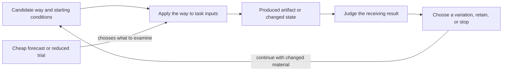
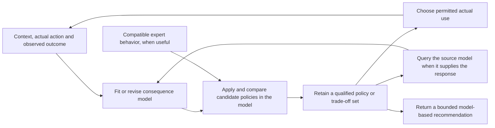

on, source relation, architecture move, call-planning move, or another directly governed value.


Reference labels ending in `Ref` are reference positions, not kind names. This includes `ProblemCardRef`, `sourceSetRef`, `rivalProblemFormulationRef`, and `representationOrWordingUseRelationRef`.

Semantic locality comes from the exact EntityOfConcern, effective ReferenceScheme, ClaimScope, declared assumptions or window, and receiving use carried by the relevant claims. A broad domain, organization, practice, or location label is only recognition material until those exact values are recoverable. None becomes a container participant or establishes global Problem identity.

Plain gloss for `P2W-ready`: *problem-side input ready*. It means ready as input to downstream P2W or selector reasoning, not ready for Work execution, gate passage, method selection, evidence reliance, or autonomy.

When a downstream reader asks whether intended Work can enter a work boundary, the card may supply problem-side cues, acceptance probes, constraints, and freshness conditions, but A.15.5 governs the readiness relation. C.22.2 decides no full-kit preparation, commitment, launch gate, or performed Work.

#### C.22.2:2.2 - Required Solution Use

The Solution turns observed signal material into one C.2.1 episteme and one governed next use, not a completed form.

1. Capture the symptom, anomaly, risk, stakeholder cue, drift, hypothesis, or other observed signal before naming an actual Problem.
2. Recover the one joint EntityOfConcern, effective ReferenceScheme, ClaimScope, and claim family. If the claims concern unrelated entities, split the ClaimGraph and card.
3. Separate the signal detector, actual-PFR assertion if independently grounded, anticipated-condition claim, improvement check, candidate acceptance criterion, method-availability claim, monitored risk signal, and proxy-distortion risk. These are not one card status or one PFR participant set.
4. Pay only for current complexity. Add conditional content only when it changes the current next use; otherwise stop at the lighter card or name the direct pattern for the claim now current.
5. If the formulation changes EntityOfConcern, effective scheme, ClaimScope, diagram, functional description, or transformation-flow interpretation, name the representation-transition, retargeting, Bridge, structural-reinterpretation, or wording-use relation before inheriting an earlier card disposition.
6. Close by the honest next use. A filled card without a truthful next use is not a successful result.

**Cheap stop.** The smallest card that gives a truthful next use is sufficient. A conforming use does not require heavier fields merely because the full inventory exists.

**First practitioner use.** State the signal, joint EntityOfConcern, scheme, scope, claim family, not-wish reason, improvement check or acceptance probe, and honest next use. Open the relation-boundary aid only when another claim or relation changes that move.

#### C.22.2:2.3 - Relation Boundary Aid

Use this aid only after the Thin `ProblemCard` is legible: signal, joint EntityOfConcern, effective ReferenceScheme, ClaimScope, claim family, not-wish reason, improvement check or acceptance probe, and honest next use. It is not a second writing order and not a catalogue of other patterns. It answers one question:

> Which claim being made, relation, or boundary changes the problem-card use, and which FPF pattern defines or constrains that claim, relation, or boundary?

If the claim, relation, or boundary does not change the current problem-card use, leave it out of the card. If it does change the move, keep only the local cue or reference that makes the card reviewable, then apply the subject pattern for that claim, relation, or boundary.

| Current claim, relation, or boundary that changes the card use | Local `ProblemCard` content | Subject pattern |
|---|---|---|
| Characterization, measurement, indicator, Q-bundle, comparison, acceptance, or parity | Characterization cue, acceptance probe, candidate criterion, comparator cue or window cue, and the current reason the relation changes the problem formulation. | `C.16`, `A.19`, `C.25`, `G.0`, `G.4`, or `G.9` according to the relation named by value. |
| Archive, pool, front, shortlist, selected set, retained candidate, or set-return source | `sourceSetRef`, source-set kind, selection or retention criterion, budget or window when current, and non-scalar next use. | `C.18`, `C.19`, `G.5`, `G.9`, `G.11`, `A.6.P:7a`, or `C.16.Q` according to the relation named by value. |
| Method family, work planning, work-entry readiness, performed work, result record, evidence, provenance, assurance, gate, or autonomy | Problem-side cue, source reference when it changes formulation, and stop condition before that outside use. | `G.5`, `A.15`, `A.15.5`, `A.10`, `G.6`, `B.3`, `A.21`, or `E.16` according to the claim named by value. |
| Temporal, causal-use, representation-transition, retargeting, bridge, structural-reinterpretation, or wording-use relation | Relation reference plus the inheritance boundary: what can be reused from the old card and what relation is reopened. | `C.27`, `C.28`, `A.6.3.RT`, `A.6.4`, `E.17`, `F.9`, `E.18`, or `E.10` according to the relation named by value. |
| First-principles or mathematical structure cue | Candidate structure, preserved and lost structure when current, practical payoff for problem formulation, problem-formulation follow-up reason, and stop condition. | `C.29` for mathematical-lens use; `A.6.0` for a `FormalSubstrate` `U.Signature` declaration when that signature declaration is current. |
| Agentic safe probe or world-affecting next action | Probe need, risk condition, bounded next action, and the safety, autonomy, gate, work, evidence, or assurance claim kind that blocks local action. | `C.24`, `E.16`, `A.21`, `A.15`, `A.10`, `G.6`, or `B.3` according to the relation named by value. |

Over-capture symptom: the practitioner spends the pattern use classifying FPF patterns while one or more core Thin items in `C.22.2:2.1` remain unstable.

Repair: return to the exact Thin form in `C.22.2:2.1` and complete only its core items. Reopen this aid only for the claim, relation, or boundary that changes the honest next use.

#### C.22.2:2.4 - Use Boundaries and Record Budgets

Use `C.22.2` when a signal is not yet a problem-side record and downstream task typing, P2W, method-family selection, work planning, evidence use, gate passage, autonomy control, or selected-set use depends on such a record. A known method does not close this pattern when the problem signal, scope, acceptance probe, or EntityOfConcern remains unstable.

Use another pattern directly when the question under repair is already that pattern's `EntityOfConcern` or governed relation: `A.15` for work planning or performed work; `A.10`, `G.6`, or `B.3` for evidence, provenance, or assurance; `A.21` for gate decision; `E.16` for autonomy; `C.11` for a local choice among explicit options; and `C.18`, `C.19`, or `G.5` for archive, pool, front, or selected-set governance. `C.22.2` may still preserve the problem-side cue or reference that explains why that pattern is now current.

Use record budgets:

- Thin record budget: signal, joint EntityOfConcern, effective ReferenceScheme, ClaimScope, exact claim family, not-wish, not-slogan, not-ticket, or not-preselected-work reason, provisional improvement check or acceptance probe, and one honest next use.
- Standard record budget: Thin fields plus the current comparison, acceptance, risk, validation, freshness, unknown-handling, or P2W-readiness fields needed for downstream use.
- High-relation record budget: Standard fields plus only the relation references needed when public, disputed, high-risk, set-derived, cross-scheme, cross-use-boundary, evidence-adjacent, autonomy-adjacent, gate-adjacent, agentic, temporal, causal, representation, or Part-G relations are current.

Stop at Thin when it gives a truthful next use. Stop at Standard when it supplies enough problem-side input for a minimal `TaskSignature`, `TaskKind`, or `ProblemProfile` under C.22. Apply the governing FPF pattern for the claim being made, relation, or boundary instead of enlarging the card when the issue under repair is no longer the problem-side record itself.

#### C.22.2:2.5 - Field Labels and Current-Use Conditions

Use these readable labels only when current for the case:

- problem signal and exact signal reference;
- one exact ClaimGraph, joint EntityOfConcern, effective ReferenceScheme, and ClaimScope;
- actual-PFR assertion with exact polarity and PFR reference only when C.22.PFR independently establishes the occurrence;
- anticipated-condition, forecast, scenario, or counterfactual claim with assumptions and horizon;
- method-availability or solvability claim with admitted method set, evidence qualification, constraints, and intended use;
- primary viewpoint or an explicitly recovered system-role-kind, assignment, relation-participation, responsibility, or other direct concern as claim qualification, never as card or PFR identity;
- symptom detector, problem hypothesis or cause-theory cue, and rival formulation when current;
- improvement check, acceptance probe, characterization relation, characteristic or Q-bundle relation, indicator selection, and parity or comparison relation when current;
- mandatory constraints, risk condition, validation boundary, freshness or expiry condition, and unknown handling;
- problem-formulation follow-up reason when it changes review, discrimination, or receiving use;
- representation-transition, retargeting, Bridge, structural-reinterpretation, or wording-use reference when an earlier disposition may no longer transfer;

- `sourceSetRef`, source-set kind, selection or retention criterion, budget or window, and non-scalar next use when the signal comes from a set, pool, front, archive, shortlist, or selected set;
- `firstPrinciplesCue` when a mathematical structure changes the formulation; and
- subject-pattern cue naming the direct pattern, claim kind, exact receiving-use reference, and stop condition when an outside claim changes the card use.

| Field current-use class | Required treatment |
|---|---|
| C.2.1 constitution | State the exact ClaimGraph, one joint EntityOfConcern, and effective ReferenceScheme. These constitute the card episteme; ClaimScope, viewpoint, assumptions, windows, and receiving use qualify the relevant claims and relations, while id, carrier, and publication remain outside constitution. |
| Core problem-side claims | State the signal, ClaimScope, claim family, not-wish reason, improvement check or acceptance probe, and honest next use. |
| Conditional claims and references | Add only the exact characterization, comparison, risk, validation, freshness, set-source, representation, forecast, solvability, PFR, or other direct relation content that changes the move. |
| Subject-pattern cue | Keep only the local cue or reference needed by the card, then name the direct pattern and claim kind that govern the outside use. |

If a conditional value is not current, omit it rather than writing `unknown`. Use `unknown` only where the exact current value rule permits that result. If a required current value is unavailable, state whether the next use is blocked, degraded, sandboxed, or must be reconsidered under a named condition. A stale value gets the exact G.11/currentness assertion; an intentionally omitted value states the record-budget reason without implying it was checked.

When the card compares options, retained candidates, or rival formulations, it states the exact comparison or parity relation or why comparison is not current. Absence is a disposition, not an automatic defect; any positive parity or selected-set result remains outside C.22.2.

`problemCardWitnessRefs` may be used as a local recoverability group, not as a new kind or evidence graph:

```text
problemCardWitnessRefs:
  problemSignalRef?
  sourceSetRef?
  selectionOrRetentionCriterion?
  characterizationRelationRef?
  parityRelationRef?
  freshnessRef?
  representationOrWordingUseRelationRef?
```

Generated variants, evaluator feedback, and open-ended mutation remain signal or source-set cues. They do not constitute the card, supply evidence sufficiency, make PFR obtain, or authorize action.

#### C.22.2:2.6 - Anti-Pattern Checks and Worked Slices

Anti-pattern checks start from the local card use:

- card-as-executable-work request: the card is treated as executable work while method, plan, and work occurrence remain undecided;
- form-completion: every field is filled because the template exists, even though the Thin next use would be truthful;
- readiness shortcut: `P2W-ready` is declared from signal and scope alone, without improvement check or acceptance probe;
- source-claim shortcut: a preselected solution, work request, proof-looking reference, gate-looking cue, or authority-looking cue replaces one or more core Thin items in `C.22.2:2.1`;
- scalar shortcut: archive, set-return, Goldilocks, NQD, OEE, partial-order, stepping-stone, or indicator material collapses into one readiness score;
- prestige shortcut: first-principles or mathematical wording is kept without practical payoff, preserved and lost structure when current, problem-formulation follow-up reason, and stop condition.

Local stop rule: if the encountered material tries to carry a claim outside `C.22.2`, the card keeps only the cue or reference that changes problem formulation or the next use, then names the governing FPF pattern and claim kind named by value to use before that claim is relied on.

A conforming `C.22.2` use is testable against at least one Thin worked slice, such as repeated task rework or another compact problem signal, showing signal, EntityOfConcern, ReferenceScheme, ClaimScope, exact claim family, not-preselected-work reason, improvement check, and honest next use. It is also testable against at least one High-relation worked slice from a set, archive, pool, front, shortlist, selected set, or portfolio source, showing `sourceSetRef`, candidate acceptance criterion, risk condition, and the claim, relation, or boundary without creating a local portfolio or archive kind.

#### C.22.2:2.7 - Conformance Checklist Requirements

The checklist protects a completed or reviewed card from overread; the writing order remains the Thin form and honest next use.

| Check | Required test |
|---|---|
| C.2.1 identity | The card has one exact ClaimGraph, one independently identified joint EntityOfConcern, and one effective ReferenceScheme. Unrelated PFRs or other concerns force ClaimGraph/card split. |
| Claim-family separation | Actual-PFR assertion polarity, reliance result, anticipated-condition claim, and method-availability or solvability claim remain distinct. |
| PFR boundary | Any affirmative actual-PFR assertion names an occurrence independently established by C.22.PFR. A card, signal, label, viewpoint, evidence item, method, or negative assertion creates or ends none. |
| Core usability | The card states signal, ClaimScope, claim family, not-wish reason, improvement check or acceptance probe, and honest next use. |
| `P2W-ready` reason | `P2W-ready` appears only with an improvement check or acceptance probe and one named downstream use; it is problem-side readiness only. |
| Field budget | Conditional content appears only when current; absence and admitted `unknown` remain distinct. |
| Exact source and set | A set-derived card preserves exact `sourceSetRef`, set kind, retention or selection criterion, and non-scalar next use without becoming an archive or portfolio object. |
| Direct-governor cue | Claims outside C.22.2 remain local cues or references and name the exact pattern and claim kind used next. |
| Constitution stays exact | Only ClaimGraph, one joint EntityOfConcern, and effective ReferenceScheme constitute the card. ClaimScope, assumptions, windows, viewpoint, receiving use, and any exact A.15.6 Work reference stay in their claims and direct relations; no setting, carrier, or organization is added as a participant. |
| Currentness and change | Freshness, changed representation, retargeting, or unknown-blocked use states refresh, retirement, bounded use, `abstainOrNoChange`, or the exact relation reopened. |
| Scalar and proxy guard | Goldilocks, NQD, OEE, set-return, priority, indicator, or stepping-stone wording does not become one readiness score or substitute for value. |
| First-principles payoff | A mathematical cue states practical payoff, preserved and lost structure when current, follow-up reason, and stop; C.29 governs the lens use. |
| External wording recovery | Passport, rule-of-choice card, evidence pack, autonomy budget, logs, gates, portfolio, factory, and similar source terms enter only as exact signal, set, characterization, comparison, or follow-up material under their direct governors. |
| Record-budget invariant | The card is as small as the current next use permits; a template, relation aid, or worked example is not another FPF kind. |

### C.22.2:3 - Problem-Kind Recovery

`Problem` remains an ordinary word when no FPF-governed claim is being made. Recover it only when wording changes a governed kind, relation, selector use, evidence claim, causal-use claim, assurance claim, decision, or use boundary.

| FPF-governed use | Current recovery | C.22.2 disposition |
|---|---|---|
| Symptom, anomaly, deviation, risk signal, or stakeholder signal | Problem signal or exact signal reference | May trigger a card but is not an actual Problem or complete problem-side claim by itself. |
| Problematic situation | Plain cue for an exact condition, entity, Work, transformation, or relation under its direct pattern | The phrase introduces no `U.Situation`; an actual Problem still requires one obtaining C.22.PFR relation. |
| Actual Problem | One obtaining `ProblematicForRelation` with exact condition and applicability participants | C.22.PFR governs actuality and identity; the card can assert or designate it only after that settlement. |
| Forecast, scenario, counterfactual, or anticipated condition | Exact non-actual claim with assumptions, horizon, and direct governor | Preserve the claim family; do not turn affirmative wording into current PFR obtaining. |
| Method availability or solvability | Claim over admitted methods, evidence, constraints, and one intended use | Selecting a method revises this claim but does not end an actual PFR. |
| Framed problem-side representation | ClaimGraph about one joint EntityOfConcern under one effective ReferenceScheme and ClaimScope | Center of ProblemCard; representation change uses its direct transition, retargeting, Bridge, or wording-use governor. |
| Candidate from archive or retained pool | Member of an exact source set under a retention relation | Preserve `sourceSetRef`, set kind, criterion, budget/window, and non-scalar next use; set semantics remain outside the card. |
| Selected problem from a set-return treatment | Exact selected member under a direct selection relation | The card may carry the member, but selection, parity, archive, and set-return claims remain with G.5, C.18, C.19, G.9, G.11, A.6.P:7a, or C.16.Q as applicable. |
| Problem ready for selector-facing use | Card sufficient to prepare or assign TaskSignature | C.22 constitutes and assigns TaskSignature; C.22.2 does not dump card content into it. |
| Downstream task, method, plan, or performed-Work cue | Exact value or relation under C.22, G.5, A.15, or another direct pattern | Keep only the problem-side cue and stop before claiming the downstream result. |
| E.8 or E.9 `Problem frame` | Authoring or decision-rationale section | Not a ProblemCard and not an actual Problem by heading alone. |

The card may reference candidate `ProblemProfile`, TaskSignature, source set, PFR, forecast, solvability claim, or first-principles cue only when that reference changes its use. No reference is promoted into a local kind or card constitution component.

### C.22.2:4 - Problem, Task, Method, Work, and Result Split

`ProblemCard` remains usable while a method is unknown, contested, or not yet selected. A known method does not make the card ready while any core Thin item in `C.22.2:2.1` remains unstable. If the problem-side episteme and method are accepted and only planned execution remains, apply A.15.

| Term or local name | Current FPF recovery | Local disposition |
|---|---|---|
| `Problem` | Ordinary wording, ProblemCard claim content, or actual PFR according to the sentence | C.22.2 governs the card; C.22.PFR governs the actual relation. Label alone decides neither. |
| `ProblemCard` | C.2.1 episteme about one joint EntityOfConcern | Compact problem-side result before P2W; not a work request or world-side Problem. |
| `ProblemProfile` | C.2.1 episteme used by a named receiving selection use | Not the card, TaskSignature, method, or Work request. |
| `TaskKind`, `TaskFamilyRef`, `TaskSignature` | C.22 selector-facing declaration content and episteme | Downstream typing values; not WorkPlan entries. |
| `TaskSignatureAssignmentRelation` | Obtaining relation among exact problem-side episteme, TaskSignature, and receiving-use episteme | Separate from all three participants and from card fields. |
| Method-family selection claim | G.5 comparison or selection result | Not a card field and not PFR cessation. |
| `U.Method`, `U.MethodDescription` | Method and method-description values | Governed by their direct method patterns. |
| `U.WorkPlan` and its declaration-local `SlotFillingsPlanItem` content | Intended Work and planned-filling rows addressed only through that WorkPlan | Defined and tested by A.15.2 and A.15.3; not a TaskSignature or ProblemCard. |
| `U.Work` | Performed dated Work | Governed by A.15.1; its record or evidence is separate. |
| Result, measurement, assertion, evidence, or reliance | Exact output under C.16, C.2.1, A.10, G.6, B.3, G.11, or the direct result pattern | Can support a card claim but neither constitutes the card nor makes PFR obtain. |

Use C.22 to prepare the TaskSignature from the exact problem-side episteme or `ProblemProfile` needed by one receiving use. Assert an assignment only when one TaskSignature is adequate for that use and C.22's obtaining rule holds. If several profiles or signatures remain plausible, preserve candidates rather than asserting one assignment. When the question becomes selection, planning, performed Work, result, gate, evidence, or reliance, apply its governor instead of expanding the card.

### C.22.2:5 - Relation to C.22

C.22 governs TaskSignature constitution and `TaskSignatureAssignmentRelation`. ProblemCard is earlier and explicit: it states which problem-side claims are ready for P2W, search, comparison, characterization, refresh, retirement, or another direct pattern.

A card may prepare TaskKind, characteristic bindings, scope, and candidate TaskSignatures. C.22 assigns one only when the exact problem-side episteme, TaskSignature, and receiving-use episteme satisfy its obtaining rule. Several plausible signatures remain candidates.

No card detail is copied wholesale into TaskSignature. Downstream method, Work, result, evidence, gate, autonomy, archive, portfolio, and selected-set claims remain with their direct patterns.

### C.22.2:6 - Characterization, Indicators, and Comparability

`ProblemCard` states either a recoverable `characterization relation` and `comparability or parity relation`, or an explicit current reason why the problem can proceed without one.

The heavy content stays with existing FPF patterns:

- `C.16` carries measurement characterization, backing, and comparability discipline;
- `A.19` carries characteristic, scale, unit, polarity, and indicator-use discipline;
- `C.25` carries Q-bundles and quality-like multi-characteristic bundles;
- `G.9` carries parity, comparison-window, comparator, budget, unit, repeatability, and reproducibility pins;
- `G.0` carries comparison-frame and CG-Spec governance;
- `G.4` carries acceptance clauses and threshold predicates;
- use `G.5` for selector-facing selected-set result declaration when the problem enters a selected set; when actual audience availability is separately current, use `E.17` for a source-backed publication face and return to source and `E.24.PUB` for the publication occurrence, form, carrier, audience, bounded use, and availability.

Missing characterization or parity relation is a current disposition. When that relation is current, apply the characterization, parity, search, or pool pattern before treating the problem as ready for P2W.

The `C.22.2` candidate acceptance criterion separates functional check, constraint compliance, risk or safety boundary, parity or comparison relation, and freshness window when those relations are current. Comparison frame, CG-Spec, or comparability governance is governed by `G.0`. Acceptance clauses and acceptance threshold predicates apply `G.4`; `C.22.2` may name only the needed relation, cue, or reference. Passing a test, improving one observed indicator value, or naming an acceptance phrase is not by itself sufficient for P2W use.

### C.22.2:7 - Source Record-Form Recovery

Source record names are recovered by use, not by label shape. This section prevents source prose from becoming local `C.22.2` subobjects.

| Source form family | `C.22.2` preservation | Subject pattern named by value for outside use |
|---|---|---|
| Problem card, problematization passport, problem-side note, or ordinary problem signal | Carry the signal, joint EntityOfConcern, effective ReferenceScheme, ClaimScope, exact claim family, not-wish or not-preselected-work reason, improvement check or acceptance probe, and honest next use. | `C.22.2` governs only the problem-side episteme; downstream selector-facing use remains with `C.22`. |
| Archive, portfolio, palette, front, shortlist, selected set, `LivePool`, set-return, or retained candidate | Preserve `sourceSetRef`, source-set kind, selection or retention criterion, budget or window when current, and non-scalar next use. | `C.18`, `C.19`, `G.5`, `G.9`, `G.11`, `A.6.P:7a`, and `C.16.Q` according to the relation named by value. |
| Characterization passport, characteristic card, parity plan, comparison note, rule-of-choice card, or acceptance-looking row | Preserve the cue, candidate criterion, comparator cue or window cue, and current reason the relation changes formulation. | `C.16`, `A.19`, `C.25`, `G.0`, `G.4`, `G.9`, or `C.11` according to the relation named by value. |
| Evidence pack, provenance note, assurance row, gate log, autonomy budget, runbook, rollback plan, method selection, work plan, performed-work note, result record, or result measurement | Preserve only the problem-side cue, risk or validation boundary, source reference, and stop condition before that use. | `A.10`, `G.6`, `B.3`, `A.21`, `E.16`, `G.5`, `A.15`, `C.16`, or `G.11` according to the claim named by value. |
| Candidate solution, described system, ordinary log, budget, ledger, protocol, plan, pack, or factory wording | Recover the use under repair: problem-side source material, problem-side source relation, selected-set material, work, evidence, gate, or autonomy material, or ordinary example. | Apply the subject pattern for the recovered relation; do not mint a local `C.22.2` kind from the label. |

The repair rule is short: if the source material supplies problem-side material, copy the material into the card's current fields. If it supplies another FPF-governed claim, keep only the local cue and apply the pattern that defines or constrains that claim.

### C.22.2:8 - Portfolio, Archive, and Set-Return Treatment

Archive, portfolio, pool, front, shortlist, selected-set, and set-return material remain source and set cues for the current problem-side record. `ProblemCard` preserves `sourceSetRef`, source-set kind, selection or retention criterion, and the non-scalar next use when current; portfolio and archive governance stays with the named subject patterns and does not become a local problem-card kind.

Archive, portfolio, palette, front, shortlist, ranked shortlist, selected set, `LivePool`, and set-return material remain current source distinctions, but their current FPF subject patterns are already available:

| Source wording | Current FPF pattern or relation | Required problem-card preservation when the corresponding claim is being made |
|---|---|---|
| Problem archive | `C.18`, `C.19`, `A.10`, `G.6` | Preserve source set or reference, retention criterion, candidate status, and provenance relation. |
| Problem portfolio | `G.5`, `C.19`, `G.9`, `G.11` | Preserve selection or retention criterion, budget or window, review cadence, and selected-set or `LivePool` relation. |
| Palette | `C.18`, `C.19`, `G.5` | Preserve candidate-family or option-set interpretation without turning it into evidence or approval. |
| Front | `C.18`, `A.19`, `C.25`, `G.5` | Preserve declared characteristics and non-dominated set interpretation. |
| Shortlist | `G.5`, with `G.9` when comparison pins matter | Preserve selected-set criterion and downstream use. |
| Ranked shortlist | `G.5` only when an order is declared | Preserve ranking criterion or narrow to selected set with tie notes. |
| Selected set | `G.5` | Preserve selected-set output, selection pins, and unknown handling. |
| `LivePool` | `C.19` | Preserve pool policy, current treatment, and change trigger. |
| Set-return | `G.5`, `C.18`, `C.16.Q`, declared comparison records | Preserve set-valued result when no total order is declared. |

A singleton problem card is the degenerate case. If it came from a portfolio, front, archive, or pool, the selected problem remains traceable through `sourceSetRef`: the lightweight reference to the source-set kind, source reference, selection or retention criterion, budget or window, review cadence, and direct pattern when current. `sourceSetRef` is a reference field, not a new kind and not a downstream claim carrier.

`sourceSetRef` preserves the recoverable set-source relation when current: `Palette`, `Front`, `Archive`, `ExplorationArchive`, `Shortlist`, `RankedShortlist`, `SelectedSet`, `LivePool`, or another accepted source-set form. If the set-source relation is not recoverable, the card may keep a set-finding cue, but it does not claim selected-set readiness or archive-derived readiness.

When multiple plausible problem formulations remain current, `C.22.2` does not bind one `TaskSignature` prematurely. Each optional `rivalProblemFormulationRef` states the rival formulation, EntityOfConcern, effective ReferenceScheme, ClaimScope, preserved concern, lost concern, reason not selected yet, and next discrimination action. It is not a `CG-Frame`, not the E.8 `Problem Frame`, and not a representation-frame kind.
The next discrimination action may be to characterize, compare, retarget, reopen the source material or source relation, choose a local problem formulation, or apply the relation-bearing pattern. Reframing is triggered when EntityOfConcern, effective ReferenceScheme, ClaimScope, viewpoint qualification, or cause-theory cue changes the problem representation enough that readiness or use-boundary cannot be inherited by wording continuity.

### C.22.2:9 - Goldilocks and Set-Return Docking

Goldilocks problem selection is the problem-side adaptation of the current NQD, OEE, and set-return family. It is not direct QD or OEE vocabulary import, not a new scalar readiness doctrine, not a local QD or OEE vocabulary, and not a single score. `C.22.2` does not mint `GoldilocksProblem`, `GoldilocksScore`, `GoldilocksReadiness`, or any equivalent local kind; Goldilocks remains a readiness and selection interpretation carried by current subject patterns.

A Goldilocks, stepping-stone, or archive-derived problem is represented by its source-set reference, selection or retention criterion, and current next use, not by one difficulty, priority, or readiness score.

`ProblemCard` carries only the problem-side readiness fields and relation references:

- source set kind when archive, pool, front, shortlist, selected set, or portfolio language is current;
- solvability band;
- characteristic-space, declared problem-side characteristic descriptor, or Q-bundle relation;
- declared difference criterion when novelty or diversity is claimed, or apply the governing characterization or comparison pattern;
- non-scalar trade-off, dominance, partial-order, or set-return relation when that relation is being made;
- measurability or explicit unknown handling;
- reversibility or containment for safe probing when current;
- stepping-stone option value when retention matters;
- expiry or refresh condition;
- selected-set, archive, pool, front, or parity relation when that relation is being made.

The local `solvability band` label means a scheme-and-scope-qualified, non-scalar interpretation of feasible-but-not-trivial fit under current capability, constraints, validation boundary, and optional set-return relation. It is not a universal difficulty claim, hidden readiness scale, or single-score ranking.

If the band cannot be tied to a characteristic, Q-bundle, comparison, retention, or capability relation and its qualification, treat Goldilocks wording as informal recognition only and bind any selection, set-return, or parity claim to its direct governor.

The current governing family is `C.18`, `C.19`, `G.5`, `G.9`, `G.11`, `A.6.P:7a`, and `C.16.Q`. Its relation to `C.22:15` concerns entry and timing inside the same family: `C.22.2` uses it before P2W, while `C.22:15` uses it downstream when candidate solutions for a `TaskKind` make `TaskSignature` informative.

### C.22.2:10 - Structure Cue That Improves Formulation

`C.29` carries mathematical-lens use for first-principles or mathematical structure cues used by `ProblemCard`.

`firstPrinciplesCue` is a local cue label for a formulation-changing structure and a cue to apply `C.29`; it is not a local mathematical-lens kind or a substitute for a `C.29` lens-use result.

The problem card may ask whether a first-principles or mathematical structure helps find or improve the problem formulation, not only whether an already-mentioned mathematical expression helps the problem formulation. Useful cues include state space, graph, boundary, topology, symmetry, invariant, variational or constrained-optimization structure, probability or information structure, resource bound, obstruction, scale window, composition, or coarse-graining choice.

The practitioner-facing use is:

> State the structure that improves the problem formulation, the preserved structure, the lost structure, the practical payoff, the problem-formulation follow-up reason, and the stop condition.

Distribution by principles:

| Source-side cue | Current FPF pattern or relation | `C.22.2` use |
|---|---|---|
| Zero-principles and first-principles invariants, constraints, symmetry, composition, multi-scale description, variational structure, probability or information, and resource limits | `C.29`, with `A.19`, `C.16`, `C.25`, and `G.9` when characteristics, measurement characterization, quality bundles, or parity are current | Carry a first-principles or mathematical structure cue and apply the subject pattern for the claim being made, relation, or boundary. |
| Second-principles method-family implications | `G.5`, `A.15`, `E.18`, `A.19` as applicable | Name the method-family cue; do not perform method selection in the problem card. |
| Third-principles reproducibility, checks, templates, records, logs, rollback, evidence | `A.10`, `G.6`, `B.3`, `A.21`, `G.11`, `E.16` as applicable | Name the reproducibility or evidence cue and apply the subject pattern for the claim kind named by value before relying on that claim. |

When no useful mathematical structure survives, record that absence and proceed without forcing mathematical prose into the problem card.

### C.22.2:11 - Validation, Reliance, AI-Agent Cues, and Safe Probing

`ProblemCard` exposes three local fields for downstream use:

- problem-formulation follow-up reason: why this formulation is worth keeping, reviewing, discriminating, or moving onward now;
- validation boundary: what has been checked for the current next use, what may be used now, and which use is governed by another pattern;
- risk condition: the monitored risk, cost-of-error concern, or containment concern that may change the safe next action.

Use these fields to state a local reliance disposition, not to authorize downstream action.

| Card-use condition | Local disposition | Next pattern application |
|---|---|---|
| The current reason is sufficient for the named reversible P2W use. | `P2W-ready` only for that named use, with effective ReferenceScheme, ClaimScope, qualification window, validation boundary, and stop condition. | Apply measurement, evidence, temporal, refresh, representation, gate, autonomy, Work, or assurance patterns only when those claims are part of the use. |
| The reason is useful but narrower than the attempted use. | Narrow the attempted use; name the narrowed use, blocked attempted use, and stop condition. | Apply the subject pattern for the missing claim, relation, or boundary. |
| Source material, source relation, validation, or currentness is stale, conflicted, uncalibrated, or untied to the current relation. | Choose `abstainOrNoChange`, `refresh`, or `reopen`; name the missing relation, evidence-needed cue when current, and decision point. | Use `A.10`, `G.6`, `B.3`, `C.16`, `C.27`, `G.11`, `A.6.3.RT`, `A.6.4`, `E.17`, `F.9`, or `E.18` according to the reopened relation. |
| The proposed next action can affect the world, spend resources, call tools, delegate to agents, change operational state, or make safety, release, gate, or work claims. | Block local use or name the governing relation; keep only the problem-side cue inside the card. | Apply `B.3`, `A.21`, `E.16`, `A.15`, `A.10`, `G.6`, or `B.2.5` when the corresponding controlled-EntityOfConcern relation is current. |

Cause-theory cues may focus problem formulation inside `ProblemCard`. Association, intervention, counterfactual, responsibility, expected-effect, or causal-evidence claims are governed by `C.28` plus evidence, provenance, or assurance patterns when those claims are being made.

Environment design and safe probing may appear as problem signal reference, validation boundary, risk condition, or subject-pattern cue. If the next action can affect a controlled EntityOfConcern, the card names the probe need plus the claim kind named by value that blocks local action; any deontic permission, work authorization, release authorization, or gate passage stays with the subject pattern for that claim.

### C.22.2:12 - Freshness, Expiry, and Unknown Handling

`C.22.2` includes a section-local state and disposition vocabulary for `ProblemCard`; this vocabulary is not a new FPF kind. These labels describe the card's current governed use; they are not required states in a transition sequence, event kinds, or gate records. The local labels are:

| State or disposition label | Required interpretation |
|---|---|
| `draftSignal` | A problem signal has been captured, but the card is not yet reviewable. |
| `reviewable` | The problem-side record can be inspected, challenged, sent onward, or refined, but it is not necessarily P2W-ready. |
| `P2W-ready` | Local disposition label with plain gloss: problem-side input ready. The problem-side record is sufficient for downstream P2W or selector-facing use; it is not `ReadyForWork`, `GateReady`, `MethodReady`, `AutonomyReady`, or work authorization. |
| subject-pattern cue | A claim, relation, or boundary outside `C.22.2` changes the current problem-card use; the card names the governing FPF pattern and claim kind named by value to use next without claiming that use inside `C.22.2`. |
| `stale` | Freshness or expiry blocks the intended downstream use until refreshed, retired, or otherwise disposed. |
| `refreshed` | The relevant signal, source material, source relation, ReferenceScheme, ClaimScope, characterization, parity, evidence, provenance, assurance, representation relation, or wording-use relation has been updated enough for the named use. |
| `retired` | The problem-side record is no longer used as a current problem for downstream work. |
| `archived` | The record is retained under the relevant archive, pool, front, or selected-set pattern without being current for P2W. |
| `abstainOrNoChange` | No downstream receiving use is selected because the signal is stale, duplicate, already solved, already absorbed, unnecessary, or not worth current downstream Work. |

Freshness names the exact affected locus: problem signal, effective ReferenceScheme, ClaimScope, characterization or parity relation, problem-formulation reason, source material, source relation, source-set reference, representation relation, or wording-use relation. For the problem signal, ask whether it is still present, recurring, solved, absorbed, duplicate, unnecessary, or no longer worth downstream work. For ReferenceScheme or ClaimScope, ask whether the applicable meaning, cut, assumptions, window, or receiving use changed enough to alter the formulation. For characterization or parity, ask whether measurement, comparison, and parity relations are current enough for the intended use. For the formulation reason, source material, or source relation, ask whether cited sources, provenance, reason references, and source references remain current. For a source set, ask whether archive, front, pool, shortlist, or selected-set membership and its selection or retention criterion remain current. For a representation or wording-use relation, ask whether wording, diagram, functional description, transformation-flow path, Bridge, retargeting, or other representation change alters the EntityOfConcern, effective ReferenceScheme, ClaimScope, viewpoint qualification, comparison relation, governed next use, or relation needed for inheritance.

A stale source material, source relation, or evidence reference does not always retire the problem; it may require refresh while the problem remains reviewable. A stale problem signal may lead to refresh, retire, archive, abstain or no-change, or a subject-pattern cue for the claim, relation, or boundary that is checked.

Freshness or expiry failure is a current disposition. A stale or unknown-bearing problem card may remain reviewable as a problem-side record, but it does not become P2W-ready unless freshness and unknown handling permit the intended downstream use. A stale problem card does not silently remain usable as P2W input.

When freshness, expiry, or unknown handling fails, choose one of these current dispositions:

- refresh the problem card or its characterization or comparison relation under `G.11`, `C.16`, `A.19`, `C.25`, or `G.9`;
- retire or deprecate the problem-side record under the relevant archive, pool, selected-set, or refresh pattern;
- continue only as explicitly governed bounded-risk use under the subject pattern for the claim being made, relation, or boundary.

Unknown-handling fields state whether they permit use, require degraded use, abstention, or sandbox treatment, or make the current problem formulation blocked. No P2W, no change, or abstain-for-now may be a successful next use when the signal is stale, duplicate, already solved, already absorbed, unnecessary, or not currently worth downstream work. Before using the `ProblemCard` as input to `TaskSignature` preparation or assignment under C.22, check whether the problem signal is still present and whether prior work has already solved or removed the problem.

### C.22.2:13 - Representation and Wording-Use Relation Continuity

`C.22.2` names `A.6.3.RT`, `A.6.4`, `E.17`, `F.9`, `E.18`, and `E.10` only when changed problem formulations, diagrams, functional descriptions, transformation-flow paths, wording, or `PathSlice` examples carry a current representation, bridge, retargeting, structural-reinterpretation, or wording-use claim. The card may preserve the local cue, reference, or problem-formulation follow-up reason, but it does not prove continuity or use-boundary inheritance by wording similarity.

Framing is not wording repair. A framing change applies when EntityOfConcern, effective ReferenceScheme, ClaimScope, viewpoint qualification, comparison relation, use-boundary inheritance, or honest next use changes. Wording-use repair is current only when wording, diagram, functional description, transformation-flow path, Bridge, retargeting, or another representation change alters the carried problem-side representation, EntityOfConcern, effective ReferenceScheme, ClaimScope, viewpoint qualification, comparison relation, governed next use, or subject-pattern cue. Ordinary wording cleanup triggers no representation-continuity relation and does not block a Thin `ProblemCard`.

| Pattern or pattern family | When it matters for the card | `C.22.2` use |
|---|---|---|
| `C.22` | Problem-side record, `ProblemProfile`, and `TaskSignature` are being related. | Keep `TaskSignature` minimal and apply representation-transition, bridge, retargeting, structural-reinterpretation, or wording-use patterns only when a current relation claim or use-boundary appears. |
| `C.16`, `A.19`, `C.25`, `G.9`, and `G.11` | Characterization, characteristic, Q-bundle, parity, or freshness representation changes the selected entity or comparison relation. | Preserve only the problem-card cue and apply the characterization, parity, bundle, or refresh relation named by value when that relation is being made. |
| `C.29` | A mathematical representation preserves, coarsens, or retargets the EntityOfConcern or the problem-side representation. | Use `C.29` output and representation or wording-use relation references when structure changes entity interpretation. |
| `C.18`, `C.19`, and `G.5` | Archive, pool, front, shortlist, selected set, method-family, or selected-set output uses transformed representations. | Preserve source-set reference, criterion, and downstream use; keep selection semantics outside the card. |
| `A.6.P`, `C.16.Q`, `E.10`, `E.17`, `F.9`, `E.18`, `A.10`, `G.6`, `B.3`, `A.21`, `E.16`, and `A.15` | Source wording, quality wording, multi-view, bridge, structural reinterpretation, evidence, provenance, assurance, gate, autonomy, method, or work relation is current. | Keep the local cue only; apply the subject pattern for the claim being made, relation, or boundary before reusing readiness or relying on the transformed material. |

`C.22.2` may not treat changed-problem examples as governed relations unless the appropriate accepted FPF relation is named.

### C.22.2:14 - Source and P2W Carry-Forward

Apply the following source details as constraints on `C.22.2` use and its P2W-facing input.

| Source detail | Current FPF recovery | `C.22.2` carry-forward relation |
|---|---|---|
| Source examples: person, team, organization, System, community, episteme, and exact Work | Recognition material for the EntityOfConcern or exact A.15.6 Work when it changes problem-card use; not a new FPF kind taxonomy | A domain or practice locus may qualify the effective ReferenceScheme, ClaimScope, horizon, indicators, cost of error, the exact system-role kind or assignment, participation, viewpoint, or comparison, but it neither constitutes the card nor identifies an actual Problem. |
| Engineering language for reproducibility and management language for coordination, rights, resources, and responsibility | Verification and reproducibility, coordination, right, resource, system-role classification or assignment, participation, and responsibility claims are different FPF relations | `C.22.2` may retain bare *role* only as an E.10.ROLE cue; any exact kind, assignment, participation, budget, right, or responsibility field or relation reference follows its direct pattern. Claims outside the problem-side record stay there. |
| Problem factory, solution factory, and factory-of-factories | Source exposition for three related work families, not FPF process kinds | `C.22.2` covers only the problem-side output. Solution and P2W relations use `G.5`, `A.15`, `E.18`, `A.10`, `G.6`, `B.3`, `A.21`, `E.16`, and `G.11`; organizational-development or platform-capability questions are outside this pattern. |
| Characterization protocol: ReferenceScheme, ClaimScope or slice, compared set, exact system-role-kind, assignment, participation, or viewpoint qualification, scale, polarity, measurement Method, freshness, repeatability, budget, missing data, and comparison rules | `C.16`, `A.19`, `C.25`, `G.9`, and the exact qualification pattern | `ProblemCard` cites characterization, qualification, and comparability relations when current; available measurement or a visible label alone is not an accepted use relation. |
| Indicator uses: mandatory constraints, optimization objectives for the current cycle, and risk signals | Characteristic and Q-bundle use under selected comparison or acceptance | `C.22.2` preserves whether an indicator is used as a mandatory constraint, optimization objective, or monitored risk signal when that distinction affects acceptance; the use is not a system-role kind or assignment. |
| Problem portfolio as a period-bounded selected set with budget, assignment or participation cue, review cadence, and not-selected disposition | `G.5`, `C.19`, `G.9`, `G.11`, `A.6.P:7a`, `C.16.Q`, and E.10.ROLE when bare *role* is the source cue | `ProblemCard` preserves the source set or reference, selection or retention criterion, budget or window, review cadence, and not-selected or stepping-stone disposition. If an actual System, local system-role kind, assignment, participation, or responsibility relation matters, cite that independently obtaining direct claim rather than the portfolio wording. |
| Goldilocks as zone-of-growth selection calibrated to current capability, effective ReferenceScheme, and ClaimScope | Problem-side entry to current NQD, OEE, and set-return family | `C.22.2` does not turn Goldilocks into one global difficulty scale or scalar readiness score. |
| Stepping stones as option value: new actions, tools, data, interfaces, environments, or experiment modes that may expand downstream search | Retained archive, front, or pool member, or selected-set reason | `C.22.2` may record stepping-stone value only with a governing set-return, archive, or pool pattern and a retention or tie-break criterion. |
| P2W chain: signatures and principles help select formalism, ontology, characterization, and method-family material | `A.6.0`, `A.6.1`, `C.16`, `A.19`, `C.29`, `G.5`, and `E.18` | `C.22.2` supplies problem-side cues and relation references; it does not select the formalism, ontology, mechanism, or method family by itself. |
| P2W chain: condition measurement and comparison help select a concrete method | `C.16`, `A.19`, `C.25`, `G.9`, `G.5`, and `A.15` | State the comparison-and-acceptance cue or acceptance-criterion reference and parity and characterization relations needed by downstream method selection. |
| P2W chain: work planning makes planned work inspectable | `A.15.2` and `A.15.3` | `C.22.2` may supply problem-side input for `TaskSignature` preparation and assignment under C.22; the identifiable plan is one exact `U.WorkPlan`, and any planned-filling row remains declaration-local content addressed through that plan. |
| P2W chain: performed work produces work-result records | `A.15`, `A.10`, `G.6`, and `B.3` | `C.22.2` does not treat performed work or result records as problem-card fields beyond problem-side cues or named relation references. |
| P2W chain: result measurement can trigger refresh or return to earlier source material | `C.16`, `G.11`, `A.10`, `G.6`, `B.3`, `C.18`, and `C.19` | `C.22.2` states freshness or expiry and unknown-handling dispositions that let downstream result measurement refresh, retire, or re-open the problem-side record. |
| Runbook, rollback plan, canary, SafeStop, error budget, and override protocol | Work, gate, autonomy, evidence, and control records | These source forms are not `C.22.2` subobjects; apply `A.15`, `A.21`, `E.16`, `A.10`, `G.6`, or `B.3` when the corresponding claim is current. |
| Trust debt after reliance-window expiry | Freshness and decay indicator and bounded-risk continuation question | Treat trust debt as an indicator or problem-formulation follow-up reason, not as punishment, proof failure, or gate passage by itself. |

`C.22.2` remains the problem-side output. P2W carries its problem-side cues and, when current, exact receiving-use and Work references into method-family selection, work planning, performed-work interpretation, and result measurement.

### C.22.2:15 - SoTA Decision-Use Source Material

The following external anchors are adopted or adapted only where they change this pattern's local answer by value.

| Current source or relation line | Reference | Pattern use | Disposition |
|---|---|---|---|
| Problem framing turns an ill-structured situation into a solvable design problem and requires care because "framing" is ambiguous. | 2025 CEEA paper "Towards a Theoretical Framework of Framing in Engineering Design", `https://doi.org/10.24908/pceea.2025.19713` | Contributes deconfliction of symptom, situation, framed problem representation, and task. | Adopted as field and kind-recovery cue; wording is expressed in current FPF terms. |
| Strategic problem framing distinguishes symptoms and attention allocation from causal problem formulation. | 2025 Organization Science article "Looking at the Trees to See the Forest: Construal Level Shift in Strategic Problem Framing and Formulation", DOI suffix `2024.19134`, `https://doi.org/10.1287/orsc.2024.19134` | Motivates the fields for problem signal, problem hypothesis/cause-theory cue, and improvement check. | Adapted; causal claims still apply `C.28` plus evidence, provenance, or assurance patterns when current. |
| QD and OEE work motivates collections, fronts, archive retention, set-return, and non-single-winner treatment. | 2026 survey "A survey on Quality-Diversity optimization: Approaches, applications, and challenges", `https://www.sciencedirect.com/science/article/pii/S2210650225003979`; QD-as-MOO reference `https://arxiv.org/abs/2602.00478` | Motivates set-source-reference and Goldilocks docking into current `C.18`, `C.19`, `G.5`, `G.9`, `G.11`, `A.6.P:7a`, and `C.16.Q`. | Adopted as field and relation cue; no local QD or OEE vocabulary or scalar readiness score is introduced. |
| Open-ended coding agents use archives, self-improvement, problem variants, evaluator feedback, and stepping-stone retention. | Darwin Godel Machine `https://arxiv.org/abs/2505.22954`, FrontierSmith `https://arxiv.org/abs/2605.14445`, and AlphaEvolve `https://arxiv.org/abs/2506.13131` | Contributes record-form, set-source reference, Goldilocks, safe-probe, and freshness fields and relation references for archive, problem generation, safe probes, evaluator feedback, no-change and abstain dispositions, and autonomy and evidence boundaries. | Adapted as recent trend cue; `C.22.2` is not turned into AI-agent doctrine or an AI-agent management pattern. |
| External AI-agent and autonomy practice more often makes evidence, log, gate, autonomy-budget, and update-discipline claims current. | Presented material plus current FPF autonomy, evidence, and gate patterns | Motivates subject-pattern assignment for validation, AI-agent cues, and safe probing. | Non-FPF-governed for the center of `C.22.2`; FPF-governed content remains with `E.16`, `A.21`, `A.10`, `G.6`, `B.3`, `A.15`, and `G.11`. |

If a `C.22.2` use carries a wider external claim than these dispositions, the claim is outside this pattern and requires a separate content decision or demotion to a non-FPF-governed example.

Each FPF-governed SoTA use is recovered as a local test: source idea, FPF invariant, practitioner check, and popular shortcut rejected. A source citation without that local test is not enough to carry pattern use.

Local SoTA-to-action tests:

| Source or relation cue | Popular shortcut rejected | Required local result | Reopen condition |
|---|---|---|---|
| Problem framing is ambiguous and abstraction shifts matter. | Symptom, root-cause story, request, or ticket is treated as the problem. | Recover signal, framed problem representation, EntityOfConcern, effective ReferenceScheme, ClaimScope, viewpoint qualification, improvement check, and rival formulation when current. | Reopen when scheme, scope, viewpoint, rival formulation, evidence need, or improvement or acceptance probe changes. |
| P2W uses only a reviewable problem-side record. | `P2W-ready` is treated as Work authorization, gate passage, method selection, evidence proof, assurance, or selected solution. | State problem-formulation follow-up reason, validation boundary, readiness disposition, retained P2W use, blocked attempted use, and subject-pattern cue when an outside claim is current. | Reopen when the signal, EntityOfConcern, ReferenceScheme, ClaimScope, acceptance probe, follow-up reason, validation boundary, freshness, or named outside claim changes. |
| QD, OEE, and set-return work produce archives, fronts, pools, and selected sets. | Priority score, single winner, local problem portfolio, or local selected-set claim. | Preserve `sourceSetRef`, source set kind, selection or retention criterion, and a non-scalar next use; apply the governing set, parity, archive, pool, or refresh pattern when current. | Reopen when the source set, retention criterion, parity relation, archive, pool, front, selected set, budget, window, or freshness disposition changes. |
| Open-ended agents, problem variants, evaluator feedback, and stepping stones change signal interpretation. | Agent output, evaluator trace, or generated variant is treated as enough to act. | Record generator, evaluator, variant, or stepping-stone reason source only as a problem-side cue; name validation, freshness, and pattern reference named by value before probe or action. | Reopen when generator, evaluator, variant, stepping-stone reason source, safety condition, probe condition, or pattern reference named by value changes. |
| First-principles or mathematical structure can improve formulation. | A named formalism or mathematical or ontological prestige is treated as adequacy or rigor. | Record the candidate structure, either its relation to the problem-side EntityOfConcern or the `C.29` mathematical-lens-use relation, preserved and lost structure when current, practical formulation payoff, problem-formulation follow-up reason, and stop condition. | Reopen when candidate structure, preserved or lost structure, problem-formulation follow-up reason, stop condition, or `C.29` result changes. |
| Early class or kind taxonomy looks available. | A class list or ontology-first taxonomy is treated as the problem formulation. | Keep the formulation question current; record candidate structure, preserved and lost structure when current, and representation or retargeting relations before freezing kind structure. | Reopen when formulation question, kind structure, relation, representation-transition relation, or retargeting relation changes. |
| Object model looks clarifying. | Object-model clarity freezes the wrong EntityOfConcern or relation. | Keep EntityOfConcern and relation reviewable; name representation-transition, retargeting, or bridge relation references before reusing a local cue or readiness disposition. | Reopen when EntityOfConcern, relation, view, bridge relation, or representation-transition relation changes. |

### C.22.2:16 - Rationale

`ProblemCard` gives the practitioner one compact problem-side record between vague problem talk and downstream P2W. The card is useful because it is light enough for ordinary use and specific enough to show when comparison, characterization, evidence, selection, mathematical-lens use, method, work, gate, autonomy, bridge, representation transition, or refresh requires another FPF pattern.

The card gives the practitioner one thing to write, inspect, and challenge. A practitioner can see whether a problem is ready without first assembling the problem-side record from `TaskSignature`, Q-bundle, parity report, evidence note, selected-set output, and refresh record. Claims beyond the problem-side record stay with their subject patterns.

The archive and portfolio distinctions remain current when they matter because the card preserves `sourceSetRef` and names the subject pattern for any current set, archive, or portfolio claim. Changed problem formulations, diagrams, functional descriptions, or transformation-flow path interpretations require the accepted representation or retargeting relations before a local cue or readiness disposition is reused. Current SoTA and first-principles cues matter only when they change fields, relation references, boundaries, or the problem formulation itself.

### C.22.2:17 - Problem-Card Use Invariants

| Invariant | Requirement |
|---|---|
| One card, one joint EntityOfConcern | One ProblemCard has one ClaimGraph, one independently identified EntityOfConcern, and one effective ReferenceScheme. Several PFR references may share the card only when one direct pattern identifies their joint concern; otherwise split the claims and card. C.22.2:20.1b supplies the joint, forced-split, and many-cards/one-PFR replay. |
| ProblemCard is not PFR | The card may assert, deny, forecast, describe, or discuss solvability, but only C.22.PFR establishes actual Problem obtaining and identity. |
| Claim families remain distinct | Actual-PFR assertion polarity, A.10/B.3 reliance, G.11 currentness, anticipated-condition claims, and method-availability or solvability claims do not collapse. |
| `P2W-ready` is problem-side readiness | The card can be ready as input to P2W or C.22 without being ready for Work execution, gate passage, method selection, evidence reliance, or autonomy. |
| Constitution and qualification stay separate | ClaimGraph, one joint EntityOfConcern, and effective ReferenceScheme constitute the card. ClaimScope, assumptions, window, viewpoint, receiving use, and any exact A.15.6 Work reference stay in their claims and direct relations; no carrier, organization, or setting constitutes the card or PFR. |
| Claims outside C.22.2 stay outside | Evidence, assurance, gate, autonomy, Work, archive, selected-set, comparison, acceptance, representation, temporal, causal, and mathematical-lens claims remain with their governors. |
| Stale or blocked cards state a disposition | A stale, unknown-blocked, changed-representation, or missing-governor card states refresh, retirement, bounded use, `abstainOrNoChange`, or the exact relation reopened. |

### C.22.2:18 - Misuse Modes and Repairs

| Misuse mode | Symptom | Repair |
|---|---|---|
| Card-as-executable-work request | A solution-shaped task or implementation request is treated as a problem-side record. | Recover the signal, joint EntityOfConcern, effective ReferenceScheme, ClaimScope, claim family, reason this is not a preselected Work request, improvement check or acceptance probe, and honest next use before applying a Work pattern. |
| Content creep | The card starts carrying claims outside the problem-side record. | Keep only the cue or reference needed by the problem-side record and apply the pattern that defines or constrains the claim being made. |
| Hidden scalarization | Goldilocks, readiness, priority, OEE, QD, or indicator wording becomes one local score. | Preserve source-set kind, selection or retention criterion, characteristic or Q-bundle relation, and non-scalar next use. |
| Silent retargeting | A changed EntityOfConcern, representation scheme, diagram, functional description, or transformation-flow path interpretation inherits old readiness by wording continuity. | Name the representation-transition, retargeting, bridge, structural-reinterpretation, or wording-use relation before reuse. |
| Refresh dead end | Expiry or unknown handling is recorded as a passive note. | State refresh, retirement, bounded use, `abstainOrNoChange`, or the relation that is reopened. |

### C.22.2:19 - Use-Quality Checks

These checks protect the card's practical use; they do not add fields.

| Check | Quality question |
|---|---|
| Recognition | Can the practitioner recognize the working situation before outside-governed relation material appears? |
| Thin affordance | Can the exact Thin contract in `C.22.2:2.1` fit under one page when only its core items are current? |
| Next use | Does the card choose `P2W-ready`, characterize, compare, search, refresh, retire, archive, `abstainOrNoChange`, or the FPF pattern governing the named claim kind, relation kind, or boundary? |
| Record budget | Are heavier fields present only because they change the current move? |
| P2W export | Does the card state what P2W may use now and which subject-pattern cues remain outside the card? |

### C.22.2:20 - Worked Slices and Anti-Cases

#### C.22.2:20.1 - Five-Case Worked Slices

These rows are recognition slices, not complete Thin cards. Before using one, complete the exact Thin contract in `C.22.2:2.1`; add the relation cues shown here only when they change that card's next use. The compact filled Thin example follows in `20.1a`.

| Case | Problem-side signal | Repaired card use | Boundary preserved |
|---|---|---|---|
| AI and human task transfer rework | Repeated rework appears after transfer between human and agent. | Stabilize signal, EntityOfConcern, effective ReferenceScheme, ClaimScope, acceptance probe, and safe-call or Work relation before another delegation. | The card is not a prompt retry instruction and does not justify another delegation. |
| Musical mastery tempo drift | Practice tempo drifts away from the intended mastery band. | State the temporal claim, practice scheme and scope, acceptance probe, and `C.27` relation when tempo, rhythm, recovery, or learning rate changes the next use. | A trend line is not an intervention model or evidence of mastery. |
| Customer-service escalation after a policy or interface change | Escalation volume rises after the change. | Stabilize affected customer hand-off, acceptance probe, risk boundary, measurement relation, and causal-use relation when that relation is being made. | Escalation volume is not an automatic fix request, staffing plan, rollback order, or causal proof. |
| Literature-synthesis anomaly before method selection | An anomaly does not fit current category labels. | Preserve rival formulation, EntityOfConcern, evidence need, bridge, representation, or mathematical-lens relation when that relation is being made, and next discrimination action. | The anomaly is not proof for a new theory or a selected research method. |
| Selected-set candidate before P2W | A retained candidate from a front or pool looks promising. | Preserve `sourceSetRef`, source-set kind, selection or retention criterion, non-scalar next use, and only the currentness or window on which that use relies. | Set membership is not selected-solution proof, priority score, or work authorization. |

#### C.22.2:20.1a - Compact P2W-ready Disposition Slice

A support team sees repeated failed hand-offs after a new interface policy. The incoming request says "rewrite the escalation workflow." A conforming `ProblemCard` first repairs the problem-side record instead of accepting the work-shaped request.

| Card field | Filled value |
|---|---|
| Source signal | Escalations reopen after hand-off from first-line support to specialist support. |
| Problem-side EntityOfConcern | The hand-off ambiguity at the support interface, not the whole escalation process. |
| Effective ReferenceScheme and ClaimScope | Scheme: support-interface hand-off under the new policy edition. ClaimScope: SupportOps-EU. |
| Claim family | Anticipated-condition claim: while the ambiguity remains under the current policy wording, reopened escalations are expected to continue. The card asserts no actual-PFR occurrence, causal-use result, or solvability result. |
| Not-wish, not-ticket, and not-preselected-Work reason | The incoming request to "rewrite the escalation workflow" is a proposed Work request. It neither identifies the joint concern nor shows that a rewrite is the needed Method or Work. |
| Improvement check or acceptance probe | Sample reopened cases; accepted improvement means fewer reopened hand-offs within that ClaimScope and window without increasing unresolved safety, compliance, or customer-impact exceptions. |
| Honest next use | Use E.18.1 to carry only the hand-off-ambiguity claim and acceptance probe into one next relation question. Do not select a method, approve a rewrite, pass a gate, or authorize Work. |
| Qualification window (current here) | Two-week incident window under the stated policy edition. |
| Problem-formulation follow-up reason (current here) | Separate interface wording, System, assignment, Method, and Work alignment, evidence, currentness, and possible policy-boundary relations before any Method or WorkPlan choice. |
| Validation boundary (current here) | Same support interface, policy edition, ClaimScope, incident window, and source logs; refresh if the scheme, scope, source logs, window, or acceptance probe changes. |
| Readiness disposition | `P2W-ready` only for the narrow next use above, because the card carries the ambiguity claim, rejects the preselected Work request, and supplies an acceptance probe. |
| Subject-pattern cues (current here) | `A.6` for policy or interface wording; `A.2`, `A.2.1`, `F.6`, and `A.15` for System, assignment, Method, and Work alignment; `A.10` only if evidence reliance becomes current; `G.11` for currentness; `A.21` only if a gate claim later becomes current. |

The P2W export is narrow: signal, joint EntityOfConcern, effective ReferenceScheme, ClaimScope, claim family, not-wish or not-preselected-Work reason, improvement check or acceptance probe, and honest next use. In this case it also carries the qualification window, validation boundary, follow-up reason, and subject-pattern cues because the stated next use relies on them. Add freshness, unknown handling, source-set, representation, evidence, or other conditional content only when it is current. If the improvement check or acceptance probe is missing, the card stays reviewable-only or source-finding and cannot claim `P2W-ready`. If the next user wants evidence sufficiency, a gate decision, Work authorization, or selected method, the card preserves the cue and its direct governor carries that downstream claim.

#### C.22.2:20.1b - Card/PFR Cardinality Replay

Every PFR reference below designates a world-side occurrence established under C.22.PFR; no card-side fact supplies its participants, adverse extent, or identity. `PFR-InspectionAssignment-17` and later `PFR-InspectionAssignment-18` are the two Robot-7 occurrences replayed in C.22.PFR:5.

For the unrelated branch, `InspectionReleaseAssignment` is a declared `U.SystemRoleAssignment` species. Occurrence `InspectionAssignment-27` has admitted System `Robot-8` as holder and local kind `InspectorSystemRole` as assigned-kind value. It obtains without interruption on `[2026-07-13T10:00, 2026-07-13T10:30]`; `MaintenanceRoles-2026`, `Maintenance-Scheme-A`, and the interval description interpret or describe the assertion but are not extra assignment participants.

`Robot8ReleaseCriterionApplicability-4` uses predicate `NoInspectorSystemRoleBeforeValidation-v2`, maps the occurrence's assigned-kind participant to the adverse nominal coordinate and its holder to `Robot-8`, and names `Robot-8`, its release ClaimScope, and `[2026-07-13T09:30, 2026-07-13T12:00]` as the other applicability participants. Those facts establish `PFR-InspectionAssignment-27` on `[2026-07-13T10:00, 2026-07-13T10:30]` under C.22.PFR.

| Branch | Exact card-side objects | Mechanically recoverable result |
|---|---|---|
| One joint multi-PFR card | `Robot7ReleaseEpisodesCard-E1 = <CG-Robot7-ReleaseEpisodes-E1, Robot-7, Maintenance-Scheme-A>`. The exact ClaimGraph contains two affirmative assertion nodes designating `PFR-InspectionAssignment-17` and `PFR-InspectionAssignment-18`. A.1 independently identifies `Robot-7 : U.System`, and both PFRs have that same System as their applicability-derived problem-for entity. | One ClaimGraph has one direct, genuinely joint EntityOfConcern, so one card carries both PFR references. The card records two occurrences; it does not merge them. |
| Unrelated PFRs force split | Proposed `CG-Mixed-RobotReleaseProblems-E0` contains `PFR-InspectionAssignment-17` about A.1-identified `Robot-7` and `PFR-InspectionAssignment-27` about separately A.1-identified `Robot-8`. No direct pattern in this replay identifies one joint EntityOfConcern for those claims; a list of the two Systems is not one. | `E0` cannot constitute one ProblemCard. Split it into `CG-Robot7-ReleaseProblem-E1` in `Robot7ReleaseProblemCard-E1` and `CG-Robot8-ReleaseProblem-E1` in `Robot8ReleaseProblemCard-E1`, each with its own exact System EntityOfConcern and effective scheme. |
| Several cards retain one PFR | `Robot7SafetyCard-E1 = <CG-Robot7-Safety-E1, Robot-7, RobotSafety-Scheme-A>` qualifies its designation by `SafetyAssuranceViewpoint-E1` and receiving use `AutonomousInspectionReleaseReview-E1`. `Robot7StaffingCard-E1 = <CG-Robot7-Staffing-E1, Robot-7, MaintenancePlanning-Scheme-B>` qualifies its designation by `MaintenancePlanningViewpoint-E1` and receiving use `InspectionAssignmentRepairPlanning-E1`. Both exact ClaimGraphs designate `PFR-InspectionAssignment-17`. | The differing ClaimGraphs, schemes, viewpoints, and receiving uses identify or qualify two cards and their claims; the PFR reference remains exactly `PFR-InspectionAssignment-17`. Revising, merging, splitting, publishing, or replacing either card changes no PFR participant or adverse episode. |

#### C.22.2:20.2 - Anti-Cases


| Anti-case | Correct result |
|---|---|
| The card is cited as safety acceptance, gate passage, tool-call action invitation, or work authorization. | Apply the pattern for the safety, gate, autonomy, work, evidence, provenance, or assurance claim; keep only the problem-side cue in the card. |
| A mathematical phrase is added because it sounds rigorous. | Use `C.29` only when the candidate structure, preserved and lost structure, payoff, follow-up reason, and stop condition are recoverable. |
| A source archive produces a "best" problem by one score. | Use source-set and selected-set patterns; the card carries a non-scalar source-set reference, criterion, and problem-side next use. |

### C.22.2:21 - Machine-Assisted Drafting Boundary

Machine-assisted `ProblemCard` drafting is only a drafting aid. Before the draft is used for P2W or selector-facing work, a practitioner checks the card's local fields and any subject-pattern cues for claims outside `C.22.2`.

Required practitioner checks for a machine-assisted draft reuse the exact Thin contract:

- problem signal;
- one joint EntityOfConcern, effective ReferenceScheme, and ClaimScope;
- exact claim family;
- reason this is not merely a wish, ticket, slogan, label, or preselected Work request;
- improvement check or acceptance probe; and
- one honest next use.

Check problem-formulation follow-up reason, validation boundary, freshness or expiry, unknown handling, source-set reference, representation or retargeting relation, and outside-pattern cues only when that content is current for the chosen next use. Omit a non-current field; do not invent a value or write `unknown` merely because the drafting aid exposes that field.

### C.22.2:22 - First Practical Entry Aid

This section is a discoverability aid only. It helps a practitioner or assistant find a candidate pattern; it does not prescribe a transition sequence and does not require opening `C.22.2` for every problem-sounding text.

These likely practitioner entry phrases point to `C.22.2`:

- "We have a problem, but it is not yet clear what work should be done."
- "This looks like a ticket, but I am not sure the problem is stated."
- "A signal or anomaly keeps recurring before method selection."
- "We selected this candidate from a front, archive, pool, or selected set, but need to state why it is a problem now."
- "P2W would otherwise use 'implement X' as if it were reviewable problem-side output."
- "There is a symptom, but we do not yet know what to solve."
- "We need to know whether this problem is ready for P2W or should apply another pattern."

Direct-entry cues that are not `C.22.2`:

- accepted method or work planning: use `A.15`;
- proof, provenance, reliability, or assurance claim: use `A.10`, `G.6`, or `B.3`;
- local choice among explicit options: use `C.11`; use `G.5` when selector-facing set-result declaration is current; when that result already exists and actual audience availability is current, use `E.17` for its source-backed publication face and return to source and `E.24.PUB` for the publication occurrence and availability;
- agent tool-call, gate, or autonomy claim: use `C.24`, `E.16`, or `A.21`; `ProblemCard` may only name the problem-side cue or relation named by value;
- ordinary discussion with no downstream receiving use: no `C.22.2` use.

First-use Thin-card test:

Given a messy signal, a practitioner can produce a Thin `ProblemCard` in under one page with the exact core from `2.1`: signal; one joint EntityOfConcern, effective ReferenceScheme, and ClaimScope; exact claim family; not-wish or not-preselected-Work reason; improvement check or acceptance probe; and one honest governed next use. That use may be `P2W-ready`, characterize, compare or parity, search or pool, refresh, retire, `abstainOrNoChange`, or apply the FPF pattern that defines or constrains the claim, relation, or boundary outside the card.

Entry relation:

The entry relation is local: `C.22.2` is introduced under `C.22`, and `C.22` names the `ProblemCard` relation. The `C.22.2` body carries the Problem frame, first-entry phrases, tempting-wrong-pattern boundaries, and first-use Thin-card test needed for ordinary discovery.

### C.22.2:23 - Downstream Cue Export

`ProblemCard` exports problem-side claim content, not authority over downstream use.

The compact export contains:

- problem signal and exact signal reference;
- one joint EntityOfConcern, effective ReferenceScheme, and ClaimScope;
- exact claim family and polarity: actual-PFR assertion, anticipated-condition claim, method-availability or solvability claim, or another named direct claim;
- reason this is not merely a wish, ticket, slogan, label, or preselected Work request;
- improvement check or acceptance probe;
- one honest next use and its disposition: reviewable-only, `P2W-ready`, `abstainOrNoChange`, refresh, retire, archive, or subject-pattern cue;
- current qualification window, exact PFR, source-set, A.15.6 composite or component Work, or representation reference only when independently governed and relied on; and
- problem-formulation follow-up reason, validation boundary, freshness condition, and stop only when the receiving use relies on them.

For P2W carry-through, use E.18.1 with the accepted problem-side distinctions. For TaskSignature constitution and assignment, use C.22. For selected-set or search use, apply G.5 only when that relation is current. For intended or performed Work, use A.15 only after its exact object is current; when the question is whether intended Work may enter its boundary, A.15.5 governs `WorkEntryReadiness@Context`. For evidence, gate, autonomy, or any other claim, apply the direct pattern; the whole card never carries that claim by itself.

### C.22.2:24 - Consequences

#### C.22.2:24.1 - Benefits

- FPF gains a clear problem-side output for problematization as the input P2W can use.
- P2W uses a typed problem-side record rather than a slogan, ticket-shaped wish, or preselected method.
- `C.22.2` has practical value for FPF when it reduces at least one expensive failure: a wish enters P2W as `TaskSignature`; a preselected work request is treated as the problem; method selection happens before the problem is reviewable; a problem from a set loses `sourceSetRef`; an indicator is used without a declared indicator-use relation; problem-formulation follow-up reason is cited as proof; a stale problem remains active; scalar readiness replaces set-return; or the problem-formulation follow-up reason is inherited across a changed representation without the governing representation-continuity or wording-use relation.
- Current archive, pool, front, shortlist, set-return, parity, refresh, evidence, and `C.29` patterns are reused instead of duplicated.
- The positive use of mathematical and first-principles thinking is preserved: it can find missing structure, not only check already-written mathematics.
- Characterization and parity are no longer optional background when they are prerequisites for problem reviewability.
- Representation-change relations are handled through named relation references rather than local proof inside the problem card.

#### C.22.2:24.2 - Costs of Use

- A `ProblemCard` adds a small writing step before P2W. The cost is justified only when the signal is not yet reviewable before downstream use.
- The practitioner keeps the card small: preserve the split between problem, task, method, work, and result; keep `TaskSignature` minimal; and add conditional fields only when their relation is current.
- For problems emitted from archives, pools, fronts, selected sets, or portfolios, the practitioner preserves `sourceSetRef` or the set-source relation without turning the card into a portfolio, archive, selected-set, or work-planning carrier.
- External or source-local terms may guide recognition only when they change a concrete boundary, field, relation, or validation requirement. Otherwise they remain examples or local cues.

### C.22.2:25 - Relations

- Builds on: `E.2`, `E.9`, `E.10`, `C.2.P`, `A.6.P`, `C.16.Q`, `C.16`, `A.19`, `C.22`, `C.25`, `C.29`, `G.5`, `G.9`, `A.6.3.RT`, and `A.6.4`.
- Coordinates with: `C.11`, `C.18`, `C.19`, `C.22.1`, `C.22.PFR`, `A.15`, `A.15.5`, `A.21`, `E.16`, `G.6`, `G.11`, `A.10`, `B.3`, `E.17`, `E.17.ID.CR`, `A.6.3`, `F.9`, `E.18`, `E.18.1`, `C.32.P2S`, and `E.10.MOVE`. Use `C.22.PFR` when actual Problem obtaining or identity is current. Use `C.32.P2S` only when a problem-side record exposes architecture pressure that must continue into selected structures, candidate synthesis, decision, realization, actual-structure feedback, or refresh.

### C.22.2:End

## C.23 - MethodFamily Evidence & Maturity (Method‑SoS‑LOG)

*LOG (logic) for deductive shells for admissibility*
*First use expansion:* **SoS‑LOG = Science‑of‑Science LOG** (LEX short‑form discipline applied).

**Registration boundary.** A `MethodFamily` is registered by one exact G.5 registry row and registry edition. That record names the family, its admitted A.3.1 Method members and grouping basis, and intended selector use. Establish evidence, claim scope, validity, and the decision result under their respective rules.

**Builds on.** **G.5** (MethodFamily registry/selector), **G.4** (Acceptance & EvidenceProfiles), **C.22** (TaskSignature S2), **C.18 NQD‑CAL** (QD/illumination), **C.19 E/E‑LOG** (emitters/policies), **B.3** (named assurance claims; `R_eff` under a declared policy), **A.10** (Evidence Graph Ref), **E.10** (LEX), **E.18** (GateCrossing / CrossingBundle visibility when a selected structural crossing is current). **Coordinates with.** **G.6** (EvidenceGraph), **G.8** (LOG bundling), **G.9** (Parity), **G.11** (Refresh).

### C.23:1 - Problem frame

Families of methods compete inside a CG‑Frame. The selector (G.5) must **admit, degrade, or abstain** per family **without** universal scores, using **typed** problem descriptors and **auditable** evidence. Maturity of a family (its evidence-backed rung for the declared admission use) must be **visible to LOG** rules yet **separate from acceptance thresholds** (which live only in **AcceptanceClauses**, G.4).

### C.23:2 - Problem

Unstructured “readiness” stories and undisciplined evidence lead to:

* (i) **Illicit scalarisation** across mixed scale types,
* (ii) **Prose‑only** gating that a dispatcher cannot execute,
* (iii) reuse after the family, evidence profile, claim scope, qualification window, or comparison basis changed, or reliance on an unstated source-local, kind, or plane relation, and
* (iv) Immature families leaking into production.
  We need a **notation‑independent LOG layer** whose **executable rules** use **TaskSignature (S2)** + **EvidenceProfiles** to return *admit / degrade / abstain*, **routing CL penalties selected under R4 to `R_eff` only** (never mutating **F/G**).

### C.23:3 - Forces

* **Pluralism vs. dispatchability.** Competing Traditions expose different invariants; selection must compare **without semantic flattening**.
* **Maturity vs. opportunity.** Open‑ended exploration (E/E‑LOG) must coexist with **run‑safe** exploitation; *immature ≠ forbidden* → provide safe **degrade** paths.
* **Unknowns (tri‑state).** Missing or `unknown` values in live S2 fields must propagate **explicitly** to *Degrade(mode)* (including *sandbox*) or *Abstain*; no silent coercions.
* **Lexical discipline.** Head‑anchoring, EntityOfConcern / Description / specification-use separation, Bridge hygiene; **no tool names in Core**.

### C.23:4 - Solution — **Method‑SoS‑LOG**: deductive shells over Eligibility & Evidence

#### C.23:4.1 - Objects & heads (LEX/I‑D‑S)

*Tech heads; Plain twins are published via UTS.*
**`MethodFamily`** (registered in G.5) carries **Eligibility** and artefact identity; **`MaturityCard`** (this pattern) carries evidence‑aware maturity; **`SoS‑LOG.Rule`** (this pattern) is an executable rule schema; evaluating a rule returns one of `{Admit | Degrade(mode) | Abstain}` for a `(TaskSignature, MethodFamily)` pair. A qualifying description episteme uses `…Description`; `…Spec` names that same episteme only after the E.10.D2 specification-use gate grants the named use.

#### C.23:4.2 - Rule schema (normative)

For each `MethodFamily` **f**, author an **executable** rule set:

```
LOG.Deduce_f(TaskSignature S2) → {Admit | Degrade(mode) | Abstain}
```

with the following **branch obligations**:

**R0 — CG-Spec gate (precondition).** For the exact G.5 registry row and `MethodFamily`, verify the cited `CG-Spec.MinimalEvidence` and EvidenceProfile for every CHR characteristic used by the family's acceptance clauses and flows, under the declared claim scope and selected slices, qualification window, and intended selector use. Failure ⇒ `Abstain` with reasons. Publish the consulted CG-Spec, EvidenceProfile, registry, and policy editions.
*Rationale:* selector legality requires the CG‑Spec gate to be explicit, not implicit in prose. Publish associated **ReferencePlane** notes alongside the consulted ids.

**R0.QD — QD/OEE pre‑gates (if applicable).** If S2 declares **CharacteristicSpaceRef/ArchiveConfig/EmitterPolicyRef** or `PortfolioMode=Archive`, verify:
(i) **CharacteristicSpaceRef** characteristics are CHR‑typed, d≥2, **ReferencePlane** per characteristic declared;
(ii) **ArchiveConfig** is lawful (topology, resolution, **K**>0, `InsertionPolicyRef`, `DistanceDef` with **edition id** and declared metric/pseudometric status);
(iii) **EmitterPolicyRef** present (with **edition id**);
 (iv) resolve **DominanceRegime**; if absent, use **default= ParetoOnly**.
 Failure of any ⇒ `Abstain` with reasons.

**R1 — Admit.** `Admit` **IFF**
(a) S2 satisfies **Eligibility** predicates of *f* (tri‑state aware),
(b) the exact **EvidenceProfile minima** referenced by Acceptance/Flows for *f* are met for the declared claim scope and selected slices, qualification window, and intended selector use (post R0),
(c) all relevant **CAL.AcceptanceClauses** (G.4) evaluate to true under lawful CHR comparisons,
(d) any **maturity gating** (e.g., a floor on Maturity rungs) is expressed as an **AcceptanceClause** and referenced here by id (no acceptance thresholds inside LOG).
*LOG never sets acceptance thresholds; its rules use and cite Acceptance verdicts.*

**R2 — Degrade.** Apply R0 and, when applicable, R0.QD before any degrade branch, including U2, U3, and R7. Failure returns `Abstain` for the attempted use. After those gates pass, return `Degrade(mode)` only through a declared family branch when an admitted unknown or an unmet acceptance condition permits a narrower scope or execution mode under the applicable CAL failure behavior; `mode ∈ {scope-narrow | sandbox | probe-only}`. An eligibility violation still requires R3 abstention. Record the exact S2 unknowns or unmet conditions, narrowed claim scope or execution mode, qualification window, governing policy edition, and result. If the branch changes the intended use, re-evaluate R0 and eligibility for that bounded use before relying on it. LOG-Degrade never changes CHR scales or planes or turns a failed CAL verdict into a pass.
**Note (CAL vs LOG).** CAL‑level **`degrade.order`** (fall‑back to order‑only comparisons) is governed by **G.4**/**CG‑Spec** and is **not** a LOG mode. **SoS‑LOG never overrides CAL outcomes**; a LOG branch **only narrows** `Scope(G)` or **execution mode** (e.g., `sandbox`, `probe‑only`), it **does not** alter CHR scales or admissible orders.
`probe‑only` MUST cite an **E/E‑LOG policy id** (exploration budget) and Acceptance‑bound guards.

**R3 — Abstain.** If S2 violates **Eligibility** or R0 fails, return `Abstain` with the failed rule, policy edition, evidence profile, claim scope, qualification window, and reasons. Abstain is mandatory for illegal CHR operations and when a conclusion depends on an F.9 Bridge, kind relation, or plane relation that has not been established.

**R4 — Relation and loss routing.** Cite an F.9 Bridge, kind relation, or plane relation only when the admission decision actually relies on that obtaining relation. Record its participants, direction, what meaning is preserved and what is lost, receiving use, and applicable policy edition. When the admission use makes a separate named assurance claim, identify its exact target claim and receiving use under B.3. Apply a supported loss penalty only under that assurance policy's declared rule; route it to `R_eff` only, leaving `F` and `G` unchanged. A changed registry row, evidence profile, claim scope, qualification window, or intended use is not by itself a crossing.

**R5 — Proof hooks.** Every branch **MUST** cite **Evidence Graph Ref** (A.10), the lane tags (TA/VA/LA) and freshness windows required by its cited CG-Spec.MinimalEvidence and EvidenceProfile, and **Bridge ids + loss notes** when the branch relies on a Bridge; the decision is **SCR‑visible**. When **G.6 EvidenceGraph** is present, also **publish EvidenceGraph path id(s)** for the branch (admit/degrade/abstain). **A branch verdict is not its own evidence basis**.

**R6 — QD archive / PortfolioMode semantics (if applicable).** If `PortfolioMode=Archive`, G.5 selection after `Admit` may return a **QD archive** (per `ArchiveConfig`) instead of only a Pareto set. Unless **CAL** authorises `DominanceRegime=ParetoPlusIllumination` (**policy‑id recorded in SCR**), **IlluminationSummary** is a **report‑only telemetry summary** and any **coverage/regret** are **telemetry metrics** (reported) that **do not** affect dominance.

**R7 — GeneratorFamily branches (open‑ended).** If S2 includes `GeneratorIntent`, SoS‑LOG **MUST**:
 (i) verify **`EnvironmentValidityRegion`** is declared and lawful;
 (ii) verify **`TransferRulesRef`** exists; if `unknown` ⇒ `Degrade(scope‑narrow)` or `Abstain` per family policy;
 (iii) treat the selection surface as **pairs `{environment, method}`**; publish **coverage/regret** and **IlluminationSummary** as **report‑only telemetry** (IlluminationSummary = telemetry summary; coverage/regret = telemetry metrics); dominance participation per **R6**.

**R8 — Telemetry & Refresh hooks.** On any illumination increase or archive change, publish the current editions and any actual **edition increments** for **CharacteristicSpaceRef**/**DistanceDefRef**/**EmitterPolicyRef** and the applicable **policy‑id** (Emitter/Acceptance); expose **PathSliceId** for refresh/decay in SCR only when an E.18 path slice is current.

> *Aphorism.* **“Admit on admissibility and sufficiency; degrade on uncertainty; abstain on inadmissibility.”**

#### C.23:4.3 - Maturity ladder (poset, not a scalar; Description, not Spec)

Publish one editioned **`MaturityCardDescription`** for the exact evaluated `MethodFamily`, G.5 registry edition, evidence profile, claim scope and selected slices, qualification window, and intended admission use (UTS enum ids; scale kind = ordinal; reference plane declared). Do not embed acceptance thresholds here; an admission floor remains a G.4 AcceptanceClause cited by R1.

* **L0 — Anecdotal.** Claims exist; lanes sparse; examples ad‑hoc.
* **L1 — Worked‑Examples.** Multiple **worked examples** with lane tags and **Scope slices** declared; *no replication yet*.
* **L2 — Replicated.** Independent replications identify their distinct bearers or operating conditions and declare the claim scope and selected slices, source and method editions, and qualification windows used; lane separation is observed and decay windows are explicit.
* **L3 — Benchmark‑Severe.** Repeated wins or parity on **community baselines** or **severe tests**; cross‑Tradition bridges declared with **loss notes**.

*Optional rung (for QD/OEE‑heavy families; ordinal, closed enum):*
* **L4 — QD‑Hardened.** Archive stability under declared **InsertionPolicy/DistanceDef** editions; reproducible **IlluminationSummary** improvements under controlled budgets; OEE generators pass **EnvironmentValidityRegion** severe tests.

**Norms.**
**M1.** The ladder is **lane‑aware** (TA/VA/LA) and **freshness‑aware**; it is **not** a global numeric score. Declare **Scale kind=ordinal** and the **closed enumeration** of rungs; register the enum at **UTS** (twin labels; editioned).
**M2.** Transitions **MUST** be justified by **EvidenceGraph** paths (once G.6 is available) and published at UTS; missing anchors ⇒ no advance.
**M3.** Any maturity floor used for admission—for example, a run-critical selector use requiring at least L2—MUST be authored as a CAL.AcceptanceClause and cited by R1 with its policy edition, claim scope, qualification window, and verdict; SoS-LOG does not embed acceptance thresholds.
**M4.** Declare the MaturityCard reference plane. If an admission decision relies on a relation to another plane, cite that exact obtaining plane relation, its direction and loss, and the applicable policy edition; a supported loss penalty selected under R4 affects `R_eff` only.

> *Rationale note.* Treating maturity as a **poset** aligns with B.3's requirement for lawful comparisons and avoids **scalarisation across ordinal/ratio** scales; assurance penalties selected under R4 affect **`R_eff`**, never **F/G**.

#### C.23:4.4 - Unknowns & Shift classes (tri‑state discipline)

**U1. (LEX).** Enumerations for `Degrade(mode)` and Maturity rungs **MUST** be declared as **closed value sets** and **registered at UTS** (twin labels). **Lexical SD** (**E.10**) applies.
**U2.** A live S2 characteristic or predicate admits `unknown` only when its C.22 value rule permits it; `unknown` **MUST** map to a branch (`Degrade` or `Abstain`) declared on the **family** (no coercions). Each branch publishes a **branch‑id** and (where used) a `mode` from a **closed enum** registered at **UTS** (LEX enum clarity).
**U3.** `ShiftClass` semantics follow **C.22**. If `ShiftClass ∈ {covariate‑shift, concept‑drift, adversarial}` or `unknown`, default outcome is `Degrade(scope‑narrow)` unless a CAL.AcceptanceClause explicitly guards the regime.

#### C.23:4.5 - Publication & wiring

**W1.** For each evaluated `MethodFamily`, publish an editioned `MaturityCardDescription` naming the registry edition, evidence profile, claim scope, qualification window, reference plane, and intended admission use; register the SoS-LOG rule ids. RSCR tests cover `Admit`, `Degrade`, `Abstain`, and unknown paths. Relation and loss-policy ids appear only where a branch actually relies on them.
**W2. Admissibility Ledger.** Publish an editioned `AdmissibilityLedger`: each selector-facing row names the exact `MethodFamilyId`, G.5 registry edition, RuleId and rule edition, MaturityRung, EvidenceProfile, claim scope, qualification window, BranchIds, AcceptanceClause and policy ids, decision result, evidence paths, DominanceRegime, PortfolioMode, and any obtaining relation and loss-policy ids actually used. UTS registers the row vocabulary; the ledger records the admission result and its basis.
**W3. Strategy composition.** For a selection composition called a strategy, cite its governing G.5 rule and **E/E-LOG** policy.
**W4.** Selector (G.5) **consumes** these rules; results appear in the **Dispatcher Report** with reasons in/out and cited anchors/bridges.

### C.23:5 - Archetypal Grounding (Tell–Show–Show)

*(Plain register for pedagogy; Core remains notation‑independent per E.10/E.8.)*

**Show‑1 - Continuous dynamics (ODE task).**
*S2 excerpt.* `DataShape=ODE; stiff?=unknown; Size≈10^3; Objective={↓error@ratio, ↑throughput@ratio}; Constraints={safety_gate@ordinal}; Jacobian_sparsity=high; Missingness=MAR`.
*Families.* `Implicit‑BDF` vs `Explicit‑RK` vs `Symplectic`.
*Rules.*
- `Implicit‑BDF`: **Eligibility** tolerates `stiff?=unknown` if `Jacobian_sparsity=high` (guarded precondition); **MaturityCard**=`L3` (replicated & benchmarked). Outcome: `Admit`.
- `Explicit‑RK`: requires `stiff?=false`; with `unknown` ⇒ `Degrade(sandbox)` (probe).
- `Symplectic`: eligible only when `Hamiltonian=true`; here ⇒ `Abstain`.
*Didactic anchor.* This mirrors C.22’s typed‑signature discipline and CHR legality (no ordinal means; unit alignment for **ratio**).

> The cited ecosystem examples of these families (post‑2015) are organised in **DifferentialEquations.jl**, which exposes multiple solver **families** under one call surface—precisely the pattern G.5 expects. ([Journal of Open Research Software][17])

**Show‑2 - Planning/scheduling (MIP task).**
*S2 excerpt.* `DataShape=MIP; NoiseModel=deterministic; Objective={↓cost@ratio, ↑service_level@ordinal}; Size≈10^5 vars; convex_relaxation=available`.
*Families.* `MILP (branch‑and‑bound)`, `Constraint‑Programming`, `Heuristic meta‑search`.
*Rules.*
- `MILP`: **Eligibility** requires `convex_relaxation=available`; the cited L3 MaturityCard edition names the registered family, evidence profile, benchmark basis, claim scope, qualification window, and intended selector use ⇒ `Admit`.
- `Constraint‑Programming`: **MaturityCard**=`L2`; Acceptance demands `service_level≥B` (ordinal predicate). With `B` met but baseline parity unknown ⇒ `Degrade(scope‑narrow)`.
- `Heuristic meta‑search`: **MaturityCard**=`L1` ⇒ `Degrade(sandbox)` or `Abstain` depending on RSCR parity policy.
*Didactic anchor.* Selector returns a **Pareto set** (no cross‑ordinal weighting), as required by G.5.

> The cited “single call / many solvers” packaging that motivates MethodFamily rows is exemplified by **JuMP** (2017–2022), which cleanly separates **model description** from solver choice. ([Miles Lubin][18])

- *DifferentialEquations.jl* illustrates **family‑based** solver packaging (multi‑method under one interface), 2017–2024 ecosystem. ([Journal of Open Research Software][17])
- *JuMP* illustrates **model/solver separation** and registry‑like selection (2021–2022 papers, site). ([Miles Lubin][18])
- *Science of Science* review (2018) supports the emphasis on replication/benchmarks in maturity assessment. ([Science][19])

**Show‑3 - QD archive (policy search).**
*S2 excerpt.* `PortfolioMode=Archive; CharacteristicSpaceRef(d=2); ArchiveConfig(CVT, res=1k cells, K=1, DistanceDefRef.edition=v2, InsertionPolicyRef=dyn‑elite); EmitterPolicyRef=v3; DominanceRegime=ParetoOnly`.
*Rules.* After `Admit`, G.5 returns an **archive**; illumination **reported**; changes to `DistanceDef`/Emitter **editioned** in SCR; dominance remains **ParetoOnly**.

**Show‑4 - Open‑ended GeneratorFamily (POET‑class).**
*S2 excerpt.* `GeneratorIntent{GeneratorFamilyRef=GF‑01, EnvironmentValidityRegion=EVR‑A, TransferRulesRef=TR‑A, CoverageMetric=…}; PortfolioMode=Archive`.
*Rules.* After `Admit`, G.5 returns declared sets over `{environment, method}`; `Degrade(scope‑narrow)` if `TransferRules`=`unknown`; telemetry publishes **coverage/regret** and **IlluminationSummary** with **edition/policy‑id** on improvements.

[17]: https://openresearchsoftware.metajnl.com/articles/10.5334/jors.151 "DifferentialEquations.jl – A Performant and Feature-Rich … "
[18]: https://mlubin.github.io/pdf/jump-sirev.pdf "JuMP: A Modeling Language for Mathematical Optimization"
[19]: https://www.science.org/doi/10.1126/science.aao0185 "Science of science"

### C.23:6 - Bias‑Annotation

**Principle‑taxonomy lenses.** *Universality* (trans‑discipline), *Didactic primacy* (Tell–Show–Show), *Open‑ended evolution* (refresh‑ready), *Lexical firewall* (no tool names in Core), *Notation independence*. Limits: Worked examples reference widely‑used ecosystems **in Plain register** only.

### C.23:7 - Conformance Checklist (normative)

| ID           | Requirement                                                                                                                                                                                | Purpose                                       |
| ------------ | ------------------------------------------------------------------------------------------------------------------------------------------------------------------------------------------ | --------------------------------------------- |
| **CC-C23.1** | For each `MethodFamily`, an editioned `MaturityCard` SHALL name the exact family and registry edition, evidence profile, claim scope, qualification window, intended use, rung justification, A.10 anchors, and freshness windows; cite a relation and loss note only when the admission claim actually relies on it. | Makes maturity auditable for the declared family and admission use. |
| **CC-C23.2** | The `AdmissibilityLedger` row for each evaluation of an executable `SoS-LOG` rule on S2 MUST cite the exact MethodFamilyId and registry edition, rule and policy editions, Eligibility and CG-Spec verdicts, EvidenceProfile minima, Acceptance verdict, claim scope, qualification window, Γ-fold contributors where used, decision result, and EvidenceGraph path. Relation and loss-policy ids appear only when the branch relies on them. | Keeps every decision premise reconstructable. |
| **CC‑C23.3** | Enumerations used by the rules (**Degrade(mode)**; Maturity rungs) **SHALL** be **closed** and **UTS‑registered** (twin labels). | |
| **CC‑C23.4** | **Unknowns** in live S2 fields **SHALL** map to `Degrade(mode)` (including `sandbox`) or `Abstain` with explicit **branch‑ids**; no `unknown→0/false` coercions.                                                          | Tri‑state discipline.                          |
| **CC-C23.5** | If a branch relies on an F.9 Bridge, kind relation, or plane relation, it MUST cite that exact obtaining relation, direction, what meaning is preserved and what is lost, receiving use, and applicable loss policy; supported penalties selected under R4 affect `R_eff` only. A changed family, evidence profile, claim scope, qualification window, or use is not by itself a crossing. | Keeps `F` and `G` invariant and relation claims truthful. |
| **CC‑C23.6** | **No acceptance thresholds** in CHR or Maturity; acceptance thresholds **live only** in **AcceptanceClauses** (G.4).                                                                                             | Separation of concerns.                       |
| **CC‑C23.7** | `MaturityCard` **SHALL NOT** be turned into a global scalar; treat as **poset**; any ordering **MUST** be lawful over CHR types.                                                           | Forbids cross‑scale scalarisation.            |
| **CC‑C23.8** | Publish to **UTS** with twin labels. Run **GateCrossing visibility checks** only for a cited crossing of a selected **E.18** transformation-flow structure. Require **CrossingBundle** attestation only when the named receiving use needs it; apply **E.18/F.9/F.17/E.17** under their respective current uses. Apply **LanePurity** and **Lexical SD** (**E.10**); use GateChecks/GateProfile (**A.21**) only when a named gate decision is current. | Publication & crossing visibility hygiene. |
| **CC‑C23.9** | All enumerations (e.g., `Degrade(mode)`, Maturity rungs) **SHALL** declare a **closed value set** and **Scale kind**, and be registered at UTS (LEX enum clarity).                          | Avoids lexical drift; lawful typing.          |
| **CC‑C23.10** | **RSCR tests** cover negative/refusal paths (illegal CHR ops; CG‑Spec gate fail; Bridge missing when relied on; **Φ table/policy‑id missing** when that penalty policy is used; **Lexical SD violations (E.10)**); ensure **branch coverage** (Admit/Degrade/Abstain, unknown). | |
| **CC‑C23.11** | If QD fields are in scope, **R0.QD** **MUST** pass: lawful **CharacteristicSpaceRef** (d≥2, characteristics typed, planes declared per characteristic), **ArchiveConfig** (topology/resolution/K, `InsertionPolicyRef`, **editioned** `DistanceDef`), **EmitterPolicyRef** present. | QD legality gate. |
| **CC‑C23.12** | **DominanceRegime** **SHALL** default to `ParetoOnly`; switching to `ParetoPlusIllumination` **MUST** be authorised by **CAL** and cited by id in SCR.                                    | Prevents implicit scalarisation.              |
| **CC‑C23.13** | If `PortfolioMode=Archive`, LOG **MUST** allow G.5 archive outputs after `Admit` (R6) and publish **IlluminationSummary** as a report-only telemetry summary unless CAL opts‑in to dominance participation.                         | Lawful archive semantics.                     |
| **CC‑C23.14** | If `GeneratorIntent` present, **R7** **MUST** verify **EnvironmentValidityRegion** and **TransferRulesRef**; G.5 outputs are declared **{environment, method}** sets; coverage/regret telemetry published. | OEE legality & telemetry. |
| **CC‑C23.15** | On illumination increases/archive changes, current editions and any actual **edition increments** (CharacteristicSpaceRef/DistanceDefRef/EmitterPolicyRef) and the applicable **policy‑id** **SHALL** be logged (R8).                   | Reproducibility & refresh.                    |

### C.23:8 - Consequences

* **Explainable admission.** Every *Admit/Degrade/Abstain* is backed by **anchored** evidence and explicit unknown handling (selector reports are SCR‑linked).
* **Run‑safe pluralism.** Multiple families can co‑exist with **policy‑governed** exploration (E/E‑LOG) and maturity‑aware gating.
* **Portable governance.** Bridge hygiene makes cross‑Tradition reuse **deliberate**; when a supported penalty is selected under R4, declared CL routing makes it **costed** through **`R_eff`** only.

### C.23:9 - Rationale

For a named admission-assurance claim, B.3 requires each of **F**, **G**, and **R** that the use consumes to have a declared bearer, meaning, and scale. Claim scope and selected USM slices remain explicit; **WLNK** and **Φ(CL)** are used only under an applicable, calibrated aggregation or loss rule. Treating maturity as **evidence‑typed rungs**—rather than a “score”—avoids illegal arithmetic and keeps locally declared **DesignRunTag** values under their actual temporal predicates and C.27 adequacy conditions, with explicit GateCrossings only when a selected E.18 transformation-flow structure contains them. This mirrors the cited 2018 **science‑of‑science** insights: replication, benchmarking, and field health indicators are the **currency** of maturity, not anecdote.  ([Science][19])

### C.23:10 - Relations

**Builds on:** **G.5** (selector consumes these rules), **G.4** (Acceptance & EvidenceProfiles), **C.22** (S2 typing), **C.18 NQD‑CAL**, **C.19 E/E‑LOG**, **B.3** (named assurance claims and declared aggregation, including WLNK only when applicable).
**Publishes to:** **UTS** (MaturityCards, rule ids), **SCR/RSCR** (branch coverage; parity hooks).
**Constrains:** **G.8** (LOG Bundling must cite MaturityCards), **G.9** (parity harness draws baselines per rung), **G.11** (refresh windows per rung & decay), **G.5** (Open‑Ended Family mode for GeneratorFamily).
**Outcome.** **Admissibility logic** for MethodFamilies combines LOG shells, the maturity poset, degrade modes, and publication requirements with CG‑Spec legality rules, CHR guard‑macros, and CAL acceptance mechanics.

### C.23:End

## C.24 - Plan Tool or Service Calls for a Fixed Action (C.Agent-Tools-CAL)

> **Type:** Calculus (C)
> **Status:** Stable
> **Normativity:** Normative

**Plain-name.** Plan tool or service calls for a fixed action.

**Intent.** Help a practitioner turn an already fixed action or option into a budgeted call plan, then revise that plan or return a bounded checkpoint without confusing planning with selection or execution.

**Instantiates and refines Pillars.** `E.2` `P-3` Scalable Formality, `P-7` Pragmatic Utility, `P-10` Open-Ended Evolution, `P-11` SoTA Alignment, and `C.19.1` Bitter-Lesson Preference when a real scale comparison is current.

**Depends on.** `A.15` and its planning and Work patterns for Methods, descriptions, plans, performed Work, and attribution; `A.15.7` for a situation-responsive next-action decision; `C.11` for a fixed choice among a current `OptionSet`; `C.2.1` when the relied-on decision or checkpoint needs a persistent episteme; `C.18` for candidate-generation records; `C.19` for live-pool policy; `C.19.1` for a scale-based comparison or waiver; `C.16` for measured comparison inputs; `G.6` for call-trace representation; and `B.3` only when a named assurance use needs one bounded assurance result.

**Coordinates with.** `U.PromiseContent` for service acceptance conditions, `C.28` when a planned call is intended to support a causal use, and `E.17`/`E.24.PUB` when an already obtained result is being published or made available.

### C.24:0 - Use this when

Use `A.15.7` first when ongoing Work still needs the next action to be chosen from current facts within a domain Method. Enter `C.24` only after that action is fixed and tool or service calls must be planned. A call plan is neither the situation-responsive decision nor proof that the chosen action was performed.


Use `C.24` when an applicable domain prescription or a completed decision has fixed the action or option and the practical question is now:

- which admitted Methods to call, in what order;
- which time, compute, cost, and risk budget to reserve;
- what stops or replans the route; and
- whether the useful output is a `CallPlan` or a `CheckpointReturn`.

Do not use it to generate candidates, keep a live pool, choose among unresolved options, execute calls, or score completed Work.

#### C.24:0.1 - What goes wrong if missed

- a route is scheduled by an opaque heuristic, so nobody can see which budget is being burned or what should stop it;
- unresolved choice or pool-policy work is smuggled into a plan;
- a route description is mistaken for a Method, a plan for performed Work, or a successful probe for committed rollout; and
- replanning loses the basis that fixed the action and its conditions.

#### C.24:0.2 - What this buys

- one small, tool-neutral plan that cites the accepted action basis;
- visible budgets, stop conditions, and replan triggers before calls are made;
- one replayable call-trace reference after Work occurs; and
- one bounded checkpoint when more route probing is justified but commitment is not.

**Primary working object.** One `ATC.CallPlan : U.WorkPlan`. Each step selects a `U.Method`. A route description may help locate or constrain that Method, but remains a separate `U.MethodDescription`. Actual calls are dated `U.Work` and remain outside this planning result.

**First useful move.** Identify the applicable domain prescription, A.15.7 decision or C.11 choose-now result that fixes the action. Fill that one branch of `actionBasis`. Then write the ordered Method refs, budget, stop or replan condition, and next planned action. Add route-description refs only where the route cannot be understood without them.

**Not this pattern when.** Use `C.11` while fixed-option choice is unresolved, `C.19` while treatment of a live pool is unresolved, `G.5` when the current task is selector-facing result declaration, `A.15.5` for work-entry readiness, and `A.15.1` when the question is what Work actually occurred or which Method it enacted.

#### C.24:0.3 - First-minute questions

1. Which applicable domain prescription, A.15.7 decision or C.11 choose-now result fixes the action or option now being planned?
2. Does every planned step name an admitted Method, rather than only a vendor route or endpoint label?
3. Which budget is current: a still-upstream probe budget or an enactment/call budget?
4. What event stops or replans the route?
5. Is the useful output a plan, a checkpoint, or a return to a neighbouring pattern?

#### C.24:0.4 - First output

The first useful output is one of these:

```text
CallPlan:
  actionBasis:
    domainPrescribedAction?:
      methodRef
      prescriptionRef
      prescribedAction
      applicabilityAndStop
      intendedWorkPlanRef?
    situationResponsiveDecisionEpistemeRef?  # A.15.7; only when this plan relies on the retained decision
    fixedOptionChoiceResultRef?               # C.11; only a choose-now result
  objective
  plannedCallsInOrder:
    - methodRef
      methodDescriptionRef?          # only when the route description is needed
      dependsOnPlannedStepRefs?      # only when dependency changes the route
      mayRunInParallelWithStepRefs?  # only when safe parallelism matters
  plannedBudgetEnvelope
  stopOrReplan
  nextPlannedAction
```

```text
CheckpointReturn:
  actionBasis:
    domainPrescribedAction?:
      methodRef
      prescriptionRef
      prescribedAction
      applicabilityAndStop
      intendedWorkPlanRef?
    situationResponsiveDecisionEpistemeRef?  # A.15.7
    fixedOptionChoiceResultRef?               # C.11 choose-now result
  objectiveOrTaskFamily
  testedMethodRefs
  testedMethodDescriptionRefs?
  evidenceRefs
  burnedBudget
  residualBudget
  recommendedNextAction
  commitTrigger
```


`nextPlannedAction` and `recommendedNextAction` are local fields, not claims that Work has occurred. Exactly one action-basis branch is present. Add one of the branch-specific refs in C.24:4.4 only when that constraint still affects the plan. A plan with no current policy branch needs no policy placeholder. If neither output can cite its accepted action basis and state what happens next, the C.24 work is unfinished.

If the domain prescription, its applicability or the action it requires changes, reopen that domain basis before revising the plan. If the A.15.7 decision changes, is withdrawn, or no longer fixes the action, reopen the plan and return to A.15.7. If the C.11 `ChoiceResult` changes or no longer says `choose now`, return to C.11. A changed live-pool branch returns separately to C.19. Do not revise the call plan as though its action basis were still settled.

### C.24:1 - Problem frame

Tool-using Systems may plan across web services, local programs, instruments, robots, or human-operated routes. The implementation may be an LLM agent, a search system, a conventional planner, or a fixed program. The planning problem is the same: turn a fixed action or option into an ordered and bounded route without hiding route grounding, budget, or stop logic.

A local system-role kind or assignment is recorded only when that separate fact matters. When planning, revision, or a call is claimed as precise performed Work, recover each exact actual performer through A.13 and let A.15.1 independently admit the dated Work from its performer, Method, interval, and containment facts. Add the exact A.2.1 assignment reference and F.6 only when the plan or receiving use expressly consumes precise assignment-bound attribution through the same obtaining A.13 assignment; F.6 identifies neither assignment nor performer, and missing or failed F.6 leaves the Work intact.

### C.24:2 - Problem

We need a tool-neutral way to produce or revise one call plan under explicit budgets and policy while keeping Method, route description, plan, performed Work, service promise, trace representation, the action basis that fixed the action, and any assurance result distinct.

### C.24:3 - Forces

| Force | Tension |
| --- | --- |
| General method vs local shortcut | A scalable approach may improve with data or compute, while a narrow route may be safer or cheaper in the present task. |
| Exploration vs delivery | A bounded probe may reduce uncertainty, while service and cost limits require commitment or stop. |
| Assurance vs autonomy | A named high-consequence use may need a bounded assurance result, while ordinary planning should not inherit assurance apparatus. |
| Description vs enactment | A callable route description helps planning, but it is not the Method, plan, call, or evidence of performance. |

### C.24:4 - Solution

#### C.24:4.0 - Local objects and boundaries

- `ATC.CallRouteDescription` is a `U.MethodDescription` whose EntityOfConcern is the selected admitted Method and whose claims explain how that Method is carried out through the route, under A.3.2. When it carries vendor-local route data, it states the vendor or source scheme, exact scheme or API edition, intended use, and selected Method ref before any access details, inputs, outputs, or route limits.
- `ATC.CallPlan` is a `U.WorkPlan` for intended calls. Its steps select Methods and may cite route descriptions.
- `ATC.CheckpointReturn` is a C.2.1 result episteme stating what was tested, what budget was burned, and what route action is recommended next. It is not the tested Work.
- `ATC.CallGraphRef` cites the applicable `G.6` trace representation over actual call Work. The representation records or points to facts; it creates none of them.

`actionBasis` contains exactly one of three branches. `domainPrescribedAction` identifies the applicable domain Method, the exact prescription and its required action, applicability and stop conditions. An optional intended WorkPlan may carry that intention; it establishes neither authority nor permission. No decision wrapper or ongoing Work is required for this branch. `situationResponsiveDecisionEpistemeRef` refers to an episteme identified under C.2.1 because this plan relies on an A.15.7 decision; the episteme states the selected action, deciding System, intended performer, action-changing fact, relevant Method limit, and stop or feedback condition. `fixedOptionChoiceResultRef` refers to a C.11 `ChoiceResult` whose result is `choose now`. Consuming either decision result here preserves its existing result kind.

There is no catch-all `ATC.PolicyRef`. When a constraint branch is current, cite its actual object: C.19 `PoolPolicyResult` or `EmitterPolicy`, a C.19.1 probe, comparison, local-policy, or waiver result, or a domain constraint whose kind and defining pattern are named. Time, compute, cost, risk, stop, and replan ceilings remain fields of this plan.

#### C.24:4.1 - Owned planning operations

C.24 owns only planning and replanning:

```text
planCalls(
  actionBasis,
  objective,
  admittedMethodRefs,
  routeDescriptionRefs?,
  budget
) -> CallPlan

revisePlan(
  currentCallPlanRef,
  checkpointOrSignalRefs,
  residualBudget
) -> CallPlan | CheckpointReturn | neighborExit
```

`A.3.1` supplies Method admission. The action basis fixes the action or option being planned; it does not admit the Methods chosen for plan steps. A domain-prescribed basis carries its Method, prescription, required action, applicability and stop conditions. Permission and authority remain independently governed. An A.15.7 basis keeps the selected action, deciding System, intended performer, action-changing fact, relevant domain-Method limit, and stop or feedback condition. A C.11 basis is a `ChoiceResult` whose lawful result is `choose now`; `probe again`, `reject current set`, and `reroute` do not fix an action for C.24. C.18 may supply generated candidate or front material, and C.19 may supply a live-pool treatment that informed the decision; neither record admits a Method. Comparison comes from the selected evaluation Method and, when scale preference is claimed, `C.19.1`. A.15.1 governs the actual call or observation Work; `G.6` provides the trace representation of its independently established facts, results, and provenance relations. C.24 only constrains what the plan or checkpoint must retain for those later uses.


#### C.24:4.2 - Bounded scout or probe cycle

When the grounded action basis fixes the intended action but its usable route is unfamiliar, plan a bounded scout pass under the applicable budget and permission conditions. Its actual performance can support a `CheckpointReturn`.

If another probe could still change which option survives the `OptionSet`, the budget remains a C.11 probe budget and planning returns there. If changed live facts or domain-Method limits could change an A.15.7 action, return there instead. If a prescribed action loses its applicable prescription, return to the domain Method before further route planning. If the action or option remains fixed and only route shape or rollout order is uncertain, the probe uses enactment budget and its checkpoint belongs here.

A successful probe is not a commitment. Commitment needs the named `commitTrigger`, enough residual budget, and any separately required safety or assurance condition.

#### C.24:4.3 - Planning laws

**ATC-1 — Plan the call, not the app.** A plan step selects a Method. A route description, endpoint, service promise, trace row, or response does not become that Method or an actual call.

**ATC-2 — Use the actual C.19.1 branch.** A bounded call plan with no scale/generalization claim or declared generality policy can proceed under its task, budget and guards. When that claim or policy is current, start with C.19.1's scale-claim probe. Consume its actual first result: `no scale claim yet`, `local analogy or policy`, `bounded scale comparison`, or `full Scale-Audit selected`. Only the latter two open comparison or audit work. A completed comparison of usable responses over the receiving budget range, with uncertainty and applicable floors, may then warrant a bounded preference or `no scale-based preference`. A larger slope alone is insufficient; a generality tie-break needs its separate policy basis. Keep a `BLP-waiver` separate: it is used only when a declared generality preference would otherwise decide the use, and it records rationale, the admitted review System, the direct waiver-review responsibility or missing governor, and expiry or review. If comparable evidence is absent, stop the empirical preference; do not invent a slope vector or treat a waiver as evidence.

**ATC-3 — Make budgets and harm limits visible.** A `CallPlan` states its planned ceilings. A `CheckpointReturn` or Work-side record states actual burn. The admitted System stops or replans when a named ceiling or safety condition is breached.

**ATC-4 — Keep live-pool exploration declared.** Cite a C.19 `PoolPolicyResult` only while treatment of that still-live pool constrains this plan. Cite its exact `EmitterPolicy` only when the plan actually uses that profile; then record `explore_share`, including `0` when the current profile explicitly plans none. Do not fabricate either ref after the fixed action or option has made pool treatment irrelevant, and do not silently turn illumination or novelty telemetry into a decision criterion.

**ATC-5 — Preserve replay after execution.** Each actual call is recovered as dated Work with its performer, enacted Method, interval, containing-System relation recoverable under A.15.1, plan ref, actual budget delta, inputs and outputs subject to privacy, and any route-description edition used. Cite the applicable G.6 trace representation. The plan and trace do not establish these facts by themselves.

**ATC-6 — Add assurance only for a named use.** When a planning or rollout decision depends on assurance, name the target claim and use, then cite the B.3 result with its basis, disposition, limits, and reopen condition. No policy label or confidence level substitutes for that result.

**ATC-7 — Bind vendor routes to the selected Method.** Vendor-specific tokens belong in an edition-pinned `ATC.CallRouteDescription` that recovers the vendor or source scheme, exact scheme or API edition, intended use, and selected Method ref. Access details, inputs, outputs, and limits may follow. An arbitrary profile, executable adapter, or F.9 Bridge does not satisfy this binding. When executable adaptation is current, identify the Method, MethodDescription, System, and performed Work through their direct patterns. Cite an F.9 Bridge only when its relation independently obtains between two local meanings.

#### C.24:4.4 - Policy and comparison branches

Add only the branch that still constrains this plan:

```text
CallPlan optional branch fields:
  poolPolicyResultRef?             # C.19; only while live-pool treatment still matters
  emitterPolicyRef?                # C.19; only when this exact versioned profile is used
  scaleClaimProbeResultRef?        # C.19.1 first result
  scaleComparisonResultRef?        # only when the probe selected a bounded comparison
  scaleAuditResultRef?             # only when the probe selected a full Scale-Audit
  blpLocalPolicyRef?               # C.19.1 local policy or analogy, not empirical evidence
  blpWaiverRef?                    # separate from the comparison result
  explore_share?                   # only with the applicable C.19 branch
  risk_bound
  cost_ceiling
  time_ceiling
  stop_conditions
  tie_breakers?
  comparison_tolerances?
  assuranceResultRef?              # only for a named assurance use
```

Each comparison tolerance names its characteristic, bearer, scale, evidence basis, and window. Graduation, rollout, or widening uses a concrete condition defined by the cited result or direct domain pattern. Plan-local ceilings and stop conditions need no policy object. If another domain constraint is current, give its field the actual result-kind name and cite its defining pattern; do not put it in a catch-all constraint ref. When a condition relies on assurance, cite the exact B.3 result and its supported scope; no universal assurance level is inherited from C.19.

#### C.24:4.5 - Causal action-use field

Add the causal field only for a named causal use in which the planned calls are intended to observe, intervene, collect counterfactual-rung evidence, simulate for a causal claim, condition a counterfactual policy, or evaluate a policy causally:

```text
CallPlan.causalActionUseSpec?:
  causalUseQuestionRef: CausalUseQuestionRef
  targetCausalityLadderRung: CausalityLadderRung
  causalUseClaimKind: CausalUseClaimKind
  causalActionPolicyClass?: CausalActionPolicyClass
  causalEvidenceDesignRef?
  causalSupportComponentRefs?
  causalUseSupportResultRef?: CausalUseSupportResultRef
  supportedUse
  unsupportedUse
```

The field states the planned causal use and any support already consumed. It does not estimate an effect, prove identification, certify fairness, or turn simulation output into realized counterfactual evidence. Use `C.28` for those support questions.

#### C.24:4.6 - Public quick card

Record:

- exactly one action-basis branch: the grounded domain-prescribed action, an A.15.7 decision episteme, or a C.11 `choose now` ChoiceResult; add the objective and ordered Method refs;
- route-description refs only when needed, with their source scheme, exact edition, intended use, and selected Method binding;
- dependencies or safe parallelism only when they change the route;
- time, compute, cost, and risk budgets plus stop and replan conditions;
- next planned action; and
- an exact C.19 or C.19.1 result, B.3 assurance result, causal-use result, provenance ref, or named domain-constraint result only when that branch is current.

This is enough for an ordinary plan. Do not fill the heavier branches merely to make the record look complete.

#### C.24:4.7 - Closure and worked cases

Close as a `CallPlan` when route order and budgeted enactment are the current question. Close as a `CheckpointReturn` after a bounded route probe, when one further route probe remains justified. Return to the domain prescription, A.15.7 or C.11 when the corresponding action basis reopens; return to the applicable neighboring pattern when pool treatment, selector declaration, readiness, execution, or publication becomes the current question.

**Domain-prescribed action before Work.**

In a constructed catalogue-maintenance case, CatalogueMethod_3 requires rebuilding a digest when the catalogue’s source checksum changes. That condition is established; no choice of action remains and the rebuild has not begun. Plan the two admitted Methods directly:

```text
CallPlan:
  actionBasis:
    domainPrescribedAction:
      methodRef = CatalogueMethod_3
      prescriptionRef = catalogue_method_v3#changed-source-digest
      prescribedAction = rebuild_digest
      applicabilityAndStop = changed_source_checksum; stop_if_input_version_changes
  objective = digest_for_the_fixed_catalogue_version
  plannedCallsInOrder = [ReadCatalogueMethod_2, BuildDigestMethod_4]
  plannedBudgetEnvelope = {time<=10_minutes, cost<=catalogue_budget, risk<=read_and_derived_file_only}
  stopOrReplan = input_version_changes_or_budget_is_exceeded
  nextPlannedAction = confirm_required_entry_permission_then_run_read
```

The prescription fixes the action, while work-entry permission remains separate. If a permitted route probe is needed, its CheckpointReturn retains this same domainPrescribedAction branch and states the tested Methods, findings, spent/residual budget and next action. A changed prescription or input condition reopens the domain basis. Neither form invents an A.15.7 decision or completed Work.

**A.15.7 decision into a known route.**

During ongoing repository-repair Work, changed source facts make `produce_patch_and_verify` the next action under the current repair Method. Using the steering Method in A.15.7, the responsible maintainer makes that decision. The retained decision names the repair agent as intended performer, the changed-source fact, and test failure as the stop and feedback condition. Because the call plan relies on the decision later, the team retains it in one episteme identified under C.2.1. The episteme describes the situation-responsive decision; it is not a C.11 `ChoiceResult`.

```text
CallPlan:
  actionBasis:
    situationResponsiveDecisionEpistemeRef = patch_action_decision_17
  objective = produce_patch_and_verify
  plannedCallsInOrder =
    - methodRef = InspectRepositoryMethod_4
      methodDescriptionRef = inspect_repo_route_v3
    - methodRef = EditCandidateMethod_2
      methodDescriptionRef = edit_candidate_route_v2
    - methodRef = TargetedTestMethod_7
      methodDescriptionRef = targeted_tests_route_v5
  plannedBudgetEnvelope = {time<=45_minutes, compute<=x2, cost<=y2, risk<=r2}
  stopOrReplan = targeted_tests_fail_twice
  nextPlannedAction = enact_now
```

The plan claims no call occurred. If the first call is performed, recover its dated Work, performer, assignment where current, Method, interval, plan ref, and trace representation through the direct patterns.


**Unfamiliar route.**

```text
CheckpointReturn:
  actionBasis:
    fixedOptionChoiceResultRef = ci_route_choice_09
  objectiveOrTaskFamily = unfamiliar_ci_failure
  testedMethodRefs = [LogTraceMethod_2, MinimalReproductionMethod_5]
  evidenceRefs = [trace_result_1, reproduction_result_1]
  burnedBudget = 1_probe_cycle
  residualBudget = 2_probe_cycles
  recommendedNextAction = run_minimal_reproduction_once_more
  commitTrigger = reproduction_is_stable_and_required_evidence_is_current
```

**Two vendor routes with one token.** Vendor A and Vendor B both publish a route called `search`. `vendor_a_search_v2` states scheme `VendorA API`, edition `2026-07`, intended use `repository text search`, and selected Method `RepositoryTextSearchMethod_3`. `vendor_b_search_v5` states scheme `VendorB agent tools`, edition `2026-08`, intended use `web source retrieval`, and selected Method `WebSourceRetrievalMethod_8`. The shared token identifies neither binding; the description fields do. An executable adapter, if used, remains distinct from the Method it implements, and its execution remains separate Work.

**Scale comparison, when current.** The cheap C.19.1 probe for `BatchSearchMethod_3` and `IndexedSearchMethod_6` returns `bounded scale comparison` for the same repository-search task and `10k–100k files` window. The comparison then uses elapsed time and missed-match rate from `repo_search_benchmark_12`, including uncertainty and cost limits, and warrants a preference for `IndexedSearchMethod_6` only inside that window. If one Method is evidenced only on small text files and the other only on large mixed repositories, the comparison returns `no scale-based preference`. A project may separately cite a local policy or `BLP-waiver`; neither changes the empirical result.

**Near misses.** A route label with no recovered Method remains probe material. A plan with no Work is still intent. A trace row does not prove performer, assignment, Method, or service acceptance. A successful probe without a commit trigger is not rollout.

**Transfer examples.** The same result shape works for research assistance, program repair, and lab automation. The Methods and safety conditions differ; the plan/checkpoint boundary does not.

### C.24:6 - Bias-Annotation

Keep notation and vendors out of the conceptual contract. Do not average unlike scales. Do not let a route description, plan, trace, response, or confidence label stand in for a Method, performed Work, evidence result, or assurance result.

### C.24:7 - Conformance Checklist

1. Every result states exactly one grounded action basis: an applicable domain-prescribed action with its Method, prescription and conditions; an A.15.7 decision episteme; or a C.11 choose-now ChoiceResult. A WorkPlan alone supplies no permission or authority, and a prescribed action needs no fictional decision or ongoing Work.
2. Every planned step names an A.3.1-admitted Method that realizes or supports the fixed action. The action basis fixes the action or option; selecting it does not establish Method identity. Route-description refs remain separate and optional.
3. The plan records time, compute, cost, and risk ceilings plus stop or replan conditions.
4. C.18 candidates or front material and C.19 live-pool treatment may inform the action basis but do not admit Methods; C.24 owns only planning and replanning results.
5. A scale branch first cites one actual C.19.1 probe result, then any selected comparison or Scale-Audit result; a `BLP-waiver` remains separate from evidence.
6. Every vendor-bound `ATC.CallRouteDescription` identifies source scheme, exact edition, intended use, and selected Method; an arbitrary profile, adapter, or Bridge cannot substitute.
7. Each current policy or constraint ref resolves to its actual C.19, C.19.1, B.3, or domain-defined object; a plan with no such branch remains valid.
8. A `CheckpointReturn` states tested Methods, evidence, burned and residual budget, next action, and commit trigger.
9. Actual call claims retain dated Work, performer, Method, interval, plan, budget delta, and G.6 trace refs; the admitted System performs and records the Work.
10. A causal action-use branch uses the current C.28 question, support-component, and support-result contract and grants no downstream authority.
11. The ordinary quick path remains readable without ontology or assurance apparatus.

### C.24:8 - Common Anti-Patterns and How to Avoid Them

- **Planning the whole tool lifecycle.** Keep candidate generation, selection, execution, scoring, and publication outside C.24.
- **Route description as Method.** Recover the Method or keep the route in probe state.
- **Plan as execution.** Put actual burn and call facts in Work-side results and the trace.
- **BLP slogan as comparison.** Use C.19.1's probe and any selected comparison; keep a waiver separate or return no scale claim or no scale-based preference.
- **Catch-all policy or profile ref.** Cite the actual PoolPolicyResult, EmitterPolicy, C.19.1 result, B.3 result, or domain-defined constraint, or omit the branch.
- **Confidence threshold as assurance.** Use a direct condition and cite B.3 only for a named assurance use.
- **Executable adaptation by implication.** Store the binding in a route description; identify any executable adaptation independently.
- **Successful probe as commitment.** Require a checkpoint with a commit trigger.

### C.24:9 - Consequences

Tool use becomes inspectable before execution: the result shows which accepted decision fixed the action or option, which Methods are planned, what budget is reserved, and what changes the route. Identical vendor tokens remain distinguishable by source scheme, edition, intended use, and selected Method. The cost is explicit Method grounding and branch-specific constraint refs. Heavy assurance, causal, or scale-comparison records appear only when their use justifies them.

### C.24:10 - Rationale and current practice

**Qualification window.** This comparison uses the source set as of 2026-08-21. Reopen it when a later result changes the relative value of explicit planning, route grounding, active information gathering, checkpoint use and replanning, multidimensional evaluation, or long-horizon budget and dependency handling for the declared use.

| Contribution | Adopted, adapted, or rejected move | Boundary and trade-off |
| --- | --- | --- |
| ToolPlanner, EMNLP 2024, [ToolPlanner: A Tool Augmented LLM for Multi Granularity Instructions with Path Planning and Feedback](https://aclanthology.org/2024.emnlp-main.1018/) | **Adopt:** keep path planning, feedback, and replanning explicit instead of hiding them inside one call loop. | The gain is replayable route revision; the cost is a plan object. The LLM benchmark does not define universal FPF objects. |
| PlanningArena, ACL 2025, [PlanningArena: A Modular Benchmark for Multidimensional Evaluation of Planning and Tool Learning](https://aclanthology.org/2025.acl-long.1499/) | **Adapt:** check tool selection, reasoning, user-input interpretation, and execution-relevant constraints separately instead of treating one aggregate score as plan quality. | Its scenarios do not set universal weights or safety limits. C.24 keeps only the dimensions that change this plan or checkpoint. |
| IBM Research, ECAI 2025, [From Grounding to Planning: Benchmarking Bottlenecks in Web Agents](https://research.ibm.com/publications/from-grounding-to-planning-benchmarking-bottlenecks-in-web-agents) | **Retain with a rejected overread:** keep route grounding distinct from plan quality, but reject the claim that planning is always the dominant bottleneck. | This preserves a cheap diagnostic split without hard-coding a web-agent bottleneck order. |
| Aghzal et al., 2026 preprint, [Why Do LLM-based Web Agents Fail? A Hierarchical Planning Perspective](https://arxiv.org/abs/2603.14248) | **Adopt:** separate high-level planning, low-level execution, and replanning; a sound plan does not excuse failed grounding or adaptive control. | The result makes the IBM split conditional. It does not make every web-agent layer mandatory in a known fixed route. |
| DeepPlanning, ACL 2026, [DeepPlanning: Benchmarking Long-Horizon Agentic Planning with Verifiable Constraints](https://aclanthology.org/2026.acl-long.335/) | **Adapt:** retain global budgets, dependencies, or safe parallelism when material, and use the bounded scout and checkpoint cycle for information needed before commitment. | Long-horizon benchmarks expose degradation and efficiency trade-offs, but their task schemas do not belong in every ordinary call plan. |
| `C.19.1` current scale-comparison sources and method | **Adopt conditionally:** use Bitter-Lesson pressure only with the actual probe and a named bearer, scale window, evidence, cost, safety, and uncertainty. | Generality is not a winner by label; local policy and waiver stay separate from empirical comparison. |

This set is non-dominated for C.24's declared use because it keeps the smallest common planning contract while exposing the failure dimensions that later work shows can move independently. Remove a field when it changes no route, stop, reliance, or replay; reopen when a new contribution changes that trade-off rather than merely adding another benchmark.

### C.24:12 - Relations

- `A.3.1` supplies admitted Method identity; neither decision branch admits a Method merely by selecting an action.
- The steering Method in `A.15.7` is used to reach the situation-responsive decision cited through `situationResponsiveDecisionEpistemeRef`; when this plan relies on the decision, its episteme has the identity conditions defined in C.2.1.
- A C.11 `ChoiceResult` whose result is `choose now` is cited through `fixedOptionChoiceResultRef`.
- `C.18` supplies generated candidate or front material, and `C.19` supplies `PoolPolicyResult` or `EmitterPolicy` only when live-pool treatment still constrains the plan. Neither admits a Method.
- `C.19.1` supplies the scale-claim probe, any selected comparison or Scale-Audit result, and any separate local policy or `BLP-waiver`; C.24 invents none of them.
- `A.15`, `A.15.1`, `A.15.2`, `A.2.1`, and `F.6` keep Method, description, plan, Work, performer, and attribution distinct.
- `G.6` supplies the trace representation cited by `ATC.CallGraphRef`.
- `B.3` supplies one bounded assurance result only when a named assurance use is current.
- `C.28` supplies causal-use support when the plan is used for causal evidence, intervention, policy, fairness, or counterfactual work.
- `C.27` evaluates temporal claims about speed, narrowing, recovery, or stop/replan rate. More calls or faster narrowing is not success by itself.
- `E.23` may use C.24 plans and checkpoints inside improvement Work; C.24 does not restate the improvement loop.
- `E.10.MOVE`, `E.11.PUR`, and `A.15.5` recover project moves, pattern-use recommendations, and work-entry readiness when those questions are not plan-local.

### C.24:End

## C.25 - Q-Bundle: Express a Quality Claim as One Characteristic or a Structured Bundle

> **Type:** Definitional (D)
> **Status:** Stable
> **Normativity:** Normative unless marked informative

**Plain-name.** Quality-bundle normal form.

**Builds on.**
`C.2.1` for the enclosing quality-claim episteme, `A.2.6` for scope algebra, `A.6.1` for operation-declaration references when current, and `C.16` / `A.18` for Characteristic and Scale legality.
**Coordinates with.**
`C.17-C.19` for quality-related measurement families, `C.16.P` when characteristic/scale/score wording is not yet recoverable, `A.15` for method, work-plan, or work-occurrence gating, and `C.16.Q` for quality/evaluative-characterization wording before the endpoint is one explicit characteristic, Q-Bundle-shaped claim content, objective, or another governing pattern.

**Use this pattern when.** Use C.25 when a familiar quality family such as availability, resilience, security, or maintainability may be hiding several differently typed contributors and the reader needs one claim that keeps them distinct.

**First useful move.** Ask: *what would make this quality claim false?* If one measure on one declared Scale answers the question, state that one Characteristic and stop. Use Q-Bundle-shaped claim content only when several differently typed contributors—such as a measure and scope, or measures plus a load-bearing window or mechanism—jointly determine the answer.

**First result.** Write one readable quality claim about one exact bearer and include only the contributors on which its truth or the next receiving action depends. An optional slot is omitted unless changing that slot could change the current claim or receiving action.

**Nearest non-use.** Stay with the direct Characteristic pattern when one measure and Scale carry the claim. Use the direct scope, measurement, evidence, assurance, gate, publication, viability-envelope, or temporal pattern when that neighboring question—not quality-family decomposition—is the current work.

### C.25:1 - Problem frame

Engineering quality language repeatedly drifts into one of two invalid simplifications: either every `-ility` is treated as one scalar characteristic, or every engineering-quality statement is left as loose evaluative prose. A conforming engineering corpus therefore needs a uniform discipline that keeps admissible measurements, scope declarations, mechanisms, statuses, and evidence visibly separated without inventing a new kernel ontology.

### C.25:2 - Problem

Without a normal form for engineering quality families:

1. **Composite families are scalarized illegally.**
   Terms such as *resilience*, *security*, or *maintainability* are treated as if one number exhausted them.
2. **Scope is confused with measurement.**
   A claim's `ClaimScope` / `WorkScope` is spoken of as if it were a magnitude rather than a USM set-valued applicability object.
3. **Mechanism and status are mistaken for evidence or metrics.**
   Presence of redundancy, certification, or audit controls is described as if it were itself a measurement value.
4. **Guards become unstable.**
   Admission checks silently mix scope coverage, numerical thresholds, mechanism presence, and evidence freshness in one phrase.
5. **Evaluative governing-pattern selection remains underspecified.**
   After `C.16.Q` repairs a bare quality term, or `C.16.P` repairs characteristic, scale, score, metric, or proxy wording inside that term, the admissible endpoint is unclear unless FPF distinguishes single-CHR cases from bundle-shaped quality families.

### C.25:3 - Forces

| Force | Tension |
|---|---|
| **Simplicity vs category hygiene** | Authors want one convenient quality label; the framework must still keep CHR, USM, mechanism, status values, and status-use relations distinct. |
| **Comparability vs local applicability** | Measures should compare legally across contexts, while scope remains context-local and set-valued. |
| **Thin ontology vs practical authoring** | The pattern should regularize quality authoring without creating a new heavy kernel family for every `-ility`. |
| **Endpoint clarity vs expressive breadth** | Some quality terms really are one characteristic; others are bundles. The endpoint rule must cover both without ambiguity. |

### C.25:4 - Solution - Q-Bundle normal form

`C.25` defines a lightweight normal form for the claim content of engineering quality families. A publisher facing a quality term first decides whether one claim episteme should state:

- **one admissible CHR characteristic**, or
- **one structured quality bundle** whose measurable slots, scope slots, mechanisms, statuses, and evidence remain explicit.

#### C.25:4.1 - Endpoint split

Use the **single-characteristic branch** when one exact `U.Characteristic`, one declared Scale, and the ordinary CHR laws carry the quality claim. The claim-bearing result is still one `C.2.1` episteme about its exact bearer; C.25 adds no bundle record.

Use the **Q-Bundle branch** when several differently typed contributors are part of one quality claim. The result is one `C.2.1` episteme whose ClaimGraph contains the record-shaped Q-Bundle content below.

#### C.25:4.2 - Q-Bundle shape and identity boundary

The full escalation form is:

`Q-Bundle := <Name, QualityBearer, ClaimScope?, WorkScope?, Measures[CHR], QualificationWindow?, Mechanisms?, Status?, Evidence?>`

`Q-Bundle` names a C.25-local record-shaped part of one exact `U.ClaimGraph`. It is not a new Kernel kind, an independently identified world object, or a second identity beside the enclosing episteme. That episteme supplies the exact claim content, one independently identified `QualityBearer` as its EntityOfConcern, and the effective `U.ReferenceScheme` under which the quality claim is read.

The `?` is operative: omit any optional slot unless changing it could change the current claim or receiving action. A bundle may therefore contain only Name, QualityBearer, Measures, and one load-bearing scope or window. The full tuple is an escalation aid, not a form every author must fill.

Changing any bundle content that changes the quality claim changes the ClaimGraph and therefore identifies another episteme under `C.2.1`. A changed layout, form, publication occurrence, or carrier can leave that episteme unchanged. A gate, publication, proxy, comparison, or roll-up cites the exact episteme or one exact `C.2.1 ClaimAddress`, meaning the exact edition plus an intrinsic claim identity declared by that edition's ClaimGraph. Later `ClaimAddress` uses in C.25 mean that same value; a field list or raw record reference is not enough.

#### C.25:4.3 - Field meanings

- **Name.** The engineering quality family label inside the claim content, such as `Availability`, `Resilience`, or `Security`; it is not an identity key.
- **QualityBearer.** The one independently identified EntityOfConcern of the enclosing claim episteme. It may be an exact `U.System`, `U.PromiseContent`, `U.Episteme`, or another exact entity under its direct identity pattern. When selected organization is the subject, use one `A.22` `U.Structure` with exact constituents, selected obtaining relations, applied constraints, and one selection-use frame. A list of local system-role kinds and assignment occurrences does not by itself identify a bearer.
- **ClaimScope / WorkScope.** USM sets over `U.ContextSlice` describing where the claim holds or where the capability's deliverability claim may be evaluated. These are **set-valued scope objects**, not characteristics.
- **Measures[CHR].** One or more admissible CHR characteristics, each bound to one declared scale.
- **QualificationWindow.** The temporal policy under which the quality claim is judged.
- **Mechanisms / Status.** References to realizations of operation families declared in `U.Mechanism` epistemes, control presences, certification states, or other named gating prerequisites. They are not measurements.
- **Evidence.** Anchors that justify the measures, mechanisms, or scope claims.

#### C.25:4.4 - Guard reading

A quality guard is conjunctive only over the truth conditions that the current claim actually declares. For example:

`declared scope covers TargetSlice AND declared measures satisfy their own laws AND each other declared prerequisite holds`

An absent optional slot contributes no condition. Each measure keeps its own Scale and comparison law; a trade-off, alternative, weighted combination, or partial order must be stated under the pattern that defines it rather than being smuggled into `AND`. If this typed decomposition cannot express what makes the claim true, do not force the family into C.25.

### C.25:5 - Archetypal Grounding

**Tell.** A quality family is not automatically one metric. Use one Characteristic when one measure and Scale carry the claim; use a Q-Bundle only when several differently typed contributors are jointly load-bearing.

**Minimal completed availability case.** Under `ServiceQualityScheme-v4`, the claim says: *CheckoutAPI maintained at least 99.9% availability for customer-facing request handling over the rolling 30-day window.* Its exact bearer is the independently identified `CheckoutAPI` System. Its Q-Bundle content has `Name: Availability`, `ClaimScope: customer-facing request handling`, `Measures: AvailabilityRatio[%] >= 99.9`, and `QualificationWindow: rolling 30 days`. `WorkScope`, `Mechanisms`, `Status`, and `Evidence` are omitted because this drafting use does not rely on them. If evidence reliance, a failover prerequisite, or a gate later becomes current, add only the direct relation or slot that question needs.

**Escalation examples.** A resilience or security claim often needs several measures, scenario or attack-class scope, mechanisms or control statuses, and a qualification window. Those contributors belong in the bundle only when they are part of that claim's truth conditions; treating the family as one scalar score would erase which contributor failed.

### C.25:6 - Bias-Annotation

The pattern biases authors toward explicit decomposition. That bias is intentional. It is better to publish a visibly structured quality bundle than to gain short-term convenience by collapsing scope, measures, and mechanisms into one overloaded quality label.

### C.25:7 - Conformance Checklist

- `CC-C.25-1` If an engineering quality claim is intended as one measurement characteristic, the publisher **SHALL** bind it to one named `U.Characteristic` with one declared scale.
- `CC-C.25-2` If the claim requires multiple measures, scope slots, mechanism slots, status slots, or qualification windows, the publisher **SHALL** use Q-Bundle-shaped ClaimGraph content rather than an undeclared scalar surrogate.
- `CC-C.25-3` `ClaimScope` and `WorkScope` **SHALL** remain USM set-valued scope objects; they **MUST NOT** be treated as ordinal or numeric quality levels.
- `CC-C.25-4` Mechanism or status slots **MUST NOT** be conflated with `Measures[CHR]`.
- `CC-C.25-5` Any scalar comparison or thresholding inside a Q-Bundle **SHALL** apply only to declared CHR measures, not to scope slots.
- `CC-C.25-6` When cross-context comparison is current, the publisher **SHALL** align the exact bundle heads or slots, resolve the two exact `F.17` local senses, and, when their `<ReferenceScheme, LocalSenseClaim>` projections differ and the comparison needs semantic correspondence, test the direct `F.9` Bridge predicate and state a separate bounded-use claim only if that Bridge obtains. The comparison and its reliance **MUST NOT** change any Q-Bundle slot; ordinary reliance uses `A.10`, while `B.3` opens only when an actual named assurance claim is current.
- `CC-C.25-7` A materialized Q-Bundle **SHALL** be recoverable as content of one exact `C.2.1` episteme with one independently identified QualityBearer as EntityOfConcern and one effective ReferenceScheme. A gate, publication, comparison, proxy, or roll-up **MUST NOT** cite a field list as though it were an independently identified bundle object.

### C.25:8 - Common Anti-Patterns and How to Avoid Them

| Anti-pattern | What it looks like | How FPF prevents it |
|---|---|---|
| **One-number `-ility`** | `Resilience = 82` with no declaration of what is being measured and what scope/scenario is intended. | `CC-C.25-2` requires a Q-Bundle when the family is composite. |
| **Scope as metric** | The claim treats wider applicability as a higher quality value rather than as a larger USM set. | `CC-C.25-3` keeps scope set-valued and non-CHR. |
| **Mechanism equals quality** | Presence of a mechanism or certificate is reported as if it were the measurement itself. | `CC-C.25-4` keeps mechanism/status slots distinct from measures. |
| **Collapsed guard prose** | One sentence mixes coverage, thresholds, windows, and mechanisms without typed separation. | `C.25` rewrites the claim into explicit slots and typed guard factors. |

### C.25:9 - Consequences

| Benefit | Trade-off / Mitigation |
|---|---|
| **Category hygiene.** Scope, measurement, mechanism, and status no longer collapse into one term. | Slightly heavier authoring structure; mitigation: only composite cases need a bundle, and immaterial optional slots remain absent. |
| **Portable comparison.** CHR measures compare legally, while scope remains governed by USM set algebra. | Authors must declare scales and scope explicitly. |
| **Cleaner gating.** Method/work guards can read the same structure without hidden semantics. | Requires discipline in separating guard factors. |
| **Better endpoint classification.** `C.16.Q` can terminate in either one characteristic or one Q-Bundle with a clear endpoint pattern. | Requires a first-pass endpoint decision during authoring. |

### C.25:10 - Rationale

Engineering quality language is useful precisely because it groups recurring concerns under memorable family labels. The same grouping becomes dangerous when those labels are mistaken for one universal metric. `C.25` preserves the family labels but forces the underlying structure to stay typed and visible.

### C.25:11 - SoTA-Echoing

The comparison below selects lines by the quality-family problem they can solve, not by publication popularity or by the availability of a convenient form.

| Current problem-solving line | What it solves well | Remaining limit or effort cost | C.25 disposition |
| --- | --- | --- | --- |
| [ISO/IEC 25010:2023 product quality model](https://www.iso.org/standard/78176.html) | Provides a current reference model of nine product-quality characteristics and their subcharacteristics for specification, measurement, evaluation, and acceptance criteria. It prevents one undifferentiated word *quality* from doing all the work. | Its reference taxonomy does not identify one local claim episteme, its exact bearer, use-bounded scope, window, mechanism prerequisite, or evidence reliance. A domain may also need qualities outside its ICT-product boundary. | Adopt characteristic decomposition and explicit measures; do not import the taxonomy as a universal bundle schema or bearer identity. |
| [Google SRE Workbook: Implementing SLOs](https://sre.google/workbook/implementing-slos/) and [Alerting on SLOs](https://sre.google/workbook/alerting-on-slos/) | Couples an indicator and objective to an explicit time window, error budget, stakeholder decision, and actionable response; multiwindow and multi-burn-rate alerts expose the precision/recall and management trade-off. | It is a mature service-reliability line, not a general ontology of resilience, security, maintainability, or assurance. It assumes measurement and operational-policy work whose cost is justified only for the receiving use. | Adapt the explicit measure/window/action boundary and the rule that engineering effort should match the decision; do not make an SLO or error budget mandatory for every quality family. |
| [NIST SP 800-160 Vol. 2 Rev. 1, *Developing Cyber-Resilient Systems*](https://doi.org/10.6028/NIST.SP.800-160v2r1) | Treats cyber resilience through distinct goals, objectives, techniques, approaches, and design principles for anticipating, withstanding, recovering from, and adapting to adverse conditions. It keeps resilience from becoming one score. | The line is security-specific and intentionally broad; applying its life-cycle and risk constructs can be expensive. It does not provide one lightweight local claim identity or universal aggregation law. | Adopt the separation of scenario, measures, mechanisms, and outcomes when they are load-bearing; reject a universal resilience scalar and do not copy the full handbook into a Q-Bundle. |
| [OMG SACM 2.3](https://www.omg.org/spec/SACM/2.3) | Separates structured claims, argument links, artifact references, counter-evidence, and interchange packages, making an assurance case inspectable across tools. | A complete assurance case and its interchange structure can be much heavier than an ordinary quality claim. SACM does not decide which quality contributors make the claim true or whether one bundle guard is admissible. | Keep quality claim content distinct from evidence and assurance. Open `A.10` or `B.3` only on their own trigger instead of embedding an assurance case in C.25. |

**FPF-local synthesis.** C.25 combines only the non-dominated moves needed before a direct domain pattern takes over: one exact bearer; a single-Characteristic exit; otherwise a typed separation of load-bearing measures, scopes, windows, mechanisms, statuses, and evidence references; and a guard over only the conditions the claim actually states. The tuple and this conditional guard are FPF synthesis, not a claim that contemporary practice already shares one universal Q-Bundle.

**Defeating and reopen conditions.** Prefer a direct domain pattern when it already supplies a clearer composite-quality identity, aggregation law, and practitioner route. Reopen C.25 when a useful quality claim cannot be stated through the available typed contributors without inventing filler, when a non-conjunctive trade-off or dependency cannot be named under its direct pattern, when the record costs more than the receiving decision warrants, or when a proxy repeatedly becomes the decision object despite the source claims remaining load-bearing.

### C.25:12 - Relations

`E.21` specialises Q-Bundle-shaped claim content for FPF pattern-quality claims. `C.25` remains the general endpoint pattern for engineering quality families; `E.21` governs the claim when its exact EntityOfConcern is one FPF pattern version evaluated as action-guiding FPF text.

**C.27 temporal-claim relation.**

- C.27 may flag: a quality-family statement where agility, resilience, adaptability, recovery, or robustness depends on braking, redirection, stabilization, recovery rate, or rhythm under effort.
- This pattern keeps: quality-family bundle structure, scope, mechanism/status slots, evidence, qualification window, and failure mode.
- Non-admissible use: temporal adequacy alone does not establish quality adequacy; speed, recovery, or rhythm becomes quality content only when it contributes to a declared quality-family claim. Include scope, mechanism/status slots, evidence, and failure mode only when the claim or receiving action depends on them.
- Coordinate with C.27 only when a temporal claim is being used to change action; do not make every quality bundle carry dynamic slots.

- **Builds on:** `A.2.6` for scope algebra, `A.6.1` for operation-declaration references when current, and `C.16 / A.18` for CHR legality.
- **Coordinates with:** `C.2.2a`, `A.16.0`, `A.10` for ordinary reliance on a bounded cross-context use, `B.3` only when an actual named assurance claim is current, `A.15` for gate use, `C.16.P` for unresolved characteristic, scale, score, metric, or proxy wording inside a quality-family statement, `C.16.Q` for overloaded quality or evaluative-characterization wording, `C.33`, `C.34`, and `C.35` when captured structure, lost structure, preservation, or generated-result adequacy becomes part of a composite architecture quality family, `C.17`, `C.18`, and `C.19` for adjacent quality-family measures, and `F.9` when bundle comparison needs semantic correspondence between local senses with different interpretation bases, or `F.9.1` when Bridge stance annotation is required.
- **Constrains:** engineering quality authoring whenever a quality term would otherwise drift between single-CHR and composite-bundle readings.

#### C.25:12.1 - Endpoint function in evaluative classification

In evaluative repair, `C.25` is the endpoint pattern for engineering quality families after overloaded quality wording has been repaired by `C.16.Q` and any hidden characteristic, scale, score, metric, or proxy wording has been repaired by `C.16.P`. `qualityTermAscription(...)` may remain a transitional repair record, but it is **not** the universal resting place when the admissible result is a claim about one `Characteristic`, one episteme with Q-Bundle-shaped claim content, or an explicit objective-oriented quality claim under its own endpoint pattern.

### C.25:13 - Decision Test: Single Characteristic or Bundle?

The most common authoring failure is not in the bundle syntax itself; it is in choosing the wrong endpoint shape. The quickest useful test is to ask what would make the quality claim false.

#### C.25:13.1 - Use one `U.Characteristic` when

A quality claim should terminate in one admissible CHR characteristic only when all of the following hold together:

- one measurable aspect is actually doing the evaluative work,
- one declared scale is enough to compare relevant cases,
- the bearer and scope are already clear without introducing extra quality slots,
- mechanism or status presence is not itself part of the core quality head,
- and downstream gates can read the claim without needing a bundle decomposition.

Examples include a narrowly declared `AvailabilityRatio[%]`, a specific latency percentile, or one response-time threshold under one fixed window.

#### C.25:13.2 - Use a `Q-Bundle` when

A quality claim belongs in `C.25` when one family label is standing over several distinct typed concerns, for example:

- several measures are needed together,
- scenario or claim scope is load-bearing,
- mechanism presence or certification state constrains admissibility,
- qualification windows alter the reading materially,
- or one scalar head would hide which part of the family is actually failing.

The bundle is the explicit authoring form for claims whose truth conditions are already composite.

#### C.25:13.3 - Borderline cases

Some quality families contain both a bundle-shaped form and a narrow single-characteristic form. For example, a service team may use:

- one CHR characteristic for a very narrow uptime commitment, and
- one Q-Bundle for the broader service-availability family that includes scope, windows, failover mechanisms, and evidence.

This is legitimate as long as the text states clearly which head is currently in play. The single-characteristic form does not replace the broader family; it selects one evaluative slice of it.

### C.25:14 - Slot Interaction Law

The practical payoff of `C.25` is not just that it names the slots. It also stabilizes how those slots interact.

#### C.25:14.1 - Scope and measure remain orthogonal

`ClaimScope` answers **where** or **under what contextual slice** the quality claim holds; `WorkScope` answers where the capability's deliverability claim may be evaluated. `Measures[CHR]` answer **how** a measurable aspect behaves. A broader scope is not a larger measurement value; a narrower scope is not a penalty value. Scope is governed by set inclusion and coverage, not by scalar order.

#### C.25:14.2 - Mechanism and status are gating slots

Mechanisms and statuses may be load-bearing for admissibility, but they do not become measurements merely because they matter. A redundancy mechanism may be required for claiming a resilience bundle, and a certification status may be required for external publication, yet neither slot is itself the `Measures[CHR]` head.

This matters because many quality arguments fail by turning mechanism presence into an implicit hidden score.

#### C.25:14.3 - Qualification windows are not decorative

A quality claim that depends on rolling windows, observation periods, maintenance intervals, or disruption horizons must publish that temporal qualifier explicitly. If the truth of the quality claim changes when the window changes, then the window is part of the declared bundle record rather than optional commentary.

#### C.25:14.4 - Report-only summary proxies

A publisher may compute a report-only summary proxy for convenience, for example a compact quality summary value or an oversight-facing composite score. State in claim content which exact Q-Bundle slots the proxy summarizes and what it leaves out. The proxy may be another Characteristic or claim under its direct pattern, but it does not replace the source quality-claim episteme or its addressed claims in a norm, gate, comparison, or cross-context use.

### C.25:15 - Worked Quality Families

#### C.25:15.1 - Availability family

A narrow service commitment may use `AvailabilityRatio[%]` as one characteristic. A broader availability family usually still needs a bundle because the claim depends on:

- declared service and time scope,
- observation and qualification window,
- one or more mechanism slots such as failover or redundancy,
- and evidence tying the measurement to declared observation conditions.

The bundle form makes it possible to distinguish "the measurement fell short" from "the measurement is fine but the declared mechanism prerequisite was absent".

#### C.25:15.2 - Resilience family

Resilience is almost never one scalar. It commonly binds together:

- disruption scenario scope,
- restoration-related measures such as `MTTR`, `RTO`, or `RPO`,
- recovery mechanisms and preparedness states,
- and scenario-specific evidence about drills, restorations, or incident traces.

Trying to compress this into a single resilience value usually destroys the difference between fast recovery in one scenario and structural fragility in another.

#### C.25:15.3 - Security family

Security claims routinely combine:

- trust-zone or attack-class scope,
- measurable characteristics such as patch latency, control coverage, or response interval,
- control-set and certification slots,
- and evidence from audit, observation, or incident review.

`C.25` therefore treats broad security-family claims as bundle-shaped unless the claim has already been narrowed to one admissible CHR characteristic.

#### C.25:15.4 - Maintainability and evolvability

Maintainability or evolvability claims often drift into pure rhetoric. In `C.25`, they become usable only when the publisher separates:

- the declared scope of systems or change classes,
- the measurable slots (for example change lead time, defect reintroduction rate, restoration interval, review load),
- the enabling mechanisms (modularity rules, test harnesses, interface discipline),
- and the window or evidence conditions under which those measures were observed.

This is exactly the kind of quality family that looks scalar in speech but turns composite once the claim is made explicit.

### C.25:16 - Authoring and Review Guidance

#### C.25:16.1 - For authors

Begin with *what would make this claim false?* Then:

1. identify the exact bearer and the quality-family label used in the claim;
2. if one measure on one declared Scale carries the claim, state that Characteristic and stop;
3. otherwise add only the differently typed contributors that jointly carry the claim;
4. omit scope, window, mechanisms, status, or evidence when changing that slot would change neither the claim nor the receiving action;
5. identify the enclosing C.2.1 episteme through its claim content, bearer, and effective ReferenceScheme; and
6. add a proxy, gate, publication, evidence relation, or assurance result only when its own receiving question is current.

The schema remains available for a demanding case; it is not the authoring order for every bundle.

#### C.25:16.2 - For assessors

A checking reader should ask:

- whether the chosen endpoint shape is admissible,
- whether any scope slot has been smuggled into scalar language,
- whether mechanism presence has been mistaken for a metric,
- whether the window is truly optional or actually load-bearing,
- and whether any summary proxy is trying to replace the underlying bundle.

In practice, most defects are visible as soon as the checking reader asks what exactly one reported number stands for.

#### C.25:16.3 - For gate designers and assurance leads

Resist a guard such as *resilience must be high*. Cite the exact quality-claim episteme or addressed claim and name only the slots the decision actually uses—for example one scope, one measure threshold, a load-bearing window, or a required mechanism. Do not require an absent slot merely because the source claim uses Q-Bundle-shaped content.

### C.25:17 - Repair and Boundary Notes

#### C.25:17.1 - Repair from bare quality requirement prose

Bare phrases such as *quality requirement*, *security requirement*, or *availability requirement* should not survive as bare heads when the underlying endpoint is actually a characteristic or bundle. The repair rule is:

- choose the endpoint shape first,
- then bind the requirement or commitment to that explicit head.

`C.16.Q` may still be the entry repair for overloaded quality wording, and `C.16.P` may repair characteristic, scale, score, metric, or proxy wording inside the same statement; `C.25` is the resting place only after the engineering quality family has been made explicit.

#### C.25:17.2 - Boundary to cross-context use and reliance

Cross-context comparison does not change whether the endpoint is one characteristic or one bundle and does not modify any bundle slot. Align the exact bundle heads or slots and resolve their exact `F.17` local senses. Test the direct `F.9` predicate when their `<ReferenceScheme, LocalSenseClaim>` projections differ and the comparison needs semantic correspondence. If a Bridge obtains, state the proposed direction, correspondence rule, tolerated loss, and polarity in a separate bounded-use claim. Observed loss remains evidence; permitted loss remains that claim's tolerance. Use `A.10` for ordinary bounded reliance and open `B.3` only when an actual named assurance claim is current.

#### C.25:17.3 - Boundary to publication convenience

A report, summary publication, or executive summary may express only one slice of the selected quality-claim episteme. Keep the selected episteme and any exact `ClaimAddress` distinct from its publication occurrence, form, and carrier under `E.24.PUB`. A coarser form does not collapse the source claim content, while changed Q-Bundle claim content identifies another episteme even when the file or layout stays the same.

#### C.25:17.4 - Serviceability and supportability

Serviceability, supportability, and adjacent family labels often look simple in prose but become composite as soon as operational use is declared. An admissible bundle for this family may need:

- support-scope slices,
- measured restoration or service intervals,
- mechanism slots for support mechanisms, access discipline, or replacement procedures,
- and evidence from service traces or support records.

The lesson is the same as elsewhere in `C.25`: once the truth of the family claim depends on several typed contributors, the bundle should stay explicit.

#### C.25:17.5 - Boundary to description-side and selector-side evaluation

`C.25` is for engineering quality families whose bearer is a system-side, promise-side, or explicit quality-bearing artifact. It does **not** automatically cover:

- viewpoint-fit or grounded architecture adequacy claims, which may belong in viewpoint or evaluative-ascription patterns,
- or selector/objective heads where *quality* means use-value under a search or portfolio frame.

This boundary matters because the same word *quality* appears across those zones. `C.16.Q` repairs overloaded quality wording, `C.16.P` repairs characteristic, scale, score, metric, or proxy wording when that is the hidden object, and the resting endpoint depends on what is actually being evaluated.

### C.25:18 - Bundle Decomposition and Comparison Law

#### C.25:18.1 - Local decomposition rule
A family label may remain stable while its internal slots differ materially across contexts. Conforming comparison therefore starts by aligning the bundle decomposition: scope slots with scope slots, measure slots with measure slots, mechanism/status slots with their own kinds, and evidence/window slots with their own kinds. Comparing one bundle's measure directly to another bundle's mechanism claim is a category error even if both sit under the same family label.

#### C.25:18.2 - Narrow slice versus whole family
A publication may expose one narrow Characteristic claim from a broader Q-Bundle-shaped claim episteme, but it must identify that addressed claim as only one contributor to the broader family. It must not cite the slice as though it exhausted or reidentified the source episteme.

#### C.25:18.3 - Cross-context family comparison
Cross-context comparison of quality families starts with explicit bundle alignment: compare scope with scope, measures with corresponding measures, mechanisms or statuses with their own kinds, and windows or evidence only when the receiving comparison uses them. For each semantic correspondence the comparison needs, resolve the two exact `F.17` senses and test the direct `F.9` predicate only when their `<ReferenceScheme, LocalSenseClaim>` projections differ. Cite a Bridge only when it obtains, then state the proposed use separately with its direction, correspondence rule, tolerated loss, and polarity. Keep observed loss in evidence, use `A.10` for ordinary reliance, and open `B.3` only on its own assurance trigger. None of this changes the Q-Bundle or supplies an automatic penalty.

### C.25:19 - Gate, Proxy, and Reporting Discipline

#### C.25:19.1 - Report-only summary proxy
A summary proxy remains a separate downstream claim. It identifies the source quality-claim episteme or exact `ClaimAddress`, states what it summarizes and omits, and never replaces that source in a norm, gate, or endpoint classification.

#### C.25:19.2 - Gate binding rule
When a gate uses a quality family, its decision claim cites the exact quality-claim episteme or addressed claims and names only the bundle slots on which the decision relies: for example declared scope, specific measures, a qualification window, or required mechanisms or statuses. The gate does not bind to a family label or raw record, and `C.25` does not define the gate decision.

#### C.25:19.3 - Roll-up caution
A roll-up is another claim-bearing episteme. It cites the exact source epistemes or ClaimAddresses being combined, states the admissible aggregation or summary rule, and remains distinct from them. If the roll-up begins to drive local engineering action directly, reopen the source claims and the exact Q-Bundle slots on which that action relies instead of treating the summary score as the bearer or bundle.

### C.25:20 - Review Matrix and Repair Tests

A checking reader can test a Q-Bundle with five questions:

1. **Is the endpoint shape admissible?** One characteristic where one characteristic is live, one bundle where several typed contributors are load-bearing.
2. **Are scope and mechanism slots kept distinct from measures?**
3. **Is any summary number trying to replace the bundle?**
4. **Would a gate still be auditable if the family label were removed?**
5. **If comparison needs cross-context semantic correspondence, is the `F.9` Bridge predicate tested separately from the family bundle?**

Repair from bare family prose should therefore recover the endpoint shape first, then choose whether any narrow slice deserves a separate CHR publication.

### C.25:20a - Viability-envelope, quantum-like, and temporal-claim relation note

Use `C.25` for the quality-family decomposition needed by a quality claim, proxy metric, trade-off, gate, or report. A viability claim should not become quantum-like merely because it involves uncertainty, feedback, several qualities, or changing operating conditions; a temporal claim should not become a Q-Bundle merely because the working phrase mentions speed, cadence, rhythm, or recovery.

Practical reading:

1. Decide whether one Characteristic answers the quality question; if it does, stop there.
2. If several differently typed contributors are load-bearing, identify the bearer and include only those measures, scopes, windows, mechanisms, statuses, or evidence anchors.
3. If one proxy or this proportional bundle answers the receiving question, stay in `C.25`.
4. Open `C.26.3` only when several characteristics must remain inside a viable region under disturbance and a candidate intervention, boundary condition, adaptation cost, or failure mode matters.
5. Open `C.27` only when a temporal claim is being used to change action—for example, when rate-change, effort, window, resistance, recovery, or cadence changes that action.
Minimum viability-envelope note:

| Field | Required content |
| --- | --- |
| Bearer | One exact `U.System` under A.1 when that System is the subject; or one exact `A.22` `U.Structure` when selected organization is the subject, with independently identified constituents, selected obtaining relations, applied constraints, and one selection-use frame. A service label, team label, or list of system-role kinds and assignment occurrences does not identify the bearer by itself. |
| Protected promise / function | The promise, function, use, operating regime, or stakeholder value the envelope protects |
| Variables | Which qualities, constraints, resources, risks, or state descriptors define the envelope |
| Viable region / bounds | What counts as inside, near edge, degraded, or outside the envelope for this use |
| Disturbance class | What perturbation, demand shift, environment change, probe, or boundary condition stresses the envelope |
| Actuators | Which proposed work, design move, policy, boundary change, sensor change, or resource change could alter the bearer or its operating conditions; use C.26.3 to recover each candidate intervention's proposal-side object and distinguish any performed work or resulting change claimed to exist |
| Trade-off / loss | What gets worse, hidden, coarsened, delayed, or made more expensive |
| Admissible use | Which action, decision, relation, or triage use the envelope reading can carry |
| Non-admissible use | Which release, audit, assurance, or universal quality claim requiring additional support it does not support |
| Failure mode | What it means to leave the envelope or to mistake one proxy for the envelope |

Useful outputs:

- one `C.2.1` quality-claim episteme with Q-Bundle-shaped content when the issue is quality decomposition;
- a `C.26.3` envelope-regulation note when probes, candidate interventions, or boundary conditions change the admissible viability reading;
- a `C.27` temporal-claim adequacy card when a claim used to change action says that an intervention changes a rate, recovery, or cadence; state its effort, window, and resistance where load-bearing;
- no QL wording when ordinary quality-bundle, proxy, feedback, or control tuning carries the work.

#### C.25:20b - Architecture-decision Q-Bundle boundary

`C.32.P2S`, `C.32.PAD`, and `C.32.ADA` may cite exact C.25 quality-claim epistemes or ClaimAddresses as architecture-characteristic inputs, accepted-loss structure, guardrail rows, feedback concerns, or adequacy concerns. C.25 keeps their Q-Bundle claim content, bearer, scope, measures, mechanisms, qualification window, and evidence distinct from the problem-to-structure architecturing flow, project architecture decision relation, and ADR-like publication projection.

### C.25:End

## C.26 - Quantum-Like Modeling Lens

> **Type:** Architectural pattern
> **Status:** Stable
> **Normativity:** Normative unless explicitly marked informative

### C.26:1 - Problem frame

FPF already has local patterns for decisions, boundaries, bridges, work, measurement, search, and quality bundles. Some real architecture cases still break when those patterns are applied as if every read, question, dashboard, workshop, bridge, or simplified representation were a passive view of a stable state.

Use this pattern only after the ordinary FPF subject assertion and exact predicate are in place and one exact contextual-model obstruction still changes what may be inferred or done. The obstruction may be a no-global-section result, incompatible probe algebra, order-sensitive instrument result, or another named failure of passive read, joint comparison, faithful-enough export, or use-preserving coarsening. A broad word such as *context*, a diagram, different labels, ordinary DDD locality, or mere model plurality does not open C.26.

**What goes wrong if missed.** A dashboard, workshop, metric, bridge, export, or coarsened model is treated as a passive faithful readout even when the probe, frame, publication, or representation shortcut changes what can be inferred.

**What this buys.** The user keeps the ordinary FPF pattern in charge and adds only the minimum quantum-like lens needed to prevent that concrete representational mistake.

**Identity before the lens.** When C.26 carries a quality ascription or model claim, first name the quality bearer or C.2.1 claim-bearing episteme, its effective `U.ReferenceScheme`, the probe or model frame, the comparison frame, and the applicable `U.ClaimScope`. State separately whether an `EpistemeEmpiricalGroundingRelation` obtains; a measurement, evidence reference, card, or label does not make it obtain.

If a viewpoint matters, record one `U.ViewpointRef` that resolves to the `U.Viewpoint` episteme P.

When evaluation Work is claimed, recover the actual performer System through A.13 and let A.15.1 independently admit the dated Work with its enacted Method. Cite the same obtaining A.13 assignment occurrence, its declared species, and F.6 only when the receiving use consumes precise assignment-bound attribution. Name a non-performing participant by its evaluation relation and position. Keep these neighboring values separate from the QL-use fields.

This pattern is not a physics claim. In FPF, `quantum-like` names a detached mathematical and representational lens, comparable in use to probability, calculus, optimization, or state-space modeling. A QL-lite note can supply a small recognition or conditional comparison. Choose additional mathematical or empirical support from what the receiving use needs the claim to establish, following :12b.

Unifying principle: use QL to make the first correct move cheaper.

| Working view | Value |
| --- | --- |
| Primary reader | Architect, method author, steward, or manager deciding whether QL wording improves a concrete FPF representation. |
| Primary EntityOfConcern | A local use of quantum-like mathematical language in pattern prose or work guidance. |
| Admissible move | Admit, select another applicable pattern body, narrow, or escalate the QL wording by ordinary FPF pattern, QL cue, payoff, minimal admissible output, and local stop. |
| Outside work | Physical quantum claims, general ontology, ordinary uncertainty/complexity, ordinary DDD locality, ordinary compression, and search/regime generation. |
| What changes in practice | The writer stops asking "does quantum-like help here?" and asks "what representational mistake does this lens prevent here?" |

What this lens buys in practice:

| QL support | Practical gain |
| --- | --- |
| Probe-aware design | Design a workshop, dashboard, API read, survey, readiness check, or metric publication as a state-shaping interaction when it is not only a readout. |
| Comparison-frame discipline | Notice earlier that two options, scores, or judgments cannot be compared in one frame without a bridge, coupling, or declared joint-comparison route. |
| Export humility | Stop false cross-context substitution quickly: a carried value, report, or label may not export the same state for the intended use. |
| Low-recoverability distributed-state reading | Talk about team, organization, market, or service-mesh behavior without reducing the state to one report. |
| Envelope-first viability | Move from "which single metric wins?" to a viability envelope with variables, sensors, actuators, costs, and failure modes. |
| Admissible coarsening use | Use a cheaper state representation when it helps, while keeping source, loss, admissible use, non-admissible use, and reopen condition visible. |

Plain glosses:
- `quantum-like`: a detached mathematical or representational lens, not a claim about what the target is made of.
- `probe`: an operation that both produces an output and may change the represented state or admissible use of the output.
- `frame`: the exact probe frame, measurement frame, comparison frame, or model frame selected by its subject pattern; the effective `U.ReferenceScheme` remains a separate part of the claim-use account.
- `state`: the represented condition relevant to the current decision.
- `state update`: a typed update claim. When load-bearing, say whether the update is a system change, work change, epistemic reading update, carrier update, emitted-output update, formal model update, or update-law change; do not let one phrase carry all of them.
- `context`: when locality may matter, recover the exact claim scope, reference scheme, local-sense endpoint, selected model-use structure, qualification window, viewpoint relation, or direct subject relation that the sentence actually needs.
- `export`: a carried representation whose use may lose timing, coordination, system-role or participation relations, use conditions, confidence, or relation structure.
- `coarsening`: an intentionally cheaper state representation with declared loss and reopen conditions.

Phrase hygiene:

| Risky phrase | Better FPF phrase |
| --- | --- |
| Dashboard changed the state. | Dashboard publication or use changed work behavior or evidence conditions. |
| Metric acted as observer. | Measurement/publication regime functioned as a probe interaction. |
| Organization knows. | Coordinated work traces support a low-recoverability state reading over a declared collective bearer. |
| Market is entangled with product team. | Ordinary market, feedback, negotiation, and organizational-coupling routes fail; local reads or exports are not admissibly comparable or reusable without declaring the probe, frame, update, or export relation. |
| Boundary collapsed after workshop. | Workshop work selected or created a local boundary reading for this decision window. |
| State cannot be copied. | No faithful-enough export supports the named receiving use under its effective reference scheme and declared loss. |
| Same metric in two contexts. | Same-named results under independently recovered measurement and comparison frames; compare only through an admitted joint-comparison route. |
| Quantum-like service health. | Viability-envelope reading affected by probe, export, or coarsening cue. |

Example style:

| Style | Example |
| --- | --- |
| Bad | The team's quantum-like distributed state collapsed after the readiness dashboard observation. |
| Better | The readiness dashboard was not a passive read: its publication changed team behavior, so the dashboard result cannot be used alone as pre-publication readiness evidence. |
| Best | Apply `C.16` to ordinary metric issues and `B.3` to release assurance. Retain `C.26.1` only for the residual false passive-read issue: dashboard publication changed readiness behavior in window W. Decision diff: do not use the dashboard as sole release evidence; add independent work traces and record non-admissible use. |

Informative bilingual translation note:

| English | Prefer in Russian or bilingual use | Risk |
| --- | --- | --- |
| `probe` | probe / пробное воздействие / считывающее взаимодействие | "измерение" is too narrow; "зонд" sounds too physical. |
| `state reading` | чтение состояния / state-reading claim | "состояние" without reading sounds ontological. |
| `frame` | рамка сравнения, probe frame, or model frame | "контекст" can collide with bounded context. |
| `instrument` | instrument-like operation / операция-инструмент | "прибор" sounds too physical. |
| `distributed state` | distributed-state reading | "распределённое состояние" sounds like a new object. |
| `faithful-enough export` | достаточно верный перенос для заявленного use | "копия" suggests an impossible-copy ideal. |

### C.26:2 - Problem

Teams make five recurring representational mistakes that this lens addresses.

They treat a probe as a neutral read when the probe changes later answers or behavior. They combine two posterior-looking outputs as if both came from one shared sample space. They export a team state, dashboard value, or context-map result as if it were a faithful-enough export for the intended use. They compress a large state representation for speed and then reuse the shortcut outside its admissible-use scope. They let words such as `quantum`, `entanglement`, `collapse`, or `field` import ontology that the model never earned.

The team may approve a release from a dashboard whose publication and operational use changed the work it was supposed to report, average results produced in incompatible local algebras, reuse a local decision under a different effective reference scheme after the admitted bridge lost load-bearing meaning, or claim a speed gain because the representation was low-bit, linear, symbolic, or compressed without naming the loss.

### C.26:3 - Forces

| Force | Tension |
| --- | --- |
| Ordinary FPF patterns first | `C.11`, `A.6`, `F.9`, `A.15`, `C.25`, `C.16`, `A.10`, `B.3`, `C.18`, `C.19`, and `A.19` already govern the corresponding ordinary questions. QL wording must add only the remaining state, probe, or export cue. |
| Lightweight use vs claims requiring additional evidence | A recognition or conditional comparison can remain small. A prediction, model-adoption or comparative-performance claim may need support that the earlier use did not require; reuse adequate existing support. |
| Useful math vs misleading vocabulary | Quantum-like formalisms help with order, contextual probability, incompatible probes, instruments, and open information systems; popular quantum words easily overclaim. |
| Representation cost vs representation loss | A cheaper state representation may be the right engineering move, but only if the source, shortcut, loss, admissible use, and reopen condition stay visible. |
| Recognition vs assurance | Working readers need fast entry; the assurance section needs enough typed fields to prevent the lens from taking over neighboring pattern work, impossible-copy overread, and hidden ontology. |

### C.26:4 - Solution

Start with the ordinary FPF pattern. Recover the exact claim, bearer or EntityOfConcern, effective reference scheme, scope, probe or model frame, and comparison frame before asking whether a quantum-like lens remains useful. Add C.26 only when a named contextual-model obstruction survives ordinary measurement, comparison, bridge, causal, work, evidence, and representation treatment and changes an admissible engineering inference. Preserve incompatible-probe results in their own local algebras. The main entry question for the whole cluster is: "Which exact obstruction remains, and what should the user now do differently because it remains?"

Application sequence:

1. Name the ordinary FPF pattern that already carries the baseline question.
2. Recover the exact claim-bearing subject: quality bearer or C.2.1 model-claim episteme, effective `U.ReferenceScheme`, probe or model frame, comparison frame, and `U.ClaimScope`; record grounding and viewpoint only through their separately obtaining relations.
3. Name the concrete representational mistake: passive read, shared comparison frame, false faithful-enough export claim for the intended use, exact-state shortcut, or unsupported coarsened representation.
4. Apply the ordinary subject patterns and retain C.26 only if one named contextual-model obstruction survives and changes the admissible inference or action.
5. Fill the QL-lite card if that cue survives; otherwise return to the ordinary subject pattern without QL wording.
6. Emit one practical result: use the ordinary pattern only, add a QL-lite note, select one C.26 child pattern as the applicable pattern body, add evidence and assurance, or drop the QL wording.
7. Identify what the result will be used to establish. Add the applicable account when prediction, model adoption, comparative performance, assurance or another relied-on conclusion needs it. A reusable conditional explanation within the same assumptions can remain small; apply :12b and reuse adequate existing support.

C.26 ordinary output: produce one of these, then stop or select the neighboring applicable pattern body:

- no C.26 pattern selection because the ordinary FPF pattern carries the case;
- QL-lite note with the minimum sufficient field set;
- selection of one C.26 child pattern as the applicable pattern body;
- escalation to evidence, assurance, or formal-model work when the claim’s evidence or authority demand requires it.

Keep the entry cost proportional to the use. A QL situation does not begin with a full record.

| Working view | Use it when | Ordinary output |
| --- | --- | --- |
| Recognition note | The reader only needs to see that an ordinary FPF pattern plus a QL cue may prevent a representational mistake. | Five-field QL-lite note, local stop, and next action. |
| Decision-bearing record | The QL reading changes a boundary, bridge, work, measurement, viability, or representation decision. | Typed fields for carrier, window, rival, loss, minimal admissible output, admissible use, non-admissible use, and neighboring-pattern handoff. |
| Assurance account | A receiving question needs a justified prediction, model-adequacy, comparative-performance or other assurance conclusion that the current explanation does not support. | The mathematical argument, observations, measurement relation, comparison or assurance result needed for that claim. Reuse adequate existing contributions; select the remaining subject work. |

Do not make the decision-bearing or assurance record the ordinary entry cost. The everyday pattern move is a small recognition note plus a bounded action.

Choose detail by the receiving question:

| Receiving question | Useful account |
| --- | --- |
| Recognize a possible probe, frame or export mistake | A short explanation of the cue and the action it changes. |
| Derive or reuse a conditional consequence | The assumptions, construction and comparison needed to recover that consequence. |
| Predict behavior or adopt a model for a consequential use | The model-adequacy account required by :12b for that use, using existing validation where adequate. |
| Claim an advantage over an alternative | A comparable baseline, result quality, cost and mathematical or empirical support for the stated advantage. |
| Establish a mathematical property | The definitions, assumptions, argument and limits needed for the mathematical claim. Empirical premises require their own support when the use consumes them. |
| Answer an assurance question | The applicable `B.3` and `A.10` contributions, and `C.16` when a measurement relation is needed. |

Apply the same selection when writing, checking or reusing a pattern. The role of the reader does not determine the form or amount of support. Use `C.11.DUA` when deciding whether additional work can improve the receiving decision enough to justify its cost.

Checking discipline:

| Checking failure | Repair |
| --- | --- |
| "QL word appeared, escalate to assurance." | Ask what claim and evidence demand are actually being made. |
| "This sounds metaphorical, remove it." | Ask what representational mistake the wording prevents. |
| "Use ordinary FPF only." | Name the ordinary FPF pattern that carries the residual claim. |
| "No quantum-like unless mathematically formalized." | Allow QL-lite when it prevents local false reading and no formal claim is made. |
| "Everything with feedback is QL." | Apply `C.16`, `C.25`, or `A.15` first to ordinary feedback, control, and metric-gaming cases. |

Cluster maxim: retain the support adequate for the receiving question. Add assurance work when a consequential unresolved premise requires it; reuse, publication or a formal notation alone does not change what has to be established.

Pattern-local-note dependency rule: when an existing FPF pattern cites `C.26` or a `C.26.*` child, the pattern's ordinary action guidance and conformance text remain primary. The citation means only: if a residual QL cue remains after the ordinary FPF pattern has carried its part, use this lens for that residue. It does not make every citing-pattern case depend on the full C.26 record or on every child-pattern semantic.

**Model-use structure and crossing boundary.** Select a `BoundedModelUseStructure` only when the organization of one exact model episteme, admitted model-use holons, obtaining applicability/use/coherence relations, applied constraints, invariants, and one named receiving use changes the decision. Compare two such structures only after each is independently selected on that basis. Assert a subject crossing only when an exact direct governor makes one direction-sensitive crossing occurrence obtain among those exact structures. When the direct governor is absent, return the exact missing-governor blocker.

QL boundary selection:

| Gate question | Applicable FPF pattern |
| --- | --- |
| Is this ordinary boundary, interface, API, or protocol ambiguity? | `A.6` and the direct boundary or interface pattern. |
| Is this ordinary Bridge between exact local senses, publication/export, substitution, or declared loss? | `F.9`, publication, representation, and loss-accounting patterns. |
| Is this ordinary measurement, metric gaming, scale, coordinate, or noise? | `C.16`. |
| Is this ordinary evidence, provenance, method, or carrier issue? | `A.10` and, when assurance-bearing, `B.3`. |
| Is this ordinary work, routine, incentive, alignment, or authority issue? | `A.15` and neighboring work/authority patterns. |
| Is this ordinary quality-bundle, viability, feedback, or dynamics tuning? | `C.25`, `U.Dynamics`, and measurement or work patterns. |
| Is this ordinary representation-scheme transition or controlled coarsening? | `A.6.3.RT`, `A.6.3.CSC`, and ordinary representation patterns. |
| After the ordinary subject patterns, does one named contextual-model obstruction such as no-global-section, incompatible probe algebra, or order-sensitive instrument behavior still change the admissible inference or action? | Use `C.26` or the relevant `C.26.*` child with the minimum sufficient field set; otherwise omit QL wording. |

The default output is a QL-lite card. Keep it short: the three conditional identity rows below may be written as one line, and they are required only when the note carries a quality ascription or model claim.

| Field | Question |
| --- | --- |
| Claim-bearing subject and scheme | What exact quality bearer and ascription, or exact C.2.1 model-claim episteme and EntityOfConcern, is at issue under which effective `U.ReferenceScheme`? |
| Claim-use boundary | Which exact probe or model frame, comparison frame, and `U.ClaimScope` govern this use? |
| Grounding and viewpoint | Which exact `EpistemeEmpiricalGroundingRelation` obtains, or is grounding explicitly absent? If viewpoint matters, which `U.ViewpointRef` resolves to exact P? If evaluation Work is claimed, which System performs it? |
| Ordinary FPF pattern | Which FPF pattern already carries the baseline question? |
| QL cue or formal cue | Which order effect, frame effect, incompatible probe structure, response-replicability tension, measurement-changing-state, no faithful-enough export under the declared probe, frame, or use, bridge loss or export loss, mutual interaction whose local reads and exports are no longer admissibly comparable or reusable without declaring the probe, frame, or update relation, open-information-system update whose update rule, probe frame, or export admissibility is part of the modeling condition, or state-representation coarsening effect changes the admissible reading? |
| Representational payoff | What mistake does the lens prevent, or what cheaper representation does it support? |
| Minimal admissible output | What may be concluded or done now? |
| Decision diff | What would be done incorrectly under the ordinary false reading, and what changes after QL repair? |
| Local stop or neighboring-pattern handoff | Which use is non-admissible under this card, and which neighboring FPF pattern defines or constrains that use? |

Decision diff examples:

| False reading | QL repair | Decision diff |
| --- | --- | --- |
| Dashboard passively shows release readiness. | Dashboard publication changes readiness behavior. | Do not use dashboard alone as release evidence; add independent work traces or redesign metric publication. |
| Workshop discovered the boundary. | Workshop also created the boundary meaning. | Do not export workshop result as timeless domain fact; record window, participants, carriers, and unresolved rivals. |
| Service is healthy because latency is green. | Viability envelope is degraded by support load and promise failure. | Add envelope variables and actuators; do not greenlight based on latency alone. |
| Summary preserves architecture state. | Summary is a coarsened shortcut with declared loss. | Use for orientation only; return to source for release or design lock. |

Minimum ordinary-pattern return from the QL activation test:

```text
Ordinary patterns: C.16 + A.15.
Disposition: no QL wording. The stated facts establish a performative metric effect; no contextual-model obstruction surviving those ordinary patterns is established.
Claim line: exact readiness-ascription claim ReadinessAscription-4 about bearer DeliverySystem-12 under OperationsReferenceScheme; probe/model frame ReadinessPublicationFrame; comparison frame PrePostReadinessFrame; claim scope ReleaseWindow-W.
Grounding and viewpoint: no EpistemeEmpiricalGroundingRelation is yet established; OperationsViewpointRef resolves to OperationsViewpoint-P. Admitted ReleaseEvaluationSystem-7 performs dated ReleaseAssessmentWork-7, enacts ReleaseAssessmentMethod-3, and is holder of obtaining ReleaseEvaluatorAssignment-7, a directly declared ReleaseEvaluatorSystemRoleAssignment occurrence; after A.13 performer-basis recovery and independent A.15.1 Work admission, F.6 states that the System performed the Work under that assignment.
Mistake prevented: dashboard result would be read as passive release-readiness evidence.
Probe effect: publication changed team behavior during W.
Decision diff: do not use dashboard alone for release; add independent work traces.
Stop: this note locates how dashboard publication changed the work being assessed. Resolve the resulting readiness question with the applicable work and measurement Methods.
```

This completes the ordinary-pattern return: the dashboard must not be treated as a passive readiness read, and the stated facts do not yet activate QL. Reopen C.26 only if one named contextual-model obstruction survives the ordinary account and changes an admissible inference or action. Reuse adequate existing support under :12b; publication of this note alone requires no new assurance account.

Use the `C.11` mini-output discipline across the cluster: finish with one choice result or governed follow-up.

| Mini-output | Cluster meaning |
| --- | --- |
| Use or choose now | The low-recoverability reading is enough for the declared local action or decision. |
| Probe again | One named probe, order/frame test, measurement, source check, or bridge check could still change the result. |
| Reroute | The question under repair belongs to another FPF pattern rather than QL-lite. |
| No QL wording | Ordinary uncertainty, measurement, work, bridge, quality, or search patterns carry the case. |

Retire QL when the residual cue disappears. If `A.6`, `F.9`, `C.16`, `A.10`, `B.3`, `A.15`, `C.25`, `A.6.3.CSC`, `A.6.3.RT`, or another ordinary FPF pattern now carries the claim without a false passive read, false shared frame, false faithful export, unsupported distributed-state reading, or QL-specific coarsening residue, remove QL wording from the active working note or pattern prose.

Use the lens only after the activation test survives both sides. C.26 remains active only when one named contextual-model obstruction survives the ordinary subject patterns and changes an admissible engineering inference or action: for example, a no-global-section result, an incompatible-probe algebra, or an order-sensitive instrument effect. Bridge loss, feedback, coupling, openness, compression, coarsening, vocabulary, graph shape, and DDD locality are not QL cues by themselves. Preserve each local result in its own algebra unless an independently admitted joint-comparison route exists; do not manufacture a global frame or infer a structure crossing from comparison.

Canonical cue grammar:

| Cue family | QL only if |
| --- | --- |
| Probe, order, or frame | The operation changes the admissible reading of the output, comparison, or represented state. |
| Export or bridge | The export is not faithful enough for the intended use, and ordinary bridge and loss discipline does not fully carry the remaining export/use issue. |
| Distributed-state reading | Coordinated behavior, trace pattern, or work result supports a low-recoverability state reading no single carrier faithfully exports, after ordinary rivals are checked. |
| Viability envelope | Probe, sensor, actuator, export, boundary condition, or coarsening changes the admissible viability reading. |
| Coarsening | The reduced-detail state representation depends on a QL cue plus declared loss, admissible use, non-admissible downstream use, and reopen trigger; ordinary compression or abstraction alone is not enough. |

Apply both sides of the activation test:

| Positive activation pressure | Negative activation test |
| --- | --- |
| One named no-global-section, incompatible-probe, order-sensitive instrument, contextual-probability, non-faithful export, or QL-specific coarsening obstruction survives the ordinary subject patterns and changes the admissible inference or action. | No QL activation from discreteness, tokenization, low-bit quantization, stochasticity, ordinary uncertainty, nonlinearity, complexity, ordinary coupling, ordinary feedback, emergence, tacit knowledge, ordinary openness, ordinary compression, ordinary coarsening, ordinary DDD locality, ordinary API boundary, ordinary bridge loss, ordinary feedback control, local vocabulary, graph shape, or impressive quantum-like vocabulary alone. |

Keep incompatible-probe outputs in their own exact algebras. A common label, common diagram, or desire to average does not supply a joint probability space, comparison relation, grounding relation, or cross-structure occurrence.

Practical payoff in ordinary prose:
- "the metric reported readiness" becomes "the metric publication or measurement regime functioned as a probe interaction that changed readiness behavior";
- "two risk scores disagree" becomes "the two scores may come from non-shared comparison frames with no declared admissible joint comparison route";
- "the workshop discovered the split" becomes "the workshop was a probe whose order and framing changed alignment and local meaning";
- "the team knows" becomes "coordinated work evidences a low-recoverability distributed-state reading with carriers, window, and export loss";
- "this smaller model is enough" becomes "this coarsened state representation carries only its declared admissible-use scope and reopen condition".

#### C.26:4.1 - Inherited QL boundary

Invariant `QL-NQ`: within FPF, `quantum-like` is a detached mathematical and representational modeling lens. It may use quantum-theory-derived structures such as contextual probability, Hilbert-like state spaces, non-Boolean logic, instruments, operator-like update, order effects, open-system descriptions, or incompatible probes.

`Quantum-like` does not assert physical quantum substrate, microscopic quantum process, qubits, quantum computation, physical entanglement, nonlocal causality, literal collapse, mystical observer effects, social substance, or collective mind. A physical-quantum claim is a different claim and needs separate physical or empirical support outside this pattern cluster.

Child patterns inherit `QL-NQ`. They should not restate the global boundary as local guidance unless they are repairing a specific confused phrase.

#### C.26:4.2 - Pattern selector
##### C.26:4.2.1 - Causal-use exit before QL retention

Before retaining `QL-lite`, `QL-NQ`, or a quantum-like framing for a claim being made, check whether the actual question is intervention, counterfactual comparison, causal effect, causal fairness, causal policy, off-policy causal evaluation, or realizability of counterfactual-rung data. If so, redirect the claim or question to `C.28` before any quantum-like retention.

```text
CC-C26-CAUSAL-EXIT:
If the question under repair is intervention, counterfactual comparison,
causal effect, causal fairness, causal policy, off-policy causal evaluation, or realizability of counterfactual-rung data,
redirect the claim or question to C.28 before retaining QL-lite or QL-NQ.
```

What changes in practice: "the model is quantum-like" cannot be used to skip causality-ladder rung declaration, causal identification, causal evidence support basis, or counterfactual sampling realizability.

`C.26` keeps quantum-like modeling discipline; `C.28` governs causal-use support, including counterfactual material.

Use this as a diagnostic sequence before retaining QL wording. DDD, microservice domain analysis, and direct boundary, model-use, local-sense, and Bridge subject patterns stay first for service cuts, integration points, and exported meaning. Retain QL only when one named contextual-model obstruction survives those subject patterns and changes what can admissibly be inferred.

1. Measurement, metric, scale, method, evidence, or assurance load goes first to measurement and evidence patterns: `C.16`, `A.10`, or `B.3`.
2. Bridge, translation, publication availability, rendering, or exported-loss question goes first to its applicable subject pattern: `F.9` for an exact SenseCell Bridge; `E.24.PUB` for publication occurrence, form, and carrier; `E.17` only for a current multi-view publication form or face; and `E.17.EFP` only for a current explanation-faithfulness claim.
3. A causal intervention, command, or routine question goes first to its pattern. For precise Work enactment, recover each exact actual performer System through A.13 and let A.15.1 independently admit the dated Work with its enacted Method. Cite the same obtaining A.13 assignment occurrence, its declared species, and F.6 only when the account or its receiving use expressly consumes precise assignment-bound attribution; F.6 identifies neither assignment nor performer, and missing or failed F.6 leaves the Work intact. A non-performing relation participant stays with its relation and position.
4. Boundary or interface wording, service-interface typing, bridge endpoint, relation precision, or lexeme-collision question goes first to the subject pattern: `A.1` for holon delimitation or boundary crossing, `A.6.P` for relation precision or service/access recovery, `A.6.0` or `A.6.5` for signature or slot claims, `A.6.M` for module-interface claims, `A.6.F` for functional ports or elements, `A.6.C` only when recovered contract, SLA, protocol, or agreement-like wording bundles promise, utterance or publication, governance, Work or consequence, or evidence claims, `A.6.B` only for L, A, D, or E statement classification inside a boundary package, and `A.7`, `E.10`, or `F.18` for wording-use repair.
5. Quality, viability, feedback, or control-tuning question goes first to quality, dynamics, and measurement patterns: `C.25`, `U.Dynamics`, and `C.16`.
6. Suspect option menu, unknown alternative, local plateau, basin movement, or candidate-generation question goes first to search and regime patterns: `B.5.2`, `C.18`, `C.19`, or `A.19`.
7. Retain QL only for the remaining declared state, probe, export, frame, open-information-system, or coarsening cue.

C.26 does not choose among options, generate missing alternatives, or settle `C.11` decision quality. It can mark that the available readings sit in non-shared comparison frames or lack a declared admissible joint comparison relation; the choice or search output still belongs to `C.11`, `B.5.2`, `C.18`, `C.19`, or `A.19`.

| If the question under repair is mainly... | First FPF pattern | Add QL only when... |
| --- | --- | --- |
| Choice, comparison, or question order | `C.11` | incompatible probes, order effects, non-shared comparison frames, or no declared admissible joint comparison route change the choice-state reading. |
| Boundary interaction or interface reading | Use the subject pattern selected by step 4 above. In particular, use `A.6.C` only when recovered contract, SLA, protocol, or agreement-like wording bundles several contract-side claims, and use `A.6.B` only for L/A/D/E boundary-package classification. | the probe or interaction changes the represented state, export validity, or viability decision. |
| Bridge between exact local senses or publication/export | `F.9`; `E.24.PUB`; `E.17` or `E.17.EFP` only for the separately current multi-view or explanation-faithfulness question | one named probe/export obstruction survives the exact Bridge, publication, representation, and loss account and changes the admitted receiving use. |
| Work enactment or coordinated behavior | `A.15`, with `A.10` / `B.3` for evidence | coordinated work evidences a low-recoverability distributed-state reading not faithfully exportable as one representation. |
| Measurement, metric, score, or dashboard | `C.16`, `A.10`, `B.3` | the measurement regime, publication act, or operational use functions as a probe interaction that updates the represented state. |
| Viability or quality bundle | `C.25`, `U.Dynamics`, `A.6`, `A.15` | envelope regulation depends on probe, boundary condition, actuator, export, or coarsened state representation. |
| Candidate generation or option-menu suspicion | `B.5.2`, `C.18`, `C.19`, `A.19` | QL wording only marks that the current frame may be suspect; search patterns generate alternatives. |
| Representation shortcut | CSC, RT, ordinary abstraction, representation learning, POMDP, search-space pruning | the shortcut depends on contextual probability, incompatible probes, instrument-like update, open-information-system update rule, probe-frame, or export-admissibility cue, or lossy state export. |

#### C.26:4.3 - Escalation by evidence or authority demand

| Claim-use class | Use | Required basis |
| --- | --- | --- |
| Ordinary FPF pattern | QL is not needed. | Use the ordinary FPF pattern plainly. |
| QL-lite note | Local diagnosis, model note, or worked recognition. | Fill the short card and, for a quality ascription or model claim, its one-line identity/use boundary. |
| Reusable pattern prose | A pattern, example, or neighboring note will repeat the move. | Add typed state, probe, or export fields, source support, and local anti-cases. |
| Decision or assurance use | The claim affects boundary, release, audit, evidence, or work decision. | Add rival explanations, evidence-use class, loss notes, and explicit neighboring-pattern selection. |
| Ontology or physical claim | A physical substrate, new ontology, or empirical superiority is asserted. | This pattern does not support the claim; use a separate physical or empirical support outside this pattern cluster. |
For QL claims that carry decision, assurance, ontology, physical-substrate, or empirical-superiority use, compare rival model families before retaining QL as load-bearing. Failure of a simple Bayesian or passive-read model is not yet evidence for QL necessity; it is evidence for trying richer classical, causal, performative, instrument, active-sensing, or representation-abstraction rivals before QL carries the claim:

| Rival family | Use first | Keep QL active only when |
| --- | --- | --- |
| Classical Bayesian, nonparametric Bayesian, or ordinary probabilistic update | `C.11`, measurement and evidence patterns, and model-expansion patterns | incompatible sample spaces, contextual probability, order-sensitive query structure, or failure of ordinary total-probability composition remains active. |
| Causal intervention or ordinary world-state change model | `C.28` for causal use; `A.15`, boundary patterns, and evidence patterns for their respective claims | the intervention is also being used as a read, export, comparison, or optimization of the state it changes. |
| Performative prediction, strategic response, or dashboard-induced behavior | `C.16`, `A.10`, `B.3`, `C.26.1`, and viability/work patterns | instrument-like state update, incompatible probes, or non-faithful state export remains after the ordinary behavior account is written. |
| POMDP, active sensing, active inference, or experimental design | `A.3`, `C.16`, `U.Dynamics`, and action-cost patterns | the formal claim also involves incompatible probe frames, contextual probability, or state-representation loss. |
| State abstraction, representation learning, surrogate modeling, sketching, or ordinary compression | `A.6.3.CSC`, `A.6.3.RT`, `A.19`, `F.9`, and ordinary representation patterns | the shortcut depends on contextual, instrument-like, open-information-system update/probe/export-admissibility, or incompatible-probe structure rather than ordinary abstraction engineering. |
| Causal abstraction or approximate causal abstraction | Use `C.28` first when the shortcut claims to preserve intervention, explanation, manipulation, or cross-scale structure. | contextual probability, incompatible probes, instrument-like update, open-information-system update rule/probe-frame/export-admissibility, or lossy state export remains after the causal-abstraction mapping between source-scale and target-scale states and interventions is stated. |

Math reveal sequence:

| Mathematical-formality class | Use | Form |
| --- | --- | --- |
| M0 - no math | Everyday FPF use. | Plain-language QL-lite note: false passive read, output, admissible use, and stop. |
| M1 - structural sketch | A reader needs to see why ordinary comparison or export fails. | Diagram or table: probes, frames, carriers, export loss, unsupported comparison. |
| M2 - small formal construction | Work a conditional consequence or examine a disputed step on a small model. | A finite-state, matrix or instrument-like construction, with the conclusion and assumptions it actually establishes. |
| M3 - decision-bearing formal model | A decision relies on a model's adequacy beyond the small conditional construction. | The assumptions, alternatives and validation needed by that decision, with their failure conditions. |
| M4 - formal assurance or research claim | The requested assurance or research conclusion requires a fuller formal account. | The reconstruction, proof or data comparison needed for the named claim, including its assumptions and limitations. |

Most C.26 use should stay at M0 or M1.

Select the evidence-use class from the question the result must answer. `QLP-0` and `QLP-1` cover recognition and working support. `QLP-2` and `QLP-3` supply the additional comparison or assurance needed by a receiving decision. The classes identify useful contributions; they do not require collecting them again when an adequate account is available. Mathematical formality and evidence use are separate choices.

Evidence-use class scales by use:

| Level | Use | Required content |
| --- | --- | --- |
| `QLP-0` recognition | Example, teaching case, or local recognition prompt. | Claim, example, ordinary FPF pattern, QL cue, and local stop. |
| `QLP-1` local working use | Local architecture discussion, triage, or provisional design reasoning. | `QLP-0` content plus evidence carrier, time window, uncertainty/confidence statement, and stop/reroute condition. |
| `QLP-2` decision-bearing use | Boundary decision, bridge/export use, viability move, work claim, or representation shortcut changes what the team should do. | `QLP-1` content plus rival explanations, export/loss note when live, minimal admissible output, selected applicable pattern body, admissible use, and non-admissible use. |
| `QLP-3` assurance use | A named receiving question requires an assurance conclusion about the QL claim, its empirical adequacy or comparative advantage. | Retain the applicable `QLP-2` comparison and use the `A.10` and `B.3` support needed for that conclusion. Add a `C.16` measurement relation or a Bridge/loss account where the conclusion relies on it. Existing adequate support remains usable; state the limits that affect its use. |

#### C.26:4.4 - Recognition case matrix

| Case | First applicable pattern body | QL cue to test | Local stop |
| --- | --- | --- | --- |
| Domain workshop changes the split | Direct boundary/Work patterns, then `F.9` for exact cross-local-sense interpretation and `C.26.1` only for a surviving probe obstruction | The workshop is both evidence and intervention; question order or facilitation frame changes the recommendation, team alignment, or exact local sense. | Do not replace DDD or direct relation law with QL; keep exact claim scope, reference scheme, local-sense endpoint, and bridge/export loss visible. |
| Same label in different semantic localities | `F.9`, designation, and direct scope or model-use patterns | An admitted probe or export changes operational state, or the carried expression loses load-bearing local sense. | Same spelling is not same sense and does not establish a Bridge, grounding relation, joint algebra, or subject crossing. |
| Organization acts from a latent decision | `A.15`, `A.10`, `B.3`, `C.26.2` | Coordinated Work under exact system-role assignments, records, commitments, traces, and routines evidence a low-recoverability state no participant faithfully reports. | Do not infer a group mind or timeless culture. |
| Survey, dashboard, policy, or API read of culture | `C.16`, `A.10`, `F.9`, `C.26.1`, `C.26.2` | The probe may change the state it evidences, and the export may lose load-bearing structure. | Treat the output as carrier/probe, not as the state itself. |
| Service boundary under load | `C.25`, `A.6`, `A.15`, `C.26.3` | Viability depends on changing caching, throttling, routing, staffing, protocol, Bridge, or selected model-use boundary. | Do not reduce viability to one green metric. |
| Moving body or sensor to see the missing face | active or embodied inference accounts, `C.26:4.5` state-representation coarsening card | The system spends energy, time, risk, attention, or coordination to obtain a discriminating observation. | Do not call ordinary sensing or active inference quantum-like without a QL cue. |
| Glass memory / hysteresis | `C.26.1`, `C.26.3`, `U.Dynamics` | Prior state constrains current response; state history or retained trace changes admissible reading. | Do not force dynamics variables unless load-bearing. |
| Cell-like service or access analogy | `A.6.P:4.11a`, then only the exact boundary, interaction, Work, viability, repair, or other subject pattern needed by the claim | Cell-like criteria may suggest questions about boundary, controlled exchange, protected invariants, repair, state-continuity, or a resource analogue; they do not make those claims obtain together. | Retain the analogy only when one recovered direct claim changes the decision and an ordinary subject pattern does not already carry the residual QL issue. |
| Suspect option menu | `B.5.2`, `C.18`, `C.19`, `A.19` | Current options may be products of the current measurement frame. | QL only marks suspicion; search patterns generate alternatives. |

#### C.26:4.5 - State-representation coarsening card

This card discipline is active when a fuller state representation is too detailed, unstable, unavailable, or expensive for the current bounded decision and a reduced-detail state representation is useful only under a declared QL cue.

`A.6.3.CSC` carries controlled coarsened rendering; `A.6.3.RT` carries same-selected-entity representation-scheme transition; `A.19`, `U.Dynamics`, modeling patterns, and ordinary abstraction patterns carry ordinary state abstraction. C.26 carries only the residual QL cue plus the loss/use boundary for this shortcut.

Question-to-pattern map:

| Main question | First FPF pattern or relation |
| --- | --- |
| Coarsened rendering of source episteme or source publication for narrower use | `A.6.3.CSC` |
| Same-selected-entity representation-scheme or reasoning-medium transition | `A.6.3.RT` |
| Cross-context equivalence, substitution, projection, export, or loss | `F.9` for an exact SenseCell Bridge and its bounded-use claim; `F.9.1` only for an optional stance note about that claim. Use the subject pattern for other export or loss claims. Keep the lens-specific preserved and lost structure here. |
| Measurement coordinate, scale, score, result, or dashboard reading | `C.16` |
| Evidence carrier, provenance, method, support, or time window | `A.10` |
| Assurance claim, release support, audit, readiness, or compliance use | `B.3` |
| Search-space pruning, option generation, or missing alternatives | `C.18`, `C.19`, `A.19` |
| Residual QL state, probe, frame, export, or coarsening cue after those patterns act | `C.26` |

Start with this coarsening mini-card:

| Mini-entry | Question |
| --- | --- |
| Source | Which fuller state representation, trace set, model, measurement scheme, or dynamics account loses distinctions in the shortcut? |
| Shortcut | Which smaller representation is being used instead, and for which bounded decision or action class? |
| Loss | Which precision, distinction, uncertainty, comparability, traceability, or relation structure is lost? |
| Admissible use | Which bounded decision, probe, comparison, time-window reading, or action class remains admissible for this reduced-detail state representation? |
| Reopen trigger | Which dispute, drift, failure, threshold crossing, bridge demand, or decision change requires return to the source-bearing episteme or source publication? |

For the representation shortcut itself, fill this coarsening card:

| Field | Question |
| --- | --- |
| Source representation | Which fuller model, state space, trace set, measurement scheme, probability model, dynamics model, or representation loses distinctions in the shortcut? |
| Coarsened representation | Which typed, symbolic, finite, operator-like, Hilbert-like, rough-set, low-bit, or source-loss-affected representation is used instead? |
| Shortcut mechanism | Which projection, typed-state reduction, finite-dimensional representation, operator-like update, rough-set approximation, state aggregation, compression, or linearization is doing the representational work? |
| Shortcut purpose | Which bounded decision, probe, comparison, time-window reading, or action class needs the reduced-detail state representation? |
| What is lost | Which precision, distinction, uncertainty, compatibility, traceability, causal detail, or cross-context relation is lost? |
| Loss budget | How much loss is accepted for this decision, probe, comparison, route, or time window? |
| Admissible use | For which decisions, probes, comparisons, candidate-route selections, or time windows does the shortcut preserve the required distinctions? |
| Non-admissible use | For which claims, audits, bridges, comparisons, future actions, or high-stakes decisions does the shortcut lack the required distinctions, source support, or recoverability? |
| Ordinary explanations still active | Which ordinary abstraction, causal abstraction, approximate causal abstraction, state aggregation, representation learning, POMDP simplification, heuristic compression, CSC, RT, or low-bit implementation account remains sufficient if the QL cue is absent? |
| Evidence or formal source | Which model, trace, experiment, source, or formal argument supports the shortcut rather than merely naming it quantum-like? |
| Reopen trigger | Which dispute, drift, threshold crossing, failure, audit, bridge demand, or decision change requires consulting the source representation or checking the exact subject assertion under an ordinary FPF pattern? |

If the text claims that the shortcut is faster, cheaper, more compressed, more linear, more stable, or more tractable, add this claim declaration. The claim is separate from the coarsening card: the card controls the reduced-detail state representation; the declaration controls the performance or tractability assertion.

| Declaration field | Question |
| --- | --- |
| Baseline representation and cost | What ordinary model or route is too expensive, and by which resource: time, memory, measurement, coordination, latency, energy, risk, attention, cognitive load, privacy, or social cost? |
| New representation | Which changed representation creates the claimed gain? |
| Mechanism | Which compression, linearization, operator-state update, reduced information-state encoding, shortcut, or approximation mechanism creates the gain? |
| Claimed gain | What exactly becomes faster, cheaper, more stable, smaller, or more tractable? |
| Loss or error budget | Which precision, expressivity, compatibility, comparability, evidence-support class, traceability, or future-use loss is accepted for the intended use? |
| Admissible use | For which decisions, probes, comparisons, candidate-route selections, time windows, or action classes does the declared gain meet the required threshold? |
| Non-admissible use | For which claims, audits, bridges, comparisons, future actions, or high-stakes decisions does the declared gain fail the required threshold? |
| Ordinary alternatives | Which ordinary compression, approximation, abstraction, feature-engineering, active-inference, search, POMDP, or low-bit route was tried or remains sufficient? |
| Evidence or formal source | Which source, model, trace, worked case, benchmark, or formal analogy supports the claimed mechanism? |
| Reopen trigger | Which dispute, drift, threshold crossing, failure, audit, bridge demand, or decision change requires consulting the source representation or checking the exact subject assertion under an ordinary FPF pattern? |

No speed, compression, linearity, or tractability claim follows merely from the words `linear`, `operator`, `quantum-like`, `quantized`, `tokenized`, `low-bit`, `finite-dimensional`, `compressed`, or `symbolic`.

If the shortcut carries a transition-speed, stabilization, or control claim, add the optional dynamics card:

| Dynamics field | Question |
| --- | --- |
| Rate or acceleration | Which transition, inference, recovery, sensing, routing, or stabilization rate matters? |
| Inertia | What makes the represented state, work routine, boundary condition, or model slow to change? |
| Damping or resistance | What absorbs, slows, filters, or resists the transition? |
| Effort or actuator capacity | Which action, probe, resource, or authority relation can change the transition fast enough? |
| Evidence | Which trace, model, experiment, or operational observation supports the dynamic reading? |

### C.26:5 - Archetypal Grounding

Tell: A reliability dashboard says "Ready" after a new readiness metric is published. Before publication, teams treated incidents as local triage. After publication, they change priorities to satisfy the metric, while unmeasured recovery work gets delayed.

Show, System side: the delivery system, teams, dashboard, incident-handling cycle, and release decision form one operational situation. The dashboard is not only a window; it is part of the work ecology because it changes attention, escalation, and behavior.

Show, Episteme side: the ordinary account uses C.16 and A.15 for the metric and changed work, A.10 for evidence use, and B.3 only if the release-assurance question is current. Its useful result is to treat the dashboard as evidence affected by publication and behavior, not as a passive readiness read. No surviving contextual-model obstruction is supplied, so this case returns without QL wording.

Second ordinary-pattern return: a large state-space model is too expensive for triage, so the team uses four typed operational states. Use the direct modeling and state-abstraction method to establish the retained distinctions, loss, bounded use, and reopen trigger. Mere reduction to four states does not activate C.26; a named residual contextual-model obstruction would be a separate premise.

#### C.26:5.1 - Matching local distributions can still block a joint model

In this constructed mathematical example, a modeler wants to export three specified pair-measurement distributions as one probability distribution over binary variables A, B and C. Only the pair measurements AB, BC and AC are available in the stipulated model. The proposed export requires each repeated variable to have one shared meaning and value across its two pair accounts; this is an explicit assumption of the comparison, not an inference from a repeated label.

The following probabilities are stipulated model inputs, not observed frequencies:

| Pair | 00 | 01 | 10 | 11 |
| --- | ---: | ---: | ---: | ---: |
| AB | 1/8 | 3/8 | 3/8 | 1/8 |
| BC | 1/8 | 3/8 | 3/8 | 1/8 |
| AC | 1/8 | 3/8 | 3/8 | 1/8 |

Each row sums to one. Each variable has probability 1/2 of either value in both accounts where it appears. Every local outcome is possible, so checking only allowed assignments leaves all eight binary triples available. These local checks do not establish a joint probability law.

Use C.29 for the declared mathematical correspondence and C.29.1 for the proposed transfer: projecting the joint distribution onto each pair must recover that row. The missing comparison is whether any such joint distribution exists. This is the probabilistic global-section question in [Abramsky and Brandenburger, §§2.4–3 and 4.3](https://arxiv.org/pdf/1102.0264). A measurement or cross-context meaning claim would separately need its C.16 or F.9 basis.

**Derive the obstruction.** For one binary triple, let D count unequal pairs. If all three values agree, D = 0; otherwise one differs from the other two and D = 2. Every probability distribution on triples therefore has E[D] ≤ 2. The supplied pair accounts instead require

    E[D] = P(A != B) + P(B != C) + P(A != C)
         = 3/4 + 3/4 + 3/4 = 9/4.

Thus no nonnegative joint probability distribution reproduces all three rows under the stated identification. This is a probabilistic no-global-section result; it does not say that no individual triple is locally possible.

**Use the result.** Keep the pair accounts separate and reject the proposed joint export. A statistic needing that joint law remains unsupported. Changing the pair laws, the shared-variable assumption or the requested statistic reopens the comparison; adding a joint table without that change cannot repair it. The construction establishes no observed probe effect, physical quantum realization or empirical adequacy.

**Compare an unobstructed case.** Give each of the six nonconstant triples probability 1/6 and give 000 and 111 probability zero. Every pair then has probabilities (1/6, 1/3, 1/3, 1/6). These revised local laws have the displayed joint model. Pairwise availability alone therefore does not activate C.26.

The first useful result here is the exact obstruction to the live joint-export proposal. Ordinary probability theory or C.29.1 can supply the same argument; use an already adequate argument directly without an extra QL note. The C.26 contribution is this named contextual-model comparison, not a claim that QL is the only or faster way to compute it.

### C.26:6 - Bias-Annotation

This pattern intentionally biases authors toward ordinary FPF patterns before QL vocabulary. That bias prevents prestige use of the word `quantum-like` and keeps the mathematical lens focused on its declared representational payoff.

It also biases authors toward minimal admissible outputs. In ordinary use, the right result is often "apply the neighboring FPF pattern", "do not merge these comparison frames", "mark this dashboard as an instrument", or "return to the source representation if the shortcut fails".

The pattern may under-admit some mathematically valid QL models when the author cannot explain the practical payoff. That is acceptable for FPF pattern prose: a model that cannot say what it buys the working reader is not ready for Core-facing law.

### C.26:7 - Conformance Checklist

| ID | Check |
| --- | --- |
| CC-C26.1 | The text names the ordinary FPF pattern before admitting QL wording. |
| CC-C26.2 | The text states the QL cue as a probe, order, frame, export, comparison, open-information-system update/probe/export-admissibility, or coarsening effect, not as vague complexity. |
| CC-C26.3 | The text states a practical representational payoff. |
| CC-C26.4 | The text states the minimal admissible output. |
| CC-C26.5 | The text states a local stop or neighboring-pattern handoff. |
| CC-C26.6 | The text inherits `QL-NQ` and does not repeat global physical-quantum exclusions as local guidance. |
| CC-C26.7 | If a representation shortcut is used, the coarsening card names source, shortcut, loss, admissible use, non-admissible use, and reopen trigger. |
| CC-C26.8 | A speed, compression, linearity, or tractability claim declaration names baseline representation and cost, changed representation, mechanism, claimed gain, loss budget or error budget, ordinary alternatives, evidence source or formal source, and reopen trigger. |
| CC-C26.9 | The support matches the receiving claim and reliance described in :12b. A prediction, model-adoption, assurance or comparative-performance conclusion receives its needed account; a conditional explanation reused under the same assumptions retains its sufficient account. |
| CC-C26.10 | The text does not mint `U.Probe`, generic `U.State`, `U.DistributedState`, `U.Lens`, a new boundary kind, or a social-substance kind. |
| CC-C26.11 | A cold reader can tell what changes in practice in the first minute. |
| CC-C26.12 | Every quality ascription or model claim carried by C.26 names the exact bearer or C.2.1 claim-bearing episteme, effective `U.ReferenceScheme`, probe/model frame, comparison frame, `U.ClaimScope`, and the separately obtaining grounding relation or its explicit absence. |
| CC-C26.13 | Any viewpoint use has one `U.ViewpointRef` resolving to exact P; the evaluator, P, and the reference remain distinct. |
| CC-C26.14 | C.26 opens only for one named contextual-model obstruction that survives ordinary subject patterns and changes an admissible inference or action; local outputs stay in their own algebras unless an admitted comparison route exists. |
| CC-C26.15 | A `BoundedModelUseStructure` is selected independently for a named receiving use, and any subject crossing has its own exact direct governor and occurrence. |
| CC-C26-CAUSAL-EXIT | If the question under repair is intervention, counterfactual comparison, causal effect, causal fairness, causal policy, off-policy causal evaluation, or realizability of counterfactual-rung data, the text redirects the claim or question to `C.28` before retaining QL-lite or QL-NQ. |

### C.26:8 - Common Anti-Patterns and How to Avoid Them

| Anti-pattern | Symptom | Repair |
| --- | --- | --- |
| Quantum-like as prestige word | The case is only complex, uncertain, nonlinear, discrete, or hard to measure. | Use ordinary FPF patterns. Admit QL only with a declared cue and payoff. |
| Precautionary suppression | QL wording is rejected because it is unusual without testing the claimed contextual-model obstruction. | Recover the exact claim and apply its ordinary subject patterns. Retain QL-lite only if a named contextual-model obstruction survives and changes the admissible inference or action. If that comparison is unavailable, keep the proposed QL use unresolved; absence of a named ordinary pattern alone does not activate it. |
| Physical overread | The text sounds as if organizations, services, or teams are physically quantum systems. | Cite inherited `QL-NQ`; rewrite the claim as mathematical or representational. |
| Passive dashboard | A metric or score is used as a neutral fact after its publication or operational use changed behavior. | Use measurement and evidence patterns and, if needed, `C.26.1`. |
| Faithful-copy export | A survey, report, API response, or context map is treated as the live state itself. | Use bridge/export loss, `C.26.2`, or ordinary publication patterns. |
| Speed or compression slogan | A shortcut is called fast, cheaper, linear, low-bit, symbolic, or compressed without a declared claim. | Write the speed, compression, or linearity claim declaration: baseline representation and cost, changed representation, mechanism, claimed gain, loss budget or error budget, ordinary alternatives, evidence source or formal source, and reopen trigger. Keep the coarsening card only for the representation shortcut itself. |
| Hidden search problem | The option menu is frame-bound, but the text tries to solve it by naming QL. | Use QL only as a suspicion cue; apply search patterns to generation and regime movement. |
| Cell-like service jump | A service or access bearer is called cell-like because it has a boundary or internal state. | Use `A.6.P:4.11a` to recover only the boundary, controlled-exchange, state, viability, behavior, coupling, resource, invariant, repair, or continuity claim the current decision needs, then use that claim's subject pattern. Do not assemble the possibilities as one service bundle. Retain the analogy only for a residual QL issue that changes the decision. |

Near-miss taxonomy:

| Near miss | Why not QL by itself |
| --- | --- |
| Feedback loop | Ordinary dynamics/control unless admissible reading, export, or comparison is affected. |
| Metric gaming | Ordinary metric/incentive problem unless measurement publication changes the state reading. |
| Uncertainty | Ordinary epistemic uncertainty unless an exact probe/model frame, comparison frame, or effective reference scheme changes variable identity or comparison law and one named contextual-model obstruction remains. |
| Complexity | Ordinary complexity unless shortcut, export, or probe issue remains. |
| Compression | `A.6.3.CSC`, `A.6.3.RT`, modeling, or implementation pattern first; QL only for state-representation residue. |
| DDD bounded-context cue | Direct boundary, local-sense, work, and model-use subject patterns first; the label does not identify a universal object or activate QL. Retain C.26 only when a named probe, order, comparison, or export obstruction changes the admissible inference. |
| Low-bit or quantized implementation | Engineering representation first; not QL because it is "quantized". |
| Collective behavior | `A.15`, distributed cognition, routines, and evidence patterns first; QL only for low-recoverability state-reading residue. |

#### C.26:8.1 - Cluster conformance scenarios

Use these as quick applicability tests. A good C.26 use leaves one practical output.

| Scenario | Expected route | Avoid | Expected output |
| --- | --- | --- | --- |
| Dashboard readiness improves because teams optimize the displayed metric. | `C.16` / `A.15` first; `C.26.1` only if the output is reused as a passive readiness read after state-shaping publication. | Treating the dashboard value as release evidence by itself. | Redesign metric publication or add independent work traces before release use. |
| Workshop "discovers" a boundary but also creates alignment and local meaning. | `A.6` / `A.15` first; `C.26.1` for false pre-probe discovery reading. | Exporting the workshop result as a timeless domain fact. | Record window, participants, carriers, unresolved rivals, and bridge/export limits. |
| API read warms cache and changes downstream timing. | Interface semantics, `A.6`, and `C.16` first; `C.26.1` if the read result is reused as passive state export. | Saying the API read simply copied state. | Mark the read as non-neutral for that timing window or redesign the read path. |
| Two service health reports use different measurement frames. | `C.16` / `F.9` first; `C.26` only if no admissible shared comparison frame remains. | Averaging the scores as one posterior-looking value. | Name the frame difference and either build an admissible comparison route or stop comparison. |
| Team survey says "aligned", but incident behavior contradicts it. | `A.10` / `A.15` / `B.3` first; `C.26.2` if coordinated work traces support a low-recoverability distributed-state reading. | Treating survey output as the team state. | State a low-recoverability carrier/window-bound reading and the rival explanations. |
| Market "expects" a feature because many actors change behavior. | Declare bearer/traces; ordinary market, incentive, and evidence explanation first; `C.26.2` only for residual low-recoverability state reading. | Inventing a market mind. | Name actor traces, window, rivals, and a behavior-based reading bounded by those traces. |
| Latency is green while support load and customer promise degrade. | `C.25` / `C.16` first; `C.26.3` for multi-characteristic envelope regulation under disturbance when a candidate intervention, boundary condition, adaptation cost, or failure mode matters. Retain `C.26` / QL only when the residual contextual-model obstruction condition holds. | Calling one green metric viability. | Add envelope variables, actuators, costs, and failure mode. |
| Summary compresses an architecture decision for executives. | `A.6.3.CSC` first; no QL unless a state-representation shortcut has QL residue. | Treating the summary as full architecture state. | Use for orientation only; return to source for release or design lock. |
| Diagram translates the same system into graph form. | `A.6.3.RT` first; no QL unless incompatible representation, probe, or export cue remains. | Calling any diagram a QL state model. | Declare representation-scheme change, reasoning-medium change, and source tether. |
| Low-bit model approximates expensive simulation. | Modeling, approximation, compression, or implementation pattern first; QL only if the shortcut claim depends on QL state, probe, or frame admissibility. | Treating low-bit or linear form as QL activation. | Name baseline, shortcut, loss budget or error budget, ordinary alternatives, and reopen trigger. |
| Assurance load is raised because a QL explanation is published, reused or written formally. | Identify the receiving conclusion and what support it needs under :12b. | Making a fuller record without resolving a consequential question. | Reuse the adequate account; add only the missing mathematical, empirical or assurance contribution needed for the new use. |
| Author claims QL is faster or better than a classical method. | Require baseline, metric, mechanism, evidence or formal argument, loss/use declaration, ordinary alternatives, and reopen trigger. | Accepting superiority rhetoric. | Either write the claim declaration or remove the speed/superiority claim. |

QL findings can also inform design options to test under the ordinary subject patterns:

| Problem | QL-inspired design option |
| --- | --- |
| Dashboard changes behavior destructively. | Delay publication, split private and public metrics, add independent sampling, or publish confidence and loss boundaries. |
| Workshop creates alignment but masquerades as discovery. | Record pre-workshop hypotheses, post-workshop commitments, and created boundary meaning separately. |
| API read disturbs state. | Add non-mutating read, shadow read, sampling window, idempotence declaration, or separate observation channel. |
| Metrics in two contexts are not comparable. | Build a bridge or coupling record or stop comparison. |
| Summary is overused as source. | Add admissible-use label and return-to-source trigger. |
| Viability scalar hides damage. | Build envelope variables and actuators; add a failure-mode sensor. |

#### C.26:8.2 - AI and LLM work-cycle route examples

LLM-mediated work cycles often create the same representational mistakes C.26 repairs: false passive read, false faithful summary, false shared comparison frame, and shortcut without loss/use declaration.

| AI case | Route |
| --- | --- |
| LLM summary of an architecture record | `A.6.3.CSC`, `A.6.3.RT`, and `A.10` first; C.26 coarsening only if a state-representation shortcut is being overused. |
| Prompted model evaluation changes model or prompt behavior | `C.16` / `B.3` first; `C.26.1` only if the eval output is treated as a passive model-state read. |
| Agent work cycle "discovers" requirements | `A.15` / `A.10` / `A.6` first; `C.26.1` only if the interaction created the requirement framing. |
| Synthetic personas "represent market state" | `A.10` / `B.3` first; `C.26.2` only if a low-recoverability state-reading claim is carefully bounded with non-admissible use visible. |

### C.26:9 - Consequences

This pattern gives FPF a single place to define QL-lite and the inherited non-quantum boundary. That reduces repeated disclaimers in child patterns and makes ordinary use lighter.

Cluster success criteria:

| Criterion | Good indicator |
| --- | --- |
| Fewer false passive reads | Dashboards, workshops, API reads, and reports are less often treated as neutral state copies. |
| Fewer invalid comparisons | Same-named metrics from different contexts are not silently compared. |
| Better bridge records | `F.9` records more often include admissible export use and non-admissible export use. |
| Better release and evidence discipline | `B.3` and `A.10` are invoked only when the claim’s evidence or authority demand requires them. |
| Less metaphorical leakage | Fewer `field`, `collapse`, `entanglement`, and `group mind` phrases appear in normative text. |
| Faster local notes | Practitioners can write QL-lite notes without full audit cards. |
| More retirements | QL wording is removed when ordinary FPF patterns carry the claim. |

The best outcome may be fewer but better QL mentions.

Do not retrofit QL into existing FPF examples merely because they involve measurement, context, service boundaries, feedback, coarsening, or distributed work. Patch only examples where a named false passive read, false shared frame, false faithful export, low-recoverability distributed-state reading, or QL-specific coarsening residue changes the decision.

The cost is authoring discipline. A writer must name the ordinary FPF pattern, the actual QL cue, and the local stop. These details help prevent treating a changed, thinned, or frame-bound representation as if it were a full state.

The state-representation coarsening card makes speed and tractability claims more honest. It lets teams use cheaper state descriptions while keeping loss and reopen conditions visible.

### C.26:10 - Rationale

The cluster stays small on purpose. A single giant "Quantum-Like Architecture" pattern would hide distinct modeling concerns. Scattering the lens across local pattern bodies would repeat the same definition and boundary notes. This modeling-lens pattern lets the common lens live once while child patterns carry their own primary EntityOfConcern and admissible move.

The key rule is simple: quantum-like is not quantum. With that boundary explicit, FPF can use the mathematical lens normally. The lens earns its keep when it prevents a passive-read, one-space comparison, faithful-copy, or exact-state shortcut.

Literature supports the modeling move; local evidence supports the local state, export, or probe claim. A source anchor can justify why order effects, contextual probability, instrument-like readings, or open-system modeling are legitimate modeling patterns. It does not prove that this dashboard changed this team's state, that this workshop changed a boundary, or that this export lost the live coordination. That proof or evidence still belongs under `A.10`, `C.16`, `A.15`, `B.3`, and the ordinary pattern for the local claim.

### C.26:11 - SoTA-Echoing

| Pattern claim | Practice source | Pattern implication |
| --- | --- | --- |
| Mathematical objects can be transferred as modeling lenses without claiming the target domain is made of the source-domain stuff. | Wigner on mathematical usefulness, Jaynes on probability as logic of science, and Khrennikov on quantum formalism outside physics. | Treat QL as a math-lens transfer card: explain the useful structure first, then state the inherited boundary. |
| Quantum-like is a mathematical or representational modeling lens, not a physical claim about the modeled system. | Basieva, Khrennikov, and Ozawa on quantum-like modeling in biology with open-system and instrument language. | Keep `QL-NQ` as non-entailment, not as the main claim; use detached mathematical modeling where state, probe, or export cue is real. |
| Linear quantum-like representation can make selected information-state processing more tractable if the representation and loss profile are declared. | Basieva-Khrennikov-Ozawa linearity / speed-up / stability arguments and finite-dimensional matrix-calculus discussions. | Support the state-representation coarsening card discipline; block blanket "quantum-like is faster" claims unless baseline cost, shortcut, loss, and reopen trigger are named. |
| Quantum probability is useful where inference is contextual, previous judgments change state, or possibilities interfere, but QL is not automatically the only formal route. | Quantum cognition work, quantum-instrument work, and process-theory cautions about classical instrument alternatives. | Use QL-lite as useful abstract modeling, not as proof of non-classical necessity. |
| DDD, microservice, active-inference, and measurement practice already supply ordinary FPF patterns. | DDD and microservice domain analysis, active-inference measurement-as-action work, performative prediction, metric-induced behavior. | Keep ordinary FPF patterns first; add QL only for the remaining state, probe, export, frame, or coarsening cue. |

#### C.26:11.1 - Selected operational source anchors

The following anchors support the pattern's operational modeling moves.

| Claim | Source family | Practical implication |
| --- | --- | --- |
| Mathematical formalisms can be transferred as modeling lenses without claiming the target domain is made of the source-domain stuff. | [Wigner on mathematical usefulness](https://www.organism.earth/library/document/unreasonable-effectiveness-of-mathematics), [Jaynes on probability as logic](https://openlibrary.org/books/OL22584017M/PROBABILITY_THEORY_THE_LOGIC_OF_SCIENCE), and Khrennikov's quantum-like modeling line. | Treat QL as a math-lens transfer: name the useful structure, the ordinary FPF pattern, and the local stop before any claim requiring additional evidence or authority. |
| Quantum-like open-system and instrument formalisms can model state and probe interaction without physical quantum ontology. | [Basieva, Khrennikov, and Ozawa](https://www.sciencedirect.com/science/article/pii/S0303264720301994) and [arXiv](https://arxiv.org/abs/2010.15573), plus [Khrennikov on open systems](https://www.mdpi.com/1099-4300/25/6/886). | Keep `QL-NQ` central and use QL only where probe, instrument, open-information-system update rule, probe frame, export admissibility, or state export cue changes the admissible reading. |
| Question order, contextual judgment, and instrument-like operations are practical cues, but not automatic proof that QL is necessary. | [Quantum instruments for question-order effects](https://www.sciencedirect.com/science/article/pii/S0022249620301152), [Quantum Cognition](https://www.annualreviews.org/content/journals/10.1146/annurev-psych-033020-123501), and [process-theory non-exclusivity](https://arxiv.org/abs/2604.08604). | Use QL-lite when order/frame/probe effects change the result; keep classical instrument, Bayesian, causal, and ordinary measurement rivals live. |
| Same-content-looking measurements under different probe or measurement frames should not be silently treated as the same random variable or as jointly distributed. | [Contextuality-by-Default](https://www.sciencedirect.com/science/article/abs/pii/S0022249616300207). | Use C.26 only when the exact frames change variable identity, joint availability, or admissible comparison and a named obstruction survives ordinary measurement and Bridge patterns; otherwise keep those ordinary subject patterns. |
| Viability and active sensing often mix reading and acting, but ordinary control and measurement patterns remain primary. | [Free-energy and quantum-cognition link](https://www.frontiersin.org/articles/10.3389/fnbot.2022.910161/full), [physiological regulation and FEP](https://www.sciencedirect.com/science/article/pii/S0149763423004281), [active inference behavior](https://www.sciencedirect.com/science/article/pii/S0301051123002612), and [smart-building active inference](https://arxiv.org/abs/2503.18161). | For viability cases, name sensors, probes, actuators, and envelope variables first; retain QL only for remaining probe, frame, export, or coarsening cue. |
| Boundary and DDD-locality questions are already disciplined by ordinary architecture practice. | [Computational boundary of a self](https://philpapers.org/rec/LEVTCB-3), [Markov blankets of life](https://philarchive.org/rec/KIRTMB), [Azure domain analysis](https://learn.microsoft.com/en-us/azure/architecture/microservices/model/domain-analysis), and [DDD 2025 SLR](https://www.sciencedirect.com/science/article/pii/S0164121225002055). | Apply direct boundary, local-sense, work, model-use, interface, and Bridge subject patterns first. If Markov-blanket wording is present, recover its exact claim and subject pattern; retain C.26 only where a named probe, order, comparison, export, or state-reading obstruction remains load-bearing. |
| Low-bit, tokenized, compressed, geometric, or neural representations may be useful shortcuts without being QL activation. | [1-bit LLMs](https://arxiv.org/abs/2402.17764), [implicit continuity in language models](https://arxiv.org/abs/2504.03933), [emergent quantumness in neural networks](https://arxiv.org/abs/2012.05082), and [covariant gradient descent](https://arxiv.org/abs/2504.05279). | Keep implementation substrate, geometry, compression, and representation shortcuts in ordinary FPF patterns unless a declared QL cue changes the admissible use. |
| Unknown alternatives and regime movement are search/generation problems, not QL claim authority. | [Open-endedness](https://arxiv.org/abs/2406.04268) and [quality-diversity through AI feedback](https://openreview.net/forum?id=owokKCrGYr). | Use QL only to mark a suspect frame; apply search or regime patterns to generation of alternatives. |

### C.26:12 - Relations

**C.28 causal-use relation.**

- C.28 governs causal-use question, causality-ladder rung, causal estimand, identification, counterfactual sampling realizability, causal evidence support basis, causal-use verdict, causal fairness, causal policy, and causal method parity.
- This pattern keeps residual quantum-like probe, frame, order, export, or coarsening discipline after ordinary causal-use explanation has been tried.
- Non-admissible use: intervention, causal effect, causal fairness, causal policy, counterfactual comparison, causal method parity, or counterfactual-rung-data realizability do not activate quantum-like modeling by themselves.
- Exit: when the question under repair is causal, cite `C.28` before retaining QL-lite or QL-NQ.

**C.27 temporal-claim relation.**

- C.27 may flag: ordinary state/rate/rate-change, effort-window, rhythm, braking, coasting, or intervention-timing claims before any quantum-like cue is considered.
- This pattern keeps: residual quantum-like probe, frame, order, export, or coarsening discipline.
- Non-admissible use: discreteness, finite differences, typed states, state-space reduction, tokenization, dashboards, probes, measurement plans, speed words, rhythm words, or Dyn2 words do not activate quantum-like modeling by themselves.
- Boundary: use C.27 and ordinary FPF patterns first; use C.26 only where residual probe, frame, order, export, or coarsening cue remains after those relations are named.

- Builds on: `E.8`, `E.9`, `C.11`, `C.16`, `C.25`, `A.6`, `A.6.P`, `F.9`, `E.24.PUB`, `E.17`, `E.17.EFP`, `A.15`, `A.10`, `B.3`, `A.3`, `C.18`, `C.19`, `A.19`.
- Constrains: QL wording in `C.26.1`, `C.26.2`, and `C.26.3`.
- Carries: state-representation coarsening as a card inside `C.26:4.5`, not as a separate pattern.
- Does not cover: physical quantum claims, a generic probe ontology, a generic state ontology, a service/cell pattern, or a field-like synchronization pattern.
- Name boundary: `Quantum-Like Modeling Lens` is a pattern label for a modeling lens and modeling discipline.

### C.26:12b - C.29 mathematical-lens use relation

> `C.26` is a C.29-compatible specialization for quantum-like modeling. It carries a pre-filled adequacy profile: preserved structure includes order, probe and contextual-probability effects when supported; lost structure includes physical quantum ontology; the canonical stop condition remains `QL-NQ`. A QL-lite note retains its lightweight use. Apply C.29:4.4's reliance rule when more is needed: a conditional comparison or reusable explanation within the same assumptions may stay small; reliance as an adequate phenomenon model for prediction, a consequential decision, model adoption, benchmark/assurance input, Bridge-dependent use or transfer to further cases needs the full applicable account. Reuse the supplied C.26 profile and adequate existing validation rather than filling a blank FullCard.

### C.26:End

## C.26.1 - Probe-Coupled Boundary Interaction

> Type: Architectural pattern
> Status: Stable
> Normativity: Normative unless explicitly marked informative

### C.26.1:1 - Problem frame

Use this pattern when a boundary read, meeting, metric, API read, dashboard, workshop, survey, split, bridge, or message is being used as if it merely revealed or transferred state, but the probe or interaction changes the represented state enough to alter the architecture decision.

This is the main everyday entry into the QL cluster. It is useful because many teams already know how to talk about boundaries, interfaces, metrics, and workshops. The missing move is to notice when the act of reading or crossing the boundary participates in the state being read.

| Working surface | Value |
| --- | --- |
| Primary reader | Architect, platform lead, domain modeler, or manager judging a boundary read, workshop, dashboard, metric, API read, or bridge result. |
| Boundary interaction under concern | A boundary interaction being used as evidence, export, comparison, or decision input. |
| Boundary-interaction decision use | Replace false passive-read wording or unjustified lossless boundary-to-decision inference with a probe-coupled boundary decision and reroute where needed. |
| Outside work | Ordinary message passing, ordinary causal intervention, ordinary API semantics, bridge loss alone, and generic relation-token minting. |
| What changes in practice | The team records what the probe changed before using its output as architecture evidence. |

Plain glosses:
- `passive read`: treating a workshop, metric, dashboard, API read, survey, or message as if it only reports state.
- `probe-coupled`: the read/export/intervention participates in the represented state enough to change the lawful decision.
- `coupling channel`: the concrete workshop, metric, message, API, dashboard, meeting, bridge, or event stream through which the effect travels.
- `export loss`: what the carried output cannot faithfully carry into another context or decision.

### C.26.1:2 - Problem

Architecture work often treats boundary interactions as passive. A dashboard "shows readiness". A workshop "discovers the context map". An API read "returns state". A meeting "collects alignment". A message "transfers a decision".

Sometimes that is good enough. Sometimes it is false for the current decision. Publishing the dashboard changes readiness behavior. Running the workshop changes alignment and local meaning. Reading the API changes timing assumptions. Sending the message changes trust, escalation, or error handling. Splitting the service changes the viability envelope that the split was meant to optimize.

When the false passive reading survives, the team may keep the wrong boundary, trust the wrong export, combine incomparable outputs, or redesign the system around an artifact that partly created what it reports.

### C.26.1:3 - Forces

| Force | Tension |
| --- | --- |
| Boundary discipline vs probe sensitivity | `A.6` and `F.9` already govern boundaries and bridges; this pattern adds only a probe-coupled reading of the state-changing or export-changing interaction. |
| Intervention vs readout | Many actions change the world ordinarily. QL is active only when the action is being used as a read, export, comparison, or optimization of the state it changes. |
| Lean use vs evidence-support class | A working team needs a small card; release, audit, or measurement claims need evidence and measurement-governing patterns or records. |
| Coupling words vs relation tokens | Words such as coupling, interaction, and export can remain local explanatory wording. A reusable name under `F.18` designates an already settled relation; use `A.6.P` when the relation or participants remain unclear. |

### C.26.1:4 - Solution

Before accepting a passive read or unjustified lossless-transfer reading, ask whether the probe or interaction changed what the output may admissibly mean.

C.26.1 is active only when the interaction both participates in the represented state and its output is being used as evidence, export, comparison input, or decision input as if it were passive. Mere behavior change, ordinary feedback, or ordinary influence is not enough.

A probe-coupled interaction may be useful and intentionally state-shaping. The repair is not to avoid it; the repair is to stop using its output as if it were a neutral pre-probe read.

Start with this recognition note:

| Mini-entry | Question |
| --- | --- |
| Ordinary governing pattern | Which ordinary FPF pattern already carries the baseline boundary, bridge, measurement, work, or viability question? |
| False passive read | Which reading would be false: "the dashboard, workshop, API read, survey, message, or bridge just reports state"? |
| Probe effect | What changed because of the probe, intervention, export, order, frame, or boundary crossing? |
| Practical change | What does the team do differently now: mark probe-coupled, redesign the probe, order, or frame, rewrite bridge or export, add evidence, or apply a neighboring FPF pattern? |
| Stop or neighboring-pattern handoff | Which use is unsupported by this note, and which FPF pattern carries that use? |

Use the fuller decision-bearing record below when the boundary result will be reused, contested, used as evidence, or used to change an architecture decision.

Full decision-bearing record:

| Field | Question |
| --- | --- |
| Boundary | Which boundary, role relation, authority relation, context bridge, service interface, team boundary, or system edge is crossed or queried? |
| Probe or interaction | Which workshop, dashboard, API read, metric, meeting, survey, message, event stream, or other typed probe lane is active? |
| QL cue or formal cue | Which instrument-like update, order sensitivity or frame sensitivity, incompatible-probe structure, no faithful-enough export under the declared probe, frame, or use, or mutual interaction whose local reads and exports are no longer admissibly comparable or reusable without declaring the probe, frame, or update relation makes ordinary passive-read wording false? |
| False passive reading | What discovery, neutral observation, one-way transfer, or unjustified lossless-message reading would be false? |
| Pre-probe hypothesis | What did the team think the boundary state, alignment, readiness, context cut, or export validity was before the probe? |
| Observed or inferred post-probe state | What changed, stabilized, became visible, became non-exportable, or lost admissible use because of the probe or interaction? |
| Update class, if load-bearing | Is the update a system change, work change, epistemic reading update, carrier update, emitted-output update, formal model update, or update-law change? |
| State-change evidence | Which traces, changed decisions, changed labels, changed priorities, behavior shifts, timing changes, or export failures support the state-change reading? |
| Uncertainty / confidence posture | What remains inferred, approximate, disputed, probe-dependent, or not yet distinguishable? |
| State history / memory, if load-bearing | State this only when path dependence, order effect, hysteresis, or retained trace changes the current lawful reading. |
| Decision | What changes now: mark probe-coupled, redesign probe, order, or frame, add evidence, rewrite bridge or export, split, merge, orchestrate differently, or apply a neighboring FPF pattern? |
| Decoupling / redesign option | Can the probe, order, frame, bridge, metric, dashboard, API read, or boundary interaction be redesigned so the needed output is less state-changing or more faithfully exportable? |

#### C.26.1:4.1 - Activation boundary

This pattern is active only when the interaction both participates in the represented state and its output is being used as evidence, export, comparison input, or decision input as if it were passive. A passive-read, unjustified lossless-transfer, one-way-message, or ordinary-bridge treatment must be materially false for the current decision.

Ordinary influence is not enough. A meeting that changes attention is ordinary work unless the meeting output is later used as a passive reading of alignment. An API call that is a mutating operation by its interface semantics is ordinary service/API semantics unless the call result is used as a neutral state export. A feature flag that changes behavior is ordinary intervention unless the flag readout is being used as evidence of the state it changes.

Performative prediction is also an important ordinary rival. If a prediction, score, or metric changes behavior because people act on it, but no incompatible probe frame, order-sensitive reading, contextual-probability cue, or instrument-like state/export support load remains, try performative-prediction analysis first; use `C.16` for measurement, `A.10` for source recovery and bounded reliance, and `B.3` only for an actual named assurance claim. Keep C.26.1 only for the residual probe admissibility question.

#### C.26.1:4.2 - Finish conditions

The pattern emits one of these results:

| Result | Meaning |
| --- | --- |
| Keep boundary, mark probe-coupled | The boundary remains, but the read/export is no longer treated as passive. |
| Redesign probe/order/frame | The workshop, dashboard, API read, survey, metric, or question order changes to reduce distortion. |
| Redesign bridge/export | The bridge/export gains loss notes, use scope, confidence, and return-to-source path. |
| Split/merge/orchestrate differently | Boundary structure changes because the interaction changes the phenomenon. |
| Apply `F.9` | Only bridge and loss remain live. |
| Apply `C.16` | The probe is really a standard measurement with declared scale, method, evidence, and result. |
| Apply `A.15` | The hard part is work enactment rather than probe-coupled reading. |
| Apply `C.26.3` | Viability-envelope regulation is primary. |

#### C.26.1:4.3 - Probe-coupled context-cut worked use slice

This worked use slice is not a standalone pattern. It tests DDD and bounded-context work when the context cut is not only discovered but also changes meaning, coordination, export validity, or viability.

Ask: was the bounded-context cut merely discovered, or did the workshop, dashboard, API extraction, bridge, split, merge, or orchestration change alignment, ownership, vocabulary, export validity, or viability?

| Slice field | Example content |
| --- | --- |
| Case | A product organization considers splitting payment handling out of a checkout bounded context after repeated payment-failure incidents. |
| Ordinary DDD finding | Checkout and Payment use different local meanings for `Order.status`, `PaymentFailure`, and `Retryable`; an ordinary `F.9` bridge is needed. |
| Probe / intervention | The event-storming workshop starts from payment-failure dashboards and asks teams to place incidents by owner, customer impact, and recovery path. |
| Post-probe reading | Product, Support, and Payment start treating payment failure as a customer-risk gate, not only a technical retry condition. |
| Evidence | Incident labels are reclassified, escalation changes, backlog priority changes, and the dashboard query is rewritten. |
| Export loss | Copying `PaymentFailure = customer risk` into both contexts loses the difference between retryable technical failure, promise breach, and support escalation trigger. |
| Decision output | Keep the split, mark the workshop result as probe-coupled, add `F.9` loss notes, and add a payment-risk escalation promise to the boundary design. |

#### C.26.1:4.4 - Boundary interaction under concern and operational sequence

The boundary interaction under concern is a boundary interaction used as evidence, export, comparison input, or architecture decision input. The interaction may be a meeting, question sequence, dashboard, metric, API read, survey, workshop, event stream, canary, test harness, service split, bridge, message, or management review. The pattern is active only when that interaction participates in the represented state enough that passive-read wording or unjustified lossless boundary-to-decision inference would change the decision.

The pattern governs one move: convert an apparently passive boundary read into a typed probe-coupled boundary decision. That decision says what the interaction read, what it changed, what the output can support, what it cannot support, and which neighboring FPF pattern takes over if the question is really bridge, measurement, evidence, work, decision, or viability.

Operational sequence:

1. Name the boundary or relation being crossed.
2. Name the probe lane, including the concrete artifact or work act that produced the output.
3. State the false passive reading: what the team would have assumed if the probe were only a window.
4. State the pre-probe hypothesis and the observed or inferred post-probe state.
5. State the evidence carriers and uncertainty posture.
6. State the export loss, memory, order effect, or frame effect that makes the output not faithful enough for the declared use.
7. Choose the finish result: keep boundary with probe note, redesign probe, order, or frame, redesign bridge or export, change the split, merge, or orchestration, or apply a neighboring FPF pattern.

Required output: produce a probe-coupled interaction reading, a corrected use of the output, and, when it would reduce the problem, a redesign or decoupling move for the probe, order, frame, bridge, metric, dashboard, API read, or boundary interaction.

This sequence is deliberately small. It is the boundary analogue of the `C.11` local choice pass: the pattern should end with a usable result, not with a richer vocabulary label.

#### C.26.1:4.5 - Well-formed probe-coupled boundary state

A probe-coupled boundary decision is usable only when the record states all of the following:

- the boundary, context bridge, service interface, team boundary, role relation, authority relation, or system edge involved;
- the probe lane and output carrier;
- the state reading before the interaction and the state reading after the interaction;
- the state-change evidence, including traces, changed labels, changed priorities, changed timings, changed routines, changed bridge fields, or changed downstream decisions;
- the local stop condition: which use the output does not support without another pattern;
- the neighboring FPF pattern that would carry the other claim.

The record is unfinished when any of these remains true:

- the output is named, but the operation that produced it is hidden;
- the operation is named, but the state that changed is not named;
- the state changed, but the decision that changes because of that fact is not named;
- the bridge/export loss is stated only as a vague warning rather than as a concrete non-admissible use;
- the same interaction is alternately treated as evidence, command, measurement, and bridge without role split.

The minimal admissible output is often enough: "this dashboard value is probe-coupled evidence for readiness behavior under window W"; "this workshop work changed alignment and therefore the workshop note cannot be treated as passive discovery"; "this API read is a non-neutral observation under these interface semantics"; "this context cut needs both `F.9` bridge loss and C.26.1 probe-coupling treatment."

#### C.26.1:4.6 - Probe, observable, output, and carrier split

Do not identify what is being read with the method used to read it, the resulting output, or the output carrier.

| Role | Boundary-facing question |
| --- | --- |
| Observable or output dimension | What readiness, status, alignment, failure, response, risk, split, promise, or boundary condition is being read? |
| Probe method | How is the dashboard, API read, workshop order, survey, canary, incident review, event stream, or meeting format used to probe the situation? |
| Measurement / interaction scheme | What timing, threshold, sampling rule, question order, aggregation, publication path, or access path shapes the output? |
| Output or result record | What score, label, context map, API response, survey answer, incident class, readiness status, or bridge field was emitted? |
| State update | What behavior, alignment, meaning, trust, priority, escalation, or timing changed because of the probe? |
| Evidence carrier | Which log, dashboard export, meeting note, trace, decision record, ticket history, context map, or API result carries the output? |

This split prevents a common mistake: "the dashboard says ready" hides at least four objects. The dashboard definition, the displayed result, the behavior it changes, and the readiness decision are distinct.

#### C.26.1:4.7 - Reroute and disambiguation guide

Use this guide when a draft says that a boundary, system, team, or service is "coupled", "aligned", "interacting", "measured", "exported", "synchronized", or "read".

| Trigger surface | First question | If yes | If no |
| --- | --- | --- | --- |
| "The dashboard shows readiness." | Did publishing or using the dashboard change readiness behavior, escalation, staffing, or release posture? | Use C.26.1; state probe, update, evidence, and admissible use. | Use ordinary reporting, `C.16` for measurement, `A.10` for source recovery and bounded reliance, or `B.3` for an actual named assurance claim. |
| "The workshop discovered the boundary." | Did question order, framing, participants, or artifacts change local meaning, ownership, trust, or viability? | Use C.26.1 with this context-cut worked use slice; add `F.9` if bridge/export loss is live. | Use ordinary DDD / `F.9` bounded-context work. |
| "The API read returns state." | Is the read path state-changing under interface semantics, timing, cache, consistency, or downstream behavior? | Use C.26.1 if the result is later treated as a passive read. | Use ordinary API semantics, measurement, or data freshness. |
| "The message transferred the decision." | Did the message change authority, trust, escalation, timing, or local meaning enough that copy or transfer is false? | Use C.26.1 and apply the relevant work or authority pattern to commitments or authority. | Use publication, bridge, or work enactment patterns. |
| "The split improved viability." | Did the split/probe alter the viability envelope being evaluated? | Coordinate with `C.26.3`. | Use ordinary boundary, quality-bundle, or architecture patterns. |

When relation wording is load-bearing, do not mint a relation token here. Use `A.6.P` if the relation or participants remain unclear; use the direct relation pattern when they are already known. Keep local explanatory prose unless the settled relation needs a reusable name under `F.18`.

#### C.26.1:4.8 - Positive examples and near misses

| Case | Supported C.26.1 use | Near miss and neighboring-pattern handoff |
| --- | --- | --- |
| Readiness dashboard | The readiness score changes team behavior: teams stop surfacing borderline failures because the dashboard is watched by release management. The score is probe-coupled evidence, not a passive readiness copy. | If the dashboard only reports a well-defined measure with no behavior-changing or frame-changing effect, use `C.16` and the direct pattern for any evidence claim that is current. |
| API consistency check | A "read" through a cache warms entries and changes later latency, so the readout changes the performance state later used in the decision. | If the call is simply a mutating operation by interface semantics, use ordinary API/work semantics and say so plainly. |
| Survey order | Asking "who owns incidents?" before "which context owns payment failure?" changes the resulting context map and escalation plan. | If different answers merely reveal unresolved meanings, use `F.9` / `A.6.P` first. |
| Event-storming workshop | The workshop produces a map and also changes team alignment, local vocabulary, and backlog priority. | If it only documents known differences, use ordinary DDD and bridge fields. |
| Service split | Splitting Checkout and Payment changes recovery paths and support load, so the split is part of the phenomenon being evaluated. | If the split only reduces deployment coupling with no probe/export effect, use ordinary boundary and quality patterns. |
| Incident metric | Publishing "cache failover is the primary risk" shifts attention, staffing, and reproduction work. | If the metric is only a report of already-carried evidence, use `A.10` for any source-recovery or bounded-reliance question, and `B.3` only for an actual named assurance claim. |

The positive examples establish probe-coupled interaction readings. Use those results without QL wording when the ordinary subject patterns carry the case, as CC-C26.1.4 permits. Retain QL only when the additional C.26 activation test establishes one named contextual-model obstruction that survives those patterns and changes the admissible inference or action.

#### C.26.1:4.9 - Evidence posture for probe-coupled claims

Use the least-committing evidence posture that still supports the intended use.

| Evidence posture | Admissible use | Typical support |
| --- | --- | --- |
| `QLP-0` recognition | Flag a likely probe-coupled situation for local discussion. | Meeting note, dashboard screenshot, issue comment, context-map draft. |
| `QLP-1` local working use | Change a local probe/order/frame, bridge note, or boundary decision in a team setting. | Before/after labels, changed tickets, changed dashboard query, changed escalation path, changed architecture note. |
| `QLP-2` decision-bearing use | Use a probe-coupled reading for a named boundary, probe, export, or other decision whose answer needs more than the current local account. | The action-changing rival explanations, declared loss and receiving-use limits, and observations or comparisons that this decision consumes; reuse adequate existing contributions. |
| `QLP-3` assurance use | Answer a named assurance question about the probe-coupled claim, its empirical adequacy, or comparative advantage. | The applicable A.10 and B.3 support for that conclusion, with C.16 measurement or a Bridge/loss account only where the conclusion relies on it; retain adequate existing support and its limits. |

Do not make `QLP-3` the ordinary entry cost. Recognition or local working use may remain at `QLP-0` or `QLP-1` when its account is sufficient. Select additional support from the receiving conclusion under C.26:12b; publication, reuse, or formal wording alone does not require escalation or recollection of adequate evidence.

### C.26.1:5 - Archetypal Grounding

Tell: A team runs a service-boundary workshop after a series of incidents. The first map says "Payments is separate from Checkout". A week later, incident triage and backlog priorities have changed because the workshop reframed payment failure as a customer-promise risk.

Show, System side: the teams, services, dashboards, event stream, workshop format, and escalation routine are part of the boundary situation. The workshop is not only a carrier of information; it changes alignment and future work.

Show, Episteme side: the minimal evidence-bound claim is not "the workshop discovered the true topology." It is "the workshop work functioned as a probe lane that changed the represented boundary state and exposed export loss across Checkout and Payment." The next admissible use is a boundary or probe decision plus `F.9` bridge notes.

### C.26.1:6 - Bias-Annotation

This pattern biases authors against passive-reading convenience. That bias is useful when dashboards, workshops, surveys, and API reads are treated as if they carry state without changing it.

The pattern also biases authors against overusing QL. It keeps ordinary intervention, ordinary message passing, ordinary bridge loss, ordinary API semantics, and ordinary work enactment with their existing FPF patterns when no probe-coupled reading remains.

### C.26.1:7 - Conformance Checklist

| ID | Check |
| --- | --- |
| CC-C26.1.1 | The boundary, role relation, authority relation, bridge, split, or queried system edge is named. |
| CC-C26.1.2 | The active probe or interaction lane is typed as work, method, measurement, speech act, interaction channel, evidence carrier, bridge/export act, or API/service operation; any quantum-instrument wording is recorded only as a modeling analogy unless formalized elsewhere. |
| CC-C26.1.3 | Observable, probe method, measurement scheme or interaction scheme, emitted output or result record, update class, and evidence carrier are separated when they carry the claim. |
| CC-C26.1.4 | The QL cue or formal cue is named, or the case is handled without QL wording. |
| CC-C26.1.5 | The false passive reading or unjustified lossless-transfer reading is stated. |
| CC-C26.1.6 | The pre-probe hypothesis and observed/inferred post-probe state are stated without fake precision. |
| CC-C26.1.7 | State-change evidence and uncertainty/confidence posture are stated. |
| CC-C26.1.8 | State history, memory, path dependence, or order/frame sensitivity is stated when load-bearing. |
| CC-C26.1.9 | The state change, export loss, or viability change caused by the probe/interaction is stated. |
| CC-C26.1.10 | The output is one of the pattern finish conditions. |
| CC-C26.1.11 | The decoupling, probe-redesign, order-redesign, frame-redesign, bridge-redesign, or boundary-redesign option is stated when it could reduce the problem. |
| CC-C26.1.12 | The local evidence posture is stated when the claim is reused, contested, or higher consequence. |
| CC-C26.1.13 | Ordinary intervention, bridge, work, measurement, and viability routes are tried before QL wording is retained. |
| CC-C26.1.14 | Coupling or interaction wording becomes a reusable relation name under `F.18` only after the relation and participants are settled under their direct pattern; `A.6.P` is used when their meaning remains unclear. |
| CC-C26.1.15 | The pattern inherits `QL-NQ` from `C.26` instead of restating the inherited boundary as local law. |

### C.26.1:8 - Common Anti-Patterns and How to Avoid Them

| Anti-pattern | Symptom | Repair |
| --- | --- | --- |
| Every interaction is QL | Any message, meeting, or API call is called probe-coupled. | Require a false passive-read, export, comparison, or optimization use. |
| Causal action mistaken for probe | A deployment or command changes the world, and QL is invoked. | Use intervention or work-governing patterns unless the action is being used as a readout of the state it changes. |
| Bridge loss alone | Export loses local meaning, but no state-changing probe is live. | Use `F.9` with loss notes. |
| Context-word drift | *Context* hides source-local meaning, a selected model-use organization, ClaimScope, a probe frame, or a measurement setup. | Name the actual value. Retain *bounded context* only when using the established DDD term. |
| Relation token leakage | `coupledBy(...)` appears as if already ratified. | Keep it as local drafting form; recover the relation and participants through `A.6.P` when unclear, and use `F.18` only for a reusable name of the settled relation. |

### C.26.1:9 - Consequences

This pattern makes boundary decisions more honest. It turns "the workshop showed the split" into "the workshop both showed and changed the split-relevant state." It turns "the dashboard says ready" into "the dashboard is probe-coupled evidence with a limited decision use."

The cost is that some familiar artifacts lose false authority. Dashboards, workshops, surveys, API reads, and messages remain useful, but their outputs no longer support a neutral-window reading when the interaction materially changes the represented state.

### C.26.1:10 - Rationale

The pattern exists because boundary work is where the QL lens becomes practically visible fastest. Teams already experience dashboard effects, workshop effects, order effects, and bridge loss. The pattern gives those experiences a lightweight, typed, ordinary-pattern-compatible form.

The pattern is not a generic interaction theory. It is a boundary/probe repair for cases where passive read or unjustified lossless-transfer reading is materially false.

### C.26.1:11 - SoTA-Echoing

| Pattern claim | Practice source | Pattern implication | Adoption stance |
| --- | --- | --- | --- |
| A probe or instrument can produce both an output and a state update; the output alone does not specify the operation. | [Quantum-instrument modeling of question order, response replicability, and QQ-equality](https://www.sciencedirect.com/science/article/pii/S0022249620301152). | Ask what operation produced both output and update before treating dashboards, API reads, workshops, surveys, or metrics as passive reads. | Adapt the instrument/update lesson; do not import a full organization ontology. |
| Contextual judgment and order effects are common enough to be a practical modeling cue. | [Quantum Cognition](https://www.annualreviews.org/content/journals/10.1146/annurev-psych-033020-123501). | Treat question order, workshop order, and dashboard framing as possible state-shaping operations when they change the decision. | Adopt as a recognition cue with critical limits. |
| Classical instrument models may explain some sequential-decision data, so QL is useful but not uniquely necessary by default. | [Quantum-like Cognition in Process Theories: An Analysis](https://arxiv.org/abs/2604.08604). | Keep rival routes visible; QL remains a modeling lens, not a necessity claim. | Use as non-exclusivity discipline. |
| A prediction, score, or metric can change the target distribution because people act on it, without requiring a QL probe reading. | [Performative Prediction](https://proceedings.mlr.press/v119/perdomo20a.html). | Move dashboard-induced or score-induced behavior to performative-prediction and ordinary measurement, intervention, or work patterns unless a residual incompatible-probe, order, contextual-probability, or instrument-like export support load remains. | Adopt as a classical rival path that sharpens when C.26.1 is actually useful. |
| Boundaries can be modeled by what a system can measure, model, and affect, while mathematical boundary descriptions are not new worldly substances. | [The Computational Boundary of a Self](https://philpapers.org/rec/LEVTCB-3) and [The Markov blankets of life](https://philarchive.org/rec/KIRTMB). | Make the boundary/probe relation explicit without reifying the boundary or coupling phrase. | Adapt for boundary-function discipline. |
| Bounded-context and microservice practice already governs ordinary domain cuts and integration points. | [Use domain analysis to model microservices](https://learn.microsoft.com/en-us/azure/architecture/microservices/model/domain-analysis) and [DDD in software development: a 2025 SLR](https://www.sciencedirect.com/science/article/pii/S0164121225002055). | Use C.26.1 only when the cut, workshop, bridge, dashboard, API extraction, split, or merge changes represented boundary state or export validity. | Use DDD as baseline; add C.26.1 only for the probe-coupled support load. |

Worked-use-slice discipline from these rows:

- start from the ordinary FPF pattern before QL wording;
- show the concrete operation that produced the output;
- show the state update or export loss that changes the decision;
- keep relation wording local; use `A.6.P` for unresolved relation meaning and `F.18` for a reusable name only after the relation is settled under its direct pattern;
- keep source-formalism language as modeling support, not as pattern-body ontology.

### C.26.1:12 - Relations

- Builds on: `C.26`, `A.6`, `A.6.B`, `A.6.P`, `F.9`, `A.15`, `C.16`, `A.10`, `B.3`, `C.25`, `A.1.1`.
- Coordinates with: `C.26.2` when coordinated work evidences a non-exportable distributed state; `C.26.3` when the boundary interaction changes a viability envelope.
- Carries: a worked use slice inside `C.26.1:4.3`, not a standalone pattern or relation token.
- Does not mint: `U.Probe`, a new boundary kind, or reusable relation predicates.
- Name posture: `Probe-Coupled Boundary Interaction` names this boundary-interaction use, not a reusable relation token. Relation meaning is settled under its direct pattern; `A.6.P` repairs ambiguity, and `F.18` handles any needed reusable name.

### C.26.1:End

## C.26.2 - Enacted Distributed State Evidence

> Type: Architectural pattern
> Status: Stable
> Normativity: Normative unless explicitly marked informative

### C.26.2:1 - Problem frame

Use this pattern when coordinated work, behavior, or trace patterns give evidence that a team, organization, service mesh, market, or other collective system is acting from a state that no single participant report, survey, policy sentence, dashboard, or API export faithfully carries.

The pattern supports only a minimal evidence-bound claim. It lets an author say that coordinated work, behavior, or trace patterns are consistent with a distributed-state reading during a declared window, while keeping the claim tied to carriers, probes, rival explanations, and export loss.

| Working surface | Value |
| --- | --- |
| Primary reader | Architect, incident lead, organizational analyst, or manager judging whether coordinated work, behavior, or trace patterns evidence a minimal collective-state reading. |
| Evidence-bound state reading | An evidence-bound state reading over a declared collective `U.System`. |
| Minimal state-reading move | Infer only the minimal carrier-bound and window-bound state claim, name rivals, and state export and probe limits. |
| Outside work | Group-mind ontology, survey-as-state, timeless culture claims, ordinary routine claims, and formal measurement not governed by `C.16`. |
| What changes in practice | The team can use coordinated work, behavior, or trace patterns as evidence without pretending one report faithfully exports the whole state. |

Plain glosses:
- `collective bearer`: the declared team, organization, service mesh, market slice, or other `U.System` whose coordinated work, behavior, or trace pattern is being read.
- `coordinated work or behavior`: role-work, service behavior, market participant traces, routine, commitment, artifact use, or coordinated action.
- `distributed-state reading`: a minimal evidence-bound interpretation of coordinated work or behavior, not a new hidden group entity.
- `carrier`: a log, trace, artifact, commitment, routine, dashboard, report, API response, or document that grounds but does not equal the state.
- `faithful-enough export`: a representation good enough for the current decision; when it is not faithful enough, state what was lost and why.

### C.26.2:2 - Problem

Teams often need to talk about latent alignment, readiness, market posture, service-mesh behavior, or an enacted "we already decided" before one explicit representation exists. Without a pattern, they oscillate between two bad options.

One option is unsupported collective-state language: "the organization knows", "the culture decided", "the market wants", or "the service mesh understands", used as if the wording established the state. The other option is false reduction: a survey answer, policy sentence, dashboard, or report is treated as the whole state.

Both fail. Coordinated behavior may evidence a real working state, but it does not automatically identify a durable mind, internal representation, causal mechanism, or faithful-enough export for the intended use.

### C.26.2:3 - Forces

| Force | Tension |
| --- | --- |
| Work evidence vs explicit report | Coordinated work may provide more direct evidence than any one report, but the report is often the only portable carrier. |
| Minimal evidence-bound claim vs useful claim | The pattern must say something useful without claiming group mind or durable hidden ontology. |
| Evidence vs measurement | Some cases have formal measures; many have traces, commitments, routines, and artifacts instead. |
| Export need vs export loss | The state often must be summarized for a decision, but the summary may lose the coordination that matters. |
| Primary source family vs QL lens | Distributed cognition, team cognition, routines, and socio-technical evidence are primary; QL enters only when probe, frame, or export effects are load-bearing. |

### C.26.2:4 - Solution

Model the claim as evidence-bound `U.Episteme` over a declared collective `U.System`. Do not make the distributed state a bearer-independent thing. Do not treat a survey, dashboard, report, or API response as the state itself.

If the proposed bearer is a market slice or service mesh, declare whether it is a collective `U.System`, delivery system, trace population, or evidence set. Continue with EDSE only when a collective `U.System` bearer is established; otherwise retain any supported trace-population or evidence-set claim. Do not infer systemhood from coordinated-looking traces alone.

The primary evidence family is coordinated work, service behavior, market participant traces, work traces, and socio-technical evidence. Distributed cognition, routine dynamics, and team cognition supply the primary interpretive grounding. QL enters only when probe, frame, export, incompatible read, or carrier/export structure that is not faithful enough for the declared use changes the admissible state reading.

The canonical EDSE move is to separate the factorable part from the coordination residue before making the minimal state reading:

1. state what ordinary routines, policies, incentives, shared stimuli, dashboard-following, or copied artifacts explain;
2. state what the carriers show;
3. state what residue remains as a minimal state reading;
4. state what action this residue supports.

Start with this recognition note:

| Mini-entry | Question |
| --- | --- |
| Collective bearer | Whose coordinated work or behavior is being read: which team, organization, service mesh, market slice, or other declared collective system? |
| Carriers / window | Which traces, artifacts, work results, commitments, dashboards, API responses, or records ground the reading, and during which window? |
| Minimal state reading | What is the minimal state reading supported by the coordinated work or behavior, or by the trace pattern? |
| Rival | Which ordinary rival explanation remains live: policy, routine, shared stimulus, dashboard-following, copied artifact, or propagation effect? |
| Practical change | What can be done now without exceeding the evidence: adjust communication, triage, routing, planning, probe design, or return to a fuller evidence record? |

Use the fuller EDSE record below when the receiving claim or action needs distinctions that the recognition note does not retain. Reuse adequate existing content; publication, reuse, or leaving the immediate discussion alone does not require a fuller record.

Full EDSE record:

| Field | Question |
| --- | --- |
| Collective bearer | Which declared collective `U.System` is being described? |
| Observed coordinated work, behavior, and trace pattern | Which role-work, service behavior, market participant traces, routine, commitment, artifact use, or coordinated action is observed? |
| State reading | Which minimal state reading is consistent with the work? |
| QL cue or formal cue if retained after ordinary work, evidence, or routine explanation | Which probe, export loss, incompatible frame, compound-system decomposition, or no faithful-enough export under the declared probe, frame, and use makes ordinary work and evidence wording insufficient after ordinary explanations have been tried? |
| Evidence carriers | Which logs, traces, records, commitments, artifacts, dashboards, API responses, or documents ground the reading? |
| Probe or measurement approximation | Which survey, dashboard, API read, interview, trace query, metric, or publication approximates the state, and how may that probe change, thin, or frame the state reading? |
| Attempted export and faithful-enough criterion | What export was attempted, and what would count as faithful enough for the current decision? |
| Loss cause and higher-fidelity export | Why is the current export not faithful enough, and could a more discriminating probe, bridge, representation, or time window produce a higher-fidelity export? |
| Time window | During which window does the claim hold? |
| Persistence posture | Is the reading momentary, recurring, stabilized for the incident/release/window, or expected to persist under stated conditions? |
| Decay and refresh condition | What would make the reading expire, refresh, lose support, or need a new probe? |
| Reprobe cost | What does it cost in time, risk, disruption, attention, coordination, privacy, or evidence quality to check again? |
| Rival explanation not ruled out | Which ordinary explanation remains possible? |
| Minimal supported claim | What may be said without exceeding the evidence, carrier set, time window, or export limit? |
| Supported action or use | Which planning action, communication action, incident action, routing action, bridge use, evidence use, or decision use may now be taken without exceeding the claim? |

#### C.26.2:4.1 - Minimal claim principle

Preferred wording stays close to observed work:

- "During window W, the incident-response organization acted consistently with a rollback-readiness posture, evidenced by release timing, escalation criteria, and shared trace use."
- "The service mesh exhibited a coordinated throttling regime under policy P, evidenced by route changes and saturation traces."
- "Market traces support an expectation-shift claim under probe Q, with media amplification still a rival explanation."

Avoid wording that asserts a heavier claim, such as "the organization decided", "the market knows", or "the team has a distributed mind", unless another FPF pattern and evidence requirement independently support it.

#### C.26.2:4.2 - Finish conditions

Finish with one of these results:

| Result | Meaning |
| --- | --- |
| Minimal evidence-bound state assertion | State the collective bearer, observed coordinated work, behavior, or trace pattern, carriers, time window, confidence posture or assurance posture, rivals, and export limit. |
| Export-loss repair | Keep the state reading minimal and add a bridge or publication note about what the attempted report, survey, API response, dashboard, or policy sentence lost. |
| Probe-coupled neighboring-pattern handoff | Apply `C.26.1` when the survey work, dashboard publication or use, interview, API operation, or publication act changed the state being evidenced while its output is being used as a passive read. |
| Measurement or evidence neighboring-pattern handoff | Route the main support requirement to `C.16` for a measurement's scale and method, `A.10` for evidence provenance and bounded reliance, or `B.3` for an actual named assurance claim; keep audit requirements under their direct domain pattern. |
| Work or authority neighboring-pattern handoff | Apply `A.15` or the relevant authority or work pattern when a command, routine, incentive, or playbook explains the coordination without remaining export or probe support requirement. |
| No EDSE claim | Drop the distributed-state wording when the carriers, window, rivals, or minimal admissible output cannot be stated. |

#### C.26.2:4.3 - Rival explanation rule

Before using this pattern, name the principal ordinary rivals:

| Rival | Repair |
| --- | --- |
| Policy, command, coercion, or management pressure | Use work-claim or authority-claim patterns unless export or probe loss remains live. |
| Shared incentive or common external stimulus | Keep the claim as parallel response if that explains the coordination. |
| Routine, habit, script, or playbook | State the routine; avoid current-state wording that requires additional evidence. |
| Dashboard-following, metric gaming, or social desirability | Use `C.26.1` when probe-caused change makes a passive reading of the output false, and use evidence patterns for the resulting evidence claim. |
| Copied artifact, template, policy sentence, or API response | State what was copied and any export loss. Use `F.9` for a Bridge between exact local senses, `E.24.PUB` for publication occurrence, form, or carrier, and `E.17` when a multi-view publication form or face is current, before retaining EDSE. |
| Diffusion, contagion, media amplification, or signaling | Use the appropriate propagation or evidence pattern and keep only the remaining work-enacted state claim. |

#### C.26.2:4.4 - Export-loss discipline

The phrase "not faithfully exportable under current probe and bridge conditions" is supported only when the text says:

- what export was attempted;
- what would have counted as faithful enough for the current decision;
- what state, coordination, evidence path, timing, role alignment, option structure, survivor relation, or use limit was lost;
- whether the loss comes from bridge, measurement, representation, audience, timing, state change, or another cause;
- whether a more discriminating probe, bridge, representation, or time window could produce a higher-fidelity export.

#### C.26.2:4.5 - Compound-state decomposition card

When the distributed-state reading is load-bearing, state the decomposition explicitly. Its practical purpose is the canonical EDSE move: ordinary rivals first, carriers second, coordination residue third, admissible use or action invitation fourth.

| Field | Question |
| --- | --- |
| Whole system | Which collective `U.System` is being read, and under what boundary? |
| Subsystems | Which locally readable Systems participate as subsystems? Use teams, roles, services, markets, routines, artifacts, or work lanes to locate them while retaining each clue's own kind. |
| Local state readings | What can be said about each part without inventing a shared inner representation? |
| Correlation or coordination evidence | Which traces, timing, work transfers, commitments, artifact uses, or role-work alignments show coordination? |
| Factorable part | Which part of the behavior is explained by policy, routine, shared stimulus, incentive, dashboard following, or copied artifact? |
| Coordination residue | What remains as a minimal distributed-state reading after the ordinary rival explanations are named? |
| Minimal supported claim | What evidence-bound claim survives for the declared time window and carrier set? |
| Supported action or use | Which planning action, communication action, incident action, routing action, bridge use, evidence use, or decision use may now be taken without exceeding that minimal claim? |

#### C.26.2:4.6 - Evidence-bound state reading and claim floor

The evidence-bound state reading is an evidence-bound `U.Episteme` reading over coordinated work, behavior, or trace patterns by a declared collective `U.System`. The pattern does not govern an inner group entity, a culture substance, a market mind, a hidden service intelligence, or a reusable kernel state kind.

The minimal state-reading move is to turn coordinated work, behavior, or trace patterns into the minimal useful state reading while keeping the reading bound to:

- the collective bearer and its boundary;
- the observed work and evidence carriers;
- the time window and persistence support;
- the probe or export conditions;
- the ordinary rival explanations;
- the current export loss and higher-fidelity export possibility;
- the next neighboring FPF pattern if a claim requiring additional evidence is needed.

This pattern is useful because many real work states are enacted before they are articulable. A team may behave as if a release freeze exists before any single person states it cleanly. A service mesh may exhibit one routing posture before any one dashboard carries the whole situation. A market may shift expectations before any one survey faithfully exports the shift. The pattern lets FPF say that much, and no more, without pretending that one carrier is the state.

#### C.26.2:4.7 - Operational evidence sequence

Operational evidence sequence:

1. Name the collective bearer as a declared `U.System` and state its boundary; a bare social label does not establish that System.
2. Name the coordinated work, behavior, or trace pattern being read: actions, routines, commitments, role-work, service behavior, market participant traces, artifacts, or timing. For a precise Work claim, use the `A.15` alignment route through `A.13` and independent `A.15.1` admission; add `F.6` only when the receiving use needs precise assignment-bound attribution through the same obtaining assignment.
3. Name the evidence carriers through `A.10` so the reading is inspectable.
4. State the time window, persistence support, decay/refresh condition, reprobe cost, and ordinary rival explanations.
5. Name the candidate state reading only as a minimal evidence-bound `U.Episteme` reading.
6. State the attempted export and what it lost.
7. State the minimal supported claim, the supported action or use it carries now, and the other uses that remain unsupported by this reading.
8. Add `B.3` assurance only when an actual named assurance claim is current; `QLP-3` requires that claim and a `B.3` assurance result for the named QL target claim and receiving use. Consequence level, audit, release, or accountability use may also impose a direct domain requirement for that claim.

Required output: produce a minimal evidence-bound distributed-state reading, the time window that bounds it, the live rival explanations, and the supported bounded action or use that follows from that reading.

The pass is complete only when the resulting sentence states the collective-state claim supported by its named evidence. A good output sounds like:

> During incident window W, the incident-response organization acted consistently with rollback-readiness posture P, evidenced by deployment queue changes, escalation messages, rollback artifacts, and support-routing changes; this reading is not faithfully exported by survey S because S loses timing, role-work, and trace linkage.

That sentence is narrower than "the organization decided", but it is much more useful. It supports adjusting incident communication and release-triage posture during window W; it does not support a durable culture claim or release-readiness assurance claim.

#### C.26.2:4.8 - Well-formed EDSE record

A usable EDSE record has this shape:

```text
EnactedDistributedStateEvidence(
  collectiveBearer = ...,
  boundary = ...,
  observedCoordinatedWork = ...,
  evidenceCarriers = ...,
  probeOrExport = ...,
  timeWindow = ...,
  persistenceSupport = ...,
  ordinaryRivals = ...,
  factorablePart = ...,
  coordinationResidue = ...,
  exportLoss = ...,
  minimalSupportedClaim = ...,
  boundedActionSupported = ...,
  unsupportedUse = ...
)
```

The syntax is illustrative. A decision-use record retains the distinctions on which its supported claim or action depends. For an explicitly momentary, local use, follow :4.11 and omit persistence, decay, or reprobe-cost detail when those values cannot change the claim or action.

Well-formedness constraints:

- `collectiveBearer` is a declared collective system, not a metaphorical subject.
- `evidenceCarriers` are inspectable publication units, traces, records, commitments, logs, or work-result records.
- `timeWindow` bounds the claim; persistence beyond that window needs its own support.
- `ordinaryRivals` include at least the principal policy, incentive, routine, shared stimulus, dashboard-following, copied-artifact, or social-desirability explanation that could explain the same coordination.
- `minimalSupportedClaim` states only what survives after rivals and export loss are named.
- `unsupportedUse` names the neighboring claim or use that the current claim does not carry without applying the neighboring FPF pattern governing that claim.

#### C.26.2:4.9 - Carrier, probe, report, and state split

The pattern keeps four objects separate:

| Object | Role in the claim |
| --- | --- |
| Enacted work | What people, service-providing systems, or market participants actually did in coordination, including routine enactment and artifact use. |
| Evidence carrier | The log, trace, ticket, meeting note, deployment record, dashboard export, report, API response, or policy text that makes some part of the work inspectable. |
| Probe / approximation | The survey, dashboard query, interview, trace query, report request, metric, or publication act that frames the state reading. |
| Distributed-state reading | The minimal `U.Episteme` claim inferred from coordinated work or behavior under carriers, window, rivals, and export limits. |

A survey can be an evidence carrier and a probe. It is not the distributed state. A policy can be a carrier or a routine explanation. It is not automatically evidence that everyone shares one state. A dashboard can be a carrier, a probe, and a behavior-changing instrument. It is not automatically faithful enough for the intended use.

#### C.26.2:4.10 - Case bank and near misses

| Case | Supported C.26.2 reading | Near miss or neighboring-pattern handoff |
| --- | --- | --- |
| Incident release freeze | Teams stop releases, prepare rollback evidence, redirect support work, and change escalation before a written decision appears. | If a manager issued a clear command and the work merely followed it, use work and authority patterns with evidence, not EDSE. |
| Service-mesh throttling regime | Route changes, saturation traces, retry patterns, and on-call routines show a coordinated throttling state under policy P. | If one controller rule fully explains the behavior, state the rule and use ordinary system/dynamics evidence. |
| Market expectation shift | Pricing, support inquiries, partner messages, and risk notes move together after a public signal. | If media amplification or common stimulus explains the movement, keep only that propagation/evidence claim. |
| Team "already decided" posture | Backlog changes, review comments, and role assignments show that the team is acting under an unstated decision. | If the claim is only a vibe or a few statements, do not use EDSE; gather carriers or keep it as informal observation. |
| Survey of culture | Survey answers conflict, but work traces show a stable escalation habit. | Treat the survey as a probe and state any export loss in its answers; do not make those answers the state itself. |
| Dashboard-following organization | Teams coordinate around the public metric after the metric becomes visible. | Apply `C.26.1` if the metric output is being used as a passive read despite probe-caused change; EDSE may carry only the residual coordinated-state reading. |

#### C.26.2:4.11 - Evidence posture and confidence

EDSE claims become useful when the text says how much consequence the evidence can carry.

| Evidence posture | Admissible use | Additional support requirement |
| --- | --- | --- |
| `QLP-0` recognition | Flag a possible enacted state for discussion or triage. | Name bearer, work, carriers, and time window. |
| `QLP-1` local working use | Adjust local planning, incident response, or communication. | Add rivals, export loss, persistence, and reprobe condition. |
| `QLP-2` decision-bearing use | Use the distributed-state reading for a named decision whose answer needs more than the current local account. | Retain the needed case comparison, live rivals, near misses, and evidence-carrier distinctions; reuse adequate existing contributions. |
| `QLP-3` assurance use | Answer a named assurance question about the distributed-state reading, its empirical adequacy, or comparative advantage. | Apply A.10 for evidence provenance and bounded reliance and B.3 for that assurance claim and receiving use. Apply C.16 only if measurement is claimed, and keep authority or work requirements with their direct patterns. Reuse adequate existing support and its limits. |

Publication or reuse under unchanged assumptions does not by itself raise the evidence posture. Select additional support from the receiving conclusion under C.26:12b.

For `QLP-0` or low-consequence `QLP-1`, do not force persistence, decay, or reprobe-cost fields when the claim is explicitly momentary and the bounded action is local. Name the bearer, carriers, window, minimal reading, rival, practical change, and local stop; add the fuller temporal fields only when reuse, contest, or consequence makes them load-bearing.

The ordinary EDSE claim is minimal but actionable. It says: "this coordinated work or behavior supports this bounded reading for this use." It does not say: "the collective has one hidden durable state that a report can copy."

### C.26.2:5 - Archetypal Grounding

Tell: During an incident, several teams independently stop non-critical releases, reroute support, and prepare rollback evidence before any single manager issues a written decision. Later, a survey asks whether "we had decided to freeze release", and answers conflict.

Show, System side: the collective bearer is the incident-response organization during a declared incident window. Its carriers include deployment logs, meeting records, escalation messages, rollback preparation, support routing, and release queue changes.

Show, Episteme side: the supported claim is minimal. The organization acted consistently with a release-freeze readiness posture during window W. The claim does not say every participant knew the same proposition or that the coordination exists apart from the declared evidence carriers. A management directive, playbook, or dashboard effect remains a rival unless evidence narrows it.

### C.26.2:6 - Bias-Annotation

This pattern biases authors toward minimal evidence-bound claims and explicit evidence. That may feel conservative, but it makes distributed-state language usable.

It also biases authors to keep primary grounding in distributed cognition, team cognition, organizational routines, socio-technical work, and evidence practice. The QL lens is secondary and only becomes active when probing, exporting, or comparing the state changes or loses load-bearing structure.

### C.26.2:7 - Conformance Checklist

| ID | Check |
| --- | --- |
| CC-C26.2.1 | The collective bearer is a declared `U.System` or collective system, not a bare group label. |
| CC-C26.2.2 | Observed coordinated work, behavior, and trace pattern is named. |
| CC-C26.2.3 | Evidence carriers and time window are named. |
| CC-C26.2.4 | The QL cue / formal cue is named if QL wording is retained. |
| CC-C26.2.5 | Persistence class, decay or refresh condition, and reprobe cost are named when the claim is not momentary. |
| CC-C26.2.6 | The minimal supported claim is stated. |
| CC-C26.2.7 | At least one substantive ordinary rival explanation is named. |
| CC-C26.2.8 | The compound-state decomposition separates whole system, subsystems, local readings, factorable part, and coordination residue when the distributed-state reading is load-bearing. |
| CC-C26.2.9 | Any survey, dashboard, report, API response, or policy sentence is typed as representation, carrier, or export, not as the distributed state itself. |
| CC-C26.2.10 | Probe / measurement approximation, attempted export, faithful-enough criterion, loss cause, and higher-fidelity export possibility are stated when export or measurement carries the claim. |
| CC-C26.2.11 | Export loss is stated when the claim depends on export that is not faithful enough for the declared use. |
| CC-C26.2.12 | The evidence posture is stated when the claim is reused, contested, or higher consequence. |
| CC-C26.2.13 | Formal measurement uses `C.16`; evidence provenance and bounded reliance use `A.10`; actual named assurance claims use `B.3`, and `QLP-3` requires a `B.3` assurance result for the named QL target claim and receiving use; loss in a cross-context Bridge between exact local senses uses `F.9`. |
| CC-C26.2.14 | The pattern inherits `QL-NQ` from `C.26` and does not mint `U.DistributedState`. |

### C.26.2:8 - Common Anti-Patterns and How to Avoid Them

| Anti-pattern | Symptom | Repair |
| --- | --- | --- |
| Group mind claim | The text says the team, market, service, or organization knows or wants something without evidence for that claim. | Rewrite as an evidence-bound state reading over a collective bearer during a window. |
| Survey-as-state | A survey answer is treated as the distributed state. | Treat the answer as a probe result or other emitted output that can serve as an evidence carrier, and ask what the probe changed or the output lost. |
| Tacit skill overreach | A tacit skill or team vibe is called distributed state. | Require coordinated work, carriers, time window, and rival explanations. |
| Routine mistaken for state | A playbook explains the action, but the text claims latent alignment. | Name the routine and keep the claim requiring additional evidence out. |
| Timeless culture | A momentary observation becomes a durable culture claim. | State window, persistence support, decay, and reprobe condition. |

### C.26.2:9 - Consequences

This pattern lets FPF discuss enacted collective states. It gives authors a disciplined way to use traces, routines, coordinated work, and export loss in one minimal claim.

The cost is that many attractive claims become narrower. Minimal evidence-bound claims are often more useful than confident but ungrounded stories.

### C.26.2:10 - Rationale

Existing FPF patterns can carry parts of the support requirement, but no single ordinary pattern makes the combined minimal distributed-state claim easy to write. `A.15` carries Work alignment, `A.10` carries source-to-use evidence accounts, `B.3` carries actual named assurance claims, `F.9` carries cross-context semantic Bridge loss, and `C.16` carries formal measurement. C.26.2 coordinates those neighboring-pattern applications for the specific case where coordinated work evidences a non-articulated state.

### C.26.2:11 - SoTA-Echoing

| Pattern claim | Practice source | Pattern implication | Adoption stance |
| --- | --- | --- | --- |
| Coordinated work can evidence state-like organization without reducing that state to one participant report. | [Representing distributed cognition in socio-technical systems](https://www.sciencedirect.com/science/article/abs/pii/S2405896316321164), team cognition, shared mental models, transactive memory, [organizational routine dynamics resources](https://routines.broad.msu.edu/resources), work traces, and socio-technical systems. | Make these the primary grounding; infer only minimal evidence-bound state readings from carriers, traces, and work. | Adapt as primary non-QL grounding. |
| Probe/export conditions can change or thin the state reading. | [Quantum-like modeling in biology with open quantum systems and instruments](https://www.sciencedirect.com/science/article/pii/S0303264720301994) / [arXiv](https://arxiv.org/abs/2010.15573) and [Open Systems, Quantum Probability, and Logic for Quantum-like Modeling in Biology, Cognition, and Decision-Making](https://www.mdpi.com/1099-4300/25/6/886). | Activate QL only when probing, formalizing, exporting, or bridging changes or loses load-bearing structure. | Adapt as secondary modeling support. |
| Contextual judgment and previous judgments can alter the state being reported. | [Quantum Cognition](https://www.annualreviews.org/content/journals/10.1146/annurev-psych-033020-123501). | Treat surveys, interviews, reports, and dashboards as possible probes of enacted state, not faithful copies by default. | Use as probe/export caution with ordinary evidence routes. |
| Some sequential data can be carried by classical instrument models. | [Quantum-like Cognition in Process Theories: An Analysis](https://arxiv.org/abs/2604.08604). | Keep non-necessity visible: EDSE is a useful FPF evidence pattern, not proof that only QL formalism works. | Use as rival-model discipline. |
| Carrier plurality is normal in operational evidence. | Observability, incident-management, audit, work-trace, and assurance practice. | Use logs, traces, dashboards, meeting records, commitments, artifacts, and operational changes as carriers, not as faithful copies of the whole state. | Adopt through `A.10` evidence-provenance accounts and `B.3` when an actual named assurance claim is current. |

Worked-slice discipline from these rows:

- ground the claim in coordinated work before QL vocabulary appears;
- state the evidence carriers and time window before stating the state reading;
- name rivals before retaining a distributed-state claim;
- treat survey/report/dashboard outputs as carriers or as instruments of a stated probe, not as the state;
- escalate to measurement, evidence, assurance, or authority patterns when the use requires measurement, evidence, assurance, or authority support.

### C.26.2:12 - Relations

- Builds on: `C.26`, `A.15`, `A.10`, `B.3`, `F.9`, `C.16`, `E.17.EFP`, `C.11`.
- Coordinates with: `C.26.1` when the probe changes the state being evidenced and its output is being used as a passive read; `C.26.3` when the coordinated state is part of viability-envelope regulation.
- Does not mint: `U.DistributedState`, a bearer-independent group entity, or a durable state beyond declared evidence and time window.
- Name posture: `Enacted Distributed State Evidence` names an evidence-bound `U.Episteme` reading over work carriers.

### C.26.2:End

## C.26.3 - Viability-Envelope Boundary Regulation

> **Type:** Architectural pattern
> **Status:** Stable
> **Normativity:** Normative unless explicitly marked informative

### C.26.3:1 - Problem frame

Use this pattern when architecture work is maintaining, recovering, or changing viable operating ranges across boundaries. The working problem is not "optimize one metric"; it is "keep a bundle of characteristics inside a viable region while disturbances, probes, candidate interventions, boundary conditions, and operating regimes change."

**What goes wrong if missed.** The team treats one dashboard value, stability slogan, or local metric as viability, while another envelope variable, intervention cost, boundary condition, or failure mode is already breaking the protected promise or function.

**What this buys.** The viability claim becomes inspectable for an envelope-regulation decision: the exact object filling the local viability-bearer position and the pattern used to identify it, protected promise or function, variables, disturbances, sensors or probes, candidate interventions, boundary condition, adaptation cost, and failure mode are all named before acting.

Use C.26.3 for the general envelope-regulation claim when several characteristics must remain inside a viable region under a disturbance and a candidate intervention, boundary condition, adaptation cost, or failure mode matters. Continue to use the direct control, quality, SRE, causal, measurement, boundary, and work patterns for the exact objects and claims they define; using them does not make the envelope result leave C.26.3.

QL is an optional coordination branch. Use `C.26` and its QL vocabulary only when a probe, frame, export, coarsening, order, incompatible representation, or measurement-changing-state issue remains after the ordinary patterns have carried their part and leaves a specific contextual-model obstruction that changes what may be inferred or done. FEP, allostasis, and active inference remain source analogies rather than a second entry condition.

| Working card | Value |
| --- | --- |
| Primary reader | Architect, platform lead, reliability lead, product manager, or operations lead preserving viability under changing conditions. |
| Primary EntityOfConcern | The exact viability bearer: either one System with its A.1 identity, one A.22 `U.Structure` identified by its four discriminators, or another subject identified under its direct identity rule. The primary result is a `C.2.1` episteme about that bearer, not a plan or the writing card. |
| Admissible move | Point the local viability-bearer position to that exact object and record the pattern used to identify it; then name envelope variables, disturbance, sensors/probes, candidate interventions, boundary condition, adaptation cost, and failure mode. |
| Outside work | One-metric quality tuning, generic control theory, biological proof, full FEP doctrine, and ordinary feedback without an envelope/boundary claim. |
| What changes in practice | The team stops treating one dashboard value as viability and designs the actual envelope-regulation move. |

Plain glosses:
- `viability bearer`: a local lens position, not a kind or relation. If the bearer is a System, cite that System's A.1 identity. If it is a selected organization of systems, system-role kinds, and assignment occurrences, identify one A.22 `U.Structure` from exact independently identified constituents, exact selected obtaining relation occurrences, exact constraints as applied, and one named selection-use frame. Kind declarations or assignment occurrences listed together do not identify a Structure. A population or market slice instead needs a declared domain and effective reference scheme, membership or scope, and identity basis. If no branch supplies one exact object, stop.
- `protected promise / function`: the separately governed `U.PromiseContent`, stakeholder-value claim, function claim, operating-regime claim, commitment payload, or delivery promise whose continued satisfaction or realization the regulation decision is meant to protect. It is not a slot or part of the object in the local viability-bearer position.
- `service` or market wording: the wording does not itself identify the viability bearer. Apply the A.1 System branch, the four-discriminator A.22 Structure branch above, or the population/market-slice branch, as applicable. Keep claims about promise content, access points, assignments, commitments, Work occurrences, evidence, and direct relations separate. If no branch identifies one exact object, stop; do not turn the phrase or a list of role kinds and assignments into a bearer kind, situation kind, or bundle.
- `viability envelope`: the region of declared characteristic values within which the exact object remains inside the viability bounds stated for the current protected claim or use.
- `envelope variable`: one characteristic that must stay within bounds, such as latency, reliability, support load, compliance exposure, safety margin, energy, or operator attention.
- `actuator` / `candidate intervention`: *actuator* is a control-theory or source label, not an FPF kind and not a synonym for Work. Use *candidate intervention* only as a local prompt until its proposal-side object is recovered: a Method; a `U.MethodDescription` or policy episteme; a proposed setting change; a `U.WorkPlan`; an access or permission claim; or a Bridge proposal or description. Separately identify any dated `U.Work`, independently grounded `U.Transformation`, obtaining relation occurrence, or resulting state claimed to exist. Keep these objects distinct.
- `allostasis`: preserving function through separately governed changes to settings, environment relations, boundary conditions, or operating regime when circumstances change.

### C.26.3:2 - Problem

Teams often collapse viability into one dashboard value or fixed target. They optimize latency and increase operator load. They improve availability and increase compliance exposure. They preserve one metric while exhausting the team, hiding risk, or making recovery slower.

A second failure is passive sensing. A metric, probe, dashboard, alert, or health check is treated as a neutral window into viability, even when its use or publication changes behavior through separately grounded Work, interaction, or governance, or hides unmeasured dimensions.

A third failure is static stability. Teams say "keep the system stable" as if stability always means holding one internal variable fixed. In real architecture work, preserving viability may require a candidate intervention. Recover whether the proposal concerns a Method or description, setting proposal, WorkPlan, access or permission claim, or Bridge proposal or description. Separately identify any dated Work, actual change, obtaining relation occurrence, or resulting state claimed to exist; words such as caching, staffing, routing, protocol, and measurement design do not choose among them.

### C.26.3:3 - Forces

| Force | Tension |
| --- | --- |
| Bundle vs scalar | Viability usually concerns a bundle, but dashboards often expose one or two proxies. |
| Stability vs change | The system may preserve function by changing internal settings, external environment, boundary conditions, or operating regime. |
| Sensing vs intervention | A measurement value is not a change or Work. Its use may report, probe, or participate in a separately grounded behavior-changing Work, interaction, or governance claim. |
| General envelope regulation vs optional QL coordination | Use C.26.3 for the envelope-regulation claim and `C.25`, `U.Dynamics`, `A.6`, `A.15`, and `C.16` for its exact constituent claims and objects. Add `C.26` / QL only under the residual-obstruction condition in §1. |
| Light use vs dynamics detail | Rate, inertia, damping, latency, and effort of the recovered intervention object or resulting change matter only when load-bearing. |

### C.26.3:4 - Solution

Use C.26.3 when the work must regulate a multi-characteristic viability envelope under disturbance. Use `C.25`, `U.Dynamics`, measurement, boundary, causal, and work patterns to state the exact qualities, changes, observations, relations, and Work on which the envelope claim relies. Add `C.26` / QL only under the residual-obstruction condition in §1. If no such obstruction remains, omit the QL fields and checks; do not discard an otherwise useful envelope-regulation result.

Start with this recognition note:

| Mini-entry | Question |
| --- | --- |
| Viability bearer | Is it one System with its A.1 identity, one A.22 `U.Structure` with exact constituents, selected obtaining relations, applied constraints, and a named selection-use frame, or a population/market slice with its own declared basis? A list of system-role kinds and assignment occurrences is not a bearer. |
| Protected promise / function | Which `U.PromiseContent`, stakeholder value, function, operating regime, commitment payload, or delivery promise is protected? |
| Envelope variables | Which two to five variables matter, rather than one comfort scalar? |
| Disturbance | What pushes the exact object in the local viability-bearer position outside the declared envelope? |
| Sensor / probe / candidate intervention | What reads the situation? What change is proposed, which exact object carries that proposal, and what actual Work, transformation, relation, or resulting state exists, if any? |
| Trade-off / failure | What gets worse, what cost is paid, and what failure would show the envelope move did not work? |

Use the fuller envelope-regulation record below when the viability reading will change a metric, candidate-intervention choice, boundary, staffing, routing, promise, or evidence decision.

Full envelope-regulation record:

| Field | Question |
| --- | --- |
| Viability bearer | Is it one System with its A.1 identity, one A.22 `U.Structure` with exact constituents, selected obtaining relations, applied constraints, and a named selection-use frame, or a population/market slice with its own declared basis? A list of system-role kinds and assignment occurrences is not a bearer. |
| Protected promise / function | Which `U.PromiseContent`, stakeholder value, function, operating regime, commitment payload, or delivery promise is protected? |
| Current service/access claims, if any | Which independently governed service/access claims are current, and what exact subjects, relations, and subject patterns do they name? |
| Envelope variables | Which characteristics or quality-bundle dimensions define viability? |
| Viable region / bounds | What counts as inside, near edge, degraded, or outside the envelope for this use? |
| QL cue or formal cue if retained | Which probe, order, export, coarsening, incompatible-frame, open-information-system update law, probe-frame relation, export admissibility, or measurement-changing-state cue remains after ordinary viability patterns are active, and what specific contextual-model obstruction does it leave for inference or use? |
| Disturbance | What pushes the exact object in the local viability-bearer position outside the declared envelope? |
| Sensors / probes | Which metric, dashboard, alert, health check, review, trace query, observation setup, or probe reads the envelope, and can it change behavior or hide unmeasured dimensions? |
| Candidate intervention and recovered direct object | What change is proposed? Recover whether the proposal concerns a Method or description, setting proposal, `U.WorkPlan`, access or permission claim, or Bridge proposal or description. Separately identify any dated `U.Work`, independently grounded `U.Transformation` or other actual change, obtaining relation occurrence, or resulting state already claimed to exist. Which exact objects are current, and under which subject patterns? |
| Boundary condition preserved / changed | Which access, ownership, context, interface, promise, or environment condition matters? |
| Trade-off condition | Which envelope dimension is protected, relaxed, delayed, made more expensive, or deliberately held constant? |
| Adaptation cost | What is spent, delayed, damaged, risked, or made harder by the adaptation? |
| Failure mode | What breakdown, drift, unsafe persistence, or loss of viability shows that the move failed? |

#### C.26.3:4.1 - Homeostasis and allostasis reading

`Homeostasis` means keeping a parameter or bundle inside viable bounds. `Allostasis` means preserving functioning through separately governed changes to internal settings, external relations, boundary conditions, or operating regime when circumstances change.

Do not say that all architecture is homeostasis. Say that some architecture decisions are viability-envelope decisions.

#### C.26.3:4.2 - Finish conditions

Finish with one of these results:

| Result | Meaning |
| --- | --- |
| Envelope claim | Write one `C.2.1` episteme whose EntityOfConcern is the exact viability bearer and whose ClaimGraph states the protected promise/function, envelope variables, viable region/bounds, disturbance, sensors/probes, boundary condition, and failure mode. When regulation is proposed, also state the candidate interventions, trade-off condition, and adaptation cost. Its effective ReferenceScheme supplies the reading context. |
| Candidate-intervention recovery or redesign | Recover the direct object first. Revise only the current proposal—its Method or description, setting proposal, WorkPlan, access or permission claim, or Bridge proposal or description—and identify any dated Work, actual change, obtaining relation occurrence, and resulting state separately. A fixed F.9 Bridge is not an intervention object: after an endpoint sense or profile changes, test another F.9 candidate and identify it only if the predicate obtains. |
| Measurement/probe redesign | Redesign a dashboard, alert, health check, readiness score, or review process because it distorts the envelope it reports. |
| Neighbor coordination without QL | Keep the C.26.3 envelope-regulation claim and use `C.25`, `C.16`, `A.6`, `A.15`, `U.Dynamics`, `C.18`, `C.19`, or `A.19` for the exact neighboring objects and claims. Omit `C.26` / QL when no contextual-model obstruction remains. |
| No envelope claim | Drop the viability-envelope wording when the exact bearer and its identity basis, protected promise/function, viable region/bounds, disturbance, or failure mode cannot be stated. A proposed regulation also needs at least one candidate intervention recovered under its direct pattern and its adaptation cost. An envelope diagnosis with no intervention yet may retain only the supported diagnostic claim. |

#### C.26.3:4.3 - Metric-induced distortion

Name sensors, probes, dashboards, alerts, metrics, disturbances, and candidate interventions in the envelope claim when they matter. They participate only in world-side relations defined by their direct patterns; C.26.3 does not infer a generic viability relation from their appearance in the same card. A probe or dashboard may still affect behavior, but that effect needs its own grounded claim.

| Anti-pattern | What goes wrong | Repair |
| --- | --- | --- |
| Metric-as-envelope | A proxy is treated as the whole envelope. | Recover the exact object filling the local viability-bearer position and the pattern used to identify it, protected promise, full envelope, unmeasured dimensions, and admissible use. |
| Goodharted viability | Actors optimize measured slots while damaging unmeasured survivor relations or future adaptability. | Use `C.26.1` when the probe changes represented state but its output is used as a passive read for the decision; add evidence for unmeasured envelope dimensions. |
| Intervention overfit | A proposed or enacted move preserves one parameter while pushing another cost, latency, boundary relation, or promise outside bounds. | Add the trade-off condition, authority, latency, adaptation cost, and failure mode; recover any Method, description, plan, Work, change, setting, or relation under its subject pattern. |

#### C.26.3:4.4 - Conditional dynamics detail

When rate, acceleration, second-order change, inertia, damping, resistance, effort, or the strength and latency of a recovered intervention or resulting actual change is load-bearing, state:

- what rate or acceleration matters;
- what slows or speeds the change;
- whether the rate of change itself is changing, rebounding, overshooting, or damping out;
- which inertia is useful and which is harmful;
- which recovered intervention object is proposed, what Work, relation, or setting change can lawfully realize it, and which independently grounded actual change affects the envelope fast enough;
- which evidence shows the dynamic state.

If those variables are not load-bearing, do not force dynamics machinery into the case. The short recognition note or the full envelope-regulation record is enough.

#### C.26.3:4.5 - Claim identity and operational sequence

The primary result is one `C.2.1` episteme. Its EntityOfConcern is the exact viability bearer, its effective ReferenceScheme fixes how references are read, and its ClaimGraph states the envelope-regulation claim. The writing card below is only a local shape for that ClaimGraph; it is not the episteme's subject and does not create another object.

Keep a `U.WorkPlan` and each other proposal under its direct kind. A setting proposal, policy proposal, Bridge description, or other proposal is a separate claim-bearing episteme unless its direct pattern identifies that object as another kind. Identify the episteme's EntityOfConcern under that pattern. A modal F.9 proposal concerns the admitted direct Bridge relation kind and designates its proposed endpoints and profile in the ClaimGraph. None of them becomes the envelope episteme merely by appearing in its ClaimGraph.

The first useful move is to replace a one-scalar stability story with an inspectable envelope-regulation claim for the decision.

Envelope-regulation sequence:

1. Point the local viability-bearer position to one exact object. For a System, cite its A.1 identity. For selected organization, cite one A.22 `U.Structure` through exact independently identified constituents, exact selected obtaining relation occurrences, exact constraints as applied, and one named selection-use frame; a role-kind/assignment list is insufficient. For a population or market slice, state its declared domain and effective reference scheme, membership or scope, and identity basis. Then name the separately defined promise or function being preserved. If no branch identifies the bearer, stop.
2. Name the envelope variables and the viable range or qualitative boundary for each.
3. Name the disturbance or regime change.
4. Name sensors/probes and say whether they only report, also frame, or also change behavior.
5. Name each candidate intervention and recover the exact object of the proposal: Method or description, setting proposal, WorkPlan, access or permission claim, or Bridge proposal or description. Separately identify any dated Work, actual change, obtaining relation occurrence, or resulting state. Work may change an access, permission, assignment, local-sense claim, reference scheme, Bridge description, bounded-use claim, or other world-side object only as its direct pattern permits. If an F.9 endpoint or profile changes, test the resulting Bridge candidate anew; a fixed Bridge occurrence cannot be revised or ended by authority.
6. State the boundary condition being preserved or changed.
7. State the trade-off condition and adaptation cost.
8. State the failure mode and re-probe/destabilization condition.
9. Add dynamics detail only if rate, inertia, damping, latency, resistance, or acceleration changes the decision.

Ordinary output: produce a viability-envelope record with envelope variables and viable region, a disturbance/sensor/probe map, a candidate-intervention-to-direct-object recovery, and a trade-off, adaptation, and failure condition that tells the practitioner what changes in the work.

The output should give one direct next move: revise a MethodDescription or policy episteme; amend a WorkPlan; recover each actual performer's A.13 core and independently admit the Work under A.15.1; if that Work account must also identify the assignment under which it was performed, check the relation separately through F.6; change a setting through a separately grounded transformation; change an access or permission relation when its direct pattern permits; revise a local-sense claim, reference scheme, Bridge description, or bounded-use claim; test a new F.9 candidate after an endpoint/profile change; record the resulting state; or drop the envelope claim.

#### C.26.3:4.6 - Viability envelope record

A usable envelope record is a C.26.3-local normal form for the ClaimGraph content of one `C.2.1` episteme about the exact viability bearer. The enclosing episteme supplies the EntityOfConcern and effective ReferenceScheme. The card is not a constructor and is used only when envelope regulation is load-bearing.

```text
exact object in the local viability-bearer position and pattern used to identify it: ...
protected promise or function: ...
envelope variables: ...
viable region: ...
disturbance: ...
sensors or probes: ...
candidate intervention and recovered direct object: ...
authority and latency for the applicable Work, setting change, or relation: ...
boundary condition: ...
trade-off condition: ...
adaptation cost: ...
failure mode: ...
re-probe or destabilization condition: ...
```

The record is not a new U-kind or a universal architecture constructor. Changing its ClaimGraph content changes the claim and therefore identifies another episteme under `C.2.1`. A new layout, publication occurrence, form, or carrier can leave the episteme unchanged. New evidence can change the support for the claim without changing that claim; if the asserted ClaimGraph changes, the result is another episteme.

Well-formedness constraints:

- the local viability-bearer position points to one exact object and introduces no kind or relation: a System has its A.1 identity; an A.22 `U.Structure` has exact independently identified constituents, exact selected obtaining relation occurrences, exact constraints as applied, and one named selection-use frame; a population or market slice has its declared domain and effective reference scheme, membership or scope, and identity basis; a list of system-role kinds and assignments satisfies none of these branches;
- service or access wording names each current object and relation separately—the exact object in the local viability-bearer position, promise content, system, system-role assignment, commitment, Work occurrence, evidence, or another direct relation—through the pattern that defines that object or relation; the wording creates neither a root bearer nor a bundle;
- at least two envelope dimensions are visible when the claim says "viability" rather than one ordinary metric;
- at least one candidate intervention is named when the text proposes regulation rather than only diagnosis, and its proposal-side Method, description, setting proposal, WorkPlan, access or permission claim, or Bridge proposal or description is recovered under the subject pattern; any dated Work, actual transformation, obtaining relation occurrence, or resulting state is identified separately;
- authority and latency are stated only for an object to which they apply; a description, Method, plan, setting label, Bridge description, or resulting state is not made an actor or Work by this card;
- when regulation or adaptation is proposed, its adaptation cost is named, because allostasis hides cost when phrased as "stability through change";
- the failure mode is named, because viability is otherwise indistinguishable from optimism.

#### C.26.3:4.7 - Sensor, probe, candidate-intervention, and metric split

Do not let one dashboard value stand for the whole envelope.

| Item | Viability-facing question |
| --- | --- |
| Envelope variable | Which quality, resource, promise, risk, or operating dimension is inside/outside viable range? |
| Sensor | Which metric, alert, trace, health check, survey, review, or observation reports part of the envelope? |
| Probe | Which measurement setup, dashboard, readiness check, review, experiment, or incident query may change behavior or expose hidden dimensions? |
| Candidate intervention | What change is proposed? Recover whether cache, throttle, routing, staffing, protocol, escalation, access, bridge, or context-split wording denotes a Method or description, setting proposal, plan, access or permission claim, or Bridge proposal or description. Separately identify any dated Work, actual transformation or other change, obtaining relation occurrence, or resulting state claimed to exist. |
| Boundary condition | Which access, ownership, context, interface, promise, environment, or information constraint shapes the envelope? |
| Adaptation cost | Which latency, risk, support load, or compliance exposure is incurred, and which effort, attention, energy, trust, or future flexibility is spent, reduced, or put at risk? |

A metric value or dashboard carrier is neither Work nor an actual change. Its use, publication, or a surrounding governance routine may participate in a separately grounded behavior-changing claim. When Work is asserted, recover each actual performer's A.13 core and independently admit the dated occurrence under A.15.1. If the claim must also identify the assignment under which the Work was performed, name that assignment and check the relation separately through F.6. Name any changed setting, actual transformation, access or permission relation, or boundary relation separately. Repairing one envelope variable may still damage another.

#### C.26.3:4.8 - Homeostasis, allostasis, and architecture work

Homeostatic wording is useful when the claim concerns keeping a variable or bundle inside a stable range. Allostatic wording is useful when preserving the named function requires one or more separately governed setting, boundary, environment, access, staffing, routing, protocol, cache-policy, or operating-regime changes. The wording does not decide whether each item is a Method, description, plan, Work, transformation, relation, or resulting state.

Use the minimal reading that carries the case:

| Reading | Use when | Practical output |
| --- | --- | --- |
| Scalar quality repair | One characteristic or Q-bundle dimension is enough. | Apply `C.25`, measurement patterns, or evidence patterns as appropriate. |
| Homeostatic envelope | The target is to keep a bundle inside a stable range under disturbance. | State variables, range, disturbance, sensor, candidate intervention with its recovered direct object, and failure mode. |
| Allostatic envelope | Function is preserved through one or more separately governed changes. | State the proposal's exact Method or description, setting proposal, WorkPlan, access or permission claim, or Bridge proposal or description; separately state any dated Work, actual transformation or other change, obtaining relation occurrence, resulting state, and moved cost. |
| Probe-coupled viability | The measurement, dashboard, review, or readiness check changes the envelope it reports, but its output is used as a passive read for the decision. | Coordinate with `C.26.1`. |
| Enacted viability state | Coordinated work, behavior, or traces support a collective-state reading relevant to the envelope that no single report or export faithfully carries. | Coordinate with `C.26.2`. |

Do not call every adaptation allostasis. The term earns its place only when stability-through-change is the useful architecture reading.

#### C.26.3:4.9 - Case bank and near misses

| Case | Supported C.26.3 reading | Near miss / reroute |
| --- | --- | --- |
| Checkout cache under spike | Cache aggressiveness preserves latency but increases stale payment-failure status and support load. | If only cache latency is at issue, use ordinary performance and quality-bundle patterns. |
| Smart-building energy control | Energy, comfort, privacy, occupancy, and abrupt weather changes form one envelope with sensors and candidate interventions recovered under their subject patterns. | If the case only tunes one thermostat setting, use ordinary control/measurement language and state any actual setting change separately. |
| Incident staffing | A proposed staffing intervention may preserve recovery time while increasing coordination overhead and error risk; recover whether the proposal concerns a Method or description, staffing or assignment-setting proposal, or WorkPlan. Separately identify any dated staffing Work, changed assignment relation, other actual change, or resulting state claimed to exist. | If staffing is merely a work-allocation issue, use `A.15` and planning patterns. |
| Compliance exposure | A fast remediation path lowers outage time but increases evidence gaps and audit risk. | If audit evidence is primary, use `A.10` for evidence reliance and `B.3` only for an actual named assurance claim; keep C.26.3 only for envelope trade-off. |
| Service boundary split | Splitting a service may reduce deployment coupling while changing endpoint senses and increasing operational support-transfer cost. | If only cross-local semantic correspondence is at issue, resolve the exact senses and test the resulting F.9 candidate; if the split changes the viability envelope, use C.26.3. |
| Body-temperature analogy | Function may be preserved by clothing, room air, activity, or exposure, not only internal heat production. | Use only as explanatory analogy; do not make biology the proof for software. |

#### C.26.3:4.10 - Source-to-pattern translation

Allostasis, active inference, FEP, Markov blankets, and computational-boundary sources are useful here only after translation into FPF architecture terms:

| Source-side term | FPF-facing translation |
| --- | --- |
| Homeostasis | Keep one parameter or bundle inside viable bounds. |
| Allostasis | Preserve function through one or more separately governed changes to settings, environment, boundary condition, or operating regime; the source term does not determine Method, description, plan, Work, transformation, relation, or resulting state. |
| Active inference / perception as action | Measurement, sensor placement, and action have cost and can change later state estimates. |
| Markov blanket or computational boundary | Statistical or probabilistic boundary-lens cue only after recovery. Accepted local Markov dynamics stay with `A.3.3`; lens use stays with `C.29`. Use C.26 when quantum-like, probe, frame, or measure-model-act wording exposes the required contextual-model obstruction; use C.26.3 when the envelope-regulation question in §1 remains. Physical boundary, interface module, component, functional element, boundary description or publication, and agency threshold require their subject patterns; Markov wording does not admit them by itself. |
| Criticality / metastability | Stability may be regime-bounded and fluctuation-bearing, not one final fixed point. |
| Expected free energy / precision control | Information gathering, action, and confidence have cost; use only when those costs change the architecture decision. |

This translation keeps the pattern practical for architects. The reader should be able to move from a source line to one concrete action: change a metric or probe; recover the candidate proposal as its exact Method or description, setting proposal, WorkPlan, access or permission claim, or Bridge proposal or description; separately identify any dated Work, actual transformation or other change, obtaining relation occurrence, or resulting state; where a direct relation pattern permits Work or a transformation to establish, change, or end its occurrence, state that occurrence under its predicate; for F.9, revise only the relevant claim, scheme, endpoint sense, profile, or description and test any new Bridge candidate independently; change a boundary condition; state a trade-off; or reroute.

### C.26.3:5 - Archetypal Grounding

Tell: A platform team tries to preserve checkout latency during a traffic spike. The first move is to increase cache aggressiveness. Latency improves, but support load rises because stale payment-failure status causes confused customer contacts.

Show, System side: take `CheckoutSystem-1` as a case premise: it has already been independently recognized under A.1 as the deployed `U.System` whose viability envelope the team regulates. If that recognition is unavailable, stop; *checkout*, *payment*, and *service* wording do not establish the bearer. Keep the protected promise separate: `CheckoutPromiseContent-1` is the `U.PromiseContent` stating the checkout outcome and reliability on which the customer may rely. For this envelope decision, latency and payment-correctness measurements support claims about selected behaviour and results of `CheckoutSystem-1`; support-load measurement concerns the team's dated support Work; operator-attention measurement concerns the people doing that Work; and customer-promise reliability is tested by a separate evaluation of whether `CheckoutPromiseContent-1` is fulfilled. The decision uses these claims as distinct constraints; it does not turn them into facets of one bearer. Candidate interventions are proposed cache-policy, retry-policy, or routing changes. If the team plans one as intended Work, place that intention in a `U.WorkPlan`; the proposal is not `U.Work`. Assert `U.Work` only after each actual performer's A.13 core is established and A.15.1 independently admits the dated occurrence from its history, enacted Method, temporal extent, and containing-System relation. If the case must also identify the assignment under which that Work was performed, check the relation separately through F.6. For the cache intervention, this case asserts only the observed cache-setting change, not a Work individual. A dashboard query remains a probe unless the case separately names a behaviour-changing occurrence. Changing escalation terms, a local-sense claim, a reference scheme, an F.9 endpoint/profile component, or a Bridge description keeps the resulting promise content, commitment, claim, description, and dated Work separate. After an endpoint/profile change, test the new F.9 candidate independently; do not say that Work revised the fixed Bridge occurrence. Here the observed cache-setting change improves latency while stale payment-failure status increases support load, so optimizing one declared dimension damages another.

Show, Episteme side: the supported claim is not "latency is the viability state." It is an envelope-regulation claim: the observed cache-setting change preserved latency while damaging another envelope dimension. The text records that actual change separately from the proposed cache-policy intervention. The repair is to state the trade-off, adaptation cost, applicable authority and latency, and failure mode.

### C.26.3:6 - Bias-Annotation

This pattern biases authors against scalar comfort. That bias prevents "green dashboard" from replacing viability.

It also biases authors toward actionable architecture work. The pattern asks which direct object a boundary, access, protocol, staffing, cache, throttle, bridge, or measurement proposal denotes and how quickly its separately governed effects can matter. For any precise Work claim, establish each actual performer's A.13 core and independently admit the dated occurrence under A.15.1. Add F.6 attribution only if the account must also identify the assignment under which that Work was performed. Any actual transformation is grounded separately.

Use `C.25` alone when one quality bundle or metric can be handled without envelope, disturbance, boundary condition, recovered candidate intervention, adaptation cost, or viability failure mode.

### C.26.3:7 - Conformance Checklist

| ID | Check |
| --- | --- |
| CC-C26.3.1 | The viability bearer is one exact System under A.1, one exact A.22 `U.Structure` under all four identity discriminators, or another exact subject under its direct identity rule; the local position introduces no kind, relation, or configuration object. |
| CC-C26.3.2 | The protected promise or function is named. |
| CC-C26.3.3 | Envelope variables or quality-bundle dimensions and the viable region / bounds are named. |
| CC-C26.3.4 | Disturbance class and scenario/window are named. |
| CC-C26.3.5 | Sensors/probes and their possible behavior-changing or dimension-hiding effects are named when measurement carries the envelope claim. |
| CC-C26.3.6 | Each candidate intervention is recovered as a proposal about an exact Method, description, setting proposal, WorkPlan, access or permission claim, or Bridge proposal or description; dated Work, actual change, obtaining relation occurrence, and resulting state remain separate. A fixed F.9 Bridge is never the object revised or ended by Work; an endpoint/profile change opens a new candidate that must pass F.9 independently. |
| CC-C26.3.7 | The boundary condition is stated. When regulation is proposed, the trade-off condition and adaptation cost are stated. |
| CC-C26.3.8 | Failure mode and re-probe/destabilization condition are stated. |
| CC-C26.3.9 | Metrics or dashboards are not treated as the envelope itself. |
| CC-C26.3.10 | The QL cue / formal cue is named if QL wording is retained. |
| CC-C26.3.11 | QL wording appears only when probe, order, export, coarsening, or incompatible frame interaction remains load-bearing and satisfies C.26's contextual-model obstruction condition. |
| CC-C26.3.12 | Rate/inertia/damping/effort and second-order dynamics variables appear only when load-bearing. |
| CC-C26.3.13 | Homeostasis, allostasis, active inference, and Markov-boundary wording are restored into FPF subject patterns before they carry the claim; Markov-blanket wording does not by itself create boundary, interface, component, agency, or viability authority. |
| CC-C26.3.14 | The pattern adds no new control ontology. |

### C.26.3:8 - Common Anti-Patterns and How to Avoid Them

| Anti-pattern | Symptom | Repair |
| --- | --- | --- |
| One metric as viability | Availability, latency, or score stands for the whole envelope. | Add the exact object filling the local viability-bearer position and the pattern used to identify it, protected promise, other dimensions, and failure mode. |
| Fixed setpoint thinking | Stability means one variable must never move. | Ask whether allostasis preserves function by changing settings, environment, boundary, or regime. |
| Passive sensor assumption | A dashboard is treated as neutral even after it changes behavior. | Use `C.26.1` when the false passive reading changes the architecture decision; use evidence patterns for its support. |
| Candidate intervention without a recovered object, predicate, or applicable authority | The text recommends a change without recovering its proposal-side Method, description, setting proposal, WorkPlan, access or permission claim, or Bridge proposal or description; fails to identify separately any dated Work, actual transformation, obtaining relation occurrence, or resulting state on which it relies; or claims Work no system can perform in time. | Recover the proposal-side object first; identify every actuality separately under its subject pattern; state authority and latency only for the applicable Work, change, or relation. |
| Biological proof jump | Homeostasis or FEP language is used as proof for software or organizations. | Treat it as modeling discipline and apply existing FPF patterns to claims. |
| Markov-blanket collapse | A statistical separation, physical interface, interface module, functional element, component, boundary description, and agency threshold are all called the Markov blanket. | Split the source phrase through `A.6.RSIR`: use `C.29` or `C.26` for lens use; use `A.1` plus the direct relation pattern for holon delimitation or boundary crossing; use `A.6.P`, `A.6.0`, and `A.6.5` for relation, signature, or slot claims; use `A.6.M` for module-interface claims; use `A.6.F` for functional claims; use `A.14`, `C.13`, or `B.3.5` for component claims; use `C.2.1` for description content, `C.30.AD` for architecture descriptions, and `E.17` for reader-facing publication of an accepted account; use `A.13` for agency criteria, `C.16` for measurement construction, and `A.19` for a `CharacteristicSpace` or reusable `CharacteristicSpacePredicate` over it. |

### C.26.3:9 - Consequences

This pattern helps architects see stability-through-change. It supports decisions about candidate interventions only after each throttling, staffing, routing, protocol, context-boundary, cache, measurement, or escalation proposal is recovered as its exact Method, description, setting proposal, WorkPlan, access or permission claim, or Bridge proposal or description, while any dated Work, actual transformation or other change, obtaining relation occurrence, and resulting state remain separately grounded.

The cost is that simple metric stories become less simple. That is acceptable when the metric story hides another envelope dimension, an intervention cost, a boundary condition, or a failure mode.

### C.26.3:10 - Rationale

Ordinary quality-bundle work does not always show boundary conditions, candidate interventions and their recovered direct objects, disturbances, adaptation cost, and failure modes together. C.26.3 coordinates those elements while preserving ordinary FPF patterns.

The QL lens is secondary. It matters when the way viability is probed, exported, or coarsened leaves a contextual-model obstruction that changes the state reading or admissible use of the representation.

### C.26.3:11 - SoTA-Echoing

| Pattern claim | Practice source | Pattern implication | Adoption stance |
| --- | --- | --- | --- |
| Viability maintenance is not fixed-value homeostasis only; stability can be relational, variational, dynamic, allostatic, metastable, and resilient. | [Conceptual foundations of physiological regulation incorporating the free energy principle and self-organized criticality](https://www.sciencedirect.com/science/article/pii/S0149763423004281). | Use viability envelopes and stability-through-change; reject one-scalar optimization and "all architecture is homeostasis." | Adapt as architecture-facing envelope discipline. |
| Action and perception are coupled under partial observability and cost. | [Active inference as a theory of sentient behavior](https://www.sciencedirect.com/science/article/pii/S0301051123002612). | Treat sensors, probes, dashboards, and source-labelled actuators as relevant to the envelope claim when they change behavior or viability; recover each candidate intervention as its exact FPF object before relying on it. | Adapt for measurement-as-action and planning cost. |
| Active-inference engineering already appears in energy/building control under privacy, partial observability, evolving conditions, and abrupt changes. | [Active Inference for Energy Control and Planning in Smart Buildings and Communities](https://arxiv.org/abs/2503.18161). | Use engineering examples cautiously: they show the kind of control problem, not settled FPF doctrine. | Use as emerging engineering anchor. |
| Boundaries can be statistical or computational descriptions of what a system can measure, model, and affect. | [The Computational Boundary of a Self](https://philpapers.org/rec/LEVTCB-3) and [The Markov blankets of life](https://philarchive.org/rec/KIRTMB). | Name boundary conditions and information constraints without reifying a boundary substance. | Adapt with map-territory caution. |
| Excess Bayesian / active-embodied inference shows the cost of moving sensor, body, instrument, or access point to obtain a discriminating observation. | [Connecting the free energy principle with quantum cognition](https://www.frontiersin.org/articles/10.3389/fnbot.2022.910161/full). | Treat probe placement, access placement, and observation cost as part of viability-envelope work when they change the decision. | Adapt for probe/action cost, not as a replacement for ordinary Bayesian or active-inference routes. |
| Platform and software engineering already treats many quality concerns as trade-off bundles. | Reliability, incident, platform, compliance, energy, support, operator-load practice, and [Google SRE SLO / error-budget practice](https://sre.google/workbook/implementing-slos/), coordinated with `C.25`. | Make the quality bundle explicit, recover each candidate intervention as its direct object, and state applicable authority, latency, adaptation cost, and failure mode. | Adopt through FPF quality-bundle routes. |

Worked-slice discipline from these rows:

- state the envelope before importing source terminology;
- translate source terms into selected structures, `ArchitectureOf@Context` relations, architecture descriptions, structural views, or named C.30 subcases;
- keep sensors, probes, metrics, candidate interventions, and every recovered direct object distinct;
- state adaptation cost and failure mode;
- apply ordinary quality and measurement patterns to one-scalar quality concerns.

### C.26.3:12 - Relations

**C.27 temporal-claim relation.**

- C.27 may flag: braking, throttling, cadence, recovery, or stabilization moves in claims such as slow rollout protecting support capacity, request throttling preventing collapse, or cadence change preserving attention/team health.
- This pattern keeps: viability bearer, protected promise/function, viable region, disturbance, sensor/probe/candidate-intervention/direct-object split, adaptation cost, and failure mode.
- Non-admissible use: stabilization wording is not a viability envelope, and C.27 is not the pattern for all stability-through-change claims.
- Exit: if the claim being made is only better quality, healthier team, or more resilient service without a declared viability envelope, use C.25, E.13, or the relevant quality/proxy/value pattern rather than C.26.3 or a C.27 profile.

- Builds on: `C.26`, `C.25`, `U.Dynamics`, `A.6`, `A.15`, `C.16`, `A.10`, `B.3`, `A.3`, `A.19`, `C.18`, `C.19`.
- Coordinates with: `C.26.1` when a state-changing probe's output is used as a passive read for the decision; `C.26.2` when coordinated work, behavior, or traces support a collective-state reading that no single report or export faithfully carries.
- Does not replace: ordinary quality-bundle patterns, generic control theory, full FEP doctrine, or biological homeostasis claims outside FPF bridge and loss discipline.
- Name: `Viability-Envelope Boundary Regulation` names architecture work over a viability envelope and boundary/action conditions.

### C.26.3:End

## C.27 - Temporal Claim Adequacy: State Readings, Temporal Trends, and Intervention-Sensitive Change

> **Type:** Claim-adequacy pattern
> **Status:** Stable
> **Normativity:** Normative unless marked informative

### C.27:0 - Use This When

Use this pattern when a claim about speed, rhythm, throughput, recovery, convergence, rollout, adoption, braking, coasting, redirection, or stabilization is being used to change action.

The practical question is simple:

> Are we only reading a state, only reading a rate, or claiming that an intervention changes a rate, rhythm, recovery, or regime?

If the claim is only a state or rate reading, stop. If it is intervention-sensitive, state the effort or input, window, resistance or cost, reason for the reading, supported use, unsupported use, and reopen condition.

**What this buys.** A trend no longer passes silently as an intervention model. Braking, pausing, stabilizing, redirecting, coasting, widening, narrowing, or slowing rollout remain available when acceleration would be the wrong move.

**Primary EntityOfConcern.** Recover the source temporal claim as one exact C.2.1 episteme or as the exact claim denoted by a `C.2.1 ClaimAddress`: exact edition plus intrinsic claim identity declared by that edition's ClaimGraph. Every later `ClaimAddress` in C.27 means that same reusable value. The source claim's own EntityOfConcern remains the System, Work, Method, practice, service, benchmark, or other exact subject it discusses.

When a C.27 result is materialized, it is a separate C.2.1 episteme. Its EntityOfConcern is that exact source episteme or addressed claim, not the ClaimAddress used to refer to it. Its ClaimGraph states the Dyn reading, supported use, unsupported use, and reopen condition. The world-side subject remains a neighboring object; it is not a second EntityOfConcern of the C.27 result.
A local note can remain record-shaped claim content. Use E.24.PUB only when a publication occurrence, form, carrier, audience availability, or source-backed publication face changes the use. A changed page or file does not by itself identify a changed claim.

**First useful move.** Recover the exact source claim and the exact C.27.TA temporal-aspect claim or ClaimAddress it uses. Then classify the source claim:

| Reading | What the claim treats as sufficient | Normal result |
| --- | --- | --- |
| Dyn0 | a state or snapshot | ordinary prose; C.16 only when measurement construction matters |
| Dyn1 | a rate, trend, trajectory, flow, throughput, tempo, or cadence | ordinary prose or a C.16 result |
| Dyn2 | effort, input, policy, timing, resistance, feedback, or constraint is claimed to change a rate, rhythm, recovery, or regime | one small C.27 card |

Dyn0, Dyn1, and Dyn2 classify authored claims. They do not classify Systems, teams, services, Methods, or practices as kinds of things.

**Not this pattern when.**

- The temporal wording is ordinary explanation and changes no practical use.
- The result needed is only a positive temporal-aspect claim. Use C.27.TA.
- The question is measurement construction or comparability. Use C.16.
- The question is a transition law, simulation, prediction, or control model. Use A.3.3.
- The question is a bounded transformation. Use A.3.4.
- The question is planned or performed Work. Use A.15.2, A.15.1, and F.6 as applicable.
- The question is causal use, benchmark parity, a promise, assurance, value, harm, viability, scaling, adaptation, search health, publication, or residual QL. Use the direct pattern for that question; keep C.27 only if a separate temporal-claim adequacy question remains.
- The reader has only a cue such as braking difficulty, rhythm mismatch, demand accumulation, divergent event traces, or more activity without better results. Keep the cue through A.16, A.16.1, B.4.1, or B.5.2.0 until an exact temporal claim can be stated.

### C.27:1 - Problem

The recurring failure is:

> An author measures or names a rate and then assumes that this is enough to know how to change that rate.

Typical consequences include:

- a past slope is used as a future control law;
- visible throughput rises while hidden queues, rework, quality loss, service demand, or burnout worsen;
- a local rate change is projected across scale without an aggregation relation or bearer continuity;
- rhythm becomes a mood word with no exact bearer, temporal reference, window, or supported use;
- a planning assumption is laundered into causal proof, benchmark superiority, a release gate, public promise, or assurance claim;
- more reviewers, data, tokens, tool calls, model capacity, or parallelism is assumed to produce linear improvement;
- slowing, braking, pausing, or recovery is treated as failure merely because speed is the implicit value;
- probe, frame, token, dashboard, or active-sensing language activates QL before ordinary patterns have carried their questions.

C.27 repairs one authored-claim failure. It is not a dynamics model, a measurement calculus, or a physics analogy promoted into FPF ontology.

C.27 introduces no U.Force, U.Mass, U.Acceleration, U.Rhythm, U.Practice, or U.SecondOrderProcess kind. It also introduces no universal calculus, control theory, or QL model for ordinary temporal claims.
Faster is not automatically better. A temporally adequate claim is not automatically valuable, safe, legal, ethical, feasible, promised, or assured. Direct value, quality, harm, promise, legal, safety, and assurance patterns carry those claims.

### C.27:2 - Forces

1. **Cheap recognition versus costly overformalization.** The state, rate, and intervention-sensitive distinction must be visible in a minute. Most temporal prose must remain outside C.27.
2. **Effort profiles versus derivative words.** Real interventions can be impulses, scheduled pushes, feedback policies, adaptive regimes, brakes, pauses, coasting periods, or redirections. The useful question is what input occurs over which window, not whether the prose says acceleration.
3. **Resistance without fake physics.** Lag, queue pressure, habit, coordination cost, technical debt, service demand, physical inertia, or another domain-local resistance can matter. None becomes a new mass or force kind.
4. **Rhythm without a rhythm ontology.** C.27 consumes an exact C.27.TA claim. Cross-bearer phase, synchronization, coupling, or entrainment appears only when the receiving use relies on that independently established relation.
5. **Readable practice versus hidden claim inflation.** Ordinary actor and practice wording should stay readable. Exact System, assignment, authority, Work, causal, benchmark, promise, and assurance details appear only when the current claim relies on them.
6. **Preservation versus copied neighboring schemas.** Rare uses need exact trigger questions, but C.27 should cite the result of C.16, C.28, G.9, C.26.3, or another direct pattern instead of reproducing its schema.
7. **Value neutrality versus acceleration bias.** C.27 must allow acceleration, deceleration, braking, redirecting, coasting, pausing, stabilizing, recovering, sustaining, widening, and narrowing without deciding which is valuable.

### C.27:3 - Solution

Use the least-committing result that changes the receiving action.

1. Recover the source temporal claim as one exact C.2.1 episteme or as the exact claim denoted by a ClaimAddress.
2. Cite the exact C.27.TA episteme or ClaimAddress that states the positive temporal aspect. C.27 does not redefine its bearer, predicate, temporal reference, window, coupling, or currentness.
3. Classify the source claim as Dyn0, Dyn1, or Dyn2.
4. If it is Dyn0 or Dyn1 and no intervention-sensitive use remains, stop or use C.16.
5. If it is Dyn2, write the one-screen card below.
6. Add a direct neighboring result only when the supported use relies on its distinction.
7. If the claim cannot meet the small card, narrow it. Do not open a larger profile merely because the card exposed uncertainty.

#### C.27:3.1 - One-Screen Dyn2 Card

The first C.27 result can be one readable sentence:

> [Input] is claimed to [move] [the cited temporal aspect] over [window] despite [resistance or cost]; [reason for the reading] supports [use], not [unsupported use]; reopen when [condition].

Use the short note below when the references need to travel or be reviewed separately:

~~~text
Dyn2TemporalClaimAdequacyCardClaimContent
sourceTemporalClaimRef:
positiveTemporalAspectClaimRef:
move:
claimedInterventionOrInput:
interventionWindow?:
resistanceOrCost:
reasonForReading:
supportedUse:
unsupportedUse:
reopenTrigger:
~~~

When materialized, this is ClaimGraph content in one C.2.1 episteme whose EntityOfConcern is the exact source episteme or addressed claim denoted by sourceTemporalClaimRef.

- positiveTemporalAspectClaimRef cites an exact C.27.TA episteme or ClaimAddress.
- move names the claimed temporal change, for example accelerate, brake, coast, recover, stabilize, widen, narrow, or a domain-local move.
- claimedInterventionOrInput says what is claimed to affect the temporal behavior. It does not assert performed Work, authority, capability, or causal effect.
- interventionWindow is omitted when the C.27.TA window is enough. Add it only when the input occurs over a different interval.
- resistanceOrCost names the relevant lag, constraint, stored work, queue pressure, coordination cost, residue, or another domain-local obstacle. Unknown is an acceptable local answer.
- reasonForReading names one exact evidence relation, measurement result, model assumption, planning assumption, diagnostic judgement, or direct neighboring result. These alternatives do not become one generic evidence kind.
- supportedUse and unsupportedUse bound the practical reach of this C.27 result.
- reopenTrigger says what change requires a narrower claim, new evidence, another direct pattern, or a new C.27 result.

One local window may stand for claim, sampling, intervention, rhythm, and validity when the difference changes neither the claim nor the receiving action. Split them when, for example, evidence is sampled over a different interval, input precedes the observed outcome, comparison needs a baseline, follow-up occurs later, or validity expires sooner than the trace.

Unknown resistance can support a local diagnosis or planning discussion. It cannot support durable acceleration, causal, benchmark, promise-like, gate, or assurance use without the direct evidence or assumption boundary required for that use.

#### C.27:3.2 - Readable Actor and Intervention Boundary

Ordinary practitioner prose may say, for example, “the engineer slowed the rollout” when it recognizably names the System acting in the situation.

If the receiving claim relies on performed Work, identify the actual System actor, recover its A.13 core, and independently admit the dated Work under A.15.1. Add F.6 afterward only when the temporal claim also needs precise assignment-bound attribution. If the claim relies on a local system-role kind, System classification, or assignment, add each distinction separately. An assignment does not act and does not supply authority; cite its directly declared relation species and exact obtaining occurrence while still naming the holder System.

For a non-system input, name its actual direct relation to the temporal behavior, or keep it as an unresolved or source-side intervention claim. Keep authority, WorkPlan, capability, performed Work, and claimed effect separate.

#### C.27:3.3 - Rhythm, Coasting, and Reversibility

Observed cadence can remain Dyn1. A rhythm claim becomes Dyn2 only when effort pattern, coordination, recovery, stabilization, or another intervention-sensitive use changes the supported action.

For coasting, ask what continues after effort changes or stops, why it may continue, over which window, what use that reading supports, and what change reopens it. Possible bases include habit, automation, stored work, queue pressure, learned capability, commitment momentum, social norm, physical inertia, or unknown; these are examples, not proof.

Keep coasting and debt distinct. Coasting describes continued movement or stability. Debt or hysteresis describes what remains and how costly reversal or recovery is. A claim may need both. Rework, service demand, quality loss, burnout, hidden queues, risk, or coordination cost can appear after acceleration. Reversibility may be unknown; that bounds use instead of forcing a theory.

#### C.27:3.4 - Boundary-Crossing Header

Most uses stop at the one-screen card. When an exact beyond-local use depends on another pattern result, add only this header and exact references:

~~~text
Dyn2TemporalClaimProfileClaimContent

sourceTemporalClaimRef:
positiveTemporalAspectClaimRef:
dynOrder: Dyn2
boundaryCrossingUse:
supportedUse:
unsupportedUse:
validityOrReopenCondition:
activeNeighborResults:
  - exact result kind and reference supplied by its direct pattern
    contributionToThisUse:
~~~

This profile remains ClaimGraph content in a C.2.1 adequacy episteme whose EntityOfConcern is the exact source episteme or addressed claim denoted by sourceTemporalClaimRef. It is not the ClaimAddress itself, described System, temporal bearer, Work trace, dynamics model, publication occurrence, form, or carrier.

Each activeNeighborResults entry names the actual result kind supplied by its direct pattern. Do not replace a C.16 measurement result, C.28 causal-use result, G.9 parity result, C.26.3 envelope-regulation claim, Work occurrence, evidence relation, or assurance claim with a generic C.27 field.

### C.27:4 - Archetypal Grounding

The cases come before the rare trigger reference because they show where ordinary work should stop.

#### C.27:4.1 - Backlog Reduction Planning

Source claim: “Adding two reviewers for two sprints will double the backlog-reduction rate.”

For this case, CheckoutReviewSystem-1 is already independently identified under A.1. The source claim is one exact claim about that System and its backlog measure. The planned staffing change is a WorkPlan input; no performed Work or causal effect is asserted.
~~~text
sourceTemporalClaimRef:
  exact ClaimAddress to the backlog-reduction claim
positiveTemporalAspectClaimRef:
  exact C.27.TA claim that states the review System's backlog-reduction
  rate over sprints N and N+1
move:
  accelerate backlog reduction
claimedInterventionOrInput:
  planned addition of two reviewers under the WorkPlan
interventionWindow:
  sprints N and N+1
resistanceOrCost:
  queue coordination and domain ramp-up
reasonForReading:
  planning assumption plus prior Work trace if available
supportedUse:
  local staffing discussion and plan choice
unsupportedUse:
  causal proof, long-term capacity model, or benchmark superiority
reopenTrigger:
  work-mix shift, saturation, quality loss, or no measured reduction after sprint N
~~~

This card does not need a boundary-crossing profile for a local plan choice.

#### C.27:4.2 - Braking to Protect Viability

Source claim: “Slowing rollout for two weeks will keep CheckoutSystem-1 inside its usable envelope.”

The exact C.27.TA claim states the reduced rollout cadence and two-week window. The exact C.26.3 episteme or ClaimAddress states the envelope-regulation claim and identifies CheckoutSystem-1 through its A.1 System identity. C.27 neither creates a viability relation nor copies the envelope schema.

~~~text
sourceTemporalClaimRef:
  exact ClaimAddress to the slow-rollout claim
positiveTemporalAspectClaimRef:
  exact C.27.TA claim that states CheckoutSystem-1's reduced rollout
  cadence during the two-week window
move:
  brake the rollout
claimedInterventionOrInput:
  proposed rollout-setting change
interventionWindow:
  two weeks
resistanceOrCost:
  slower feature availability and continuing service demand
reasonForReading:
  planning assumption plus the exact C.26.3 envelope-regulation claim
supportedUse:
  local rollout decision
unsupportedUse:
  causal proof, promise fulfilment, or assurance closure
reopenTrigger:
  changed envelope bounds, disturbance, service demand, or rollout result
~~~

Slower rollout is not a failure to accelerate. It is adequate only for the bounded use stated here; C.26.3 carries the viability claim.

#### C.27:4.3 - Practice Rhythm

Source claim: “Daily twenty-minute drills stabilize the learner's task rhythm.”

For this case, LearnerSystem-1 is already independently identified under A.1. The exact C.27.TA claim says that LearnerSystem-1 has a daily task-practice cadence during the four-week training window.

~~~text
sourceTemporalClaimRef:
  exact ClaimAddress to the stabilization claim
positiveTemporalAspectClaimRef:
  exact C.27.TA claim about LearnerSystem-1's daily task-practice cadence
move:
  stabilize
claimedInterventionOrInput:
  scheduled daily drills
interventionWindow:
  four weeks
resistanceOrCost:
  fatigue, attention drift, task novelty, or habit formation
reasonForReading:
  observed task-completion cadence and error trace, or an explicit planning assumption
supportedUse:
  local practice design
unsupportedUse:
  proof that the Method improves all learning or every task family
reopenTrigger:
  retention falls, task family changes, or the rhythm proxy stops matching performance
~~~

Cross-bearer coupling is absent because the claim does not rely on synchronization between bearers. A practice intended for replication also states what timing and effort pattern must be transmitted and what error arises if only static poses or rate words are copied.

#### C.27:4.4 - Compact Case Bank

| Case | What C.27 preserves | Direct next pattern or stop |
| --- | --- | --- |
| “Backlog is 120 items today.” | Dyn0 snapshot | stop; C.16 only when the measurement construction matters |
| “Backlog fell by 20 items per week.” | Dyn1 rate | stop or C.16; no intervention claim |
| “More tool calls will speed debugging.” | exact outcome rate, System actor only when Work is claimed, input, resistance, evaluation evidence, stop or replan, and unsupported reasoning-quality inference | C.24, A.15.1, F.6, evaluation, and evidence as applicable |
| “Method A improves faster than Method B.” | Dyn1 versus Dyn2 comparison, baseline and other windows, effort parity, hidden costs, and no causal or universal superiority | G.9 and C.16; C.28 only for causal use |
| Equal final scores | adaptation window, effort parity, rework, validity, and recovery may still differ | G.9 |
| “Velocity improved after becoming the target.” | measure, target pressure, actual Work change, gaming or selection, causal claim if any, and proxy divergence remain separate | C.16, E.13, C.28 when causal; C.26 only for residual QL |
| “Team throughput rose, so the organization became agile.” | source and target bearers, aggregation, bearer continuity, mix shift, and transfer boundary | aggregation and evidence patterns; C.18.1 when a scale variable is claimed |
| “Adoption continues after incentives stop.” | coasting basis, window, evidence or assumption, supported use, and reopen | planning, evidence, or assurance when current |
| “The old rollout policy improved recovery, so the new policy will too.” | behavior policy differs from proposed policy; overlap, uncertainty, and transfer risk are current | evaluation or control pattern |
| “The process sped up” across orders, invoices, shipments, and tickets | object bearers, event traces, interactions, queue effects, and aggregation cannot collapse into one scalar | object-centric process evidence and aggregation patterns |
| “The team's release rhythm became smoother after review moved earlier.” | exact team release-cycle bearer, release and review windows, event-log, queue or rework evidence, transfer delay or queue pressure, and local method use; no organization-agility or promise inference | C.27.TA, C.16 or evidence, and the direct method pattern |
| “The new playbook shortened incident recovery.” | detection-to-mitigation or mitigation-to-recovery interval, incident mix, dependency and coordination resistance, local use, no guarantee or causal proof | C.28, promise, service, and assurance only when their uses are current |
| “The shortlist arrived faster, so search improved.” | faster narrowing can reduce novelty, diversity, frontier coverage, or search health | C.17, C.18, and C.19 |
| “More data, reviewers, tokens, calls, or capacity doubles improvement.” | scale variable, scale window, probes, elasticity, and parity are missing | C.18.1 and G.9 |
| “Release velocity rose while service demand and recovery time worsened.” | acceleration, braking, recovery, hidden cost, and unsupported improvement claim remain visible | C.26.3, C.25, and direct harm, safety, or assurance patterns |
| “We can halve review time for this regulated release.” | temporal action and window do not establish safety, legality, quality, or release permission | direct legal, quality, safety, gate, and assurance patterns |
| “The process is agile.” | recover the actual local head before treating agility as a temporal claim | A.6.P first; C.27 only if braking, redirection, or rate change is current |
| “This chapter accelerates orientation.” | ordinary explanatory prose | no C.27 record unless used for a decision, comparison, promise, or intervention claim |
| Dashboard, probe, token, or active-sensing wording | ordinary measurement and use questions remain primary | C.16, planning, evidence, control; C.26 only for a residual QL cue |

### C.27:5 - Optional Boundary-Trigger Reference

Skip this section for ordinary local diagnosis and planning. It is a trigger-and-destination map, not a form. The examples in each row are representative rather than exhaustive.

| Trigger in the supported use | Distinction C.27 must not hide | Exact destination |
| --- | --- | --- |
| rate, measure, metric, score, proxy, or base-characteristic wording is not yet recoverable | do not guess the characteristic or measure from a familiar word | C.16.P |
| rate or rate-change measurement | base characteristic, coordinate construction when current, construction method, sampling window, comparability, noise or stability, and evidence legality | A.19 and the exact C.16 result |
| planned versus actual effort | WorkPlan, MethodDescription, resource envelope, performed U.Work or Gamma_work trace, effort window, and evidence remain separate | A.15.2, A.15.1, F.6, B.1.6, and resource patterns |
| temporal slices, phases, Work logs, or resource burn | composition and aggregation do not become acceleration or a transition law | B.1.4 and B.1.6 |
| actor, assignment, authority, or capability | actual System actor; separate local system-role kind, System classification, assignment occurrence, authority, capability, Work, and effect | A.2.1, A.15.1, F.6, and the direct relation patterns |
| resistance used beyond local diagnosis | qualitative judgement, measurement, model assumption, planning assumption, or unknown | exact evidence, C.16, model, planning, or assurance result |
| control or adaptive policy | horizon, feedback update, constraints, uncertainty, stop rule, and policy regime only when current | A.3.3, C.19, C.24, or evaluation pattern |
| policy transfer | behavior policy, proposed policy, overlap or transfer risk, uncertainty or bound, and unsafe exploration remain visible | evaluation or control pattern |
| sequential intervention regime | one impulse does not describe a sequence of decision rules | control, policy, or evaluation pattern |
| causal use | intervention, comparator or counterfactual, assignment or time zero, follow-up, outcome, estimand when current, assumptions, rival causes, identification and evidence design | exact C.28 causal-use result |
| dynamic benchmark | Dyn1 versus Dyn2, baseline, sampling, claim, validity, adaptation or effort windows, budget parity, comparator edition, and freshness | G.9 parity plan or report and C.16 |
| metric as target or public signal | measurement, incentive, changed Work, gaming or selection, causal effect, and proxy or utility distortion are different claims | C.16, E.13, C.28 when causal, assurance when current |
| multiple object traces | object bearers, events, interactions, queues, convergence or divergence, and aggregation | object-centric process evidence and aggregation patterns |
| cross-scale transfer | source bearer, target bearer, aggregation, bearer continuity, mix shift, and explicit transfer-use boundary | aggregation, evidence, and architecture patterns |
| changed scale variable | resource or capacity variable, scale window, probes, elasticity as rising, knee, flat, declining, or unknown, and parity; this differs from transferring a reading across bearers | C.18.1 and G.9 |
| time-scale choice changes use | spot, episode, sprint, life-cycle, learning-cycle, technoevolution, lifetime, or another exact temporal scale is named only when it changes bearer, evidence, use, or reopen | C.27.TA and the direct domain pattern |
| task-family adaptation | declared TaskFamily or TaskSignature, usable threshold, time and budget to threshold, prior exposure, transfer, retention, and downside | C.22.1 |
| search speed | narrowing speed differs from novelty, archive growth, illumination, frontier coverage, and search health | C.17, C.18, and C.19 |
| method composition or capability emergence | temporal adequacy does not define method composition, Work enactment, adaptive cycle, or capability emergence | B.1.5 and B.2.4 |
| design/operation comparison, evolution or language-state movement | temporal adequacy qualifies the time claims; it does not perform the comparison, coordinate adaptation, or define cue stabilization, reopening, operationalization or retirement | A.4 for System design/operation comparison; B.4, A.16 and B.4.1 for their separate adaptation and language-state questions |
| autonomy budget or freedom of action | tokens, guards, ledger, depletion, override, pause and resume remain their own claims | E.16 |
| viability regulation | cite the exact C.26.3 claim episteme or ClaimAddress; its bearer is one exact System, one A.22 Structure with all four discriminators, or another subject with its direct identity rule | C.26.3 |
| selected organization as viability bearer | exact constituents, selected obtaining relations, applied constraints, and one selection-use frame; a list of role kinds and assignments is insufficient | A.22 and C.26.3 |
| promise, gate, or high-stakes action | temporal action and window do not establish promise, acceptance, harm, safety, legal, ethical, financial, quality, service, or assurance claims | A.2.3, A.2.8, A.2.9, A.6.C, F.12, and direct assurance or domain patterns |
| evidence path or freshness | path, slice, provenance, assurance, decay, and epistemic debt remain separate from the temporal claim | A.10, G.6, B.3, and B.3.4 |
| dashboard, telemetry, pack, or refresh | health-slot meaning, series and slice construction, publication pins, shipping, and refresh orchestration remain separate | C.21, G.12, G.10, G.11, and G.6 |
| flow, gate, or crossing | selected flow, gate check, decision log, PathSlice, constraint and gate fit, time pins, and crossing remain separate | E.18, A.20, and A.21 |
| unstable publication unit | repair the mixed publication subject before judging any remaining temporal claim | E.17.AUD and E.17.ID.CR |
| residual probe, frame, order, export, or coarsening cue | ordinary temporal, measurement, Work, benchmark, proxy, scale, adaptation, viability, promise, and evidence questions must already be carried | C.26 |
| formal representation or transformation | represented mathematical structure, bounded transformation, and dynamics model remain distinct from temporal-claim adequacy | C.29, A.3.4, and A.3.3 |
| dynamic quality family | quality-bundle content and endpoint identity remain in the quality claim | C.25 |
| selector or publication availability | selector result, source-backed face, publication occurrence, form, carrier, and audience availability remain separate | G.5, E.17, and E.24.PUB |
| coasting, debt, or hysteresis beyond local use | what continues differs from what remains; reversibility, residue, repayment, braking, and recovery need their direct planning, quality, safety, wellbeing, or assurance claims | direct planning and domain patterns |

#### C.27:5.1 - Pattern-Use Notes

- A local resistance value of unknown is allowed. It blocks stronger use without the direct evidence or assumption boundary required for that use; it does not force a new theory.
- A historical trend does not supply a control horizon, update rule, constraints, or stability.
- Evidence from policy A does not carry policy B merely because both policies concern the same rate.
- Equal final scores do not erase unequal adaptation windows, effort, rework, validity, or recovery.
- Scalar throughput does not describe a whole multi-object work cycle when interactions and aggregation change the result.
- Metric improvement does not establish System improvement.
- A temporal metric does not become value merely by publication or target use.
- Measurement as action does not make QL relevant by itself.
- Adding fields does not turn a diagnostic or planning claim into a causal, benchmark, promise-like, gate, or assurance claim. That use changes only when the required direct result and supported-use boundary are present.
- The C.27 result cites the direct result only when its supported use relies on it.

### C.27:6 - Bias-Annotation

Lenses: **Onto**, **Prag**, **Epist**, **Arch**, **Gov**.

- **Onto:** source claim, described subject, temporal-aspect claim, adequacy claim, direct relation, publication occurrence, form, and carrier remain distinct.
- **Prag:** ordinary prose, Dyn0, and Dyn1 remain cheap; the first Dyn2 result fits on one screen.
- **Epist:** evidence, measurement, model assumption, planning assumption, diagnostic judgement, and causal result are not interchangeable.
- **Arch:** C.27 keeps temporal-claim adequacy and cites the direct pattern for every other question.
- **Gov:** a local card does not widen into a budget, gate, benchmark, promise, assurance, or public claim without the direct result required for that use.

Plain speed, acceleration, effort, inertia, rhythm, agility, process, practice, service, and tool-call wording may help recognition. In a technical claim, recover the actual rate, temporal window, input or Work, resistance, exact bearer, and direct relation. This is an ontological recovery rule, not a lexical ban.

### C.27:7 - Conformance Checklist

| Check | Requirement |
| --- | --- |
| C27-1 | A C.27 result exists only when the temporal distinction changes a practical use. |
| C27-2 | The source temporal claim is one exact C.2.1 episteme or the exact claim denoted by a ClaimAddress; a materialized C.27 adequacy episteme has that source episteme or addressed claim—not the reference value—as its EntityOfConcern. |
| C27-3 | The source claim's world-side EntityOfConcern remains with the source claim and is not duplicated as the adequacy episteme's subject. |
| C27-4 | C.27 cites an exact C.27.TA episteme or ClaimAddress and does not redefine its bearer, predicate, temporal reference, window, coupling, or currentness. |
| C27-5 | Dyn0, Dyn1, and Dyn2 classify claims, not Systems or other world objects. |
| C27-6 | The local result is the one-screen card; a boundary-crossing profile contains only the small header and exact direct-result references. |
| C27-7 | The card names claimed input, resistance or cost, reason for the reading, supported use, unsupported use, and reopen condition without implying causal effect, Work, authority, value, promise, or assurance. |
| C27-8 | Performed Work names the actual System actor, whose A.13 core precedes independent A.15.1 Work admission. F.6 follows only when precise assignment-bound attribution is current. An assignment remains a separate obtaining relation and never acts. |
| C27-9 | A non-system input uses its actual direct relation or remains an unresolved or source-side intervention claim; no generic applier branch is created. |
| C27-10 | A viability use cites an exact C.26.3 claim episteme or ClaimAddress and an exact System, A.22 Structure, or another subject with its direct identity rule as bearer; no generic viability or configuration relation is invented. |
| C27-11 | Measurement, dynamics, Work, causality, benchmark, promise, value, quality, viability, scaling, adaptation, search, publication, assurance, and residual QL stay with their direct patterns. |
| C27-12 | Cases precede the optional trigger reference, and the trigger reference copies no neighboring schema. |
| C27-13 | At least one golden case stops at ordinary prose, Dyn0, or Dyn1, and braking or coasting is not treated as failed acceleration. |
| C27-14 | Publication occurrence, form, carrier, and availability appear only when they change use and do not reidentify unchanged claim content. |

### C.27:8 - Common Anti-Patterns

| Failure | Repair |
| --- | --- |
| Rate becomes intervention knowledge | Separate Dyn1 reading from Dyn2 claim; write the small card or stop. |
| Effort-free acceleration | Name the claimed input, window when different, resistance or cost, and reason for the reading. |
| Past slope becomes control law | Keep it diagnostic or cite the direct dynamics, control, or evaluation result. |
| Rate change after effort becomes causal proof | Keep causal use unsupported or cite the exact C.28 result. |
| Rhythm becomes decoration | Cite the exact C.27.TA claim; add coupling only when cross-bearer use relies on it. |
| Metric improvement becomes System improvement | Split measure, target, Work change, gaming or selection, causal claim, and proxy distortion. |
| Local speed becomes aggregate agility | Name both bearers, aggregation, continuity, mix shift, and transfer boundary. |
| Faster becomes better | Reopen value, harm, quality, promise, safety, legal, ethical, or assurance claims through their direct patterns. |
| Every temporal word gets a profile | Use practical-use relevance, not keyword matching. |
| Influence on the situation is treated as sufficient to identify an actor | Name the actual System actor or the non-system object's direct relation. |
| C.27 profile becomes promise or gate | Keep the unsupported use explicit and cite the direct promise, service, gate, or assurance result. |
| Coasting becomes free evidence of success | Name the basis and window as evidence, assumption, or unknown, then state reopen. |
| Reversibility is assumed | State reversible, costly, irreversible in the window, or unknown only when the use relies on it. |
| Probe or active-sensing wording activates QL | Complete ordinary-pattern non-use tests; use C.26 only for a residual cue. |

### C.27:9 - Consequences and Reopen Conditions

C.27 makes intervention-sensitive temporal claims inspectable while keeping ordinary state and rate prose cheap. Its cost is one small card and exact references only when the receiving use needs them.

Refresh remains proportional:

- a local card needs one reopen trigger;
- a boundary-crossing claim may also need a validity window and evidence currentness;
- G.11 carries refresh orchestration, and B.3.4 carries evidence decay and epistemic debt.

Reopen when, for example:

- a claim, sampling, intervention, baseline, follow-up, or validity window changes;
- a rhythm bearer, temporal reference, rhythm window, proxy, or coupling changes;
- effort, resource, actual System actor, assignment, authority, or availability changes;
- resistance changes because tooling, work mix, queue topology, constraints, or service demand changed;
- a measure becomes a target, gate, dashboard, incentive, or public comparison;
- cross-scale transfer is attempted;
- results reverse, overshoot, oscillate, stall, or become unstable;
- hidden queues, rework, burnout, quality loss, service demand, safety demand, or coordination debt appear;
- the use changes from local diagnosis or planning to benchmark, causal, assurance, promise-like, publication, gate, or formal-model use;
- a coasting, braking, recovery, or stabilization claim outlives its evidence or assumption.

### C.27:10 - Rationale

The source contribution is the shift from “what is the speed?” to “what effort or input, over which windows, changes rate, rhythm, direction, or stability against what resistance and cost?”

C.27 adopts:

- the state, rate, and intervention-sensitive rate-change distinction;
- effort profiles over time rather than one acceleration word;
- braking, redirection, coasting, recovery, stabilization, and rhythm as legitimate working questions;
- interval-sensitive practice transfer, including the error introduced by copying static poses or rate words without the timing and effort pattern.

C.27 adapts physical vocabulary into authored-claim adequacy and direct FPF relations. It rejects literal force, mass, acceleration, rhythm, or second-order-process kinds, mandatory calculus, universal control theory, and automatic QL relevance.

The pattern is successful when it improves action quality more than paperwork and remains easier not to use than to misuse.

### C.27:11 - SoTA-Echoing

The source set below is the June 2026 basis for C.27's claim-adequacy rules. Reopen the source use when newer work changes one of the named obligations.

| Source line | Lesson retained in C.27 | Boundary |
| --- | --- | --- |
| D2-SRC-1 — state, first-derivative, second-derivative, effort intervals, rhythm and practice | ask whether the text reads rate or claims effort changes rate; preserve practice and dance transfer | reject new physical Kernel kinds |
| D2-SRC-2 — learning-based and engineering MPC | horizon, constraints, uncertainty, feedback update, and stability matter only for control-style use | cite dynamics, control, evidence, and assurance results |
| D2-SRC-3 — safe RL, off-policy evaluation, conservative offline RL, and dynamic treatment regimes | behavior policy, proposed policy, overlap, unsafe exploration, nonstationarity, and repeated timing matter for policy transfer | do not transfer one observed slope to another policy |
| D2-SRC-4 — causal inference | intervention, comparator, timing, outcome, estimand, assumptions, rival causes, identification and evidence design distinguish causal use | C.28 carries the causal-use result |
| D2-SRC-5 — performative prediction and Goodhart variants | publication and targets can change behavior; measure, target, Work change, and proxy distortion differ | C.16 and E.13 carry their questions |
| D2-SRC-6 — object-centric process mining | scalar throughput can hide multiple object bearers, event traces, interactions, and aggregation | cite object-centric process evidence |
| D2-SRC-7 — active inference and active sensing | measurement can be action | ordinary measurement, planning, evidence, control, and causal patterns remain primary; QL is not automatic |
| D2-SRC-8 — rhythm, synchronization, groove, and entrainment | bearer, temporal reference, window, evidence, and supported use are primary; coupling is conditional | C.27.TA carries the positive temporal-aspect claim |
| CT-TIME-SRC — constructor theory of time | task or transformation, duration and clock relations, and dynamics remain distinct | A.3.4 carries transformation, C.27.TA the positive aspect, A.3.3 dynamics |

Source references:

- D2-SRC-1: [Статика, динамика первой производной, динамика второй производной](https://ailev.livejournal.com/1648977.html).
- D2-SRC-2: [Learning-Based Model Predictive Control: Toward Safe Learning in Control](https://www.annualreviews.org/eprint/2STMCYXGPHBRMTDP9W2D/full/10.1146/annurev-control-090419-075625), [Review on model predictive control: an engineering perspective](https://link.springer.com/article/10.1007/s00170-021-07682-3), and [Goal-oriented safe active learning for predictive control using Bayesian recurrent neural networks](https://arxiv.org/abs/2604.12542).
- D2-SRC-3: [A Survey of Constraint Formulations in Safe Reinforcement Learning](https://www.ijcai.org/proceedings/2024/0913.pdf), [A Review of Off-Policy Evaluation in Reinforcement Learning](https://arxiv.org/pdf/2212.06355), [Conservative Q-Learning for Offline Reinforcement Learning](https://proceedings.neurips.cc/paper/2020/hash/0d2b2061826a5df3221116a5085a6052-Abstract.html), [Methods in dynamic treatment regimens using observational healthcare data](https://www.sciencedirect.com/science/article/pii/S0169260725000756), and [Safe Continual Reinforcement Learning Methods for Nonstationary Environments: Toward a Survey](https://arxiv.org/abs/2601.05152).
- D2-SRC-4: [Causal Inference: What If](https://miguelhernan.org/whatifbook) and [Causal Inference About the Effects of Interventions From Observational Studies in Medical Journals](https://jamanetwork.com/journals/jama/fullarticle/2818746).
- D2-SRC-5: [Performative Prediction](https://proceedings.mlr.press/v119/perdomo20a.html), [Performative Prediction: Past and Future](https://arxiv.org/pdf/2310.16608), and [Categorizing Variants of Goodhart's Law](https://arxiv.org/abs/1803.04585).
- D2-SRC-6: [OCEL 2.0](https://www.ocel-standard.org/) and [Object-Centric Event Logs: Specifications, Comparative Analysis and Refinement](https://arxiv.org/html/2405.12709v1).
- D2-SRC-7: [Active Inference: A Process Theory](https://activeinference.github.io/papers/process_theory.pdf) and [Embodied decisions as active inference](https://journals.plos.org/ploscompbiol/article?id=10.1371%2Fjournal.pcbi.1013180).
- D2-SRC-8: [Neural entrainment underpins sensorimotor synchronization to dynamic rhythmic stimuli](https://www.sciencedirect.com/science/article/pii/S1053811923003774), [A review of psychological and neuroscientific research on musical groove](https://www.sciencedirect.com/science/article/pii/S0149763423004918), and [Finding the rhythm](https://journals.plos.org/ploscompbiol/article?id=10.1371%2Fjournal.pcbi.1011478).
- CT-TIME-SRC: David Deutsch and Chiara Marletto, [Constructor theory of time](https://arxiv.org/abs/2505.08692v3).

### C.27:12 - Relations

| Direct pattern | C.27 consumes or states | That pattern keeps |
| --- | --- | --- |
| C.27.TA | exact positive temporal-aspect episteme or ClaimAddress | bearer, predicate, temporal reference, window, coupling, currentness |
| C.2.1 and A.7 | source claim identity and the separate adequacy episteme | episteme identity, EntityOfConcern, ClaimGraph, description and described-object separation |
| C.16 | exact measurement result when relied on | characteristic, scale, unit, construction, sampling, comparability, evidence |
| A.3.3 and A.3.4 | boundary that a temporal claim needs dynamics or concerns a transformation | transition law, model, simulation, prediction, control, transformed object and relation |
| A.15.2, A.15.1, F.6, and A.2.1 | planned input, actual System actor, assignment when relied on, and performed Work reference | plan, Work identity, actor, assignment, authority and attribution |
| C.28 | exact causal-use result when temporal wording is used causally | intervention, comparator, timing, outcome, estimand, assumptions, rival causes, identification and evidence design |
| G.9 | dynamic comparison question | parity plan and report, baseline, freshness, comparator, budget and evidence pins |
| C.18.1, C.22.1, C.17, C.18, and C.19 | temporal question in scaling, adaptation, creativity, open search, or pool policy | scale, task-family, novelty, archive, frontier and search-health claims |
| C.26.3 | exact envelope-regulation episteme or ClaimAddress used by a braking, recovery, cadence or stabilization claim | exact bearer, protected claim, envelope, disturbance, probes, interventions, cost and failure mode |
| E.13, promise, service, value, quality, harm, and assurance patterns | temporal action and bounded supported or unsupported use | value, proxy, promise, acceptance, quality, harm, safety, legal, ethical and assurance claims |
| A.10, G.6, B.3, B.3.4, G.10, G.11, and G.12 | the temporal reading that relies on evidence or currentness | evidence paths, provenance, assurance, decay, shipping, refresh, series and publication pins |
| E.17 and E.24.PUB | only the publication distinction that changes use | source-backed face, publication occurrence, form, carrier, audience and availability |
| C.26 | only that a residual QL cue remains after ordinary patterns | probe, frame, order, export and coarsening discipline |

At use time, name the exact source temporal claim, cite the exact C.27.TA claim, write the smallest Dyn2 card only when needed, cite the direct result for any other current question, state what use remains unsupported, and stop.

### C.27:End

## C.27.TA - Temporal Aspect: Time Windows, Rhythm, Cadence, and Currentness

> **Type:** Definitional pattern
> **Status:** Stable
> **Normativity:** Normative except where a section is explicitly informative

### C.27.TA:0 - Use This When

Use this pattern when a project needs to state a positive temporal-aspect claim about one exact object or exact claim—for example, its time window, cadence, freshness, recovery timing, or currentness.

Use it when the working question is:

- which time window, interval, duration, latency, cadence, rhythm, synchronization, currentness, freshness, validity window, recovery timing, stabilization timing, trajectory, effort over time, inertia, or refresh condition matters;
- which bearer has that temporal property: system, episteme, work plan, work occurrence, claim, source, benchmark, architecture-selected structure, method description, publication, or project-world object;
- which temporal reference makes the statement reviewable: calendar time, clock time, event order, cycle, sprint, epoch, release train, sampling interval, follow-up interval, or domain-local timing reference; and
- whether the property is merely stated, measured, used in a temporal claim, used in a transformation claim, or used in a work, evidence, or decision relation.

**Primary EntityOfConcern.** The `EntityOfConcern` is the independently identified bearer or exact claim being qualified. A temporal label such as *cadence*, *freshness*, or *recovery timing* is a predicate or qualifier in the ClaimGraph; it is not a second entity.

**C.2.1 and publication boundary.** A materialized temporal-aspect statement is record-shaped ClaimGraph content in one `C.2.1` episteme whose effective ReferenceScheme makes the temporal terms interpretable. Changing that claim content identifies another episteme. A changed layout, publication occurrence, form, or carrier can leave the episteme unchanged; those publication objects remain separate under `E.24.PUB` when availability matters. When the claim depends on another direct relation, cite that relation's exact declaration or independently established occurrence. A PatternID remains an ordinary rule citation and is never a relation reference.

**First useful move.** State four things in one readable sentence: the exact bearer or claim, the temporal predicate, the temporal reference, and the interval or window.

**First result.** `CheckoutSystem-1 had a weekly release cadence during release train R14.` This is enough when the receiving action needs no further distinction. Stop there.

Open the fuller statement only when the receiving use also depends on measurement, an exact scheme or scope, a selected Structure, a source or use boundary, currentness, reopen conditions, coupling, another direct relation, or an explicit rule citation or blocked overread.

**What goes wrong if missed.** Temporal words become vibe labels. A cadence is named without bearer, a freshness claim has no validity window, a rhythm has no timing reference, a recovery claim has no interval, an architecture trajectory has no changed structure, and a transformation claim smuggles timing into method, mechanism, or evidence.

**What this buys.** A practitioner can state one positive temporal-aspect claim before selecting `C.27`, `A.3.4`, `A.3.3`, `A.15.2`, `A.15.1`, `C.16`, `C.28`, `G.9`, or the relevant evidence, source, gate, or assurance pattern for the receiving use.

**Not this pattern when.**

- If the question is adequacy or supported use of an authored temporal claim, use `C.27`.
- If the question is bounded transformation under conditions, use `A.3.4`.
- If the question is a state-space and transition-law episteme, use `A.3.3`.
- If the question is work planning or dated work, use `A.15.2` or `A.15.1`.
- If the question is measurement construction, rate construction, scale, score, or metric comparability, use `C.16` and related characterization patterns.
- If the question is causal use of an intervention or policy, use `C.28`.
- If the temporal phrase is ordinary prose and no practical use changes, do not introduce a C.27.TA statement.

### C.27.TA:1 - Problem Frame

Distinguish two concerns. One concern is temporal-claim adequacy: whether an authored claim about speed, rhythm, rate-change, recovery, or stabilization can carry a named use. The other concern is positive temporal subject matter: windows, duration, cadence, synchronization, freshness, currentness, inertia, effort over time, recovery, stabilization, and trajectory as aspects of objects or claims.

C.27.TA addresses the second concern. It lets a practitioner state what temporal aspect is in play without immediately opening an adequacy card, a dynamics model, a work plan, a causal-use record, or a transformation statement.

### C.27.TA:2 - Problem

Without C.27.TA:

1. **Cadence and rhythm become decorative words.** A text says "release cadence" or "team rhythm" without naming bearer, interval, timing reference, or use.
2. **Freshness becomes a vague virtue.** A source, benchmark, dashboard, or claim is called current without a validity window or refresh relation.
3. **Recovery and stabilization hide their interval.** A claim says "recover faster" or "stabilize" without saying over which window, after which disturbance, and for which bearer.
4. **Effort and inertia float free.** A text speaks about momentum, residue, stored work, adaptation cost, or resistance without linking it to a temporal window and exact object.
5. **Transformation absorbs time silently.** A transformation statement names a change but leaves timing and ordering implicit, so method, mechanism, work, evidence, and temporal claims get tangled.

### C.27.TA:3 - Forces

| Force | Tension |
| --- | --- |
| Positive temporal subject vs claim adequacy | Some temporal aspects merely need to be named; others become authored temporal claims whose adequacy must be judged by C.27. |
| Bearer and interval | A rhythm, latency, recovery time, or validity window means little without a bearer and temporal reference. |
| Local timing vs durable use | A local work note may need one interval; a public claim, benchmark, source use, or assurance relation may need currentness and refresh discipline elsewhere. |
| Transformation and dynamics pressure | A temporal aspect can time a transformation or dynamics model without becoming the transformation or the dynamics episteme. |
| Measurement pressure | Some temporal aspects require measurement construction; others only need a named temporal reference. |

### C.27.TA:4 - Solution

#### C.27.TA:4.1 - Definition

A temporal-aspect claim says that one exact object or exact claim has a time-bearing or order-bearing property under a stated temporal reference and interval. The statement is claim content, not automatically a temporal claim-adequacy result, dynamics law, work trace, method, mechanism, gate, evidence relation, or permission.

Typical temporal predicates and qualifiers include:

- `timeWindow`;
- `duration`;
- `latency`;
- `freshness`;
- `currentness`;
- `validityWindow`;
- `cadence`;
- `rhythm`;
- `synchronization`;
- `trajectory`;
- `recoveryTiming`;
- `stabilizationTiming`;
- `effortOverTime`;
- `inertiaOrResidue`;
- `refreshOrReopenCondition`.

These names are predicates or qualifiers inside claim content, not new `U.*` kinds or locally identified aspect objects.

#### C.27.TA:4.2 - Temporal Aspect Statement

Use this fuller statement only when the four-part first result is not enough for the receiving use:

```text
TemporalAspectStatementClaimContent:
  entityOfConcernRef:
  aspectPredicate:
  temporalReference:
  windowOrInterval:
  entityRulePatternCitation?:
  effectiveReferenceSchemeRef?:
  claimOrWorkScopeRef?:
  selectedStructureRef?:
  sourceOrUseBoundaryRef?:
  localUseCondition?:
  measuredReadingRef?:
  directRelationDeclarationRef?:
  obtainingRelationOccurrenceRef?:
  receivingUseRulePatternCitation?:
  validityOrCurrentnessCondition?:
  refreshOrReopenCondition?:
  blockedLocalOverread?:
```

When this statement is materialized, the record is ClaimGraph content in one `C.2.1` episteme. `entityOfConcernRef` resolves the exact bearer or exact claim being qualified. `aspectPredicate` says what is asserted of it; the label does not identify a temporal-aspect object. The first four fields are the normal minimum.

Every remaining field is conditional. Add it only when changing that value could change the claim or the receiving action. PatternID citations tell the reader which rule to apply and assert no relation. If the claim relies on another direct relation, cite its exact declaration and cite an obtaining occurrence only after its predicate passes. There is no generic context field; each optional scheme, scope, Structure, source or use boundary, or local-use condition keeps the identity and test supplied by its direct pattern.

#### C.27.TA:4.3 - Direct Use and Rule Citation

| Temporal use | Direct pattern or rule citation |
| --- | --- |
| positive temporal-aspect claim about an object or claim | `C.27.TA` |
| adequacy or supported use of an authored temporal claim | `C.27` |
| bounded transformation under conditions with temporal reference | `A.3.4` plus `C.27.TA` |
| state-space or transition-law model | `A.3.3` |
| planned work timing | `A.15.2` |
| dated work occurrence or trace | `A.15.1` for the occurrence; `A.10` for evidence and provenance when a claim relies on the trace |
| measurement construction for rate, duration, latency, or freshness | `C.16` and related characterization patterns |
| causal-use timing, intervention window, comparator, or follow-up interval | `C.28` |
| benchmark freshness, baseline window, comparator edition, or parity window | `G.9` |
| source currentness, evidence decay, provenance, or assurance refresh | evidence, source, provenance, assurance, and refresh patterns |

This table supplies rule citations, not relation occurrences. When another relation is part of the temporal claim, use the fields above to cite its declaration; cite an obtaining occurrence only after its predicate passes.

#### C.27.TA:4.4 - Rhythm, Cadence, And Synchronization

A minimal rhythm or cadence claim still needs only the exact EntityOfConcern, temporal predicate, temporal reference, and window. Coupling, phase, synchronization, entrainment, dependency, or coordination wording appears only when the claim depends on a cross-bearer temporal relation.

Escalation form:

```text
RhythmAspectClaimContent:
  entityOfConcernRef:
  aspectPredicate: rhythm | cadence | synchronization
  timingReference:
  rhythmWindowRef:
  intervalStructure?:
  rulePatternCitation?:
  directCouplingRelationDeclarationRef?:
  obtainingCouplingOccurrenceRef?:
  validityWindowRef?:
```

The optional fields appear only when the receiving use relies on them. A PatternID citation identifies the rule used to judge a claim; it is not the coupling relation.

A plain "release cadence" or "workshop rhythm" may remain ordinary prose. It needs C.27.TA when cadence or rhythm changes transformation, work planning, benchmark, source, assurance, coordination, or claim-use decisions.

#### C.27.TA:4.5 - Currentness, Freshness, And Validity Window

A currentness or freshness claim uses the same four-part minimum: exact EntityOfConcern, *current* or *fresh* predicate, reference time or edition, and validity interval or window. A source, benchmark, model, dashboard, or claim may be fresh enough for one use and stale for another.

Add a source-use boundary, currentness condition, refresh condition, or reopen condition only when the receiving use changes when that value changes. Use the direct source, evidence, benchmark, assurance, or refresh pattern for the separate provenance, parity, assurance, or refresh-work claim.

#### C.27.TA:4.6 - Recovery, Stabilization, Inertia, And Effort Over Time

A recovery, stabilization, inertia, or effort-over-time claim first names the exact EntityOfConcern, temporal predicate, temporal reference, and interval. It becomes a C.27 adequacy question only when an authored claim uses that result for a practical action.

Add the disturbance or starting condition, measured reading, effort, resistance, residue, inertia relation, rule-pattern citation, or direct-relation reference only when the receiving use relies on that distinction. These values do not turn the temporal predicate into a transformation, Work, evidence, value, or assurance relation.

### C.27.TA:5 - Archetypal Grounding

#### C.27.TA:5.1 - Release Cadence

`CheckoutSystem-1 had a weekly release cadence during release train R14.`

This is a complete first result: exact bearer, cadence predicate, release-train reference, and R14 window. It does not by itself say that the cadence is good, that quality improved, that particular Work occurred, or that a promised service level was met. Add further fields only when the next use depends on them.

#### C.27.TA:5.2 - Source Freshness

A benchmark comparison uses a model report from April and a competitor report from June.

C.27.TA names the source-currentness and validity windows. `G.9`, source-use, evidence, and benchmark patterns carry comparator parity, provenance, and evidence use.

#### C.27.TA:5.3 - Architecture Recovery Timing

An architecture move is expected to reduce an interlevel conflict after two release cycles.

C.27.TA states the expected recovery timing for the exact selected structure discussed by the C.30 architecture claim, under the release-cycle reference and window. Use A.22 and the applicable architecture pattern to identify that structure independently; the claim episteme is not its proxy. Use A.3.4 for the proposed structure transformation and evidence/result patterns for any observed effect.

```text
TemporalAspectStatementClaimContent:
  entityOfConcernRef: the exact independently identified selected structure discussed by the C.30 interlevel-conflict claim.
  entityRulePatternCitation: A.22 plus the applicable C.30 architecture-structure pattern.
  sourceOrUseBoundaryRef?: the exact C.30 architecture claim supplying this expected recovery-timing assertion.
  claimOrWorkScopeRef?: exact A.2.6 claim scope for the pump-station operations-service architecture concern during release train R14-R15.
  aspectPredicate: recoveryTiming.
  temporalReference: release train cycle.
  windowOrInterval: two release cycles after the accepted architecture move starts.
  measuredReadingRef?: measurement result for the operations-service conflict indicator, if C.16 measurement is being made.
  directRelationDeclarationRef?: A.3.4 transformation declaration, if that relation is current.
  obtainingRelationOccurrenceRef?: omitted here; the expected reduction is not an obtaining transformation occurrence.
  receivingUseRulePatternCitation: A.3.4 for bounded transformation, C.30 for selected architecture structure, and the evidence/result pattern for an observed effect.
  validityOrCurrentnessCondition?: valid only while the same selected structure, release train, and conflict indicator remain in force.
  refreshOrReopenCondition?: reopen if the conflict indicator worsens, the release train changes, or the selected structure changes before R15 close.
  blockedLocalOverread: this recovery-timing claim does not prove that the architecture move reduced the conflict.
```

#### C.27.TA:5.4 - Work Rhythm

A review practice depends on a two-day response rhythm across several review positions and participants. Keep a responsibility claim separate when the temporal account relies on it.

Name a local system-role kind or a separate System-classification judgement only when the receiving claim uses that distinction. If it relies on an assignment, cite the directly declared relation species and its obtaining occurrence with the actual participant values, holder, applicability, and extent under `A.2.1`. An assignment may be current in a plan or availability statement before any response Work occurs; it neither classifies a System nor implies completed Work. Only when the claim says that a System performed dated response Work should the reader first recover that exact performer through A.13 and independently admit the Work under A.15.1. Add F.6 only if the temporal account also consumes precise assignment-bound attribution through the same obtaining A.13 assignment; missing or failed F.6 leaves the Work intact.

C.27.TA names the exact EntityOfConcern, rhythm or cadence predicate, temporal reference, and window. When cross-bearer coordination matters, cite the direct coupling-relation declaration and an obtaining occurrence only after its predicate passes; keep the PatternID as a separate rule citation.

### C.27.TA:6 - Bias-Annotation

Lenses: **Onto**, **Prag**, **Epist**, **Arch**, **Gov**.

Distortions to watch for:

- **rhythm-as-vibe:** rhythm or cadence appears without bearer, timing reference, and window;
- **freshness-as-permission:** currentness is treated as permission, evidence, or gate passage;
- **time-as-transformation:** timing language is treated as the transformation relation;
- **dynamics theft:** a temporal aspect is treated as a state-space or transition-law episteme;
- **measurement theft:** a temporal aspect is treated as a completed measurement construction.

### C.27.TA:7 - Conformance Checklist

| Check | Requirement |
| --- | --- |
| `CC-C27TA-1` | The first result names one exact EntityOfConcern, temporal predicate, temporal reference, and interval or window. A materialized result is ClaimGraph content in one `C.2.1` episteme. |
| `CC-C27TA-1a` | No generic context value is required. Measurement, effective scheme or scope, selected Structure, source or use boundary, local-use condition, currentness, reopen, coupling, direct relation, PatternID citation, and blocked overread appear only when changing that value could change the claim or receiving action. |
| `CC-C27TA-2` | The aspect label is a predicate or qualifier in claim content, not an identified temporal-aspect object, and the statement distinguishes the positive claim from C.27 adequacy. |
| `CC-C27TA-3` | When present, PatternID citations are ordinary rule locators. Any direct relation uses a separate exact declaration reference and cites an obtaining occurrence only after its own predicate passes. |
| `CC-C27TA-4` | Rhythm or cadence claims use the four-part minimum; cross-bearer fields appear only when an independently established relation changes the receiving use. |
| `CC-C27TA-5` | Currentness or freshness claims add a source-use boundary, currentness, refresh, or reopen condition only when it changes the receiving use. |
| `CC-C27TA-6` | Recovery, stabilization, inertia, and effort-over-time claims begin with the four-part minimum; disturbance, measurement, effort, relation, and rule fields are conditional. |
| `CC-C27TA-7` | The claim does not infer evidence, permission, value, gate passage, work completion, causal use, or a relation occurrence from a temporal predicate. |
| `CC-C27TA-8` | Measurement construction, dynamics laws, transformations, work, benchmark parity, and source or evidence use stay with their direct patterns; publication occurrence, form, and carrier do not reidentify unchanged claim content. |

### C.27.TA:8 - Common Anti-Patterns

| Anti-pattern | Symptom | Repair |
| --- | --- | --- |
| Cadence without bearer | "Weekly cadence" appears without saying what has the cadence. | Name the exact EntityOfConcern, cadence predicate, temporal reference, and interval; add other fields only when the receiving use needs them. |
| Freshness without window | A source is called current without reference time or validity window. | Name the exact source, current or fresh predicate, reference time or edition, and validity window; add a refresh condition only when the next use depends on it. |
| Recovery without an adequate temporal claim | A claim says "recovery improved" without an exact bearer, temporal reference, or interval. | State the four-part minimum; add a disturbance, measure, rule citation, or relation only when the receiving use depends on it. |
| Rhythm as value | A rhythm is treated as good by default. | Use the direct value, assurance, quality, or proxy pattern for those separate claims. |
| Timing as transformation | A time window is treated as if it specified the change. | Use `A.3.4` for the transformation relation and C.27.TA for the temporal aspect. |

### C.27.TA:9 - SoTA-Echoing

| Source family | Current lesson for C.27.TA | FPF decision |
| --- | --- | --- |
| Control and model-predictive practice | Horizons, constraints, update intervals, and feedback timing are distinct from the controlled object and the control law. | Express temporal aspects as predicates or qualifiers in claim content; use `A.3.3`, evidence, and control-related patterns for models and control claims. |
| David Deutsch and Chiara Marletto, "Constructor theory of time" (`arXiv:2505.08692v3`), version-specific source posture. | A task or transformation specification need not itself specify duration or the internal course of performance; duration and dynamics can be recovered through timer and clock relations among attributes. Reopen this row if a later version changes the task/duration/timer/clock separation used here. | Require C.27.TA temporal aspects to name bearer and temporal reference. Use `A.3.4` for the transformation, `A.3.3` for dynamics episteme, and C.27 only when an authored temporal claim uses the aspect for a practical use. |
| Dynamic treatment regimes and policy evaluation | Intervention timing, follow-up interval, policy window, and outcome window must be separated before causal or policy claims are made. | Use C.27.TA for temporal windows; use `C.28` and evidence patterns for causal-use and policy claims. |
| Object-centric process and event-log practice | A scalar throughput or latency can hide multiple bearers, event types, and interaction windows. | Name the exact EntityOfConcern, temporal predicate, and temporal reference before using a rate, cadence, or trajectory across objects. |
| Rhythm and synchronization research | Rhythm needs a bearer, timing reference, and window; phase or interval structure and coupling matter only when the receiving use relies on them. | Keep rhythm and cadence as predicates or qualifiers in temporal claim content; state a separate temporal-adequacy or other subject assertion only for its current use, and resolve the defining or constraining `ClaimGraph` through C.27 or the relevant pattern locator. |

### C.27.TA:10 - Consequences

- C.27 addresses adequacy and supported use of authored temporal claims.
- A.3.4 identifies the actual transformation; C.27.TA states its temporal aspect.
- A.3.3 stays the dynamics episteme pattern.
- Use the direct patterns for work planning, actual work, source currentness, benchmark parity, and evidence use.
- Users gain one positive temporal-aspect claim before heavier adequacy, dynamics, causal, benchmark, or assurance patterns are needed.

### C.27.TA:11 - Relations

- **Builds on:** `E.24`, `A.6.5`, `A.7`, `C.2.1`.
- **Coordinates with:** `C.27`, `A.3.4`, `A.3.3`, `A.15.2`, `A.15.1`, `C.16`, `C.28`, `G.9`, evidence, source, assurance, refresh, and publication patterns.
- **C.27 consumer boundary:** `C.27` consumes this exact temporal-aspect episteme or one exact `C.2.1 ClaimAddress` to its intrinsically identified claim; it adds only the adequacy-for-use claim and does not redefine the bearer, predicate, window, coupling, or currentness fields.
- **Used by:** patterns that need a positive temporal-aspect claim without making a temporal-claim adequacy judgement.

### C.27.TA:End

## C.28 - CausalUse-CAL: Causal-Use Questions, Identification, and Realizability

> **Type:** Calculus (C)
> **Status:** Stable
> **Normativity:** Normative unless explicitly marked informative

**Plain-name.** Causal-use calculus.

**Intent.** Help a practitioner decide what a causal-looking claim is supported to say, under which limits, and which narrower statement remains when the support is insufficient.

**Primary EntityOfConcern.** The causal-use question raised by a concrete claim: what would change under an intervention, what explains an observed difference, or what can be said about a counterfactual.

**Scope.** Use the domain's causal models, intervention and outcome definitions, and scientific evidence to determine which statement is supported and under which limits.

### C.28:0 - Use This When

Use `C.28` when a result is offered as support for a causal effect, intervention, counterfactual comparison, causal fairness claim, causal policy, causal benchmark, or causal explanation. Common cues include:

- “method A improves the outcome”;
- “users who received X did better, so X works”;
- “this policy would have prevented the failure”;
- “the model shows what would have happened”;
- “this fairness metric proves the intervention is fair”; and
- “this benchmark shows that one causal method is better”.

The cue opens a question, not a verdict. Ask what claim is being supported and what use of the evidence depends on that support.

**Not this pattern when.** If the task only reports a measurement, temporal change or model output without causal reliance, continue with that direct task. Section :4.11 locates the relevant neighboring pattern when a return is needed.


**Simulation at entry.** “The simulator produced these traces” can finish as a model-output report. “These traces support what would happen under policy P” opens C.28: identify the model, assumptions, validation and the causal use they support.

#### C.28:0.1 - What Goes Wrong If Missed

- association becomes an intervention-effect claim;
- a changed metric becomes causal fairness;
- a simulated trace becomes realized counterfactual evidence;
- an estimated number is treated as proof that its estimand was identified;
- support for one population or environment is transported to another without an endpoint or assumption; or
- a support verdict is mistaken for permission to publish, deploy, or certify.

#### C.28:0.2 - What This Buys

The first result is a supported statement with its limits and the next useful step. Section :4.0 locates additional support components by the question each answers; open a specialist profile only when its result is needed.

#### C.28:0.3 - First-Minute Questions

1. What is the concrete claim, and what causal question must be answered to rely on it?
2. Is the requested statement about an observed association, an intervention, or a counterfactual?
3. What observations, experiments, model assumptions or derived results are available?
4. Which live threat could overturn the conclusion: for example, confounding, time order, missing comparison cases, interference, measurement error or transfer to another population?
5. What statement is supported under those conditions, and what further evidence or calculation would change it?

When the causal question requires relations that have not yet been constructed, use C.28.CM to turn the subject account and material alternatives into explicit causal models. Return with their premises, conditional consequences or a precise missing relation. A sufficient support verdict or an adequate existing model can finish the present question without that construction.

#### C.28:0.4 - First Output

**Ordinary first result.** Suppose the available comparison says that self-selected teams using method A completed more tasks than teams not using it, while task difficulty and prior team capability were not controlled. Report the observed association; the claim that A caused the improvement remains unsupported by that comparison. The next useful question is whether a design or existing evidence can distinguish the method's effect from those rival explanations.

This sentence-level result can finish the task. When the triage must be reused, its local form is:

```text
CausalUseTriageRecord:
  causalUseQuestionRef?: CausalUseQuestionRef
  causalUse: yes | no | unclear
  targetCausalityLadderRung?: CausalityLadderRung
  comparatorOrCounterfactualRef?
  availableSupportCues?
  liveThreats?
  supportedUse?
  unsupportedUse?
  nextCausalUseAction
```

`supportedUse` states the causal statement or evidential reliance supported under the named limits. `unsupportedUse` states the nearby stronger statement or reliance left unsupported by that evidence.

```text
nextCausalUseAction =
  stopNoCausalUse |
  reportAssociationOnly |
  keepNonCausalSimulationUse |
  downgradeCausalWording |
  requestIdentificationOrBound |
  requestEstimate |
  requestCounterfactualSamplingRealizabilityCheck |
  requestPerformedSamplingEvidence |
  requestTransportCheck |
  requestEvidenceDesign |
  requestModelConstruction |

  sendFairnessUseToD5BiasAuditReport |
  sendParityUseToG9 |
  abstainDownstream
```

Triage may be the final result when it blocks the overclaim and names the narrower statement. Do not open a durable object merely because a causal word appears.


### C.28:1 - Problem Frame


The practical question is “what does this evidence support us to say about this causal question, and what would overturn that conclusion?”

### C.28:2 - Problem

Three kinds of collapse can produce causal overclaim:

1. **Rung collapse:** observation, intervention, and counterfactual comparison are treated as the same question.
2. **Support collapse:** data regime, identification, estimation, direct sampling, and simulation are treated as one alternative-valued “basis”.
3. **Authority collapse:** an evidential conclusion is treated as publication, choice, deployment, fairness, or assurance authority.

C.28 keeps those distinctions visible while allowing a cheap stop.

### C.28:3 - Forces

| Force | Tension |
| --- | --- |
| Causal safety vs affordability | Ordinary claims need a quick screen; consequential claims need replayable support. |
| Formal precision vs readable practice | Graphs, estimands, assumptions, and proofs matter, but a cold reader still needs a clear first action. |
| Identification vs estimation vs realizability | The target may be identifiable but not yet estimated, bounded but not point-identified, or directly sampleable only under special constraints. |
| Domain breadth vs one pattern | Potential outcomes, SCMs, target trials, causal ML, transport, causal RL, representation learning, and fairness use different specialist methods. |
| Shared support vs local authority | Neighbours need the result, but keep their own decision and publication rules. |

### C.28:4 - Solution

Use the smallest result that answers the current question:

1. triage the claim;
2. stabilize the question in a small card when it must be reused;
3. run the common threat screen;
4. add only the specialist result needed now; and
5. issue a small `CausalUseSupportResult` when another pattern must consume the conclusion.

#### C.28:4.0 - Public contract and support components

When a question or result must be referenced, recover its content and use the corresponding contract:

- `CausalUseQuestionRef` identifies the exact question content, normally a C.2.1 episteme.
- `CausalEstimandRef` identifies the mathematical target or the episteme that describes it under its direct pattern.
- `PotentialOutcomeContrastRef` identifies the exact contrast or its description.
- `CausalUseSupportResultRef` identifies one C.2.1 result episteme defined below.

Support is composable. A real result may use several components:

```text
CausalSupportComponentRefs:
  evidencePathRefs?
  empiricalDataRegimeRefs?
  identificationResultRef?
  estimateResultRef?
  counterfactualSamplingRealizabilityResultRef?
  simulationResultRef?
  targetTrialMappingResultRef?
  offPolicyCausalEvaluationResultRef?
  causalVariableRepresentationRecordRef?
  transportabilityResultRef?
```

These fields answer different questions. Do not compress them into one exclusive value. Each optional specialist ref identifies the exact result or record actually used. Keep a component's own assumptions, uncertainty or sensitivity, supported and unsupported uses, and reopen information with that component when its defining contract requires them; do not copy fields merely to complete a standard list. The common `CausalUseSupportResult` still states its own `supportedUse`, `unsupportedUse`, `limits`, optional evidence window, and `reopenCondition`. Naming a specialist subject in prose does not make its result available to a consumer.

| Component | Question it answers | Does not establish |
| --- | --- | --- |
| evidence path and data regime | What observations, assignments, or samples are available, and where did they come from? | identification or a valid estimate |
| identification result | Can the estimand be expressed or bounded from those data and assumptions? | a numerical estimate or direct sampling |
| estimate result | What value and uncertainty were obtained under an identification or design basis? | identification by the number alone |
| counterfactual-sampling realizability result | Can samples from the declared target distribution be obtained under the stated constraints, and how was that decided? | a WorkPlan, performed sampling, resulting data, or identification of every target |
| simulation result | What did the model produce under its assumptions and validation? | realized evidence or an intervention effect |
| target-trial mapping result | How does the declared trial protocol map to one observational data source, and which gaps, residual-confounding risks, and sensitivity checks remain? | identification, low risk of bias, or a valid estimate by reporting completeness alone |
| off-policy evaluation result | What does logged behaviour support about one evaluation policy under the stated history, confounding, overlap, endpoint, estimator, and uncertainty conditions? | authority to deploy or unqualified policy optimality |
| causal-variable representation record | Which learned, selected, or abstracted variables preserve the interventions, invariances, and queries needed for this use? | causal validity for every query, shift, or domain |
| transportability result | Which support transfers between exact endpoints, under which assumptions? | transfer by a shared label or population name |

`CausalEmpiricalDataRegime` is a local classification used only when it helps distinguish evidence:

```text
CausalEmpiricalDataRegime =
  observationalOrNaturalBehaviorData |
  randomizedInterventionData |
  governedInterventionData |
  realizedCounterfactualSamplingData
```

`realizedCounterfactualSamplingData` is used only when an A.10 evidence path cites dated sampling Work and the resulting sample or data. A realizability result or WorkPlan alone establishes no empirical regime. Model output is recorded separately through `simulationResultRef`, not as an empirical regime.

#### C.28:4.1 - Causality-Ladder Rung

```text
CausalityLadderRung =
  observationalAssociationRung |
  interventionalActionRung |
  counterfactualComparisonRung
```

- observational: passive observation, natural behaviour, or association;
- interventional: action setting, experiment, policy change, or action effect;
- counterfactual: counter-to-fact, potential-outcome, or unit-history-conditioned comparison.

Lower-rung data may contribute to a higher-rung result only through a replayable identification, bound, or other specialist result. The rung label itself supplies no support.

#### C.28:4.1a - Causal-Use Claim Kind

```text
CausalUseClaimKind =
  causalEffectClaim |
  counterfactualComparisonClaim |
  causalFairnessClaim |
  causalPolicyClaim |
  causalBenchmarkParityClaim |
  causalEvidenceSupportClaim |
  causalAssuranceSupportClaim
```

Choose the kind by the claim being supported, not by the tool or source. Simulation for a causal claim uses the appropriate claim kind plus `simulationResultRef`; it does not need a simulation-only claim kind.

#### C.28:4.2 - Question cards and support result

Use a local card when the question must survive beyond the current sentence:

```text
LocalCausalUseQuestionCard:
  causalUseQuestionRef: CausalUseQuestionRef
  targetCausalityLadderRung: CausalityLadderRung
  causalUseClaimKind?
  comparatorOrCounterfactualRef?
  causalEstimandRef?
  supportedUse
  unsupportedUse
  nextCausalUseAction
```

Use a durable card only for a reusable or consequential claim:

```text
DurableCausalUseQuestionCard:
  causalUseQuestionRef: CausalUseQuestionRef
  targetCausalityLadderRung: CausalityLadderRung
  causalUseClaimKind
  comparatorOrCounterfactualRef?
  causalEstimandRef: CausalEstimandRef
  potentialOutcomeContrastRef?: PotentialOutcomeContrastRef
  interventionOrAssignmentWindowRef?
  followUpWindowRef?
  outcomeMeasureRef?
  causalAssumptionRefs
  rivalCauseRefs?
  causalSupportComponentRefs
  commonThreatScreenRef?
  supportedUse
  unsupportedUse
  stopOrReopenCondition
```

When another pattern needs a stable conclusion, issue this small C.2.1 result episteme:

```text
CausalUseSupportResult:
  causalUseQuestionRef: CausalUseQuestionRef
  causalUseClaimKind: CausalUseClaimKind
  targetCausalityLadderRung: CausalityLadderRung
  causalEstimandRef?: CausalEstimandRef
  causalSupportComponentRefs: CausalSupportComponentRefs
  commonThreatScreenRef?
  verdict: supported | bounded | unsupported | undecided
  supportedUse
  unsupportedUse
  limits
  evidenceWindowRef?
  reopenCondition
```

Its identity and reference follow C.2.1. A receiving decision consumes it under :4.9.

#### C.28:4.3 - Common causal-validity screen

Run only the questions relevant to the current claim. A live threat either points to an existing specialist field/result or lowers the support result; it does not trigger a mandatory dossier.

```text
CommonCausalThreatScreen:
  causalUseQuestionRef
  interventionWellDefinedOrConsistency?: clear | liveThreat | notApplicable
  temporalOrdering?: clear | liveThreat | notApplicable
  exchangeabilityOrConfounding?: clear | liveThreat | notApplicable
  positivityOrOverlap?: clear | liveThreat | notApplicable
  interferenceOrSpillover?: clear | liveThreat | notApplicable
  selectionCensoringOrMissingness?: clear | liveThreat | notApplicable
  measurementErrorOrConstructShift?: clear | liveThreat | notApplicable
  transportToTarget?: clear | liveThreat | notApplicable
  routedThreatRefs?
  resultingSupportBoundary
```

**Ordinary effect case.** A randomized treatment study records `interventionWellDefinedOrConsistency=clear`, `temporalOrdering=clear`, `positivityOrOverlap=clear`, `interferenceOrSpillover=notApplicable`, `selectionCensoringOrMissingness=clear`, and `measurementErrorOrConstructShift=clear` for its declared target and window. The screen points to the trial and estimate results; it does not repeat them.

**Countercase.** An observational cohort has the right rung label and a plausible estimand, but records `exchangeabilityOrConfounding=liveThreat` and `positivityOrOverlap=liveThreat` because severity is unmeasured and one treatment region has no comparator. The claimed effect remains `unsupported` until a suitable design or new evidence closes those threats; a suitable bound can instead support a correspondingly bounded claim. “Observational data” was classified correctly; that label does not establish validity.

#### C.28:4.4 - Identification result


Identification answers whether the estimand can be expressed or bounded from the available data and assumptions. The bounds for nonidentified counterfactual queries in [Raghavan and Bareinboim, 2026, §5](https://arxiv.org/html/2602.23541v1) belong to this identification problem. The conclusion must be replayable:

```text
CausalIdentificationResult:
  causalUseQuestionRef: CausalUseQuestionRef
  causalEstimandRef: CausalEstimandRef
  availableDataRegimeRefs
  causalAssumptionRefs
  modelOrDiagramRefs?
  calculusOrDerivationMethodRef?
  status: identified | bounded | nonidentified | unclear
  identifyingExpressionOrDerivationRef?   # required when identified
  boundResultRef?                         # required when bounded
  obstructionOrFailureWitnessRef?         # required when nonidentified
  falsificationOrNegativeControlRef?
  sensitivityAnalysisRef?
  supportedUse
  unsupportedUse
```

An `identified` label without an identifying expression or derivation is incomplete. A `bounded` result cites the bound. A `nonidentified` result exposes the obstruction or failure witness. Identification is neither a numerical estimate nor direct physical sampling.

**Replayable identified case.** For `treatment_effect_in_population_P`, `AdjustmentSet_Z` is justified as blocking the relevant back-door paths. `backdoor_adjustment_derivation_7` states the identifying expression in ordinary terms: compare treated and untreated outcomes within each Z group, then average those differences using the target population's Z distribution. The result cites the data regime, assumptions, expression, and the confounding or overlap change that would reopen it.

**Replayable nonidentified case.** In a treatment cohort, unmeasured severity affects both treatment and outcome, and no valid adjustment set, instrument, proxy, or useful bound is available. `unmeasured_severity_obstruction_3` is the failure witness. The result is `nonidentified`; reporting an adjusted number does not change that status.

For a supplied causal model, C.28.MR derives the consequence by replacing the selected mechanism, retaining the other mechanisms and input law, and solving the relations needed by the query. The following case gives its small observation/intervention entry.

**Replayable sensor case: observation and intervention.** Let `H` denote binary high load and `S` a binary alarm. Stipulate `P(H=1)=0.5`, `P(S=1|H=1)=0.9` and `P(S=1|H=0)=0.1`. Bayes' rule gives `P(H=1|S=1)=0.9` and `P(H=1|S=0)=0.1`. These are observational questions about the stated joint distribution.

For the query `P(H=1|do(S=0))`, additionally specify a structural model: H is determined by an exogenous random input; S is a noisy measurement of H with separate independent noise; S has no influence on H. Replacing the S mechanism by the constant zero preserves the H mechanism and its input distribution, giving `P(H=1|do(S=0))=0.5`. This derivation is an identified model-based result under those assumptions. The [corrected Pearl, Glymour and Jewell primer, p.55](https://bayes.cs.ucla.edu/PRIMER/mueller-edits-questions-pearl-etal-2016-primer-errata-pages-august2019.pdf) explains the mechanism-replacement operation.

If the alarm controls cooling, specify the intervention time and the subsequent load mechanism before answering a later-load question. [F.0.2:5.5][fpf-f0-2-5-5-ref] uses this distinction when comparing source theories for an explanation.

#### C.28:4.5 - Counterfactual sampling realizability

Use this result to answer whether a declared target distribution can be sampled under current constraints. [Raghavan and Bareinboim, 2025, Definition 3.4 and Theorem 3.5](https://proceedings.iclr.cc/paper_files/paper/2025/file/e59c4efcaed615db8911fecb84c1d51b-Paper-Conference.pdf) give a construction-or-failure decision for their graph and available-action setting. The result is prospective: it does not say that sampling was planned, performed, or yielded data.

```text
CounterfactualSamplingRealizabilityResult:
  causalUseQuestionRef: CausalUseQuestionRef
  targetCounterfactualDistributionRef
  targetCausalityLadderRung: counterfactualComparisonRung
  modelOrDiagramRefs?
  sameUnitConflictCheck
  ancestorRegimeConflictCheck
  physicalConstraintRefs
  ethicalConstraintRefs
  operationalConstraintRefs
  unitHistoryAvailabilityRef?
  decisionMethodRef
  decisionDerivationRef?
  positiveSamplingConstructionRef?  # required when realizable

  obstructionOrFailureWitnessRef?   # required when nonrealizable
  status: realizable | nonrealizable | unclear
  supportedUse
  unsupportedUse
```

A `realizable` result cites the sampling construction that the decision Method accepts for the exact target and constraints. A `nonrealizable` result exposes the obstruction or failure witness. `unclear` names what remains unresolved. Bounds on a counterfactual probability belong to the identification result at :4.4; they constrain what can be inferred about that probability, while this result asks how draws from the target distribution can be obtained. “Realized counterfactual sampling” never means observing incompatible outcomes for one unit in one realized world.

If the team plans to draw samples, use a separate A.15.2 WorkPlan. If sampling occurs, recover every precise performer's A.13 core and independently admit the dated Work under A.15.1. Add F.6 only when the sampling claim also needs precise assignment-bound attribution. If the samples are used as evidence, cite the resulting data through an A.10 evidence path. Actual sampling support requires both the dated Work and resulting data or evidence ref; neither `realizable` nor a WorkPlan can stand in for them. Identification from those data, when claimed, is another `CausalIdentificationResult`.

#### C.28:4.6 - Applied profiles

**Target trial.** The [TARGET Statement, 2025](https://www.bmj.com/content/390/bmj-2025-087179) supplies reporting guidance for an observational study explicitly emulating a target trial. Use it for the protocol-to-data account below, with causal validity checked separately.

```text
TargetTrialProtocolRecord:
  causalUseQuestionRef: CausalUseQuestionRef
  targetPopulationRef
  eligibilityCriteriaRef
  treatmentStrategyRefs
  assignmentProcedureRef?
  timeZeroRef
  followUpWindowRef
  outcomeMeasureRef
  potentialOutcomeContrastRef?: PotentialOutcomeContrastRef
  causalEstimandRef: CausalEstimandRef
  analysisPlanRef
```

An observational emulation keeps the protocol and its mapping to available data as separate results:

```text
TargetTrialMappingResult:
  causalUseQuestionRef: CausalUseQuestionRef
  targetTrialProtocolRef
  observationalDataSourceRef
  eligibilityCriteriaMappingRef
  treatmentStrategyMappingRefs
  assignmentAndTimeZeroMappingRef
  followUpWindowMappingRef
  outcomeMeasureMappingRef
  identifyingAssumptionRefs
  protocolToDataGapAccountRef
  residualConfoundingAssessmentRef
  sensitivityMappingRefs
  supportedUse
  unsupportedUse
  reopenCondition
```

Every mapping field identifies the actual mapping. `protocolToDataGapAccountRef` points to one account that lists the observed gaps or explicitly states that none was found within the declared source and window. The residual-confounding and sensitivity fields remain present even when their bounded result is favourable. Reporting completeness is not a risk-of-bias, identification, or estimate verdict.

**Filled target-trial mapping.** `HypertensionEmulationMap-2025` maps `HypertensionTargetTrial-1` to `ClinicRecords-2022-2024`: age and diagnosis fields implement eligibility; prescription records distinguish the two treatment strategies; the prescription date supplies assignment and time zero; encounter records map the twelve-month follow-up; and the recorded systolic-pressure field maps the outcome. `GapRecord-17` states that adherence after prescription is not observed, `ResidualConfoundingAssessment-17` retains unmeasured severity as a live threat, and `SensitivityMap-17` points to the negative-control and quantitative-bias analyses. The result supports construction and review of this emulation. It does not by itself establish identification, low bias, or a transportable effect; new severity or adherence data reopens it.

**Estimation.**

```text
CausalEstimateResult:
  causalEstimandRef: CausalEstimandRef
  identificationResultRef?: CausalIdentificationResultRef
  designBasedIdentificationResultRef?
  dataRef
  estimatorMethodRef
  diagnosticRefs?
  uncertaintyResultRef
  sensitivityAnalysisRef?
  estimationConsistencyResultRef?  # when consistency is a live support condition
  methodSpecificDetailRefs?        # only for the selected estimator family
  supportedUse
  unsupportedUse
```

At least one identification or explicit design-based basis is required before the estimate supports a causal use. Orthogonal scores, nuisance models, and cross-fitting belong in `methodSpecificDetailRefs` only when a [DML Method](https://academic.oup.com/ectj/article/21/1/C1/5056401) is selected. `estimationConsistencyResultRef` points to the consistency result defined by the selected estimation Method or its direct evaluation pattern.

**Counterfactual fairness.** Before D.5 uses a counterfactual-fairness support result, its C.28 components cite the identification result and the extra assumptions needed to connect the available data to that counterfactual question. When the fairness conclusion depends on an estimate, they also cite the estimate and its `estimationConsistencyResultRef`. Without those conditions, return `bounded` or `unsupported`; more data, even an unlimited amount of the same data, does not repair missing counterfactual identification or an inconsistent estimator. Associative or interventional fairness claims use their own rung and do not inherit this stronger branch by label.

**Non-DML estimate.** A randomized trial cites `random_assignment_identification_4`, `trial_data_8`, `DifferenceInMeansMethod_2`, `standard_error_result_5`, and its attrition sensitivity check. It needs no orthogonal-score, nuisance-model, or cross-fitting fields. The estimate supports only the declared population, outcome, assignment, and follow-up window.

**Transport.** For the first-moment population-measure problem under covariate shift, use [Boughdiri, Berenfeld, Josse and Scornet, *A Unified Framework for the Transportability of Population-Level Causal Measures*, 2025, §§2–4](https://proceedings.neurips.cc/paper_files/paper/2025/hash/795679e4056817ee71d37680939e980f-Abstract-Conference.html) with its internal trial-validity, overlap and selected exchangeability conditions. Other endpoint changes need their own identifying result.

```text
CausalTransportabilityResult:
  causalUseQuestionRef: CausalUseQuestionRef
  sourcePopulationRef?
  targetPopulationRef?
  sourceDomainRef?
  targetDomainRef?
  sourceEnvironmentRef?
  targetEnvironmentRef?
  sourceDataGeneratingRegimeRef?
  targetDataGeneratingRegimeRef?
  selectionAssumptionRefs?
  domainShiftAssumptionRefs?
  sourceWindowRef?
  targetWindowRef?
  overlapEvidenceRef?
  transportComparatorOrFormulaRef
  semanticBridgeRef?          # only when interpretation differs
  supportedUse
  unsupportedUse
  unresolvedAssumptionRefs?
```

Identify every endpoint dimension that differs in the current claim. Population, domain, environment, data-generating regime, and semantic scheme answer different questions. A shared label proves nothing; a semantic Bridge is added only when its F.9 relation independently obtains.

**Off-policy evaluation.**

```text
OffPolicyCausalEvaluationResult:
  causalUseQuestionRef: CausalUseQuestionRef
  evaluationPolicyRef
  behaviorPolicyRef
  sequentialHorizonRef?
  unitHistoryConditioningRef?
  confoundingAssumptionRefs?
  overlapOrSupportCheckRef
  policyTransportabilityResultRef?
  estimatorRef?
  uncertaintyResultRef?
  supportedUse
  unsupportedUse
  reopenCondition
```

**Causal representation.** Use this record only when variables are learned, selected, or abstracted rather than supplied by the domain:

```text
CausalVariableRepresentationRecord:
  causalUseQuestionRef: CausalUseQuestionRef
  sourceRepresentationRef
  selectionOrAbstractionMethodRef
  representationAssumptionRefs
  interventionValidityResultRef
  invarianceResultRefs?
  abstractionFidelityResultRef?
  counterfactualQueryPreservationResultRef?
  uncertaintyResultRef?
  shiftLimitRefs?
  supportedUse
  unsupportedUse
  reopenCondition
```

The record states which interventions and queries the learned or abstracted variables preserve, not that they are causal variables for every query or domain.

**Filled representation case.** `WardStateRepresentation-4` derives three state variables from monitor traces through `WardStateAbstractionMethod-2`. Its intervention-validity result covers dosage interventions, its invariance result covers the two hospitals in the training and hold-out comparison, and its query-preservation result passes the declared one-step counterfactual query but fails the long-horizon query. The record therefore supports the one-step policy comparison only; a new hospital, sensor scheme, intervention family, or long-horizon claim reopens it.

#### C.28:4.7 - Graph and calculus names

Use C.28.CM when the causal relations, material alternatives or observing process still need to be modeled. It supplies a model with explicit premises and a useful consequence or unresolved distinction. Use C.28.MR for a required intervention derivation in a supplied model. These contributions return to the support question here; constructing a graph does not establish its empirical adequacy.

Use specialist names only when the result depends on them. For a counterfactual graphical-model derivation, use the conditions and calculus in [Correa and Bareinboim, 2025](https://proceedings.mlr.press/v267/correa25a.html) and cite the actual derivation used:


```text
CausalGraphRepresentationKind =
  causalDirectedAcyclicGraphRepresentation |
  acyclicDirectedMixedGraphRepresentation |
  singleWorldInterventionGraphRepresentation |
  structuralCausalModelTwinNetworkRepresentation |
  ancestralMultiWorldNetworkRepresentation |
  counterfactualGraphicalModelRepresentation

GraphSeparationCriterionKind =
  dSeparationCriterion |
  mSeparationCriterion |
  singleWorldInterventionGraphSeparationCriterion |
  ancestralMultiWorldNetworkSeparationCriterion |
  counterfactualGraphSeparationCriterion

CausalInferenceCalculusKind =
  doCalculus |
  ctfCalculus |
  potentialOutcomeCalculus |
  gFormulaCalculus
```

These values classify the formal support form. Concrete refs point to the model, diagram, derivation, assumptions, or proof. A graph-class label is not a proof and does not replace the plain statement of what was identified or bounded.

#### C.28:4.8 - Causal evidence design and Work

Use `CausalUseEvidenceDesignRecord` when additional evidence could change the support boundary:

```text
CausalUseEvidenceDesignRecord:
  causalUseQuestionRef: CausalUseQuestionRef
  targetCausalityLadderRung
  causalEstimandRef?
  interventionOrProtocolRef?
  plannedDataRegimeRefs?
  identificationQuestionRef?
  estimationQuestionRef?
  samplingRealizabilityQuestionRef?
  transportQuestionRef?
  targetTrialMappingResultRef?
  offPolicyCausalEvaluationResultRef?
  causalVariableRepresentationRecordRef?
  causalEvidenceMethodDescriptionRefs?
  causalEvidenceWorkPlanRef?
  realizedCausalEvidenceWorkRefs?
  workAttributionResultRefs?
  evidencePathRefs?
  modelAssumptionRefs?
  simulationValidationRef?
  decisionThresholdAffected?: yes | no | unclear
  evidenceValueOrProbeWorthinessRef?
  costOrRiskRef?
  supportedUseIfSuccessful
  unsupportedUseWithoutFurtherEvidence
```

The three optional specialist refs are included only when an existing target-trial mapping, off-policy evaluation, or causal-variable representation result shows what additional evidence could change the support boundary. Before execution, cite a MethodDescription or WorkPlan only when used. After execution, cite every precise performer's A.13 core and the independent A.15.1 Work admission; cite F.6 only when precise assignment-bound attribution is also current. If performed counterfactual sampling is used as evidence, also cite the resulting sample or data through `evidencePathRefs`; Work without output data and data without its Work and provenance path each remain incomplete for that claim. Do not copy performer-kind, assignment, or occurrence mechanics into this record unless one of those facts changes causal validity, safety, authorization, or supported use.

Additional evidence is worth planning only when it can change a material causal statement or downstream decision enough to justify cost, risk, and delay, or when safety or release rules independently require it.

#### C.28:4.9 - Support is not authority

`CausalUseSupportResult.verdict` has four values:

- `supported`: the named causal statement or evidential reliance is supported under the stated limits;
- `bounded`: only the narrower statement or reliance is supported;
- `unsupported`: the claimed causal statement or reliance is not supported;
- `undecided`: the available work does not establish a causal conclusion.

When another pattern uses the result for a decision, it checks whether the named support and limits answer its question and applies its own remaining decision conditions. For `undecided`, it chooses whether to seek evidence, abstain or use an available non-causal result. “Report association only” limits the evidential claim; any decision to publish, choose or deploy remains with the receiving pattern.

#### C.28:4.10 - Causal action policy class

Use `CausalActionPolicyClass` only when the action-selection regime changes the causal question. Identify the decision variables, horizon and natural mechanism; say whether the question compares one specified rule or an admissible family. Keep that rule or family with the question. When both behavior and evaluation policies occur, identify which one the field summarizes.

The mechanism distinctions follow [Maiti and Bareinboim, *Sequential Causal Games*, Definitions 2.3, 2.5, 2.7–2.8](https://causalai.net/r145.pdf). Let `X°` be the natural action and `Z` the allowed pre-action information. Order actions causally; `Z` excludes descendants of the current or later action variables.

| Value | Operative distinction |
| --- | --- |
| `naturalBehaviorPolicy` | Leave the natural action mechanism in place. |
| `interventionalPolicy` | Replace it by a rule `X = g(Z)`, including a fixed action or declared randomized rule. The current natural proposal is not an additional input. |
| `counterfactualPolicy` | Permit a replacement `X = g(Z, X°)` after observing the natural proposal. This family includes the identity and natural-proposal-independent special cases. |
| `mixedPolicy` | Use a declared combination of natural and interventional choices, corresponding to the available-class union in Definition 2.8. State the component choices and their selection rule or distribution. |

For this interface, when a concrete rule is represented in the wider counterfactual family, record its simpler natural or interventional case when that reduction holds throughout the stated scope. Keep `mixedPolicy` when the specified combination matters. If selection itself requires the current natural proposal, expose that counterfactual dependence. For a family comparison, retain the declared available family and any restrictions. Thus the scalar is an informative summary of the supplied rule or family, not a disjoint ontology of policies.

**Authored three-rule replay.** For binary `X°`, compare:

| Rule | Outputs for `X° = 0, 1` | Concrete classification |
| --- | --- | --- |
| Follow the natural action | `0, 1` | `naturalBehaviorPolicy` |
| Replace it by zero | `0, 0` | `interventionalPolicy` |
| Replace it by `1 - X°` | `1, 0` | `counterfactualPolicy` |

The last evaluation needs the natural proposal and its relation to outcomes; a fixed-action evaluation does not answer it. A mixed example chooses with equal probability, using an independent coin, between following the natural mechanism and replacing its action by zero. Retain both component choices and their probabilities.

`unknown` records unresolved classification, not another member. Omit the field when it changes no support, comparison or receiving decision.

#### C.28:4.11 - Neighbor selection

| Current issue | Use | C.28 contribution |
| --- | --- | --- |
| missing causal model or materially different mechanism account | `C.28.CM` | causal question and required support; returns explicit models with conditional consequences |
| measurement or metric | `C.16` | causal support only when the measure is used causally |
| temporal trend or rate | `C.27` | causal support only when time order is used as cause evidence |
| evidence path and provenance | `A.10` | support-result and component refs |
| assurance | `B.3` | one possible basis for a separate bounded assurance result |
| local choice | `C.11` | question, support result, and policy class when needed |
| live-pool policy | `C.19` | causal data or policy support when needed |
| call plan | `C.24` | causal action-use field when planned calls serve a causal claim |
| bias or fairness audit | `D.5` | causal question, rung, estimand, support result, and the additional counterfactual-identification and estimation-consistency conditions when that branch is current |
| method dispatch | `G.5` | causal method-use classification and support refs |
| benchmark parity | `G.9` | rung, estimand, support-component, transport, and support-result parity |

#### C.28:4.13 - Cheap downgrade library

| Case | Plain bounded result |
| --- | --- |
| association only | “The evidence supports an association report; it does not support an intervention-effect claim.” |
| temporal change only | “The change in time is recorded; a causal-effect claim remains unsupported.” |
| non-causal simulation | “The simulator produced these traces; no causal use is claimed.” |
| simulation used causally | “The validated model supports this bounded model-based comparison; it does not supply realized or interventional evidence.” |
| metric-only fairness | “The metric disparity is reported; causal fairness is not established.” |
| logged policy | “The evaluation supports only the named behaviour/evaluation-policy regime and overlap limits; unqualified optimality is unsupported.” |
| cross-rung benchmark | “The methods answer different causal questions; publish the bridge and its loss, report degraded parity, or abstain instead of naming one causal winner.” |

#### C.28:4.14 - Payoff check

Keep a causal-use record only when it changes the supported causal statement, blocks a concrete overclaim, changes evidence work, or supplies a real basis to a downstream decision. Remove fields that do none of those things. Prefer triage when it preserves the same boundary.

#### C.28:4.15 - Publication-unit boundary

When only wording inside one publication unit is unclear, use the publication and wording patterns. Open C.28 only when the wording is relied on causally.

#### C.28:4.16 - Causal-laundering cases

| Case | Result |
| --- | --- |
| “Users who received X improved, so X works.” | Observational rung; association supported; intervention effect unsupported unless identification/design results close the gap. |
| “We changed X once, so the policy works everywhere.” | Interventional result limited to its population/environment/window; transport requires exact endpoints and assumptions. |
| “The simulator shows what would have happened.” | With no causal reliance, exit to model reporting. With causal reliance, cite the simulation result, assumptions, validation, supported model use, and unsupported realized/interventional use. |
| “The trial was randomized, therefore the estimate is valid.” | Run the common threats: interference, attrition, measurement, adherence, and analysis can still lower the result. |
| “The observational estimand is identified.” | Cite the identifying expression/derivation for `identified`; a bound supports `bounded` wording, and a nonidentification witness supports `nonidentified` wording. The label alone is incomplete. |
| “The fairness metric improved, therefore the intervention is fair.” | Report metric change. A counterfactual-fairness claim additionally needs its causal estimand, counterfactual-identifiability assumptions, estimate-consistency basis when used, and bounded C.28 support before D.5 audits it. |
| “Logged replay says this policy is optimal.” | Cite behaviour/evaluation policies, overlap, confounding, transport, uncertainty, and bounded support; unqualified optimality is unsupported. |
| “Method A beats Method B causally.” | Use G.9; different rungs, estimands, support components, endpoints, or windows require a bridge with stated loss, degraded parity, or abstention. |

### C.28:5 - Archetypal Grounding

**System.** A product team observes better outcomes among recipients of X. Triage returns association support. If the team needs an effect claim, it opens identification or evidence-design work; the deployment decision still needs its own downstream basis.

**Fairness.** A report claims counterfactual fairness after a policy change. C.28 identifies the rung and estimand, exposes the additional counterfactual-identifiability assumptions, and cites an estimate with its consistency result when the audit relies on that estimate. Missing identification or consistency lowers the support result even with more of the same data. D.5 carries the `BiasAuditReport@Context` and makes the audit conclusion.

**Policy.** Logged behaviour data are used to evaluate a new policy. The result names both policies, horizon, confounding and overlap checks, transport endpoints when changed, estimate and uncertainty, supported regime, and unsupported unqualified optimality. C.11 or another policy pattern makes the choice.

**Causal RL.** An online learner combines logged behaviour, interventions, and a counterfactual-data source. The sampling-realizability result explains whether that source can be produced; dated Work and the resulting data path show whether it was produced; a separate identification or estimate result says what follows from it. Replay reward does not become an optimal-action claim.

**Evidence Work.** A lab's `CounterfactualSamplingRealizabilityResult` cites its decision Method and positive construction. That result supports planning but claims no sample. The later WorkPlan remains prospective. After sampling, the lab cites independently admitted dated Work and the resulting data in an A.10 evidence path before using `realizedCounterfactualSamplingData`; it adds precise assignment-bound attribution only when the receiving support claim uses it. Identification from those data remains a separate result.

**Simulation.** A simulator supports rehearsal and sensitivity analysis under named assumptions and validation. The support result blocks realized-sample and intervention-effect wording. A pure simulator-output report exits C.28 earlier.

**Transport.** The population is unchanged but the care environment and measurement mechanism differ. The transport result names source and target environments and data-generating regimes, then states the assumptions and formula. A population ref alone would miss the shift.

**Benchmark.** G.9 compares an observational predictor, intervention optimizer, and counterfactual policy only after it checks rung, estimand, support components, window, and endpoints. The admissible result may be a selected set or abstention rather than a scalar winner.

### C.28:6 - Bias-Annotation

Watch for causal prestige, simulation laundering, metric proxy substitution, graph sufficiency, feasibility-as-performance, data-without-Work, support-label substitution, and benchmark scalarization. Recover the question, support components, live threats, supported statement, unsupported statement, and reopen condition in the shortest form that remains replayable.

### C.28:7 - Conformance Checklist

1. The concrete claim and exact causal-use question remain identifiable from entry to the supported statement and its limits.
2. Every reference required by the current use resolves to the exact question, target or result defined at :4.0; a sentence-level triage can finish without such references.
3. Data regime, identification, estimate, sampling realizability, performed sampling evidence, simulation, and transport remain distinct and may be combined.
4. A downstream decision uses the causal-support result within its stated limits and checks its remaining conditions under the receiving pattern, as required by :4.9.
5. An identified result cites an expression or derivation; a bounded result cites a bound; a nonidentified result cites an obstruction or witness.
6. A causal estimate cites an identification or explicit design-based result. Method-family details appear only when that Method is selected.
7. The common threat screen routes every live ordinary threat or lowers the result; it is not a mandatory dossier.
8. Non-causal simulator reporting and simulation-supported causal use take different routes at first entry.
9. A sampling-realizability result cites its decision Method, any derivation used, and the sampling construction or obstruction required by its status; `unclear` names the unresolved question. Counterfactual-quantity bounds remain in the separate identification result. A prospective result claims no Work or data.
10. Performed counterfactual-sampling support cites independently admitted dated Work and resulting data or evidence; it cites exact assignment-bound attribution only when the receiving support claim uses it. A WorkPlan or `realizable` label cannot satisfy this branch.
11. Before execution, evidence design cites a MethodDescription or WorkPlan only when used. When it cites performed Work, it identifies each precise performer under A.13 and the dated occurrence independently under A.15.1. Performed counterfactual sampling used as evidence also cites the resulting data through A.10. F.6 is required only when that account uses exact assignment-bound attribution.
12. Transport identifies every changed population/domain/environment/data-generating-regime endpoint separately from semantic schemes.
13. A counterfactual-fairness escalation exposes its additional identification assumptions and, when an estimate is used, estimation consistency before D.5 consumes it.
14. `CausalActionPolicyClass` identifies the specified rule or available family through :4.10's mechanism and information conditions; reductions, combinations and unresolved classifications stay explicit. Consumers use the same meaning and omit an unused field.
15. Every specialist field changes support, a downstream decision basis, evidence work, or a reopen condition.
16. A target-trial mapping result identifies the observational source and every protocol-to-data mapping, gap, residual-confounding assessment, and sensitivity mapping needed for its bounded use.
17. Every retained specialist result that can independently change support can enter `CausalSupportComponentRefs`; when it shapes further evidence, the evidence-design record can cite the same result without copying it.
18. The whole pattern remains understandable to a practitioner without requiring the formal graph vocabulary on the ordinary path.

### C.28:8 - Common Anti-Patterns and How to Avoid Them

| Anti-pattern | Repair |
| --- | --- |
| Fill-all-cards default | Start with triage and add only the live profile. |
| Rung label as validity proof | Run the common threat screen and cite the actual results. |
| One support-basis enum | Keep data, identification, estimate, sampling, simulation, and transport separate. |
| Estimate creates identification | Require an identification or design-based result first. |
| Graph-only causality | Cite the model or diagram, assumptions, and replayable derivation or bound. |
| Feasibility as performed evidence | Keep the sampling-realizability result separate from a WorkPlan, dated Work, and resulting data. |
| Work or plan as data | Require the A.10 path to the resulting sample or data before claiming the empirical regime. |
| Simulation as realized evidence | Use `simulationResultRef` and state unsupported realized/interventional use. |
| Shared context label proves transport | Name exact causal endpoints, assumptions, and formula. |
| Support verdict authorizes action | Return the support result to the downstream decision pattern. |
| Specialist branch named but not consumable | Put its exact result ref in the common component contract and keep its assumptions, limits, uncertainty, and reopen condition with that result. |
| Ontology dossier as precision | Keep specialist refs behind the ordinary question, threat, and support statement. |

### C.28:9 - Consequences

The pattern makes unsupported causal claims easier to lower while keeping ordinary triage cheap. Consequential claims become replayable across question, support components, threats, limits, and source window. The cost is additional specialist work only where a stronger causal statement or downstream decision genuinely depends on it.

### C.28:10 - Rationale

Temporal change, a higher metric, a convincing graph, or a plausible simulator can all be useful without supporting a causal effect. Conversely, observational data can support a causal estimate when an explicit identification result closes the inferential gap. C.28 therefore separates the question from the components that support it and separates that evidential conclusion from downstream authority.


### C.28:11 - SoTA-Echoing

**Which question does the available model answer?** In :4.4, the same observed alarm distribution gives `P(H=1 | S=0)=0.1`, while replacing the alarm mechanism gives `P(H=1 | do(S=0))=0.5` under the stipulated no-feedback model. Reusing the observational answer is cheaper but answers the wrong question when the user proposes to set the output. Mechanism replacement, as explained in [Pearl, Glymour and Jewell's corrected primer, p.55](https://bayes.cs.ucla.edu/PRIMER/mueller-edits-questions-pearl-etal-2016-primer-errata-pages-august2019.pdf), supplies the operation used in the second derivation.

This comparison selects :0.3's question distinction and :4.4's requirement for an identifying expression or derivation. The added cost is stating the causal mechanism and assumptions needed for the requested intervention, instead of relying on the joint distribution alone. If the requested statement is observational, its existing answer suffices. If the alarm initiates cooling, the later-load question requires the changed mechanism and time order; reopen the earlier intervention result.

**What supports a counterfactual-fairness conclusion?** The analysis by [Ma, Melnychuk, Frauen and Feuerriegel, 2026](https://proceedings.mlr.press/v323/ma26a.html) identifies two failures in counterfactual-fairness baselines: missing counterfactual-identifiability assumptions and inconsistent counterfactual estimation. Their analysis uses identification up to a measure-preserving indeterminacy and a compatible consistency condition. More of the same data does not generally supply either missing condition.

For a receiving fairness audit, an improved metric or a large dataset therefore leaves a different question from the counterfactual guarantee. Section :4.6 selects a separate identification result and, when the conclusion uses an estimate, its Method's consistency result before D.5 consumes the support. The additional work is justified by that stronger question; an associative disparity report can finish at its own rung. The source supplies this failure analysis and a method-specific remedy, so the consumed guarantee retains its assumptions and scope. Reopen the support when those assumptions, the estimator or the fairness question changes.

**How much interface is useful?** A domain analyst's ordinary causal report can already state a question, assumptions, result and limitations. For the self-selected-team comparison in :0.4, that short report is sufficient: C.28's thin path returns the association and the live confounding question. Requiring the complete specialist profiles would add target, model and result declarations unused by that conclusion.

When several receiving uses need the same conclusion, the alternative is repeatedly extracting its question and limits from a larger report. Sections :4.0–:4.2 instead provide references to the independently used results and one common support conclusion. This costs explicit identification of those results and their conditions. It can avoid copying an identification derivation, estimate or sampling construction into each receiver. Use that structure when the receiving work needs it; reuse an existing result directly when it already supplies the required information.

These are bounded selections for the illustrated questions. They preserve cheap prose, expose a mathematical difference when it changes the answer, and require stronger support for a stronger fairness claim. Reopen the selected form if it hides a live causal distinction or requires information that the receiving use does not consume.

### C.28:12 - Relations

- **C.28.CM** constructs and challenges causal models when the mechanism relations or material alternatives are still missing; the returned model retains its assumptions and evidential limits.
- **C.28.MR** derives an intervention consequence within a supplied causal model, with the replacement, retained conditions and solution needed by that query.

- `C.16` keeps measurements and scales; `C.27` keeps temporal-claim adequacy.
- `A.10` keeps evidence paths and provenance and may cite C.28 support components and result.
- `A.2.4` classifies how an episteme is used; it cannot promote simulation output or association into stronger causal evidence.
- `A.15` keeps Method, plan, Work, and attribution for interventions, target trials, and sampling.
- `B.3` may cite a C.28 result as one basis for a separate bounded assurance result.
- `C.11`, `C.19`, and `C.24` keep choice, pool treatment, and call planning and consume only the needed causal refs.
- `D.5` keeps bias/fairness audit and uses `BiasAuditReport@Context` when a causal fairness question is consequential or reusable.
- `G.5` keeps method dispatch; `G.9` keeps parity and benchmark conclusions; `G.11` keeps refresh planning.
- `C.26` is used only for a residual quantum-like modelling issue after ordinary causal explanations are tried.

#### C.28:12.1 - C.29 mathematical-lens relation

`C.29` may describe a mapping as abstraction-like, quotient-like, coarse-graining-like, simulation-like, or macro-model-like. It does not decide causal support. When intervention, policy, counterfactual, causal explanation, or causal decision use is current, apply C.28; otherwise record no causal-use claim or the exact blocker.

[fpf-f0-2-5-5-ref]: F.0.2-Conceptual-Synthesis-across-Source-Ontologies.md#f0255---compare-causal-accounts-on-one-sensor-case

### C.28:End

## C.28.CM - Construct and Challenge a Causal Model

> **Type:** Method pattern
> **Status:** Stable
> **Normativity:** Normative unless marked informative

### C.28.CM:1 - Problem frame

Use this pattern when an explanation names a possible cause but leaves you unable to work out what follows, compare another mechanism, or say what observation could change the explanation. The difficulty can arise in a work process, a physical device or an AI-assisted task. A plausible story is available; the causal relations needed for the question still have to be constructed.

Begin with one outcome, the contrast that matters, and the relevant observations and subject knowledge. Express two materially different accounts when both remain plausible. Work out a consequence on which they differ, or identify the premise that prevents that comparison. An annotated sketch and a conditional explanation can be the first useful result.

The governed object is the causal model, or family of alternative causal models, being constructed for that question. This is the causal branch of broader modeling and explanation work. The model describes proposed mechanisms and the conditions of a consequence; it remains distinct from the situation, its observations and the evidence for those mechanisms.

Use a sufficient existing model directly. A calculation under known physical relations can finish in B.5.FM or C.28.MR. A disagreement about whose objective should govern needs that practical or normative decision; constructing more causal arrows will not supply it. If a subject relation cannot be recovered, ask for that relation or retain the missing premise. Neither a literature review nor a numerical model is a universal prerequisite.

### C.28.CM:2 - Problem

“Missing information caused the delay” can conceal several accounts. The information may be needed to perform the work. Both the omission and the delay may arise from overload. The recorded omission may describe a logging failure rather than the information actually available. Studying only reported incidents can introduce a further difference.

These accounts can support different responses while fitting the same initial story. Filling a field, changing the generating process, improving registration and temporarily supplying another route are different actions. A model makes their assumptions and consequences inspectable before one narrative becomes the explanation.

A second difficulty arises when a diagram is mistaken for evidence. Drawing a mediator does not establish that the mechanism operated. Leaving out an arrow makes a substantive assumption. A model can be useful for exposing such a premise before it supports an empirical effect claim.

### C.28.CM:3 - Forces

| Force | Consequence for construction |
| --- | --- |
| A useful first result may be qualitative. | Add equations or probability laws when the needed consequence requires them. |
| Subject knowledge constrains mechanisms, while the first account may be incomplete. | Keep the basis for a relation and a serious alternative recoverable. |
| More variables can expose a missed influence or make construction unaffordable. | Add a distinction when its omission can change the answer. |
| Different models can fit the available observations. | Preserve the resulting uncertainty instead of selecting a graph for its appearance. |
| An action can help before its complete explanation is known. | Return the supported conditional result and let the receiving decision judge whether further inquiry is worthwhile. |

### C.28.CM:4 - Solution

Construct the account around the question, then challenge the relations on which its useful consequence depends. The following moves can return to one another. A discovered measurement error may change the outcome definition; a missing mechanism may change the question.

#### C.28.CM:4.1 - Fix the contrast and the time that matter

State what needs explaining or changing. Name the outcome and the cases it concerns, the relevant time, and any proposed action or comparison. “Why did this queue start?”, “Why does it remain?” and “What will shorten it now?” can require different mechanisms.

Distinguish an observed comparison from an intervention query. Observing X=x supplies information about the mechanisms already operating; imposing X=x replaces a mechanism. When the question concerns the same past case under another action, preserve its factual observations and the underlying conditions they constrain. C.28.MR develops the corresponding model calculation; C.28 determines what supports that use.

Keep the question small enough for a useful contrast. If two retained accounts permit the same sufficient next action under its own grounds, C.11.DUA can settle whether distinguishing them is worth the effort.

#### C.28.CM:4.2 - Turn the story into variables with subject meaning

Choose quantities or distinctions that can vary across the relevant cases or times. Give each a meaning, possible values and observation time. A particular late delivery is a case; its lateness is a value of a selected variable. Whether a variable is binary, ordinal or continuous depends on the question and measurement.

Separate the subject quantity from its registration when that difference matters. For example, distinguish an identifier present in the submitted report, a log entry reporting its absence, and inclusion of that report in an incident sample. Recover how the observation is produced through C.16 when needed. A copied ticket is another report of the same event, not another occurrence of it.

Retain enough distinctions for the proposed contrast. Combining two stages is unsafe when the action can change one while leaving the other unchanged. Conversely, a single “ready for dispatch” variable may suffice until readiness failures require different responses.

#### C.28.CM:4.3 - Propose mechanisms and serious alternatives

For each consequential relation, explain how changing a proposed cause could change its effect under the relevant conditions. Use the process arrangement, physical law, subject theory, observations or qualified source that supports that proposal. Mark a conjecture as such. A chronological sequence can suggest a mechanism while leaving common causes unresolved.

Construct a material alternative: another cause, a common influence, a recording difference, or a model in which the proposed direct influence is absent. Causes may coexist. An account of overload need not remove an effect of missing information. Keep the outcome and horizon comparable, and specify the same intervention in each model when that is the question.

A directed arrow X → Y represents a proposed direct causal influence in the chosen model. “Direct” is relative to the variables retained. Explain a consequential omitted influence as carefully as an included one: excluding it may be what makes the answer follow.

For an equation-based model, write the relevant mechanisms in a form such as Y=f(X,U), where U represents inputs left outside that mechanism. Specify shared inputs or their dependence when needed. A graph supplies qualitative restrictions; it does not supply an omitted functional form, effect size or disturbance law. Ask for these only when the receiving calculation needs them.

#### C.28.CM:4.4 - Inspect the whole relevant structure

Follow possible paths between the proposed cause and outcome. Look for common causes, intermediate mechanisms, measurement processes and selection of cases. A common cause can coexist with a causal path. The role of a node is relative to a path and question, not a permanent label attached to the variable.

For a **directed acyclic graph (DAG)**, the following path test makes that inspection precise. A path joins distinct nodes along edges, ignoring arrow direction when finding the path. At an internal node, two arrowheads meeting there make it a collider on that path; other internal nodes are noncolliders.

Given a conditioning set W disjoint from the endpoints, a path is open when every noncollider on it is outside W and every collider is itself in W or has a descendant in W. Otherwise it is blocked. If every path between two variable sets is blocked, the sets are d-separated by W. For a distribution satisfying the graph's Markov property, d-separation implies the corresponding conditional independence. An open path permits dependence; it does not guarantee it for every parameter choice. Inferring graph structure from observed independences needs further assumptions, often faithfulness (no extra independences beyond those entailed by the graph), as well as adequate data.

Apply this rule to all relevant paths, including those opened by the way the sample was selected. Conditioning on an incident being reported can matter even when “reported” is absent from the regression.

Consider the complete small graph:

~~~text
Z → X → M → Y
Z → Y
X → S ← Y
S → D
~~~

There are three simple X-to-Y paths. X → M → Y carries the proposed causal mechanism; X ← Z → Y carries a common cause; X → S ← Y is blocked at S before conditioning. Conditioning on Z blocks the common-cause path and retains the causal path. Conditioning on M blocks that causal path. Conditioning on S, or its descendant D, opens the collider path. Inspecting only the fork would miss that selection effect.

For a total effect in an appropriate causal DAG, the back-door criterion provides one sufficient adjustment rule: choose measured covariates that are not descendants of X and block every path entering X through an arrowhead. This leaves the directed causal paths available. The resulting identification still relies on the model's causal interpretation, suitable data and support for the required comparisons. Failure of this sufficient criterion is not proof that the effect is unidentified. Use C.28 for the identification question rather than inventing an adjustment from one recognizable three-node shape.

The ordinary d-separation rule above applies to DAGs. If feedback matters, distinguish times: an outcome at t may affect workload at t+1. A finite time-unfolded model still needs its initial conditions and omitted influences justified. An equilibrium with simultaneous causal feedback needs an appropriate cyclic model, its solution conditions and its separation rule. Do not erase feedback merely to obtain an acyclic picture.

#### C.28.CM:4.5 - Derive a consequence that can distinguish the accounts

Work the same question through each retained model. Start with a direction, a possible or impossible outcome, a conditional independence, or an observation that one account can explain only by adding another premise. Show which relation makes the consequence follow.

Keep three operations distinct. Conditioning restricts attention using an observed value. Intervention replaces the specified mechanism. Omitting a variable from a report or marginalizing it out leaves its possible influence in the subject model. Treating all three as “fix the variable” can reverse the conclusion.

When the mechanisms are specified, C.28.MR derives an intervention consequence while retaining the relevant other mechanisms and underlying inputs. Use C.29 when expressing or computing the model requires further mathematical construction. If the needed function or input law is missing, return that precise gap along with any qualitative result that survives.

Two graphs may entail the same observed independences. Two mechanisms may produce the same measurements in the available range. Retain both when the present material does not distinguish them. A causal-discovery procedure can contribute within its declared model class and assumptions; its returned graph does not remove those conditions.

#### C.28.CM:4.6 - Challenge the consequence with available evidence

Compare the consequence with an observation, contrasting case, subject argument or feasible intervention that bears on it. First check that the observation concerns the modeled variable, cases and time. A contradiction can arise from the mechanism, measurement, implementation of a proposed action, or a changed operating condition.

Distinguish a contradicted implication, an untested implication and compatibility with the inspected material. A graph with no relevant testable implication cannot acquire support merely from an absence of contradiction. Conversely, failure to reject an implied independence does not establish the graph. Deterministic constraints, measurement error, missing cases and sampling uncertainty can all change the interpretation.

Revise only as far as the finding warrants. Preserve a valid observation when its causal interpretation fails. Restore a rival when its rejected premise changes. If an additional study could change the answer, C.28:4.8 helps specify the evidence question and C.11.DUA helps choose whether to obtain it. A useful model may end with an unresolved distinction.

#### C.28.CM:4.7 - Return the model with the use it can support

Give the recipient the question, the relevant mechanisms and alternatives, their source basis and assumptions, the derived consequence, and the uncertainty that changes its use. A short explanation can carry this result; no universal record form is required.

Recognition can stop at “these two accounts imply different responses”. Consequential reliance requires the corresponding subject and evidential grounds. C.28 qualifies causal support; a statistical estimate or bound requires its own identification and estimation result. A controlled direct effect is a different query from a total effect. A claim about the cause of one historical outcome or responsibility also needs its chosen concept and subject standard; a population effect does not settle it.

Return the next useful contribution by what it must establish: for example, whether a log reflects an actual omission, whether a controller reads a display, or whether an apparent AI effect survives comparable task selection. Temporary mitigation can remain available under its own evidence, costs and authority while the causal question is open.

### C.28.CM:5 - Archetypal Grounding

The following constructed cases demonstrate reasoning under stated premises. They do not report field effects.

#### C.28.CM:5.1 - Separate an omission, its record and the incident sample

Four incident tickets mention missing order identifiers after a reporting-template change. A planner asks whether supplying the identifier before import would remove manual matching. All four tickets came from problematic reports; the frequency among all reports is unknown.

Choose M for an actually missing identifier and Y for manual matching after import. X denotes template use and L high process load. One account proposes X → M → Y, with load affecting template deployment and identifier omission. A second account proposes that load produces both missing identifiers and an additional wrong join key K; K causes matching work even after the identifier is supplied. The second account has L → M and L → K → Y without an M → Y mechanism.

These accounts make different conditional predictions. If missing identifiers are the operative joining failure and supplying one changes no other input, supplying it removes that modeled obstacle. If K remains wrong, the same correction leaves the K-related work. A report with its identifier restored but the same failed join can challenge the first account's claim of sufficiency. It does not establish the second account merely by eliminating one rival.

Now recover the observing process. Let R be a log saying the identifier is missing. A logging defect can make R=1 while M=0. Inspecting the submitted report and the importer’s actual inputs can therefore resolve a recording question before further causal research is useful.

Let S=1 mean a report entered the incident sample, either because R=1 or because matching work was severe. The structure R → S ← Y means that analyzing only S=1 conditions on a collider. The four tickets cannot by themselves establish the population association or the effect of correcting identifiers. Obtain the needed comparison cases if they could change the decision; retaining a qualified unresolved answer is also possible.

The first return is specific: determine which joining inputs were actually missing or wrong, then distinguish the two modeled failure mechanisms. If all retained accounts support a cheap temporary manual check under the decision's own conditions, using it does not establish which account caused the incident.

**Onset, persistence and amplification.** Suppose a queue began during a specialist's absence. After their return, ten new items and capacity for ten items arrive each day. Under the simplified balance B(t+1)=max(0, B(t)+A(t)+R(t)−C(t)), with backlog B(0)=12, A=10, R=0 and C=10, the backlog remains 12. Two daily rework items, R=2, increase it by two per day. The absence explains the initial loss of service; the present flow balance explains persistence; rework explains growth under these premises. Restoring attendance alone need not clear the backlog. A different arrival pattern, capacity or feedback from delay to rework reopens the corresponding part of the model.

#### C.28.CM:5.2 - Construct the measurement and device mechanisms separately

An idealized regulated supply has command C=12 volts and a fixed 6-ohm resistive load. Its display reads D=14 volts. The practical question is whether correcting the display can reduce the load current.

Construct separate variables for delivered voltage V, display D and current I. Use the load relation I=V/6. Two accounts fit the displayed value:

| Account | Proposed mechanisms | Current implied by the account |
| --- | --- | --- |
| Display bias | V=C; D=V+2. | V=12 and I=2 amperes. |
| Supply offset | V=C+2; D=V. | V=14 and I=7/3 amperes. |

Setting the displayed number to 12 replaces the display mechanism in either model. It leaves V and I unchanged. Changing C to 6 instead gives V=6, I=1 in the first model and V=8, I=4/3 in the second, if the stated offsets and load relation remain valid. The observation D=14 alone does not choose between the accounts.

A separately qualified voltage or current observation can discriminate these idealized models. The need is a measurement of the physical quantity with a suitable independent basis, not another copy of the same display.

Change the situation: the displayed value is fed into an automatic controller for the next command. The earlier absence of a display-to-device path no longer applies over that horizon. Add D(t) → C(t+1) → V(t+1) and obtain the controller law before predicting the later current. The current instant and later controlled behavior are different questions. C.28.MR then performs the chosen replacement in the model actually constructed.

#### C.28.CM:5.3 - Separate AI assistance from assignment and selection

A team reports that AI-assisted tasks had a higher success rate. The question is the effect of actually using assistance A on success Y for the same eligible task population. Let D denote pre-existing task difficulty and H the worker's prior skill.

One model contains A → Y, D → A, D → Y, H → A and H → Y. The rival keeps the assignment and difficulty/skill relations but omits A → Y: the observed difference could arise through who used assistance and on which tasks. Success rates alone do not settle that difference.

The models permit different intervention consequences even when they fit the same aggregate report. Under the explicit assumption that D and H suffice to block common-cause paths, with comparable treatment versions and adequate overlap, adjustment might identify the chosen effect. Those conditions are additional premises, not results of drawing D and H. If workers choose assistance using an unmeasured expectation of difficulty, preserve that possible influence and return the identification gap.

Suppose inclusion in the showcase S depends on both use of assistance and success. A → S ← Y adds a selection path; conditioning on showcased tasks opens it. Reconstruct the eligible set and inclusion process before using the selected comparison for the population question.

Now randomize an offer Z while leaving actual use A voluntary. The offer's effect is a different estimand from the effect of A. If the offer also teaches a technique used without the AI, Z has a route to Y outside A. Using the offer as an instrument to learn the effect of actual use would require it to affect success only through use, among other assumptions. The additional route violates that requirement. The model returns the exact identification question and keeps observed performance descriptive until the required result is available.

The useful return can be a revised comparison population, a retained unmeasured cause, or a direct-effect route that invalidates a proposed design. A larger benchmark or more detailed simulation does not resolve those missing premises by itself.

### C.28.CM:6 - Bias-Annotation

The scope is construction for a bounded causal question. Epistemic discipline separates a mechanism proposal from its evidence; pragmatic discipline stops at a useful conditional result; ontological discipline separates variables, their values, observations and the subject being changed.

Narrative closure favors the first fluent explanation. Diagram authority favors a tidy graph. Observed-variable bias omits causes that were not measured. Remedy these tendencies by constructing a material rival, explaining consequential omissions, and checking how observations and case selection were produced. Retaining every imaginable model can also prevent useful work; narrow the family by subject grounds and the receiving question.

### C.28.CM:7 - Conformance Checklist

- The outcome, cases, time and required contrast can be recovered.
- Each consequential variable and relation has a subject meaning; registration and selection are explicit when they change the answer.
- Important included and excluded influences have stated grounds or remain assumptions.
- Material alternatives receive comparable questions, including coexisting causes where relevant.
- The graph or equation class supports the rule used; DAG path inspection covers all relevant paths and conditioning, including selection.
- A consequence follows from named premises, or the missing premise is returned precisely.
- Compatibility, contradiction and absent discrimination retain different meanings.
- The returned use distinguishes recognition, model consequence, evidential support and action choice.

### C.28.CM:8 - Common Anti-Patterns and How to Avoid Them

| Misuse | Repair |
| --- | --- |
| “We drew the intermediate cause, so the mechanism is established.” | Recover what supports the intermediate relation and what the rival predicts. |
| “The common cause explains everything, so there is no direct effect.” | Inspect the proposed direct path separately; both mechanisms may operate. |
| “This variable is always a confounder.” | Name the question and path before deciding its role or adjustment use. |
| “All reports in our incident set show the effect.” | Recover registration and selection, then the comparison needed for the target cases. |
| “The graph fits, so it is the true graph.” | Name the implication actually tested and retain indistinguishable alternatives. |
| “Remove the original cause and the ongoing problem ends.” | Reconstruct the present persistence mechanism and horizon. |
| “A better model must precede any response.” | Compare the value of further discrimination with an independently justified available response. |

### C.28.CM:9 - Consequences

The practitioner obtains explicit alternatives, a usable conditional consequence and a concrete return when a premise is missing. This can prevent spending effort on an intervention that changes only a record or on a study that cannot distinguish the live accounts.

The cost is recovering mechanisms, meaningful variables and competing assumptions. Limit that cost to distinctions that can change the question's answer or a consequential use. Some questions remain unidentified or underdetermined; a clearer statement of that limit is a useful result.

### C.28.CM:10 - Rationale

Constructing a causal account and judging its support answer different questions. A coherent hypothetical model can expose a decisive experiment or invalidate an inference without establishing that the model describes the subject. Preserving both the constructive and evidential questions makes that intermediate result usable.

A model family preserves a live disagreement when the available grounds do not select one account. Explicit measurement and selection processes prevent uncertainty about observing from disappearing into a confident story about the subject. Time distinctions make the same discipline usable when an initiating event and an ongoing mechanism differ.

### C.28.CM:11 - SoTA-Echoing

The comparison concerns usable construction and criticism for a bounded causal question. It does not rank causal-discovery algorithms or claim a universally best empirical workflow.

| Practice question and selected move | Alternative, trade-off and concrete use | Source role, limits and reopening |
| --- | --- | --- |
| How can a working account become explicit causal assumptions? **Adapt** extraction, translation and critical integration of subject claims. | Directly drawing the preferred story is cheaper but can hide missing or conflicting premises. :4.2–4.3 recover meanings and alternatives; a full evidence synthesis is reserved for questions that need it. | [Ferguson et al., 2020, Table 1 and Discussion](https://pdfs.semanticscholar.org/cb52/45fd90f7942f734911ebd1492c3d3e5a4e24.pdf) supplies a developed construction comparator. Its integration heuristics do not establish causal truth. Reopen when this extraction loses a subject mechanism or a simpler adequate construction is available. |
| Which conditioning changes the causal question or opens a misleading path? **Adopt** whole-graph path inspection; **reject** deciding from a variable's name or one three-node picture. | Classifying a few familiar motifs is quicker but can miss another open path or conditioning through selection. :4.4 works the entire small graph and :5.3 preserves assignment and selection. | [Geiger, Verma and Pearl, 1990](https://ftp.cs.ucla.edu/pub/stat_ser/r116.pdf) gives the formal separation basis; [Cinelli, Forney and Pearl, 2022](https://ftp.cs.ucla.edu/pub/stat_ser/r493-reprint.pdf) supplies the current practice comparison for controls. These are conditional graphical results, not tests of omitted subject premises. Change the rule when the graph class or estimand changes. |
| What if the graph itself is uncertain? **Adapt** comparison of the causal query over admissible structures. | Selecting one convenient graph simplifies calculation but can suppress a result-changing rival. :4.5 retains the remaining family and states its shared or differing consequences. | [Padh et al., 2025, §§2 and 6](https://arxiv.org/html/2502.17030v2) supplies a computational line with explicit structural uncertainty; its procedure assumes no hidden confounding and has optimization limitations. [Peters et al., 2014](https://jmlr.org/papers/volume15/peters14a/peters14a.pdf) shows how additional model assumptions can identify structure. Neither licenses assumption-free discovery. Reopen when a qualified result excludes a live rival or reveals another. |
| How should feedback affect construction? **Adopt** temporal distinction where it answers the query; otherwise request a suitable cyclic model. | Forcing an equilibrium loop into a DAG can delete the operative mechanism. :4.4 and :5.2 retain the horizon and the controller dependency. | [Bongers et al., 2021](https://staff.fnwi.uva.nl/j.m.mooij/articles/21-AOS2064.pdf) supplies existence and interpretation conditions for cyclic structural models. Its theory makes a cyclic alternative available under conditions, not automatically solvable. Reopen when the chosen temporal resolution or equilibrium premise changes. |
| Is specialized construction needed at all? **Retain** direct use of sufficient general modeling or a supplied mechanism model. | B.5.FM can construct the thermal limiting argument without a causal-model family; C.28.MR can transform supplied equations directly. This pattern adds work only when the causal account or a material alternative is missing. | These internal alternatives determine :1 and :4.7. In :5.2 the additional work distinguishes supply, display and feedback before choosing a transformation. The examples establish conditional reasoning, not superior field performance. Prefer the simpler route when it supplies that distinction already. |

### C.28.CM:12 - Relations

- **B.5.FM** constructs a general first model; this method develops the missing causal relations and returns their conditional consequences.
- **B.5.2** generates and compares hypotheses. Causal-model construction can change their plausibility grounds or expose an unresolved rival.
- **C.16** qualifies measurement and registration; **C.27** qualifies temporal claims when those questions are needed.
- **C.28** governs causal-use support, identification and evidence questions; **C.28.MR** derives a consequence of changing specified mechanisms.
- **C.29** supplies needed mathematical representation and computation.
- **C.11.DUA** compares worthwhile inquiry with available action; **A.15.9** obtains a missing contribution from another practice.

### C.28.CM:End

## C.28.MR - Derive an Intervention Consequence by Mechanism Replacement

> **Type:** Method pattern
> **Status:** Stable
> **Normativity:** Normative

### C.28.MR:1 - Problem frame

Use this pattern when a causal model is available and the working question asks what follows if a mechanism is replaced: a controller uses a different rule, a variable is held at a chosen value, or an action occurs at a specified event. The model may be small enough to calculate by hand.

The subject is the intervention query in that model. The Method constructs the modified model and derives the requested value, distribution, contrast or bound under its assumptions. The practitioner needs the subject meaning of the variables and enough mathematical or computational help to solve the relevant equations.

**First useful move.** Point to the equation that represents the proposed change. Replace that equation and re-evaluate the variables needed for the question. If a display merely reports voltage, changing its displayed number leaves the supply equation in place. Changing the supply command instead changes the voltage and the current through the retained load equation.

Use an adequate existing derivation directly. Observational reporting can finish without this transformation. If only an observed joint distribution is available, recover a causal-model assumption or an identification result through C.28 before claiming a particular intervention consequence. Identifying an effect from data is a separate task from deriving it in a supplied model.

### C.28.MR:2 - Problem

An observed value tells us something about how the existing mechanisms operated. An intervention changes a mechanism. Conditioning on the observed value can therefore answer a different question from imposing that value.

A second difficulty appears when a mathematical or software operation has an unclear physical interpretation. Assigning a value to an indicator, replacing a controller and forcing a physical quantity can change different mechanisms. Reusing the same variable name hides that difference.

Even a clearly specified replacement can change the solvability of a model or its subsequent dynamics. The useful result requires both the model transformation and a derivation for the question actually asked.

### C.28.MR:3 - Forces

| Force | Tension |
| --- | --- |
| Local change and propagated effects | One equation changes directly; other variables may change through their retained mechanisms. |
| Mathematical construction and physical interpretation | A replacement can be well-defined mathematically while the proposed action affects additional mechanisms. |
| Compact models and time | An equilibrium or one-step account can answer one query while omitting the transient or feedback needed by another. |
| Shared conditions and random variation | A comparison needs its intended population and input dependence, including common causes. |
| Definite answers and affordable work | A requested comparison may be determined before every state or parameter is resolved. |

### C.28.MR:4 - Solution

**Choose the intervention and question → recover the mechanisms and input law → replace the selected mechanisms → solve the affected relations → obtain the requested consequence → return its interpretation and useful limit.**

These moves form a derivation. A few equations can carry the complete small result.

#### C.28.MR:4.1 - Specify what is changed and what is asked

Name the modeled variable or mechanism, the proposed replacement and the result needed for use. Include the time or horizon when it changes the question. “Set the alarm to zero now” and “keep its output at zero for the next hour” describe different interventions in a model with later feedback.

For a constant intervention, use `do(X=x)` to mean replacing the equation for X by the constant x. For a changed rule, state that rule and the information it may use: for example, a controller's command as a function of the readings available before the command. C.28:4.10 distinguishes the relevant action-policy families when that choice matters.

Specify a comparison only when one is wanted. A value under one intervention, a difference between two interventions and a difference from natural behavior have different required inputs. A question about the same historical case under another action also needs the factual observations and the resulting information about that case's underlying inputs. Infer those inputs using the factual mechanisms and observing procedure before replacing the mechanism. Carry the inferred distribution or compatible possibilities into the alternative calculation, preserving the dependence that makes it the same modeled case. C.28 governs what supports that counterfactual use; a population intervention average can answer a different question.

#### C.28.MR:4.2 - Recover the model that gives the replacement meaning

Write or recover each relevant mechanism in a form such as `X_i = f_i(parents, U)`. The function tells how the modeled quantity is determined by other modeled quantities and by U, the inputs left outside these mechanisms. Recover their domains and the joint distribution of U, or their given values for a deterministic calculation.

Keep the subject interpretation with the equations. An equation's left-hand side is selected by the causal account. Algebraically rearranging `I=V/R` to `V=IR` preserves the equality but does not decide which physical component an intervention replaces. In :5.2 the supply controls V and the resistor relates V to I.

Preserve common inputs and their dependence. If two disturbances arise from one shared event, retain that event or their joint law when calculating both effects. A simulation must generate one compatible joint input for a case; independent resampling of its components would change the model.

Recover only the mechanisms needed to determine the queried consequence and their relevant conditions. A missing actuator relation may prevent a physical consequence while still allowing a useful comparison inside an explicitly assumed model. State that assumption where the result uses it.

#### C.28.MR:4.3 - Construct the modified model

Replace each targeted mechanism by its stated constant or function. Retain the other mechanism functions and the supplied input law. Then let their output values follow from the new inputs to those functions.

For a randomized replacement, give its randomization law and its dependence on existing inputs. An independent randomizer is one possible specification. If the proposed change also alters the environment or population, include that change in the compared model instead of silently treating it as part of a constant intervention.

Keep a replacement's scope visible in time. In a discrete-time model, identify the affected update steps. In an event-driven model, identify the triggering condition and the state change it initiates. A.3.3.TR helps construct the relevant continuation rule from interactions, events and subject laws when that rule is missing.

At the physical interpretation, ask whether the proposed action also changes another modeled mechanism. Changing a supply command and attaching a device that forces its output can have different consequences for current limits and other connections. Add the relevant effects before using the modified model to answer that physical question.

#### C.28.MR:4.4 - Solve what the intervention query requires

For an acyclic model, evaluate the retained and replaced functions in dependency order. For a time-stepped model, propagate from its initial conditions through the selected horizon. For simultaneous equations or continuous dynamics, use the solution method and conditions appropriate to those relations.

Check the transformed relations themselves when a replacement can change existence or select among several solutions. A solver's first returned branch may leave other admitted answers. If all admitted solutions agree on the queried quantity, that agreement can answer the question. If their answers differ, retain the possible answers, derive a useful bound, or expose the condition needed to choose among them. If the model has no relevant solution for inputs the query includes, return that obstruction and repair the model or question.

For probabilistic results, the selected solutions must define the requested random quantity under the input law. Existence of one numerical trace supplies less than a uniquely determined distribution. A general proof is unnecessary when a direct finite calculation settles the present query.

For a dynamically triggered jump, recover the event-order or flow/jump choice if it changes the result. A model's steady-state solution alone does not determine what happens during a transient. The hybrid-system approach discussed in :11 supplies one current treatment with explicit conditions; the subject model still determines which treatment is appropriate.

#### C.28.MR:4.5 - Calculate the consequence under the retained conditions

Let `Y_g(u)` be the queried output obtained with replacement g and input u. For a finite input population with probabilities `p(u)`, its mean is

`E[Y_g] = sum_u p(u) Y_g(u).`

Use the corresponding integral for a continuous input law when it exists. For a contrast between g and h in the same population, evaluate both under that population's law. A paired simulation can reuse each joint input u for both computations. Preserve the dependence of inputs within each computation.

A symbolic expression, an inequality or a bound can be sufficient. Numerical precision should serve the receiving choice or explanation. If an estimate is required, distinguish its computational or sampling error from uncertainty about the causal model and its parameters.

#### C.28.MR:4.6 - Return the result and reopen only what changes it

Return the consequence together with the replacement, model assumptions and comparison or horizon needed to interpret it. The equations and answer already produced may suffice. Use C.28's reusable support form only when another use needs a referenced conclusion.

Keep the mathematical result conditional on the supplied causal account. When the receiving question concerns an actual device or organization, connect the proposed action to the modeled replacement and ask which unmodeled interaction could change this result. Obtain further evidence only when that unresolved question can change the use. B.5.MPC connects the physical account, mathematical construction, computation and observation when this passage needs work.

When a parameter, intervention scope or mechanism changes, revisit the dependent derivation. Preserve unaffected relations and calculations. A changed event time can require another continuation; a changed source of disturbance can require another joint input law. Stop when the requested result or a useful supported limit is available.

### C.28.MR:5 - Archetypal Grounding

#### C.28.MR:5.1 - Observing an alarm and forcing its output

Let H mean binary high load and S mean a binary alarm. Take independent uniform inputs `U_H,U_S` on [0,1] and the supplied mechanisms

`H = 1[U_H < 0.5]`

`S = 1[U_S < 0.1 + 0.8 H].`

Here `1[condition]` is one when the condition holds and zero otherwise. In high-load cases, the alarm sounds with probability 0.9. In low-load cases, it sounds with probability 0.1.

The observational probability of no alarm is `0.5*0.1 + 0.5*0.9 = 0.5`. High load with no alarm has probability `0.5*0.1 = 0.05`. Thus `P(H=1 | S=0)=0.05/0.5=0.1`: the observation changes what we infer about the load.

For `do(S=0)`, replace the second mechanism by `S=0`. The equation for H and the input law are retained. Therefore `P(H=1 | do(S=0))=0.5`. Forcing this indicator removes its information about H without changing H in the supplied model.

The result answers a current-load question under the stated absence of an S-to-H influence. If alarm output controls subsequent cooling, a later-load query needs that later mechanism and the duration of the override. The current calculation remains usable for the current question; the new temporal question has an additional required input.

#### C.28.MR:5.2 - Change a display or a supply command

Consider an ideal regulated supply and a resistive load. C is the command in volts, V the delivered voltage, D the displayed voltage, R a fixed resistance, I the load current and W its power. In the operating region being modeled,

`C=12 V; V=C; D=V; R=6 ohm; I=V/R; W=V I.`

The natural result is `I=2 A` and `W=24 W`.

Replacing the display equation by `D=6 V` leaves `V=12 V`; current and power remain 2 A and 24 W. Replacing the command equation by `C=6 V` instead gives `V=6 V`, `I=1 A` and `W=6 W`. The two changes share a numeral but replace different mechanisms.

Suppose the supply's current limit is now relevant. Use the revised positive-command model `V=min(C, I_max R)` with `I_max=1.5 A`. The 12 V command now gives 9 V at the load and 13.5 W. The 6 V command still gives 6 W. Relative to natural behavior, the calculated power reduction is now 7.5 W, instead of 18 W in the earlier operating-region model.

This is a model comparison. Using this result for a physical supply requires an account of its regulation, load and limiting behavior. Altering a graphical interface value is a physical intervention only when the interface actually controls the modeled command.

#### C.28.MR:5.3 - A definite intervention answer with an indefinite baseline

Take real-valued variables with mechanisms `X=Y` and `Y=X`. Every equal pair satisfies the baseline equations. Without another condition, the model does not determine the baseline value of Y.

Replace the first mechanism by `X=1`. The retained equation now gives `Y=1`. That intervention consequence is determined. A difference from the baseline remains undetermined because the baseline's value or distribution has not been supplied.

If the requested result is only Y under the intervention, return one. If the requested result is its change from natural behavior, return the missing baseline condition. Resolving the first question does not require inventing that condition.

### C.28.MR:6 - Bias-Annotation

Small equation examples favor deterministic reasoning and can hide shared disturbances, partial observation and delayed effects. Carry the joint input law and intervention horizon into stochastic or dynamic applications. The directness of a software assignment can also bias the modeler toward treating any variable as independently controllable. Recover the physical or organizational mechanism that would implement the proposed change.

The examples illustrate derivation under supplied assumptions. They do not estimate how often those assumptions hold in another practice. A user can retain a useful conditional result while investigating a particular assumption that matters to its application.

### C.28.MR:7 - Conformance Checklist

- The intervention and queried consequence identify the same modeled subject, population and relevant time.
- The replaced equation or rule is recoverable, including any inputs used by a policy or randomizer.
- Other mechanisms remain in force; their values are recomputed where the replacement affects them.
- The joint input law and common causes needed by the query survive the computation.
- The transformed model determines the reported answer, or the result retains the relevant alternatives, bound or obstruction.
- A comparison uses the required baseline and conditions; an intervention outcome alone is not reported as an estimated change.
- The result's physical use connects the actual action to the modeled replacement and any consequential additional effect.
- The amount of calculation, recording and new evidence serves the receiving question.

### C.28.MR:8 - Common Anti-Patterns and How to Avoid Them

| Recurring difficulty | What fails | Useful repair |
| --- | --- | --- |
| Substitute a conditional probability for an intervention | Selection on an observation changes the input information while leaving the natural mechanisms in place. | Replace the targeted mechanism and derive under the intended input law, as in :5.1. |
| Force a displayed number and infer a changed load | The changed expression belongs to a measurement or interface that does not determine the physical quantity. | Locate the actuator or subject mechanism and compare the replacements, as in :5.2. |
| Freeze all other variable values | Downstream effects of the replacement disappear from the calculation. | Preserve the other functions and recompute their outputs. |
| Resample shared disturbances independently | The computation describes another dependence structure. | Generate the retained joint inputs and reuse their common causes. |
| Keep the first numerical branch | A chosen solution hides other admitted answers to the query. | Test whether alternatives change that answer; retain a bound or a stated selection condition when they do. |
| Use a static answer for a later controlled state | The intervention's duration, event order or feedback has been omitted. | Add the relevant continuation rule and horizon before deriving the later result. |

### C.28.MR:9 - Consequences

The practitioner obtains a reproducible model-based consequence and can locate which proposed change produces it. This supports comparisons of control rules, experimental proposals and organizational mechanisms under their stated assumptions.

The method also exposes useful partial results. A fixed intervention outcome may be available when a baseline contrast is not. A bound may already separate two choices. These results preserve progress without requiring a complete empirical programme.

The main effort lies in recovering the mechanisms and conditions needed to answer the query. More elaborate equations can increase solving cost while leaving a decisive omitted interaction untouched. A small model is preferable when it already resolves the receiving question under adequate assumptions.

### C.28.MR:10 - Architectural Rationale

The construction works on mechanisms because the question concerns what would change if a different way of determining a variable operated. Statistical conditioning instead uses information about values generated by the current ways. Both operations are useful; :5.1 shows when they answer different questions.

Retaining functions while recomputing values carries the effects of a local replacement through the model. Keeping the input law retains the population and common causes against which those effects are compared. This makes the difference attributable to the specified modeled change rather than an unnoticed change of background.

Acyclic evaluation is the simplest executable case. Coupled constraints and dynamic events require attention to the transformed system's solutions. Query-specific determinacy keeps that requirement proportionate: the relevant question can have one answer even when another part of the model is unresolved.

Direct physical enactment, empirical identification and model-based derivation provide different needed results. A supplied model is enough for the conditional derivation. Applying that consequence to the world additionally needs a suitable connection between action, model and observations. This arrangement lets a theoretical construction contribute immediately while exposing the particular additional result its physical use needs.

### C.28.MR:11 - SoTA-Echoing

The [corrected Pearl, Glymour and Jewell primer, p.55](https://bayes.cs.ucla.edu/PRIMER/mueller-edits-questions-pearl-etal-2016-primer-errata-pages-august2019.pdf) provides the classical mechanism-replacement account and explains why an intervention with additional direct effects needs a richer model. It supports the ordinary constant-intervention construction here.

[Bongers, Forré, Peters and Mooij (2021), *Foundations of Structural Causal Models with Cycles and Latent Variables*](https://arxiv.org/html/1611.06221v6), particularly :2.4 and :3.4, shows that solvability can change under intervention. The model transformation and its induced distribution therefore need separate consideration. Its perfect-intervention results do not automatically establish the properties of every replacement policy.

[Zane et al. (2025), *A Counterfactual Semantics for Hybrid Dynamical Systems*](https://proceedings.neurips.cc/paper_files/paper/2025/file/21e7127fed68ca30862a008d6b50718d-Paper-Conference.pdf), :3-4, treats instantaneous, state-triggered interventions as transformations of flow and jump constraints. Under stated assumptions it preserves existence, uniqueness and measurability over the modeled horizon. This informs the event and solvability boundary; it does not impose one hybrid-system formalism on every causal query.

The synthesis retains ordinary substitution as the small executable case, adds the solution question where it matters, and connects the result to the subject interpretation. Domain-specific causal discovery, identification and estimator choices remain governed by their methods and evidence through C.28.

### C.28.MR:12 - Relations

- **C.28** recovers the causal-use question, distinguishes intervention and counterfactual reliance, and combines the support results needed by a receiving use. This member supplies the derivation inside a given model.
- **C.28:4.10** distinguishes action-policy regimes when the replacement's available information changes the causal question.
- **A.3.3.TR** constructs continuation rules from interactions, operations and subject laws when time or events matter to the replacement.
- **B.5.MPC** connects the physical account, mathematical construction, computation and observation used to interpret the consequence.
- **B.5.RR** revises the affected reasoning when a premise or mechanism changes.
- **C.29.1** checks transfer of a mathematical result into another representation or use; the current member constructs the intervention result that can later be transferred.

### C.28.MR:End

## C.29 - Mathematical Lens Use

> **Type:** Architectural pattern
> **Status:** Stable
> **Normativity:** Normative unless explicitly marked informative

**Plain-name.** Mathematical lens use.

**Primary EntityOfConcern.** The use of a mathematical representation to answer a stated working question, with an explicit correspondence to the phenomenon and limits on the resulting inference.

**Use this when.** Use C.29 when choosing or transferring a mathematical representation could expose a needed relation, invariant, obstruction, approximation or resource limit, or when an existing representation is being relied on beyond what its correspondence supports. The related Methods in C.29.1, C.29.2 and C.29.3 respectively construct a result transfer, a computation and its realization. Enter the Method whose contribution is missing; B.5.MPC connects these contributions to a physical question.

**What goes wrong if missed.** The reader either misses a useful mathematical construction or carries a result into a situation where a needed assumption or distinction has been lost.

**What this buys.** A concrete mathematical question, a representation that makes it tractable, and a consequence that changes what to calculate, observe, compare or rule out.

**Not this pattern when.** An adequate local equation, algorithm or domain model already answers the question and no separate representation or transfer issue remains. Complete that work without a C.29 note. A one-off metaphor used only for orientation also needs no card.

### C.29:0 - First mathematical move

Ask what you need to find out. Choose the smallest mathematical object that could answer it; say how its elements and operations correspond to the working situation. Identify the structure needed for the inference, the distinctions omitted, and the assumptions on which the result depends. Derive a consequence, then decide what it changes and what would defeat its use.

For waiting work, a queue candidate turns “slow flow” into questions about arrivals, service and waiting. For a proposed dense state array, counting its entries can already rule out an implementation. For a familiar local calculation such as `V = IR` under its accepted conditions, use the equation directly: the calculation does not require a lens-use record.

If no concrete object can yet be chosen, retain the working cue and the next observation or construction as a candidate. **B.5.FM** helps when the participants or interactions needed to formulate that mathematical question are still unclear. A family label remains a discovery cue until a concrete object and correspondence are supplied. Recording options in :4.4 serve later inspection or reuse of the result; the mathematical operation comes first.

### C.29:1 - Problem frame

A mathematical representation can make a working question answerable by exposing the relations needed for an inference. It may combine source cases into a summary, change coordinates without losing distinctions, or embed the source in a larger mathematical domain. Each construction supports different uses. A queue may expose flow restrictions while omitting rework; an extension of the rational numbers to the reals makes limits available while retaining rational arithmetic.

C.29 addresses this representation choice and its use across a stated correspondence. It begins either with a working problem that needs a useful construction or with a proposed representation whose consequence needs to be derived, limited or rejected. Domain theory supplies the mathematical laws and application conditions.

> **A useful mathematical lens makes a needed inference possible through an explained correspondence.**

Ask what the correspondence preserves, omits or introduces, which operations it supports, and how the resulting conclusion answers the working question.

#### C.29:1.1 - First-minute working situation

A production manager sees waiting work but cannot tell whether an extra station would help. The first task is to distinguish an arrival restriction, a service bottleneck and a batching effect. The candidate queue has to make at least one of those distinctions calculable or observable. The discovery cues in :4.2b help choose an object; they are not a required tour of mathematical families.

#### C.29:1.2 - Minimum scenario and anti-case set

**Positive scenario.** In :4.4's two-station queue, the departure recurrence distinguishes a five-minute latency reduction from a change in sustained output. The next observation focuses on the slower station. Changed service time or finite-buffer blocking withdraws the affected calculation; actual capacity reliance requires checking the model against the line.

**Anti-case.** “The organization is a quantum system” is written without a candidate mathematical object, probe distinction or readout distinction, preserved structure, lost structure, `LensUseBoundaryValue`, or stop condition. The `C.29` result is either a downgrade to local metaphor or a repaired use through `C.29` and, where relevant, `C.26`.

**Under-lensed anti-case.** “The work stream has dynamics” or “this portfolio is a network” is used for a diagnosis that affects prediction, comparison, repair, or stop conditions, but no mathematical object changes what can be predicted, compared, diagnosed, repaired, or stopped. The repair is to choose a cheap candidate lens that exposes useful structure, or keep the sentence as ordinary prose.

**False-positive scenario.** A Markov kernel appears inside accepted local reliability modeling. When no separate representation or transfer question is open, complete the A.3.3 result without a C.29 output. If such a question arises, use the reliance rule in :4.4.

#### C.29:1.3 - Intended FPF use-value

The useful result is an answer, bound, obstruction, diagnostic split or next observation that the working reader could not recover from the prior account. Keep the correspondence and limitations inspectable when someone will reuse that result. A more elaborate record is useful only for the information its receiving use needs.

### C.29:2 - Problem

A broad name such as “graph”, “field”, “dynamics” or “quantum-like” does not yet identify the mathematical object or yield a consequence. Conversely, a valid derivation inside a model may be transferred to a case whose necessary structure the representation does not preserve.

The practitioner therefore needs both construction and criticism: make the relevant structure explicit, perform the mathematical operation, and test whether its result answers the original question under the stated conditions.

### C.29:3 - Forces

| Force | Tension |
|---|---|
| **Useful representation vs justified return** | A summary, coordinate change or larger mathematical domain can simplify an inference. Returning its result requires the correspondence and conditions that support the source question. |
| **Plural mathematical foundations vs FPF simplicity** | Different foundations and constructions open different operations; choose them for the question and explain the needed correspondence. |
| **First-use effort vs later scrutiny** | A first calculation may need only a stated correspondence and assumptions; consequential reuse needs a recoverable argument, losses and validation. |
| **Transfer reach vs domain fit** | Cross-domain transfer can expose useful structure. Establish the correspondence and material losses for the receiving question before relying on the transferred lens. |

### C.29:4 - Solution - selected answer

#### C.29:4.1 - Construct and test the correspondence

1. **State the working question.** Name the quantity, relation, distinction or possibility that would change the next action. Recover the intended use and the precision or range it needs.
2. **Choose a concrete mathematical object.** Specify its elements, variables, relations, operations and constraints. Use the least costly adequate local theory or construction. A family name is a discovery cue; if no object is yet available, keep a candidate and name the next observation or construction.
3. **Establish the correspondence.** Say what each relevant element or operation represents and in what direction the inference is used. Distinguish an analogy, a fitted representation, a simulation and an exact structure-preserving map. State the assumptions, scale and context that the correspondence requires.
4. **Determine what the correspondence preserves, omits or introduces.** Identify the structure on which the intended result relies and any omitted distinction that could change it. Establish the preservation claimed for the needed operations. If the receiving domain adds objects or operations, determine which of their results answer the source question. C.29.1 constructs these comparisons, including cases with no loss of source distinctions and cases where a receiving solution has no source counterpart.
5. **Do the mathematical work.** Calculate, derive, construct or demonstrate the obstruction. For a missing computational formulation or procedure, use C.29.2; for an unsettled connection to an executing system, use C.29.3. Return the result through the correspondence to the working question. A statement that a queue “exposes bottlenecks” is not yet the bottleneck calculation.
6. **Choose the resulting action and its limit.** Use the result within its assumptions, collect a discriminating observation, compare a relevant rival, narrow the question or reject the representation. Test the material loss and changed premises. When another person or later use needs the account, retain the smallest sufficient record under :4.4.

##### C.29:4.1.1 - Transfer the result through the operations

A source operation or result is available, and you need to use it through another representation. Use **C.29.1 - Mathematical Result Transfer** to recover the operation and its permissions, compare performing then mapping with mapping then performing, and test whether choosing another represented source case changes the answer.

Its Solution constructs a transferable consequence, a justified bound or a specific repair of the correspondence. It also separates a receiving operation that gives a useful relaxation from one whose result can be realized as a source action. The reservation and route-cost entries in :7.1–:7.2 lead to its worked constructions.

##### C.29:4.1.2 - Construct a computation for the question

The needed answer is identified, but the available representation and operations do not yet explain how to obtain it. Use **C.29.2 - Computational Formulation** to select the distinctions retained in computational state, construct a procedure or solver formulation, establish the claimed result and estimate the cost that matters to its use.

Its Solution starts from either a question or available computational means. Worked cases develop an interpreter, a bounded root calculation, a memory-limited quantum-state representation, two questions about the same circuit, and a probability estimate. The result is a usable computation under stated conditions or the missing construction that prevents it.

##### C.29:4.1.3 - Realize the computation and read its result

A computation is available, but how a concrete system performs it is unsettled. Use **C.29.3 - Computational Realization** to connect input preparation, system actions and result interpretation, then compare the required result with the interpreted execution. For a design calculation, the comparison uses the supplied system model; a claim about an actual run uses its observations.

The result is a conditional realization, an interpreted result or a located failure in preparation, operation or readout. Digital, analog, stochastic and manual arrangements can enter through the same question. Its robot, analog addition and admission-card cases show repairs of range, scale and shared-state conditions. B.5.MPC coordinates these results with the physical account, mathematical construction and receiving action.

#### C.29:4.2 - Mathematical Lens Use Principle

A mathematical lens is useful for a stated question when its correspondence preserves the structure needed for an actual consequence and makes the material losses explicit. A proof under mathematical assumptions establishes that consequence inside the model. Reliance on the phenomenon additionally requires the correspondence and application conditions to hold; prediction and other model-bearing uses require their validation under :4.5a.

Plain phrases such as “what survives transfer” can guide recognition. For a used result, make the actual correspondence, preserved structure, loss and stopping condition recoverable. Include a blocked overread only when it passes F.19's plausible-reader test.

#### C.29:4.2a - When mathematicalization pays

Introduce a representation when it changes what can be derived, compared, observed, constructed or ruled out for the working question. An adequate ordinary calculation may already supply the answer. If no useful consequence or next inquiry follows, keep ordinary prose or the domain result; no C.29 output is required.

#### C.29:4.2b - Discover a candidate from the working cue

Choose the row that fits the problem, or use a closer domain construction. The menu is informative; when a listed construction is used, its named mathematical elements and conditions must be supplied. The shared test is :4.1, not membership in this list.

| Working cue | Candidate structure and first mathematical work | Conditions that can change the use |
| --- | --- | --- |
| Waiting, backlog, throughput | Queue or flow network: identify stations, routing, arrivals, service and waiting; derive a capacity bound or waiting relation. | Check discipline, batching, rework, finite buffers and station availability before applying the result. |
| State change, trajectory, stabilization or control | State space, Markov model, ODE or control model: name state, transition law and constraints; add an observation map when the receiving use needs it. | A.3.3 supplies dynamics semantics; C.27.TA and C.27 apply to the temporal aspect and temporal-use claim being made. |
| Conditional independence or computational-boundary cue | Probabilistic graph, Markov blanket or active-inference model: state variables, conditional-independence assumptions, observation/action partition and model boundary. | Recover a separately claimed physical interface, component or agency condition through its direct pattern. |
| Dependency, interface, composition or change of algebra | Graph, hypergraph, category, operad, optic or semiring: state edge/slot meanings, objects, morphisms, identities, interface conditions and composition laws; test the required composition or transform. | Classical, tropical, Fourier–Laplace or Legendre transforms can change the retained law. F.9 supplies cross-context semantic correspondence when needed. |
| Local-to-global flow or balance | Boundary operator, exterior derivative, divergence or Stokes-like construction: name domain, boundary, field/form/flow, local operator, boundary conditions and source or conservation balance. | The chosen domain law and regularity assumptions must support the global inference. |
| Local rule with no global extension | Cohomology, closed/exact distinction or another obstruction: identify the cycle/cocycle, equivalence class, local closure and failed global witness. | Use the obstruction to delimit this transfer; the failure does not select the rival model or identify a cause. |
| Sameness under transformations | Group action, symmetry, invariant or equivariant representation: identify transformations, action on variables and preserved quantity; derive a conservation link only under its theorem's assumptions. | State coordinate details and distinctions lost; a physical conservation claim needs its domain basis. |
| Extremum, trade-off, potential or dual view | Variational, Lagrangian/Hamiltonian, action, energy, free-energy, loss, value or entropy functional; constrained optimization or Legendre/convex duality. Name variation space, constraints, boundary conditions and stationarity/extremum or dual transform. | A system's actually following that extremum is a separate dynamics or causal question. |
| Similarity, distribution shift, population or shape movement | Metric, topology, order, embedding, coupling or optimal transport: define neighborhood/distance or transport plan, conserved mass and cost; calculate the comparison. | State what is transported and lost. C.16 supplies a used measurement/comparability construction; a policy effect or fairness claim needs its own argument. |
| Scale transition, coarse behavior, universality or knee | Coarse-graining, RG or fixed-point view: name scale variable/window, coarse-graining rule, fixed point or attractor, basin/regularity assumptions and invariant or exponent. | Return to the microdescription when an omitted distinction matters. C.18.1, C.19.1 and C.31.ASAP supply the separately claimed scale-law, method preference and architecture preference results. |
| Self-reference or a universal evaluator | Diagonal, self-application or fixed-point construction: specify encoding, evaluator/self-map, tested universal claim and exact obstruction. | A recursive-looking loop alone does not establish a no-go result. |
| Uncertainty, missing observation or next sample | Probability/information measure, Bayesian workflow, BED/OED, active learning or Bayesian optimization: state variables, priors/likelihood, utility or information criterion, design/acquisition variable and estimation method. | Check prior-data conflict, predictive mismatch, estimation cost, uncertainty and robustness to model/noise error; use the result within its validation boundary. |
| Recoverable structure under a resource bound | MDL, epiplexity or another code/measure: name source episteme/trace, observer, admissible model/coding scheme and execution bound; distinguish selected structure from residual description. | Apply the correspondence and observation/postulate boundary in :4.2c; return to source when the discarded structure matters. |
| Learning update, curvature or optimization trajectory | Information geometry or a learning-dynamics model: specify update variables, metric/noise relation and the property being calculated. | Establish the mapping to the particular learning process before using the result beyond the formal model. |
| Nonlinear dynamics needing a tractable observable | Koopman/operator, DMD or system-identification construction: select observables, operator and approximation; derive the forecast or diagnostic consequence. | Finite closure and predictive/control validity need checking; A.3.3 and C.27 supply the actual dynamics and temporal-use conditions. |
| Learned scientific representation or surrogate solver | Neural operator, latent representation, embedding or world model: specify function/state/field mapping, observation map, training or simulation regime and resolution policy. | Apply :4.5a's learned-lens and validation conditions, including generalization scope and approximation loss. |
| Intervention, policy effect or counterfactual | SCM, causal graph or micro-to-macro causal abstraction: specify assignment/intervention, outcome and preserved or approximated intervention/counterfactual structure. | C.28 supplies identification and causal-use justification; an associative graph or latent manifold may not answer this question. |
| Probe, order or context effect with incompatible frames | Quantum-like or contextual-probability model: identify the contextual obstruction that still changes inference or action after the ordinary subject patterns. | Apply C.26's adequacy conditions. A physical quantum claim additionally needs the relevant physics and observations. |
| Storage, computational or realizability limit | Count actual represented objects and operations; apply a resource bound or constructive/impossibility argument. | Recompute for the actual alternative representation. A valid rejection of one implementation does not yet supply a feasible replacement. |

For a constrained extremum or stationary construction, construct or reuse a family of allowed candidates and calculate the resulting change in the target quantity. Distinguish an improving candidate, a necessary stationary condition and a justified optimum; carry the resulting conclusion and its assumptions into the working question.

For a symmetry argument, follow the transformation through the problem's data, conditions and required answer. Derive the transferred solution, restriction or obstruction to selection, and say which problem that consequence answers.

When a balance must be constructed or its boundary changes, C.29.BB identifies the additive quantity, included stores and crossing transfers. It combines compatible accounts and returns the total, a bound or the missing contribution.

For a first candidate, compare with ordinary prose, direct observation or the accepted domain model before a broader survey. When the question is a tradition-scale source synthesis, use G.2; C.29 needs only the candidate or rival relevant to this working question.

When expected information gain determines which observation to obtain, choose a feasible way to estimate it. If density approximations are used, allocate samples between fitting them and computing the expected gain. In high dimensions, consider reducing the parameter or observation space and account for the information lost by that reduction. Compare estimation cost and error with the distinction needed for the choice. [Li, Baptista and Marzouk (2026)](https://arxiv.org/abs/2411.08390v3) develop these sample-allocation and dimension-reduction choices.

#### C.29:4.2c - Bounded-observer structural-information lens

Use this subcase when a mathematical lens estimates, compresses, codes, compares, or otherwise exposes how much selected structure a bounded observer can recover from a description, relation trace, generated graph, model, or reusable-structure accounting result. Typical examples include MDL-like two-part codes, epiplexity-style extracted-structure estimates, compression-complexity comparisons, and information-functionals over relation graphs.

`C.2.8` defines extractable structural information for the episteme, expressing form and observer under stated conditions. When this lens output is used to estimate that characteristic, state how its mathematical objects, admissible models, selected structure and resource bound correspond to those conditions. A comparison that uses an adequate domain method directly needs no mathematical lens.

For an epiplexity estimate, distinguish the selected model's description length from the residual data description, the model-execution bound from estimation effort, and conditional model information from all familiar structure a reader can recover. Use the existing source, mapping, preserved/lost-structure and stop fields to state the correspondence. The formal model and its application conditions are explained in `C.2.8:4.6`; a numerical measurement claim also uses `C.16`.

Minimum record:

```text
MathLensUse.StructuralInformationLensUse@Context:
  TargetPhenomenon:
  SourceEpistemeOrTraceRef:
  BoundedObserverRef or observerBoundary:
  CandidateMathObject:
  LensMappingMode:
  PreservedStructure:
  LostStructure:
  VisiblePayoff:
  ObservationBoundary?:
  PostulateBoundary?:
  SourceReturnCondition?:
  LensUseBoundaryValue:
  declaredLensUse:
  StopCondition:
  blockedLensOverread?:
```

When the target is a physical, organizational, or project-world situation, the record must say whether the structural-information claim is observational, postulated, simulated, or only a description-local compression. When the lens is used in architecturing, `C.30` governs architecture as EntityOfConcern, `C.30.ASV` governs structural-view adequacy, `C.30.AD` governs architecture descriptions, and `C.31` or `C.31.RSA` governs modularity or reusable-structure accounting. `C.29` records only the declared lens use: what recoverable structure the mathematical lens makes visible, what it loses, and where that use stops.

#### C.29:4.2d - Architecture-local lens descriptions

Architecture work may use C.29-local descriptions for graph, flow, control, structural-information, RG or coarse-graining, and multilevel-learning or frustration lenses.

| Local C.29 description | Candidate mathematical object | Visible payoff | Stop condition |
| --- | --- | --- | --- |
| `MLU.Description@ArchitectureGraphDSM` | typed graph, hypergraph, DSM, DMM, or MDM matrix | dependencies, clusters, change propagation, and bottlenecks | for semantic interface correctness, compositional quality, or an architecture decision, apply the pattern for that separate claim |
| `MLU.Description@TransformationFlowStructure` | graph, morphism-family, wiring, matrix, or network expression over a selected `TransformationFlowStructure` | flow topology, crossings, carried relations, and path slices without hidden scalarization | for a Work occurrence, gate decision, or evidence claim, apply its subject pattern |
| `MLU.Description@ArchitectureLCA` | layered control structure or multi-rate control model | planner, regulator, plant, observer, feedback timing, and externality separation | stability or causal-use questions require their dynamics, evidence, and `C.28` basis |
| `MLU.Description@EpiplexityStructuralInformation` | bounded-observer structural information or two-part code | learnable reusable structure versus residual or unmodeled structure | establish any utility, assurance, out-of-distribution guarantee, or causal-proof claim through its subject pattern |
| `MLU.Description@RGArchitecture` | scale map over architecture descriptions, fixed-point or basin metaphor, or declared coarse-graining map | scale-stability of an architecture vector and exploding exceptions | a literal physical-RG claim requires its domain theory |
| `MLU.Description@MultilevelLearningFrustration` | multilevel learning over structurally renormalizable descriptions, frustrated optimization landscape, or variational residual model | residual-reducing architecture moves across declared scopes or holon levels | a project-wide optimization claim requires a separately justified global function |

`MLU.Description@RGArchitecture` applies only when the use names a declared aggregation scope, scale variable or scale window, coarse-graining rule, preserved structure, lost structure, source-return condition, declared use, and stop condition. Include a blocked overread only when it passes F.19's plausible-reader test. If the claim becomes a scale-preference claim, `C.31.ASAP` governs the architecture preference side; C.29 keeps the declared mathematical-lens use.

Minimum RG architecture description:

```text
MLU.Description@RGArchitecture:
  TargetPhenomenon:
  CandidateMathObject:
  LensMappingMode:
  ScaleWindow?:
  CoarseGrainingRule?:
  PreservedStructure:
  LostStructure:
  VisiblePayoff:
  SourceReturnCondition?:
  declaredLensUse:
  NextLensUseAction:
  StopCondition:
  blockedLensOverread?:
```

For architecture work, a common RG-shaped candidate object is:

```text
A_l = (Holons_l, FunctionalRelations_l, FlowRelations_l, ControlRelations_l,
       ModuleRelations_l, InterfaceSpecificationRefs_l, DependencyEdges_l,
       WorkMethodRefs_l, EvidencePackageRefs_l, QualifierRefs_l)

R_l : A_l -> A_{l+1}
```

`InterfaceSpecificationRefs_l` contains only governed `U.EpistemeRef` values that resolve independently identified `InterfaceSpecification` epistemes under the identifying rule located at A.6.M. The references, their resolution, and the specification content remain separate; changing a lens token or retargeting a reference does not edit the specification.

The index `_l` is a declared aggregation-scope index inside this C.29 lens, not a generic level, tier, layer, or ladder. Each use names the aggregation scope, the coarse-graining rule, the lost structure, and the source-return condition.

`MLU.Description@MultilevelLearningFrustration` applies only when the use names declared holon levels or declared scopes, a mapping between them, conflicting constraints or residuals, preserved structure, lost structure, and the nearest neighboring FPF pattern for any measurement, causal, evidence, assurance, work, selected-set, or decision claim.

Minimum multilevel-learning and frustration description:

```text
MLU.Description@MultilevelLearningFrustration:
  TargetPhenomenon:
  CandidateMathObject:
  LensMappingMode:
  PreservedStructure:
  LostStructure:
  VisiblePayoff:
  declaredLensUse:
  NextLensUseAction:
  SourceReturnCondition?:
  StopCondition:
  blockedLensOverread?:
```

Declared lens use: triage, explanation, candidate generation, rival-lens comparison, scale-window reasoning, source-return triggers, and architecture-decision rationale only when the neighboring pattern defines or constrains any non-C.29 claim. Stop or return when the mapping, scale window, preserved structure, or source basis no longer supports the use. A causal-proof, assurance-score, or necessary-complexity-growth claim needs its own argument and source basis. Apply `C.11`, `C.28`, `B.3`, `C.16`, `G.5`, or the applicable stakeholder or ethics pattern when its respective non-C.29 claim is current. Include a project-wide-optimizer or other blocked overread only when it passes F.19's plausible-reader test.

#### C.29:4.3 - Use boundary

Use C.29 for a consequential choice or transfer of mathematical representation. Ordinary equations, data structures and accepted domain models remain usable directly when no such issue is open. A separate causal, measurement, dynamics, semantic-bridge or other claim uses its subject pattern under :4.4.6.

Use **structure-preserving representation** in discoverability-bearing prose unless equivalence or identity is explicitly the justified mapping mode.

#### C.29:4.4 - Record the result for its receiving use

First complete or delimit the mathematical move in :4.1. Record its question, concrete object, correspondence, retained and lost structure, consequence and next action when another reader or later reliance needs them. Choose the smallest sufficient form below; a form does not replace a missing construction, derivation or observation.

**One reliance rule.** A conditional derivation, diagnostic comparison or reusable explanation may remain a MiniCard when it retains the same object, assumptions, correspondence, loss and narrow use, and its consequence is used to understand the model or choose the next inquiry. A FullCard is required when the result is relied on as an adequate model of the phenomenon for prediction, an operational or consequential decision, model adoption, benchmark or assurance input, Bridge-dependent reliance, or transfer as a reusable model to further cases. It then needs the applicability, rival and validation information relevant to that reliance. Publication or repetition of the same conditional explanation alone does not change its class.

Keep adequate existing domain/model documentation and refer to it; FullCard means a recoverable full account, not recopying that information into a blank form. Reassess the same rule whenever the intended use or reliance changes.

Application output classes:

| Output class | Output | Use condition | Required content |
|---|---|---|---|
| `NoMathLensUseNeeded` | No C.29 output; keep the ordinary local result or Plain orientation | Accepted local mathematics or didactic language makes no separate lens-use claim requiring resolution. | Finish with the local result. A short `NoMathLensUseNeededNote` is useful only when a proposed or disputed lens use needs an explanation; it is not a certificate required for ordinary local mathematics. |
| `LensCandidateNote` | `MathLensUse.LensCandidateNote` | A problem whose next lens-use action can depend on a mathematical lens is stable enough for a first candidate lens, but no adequate mathematical object has been named yet. | `TargetPhenomenon`, `ProblemStructureCue`, `CandidateLensFamily`, optional `CandidateMathObject?`, `WhyThisLensCouldHelp`, `ExpectedVisiblePayoff`, `ObservableOrControllableCue?`, `NextLensUseAction`, `OrdinaryRivalOrFallback`, `StopCondition`, `NextMathLensUseOutput`. |
| `OneLine` | `MathLensUse.OneLine` | A concrete object and correspondence can support a bounded first inspection or repaired phrase; adequacy for further reliance remains open. | `TargetPhenomenon`, `CandidateMathObject`, `LensMappingMode`, `PreservedStructure`, `LostStructure`, `VisiblePayoff`, `NextLensUseAction`, optional `ObservationOrReadoutNeeded?`, `OrdinaryRivalOrFallback`, `StopCondition`. |
| `MiniCard` | `MathLensUse.MiniCard` | Conditional derivation, diagnostic comparison, choice of a next inquiry, or reusable explanation within the same declared assumptions and losses. | `OneLine` content plus `InvariantsExposed`, `LensUseBoundaryValue`, `declaredLensUse`, optional `blockedLensOverread?`, principal rival, and `RivalLensRelation?` when another mathematical lens changes the bounded action. |
| `FullCard` | `MathLensUse.FullCard` | Reliance on the result as an adequate phenomenon model under the rule above. | Full `MathLensUse.Card@Context`, using existing references where adequate, plus the applicable overlays and receiving subject-pattern result. |
| `NeighborGoverningPatternNote` | `NeighborGoverningPatternNote` | The next action concerns a separately governed question. | Name that question and follow its receiving action in :4.4.6. |

Micro-template examples:

Architecture and P2W first-use slice:

```text
MathLensUse.LensCandidateNote@ArchitectureP2W := {
  TargetPhenomenon: cooling-fixture deformation problem accepted as a problem-side distinction,
  ProblemStructureCue: heat-flow balance, boundary condition, interface reference plane, and deformation residual change the next architecture or method-choice question,
  CandidateLensFamily: boundary and variational heat-flow lens,
  CandidateMathObject?: temperature field with boundary-condition relation and optional energy functional,
  WhyThisLensCouldHelp: the lens can expose whether the useful distinction is a preserved heat-flow invariant, a boundary-condition mismatch, or a deformation factor outside the model,
  ExpectedVisiblePayoff: a net heat-flow imbalance would require stored-energy change; a balanced total alone would still leave the spatial gradient needed for the deformation question unresolved,
  ObservableOrControllableCue?: boundary temperatures, heat-flow observations, reference-plane assignment, deformation readout,
  NextLensUseAction: define the fixture control volume and heat paths; compare measured inflow and outflow, then obtain spatial temperatures and mechanical constraints before deriving deformation,
  OrdinaryRivalOrFallback: ordinary deformation narrative plus local measurement note,
  StopCondition: keep this as a candidate until the heat balance and temperature-to-deformation correspondence are specified; return to the deformation question when omitted gradients or constraints can change its answer,
  NextMathLensUseOutput: MathLensUse.OneLine or NeighborGoverningPatternNote
}
```

The heat balance is the proposed first mathematical operation. A formal vocabulary/law declaration uses A.6.0 only when that separate declaration is needed; carrying accepted problem-side distinctions into later work uses E.18.1. The receiving conditions are stated in :4.4.6.


```text
MathLensUse.LensCandidateNote example := {
  TargetPhenomenon: slow Product-X team flow,
  ProblemStructureCue: waiting and work-in-progress look more important than individual task difficulty,
  CandidateLensFamily: queue or flow lens,
  CandidateMathObject?: single-server or multi-server queue candidate,
  WhyThisLensCouldHelp: arrivals, service time, WIP, and waiting time could expose the bottleneck,
  ExpectedVisiblePayoff: decide whether delay is arrival-rate, service-rate, batching, or WIP-boundary pressure,
  ObservableOrControllableCue?: arrivals, service time, wait time, WIP limit,
  NextLensUseAction: observe the variables before claiming queue adequacy,
  OrdinaryRivalOrFallback: ordinary process narrative without queue assumptions,
  StopCondition: stay with the candidate note until observations support queue adequacy; use the ordinary process narrative if the queue candidate does not change the next action,
  NextMathLensUseOutput: NoMathLensUseNeededNote or MathLensUse.OneLine after observation
}
```

```text
MathLensUse.OneLine example := {
  TargetPhenomenon: Product-X backlog delay,
  CandidateMathObject: queue model over arrivals, service time, waiting time, and work in progress,
  LensMappingMode: representation,
  PreservedStructure: flow, bottleneck candidates, wait, WIP, service-rate pressure,
  LostStructure: motivation, priority politics, contractual duties, skill learning, quality of work,
  VisiblePayoff: identify whether delay is arrival-rate, service-rate, batching, or WIP-boundary problem,
  NextLensUseAction: observe arrivals, service, wait, and WIP; test one local WIP-limit or batching hypothesis,
  ObservationOrReadoutNeeded?: service-time and wait-time observations,
  OrdinaryRivalOrFallback: process narrative without queue assumptions,
  StopCondition: return to the process narrative or choose another lens when observations do not support the queue representation or its declared losses prevent the next action
}
```

**Worked conditional queue comparison.** A production manager asks whether speeding station A would raise the line's output, or whether the next investigation should focus on B. Use an authored, stipulated case: identical jobs arrive at `a_n = 10n` minutes, starting with `n = 0`, and pass through A then B. Both stations have one server, first-come-first-served non-preemptive service, no failures or rework, and an unbounded intermediate queue in the model. For a finite run the same calculation applies while its actual buffer does not fill. Transfer time is zero. A takes 10 minutes per job; B takes 15. The line starts empty.

The mathematical object is a deterministic two-station tandem queue. A job represents one part; an arrival is its release to A; service is uninterrupted processing at the named station; a departure from A is the arrival at B. This preserves order, routing, occupied service time and interstation waiting. Variable product mix, stoppages, rework and finite-buffer blocking are omitted. The network correspondence and the importance of blocking are introduced in [Wu's queueing-network lecture, slides 9 and 23–24](https://web.mit.edu/1.041/spring2023/lectures/L10-queuing-network-models-2023sp.pdf); the following deterministic numbers and derivation are constructed here.

A job can start only after it has arrived and the previous job has left that station. With previous departures initialized to zero, its departure times therefore obey:

```text
d_A(n) = max(a_n, d_A(n−1)) + 10
d_B(n) = max(d_A(n), d_B(n−1)) + 15
d_A(−1) = d_B(−1) = 0
```

| Job n | Arrival a_n, min | Departure A, min | Departure B, min | Total latency, min |
| --- | --- | --- | --- | --- |
| 0 | 0 | 10 | 25 | 25 |
| 1 | 10 | 20 | 40 | 30 |
| 2 | 20 | 30 | 55 | 35 |
| 3 | 30 | 40 | 70 | 40 |

The recurrence gives `d_A(n) = 10n + 10` and `d_B(n) = 15n + 25`: after its first arrival B remains occupied. The output spacing is 15 minutes, hence the long-run rate is 4 jobs/hour. The station-capacity bound is `min(6, 4) = 4` jobs/hour, attained in this stipulated run. Latency is `d_B(n) − a_n = 25 + 5n` minutes. It keeps growing; the calculation supplies no finite steady-state mean delay.

Now halve A's service time to 5 minutes while leaving the arrivals and B unchanged. The same recurrence gives `d_A(n) = 10n + 5` and `d_B(n) = 15n + 20`. The rate is still 4 jobs/hour; each job's latency falls by 5 minutes but still grows with n. The useful distinction is between a shorter initial traversal and a higher sustained output rate. The next inquiry is therefore to observe B's service, interruptions and queue growth, and test whether its assumed restriction describes this line. An observed-output dashboard is the ordinary fallback and a complementary check; output counts alone do not derive the two station-change scenarios.

**Use and return.** This is a MiniCard-level conditional derivation and comparison, reusable with the same premises. It directs observation, not a capacity commitment about an unvalidated line. Actual prediction, equipment selection or operational reliance uses :4.4's full applicable account and :4.5a's validation. Keeping A's original 10-minute service, if an omitted inspection adds 5 minutes to every B service, B's service becomes 20 minutes: `d_B(n) = 20n + 30`, the rate is 3 jobs/hour and latency is `30 + 10n`. Withdraw the 4-job/hour and `25 + 5n` results. If finite storage instead blocks A, reconstruct the blocked-service recurrence before reusing the schedule.

```text
MathLensUse.OneLine := {
  TargetPhenomenon,
  CandidateMathObject,
  LensMappingMode,
  PreservedStructure,
  LostStructure,
  VisiblePayoff,
  NextLensUseAction,
  ObservationOrReadoutNeeded?,
  OrdinaryRivalOrFallback,
  StopCondition
}
```

For `MathLensUse.OneLine`, `VisiblePayoff` says what the lens makes visible, such as a bottleneck, invariant, obstruction, incompatibility, loss boundary, or diagnostic split. `NextLensUseAction` says the now-bounded user-facing action, such as compute a local quantity, compare only inside a declared structure, run a validation slice, apply a neighboring pattern, keep the phrase as local metaphor, or remove the phrase from claim-affecting use. `ObservationOrReadoutNeeded?` names the missing observable, readout, assignment, outcome, validation slice, or scale point needed before the repaired line makes the stated action usable. `OrdinaryRivalOrFallback` says what the reader would use without this mathematical lens: ordinary prose, accepted local domain theory, direct measurement, a causal model, a queueing model instead of a quantum-like metaphor, an `A.19` space declaration instead of `C.29`, or an `F.9` bridge instead of category-like wording. If two mathematical lenses already change the next action at this cheap-output class, add one ordinary-language note about the disagreement and use `MathLensUse.MiniCard` or `MathLensUse.FullCard` before claiming a reusable rival-lens relation.

```text
MathLensUse.LensCandidateNote := {
  TargetPhenomenon,
  ProblemStructureCue,
  CandidateLensFamily,
  CandidateMathObject?,
  WhyThisLensCouldHelp,
  ExpectedVisiblePayoff,
  ObservableOrControllableCue?,
  NextLensUseAction,
  OrdinaryRivalOrFallback,
  StopCondition,
  NextMathLensUseOutput
}
```

`MathLensUse.LensCandidateNote` is a cheap first-candidate lens selection note. Its successful next outputs are `NoMathLensUseNeededNote`, `MathLensUse.OneLine`, or a named neighboring subject-pattern note.

Do not use `MathLensUse.OneLine` with an empty `CandidateMathObject`. If the candidate object has not yet been named, use `MathLensUse.LensCandidateNote` first, keep ordinary prose, or write a `NeighborGoverningPatternNote` when a non-lens claim is being made.

Cheap stop: if the mathematical phrase does not affect any claim beyond orientation, do not use the full card. If the first honest output is `NoMathLensUseNeededNote`, that is a successful `C.29` result, not an underfilled card.

##### C.29:4.4.1 - Output set and declared-use boundary

Use the single output/reliance rule in :4.4. The form states the mathematical account; a used empirical, causal, semantic-bridge, assurance or decision result additionally needs its subject-pattern basis in :4.4.6.


`LensMappingMode`, `LensUseBoundaryValue`, and declared lens use are separate fields.

| Lens-use aspect | Question it answers | Where it is recorded |
|---|---|---|
| Mapping construction | How does the mathematical object represent, abstract, embed, quotient, simulate, learn, or transfer the phenomenon? | `LensMappingMode`, `PreservedStructure`, `LostStructure`, and any `ScaleWindow?` or `CoarseGrainingRule?`. |
| Lens-use boundary value | What limited lens-use value is declared for this use? | `LensUseBoundaryValue`, validation overlay when validation use is being claimed, and neighboring evidence or assurance patterns when their claims are being made. |
| Declared lens use | What can the working reader now do, and when must the use stop or return? | `declaredLensUse`, `NextLensUseAction`, `StopCondition`, optional `blockedLensOverread?`, and named governing FPF patterns. |

`LensMappingMode` names construction, not permission. Typical local values include `representation`, `abstraction`, `quotient`, `coarse-graining`, `embedding`, `homomorphism`, `isomorphism`, `functor-like transfer`, `simulation`, and `learned or fitted representation`. A broad family name such as graph, field, category, geometry, quantum-like, variational, or Bayesian is only a prompt until the concrete construction and preserved structure and lost structure are named.

`LensUseBoundaryValue` declares only a limited lens-use boundary:

| `LensUseBoundaryValue` value | Declared use | Stop or neighboring-pattern condition |
|---|---|---|
| analogy-only prompt | orientation, hypothesis generation, recognition cue | decision, assurance, causal claim, or publication as established model |
| diagnosticOnly | finding a candidate obstruction, bottleneck, mismatch, missing state variable, or rival-lens split | prediction, decision, causal use, bridge substitution, assurance, or ontology without the neighboring-pattern result named by value |
| formal derivation inside accepted theory | local explanation or theorem-backed transfer when assumptions hold | empirical claim without observation or evidence |
| simulation | candidate model and scenario exploration | real-world causal or predictive reliance without validation |
| empirical fit | local prediction inside validation regime | out-of-regime generalization and causal use |
| accepted domain theory | local domain model use | cross-context ontology import |
| SoTA-echo candidate | structured exploration and lens-use testing | accepted FPF law, assurance, release, or foundation claim |
| mechanized proof | formal property under assumptions | real-world adequacy unless assumptions and evidence hold and any needed semantic Bridge is established |

State the declared lens use in `declaredLensUse` and its stopping or return boundary in `StopCondition`. Elegance, familiarity, source prestige, and mapping type supply no substitute for that declaration. Include `blockedLensOverread?` only when it passes F.19's plausible-reader test.

##### C.29:4.4.2 - From lens to local action

A consequence can direct a new observation, make a bounded comparison possible, expose a bottleneck or obstruction, or reject a candidate representation. State which of these happens and why. If the requested result is a plan, decision or other neighboring result, supply the mathematical consequence to that result under :4.4.6.

**Worked local bottleneck: dense-state storage.** A proposed dense pure-state representation for 50 qubits contains `2^50` complex amplitudes. At a stipulated 16 bytes per amplitude, its array alone requires `16 × 2^50 = 2^54` bytes, or `16,777,216 GiB`. A 64 GiB implementation cannot hold it. Counting the representation's elements and multiplying by storage per element identifies this bottleneck before implementation.

Recover the requested observable or property, then reconsider which structure must be represented. A restricted case, another representation or a justified approximation may change the resource demand; estimating each actual candidate's storage and work can change the choice. When a particular representation change has been chosen, [A.6.3.RT:4.1][fpf-a6-3-rt-4-1-ref] supplies the conversion and preserved/lost-content check. Until a suitable domain algorithm is supplied, the present result is rejection of the dense implementation and a specific representation question. Ordinary storage arithmetic alone needs no lens card.

##### C.29:4.4.3 - No-lens entry: choosing a first candidate lens

Use this when the next lens-use action can benefit from a mathematical lens but no adequate mathematical object has been named. The output is `MathLensUse.LensCandidateNote`, not `MathLensUse.OneLine` and not a full card. State the `ProblemStructureCue`, choose one cheap `CandidateLensFamily`, say what it could make visible, name the `ObservableOrControllableCue?` when available, state the `NextLensUseAction`, compare it with the `OrdinaryRivalOrFallback`, and stop if no action changes. If the cue is still pre-articulation and no stable `ProblemStructureCue` can be named, do not mathematize it; preserve cue plurality through `C.2.LS`, `A.16`, `A.16.1`, `B.4.1`, `B.5.2.0`, or the relevant language-state pattern before applying `C.29`.

Use the single discovery menu in :4.2b. Compare one candidate with the ordinary fallback; broaden the search only when this comparison leaves a material question unresolved. Asking what can be observed or varied does not by itself require a measurement or experiment record; apply its subject pattern when constructing that result.

##### C.29:4.4.4 - First honest C.29 entry cases

For E.11-style first-entry recognition, distinguish the working entry case before choosing an output:

| First honest entry case | What the working reader met | First `C.29` answer |
|---|---|---|
| Pre-articulation cue | Something feels structurally wrong, but it is not yet a claim and no stable `ProblemStructureCue` can be named. | Do not impose a mathematical lens. Use `C.2.LS`, `A.16`, `A.16.1`, `B.4.1`, `B.5.2.0`, or the relevant language-state pattern first; apply C.29 only when the problem structure is stable enough. |
| No lens or under-lensed problem | A problem situation is stable enough for mathematical help, but no `CandidateMathObject` has been named. | Use `MathLensUse.LensCandidateNote`: `ProblemStructureCue` -> `CandidateLensFamily` -> `NextLensUseAction`. |
| Under-specified lens | A phrase such as field-like, graph-like, or quantum-like appears, but no object, mapping, preservation, or loss is stated. | Keep a `LensCandidateNote` while the object is missing. Use `OneLine` only after the object and correspondence can be supplied; otherwise keep ordinary prose. |
| Useful lens with overread | A useful conditional result is presented for a use its assumptions or correspondence do not support. | Narrow the claim and use the corresponding class in :4.4, or establish the fuller reliance through its required basis and receiving subject pattern. |
| Ordinary local math | A Markov kernel, ODE, graph data structure, or accepted domain theory appears inside its local domain use. | Stay with the local pattern and finish its result without a C.29 note or card. A separate proposed or disputed transfer retains the explanation, lost-condition examination, and validation required by that use. |
| Wrong first pattern | The reader reaches for `C.26`, `F.9`, `C.28`, `C.16`, or `A.3.3` before knowing whether mathematical-lens use is being made, or reaches for `C.29` when a neighbor already governs. | Name the first subject pattern and state what `C.29` contributes, if anything. |

##### C.29:4.4.5 - False-positive bank and entry stops

An ordinary ODE in physics, a Markov kernel in local stochastic dynamics, a graph data structure, an A.19 distance/topology/order/embedding, a category-theoretic proof internal to its domain, or a one-off teaching metaphor needs no C.29 output merely because mathematics appears. The same applies to Markov-blanket wording used only to recognize a physical interface or boundary already recovered through its subject pattern.

Enter C.29 when a separate representation or transfer issue affects the result: unexplained waiting may need a queue construction; an important comparison may need a distance with explicit losses; transferring the same graph between contexts may need both mathematical correspondence and F.9 semantics. A learned representation used for scientific explanation needs :4.5a's observation and validation conditions. A scale claim needs the applicable scale-law or preference argument in :4.4.6.

If the cue is still “something is off” and no stable structural question can be named, keep the language-state work open under :4.4.3. An inconclusive candidate, a rejected lens, an ordinary local answer and a receiving subject-pattern result are all useful stopping points.

##### C.29:4.4.6 - Subject-pattern boundary table

Use this table when the mathematical result contributes to a separately governed question. Name that question and the first receiving action; cite the existing result when it already supplies the needed basis.

`CandidateMathObject` names the mathematical object used in the representation. State its correspondence and preserved and lost structure in the accompanying account.

For a relation claim with clear participants and meaning, apply the current direct relation pattern's rule and use its result. If the rule needs an unavailable case fact, identify that fact and leave the claim unresolved pending it. Use `A.6.P` when the relation or participant meaning remains unclear; use `A.6.RCD` only after recovery when no current direct predicate can state the needed claim. Explicitly identify an obtaining relation occurrence under its direct identity rule only when a receiving claim or operation must distinguish that occurrence.

Use `A.6.0`'s FormalSubstrate profile when a separate declaration of vocabulary, laws, imports and applicability is needed. Apply `A.6.1` for mechanism import or realization of that declaration, and `E.18.1` when accepted problem-side material needs the declaration carried into later work. The same mathematical object may be designated in several epistemes or uses; select the subject pattern for the actual object and claim.

| Object or claim being made | Governing FPF pattern | C.29 contribution |
|---|---|---|
| mathematical-lens use | `C.29` | Names the C.29 discipline: candidate mathematical object, lens mapping mode, preserved structure and lost structure, invariant or distinction, `LensUseBoundaryValue`, declared lens use, any justified blocked overread, and stop or return condition. |
| durable reusable names beyond pattern-local fields | `F.18` | Cite when `MathLensUse` names become durable beyond C.29-local use. |
| broad wording and epistemic precision restoration | `F.19`, `E.10`, `C.2.P` | Use F.19 for ordinary precise-plain-language repair, E.10 for cues and unresolved wording, and C.2.P for unresolved epistemic meaning. |
| relation precision, arity, polarity, needed-claim derivation, and slot structure | The direct relation pattern; `A.6.P` for unresolved relation or participant meaning; `A.6.RCD` for a needed claim with no suitable current predicate; `A.6.5` for reusable typed participant declarations | C.29 applies only if a mathematical object represents the settled claim or derivation and changes the stated lens use. |
| object, description, and carrier distinction | `A.7` | Do not identify the phenomenon directly with the mathematical object. |
| dynamics state space and transition law; temporal aspect | `A.3.3`; `C.27.TA` for the temporal aspect | Supply the imported or contested representation and its losses to the stated dynamics/temporal question. |
| `CharacteristicSpace`, slots, topology, order, and metric-space distance overlays | `A.19` | C.29 applies only when an overlay becomes a domain-transferring or publication-bearing lens. |
| local choice among available options | `C.11` | Supply the bounded mathematical result or rival-lens note to the option comparison; use `C.11` for the `ChoiceResult` or local choice record. |
| selected method, method-family selection, `U.WorkPlan`, performed `U.Work`, work-result record, or work-relevant appearance-based reliance repair | `A.15`, `A.15.1`, `A.15.2`, `A.15.4` | Can contribute method-relevant lens use; method, plan, performed Work, and any result record stay with their direct patterns, while A.15.4 only repairs reliance on a misleading appearance. |
| evidence relation, source currentness, provenance, evidence carrier, or model card or datasheet used as evidence | `A.10` | States `LensUseBoundaryValue` only; evidence relations and provenance remain A.10 matters. |
| assurance, readiness, reliability, release confidence, safety, trust, or engineering justification | `A.15.5` for work-entry readiness; `A.10` for evidence reliance; `B.3` only for an actual named assurance claim; the direct domain pattern for other readiness, reliability, release, safety, trust, or engineering-justification claims, plus relevant G patterns when their claims are made | Treats declared lens use as possible input only; mathematical elegance does not raise assurance. |
| measurement construction, scale, unit, or comparability, or evidence-stub adequacy | `C.16` | States measurement-dependent `LensUseBoundaryValue` only; measurement construction, scale, unit, or polarity, direct comparability, and evidence-stub adequacy stay with `C.16`. |
| explanation-facing rendering or generated explanation use | `E.17.EFP` | States mathematical-lens use for the mathematical explanation used inside the rendering; explanation-use discipline stays with `E.17.EFP`. |
| bounded comparative review unit | `E.17.ID.CR` | States declared lens use for a mathematical comparison construction or rival lens when that construction affects the comparative review use. |
| same-EntityOfConcern representation-scheme transition | `A.6.3.RT` | C.29 applies only if the representation shift imports a contested or use-affecting mathematical lens. |
| coarsened rendering with narrower declared lens use and source-bearing reopen | `A.6.3.CSC` | C.29 applies only if the coarsening depends on mathematical abstraction, quotienting, or coarse-graining. |
| cross-context meaning, bridge kind, direction, CL, loss, and substitution | `F.9` | Reference the Bridge and its separate bounded-use claim; keep Bridge semantics in `F.9`. |
| causal-use question or verdict | `C.28` | Block causal overread or cite a `C.28` application or `CausalUseSupportResultRef`. |
| forecast, rate, trajectory, rhythm, recovery, convergence, stabilization, temporal window, or rate-change used as sufficient for a use | `C.27` | Can state a prediction-relevant or distinction-relevant mathematical-lens use; temporal-claim adequacy stays with `C.27`. |
| scale-law and Bitter-Lesson preference claims | `C.18.1`, `C.19.1`, `C.31.ASAP` | Cite scale-window, scale-law, BLP, or architecture scale-preference evidence when scale behavior, general method scale preference, or architecture scale preference is being claimed. |
| quantum-like modeling | `C.26` | Treat `C.26` as C.29-compatible specialization, not as full-card inheritance for every QL-lite note. |
| selected-set result declaration, parity or benchmark result use, source harvesting and synthesis, Part-G shipping, or publication | `G.5`, `G.9`, `G.2`, `G.10`, `E.17`, and `E.24.PUB` | Use `G.5` for selected-set result declaration, `G.9` for parity or benchmark result use, `G.2` for source harvesting and synthesis, `G.10` for shipping Part-G outputs, `E.17` for a source-backed publication face and return to source, and `E.24.PUB` for an actual publication occurrence and availability. Supply the bounded mathematical result or rival-lens note with its declared use as input. |

#### C.29:4.5 - `MathLensUse.Card@Context` shape

The full card collects the account needed for a declared reliance under :4.4. `MathLensUseOutputRef` may reference any applicable C.29 output; its use does not require a FullCard. Local naming conditions are in :6.1a.

Read `MathLensUse.Card@Context` through three aspects:

| Aspect | Fields or refs | Boundary |
|---|---|---|
| Selected mathematical representation and lens mapping | `CandidateMathObject`, `LensMappingMode`, `PreservedStructure`, `LostStructure`, `InvariantsExposed` | Names the selected mathematical object and the representation or correspondence used for the C.29 account. |
| Use boundary and validation | `LensUseBoundaryValue`, `ValidationUseOverlayRef?`, `LearnedLensOverlayRef?`, failure case, uncertainty or approximation note | States the lens-use boundary value for this lens use. |
| FPF use and boundaries | `declaredLensUse`, `StopCondition`, `blockedLensOverread?`, `BridgeRefSet?`, `CausalUseDisposition?`, `AssuranceUseDisposition?`, `ExportPolicyRef?` | States what the reader may do, when to stop or return, and which governing FPF patterns define or constrain neighboring claims. |

```text
MathLensUse.FullCard base fields:
MathLensUse.Card@Context := {
  TargetPhenomenon,
  entityOfConcernRef?,
  BoundedContext,
  CandidateMathObject,
  LensMappingMode,
  PreservedStructure,
  LostStructure,
  InvariantsExposed,
  LensBoundedPredictionOrDistinction?,
  LensUseBoundaryValue,
  declaredLensUse,
  StopCondition,
  blockedLensOverread?
}
```

Conditional fields apply only when the corresponding neighboring claim, claim-bearing use, or publication use is being made:

```text
MathLensUse.FullCard conditional fields := {
  DynamicsRef?,
  TransitionLawRef?,
  ObservationMapRef?,
  ScaleWindow?,
  CoarseGrainingRule?,
  SourceReturnCondition?,
  PublicationUseClassification?,
  PrincipalRivalLens?,
  RivalLensSet?,
  RivalLensRelation?,
  ValidationUseOverlayRef?,
  LearnedLensOverlayRef?,
  BridgeRefSet?,
  CausalUseDisposition?,
  AssuranceUseDisposition?,
  ExportPolicyRef?
}
```

**Plain card gloss.** A useful mathematical lens says: what phenomenon is being seen, through which mathematical object, by what mapping, what survives, what is lost, what becomes visible, what lens-use boundary value and validation boundary make this use bounded, the now-bounded user-facing action, any justified blocked user inference, and where the lens stops.

#### C.29:4.5a - Conditional overlays

Apply overlays for the actual reliance selected in :4.4. A conditional calculation within a stipulated model still states and checks its mathematical assumptions; a claim that the model is adequate for the phenomenon additionally requires the validation account below. A learned representation needs the learned-lens information even when the exploration remains small.

```text
MathLensUse.ValidationUseOverlay@Context :=
⟨
  ClaimUse,
  ValidationRegime,
  EvaluationSlice,
  ApproximationOrUncertaintyNote,
  KnownFailureCaseOrCounterexample,
  SensitivityOrRobustnessNote?,
  DomainOfApplicability,
  OutputChangeCondition?
⟩
```

Use the validation overlay for the FullCard reliance in :4.4: prediction about the phenomenon, an operational or consequential decision, adoption of a model, benchmark/assurance input, Bridge-dependent model reliance, or transfer as a reusable phenomenon model. This includes a scientific claim of model adequacy. A published explanation of a conditional derivation needs its derivation and assumptions, not an empirical-adequacy claim invented for it. `LensUseBoundaryValue` alone is insufficient for the stronger reliance. Keep the neighboring notions separate: verification is proof or formal checking under stated assumptions; validation is fit for a declared use and regime; calibration aligns model parameters or readouts with observations; explanation states why the lens makes a distinction intelligible. The C.29 output does not let any one of these four labels silently stand in for the others.

To evaluate a probabilistic prediction, choose a scoring rule appropriate to its forecast form. Use a proper rule when the score should favor reporting the assessed distribution without distortion in expectation. The Brier loss for binary events and logarithmic scores for predictive densities are examples. State which direction is better and compare forecasts against the same observations. [Gneiting and Raftery (2007)](https://sites.stat.washington.edu/raftery/Research/PDF/Gneiting2007jasa.pdf) explain these scoring choices.

```text
MathLensUse.LearnedLensOverlay@Context :=
⟨
  DataOrTrainingRegime,
  ObservationMapRef,
  GeneralizationClaim,
  DiscretizationOrResolutionPolicy?,
  ValidationRegime,
  ApproximationOrUncertaintyNote,
  StopCondition
⟩
```

Use the learned-lens overlay when the mathematical object is fitted, learned, latent, simulation-trained, data-derived, a neural operator, a surrogate solver, an embedding, or a world-model representation.

For `DataOrTrainingRegime`, identify the data's origin, what the collection includes and omits, how observations were collected and transformed, and the recommended uses and limitations. Use those facts to judge the proposed generalization or narrow it. [Datasheets for Datasets](https://arxiv.org/abs/1803.09010v8) supplies questions for recovering these conditions; select those relevant to the present use.

Use the following learned-lens stop variants when the declared use reaches the corresponding boundary. Include a separate guard only when it passes F.19's plausible-reader test:

| Tempting overread | Stop condition form |
|---|---|
| out-of-distribution generalization | no generalization outside the declared validation regime |
| causal mechanism | no causal mechanism claim without `C.28` and evidence relation |
| latent dimension ontology | latent coordinate or factor is not an entity kind without separate ontology and evidence |
| unobserved-variable recovery | no recovery of hidden variables beyond the declared observation map and validation slice |
| benchmark superiority | no benchmark or selector superiority outside the declared evaluation slice and relevant `G.*` record |
| assurance or release use | require the corresponding assurance, release, or reliability result under its direct subject pattern; use `A.10` for evidence reliance, `B.3` only for an actual named assurance claim, and relevant G patterns for their claims |

```text
MathLensUse.CausalAbstractionCheck@Context :=
⟨
  LensMappingMode,
  InterventionStructureStatus ∈ {preserved, approximated, notClaimed},
  CounterfactualUseStatus ∈ {preserved, approximated, notClaimed},
  C28ApplicationRef?
⟩
```

This is not a first-class causal abstraction card. It is a lightweight check: when `LensMappingMode` is abstraction, quotient, coarse-graining, macro-model, or simulation, and `declaredLensUse` would include intervention, policy, counterfactual, or causal explanation, apply `C.28` for causal-use question and verdict.

For causal explanation through a learned representation, state which variables and interventions correspond between the models, then compare their results under those interventions. For approximate agreement, specify the similarity measure, the distribution of evaluated interventions and the way similarities are aggregated. Decoding a variable from an activation shows that the decoder can recover it; a claim that the variable affects the model's behavior needs the intervention comparison. [Geiger et al. (2025), §§2.4, 3.2 and 3.6.3](https://jmlr.org/papers/v26/23-0058.html) develop these distinctions.

#### C.29:4.5b - Repair decision table

| Failed or missing item | Required repair |
|---|---|
| no `CandidateMathObject` | If the problem still needs a mathematical lens for the next lens-use action, first name the `ProblemStructureCue` and write a `MathLensUse.LensCandidateNote` with the cheapest candidate lens family and next lens-use action; downgrade to ordinary prose or remove the mathematical claim only when no candidate lens changes action. |
| no `LensMappingMode` | Choose a lens mapping mode or downgrade to analogy-only prompt. |
| no `PreservedStructure` | Remove the claim-bearing mathematical phrase. |
| no `LostStructure` account | Describe the omitted source distinctions. If none are lost for this use, explain why the relevant distinctions and operations are preserved. C.29.1 supplies the comparison. |
| no invariant, obstruction, distinction, or payoff | Keep the phrase as didactic recognition cue or orientation-only. |
| no `LensBoundedPredictionOrDistinction` where decision, prediction, or model selection is being claimed | Block decision or assurance use; downgrade to analogy-only if no declared lens-use consequence is named. |
| evidence is analogy-only | Block decision, publication-as-established-model, assurance, release, and causal use unless evidence relation, validation regime, causal-use relation, or assurance result is supplied by its subject pattern. |
| no `LensUseBoundaryValue` | Block decision, publication, assurance, benchmark, and release use. |
| causal, intervention, policy, or counterfactual overread | Apply `C.28` or block causal use. |
| cross-context meaning, export, or substitution overread | Apply `F.9` when the export or substitution needs semantic correspondence between local senses; otherwise use the direct subject pattern. Block unsupported export or substitution. |
| scale, universality, knee, exponent, or scale-advantage claim | Apply `C.18.1` for scale-law adequacy, `C.19.1` for general method scale preference, or `C.31.ASAP` for architecture scale preference when that claim is made; otherwise keep the lens local and bounded by stop condition. |
| assurance or release use | Apply the direct release pattern, `A.10` for evidence reliance, `B.3` only for an actual named assurance claim, or relevant G patterns for their claims; block unsupported assurance or release use. |
| `StopCondition` is generic | Name the condition for narrowing or stopping, a no-lens exit, or source-return trigger. Include a blocked overread only when it passes F.19's plausible-reader test. |

#### C.29:4.5c - Reopen a used result

C.29 output-change conditions:

| New condition | Required result |
|---|---|
| validation slice fails, degrades, or no longer matches the stated regime | Change `LensUseBoundaryValue` to the updated boundary value, update the failure case, narrow the declared lens use, or block prediction-facing use. |
| a principal rival lens changes the next lens-use action | Add `PrincipalRivalLens?` and `RivalLensRelation?`, or replace the lens for that use. |
| the intended use or reliance changes | Reapply :4.4's single rule. Keep a conditional explanation small when its conditions and use are unchanged; use FullCard plus the relevant validation/receiving result for phenomenon-model or consequential reliance. |
| source-use relation becomes outdated, contradicted, or demoted to background only | Change the `SourceUseRelation`, update the lens-use boundary value, or retire the lens from claim-bearing use. |
| bridge, causal, measurement, scale, temporal, evidence, assurance, selector, or benchmark claim is being made | Name the governing neighboring pattern and keep C.29 to the declared lens-use part. |
| abstraction, compression, coarse-graining, or latent representation drops a distinction now needed for the declared use | Add `SourceReturnCondition?`, narrow the use, or block the compressed-lens claim. |

Smallest source-return and output-change conditions:

| Condition | Required result |
|---|---|
| source material or a source family changes the lens family, validation boundary, limitation, or stated use used by this C.29 output | Update `SourceUseRelation`, `LensUseBoundaryValue`, and `OutputChangeCondition?`; narrow, replace, or retire claim-bearing use when the new source-use row no longer fits the declared use. |
| a later source supersedes or contradicts the source-use decision that bounded the lens use | Mark the source-use decision as superseded or contradicted for that use, then select a new source-use relation, lower the output class, or block claim-bearing use. |
| a neighboring subject pattern changes the declared lens-use boundary for measurement, evidence, causal use, assurance, Bridge semantics, scale law, selector, benchmark, decision, or work | Keep C.29 only for the declared lens-use part and apply the changed subject pattern to the neighboring claim before the C.29 output is reused. |
| the same lens family starts carrying validation, causal-use, evidence, assurance, selector, benchmark, release, or work claim | Add the subject-pattern application, or narrow the C.29 result to lens-bounded prediction, distinction, obstruction, diagnostic boundary, or stop condition only. |
| preserved structure or lost structure can no longer be replayed from the source-domain variables, observations, cases, mechanism, or episteme | Add `SourceReturnCondition?`, restate `PreservedStructure` and `LostStructure`, lower the output class, or block the compressed-lens claim. |


AI-assisted thin-echo result rule:

| Thin echo or query shape | Required result |
|---|---|
| `field-like`, `quantum-like`, `category-like`, `manifold`, `entropy`, `RG`, `graph`, `embedding`, or another mathematical prestige head appears alone | Do not answer from the family label. First name the use under repair or state that no C.29 use is being made. |
| claim being made is causal, measurement, bridge, evidence, temporal, work, assurance, selector, or benchmark-facing | Name the governing FPF pattern before any C.29 output. |
| C.29 still applies after the subject-pattern check | Return at least `CandidateMathObject`, `PreservedStructure`, `LostStructure`, `NextLensUseAction`, and `StopCondition`, or downgrade to `LensCandidateNote` or `NoMathLensUseNeededNote`. |

C.29 edge-case boundary results:

| Edge case | Required result |
|---|---|
| mechanized proof of a model property | State assumptions and proven property; empirical evidence or assurance use stays with `A.10`, `B.3`, or relevant G patterns. |
| simulation-calibrated lens | Scenario exploration is allowed; prediction, decision, or counterfactual reliance needs validation and the neighboring-pattern result named by value. |
| latent-space visualization | Use learned-lens overlay and stop latent ontology, causal mechanism, or unobserved-variable recovery unless separately governed by the neighboring pattern governing that claim. |
| isomorphism or equivalence claim named by value | Justify the relation named by value or downgrade `LensMappingMode`. |
| multi-lens composition | Name the principal lens and neighboring notes; avoid one giant full card that mixes queue, graph, causal, temporal, and assurance authority. |
| lens becomes accepted domain theory | Keep local domain theory with the domain pattern; durable FPF naming or kind change needs `F.18`, `C.3`, `F.8`, and `E.9`. |
| mathematical notation shift only | Use `A.6.3.RT` unless mathematical-lens use changes the declared use. |
| coarsened explanation | Use `A.6.3.CSC` for source-bearing return, narrowed use, and coarsened rendering; cite C.29 only for abstraction adequacy. |


#### C.29:4.5d - When a source changes the used result

`C.29` separates source-use relations from source-use disposition. `Adopt`, `Adapt`, `Reject`, and candidate-stress-test disposition say what FPF does with the source; `SourceUseRelation` says what work the source may perform inside a C.29 application.

Local `SourceUseRelation` slot discipline:

- source material reference or locator;
- declared C.29 output, lens-use boundary, or `LensUseBoundaryValue` affected by that source;
- source-use disposition for the substantive use: adopt, adapt, reject, candidate stress test or recognition cue;
- currentness, supersession, contradiction, narrowing, or demotion condition;
- output-change condition for the C.29 result;
- stop or return condition, and any blocked overread that passes F.19's plausible-reader test.

| `SourceUseRelation` | Declared `C.29` use | Use boundary or return |
|---|---|---|
| `recognitionCue` | Help the reader notice an invariant, obstruction, symmetry, duality, state variable, scale cue, or comparison cue. | For evidence, truth, ontology, a causal-use verdict, assurance, or release confidence, establish that separate claim and its basis through its subject pattern. |
| `candidateLensPrompt` | Suggest a first candidate lens family or mathematical object to test against the problem cue being repaired. | Test a candidate cheaply when it could change the next lens-use action; require use of that lens only after its contribution is established. |
| `adequacyControlSource` | Discipline preserved structure, lost structure, stop condition, validation regime, or neighboring-pattern application. | Satisfy C.29's field requirements and the applicable subject pattern for the resulting claim. |
| `validationBoundarySource` | Constrain the declared validation regime, evaluation slice, uncertainty, failure case, or domain of applicability. | An evidence relation, assurance claim, benchmark result, or release confidence requires its own basis and subject-pattern result. |
| `acceptedDomainTheory` | Permit local use inside a domain where the theory is already the governing local formalism. | For cross-context ontology import or broader transfer, establish the needed evidence relation and a stop condition; apply `F.9` when semantic correspondence between local senses is needed. |
| `proofUnderAssumptions` | Justify a formal property under stated assumptions. | A formal proof can support a real-world-adequacy claim only when its assumptions, observations, and evidence relation are also established, together with any needed semantic Bridge. |
| `negativeExample` | Expose failure, obstruction, non-transfer, counterexample, or stop condition. | Scope the result to the demonstrated failure and its return condition. |
| `rivalLensSource` | Name a principal rival lens or relation that changes the bounded lens-use action being made. | Keep the principal-rival choice bounded to the current lens-use action. Undertake a literature review, or establish a selector or benchmark result, only for that separately current question. |


#### C.29:4.6 - Field meanings

| Field | Meaning selected for `C.29` | Boundary guard |
|---|---|---|
| `TargetPhenomenon` | Plain entry prompt naming the phenomenon or situation to be understood. | |
| `entityOfConcernRef?` | EntityOfConcern reference named by value when the lens appears inside a claim-bearing episteme, `PublicationUnit`, benchmark, bridge, or assurance-bearing statement. | Required only when the lens appears in a claim-bearing episteme, `PublicationUnit`, benchmark, bridge, or assurance-bearing statement. |
| `BoundedContext` | Context in which the lens is claimed to work. | Cite `F.9` when the use needs semantic correspondence between local senses. |
| `CandidateMathObject` | Concrete mathematical object, structure, formal position, learned representation, or local formalism. | Broad family labels are prompts until narrowed. |
| `LensMappingMode` | `C.29`-local lens mapping mode. | Cross-context transfer uses `F.9` when bridge semantics are being claimed. |
| `PreservedStructure` | Structure preserved by the lens in the declared use. | No preserved structure means the mathematical phrase cannot justify the stated use. |
| `LostStructure` | Source structure the representation omits or does not preserve. | When none is lost for the stated use, name the preserved distinctions and operations and the reason preservation holds. A receiving domain may still contain additional objects; use C.29.1 to establish what can be returned. |
| `InvariantsExposed` | Invariant, obstruction, fixed point, symmetry, conservation law, diagnostic boundary, or other payoff. | If no payoff is visible, downgrade to recognition cue. |
| `ObservableOrControllableCue?` | Cheap cue naming what can be observed, read out, assigned, varied, or validated before a candidate lens can change action. Examples include arrivals, work in progress, service time, wait time, edge meaning, intervention assignment, outcome readout, observation map, validation slice, scale variable, or scale point. | When making a measurement, evidence, causal or dynamics claim, apply its corresponding pattern in :4.4.6. |
| `ObservationOrReadoutNeeded?` | Optional one-line note naming the observable, readout, assignment, outcome, validation slice, or scale point still needed before the stated bounded lens-use action is justified. | If the account of this missing item makes a measurement, evidence, causal, dynamics, or validation claim, apply the neighboring pattern that governs that claim. |
| `LensBoundedPredictionOrDistinction?` | The derived consequence used for a conditional comparison, prediction, choice or model claim. | State whether the consequence holds inside stipulated premises or is relied on for the phenomenon; apply :4.4 and :4.5a accordingly. |
| `DynamicsRef?`, `TransitionLawRef?` | References to dynamics defined by `A.3.3` when dynamics semantics are being claimed. | `C.29` does not define dynamics. |
| `ObservationMapRef?` | Probe, readout, or observation map when observation makes the declared lens use bounded enough for the stated claim. | Required when learned or measurement-dependent lens use is being made. |
| `ScaleWindow?`, `CoarseGrainingRule?` | Scale range and coarse-graining or compression rule when scale behavior, macro description or effective description, universality, coarse behavior, latent compression, or renormalized description is being claimed. | `C.18.1` and `C.19.1` govern scale-law and BLP evidence; the C.29 output states only how the lens remains adequate inside the declared window. |
| `SourceReturnCondition?` | Condition under which the reader must return from the compressed or coarse description to the source-domain variables, observations, cases, or mechanisms. | Required only when abstraction, coarse-graining, compression, latent representation, or macro-modeling drops source-domain distinctions that could matter to the stated use. |
| `PublicationUseClassification?` | Optional note for publication-facing use: `orientationOnly`, `explanationFacing`, `comparisonInput`, `decisionInputCandidate`, `benchmarkInput`, `assuranceInputCandidate`, or `reusableModelPublication`. | Apply :4.4 and :4.4.6 for the stated use. |
| `OutputChangeCondition?` | Condition under which this C.29 output must be narrowed, demoted, replaced, retired from claim-bearing use, or handed to a neighboring FPF pattern. |  |
| OrdinaryRivalOrFallback | Ordinary prose, accepted local theory, direct measurement, or simpler neighboring-pattern application the reader would use without this lens. | Required for cheap outputs; prevents prestige bias before broad rival review. |
| `PrincipalRivalLens?` | Default ordinary or most relevant rival lens. | Preferred over a broad literature survey. |
| `RivalLensSet?` | Broader comparison set when a selection or superiority question requires more than the principal rival. | Publication alone does not create a selector or benchmark question; use its receiving pattern when that result is needed. |
| `RivalLensRelation?` | Declared relation between the lens in this use and the principal rival or rival set being compared. Allowed local relation values include `ordinaryFallback`, `complementary`, `sameUseLowerCost`, `morePreservedStructureHigherCost`, `lowerErrorOnDeclaredEvaluationCriterion`, `clearerExplanationForDeclaredReader`, `bridgeNeedsF9`, `causalUseNeedsC28`, `differentScaleWindow`, `differentLossProfile`, `incomparableForCurrentUse`, `blockedByStopCondition`, and `unresolved`. Examples: a queueing lens and a causal lens can be complementary for different lens-use actions; a latent manifold and a causal graph can conflict when latent axes are read causally; an RG-like lens and a micro-dynamics lens can have different scale windows. | Any superiority claim names the evaluation criterion, reader, cost, scale window, or subject pattern that makes the comparison bounded for use. |
| `LensUseBoundaryValue` | Local finite lens-use boundary field. |  |
| `BridgeRefSet?` | Reference to `F.9` Bridge material when semantic correspondence between local senses is needed. | Bridge semantics stay with `F.9`. |
| `CausalUseDisposition?` | One of `noCausalUseClaim`, `causalUseBlocked`, `C28ApplicationRef`, or `CausalUseSupportResultRef`. | No causal-reference shortcut; no causal verdict from `C.29`. |
| `AssuranceUseDisposition?` | One of `noAssuranceUseClaim`, `assuranceUseBlocked`, `evidenceInputOnly`, `A10Ref`, or `B3ApplicationRef`. | No assurance verdict from mathematical elegance. |
| `declaredLensUse` | Declared lens use in this C.29 application. | Matches evidence and validation regime. |
| `blockedLensOverread?` | Optional tempting neighboring use that is blocked or governed by another subject pattern; include it only when it passes F.19's plausible-reader test. | Names the neighboring pattern when that neighboring claim is being made. `groundedLensOverread?` is an alias for this same optional value. |
| `StopCondition` | Condition for narrowing, stopping, returning to source material, or applying the direct pattern for a neighboring claim. | States the concrete boundary of the declared lens use. |
| `ExportPolicyRef?` | Governed reuse or export policy when publication or downstream reuse is being claimed. | Not required for local orientation or mini-card use. |

### C.29:6 - Naming, ontology, and epistemic precision-restoration account

#### C.29:6.1 - Name

Name: `C.29 — Mathematical Lens Use`.

Local namespace: `MathLensUse` = **Mathematical Lens Use**. The pattern-local card and reference namespace uses `MathLensUse`; checklist IDs use `CC-C29-*`.

The stable name is `Mathematical Lens Use` because `C.29` governs a declared use and its use boundary. A mathematical lens may summarize, re-express or extend an account. For a recorded use, `CandidateMathObject`, `LensMappingMode`, `PreservedStructure`, `LostStructure`, `LensUseBoundaryValue`, and `StopCondition` describe the correspondence and its limits.

#### C.29:6.1a - C.29-local naming guard

`MathLensUse.*` instruments are `C.29`-local unless separately admitted.


When one `C.29` application needs a mathematical-lens name to become reusable outside that application, use `F.18` local-first naming; when it quantifies over a class of described entities, use `C.3` Kind-CAL; when it creates or reuses a durable concept or record family, use `F.8` minting or reuse and `E.9` design-rationale discipline.

#### C.29:6.3 - Ontology guard selected for FPF

> A physical, organizational, or epistemic phenomenon is not directly identified with a mathematical object; it is represented through a mathematical object by an explicitly declared mapping that preserves some structures and loses others.

### C.29:7 - Archetypal Grounding

| Archetype | Candidate lens | Preservation | Loss | Output and stop condition |
|---|---|---|---|---|
| Production line as queueing network | Queueing network | flow, service and waiting under stated premises | station failures, rework and blocking if omitted | MiniCard for the conditional comparison in :4.4; FullCard with validation when the same result is used for actual capacity or latency reliance. Withdraw the affected result when its premises fail. |
| Team backlog as queue | Queueing lens | work arrival, work in progress, service time, waiting time | obligation, motivation, priority legitimacy, skill learning | `MathLensUse.OneLine` or mini-card; admits bottleneck reasoning; moral or managerial authority, when claimed, needs its own basis. |
| Manager sees slow throughput but has no lens | Queue or flow candidate note | possible arrivals, work in progress, service bottleneck, waiting time | motivation, duty, priority legitimacy, full team ontology | Start with `MathLensUse.LensCandidateNote`; use `MathLensUse.OneLine` or mini-card only after the candidate queue or flow lens changes the next lens-use inspection. |
| Measurement comparison as declared distance or scoring choice | Metric-space distance, embedding, or scoring-function lens | comparability, distance, proximity, clustering, threshold structure | evidence relation, causal mechanism, value judgment | `MathLensUse.OneLine` or mini-card; admits comparison design and sensitivity checks, not truth or priority by itself. |
| Stabilizing system as state-space dynamics | State-space or transition lens | state variables, transition relation, attractor, control handle when the neighboring relation is named by value | unobserved motivation, obligation, causal mechanism beyond the model | `MathLensUse.OneLine` or mini-card; admits state inspection or transition inspection, not full dynamics ontology. |
| Research field as citation graph or category-like network | Graph or categorical structure | adjacency, composition, interface, failed transfer, citation or transformation patterns | semantic truth, evidence relation, social meaning | First inspect adjacency, composition, interface, or failed transfer; `MathLensUse.MiniCard` plus `F.9` when the use needs semantic correspondence between local senses; never substitute graph proximity for truth or evidence. |
| Quantum-like dashboard | Quantum-like probe and order lens | order effects, probe effects, incompatible frames when actually present | physical quantum ontology | Apply C.26's ordinary-pattern comparison and residual-obstruction test before claiming QL use. An admitted C.26 use retains the C.29-compatible stop condition `QL-NQ`; QL-lite alone does not require a FullCard. |
| RG-like scale-law claim | Coarse-graining or fixed-point lens | scale variable, coarse-graining rule, invariants across scales | micro-mechanism identity and universal applicability | `C.29` plus `C.18.1` or `C.19.1`; stops outside scale window. |
| Learned operator as scientific lens | Learned operator, latent space, surrogate solver | trained input-output structure, resolution behavior when validated | causal mechanism, out-of-domain generalization, unobserved variables | Learned-lens overlay; validation regime and stop condition required. |

Worked micro-cases by failure mode:

| Failure mode | Reader sees | C.29 repair |
|---|---|---|
| No-lens repair | "Throughput is slow, but we have no model." | Start with a queue or flow `MathLensUse.LensCandidateNote`; observe arrivals, work in progress, service time, wait time, and bottleneck candidate before using `MathLensUse.OneLine` or mini-card. |
| Under-specified-lens repair | "The market is a field." | Write `MathLensUse.OneLine` only if the candidate mathematical object, mapping, preserved structure, lost structure, payoff, and stop condition can be stated; otherwise remove the phrase or keep it as ordinary metaphor. |
| Overread repair | "The latent manifold explains reality." | Use the learned-lens overlay, name observation map and validation slice, and stop causal or ontology overread unless an exact causal or ontological predicate is defined and current facts satisfy it. |
| Wrong-neighbor repair | "The same graph appears in two contexts, so the meanings are the same." | Apply `F.9` for Bridge semantics; keep `C.29` only for mathematical-lens use. |
| Local-math non-use | Accepted Markov kernel inside local dynamics. | Stay in `A.3.3`; return `NoMathLensUseNeededNote` if useful; do not use C.29 merely because local mathematics appears. |
| Speculative SoTA stress | A proposed metric/noise coupling is carried from a learning model to a physical or biological system. | Use :13.2's candidate conditions; identify variables and assumptions and test the correspondence before using the transferred result. |

A speculative learning-dynamics model can be tried as a candidate with a concrete mathematical object and a testable correspondence. The bounded source use is in :13.2.

#### C.29:7.1 - Preserve a reservation operation

A display that retains on-hand quantity n but omits reserved quantity r merges (n,r)=(1,0) and (1,1), although only the first permits another reservation. **C.29.1:5.1** constructs the available quantity `F(n,r)=n-r`, compares reservation before and after mapping, and establishes the shared permission condition. It returns a quantity that supports the reservation question while retaining separate totals when another question needs them.

#### C.29:7.2 - A route summary changes the cost question

Routes costing 1 and 4 can have the same endpoints without having the same cost. **C.29.1:5.2** shows why the cost of a chosen route cannot be assigned to their common endpoint summary, then constructs a different answer: the minimum over admissible routes. A shared continuation preserves that minimum; a continuation available only after the more expensive prefix defeats minimizing the first stage alone. The repair retains the continuation condition or compares compatible complete routes.

#### C.29:7.3 - Make calculation rules available as data

The same executor can perform different integer calculations when their instructions are supplied as data. **C.29.2:5.1** constructs its state and instruction rules, obtains 8 and 7 from two orders applied to input 3, and gives separate arguments for the result, termination and cost. Adding jumps, interaction or larger stored integers returns to the corresponding behavior or resource question.

#### C.29:7.4 - A correct distance calculation meets a finite command range

A calculated count of 63,662 motor increments cannot be sent as a positive signed 16-bit command. **C.29.3:5.1** derives the count from a stated motion model, shows the wrapped command's contrary motion, and tests splitting the count under relative and absolute command meanings. It returns a command procedure with its supported range and motion conditions; B.5.MPC:5.1 shows the joint physical, mathematical and computational reasoning.

#### C.29:7.5 - Realize a capacity bound with a shared stock of cards

Three unique admission cards can support a three-visitor bound when their possession and transfer rules control entry. **C.29.3:5.3** follows free, reserved, inside and awaiting-return states. The free-card count gives a sufficient occupancy bound during handover; an occupancy equality additionally needs the intermediate states. A second entrance must share or partition the same stock. The worked construction shows how copying the stock defeats the bound and how controlled transfers restore it.

### C.29:8 - Bias-Annotation

| Bias risk | C.29 correction |
|---|---|
| **Mathematical prestige bias** | Require `CandidateMathObject`, `LensMappingMode`, `PreservedStructure`, `LostStructure`, `LensUseBoundaryValue`, and `StopCondition`. |
| **Physics envy** | Physical source-domain ontology does not transfer without separate proof or evidence and subject pattern. |
| **Category-theory monoculture** | Use category-theoretic material only when composition, interfaces, views, transformations, or transport structure matters to the stated use; otherwise choose the local lens family that exposes the working cue. |
| **Speculation laundering** | Keep the metric/noise-coupling use in :13.2 conditional on its actual model assumptions and correspondence. |
| **Over-formalization** | Apply :4.4's consequence/reliance rule; reusing or publishing a conditional explanation alone does not require a full empirical-model account. |
| **Scale blindness** | Require `ScaleWindow?`; coordinate scale claims with `C.18.1` or `C.19.1`. |
| **Causal laundering** | If the lens licenses causal claims, apply `C.28`; MathLensUse cannot supply causal use by itself. |
| **Assurance laundering** | Mathematical elegance does not raise `R`; evidence and assurance use apply `A.10`, `B.3`, and relevant G patterns. |

### C.29:9 - Conformance Checklist

Use this checklist after constructing or delimiting the result in :4.1. Its conditions concern the actual correspondence, consequence and receiving use; a completed form alone does not satisfy them.

| ID | Requirement | Purpose |
|---|---|---|
| `CC-C29-0 Use condition` | Use C.29 only when a mathematical object, formalism, family, learned representation, or simulation object is used for explanation, decision, prediction, publication, comparison, assurance input, bridge, or reusable transfer, or when a stable problem needs a first candidate lens that could change the next lens-use action. | Keeps local analogies lightweight. |
| `CC-C29-1 Mathematical move before record` | State the question, choose a concrete object, establish its correspondence and losses, and derive or delimit the consequence before selecting the sufficient record under :4.4. | Keeps recording subordinate to the mathematical work. |
| `CC-C29-1a Computational construction` | When the mathematical result needs a computational construction, use C.29.2 to obtain the procedure, its interpretation, the argument supporting its claimed result and the relevant cost estimate. | Lets the reader construct or locate the missing computation. |
| `CC-C29-1b Realization correspondence` | When the result depends on an unsettled execution correspondence, use C.29.3 to connect preparation, system operations and readout and establish the required result relation. | Lets the reader use or repair the proposed execution. |
| `CC-C29-2 Named mathematical object` | A mathematical phrase affecting explanation, decision, prediction, publication, comparison, assurance input, bridge, or reusable transfer names a concrete `CandidateMathObject`, not a prestige family label. | Blocks prestige vocabulary. |
| `CC-C29-2a Intervention preservation` | If `LensMappingMode` is abstraction, quotient, coarse-graining, macro-model, or simulation and causal use is being claimed, state whether intervention and counterfactual structure is preserved, approximated, or not claimed, then apply `C.28` for causal-use question and verdict. | Prevents causal abstraction laundering. |
| `CC-C29-3 Lens mapping mode` | State the `C.29`-local lens mapping mode and the concrete correspondence. If bridge semantics are claimed, apply `F.9`. | Makes the correspondence and any needed semantic Bridge explicit. |
| `CC-C29-4 Preserved structure` | State what structure the lens preserves. When the result uses a transferred operation, establish the needed preservation through C.29.1. When it uses a representative, establish that the choice leaves the required answer unchanged. | Makes the claimed preservation usable in the inference. |
| `CC-C29-5 Lost structure` | State which source distinctions or operations do not transfer. If none needed for this use are lost, explain their preservation through C.29.1 and distinguish any additional receiving objects from represented source objects. | Supports lossless embeddings as well as lossy representations. |
| `CC-C29-6 Invariants exposed` | Name invariants, obstructions, fixed points, symmetries, conservation laws, dualities, distinctions, or diagnostic boundaries. | Makes the lens usefulness visible. |
| `CC-C29-6a First-principles family recovery` | When a first-principles lens-family row from `C.29:4.2b` is used for claim-bearing lens use, recover the concrete `CandidateMathObject` for the candidate family, preserved structure, lost structure, visible payoff, lens-use boundary value, and stop condition or neighboring-pattern application for that family. | Prevents family names such as boundary, cohomology, symmetry, variational, RG, diagonal, composition, probability, information, or structural-information compression from replacing actual MathLensUse recovery. |
| `CC-C29-6b Bounded-observer structural-information lens` | When MDL, epiplexity, compression, graph information, or description-recoverability changes the next lens-use action, recover `TargetPhenomenon`, source episteme or trace, bounded observer, candidate measure or code, mapping mode, preserved and lost selected structure, visible payoff, observation or postulate boundary, source-return condition, lens-use boundary value, and stop condition. | Makes the selected structure, observer and use limit recoverable. |
| `CC-C29-6c Architecture-local lens descriptions` | When `MLU.Description@RGArchitecture`, `MLU.Description@MultilevelLearningFrustration`, or another architecture-local lens description is used for claim-bearing lens use, recover declared scope or scale window, candidate mathematical object, mapping mode, preserved structure, lost structure, source-return condition, next lens-use action, and stop condition; apply the neighboring patterns that define or constrain architecture, scale-preference, measurement, evidence, assurance, selected-set, and decision claims. | Makes scope, lost structure and source return explicit. |
| `CC-C29-7 Lens-bounded prediction or distinction` | State the actual consequence or obstruction, its premises and the use selected under :4.4. For phenomenon prediction or consequential reliance, supply the required applicability and validation account. | Makes the result and its reliance boundary inspectable. |
| `CC-C29-8 State, observation, and evidence separation` | If state, observation, probe, readout, or evidence is being claimed, apply `A.3.3`, `A.19`, `C.16`, or `A.10` as needed. | Prevents passive-read and dashboard mistakes. |
| `CC-C29-8a Receiving use` | When the lens result contributes to a separately governed question, identify that question and follow :4.4.6's receiving action. | Connects the lens result to its receiving use. |
| `CC-C29-9 Scale window` | If scale, universality, knees, exponents, or coarse-graining are being claimed, declare the scale range and use `C.18.1` for scale-law adequacy, `C.19.1` for general method scale preference, and `C.31.ASAP` for architecture scale preference when the respective claim is made. | Prevents universalization. |
| `CC-C29-9a Temporal use boundary` | If the claim being made is about forecast, rate, trajectory, rhythm, recovery, convergence, stabilization, speed, temporal window, or rate-change as sufficient for a use, cite `C.27` or state that temporal adequacy is not being claimed. | Prevents mathematical prediction cues from replacing temporal-claim adequacy. |
| `CC-C29-10 Rival lens discipline` | Start with the principal rival or ordinary fallback; broaden only when the actual selection or superiority question requires it. Name the comparison criterion, cost, reader, scale window or receiving pattern that makes the claim testable. | Keeps the comparison proportionate to the intended use. |
| `CC-C29-10a Validation regime` | Apply :4.4's reliance rule and :4.5a. Phenomenon-model reliance requires validation regime, evaluation slice, uncertainty/approximation, failure case, applicability and any output-change condition. A conditional derivation states its assumptions and loss without claiming empirical adequacy. | Matches validation cost to the actual reliance. |
| `CC-C29-10b Source-use relation` | If a source changes C.29 declared lens use, name its `SourceUseRelation` with source material reference, declared C.29 output or lens-use boundary, source-use disposition, source-currentness or supersession condition, and output-change condition. Include a blocked source-prestige overread only when it passes F.19's plausible-reader test. | Separates the source-use relation from source-use disposition and makes its governing slots recoverable. |
| `CC-C29-10c Source-currentness and return condition` | If source material, source-use family, source-use decision, or a neighboring subject pattern changes the declared lens-use boundary for this output, state `SourceReturnCondition?` or `OutputChangeCondition?` and narrow, demote, replace, retire, or block the claim-bearing use. | Keeps SoTA currentness and neighboring-pattern currentness tied to the declared C.29 output rather than to source prestige or process evidence. |
| `CC-C29-11 LensUseBoundaryValue` | Label `LensUseBoundaryValue` as analogy-only prompt, diagnosticOnly, formal derivation, simulation, empirical fit, accepted domain theory, SoTA-echo candidate, or mechanized proof, with a matching declared-use boundary. | Prevents evidence laundering. |
| `CC-C29-12 No ontology smuggling` | Do not import source-domain ontology without separate proof or evidence and subject pattern. | |
| `CC-C29-13 Stop condition` | State the condition for narrowing, stopping, returning to source material, or applying a neighboring pattern. | Makes closure locally visible. |
| `CC-C29-14 Bridge discipline` | Cross-context mathematical transfer cites `F.9` when semantic correspondence between local senses is needed; Bridge and C.29 fields agree without duplicate writing. | Keeps semantics bounded. |
| `CC-C29-15 Causal-use discipline` | Causal-use claims apply `C.28`; C.29 cannot carry a causal-use verdict by itself. | Blocks causal laundering. |
| `CC-C29-16 Assurance discipline` | Assurance, release, reliability, and engineering-justification claims apply their direct subject patterns: `A.10` for evidence reliance, `B.3` only for an actual named assurance claim, the direct domain pattern for the release, reliability, or engineering-justification result, and relevant G patterns for their claims. | Prevents elegance from raising assurance directly. |
| `CC-C29-17 Meaning recovery` | If wording obscures the object, claim or participants needed for the current lens use, rewrite it so the reader can identify them and take the next lens-use action. Use `C.2.P` only when an unresolved epistemic distinction still prevents selecting or using the relevant pattern. If the meaning cannot be recovered, state the unresolved point and stop the dependent use. Keep ordinary wording when it already supplies the needed meaning. | Makes the statement and its next use recoverable. |
| `CC-C29-18 Plain and Tech balance` | A Plain sentence can remain when it aids recognition; if it makes ontology, evidence, causal, assurance, bridge, gate, work, decision, or use-boundary commitment, that commitment is recovered through the Tech fields or neighboring pattern. | Preserves didactic usefulness without shadow semantics. |
| `CC-C29-20 Repair failed conditions` | For each failed required condition, apply :4.5b and state the resulting repair, narrowed use, return or stop. | Makes the next corrective action or stop explicit. |

### C.29:10 - Common Anti-Patterns and How to Avoid Them

| Anti-pattern | What it looks like | Repair |
|---|---|---|
| **Map-territory collapse** | “The organization is a quantum system.” | “A quantum-like lens models order, probe, or contextual-probability effects; no physical quantum ontology is licensed.” |
| **Prestige substitution** | “Use category theory” without naming objects, morphisms, functors, preservation, or loss. | Name the categorical structure, preserved composition or interface, and failed transfer. |
| **Family-name as object** | `field`, `graph`, `category`, `RG`, or `quantum` appears as if the family name were enough. | Name the concrete object, structure, formal position, or downgrade to Plain recognition. |
| **C.29-everywhere** | Every measurement template, score, graph, kernel, ODE, equation, or local formal object is treated as requiring `C.29`. | Require lens-transfer, publication, assurance, bridge, comparison, or reusable-explanation use. |
| **Card-before-problem** | Fields are filled before the question or mathematical operation is known. | State the question, construct the correspondence and derive or delimit its consequence before choosing a record. |
| **Local-theory over-escalation** | Accepted local dynamics or domain equations are treated as needing C.29 by default. | Keep them under the local domain pattern or `A.3.3` unless a separate lens-transfer claim, publication use, assurance input, bridge, comparison, or reusable-explanation use is being made. |
| **False exactness** | Equivalence, isomorphism, or representation is declared by value when only analogy, fit, or simulation exists. | Downgrade `LensMappingMode` or justify the declared relation named by value through the subject pattern. |
| **RG-as-vibe** | “Everything is coarse-graining” with no scale window, coarse-graining rule, or fixed point. | Declare scale variable, coarse-graining rule, invariants, and rival micro-models. |
| **Elegant-math override** | A specialized or elegant mathematical lens is selected over a more general or scale-amenable alternative because of elegance or prestige while a general method scale-preference claim or architecture scale-preference claim is being made. | Use BLP scale-audit when a general method scale-preference claim is being made; use C.31.ASAP when an architecture scale-preference claim is being made; otherwise mark the lens as local and bounded by `C.29` stop condition. |
| **Familiar math misses needed structure** | A graph, linear trend, average, two-characteristic chart, or score is used because it is familiar while the working problem needs uncertainty, topology, dynamics, causal structure, scale law, distribution geometry, or operator view. | Name the working problem cue; choose a lens family that exposes the missing structure, or keep the simple math as local orientation only and block transfer, decision, evidence, assurance, publication, bridge, comparison, or reusable-explanation use. |
| **Vanchurin over-adoption** | “FPF now says physics is learning.” | Mark as candidate lens; retain open questions and evidence limits. |
| **Invariant-free metaphor** | “Market is a field” with no invariant, transition law, observation map, or `LensUseBoundaryValue`. | Downgrade to local metaphor or build a `MathLensUse.OneLine` or mini-card. |
| **Loss-free bridge** | Mathematical structure is exported across semantic contexts as a Bridge without `F.9`, loss notes, counter-example, or declared lens use. | Use `F.9` Bridge plus MathLensUse `LostStructure` and `StopCondition`. |
| **Duplicate bridge writing** | C.29 repeats sense cells, CL, substitution scope, and Bridge-declared lens use. | Use `F.9` to establish Bridge semantics; cite Bridge from the C.29 output. |
| **LensMappingMode as BridgeKind** | A local `LensMappingMode` value is used to skip `F.9`. | Do not define a bridge-valued `LensMappingMode`; use a local transfer class only for declared lens use and apply `F.9` to cross-context meaning, Bridge-dependent substitution, CL, sense cells, or Bridge-declared lens use. |
| **Causal laundering** | Lens fit is treated as proof of intervention effect. | Apply `C.28` and evidence design, or block causal use. |
| **Assurance laundering** | Elegant formalism is treated as release confidence. | Use the direct release pattern, `A.10` for evidence reliance, and `B.3` only for an actual named assurance claim; C.29 can be evidence input only when `LensUseBoundaryValue` and validation regime are declared. |
| **LensUseBoundaryValue laundering** | `SoTA-echo candidate` sounds like authority. | Restrict to exploration or lens-use tests unless validation and neighboring evidence patterns define or constrain prediction, decision, causal use, bridge substitution, assurance, or ontology. |
| **RivalLensSet as literature review** | A broad survey is produced before a material rival question has been named. | Start with the principal rival and its action-changing difference; broaden only when the actual selection or superiority question requires it. |
| **StopCondition boilerplate** | The card says only “does not prove everything.” | State the concrete stop, no-lens exit, or source-return condition; include a blocked overread only when it passes F.19's plausible-reader test. |
| **Plain metaphor carrying law** | “What survives transfer” becomes an unstated Tech claim. | Recover the commitment through `C.2.P` fields or keep it as ordinary Plain recognition only. |
| **C.29 local-kind inflation** | `MathLensUse.Card` is treated as a universal `U.*` object or durable FPF record. | Keep it pattern-local; durable cross-pattern records require explicit minting or reuse, naming, kind, and design-rationale decision through `F.8`, `F.18`, `C.3`, and `E.9`. |

### C.29:11 - Consequences

| Benefit | Cost or handling |
|---|---|
| Authors get a small checklist before using terms such as field, quantum, category, RG, manifold, graph, or information geometry. | Some quick analogies will be downgraded to local prose; this is intended. |
| A proposed metric/noise relation can suggest a candidate learning model. | Its correspondence and application conditions still need testing before reliance. |
| Cross-domain transfer becomes auditable through preserved structure and lost structure and stop conditions. | More upfront statement effort; reduces downstream epistemic precision repair. |

### C.29:12 - Rationale

The useful representation is question-relative. The two-station recurrence distinguishes output rate from latency while omitting details of the work. An embedding can instead retain the source distinctions and introduce mathematical objects useful for an inference. C.29.1:5.4 uses a real-number construction to obtain a rational approximation, then examines a request that requires a rational solution. These uses depend on different return conditions. A reader with an adequate construction, correspondence and limitations can use them directly; C.29 helps recover whichever contribution is missing.

The cost is explicit construction and a check of material losses. A queue calculation, geometric transformation or learned model still needs its own mathematical Method. C.29's discovery cues help locate a candidate; its reliance rule determines which missing application information must be supplied for the result's use.

### C.29:13 - SoTA-Echoing

**Question and selected line.** How should a practitioner choose and bound a mathematical representation before relying on its result? Adopt problem-first domain modeling as the first-use Method: recover the question and required precision, choose an adequate construction from known structure and available data, compute its consequence, and check the application conditions. Adapt C.29 as assistance with missing correspondence, loss and transfer conditions, not a preliminary hierarchy of forms.

**Same-case comparison.** Use :4.4's queue question: does halving A's service time increase sustained output? Give both approaches the same arrivals, station times, routing and service assumptions, and a reader who can use maxima, a short recurrence and minutes-per-hour arithmetic. Give both the same bounded work allowance: a four-job prefix, the two specified service-time variations and their use limits. Neither approach receives a trained surrogate, extra observations or a larger literature review.

| Usable approach | First action and result | Effort and selection |
| --- | --- | --- |
| Direct queue Method with problem-specific assumptions and explanation | Construct departure times from arrival and server availability; compare the original and faster-A schedules. It gives the 4-job/hour rate and the five-minute latency difference, with the explicit no-blocking and constant-service conditions. | The recurrence, two variations and application limits use the stated calculation allowance. Select this direct construction; when its account is adequate, no extra C.29 output is needed. |
| Generic representation-selection account with C.29 recording | If it starts by choosing and filling a form, it still has to obtain the same recurrence before answering the question. The field hierarchy supplies no different capacity result. | Reject recording as the first move. In :4.1, start with the working question and actual construction; :4.4 permits the same short conditional account and references existing documentation. |
| Reuse of only “the line produces 4 jobs/hour” for another line or a capacity commitment | The missing step is to recover what a job, station and service interval represent, and whether constant service and no blocking still hold. In the original example, adding the omitted inspection at B changes the result to 3 jobs/hour. | Retain C.29's explicit correspondence/loss return when that information is absent. It costs a return to the source model and application conditions; if the domain account already does this, use it rather than repeat it. |

The first action-changing difference from an output-first procedure is the departure construction, not a more complete form. The retained transfer check can change a reused conclusion or leave reliance unresolved, but it is also part of competent domain modeling. C.29 supplies a reusable entry for that missing work; it is not selected over an already adequate domain Method.

**Source comparison and limits.** [Meng et al., §2.1.2](https://link.springer.com/article/10.1007/s44379-025-00016-0) compares conventional PDE solvers with physics-informed learning through confidence in equations, precision, cost and incomplete knowledge. Adapt that choice discipline, not a claim that the PDE Methods solve this queue. Known equations and a small exact computation favor the direct construction here; missing dynamics or a costly many-query problem can instead make a learned or hybrid candidate worth testing.

[Dietrich and Schilders, §§2 and 5](https://link.springer.com/article/10.1007/s00591-025-00399-4) explain problem-specific combinations of structure and data and the limits of generalization, robustness and physical consistency. This supports :4.1's application conditions, :4.2b's plural discovery and :4.5a's learned-model checks; it does not establish a universal best representation.

[Mitchell et al., §4](https://arxiv.org/html/1810.03993v2) supplies tailored reporting for trained models, their context and stakeholders. Adapt intended use, evaluation conditions and limitations for actual model reliance. Reject a universal FullCard requirement inferred from model reporting: :4.4 allows the conditional explanation to remain small and strengthens the account when reliance changes.

**Trade-off and reopening.** The selected line spends effort on the mathematical operation and only the application information needed by the receiving use. It gives up the uniform appearance of a full form for every example. Reopen the choice when an actual competing construction gives the needed result with lower effort or loss, when observations defeat a relied-on premise, or when the intended reliance changes. A measured learning-speed or error-rate advantage for C.29's complete recording hierarchy over good domain practice has not been established.

#### C.29:13.1 - Structural-sameness recognition examples

Sandberg's examples, available in the [Math section of *Links for 2026-05-12*](https://axisofordinary.substack.com/p/links-for-2026-05-12), suggest several discovery cues used in :4.2b: Stokes and boundary/exterior-derivative relations; de Rham and cohomological obstruction; a CLT fixed-point view; Lawvere-style diagonal constructions; Noether's symmetry/conservation relation; and Legendre, potential-duality and tropical-limit viewpoints. Use the example to find a candidate, then return to the chosen mathematical result and its assumptions before relying on it.

In the CLT-as-RG or fixed-point viewpoint, the Gaussian is an attractive fixed point for finite-variance distributions under the usual normalization; other stable laws are other fixed points under suitable normalization.


#### C.29:13.2 - Metric/noise coupling as a candidate lens

[Vanchurin, *Geometric Learning Dynamics*, v3, §§2–6](https://arxiv.org/html/2504.14728v3) studies learning dynamics with a trainable-space metric and noise covariance. Its `g ∝ κ^α` regimes and proposed interpolation provide a candidate for a question about how that coupling changes an update process. The stationary-entropy-production construction has its stated loss constraint; the Schrödinger-like case additionally depends on a discrete shift symmetry.

For that question, specify the trainable variables, update/loss model, covariance and metric, then test the chosen relation and time-scale assumptions. Compare with the ordinary update model under the same data and intended use. Retain only a conditional candidate until the correspondence and validation support further reliance. The paper's proposed physical and biological interpretations do not by themselves establish that correspondence for a particular system. Its §6 explicitly leaves rigorous phase-transition analysis open.

#### C.29:13.3 - Plural mathematical structures

[Rodin's plural-foundations discussion](https://arxiv.org/abs/2301.08131) supports considering several interpretable structural families rather than selecting by a foundational label. Its role here is a discovery prompt. The actual construction still has to preserve the law needed by the working question under :4.1.

When a mathematical equivalence, interpretation or homomorphism supports later formal work, name the exact objects, correspondence and preserved law. Use A.6.0 when a separate formal vocabulary/law declaration is needed, and E.18.1 when accepted problem-side material must be carried into later work. The object and receiving conditions are stated in :4.4.6.

#### C.29:13.4 - Applied category theory

Adopt the operation-preservation discipline explained by [Fong and Spivak, §3.3.2](https://arxiv.org/pdf/1803.05316): a functor maps objects and arrows while preserving identities and composition. C.29.1 makes the corresponding comparison available before a result is reused, including operation permissions, representative independence and weaker bounds. The authors' §2.5.3 also shows how composition and choice compute route costs; C.29.1:5.2 uses an authored case to expose when an omitted continuation condition defeats that reduction.

Applied category theory remains one organizer for composition, interfaces and transfer. The book's databases, electric circuits and dynamical systems provide source applications; adjoint functors, enriched categories and toposes provide further constructions to study when the question needs them. The trade-off is the work of defining the objects and operations and establishing their laws. When an ordinary domain calculation already provides the correspondence and consequence, use it directly. A failed comparison can instead identify the next required distinction or construction.

#### C.29:13.5 - Obstructions to compositionality

Adapt the obstructions and failures-of-compositionality perspective into `LostStructure` and `StopCondition`: a lens can be useful precisely because it exposes where transfer fails, not only where it succeeds. In plain language, a good lens does not only say "this transfer holds"; it also names the boundary where transfer stops.

#### C.29:13.6 - Computation and its physical realization

[Turing 1936, §6](https://www.cs.virginia.edu/~robins/Turing_Paper_1936.pdf) constructs a machine that interprets encoded machine descriptions. C.29.2 adopts the rules-as-data construction. Its finite interpreter obtains results from the listed instructions; Turing's broader universality result uses his machine-simulation construction.

[Horsman, Stepney, Wagner and Kendon 2014, §§VI–VIII](https://arxiv.org/abs/1309.7979) connect abstract computation with physical preparation, evolution and interpretation. C.29.3 adopts this comparison and explains its current extensions to digital, analog and stochastic realizations. Its source discussion distinguishes the resulting computational claim, the system model and performed execution.

These Methods are a methodological synthesis. Their worked cases are constructed under the stated models and conditions. Algorithm design, numerical analysis, learning, coding and distributed computation supply further construction techniques, guarantees and cost analysis when the working question needs them.

### C.29:13a - References

The comparison above selects the first-use Method. The references below provide further source returns for the particular discovery cues and model conditions in :4.2b/:4.5a; they do not rank those families for a working problem.

| Source | Locator |
| --- | --- |
| `SAND-THREAD-MATH-LINKS-2026-05-12` | [Links for 2026-05-12, Math section](https://axisofordinary.substack.com/p/links-for-2026-05-12) |
| `VAN-GEOM-LEARNING-2025/2026` | [Geometric Learning Dynamics, v3, 14 March 2026](https://arxiv.org/html/2504.14728v3) |
| `RODIN-2023` | `https://arxiv.org/abs/2301.08131` |
| `FONG-SPIVAK-2018/2019` | `https://arxiv.org/abs/1803.05316`; Cambridge page: `https://www.cambridge.org/core/books/an-invitation-to-applied-category-theory/D4C5E5C2B019B2F9B8CE9A4E9E84D6BC` |
| `GDL-BRONSTEIN-2021` | `https://arxiv.org/abs/2104.13478` |
| `PEYRE-CUTURI-2019` | `https://arxiv.org/abs/1803.00567` |
| `PUCA-ETAL-2023` | `https://arxiv.org/abs/2307.14461` |
| `MODEL-CARDS-2018/2019` | `https://arxiv.org/abs/1810.03993` |
| `DATASHEETS-2018/2021` | `https://arxiv.org/abs/1803.09010`; CACM page: `https://cacm.acm.org/research/datasheets-for-datasets/` |
| `CAUSAL-CONSISTENCY-2017` | `https://arxiv.org/abs/1707.00819` |
| `CAUSAL-ABSTRACTION-2019` | `https://arxiv.org/abs/1812.03789`; AAAI page: `https://ojs.aaai.org/index.php/AAAI/article/view/4117` |
| `APPROX-CAUSAL-ABSTRACTION-2019/2020` | `https://arxiv.org/abs/1906.11583`; PMLR page: `https://proceedings.mlr.press/v115/beckers20a.html` |
| `CAUSAL-ABSTRACTION-JMLR-2025` | `https://jmlr.org/beta/papers/v26/23-0058.html` |
| `SCHOLKOPF-ETAL-2021` | `https://arxiv.org/abs/2102.11107`; DOI `10.1109/JPROC.2021.3058954` |
| `PINN-2019` | DOI `10.1016/j.jcp.2018.10.045` |
| `PIML-2021` | DOI `10.1038/s42254-021-00314-5` |
| `DEEPONET-2021` | DOI `10.1038/s42256-021-00302-5` |
| `FNO-2020/2021` | `https://arxiv.org/abs/2010.08895` |
| `SCIML-DIETRICH-SCHILDERS-2025` | DOI `10.1007/s00591-025-00399-4`; `https://link.springer.com/article/10.1007/s00591-025-00399-4` |
| `PIML-SURVEY-2025` | DOI `10.1007/s44379-025-00016-0`; `https://link.springer.com/article/10.1007/s44379-025-00016-0` |
| `NEURAL-OPERATORS-NRP-2024` | DOI `10.1038/s42254-024-00712-5`; `https://www.nature.com/articles/s42254-024-00712-5` |
| `PHYSICS-FOUNDATION-MODEL-2025` | `https://arxiv.org/abs/2509.13805` |
| `KOOPMAN-SINDY-DMD-2016` | SINDy DOI `10.1073/pnas.1517384113`; DMD DOI `10.1137/1.9781611974508` |
| `BAYES-WORKFLOW-PPL-2018/2020` | Probabilistic programming arXiv `https://arxiv.org/abs/1809.10756`; Bayesian Workflow arXiv `https://arxiv.org/abs/2011.01808` |
| `MODERN-BED-2023/2024` | `https://arxiv.org/abs/2302.14545`; DOI `10.48550/arXiv.2302.14545` |
| `MODERN-OED-2024/2026` | `https://arxiv.org/abs/2407.16212`; Cambridge Core DOI `10.1017/S0962492924000023` |
| `BO-AL-ADAPTIVE-SAMPLING-2024` | DOI `10.1007/s11831-024-10064-z`; `https://link.springer.com/article/10.1007/s11831-024-10064-z` |
| `EIG-DENSITY-APPROX-2024/2026` | `https://arxiv.org/abs/2411.08390`; DOI `10.48550/arXiv.2411.08390` |
| `ROBUST-GBOED-2025` | `https://arxiv.org/abs/2511.07671`; DOI `10.48550/arXiv.2511.07671` |
| `OBERKAMPF-ROY-2010` | Cambridge page: `https://www.cambridge.org/core/books/verification-and-validation-in-scientific-computing/contents/9399D588DE8B3D49E392CF0436D5A67D` |
| `NRC-VVUQ-2012` | DOI `10.17226/13395`; `https://nap.nationalacademies.org/catalog/13395/assessing-the-reliability-of-complex-models-mathematical-and-statistical-foundations` |
| `GNEITING-RAFTERY-2007` | DOI `10.1198/016214506000001437` |


### C.29:15 - Relations
- **Construction and argument recovery:** B.5 recovers the inputs, operations and dependencies needed to obtain or understand a result. C.29 tests which consequence can be carried through the proposed mathematical correspondence.

- **Related Methods:** C.29.1 constructs mathematical result transfer; C.29.2 constructs a computation; C.29.3 connects computation to concrete execution. Each has its own working entry. They can be composed when one result supplies another's input; a computational question can also begin with an already adequate mathematical representation.

- **Boundary balance:** C.29.BB constructs and revises an additive change account, preserving shared transfers and the information needed for the requested total.
- **Joint reasoning:** B.5.MPC connects the physical account, mathematical question, computation and realization, starting from whichever contribution is available and returning to the contribution whose conditions fail. A.3.3 supplies state and continuation semantics; A.6.1 supplies the realization relation; C.39 helps find or develop a missing operation.

- **Extractable structural information:** `C.2.8` defines the characteristic and observer conditions consumed by a structural-information estimate. C.29 supplies the particular mathematical-lens correspondence and its limits.
- **Architecture lens boundary:** `C.32.P2S`, `C.32.PAD`, and `C.32.ADA` may cite C.29 lens outputs for preserved structure, lost structure, structural information, epiplexity, scale mapping, residual mapping, or source-return.
- **Structural-information adequacy boundary:** `C.33`, `C.34`, and `C.35` may cite C.29 outputs when mathematical-lens results expose captured structure, preserved structure, lost structure, or discovery adequacy.

- **Builds on:** `A.1.1`, `A.6.P`, `A.6.RCD`, `A.3.3`, `A.19`, `A.10`, `A.15`, `B.3`, `C.16.P`, `C.16`, `E.17.EFP`, `E.17.ID.CR`, `A.6.3.RT`, `A.6.3.CSC`, `F.9`.
- **Constrained by:** `E.8`, `E.10`, `F.19`, `C.2.P`, `E.19`.


- **Coordinates with:** `A.6.0`, `A.6.1`, `E.18.1`, `C.11`, `A.15.1`, `A.15.2`, `A.15.4`, `C.18.1`, `C.19.1`, `C.26`, `C.27.TA`, `C.27`, `C.28`, `C.31.ASAP`, `G.5`, `G.9`, `G.2`, `G.10`.
- **Specialization relation:** `C.26` is selected as a C.29-compatible specialization for quantum-like modeling, with affordability qualifications.
The conditional receiving questions and first contributions are collected in :4.4.6.

[fpf-a6-3-rt-4-1-ref]: A.6.3.RT-Representation-Scheme-Transition.md#a63rt41---ordinary-representation-move

### C.29:End

## C.29.1 - Mathematical Result Transfer

> **Type:** Method pattern
> **Status:** Stable
> **Normativity:** Normative unless marked informative

### C.29.1:1 - Problem frame

**Use this when** you have two mathematical accounts of a working situation, or a proposed change of representation, and want to carry a result from one to the other. The difficulty is whether the correspondence preserves the operation, distinction or condition on which that result depends. A stock total is to support reservations; route summaries are to support cost calculations; new coordinates are to make a coupled calculation easier.

Mathematical Lens Use, C.29, covers choosing a mathematical account and returning its consequence to a working question. Within that broader use, this pattern develops transfer of a mathematical result: construct the correspondence, compare the relevant operations, and obtain a consequence that survives the change. The work is to establish when a result obtained in one account can serve as an answer or premise in the other.

**What changes in practice.** Instead of accepting a familiar formula because the symbols look similar, you identify what its inputs represent and show why the intended conclusion follows after the change. The first useful result can be an equality, a sufficient bound, or two allowed cases that the representation merges although they require different answers. That last result tells you what to retain or which question to weaken.

For example, one item on hand can be unreserved or already reserved. Both situations have stock total one, but only one permits another reservation. The pair immediately exposes why total stock cannot by itself decide availability. You can then construct available stock as on-hand stock minus reserved stock and compare the reservation updates in the two accounts.

**Ordinary non-use boundary.** Use a familiar result directly when the correspondence and its conditions are already established for the present use. A symbol rename or conversion under an established notation rule normally needs only A.6.3.RT. If the mathematical object or result is still missing, construct it in the relevant mathematical practice; C.29 helps choose the account and B.5 helps organize the missing reasoning. Transfer cannot provide an absent theorem by itself. If the mathematical relation is established but its physical interpretation or execution remains unresolved, use B.5.MPC to connect those contributions.

Be able to identify what the source quantities mean and follow the operation being transferred, or obtain its explanation from a suitable mathematical contributor. The worked cases explain their elementary constructions.

Enter here with an available proof, calculation, model, summary or proposed mapping. There is no preliminary requirement to repeat lens selection or fill a full lens card.

### C.29.1:2 - Problem

A useful change of representation alters which distinctions are visible and which operations are easy. That is also why it can alter an answer.

Agreement on object names or on a few numerical examples does not establish agreement of operations. An update can change the source while leaving a proposed summary unchanged. A summary can combine histories that permit different next steps. A transformed equation can be correct on represented inputs but be applied to other inputs that have no source counterpart. Even an exact change of coordinates can be followed by a lossy projection that no longer answers the original question.

To reuse the result, the practitioner constructs the correspondence, recovers the result's dependencies, and compares the operations in the direction of use. When exact transfer fails, the same work should reveal whether an added distinction, a smaller domain or a weaker conclusion is sufficient.

The central question is: **what can be concluded in the receiving account, and returned to the working question, from the correspondence that has actually been established?**

### C.29.1:3 - Forces

| Force | Working tension |
|---|---|
| Easier calculation vs retained distinctions | A smaller representation may make calculation possible while removing the variable or history needed by the answer. |
| Reuse vs reconstruction | Reusing a proof saves work, but only its applicable assumptions and preserved steps support the transferred conclusion. |
| Forward consequence vs returned action | Every source action may have a receiving representation while some receiving actions have no source realization. |
| Exactness vs useful approximation | Equality is convenient; a justified bound may answer the question with less retained information. |
| Local comparison vs extended use | One update can agree while later composition fails because the summary omits a condition for the next operation. |
| General method vs subject knowledge | The transfer comparison recurs across mathematics and applications; the particular algebra, order, geometry or physical law still comes from its subject. |
| Recoverable reasoning vs recording cost | Another user needs the correspondence and qualifications that affect the result, but a short derivation often carries them without a separate form. |

### C.29.1:4 - Solution

**Recover the intended conclusion and its source → construct the correspondence → compare the relevant operations and their conditions → determine what merged cases can still answer → derive the exact or bounded consequence → return it, or repair the particular lost connection.**

The arrows show dependencies. An existing map or proof can supply several steps. A counterexample can send the work back to the choice of representation. A sufficient bound can end the inquiry before an exact answer is constructed.

#### C.29.1:4.1 - Recover the result and the direction in which it will be used

Start with the receiving question. Say what is to be determined and what difference the answer makes: whether another reservation is allowed, the cost of a chosen route, the least possible route cost, or a temperature bound at a specified time. These questions can concern the same objects and require different retained information.

Recover the source result together with the ingredients that produced it:

- the allowed inputs and the meaning of their quantities;
- the operations or relations used in the inference;
- the premises and operation conditions on which the conclusion depends.

Use an existing derivation when these ingredients are available. If an explanation gives only a final formula, recover the missing construction or argument through B.5:4.2 and B.5:4.3. The transfer comparison begins once the required source step is clear enough to reproduce.

Then name the direction of use. There are several common possibilities.

| Intended use | Correspondence to establish |
|---|---|
| Represent a source result in another account | Source inputs and steps have receiving counterparts, with the needed conclusion preserved. |
| Calculate in another account and answer about a source input | The receiving calculation, applied to that input's representation, returns the sought source quantity or a justified bound on it. |
| Choose a receiving solution and carry it back as an action | The selected receiving solution has an allowed source counterpart, and the returned counterpart has the claimed properties. |
| Transfer a theorem to an entire receiving domain | The theorem's premises and inference steps survive, and the domain claimed in the conclusion is covered. |

The last two uses are stronger than merely mapping source cases forward. Keeping the direction explicit prevents an answer about a relaxed problem from becoming an unsupported action recommendation.

#### C.29.1:4.2 - Construct the correspondence from the required distinctions

Choose a source domain X and a receiving domain Y. Construct a map F from the allowed source cases to their receiving representations. Explain its action in the working terms before relying on its notation: F(n,r) = n − r retains available stock and forgets the separate totals; a route endpoint summary forgets which route was taken.

A correspondence can use several maps. An operation may take one kind of input and return another, so its input map and output map can differ. For an operation with several inputs, say how each input is mapped and which combinations are permitted. Where the intended account relates one case to several possible representations, use that relation explicitly. Selecting one representation for each source case defines another construction; establish that the selection supports the intended conclusion.

Construct the correspondence by asking what the receiving question needs. Identify a candidate variable, relation or operation that carries that information. Compute its value on source cases. Determine which cases it combines. Try to express the receiving operation using only what remains. If the expression still depends on an omitted quantity, either retain that quantity or establish why it cancels for this use.

For a change of coordinates, construct the inverse when returning a complete source state is intended. For a summary, identify the source cases compatible with each receiving value. A many-to-one map can answer a particular question exactly even though it cannot reconstruct the whole source state.

Keep the domain visible. A division requires a nonzero denominator; a square-root substitution may impose a sign choice; a route may exist only for certain endpoints or histories. A map justified on one part of X supports conclusions on that part. A receiving value outside F(X), the set of represented source cases, needs a further argument before it is used as a source possibility.

The first result of this step is a usable correspondence with an explained meaning. It may be a formula, a small table, a diagram, or an already defined mathematical map. Its form follows the work.

#### C.29.1:4.3 - Compare performing and representing in both orders

For a source operation U and a proposed receiving operation V, carry out two constructions on the same allowed input:

1. Perform U in the source account, then represent its output.
2. Represent the source input, then perform V in the receiving account.

With input map F and output map G, the exact comparison is:

~~~
G(U(x)) = V(F(x)).
~~~

Read this as an equality of the outcomes relevant to the question. The letters can denote numbers, states, paths or other mathematical objects. For a state update with the same representation before and after, G is F. Use different maps when input and output representations differ.

Derive the equality from the definitions or use an applicable preservation theorem. Numerical examples can discover an error or make the relation understandable. For a general claim, establish the comparison throughout its declared domain. Exhaustive enumeration can establish a claim about a specified finite domain when every permitted case has been included.

Also compare where each operation is available. For a forward representation of a source operation, every source step used by the claim has a defined receiving counterpart. If the receiving account is to decide whether a particular source step is allowed, its answer agrees with the source condition for the represented case. If a receiving action is to be returned to the source, construct an allowed source action with the required outcome.

An equality on inputs where both sides happen to be defined leaves those availability questions open. This matters in reservations and in routes with restricted continuations.

For a sequence of operations, follow the intermediate representations. If each step has the required correspondence and passes an allowed intermediate result to the next, composing the equalities transfers the sequence. If a later operation depends on a distinction discarded earlier, the stepwise construction exposes where the summary has become insufficient.

An invertible coordinate change offers a constructive route. Given F and its inverse, define the receiving update by V = F ∘ U ∘ F⁻¹ on the represented domain. This definition yields the commuting comparison there. If V was proposed independently, compare it with this expression. A bijection between states alone does not determine whether that proposed update agrees.

The same comparison can relate transformed inputs and outputs within one model. Set V = U, choose F for the input transformation and G for the output transformation: G(U(x)) = U(F(x)) means that transforming a result agrees with applying the operation to transformed inputs. This is equivariance. Invariance of a quantity q under F means q(F(x)) = q(x). To obtain another solution of the original fixed problem by such a transformation, establish that its defining data and conditions are preserved. When the data change, carry that change into the receiving problem.

Always name the transformation whose effect is being compared. Relabelling two components can preserve a quantity which the time update changes. To establish preservation during evolution, compare q(U(x)) with q(x) for that update.

#### C.29.1:4.4 - Determine whether a merged representation defines the answer

Suppose the source question has answer q(x), and you want a receiving function g with:

~~~
q(x) = g(F(x)).
~~~

Such a g is well-defined on F(X) exactly when all allowed source cases having the same representation give the same answer:

~~~
F(x₁) = F(x₂)  implies  q(x₁) = q(x₂).
~~~

If g exists, both source answers equal g of the same receiving value. Conversely, if the source answer is the same for every case represented by y, define g(y) to be that common answer. Choosing another representative then changes nothing.

Use this as a construction, not only as a test. First try to rewrite q in terms of the retained variables. If the unwanted variables disappear, derive the resulting g. If they remain, look for two permitted source cases with the same representation and different q values. That pair proves that the requested answer cannot be recovered from that representation alone. One such pair is enough to refute the proposed function. Failure to find a pair is not a proof of independence.

For an update, ask whether cases sharing the current summary have the same required next summary. For a summary that is also to decide availability, compare the operation conditions across those cases. For a prediction after several steps, compare what the permitted continuations can do. The relevant comparison follows the requested result; it does not require preserving every property of the original object.

Distinguish defining a value on a merged class from changing the question. “The cost of this route” requires the chosen route's cost. “The least cost among these routes” deliberately combines several costs by taking a minimum. The second is a new, potentially useful function; it does not make the first independent of its representative.

#### C.29.1:4.5 - Derive the consequence in the strength that survives

Derive the receiving consequence from the comparison.

For an exact calculation, substitute the represented inputs and derive the receiving output. When returning an answer, express it in the quantity originally asked for. For a transported derivation, identify which premises and inference steps are covered. For example, an identity built from compositions of the compared operations gives the corresponding receiving identity on represented inputs. If a proof also uses order, division or an existence premise, establish how that contribution applies in the receiving account. A quantified claim depends on the cases over which it ranges.

A map that combines source cases can erase differences; equality of their images does not establish equality of the original cases. A receiving domain can contain cases outside the map's image; a result proved only for represented cases does not cover those additional cases. Use an inverse, a separate argument, or a narrower conclusion when the receiving claim requires it.

When the exact queried value is not determined, construct the values compatible with the retained information. For a represented value y, these arise from source cases satisfying F(x) = y and the stated premises. Prove a lower bound L(y), an upper bound U(y), or another relation that holds for all those cases. The resulting interval can answer a threshold question even when it cannot identify one value.

For a decision q ≤ b:

- an upper bound U(y) ≤ b establishes the decision for every compatible case;
- a lower bound L(y) > b rules it out for every compatible case;
- a bound spanning b leaves the decision unresolved.

These are consequences of the bound, so retain its domain, units and relevant time or parameter range. A bound for a sampled instant does not by itself answer what happened between samples.

A relaxation offers another useful transfer. Let S be the allowed source solutions, let T be receiving solutions, and suppose every solution in S has an image in T with the same cost. If the receiving account permits additional solutions, minimizing there can give a lower bound on the source minimum. When the minima exist:

~~~
min over T of receiving cost ≤ min over S of source cost.
~~~

The reason is that the receiving search includes a cost-preserving image of every source option. Maximization gives an upper bound under the analogous assumptions. An optimal receiving solution that has no source counterpart still supports the bound; it does not supply a feasible source plan. A returned plan requires an allowed source witness.

Where the comparison is approximate, derive the error relation for the needed operation and propagate it through later steps. For example, if a later scalar operation h satisfies |h(a) − h(b)| ≤ K|a − b|, with K ≥ 0, on the relevant interval, an input error at most ε contributes at most Kε at its output. Any additional error introduced by computing h is added to that contribution. Merely adding the errors of successive steps without accounting for amplification can understate the final error.

#### C.29.1:4.6 - Return a sufficient result or repair the failed correspondence

Return the conclusion together with the assumptions that change its use. A short calculation can contain the complete transfer. When another person or later use needs to recover the reasoning, preserve the source result, correspondence, comparison and conclusion in the smallest adequate form. C.29:4.4 supplies recording options when a receiving use calls for them.

If the comparison fails, use the failure to choose the next construction.

| What the comparison reveals | Useful next move |
|---|---|
| An omitted variable changes the needed answer | Retain that variable, or retain a derived quantity sufficient for the question. |
| The receiving operation admits a step unavailable in the source | Retain its enabling condition, restrict the receiving operation, or use the enlarged problem only for the bound it supports. |
| Two representatives give different values | Change the representation or ask for a class property, such as a minimum or interval, and establish that new property's use. |
| Agreement holds only on part of the domain | State and use that restriction if it includes the intended cases; otherwise seek another correspondence. |
| A missing source premise prevents the comparison | Recover or establish that premise before repairing the receiving calculation. |
| A sound bound is too broad for the decision | Find which retained uncertainty spans the threshold and obtain a discriminating premise or observation. |

After a repair, repeat the affected comparison and the later steps that depend on it. Keep conclusions whose premises and correspondences remain applicable.

Stop when the exact consequence or bound answers the working question. A located failure can also settle the immediate question: “This summary cannot determine availability; retain reserved stock or use available stock.” If the missing contribution is a physical model, a measurement relation, a numerical method or a new proof, name that contribution and return to its practice. B.5.MPC handles the wider coordination when several of those contributions must agree.

### C.29.1:5 - Archetypal Grounding

The following constructions use stated mathematical models. Their conclusions show what follows from those models and correspondences. Applying them to an actual store, transport arrangement or thermal system also depends on the relevant accounting, compatibility or physical premises.

#### C.29.1:5.1 - Transfer a reservation update to available stock

**Situation and question.** A reservation account stores on-hand quantity n and reserved quantity r. Both are integers, with 0 ≤ r ≤ n. One reservation is allowed when n − r ≥ 1. While this operation is performed, there are no deliveries, shipments or cancellations. The question is whether a smaller display can both decide that operation's availability and calculate its effect.

The source reservation update is:

~~~
U(n,r) = (n,r+1), defined when n−r ≥ 1.
~~~

Start with the proposed display H(n,r) = n, labelled “available.” The allowed states (1,0) and (1,1) have the same display, one. In (1,0), another reservation is allowed; in (1,1), it is not. Thus availability is not a function of H alone. Moreover, a permitted reservation leaves H unchanged, whereas the amount still reservable decreases.

The first result is that the total on hand omits a distinction needed by the reservation question. H remains useful as the on-hand total.

Construct the repaired display F(n,r) = a = n − r. Define its receiving reservation operation by V(a) = a − 1 for integer a ≥ 1. Now compare both orders:

~~~
F(U(n,r)) = F(n,r+1) = n−(r+1)
          = (n−r)−1 = V(F(n,r)).
~~~

The operation conditions also agree: U is defined exactly when F(n,r) ≥ 1, which is the condition for V. After an allowed update, 0 ≤ r + 1 ≤ n and a − 1 ≥ 0, so the result remains inside each account's domain.

For n = 5 and r = 2, the source becomes (5,3), and the display moves from 3 to 2. After k reservations, the same reasoning gives available stock a − k, for integer 0 ≤ k ≤ a. Each intermediate reservation is allowed; the next reservation at k = a is not.

**Returned result.** Available stock is sufficient to decide and update this reservation operation. It does not determine n and r separately: (5,2) and (7,4) both give a = 3. If the next question asks how many items are reserved, retain that distinction. If the next operation is shipment or cancellation, recover its definition and compare it separately. Correct transfer of the reservation equation does not establish that a physical stock count is accurate.

#### C.29.1:5.2 - Separate route cost, minimum cost and a relaxation bound

**Situation and assumptions.** Two routes p and q go from A to B, with costs 1 and 4. A route r goes from B to C, with cost 2. These are the only elementary routes considered, costs add when routes are composed, and initially either p or q may be followed by r. The question is the least cost from A to C.

First examine a coarser, different question: whether A can reach B. Both p and q answer yes. A summary that records only their endpoints can answer this reachability question. It cannot define “the cost of the route” by choosing a representative: choosing p gives 1 and choosing q gives 4.

To answer the least-cost question, construct a different operation. Take the minimum over alternatives, and add the cost of a permitted continuation. In the stated case:

~~~
cost(p followed by r) = 1 + 2 = 3
cost(q followed by r) = 4 + 2 = 6

min(1+2,4+2) = min(1,4)+2 = 3.
~~~

The equality holds because the same continuation is available after both alternatives and adds the same amount. For arbitrary finite costs a and b and common continuation cost c, adding c preserves their order, so min(a+c,b+c) = min(a,b)+c. This explains why the lower-cost prefix can be retained for this continuation. The source witness p followed by r has cost 3.

**Change the compatibility premise.** Now r is allowed only after q; taking p consumes a permission needed for r. The two arrivals at B have the same location but different permitted continuations. The allowed complete route is q followed by r, with cost 6.

The arithmetic min(1,4)+2 = 3 still holds. Its use as the attainable minimum fails because its selected prefix p cannot be followed by r. Equality of locations did not preserve route composition.

Repair the state at B by retaining whether the continuation permission remains. Let p arrive at (B,0) and q at (B,1). Only (B,1) has the r transition to C. Minimizing over the allowed complete routes in this expanded account yields 4 + 2 = 6. Returning q followed by r supplies an allowed source witness.

There is also a useful result from the coarser account. If it deliberately ignores the permission restriction, its feasible route set contains the real feasible routes. Costs of retained routes remain unchanged. Its minimum 3 is therefore a lower bound on the true minimum, here 6. The bound rules out a source route costing at most 2. It cannot establish that a source route costing at most 4 exists; that would need an allowed witness.

**Returned result.** Endpoint reachability, the cost of a selected route and the minimum over compatible routes are different questions. Retain history only insofar as it changes future compatibility or cost. When a coarser account is cheaper to use, its lower bound may still answer the receiving question without constructing the optimal source route.

#### C.29.1:5.3 - Change temperature coordinates, then choose what can be forgotten

**Situation and physical meaning.** Consider two bodies with equal, constant heat capacity C > 0, each represented by one uniform temperature, T₁ or T₂. The bodies exchange heat only with each other. For one chosen sampling interval, stipulate a heat transfer from body 1 to body 2 of Q = αC(T₁ − T₂), with fixed 0 ≤ α ≤ 1/2. Negative Q means transfer in the opposite direction. Temperature differences use kelvins; temperature values below are expressed in degrees Celsius.

This is a supplied discrete model. Equal heat capacities and the opposite heat changes give:

~~~
T₁' = T₁ − Q/C = (1−α)T₁ + αT₂
T₂' = T₂ + Q/C = αT₁ + (1−α)T₂.
~~~

The range of α makes each new temperature a convex combination of the old temperatures, without reversing which body is warmer. The model does not prescribe the continuous temperature history inside an interval.

The working question is whether the warmer body's modeled temperature is at most 60 °C after two intervals. Direct iteration is possible. A coordinate change can also expose which information the answer needs.

Construct the coordinates:

~~~
m = (T₁+T₂)/2
d = (T₁−T₂)/2

T₁ = m+d
T₂ = m−d.
~~~

The inverse recovers both temperatures. Thus (m,d) loses no distinction between admitted temperature pairs. Substitute the source updates and compare:

~~~
m' = (T₁'+T₂')/2 = (T₁+T₂)/2 = m
d' = (T₁'−T₂')/2 = (1−2α)(T₁−T₂)/2 = (1−2α)d.
~~~

The receiving operation preserves the mean and scales the contrast. It is a simpler expression of the same discrete update. Equal heat capacities explain the physical significance of the preserved mean: the two heat changes cancel. The warmer temperature is M = max(T₁,T₂) = m + |d|.

**Relabelling and evolution.** Let S(T₁,T₂) = (T₂,T₁) swap the bodies, and let U denote the update above. Equal heat capacities and the shared α give S(U(T₁,T₂)) = U(S(T₁,T₂)): both sides equal (αT₁+(1−α)T₂, (1−α)T₁+αT₂). The same update therefore applies after the swap. The warmer temperature M is invariant under S. It changes under U: for α = 1/4, (20,80) becomes (35,65), so M falls from 80 °C to 65 °C. Preservation of the mean during that update follows from the separately derived identity m′ = m.

Now consider discarding d and retaining only m. The identity update m' = m is still exact, but the warmer temperature is no longer determined. The states (0,100) and (50,50) both have m = 50. For α = 1/4, the first becomes (25,75), then (37.5,62.5); the second stays at (50,50). They give opposite answers to the 60 °C threshold question after two intervals. Mean preservation alone is insufficient.

For α = 1/4, the contrast halves each interval. Starting from (20,80) gives this trajectory:

| Sampling instant | T₁ in °C | T₂ in °C | m in °C | d in K | M in °C |
|---|---:|---:|---:|---:|---:|
| Initial | 20 | 80 | 50 | −30 | 80 |
| After one interval | 35 | 65 | 50 | −15 | 65 |
| After two intervals | 42.5 | 57.5 | 50 | −7.5 | 57.5 |

**A bound on the contrast suffices after two intervals.** Suppose the individual temperatures are unknown, but m = 50 °C and |d₀| ≤ 30 K are known. Repeatedly applying the receiving update yields dₖ = 2⁻ᵏd₀. Therefore:

~~~
50 °C ≤ Mₖ ≤ 50 °C + 2⁻ᵏ × 30 K.
~~~

Temperature differences are added to a temperature on the same scale. At k = 1 the upper bound is 65 °C, leaving the 60 °C question unresolved. At k = 2 it is 57.5 °C, so every compatible initial pair has warmer temperature at most 60 °C at that sampling instant. No choice of a representative pair is needed.

If an exact maximum is wanted, retaining (m,|d|) is sufficient under this symmetric update. The sign of d is needed only for questions distinguishing which body is warmer. Retain the distinction needed by the question, rather than restoring both coordinates automatically.

**Returned result and return condition.** The bound answers the stated question at the second sampling instant under the supplied model. It does not assert that the bodies were always below 60 °C: the initial pair (20,80) was not. Unequal heat capacities, external heat exchange or a changed transfer rule require a new update and a new comparison. Establishing that this discrete model predicts an actual pair of bodies requires physical and measurement work; B.5.MPC connects that work to the mathematical result.

#### C.29.1:5.4 - Return a rational result from a real-number construction

A calculation accepts positive rational settings x and needs `|x² − 2| ≤ 0.01`. If a rational candidate is already supplied, substituting it can settle this question. The following construction uses an available positive real root of `x² = 2` to obtain a rational candidate.

The inclusion of the rationals in the reals retains their equality, order, addition and multiplication. The larger domain also contains limits of rational sequences that have no rational limit. This supplies new mathematical objects without merging distinct rational inputs. The needed return is still a rational setting satisfying the original inequality.

Compute rational bounds:

~~~text
1.414² = 1.999396 < 2
1.415² = 2.002225 > 2
~~~

Squaring is increasing on the positive reals, so the root lies between those endpoints. Choose the rational setting `x = 1.414` and check the requested result: `|x² − 2| = 0.000604 ≤ 0.01`. The returned setting and its error calculation answer the original question. C.29.2 develops a procedure when obtaining such bounds requires one.

Now change the requirement to a rational setting with `x² = 2`. Suppose `x = p/q` is in lowest terms, with integers p and nonzero q. Then `p² = 2q²`, so p is even. Substituting `p = 2r` shows that q is also even, contradicting lowest terms. The real root therefore has no rational counterpart. Return that obstruction; the requester can retain a tolerance or change the allowed number domain.

The extension supports a useful approximation and an existence argument in the larger domain. Which result can be returned depends on the requested property and the allowed source settings.

### C.29.1:6 - Bias-Annotation

**Bias toward convenient summaries.** Aggregates are easy to display and compute. Test them against the receiving question by constructing cases with the same aggregate and different answers. In the thermal case, the mean is sufficient for mean evolution and insufficient for the maximum.

**Bias toward familiar structure.** A recognized matrix, graph or algebra can make a proposed correspondence feel established. Recover the represented participants and operation conditions before applying its theorem. The route graph needs permission state when permission changes continuation.

**Bias toward exact answers.** Insisting on reconstruction of every source detail can hide a cheaper sufficient answer. Derive a bound over all compatible cases and compare it with the decision threshold. Conversely, report unresolved cases when that bound spans the threshold.

**Bias from machine-generated fluency.** An AI can produce a plausible mapping and a correct algebraic simplification while omitting the premise that connects them. Ask a contributor for the domain, operation comparison and returned conclusion. Use subject expertise to assess an unfamiliar proof; a persuasive explanation does not settle its premises.


### C.29.1:7 - Conformance Checklist

These checks concern a claimed use of mathematical transfer. Recognition of a promising representation starts the work; the comparison and argument establish what conclusion it supports. Select the checks that apply to the claimed use.

| ID | Check and action |
|---|---|
| CC-C29.1-1 | The account SHALL state the receiving question and direction of use. If the same result is used as both a bound and a source action, explain the additional source witness for the latter. |
| CC-C29.1-2 | The transfer argument SHALL identify the source inputs, relevant operations and premises, including operation conditions that affect the conclusion. Recover a missing source rule before relying on its transfer. |
| CC-C29.1-3 | The account SHALL define the correspondence on the domain used by the conclusion and explain the meaning of its relevant values. A conclusion outside the represented domain needs a further argument. |
| CC-C29.1-4 | An exact operation-transfer claim SHALL be supported by the comparison in C.29.1:4.3 over its stated domain. Include availability or return conditions when the receiving use depends on them. |
| CC-C29.1-5 | An answer defined through a merged representation SHALL have the representative-independence argument in C.29.1:4.4, or be qualified as a bound or set of possible answers. A conflicting permitted pair requires repair of that proposed answer. |
| CC-C29.1-6 | A bound or approximation claim SHALL explain why it covers the allowed cases, the direction of its inequality and the subsequent error propagation needed by the receiving use. |
| CC-C29.1-7 | A returned receiving solution claimed to be feasible in the source SHALL identify an allowed source counterpart with the stated properties. A relaxation optimum alone supplies no such counterpart. |
| CC-C29.1-8 | The returned conclusion SHALL retain its answer-changing assumptions and distinguish the result obtained from the further work still needed. A physical application includes the physical premises; a changed premise reopens the dependent comparison. |

A complete argument about a mathematical model establishes its stated conditional consequence. Confidence that an observed system satisfies the premises, or that an implementation performs the operation, comes from the corresponding subject work.

### C.29.1:8 - Common Anti-Patterns and How to Avoid Them

| Anti-pattern | How it changes the answer | Repair |
|---|---|---|
| “The numbers match in both formulas.” | Matching sampled values can conceal different domains or operations. | Derive the comparison for the claimed domain, or limit the conclusion to the cases established. |
| Naming an on-hand total “available” | The name conceals reserved stock; the same display permits and forbids a reservation. | Construct n − r and compare the update and its condition. |
| Choosing a convenient representative | The chosen route's cost is assigned to a summary that also represents other costs. | Establish independence or define the intended class operation, such as minimum over compatible routes. |
| Transferring arithmetic while dropping availability | The cost 1 + 2 is correct for a route composition that is unavailable. | Restore the permission or history needed for composition; otherwise use the relaxed minimum only as a bound. |
| Reversing a many-to-one map without justification | Equal receiving values are treated as identical source states or as a unique source action. | Retain a distinguishing quantity or construct an allowed source witness for the specific result. |
| Treating one preserved quantity as a complete state | Correct mean evolution is used to infer an unresolved maximum. | Express the query in retained variables and bound or restore the missing contrast. |
| Rejecting every inexact transfer | A sufficient threshold bound is discarded because it is not a reconstructed value. | Compare the justified bound with the actual decision. |
| Treating physical interpretation as another algebraic equality | A correct thermal derivation is taken to validate its exchange law for actual bodies. | State the model's physical premises and establish their application through physical and measurement work. |

### C.29.1:9 - Consequences

**Useful consequences.** A transferred result comes with the correspondence that makes it usable. A failed transfer becomes a specific mathematical finding: two merged cases disagree, an operation lacks a counterpart, a domain is uncovered, or a bound is insufficient. Each finding suggests a repair that is narrower than discarding the whole account.

The method also makes productive simplification possible. Available stock omits separate totals while preserving reservation behavior. A route relaxation omits compatibility while providing a lower bound. Mean and contrast simplify a thermal update, and a bounded contrast suffices for a later threshold decision.

**Costs.** Recovering operation conditions and proving a comparison can take more effort than repeating a calculation in the source account. For a small one-off calculation, direct derivation may be cheaper. A useful summary can also require richer state than expected when later operations depend on history.

**Remaining limits.** The pattern does not supply the domain theorem, physical law, numerical algorithm or implementation correctness that a transfer uses. It can expose a missing premise and make that next contribution precise.

### C.29.1:10 - Architectural Rationale

#### C.29.1:10.1 - Why operations, conditions and questions are considered together

A result is produced by a particular construction under particular premises. Mapping the named objects alone leaves open what happens to that construction. Comparing the two orders exposes the mathematical obligation at the point where it matters.

Operation conditions belong to this comparison because partial operations are common in practice. A reservation consumes availability. A route continuation consumes or requires permission. Removing the condition can enlarge the receiving problem even while preserving the arithmetic of every allowed source step.

The receiving question determines which preservation is useful. Reconstructing a complete state, preserving a selected query and obtaining a bound have different mathematical requirements. Making that choice early avoids both retaining unnecessary detail and losing a decisive distinction.

#### C.29.1:10.2 - Why representative independence is constructive

When a summary merges cases, the key question is whether the desired answer is constant among those cases. This yields both a proof method and a method of discovery. Rewriting the query can construct its receiving form; a conflicting pair can identify the information the summary lacks.

An invertible coordinate change supports complete reconstruction of a source state within its domain. Many useful transfers need less. Requiring an inverse for available stock would defeat the purpose of the summary. Conversely, a map's usefulness for one query does not establish that nothing has been lost. Query-specific preservation states the useful result without that stronger claim.

This also explains why changing the question can be a mathematical repair. The cost of a represented route may be undefined while the minimum over the represented routes is well-defined. That new minimum still needs its own composition and feasibility argument.

#### C.29.1:10.3 - Why the method allows inequalities and returns

Exact preservation is one strong route to result reuse. Sound inclusion and bounds are another. If an account covers more possibilities than the source, a claim holding for all those possibilities also holds for the covered source possibilities. An apparent bad case in the larger account may require refinement before it becomes a source counterexample.

The method uses that asymmetry to retain useful consequences. A relaxation bound can settle a cost threshold even when the relaxed optimizer cannot be returned. A temperature interval can settle a sampled threshold without identifying both temperatures.

Returns therefore follow the failed dependency. The practitioner can refine a state, restrict a domain, recover a premise or ask a weaker question. The unaffected mathematical work remains available.

#### C.29.1:10.4 - Why expression construction and joint reasoning remain distinct

A.6.3.RT helps construct an expression under a representation scheme. Defining m and d is such an expression move. Deriving their inverse and update equations establishes the mathematical transfer addressed here. The notation makes that derivation easier to perform and inspect; it does not determine its truth.

C.29 supplies the broader choice and use of a mathematical account. B.5.MPC connects a mathematical result with physical interpretation, computation and execution when the working question requires all of them. This pattern contributes the mathematical comparison inside that work and can also be used independently.

A human or AI contributor can construct the correspondence, derive an identity or search for a conflicting pair. The receiving practitioner still needs enough of the domain, operation and conclusion to use the result or request the missing argument. B.5:4.5 and B.5.MPC:4.8 explain how to divide such contributions without losing the shared question.

### C.29.1:11 - SoTA-Echoing

The working problem is reuse of mathematical consequences across accounts at a cost justified by the receiving question. Established mathematical lines supply complementary methods: preservation of operations, coverage of possible results by a sound abstraction, and extension to a domain in which a needed construction is available.

| Source and applicable contribution | Comparison at comparable effort | Adopt, adapt and limit |
|---|---|---|
| Brendan Fong and David I. Spivak, *Seven Sketches in Compositionality* (consulted 2018 version), §3.3.2 and §2.5.3. Functors preserve identities and composition; the route constructions distinguish composition from choice among alternatives. [Primary text](https://arxiv.org/pdf/1803.05316). | Comparing corresponding operations is stronger than analogy by shared shape. A categorical formulation repays its setup when many objects and composable maps recur; a short elementary derivation can be cheaper for one reservation update. | **Adopt** preservation of the relevant operations. **Adapt** it as the two-order construction and route comparison in C.29.1:4.3 and C.29.1:5.2. Use categorical machinery when the objects and laws warrant it; this pattern does not require every working account to be presented as a category. |
| Patrick Cousot, *Abstract Interpretation: From 0, 1, To ∞*, §2. Its abstract operations cover the possible concrete results represented by their inputs. [Author's text](https://pcousot.github.io/publications/CSV-2023-cousot.pdf). | Exact reconstruction retains more information; a sound abstraction can establish a property with less information but can leave a question undecided. Testing selected cases is cheaper in some settings but does not establish coverage of all permitted cases. | **Adopt** coverage as the reason a bounded abstract result supports a concrete conclusion. **Adapt** that reasoning to C.29.1:4.5's compatible cases and bounds. General abstract-domain construction and program-analysis algorithms remain in their mathematical and computational practice. |
| A. Yu. Khrennikov, *Введение в квантовую теорию информации* (2008), pp. 66–68. The passage constructs real numbers and a Hilbert space by completion. | Keeping only the starting domain avoids extra objects but can leave a needed limit unavailable. Completion retains an embedded copy of the starting domain and supplies those limits; returning a source result still requires its allowed form. | **Adapt** this explanatory contrast in C.29.1:5.4's rational-setting construction. The example and its parity argument are this pattern's worked synthesis. In physical modeling, relate the resulting mathematical quantities to the preparations and observations for which the model is used. |

The pattern's synthesis is the practitioner sequence connecting these obligations to the intended answer: construct the map, compare operations and availability, establish independence or coverage, and return the consequence. The reservation, route, thermal and rational-setting constructions derive their claims from their stated premises. The cited sources supply reusable mathematical lines, not evidence that a particular physical or organizational application satisfies those premises.

A direct proof in the original account remains a serious alternative. Prefer it when it is simpler than establishing and maintaining a transfer. Reconsider a chosen summary when a new query needs a distinction it omits, when composition introduces a new condition, or when a tighter justified bound changes the decision. Reopen the mathematical work affected by that change.

### C.29.1:12 - Relations

| Pattern | Direct contribution and use |
|---|---|
| **C.29 - Mathematical Lens Use** | Supplies selection of a mathematical account and the general correspondence-and-return method. C.29.1 specializes its operation-transfer contribution. C.29:4.4 supplies recording options for a use that needs a recoverable account. |
| **B.5 - Canonical Reasoning Cycle** | B.5:4.2 and B.5:4.3 recover or construct the source contribution and its argument. B.5:4.4 uses the consequence or revises the question when a transfer exposes a missing premise. |
| **A.6.3.RT - Representation-Scheme Transition: Change Representation of the Same EntityOfConcern** | Constructs expressions and relates representation schemes. This pattern establishes the operation, representative and result comparisons used to carry a mathematical consequence through such a change. |
| **B.5.MPC - Connect Physical, Mathematical and Computational Reasoning** | Uses this mathematical transfer within a connected physical account, mathematical construction and computation. It supplies the wider coordination when physical premises, execution or observation remain unresolved. |
| **A.3.3 - U.Dynamics: State-Space and Transition-Law Episteme** | Supplies state and change descriptions when the transferred operation is an update or a prediction. The transfer here compares a proposed summary with that specified evolution; choosing the physical evolution remains subject work. |
| **C.16 - Measurement & Metrics Characterization (MM‑CHR)** | Supplies the measurement construction when obtaining a discriminating observation is the selected repair. A mathematical bound on values compatible with an indication still depends on the applicable measurement relation. |

### C.29.1:End

## C.29.2 - Computational Formulation

> **Type:** Method pattern
> **Status:** Stable
> **Normativity:** Normative when this Method is selected; worked cases retain their stated assumptions.

### C.29.2:1 - Problem frame

**Use this when.** You know what a mathematical answer would mean, but the available expression, data and operations do not yet explain how to obtain it. An equation may characterize a solution without giving a procedure; a proposed procedure may need information its stored state has discarded; or a short calculation may expand into an unaffordable representation.

The practical question is: **What should be represented, and how will the available computation obtain an interpretable answer?** Begin with the distinction the answer must make. For example, if an executor must accept either “increment, then double” or “double, then increment”, storing only the two operation names loses a distinction: on input 3 the required answers are 8 and 7. Ordered instructions and a current position make that distinction operable.

**The object being developed** is a computational construction for a stated question: represented quantities or state, computational rules, and a way of obtaining and interpreting the requested result. *Computational formulation* names this work. The construction may leave evaluation order to a solver or describe a stochastic or continuing process. Its account can be a short derivation, pseudocode or a program with an explanation; these are ways to communicate the construction, not additional required records.

**Intended reader.** A practitioner who can state the working question and read its subject mathematics, and who needs to recover, construct or commission the computation. Elementary arithmetic and following a sequence of instructions suffice for the first case. A numerical or quantum-modeling case additionally supplies its relevant mathematical assumptions locally; developing a production solver still needs that discipline's preparation.

Computational thinking is the wider practice. This pattern covers formulation: represented inputs and state, computational rules, a way to obtain and interpret the output, and the argument and resource account needed for its use. Algorithm design, numerical analysis, programming-language design, learning and distributed computation supply deeper construction methods. This body is not a complete repertoire for those disciplines.

**Family relation.** C.29 groups methods for constructing, transferring and realizing interpretable mathematical accounts. C.29.2 contributes a computational formulation by composition and result use; it does not inherit every step or recording option of C.29. C.29.1 supplies a needed result-transfer argument. C.29.3 connects a computation with a system that prepares, performs and exposes its result. Enter this pattern directly when the working question is already available.

**First useful result.** Return a formulation with an applicable way to obtain and interpret the requested result under stated conditions, or a demonstrated obstruction and the particular construction still needed. A justified restriction, error bound or resource rejection may finish the current question.

**Ordinary non-use.** Use an already adequate local calculation or implementation directly when its inputs, operations and result are understood. Open C.29.1 for an unsettled transfer between accounts, C.29.3 for an unsettled execution correspondence, or the relevant subject method when that is the only missing contribution.

### C.29.2:2 - Problem

Knowing a condition that the answer satisfies does not always tell a practitioner how to get that answer. Writing `y = argmin f(x)` specifies a selection problem; it supplies a computation only together with a way to represent and search or otherwise solve the admitted problem. Conversely, a running procedure may return a value without establishing that it satisfies the requested condition.

Three failures make this gap expensive:

- A representation identifies cases that require different answers. No later procedure using only that representation can recover the missing distinction without another input.
- An operation such as “solve”, “update” or “sample” hides the very construction that is unavailable. Giving it a name does not make it elementary or obtainable.
- A procedure is assessed under the wrong semantics or cost model. Exact integers, fixed-width words and rounded values have different operations; a single arithmetic instruction may manipulate a growing number of bits.

The repair is to connect the requested answer to an actual construction, then follow the construction's meaning and costs. It need not start by writing software. A hand calculation, an invariant or a storage count can locate the decisive obstacle first.

### C.29.2:3 - Forces

| Force | Choice the practitioner must make |
| --- | --- |
| Answer specification and obtaining a result | Preserve what counts as an answer while finding operations that can actually produce one. |
| Sufficient state and affordable representation | Retain distinctions needed by later steps without storing the whole history by default. |
| Familiar algorithm and problem-specific structure | Reuse an understood construction when applicable; exploit special structure when its gain warrants another argument. |
| Exactness and useful approximation | Match error to the receiving question instead of treating every real number as exactly available or every approximation as adequate. |
| Transparent procedure and resource efficiency | A simple construction can be a good first answer or reference calculation even when a different implementation is needed at scale. |
| Abstract operations and executing capabilities | Let available system operations inform formulation while keeping their physical correspondence separately established. |

### C.29.2:4 - Solution

Establish how the computation obtains the requested result and why that result has the required meaning. Read the following steps as connected work with returns: an unaffordable state, an unavailable operation or a failed argument can change an earlier choice. Begin with any contribution already available.

#### C.29.2:4.1 - Specify the answer before selecting its representation

State the admitted inputs and the answer the receiver needs. Say whether the result is a value, a witness satisfying a condition, a bound, an approximation or a continuing response to inputs. These are illustrative result forms; choose the one used by the task.

Distinguish the answer condition from the proposed calculation. For a value, ask how it will be obtained. For a witness, ask how candidates will be constructed and tested. For a negative answer, ask what establishes that no admitted witness was missed. A search that eventually finds a witness need not decide the cases in which none exists.

Make an approximation requirement operational. `|y_hat - y| <= epsilon` means an absolute error bound on the requested quantity; relative error uses a different comparison and needs care near zero. A probability guarantee must state what is random and the event whose probability is bounded. Neither a small residual in a different equation nor a favorable average automatically supplies the required result.

For stochastic computation, distinguish a requested distribution, samples from it and an estimated statistic. Those outputs require different constructions and resources. For an approximate distribution, name the events, statistics or distance over which accuracy is required. A distribution's definition does not by itself supply a sampler; a sample average needs an argument connecting it with the requested population quantity.

Identify an input distinction that would change the answer. If two such inputs have the same proposed representation, retain the missing information, add an obtainable input, restrict the admitted cases, or obtain agreement to answer a weaker question. C.29.1 develops the preservation argument when that comparison is itself the difficulty.

#### C.29.2:4.2 - Choose represented state and operations together

Choose data in which the relevant next operation can be expressed. Explain what each stored value means, how an input initializes it, and how a returned value will be interpreted. The same mathematical quantity may be represented by an integer, an interval, a symbolic expression or another subject-appropriate object; the operations must match that choice.

Construct the state from what the continuation needs. In a sequential procedure this often includes a control position and intermediate values. For each proposed next step, ask what it reads, changes and preserves. If two histories reach the same stored state but require different continuations, recover the omitted condition or summary. Use A.3.3 for the underlying state-and-continuation construction; keeping every past observation is only one possible repair.

Specify the meaning of an elementary operation at the level used by the argument. An exact integer addition is different from modular word addition. A comparison of exact rational numbers is different from comparing rounded observations. If an operation is available only through another procedure, expose that dependency when its conditions or cost can change this computation.

A formulation can specify equations or constraints without choosing an evaluation order. Identify the supplied quantities or boundary conditions, admissible solutions and the output the receiver needs. An applicable solver or modeled computational process must connect those relations to obtaining a result; its execution order may remain an implementation choice. When restructuring the equations, preserve the required solutions under the stated conditions and retain expressions that recover requested quantities removed from the computational state. If no such construction is available, the equations still characterize answers and the missing way remains a task under :4.3.

The available operations can also be the starting contribution. A collaborator working under C.29.3 may supply preparable inputs, controllable changes, readable outputs and their limits for a candidate system. Use those capabilities to propose computational states and operations that can answer a useful question; do not force them into an unsuitable instruction set. Keep the physical model and the experimental or conditional basis of that contribution visible. A new computational model or language needs meanings for its expressions as well as formation rules. A.6.3.RT helps construct expressions under available notation rules; designing missing rules is separate notation or language-design work.

#### C.29.2:4.3 - Obtain the computational construction

If a known construction answers the question, recover its inputs, operative rules or steps and assumptions from its explanation and use it. B.5 supports that recovery. Check that the available operations can perform those steps and that their result has the required interpretation. A library or solver can supply the construction, but its accepted input class, result guarantee and failure behavior must fit the present use.

When the connection is not yet known, work on the missing operation rather than rewriting the output condition:

1. Calculate a small instance with enough detail to see what is being produced.
2. Identify what remains to be obtained after one available operation. Try to express that remainder using the same kind of problem or a known subproblem.
3. Retain the intermediate information needed to join the contributions. If an operation overwrites a value still needed later, save it or change the ordering.
4. State how the joined result satisfies the original answer condition, then try a case that changes a material assumption.

This is a way to expose and develop a construction, not a universal algorithm-discovery guarantee. Recurrence construction, search, optimization, numerical discretization and other techniques have their own subject methods. Use C.39 to find or develop a missing way; use C.40 when a workable change-and-test operation is already available and branching search is the live difficulty.

For a still-missing contribution, return a substantive task: the available inputs and operations, the result or intermediate relation needed, the conditions it must preserve, and what would count as a useful solution. “Find a better algorithm” is usually too weak. After a dense-state rejection, for example: “Given this circuit family and this requested observable, provide a representation and update/readout procedure with a justified error bound and a peak-memory estimate below the stated budget; do not materialize the full amplitude array in a hidden conversion.”

#### C.29.2:4.4 - Explain the result and progress

For a proposed computation, follow a small case from supplied inputs through the available construction to the interpreted output. Show the changing values or solved relations, and expose operation order when it affects the result. This catches missing state, ambiguous instruction order and an output interpreted under the wrong convention.

Then supply the argument appropriate to the claimed range. For a loop, find a statement relating the current state to the work already completed and the answer still sought. Show that initialization establishes it, each iteration preserves it, and the stopping condition makes the desired conclusion follow. This statement is the loop invariant. Separately explain why the loop reaches that condition, for example through a nonnegative integer that decreases at every iteration. For a recursive construction, explain its initial cases, the smaller calls and how their results give the caller's answer.

These are useful proof forms, not compulsory syntax for every computation. A direct finite composition may need only substitution through its operations. A randomized procedure needs its probability argument. For an estimated statistic, state the sampling assumptions and connect the claimed error or uncertainty to the sample count. For a continuing interaction, state the preservation or response property required and the assumptions under which progress is claimed; global termination may be the wrong requirement.

Keep the extent of the conclusion honest. A trace establishes that traced case. A proof using exact arithmetic establishes the stated abstract procedure under exact arithmetic. A finite precision implementation or an executing device requires the relevant additional comparison. Tests can expose failures and support selected empirical claims; a few passing tests do not prove an unrestricted input claim.

#### C.29.2:4.5 - Resolve accuracy and computational limits that affect the use

A well-defined mathematical object need not have the finite representation or uniform procedure being assumed. Ask what information the input representation actually provides and which operations are effective on it. Replacing “all real numbers” by finite strings, an evaluation oracle or a family of increasingly accurate approximations changes the computational problem. If a computability or impossibility claim matters, obtain the applicable subject argument rather than inferring it from a failed attempt.

For a finite search domain with an effective test, explicit enumeration can provide a terminating baseline. It may be too expensive, but it separates an obtainable procedure from an open construction. For an unbounded search, failure to find an answer in the allotted time leaves a different result; it does not establish nonexistence.

For numerical work, connect the stopping test to error in the requested output. Locate relevant errors in input representation, algorithmic approximation, arithmetic and output conversion. Allocate tolerance among them only under a justified rule for combining their effects. Physical-model and measurement uncertainty remain separate inputs from the relevant modeling and C.16 methods; numerical convergence does not settle them.

If finite precision can reverse a decisive comparison, increase precision, use a justified enclosure, reformulate the test or return that comparison as unresolved. If an iteration no longer changes its stored state, a limit of the ideal iteration does not show that the implementation will reach the requested tolerance. Return to the representation or stopping rule. Narrow the claim only when the narrower answer remains useful and the change is explicit.

#### C.29.2:4.6 - Calculate costs from the chosen representation

Begin with the resource that can decide the choice. For a stored array, derive how many elements the representation requires and how much storage each element occupies:

`payload storage = element count × bytes per element`.

For several simultaneously live arrays, add their payloads and the workspace, indices, temporary copies and other storage used by the proposed algorithm. Peak memory concerns what must coexist, not the total amount ever allocated. A payload lower bound may already reject a design; a payload that fits is not yet a complete fit argument.

In a model of discrete operations, count how often each operation is performed and what each performance costs. State the size parameters. An instruction count with one unit per arithmetic operation answers a different question from bit operations on growing integers, memory transfers or elapsed time on a particular machine. Explain the dominant term before using asymptotic notation. A bound for one representation is not a lower bound for every algorithm solving the mathematical problem.

A computation described by continuous dynamics may need a cost relation for duration and accuracy rather than an instruction count; obtain the relevant estimate with C.29.3.

Include input conversion, preparation computation and output production when they can dominate the result. Precomputation can be worthwhile across many uses, but say how many uses amortize it. A compact internal state does not make an explicitly requested exponential-size output cheap to enumerate.

When resources fail, change one of the actual causes: represented structure, stored precision, retained data, procedure, admitted problem class, requested answer or proposed execution resources. Recompute for the chosen alternative. An exact structural reduction, a lossy approximation and a different cost model are different changes. C.29.1 supplies a needed consequence-transfer argument; C.29.3 assesses whether the resulting execution arrangement supports the selected computation.

#### C.29.2:4.7 - Return the sufficient result and its next use

Return the formulation and its obtaining construction when available, with enough representation and output meaning to use them, the conditions of the argument, and the resource or accuracy limit that can change the decision. Reuse an existing explanation where it supplies these connections.

If a contribution is absent, identify it at the failing connection. A missing state distinction returns to formulation; an unavailable algorithm returns to its construction; an unsupported numerical bound returns to the numerical method; an execution mismatch returns to C.29.3, which may in turn supply a reason to revise this formulation. The iteration can change both model and executing arrangement.

A conditional procedure, a restricted result or an obstruction can be sufficient. Keep “no procedure obtained”, “this representation exceeds the budget”, “no algorithm exists in the stated model”, and “the implementation failed on this case” as different conclusions, each with its own basis.

### C.29.2:5 - Archetypal Grounding

The cases construct an interpreter, a bounded numerical approximation, a resource-sensitive representation, two computations from one system of relations, and a probability estimate with an error guarantee. Their conclusions follow under the stated mathematical and physical premises.

#### C.29.2:5.1 - Make calculation rules available as data

**Question.** A team must change an integer calculation without changing the executor. The input is an integer `x0` and a finite sequence `P` consisting of `n` instructions chosen from `increment` and `double`, followed by one `stop`. Other sequences are outside this procedure's admitted input class.

**Construction.** Store the ordered sequence and use mutable state `(p, x)`: the position of the next instruction and the current integer. Positions start at zero. The meaning of the output is the left-to-right composition of the arithmetic instructions applied to `x0`.

```text
p := 0
x := x0
while P[p] != stop:
    if P[p] == increment:
        x := x + 1
    else:                         # the admitted alternative is double
        x := 2*x
    p := p + 1
return x
```

This explains the elementary operations and their order. A parser or caller admitting other strings must validate the sequence or define the additional cases; it must not silently interpret an unknown instruction as doubling.

| Instructions and input | Initial state | After first operation | After second operation | Read at stop |
| --- | --- | --- | --- | --- |
| `increment, double, stop`; `x0 = 3` | `(0,3)` | `(1,4)` | `(2,8)` | `8` |
| `double, increment, stop`; `x0 = 3` | `(0,3)` | `(1,6)` | `(2,7)` | `7` |

**Argument.** After `p` arithmetic steps, `x` is the result of applying exactly the first `p` instructions to `x0`, and `0 <= p <= n`. Initialization gives the empty composition. Each branch applies the next specified operation and advances the position, preserving that statement. While an arithmetic instruction remains, `n-p` decreases by one and cannot be negative. At `p=n` the next instruction is `stop`, so the returned integer is the requested composition. With `P = [stop]`, the same procedure returns `x0` immediately.

**Cost changes with representation.** Counting one step for each arithmetic instruction and the final `stop` gives `n+1` instruction steps, apart from validation and input/output costs. That does not make arbitrary-size arithmetic constant-time. Represent the magnitude in binary and retain the sign separately. Let `b0` be the binary length of `|x0|`, counting zero as one bit. Each operation increases the magnitude's length by at most one, so the current magnitude needs at most `b0+n` bits, plus one sign bit. The position and stored program need additional space.

With simple materialized binary arithmetic that scans or copies the current digits, an arithmetic step on `b` bits costs at most proportional to `b`. Summing the growing lengths gives an arithmetic-work upper bound proportional to `n*b0 + n^2` for that implementation, before any separately material program-access costs. A representation that treats doubling differently requires another estimate. On a fixed-width integer implementation, enough increments or doublings can instead overflow; the exact-integer argument then requires a range restriction or a different realization.

**What became possible.** The executor can perform any calculation in this finite instruction class by receiving another sequence. [Turing's 1936 construction, §§5–7](https://www.cs.virginia.edu/~robins/Turing_Paper_1936.pdf), makes encoded computation rules available to an interpreter; this small case uses that constructive idea. Turing's universal-machine result concerns a much richer simulation construction. Adding jumps or continuing input to this case changes its progress and cost questions and requires their own argument.

#### C.29.2:5.2 - Turn a root condition into a bounded approximation

**Question and representation.** Return a rational approximation `y` to the positive root of `z^2 = 2` with `|y - sqrt(2)| <= 0.001`. The equation characterizes the root. The requested rational output still needs a way to compute it. Use exact rational arithmetic in this construction.

The initial interval is `[l,u] = [1,2]` because `1^2 <= 2 <= 2^2`. For nonnegative arguments squaring is increasing, so a comparison of the midpoint's square with 2 determines which half still contains the root.

```text
l := 1
u := 2
epsilon := 1/1000
while u - l > 2*epsilon:
    m := (l + u)/2
    if m*m < 2:
        l := m
    else:
        u := m
return (l + u)/2
```

**Meaning and argument.** The preserved statement is `1 <= l <= sqrt(2) <= u <= 2`. The square comparison preserves it, and every iteration halves the interval width. After `k` iterations that width is `2^(-k)`. The returned midpoint therefore differs from the root by at most `2^(-k-1)`. Choosing the first `k` for which this is at most `epsilon` supplies both the stopping rule and a finite bound on the iteration count for every positive requested tolerance.

| Halvings | Retained interval |
| --- | --- |
| 0 | `[1, 2]` |
| 1 | `[1, 1.5]` |
| 2 | `[1.25, 1.5]` |
| 3 | `[1.375, 1.5]` |
| 8 | `[1.4140625, 1.41796875]` |
| 9 | `[1.4140625, 1.416015625]` |

After nine halvings, return `1449/1024 = 1.4150390625`. Its error is at most `1/1024 = 0.0009765625`, which satisfies the requirement. The interval argument establishes the bound without requiring a previously calculated decimal expansion of the root.

**Resource and accuracy consequences.** There are nine midpoint-square comparisons in this case. For finer tolerances, the dyadic numerators and denominators grow; a count of comparisons alone does not include the growing cost of exact squaring. A finite precision version must preserve the bracket decisions and avoid a midpoint that rounds to an endpoint while the tolerance remains unmet. Output rounding also consumes accuracy. These are returns to arithmetic and representation choices, not evidence that the exact rational construction failed.

For a costly general continuous function, an established bracketed method using interpolation may save function evaluations. Bisection remains useful when a simple interval argument and predictable reduction are worth the extra evaluations. For a function not known to be continuous, a sign change alone does not justify this root argument. A demand for an exact finite decimal expansion of this irrational root changes the answer format to an impossible one; an exact symbolic expression or a rational approximation is a different, obtainable request.

#### C.29.2:5.3 - Count a dense state before allocating it

**Question.** Can a proposed dense numerical pure-state array for 50 qubits fit in a 64 GiB memory budget? The representation stores one complex amplitude for each binary string of length 50. There are two choices at each position, hence `2^50` entries. Stipulate 16 bytes per stored complex value: two 8-byte components.

The payload alone is:

`16 × 2^50 = 2^54 = 18,014,398,509,481,984 bytes`,

or `16 PiB = 16,777,216 GiB`, where `1 GiB = 2^30 bytes` and `1 PiB = 2^50 bytes`. Since `64 GiB = 2^36 bytes`, the payload exceeds the budget by a factor of `2^18 = 262,144`. Workspace, copies and indexing cannot reduce this payload requirement. This rejects the proposed dense allocation without building the simulator.

**The count is tied to a representation.** It says nothing by itself about the cost of every way of answering a quantum-modeling question. Using 8 bytes per amplitude halves the payload to 8 PiB and still fails this budget; it also changes numerical precision. Discarding small amplitudes requires an error argument for the requested output. Calling the representation sparse supplies no bound on the number of retained entries or on growth during its operations.

**Construct a restricted alternative.** Suppose the admitted states are products of 50 normalized single-qubit pure states, every operation is a single-qubit unitary gate, and the requested output is the probability that a named qubit is read as 1. Store the 50 pairs `(alpha_i, beta_i)` instead of the full array. The corresponding joint amplitude for bit string `s` is the product, over positions `i`, of `alpha_i` when `s_i=0` and `beta_i` when `s_i=1`.

Initialize each pair from its supplied single-qubit state. For a gate with unitary 2-by-2 matrix `U` on qubit `i`, replace just that pair by `U*(alpha_i,beta_i)`, retaining the old two values while computing both new ones. The tensor-product rule preserves the product form, and unitarity preserves the pair's normalization. For normalized pairs, return `|beta_i|^2`. The payload is now `50 × 2 × 16 = 1,600 bytes`, with additional algorithm and representation overhead to be counted separately.

Starting with all pairs `(1,0)`, apply the Hadamard operation `(a,b) -> ((a+b)/sqrt(2),(a-b)/sqrt(2))` to the first pair. It becomes `(1/sqrt(2),1/sqrt(2))`, and the requested probability for the first qubit is `1/2`. The construction uses a fixed number of complex operations per gate and stores only the pairs. Its structural factorization is exact under the admitted model; stored numerical coefficients still require their precision account.

An entangling gate can invalidate that representation. The two-qubit state with nonzero amplitudes `1/sqrt(2)` at `00` and `11` and zeros at `01` and `10` cannot be one product: nonzero `alpha_0*alpha_1` and `beta_0*beta_1` would make all four factors nonzero, contradicting a zero cross term. The product procedure must therefore reject that extension or receive a richer representation and update algorithm. Even in the product class, requesting all `2^50` amplitudes explicitly restores an exponential output count.

**First result and next contribution.** The original dense proposal is ruled out. The factorized procedure answers the separately stated restricted question; it is not a replacement for an unspecified general circuit. To continue, recover the actual input-state and gate family, requested observable or samples, and tolerated error, then obtain and cost an applicable domain algorithm. The general method supplied the count and the construction question; quantum simulation supplies the representations and update/readout algorithms.

#### C.29.2:5.4 - Obtain different computations from the same circuit relations

**Model and questions.** An ideal resistor and capacitor are connected in series to a voltage source. Let `i` flow toward the capacitor's positive plate, `v_R` be the resistor's voltage drop in that direction, and `v_C` the capacitor voltage. Use `R = 10 ohm`, `C = 0.1 F` and these relations:

```text
v_s = v_R + v_C
v_R = R*i
i = C*dv_C/dt
```

The equalities do not assign a computational direction. One question supplies the source voltage and asks for current; another supplies a desired current and asks for the source voltage. Keep the component relations while changing which quantities are given and which must be obtained.

**Voltage given: construct the trajectory and its readouts.** Take constant `v_s = 12 V` and the initial condition `v_C(0) = 2 V`. Substitute the first two relations into the third:

`dv_C/dt = (v_s - v_C)/(R*C)`.

The reduced differential state is `v_C`. Retain `v_R = v_s - v_C` and `i = (v_s - v_C)/R` as readout expressions, so eliminating those variables from the state does not remove the requested outputs.

Here `tau = R*C = 1 s`. Put `z = v_s - v_C`; then `dz/dt = -z/tau` and `z(0) = 10 V`. Thus `z(t) = (10 V)*exp(-t/tau)`: differentiation gives `dz/dt = -z/tau`, and substitution at zero gives the prescribed initial value. Recover the original quantities as `v_C = 12 V - z`, `v_R = z` and `i = z/R`. At `t = tau*ln(2)`, the exponential is `1/2`, so the returned quantities are `v_C = 7 V`, `v_R = 5 V` and `i = 0.5 A`.

**Current given: choose another computational dependency.** Now require `i(t) = 0.5 A` and keep `v_C(0) = 2 V`; the source voltage is to be found. The same relations give `dv_C/dt = i/C = 5 V/s`, hence `v_C(t) = 2 V + (5 V/s)*t`. Then `v_R = R*i = 5 V` and `v_s(t) = 7 V + (5 V/s)*t`. At `t = 0.1 s`, return `v_C = 2.5 V`, `v_R = 5 V` and the required `v_s = 7.5 V`.

Release the earlier condition `v_s = 12 V` when making `v_s` an unknown. Keeping it would contradict the new question already at `t=0`, where the relations require `v_s = 7 V`. This change chooses another computation from the model; whether a source can deliver the resulting waveform is a C.29.3 question.

**Structural reduction and numerical choice are separate.** The substitutions remove algebraic unknowns and retain their reconstruction formulas under `R,C > 0`. They do not select a time-stepping algorithm. The closed form is adequate for the constant-voltage question above. A numerical variant could instead take a forward Euler step:

`v_C_next = v_C + h*(v_s - v_C)/(R*C)`.

With `h = 0.1 s`, its first step gives `v_C_next = 3 V`, from which the readouts are `v_R = 9 V` and `i = 0.9 A`. The closed form gives `v_C(0.1 s) = 12 V - (10 V)*exp(-0.1) ≈ 2.95162582 V`; this step's voltage error is about `0.04837418 V`. Selecting a step rule and size therefore needs the requested accuracy. The exact elimination of `v_R` and `i` did not cause that time-discretization error.

**Consistent initialization is another problem.** In the voltage-given question, the prescribed `v_C(0)=2 V` and `v_s(0)=12 V` force `v_R(0)=10 V`, `i(0)=1 A` and `dv_C/dt(0)=10 V/s`. An initializer's guess `i(0)=0 A` may be replaced while finding these values. Making `i(0)=0 A` an additional required condition instead contradicts the relations. The capacitor's prescribed initial voltage represents an initial physical condition in this model. A starting guess guides numerical search; the resulting numerical approximation is assessed against the initial constraints and required accuracy.

For a larger differential-algebraic model, obtain the needed consistent-initialization, tearing or index-reduction Method from that discipline. Return the actual equations, givens, initial constraints and requested readouts with the unresolved question. A numerical initialization failure alone does not establish that the constraints are inconsistent; the contradiction in this small case follows from the displayed algebra.

#### C.29.2:5.5 - Construct a probability estimate with a specified error guarantee

**Question and available operation.** Estimate a fixed unknown probability p from independent binary observations X_1,...,X_n with the same probability p of 1. Require the procedure's probability of an error of at least 0.05 to be at most 0.05, for every p in [0,1]. The sampling operation and its independence are premises supplied to this construction; C.29.3 examines their realization.

**State and procedure.** Retain two integer counters: observations read j and ones observed s, initially zero. For each observation x, set s = s+x and j = j+1. After the selected n observations, return p_hat = s/n. The invariant is that s counts the ones in the first j observations. Thus the counters obtain the sample mean without retaining every observation.

**Choose n from the guarantee.** For a binary observation, E[X]=p and Var(X)=p*(1-p) ≤ 1/4. Independence gives E[p_hat]=p and Var(p_hat) ≤ 1/(4*n). On the event |p_hat-p| ≥ epsilon, the squared error is at least epsilon². Therefore

~~~text
epsilon² * P(|p_hat-p| ≥ epsilon)
    ≤ E[(p_hat-p)²]
    = Var(p_hat)
    ≤ 1/(4*n).

P(|p_hat-p| ≥ epsilon) ≤ 1/(4*n*epsilon²).
~~~

Taking n = 2,000 makes the bound 0.05 at epsilon = 0.05. The guarantee concerns repeated executions under the sampling model; it is not a posterior probability assigned to p after seeing one estimate. For instance, s=1,100 returns 0.55, while the guarantee still belongs to the stated procedure.

This construction consumes 2,000 observations and counter updates. Each counter needs 11 bits to represent values through 2,000; the output can be retained as the rational s/2,000. Include the cost of obtaining an observation when that cost matters. This conservative bound already supplies a finite construction; a sharper concentration argument can reduce the required observations when that saving is worth obtaining.

**Change the sampling premise.** If every read repeats one sampled bit B, then p_hat=B for every n. At p=0.5, its error is always 0.5, so the requested guarantee fails. More reads of that retained bit do not repair the construction. Obtain a sampling operation with the required independence, or recompute the error bound from the dependence actually supplied.

### C.29.2:6 - Bias-Annotation

| Bias | Correction that changes the work |
| --- | --- |
| Formula familiarity | Separate a condition on answers from the operations that obtain them; an existing executable construction can close the gap. |
| Digital-machine default | Treat supported physical operations as possible formulation inputs, while requiring a meaningful computational interpretation. |
| Exact-arithmetic default | Name representable values and operation semantics before transferring a proof to finite precision. |
| Successful-example confidence | Preserve the traced result but obtain the argument needed for a larger input claim. |
| Cheap-operation assumption | Recount when operand length, data movement or requested output size grows. |
| Representation inevitability | Reject the failed representation at its demonstrated scope; test a concrete alternative rather than claiming the problem is impossible. |

### C.29.2:7 - Conformance Checklist

Apply these checks to the computational claim being made.

| Check | What must be recoverable |
| --- | --- |
| Answer and scope | The input class, required answer and any accuracy or interaction condition; an output characterization is distinguishable from its obtaining procedure. |
| Represented distinctions | Input meaning, computational state and output interpretation, including a retained distinction that a later operation needs. |
| Available operations | What each consequential operation does and where any non-elementary construction comes from. |
| Obtaining construction | An executable ordering, an applicable solver for declared relations, another specified computational behavior, or a substantive missing-construction task. |
| Argument | A proposed computation has a worked case and the argument needed for its claimed range, including termination or response properties when claimed. An obstruction has an argument establishing its scope. |
| Accuracy | The error relation or probability guarantee used by the receiver and the arithmetic, approximation, sampling and interpretation conditions that support it. |
| Resources | The relevant element/operation counts, per-element or per-operation costs, size parameters and material preparation/readout costs. |
| Result boundary | A qualified answer, restriction or obstruction; no unsupported promotion of one trace, failed representation or simulated execution. |
| Return | The failed connection and the contribution that can change it, without requiring further work after a sufficient result. |

### C.29.2:8 - Common Anti-Patterns and How to Avoid Them

| Misuse | Repair |
| --- | --- |
| “Solve the constraints” is the algorithm | Supply an applicable solver or construct the search/update procedure, with its input class and result guarantee. |
| Store only the current answer estimate | Recover the control position, bounds, pending work or other information the next operation actually needs. |
| A branch chooses an exactly known sign of an arbitrary real value | Explain how that sign is obtainable from the available representation; use a justified enclosure or return the unresolved comparison. |
| The invariant holds, so the loop finishes | Supply the separate progress argument or state the continuing behavior actually intended. |
| A tiny equation residual proves a tiny answer error | Connect residual to output error under the applicable conditioning or other subject argument. |
| One matrix operation costs one step | Expand the operation count and storage for the actual matrix dimensions and representation. |
| The dense array fails, so no simulation is possible | Retain the dense-allocation rejection; examine the needed output and an applicable alternative algorithm. |
| A smaller numeric type is an exact compression | State the changed precision and establish the error consequence. |
| A reference simulator defines what the physical system did | Retain the computational result and use C.29.3 for preparation, execution and result-reading correspondence. |

### C.29.2:9 - Consequences

The practitioner can now tell whether the computation answers the question, answers a useful restricted question, or still lacks a particular construction. Procedure recovery can expose missing information before implementation, and a representation-level estimate can reject an infeasible design before substantial resource use.

The cost is making the answer-producing connection explicit. For an ordinary small calculation this may take only a few lines. A large or delicate problem can require substantial algorithmic and numerical work; this pattern helps identify that work and connect its results, but does not remove it. Retaining a simple reference procedure may cost extra implementation effort while providing an intelligible comparison for an optimized candidate.

### C.29.2:10 - Architectural Rationale

**Why formulate around the answer and operations together?** Starting with a data structure is convenient when it already supports the required query. Otherwise it can discard the needed distinction or force an unnecessarily expensive computation. Starting only with an answer predicate has the opposite defect: it can hide unavailable operations. Connecting the two makes each choice answerable to the same use.

**Why recover a known construction before inventing another?** Its procedure and argument may already resolve the question at low cost. A new representation or specialized algorithm becomes worthwhile when a concrete input property, repeated use, precision requirement or resource limit changes the result. A direct formula, a library routine, exhaustive enumeration and a new algorithm are genuine alternatives; none wins merely by looking more formal or sophisticated.

**Why keep a simple procedure when a faster one exists?** A small exact baseline exposes meaning and can provide expected results for selected implementation tests. Bisection's interval reduction is easy to inspect; a more elaborate solver can reduce expensive evaluations. The choice depends on the present cost of evaluation and the needed guarantee. A reference calculation is not required if an already adequate construction supplies those answers.

**Why separate computability, correctness and feasibility?** A finite procedure can be correct yet exceed available memory. A fast implementation can return the wrong interpretation. A failed search can leave computability open. Distinguishing these questions makes the return useful: obtain a construction, repair its argument, choose another representation, or change the execution arrangement.

**Why allow formulation to return from realization?** Available physical operations may suggest a better computational model, and a mismatch may reveal that an assumed primitive or output is unavailable. The connected use therefore permits revising the formulation and the proposed executing arrangement together. The formulation still needs an interpretable result and a justified computational claim; the physical comparison remains a separate contribution.

### C.29.2:11 - SoTA-Echoing

**Practice question.** What is the strongest usable way to turn a stated mathematical result into a computation at the effort warranted by the task? The selected line is to reuse an applicable construction when possible, make its input/output meaning and argument explicit, and compare alternatives using the accuracy and resources that can change the answer. There is no single best algorithm across the input classes in this pattern.

#### C.29.2:11.1 - Meaning and correctness before a larger claim

The current [Dafny tutorial, “Loop Invariants” and “Termination”](https://dafny.org/latest/OnlineTutorial/guide#loop-invariants), demonstrates constructing a preserved relation to the answer and proving progress separately. **Adapt** that practice in :4.4 and :5.1: a short manual argument can establish the finite interpreter's stated semantics; a few traces cannot establish its whole input class. Mechanized checking is a serious alternative when program complexity or assurance needs justify its specification and proof effort. Reopen the choice when the procedure or required assurance becomes too large for the retained argument.

#### C.29.2:11.2 - Choose numerical methods by their guarantees and costs

The [SciPy bisection documentation](https://docs.scipy.org/doc/scipy/reference/generated/scipy.optimize.bisect.html) states the bracketing premises and its absolute-plus-relative termination criterion. **Adopt** explicit tolerance selection in :4.5; library defaults need not match the receiver's requirement.

[The documented Brent routine](https://docs.scipy.org/doc/scipy/reference/generated/scipy.optimize.brentq.html) is a serious alternative combining bracketing, bisection and interpolation. **Adapt** the choice in :5.2: retain bisection for its simple bound and small exact case, while considering Brent's method when function evaluations are costly. The deliberate trade-off is a simpler argument for potentially more evaluations. Reopen for a changed function class, tolerance, evaluation cost or finite precision failure.

#### C.29.2:11.3 - Cost the represented objects, not the problem label

[Qiskit Aer's simulator documentation](https://qiskit.github.io/qiskit-aer/stubs/qiskit_aer.AerSimulator.html) supplies a concrete current comparator: dense state-vector storage, alternative simulation representations, and controls that discard matrix-product-state coefficients. **Adopt** representation-sensitive counting in :4.6 and **reject** treating a truncation setting as an accuracy guarantee for an arbitrary observable. The :5.3 payload arithmetic and restricted product-state construction expose the relevant gain directly. The suitable general simulator remains unselected until the state family, operations, output and error are known. Reopen the calculation when those conditions or the actual algorithm change.

#### C.29.2:11.4 - Let executing capabilities change the formulation

[Kalita, Butler, Stepney and Kendon, *Novel models of computation from novel physical substrates: a bosonic example*, v1 (2026), §§1, 3–4](https://arxiv.org/html/2603.24531v1), develop computational concepts, a language and reference implementation from a physical-model contribution. Their bosonic example includes probability distributions in the computational meaning. **Adapt** the reverse entry in :4.2 and the return in :4.7 instead of requiring every device to implement a preselected model. This is a research Method candidate with a bosonic illustration. Section 4.7.1 explicitly leaves physical implementation for later work; its simulation does not establish device execution.

[Stepney, *Co-designing the computational model and the computing substrate* (2019), §§4–5](https://eprints.whiterose.ac.uk/id/document/1547865), proposes jointly exploring model and substrate rather than fixing one permanently. **Adapt** that reciprocal return while retaining a settled model when it already answers the use. Joint design costs a larger search; undertake it when a capability or mismatch can change the useful computation. The paper's demonstrated reservoir-characterization work does not establish the proposed general co-design process. Reopen for a useful operation excluded by the chosen model or a formulation whose required operation cannot be realized.

#### C.29.2:11.5 - Keep structural reformulation and numerical solution distinct

[ModelingToolkit's model-building reference, “System simplification” and “Exploring the results of simplification”](https://docs.sciml.ai/ModelingToolkit/stable/API/model_building/), describes reformulating equations and recovering eliminated variables through stored expressions. **Adopt** that pairing in :4.2 and :5.4. Hand substitution suffices for the small circuit; a symbolic compiler becomes useful when model size or changing equations make that work substantial.

[Its initialization tutorial](https://docs.sciml.ai/ModelingToolkit/stable/tutorials/initialization/) distinguishes required conditions from guesses and shows how changing the givens can require releasing a retained constraint. **Adapt** that distinction when parameters or initial quantities become unknowns. Consistency of an initial system and numerical success in finding its solution are different questions.

[Dyad's transient-analysis documentation](https://help.juliahub.com/dyad/stable/analyses/transient.html) separates the initial-value problem from algorithm and tolerance choices. **Adopt** that separation: structural reduction supplies a computational problem and recoverable outputs; numerical analysis supplies an appropriate solution method and accuracy argument. Reopen the affected choice when equations, initial constraints, requested outputs or accuracy change.

### C.29.2:12 - Relations

- **Member of C.29:** supplies the computational formulation used when the mathematical account does not yet provide a way to obtain its consequence. Direct entry is available.
- **Uses C.29.1 when needed:** establishes the result-preservation or bounded-transfer claim for a representation reduction or changed operation.
- **Exchanges results with C.29.3:** supplies represented inputs, operations, output interpretation and computational conditions; receives execution limits or available capabilities that can revise them.
- **Uses B.5:** recovers an available construction and its argument from an explanation, and revises dependent reasoning when premises change.
- **Uses A.3.3:** constructs sufficient state and permitted continuations, including control and retained history when required.
- **Uses A.6.3.RT:** constructs expressions under available notation rules and checks the content of a representation change. Notation- or language-design methods supply missing rules.
- **Uses C.39 and C.40 by their entry conditions:** obtains a missing way, or develops branching search when a workable change-and-test operation is available.
- **Uses subject Methods:** algorithm design, numerical analysis, symbolic computation and other computational disciplines supply their specific constructions, proofs and cost models. C.16 and physical-modeling methods supply measurement and empirical conditions when the requested result depends on them.
- **Coordinates with A.3.1, A.6.1, B.1.5 and B.1.6:** Method identity, an explicitly needed operation declaration, composition of identified Methods and resource accounting for performed Work remain under those patterns. A description of a procedure is not a claim that its execution occurred.
- **Uses C.2.1, A.10 and B.3 for the corresponding claims:** C.2.1 governs episteme identity, A.10 governs evidence use, and B.3 governs assurance of the particular result and reliance being asserted.

### C.29.2:End

## C.29.3 - Computational Realization

> **Type:** Method pattern
> **Status:** Stable
> **Normativity:** Normative unless marked informative

### C.29.3:1 - Problem frame

**Use this when** a computation is available, but the proposed executing arrangement has not yet been connected to its inputs, operations and interpretable results. A motor interface may accept a different number from the one calculated. A circuit may produce a voltage whose scale differs from the input scale. A material admission procedure may preserve a count only while several people share the same stock of cards.

Start with one input the work needs. Explain how it is prepared in the proposed system, which actions perform the computation and how the result is read. Compare the interpreted result with what the abstract computation requires. A failed input preparation, such as a command outside the interface's range, can already determine a useful repair.

The first result is a realization design under stated conditions, an interpreted result from an execution, or a particular failed connection with a proposed correction. The method helps construct and use that connection. The engineering of a circuit, controller, physical apparatus or administrative arrangement supplies the mechanisms that perform the computation.

The reader should understand the intended computation and be able to obtain explanations of the system's relevant operations. The examples supply their arithmetic, elementary electrical account and card rules. More demanding uses need the corresponding knowledge of hardware, numerical methods, physical models or concurrent operation.

Use an adequate existing implementation directly when its inputs, behavior and result interpretation already meet the receiving need. Use C.29.2 when the computational procedure itself must be constructed. Use B.5.MPC when the open question also concerns which physical account and mathematical question can answer the original problem.

### C.29.3:2 - Problem

An abstract operation can be well defined while its proposed execution changes the question. The integer 63,662 can be the right calculated command and be delivered as -1,874 by an overflowing signed field. A circuit can correctly average two voltages while its user reads that average as their sum. Two attendants can each follow the same capacity rule while admitting twice the intended number of visitors through duplicated stocks.

The failure can occur before execution, during intermediate actions or when the result is interpreted. More arithmetic at the middle of the calculation leaves those failures in place. A successful trace of one input can also leave another required input outside the representable range, or omit an interleaving that breaks a shared-state assumption.

A practitioner needs to construct the correspondences, establish the property needed by the receiving use and locate which part to change when the interpreted execution fails to supply that property. The useful comparison can concern a value, a bound, a probability distribution or a property maintained throughout an interaction.

### C.29.3:3 - Forces

| Force | Working tension |
| --- | --- |
| Abstract freedom and available means | A mathematical input or operation may have no preparation or execution in the proposed arrangement. |
| Useful abstraction and intermediate behavior | One logical step can be convenient for reasoning while its physical implementation has consequential intermediate states. |
| Input meaning and output meaning | The same carrier can represent different quantities at different points; preparation and readout need their own interpretations. |
| A demonstrated case and a stated range | A small case exposes mistakes, while a claim covering many inputs needs an argument or evidence that covers them. |
| Precision and useful consequence | Exact equality may be unnecessary; an unexplained error can still defeat a threshold decision. |
| Fixed computation and adaptable arrangement | Changing an interface can preserve a computation; changing its formulation can sometimes use the available arrangement more effectively. |

### C.29.3:4 - Solution

Build and compare two routes from an input to the result required by the use:

~~~text
input → abstract computation → required result

input → prepared system
      → system actions
      → interpreted result
~~~

The second route must supply the result relation needed by the receiving work. This can be equality, a bound, agreement of output distributions or a property of continuing behavior. Input preparation and output interpretation can differ.

**Recover the needed result → prepare a representable input → construct the executing actions → interpret the output or behavior → compare the routes → repair the failed connection → use the sufficient result.**

Enter at an already available contribution. A known device behavior can guide a revised formulation; a settled implementation can supply an operation within a larger computation.

#### C.29.3:4.1 - Determine what the receiving work needs

State the inputs and the consequence to be supplied. For a terminating computation, identify the output and its meaning. For continued interaction, identify the property that must hold across the relevant histories: for example, whether another admission is permitted without exceeding capacity.

Choose the comparison accordingly. An integer command can require equality of counts. A physical readout can support an interval containing the computed value. A concurrent procedure can need a bound that holds during every permitted intermediate state.

For a sampling computation, identify the requested distribution or statistic and the discrepancy that the receiving use can tolerate. Individual draws from two adequate samplers can differ. If the computation supplies an estimate to a larger learning or control method, determine what accuracy that method needs from the estimate.

Keep the computational result and its later physical use distinguishable. A controller can calculate a command, and an actuator can then change a physical system. The calculation and the resulting movement consume different premises. In the robot example below, the interface must realize the intended count; interpreting that count as travel additionally uses the motion model.

Use the available premises for a conditional design. An assertion about a performed execution uses the observations and operating circumstances needed to establish that assertion. Additional testing is selected for what it could change in the receiving decision, through C.11.DUA.

#### C.29.3:4.2 - Construct input preparation

Explain how a required input is set in the system. Identify the physical or operational state that represents it: a stored value, an applied signal, an arranged material stock or another prepared condition.

Determine the admitted range and the relevant distinctions. A signed field has a finite range. A voltage input has units and a reference. A stock of three exclusive cards differs from two independent stocks of three. Recover initial state when the input is interpreted relative to it.

Apply the preparation to the required input. If it cannot be represented, choose among changing the encoding, changing the arrangement, restricting the input set or revising the computation. A large integer can sometimes be represented by several smaller values, but their execution must preserve the intended composition.

State rounding or other preparation loss in the same quantity that the receiving comparison uses. Retain a sufficient bound when it answers the question. Locate a lost distinction before deciding that a more precise number will restore it.

#### C.29.3:4.3 - Construct the actions that execute the operations

For each operation whose realization is unresolved, identify what the system does and how its state changes. Connect sequences through the state they leave for the next operation.

When one logical operation spans several physical actions, examine the intervening states. Reserving a card, crossing a room boundary and returning the card are separate events. A visitor can be outside while the card is unavailable. Either show that the intervening behavior preserves the needed result, or change the model or the arrangement.

For shared operation, determine how the same resource or state is accessed. Exclusive possession means that each card can be held by only one participant at a time. Independent copies of an available-card count require a different coordination mechanism. The applicable engineering or administrative method supplies that mechanism.

For repeated or timed operation, include completion, reset and ordering where they affect the result. Two relative increments add only when both are executed under the intended rule. Repeating an absolute target ordinarily asks for the same target again. An ongoing physical process can require a temporal model rather than a sequence of instantaneous assignments.

A physical evolution can itself perform the computation. Determine which initial preparation, controls and interval make its readout useful. A sampler may use a stationary law; a finite-time estimator may use a transient. Choose the evolution and reading rule for the requested result.

A.3.3 supplies the construction of state and permitted continuations. A.6.1:4.6 supplies the realization relation when a reusable operation declaration needs it. Their contributions leave the particular circuit, physical interaction or operating procedure to its subject method.

#### C.29.3:4.4 - Construct result interpretation

Identify the state or indication that the receiver can actually obtain, and explain how it yields the computational result. Give its scale, reference, timing and aggregation rule wherever those change the answer. When several observations yield an estimate, include their dependence in the sampling argument; the number of readings alone does not determine the estimate's uncertainty.

Derive this interpretation from the executing relation. An input scale need not be the output scale. In the analog example below, each input uses one volt for ten units, while the output uses one volt for twenty units.

Check whether different possible outcomes have become indistinguishable to the readout. Counting unavailable cards can bound occupancy without determining it. A command acknowledgment can establish receipt without establishing completed motion. In each case, return the consequence the indication supports.

Use C.16 when reading the result requires a measurement model. Instrument loading, calibration, finite resolution or disturbances enter that model when they change the inference. A bound or another suitable indication can answer the question without reconstructing an inaccessible exact value.

#### C.29.3:4.5 - Compare the routes over the claimed scope

Work a small input through both routes with its meanings intact. Then establish why the required relation holds over the input range or histories for which the result will be used.

For a finite case, a complete case analysis can suffice. For an invariant, show it in the initial state and show how every permitted operation preserves it. For an approximate result, propagate the relevant losses to the quantity used by the receiver. For a sampler or statistical estimator, compare the relevant distributions or estimation properties. Use the mathematical, numerical or empirical method appropriate to that claim.

For example, a required binary sampler gives output 1 with probability 0.5. Suppose the device model gives probability p between 0.49 and 0.51 under the intended preparation. The absolute discrepancy in that probability is at most 0.01, so it meets a tolerance of 0.02. Comparing two individual draws cannot establish or refute that distributional result. Estimating p from a finite run requires the sampling assumptions and uncertainty calculation appropriate to those observations.

When the requested result contains several random components, compare their joint behavior. Suppose the target is a pair of independent fair bits. Preparing one fair bit B and returning (B,B) gives the right distribution at each output separately. But the target assigns probability 1/2 to unequal outputs; this system assigns probability 0. Using two independent draws gives each of the four pairs probability 1/4 and restores the requested result. The realization must provide that joint sampling behavior. When its observations are dependent, use the actual joint law or change how the second component is obtained.

Choose changed cases from consequential features of the arrangement: an endpoint of the command range, a different initial state, an overlapping action or a possible indication error. These cases help locate failures. A sampled success supports the tested case; the broader argument supplies the broader conclusion.

Separate three possible outcomes:

- The interpreted execution supplies the required result under the stated conditions.
- It supplies a weaker result, such as an interval or occupancy bound, that may still answer the receiving question.
- A connection fails or remains unknown, and its location determines the next construction, observation or restriction.

#### C.29.3:4.6 - Repair the connection and its dependents

Return to the part that changes the answer. Repair input preparation when a value cannot be represented. Repair the execution when permitted actions violate the intended operation. Repair readout when the available indication has been given the wrong meaning. Revise the physical or computational model when its retained state cannot express the relevant behavior.

Compare repairs by the result the work needs. Restricting a command range may be sufficient for one device. Splitting commands may preserve a larger range at the cost of extra execution time. Include the preparation, conversion, repeated execution and readout consumed by the proposed repair when comparing its cost with the available alternatives. A stronger sensor may be unnecessary when a conservative bound already settles the action.

Revisit contributions that consume the changed value, meaning or condition. Retain independent results whose assumptions still hold. B.5.MPC connects this local repair to the wider physical, mathematical and computational question.

When adapting the formulation and the apparatus together could improve the result, compare both directions. Ask which physical operations are available, how they can be interpreted computationally, and which change to the arrangement would make the useful operation easier or more reliable. C.29.2 develops the resulting formulation. Designing a new computational model or notation can require a substantial further method; name that task when the present construction reaches it.

#### C.29.3:4.7 - Return the result at the strength obtained

Give the usable realization, input conditions, interpreted consequence and the change that would require reconsideration. Preserve the derivation or operating explanation at the depth needed by its receiver; a short calculation may be enough.

A conditional design can finish before a device is built. An observed execution can establish a result for its actual conditions. An identified incompatibility can stop an unsuitable implementation and open another. Further information or assurance is obtained when the receiving use requires its contribution.

### C.29.3:5 - Archetypal Grounding

These constructed cases expose different realization failures. They establish consequences of the stated models; using an actual apparatus also requires the relevant physical and operating knowledge.

#### C.29.3:5.1 - Carry a calculated count through a finite command interface

A robot's supplied motion model uses rolling without slip, effective wheel radius 0.05 m, ten motor revolutions per wheel revolution and one thousand commanded increments per motor revolution. Positive motor increments produce forward travel. Successful execution completes the requested relative increment.

For a requested distance d, calculate and round:

~~~text
N = nearest integer to ((d / (2π × 0.05 m)) × 10 × 1000)
modeled displacement = N / 10000 × 2π × 0.05 m
~~~

One metre gives 31,831 increments and a modeled displacement of approximately 1.0000003576 m. Rounding contributes at most half an increment, approximately 0.0000157080 m. This bound concerns command discretization under the supplied motion relation.

The interface accepts signed 16-bit values from -32,768 to 32,767. The one-metre input is representable. Two metres require 63,662 increments, which cannot be prepared as one positive value in that field.

Suppose the interface wraps modulo 65,536 and interprets the result as signed. Then:

~~~text
63,662 − 65,536 = -1,874
modeled displacement ≈ -0.0588734463 m
~~~

The calculation of the desired count remains correct; input preparation changes the delivered count. An interface that rejects the value would produce a different failure, so the actual interface behavior matters.

One repair uses two completed commands of 31,831. Under the relative-addition rule, their total is 63,662 and their modeled displacement is approximately 2.0000007151 m. The preparation now supplies two representable values, and the execution argument uses addition across their completed displacements.

If a command means "reach this absolute count," repeating 31,831 leaves the same target. For an absolute interface, reconstruct the target from the initial count and check that the resulting target is representable. B.5.MPC supplies the wider comparison when the motion model or the count's physical meaning also changes.

A range restriction is another useful repair. The largest positive relative command corresponds to approximately 1.0294056648 m under this model. Whether that restriction is adequate depends on the requested motion. A deadline can make two commands unsuitable even when their displacements add.

The result is a command procedure with a stated input range and composition rule. For actual travel, determine whether the commands were completed and use a measurement or physical relation that accounts for consequential slip and effective radius.

#### C.29.3:5.2 - Read an analog sum with the output scale it needs

An existing analog channel is intended to supply the sum of two numbers x and y in the range 0 to 10. Its input preparation sets voltages:

~~~text
Vx = x / 10 volts
Vy = y / 10 volts
~~~

Each source is connected through an equal resistor R to one common node. The supplied electrical model has ideal voltage sources, equal resistances, settled behavior and a readout drawing negligible current. The resistor-current relation and current balance at the node give:

~~~text
(Vx − Vout) / R + (Vy − Vout) / R = 0
Vout = (Vx + Vy) / 2
~~~

The arrangement physically produces an average voltage. To obtain the intended sum, derive its readout:

~~~text
decoded result = 20 × [Vout expressed in volts]
               = x + y
~~~

For x = 8 and y = 6, preparation gives 0.8 V and 0.6 V. The node gives 0.7 V. Decoding returns 14. Reusing the input scale, ten units per volt, would return 7.

The abstract and physical routes now agree. Input preparation and output interpretation use different factors because the intervening operation halves the voltage sum.

Now allow each prepared input voltage an error of at most 0.001 V. Suppose the readout indication has an additional error of at most 0.002 V under the same circuit model. The worst-case error in the indicated output is:

~~~text
0.5 × 0.001 V + 0.5 × 0.001 V + 0.002 V = 0.003 V
decoded-result error ≤ 20 × 0.003 = 0.06
~~~

An absolute tolerance of 0.1 is therefore met under these bounds. A tolerance of 0.01 is not established by them. Better input setting or readout, a different realization, or a weaker receiving requirement would need comparison. The bound is deterministic; no cancellation or probability distribution has been assumed.

If the instrument loads the node or the resistor values differ, the stated averaging relation needs revision. Those changes belong in the circuit and measurement account, through C.16 where appropriate. The common realization method supplies the preparation/execution/readout comparison and the receiving error calculation. Electrical design supplies the physical law and actual component behavior.

#### C.29.3:5.3 - Preserve a bound during material admission operations

A demonstration room has a capacity of three visitors. It starts empty with three distinct cards in a free stock. One card is issued to a visitor before entry; the visitor retains it inside and returns it after exit. Every entry follows this rule, each visitor inside holds one card, each card is exclusively assigned, and cards are not lost or duplicated.

The computation is the continuing admission decision and preservation of the capacity bound. People and material transfers execute its finite-state procedure.

A card can be Free, Reserved outside, Inside with its visitor, or Awaiting return after exit. Let F, R, I and E count those states. The fixed stock gives:

~~~text
F + R + I + E = 3
occupancy = I
occupancy = 3 − F − R − E ≤ 3 − F ≤ 3
~~~

Issuing a card changes Free to Reserved. Entry changes Reserved to Inside. Exit changes Inside to Awaiting return. Return changes Awaiting return to Free. Cancellation can return a Reserved card to Free while its visitor remains outside.

Every operation moves one existing card between states. Entry requires its exclusive reservation. Return requires that its visitor is outside. These conditions preserve both the stock and the association between visitors inside and Inside cards. They establish the capacity bound throughout permitted histories, including overlapping admissions.

After two cards have been issued, one visitor may be inside and the other waiting outside. Then F = 1, R = 1, I = 1 and E = 0. The count of unavailable cards is 2, while occupancy is 1. Reading occupancy as 3 − F would be wrong. That count is an upper bound until R = E = 0.

A second entrance can share the same stock or receive a partition of it, such as two cards at one entrance and one at the other. Both preserve the total of three. Giving the second entrance three copied cards instead permits six simultaneous admissions, despite each attendant following their local procedure.

Partitioning can cause waiting at one entrance while a card is free at the other. Moving an existing free card preserves the total; creating another accepted card changes it. This separates the capacity property from the additional question of useful service across entrances.

The result is a conditional admission arrangement, its preserved bound and a qualified reading of the free stock. The administrative method supplies controlled entry, exclusive possession and return. The mathematical construction makes explicit which physical and procedural properties the computation consumes.

### C.29.3:6 - Bias-Annotation

| Bias | Action-changing consequence | Correction |
| --- | --- | --- |
| A correct program is taken to settle its execution | A valid count is changed by preparation or readout. | Follow a required input through the actual encoding and interpretation. |
| Input and output are assumed to use one scale | The analog sum is read as half its value. | Derive the output interpretation from the executing relation. |
| Logical atomicity is projected onto physical actions | Reservations and unfinished returns are counted as occupants. | Represent the intermediate states or establish why they leave the required property intact. |
| Local success hides a shared resource | Two locally correct stocks exceed one room's capacity. | Recover the common stock or state and how each participant changes it. |
| Numerical precision dominates the account | Command-rounding error hides a larger physical uncertainty. | Express the consequential losses in the receiving quantity before selecting a refinement. |

### C.29.3:7 - Conformance Checklist

Apply the checks to the particular realization and use. Their answers can remain in the working calculation, diagram or operating explanation.

| Check | What must be recoverable |
| --- | --- |
| CC-C29.3.1 - Required result | The computation, admitted inputs and receiving equality, bound or continuing property. |
| CC-C29.3.2 - Input preparation | A way to prepare each claimed input, with its range, initial state and consequential loss. |
| CC-C29.3.3 - Executing actions | System actions and state changes that perform the operations, including relevant intermediate states and shared access. |
| CC-C29.3.4 - Interpretation | The obtainable state or indication and the relation that turns it into the result used. |
| CC-C29.3.5 - Scope of comparison | A constructed case and the argument or evidence supporting the claimed input or behavior scope. |
| CC-C29.3.6 - Changed conditions | Which preparation, execution or interpretation must be reconsidered when range, timing, ordering or uncertainty changes. |
| CC-C29.3.7 - Usable outcome | A sufficient realization or interpreted consequence, or a named incompatibility with the next repair. The strength of the claim matches its grounds. |

### C.29.3:8 - Common Anti-Patterns and How to Avoid Them

| Misuse | Why it fails here | Repair |
| --- | --- | --- |
| Send an unrepresentable answer | A signed field wraps or rejects a value that is valid in the calculation. | Change the encoding or realization, or restrict the admitted input. |
| Split a command without recovering composition | Two absolute targets do not add like relative increments. | Explain the state and rule connecting the completed commands. |
| Read the carrier by its familiar scale | The circuit's physical average uses a different decoding from its inputs. | Derive and use the receiving scale. |
| Infer exact occupancy from unavailable cards | Some assigned cards are outside during reservation or return. | Use the four-state account or retain the upper bound. |
| Treat one successful run as every required run | An untested endpoint or interleaving can change the result. | Supply the argument or evidence that covers the declared use. |
| Require a new trial for an adequate conditional design | The trial may leave the design decision unchanged. | Finish with the sufficient conditional consequence; obtain further information when its use warrants it. |

### C.29.3:9 - Consequences

The practitioner can locate an implementation failure without replacing every part of the reasoning. The desired count, arithmetic and motion model can remain useful while input encoding changes. A readout can be repaired while the circuit remains intact. A shared-stock rule can preserve capacity while another method improves waiting time.

The comparison also clarifies the division of work. One contributor supplies the computation, another the executing mechanism, and another the needed measurement relation. Their results join through the preparation and interpretation that the receiving use consumes.

Constructing those connections can cost more than the displayed calculation. Reuse settled implementations and sufficient bounds. A new device, computational model or concurrency mechanism can require substantial specialist work beyond the common method.

### C.29.3:10 - Architectural Rationale

#### C.29.3:10.1 - Why realization needs its own method

Mathematical result transfer compares accounts and their operations. Computational formulation constructs a procedure for the requested result. Realization begins with that procedure and asks how an executing arrangement supplies it. Its new work is preparation, physical or operational execution, readout and comparison under the conditions of use.

A.6.1 provides the declaration and realization relation. It leaves the design and interpretation of a particular executing arrangement to the method that uses the relation. C.29.3 supplies that constructive work within the mathematical-use family. The method can be entered directly with an available computation.

Checking a program alone is useful when its execution environment is already established. It is insufficient for the unresolved interface, readout and shared-stock cases here. The present comparison follows only connections on which the receiving result depends.

#### C.29.3:10.2 - Preparation, execution and interpretation

[Horsman and colleagues (2014)](https://arxiv.org/abs/1309.7979) distinguish abstract computation from its use through physical preparation, evolution and representation. Adopt their comparison as the basis for :4. The practical extension here is to return the equality, bound or behavior needed by the work, and to repair the particular connection that defeats it.

That account is one theory of physical computation. The method uses its constructive comparison without settling every philosophical classification of computing systems. For the declared use, establish whether the interpreted execution supplies the required result under the stated conditions, using :4.5.

The examples explain why both directions matter. Input preparation asks what state can be made; output interpretation asks what result can be obtained from the state or indication. They can have different scales, ranges and physical means.

#### C.29.3:10.3 - Realization and the surrounding physical activity

A computation can contribute to physical control while the controlled system continues to evolve. [Horsman, Stepney, Clarke and Kendon (2026), §§3.3–3.4 and 5.3](https://arxiv.org/html/2604.16162v1) distinguish the compute cycle within control from the broader physical control cycle. Adopt that distinction in :4.1 and the requirement to include consequential timing in :4.3.

The robot calculation supplies a command; the command's execution and its relation to travel supply further claims. In the card arrangement, the abstract admission rule is carried through reservation, crossing and return. The physical conditions that maintain those relations must remain understandable.

#### C.29.3:10.4 - Changing model and means together

A fixed computation can be a useful constraint on the device design. A fixed device can instead suggest more suitable computational operations. [Stepney (2019), §§4–5](https://eprints.whiterose.ac.uk/id/eprint/147381/) proposes combining these directions in model-and-substrate co-design.

[Kalita and colleagues (2026), §§1 and 3–4](https://arxiv.org/html/2603.24531v1) develop the reverse direction through a bosonic-device example: capabilities of the physical system inform a computational model and language. Adapt this source contribution as the formulation return in :4.6. Developing such a language requires its own constructive repertoire; a return from realization identifies that work rather than completing it.

The analog example shows a small instance of the same design freedom. Keeping the averaging circuit and changing its encoding or decoding can supply a useful addition operation. The physical relation constrains which interpretation works.

Thermodynamic sampling and optical ML hardware extend this design choice to computations based on distributions or iterative physical evolution. [Melanson et al. (2025)](https://www.nature.com/articles/s41467-025-59011-x) demonstrate sampling and matrix inversion on a small stochastic circuit. [Kalinin et al. (2025)](https://www.nature.com/articles/s41586-025-09430-z) co-design an optical/electronic fixed-point computation with its learning model. Their different result and execution forms motivate the choices in :4.1–4.5. The detailed sampler, model-training and device-construction Methods supply the corresponding specialist work.

### C.29.3:11 - SoTA-Echoing

The selected answer combines a physical-realization comparison with scope-sensitive result use and a return to formulation when the available means suggest a different construction. The examples are constructed under their stated models.

| Working question | Source contribution and selected use | Comparison and limit |
| --- | --- | --- |
| How does an abstract result become obtainable through a physical arrangement? | **Adopt** preparation, evolution and interpretation from Horsman et al. (2014), as used in :4.2–4.5. | Compared with abstract refinement alone, the comparison exposes input and readout failures. The theory's general classification claims are outside this method's required conclusion. |
| How does computation participate in physical control? | **Adapt** the compute-cycle/control-cycle distinction from Horsman et al. (2026) in :4.1 and :4.3. | The preprint sharpens the timing and output question. Its broader claim about all control systems is not needed to establish these worked cases. |
| Should the device or the computational model change? | **Adapt** Stepney's 2019 co-design proposal and Kalita et al.'s 2026 substrate-to-model construction as the two-way return in :4.6. | A fixed-model implementation remains preferable when it meets the use at lower cost. The bosonic example demonstrates a particular methodology; it establishes no general performance advantage for every substrate. |
| How is a stochastic program realized? | **Adapt** the distinction between a target stochastic program, its compiled kernels and its interpreted readout from [Amico et al. (2026), III and V](https://arxiv.org/html/2608.01615v1), in :4.1 and :4.5. | Comparing local operations, composed output laws and receiving-task results can reveal different failures. The preprint's compilation demonstrations do not establish a general hardware energy advantage. |
| Must physical evolution reach equilibrium? | **Adapt** the finite-time approximation choice from [Thermodynamic natural gradient descent (2026), Results](https://www.nature.com/articles/s44335-025-00049-x), in :4.3. | A useful inner estimate can support the learning update before equilibrium. The reported thermodynamic timing is estimated; select the interval by the receiving computation's requirements. |
| How much additional checking is useful? | **Use** C.11.DUA to compare what a further observation, proof or trial could change. | A conditional design can be sufficient. An actual-performance or wider-range claim needs the grounds that its receiving use consumes. |

Reconsider the realization when a required input, observation relation, execution condition or receiving tolerance changes. A new substrate or computational model can also change which preparation, operations and interpretation are worth developing.

### C.29.3:12 - Relations

| Relation | Contribution to the work |
| --- | --- |
| C.29 - Mathematical Lens Use | Provides the general correspondence-and-return method and discovery of this realization difficulty. |
| C.29.1 - Mathematical Result Transfer | Compares operations between accounts when the computational representation itself changes. |
| C.29.2 - Computational Formulation | Supplies or revises the interpreted procedure that the arrangement is intended to perform. |
| B.5.MPC - Connect Physical, Mathematical and Computational Reasoning | Connects the local realization to the physical question, mathematical construction and useful consequence. |
| A.3.3 - U.Dynamics | Constructs the state and permitted continuations needed to reason about intermediate or repeated operation. |
| A.6.1 - U.Mechanism | Supplies operation-declaration and realization semantics when those relations are asserted. |
| A.6.3.RT - Representation-Scheme Transition | Helps change the representation of preparation, operations and readout under an available scheme while preserving the content needed for use. |
| C.16 - Measurement and Metrics Characterization | Supplies the measurement relation and the interpretation limits of a physical indication. |
| C.11.DUA - Make Advice and Evidence Demands Worth Their Burden | Selects further assurance or information by the receiving decision and its cost. |

### C.29.3:End


## C.29.BB - Construct a Balance across a Boundary

> **Type:** Method
> **Status:** Stable
> **Normativity:** Normative

### C.29.BB:1 - Problem frame

Use this pattern when a total changes and you need to construct the relation between that change, transfers across a chosen boundary, and creation or removal within it. The difficulty may be choosing what belongs inside, combining accounts for parts, or understanding why a balance changes after the boundary is redrawn.

Two tanks can gain less liquid than their external inflow minus outflow suggests because some liquid remains in their connecting line. A job moving between two stages changes their separate counts while leaving the total unfinished count unchanged. A computation can introduce a discrepancy if two cells use different amounts for their shared transfer.

The Method constructs a balance for a chosen additive quantity over a specified interval and collection of parts. Its first result can be a predicted total, a bound, a missing-transfer question, or a computational update that preserves the supplied balance. The construction may describe a physical region, a defined population or a mathematical partition; identify which one answers the working question.

The reader needs the quantity's meaning and enough arithmetic to combine amounts with signs. A physical application also needs the relevant storage and transfer laws. A rate or field calculation needs the calculus used by that model.

If a complete, applicable balance already answers the question, use it. This pattern is useful when the balance itself must be built or revised. Detailed transport laws, reaction models and numerical solvers remain contributions of their respective subject Methods.

### C.29.BB:2 - Problem

A plausible equation such as “change equals input minus output” can leave its subject undecided. The chosen parts may overlap, an intermediate store may be omitted, or two records may count the same transfer at different times. A selected quantity may also be created or removed within the boundary: the number of unfinished jobs changes when a job is completed, while the amount of a conserved material follows a different law.

Adding local equations works only after their quantities, intervals and shared transfers have been made compatible. Otherwise cancellation can hide a missing store or combine values that cannot be added.

### C.29.BB:3 - Forces

| Force | Tension |
| --- | --- |
| Useful total | A coarse amount can answer a capacity question while hiding the local peak needed by another decision. |
| Boundary choice | A smaller region is easier to observe; a larger one can turn uncertain exchanges into internal transfers. |
| Additivity | Summing parts is simple when the quantity has an additive meaning; overlapping populations or intensive variables require another construction. |
| Incomplete information | A bound may settle the decision even when individual transfers remain unknown. |
| Computational preservation | A model can obey a balance while its implementation uses incompatible transfer amounts. |

### C.29.BB:4 - Solution

Choose the quantity and boundary, account for changes in each included part, and combine only matching transfers. Use the resulting balance to answer the question at the needed resolution.

#### C.29.BB:4.1 - Choose an additive quantity and a common interval

Name the quantity Q, its unit or counting rule, the included parts S, and the start and end conditions. Define who or what belongs to each part. Use disjoint parts, or otherwise account for their overlap before summing.

For disjoint parts with amounts q_i, additivity means that Q(S) = sum q_i. The rule needs a basis in the selected model or counting definition. For a population, assigning each included job to one stage can provide it. For physical storage, use the appropriate physical quantity and law.

An average temperature is not an additive heat store. If the question concerns stored thermal energy, construct that quantity from the material and state relations; if it concerns the maximum temperature, preserve the local temperatures needed to obtain the maximum. Choosing a convenient sum changes the question unless the required result can be recovered from it.

Keep all amounts on the same interval. A transfer that leaves one store before the endpoint but reaches another afterward requires an in-transit store or separate boundary crossings. For snapshots at different times, first recover their relation to the requested interval.

#### C.29.BB:4.2 - Identify transfers and internal production or removal

For each included part, distinguish the amount crossing into it, the amount crossing out, and the change created or removed within it under the chosen quantity definition.

Orient each transfer once. When a transfer from part i to part j removes amount f from i and adds the same amount to j over the common interval, use -f and +f in their accounts. If a connector stores some of the quantity, its incoming and outgoing amounts can differ; represent that store or retain both crossings.

Production and removal depend on the quantity. A reaction can change the amount of one chemical species within a vessel. Completing a job removes it from the population of unfinished jobs. Determine those terms from the relevant physical or counting rule. Assign each contribution once: classify completion as a crossing out of the population or as removal under its counting rule, and use that convention throughout.

Do not set an unobserved term to zero merely because the first diagram omitted it. Use a supplied law, a justified approximation, a bound, or an unresolved term according to what the answer needs.

#### C.29.BB:4.3 - Combine the local balances

Write each included part's change using the selected terms. Sum those equations. Matching internal transfers cancel, leaving

    Q(S, t1) - Q(S, t0)
        = total inward transfer - total outward transfer
          + internal production - internal removal.

The transfer terms are amounts over the interval. A rate must be integrated over that interval, or multiplied by its duration when the rate is constant. The signs follow the chosen boundary.

For a differentiable rate model, the corresponding instantaneous relation is

    dQ(S,t)/dt = inward rate - outward rate + production rate - removal rate.

Use the finite-interval form for discrete events or when a rate description adds no help. If the selected boundary moves, count crossings relative to that moving boundary using the appropriate transport relation.

A closed boundary eliminates crossing terms only when the model excludes those exchanges. Constancy of Q additionally requires net internal production and removal to cancel. Preserve that premise in any conservation conclusion.

#### C.29.BB:4.4 - Redraw the boundary by reclassifying the same exchanges

When enlarging S, include the added stores and their changes. Transfers between the old and added parts become internal only if both sides now refer to the same amount over the interval. The new exterior crossings remain.

When shrinking S, formerly internal transfers can become inputs or outputs. Recompute the requested total from the retained stores. A balance for a larger region supplies its total; obtaining a smaller region's value still needs the removed region's amount or a sufficient bound.

Check the two descriptions against each other: the larger total equals the sum of its disjoint parts, and their changes agree after shared transfers cancel. This comparison can expose an omitted connecting store without resolving every internal rate.

Changing the parts over time can also change membership. Include that effect through boundary crossings or a suitable population rule; keep it visible when comparing successive totals.

#### C.29.BB:4.5 - Use uncertainty or discrepancy to choose the next move

Substitute the available amounts and compute the requested consequence. If some terms are bounded, propagate the bounds through the signed sum. Preserve dependencies when independently combining endpoints would admit impossible combinations.

For observed values, define the discrepancy as observed change minus the change predicted by the included terms. A nonzero discrepancy establishes disagreement between those accounts. Its cause can lie in an omitted store or transfer, incompatible timing or units, a faulty observation, or an inadequate law. Use the working situation to choose a discriminating next observation or model change.

Resolve a remaining term only when it can change the answer enough to justify the work. A supported bound that settles the current decision is already a usable result. An unresolved cause can remain open when the decision tolerates the resulting uncertainty.

#### C.29.BB:4.6 - Preserve the balance in a computation and return its result

When implementing a partitioned calculation, represent a shared transfer consistently on both sides. Use the same orientation, interval and quantity conversion. Recover total amounts with the appropriate cell volumes or population weights before comparing them.

Derive the aggregate change from the proposed updates. If a numerical approximation changes the balance, determine whether the discrepancy fits the receiving use or repair the update. Balance preservation addresses one property of the computation; accuracy of the local solution requires its own approximation argument.

Return the total, bound or identified missing contribution with the quantity, boundary and assumptions needed to use it. A subsequent question about a local maximum, delay or possible action may require the retained component account. Keep that account available rather than treating the total as a substitute for every question.

### C.29.BB:5 - Archetypal Grounding

#### C.29.BB:5.1 - A transfer line changes which balance answers the tank question

Use a constant-density liquid, measured by volume in litres. At the start, tank A holds 30 L and tank B holds 10 L. Over the chosen interval, an external supply adds 12 L to A, and an external outlet removes 7 L from B.

First suppose the line transfers 15 L from A to B with no change in its liquid content. Then

    A: 30 + 12 - 15 = 27 L
    B: 10 + 15 - 7 = 18 L
    A+B: 40 + 12 - 7 = 45 L.

The internal 15 L cancels. The larger balance gives the combined amount without needing that internal transfer, while the separate balances give each tank's amount.

Now change the condition: the line begins empty, receives 15 L from A, delivers 13 L to B, and retains 2 L. The results become

    A: 27 L
    B: 10 + 13 - 7 = 16 L
    line: 0 + 15 - 13 = 2 L.

The two tanks contain 43 L. Their boundary excludes the line, so 15 L leaves that boundary and 13 L re-enters. The combined tank change is 12 - 7 - 15 + 13 = 3 L. Including the line gives 45 L and recovers the five-litre increase from the external exchanges alone.

If the line's increase is known only to lie between 0 and 2 L, the final tank total lies between 43 and 45 L. This bound settles a request for at least 42 L in the tanks. A request for at least 44 L needs a tighter bound or the line's actual content. No additional observation is required for the first request.

#### C.29.BB:5.2 - Moving and reworking a job preserve one count but change its distribution

Count accepted jobs that have not yet been completed. Each job occupies one of two stages, including any processing position in that stage. Initially A contains 6 jobs and B contains 4.

During an interval, 12 new jobs arrive at A, 9 move from A to B, and 7 are completed at B. With no other arrivals, completions or membership changes,

    A at end = 6 + 12 - 9 = 9
    B at end = 4 + 9 - 7 = 6
    unfinished total at end = 10 + 12 - 7 = 15.

A limit of 12 unfinished jobs is therefore exceeded at the endpoint. Determining whether the limit was exceeded earlier requires the event history or a bound on its prefixes.

If 2 of B's remaining jobs return to A for rework before the endpoint, the stage totals become 11 and 4; the unfinished total remains 15. The extra work is consequential, but moving the same jobs changes their distribution rather than their count.

If the question instead counts separately created work orders, specify that new population and its creation rule. A parent job and two newly opened orders cannot be mixed into the earlier job count without changing its meaning. The next operations-management question may need workload or completion-time modeling in addition to this balance.

#### C.29.BB:5.3 - One shared transfer preserves the computational total

Two computational cells store amounts 10 and 20. One step adds 5 from outside to cell A, removes 2 from cell B, and transfers 3 from A to B. Using one transfer amount gives

    A' = 10 + 5 - 3 = 12
    B' = 20 + 3 - 2 = 21
    A' + B' = 33 = 30 + 5 - 2.

Suppose A subtracts 3 but B adds 2.9. The resulting total is 32.9; the inconsistent interface updates lose 0.1 in that step. Repairing the shared amount restores the aggregate balance. Whether the transfer approximates the intended transport well remains a separate question.

Now let both sides use 2.9. The result is A'=12.1, B'=20.9 and total 33. The aggregate balance holds, but the supplied transfer of 3 requires the local values 12 and 21. Agreement between the two interface amounts preserves the total; their accuracy must still be established for the requested local result.

If the cells store average densities, first multiply by their volumes to obtain the amounts. Summing unequal-volume cells' densities would test another quantity.

### C.29.BB:6 - Bias-Annotation

The storage examples make additivity easy to see. Apply it elsewhere only with a corresponding quantity definition. For a count of file copies inside the chosen boundary, making one additional copy adds one through internal production.

The job example is a pathwise counting account. It introduces no arrival distribution, steady-state condition or claim that all jobs require equal effort. Those assumptions become relevant only for further questions that use them.

### C.29.BB:7 - Conformance Checklist

- [ ] The quantity, units or counting rule, included parts and common interval are sufficient to identify the requested total.
- [ ] Additivity is justified for those parts, with overlap or in-transit storage accounted for where present.
- [ ] Each crossing and internal production or removal term has its meaning and sign; only matching internal transfers cancel.
- [ ] A changed boundary includes the added or removed stores and reclassifies the affected exchanges.
- [ ] The returned value or bound supports the stated question. Any unresolved discrepancy retains its uncertainty instead of being assigned an unsupported cause.
- [ ] When a computation is used, its aggregate update has been derived with the correct weights and shared transfers.

### C.29.BB:8 - Common Anti-Patterns and How to Avoid Them

| Failure | Repair |
| --- | --- |
| **The connector disappears.** The tanks are combined while the line's changing content is omitted. | Include the line or retain its two crossings and storage difference. |
| **Similar numbers are added.** Temperatures or overlapping job populations are summed as a stored amount. | Construct an additive quantity or retain the local values required by the question. |
| **A discrepancy is named a leak.** Incompatible endpoints or transfer observations are never examined. | Compare the accounts and choose a discriminating check when its result matters. |
| **Local updates disagree.** The two sides of a computational interface use different transferred amounts. | Share the amount or provide a compatible conversion, then derive the aggregate update again. |

### C.29.BB:9 - Consequences

A well-constructed boundary can remove the need to know complicated internal exchanges. A second boundary can locate where missing storage or transfer information matters. The same construction supports physical balances, defined counts and numerical preservation tests.

The total compresses information. Local capacity, spatial extremes, causal response and completion time can remain unresolved even when the aggregate balance is sufficient for its own question. Retaining the component account makes those further inquiries possible.

### C.29.BB:10 - Architectural Rationale

The independent difficulty is constructing what is added and what cancels. Once compatible local equations are supplied, summing them is elementary; selecting parts, quantities and shared exchanges is the substantive work that makes the sum useful.

A.3.3.TR constructs state-change rules and already demonstrates cancellation of internal forces. This pattern develops the choice and revision of a balance boundary across different quantities and descriptions. C.29.1 handles result transfer between mathematical accounts; the present construction explains why one particular aggregation preserves a total and what must be restored for a smaller-boundary question.

The finite-interval relation is the first construction because it works for discrete events as well as physical storage. Differential and field forms require the subject's regularity and transport assumptions. This separation keeps an elementary count accessible while leaving richer physical and numerical constructions available.

### C.29.BB:11 - SoTA-Echoing

[OpenStax, University Physics Volume 1, §14.5](https://openstax.org/books/university-physics-volume-1/pages/14-5-fluid-dynamics) derives fluid continuity from mass flow and uses constant density to pass to volume flow. Adopt the need for a physical quantity basis; adapt the simple equal-flow case by retaining changing storage in the selected region.

[Sonin, On Choosing and Using Control Volumes (2001), Methods 1–6](https://ocw.mit.edu/courses/2-25-advanced-fluid-mechanics-fall-2013/1657c64b3737c8d35e5905ea21702c6b_MIT2_25F13_On_Choo_and_Usi.pdf) compares fixed and moving boundaries for the same piston-driven flow. The constructions obtain the same exit speed while changing accumulation and crossing terms; a boundary through the piston makes one formulation require a density-discontinuity treatment. Use this established control-volume Method when its continuum quantities and mathematical preparation fit the question. The finite construction in :4 also serves event counts and partitioned computational updates.

[Ketcheson, LeVeque and del Razo, Riemann Problems and Jupyter Solutions, “Finite volume methods”](https://www.clawpack.org/riemann_book/html/Approximate_solvers.html#Finite-volume-methods) obtains aggregate conservation by weighting cell averages and canceling neighboring fluxes. Adopt compatible interface transfer in a numerical update. The book's approximate-solver construction supplies additional transport and approximation methods beyond this balance test.

For the changed tank question, compare two adequate accounts with the same supplied interval amounts and elementary arithmetic. Direct accounting at the tank boundary uses the line's 15 L departure and 13 L arrival to obtain 43 L. Accounting over tanks plus line gives 45 L; recovering the tank amount then needs the line's final 2 L store. Choose the account whose needed quantities are available. Applying only the outside exchange to A+B gives the wrong 45 L answer because it omits the line's increase. If an applicable balance already answers the question, another account adds no benefit.

The boundary-revision procedure is a methodological synthesis of additive accounting, physical storage and computational conservation. The tank and job continuations are constructed cases under their stated models. Detailed continuum transport, chemical reaction accounting and stochastic queue models need their own subject Methods.

Reconsider the quantity, boundary or balance form when membership changes, needed storage information is unavailable, boundary motion changes the crossing law, or a cheaper adequate construction becomes available.

### C.29.BB:12 - Relations

- **C.29 - Mathematical Lens Use:** identifies the subject correspondence and the consequences that may be carried back from the mathematical balance.
- **A.3.3.TR - Construct a Rule for State Change:** supplies the broader construction of state evolution; this pattern develops an additive change account.
- **C.29.1 - Mathematical Result Transfer:** preserves operations and requested results when changing mathematical accounts, including an aggregation that loses local values.
- **C.29.2 - Computational Formulation:** constructs the computation and its approximation conditions; the balance test here checks its aggregate update.
- **B.5.MPC.R:** coordinates a changed question across physical, mathematical and computational accounts when revising the balance requires more than an arithmetic update.
- **E.18.2 - Transformation Flow Mathematical Description:** applies when the balance mathematically describes a selected transformation-flow structure or network.
- **C.11.DUA:** helps decide whether resolving a remaining discrepancy or term can improve the available action enough to justify the effort.

### C.29.BB:End

## C.30 - Grounded Architecture and Selected-Structure Adequacy

> **Type:** Architectural pattern
> **Status:** Stable
> **Normativity:** Normative unless explicitly marked informative

### C.30:1 - Problem frame

Use this pattern when you need to decide what the architecture of one exact holon (`U.Holon`) is and what to do next. First distinguish actual relations and a selected structure from a candidate or expected structure, a claim about either, and a description or representation.

For a precise result, recover which subject relations actually obtain, which exact `U.Structure` is selected from them, whether the direct `ArchitectureRelation` obtains, what the C.2.1 claim says, the concern and admissible-use frame, and the next architecture move.

The first useful architecture move is small. In ordinary prose, name the holon; say whether the structure is actual, candidate, or expected; name the structure kind and architecture concern; state how any inspected material is being used; and give the next move. If one or two sentences make those values clear, stop.

For example: “For the payment system, the diagram shows a candidate module-interface structure, not an established architecture relation. Next recover the actual dependency relations before deciding whether to replace the fraud-scoring module.” This is already a usable result. Use the card below only when the result must be retained, compared, or handed on:

```text
ArchitectureQuestionCard@Project:
  projectWorkOccurrenceRef?: U.EntityRef constrained to U.Work
  architectureQuestionProjectUseRelationRef?: U.RelationRef, only when a named pattern defines this project-use relation and the occurrence obtains
  architectureClaimRef?: ArchitectureClaimRef
  describedHolonRef:
  architectureRelationDisposition:
    actualRelationNamed | actualRelationStillToRecover |
    candidateOrExpectedOnly | nonArchitectureQuestion
  architectureRelationRefs?: FinSet(U.RelationRef)
  claimScope?:
  effectiveReferenceScheme?:
  modelUseStructureRef?: only when one selected bounded model-use structure changes this architecture use
  architectureConcernCue:
  architectureConcernClaimRefs?: FinSet(U.EpistemeRef)
  sourcePhrase?, if useful:
  questionDisposition:
    concernCueOnly | problemCardReady | architectureClaimReady | nonArchitectureClaimReady
  selectedStructureRefs?: FinSet(U.StructureRef)
  candidateOrExpectedStructureRefs?: FinSet(U.StructureRef)
  selectedStructureKindRefs or candidateStructureKindRefs:
  inspectedMaterialUse, if current: claim content | description | view | representation | publication form | source | decision | mathematical lens | other exact use
  inspectedMaterialUseRelationRefs?: references to exact obtaining relations that establish the inspected-material use
  firstArchitectureMove:
  architectureDescriptionBridge, if durable description use is current:
  claimPatternRefs?: FinSet(PatternRef), if another claim is being made:
  non-admissible overread:
```

The card can stop before a durable claim. An `actualRelationNamed` result requires exact obtaining `ArchitectureRelation` occurrences and their A.22 structure participants. A candidate, planned, required, desired, expected, modeled, or diagrammed structure remains in `candidateOrExpectedStructureRefs` and makes no subject relation obtain.
`architectureConcernCue` is recognition wording only until it helps choose one selected structure kind and one architecture move. When a controlled cue is useful, use `changeLocalization`, `substitutionOrReplacement`, `flowBottleneck`, `controlOrRateMismatch`, `dataCustodyOrStateResidence`, `physicalSeparationOrPlacement`, `evidenceReuseOrAssuranceReuse`, `scaleWindowOrCoarseningLoss`, `runtimeFailureMode`, `crossScopeResidual`, `descriptionViewLoss`, or `otherDeclared`. Local phrases such as change localization failure, hidden crossing, source return, generated-view loss, or state-residence uncertainty may remain in `sourcePhrase?` or Plain prose. If the described holon, distinction between actual and candidate structure, architecture concern, and first move cannot yet be named, set `questionDisposition` to `concernCueOnly` or `problemCardReady`; wording alone promotes neither a claim nor an obtaining relation.

`ArchitectureQuestionCard@Project` is a triage aid for choosing one architecture move. `questionDisposition` records whether to keep a concern cue, prepare a separate `ProblemCard`, constitute an `ArchitectureClaim`, or name the pattern for a non-architecture claim. `architectureRelationDisposition` separately records whether an actual direct relation has been recovered or the content is candidate or expected only. `claimPatternRefs` contains PatternIDs whose content defines, constrains, or tests any separate claim; it does not identify a pattern-application occurrence. The card is not an evidence record, gate, decision, release record, quality score, risk rating, or publication-use authority claim.

Across C.30, `@Project` in a record name is a compatibility and retrieval cue only. It identifies neither a project entity nor a composite project `U.Work`, and it establishes no context, authority, viewpoint, or parthood. When the card is genuinely local to one actual project, `projectWorkOccurrenceRef` identifies the exact composite `U.Work` recovered under A.15.6. Include `architectureQuestionProjectUseRelationRef` only when a named pattern defines the relation by which this card use concerns that Work and an occurrence of that relation obtains. A Work reference alone does not establish project locality. If that locality matters but the relation is not yet defined, record `missing-governor`; if locality does not matter, omit both project-local fields. Description publication and other project-local uses follow the same rule. A described holon, architecture claim, or architecture relation does not become project Work by retrieval suffix.

Use a conditional `ArchitectureDescription` bridge only when durable architecture-description use is current: cross-team reuse, regulated or safety use, reusable design, comparison, source or lens reuse, or another named full-mode description use. Ordinary use stops at `ArchitectureQuestionCard@Project` when it makes one next architecture move clear. If the architecture description itself becomes the EntityOfConcern under repair, use `C.30.AD`.

What goes wrong if C.30 is missed: the practitioner reasons from a document, module diagram, transformation-flow graph description, mathematical lens, benchmark, maturity score, or decision record instead of recovering the described holon, selected structures, first architecture move, and non-architecture claim kind.

What C.30 buys in practice: the practitioner stops treating a document or diagram as architecture. They can distinguish actual relations and selected structure from the architecture relation, claim, description, view, representation, publication occurrence, publication form, carrier, and source relation, then choose one small next move.

Do not use C.30 when the question does not concern the architecture of one exact holon, an obtaining `ArchitectureRelation`, a selected architecture-relevant structure, an `ArchitectureClaim`, or the thin architecture-description bridge needed for one architecture move. Use the pattern that defines or tests the actual source, description, view, publication-use, or other non-architecture relation. If one piece remains an architecture claim, use C.30 only for that piece. Common non-architecture claim boundaries are summarized in `C.30:12`.

Thin precision-restoration pointer: if the issue under repair is still whether *architecture*, *architecture description*, *structural view*, *module diagram*, *model*, *source material*, *functional architecture*, or a source label such as *layer*, *level*, *tier*, *stack*, *block*, *expert*, *cache*, *router*, or *gate* names an architecture claim, description, view, representation, publication form, source relation, structure, or claim defined or tested by another pattern, use `C.30.P` or `C.30.STRAT` as triggered before applying C.30 to the recovered architecture portion. If the recovered issue is mathematical-lens use, apply `C.29`; when no mathematical-lens use changes the architecture work, keep ordinary prose or use `NoMathLensUseNeededNote` under C.29 rather than creating a C.30-local lens result. Keep trigger tables in those patterns; C.30 is applied only after an `ArchitectureClaim`, exact selected architecture-relevant structure, conditional `ArchitectureDescription` bridge use, `C.30.AD` application, or other claim named by value is recoverable.

### C.30:2 - Problem

Engineering teams use "architecture" for several different things:

- the selected structure of a holon;
- a diagram, model, table, dashboard, generated relation graph, or document;
- a module layout;
- a selected transformation-flow structure, flow description, or mathematical graph description;
- a functional, control, information, deployment, logical, or physical structure view;
- an ADR-like publication;
- a project-side claim defined or tested by another FPF pattern.

These uses are all useful in ordinary engineering speech, but they cannot carry the same FPF claim. The core distinction is the one already used across FPF: actual subject-relation occurrences; the exact A.22 structure selected from them; the direct `ArchitectureRelation` that may obtain between that structure and one holon; a C.2.1 claim about the holon, relation, or structure; the Description episteme or view; the representation and publication objects; and any project decision about changing architecture are different objects.

The first-minute practitioner asks four questions:

1. Are we recovering an actual architecture relation, considering a candidate structure, or only reading a representation?
2. Which subject relations actually obtain, and which exact A.22 structure is selected from them?
3. Which structure kind is in view—function, flow, control, module, Work, system-role-kind or assignment, enactor, information, data, placement, deployment, scale, or a declared logical structure—and which adjacent interface, evidence, or assurance relations matter?
4. How is the inspected material being used: as claim content, description, view, representation, publication form, decision, source relation, or mathematical lens?

How can FPF describe architecture without:

- creating `U.Architecture` as a new root kind;
- treating a description, view, diagram, graph, ADR, dashboard, or generated relation graph as the architecture;
- reducing architecture to module structure or interface relation;
- letting E.18 transformation-flow structures, LCA structures, control structures, C.29 lenses, quality language, evidence, assurance, gates, work, or decisions silently become architecture ontology;
- making architecture descriptions so heavy that ordinary practitioners cannot get a first useful architecture move.

### C.30:3 - Forces

| Force | Tension |
| --- | --- |
| Everyday architecture speech vs FPF kind precision | Engineers need familiar phrases such as functional architecture, physical architecture, and control architecture; a precise FPF use recovers the described holon, selected structure, structure kind, architecture concern, admissible-use frame, and the exact use of inspected material as source, description, view, or publication form. |
| Direct architecture relation vs claim vs description | An obtaining `ArchitectureRelation`, a C.2.1 claim about it or about candidate or expected structure, and a useful architecture description are easy to collapse into one word even though only the direct relation is subject-side architecture. |
| Multi-view adequacy vs module reduction | Architecture includes functional, flow, control, module structure, interface relation, Work, system-role-kind or assignment structure, evidence relation, information structure, placement structure, scale, and declared logical structures; module structure and interface relations form only one structure family. |
| Small first architecture move vs full record | The practitioner often needs one architecture question card, not a complete architecture description record set. |
| Multi-view architecture discipline vs tool lock-in | Current FPF separates holons, selected structures, descriptions, viewpoints, views, correspondences, publications, source return, and the patterns used for separate claims without importing a tool-specific lifecycle. |
| Structure source relation vs overread | A structure, graph, lens, measurement, or model can supply a source relation for an architecture description without proving evidence, assurance, causality, gate passage, or release. |

### C.30:4 - Solution

C.30 starts from one architecture move over one exact `U.Holon`. Recover separately: any actual subject-relation occurrences; the exact A.22 structures selected from them; any obtaining `ArchitectureRelation`; the claim episteme that states an affirmative, negative, unresolved, candidate, or expected architecture claim; the concern and admissible-use frame; and the exact use of inspected material as source, description, view, representation, publication form, decision input, or another use defined by its applicable pattern. Use a conditional architecture-description bridge when durable, reusable, multi-view, regulated, comparison, or reliance-bearing description is being made. If an ordinary sentence or `ArchitectureQuestionCard@Project` gives one usable next architecture move, stop there.

In C.30, the EntityOfConcern is one exact described holon, one exact `ArchitectureRelation` occurrence, one exact selected structure, or another exact subject object selected by the current claim. A claim episteme, description, diagram, or publication is not a proxy EntityOfConcern for a world-side relation or structure. Description hygiene supports this boundary but is not the center of C.30.

Architecture-description material in C.30 is deliberately minimal. C.30 itself is not the full architecture-description mechanism. It gives a thin bridge from the exact holon, architecture relation, or selected structure to a separately constituted architecture-description episteme only when durable description use changes the architecture move. `C.30.AD` carries the full general architecture-description EntityOfConcern: multi-view description sets, viewpoint-based views, correspondences, source return, freshness, specification use, and publication boundary. `C.30.AD.BA` carries built-asset architecture-description, asset-information, digital-twin, and reference-designation specialization. Generic episteme, view, viewpoint, publication, form, representation, and carrier machinery remains with C.2.1, E.17.0, E.17.1, E.17.2, E.17, E.24.PUB, and C.29. C.30.ASV carries the selected-structure-to-view branch; C.30.TFS-REL, C.30.LCA, and other named subpatterns carry their direct structure relations and claims.

C.30 does not mint `U.Architecture` and does not redefine `U.Viewpoint`. It defines `ArchitectureRelation` and the architecture claim form. It also supplies the question card and rules for using selected architecture-relevant A.22 structures in one architecture question, recovering structure kind, concern, admissible use, and inspected-material use, choosing the first move, routing characteristic claims, using small boundary notes, and opening the thin description bridge. It does not make descriptions or views conform merely by form and does not test every structure-specific view. Generic rules about publication, deontic permission, promise, evidence sufficiency, assurance, decision, gate passage, Work authorization, or release authorization remain in the patterns that define or test those claims.

#### C.30:4.1 - Direct architecture relation and architecture claim

C.30 keeps one subject-side relation and one claim-bearing episteme distinct.

**Direct relation kind.** `ArchitectureRelation` is the direct dependent `U.Relation` defined here between exactly two actual participants:

1. `architectureBearingHolonRef` — the exact `U.Holon` whose realized organization is at issue; and
2. `selectedArchitectureStructureRef` — one exact `U.Structure` selected under A.22 from declared constituents, obtaining subject-relation occurrences, applied constraints and invariants, and an admissible-use frame.

The relation is applicable only when the structure's exact constituents and selected subject-relation occurrences are recoverable for that holon or its admitted constituents and the structure is being used as architecture-relevant organization of that holon. Its obtaining predicate is satisfied only when the selected structure is actually constituted under A.22, every selected subject relation required by that structure passes the obtaining test defined for it, and those constituents and relations organize the exact holon in the declared way. A planned, required, desired, expected, modeled, diagrammed, listed, or merely published structure does not satisfy this predicate.

Occurrence identity is the exact participant pair over one maximal continuous interval during which that predicate remains satisfied. A different holon, a differently identified A.22 structure, or cessation followed by later renewed obtaining yields another occurrence. A changed concern, claim scope, effective reference scheme, description, viewpoint, view, representation, publication, or carrier does not by itself reidentify or create the relation. Ordinary prose may state the readable relation and stop; use A.6.REL only when a later receiver must distinguish this occurrence from another one.

**Architecture claim episteme.** `ArchitectureClaim` is an ordinary C.2.1 `U.Episteme`, not the direct relation and not a new architecture kind:

```text
ArchitectureClaim ::= {
  claimEpistemeRef: U.EpistemeRef,
  entityOfConcernRef:
    describedHolonRef | architectureRelationRef | selectedStructureRef,
  effectiveReferenceScheme: U.ReferenceScheme, byValue,
  claimScope?: U.ClaimScope, byValue,
  content: {
    describedHolonRef: U.HolonRef,
    architectureRelationAssertion:
      obtains | doesNotObtain | unresolved | candidateOrExpectedOnly,
    architectureRelationRefs?: FinSet(U.RelationRef),
    selectedStructureRefs?: FinSet(U.StructureRef),
    candidateOrExpectedStructureRefs?: FinSet(U.StructureRef),
    structureKindRefs: FinSet(ArchitectureStructureKindRef),
    architectureConcernClaimRefs?: FinSet(U.EpistemeRef),
    architectureConcernCue?: Plain recognition wording,
    admissibleUse,
    nonAdmissibleUse
  },
  modelUseStructureRef?: U.StructureRef,
  empiricalGroundingRelationRef?: U.RelationRef
}
```

The C.2.1 identity basis is the exact content, one exact `entityOfConcernRef`, and effective `U.ReferenceScheme`. `claimScope` qualifies what the claim covers. `modelUseStructureRef` appears only when one independently selected bounded-model-use structure changes structure interpretation or selection for this receiving use. `empiricalGroundingRelationRef` names a separately obtaining grounding relation; neither grounding nor the optional model-use structure is an `ArchitectureRelation` participant.

For an affirmative actual claim, every `architectureRelationRef` resolves to an obtaining occurrence whose participants and predicate satisfy the direct settlement above, and every `selectedStructureRef` is the exact structure participant of one of those occurrences. A negative, unresolved, candidate, required, desired, or expected claim can remain truthful claim content without an obtaining occurrence; it uses no invented positive reference. A description, diagram, graph, file, list, architecture decision, authoring act, or publication may state or carry the claim, but creates neither its truth nor the subject-side relation or structure.

Earlier consumers may still say “open the `ArchitectureOf@Context` form in the current C.30 edition.” In this edition that legacy retrieval instruction resolves to the `ArchitectureClaim` form plus the separate `ArchitectureRelation` settlement above. The suffix supplies no field, participant, scope, scheme, grounding, project identity, or relation fact, and new records use the current names.

**EntityOfConcern bridge.** C.30 may make the described holon, one exact `ArchitectureRelation` occurrence, or one exact selected structure the EntityOfConcern of a claim. A later architecture description independently chooses the exact holon, relation occurrence, or structure it describes under C.2.1; it does not use a claim record as a world-side proxy. Publication occurrences, forms, representations, and carriers remain separate.

#### C.30:4.1a - Holonic architecture modes

Recover which holonic architecture mode is current before applying MHT, structure, description, or mathematical-lens language:

| Mode | Current EntityOfConcern | Admissible C.30 use | Boundary |
| --- | --- | --- | --- |
| Direct holonic architecture mode | One exact `ArchitectureRelation` between a described holon and an actual selected structure, plus any C.2.1 claim about it. | Recover the actual subject relations, selected structure, architecture relation, structure kind, concern, admissible-use frame, and first move. | Do not apply MHT merely because the architecture has levels, scopes, parts, modules, or views. |
| Architecture-bound holon mode | An architecture residual raises a whole-reidentification question for a candidate result holon. | Use C.30 only for the actual-relation or modal-claim architecture residual; use `B.2` or `B.2.P` when whole reidentification is current. | `MHTTriggerProfile` is not a general architecture heuristic. |
| Non-holonic description, record, or mathematical mode | A description, view, diagram, dashboard, model, source relation, publication form, or mathematical-lens result is under repair. | Use `C.30.AD`, `C.30.AD.BA`, `C.30.ASV`, `E.17`, `A.10`, or `C.29` according to the object or claim being repaired; use the pattern that defines or tests any other claim. | Do not treat the representation as the architecture or as MHT evidence by label. |

#### C.30:4.1b - Evolutionary-engineering architecture candidate bridge

Use this bridge when an open-ended search, quality-diversity archive, current pool, front, or selected set contains possible architecture moves. The archive or front is not yet an actual architecture relation. It becomes C.30 material only when the current claim names the described holon, the existing or candidate structure and structure kind, the affected architecture characteristic, and the next architecture move.

```text
ArchitectureCandidateMove:
  candidateMoveClaimEpistemeRef: U.EpistemeRef
  architectureClaimRef?: ArchitectureClaimRef
  describedHolonRef:
  currentArchitectureRelationRefs?: FinSet(U.RelationRef)
  currentSelectedStructureRefs?: FinSet(U.StructureRef)
  candidateStructureRefs: FinSet(U.StructureRef)
  candidateStructureKindRefs:
  affectedArchitectureCharacteristicRef:
  candidateMoveClaim:
  candidateSetOrArchiveRef:
  selectedSetResultRef?:
  localChoiceRef?:
  patternUseRecommendationRef?:
  workPlanRef?:
  workEntryReadinessRef?:
  gateDecisionRef?:
  performedWorkRef?:
  stopCondition:
```

`ArchitectureCandidateMove` is a thin claim note about a possible structural change. It records why a generated, retained, front-member, or selected-set variant can be considered as architecture material; it is not an obtaining `ArchitectureRelation`, work plan, local choice result, declared selected-set result, publication occurrence, decision, performed Work, or new kind. Candidate structure content remains modal until the exact structure is constituted and the direct architecture predicate obtains.

For common exits from this architecture question, use `C.18` for archive generation or front maintenance, `C.19` for current-pool treatment, `G.5` for selected-set result declaration, and `C.11` for local choice. If that result is made available to an audience, use `E.17` for a source-backed publication face and return to source, and `E.24.PUB` for the publication occurrence, form, carrier, audience, bounded use, and availability. Cite `E.11.PUR` for a recommended FPF pattern use. Use `A.15.2`, `A.15.5`, `A.21`, or `A.15.1` when the move enters planning, work-entry readiness, a gate decision, or performed Work. Keep only the architecture claim here: which holon and current relation are at issue, which candidate structure matters, which characteristic may change, and which next use is admissible.

Architecture-move wording creates no root `U.Move`, structure, relation, WorkPlan, readiness relation, gate decision, performed work, decision, or source-use claim by itself. When source wording uses “move” outside this architecture-candidate use, restore the concern through `E.10.MOVE` and name the pattern that defines or tests the recovered claim.

When the useful next work is synthesizing candidate architecture variants rather than judging or repairing one grounded actual relation, stop the C.30 question card after naming the described holon, the distinction between current and candidate structure, the structure kind, the concern, the admissible-use frame, and the next admissible use. Use `C.32` only to build the candidate architecture palette. When another claim becomes current, use the pattern that defines and tests it. For example, use `A.19.CPM` for comparison, `A.19.SelectorMechanism` for selector-policy use, `G.5` for selected-set result declaration, `C.11` for final local choice, `C.32.PAD` for a project architecture decision, `A.10` for evidence, `B.3` for assurance, `A.20` for an internal-constraint result, `A.21` for a named gate decision, the direct domain pattern for the particular release claim, and `A.15` for Work. For audience publication, use `E.17` for the source-backed face and source return and `E.24.PUB` for the publication occurrence and audience availability.

#### C.30:4.2 - Conditional architecture-description bridge

C.30 does not define a second local `ArchitectureDescription` record shape. `C.30.AD:4.1` defines the architecture-use specialization of the canonical C.2.1 episteme. C.30 admits only a thin bridge when durable description use changes the first architecture move.

The minimum bridge recoverable in C.30 is:

```text
C30ArchitectureDescriptionBridge minimum:
  architectureDescriptionRef: exact U.EpistemeRef
  entityOfConcernRef: exactly one described holon,
    obtaining ArchitectureRelation occurrence, or selected U.Structure
  effectiveReferenceScheme: U.ReferenceScheme, byValue
  architectureClaimRefs?: bounded claim content or trace
  selectedStructureRefs or structureKindRefs:
  architectureStructuralViewRefs?: only for exact description epistemes
    with independently obtaining E.17.0 viewpoint conformance
  viewpointConformanceRelationRefs?:
  admissibleUse:
  nonAdmissibleUse:
  correspondenceClaimOrRelationRefs or sourceReturnCondition?:
    only when reuse, cross-view use, or source return is needed
  freshnessClaimRefs?: only when currentness bounds admissible use
```

This bridge does not mint another description definition, local view-membership relation, subject-side architecture relation, selected structure, or truth fact. It lets the C.30 reader say why an exact description episteme matters for the next architecture move. Apply `C.30.AD` whenever the description itself becomes the EntityOfConcern under repair or the full mechanism is needed: multi-view description-set use, exact viewpoint conformance, correspondence, source return, freshness, specification-use boundary, representation and publication boundaries, or reusable architecture-description use.

An architecture-description freshness claim is canonical in `C.30.AD:4.4`. C.30 may point to it only to bound admissible use of the first architecture move; it is not empirical grounding, publication currentness, evidence sufficiency, or assurance.

#### C.30:4.3 - Publication-use boundary

An architecture description or its publication does not by itself establish deontic permission, promise, prescription, evidence sufficiency, assurance, decision, gate passage, work authorization, release authorization, source authority, or publication-use authority. Use `C.30.AD` for the description boundary and the pattern that defines or tests each separate claim.

```text
ArchitectureDescriptionPublication@Project ::= {
  sourceEpistemeRef | sourceViewRef,
  publicationViewpointRef?,
  publicationScopeId,
  claimScope?,
  effectiveReferenceScheme?,
  modelUseStructureRef?,
  mvpkFaceRef,
  publicationFormRef,
  sourcePinSetRef,
  audience,
  admissiblePublicationUse,
  nonAdmissiblePublicationUse
}
```

`ArchitectureDescriptionPublication@Project` is subordinate to E.17 and MVPK machinery. It records the publication of one source episteme or episteme-lane view. `publicationViewpointRef?` names the publication-side viewpoint only when MVPK needs one; it is not an architecture viewpoint and not a TEVB viewpoint. `mvpkFaceRef` is a publication-lane face reference, not an alternative source episteme, source view, or source relation. Publication does not establish non-publication claims; apply `C.30:4.3` and the pattern that defines or tests any current evidence, gate, work, assurance, decision, or release claim.

Model cards, system cards, and evaluation harness reports enter C.30 through the same publication boundary or source-relation boundary. They may describe a model, deployed AI system, architecture claim, evaluation harness, or policy, but the architecture move still needs the actual or candidate structure distinction, an obtaining `ArchitectureRelation` only when its predicate is satisfied, a bounded `ArchitectureClaim` when claim content is needed, and the applicable pattern for any proof, release, or gate claim.

```text
ModelCardOrSystemCardBoundaryNote@Project ::= {
  sourcePublicationRef,
  entityOfConcernRef,
  entityOfConcernKind:
    model | deployedAISystem | architectureClaim |
    evaluationHarness | policy | otherDeclared,
  architectureStructureKindRefs?,
  intendedUseScope,
  evaluationScopeAndKnownLoss?,
  deploymentInterpretationOrUseMismatch?,
  evidenceOrAssurancePatternLocator?,
  nonAdmissibleUse:
    notArchitectureAdequacy | notSafetyProof |
    notReleaseAuthorityByPublicationAlone
}
```

If the card or harness is used beyond transparency, recover the architecture structure kind being used first and then apply `A.10`, `G.6`, `B.3`, `A.20`, `A.21`, `C.16`, `C.28`, or `C.11` for the non-architecture claim kind.

#### C.30:4.4 - Architecture name formation

The word `architecture` is shorthand only after the described holon, selected structures, structure kind, architecture concern and admissible-use frame, and exact use of inspected material as source, description, view, representation, or publication form are recoverable. Without those qualifiers, it is a recovery trigger, not a stable FPF term.

```text
ArchitectureNameFormationRule:

If a text says "<X> architecture", the phrase is precise only when the following are recoverable:
  describedHolonRef,
  actual subject relation occurrences or an explicit candidate or expected stop,
  architectureRelationRefs only when those exact relations obtain,
  claimScope? when claim coverage changes use,
  effectiveReferenceScheme for any claim episteme,
  modelUseStructureRef? only when that structure changes interpretation or selection,
  structureKindRef = <X>StructureKind or a declared local classifier,
  actual selectedStructureRefs or separately named candidateOrExpectedStructureRefs,
  architectureStructuralViewRefs only when a conforming view episteme is being used,
  admissibleUse,
  nonAdmissibleUse.
If <X> is not a declared structure kind, the phrase is plain recognition wording only.
```

| Phrase | Required recovery |
| --- | --- |
| functional architecture | `structureKindRef = FunctionalStructure`; functions, effects, capabilities, and functional dependencies named as structure content; transformation-flow structures, paths, and flow valuations are assigned to `TransformationFlowStructure` or `C.30.TFS-REL`. |
| modular architecture | `structureKindRef = ModuleInterfaceStructure`; A.6.M `ModuleInterfaceClaim` content, selected dependency structure, independently identified interface specifications, substitutability rule, and change policy. Cite a direct module relation only after its exact predicate is defined and current facts make it obtain; the claim record is not that relation. |
| logical architecture | `structureKindRef = DeclaredLogicalStructure`; local definition says whether `logical` means information relation, functional relation, runtime relation, responsibility relation, allocation relation, or another relation class. |
| physical architecture | `structureKindRef` in `{MaterialSpatialStructure, PlacementDeploymentStructure}` or a locally declared physical structure kind. |
| control architecture | `structureKindRef = ControlStructure`; an LCA record may describe the control structure, but use the applicable dynamics, temporal, causal, evidence, safety, or assurance patterns for any separate proof claim. |
| information architecture | `structureKindRef = InformationDataStructure`; state bearer and residence, schema refs, semantic refs, persistence locus, provenance relation, custody relation, and source-return conditions. |
| security architecture | `structureKindRef = SecurityTrustBoundaryStructure`; recover protected asset or effect, trust boundary, adversarial path, authority or privilege relation, secure-default or hardening boundary, and the applicable pattern for any evidence, assurance, or gate claim. |

#### C.30:4.5 - Architecture characteristic assignment

C.30 recovers the exact bearer before any `quality`, `fitness`, `measure`, `metric`, `score`, `modularity`, or `ility` wording carries an architecture-adequacy claim. Those words are triggers, not stable architecture adequacy by themselves.

```text
ArchitectureCharacteristicAssignment:

A. SystemQualityAffectedByArchitecture
   Bearer: exact described U.Holon, named product holon, or named system holon
   Applicable pattern: C.25 Q-Bundle or C.16
   Examples: maintainability, evolvability, resilience, availability, safety, observability

B. ArchitectureStructuralCharacteristic
   Bearer: one exact selected U.Structure, obtaining ArchitectureRelation,
           actual subject relation or constraint, or separately admitted
           module or interface relation
   Applicable pattern: C.16, A.17-A.19, C.25, or the direct
                      characteristic-space or Q-bundle pattern
   Examples: coupling, cohesion, interface alphabet, substitutability,
             hidden coupling, reusable-structure share

C. ArchitectureDescriptionOrViewAdequacy
   Bearer: one exact architecture-description episteme, one exact view episteme,
           one exact correspondence model, or one exact publication-use object
   Applicable pattern: C.30.AD, C.30.ASV, E.17.0, E.17, C.16.Q, or C.16
   Examples: viewpoint coverage, correspondence adequacy,
             source-return adequacy, description modularity
```

An `ArchitectureClaim` may state a characteristic claim, but the claim episteme is not automatically the characteristic bearer when its content names the holon, direct architecture relation, or selected structure. Select the exact bearer using the pattern that defines or tests that characteristic claim. Likewise, a diagram or publication cannot inherit the subject's quality by describing it.

C.30 keeps only a thin bridge from structural characteristics to Q-Bundle relevance. If the claim says architecture causes an outcome improvement, assign causal use to `C.28`. If a structural characteristic is used as a mechanism, constraint, predictor, proxy, evidence relation, or causal hypothesis for a Q-Bundle slot, start with `ArchitectureStructuralCharacteristicQBundleClaimLine` rather than a formula such as `low coupling = maintainability`.

`ArchitectureStructuralCharacteristicQBundleClaimLine` is claim content for first contact, not a `U.Relation` occurrence or reusable relation declaration:

```text
ArchitectureStructuralCharacteristicQBundleClaimLine ::= {
  architectureClaimRef?: ArchitectureClaimRef,
  entityOfConcernRef:
    architectureBearingHolonRef | architectureRelationRef |
    selectedStructureRef | directStructuralRelationRef |
    structuralCharacteristicRef,
  effectiveReferenceScheme: U.ReferenceScheme, byValue,
  claimScope?: U.ClaimScope, byValue,
  structuralCharacteristicCueOrRef,
  affectedQBundleSlotRef,
  relationClaimKind:
    structuralCharacteristicRelevantToQBundleSlot |
    structuralCharacteristicConstrainsQBundleSlot |
    structuralCharacteristicPredictsQBundleSlot |
    structuralCharacteristicProxiesQBundleSlot |
    structuralCharacteristicCausalHypothesisForQBundleSlot |
    structuralCharacteristicEvidenceRelationForQBundleSlot,
  relationGroundingKind:
    modelBased | empirical | causalModelBased | expertJudgement |
    sourceLineageOnly | SoTAActionLineage | reportOnly,
  directRelationDisposition:
    noDirectRelationClaimed | admittedRelationAndOccurrence |
    missingGovernor,
  admittedRelationKindOrDeclarationRef?,
  obtainingRelationOccurrenceRefs?: FinSet(U.RelationRef),
  missingRelationParticipantRefs?,
  proposedPredicate?,
  affectedUse?,
  futureDefinitionNeed?,
  evidenceOrCausalPatternLocator?,
  nonAdmissibleUse
}
```

The line supports an inspectable next question without claiming measurement, modularity score, evidence sufficiency, assurance, gate passage, or causal proof. `admittedRelationAndOccurrence` is available only when the direct characteristic, evidence, or causal rule defines the relation kind or declaration, participant meanings, obtaining predicate, applicability, and occurrence identity and the referenced occurrences actually obtain. `missingGovernor` instead names the actual participants, proposed predicate, affected use, and missing definition need. If no defining rule exists for a needed reusable relation, use A.6.RCD; neither a local token, PatternID locator, nor this line admits one.

Minimal structural-characteristic claim-line examples:

| Structure kind | Structural characteristic cue or relation | Affected Q-Bundle slot | Relation grounding note | Non-admissible use |
| --- | --- | --- | --- | --- |
| `ModuleInterfaceStructure` | Stable interface specification plus substitution policy. | Evolvability or replaceability. | Replacement without global retesting. | Open label as substitutability proof. |
| `PlacementDeploymentStructure` | Controller placed near plant or edge-node locality. | Latency, resilience, or jurisdictional compliance. | Reduced communication delay and bounded data custody. | Placement diagram as performance or regulatory acceptance proof. |
| `InformationDataStructure` | State bearer, residence, provenance, and custody boundary. | Observability, privacy, or auditability. | Recoverable state lineage and bounded custody. | Data schema as evidence sufficiency. |
| `MaterialSpatialStructure` | Physical separation, adjacency, or energy path. | Safety, maintainability, or energy efficiency. | Isolation, accessibility, or loss reduction. | Geometry as safety proof. |
| `ControlStructure` | Observer-controller-plant loop with rate envelope. | Stability, controllability, or safety. | Feedback and bounded actuation relation. | Control diagram as proof. |
| `TransformationFlowStructure` | Path crossing, bottleneck, buffer boundary, or waiting-line boundary. | Latency, throughput, or resilience. | Recoverable path, crossing, capacity, and valuation relation. | Flow diagram or mathematical graph description as performance or causal proof. |
| `SecurityTrustBoundaryStructure` | Trust boundary, privilege path, or untrusted-input crossing. | Security, abuse resistance, or privacy. | Reduced exposed authority and bounded trust crossing. | Risk color or compliance label as security proof. |
| `EvidenceAssuranceStructure` | Evidence package reused across variants. | Assurance maintainability or release readiness. | Explicit affected-structure and source-return boundary. | Evidence-structure view as assurance verdict. |
| `WorkMethodStructure` | Method description, work plan, or work enactment relation with explicit exception path. | Operability, auditability, or maintainability. | Bounded repeatability and recoverable exception handling. | Work-method diagram as work authorization or evidence sufficiency. |

`ArchitectureCharacteristicQBundleClaim` is the triggered full claim episteme. Use it only when publication, comparison, causal use, evidence reliance, assurance, gate, decision, or reusable cross-case reliance needs a durable bounded claim and the thin line cannot keep the content inspectable.

```text
ArchitectureCharacteristicQBundleClaim ::= {
  claimEpistemeRef: U.EpistemeRef,
  entityOfConcernRef:
    architectureBearingHolonRef | architectureRelationRef |
    selectedStructureRef | directStructuralRelationRef |
    structuralCharacteristicRef,
  effectiveReferenceScheme: U.ReferenceScheme, byValue,
  claimScope?: U.ClaimScope, byValue,
  architectureClaimRef?: ArchitectureClaimRef,
  architectureStructuralViewRef?,
  architectureDescriptionRef?,
  structuralCHRRefs,
  affectedQBundleRefs,
  assertedParticipantRefs: {
    structuralCharacteristicRef,
    qBundleSlotRef
  },
  relationClaimPolarity:
    positive | negative | unresolved | candidateOnly,
  relationClaimKind:
    structuralCharacteristicRelevantToQBundleSlot |
    structuralCharacteristicConstrainsQBundleSlot |
    structuralCharacteristicPredictsQBundleSlot |
    structuralCharacteristicProxiesQBundleSlot |
    structuralCharacteristicCausalHypothesisForQBundleSlot |
    structuralCharacteristicEvidenceRelationForQBundleSlot,
  relationGroundingKind:
    modelBased | empirical | expertJudgement |
    sourceLineageOnly | SoTAActionLineage | causalModelBased | reportOnly,
  directRelationDisposition:
    noDirectRelationClaimed | admittedRelationAndOccurrence |
    missingGovernor,
  admittedRelationKindOrDeclarationRef?,
  obtainingRelationOccurrenceRefs?: FinSet(U.RelationRef),
  missingRelationParticipantRefs?,
  proposedPredicate?,
  affectedUse?,
  futureDefinitionNeed?,
  scopeOrScaleWindow?,
  viewpointRef?,
  qualifiers?,
  witnessExpectations?,
  admissibleSemanticChangeClasses?,
  bridgeOrLossBoundary?,
  admissibleUse,
  nonAdmissibleUse,
  evidenceOrCausalPatternLocator?
}
```

The full claim keeps the proposal inspectable through assertion polarity, the exact structural-characteristic and Q-Bundle-slot referents, scope or scale window, viewpoint when it changes interpretation, qualifiers, witness expectations, admissible semantic change classes, and bridge or loss boundary. These are claim-content fields. They neither declare a reusable relation kind nor make an occurrence obtain; a direct relation still needs an admitted kind, exact participants, a defining predicate and applicability rule, and occurrence identity.

Reusable product-quality vocabularies may supply candidate characteristic names, but they do not become architecture theory. Claim content may connect exact bearers and Q-Bundle slots. A direct relation obtains only when its participants and predicate pass the test defined for it. Use the applicable patterns for measurement, modularity scoring, reusable-structure accounting, bespoke-residue accounting, evidence, assurance, gate, causal, and scale-audit claims.

#### C.30:4.6 - Relation to structural views

Use `C.30.ASV` to test structural-view adequacy for an exact architecture-description episteme about one selected structure. E.17.0 separately admits that same episteme as `U.View` through independently obtaining conformance to an exact viewpoint. C.30 defines direct `ArchitectureRelation` occurrences, bounded `ArchitectureClaim` content, and, only for durable description use, how its thin `ArchitectureDescription` bridge cites exact structural views. Hidden or lost structure, correspondence, source or reliance relations, and source-return boundaries stay explicit when they affect action. `C.30.AD` defines the full description mechanism.

A diagram, model, table, selected transformation-flow diagram, mathematical graph description, LCA diagram, C.29 lens output, ADR, dashboard, generated explanation, or other publication face may carry an architecture description or an architecture structural view. It does not become the architecture, and it does not become a conforming view only because it looks like a view.

Use `AffectedArchitectureStructureNote` when the next architecture move needs to name affected structures or view losses without using an architecture decision, ADR, gate, evidence, assurance, or release record:

```text
AffectedArchitectureStructureNote:
  architectureClaimRef:
  affectedStructureKindRefs:
  affectedStructureRefs?:
  affectedArchitectureStructuralViewRefs?:
  acceptedOrSuspectedViewLoss?:
  sourceReturnCondition?:
  nextAdmissibleUse:
```

This note only names affected architecture structure for the next architecture use. For a separate decision, ADR-publication, gate-passage, evidence-sufficiency, or release-authorization question, use the pattern that defines or tests that object or claim.

#### C.30:4.7 - Minimal boundary notes

Use these notes when a common architecture phrase is close to a claim defined or tested by another pattern but full use of that pattern is not yet needed.

Use the thinnest claim or boundary form that preserves the next architecture move. Use a fuller claim or relation record only when the content or independently admitted relation being used cannot be inspected, compared, refreshed, or bounded without it. Typical thin forms are `ArchitectureMathLensUseBoundary` before C.29 Mini or Full, `AffectedArchitectureStructureNote` before an architecture decision record, and `ArchitectureStructuralCharacteristicQBundleClaimLine` before full measurement, causal, evidence, or reusable direct-relation records.

```text
InterfaceSignatureBoundaryNote ::= {
  phraseOrArtifactRef,
  apparentClaim:
    interface | signature | port | endpoint | connector | link |
    API | protocol | E.18 transformation-flow relation | E.18 transformation-flow path | mechanism reference,
  recoveredKind,
  claimPatternRefs,
  admissibleUse,
  nonAdmissibleUse
}

ModuleRelationBoundaryNote ::= {
  phraseOrArtifactRef,
  apparentClaim:
    module | component | package | platform | open architecture |
    recoveredModuleInterfaceSourceLabel |
    typed control-structure relation,
  moduleInterfaceRepairClaimCurrent?: yes | no,
  openOrPlatformClaimCurrent?: yes | no,
  selectedModuleInterfaceRelationRefs?,
  variationPointRef?,
  substitutabilityPolicyRef?,
  interfaceConformanceEvidencePatternRef?,
  changePolicyOrRelationRef?,
  consumerMigrationBoundary?,
  versionOrUpdateChannelRef?,
  secureDefaultOrHardeningBoundary?,
  claimPatternRefs,
  admissibleUse,
  nonAdmissibleUse
}
```

These notes are not substitutes for the module-and-interface repair pattern named by value, interface specifications, signature records, conformance evidence, or module-and-interface repair. An open or platform label is not substitutability proof, security proof, scale proof, assurance, or universal maturity evidence. A source label such as `layer`, `stack`, `block`, `expert`, `cache`, `router`, or `gate` enters this note only after `C.30.STRAT` recovers a module-interface or adjacent architecture-relevant item. It becomes architecture-relevant only through local structure, interface, variation, substitution, migration, update, and hardening boundaries. Relation-heavy wording inside these notes remains a Plain cue until the relevant module or interface relation is identified, the relation establishing the asserted use is identified, or the pattern that defines or tests the non-architecture claim is named. The note keeps first use honest until that claim kind is recoverable by value.

#### C.30:4.8 - Architecture mathematical-lens boundary

Architecture descriptions may use C.29 lenses, but the lens does not become architecture ontology.

```text
ArchitectureMathLensUseBoundary:
  noMLUNeeded?: yes | no
  lensOneLine?:
    lensRef,
    structureClaimRef,
    preservedStructure,
    lostStructure,
    lensRelationKind,
    stopCondition,
    claimPatternRefs?
```

Use the one-line boundary only when it is enough to keep the lens from being overread. Use a C.29 Mini or Full card when the lens choice, preserved structure, lost structure, relation class or admissible-use value, or stop condition changes the architecture move.

Lens use by architecture problem:

| Architecture problem | Candidate mathematical lens | Preserved structure | Typical loss or stop |
| --- | --- | --- | --- |
| Hidden dependency or modularity. | Typed graph, DSM, or hypergraph. | Dependency, coupling, or clustering. | Semantics, interface law, evidence, and work remain outside unless bridged. |
| Flow bottleneck. | Mathematical expression for the selected transformation-flow structure; network flow; or queueing. | Path, crossing, valuation, and capacity. | Purpose, proof, causality, and safety remain non-architecture claims. |
| Control-rate mismatch. | Mathematical expression for the LCA control structure; hybrid systems; assumption-guarantee relations; or control relations. | Feedback participant meanings and scale or rate relations. | Stability proof and safety proof remain outside the lens. |
| Cross-scope residual. | Coarse-graining or renormalization-group-style lens. | Preserved and lost structure across scale. | Utility, causal-use claims, and selector authority remain outside unless separately grounded. |
| Extracted structure from traces. | Epiplexity or MDL-style bounded-observer lens. | Learnable structural regularity. | Task relevance, assurance, and causal proof remain non-architecture claims. |
| Physical separation or spatial arrangement. | Topology, geometry, or spatial graph lens. | Adjacency, containment, separation, reachability, energy-transfer relation, or material-transfer relation. | Safety proof, accessibility, regulatory acceptance, and causal-use claims remain outside unless separately grounded. |
| Composition relation. | Category, open-systems, or compositional lens. | Interface, composition, and coherence. | Domain semantics remain outside unless bridged. |

This table is not a C.29 replacement and does not make mathematics mandatory. It helps the practitioner see when a lens may add a useful architecture move; C.29 still carries lens-use result, preserved structure, lost structure, relation class or admissible-use value, and stop condition when those description or view uses are being made.

Epiplexity-like use remains a C.29 bounded-observer structural-information lens. It may help recover learnable structure from traces, but it is not an architecture quality, task relevance proof, causal proof, assurance, or selector authority.

#### C.30:4.9 - Boundary and repair table

| Tempting collapse | C.30 repair |
| --- | --- |
| Bare architecture as free-floating selected claim | Recover the actual subject-relation occurrences and exact A.22 structure, then either identify the obtaining `ArchitectureRelation` or keep candidate, expected, negative, or unresolved content in `ArchitectureClaim`. Also recover the exact described holon, structure kind, concern and admissible-use frame, effective reference scheme and ClaimScope when applicable, and the exact source, description, view, representation, publication-form, or other direct use of inspected material. |
| Architecture description as architecture | Keep `ArchitectureDescription` as a C.2.1 episteme about one exact holon, obtaining `ArchitectureRelation`, or selected structure; keep specification use, representation, and publication separate. |
| Diagram, model, table, dashboard, or generated relation graph as architecture | Treat it as publication form, description, view, source relation, or source-finding aid only when that relation is explicit. |
| Module diagram as all architecture | Use `C.30.ASV` to recover structure kind; module structure and interface relation are only one structure family. |
| Transformation-flow structure or graph description as architecture | Use E.18 for selected transformation-flow structure, path, and crossing records; use E.18.2 and C.29 for mathematical graph descriptions; use C.30.TFS-REL for the architecture-to-transformation-flow relation. |
| LCA diagram or control diagram as proof | Use `C.30.LCA` for the control-structure view; use the applicable dynamics, temporal, causal, evidence, gate, safety, or assurance pattern for each separate claim. |
| Mathematical lens as architecture ontology | Use `C.29`; cite `MathLensUseOutputRef` only through an `ArchitectureMathLensUseBoundary` or C.29 lens record and state stop condition. |
| ADR as architecture decision | Use the project-side architecture decision pattern when a decision claim is being made; ADR is a publication form, not the decision. |
| Quality, score, or measurement term as architecture adequacy | Recover the bearer through `ArchitectureCharacteristicAssignment`; then use C.25, C.16, A.17-A.19, or the exact characteristic or Q-Bundle pattern that defines or tests the claim. Use C.30 only for grounded architecture, selected-structure, or conditional description-use scope. |
| Architecture record as evidence, assurance, gate, work, or release | Assign evidence, assurance, gate, work, or release claims to A.10, G.6, B.3, A.20, A.21, A.15, or the release locus named by value when a release claim is being made. |
| Architecture as agent, worker, controller, gate, or proof | Split the claim. If precise performed Work is meant, recover each exact actual performer System through A.13 and let A.15.1 independently admit the dated Work and enacted Method. Add an assignment occurrence, its declared species, and F.6 only when the architecture account or its receiving use expressly consumes precise assignment-bound attribution through the same obtaining A.13 assignment; F.6 identifies neither assignment nor performer, and missing or failed F.6 leaves the Work intact. Recover mechanism or control relations, permission, authority, responsibility, gate results, evidence, assurance, proof, and guarantees only through their own predicates or results. Keep any neighboring local system-role-kind or assignment fact distinct from those claims. |

**Currentness and smallest reopen.** When a decisive input changes, reopen only the C.30 object and use conclusion that depend on it. A changed holon or obtaining subject relation reopens the affected selected structure and, if asserted, the direct `ArchitectureRelation` predicate; a changed selected structure or predicate result reopens that relation occurrence and any affirmative `ArchitectureClaim` reference; a changed claim scheme or `ClaimScope` reopens only that claim; and a changed description, view, source edition, admissible-use boundary, or definition of a directly used relation reopens its exact reference and dependent `ArchitectureQuestionCard@Project` disposition. Admissible results are to update the affected reference or claim mode, narrow use, re-run the direct predicate, or reopen the card when its next architecture move is no longer supported; unrelated structures, descriptions, and claims stay closed.

#### C.30:4.10 - Worked slices

**"We have the architecture in this diagram."** The diagram is a representation or publication form. It creates neither architecture nor `U.View`; recover an exact `ArchitectureDescription` episteme and, when view use is claimed, its independently obtaining E.17.0 conformance relation.

```text
ArchitectureQuestionCard@Project:
  describedHolonRef: payment system
  claimScope: checkout-platform architecture use
  effectiveReferenceScheme: checkout-platform architecture terms
  architectureConcernCue: descriptionViewLoss or flowBottleneck
  sourcePhrase?: "architecture in this diagram"; unclear dependency between payment orchestration and fraud scoring
  questionDisposition: architectureClaimReady
  architectureRelationDisposition: actualRelationStillToRecover
  inspectedMaterialUse: publication form carrying possible architecture structural-view material
  inspectedMaterialUseRelationRefs: exact publication occurrence or representation relation when independently current
  selectedStructureKindRefs: FunctionalStructure, ModuleInterfaceStructure, TransformationFlowStructure
  firstArchitectureMove: recover the diagram as a publication face and create a minimal architecture structural-view note
  claimPatternRefs: C.30.ASV
  non-admissible overread: treating the diagram as architecture itself, evidence, assurance, gate passage, or decision
```

**"Low coupling gives maintainability."** C.30 does not allow that formula to carry the claim by itself. The ordinary repair starts with the thin claim line:

```text
ArchitectureStructuralCharacteristicQBundleClaimLine:
  architectureClaimRef: ArchitectureClaimRef
  entityOfConcernRef: selected module-interface structure or its exact structural-characteristic referent
  effectiveReferenceScheme: module-interface and maintainability terms used by this claim
  structuralCharacteristicCueOrRef: coupling under module claim, admitted direct module relation, or interface relation as actually grounded
  affectedQBundleSlotRef: maintainability Q-Bundle slot
  relationClaimKind: structuralCharacteristicRelevantToQBundleSlot
  relationGroundingKind: sourceLineageOnly | SoTAActionLineage | modelBased, as actually grounded
  directRelationDisposition: noDirectRelationClaimed | admittedRelationAndOccurrence | missingGovernor
  admittedRelationKindOrDeclarationRef?: required only for admittedRelationAndOccurrence
  obtainingRelationOccurrenceRefs?: required only for admittedRelationAndOccurrence
  missingRelationParticipantRefs?, proposedPredicate?, affectedUse?, futureDefinitionNeed?: required only for missingGovernor
  evidenceOrCausalPatternLocator?: one selected PatternID locator as the current evidence-sufficiency, causal-use, assurance, or safety-case claim requires: C.28 for causal use, B.3 for assurance, A.10 for source recovery and bounded reliance, or G.6 for a citable evidence-provenance path
  nonAdmissibleUse: causal proof, assurance, or direct relation by slogan
```
Use `ArchitectureCharacteristicQBundleClaim` only when publication, comparison, causal use, evidence reliance, assurance, gate, decision, or reusable cross-case claim reliance needs the fuller bounded claim. If repeated use needs an independently admitted direct characteristic, evidence, or causal relation, apply the relation's defining pattern to identify its participants, obtaining predicate, applicability, and occurrence identity and to verify that the occurrence obtains. Do not accept the slogan as architecture truth.

**"The backup-pump architecture is safe because the loop is redundant."** C.30 starts with the plant holon, operating claim scope, effective reference scheme when local terms need it, and selected structures: control loop, material-flow structure, placement structure, module-interface relation, and maintenance-work relation. The redundancy phrase may motivate an architecture move, but use the applicable patterns for safety proof, causal proof, evidence sufficiency, gate passage, and work authorization. The C.30 output is the selected structure and next architecture move, not a safety case by slogan.

**"We replaced the neural-network block, so the architecture improved."** Treat `block` first as a source label and apply `C.30.STRAT` unless the changed value is already recovered. The phrase is admissible architecture recognition only after the changed structure kind, transformation-flow relation, module or interface claim kind, preserved and lost structure, changed characteristic, source relation, and pattern for any decision or evidence claim are named. A block label, benchmark result, ablation, pruning mask, or distillation result is not an architecture decision, evidence sufficiency, gate passage, assurance, or architecture adequacy by itself.

### C.30:5 - Archetypal Grounding

| Tell-Show-Show row | Grounding |
| --- | --- |
| Tell | A project team says "architecture" while looking at a diagram, model, generated relation graph, ADR, or module list. C.30 asks which subject relations actually obtain, which A.22 structure is selected, whether the direct architecture relation obtains or the content is candidate or expected only, how the inspected material is being used, and what architecture move remains admissible. |
| Show: `U.System` | A payment system, plant, vehicle, product platform, AI-agent system, or neural-network model has actual subject relations from which functional, flow, control, module-interface, information, placement, scale, work, evidence, or declared logical structures can be selected. When the C.30 predicate is satisfied, the exact selected structure stands in an `ArchitectureRelation` to that holon; a claim or publication about it is not the relation. |
| Show: `U.Episteme` | An `ArchitectureClaim`, architecture description, model, view, generated relation graph, ADR-like note, safety-case view, or dashboard is an episteme or publication-side object. It can state or describe actual, negative, unresolved, candidate, or expected content and can participate in source or grounding relations, but it does not create the selected structure, `ArchitectureRelation`, evidence sufficiency, gate result, assurance case, or project decision. |

### C.30:6 - Bias-Annotation

Lenses: **Arch**, **Onto**, **Epist**, **Prag**, **Did**, **Gov**. Scope: FPF architecture-description use over holons.

| Bias risk | Mitigation |
| --- | --- |
| Module-diagram bias | Keep module structure and interface relation as one structure family among several; use `C.30.ASV` and the module-and-interface repair pattern when a module or interface claim is being made. |
| Tool-model bias | Treat notation, tool model, generated relation graph, diagram, and dashboard as description, specification-use, or publication forms unless an exact direct relation gives the source material a more specific use. |
| Check-only bias | The first output is an architecture question card plus action palette, not a checklist that only detects mistakes. |
| Assurance or gate bias | Architecture descriptions do not certify safety, evidence sufficiency, release, or gate passage; use the applicable pattern for each such claim. |
| Didactic-thinning risk | The practitioner situation, payoff, stop condition, and first architecture move explain why the distinctions matter. |

This checklist verifies the preceding guidance after the practitioner has chosen the selected architecture candidate use; it is not a required project control form and not a substitute for the card, note, view, relation, or repair use above.

### C.30:7 - Conformance Checklist

| ID | Requirement | Failed-check repair |
| --- | --- | --- |
| **CC-C30-1 Grounded architecture name.** | A conforming use distinguishes actual subject relations and selected A.22 structure from candidate or expected content, identifies an obtaining `ArchitectureRelation` only when its predicate is satisfied, and gives every `ArchitectureClaim` one exact EntityOfConcern and effective reference scheme. It also names concern, admissible-use frame, and the exact source, description, view, representation, publication form, or other direct use of inspected material. | Rewrite through `ArchitectureQuestionCard@Project`; recover the direct relation, retain modal content only in the claim, or demote the phrase to Plain recognition wording. |
| **CC-C30-2 No `U.Architecture`.** | The pattern use does not mint or rely on a root `U.Architecture`. | Recover the exact A.22 structure and direct `ArchitectureRelation`, or keep candidate or expected content in a claim and use the pattern that defines or tests any other claim. |
| **CC-C30-3 EntityOfConcern and Description-episteme boundary plus specification-use separation.** | Actual subject relation, selected structure, `ArchitectureRelation`, claim, description, view, representation, publication occurrence, publication form, carrier, decision, evidence, and Work stay distinct. | Recover the exact object doing each job; a description, specification use, diagram, list, file, or publication creates no subject-side architecture fact. |
| **CC-C30-4 Exact description subject.** | Every architecture description has one exact C.2.1 EntityOfConcern—holon, obtaining `ArchitectureRelation`, or selected structure—and effective `U.ReferenceScheme`; architecture-claim refs remain optional content or trace. | Recover the exact subject and scheme, or split the description from the bounded architecture claim. |
| **CC-C30-5 View and publication boundary.** | The same description episteme is `U.View` only through an independently obtaining E.17.0 conformance relation to one exact viewpoint; representation, publication occurrence, form, carrier, and publication currentness remain separate. | Apply `C.30.AD`, `E.17.0`, C.29, and E.24.PUB to the exact objects; remove any view membership inferred from authoring, query, bundle, diagram, file, rendering, or publication. |
| **CC-C30-6 Small output before heavy record.** | Ordinary use may stop once one next architecture move and the applicable pattern for any separate claim are clear; use `ArchitectureQuestionCard@Project` only when the result must be retained, compared, or handed on. | Remove needless card or full-record expansion, or explain which persistence or full-mode trigger is present. |
| **CC-C30-7 Structure-kind boundary.** | Structural-view claims apply `C.30.ASV`; module, function, flow, control, work, evidence, scale, and decision claims do not collapse into C.30. | Name the structure kind, state the structural view if needed, or use the pattern that defines or tests the separate claim. |
| **CC-C30-8 Characteristic assignment.** | Quality, measure, score, metric, modularity, and `ility` wording recovers its bearer and the applicable characteristic pattern before use. | Add `ArchitectureCharacteristicAssignment`, or keep the phrase as ordinary recognition wording rather than a C.30 claim. |
| **CC-C30-9 Non-architecture claim kind.** | For each evidence, assurance, causal, gate, work, decision, publication-use authority, mathematical-lens, measurement, or release claim, name its kind and the FPF pattern that defines or tests it. | Keep the C.30 record limited to architecture and selected-structure adequacy. |
| **CC-C30-10 Useful action.** | The repaired wording leaves a surviving admissible action: name the architecture claim, recover the exact use of inspected material, state an architecture structural view, add a source or reliance relation, add a `SourceReturnCondition`, or apply the FPF pattern that defines or constrains the claim kind being made. | Restore that action, or classify the phrase as reduced-use cue, quote-only wording, blocked transfer, or incomplete rewrite. |

### C.30:8 - Common Anti-Patterns and How to Avoid Them

| Anti-pattern | Symptom | Repair |
| --- | --- | --- |
| **Architecture-as-document** | A document, diagram, table, generated relation graph, or dashboard is treated as the architecture or as what makes `ArchitectureRelation` obtain. | Recover the representation and publication objects, exact claim episteme, selected structure, and actual direct relation separately; a carrier creates none of their subject-side facts. |
| **Publication-unit architecture drift** | One publication unit mixes architecture description, evidence claim, gate decision state, decision note, and work authorization under one architecture heading. | Name the exact `ArchitectureRelation` or modal `ArchitectureClaim` content, keep description, view, and publication objects separate, and use the applicable patterns for evidence, gate, decision, and work claims. The publication heading creates no selected structure or subject-side relation. |
| **Module-diagram takeover** | Architecture is reduced to module structure or interface relation. | Recover the structure kind, use `C.30.ASV`, and use the module-and-interface repair pattern when the full module claim is current. |
| **Tool-model lock-in** | A notation or tool model becomes the source of architecture truth. | Recover FPF architecture claim, structures, views, correspondence, and source-return condition. |
| **Evidence laundering** | A published architecture description is used as evidence sufficiency. | Use `A.10` for source recovery and bounded reliance, and `G.6` for a citable evidence-provenance path; identify each represented relation through its defining pattern. C.30 keeps only the architecture claim, selected-structure, and conditional architecture-description-use boundary. |
| **Assurance or safety overread** | Architecture description or LCA diagram is used as assurance or safety case. | Use `B.3`, `A.10`, `G.6`, `C.30.LCA`, or the exact safety or gate pattern according to the claim being made. |
| **Risk color as architecture decision** | A red, yellow, or green risk cell, risk matrix, or maturity score decides the architecture move or resource-allocation priority. | Recover the structure kind under consideration, affected scope, loss, hazard or threat path, source or grounding relation, characteristic scale, comparator, and gate pattern; use the applicable patterns for architecture adequacy, evidence sufficiency, causal proof, assurance proof, resource-allocation reason, and gate-passage claims. |
| **Causal slogan** | Architecture property is said to cause a quality without a bounded claim or independently admitted relation grounding. | Start with `ArchitectureStructuralCharacteristicQBundleClaimLine`; apply C.28 or the applicable evidence, causal-use, or assurance pattern, or use `ArchitectureCharacteristicQBundleClaim` when a durable bounded claim is needed. Name a direct relation only after its defining pattern identifies the participants and its predicate is satisfied. |
| **Architecture-operation overread** | Replacing a block, module, layer, protocol, cache, memory path, or flow relation is treated as improvement by label alone. | Apply `C.30.STRAT` to source labels, then recover the changed structure kind, preserved structure, lost structure, source relation, affected characteristic, and pattern for any decision or evidence claim. |
| **Sterile compliance rewrite** | The text becomes well typed but no longer helps the practitioner act. | Restore a concrete next architecture move, a retainable `ArchitectureQuestionCard@Project` when needed, or the applicable pattern for the separate claim. |

### C.30:9 - Consequences

| Benefit | Cost or trade-off |
| --- | --- |
| Actual architecture relations and modal architecture claims become separable from diagrams, publications, generated relation graphs, ADRs, module lists, and decisions. | A conforming use recovers actual subject relations, selected A.22 structure, direct-relation disposition, exact claim EntityOfConcern and effective reference scheme, and the exact inspected-material use when relevant. |
| The pattern enables first-principles architecture reasoning without forcing full measurement, synthesis, assurance, or decision machinery. | Some familiar architecture phrases become triggers for quick recovery rather than accepted claims. |
| Functional, flow, control, module structure, interface relation, information structure, placement structure, scale structure, work structure, evidence relation, and declared logical structures can coexist without one structure kind swallowing the rest. | Use `C.30.ASV` to test structural-view adequacy when an explicit view application is needed. |
| C.29, E.18, LCA, module-and-interface repair, evidence, assurance, and gate patterns can define or test source and reliance claims used in architecture work without adding them to architecture ontology. | Name the applicable pattern and the source or reliance relation whenever the use goes beyond C.30 architecture-claim, selected-structure, or conditional description-use scope. |

### C.30:10 - Rationale

Architecture is most useful in FPF when it stays close to actual selected structure over a holon and far away from document-as-architecture, graph-as-architecture, model-as-architecture, and decision-as-architecture collapses. The direct `ArchitectureRelation` keeps the exact holon and actual selected structure together without minting `U.Architecture`; an `ArchitectureClaim` gives practitioners a claim-bearing handle for affirmative, negative, unresolved, candidate, or expected content without substituting that episteme for the relation.

C.30 and C.30.ASV establish an FPF architecture kernel: actual subject relations first; exact selected A.22 structure; direct `ArchitectureRelation` to the described holon; separately constituted claim, description, viewpoint, and view epistemes; structure-kind discipline; correspondence and source-return boundaries; and characteristic-claim applications. They do not by themselves provide full measurement, synthesis, decision, causal proof, safety proof, or assurance.

The small first move is deliberate. Architecture discussions often need one immediate result: name the holon, choose the structure kind under consideration, recover the exact use of inspected material, identify the pattern for any separate evidence or assurance claim, or stop. One or two ordinary sentences usually suffice. Keep the card only when the result must be retained, compared, or handed on. A full architecture description is useful only when durable publication, cross-team use, comparison, regulated use, source reuse, or reliance-relation reuse is being made.

Exact episteme identity and direct view conformance also preserve plurality. The same holon, architecture-relation occurrence, or selected structure may be described by several independently identified epistemes; one episteme may conform to several exact viewpoints through distinct occurrences; several publications may render one description. C.30 keeps those variants usable without turning any publication form into architecture or any bundle or list into view membership.

### C.30:11 - SoTA-Echoing

| Practice or source line | C.30 adoption | Action consequence | Boundary |
| --- | --- | --- | --- |
| FPF `C.2.1`, `A.22`, `C.30.AD`, and `C.30.ASV` multi-view architecture discipline | Current FPF separates actual subject relations, exact selected A.22 structure, direct `ArchitectureRelation`, bounded claim content, Description episteme, viewpoint, structural view, representation, publication, correspondence, grounding, and source return. | Ask whether the actual relation obtains or the content is modal, then choose the next architecture move before opening heavier description and view records. When architecture-description or traceability use is current, recover correspondence, source pins, description-reliance relations, and source-return conditions. | A tool, notation, model-use structure, view, description, file, list, or publication creates none of the subject-side relation, structure, or truth facts by form. |
| SEI views-and-beyond lineage plus current multi-view practice | Keep module, component-and-connector, runtime interaction, allocation, and placement as separate view pressures. | Do not reduce architecture to module structure or interface relation; use `C.30.ASV` to test structural-view claims. | View taxonomies are lineage and comparison support, not a second FPF ontology. |
| arXiv:2603.00601 code-space architecture relation-graph work and related code-agent architecture probing benchmarks | Adapt partial-observability probing, typed edge rules, component-boundary rules, invariant-field semantics, uncertainty or unexplored-region reporting, and probe-as-intervention warning. | A generated code relation graph can supply a source relation for an architecture description or structural view only with claim, source, uncertainty, relation semantics, and source return. | Do not mint `U.CodeSpace`; do not treat probe or benchmark output as architecture adequacy, evidence sufficiency, assurance, or release. |
| Holon-architecture law-like constraint set from the architecture source | Adopt Conway and mirroring as transformer-transformed correspondence pressure through `C.32.CONWAY`; use other law-like architecture lines only as recognition pressure for selected structures and architecture characteristics. | For Conway or mirroring, recover transformer holon, transformed holon, changing relation, selected structures, affected characteristics, candidate gain, and candidate loss. For other law-like pressure, identify the selected structure and characteristic, then use the pattern that defines or tests the exact architecture, relation, measurement, selected-set, or decision claim. | No law-like slogan is architecture adequacy, decision, evidence sufficiency, assurance, gate passage, or universal architecture ontology by itself. |
| GonzoML neural-network architecture corpus as source example for general architecture-operation language | Adopt practitioner architecture-operation language as general architecture material: structural substitution, relation retargeting, dataflow change, path-selection and gating, memory and cache placement, block and layer substitutions, MoE expert-selection, pruning, distillation, NAS, ablation, and compute, memory, and latency tradeoffs. | Keep source labels as source labels through `C.30.STRAT`; after recovery, use the language for architecture-description and architecture-view recognition, transformation-flow-structure source relation, module-and-interface repair, scale characterization, candidate move guidance, and decision-context fields. | Neural-network labels, benchmarks, ablations, pruning masks, search outputs, or distillation success do not become FPF ontology, architecture decision, evidence sufficiency, gate passage, assurance, or architecture adequacy by themselves. |
| Platform-engineering, MOSA, and open-systems practice | Adapt open-interface, platform extension-rule, substitution-policy, and conformance-expectation pressure as local architecture boundary discipline. | For an open-interface or platform claim, name the local structure, interface, variation point, substitution policy, pattern for any conformance-evidence claim, migration boundary, update channel, and hardening boundary that change action. | Platform design depends on project, organization, time, and place; there is no universal platform maturity scale or open-label proof. |
| ADR and architecture-knowledge-management practice | Adopt decision-memory pressure only as a project-side decision concern handled outside C.30. | Treat ADR-like material as a publication or decision-description source relation until an architecture decision claim is being made. | ADR is not the project decision itself and not a source of release authorization. |

**Deliberate exclusion.** SysML v2 is not used as C.30 SoTA or useful lineage. Search prominence, a systems-oriented name, and a long-promoted model-and-diagram program are not evidence that it improves the C.30 practitioner questions. For this comparison it is a historical dead end, not a comparator. Reopen this exclusion only if concrete project evidence changes a C.30 rule, worked case, or practitioner action.

### C.30:12 - Relations

Builds on: `A.1`, `A.22`, `E.24.PUB`, `C.30.P`, `C.2.1`, `A.6.3`, `A.7`, `E.10.D2`, `E.17.0`, `E.17.1`, `E.17`, `E.17.2`, `A.6.P`, `F.18`, `E.10`, and `C.2.P`.

Coordinates with: `C.30.STRAT`, `C.30.ASV`, `A.6.F`, `C.30.TFS-REL`, `C.30.LCA`, `C.30.ILC`, `E.18`, `C.29`, `C.16`, `C.25`, `C.28`, `A.10`, `G.6`, `B.3`, `A.20`, `A.21`, `A.15`, `C.11`, `G.5`, `E.17`, `C.32.P2S`, `C.32`, `C.32.PAD`, `C.32.ADR`, `C.32.ADA`, `C.33`, `C.34`, and `C.35` when problem-to-structure carry-through, candidate-set, architecture-decision, ADR-projection, decision-adequacy, structure-capture, preservation, or discovery-adequacy claim kinds are being made.

For neighboring claims, use `A.1` for the described holon, `A.22` for a selected-structure EntityOfConcern, `C.30.STRAT` for stratification-wording and source-label repair, `C.30.ASV` for structural-view adequacy, `C.33` for captured and lost selected-structure adequacy plus source return, `C.34` for preservation or correspondence adequacy, `C.35` for generated or discovered carrier adequacy before C.32 admission, `E.18` for selected transformation-flow structure, path, and crossing discipline, `E.18.2` and `C.29` for mathematical graph descriptions and mathematical-lens use, `C.16` for characterization, `C.25` for Q-Bundles, `C.28` for causal use, `A.10` and `G.6` for evidence, `B.3` for assurance, `A.20` for an internal-constraint result, `A.21` for a named gate decision, the direct domain pattern for the particular release, admissibility, or approval claim, `A.15.2` for a WorkPlan, `A.15.5` for work-entry readiness, `A.15.1` for performed Work, `C.11` for decisions, `E.11.PUR` for pattern-use recommendation, `E.10.MOVE` for move-like wording outside C.30 architecture-candidate use, and `C.32.P2S` for the connected problem-to-structure architecturing flow. For publication, use `E.17` for a source-backed face and return to source and `E.24.PUB` for the publication occurrence, form, carrier, audience, bounded use, and availability. Use `C.30` to state and test actual `ArchitectureRelation` occurrences, bounded `ArchitectureClaim` content, selected structures, and the next admissible architecture candidate use.

### C.30:End

## C.30.AD - Architecture Description Adequacy

> **Type:** Architectural pattern
> **Status:** Stable
> **Normativity:** Normative unless explicitly marked informative

**Plain-name.** Architecture-description adequacy.

**Intent.**
Keep an architecture description useful without letting the description, view, diagram, publication, or tool publication face become the architecture itself.

**Builds on.** `C.30`, `C.30.ASV`, `A.1`, `A.22`, `E.24.PUB`, `A.7`, `A.6.3`, `E.17.0`, `E.17.1`, `E.17.2`, `E.17`, `C.2.P`, `E.10`, `E.10.ARCH`, and `E.10.D2`.

**Coordinates with.** `C.30.AD.BA`, `C.30.P`, `C.30.TFS-REL`, `C.30.LCA`, `C.30.ILC`, `C.32.P2S`, `C.32`, `C.32.MLAO`, `C.32.PAD`, `C.32.ADR`, `C.32.ADA`, `A.6.3.NAR`, `A.19.CPM`, `A.19.SelectorMechanism`, `C.18`, `C.19`, `G.5`, `A.6.F`, `A.6.M`, `C.29`, `C.16`, `C.16.P`, `A.10`, `B.3`, `A.20`, `A.21`, `A.15`, `A.15.5`, `C.11`, `C.28`, `E.8`, `E.10.MOVE`, `E.11.PUR`, `E.24.CD`, and `F.18`.

### C.30.AD:0 - Use this when

Use this pattern when work must create, inspect, compare, reuse, or rely on an architecture description, a set of such descriptions, a generated view of architecture relations, or a description used as a specification. First name what the description is about: one holon, one `ArchitectureRelation` occurrence that actually obtains, or one selected `U.Structure`.

Use it to answer:

- what architecture-side thing each description is about: a holon, an obtaining architecture-relation occurrence, or a selected structure;
- which architecture claim the description carries or lets the practitioner inspect, without confusing that claim with the thing described;
- which selected structures and structure kinds the description covers;
- whether a description really qualifies as `U.View`: name the viewpoint and show that the E.17.0 conformance relation actually holds;
- how views correspond, which sources enter the use, when a stronger use must return to a source, how fresh the description is, and whether specification use is allowed;
- what the description may guide, what it may not be used for, and what architecture move comes next.

**What goes wrong if missed.** A diagram, documentation set, generated relation graph, model card, ADR publication set, file, or architecture model is treated as architecture, selected structure, `U.View`, proof, gate, assurance, decision, work authorization, or release authorization merely because it presents those claims.

**What this buys.** A reader can tell what each description is about, how its views correspond, where reused material came from, how fresh it is, what it may be used for, and which other claims need their own patterns.

**First useful description-use output.** In one or two ordinary sentences, say which description is being used, what it describes, which reference scheme gives its terms meaning, why it is being used, which structure matters, what use is allowed, and what architecture move comes next. If you call it a `U.View`, also name the viewpoint and the conformance relation that actually holds. Stop if this answers the question. Keep `ArchitectureDescriptionUseCard@Project` only when the result must be retained, compared, or handed on:

```text
ArchitectureDescriptionUseCard@Project:
  projectWorkOccurrenceRef?: U.EntityRef constrained to U.Work
  architectureDescriptionProjectUseRelationRef?: U.RelationRef defined by the pattern for the exact relation by which this description use concerns the Work
  architectureDescriptionRef?: U.EpistemeRef constrained to ArchitectureDescription
  entityOfConcernRef: exactly one of (
    describedHolonRef | architectureRelationOccurrenceRef | selectedStructureRef
  )
  effectiveReferenceScheme: U.ReferenceScheme, byValue
  architectureClaimRefs?: FinSet(U.EpistemeRef constrained to ArchitectureClaim)
  claimScope?: U.ClaimScope, byValue
  concernRefs?: FinSet(U.EntityRef)
  modelUseStructureRef?: U.StructureRef
  empiricalGroundingRelationRefs?: FinSet(U.RelationRef)
  descriptionPurpose:
  selectedStructureRefs: FinSet(U.StructureRef)
  structureKindRefs: FinSet(ArchitectureStructureKindRef)
  viewpointRefs?: FinSet(U.EpistemeRef constrained to U.Viewpoint)
  architectureStructuralViewRefs?: FinSet(U.EpistemeRef constrained to ArchitectureStructuralView)
  viewpointConformanceRelationRefs?: FinSet(EpistemeViewpointConformanceRelationRef)
  correspondenceClaimOrRelationRefs?: FinSet(U.EpistemeRef | U.RelationRef)
  sourceToUsePathRefs?: FinSet(U.RelationRef)
  sourceReturnCondition?:
  representationRefs?: FinSet(U.EntityRef)
  publicationOccurrenceRefs?: FinSet(EpistemePublicationRelationRef)
  publicationFormRefs?: FinSet(U.EntityRef)
  carrierRefs?: FinSet(U.EntityRef constrained to U.PresentationCarrier)
  specificationUseBoundary?:
  admissibleUse:
  nonAdmissibleUse:
  nextClaimPatternRef?: PatternRef
```

`@Project` is only a retrieval cue. It creates no project, authority, context, viewpoint, parthood, or Work. When an actual project matters, `projectWorkOccurrenceRef` names the composite `U.Work` recovered under `A.15.6`. Include `architectureDescriptionProjectUseRelationRef` only when a named pattern defines how this description use concerns that Work and the relation actually holds. A Work reference alone is not project locality. If locality matters but the relation is not defined, return `missing-governor`; otherwise omit both project-local fields.

The card is optional and does not identify the description. For its declared use, it retains the described thing, reference scheme, purpose, selected structures and their kinds, allowed and disallowed use, and the next architecture move or pattern needed for a separate claim. If it calls the description a `U.View`, it also retains the viewpoint and the conformance relation that actually holds. Use the fuller `ArchitectureDescriptionUseAccount` only when correspondence, source use or return, freshness, specification or regulated use, comparison, publication, representation, or project locality must remain inspectable. Keep any authority claim in its own pattern and relation.

**Not this pattern when.**

- If the current use is a grounded architecture claim, an obtaining `ArchitectureRelation`, or one first architecture question, use `C.30`.
- If the current use is a selected structure or structural description outside architecture, use `A.22`.
- If the current use is one architecture structural view and its viewpoint-conformance test, use `C.30.ASV`.
- If the current use is built-asset architecture-description, BIM, IFC, asset-information, digital-twin, or reference-designation specialization, use `C.30.AD.BA`.
- If architecture or structure wording is still ambiguous, use `C.30.P`.
- If the current use is only a representation, publication occurrence, publication face or form, report, dashboard, file, carrier, source-expression relation, or publication-currentness relation, use `C.2.P`, `E.17`, `E.24.PUB`, or the pattern that defines or tests that representation, publication, or source-use claim.
- If the description is being used as a pattern-use recommendation, work-entry readiness, evidence, assurance, gate passage, decision, work authorization, causal-use claim, release authorization, deontic permission, or mathematical-lens use, keep `C.30.AD` only for the description boundary and use the pattern that defines or tests the other claim.

### C.30.AD:1 - Problem frame

Architecture practice needs descriptions that remain useful over time: multi-view documents, view models, generated relation graphs, transformation-flow views, control sketches, module or interface diagrams, deployment views, model cards, system cards, and architecture-decision description sets. Teams use them to compare, reuse, refresh, and inspect architecture claims. If a project also claims a system-role assignment, Work attribution, authority, or responsibility, keep that as a separate claim: use A.2.1 for assignment, A.15.1 for Work admission, and F.6 only for assignment-bound Work attribution; use an admitted domain relation for authority or responsibility, or return an A.6.RCD missing governor if a rule needed to state or test that claim is absent. `VP.AllocationResponsibility` is only a clue to the concern.

A description is not the architecture, an architecture relation that actually holds, or the selected structure. The same holon or relation occurrence can have several descriptions, and a description set can contain several separately identified epistemes. A description counts as `U.View` only while the E.17.0 conformance relation actually holds between that same episteme and one viewpoint episteme. Different views can hide, lose, coarsen, or emphasize different structures: for example functional, flow, control, module, interface, placement, information-custody, evidence-reuse, assurance, or scale structure.

The first-minute practitioner can ask:

- What holon, obtaining `ArchitectureRelation` occurrence, or selected structure is this description about?
- Which ClaimGraph, EntityOfConcern, and reference scheme identify the description?
- Which structures and structure kinds does it describe?
- If it is called a `U.View`, which viewpoint and which conformance relation make that true?
- What claim or relation connects it to architecture claims and other views without pretending that proximity creates correspondence?
- Which sources, representations, or publications enter this use, by what path, and when must stronger use return to a source?
- After using the description, what architecture move remains admissible?

### C.30.AD:2 - Problem

How can FPF keep architecture descriptions adequate without:

- treating a description, model, view, diagram, graph, card, table, dashboard, file, publication occurrence, publication form, carrier, or rendering as the architecture, an obtaining relation, or a selected structure;
- treating all architecture documentation as one generic description with no exact EntityOfConcern or selected-structure recovery;
- granting `U.View` membership because an episteme was authored, constructed, queried, selected, bundled, diagrammed, or published;
- losing the link between one exact viewpoint episteme, the five-part conformance predicate, and the architecture structure kind being described;
- letting one attractive view hide lost structure, stale source, or missing correspondence;
- letting publication quality become empirical grounding, evidence sufficiency, assurance, gate passage, decision claim, work completion, or release authorization;
- making ordinary architecture triage too heavy for a first useful architecture move.

### C.30.AD:3 - Forces

| Force | Tension |
| --- | --- |
| Useful description vs architecture overread | A good description guides architecture work, but it is not the architecture, an obtaining `ArchitectureRelation`, selected structure, decision claim, proof, or release authorization. |
| Multi-view richness vs exact episteme identity | Several descriptions can be needed, but each keeps its exact claim graph, one EntityOfConcern, and effective `U.ReferenceScheme`; a description set does not blur those identities. |
| Viewpoint utility vs automatic view membership | A viewpoint helps a practitioner or practice inspect an architecture, but only the independently obtaining E.17.0 conformance relation makes the same episteme a `U.View`; a viewpoint label or bundle does not. |
| Viewpoint utility vs viewpoint-as-kind collapse | Viewpoints do not choose the selected structure kind. Use `C.30.ASV`, or the pattern for the particular structural view, to keep viewpoint conformance and structure-kind recovery separate. |
| Reuse vs freshness | A reused architecture description names its source-to-use path and applicable source or structure edition. A source-return condition is added only when stronger use must return to a named source or the exact defining or constraining ClaimGraph. |
| Specification-use vs representation and publication | A description can be used as a specification, but specification use is a bounded use of an episteme or publication; it is not the diagram, publication occurrence, publication form, carrier, architecture, or project Work. |
| Thin C.30 bridge vs full description mechanism | C.30 defines the obtaining architecture relation and bounded architecture claim; C.30.AD defines the heavier description-use account only when durable description use is current. |

### C.30.AD:4 - Solution

An `ArchitectureDescription` is the local name for a C.2.1 `U.Episteme` that describes one architecture-side EntityOfConcern: a holon, an obtaining `ArchitectureRelation` occurrence, or a selected `U.Structure`. Use the name only when its ClaimGraph makes that subject, the described structures, purpose, and use boundary recoverable. It remains an episteme identified by `<ClaimGraph, EntityOfConcern, ReferenceScheme>`; it is not a record or a new root kind. A cited `ArchitectureClaim` is content or trace, not automatically the thing described.

Keep `ClaimScope`, empirical grounding, concern, viewpoint, view membership, selected model-use structure, representation, publication occurrence, publication form, carrier, project Work, and project-use relation outside that identity triple. Add each only when it independently applies. `modelUseStructureRef` is optional and appears only when an actually selected DDD model-use structure changes interpretation or selection.

`C.30.AD` does not mint `U.Architecture`, redefine `U.Viewpoint`, or replace generic Description, view, representation, publication, or publication-form machinery. It defines their architecture-description use while keeping every selected architecture-relevant structure directly recoverable.

For built-asset architecture descriptions, BIM, IFC, asset information, digital twins, and ISO/IEC 81346 reference designation, use `C.30.AD.BA`. C.30.AD keeps the general architecture-description bridge and does not absorb that specialization.

#### C.30.AD:4.1 - Architecture-description use account

```text
ArchitectureDescriptionUseAccount:
  architectureDescriptionRef: U.EpistemeRef constrained to ArchitectureDescription
  claimGraphRef: exactly one C.2.1 ClaimGraph
  entityOfConcernRef: exactly one of (
    describedHolonRef | architectureRelationOccurrenceRef | selectedStructureRef
  )
  effectiveReferenceScheme: U.ReferenceScheme, byValue

  architectureClaimRefs?: FinSet(U.EpistemeRef constrained to ArchitectureClaim)
  selectedStructureRefs: FinSet(U.StructureRef)
  structureKindRefs: FinSet(ArchitectureStructureKindRef)

  claimScope?: U.ClaimScope, byValue
  concernRefs?: FinSet(U.EntityRef)
  modelUseStructureRef?: U.StructureRef
  empiricalGroundingRelationRefs?: FinSet(U.RelationRef)

  architectureStructuralViewRefs?: FinSet(U.EpistemeRef constrained to ArchitectureStructuralView)
  viewpointConformanceRelationRefs?: FinSet(EpistemeViewpointConformanceRelationRef)
  descriptionSetUseClaimRefs?: FinSet(U.EpistemeRef)
  correspondenceClaimOrRelationRefs?: FinSet(U.EpistemeRef | U.RelationRef)

  sourceEpistemeRefs?: FinSet(U.EpistemeRef)
  sourceViewRefs?: FinSet(U.ViewRef)
  sourceToUsePathRefs?: FinSet(U.RelationRef)
  sourceReturnCondition?
  freshnessClaimRefs?: FinSet(U.EpistemeRef)

  representationRefs?: FinSet(U.EntityRef)
  publicationOccurrenceRefs?: FinSet(EpistemePublicationRelationRef)
  publicationFormRefs?: FinSet(U.EntityRef)
  carrierRefs?: FinSet(U.EntityRef constrained to U.PresentationCarrier)
  specificationUseBoundary?
  publicationUseBoundary?
  admissibleUse
  nonAdmissibleUse
```

The account points to an already constituted episteme; it is not the episteme and does not add slots to it. Its `claimGraphRef`, `entityOfConcernRef`, and `effectiveReferenceScheme` fields expose the ClaimGraph, EntityOfConcern, and reference scheme that identify the episteme. When the described thing is a relation occurrence or selected structure, the participant trace can still recover its holon. `architectureClaimRefs` carries relevant claim content or trace; `selectedStructureRefs` names the structures described, and `structureKindRefs` classifies them.

Minimum conformance for a retained `ArchitectureDescriptionUseAccount`:

- the account resolves to one exact architecture-description episteme and exposes its exact ClaimGraph, one exact EntityOfConcern, and effective `U.ReferenceScheme`;
- actual architecture-relation references identify independently obtaining `ArchitectureRelation` occurrences; required, desired, expected, candidate, unresolved, or negative architecture content stays claim content;
- `selectedStructureRefs` names the architecture-relevant structures being described, and `structureKindRefs` classifies those selected structures;
- any cited `ArchitectureStructuralView` is the same description episteme admitted as `U.View` only by a separately obtaining E.17.0 conformance relation to one exact viewpoint episteme;
- cross-view composition uses explicit description-set use claims, correspondence claims, or independently obtaining relations; source use names source-to-use paths; a source-return condition appears only when stronger use requires return to a named source or exact defining or constraining ClaimGraph;
- representation and publication fields identify their own objects and occurrences; they do not establish the description, architecture, selected structure, view membership, empirical grounding, or truth;
- `admissibleUse` and `nonAdmissibleUse` say what the description can and cannot carry.

#### C.30.AD:4.1a - Traceable architecture multi-view description chain

When a full architecture-description use relies on a view, the reader must be able to recover the chain that makes that view useful without turning the view into the architecture or letting a list create view membership. The chain is a trace requirement, not a prescribed method or work plan:

```text
workingConcernRef
-> exact viewpoint episteme
-> independently obtaining EpistemeViewpointConformanceRelation
-> the same ArchitectureDescription episteme admitted as U.View
-> exact entityOfConcernRef
-> selectedStructureRef and, when actual, ArchitectureRelationOccurrenceRef
-> optional ArchitectureClaimRef
-> architecture-description use (optional ArchitectureDescriptionUseCard) or multi-view description-set use claim
-> admissibleArchitectureMove or pattern needed for a separate claim
```

When allocation or responsibility is current, add the exact direct relation separately. A system-role kind or assignment can support the work context but does not establish responsibility; `VP.AllocationResponsibility` only helps recognize the concern. When a source episteme or source view is used, a source-to-use path joins it to the view or description. Representation adds its own representation relation or object. Publication adds a publication occurrence with its form and carrier kept distinct. Cross-view use adds a correspondence claim or a direct correspondence relation only when its exact predicate obtains. A source-return condition is added only when a stronger use must return from a derivative or reused expression to a named source or exact defining or constraining ClaimGraph.

`E.17.0` tests whether the description is a `U.View`; `C.30.ASV` tests whether it carries the right selected structure and structure kind. `C.30.AD` records how the description is composed and used: what it describes, which views and correspondence it uses, where source material enters, when stronger use must return to a source, and what architecture move or separate claim remains.

If a needed link is absent, do not substitute a label, query result, bundle, diagram, file, or publication. Add the missing reference or relation that actually holds, narrow the allowed use, or use the pattern that defines how to recover it.

#### C.30.AD:4.2 - View membership, viewpoint, and structure-kind binding

An architecture description episteme is not a `U.View` because it is put in a multi-view set, authored under a viewpoint label, constructed by A.6.3, returned by a query, selected, bundled, diagrammed, rendered, or published. First identify the candidate episteme by its C.2.1 identity. Then identify one exact viewpoint episteme and test the fixed five-part E.17.0 predicate. Only a separately obtaining `EpistemeViewpointConformanceRelation(candidateEpisteme, exactViewpoint)` admits that same episteme as `U.View`.

When a receiving use needs one multi-view description set, recover an exact collection of independently identified description epistemes under `C.13`; set membership is ordinary collection membership. A shared file, bundle, heading, graph, publication, or query result neither identifies that collection nor grants `U.View` membership. The collection keeps no second episteme identity for its members.

`C.30.AD` can record use of already recoverable architecture structural views inside one description set without minting a local relation kind:

```text
ArchitectureDescriptionViewUseClaim content:
  architectureDescriptionSetRef:
  usedArchitectureStructuralViewRef:
  usePurpose:
    orientation | comparison | implementationGuidance |
    assuranceInput | sourceUse | strongerUseReturn | declaredOther
  correspondenceClaimOrRelationRefs?: FinSet(U.EpistemeRef | U.RelationRef)
  sourceToUsePathRefs?: FinSet(U.RelationRef)
  sourceReturnCondition?
  admissibleUse:
  nonAdmissibleUse:
C.2.1 constitution:
  entityOfConcernRef: exactly one architectureDescriptionSetRef
  effectiveReferenceScheme: U.ReferenceScheme, byValue
```

`ArchitectureDescriptionViewUseClaim` is a C.2.1 episteme about one description set. The block separates what the claim says from the objects that identify it; it does not add slots to the episteme. The claim cannot make anything a `U.View` or make a view, set, viewpoint, or structure obtain. Each referenced view must already satisfy E.17.0. Use `C.30.ASV` to check viewpoint conformance and selected structure, `A.22` for structure itself, and `C.30` for an obtaining architecture relation or grounded architecture claim. Use `C.30.AD` only for description identity and use, cross-view correspondence, source use or return, freshness, specification or publication use, and the remaining architecture move.
Common architecture-description views:

| View use | Required FPF application |
| --- | --- |
| Function or functionality view | `A.6.F` for function or functionality wording and `C.30.ASV` for the structural view. |
| Transformation-flow view | `E.18` for the selected transformation-flow structure, path, crossing, or valuation; `E.18.2` for its graph-shaped mathematical description; `C.30.TFS-REL` when either is used by architecture. |
| Control or LCA view | `C.30.LCA` when a control structure view is being used. |
| Module or interface view | `A.6.M`, signature or interface patterns, and `C.30.ASV` when module-interface structure is being used. |
| Mathematical-lens view | `C.29` for lens-use result and preserved and lost structure; `C.30.AD` only for the architecture-description use of the lens result. |
| Boundary, interface, or Markov-blanket view | `A.1`, `A.6.RSIR`, `A.6.P`, `A.6.0`, `A.6.5`, `A.6.M`, `A.6.F`, `C.26`, `C.26.3`, and `C.29` according to the recovered claim; `A.6.B` only when the recovered object is L, A, D, or E statement classification inside a boundary package. `C.30.AD` records only exact description identity, description-set use, cross-view correspondence, source-to-use path when a source is used, an applicable stronger-use return condition, freshness, representation, or publication use. |
| Evidence or assurance reuse view | Use `A.10`, `B.3`, or the relevant evidence or assurance pattern for the non-architecture claim. |
| Architecture residual view | Use `C.30.ILC` for a cross-scope or interlevel architecture residual. C.30.AD records only the view episteme, its conformance, description-set use, correspondence to other views, and allowed use; add a source-use relation only when a source is actually used. |
| Multilevel-learning or frustration mathematical-lens view | `C.29` when the view contains a recoverable level mapping or scale mapping and preserved structure and lost structure; `C.30.AD` records only the architecture-description use of that lens result. |
| Residual-reducing candidate or optimization view | Use `C.32.MLAO` for the residual-reducing multilevel candidate frame, `C.32` for the candidate architecture palette, `A.19.CPM` or `A.19.SelectorMechanism` for comparison or selector-policy use, `C.18` and `C.19` for archive, front, or current-pool treatment, `G.5` for selected-set result declaration, and `C.11` for final local choice. Record with C.30.AD only the exact description identity, description-set use, cross-view correspondence, source-to-use path when used, applicable source-return condition, freshness, representation, publication use, or specification use. |

#### C.30.AD:4.3 - Cross-view correspondence, source use, and return conditions

Before combining two views, establish whether they describe the same holon, the same architecture-relation occurrence, the same selected structure, related structures, or different subjects. State that correspondence as a claim or cite a direct relation that actually holds; merely placing views in one file, list, model, or publication creates no correspondence. When source material enters the current use, record its source-to-use path. Add a return condition only when stronger use must go back to a named source or defining or constraining ClaimGraph.

**Coarse-graining check.** A coarser description groups, omits, or summarizes distinctions found in another description or source. Before relying on it, name the described subject, the finer and coarser description structures, the mapping or correspondence between them, the distinctions kept and lost, and the intended use. These are facts about the descriptions and their use. They do not show that the subject itself has matching levels, parts, or relations. If the decision needs that subject-side claim, establish it separately through the pattern that defines or tests the subject relation; otherwise say only that the description was coarsened.

```text
ArchitectureDescriptionCorrespondenceClaim content:
  architectureDescriptionSetRef:
  fromViewRef:
  toViewRef:
  correspondenceKind:
    sameDescribedHolon | sameArchitectureRelationOccurrence |
    sameSelectedStructure | refinement | abstraction | coarseGraining | projection |
    sourceDerived | conflict | declaredOther
  preservedStructureRefs?
  lostStructureRefs?
  directCorrespondenceRelationRefs?: FinSet(U.RelationRef)
  sourceToUsePathRefs?: FinSet(U.RelationRef)
  sourceReturnCondition?
  admissibleUse:
  nonAdmissibleUse:
C.2.1 constitution:
  entityOfConcernRef: exactly one architectureDescriptionSetRef
  effectiveReferenceScheme: U.ReferenceScheme, byValue
```

`ArchitectureDescriptionCorrespondenceClaim` is a C.2.1 episteme about one description set. The block separates claim content from its C.2.1 identity; it does not add slots or create a world-side relation. Cite a direct correspondence relation only when its predicate is defined, the facts satisfy it, and the relation actually holds. Correspondence helps a reader combine views without changing what each is about; it does not establish proof, grounding, assurance, gate passage, shared subject, or architecture identity.

#### C.30.AD:4.4 - Freshness and currentness boundary

Use a freshness claim only when the architecture description's admissible use depends on source edition, structure edition, model version, deployment state, or an external condition. Keep this bounded claim distinct from any publication-currentness relation:

```text
ArchitectureDescriptionFreshnessClaim content:
  sourceEditionRefs:
  structureEditionRefs?
  modelOrToolEditionRefs?
  knownRefreshTrigger:
    sourceChange | deploymentChange | interfaceChange |
    controlRateChange | modelEditionChange | evidenceDecay |
    toolApiChange | regulatoryChange |
    incidentFinding | declaredOther | unknown
  admissibleUseUntil?
  sourceReturnCondition?
C.2.1 constitution:
  entityOfConcernRef: exactly one ArchitectureDescriptionRef
  effectiveReferenceScheme: U.ReferenceScheme, byValue
```

`ArchitectureDescriptionFreshnessClaim` is a C.2.1 episteme about one architecture description. The block separates claim content from its C.2.1 identity. Add a source-return condition only when stronger use must go back to a named source or defining or constraining ClaimGraph. Freshness bounds current use; it does not make the description true, grounded, evidence-sufficient, or publication-current.

#### C.30.AD:4.5 - Specification-use and publication boundary

An architecture description can be used as a specification only when that use is declared. Specification use is not a new architecture kind; it is a bounded use of an exact description episteme or of one of its publications.

```text
ArchitectureDescriptionSpecificationUseAccount@Project:
  projectWorkOccurrenceRef?: U.EntityRef constrained to U.Work
  architectureDescriptionProjectUseRelationRef?: U.RelationRef defined by the pattern for the exact relation by which this specification use concerns the Work
  architectureDescriptionRef: U.EpistemeRef constrained to ArchitectureDescription
  sourceEpistemeRef?: U.EpistemeRef
  sourceViewRef?: U.ViewRef
  sourceToUsePathRefs?: FinSet(U.RelationRef)
  representationRef?: U.EntityRef
  publicationOccurrenceRef?: EpistemePublicationRelationRef
  publicationFormRef?: U.EntityRef
  carrierRef?: U.EntityRef constrained to U.PresentationCarrier
  declaredUse:
    coordination | implementationGuidance | procurement |
    verificationPlanning | assuranceInput | releaseInput |
    declaredOther
  claimPatternRefs?: FinSet(PatternRef)
  admissibleUse:
  nonAdmissibleUse:

```

This account records how an existing description or publication is used as a specification. It is not an episteme, relation, MethodDescription, Method, pattern application, or Work occurrence. `claimPatternRefs` cites PatternIDs for separate claims. When project locality matters, name the composite `U.Work` and include the project-use relation only if a pattern defines it and it actually holds. If locality matters but the relation is undefined, return `missing-governor`; otherwise omit both project fields. A project label or this account creates neither Work nor relation.

If specification use is also claimed to be a pattern-use recommendation, work-entry readiness, evidence, assurance, gate passage, performed work, work authorization, decision, causal use, or release authorization, use the pattern that defines or tests that other claim. The description remains only the description boundary.

Keep the description episteme, its possible `U.View` membership, diagram or other representation, publication occurrence, publication form, and carrier distinct. Authoring, construction, querying, selection, bundling, rendering, filing, or publication creates none of the subject-side architecture relation, selected structure, description truth, empirical grounding, project Work, or project-use relation by itself.

#### C.30.AD:4.6 - Other claims and applicable patterns

| Question after the architecture-description boundary is clear | FPF application |
| --- | --- |
| Grounded architecture claim, selected structures, first architecture move | `C.30` |
| Recommended FPF pattern use after reading the description | `E.11.PUR` |
| Work-entry readiness or full-kit condition for intended architecture work | `A.15.5` |
| Architecture or structure wording is still overloaded | `C.30.P` |
| Architecture structural view or structure-kind and viewpoint relation | `C.30.ASV` |
| Transformation-flow relation or graph description used by architecture | `C.30.TFS-REL`; `E.18` for the selected structure and `E.18.2` for its mathematical description |
| Control structure view | `C.30.LCA` |
| Cross-scope or interlevel architecture residual, conflict, or frustration in the described holon | `C.30.ILC` |
| Multilevel-learning or frustration mathematical-lens result with recoverable level mapping or scale mapping and preserved structure and lost structure | `C.29` with the admitted C.29-local lens output |
| Residual-reducing candidate architecture moves, candidate palette, candidate front, shortlist, selected set, or optimization over candidates | `C.32.MLAO` for the residual-reducing frame, `C.32` for the candidate palette, `A.19.CPM` or `A.19.SelectorMechanism` for comparison or selector-policy use, `C.18` and `C.19` for archive, front, or pool treatment, `G.5` for selected-set result declaration, `C.11` for final local choice, and measurement patterns named by value when those claims are being made |
| Generic description, view, viewpoint, publication, publication form, MVPK face | `A.7`, `E.17.0`, `E.17.1`, `E.17.2`, `E.17`, or `C.2.P` |
| Function or functionality wording | `A.6.F` |
| Module, interface, port, signature, or reusable structure relation | `A.6.M`, a signature or interface pattern named by value, `C.31`, or `C.31.RSA` |
| Mathematical lens or preserved and lost mathematical structure | `C.29` |
| Characteristic, scale, coordinate, score, or quality claim | `C.16.P`, `C.16`, `A.19`, `C.25`, or the pattern that defines or tests the quality claim |
| Evidence, assurance, internal constraint, gate, work planning, performed work, local choice, project architecture decision, causal use, or release | `A.10` for evidence, `B.3` for assurance, `A.20` for an internal-constraint result, `A.21` for a named gate decision, `A.15.2` for work planning, `A.15.1` for performed Work, `C.11` for local choice, `C.32.PAD` for a project architecture decision, `C.28` for causal use, or the direct domain pattern for the particular release, admissibility, approval, or other claim |

#### C.30.AD:4.6a - Candidate, front, and selected-set description boundary

An architecture description may also carry a project architecture decision or selected structures cited by an ADR-like publication. Use `C.32.PAD` for the decision relation, `C.32.ADR` for its publication projection, and `C.32.ADA` for decision adequacy. C.30.AD retains only description identity, E.17.0 view conformance, description-set use, correspondence claims or relations that actually hold, source paths and applicable return conditions, freshness, representation, publication use, and specification use.

An architecture description may contain claims about an archive, front, selected set, candidate palette, local choice, or planned architecture move. That content does not turn the description into any of those things or establish recommendation, readiness, authorization, or permission. Use `C.32.MLAO` and `C.32` for candidates, `C.18` and `C.19` for archives, fronts, and pools, `G.5` for a selected-set result, `C.11` for local choice, `C.30` for the architecture move, `C.30.ASV` for the structural view, `E.11.PUR` for recommended pattern use, and `A.15.5` or the A.15 family for readiness and Work. If the content is published, use `E.17` for the source-backed face and source return, and `E.24.PUB` for the publication occurrence, form, carrier, audience, bounded use, and availability. C.30.AD still records only the architecture description and its publication use.

For an architecture-description claim, record its C.2.1 identity and only the view conformance, set use, viewpoint, correspondence, source path or return condition, freshness, representation, publication use, and specification use that actually apply. If a source only grounds the first architecture move, use `C.30`. If it synthesizes alternatives, use `C.32` or `C.32.MLAO`. If it changes which variants are archived, pooled, compared, selected, published, locally chosen, or decided, use the pattern that defines or constrains that relation.

### C.30.AD:5 - Archetypal Grounding (Worked Cases)

| Case | C.30.AD treatment |
| --- | --- |
| "The architecture is documented in this view set." | Treat the set as a package of separately identified architecture-description epistemes only if each has an exact claim graph, one EntityOfConcern, and effective `U.ReferenceScheme`. A member is a `U.View` only with its exact viewpoint episteme and independently obtaining E.17.0 conformance relation. The set is not the architecture, relation occurrence, or selected structure. |
| A transformation-flow graph expression is included in an architecture document. | Use `E.18.2` for the mathematical graph description, `E.18` for the selected flow structure, path, and crossing semantics, and `C.30.TFS-REL` when the graph is used by architecture. `C.30.AD` records the exact description and its path from the source expression into that use; add a source-return condition only if a stronger use must return to the named source or exact defining or constraining ClaimGraph. The graph expression or rendering creates no actual transformation. |
| A model card claims deployment safety. | Use `C.30.AD` only if the card publishes or represents a description episteme about an exact architecture-side object. Use the direct domain pattern for the safety or release claim, `B.3` for a separate named safety-assurance claim, `A.10` for evidence, and `A.21` only for a named gate decision. |
| A generated code-agent relation graph shows modules and calls. | Treat the graph as a generated representation or source publication. Recover observed, inferred, and unknown relations; use `C.30.ASV` or `C.30.TFS-REL` only when an exact architecture structural view or flow relation is being used. Generation and display establish neither relation occurrence nor view membership. |
| A multi-view description set has functional, deployment, control, and evidence-reuse views. | Identify every description episteme separately, including its EntityOfConcern and scheme. Each cited view also names its exact viewpoint and obtaining conformance relation; an `ArchitectureDescriptionViewUseClaim` records set use without minting membership. Evidence-reuse claims do not stay inside C.30.AD. |
| A plant safety architecture description combines control, deployment, evidence, and operator-view material. | `C.30.AD` records exact description identities, view conformance, description-set use, and correspondence among views. Use `C.30.LCA` for the control view and `A.10`, `G.6`, or `B.3` for evidence or assurance. If a system-role assignment, F.6 Work attribution, authority, allocation, or responsibility is claimed, cite its separate direct relation, or record the exact missing governor if a rule needed to state or test that claim is absent. |
| A product-line platform document reuses module-interface, variability, and deployment views across products. | `C.30.AD` records exact description epistemes, architecture claims carried as content, structural views, and source-to-use paths for reused views. A source-return condition is added only when a product-specific use exceeds the declared reuse boundary. `A.6.M` normalizes module-interface claims and routes any proposed direct relation; `C.31.RSA` accounts reusable structure or bespoke residue only after structure refs and accounting frame are declared. |
| A multi-view architecture description says local optimization at one declared holon level creates frustration in another. | `C.30.AD` records set use, correspondence, and each view use boundary. Use `C.30.ILC` for the residual; use `C.29` only when the description contains a recoverable level or scale mapping with preserved and lost structure. |
| An operations model groups individual queues and interactions into three broad bands. | Name the operating subject, the fine and coarse description structures, the grouping map, the distinctions preserved and lost, and the use of the three-band view. This establishes a coarser description, not three subject levels. Use `C.30.STRAT`, `C.29`, `A.22`, or `C.30` only if their separate subject or model claims are needed and supported. |
| An architecture document compares residual-reducing candidate decompositions or optimization moves. | Record with `C.30.AD` only the exact description or publication use of that comparison. Use `C.32.MLAO` for residual-reducing frames, `C.32` for candidate palettes, `A.19.CPM` or `A.19.SelectorMechanism` for comparison and selector-policy use, `C.18` or `C.19` for archives, fronts, and current-pool treatment, `G.5` for selected-set result declaration, and `C.11` for final local choice. For a measurement claim, use the pattern that defines or tests the measured characteristic and result. |
| A review note, dashboard, or generated report describes gaps in an architecture description rather than the architecture itself. | Treat the second description as its own `U.Episteme` and name its source, representation, publication, review, or evaluation relation directly. Keep the path to the first description and its EntityOfConcern visible without treating either description as architecture, residual, decision, or proof. |

### C.30.AD:5.1 - Bias-Annotation

| Bias | How C.30.AD prevents it |
| --- | --- |
| Description-as-architecture bias | `ArchitectureDescription` is a C.2.1 episteme about one exact holon, architecture-relation occurrence, or selected structure; it does not become that object or create it. |
| View-as-structure bias | The same description episteme is a `U.View` only through an E.17.0 conformance relation that actually holds. Use `C.30.ASV` to test selected-structure adequacy; C.30.AD records set use and correspondence without inventing membership. |
| Publication-as-authority bias | Representation, publication occurrence, publication form, carrier, dashboard polish, model-card form, or report label does not establish description truth, empirical grounding, evidence, assurance, gate, decision, work authorization, or release authorization. |
| Freshness-as-evidence bias | A freshness claim bounds admissible use; it does not make the description evidence-sufficient or publication-current. |
| Semio-bias in architecture work | Use `C.30` for obtaining architecture relations, selected structures, and architecture claims. Open C.30.AD only when work must create, inspect, or rely on a description episteme with its own ClaimGraph, EntityOfConcern, and reference scheme. |

### C.30.AD:6 - Conformance checklist

| Check | Condition to establish | Repair if failed |
| --- | --- | --- |
| **CC-C30AD-1 Episteme identity.** | Every architecture description has one exact claim graph, one exact EntityOfConcern—holon, obtaining `ArchitectureRelation` occurrence, or selected structure—and an effective `U.ReferenceScheme`. | Add the missing C.2.1 identity component or use `C.30`/`A.22` until the subject-side object is recoverable. |
| **CC-C30AD-2 Subject and holon recovery.** | The one EntityOfConcern is supplied directly. If it is an architecture-relation occurrence or selected structure, its participant trace recovers the exact holon without copying that holon into description identity; architecture-claim refs remain optional content or trace. | Restore the exact EntityOfConcern and participant trace; remove derived identity from an optional architecture-claim field. |
| **CC-C30AD-2a Traceable multi-view chain.** | For a description use that relies on a view, the reader can recover the concern, viewpoint, conformance relation, same episteme as `U.View`, EntityOfConcern, selected structure, optional actual architecture relation, description use (or set use when current), and next architecture move or pattern needed for a separate claim. Add allocation, responsibility, source use, representation, publication, correspondence, project use, or stronger-use return only when it is current. Responsibility names its own predicate and participants or the missing governor; assignment and viewpoint establish neither responsibility nor authority. | Add the missing object or relation, narrow the allowed use, or use the pattern that defines how to recover it. |
| **CC-C30AD-3 Viewpoint and structure kind.** | Every asserted architecture structural view identifies the candidate episteme, exact viewpoint episteme, independently obtaining five-part E.17.0 conformance relation, selected structure, and structure kind. | Use `E.17.0` and `C.30.ASV` before relying on the view; a label, query, bundle, diagram, or publication is insufficient. |
| **CC-C30AD-4 Correspondence and source use.** | Cross-view use names a correspondence claim or independently obtaining relation; source-derived or reused use names its source-to-use path; a source-return condition is present only when stronger use opens return to the named source or exact defining or constraining ClaimGraph. | Add the missing claim or direct relation, or narrow the admissible use. |
| **CC-C30AD-5 Representation and publication boundary.** | A diagram, rendering, publication occurrence or form, dashboard, card, file, or carrier is not treated as architecture, selected structure, `U.View`, truth, decision, evidence, assurance, gate passage, Work, authorization, or release. | Use `C.2.P`, `E.17`, `E.24.PUB`, or the pattern for the actual representation, publication, source-use, or other non-description claim. |
| **CC-C30AD-6 Specification-use boundary.** | Specification use names the description episteme or publication. Project locality additionally names one composite `U.Work` and a project-use relation that actually holds; separate non-description claims cite their applicable patterns. | Add the description, Work, and use relation as needed, or keep the use non-project-specific. |
| **CC-C30AD-7 Remaining architecture candidate use.** | Under the declared use boundary, the description still identifies the next architecture move, view repair, source repair, return condition, or pattern needed for a separate claim. | Add that remaining use or reduce the account to source, representation, or publication use. |
| **CC-C30AD-8 Coarse-graining boundary.** | A coarsening claim names the described subject, finer and coarser description structures, their mapping or correspondence, distinctions preserved and lost, and allowed use. It asserts no matching subject levels, parts, or relations without a separate subject-side basis. | Add the missing description facts, narrow the use, or establish the needed subject relation through its own pattern. |

### C.30.AD:7 - Common Anti-Patterns and How to Avoid Them

| Anti-pattern | Symptom | Repair |
| --- | --- | --- |
| Description-as-architecture | A document, diagram, model, graph, view set, or card is said to be the architecture or to create an obtaining architecture relation. | Recover the exact holon, `ArchitectureRelation` occurrence, or selected structure; keep the episteme, representation, publication, and source-to-use relation distinct. |
| Viewpoint-as-structure-kind or view constructor | A stakeholder, role, concern, viewpoint label, authoring template, query, or bundle is used as if it named the selected structure or granted `U.View` membership. | Use `E.17.0` for exact viewpoint conformance and `C.30.ASV` for selected structure and kind. |
| Multi-view fog | Many views are listed, but their separate C.2.1 identities, conformance relations, selected structures, or correspondence cannot be recovered. | Add the description and viewpoint references, conformance relations, selected structures, and correspondence claims or relations that actually hold. |
| Coarse model as subject hierarchy | A grouped or lower-resolution description is treated as proof that the subject has the same levels, parts, or relations. | State the description-side grouping, mapping, preserved and lost distinctions, and allowed use; establish any subject-side relation separately. |
| Specification-as-authority | A specification-looking description is used as Work, gate passage, decision, assurance, evidence, work authorization, or release authorization. | Declare the specification use and use the pattern that defines or tests the other claim. |
| Freshness laundering | A recently generated diagram is treated as adequate because it is current. | Record the bounded freshness claim, source edition, and refresh trigger; do not treat currentness as adequacy, evidence, grounding, or assurance. |
| Architecture-documentation takeover | Practitioner guidance is dominated by diagrams, publications, and wording guards instead of architecture relations, structures, descriptions, and views. | Keep `C.30` about architecture and C.30.AD about descriptions and their use; use the relevant patterns for representation and publication. |

### C.30.AD:8 - Consequences

Positive consequences:

- Architecture descriptions become reusable without pretending to be the architecture, an obtaining relation, or selected structure.
- Multi-view work can keep each episteme identity, exact viewpoint conformance, selected structures, cross-view correspondence, source-to-use paths, applicable source-return conditions, freshness, representation, publication, and specification use inspectable.
- Keep description, view membership, representation, publication, empirical grounding, evidence, assurance, gate, decision, Work, project use, release, and mathematical-lens claims distinct, and use the pattern that defines or tests each non-description claim.
- C.30 can stay focused on architecture while C.30.AD carries the heavier description machinery.

Costs:

- A useful architecture document needs explicit links to exact description epistemes, EntitiesOfConcern, effective schemes, selected structures, and admissible use.
- A claimed view additionally needs the exact viewpoint episteme and independently obtaining E.17.0 conformance relation.
- Reused or regulated descriptions may need correspondence refs, source-to-use paths, source and structure editions, applicable source-return conditions, and freshness claims before they can be relied on.
- Familiar diagrams, files, and publication forms lose implicit authority; establish grounding, evidence, assurance, gate, decision, and release claims through their relevant patterns.

### C.30.AD:9 - Rationale

Architecture work needs descriptions, but a good description is not necessarily a good architecture. A description can guide work only when the reader can identify it, tell what it describes, recover the selected structures and any view conformance, see how it corresponds to other descriptions and sources, and know what use is allowed.

The pattern therefore specializes generic Description and publication machinery for architecture use. It does not mint a new architecture kind, direct subject relation, local view-membership relation, or second meaning of `U.View`; it does not replace `C.30`; and it does not let diagrams or documentation formats establish non-description claims by presentation alone.

### C.30.AD:10 - SoTA-Echoing

**Deliberate exclusion.** SysML v2 is not used here as SoTA or useful lineage. Search prominence, a systems-oriented name, and long-standing promotion do not show that it improves the practitioner questions above, and this pattern has no project evidence that it does. For C.30.AD it is a historical dead end. Reopen this boundary only if concrete project results change a rule, worked case, or practitioner action in this pattern.

| Practice or source line | Source-use relation and currentness | C.30.AD adoption | Action consequence | Boundary |
| --- | --- | --- | --- | --- |
| FPF `C.2.1`, `A.22`, `E.17.0`, `C.30`, and `C.30.ASV` separate episteme identity, selected structures, direct architecture relations, architecture claims, and structural-view adequacy. | Current internal definitions for the objects used by this pattern. | Reuse these objects instead of importing a second architecture-description ontology. | Disciplines `C.30.AD:4.1`, `C.30.AD:4.1a`, `C.30.AD:4.2`, `CC-C30AD-1`, `CC-C30AD-3`, and `CC-C30AD-4`: every description has one exact EntityOfConcern and scheme; every asserted view has exact viewpoint conformance; correspondence and source use are explicit. | A description or view remains an episteme and does not become architecture, proof, decision, or release authority. |
| Views-and-Beyond and related architecture documentation practice treats views as stakeholder-relevant projections over architecture. | Mature reference and lineage source for view-based architecture documentation; not used as a mandatory current catalog. | Adopt view usefulness while requiring exact E.17.0 viewpoint conformance and structure-kind recovery through `C.30.ASV`; description-set use remains claim content or a separate relation that actually holds. | Disciplines `C.30.AD:4.1a`, `C.30.AD:4.2`, and the multi-view worked case: a view remains useful for a working concern without becoming the selected structure or a `U.View` by label. | No mandatory view catalog or local membership relation is imported, and view adequacy remains in `E.17.0` and `C.30.ASV`. |
| `E.17.0` and MVPK publication machinery in current FPF. | Current internal FPF definitions and publication practices for views, viewpoints, publication occurrences, forms, carriers, and publication separation. | Reuse generic view and publication machinery instead of minting architecture-local copies. | Disciplines `C.30.AD:4.1a`, `C.30.AD:4.5`, `CC-C30AD-5`, and `CC-C30AD-6`: architecture-description identity and composition remain separate from representation, publication occurrence, form, carrier, and publication-currentness. | C.30.AD specializes architecture-description use; it does not replace E.17.0, E.17.1, E.17.2, E.17, E.24.PUB, or C.2.P. |
| C4, arc42, ADR, model-card, and system-card practice makes architecture communication practical. | Current practitioner-source family for familiar architecture publication and documentation forms. | Admit these as possible source publications, view publications, decision-description publications, transparency publications, or specification-use records. | Disciplines `C.30.AD:4.5`, worked cases, and anti-patterns: practitioners can use familiar forms while keeping source, representation, publication, description, architecture, evidence, gate, decision, work authorization, release authorization, and other non-description claims separate. | Template, card, graph, or diagram quality is not architecture adequacy by itself. |
| Tool-generated architecture relation graphs and code-agent architecture probing expose useful but partial structure. | Emerging practitioner practice for recovering architecture-relevant relations from code, models, and generated analyses; currentness depends on the analyzed edition and tool run. | Treat generated graphs as representations or source-derived descriptions with observed, inferred, and unknown relation boundaries. | Disciplines `C.30.AD:4.3`, `C.30.AD:5`, and `CC-C30AD-4`: a generated output can guide structure recovery and next architecture moves only through a named source-to-use path; stronger use activates the declared source-return condition. | Generated relation coverage does not become an obtaining subject relation, `U.View`, proof, gate passage, safety assurance, or complete architecture. |

### C.30.AD:11 - Relations

- Use `C.2.1` to identify every architecture-description episteme.
- Use `C.30` for obtaining architecture relations, selected structures, and bounded architecture claims.
- Use `C.30.P` when architecture or structure wording remains overloaded; use `C.30.AD` directly when the architecture-description use is already clear.
- Use `C.30.ASV` to test architecture structural-view adequacy; only E.17.0 conformance admits the same episteme as `U.View`.
- Use `C.33` to account for captured and lost structure when a description, generated relation graph, ADR-like record, or view set carries only part of the needed architecture content.
- Use `C.34` to test preservation or correspondence when comparing a description with another view, source model, generated output, candidate, or realized structure.
- Use `C.29` for a mathematical-lens or coarse-graining result, `C.30.STRAT` for level-word admission, and `A.22` or `C.30` for the separately supported subject structure or architecture relation. Description-side grouping establishes none of those subject claims by itself.
- Use `A.6.3.NAR` for a reader-facing narrative made from a description, view set, or decision route. C.30.AD tests description adequacy; A.6.3.NAR handles structure-to-sequence, source carry-through, lost structure, reader use, and return conditions.
- Use `C.30.TFS-REL`, `C.30.LCA`, and `C.30.ILC` for their named architecture-relation subcases.
- Use `C.32.P2S` for a connected architecturing flow when the description carries only part of the selected structure, decision handoff, method expectation, source continuity, return condition, or feedback from actual structure.
- Use `A.7`, `E.17.0`, `E.17.1`, `E.17.2`, `E.17`, and `E.24.PUB` for generic EntityOfConcern, view, viewpoint, representation, publication occurrence, form, carrier, and MVPK machinery.
- `C.2.P` normalizes source-expression, source-to-use, publication-form, and publication-currentness relation-set overreads.
- Use `E.11.PUR` for recommended FPF pattern use after reading a description; C.30.AD records only the description-use boundary.
- Use `A.15.5` for work-entry readiness and full-kit condition; use the A.15 family for Work and the direct governor for any needed project-use relation. C.30.AD records only descriptions and their view conformance, set use, correspondence, source paths and returns, freshness, representation, publication use, and specification use.
- `E.10.MOVE` restores move-like wording when source prose about an architecture description does not mean a C.30 architecture move or a C.30.AD remaining architecture candidate use.

### C.30.AD:End

## C.30.AD.BA - Built-Asset Architecture Description and Reference Designation

> **Type:** Architecture-description subpattern under `C.30.AD`
> **Status:** Stable
> **Normativity:** Normative for built-asset architecture-description, reference-designation, model-exchange, and digital-twin use

**Builds on.** `C.30`, `C.30.AD`, `C.30.ASV`, `A.1`, `A.22`, `C.2.1`, `E.17.0`, `E.17`, `E.24.PUB`, and `A.7`.

**Coordinates with.** `A.6.P`, `A.6.RCD`, `A.6.REL`, `A.6.F`, `A.6.M`, `C.30.TFS-REL`, `C.30.LCA`, `C.29`, `C.16`, `C.27`, `C.27.TA`, `C.28`, `A.3.4`, `A.10`, `G.11`, `A.15`, `A.15.1`, `A.15.5`, `A.21`, `A.2.8.PER`, `A.2.9`, `B.3`, and `F.18`.

**Use this when.** Use this pattern when a BIM or IFC publication, asset-information description, reference designation, cost, schedule, operation, maintenance, sustainability, or energy view, or digital-twin description is being used to say something about the architecture of one exact built asset.

**What goes wrong if missed.** A rich model is treated as the asset or its architecture; a file or multi-view bundle is allowed to select structure or grant `U.View` membership; or a designation and a live data feed are asked to carry identity, occurrence, truth, and currentness claims that their direct relations do not establish.

**What this buys.** An engineer can use current built-asset information systems while keeping the physical asset, actual subject relations, exact selected structures, any obtaining `ArchitectureRelation`, bounded architecture claims, each description episteme, exact viewpoint conformance, each representation and publication object, each designation or reference relation, and each currentness claim inspectably connected but distinct.

**Not this pattern when.** Use `C.30` when the current object is the direct architecture relation or bounded architecture claim, `C.30.AD` when no built-asset specialization is needed, and `C.30.ASV` when one structural view is under repair. Use the direct designation/reference, evidence, currentness, Work, decision, transformation, or causal-use pattern when that relation rather than built-asset architecture-description use is current. When auxiliary-view, telemetry, simulation, maintenance, or digital-twin material is used to claim that an intervention caused an effect, handle that causal use under `C.28`; `C.27` remains the owner of temporal-claim adequacy. When a twin, dashboard, exchange result, or release screen looks like gate passage, recover whether a named gate decision is current. Use `A.21` when that gate must decide a bounded action or when its `GateDecisionResult` is being relied on; the display remains a cue until the required result is established. Return any separate evidence, work-entry readiness, assurance, Work, or other claim to its own governor. Do not collapse release into gate passage: route a release action or other performed Work to the exact `A.15.1` `U.Work` occurrence, work-entry readiness to `A.15.5`, a permission result or exercise to `A.2.8.PER`, an instituting or revoking grant act to `A.2.9`, and a claim that a subject was released to its named subject predicate and participants; if that predicate cannot be recovered, return `A.6.RCD missing-governor`. An authorization-looking label does not choose among these claims.

### C.30.AD.BA:1 - Problem Frame

Built-asset work joins descriptions made for design, fabrication, construction, commissioning, operation, maintenance, adaptation, and decommissioning. A hospital, bridge, plant, railway corridor, or campus can therefore have a geometry model, spatial decomposition, functional and flow descriptions, product and equipment structures, cost and schedule descriptions, operation and maintenance records, sustainability and energy views, asset registers, live telemetry, inspection histories, and several reference-designation schemes.

These are not interchangeable descriptions of one undifferentiated object. They select different structures of the same built asset, or sometimes describe different entities related to that asset. The architect needs to recover which exact EntityOfConcern each description has, which A.22 structure each claimed view describes, how the views correspond, which designation or reference relation makes an entity retrievable, and what currentness boundary permits the description to guide the next architecture move.

### C.30.AD.BA:1.0 - Problem

How can an engineer assemble a usable built-asset architecture description from model exchanges, designation systems, and operational information without making the exchange schema, designation code, dashboard, or digital-twin system stand in for the built asset, an obtaining architecture relation, a selected structure, or a conforming view?

### C.30.AD.BA:1.1 - Forces

| Force | Tension |
| --- | --- |
| Long asset life vs changing descriptions | The built asset can retain identity while descriptions, model editions, sensor systems, representations, publications, and information uses change. |
| Many useful structures vs exact description identity | Spatial, functional, flow, module, interface, placement, control, and information structures can all matter, but every description still has one exact C.2.1 EntityOfConcern and every selected structure keeps its own A.22 identity. |
| Exchange interoperability vs FPF relation meaning | IFC and related exchange formats carry explicit object and relation data, but exchange content is source description until actual subject relations and selected structures are recovered under their subject patterns. |
| Designation stability vs aspect dependence | A reference designation can make an object retrievable across descriptions while still depending on a declared structuring aspect, designation scheme, exact referent, and qualification window. |
| Auxiliary-view usefulness vs direct claim ownership | Cost, schedule, operation, maintenance, sustainability, and energy views can guide architecture work; their characteristic measurement, Work, temporal-claim adequacy, causal use, evidence, assurance, and currentness claims still require `C.16`, `A.15.1`, `C.27`, `C.28`, `A.10`, `B.3`, and `G.11`. |
| Live coupling vs currentness | Telemetry and simulations can update a digital-twin description rapidly; freshness and fidelity still bound each claim made from it and do not create physical change. |

### C.30.AD.BA:2 - Solution

Start with one intended architecture use, not with the available tool outputs. Name the exact built asset and recover the actual subject-relation occurrences and exact selected A.22 structures that matter. Cite an obtaining `ArchitectureRelation` only when its C.30 predicate holds; otherwise keep required, desired, expected, candidate, negative, or unresolved content in a bounded `ArchitectureClaim`.

Constitute each architecture description under C.2.1 about exactly one EntityOfConcern: the built asset, one obtaining `ArchitectureRelation` occurrence, or one exact selected structure. Keep its exact ClaimGraph and effective `U.ReferenceScheme` recoverable. The same episteme is a `U.View` only while a separately identified E.17.0 conformance relation to one exact viewpoint episteme obtains. Then recover reference designation, model exchange, source use, representation, publication, and currentness through their own objects and relations.

For a first controlled use, record only the references needed to make the next architecture move:

```text
BuiltAssetArchitectureDescriptionUse@Project:
  projectWorkOccurrenceRef?: U.EntityRef constrained to U.Work
  builtAssetDescriptionProjectUseRelationRef?: U.RelationRef governed by the exact description-use or work-use pattern
  architectureDescriptionRef: U.EpistemeRef constrained to ArchitectureDescription
  descriptionClaimGraphRef: U.ClaimGraphRef
  descriptionEntityOfConcernRef:
    exactly one builtAssetRef |
      ArchitectureRelation occurrence ref |
      selected U.Structure ref
  effectiveReferenceScheme: U.ReferenceScheme, byValue
  builtAssetRef: U.HolonRef
  architectureRelationOccurrenceRefs?: FinSet(U.RelationRef)
  architectureClaimRefs?: FinSet(U.EpistemeRef)
  selectedStructureRefs: FinSet(U.StructureRef)
  architectureStructuralViewRefs?: FinSet(U.EpistemeRef constrained to ArchitectureStructuralView)
  viewpointConformanceRelationRefs?: FinSet(EpistemeViewpointConformanceRelationRef)
  claimScope?: U.ClaimScope, byValue
  architectureConcernRefs?: FinSet(U.EpistemeRef)
  modelUseStructureRef?: U.StructureRef
  empiricalGroundingRelationRefs?: FinSet(U.RelationRef)
  referenceDesignationRelationRefs?: FinSet(U.RelationRef)
  assetInformationDescriptionRefs?: FinSet(U.EpistemeRef)
  digitalTwinDescriptionRefs?: FinSet(U.EpistemeRef)
  designRunSeparationUse?: BuiltAssetDesignRunSeparationUse, byValue
  sourceToUsePathRefs?: FinSet(U.RelationRef)
  sourceReturnCondition?:
  representationRefs?: FinSet(U.EntityRef)
  publicationOccurrenceRefs?: FinSet(EpistemePublicationRelationRef)
  publicationFormRefs?: FinSet(U.EntityRef)
  carrierRefs?: FinSet(U.EntityRef)
  descriptionFreshnessClaimRefs?: FinSet(U.EpistemeRef)
  publicationCurrentnessRelationRefs?: FinSet(U.RelationRef)
  admissibleUse:
  nextGoverningPatternApplicationRef:
  nonAdmissibleUse:
```

This is a project-side use record, not a description identity constructor or a new root kind. `@Project` is a compatibility and retrieval cue and establishes no project entity, Work occurrence, authority, context, viewpoint, parthood, or use relation. When the use is genuinely local to one actual project, `projectWorkOccurrenceRef` identifies the exact composite `U.Work`, and `builtAssetDescriptionProjectUseRelationRef` identifies the separately governed obtaining relation by which this description use concerns that Work. Otherwise both remain absent.

`architectureDescriptionRef` resolves to one exact C.2.1 episteme whose identity is the cited ClaimGraph, one exact `descriptionEntityOfConcernRef`, and effective reference scheme. If that EntityOfConcern is the built asset, it is exactly `builtAssetRef`. If it is an architecture-relation occurrence or selected structure, its exact participants or selection trace recover `builtAssetRef` without deriving identity from an optional architecture claim. `architectureClaimRefs` carry bounded claim content or trace only.

Every value in `architectureStructuralViewRefs` identifies an exact description episteme admitted as `U.View` only through an independently obtaining `EpistemeViewpointConformanceRelation` to one exact viewpoint. It can be the same episteme as `architectureDescriptionRef` only when that description's one EntityOfConcern is the selected structure required by C.30.ASV; otherwise it is a separately identified description episteme connected through an explicit description-set use or correspondence claim or independently obtaining relation. A multi-view use can cite several such description/view epistemes; the use record, collection, file, bundle, list order, or publication creates neither their identities nor their conformance.

`claimScope`, architecture concern, empirical grounding, and `modelUseStructureRef` remain neighboring qualifiers or relations. A DDD-style bounded-model-use structure appears only when that independently selected structure changes interpretation or selection for this use. It replaces none of the asset, relation, structure, description, scheme, scope, grounding, viewpoint, Work, or project-use objects and is absent from base identity.

Use `sourceToUsePathRefs` when a model publication, exchange, measurement description, or other named expression enters the present architecture use. Use a source-return condition only when stronger use of a derivative or reused description must return to that named source or governing pattern. Keep a diagram or model as representation, and keep publication occurrence, form, and carrier separate. Use `G.11` when description freshness, publication currentness, edition, telemetry freshness, model decay, or synchronization currentness is the claim; none establishes architecture adequacy or empirical grounding by itself.

When ISO 19650 discipline is invoked, cite the exact published part and edition rather than an unversioned series label. At the `2026-07-31` source check, ISO lists `ISO 19650-1:2018`, Edition 1, and `ISO 19650-3:2020`, Edition 1, as published editions last confirmed in 2024 and now to be revised, with draft successors under development. The current transfer is therefore exact and bounded: Part 1 contributes whole-life information-management discipline for exchanging, recording, versioning, and organizing information; Part 3 contributes the operational-phase management process and information exchanges. Record the exact standard source and edition in the source-to-use path, the used model or information edition, the reference date and validity window through the currentness loci, the refresh or source-return condition, and `admissibleUse` and `nonAdmissibleUse`. A draft or later edition does not silently replace the cited source. ISO 19650 practice contributes information-management discipline, not FPF ontology, subject-relation truth, architecture adequacy, evidence sufficiency, assurance, Work occurrence, or authority.

#### C.30.AD.BA:2.1 - Recover the selected structures before combining views

For every included view, state the exact candidate description episteme, its selected-structure EntityOfConcern, the architecture concern for which it is used, the exact viewpoint episteme, and the obtaining E.17.0 conformance occurrence. A geometry or coordination model can expose several structures, but the file boundary does not select one structure or grant view membership.

| Encountered description | First recover | Architecture-description use |
| --- | --- | --- |
| Spatial model | Spatial containment, placement, access, or separation structure under its direct relation pattern. | Cite the exact description episteme, selected structure, viewpoint, and conformance occurrence for the exact built asset. |
| Functional or flow model | Required or desired effect claims, functional structure, selected transformation-flow structure, ports, and interfaces under `A.6.F`, `E.18`, or `C.30.TFS-REL`; an actual transformation only under A.3.4. | Keep required content, selected flow organization, actual change, and the description/view use distinct; record correspondence or positive co-reference only when its direct predicate obtains. |
| Product or equipment model | Module claim or admitted module relation, component, interface, allocation, or placement relations under `A.6.M` and their subject patterns. | Keep the physical asset parts distinct from the description elements, representations, and publications that refer to them. |
| Control or operational model | Exact selected control structure under `C.30.LCA`, together with direct control, measurement, Work, and currentness relations. | Cite the control description/view without treating live values, a dashboard, or the LCA diagram as architecture adequacy or proof. |
| Cost, schedule, operation, maintenance, sustainability, or energy view | The exact description episteme and selected structure; then any measurement-result episteme for a claimed Characteristic under `C.16`, operation or maintenance Work under `A.15.1`, positive temporal aspect under `C.27.TA` or action-guiding temporal claim under `C.27`, causal use of an intervention, maintenance action, simulation, telemetry change, or claimed effect under `C.28`, and evidence, reliance, or assurance under `A.10` or `B.3`. | Keep the description or view, measured Characteristic, Work, temporal aspect or claim, causal-use question and verdict, currentness boundary, evidence, and assurance distinct; cite its source-to-use path and `G.11` validity or reopen condition. |

This last row is a distinct recognition-and-routing branch, not a new auxiliary-view kind and not a claim that every such description is an architecture structural view. Admit one as `U.View` only through the same exact selected-structure EntityOfConcern, viewpoint, and independently obtaining E.17.0 conformance required of every other view; return each embedded claim to the owner named in the row.

A single IFC publication may carry source descriptions for several rows. Conversely, one selected structure may be the EntityOfConcern of several descriptions and may be represented or published several times. `C.30.AD.BA` therefore keys each use to exact description identity, selected structure, view conformance, built-asset trace, and declared use rather than to a file, platform, package, or view count.

#### C.30.AD.BA:2.2 - Recover a reference designation as a relation

A reference designation is useful because it makes information about an entity retrievable under an explicit structuring and designation scheme. First recover the exact designation or reference relation through its direct representation/reference/naming owner. `C.30.AD.BA` records only its built-asset architecture-description use; a code, field, repeated string, list row, or the record below neither admits a relation kind nor makes an occurrence obtain. If no current subject pattern supplies the needed relation, keep the designation use as bounded C.2.1 claim content; apply `A.6.RCD` only when a named repeated receiving use genuinely needs a reusable predicate definition or admitted direct relation.

```text
BuiltAssetReferenceDesignationUse:
  designationValue: local designation value, byValue
  referenceDesignationScheme: U.ReferenceScheme, byValue
  designatedEntityRef: U.EntityRef
  selectedAspectStructureRef: U.StructureRef
  designationOrReferenceRelationRef?: U.RelationRef
  qualificationWindow:
  correspondingEntityRef?: U.EntityRef
  correspondenceClaimOrRelationRef?: U.EpistemeRef | U.RelationRef
  admissibleUse:
  nonAdmissibleUse:
```

`selectedAspectStructureRef` names the exact structure in which the designation is interpreted, such as a functional, product, location, or declared local structure. It is not a free aspect label. `designatedEntityRef` names the entity designated in that structure. Include `designationOrReferenceRelationRef` only when the designation or reference relation kind is admitted and the occurrence independently obtains. If a design object and a realized component both need to be retrieved, name the two entities and a bounded correspondence claim or independently obtaining correspondence relation rather than letting one code silently collapse them.

The designation use permits retrieval and cross-description coordination. Part-whole, function, location, identity across aspects, and evidence claims still come from their direct relations or claim owners. Repeated appearance of the same designation expression is insufficient to merge referents when the scheme, selected structure, local sense, or qualification window differs.

#### C.30.AD.BA:2.3 - Keep exchange checking distinct from architecture evaluation

An IFC exchange or another machine-readable model is a representation and publication of one or more epistemes. Its schema relations can preserve valuable source structure. Before using it as architecture-description content:

1. identify every source episteme used, its representation, and the publication occurrence, form, and carrier;
2. recover the exact actual subject-relation occurrences and A.22 selected structures represented by the relation data being used;
3. record the source-to-use path into the exact architecture description or view episteme;
4. state the admissible architecture use and any lost, inferred, unknown, stale, or unavailable relation content.

An exchange checker can use a computer-interpretable specification to evaluate whether declared information is present and shaped as specified. That evaluation concerns the exchange description or publication. It does not make schema relation data obtain in the built asset, constitute a selected structure, grant `U.View` membership, establish description truth, or show that the selected architecture is adequate for the asset's functions, constraints, or architectural characteristics. Apply the architecture, characteristic-evaluation, evidence, and assurance patterns for those claims.

#### C.30.AD.BA:2.4 - Keep a digital-twin description coupled without merging its objects

The phrase *digital twin* can cover a model episteme, software system, sensor systems, telemetry epistemes, simulation methods, operational Work, interfaces, representations, and publications. Recover each current object by its direct kind and relation. `C.30.AD.BA` uses only the exact descriptions and views that contribute to the built asset's architecture-description use.

When one declared architecture-description use crosses design-side and run-side material, fill the optional by-value record named by `designRunSeparationUse`:

```text
BuiltAssetDesignRunSeparationUse:
  designSideDescriptionRefs: FinSet(U.EpistemeRef)
  runSideDescriptionRefs: FinSet(U.EpistemeRef)
  designSideWorkOccurrenceRefs?: FinSet(U.EntityRef constrained to U.Work)
  runSideWorkOccurrenceRefs?: FinSet(U.EntityRef constrained to U.Work)
  telemetryEpistemeRefs?: FinSet(U.EpistemeRef)
  sourceToUsePathRefs: FinSet(U.RelationRef)
  descriptionFreshnessClaimRefs?: FinSet(U.EpistemeRef)
  publicationCurrentnessRelationRefs?: FinSet(U.RelationRef)
  designToRealizationCorrespondenceClaimOrRelationRefs?:
    FinSet(U.EpistemeRef | U.RelationRef)
  directCouplingRelationRefs?: FinSet(U.RelationRef)
  actualTransformationRefs?: FinSet(U.EntityRef constrained to U.Transformation)
  classificationBasis:
  admissibleCrossLifecycleUse:
  blockedMerge:
```

This is a by-value classifier for one built-asset description use, not a new FPF kind, a generic tag, or a relation constructor. `designSideDescriptionRefs` cite exact epistemes used for intended, required, proposed, or design-state material; `runSideDescriptionRefs` cite exact as-built, observed, operating, inspection, or maintenance-state epistemes. The classification is local to the declared use, not intrinsic to an episteme. If one publication carries both, identify the exact description or ClaimGraph loci before classifying them.

Every referenced object and relation keeps its subject pattern. C.2.1 governs description identity; `A.15.1` governs each exact `U.Work`; `G.11` governs freshness, currentness, and decay; the exact source-use owner governs each source path; the direct correspondence or coupling owner governs an affirmative relation; and `A.10` or `B.3` governs reliance or assurance. `C.28` governs a causal use of telemetry, simulation, maintenance, or a claimed physical or energy change; `C.27` continues to govern the temporal adequacy of the change statement. A.3.4 governs an actual physical transformation only when the exact changed referent, boundary, conditions, before/during/after facts, and continuity or reidentification basis are complete. A required or desired effect, live value, simulation result, control-view row, or local design/run classification is not that actual transformation. The local classification states only which already identified references belong on each side of this one cross-lifecycle use. Its nested source and currentness refs must resolve to the same exact refs cited by the enclosing use record, not duplicate or replace them. When an exact side, source path, Work occurrence, currentness boundary, or required direct relation cannot be recovered, state that gap in `blockedMerge` and narrow or block the cross-lifecycle use.

| Local anti-pattern | Symptom | Repair |
| --- | --- | --- |
| Design/run collapse | A design description, realized asset description, telemetry episteme, operation or maintenance Work, and physical change are treated as one because a platform links or displays them together. | Fill `BuiltAssetDesignRunSeparationUse` with the exact side-specific descriptions, Work, sources, and currentness refs; cite correspondence, coupling, or transformation only under its subject pattern, or block the merged use. |
| Lifecycle view merge | Original design, as-built model, operation record, maintenance Work, and an alleged transformation are merged because one dashboard presents them as one lifecycle view. | Keep each existing object and relation reference explicit; actual change enters only through A.3.4, and identity, parthood, evidence, assurance, or architecture adequacy is never inferred from co-display. |

The twin's coupling to the asset establishes neither parthood nor identity between the digital and physical objects. Connection, synchronization, rendering, bundling, and publication also establish neither architecture relation, selected structure, description truth, empirical grounding, view membership, evidence sufficiency, assurance, gate passage, Work, nor project-use relation.

A green twin, dashboard, exchange result, or release screen is therefore a cue, not gate passage. Use `A.21` when a named gate must decide a bounded action or when its decision result is being relied on. Establish or recover the `GateDecisionResult` episteme, its applicable profile application and exact check-application results. Publication and the optional `DecisionLog` follow A.21:4.10 when publication, audit, or reuse is needed; an ordinary one-time decision can stop at its result and rationale. If no named gate decision is current, keep the display as a cue and handle any evidence, work-entry readiness, assurance, Work, or neighboring claim under `A.10`, `A.15.5`, `B.3`, `A.15.1`, or its exact direct governor. Even a `GateDecisionResult` with `decisionValue=pass` establishes neither release, readiness, permission, authorization, nor performed Work.

Recover the release-looking claim before routing it. An actual release action is one exact `A.15.1` `U.Work` occurrence. Use `A.15.5` for work-entry readiness, `A.2.8.PER` for a non-prohibition, granted permission, permission exercise, non-violation, or permission conflict, and `A.2.9` for an instituting or revoking grant act. A further claim that a subject was released needs its named subject predicate and participants. Keep the display as a cue while either is unresolved; return `A.6.RCD missing-governor` only when the predicate cannot be recovered, and state any missing participant information separately. No current model, source, gate result, dashboard, or the word *authorized* supplies one of these relations by appearance.

**Currentness and smallest reopen.** When a decisive input changes, reopen only the built-asset description-use locus and conclusion that depend on it. A changed asset or selected structure reopens the dependent description identity, built-asset trace, or structural-view use; changed view conformance reopens that one view admission; a changed designation scheme, referent, or qualification window reopens only its `BuiltAssetReferenceDesignationUse`; a changed source, model, publication, or telemetry edition or freshness/fidelity boundary reopens its exact source-to-use or currentness locus; changed design/run classification, cited Work, source/currentness ref, correspondence, coupling, or transformation reopens only the affected `BuiltAssetDesignRunSeparationUse` and dependent admissible cross-lifecycle use; and a changed project-use relation or direct governor reopens only that exact relation reference and dependent admissible-use conclusion. Update the affected description, designation, design/run, or currentness locus; when the required input cannot be recovered, narrow or block only that use while unrelated views, descriptions, designations, and uses stay closed.

### C.30.AD.BA:3 - Worked Cases

#### C.30.AD.BA:3.1 - Hospital ventilation and fire compartmentation

A hospital renovation uses an IFC publication, a fire-compartment view, a ventilation flow view, an equipment register, an energy-use view, and live air-handling telemetry. The immediate architecture concern is whether the changed ventilation arrangement preserves smoke-control functions across compartment boundaries. A second intended use is a bounded comparison of air-handling energy consumption; it does not share the smoke-control verdict.

The engineer names the hospital facility as `builtAssetRef`, recovers the actual subject relations and exact fire-compartment, ventilation-flow, equipment-module, and control structures, and cites an obtaining `ArchitectureRelation` only if its C.30 predicate holds. Required or proposed content remains in a bounded architecture claim. Each used architecture description has its exact ClaimGraph, one EntityOfConcern, and effective reference scheme; each claimed structural view additionally has an exact viewpoint and independently obtaining E.17.0 conformance relation.

The IFC publication supplies a source-to-use path for the spatial and equipment descriptions while its representation, publication occurrence, form, and carrier stay separate. The telemetry episteme has a currentness boundary and can support separately governed operating-state claims; it is not itself the control structure, an architecture relation, an actual physical transformation, or architecture evaluation.

For the energy use, one current `C.16` measurement-result episteme attributes `112 kWh ± 4 kWh` electrical-energy consumption to air-handling unit `AHU-3` over a declared 24-hour commissioning window. It names the exact measurand, Characteristic, Scale and unit, method and model, calibration basis, dated measurement Work, time stance, and uncertainty. Its source-to-use path cites the meter telemetry and source edition; its `G.11` currentness condition limits use to the named sensor, calibration, model editions, and validity window and reopens that use when one changes. If the engineer claims that the control revision will reduce the daily consumption rate, the action-guiding temporal claim enters `C.27` with the intervention, window, resistance or cost, evidence or assumption relation, supported use, unsupported use, and reopen condition. If that same statement is used to say that the control revision causes the reduction, and causal support makes publication, choice, deployment, assurance, audit, benchmark, or support treatment admissible, `C.28` additionally governs the causal-use class, support basis, supported use, unsupported use, and verdict. `C.27` temporal adequacy does not establish a causal intervention effect, and `C.28` does not replace the `C.16` measurement result, `C.27` temporal claim, or `G.11` currentness boundary. `A.10` and `B.3` still govern material reliance and assurance. Neither the energy view nor the recent reading proves sustainability, smoke-control adequacy, or architecture adequacy.

An air-handling unit has a product-aspect designation and a location-aspect designation. Each designation use names its scheme, selected structure, designated entity, qualification window, and exact direct relation when one obtains. A bounded correspondence claim or obtaining correspondence relation lets the maintenance team retrieve both descriptions without making the product structure identical to the location structure.

The next architecture move is then concrete: evaluate the proposed flow and control structures against the smoke-control concern and carry the bounded energy-use comparison through its own characteristic and temporal owners. It is not “approve the BIM model.”

#### C.30.AD.BA:3.2 - Bridge inspection twin

A bridge operator combines an as-maintained geometry model, structural-member view, inspection history, strain telemetry, and a simulation view. The bridge remains the built asset across model editions. The structural-member and sensor-placement structures are selected explicitly; each description keeps exact C.2.1 identity and each claimed view exact E.17.0 conformance. Inspection and telemetry claims retain their evidence, grounding, source-use, and currentness relations. A revised simulation model retains the same C.2.1 episteme identity when its claim content, EntityOfConcern, and effective reference scheme are unchanged. Otherwise identify another episteme; assert an `EpistemeEditionRelation` only when its historical-continuation predicate obtains. Assess any declared lineage or continuity claims separately for the intended reuse.

When the operator compares an original design description with the as-maintained geometry, inspection history, and live telemetry, `designRunSeparationUse` cites the exact design-side description and design Work, the exact run-side descriptions and inspection or maintenance Work, their source-to-use and currentness refs, and any separately governed design-to-realization correspondence. `actualTransformationRefs` remains absent unless an exact repair or other physical change satisfies A.3.4. The architecture description can therefore support a decision to inspect or redesign a connection while retaining the route back to the geometry publication, measurement descriptions, and selected structures. It cannot treat a successful data-exchange check, recent sensor sample, simulation result, polished dashboard, or local design/run classification as proof that the bridge architecture is adequate or that design and realized objects are identical.

### C.30.AD.BA:4 - Conformance Checklist

| ID | Check | Repair when absent |
| --- | --- | --- |
| `BA-1` | The exact built asset is recoverable, and every used architecture description has one exact ClaimGraph, one EntityOfConcern—built asset, obtaining `ArchitectureRelation`, or selected structure—and effective `U.ReferenceScheme`. | Recover the asset under `A.1`, subject relations and architecture relation under `C.30`, selected structure under `A.22`, and description identity under C.2.1; do not derive the subject from an optional architecture-claim field. |
| `BA-2` | Every asserted architecture structural view is the same exact description episteme whose selected-structure EntityOfConcern, structure kind, exact viewpoint, and independently obtaining E.17.0 conformance relation are named. | Apply `A.22`, `E.17.0`, and `C.30.ASV`; do not use the file, bundle, dashboard, representation, publication, or current use as the structure or view constructor. |
| `BA-3` | Every relied-on designation names its scheme, designated entity, selected aspect structure, qualification window, and exact designation/reference relation when one is claimed; design/realization correspondence remains a separate claim or relation. | Recover the direct designation/reference owner and occurrence, or keep a bounded designation-use claim; never use repeated spelling as entity identity or parthood proof. |
| `BA-4` | Exchange checking and architecture evaluation have different evaluated objects and governors; source episteme, representation, publication occurrence, form, carrier, actual subject relations, selected structures, and descriptions remain distinct. | Keep description conformance with the exchange use; return relation truth, architecture adequacy, evidence, and assurance to their direct patterns. |
| `BA-5` | Reused or live descriptions name source-to-use, source-return when stronger use needs it, description freshness, and publication-currentness objects appropriate to the exact claim. | Apply `G.11`; do not turn freshness, synchronization, recent publication, or live data into grounding, truth, evidence sufficiency, or architecture adequacy. |
| `BA-6` | Digital and physical objects retain direct kinds, identities, coupling relations, Work, and transformations; actual change is cited only with the full A.3.4 basis. Project-local use additionally names both exact composite Work and the obtaining project-use relation. | Recover model, systems, epistemes, the exact composite `U.Work`, interfaces, coupling, actual changed referent and facts, and `builtAssetDescriptionProjectUseRelationRef` as the separately governed obtaining relation by which this description use concerns that Work before making identity, parthood, transformation, or project-locality claims. |
| `BA-7` | Every used cost, schedule, operation, maintenance, sustainability, or energy view names exact description identity and, when asserted as a structural view, selected structure, viewpoint, and conformance; its characteristic, Work, temporal, causal-use, evidence, assurance, and currentness claims keep exact subject patterns. | Use `C.16` for the measurement result, `A.15.1` for Work, `C.27.TA` or `C.27` for the exact temporal use, `C.28` only when the view, telemetry, simulation, maintenance action, or claimed change is used causally, `A.10` or `B.3` for reliance or assurance, and `G.11` for currentness; do not let the auxiliary view itself establish a causal effect, sustainability, acceptance, evidence, assurance, or architecture adequacy. |
| `BA-8` | Every ISO 19650-based use names the exact part and edition, exact source-to-use path, used information or model edition, source-status reference date, validity window, refresh or source-return condition, and admissible and non-admissible use. | Pin the exact published edition used; reopen this source-use locus when ISO status, the cited edition, information edition, or intended use changes. Do not silently substitute a draft or successor edition or import standard terminology as FPF ontology or authority. |
| `BA-9` | Every declared use that crosses design-side and run-side material fills one `BuiltAssetDesignRunSeparationUse` with exact side-specific descriptions, Work when current, source and currentness refs, classification basis, admissible cross-lifecycle use, and blocked merge; correspondence, coupling, and transformation refs appear only when their direct predicates obtain. | Fill the local record from already governed refs, or narrow or block the cross-lifecycle use. Do not restore a generic tag, infer identity or parthood from co-display, or treat telemetry, Work, correspondence, coupling, or a proposed effect as actual A.3.4 change. |
| `BA-10` | A green twin, dashboard, exchange result, or release screen remains a cue until the required `A.21` `GateDecisionResult` is established for a named gate decision; gate decision, release action, work-entry readiness, permission or grant act, performed Work, and a subject-release predicate remain distinct claims. | When a named gate decision is current, establish or recover its `GateDecisionResult`, applicable profile application and exact check-application results; use publication and the optional `DecisionLog` under A.21:4.10 only when those uses are current. Route a release action or other performed Work to its exact `A.15.1` occurrence, readiness to `A.15.5`, a permission result or exercise to `A.2.8.PER`, an instituting or revoking grant act to `A.2.9`, and a subject-release claim to its named predicate and participants or `A.6.RCD missing-governor`; none is entailed by freshness, evidence, assurance, the display, or a `GateDecisionResult` with `decisionValue=pass`. |

### C.30.AD.BA:5 - Consequences

Assembling multi-view built-asset descriptions takes additional work because the engineer must recover the objects and relations represented in the tool's outputs. That cost is local and reviewable: each description gains exact C.2.1 identity; each asserted view gains an exact selected structure, viewpoint, and conformance relation; each designation use gains an exact referent, scheme, aspect structure, qualification window, and direct-relation disposition; and each live description gains an explicit currentness boundary.

The gain is stronger reuse. A changed model edition, replacement sensor system, revised designation scheme, new representation, or new publication can be incorporated without changing the built asset's identity, inventing an architecture occurrence, or silently reidentifying a description. Architecture evaluation can use the description while remaining distinct from exchange checking, information currentness, evidence sufficiency, assurance, Work, and project locality.

### C.30.AD.BA:6 - Rationale

Built-asset practice is unusually exposed to semio-bias because one information environment often spans geometry, equipment, Work, sensor state, and maintenance history. The repair is a constructive chain from the physical asset and independently obtaining subject relations to exact selected A.22 structures, any actual `ArchitectureRelation`, bounded architecture claims, exact C.2.1 description epistemes, independently conforming views, and the source, representation, publication, designation, grounding, currentness, Work, and project-use relations that make those descriptions usable.

Reference designation demonstrates why this chain matters. Its engineering value is retrieval across heterogeneous descriptions. That value depends on the scheme, selected aspect structure, referent, qualification window, and exact direct-relation disposition being explicit. Treating the code as universal identity would remove precisely the aspect discipline that makes the designation useful.

### C.30.AD.BA:7 - SoTA-Echoing

| Source line | Contribution used here | Mutation of the pattern | Practitioner implication |
| --- | --- | --- | --- |
| [ISO 19650-1:2018, Part 1: Concepts and principles](https://www.iso.org/standard/68078.html) and [ISO 19650-3:2020, Part 3: Operational phase of the assets](https://www.iso.org/standard/75109.html), official status checked `2026-07-31` | ISO 19650-1 contributes information-management concepts and principles for exchanging, recording, versioning, and organizing information across the whole built-asset life; ISO 19650-3 specifies information-management process and exchanges in the operational phase. Both cited editions are published, were last confirmed in 2024, and are marked by ISO as to be revised with draft successors under development. | Adopt the exact whole-life and operational information-management discipline through source-to-use, edition, currentness, refresh, and admissible-use boundaries; do not import ISO terms as FPF U-kinds, relation truth, architecture adequacy, or authority. | Cite the exact part and edition, used information or model edition, reference date, validity window, source-return or refresh condition, and admissible and non-admissible use; a draft or later edition never updates an existing use silently. |
| [buildingSMART IFC 4.3.2 official documentation](https://standards.buildingsmart.org/IFC/RELEASE/IFC4_3/) | Current IFC exposes explicit object identities, relationship entities, decomposition, systems, processes, products, and aspect-specific schemas. | IFC content enters through exact source epistemes, representations, publication objects, and source-to-use paths; relation data must be checked against actual subject relations before selecting FPF structures. | Preserve useful machine-readable relation content without making an exchange schema, file, representation, or publication the built asset, relation truth, or FPF ontology. |
| [buildingSMART IDS 1.0](https://www.buildingsmart.org/standards/bsi-standards/information-delivery-specification-ids/) | An IDS 1.0 specification states expected IFC information in a computer-interpretable form for an exchange checker to test. | `C.30.AD.BA:2.3` separates exchange-description checking from architecture evaluation and world-side relation truth. | Passing an IDS check shows that declared information was delivered; it does not show that the architecture is adequate or that described relations obtain. |
| [IEC 81346-1:2022](https://webstore.iec.ch/en/publication/64021) | Current reference-designation practice connects unambiguous retrieval to system structuring, aspects, objects, corresponding components, and relations between objects. | The pattern uses an explicit scheme-expression-entity-structure use record, an exact direct designation/reference relation when one obtains, and a separate correspondence claim or relation when design object and realized component both matter. | A stable code remains useful across descriptions without becoming universal identity, parthood proof, or an occurrence constructor. |
| [Digital Twin Consortium AECO working-group priorities](https://www.digitaltwinconsortium.org/working-groups/aeco/) | The AECO working group's stated priorities cover model fidelity, interoperability, interactions between physical and digital components, lifecycle use, and synchronization. | `C.30.AD.BA:2.4` assigns model, system, telemetry, simulation, Work, transformation, representation, publication, and currentness to their direct governors; when one use crosses design and run, `BuiltAssetDesignRunSeparationUse` classifies only exact existing refs on the two sides. | Select the fidelity and freshness needed for the architecture use, fill the local design/run record only when the boundary is current, and never treat connection, co-display, or the local classification as architecture adequacy, identity, parthood, or actual change. |
| FPF `A.1`, `A.22`, `C.30`, `C.30.AD`, `E.17.0`, and `C.30.ASV` | Holon identity, selected structure, direct architecture relation, bounded claim, description episteme, viewpoint, and structural-view conformance already have separate subject patterns. | This pattern specializes their use for built assets rather than importing a built-environment upper ontology or a second description/view identity. | The same method works for a building, plant, bridge, transport asset, or another engineered built holon. |

### C.30.AD.BA:8 - Relations

- **Specializes:** `C.30.AD` for built-asset architecture-description use.
- **Uses architecture and structure patterns:** `C.30`, `C.30.ASV`, `A.22`, `A.6.F`, `A.6.M`, `C.30.TFS-REL`, and `C.30.LCA`.
- **Uses description, view, representation, and publication patterns:** `C.2.1`, `A.7`, `E.17.0`, `E.17`, `E.24.PUB`, and `C.29`.
- **Uses relation, naming, and currentness patterns:** the exact designation/reference predicate and assertion; `A.6.P` for precision repair; `A.6.RCD` only for a demonstrated missing reusable predicate; `A.6.REL` only after the relation kind is admitted, current facts satisfy its obtaining predicate, and occurrence identity matters; `F.18`; and `G.11`.
- **Uses lifecycle information-management source discipline from:** exact published `ISO 19650-1:2018` and `ISO 19650-3:2020` editions through source-to-use, edition, currentness, source-return, and admissible-use boundaries, without ontology or authority import.
- **Records design/run separation in:** one local `BuiltAssetDesignRunSeparationUse` over exact C.2.1 descriptions, `A.15.1` Work, source-use paths, `G.11` currentness, directly governed correspondence or coupling, and A.3.4 transformation refs; the local classification admits no kind or relation.
- **Use for auxiliary-view claims:** `C.16` for characteristic measurement, `A.15.1` for operation or maintenance Work, `C.27.TA` for positive temporal aspects, `C.27` for action-guiding temporal-claim adequacy, `C.28` when an intervention, maintenance action, simulation, telemetry change, or claimed effect is used causally, `A.10` for evidence or material reliance, `B.3` for assurance, and `G.11` for currentness and reopen conditions.
- **Use for gate- and release-looking claims:** `A.21` when a named gate must decide a bounded action or its `GateDecisionResult` is being relied on; the display remains a cue until the required result is established. Route a release action or other performed Work to `A.15.1`, work-entry readiness to `A.15.5`, a permission result or exercise to `A.2.8.PER`, an instituting or revoking grant act to `A.2.9`, and a subject-release claim to its named predicate and participants or `A.6.RCD missing-governor`; none of these claims entails another.
- **Use for other claims:** `A.3.4` and the direct transformation, evaluation, evidence, assurance, Work, decision, acceptance, or project-use pattern named by the claim.

### C.30.AD.BA:End

## C.30.P - Clarify Architecture and Structure Wording (Precision Restoration)

> **Type:** Architectural pattern
> **Status:** Stable
> **Normativity:** Normative unless explicitly marked informative

**Plain-name.** Architecture-structure wording repair.

**Intent.**
Recover architecture or structure wording whose selected structure, architecture relation, architecture-description use, structural-view use, source-return relation, or named C.30 subcase is hidden before a reader applies `A.22`, `C.30`, `C.30.ASV`, or a named `C.30.*` pattern.

This pattern does not mint `U.Architecture`, does not fuse architecture and structure into one kind, and does not replace grounded architecture adequacy or structural-view adequacy. It repairs overloaded wording so the architecture, structure, description, view, publication, source, relation, characteristic, mathematical-lens, evidence, assurance, gate, work, decision, causal-use, release, or ordinary-prose use becomes recoverable by value.

**Builds on.** `E.10`, `E.10.ARCH`, `A.22`, `C.30`, `C.30.ASV`, `C.2.P`, `A.6.P`, `A.6.F`, `C.29`, `C.16.P`, `C.16`, `C.25`, `E.17`, and `E.8`.

**Coordinates with.** `C.30.TFS-REL`, `C.30.LCA`, `C.30.ILC`, named `C.30.*` structure and view patterns, `A.10`, `B.3`, `A.20`, `A.21`, `C.11`, `C.28`, `A.15`, `E.11`, and work, release, and publication patterns defining or constraining those claims.

**E.10.ARCH applicability rule.** When `E.10` encounters architecture or structure wording whose selected structure, architecture relation, architecture-description use, structural-view use, source-return relation, source label, or neighboring claim is hidden, `E.10.ARCH` selects `C.30.P` only until the use under repair and subject pattern are recovered. `C.30.P` then stops applying; it does not become a registry of architecture topics or a substitute for `A.22`, `C.30`, `C.30.AD`, or named `C.30.*` patterns.

### C.30.P:0 - Use this when

Use this pattern when architecture or structure wording hides which use is being made.

Typical triggers:

- `architecture`, `architecture description`, `architecture model`, `architecture diagram`, `architecture map`, `architecture dashboard`, `architecture score`;
- `structure`, `structural view`, `structural model`, `module layout`, `component structure`, `interface structure`, or stratification wording or source-label wording such as `layer`, `level`, `tier`, `stack`, `ladder`, `rung`, `block`, `expert`, `cache`, `router`, or `gate` whose technical meaning must be recovered through `C.30.STRAT` before local architecture or structure assignment;
- `graph`, `flow`, `transformation-flow graph expression`, `control sketch`, `LCA diagram`, `ADR`, `dashboard`, `benchmark`, `source`, or `view` being treated as architecture or structure by wording alone;
- a function, module, interface, signature, flow, control, quality, score, evidence, assurance, gate, work, decision, causal-use, or release claim being smuggled under architecture or structure wording.

**What goes wrong if missed.** A diagram becomes the architecture, a graph becomes proof, a view becomes the selected structure, a source document becomes an architecture decision, a score becomes architecture adequacy, or a function, module, or interface claim becomes architecture by default.

**What this buys.** The reader can recover the architecture or structure use under repair, block the overread, and move to the subject pattern: selected structure under `A.22`, grounded architecture claim or conditional architecture description under `C.30`, architecture structural view under `C.30.ASV`, stratification-wording repair and source-label repair under `C.30.STRAT`, architecture transformation-flow relation under `C.30.TFS-REL`, control-structure view under `C.30.LCA`, mathematical lens under `C.29`, characteristic and scale repair under `C.16.P`, or a project-side evidence, assurance, gate, work, decision, causal-use, release, or publication pattern.

**First useful move.** Ask which selected structure, architecture relation, architecture-description use, structural-view use, source-return relation, or neighboring claim the architecture or structure wording is actually naming, then either apply the architecture or structure pattern named by value directly or use one `architecture-structure repair note` to assign the claim elsewhere.

**Not this pattern when.**

- If the use under repair is already a selected structure, use `A.22` directly.
- If the use under repair is already `ArchitectureOf@Context`, use `C.30` directly. If the use under repair is the full `ArchitectureDescription@Context` mechanism, use `C.30.AD`; use `C.30` only for the thin architecture-description bridge tied to one architecture move.
- If the use under repair is already an architecture structural view, use `C.30.ASV` or a named `C.30.*` view pattern directly.
- If the claim being made is evidence, assurance, gate, work, decision, causal-use, release, mathematical-lens use, characteristic and scale construction, quality characterization, source-use, or relation construction, use the subject pattern for that claim after any architecture or structure wording is demoted or assigned.

### C.30.P:1 - Problem frame

Working engineers often say "architecture" or "structure" while pointing at a useful artifact: a diagram, model, graph, table, dashboard, ADR, code-agent relation graph, neural-network architecture-operation diagram, benchmark result, or source document. Ordinary shorthand is acceptable in FPF-governed prose when the intended use is recoverable. If the artifact is named by a source label such as `block`, `layer`, `expert`, `cache`, `router`, or `gate` whose technical meaning remains unclear, use `C.30.STRAT` before assigning the recovered use locally.

The repair question is:

> Which selected structure, architecture relation, architecture-description use, structural-view use, source-return relation, or neighboring claim does the wording name, and which FPF pattern defines or constrains that claim?

The architecture or structure use under repair may be:

- selected structure under `A.22`;
- an `ArchitectureOf@Context` claim under `C.30`, a thin architecture-description bridge under `C.30`, or the full architecture-description mechanism under `C.30.AD`;
- an `ArchitectureStructuralView@Context` or named `C.30.*` subcase;
- a publication, view, face, `PublicationUnit`, carrier, dashboard, ADR, source document, or source-return relation under `C.2.P` or `E.17`;
- a relation construction under `A.6.P`;
- a function or functionality-kind use under `A.6.F`;
- a mathematical-lens use claim under `C.29`;
- a characteristic, scale, score, coordinate, threshold, or quality-coordinate claim under `C.16.P` or `C.16`;
- a Q-bundle or quality-characterization claim under `C.16.Q`, `C.25`, or `E.21`;
- an evidence, assurance, gate, work, decision, causal-use, release, or method claim under its subject pattern;
- ordinary prose with no FPF-governed use being made.

### C.30.P:2 - Problem

How can FPF repair architecture or structure wording without:

- creating `U.Architecture`;
- treating architecture and structure as one fused kind;
- treating a description, view, diagram, graph, dashboard, source, ADR, model, or publication as the architecture itself;
- assigning all function, flow, module-interface, signature, control, evidence, assurance, gate, decision, work, quality, mathematical-lens, or source claims to architecture;

- duplicating first-stage repair lists inside `A.22`, `C.30`, `C.30.ASV`, and every named `C.30.*` subpattern?

### C.30.P:3 - Forces

| Force | Tension |
| --- | --- |
| Ordinary engineering speech vs FPF kind recovery | Engineers need compact words such as architecture, structure, model, view, graph, module, layer, block, expert, cache, router, and gate; FPF claims need recovered kind, relation, source-use relation, and admissible use. `C.30.STRAT` recovers stratification or source-label meaning when it still hides the technical claim, before `C.30.P` assigns the recovered architecture or structure portion. |
| Architecture description vs architecture itself | Descriptions and views are useful, but they can be overread as the selected structure or architecture claim. |
| Structure generality vs architecture specificity | `A.22` gives selected structure; `C.30` governs grounded architecture adequacy over selected architecture-relevant structures and admits only the thin architecture-description bridge when durable description use is being made. `C.30.AD` governs the full architecture-description mechanism. The repair must not collapse them. |
| Small first move vs heavy record | Most wording cases need one repair note and a subject pattern assignment, not a full architecture description. |
| Source and view usefulness vs project authority | A source, dashboard, graph, ADR, or view can guide architecture work without proving evidence, gate passage, decision authority, release permission, or work completion. |
| Cross-pattern consistency vs shadow registry | Architecture hosts should not carry duplicate trigger lists once `C.30.P` exists. |

### C.30.P:4 - Solution

Repair architecture or structure wording by producing an `architecture-structure repair note` or an equivalent local rewrite.

Minimum fields:

```text
ArchitectureOrStructureRepairNote:
  triggerSpan:
  boundedTextSpanOrPublicationUnit:
  encounteredFPFKindOrReference:
  candidateClaimUses:
  selectedClaimUse:
  sourcePublicationRelationSet?:
  relationClaimSlice?:
  functionOrFunctionalityClaim?:
  structureKindOrArchitectureQuestion?:
  characteristicOrQualityClaimSlice?:
  mathLensClaimSlice?:
  projectSideClaim?:
  relationFunctionClaimRef:
  repairedWordingOrDemotion:
  admissibleUse:
  nonAdmissibleUse:
  remainingReaderUse:
  disposition:
```

Use the note only when the repair must remain inspectable. A direct local rewrite is enough when one sentence clearly names the selected-structure claim being made, architecture relation, architecture-description use, structural-view use, source-return relation, or subject pattern.

#### C.30.P:4.1 - Recovery sequence

1. **Capture the trigger.** Copy the architecture or structure wording and the sentence that uses it.
2. **Recover the encountered FPF kind or reference.** Decide whether the text points to a selected structure, architecture claim, description, view, diagram, graph, model, dashboard, ADR, source document, carrier, publication, stratification-wording case or source-label case for `C.30.STRAT`, function, module-interface relation, signature, flow, control, score, quality term, evidence, gate, work, decision, release, or ordinary prose.
3. **Recover source-publication relations before architecture assignment.** If the wording relies on a source, publication, view, face, `PublicationUnit`, dashboard, ADR, file, carrier, or source-return relation and a source-use, source-currentness, or publication distinction remains hidden, apply `C.2.P` before assigning the architecture or structure claim. If that distinction and its subject pattern are already recoverable, use the subject pattern directly.
4. **Choose the subject pattern for the architecture or structure use.**
   - selected structure -> `A.22`;
   - `ArchitectureOf@Context`, selected architecture-relevant structure, or thin conditional `ArchitectureDescription@Context` bridge use -> `C.30`;
   - full `ArchitectureDescription@Context` mechanism -> `C.30.AD`;
   - architecture structural view -> `C.30.ASV`;
   - architecture transformation-flow relation -> `C.30.TFS-REL`;
   - control-structure view -> `C.30.LCA`;
   - cross-scope conflict or frustration triage -> `C.30.ILC`;
   - stratification wording or source-label wording such as `layer`, `level`, `tier`, `stack`, `ladder`, `rung`, `block`, `expert`, `cache`, `router`, or `gate` -> `C.30.STRAT` while the label's technical meaning remains unclear, before choosing the final subject pattern;
   - named C.30 subcase -> that subpattern.
5. **Assign non-architecture claims to their subject patterns.** If the sentence uses architecture wording to carry relation, function or functionality, mathematical-lens, characteristic and scale, quality, evidence, assurance, gate, work, decision, causal-use, release, or method claim, apply the subject pattern for that claim and keep this pattern only for the architecture or structure wording repair.
6. **State admissible and non-admissible use.** Say what the reader may do with the repaired wording and what non-admissible adjacent interpretation is blocked.
7. **Stop C.30.P after assignment.** Stop after the subject pattern or ordinary-prose demotion is named.

### C.30.P:5 - Subject pattern assignments

| Recovered use, claim kind, or admissible-use boundary | Subject pattern |
| --- | --- |
| selected structure, structural description, structure source-return | `A.22` |
| `ArchitectureOf@Context`, selected architecture-relevant structure, thin conditional `ArchitectureDescription@Context` bridge use, architecture question card | `C.30` |
| full `ArchitectureDescription@Context` mechanism, architecture-description multi-view set, architecture-description specification-use boundary | `C.30.AD` |
| architecture structural view, structure-kind view, hidden or lost structure | `C.30.ASV` |
| transformation-flow graph expression, flow relation, architecture-to-transformation-flow relation | `E.18.2` for a mathematical flow-graph expression; `E.18` for selected transformation-flow structure; `C.30.TFS-REL` for its bounded architecture-use record; otherwise the subject pattern for the claim being made |
| architecture-synthesis wording | Recover the concrete claim kind, then use the architecture-synthesis routing note below. |
| control structure view, LCA sketch or control sketch | `C.30.LCA` when an architecture control-structure view claim is being made |
| cross-scope conflict or frustration triage | `C.30.ILC` when that question is being asked |
| source, publication, carrier, view, face, `PublicationUnit`, dashboard, ADR, documentation, source-return | `C.2.P` while the relevant distinction remains hidden; otherwise `E.17`, `E.17.0`, or the publication or source-use pattern governing the claim |
| relation construction, basedness, source, base-dependence, evidence and relation-claim discrimination, endpoint compression, comparison | `A.6.P` or the A.6 specialization selected by the recovered claim |
| function, functional, functionality, effect, module, interface, or signature claim | `A.6.F`, `A.6.M`, A.6 signature and slot pattern, or the retained module, interface, or signature specialization selected by the claim |
| stratification or source labels such as `layer`, `level`, `tier`, `stack`, `ladder`, `rung`, `block`, `expert`, `cache`, `router`, or `gate` | `C.30.STRAT` while the label's technical meaning remains unclear; after recovery, use `A.22`, `C.30`, `C.30.ASV`, `C.30.LCA`, `C.30.TFS-REL`, `A.6.M`, `A.6.F`, `E.18`, `C.16.P`, `C.29`, or the pattern governing the recovered claim |
| mathematical lens, mapping, model, similarity, preserved-structure and lost-structure as mathematical-lens use | `C.29` |
| characteristic, scale, metric, score, indicator, threshold, architecture score, quality coordinate | `C.16.P`, then `C.16`, `A.19`, `C.25`, `E.21`, or the pattern governing the claim |
| quality-term or evaluative characterization | `C.16.Q`, `C.25`, `E.21`, or the characterization pattern governing the claim |
| evidence, proof, validation, witness | `A.10` for source recovery and bounded reliance; the defining or testing pattern for the evidence, proof, validation, or witness claim itself |
| assurance, engineering justification, safety case | `B.3` or the applicable assurance pattern for a named assurance claim; the defining domain pattern for a separate safety claim |
| internal constraint, gate, admissibility, release, approval | `A.20` for an internal-constraint result; `A.21` for a named gate decision; the direct domain pattern for the particular admissibility, release, or approval claim |
| work, method, implementation, operation, change execution | `A.15` for the Work family; `A.15.4` while appearance hides a work-reliance prerequisite; `A.3.1` for `U.Method`; `A.3.2` for `U.MethodDescription`; or the work or method pattern governing the claim |
| decision, choice, trade-off result | `C.11` or the decision pattern governing the claim |
| causal-use or intervention claim | `C.28` |

Architecture-synthesis routing note:

- Use `C.32`, `C.32.MLAO`, `C.32.CONWAY`, or `C.32.FAIL` when the recovered claim is a candidate palette, residual-reducing multilevel frame, transformer and transformed correspondence frame, or architecture-synthesis repair cue.
- Use `A.19.CPM`, `A.19.SelectorMechanism`, `C.11`, or `G.5` when the recovered claim is comparison-policy use, selector-policy use, local choice, or selected-set result declaration. When publication is current, use `E.17` for a source-backed face and source return and `E.24.PUB` for the publication occurrence and audience availability.
- Use `C.18` or `C.19` when the recovered claim is archive, front, or pool policy.
- For transformation-flow, function, module, transformer, mathematical-lens, relation-signature, affordance, architecture-use, or move-like wording, recover that claim kind first and use its subject pattern by value.

### C.30.P:5a - Refresh and reopen conditions

Reopen or narrow `C.30.P` when the FPF pattern-language ecology changes the first architecture or structure entry:

- a named `C.30.*`, structural-view, architecture transformation-flow, LCA or control, module-interface, mathematical-lens, characteristic, evidence, assurance, gate, work, decision, causal-use, release, or publication pattern now governs one row directly;
- source-current architecture-description, view, model, decision-record, or architecture-documentation practice changes one adopted distinction in `C.30.P:7`;
- README, ToC, `E.11`, retrieval, or local Problem-frame entry cues change the first practical entry for hidden architecture or structure wording;
- a subject pattern starts copying first-stage architecture or structure trigger lists that belong here;
- `C.30.P` begins to act as a registry of architecture topics rather than a wording-use repair pattern for hidden selected structure, architecture relation, architecture-description use, structural-view use, source-return relation, or named C.30 subcase.

The refresh action is to remove, narrow, or reassign the first-stage row. It is not to preserve old assignment wording as history.

### C.30.P:6 - Worked cases

| Wording | Repair |
| --- | --- |
| "The architecture is the diagram." | Recover how the diagram is used: as a publication, carrier, source cue, architecture-description rendering, or structural view. It is not the architecture itself. Apply `C.2.P` only while the source-publication distinction remains hidden, then `C.30` or `C.30.ASV` only if the architecture claim or structural view is recovered. |
| "`ArchitectureOf@PlantOps` is defined over structures S1 and S2 under context C." | Direct `C.30`; no `C.30.P` unless another selected structure, architecture-description use, structural-view use, source-return relation, or named C.30 subcase remains hidden. |
| "This ADR changed the architecture." | Recover whether the ADR is a publication, decision record, document with named source-use relation, architecture-description update, work plan, or ordinary source. Use `C.2.P`, `C.11`, `A.15`, or `C.30` when the corresponding claim kind is being made. |
| "The flow graph proves the architecture is safe." | Keep the flow-graph expression, selected flow structure, architecture-use account, and any proof or safety-assurance claim separate. Use `E.18.2` for the mathematical expression, `E.18` for the selected flow structure, `C.30.TFS-REL` for its bounded architecture-use record, `B.3` for assurance and the defining pattern for any separate proof, safety, or evidence claim; use `C.30` only for the grounded architecture claim or thin conditional architecture-description bridge, and `C.30.AD` when the full architecture-description mechanism is being used. |
| "The architecture score improved." | Recover whether the sentence means grounded architecture adequacy, selected-structure characteristic and scale score, pattern-quality coordinate, Q-bundle, benchmark result, gate threshold, or ordinary comparison. Apply `C.16.P` before any score-based use. |
| "Functional architecture improved maintainability." | Recover function or functionality use via `A.6.F` when hidden, then architecture structural view via `C.30.ASV` or quality or maintainability via `C.16.P`, `C.16.Q`, `C.25`, or quality pattern governing the claim. |
| "The module layer supports the architecture." | Treat `layer` first as a source label and apply `C.30.STRAT`. Use C.30.P only for the architecture or structure portion after recovery; use `A.6.M` only if a module-interface relation is recovered, `C.30.LCA` only if a control-layer relation is recovered, `C.2.P` if a publication-label or view-label distinction remains hidden, or `A.6.P` if a basedness, source-use, evidence, or reliance relation is being made; otherwise retain an ordinary source-label disposition. |

### C.30.P:7 - Reduced SoTA row

Current architecture-description, model, view, and decision-record practice treats architecture as distinct from architecture descriptions, models, views, viewpoints, diagrams, and decision records. FPF adopts that line only where it changes action guidance: examples, non-use boundaries, subject-pattern assignments, source-return conditions, and conformance checks.

| Practice source | Source-use relation and currentness | What `C.30.P` adopts or adapts | FPF import boundary |
| --- | --- | --- | --- |
| ISO/IEC/IEEE 42010:2022 on architecture descriptions, architecture viewpoints, model kinds, and conformance requirements. | Current standard and reference source for architecture-description and viewpoint separation. | Disciplines direct use of `C.30` and `C.30.ASV`; blocks diagram-as-architecture, model-as-architecture, view-as-architecture, and publication-as-architecture overread; disciplines `CC-C30P-2`, `CC-C30P-3`, and `CC-C30P-4`. | Does not import 42010 terminology as FPF ontology; FPF still uses `A.22`, `C.30`, `C.30.ASV`, and named `C.30.*` patterns. |
| SEI "Documenting Software Architectures: Views and Beyond" practice line. | Current reference and lineage source for documenting views for stakeholder use. | Disciplines the source, publication, and view split in worked cases and keeps view artifacts useful without making them the selected structure. | Does not make "view" a generic proof or decision record. |
| C4 model current practice for developer-friendly architecture diagrams over context, container, component, and code views. | Current practice anchor for diagram usefulness and diagram limits. | Disciplines the diagram, block, component, module, and layer examples: a diagram can be an entry or view publication, and source labels are recovered through `C.30.STRAT` before architecture or structure assignment. | Does not make C4 levels, blocks, layers, or containers FPF structure kinds or mandatory architecture views. |
| arc42 current architecture documentation template practice. | Current practice and reference source for architecture communication, constraints, decisions, and cross-cutting concerns. | Disciplines the distinction between documentation template sections, source publications, decisions, architecture claims, and conditional architecture-description use. | Does not let a documentation section, template heading, or dashboard become architecture authority by label. |
| ADR and MADR architecture decision record practice. | Current practice and lineage source for decision-record separation; current empirical ADR work may refine template choice, but does not replace FPF decision ontology. | Disciplines the ADR worked case and the assignment to `C.2.P`, `C.11`, `A.15`, or `C.30`: an ADR may record or motivate a decision; it is not automatically the architecture decision, work execution, or architecture itself. | Does not import ADR label as gate, release, proof, or FPF decision authority. |

These distinctions block diagram-as-architecture, graph-as-proof, view-as-structure-kind, publication-as-claim, and ADR-as-decision overreads. This use does not import any external standard as FPF ontology.

### C.30.P:8 - Conformance checklist

| Check | Requirement |
| --- | --- |
| `CC-C30P-1` | The repair names the trigger span, encountered FPF kind or reference, selected use under repair, subject pattern, admissible use, non-admissible use, and remaining reader use. |
| `CC-C30P-2` | A diagram, model, graph, dashboard, ADR, source, publication, view, face, `PublicationUnit`, file, carrier, or rendering is not treated as architecture or structure by appearance. |
| `CC-C30P-3` | Direct `A.22`, `C.30`, `C.30.ASV`, or named `C.30.*` use applies the subject pattern directly when the selected-structure claim being made, architecture relation, architecture-description use, structural-view use, or named C.30 subcase is already recoverable. |
| `CC-C30P-4` | Source-use, currentness, and publication-to-carrier relation recovery uses `C.2.P` before architecture or structure claim use only while the relevant distinction remains hidden; an already recovered claim goes directly to its subject pattern. |
| `CC-C30P-5` | Function-like, relation-like, mathematical-lens, characteristic and scale, quality, evidence, assurance, gate, work, decision, causal-use, release, and method claims are assigned to their subject patterns. |
| `CC-C30P-6` | The repair does not mint `U.Architecture`, `ArchitectureStructure`, a generic architecture head, or mandatory architecture-repair record. |
| `CC-C30P-7` | The subject architecture or structure pattern keeps its own invariant central and carries at most a thin pointer back to this pattern. |
| `CC-C30P-8` | The repaired wording preserves one useful admissible reader use; type-correct but inert architecture wording is not recovered by value. |

### C.30.P:9 - Common anti-patterns

| Anti-pattern | Symptom | Repair |
| --- | --- | --- |
| Diagram-as-architecture | A diagram, graph, dashboard, ADR, or generated view is said to be the architecture. | Recover publication, carrier, view, or source-use relation and then apply `C.30` or `C.30.ASV` only if the architecture claim or structural-view claim is being made. |
| Architecture-as-proof | Architecture wording carries evidence, assurance, causal proof, gate passage, release permission, or decision authority. | Apply `A.10`, `B.3`, `C.28`, `A.20`, `A.21`, `C.11`, release, or the pattern governing the claim being made. |
| Function-as-default-architecture | Any function, interface, module behavior, or source label such as block is treated as architecture. | Use `C.30.STRAT` for source-label recovery where needed, then `A.6.F`, `C.30.ASV` functional-structure, `C.30.TFS-REL` transformation-flow structure relation, `A.6.M` module-relation repair, or quality pattern governing the claim. |
| Score-as-architecture | A score, metric, benchmark, or quality coordinate is used as architecture adequacy. | Apply `C.16.P` and the measurement named by value, characteristic-space, Q-bundle, pattern-quality, gate, or benchmark pattern. |
| Viewpoint-as-structure-kind | A viewpoint label is used as if it selected structure kind. | Use `C.30.ASV`; recover structure kind and viewpoint separately. |
| Repair registry duplication | `A.22`, `C.30`, `C.30.ASV`, or a named `C.30.*` host copies architecture or structure first-stage repair lists. | Keep the subject invariant there and use one thin pointer to `C.30.P`. |

### C.30.P:10 - Related patterns

- `E.10` catches architecture or structure wording and selects this pattern only when the selected structure, architecture relation, architecture-description use, structural-view use, source-return relation, or named C.30 subcase is hidden.
- `E.10.ARCH` defines the shared wording-use recovery order and applicability row.
- `A.22` governs selected structure and structural views as structure.
- `C.30` governs grounded `ArchitectureOf@Context` adequacy and thin conditional `ArchitectureDescription@Context` bridge use.
- `C.30.AD` governs the full architecture-description mechanism when `ArchitectureDescription@Context` is the EntityOfConcern under repair.
- `C.30.ASV` governs architecture structural views.
- `C.30.STRAT` recovers unclear stratification or source-label meaning before C.30.P assigns the recovered architecture or structure portion.
- Named `C.30.*` patterns define or constrain their own structure adequacy or view adequacy questions.
- `C.2.P` recovers source, publication, view, face, `PublicationUnit`, carrier, and source-use disposition.
- `A.6.P` repairs relation construction; `A.6.F` repairs function and functionality wording; `A.6.M` repairs module-relation and interface-specification wording.
- `C.16.P` repairs characteristic-and-scale wording, and `C.16.Q` repairs quality-term or evaluative characterization wording before score or quality use.
- `C.29` governs mathematical-lens use and does not become architecture by analogy.

### C.30.P:End

## C.30.STRAT - Clarify Stratification and Architecture Source Labels

> **Type:** Architectural precision-restoration subpattern under `C.30`
> **Status:** Stable
> **Normativity:** Normative unless explicitly marked informative

**Plain-name.** Stratification and architecture-operation source-label repair.

**Intent.** Help a reader decide what a source label such as `layer`, `level`, `tier`, `stack`, `ladder`, `rung`, `block`, `expert`, `cache`, `router`, or `gate` means in one current sentence. Keep useful local language, but recover the actual object, relation, or claim before relying on it. This pattern introduces no universal kinds for these source labels or for stratification.

**Builds on.** `E.10`, `E.10.ARCH`, `E.8`, `F.19`, `F.18`, `C.30.P`, `A.22`, and `C.30`.

**Coordinates with.** `C.30.ASV`, `C.30.LCA`, `C.30.TFS-REL`, `C.30.ILC`, `A.6.M`, `A.6.F`, `E.18`, `C.16.P`, `C.16`, `A.19.SPR`, `C.2.P`, `E.17`, `C.29`, `C.28`, `A.10`, `G.6`, `B.3`, `A.20`, `A.21`, `A.15`, `A.2`, `G.5`, and `C.11`.

**Result boundary.** A practitioner receives the shortest sentence or note that names the recovered object, relation, or claim, the allowed use, the next action, and the stop or return condition. Include a blocked overread only when it passes F.19's plausible-reader test.

### C.30.STRAT:0 - Use this when

Use this pattern when a source uses a compact architecture or stratification label and that word alone does not tell you what technical claim is being made.

Typical labels are `layer`, `level`, `tier`, `stack`, `ladder`, `rung`, structural uses of `vertical` or `horizontal`, and architecture-operation words such as `block`, `expert`, `cache`, `router`, and `gate`.

**What goes wrong if missed.** A useful local label starts acting as ontology. A `layer` is assumed to be a holon level, control layer, publication layer, scale window, or module boundary without deciding which. A `stack` becomes architecture by name; a `block` becomes a module; an `expert` becomes a system-role kind or performer; a `cache` becomes a state or memory relation; a `router` becomes a decision policy; a `gate` becomes a gate decision. Word shape establishes none of these.

**What this buys.** The reader can keep the source word while making its actual meaning and safe use explicit. Once the object, relation, or claim is clear, use the pattern that defines, constrains, or tests it.

**First useful move.** Copy the sentence and ask: “What does this label name here, what may I infer from it, and what must I do next?” If it is ordinary wording, keep it and stop. If the answer is already clear, use the applicable pattern directly. Otherwise write one line: `label -> recovered meaning; allowed use; next pattern or blocker; stop or return condition`. Do not fill an author-facing E.10.ARCH routing row during ordinary project work. Include a blocked overread only when it passes F.19's plausible-reader test.

**Not this pattern when.** Do not detour through C.30.STRAT when the object, relation, or claim is already clear. Do not use it merely because a familiar word appears. Ordinary source prose with no FPF claim remains ordinary prose or a quotation.

### C.30.STRAT:1 - Problem frame

Architecture and engineering sources use compact labels because they work in local practice. Neural-network prose says `block`, `expert`, `cache`, or `router`; control architecture says `layer`; organizations say `level` or `tier`; documentation says `section`, `stack`, or `view`; scale prose says `level`, `resolution`, or `coarse-graining step`.

These words are good recognition cues but poor stand-alone kinds. The same label can point to a selected structure, module relation, control relation, transformation-flow element, characteristic or scale, publication grouping, state, evidence claim, decision, or nothing beyond ordinary prose.

The repair question is simple: what does the label name in this sentence, what use does the recovered claim support, and which existing pattern supplies the needed definition, constraint, or test?

### C.30.STRAT:2 - Problem

How can FPF keep common stratification and architecture-operation language without turning the words into false root kinds, routing every structure-like phrase through C.30, copying the same trigger catalogue into many patterns, inferring technical claims from word shape, or deleting useful source language before its remaining reader use is clear?

### C.30.STRAT:3 - Forces

| Force | Tension |
| --- | --- |
| Source-language usability vs ontology | Practitioners need compact local words; a technical claim needs the actual object or relation, its participants or bearer, its scope, and its allowed use. |
| Pattern placement vs applicable rule | C.30 placement does not decide the applicable rule: the recovered claim may belong to control, modules, flow, scale, publication, state, evidence, work, or decision. |
| Thin repair vs shadow registry | One shared cue table is useful; copied local trigger lists are not. |
| Known meaning vs detour | When the current object or relation is already clear, use its pattern directly. |
| Precision vs action | A type-correct result is still a failure if the reader cannot see what to do next. |

### C.30.STRAT:4 - Solution

Write the direct local repair first. For example: `Here “gate” names the neural-network path selector; use E.18 to describe the selected path.` That sentence can be the complete result.

When the repair must be compared, handed on, or revisited, retain a compact note:

```text
StratificationSourceLabelRepairNote:
  sourceLabel:
  boundedTextSpan:
  recoveredObjectRelationOrClaim:
  actualParticipantsOrBearer?:
  sourceUseDisposition:
  patternRef?:
  repairedWordingOrDemotion:
  admissibleUse:
  stopOrReturnCondition:
  blockedOverread?:
  remainingReaderUse:
  disposition: direct-pattern-use | local-rewrite | ordinary-source-label |
    quote-only | reduced-use-cue | blocked-use | incomplete-rewrite
```

`groundedOverread?` is an alias for the same optional `blockedOverread?` value, selected through F.19's plausible-reader test.

The note is neither the selected structure nor the relation, claim, publication, or pattern result it points to. Omit it when the direct sentence is enough.

#### C.30.STRAT:4.1 - Recovery sequence

1. **Copy the sentence and label.** Keep enough source context to tell what the sentence is doing.
2. **Try the cheap exits.** If the word carries no FPF claim, keep ordinary prose or quote it and stop. If the source already gives the technical term one clear local meaning, keep that term and use its rule directly. If one local rewrite makes the meaning clear, write it and stop. A controlled vocabulary or preferred-word list is not by itself a reason to replace useful domain language.
3. **Recover plausible meanings.** Treat the label as a designation, not as the object, relation, or claim. If it belongs to a named model, viewpoint, standard, or local vocabulary, recover that source-local convention first. Then ask which object, relation, participants or bearer, claim, scope, time, and source use the sentence could be compressing. Include literal and metonymic readings when both are plausible.
4. **Choose by the recovered meaning.** Use the first matching row in C.30.STRAT:4.2; never choose from the label alone. A standard or model may settle the label inside its declared use, but neither its status nor its popularity extends that meaning to another subject or source.
5. **Open only the needed rule.** Name the actual participants, relation, structure, characteristic, state, publication, evidence, work, decision, or other object that makes the claim true or false. Do not copy every possible field into the result.
6. **Return to ordinary wording.** Write the shortest sentence that preserves the recovered claim and names the next pattern only when its contribution matters.
7. **State the stop.** Give the allowed use, the next action, and the condition for stopping or returning. Include a blocked overread only when it passes F.19's plausible-reader test. If no useful action survives, use quote-only, reduced-use, blocked, or incomplete-rewrite disposition.

#### C.30.STRAT:4.2 - Recovered meanings and patterns to use

| Recovered meaning | Common source labels | What must become clear | Pattern to use |
| --- | --- | --- | --- |
| Control structure | `layer`, `level`, `tier`, sometimes `gate` | The obtaining control relation, what its participants do, any rate band or locality boundary, and a B.2.5 supervisor-subholon relation only when it obtains. | `C.30.LCA`; use B.2.5, dynamics, temporal, evidence, assurance, or gate patterns only for their separate claims. |
| Selected structure or structural view | `layer`, `level`, `stack`, `block`, `view` | The selected, hidden, lost, or preserved structure; view selection; correspondence; source return; an `ArchitectureClaim` when claim content is needed; and a separate `ArchitectureRelation` only when that direct relation obtains. | `A.22`, `C.30`, `C.30.ASV`, or the applicable C.30 subpattern. |
| Module, interface, or substitution | `block`, `cache`, `router`, `expert`, sometimes `layer` or `stack` | Module boundary, interface specification, substitutability relation, variation point, conformance relation, or reliance boundary. | `A.6.M`; stop using C.30.STRAT once that relation is clear. |
| Function or transformation flow | `block`, `expert`, `cache`, `router`, `gate`, sometimes `layer` | Transformation or effect, path selection, graph node, path or crossing, architecture-to-flow relation, or E.18 flow valuation. | `A.6.F`, `E.18`, or `C.30.TFS-REL`. |
| Characteristic, scale, or mathematical lens | `level`, `tier`, `ladder`, `rung`, `layer`, `stack`, `block` | Characteristic and bearer, coordinate or value, scoring method, comparison criterion, scale window, resolution, coarse-graining, preserved or lost structure, lens-use result, and stop condition only where the claim needs them. State separately how the subject is mapped to a scale value; a scale or band does not by itself establish levels in the subject. | `C.16.P`, the applicable characterization pattern, or `C.29`. |
| Episteme, publication, view, or source use | `stack`, `layer`, `section`, `view`, `cache`, `gate` | Description episteme, publication unit, face, form, carrier, source-currentness or source-use relation, source-return condition, or ordinary publication label. | `C.2.P` for a remaining epistemic distinction; otherwise the direct pattern: `C.2.1` for episteme content, `E.17.0` for `U.View` membership, `E.17` for reader-facing publication of an accepted account, `E.24.PUB` for publication availability, or the pattern defining the source-use claim. |
| State, currentness, time, or dynamics | `cache`, `stable`, `level`, `readiness`, sometimes `gate` | Bearer, state frame and values, validity window, currentness relation, dynamics, temporal aspect or rate band, authored temporal-claim adequacy, and reopen condition. | `A.19.SPR` only while the state-family meaning is unresolved; otherwise `A.3.3`, `C.27.TA`, `C.27`, or the applicable state or temporal pattern. |
| Evidence, assurance, gate, work, decision, or causal use | `gate`, `proof`, `safety`, `decision`, `work`, `effect`, or any label used as authority | Evidence path, assurance argument, constraint-validity record, gate decision, Work occurrence, decision record, causal-use record, and any limits imposed by the applicable pattern on that claim. | `A.10`, `G.6`, `B.3`, `A.20`, `A.21`, `A.15.1`, `C.11`, `C.28`, or the applicable neighboring pattern. |
| Ordinary source-label non-use | any source label | No FPF claim remains after the sentence is read in context. | No precision-restoration pattern; keep ordinary wording, quote it, reduce its use, or block reliance. |

**When a level claim matters.** When a later decision or design relies on a sentence such as “X is at level L” or “A is above B,” name the subject at stake (the `EntityOfConcern`), what is being ordered, compared, grouped, or mapped, the relation or scale mapping that gives the claim its meaning, when it applies, and whether the sentence asserts, proposes, assumes, or merely illustrates the claim. Apply the same test when `layer`, `tier`, `band`, `scale`, or `stage` carries the stronger claim. A named model or standard may provide this mapping within its declared use; its status does not extend the claim beyond that use. The source word may remain, but these facts—not the label—carry the claim. A list, diagram row, first-then order, carrier section, curriculum, scale label, stage sequence, or coarse-grained description does not establish a subject level by form. If the facts are missing, keep the wording local or illustrative and block reliance on the stronger level claim.

**When orientation carries the claim.** Recover the structure's subject, the represented relation and the convention that gives vertical or horizontal its meaning through A.22:4.3a. Keep literal spatial directions under their actual reference frame. For a Method-architecture question, C.30.ASV:4.5a helps choose the structure; the axis does not choose it.

#### C.30.STRAT:4.2a - Same-sentence claim boundary

One sentence may use a source label while making several claims. Split them instead of adding a local catalogue of everything the label does not prove. C.30.STRAT repairs the label; the applicable pattern defines, constrains, or tests each separate claim. The table above lists common destinations, not a mandatory reading list.

#### C.30.STRAT:4.3 - Source-label cue table

| Source label family | Recovery discipline |
| --- | --- |
| `layer` | Do not choose by the word. Test control structure; selected structure or structural view; module or interface; scale or mathematical lens; and publication or source-use meanings. |
| `level` | Before relying on “X is at or above level L,” name the subject, what is being ordered, compared, grouped, or mapped, the relation or scale mapping that gives the claim its meaning, when it applies, and whether the claim is asserted, proposed, assumed, or only illustrated. List order, a diagram row, first-then sequence, carrier section, curriculum, scale label, stage sequence, or coarse-grained view supplies none of these. Then test holon or aggregation use only when a named relation or structure pattern defines it; otherwise test characteristic or scale, ordinal classification, organization scope, Work scope, evidence scope, publication grouping, or ordinary source-label non-use. |
| `tier` | Test deployment, service, organization, classification, aggregation, and publication meanings. When one of those claims is current, use the pattern that defines or tests it; `tier` itself is not the ontology. |
| `stack` | Test signature or slot construction, relation set or relation chain, architecture or control arrangement, aggregation arrangement, virtualization arrangement, deployment arrangement, publication-section ordering, or ordinary source-label non-use. A stack is not architecture by itself. |
| `ladder` and `rung` | Test ordinal or classification scale, declared maturity or readiness progression, C.28 causal-use ladder or rung, publication taxonomy, or ordinary source-label non-use. Do not use ladder wording for an undeclared progression scale. |
| `block` | Test module or interface, selected structure or structural view, function or transformation flow, mathematical lens or coarse-graining, evidence, causal use, gate, and decision meanings. |
| `expert` | In MoE-like prose, first test submodel, subholon, specialized transformation, path-selection relation, candidate-selection relation, ordinary wording, or source-label non-use. If claim-bearing wording still means only “role,” use `E.10.ROLE`; then recover independently any local system-role kind, separate System-classification judgment, obtaining assignment, performer System, Work occurrence, complete F.6 basis only when precise assignment-bound Work attribution is current, responsibility or authority relation, or another direct subject relation. Infer none from `expert`. |
| `cache` | Test module-interface, flow buffer or path, state or currentness, capacity characteristic, latency characteristic, memory characteristic, reuse characteristic, source-currentness, publication cache, temporal-aspect or rate-band claim, authored temporal-claim adequacy, or ordinary source-label non-use. |
| `router` | Test path selection, flow relation, transformation function or selection function, module-interface relation, candidate selection, decision, ordinary label, local system-role kind, separate System-classification judgment, obtaining assignment, or actual Work only when that exact claim is being made. |
| `gate` | Test constraint-validity record or gate-decision record, gating function, path selection, flow relation, publication label, or ordinary source-label non-use. A source label `gate` is not gate passage. |

#### C.30.STRAT:4.4 - Choose by recovered meaning

C.30 placement does not decide the recovered meaning. After recovery, use the rule that defines, constrains, or tests the actual object or claim.

#### C.30.STRAT:4.5 - Worked cases

| Wording | Repair |
| --- | --- |
| `The module layer is stable.` | Keep `layer` as a source label until the sentence reveals a module or interface relation, scale or comparison, publication or view, state, dynamics, or temporal claim. Use only the matching pattern: for example `A.6.M`, `C.16.P`, `C.29`, `C.2.P`, `A.19.SPR`, `A.3.3`, `C.27.TA`, or `C.27`. |
| `The expert routes the token.` | In mixture-of-experts prose, first test submodel or subholon, specialized transformation, path selection, architecture-to-flow relation, candidate selection, ordinary wording, or non-use. Only an unresolved claim-bearing use of *role* opens `E.10.ROLE`; any system-role kind, classification, assignment, performer, Work, responsibility, or authority claim must be established independently under its direct pattern. |
| `The cache proves the architecture scales.` | Split three questions: what `cache` names, whether an evidence or assurance relation exists, and what measurable scale or lens-use claim is being made. Use `A.6.M`, `A.6.F`, E.18, state or temporal patterns, `C.16.P`, C.29, A.10, B.3, or G.6 only for the branch that is actually present. |
| `The LCA upper layer guarantees safety.` | First decide whether `layer` names a control relation. If so, C.30.LCA records the relation, participant meanings, rate band, and relevant locality or model-use boundary. Safety, evidence, assurance, dynamics, temporal, and gate claims remain separate. |
| `The architecture description places service logic in the application layer.` | Recover the description's declared viewpoint or model-kind convention and what `application layer` means there. It may be a useful grouping in the description. State separately any claim that the described system itself has an obtaining layer, dependency, module, control, or flow relation; neither the diagram position nor architecture-description conformance establishes that world-side claim. |
| `Our operating model has strategic, coordination, and execution levels.` | If these are only headings or work areas, keep them as local labels. Before claiming levels in an organization or practice, say what the three areas are, how they are ordered or mapped, when that ordering applies, and whether it is asserted, proposed, assumed, or only illustrated. Slide order, a curriculum, or a first-then flow establishes none of this. |
| `This gate selects the winning architecture.` | A neural-network gate or router uses `A.6.F` or E.18; an internal-constraint result uses A.20; a project gate decision uses A.21; a selector-facing set-result declaration uses G.5, while a local choice among already available options uses C.11. The label alone decides none of these. |

#### C.30.STRAT:4.5a - Filled repair note

For `The cache proves the architecture scales`, do not hide the split inside one formal record. Read it as three candidate claims:

1. `cache` may name a state-bearing module, interface arrangement, flow buffer, or ordinary source label; the sentence does not yet decide which;
2. `proves` requires an actual evidence relation or assurance argument; otherwise lower that wording;
3. `scales` requires a characteristic and bearer, comparison or scale construction, architecture scale-preference claim, or mathematical-lens use.

A retained note can remain compact:

```text
StratificationSourceLabelRepairNote:
  sourceLabel: cache
  boundedTextSpan: “The cache proves the architecture scales.”
  recoveredObjectRelationOrClaim: cache meaning unresolved; proof and scale are separate claims
  sourceUseDisposition: keep cache as a source label until its relation or bearer is known
  patternRef?: A.6.M, A.6.F, E.18, A.19.SPR, or A.3.3 for the cache;
    C.16.P, C.29, or C.31.ASAP for scale; A.10, B.3, or G.6 for proof or assurance
  repairedWordingOrDemotion: “Identify what ‘cache’ names here, which scaling claim is being made, and what evidence supports it.”
  admissibleUse: start the three-way investigation
  stopOrReturnCondition: return to the source for the missing cache meaning, scaling basis, or evidence; use the direct pattern once that branch is recovered
  blockedOverread?: the source's proof-and-scale claim remains unsupported while its cache subject, scaling basis, and evidence are unresolved
  remainingReaderUse: state the smallest result for each recovered claim, or keep ordinary source wording
  disposition: reduced-use-cue; direct-pattern-use only for branches that become current
```

The note preserves every live branch without requiring a project engineer to reproduce E.10.ARCH authoring coordinates.

#### C.30.STRAT:4.6 - Lowering and reopen conditions

A repair remains usable only while its source span, recovered meaning, applicable rule, allowed use, and next action remain clear. Reopen or narrow it when the label begins carrying another relation or claim, the actual object becomes clear and makes this detour unnecessary, the interpretation was chosen from word similarity rather than evidence, or the repair is precise but leaves no useful reader action.

Lower the result to ordinary wording, quotation, reduced-use cue, blocked use, or incomplete rewrite when the object, applicable rule, allowed use, next action, or stop or return condition cannot be stated. Include a blocked overread only when it passes F.19's plausible-reader test.

### C.30.STRAT:5 - Archetypal Grounding

| Template element | `U.System` illustration | `U.Episteme` illustration |
| --- | --- | --- |
| Source-label cue | A neural-network source says an `expert block` sits above a `router layer`. | A publication note says a `cache layer` keeps a diagram or view current. |
| Recovery result | The words stay source labels until module, function, path-selection, flow, or selected-structure facts become clear. | The words stay source labels until publication, view, state, currentness, temporal, or ordinary non-use facts become clear. |
| Next move | Use `A.6.M`, `A.6.F`, E.18, C.30.TFS-REL, G.5, or C.11 only for the recovered claim. | Use the episteme/publication route in C.30.STRAT:4.2, or A.19.SPR, A.3.3, C.27.TA, or C.27 only for the recovered claim. |

### C.30.STRAT:6 - Bias-Annotation

Lenses: **Arch**, **Onto and Epist**, **Prag**, **Did**, and **Gov**. The pattern deliberately resists word-shape inference. Its counter-bias is equally important: ordinary prose stays ordinary, a known meaning uses its pattern directly, and the author-facing routing coordinates never become a project form.

### C.30.STRAT:7 - Conformance checklist

| ID | Check |
| --- | --- |
| `CC-C30STRAT-1` | The source word remains a source label until an object, relation, claim, or ordinary non-use is recovered. |
| `CC-C30STRAT-2` | The result names the bounded sentence, recovered meaning, any actual participants or bearer needed by the claim, repaired wording, allowed use, next action, and stop or return condition; an optional blocked overread passes F.19's plausible-reader test. |
| `CC-C30STRAT-3` | No universal kind is minted for layer, level, tier, stack, ladder, rung, block, expert, cache, router, gate, or stratification. |
| `CC-C30STRAT-4` | The recovered meaning selects the applicable rule; the label and C.30 placement do not. |
| `CC-C30STRAT-5` | A known object or relation uses its pattern directly, without a restoration detour. |
| `CC-C30STRAT-6` | Several claims compressed into one sentence are separated; they are not forced under one label or invented common head. |
| `CC-C30STRAT-7` | Other patterns keep at most a thin pointer here and do not copy the cue table. |
| `CC-C30STRAT-8` | The engineer gets the shortest usable sentence or compact note; E.10.ARCH routing coordinates remain author-facing. |
| `CC-C30STRAT-9` | A consequential level claim names the subject, says what is being ordered, compared, grouped, or mapped and how, states when the claim applies, and marks it as asserted, proposed, assumed, or illustrative. No list, diagram row, first-then order, carrier section, curriculum, scale label, stage sequence, or coarse-grained description supplies that claim by form. |
| `CC-C30STRAT-10` | A label is treated as a designation in one bounded source use. Any model, viewpoint, standard, or local-vocabulary meaning is preserved in that use without becoming a universal kind or relation. |
| `CC-C30STRAT-11` | An architecture-description element is distinguished from the architecture or other world-side subject it describes; any claimed subject relation is stated and tested separately. |
| `CC-C30STRAT-12` | Controlled-language repair is used only when ambiguity changes reader action. It shortens or splits the sentence without deleting clear subject-specific terminology or choosing ontology from an approved-word list. |

### C.30.STRAT:8 - Common Anti-Patterns and How to Avoid Them

| Anti-pattern | Symptom | Repair |
| --- | --- | --- |
| Source label as ontology | `layer`, `block`, `expert`, `cache`, or `gate` is treated as a kind by name. | Recover the actual object or relation, or keep ordinary source wording. |
| C.30 takeover | Every structure-like word is treated as an architecture claim. | Choose from the recovered meaning; use the rule for the actual control, module, flow, scale, publication, state, evidence, work, or decision claim. |
| Standard-label overreach | A standard or popular model uses `layer` or `level`, so its local convention is treated as a universal subject structure. | Preserve the convention inside its declared source use; state and test any wider object, relation, mapping, or architecture claim separately. |
| Controlled-language purge | A preferred-word rule deletes a clear domain term or replaces it with formal apparatus although no reader action was at risk. | Keep the term; repair only the ambiguity that changes use, using the shortest direct sentence. |
| Level by layout | A list, vertical diagram, first-then flow, carrier section, curriculum, scale label, stage sequence, or coarse-grained description is treated as a subject stratification. | Keep the wording local, or name the subject, say what is being ordered, compared, grouped, or mapped and how, state when the claim applies, and mark it as asserted, proposed, assumed, or illustrative; then use the pattern that defines or tests that claim. |
| Local trigger fanout | C.30.LCA, A.6.M, C.31, or another pattern copies this label catalogue. | Keep one thin pointer here and the other pattern's own invariant there. |
| Expert-as-role false positive | `expert` in mixture-of-experts prose becomes a system-role kind, assignment, performer, Work, responsibility, or authority by word alone. | First test submodel, transformation, path selection, candidate selection, or ordinary non-use. If a claim-bearing use of *role* remains, use E.10.ROLE; identify each claimed system-role kind, classification judgment, assignment occurrence, performer System, or Work occurrence under its direct pattern; assert a responsibility, authority, or other relation only when its defining predicate independently obtains. |
| Gate-as-decision false positive | A gating function, UI label, or source word becomes gate passage. | Use A.20 or A.21 only for actual constraint-validity or gate-decision claims; otherwise use the applicable function, flow, publication, or ordinary-label result. |

### C.30.STRAT:9 - Consequences

| Benefit | Trade-off or mitigation |
| --- | --- |
| Local labels remain usable without becoming root kinds. | The reader pays a recovery cost only when the word carries a technical claim; ordinary prose closes immediately. |
| One cue table replaces copied local catalogues. | Other patterns need accurate thin pointers and must still state their own invariants. |
| A compressed sentence no longer smuggles several claims under one word. | The repair may name several applicable patterns, but only for branches that the sentence actually contains. |

### C.30.STRAT:10 - Rationale

Stratification words compress local practice. That compression is useful for recognition and unsafe as a substitute for an object, relation, or claim. C.30.STRAT therefore keeps the source word, recovers what it means in the current sentence, and returns the reader to the applicable technical rule.

### C.30.STRAT:11 - SoTA-Echoing

Standard status, publication date, and wide use do not by themselves show that an approach moves the relevant Pareto front. The comparison below adopts only contributions that recover a technical claim more reliably without making ordinary project language harder to use. The compact combination in this pattern—cheap exit, source-local meaning, recovered claim, next useful rule, stop or return condition, and any justified blocked overread—is FPF synthesis.

| Current source or practice | By-value decision | Contribution carried into this pattern | Limit and receiving loci |
| --- | --- | --- | --- |
| [ISO 704:2022, *Terminology work — Principles and methods*](https://www.iso.org/standard/79077.html) | Current published terminology-work standard checked 2026-08-22. **Adapt:** distinguish objects, concepts, definitions, and designations before standardizing a term; do not require a terminological entry for every ordinary sentence. | Treat `layer`, `level`, `gate`, and their neighbours first as designations in a bounded source use. Recover the object, relation, or claim before choosing a technical pattern. | A designation is not the thing or claim it helps name. Applied in recovery steps 2-4, the cue table, CC-C30STRAT-1/10, and the standard-label anti-pattern. |
| [ISO/IEC/IEEE 42010:2022, *Architecture description*](https://www.iso.org/standard/74393.html) | Current published architecture-description standard checked 2026-08-22. **Adopt narrowly:** distinguish an entity's architecture from an architecture description and recover the viewpoint or model-kind convention used by the description. **Reject:** using this standard as a system ontology, architecting Method, or proof that a described layer exists in the world. | When a label occurs in an architecture description, recover first what the description element means in its declared model or viewpoint; state separately any world-side structure or relation the sentence claims. | Architecture-description conformance is not architecture truth. Applied in recovery steps 3-5, the architecture-description worked case, the level-claim boundary, and CC-C30STRAT-11. |
| [ASD-STE100 Issue 9 (2025), *Simplified Technical English*](https://www.asd-ste100.org/) and its [scope explanation](https://www.asd-ste100.org/about_STE.html) | Current maintained controlled natural language checked 2026-08-22. **Adapt:** use short direct sentences and disambiguate a word when misunderstanding changes action; preserve subject-specific nouns and verbs. **Reject:** applying its controlled dictionary as a universal FPF vocabulary or deleting clear domain terms by lexical rule. | Keep the cheap exit and shortest direct repair; split compressed claims; preserve an already clear source-local technical term. | Controlled-language conformance cannot choose ontology and is not needed for every prose use. Applied in recovery steps 2 and 6, CC-C30STRAT-8/12, and the controlled-language-purge anti-pattern. |
| Current FPF `E.10`, `E.10.ARCH`, `F.18`, `F.19`, and the direct subject patterns | Current local architecture. **Adopt:** F.19 ordinary rewrite, E.10 cues, ontology-first recovery, direct source-local naming, and return to the pattern that defines or tests the recovered claim. | One short repair states recovered meaning, allowed use, next action, stop or return condition, and any blocked overread justified through F.19; author-facing routing stays out of ordinary project work. | This composition is the novel FPF synthesis. It must be reopened when a selected external source or a direct subject pattern supplies a better low-burden repair. Applied throughout Solution, Grounding, checklist, and Relations. |

Reopen only the affected cue, worked case, check, or pointer when a source changes. Reopen the wider pattern when a current approach demonstrates a meaning-recovery method that is more reliable at comparable reader effort, or when repeated use shows that the present cue table either misses consequential readings or sends clear ordinary language through unnecessary formal repair.

### C.30.STRAT:12 - Relations

- E.10 catches the wording trigger; E.10.ARCH supplies the author-facing recovery architecture and anti-fanout rule.
- C.30.P is the broader architecture and structure wording repair; C.30.STRAT is the narrow recurring source-label case.
- Use A.22, C.30, C.30.ASV, C.30.LCA, C.30.TFS-REL, or C.30.ILC only for the selected structure, architecture relation, view, control, flow, or conflict question each pattern defines or tests.
- Use A.6.M for recovered module and interface relations; A.6.F for recovered function claims; E.18 for graph, path, crossing, and transformation-flow claims; C.16.P, C.16, C.29, C.31, or C.31.RSA for recovered characteristic, scale, mathematical-lens, reusable-locus, bespoke-residue, or report-only-share claims.
- Use the episteme, publication, and source-use routes in C.30.STRAT:4.2; A.19.SPR for unresolved state wording; the applicable state rule, A.3.3, C.27.TA, or C.27 for recovered state, dynamics, temporal, or rate claims; C.28 for causal use; A.10 and G.6 for evidence; B.3 for assurance; A.20 for internal-constraint results and A.21 for gate decisions; A.15.1 for Work; A.2 for system-role kinds; G.5 for selector-facing set-result declarations and C.11 for local choice among already available options.
- C.33, C.34, and C.35 handle captured, lost, preserved, generated-carrier, or discovered-carrier structure when those claims are current.
- A recovered level claim returns to the pattern that defines or tests its subject relation or mapping. C.30.STRAT establishes no level by itself.

Stop after repairing the source label and naming the next useful action. Use the defining or testing pattern for each recovered object or claim, and keep its rules there.

### C.30.STRAT:End

## C.30.ASV - Architecture Structural View Adequacy (ASV)

> **Type:** Architectural pattern
> **Status:** Stable
> **Normativity:** Normative unless explicitly marked informative

### C.30.ASV:1 - Problem frame

Use this pattern when you have a structural description of one selected architecture-relevant `U.Structure` and need to decide whether that same description is also a `U.View` under one exact viewpoint.

The first useful move is small. In ordinary prose, name the described holon or actual `ArchitectureRelation` when known, the selected structure, the smallest useful structure-kind set, any qualifier that changes interpretation, and the next architecture move. If one or two sentences make those values clear, stop.

For example: “The failover diagram describes runtime-interaction and control structures, but it hides the actual failover relation. Recover that relation before relying on the diagram as a view.” This is already a usable triage result. Use `ArchitectureStructureKindTriage@Project` only when the result must be retained, compared, or handed on.

```text
ArchitectureStructureKindTriage@Project:
  projectWorkOccurrenceRef?: U.EntityRef constrained to U.Work
  architectureStructuralViewProjectUseRelationRef?: U.RelationRef, only when a named pattern defines this project-use relation and the occurrence obtains
  architectureClaimRef?: U.EpistemeRef constrained to ArchitectureClaim
  architectureRelationOccurrenceRef?: ArchitectureRelationRef
  describedHolonRef?: U.HolonRef
  candidateViewEpistemeRef?: U.EpistemeRef
  exactViewpointRef?: U.ViewpointRef
  viewpointConformanceRelationRef?: EpistemeViewpointConformanceRelationRef
  claimScope?: U.ClaimScope, byValue
  effectiveReferenceScheme?: U.ReferenceScheme, byValue
  modelUseStructureRef?: U.StructureRef
  candidateStructureKindRefs: FinSet(ArchitectureStructureKindRef)
  smallestUsefulStructureKindRefs: FinSet(ArchitectureStructureKindRef)
  selectedStructureRefs?: FinSet(U.StructureRef)
  claimPatternRefs?: FinSet(PatternRef), if another claim is being made
  admissibleArchitectureMove:
  stopCondition:
```

`@Project` is a compatibility and retrieval cue for a project-side use record. It supplies no project identity, authority, context, viewpoint, parthood, or Work occurrence. When one actual project matters to this triage, `projectWorkOccurrenceRef` identifies the composite `U.Work` recovered under `A.15.6`. Include `architectureStructuralViewProjectUseRelationRef` only when a named pattern defines the relation by which this use concerns that Work and an occurrence of the relation obtains. A Work reference alone does not establish project locality. If locality matters but that relation is not yet defined, use A.6.RCD before filling the field; otherwise omit both project-local fields. `claimPatternRefs` points only to patterns that define or test separate claims; it does not identify a pattern-application occurrence.

Start with `C.30` when the actual architecture relation, exact selected structure, or architecture claim is unclear. Use C.30.ASV only when a structural description over selected architecture-relevant structure changes the next architecture use. Use the full `ArchitectureStructuralView` record only when one exact description episteme passes E.17.0 conformance to an exact viewpoint and the view changes action, selected reliance relation, correspondence, source return, publication, comparison, or another non-ASV claim or use.

What goes wrong if C.30.ASV is missed: one favored diagram, module view, TEVB viewpoint, generated relation graph, control sketch, or neural-network block diagram is treated as the architecture, selected structure, `U.View`, or proof without naming the exact description episteme, selected structure kind, viewpoint-conformance occurrence, hidden or lost structure, correspondence, and next architecture use.

What C.30.ASV buys in practice: the practitioner can distinguish description identity, selected structure and structure kind, exact viewpoint conformance, representation, and publication before relying on a view. Construction history, hidden or lost structure, correspondence, source return, and admissible use remain separately inspectable.

Do not use C.30.ASV when the question is only about a general architecture claim, subject-side `ArchitectureRelation`, structure as such, selected transformation-flow relation, mathematical graph description, transformation-flow path relation, or crossing relation. Use `C.30`, `A.22`, `E.18`, `E.18.2`, `C.29`, or `C.30.TFS-REL` as appropriate. If the view is used for another claim, use the applicable pattern for that claim and keep C.30.ASV only for the view portion.

Thin precision-restoration pointer: if the issue under repair is still whether *view*, *architecture view*, *architecture structural view*, *diagram*, *model*, *graph*, *layer*, or *functional architecture* names a structural description, a `U.View`, an architecture description, a representation, a publication occurrence, a publication form, a source relation, or another claim or relation named by value, use `C.30.P` first. Apply C.30.ASV only after the architecture structural-view claim or non-ASV claim named by value is recoverable.

### C.30.ASV:2 - Problem

Architecture structural-view work is selected-structure triage: which architecture-relevant structure is described, which structure kind is under consideration, which exact viewpoint's fixed rules the description satisfies, and what relation, constraint, invariant, operation, dynamics description, hidden or lost structure, correspondence, source-to-use path or work-reliance relation, and source-return condition changes the next architecture move. The candidate is first one C.2.1 description episteme. That same episteme is a `U.View` only while an exact `EpistemeViewpointConformanceRelation` to an independently identified `U.Viewpoint` episteme obtains. Diagram, representation, publication occurrence, form, carrier, and rendering remain separate.

Without this pattern:

- a module-interface view is treated as all architecture;
- a selected transformation-flow structure, mathematical graph description, or control diagram is treated as proof;
- a structure kind is treated as a `U.Viewpoint`;
- a viewpoint label, query, authoring route, family-declaration membership, diagram, or publication is treated as enough for `U.View`;
- E.17.2's TEVB template or a project-local TEVB declaration is treated as a global bundle and mutated to carry architecture-specific structure kinds;
- a diagram, table, dashboard, generated relation graph, or ADR is treated as the view episteme itself;
- functional architecture is treated as a peer ontology rather than a structure-kind interpretation under C.30;
- cross-view consistency is asserted by prose instead of correspondence claims or independently obtaining relations;
- omitted structure is relied on in subsequent work without a source-return condition.

### C.30.ASV:3 - Forces

| Force | Tension |
| --- | --- |
| View usefulness vs view overread | Views make architecture discussable, but a useful description episteme, diagram, or publication form can be mistaken for architecture, selected structure, view membership, proof, or decision. |
| Structure kind vs viewpoint | A structure kind classifies selected structure; one exact viewpoint episteme states the rules under which the same candidate episteme is a view. They often appear together but are not the same object. |
| TEVB template reuse vs architecture-specific structure | E.17.2 distinguishes four useful authoring positions but supplies no current family or viewpoint references. Only a materialized project-local declaration supplies exact reusable `U.ViewpointRef` values; architecture-specific structure kinds are defined beside them and alter neither the resolved P editions nor declaration membership. |
| Small triage vs full view record | Many cases need only the structure kind under consideration and next architecture use; the full description-plus-conformance record is justified only when it changes action. |
| Multi-view correspondence vs single-view shortcut | Architecture work often needs relations among functional, flow, control, module, information, work, evidence, scale, and placement views; one favored diagram cannot carry all claims. |
| Hidden structure vs practical compression | A useful view omits something; omitted structure becomes a problem only when subsequent action relies on it. |

### C.30.ASV:4 - Solution

For an architecture structural view, first identify one candidate description episteme, its exact selected `U.Structure` EntityOfConcern, effective `U.ReferenceScheme`, structure kind, exact viewpoint episteme, and the direct conformance occurrence. Then add construction history, correspondence, hidden or lost structure, source-to-use path or work-reliance relation when current, source-return condition when needed, admissible use, and next architecture move. Use `ArchitectureStructuralView` only for the same episteme whose E.17.0 conformance actually obtains.

A conforming `ArchitectureStructuralView` is not a second individual beside its description. The candidate retains one C.2.1 identity `<exact ClaimGraph, one exact selected-structure EntityOfConcern, effective U.ReferenceScheme>`. The exact viewpoint and `EpistemeViewpointConformanceRelation` qualify that same episteme as `U.View`; they do not enter its C.2.1 identity.

C.30.ASV is the selected-structure structural-view adequacy pattern for architecture work. It explains how descriptions of different selected structure kinds may satisfy declared viewpoints and concerns. It is not a complete architecture-description pattern; `C.30.AD` composes separately identified descriptions, view-use claims, and correspondence only when that broader description use is being made.

C.30.ASV does not extend any TEVB family by implication. It defines architecture structure kinds and architecture-specific bindings to exact viewpoint epistemes. A project reuses a TEVB or architecture viewpoint only through an exact `U.ViewpointRef` resolved from a materialized local declaration in one exact E.17.1 catalogue; E.17.2 and C.30.ASV otherwise provide templates, not current family values. Source-to-use, work-reliance, project-use, representation, and publication relations remain separate from viewpoint conformance.

#### C.30.ASV:4.1 - Architecture structural view record

`StructuralAspectDescription` describes one selected structural aspect under A.22. It is not an `ArchitectureStructureKindRef` or `U.View` by itself. `ArchitectureStructuralView` names the same architecture-description episteme only after exact E.17.0 conformance obtains.

```text
ArchitectureStructuralView ::= ArchitectureDescription & U.View & {
  viewEpistemeRef: U.EpistemeRef,
  claimGraph: exactly one C.2.1 ClaimGraph,
  entityOfConcernRef: selectedStructureRef,
  effectiveReferenceScheme: U.ReferenceScheme, byValue,

  selectedStructureRef: U.StructureRef,
  relatedStructureRefs?: FinSet(U.StructureRef),
  structureKindRef: ArchitectureStructureKindRef,

  viewpointRef: U.ViewpointRef,
  viewpointConformanceRelationRef: EpistemeViewpointConformanceRelationRef,
  concernRefs?: FinSet(U.EntityRef),

  describedHolonRef?: U.HolonRef,
  architectureRelationOccurrenceRefs?: FinSet(ArchitectureRelationRef),
  architectureClaimRefs?: FinSet(U.EpistemeRef constrained to ArchitectureClaim),
  claimScope?: U.ClaimScope, byValue,
  modelUseStructureRef?: U.StructureRef,
  empiricalGroundingRelationRefs?: FinSet(EpistemeEmpiricalGroundingRelationRef),

  recordPatternLocator,
  selectedRelationKindRefs?,
  selectedConstraintRefs?,
  selectedInvariantRefs?,
  selectedOperationDescriptionRefs?,
  selectedDynamicsDescriptionRefs?,
  viewConstruction:
    directDescription | projection | query | extraction |
    coarsening | correspondenceSlice | sourceReturnSlice,
  structuralAspectDescriptionRef?: U.EpistemeRef,
  hiddenOrLostStructure,
  structureKnowledgeState?:
    declared | observed | inferred | generated | simulated |
    extracted | hypothesized | unknownRegionPresent,
  correspondenceClaimOrRelationRefs?: FinSet(U.EpistemeRef | U.RelationRef),
  sourceToUsePathRefs?: FinSet(U.RelationRef),
  workRelianceRelationRefs?: FinSet(U.RelationRef),
  sourceReturnCondition?,

  representationRefs?: FinSet(U.EntityRef),
  publicationOccurrenceRefs?: FinSet(EpistemePublicationRelationRef),
  publicationFormRefs?: FinSet(U.EntityRef),
  carrierRefs?: FinSet(U.EntityRef constrained to U.PresentationCarrier),
  admissibleUse,
  nonAdmissibleUse
}
```

`recordPatternLocator` identifies the pattern whose record form is being used. It is a locator, not a substitute for any rule needed by a current claim.

The selected `U.Structure` is the one EntityOfConcern. Before that field can be filled, A.22 identifies the structure from exact constituents, selected independently obtaining relation occurrences, applied constraint claims, and one exact receiving-use frame. A description, query, diagram, family declaration, file, representation, or publication creates none of those discriminators. `relatedStructureRefs` may name structures needed to interpret correspondence, allocation, or crossing, but they do not create a union-valued EntityOfConcern. When another selected structure becomes primary, identify another description episteme under C.2.1. Assert edition continuity only when its historical-continuation predicate obtains, and apply A.6.4 separately when retargeting is claimed; do not overwrite identity through a view field.

The direct conformance occurrence has exactly two participants: `viewEpistemeRef` as candidate E and `viewpointRef` as exact P. Its fixed E.17.0 predicate requires: (1) independently identified E and admitted P; (2) exact `EntityOfConcern(E)` recovered; (3) P's fixed EntityOfConcern-kind criterion succeeds for that exact object; (4) E has an independently admitted episteme kind accepted by P without circular `U.View` use; and (5) E's fixed claim content under its effective scheme satisfies P's concern-coverage, semantic-form, completeness, and admitted-omission rules. The occurrence is participant-determined by `<E,P>`.

An architecture claim can carry positive, negative, unresolved, required, desired, expected, or candidate content. `architectureRelationOccurrenceRefs` is affirmative only for independently obtaining direct `ArchitectureRelation` occurrences. `describedHolonRef` and participant traces keep the subject recoverable; neither an optional claim nor a diagram derives the subject-side occurrence.

`ClaimScope`, concern, model-use structure, and empirical grounding remain optional neighboring qualifiers or relations. `modelUseStructureRef` appears only when an independently selected DDD-style bounded-model-use structure changes interpretation or selection for this use. None enters base episteme or selected-structure identity.

`viewConstruction` records provenance only. Direct authoring, A.6.3 construction, projection, query, extraction, selection, bundle inclusion, diagramming, rendering, publication, evaluation, or current use neither satisfies the conformance predicate nor creates selected structure. Representation, publication occurrence, form, and carrier likewise retain their own identities.

`structureKnowledgeState?` states how the selected structure is known when partial knowledge matters: declared, observed, inferred, generated, simulated, extracted, hypothesized, or with an unknown region present. Unknown or inferred structure may guide inspection or source return; it cannot by itself supply architecture truth, assurance, gate, release, causal proof, or architecture decision.

#### C.30.ASV:4.2 - Architecture structure-kind classifier

`ArchitectureStructureKindRef` is a C.30-local `DiscriminatorToken` enumeration over exact architecture-relevant `U.Structure` references selected under A.22 and used by C.30. It is not `U.Kind`, `U.Viewpoint`, `U.ViewpointBundle`, `StructuralAspectDescription`, `ArchitectureStructuralView`, or a root `U.*` kind. An `ArchitectureStructuralView` uses `structureKindRef` to state which kind of selected structure its claim graph describes; that token neither identifies the structure nor grants `U.View` membership.

```text
ArchitectureStructureKindRef ::= one of {
  FunctionalStructure,
  TransformationFlowStructure,
  ControlStructure,
  ModuleInterfaceStructure,
  RuntimeInteractionStructure,
  PlacementDeploymentStructure,
  InformationDataStructure,
  SecurityTrustBoundaryStructure,
  ConstraintRequirementStructure,
  MaterialSpatialStructure,
  DeclaredLogicalStructure,

  WorkMethodStructure,
  AllocationResponsibilityStructure,
  EvidenceAssuranceStructure,
  ScaleEvolutionStructure,
  OtherDeclaredStructureKind
}
```

The first group is the seed classifier set for ordinary architecture structural-view use. `SecurityTrustBoundaryStructure`, `WorkMethodStructure`, `AllocationResponsibilityStructure`, `EvidenceAssuranceStructure`, and `ScaleEvolutionStructure` are classifier values over selected `U.Structure` references, not new root kinds. ASV may use them to name the selected architecture-relevant structure, but their full semantics stay in the named security, work and method, allocation-responsibility, evidence and assurance, scale, characterization, or mathematical-lens patterns.

Do not enumerate structure kinds by default. Choose the smallest useful structure-kind set that changes the next architecture move. If no structure kind changes action, keep the phrase as ordinary recognition wording or a source note. This does not weaken kind discipline; it prevents `ArchitectureStructureKindRef` from becoming an audit checklist.

Inside C.30.ASV, `OtherDeclaredStructureKind` is always an architecture-structure-kind classifier value over `U.Structure`; it does not mint a general FPF root kind.

`OtherDeclaredStructureKind` is admissible only when the local text names:

- `declaredStructureKindName`;
- `declaredStructureKindDefinition`;
- allowed relation families;
- locally triggered overreads;
- applicable patterns for non-ASV claims;
- a selected-structure admission test, plus the effective `U.ReferenceScheme` when the local classifier name depends on one.

Each structure kind needs a short definition, allowed relation families, locally triggered overreads, applicable patterns for its non-ASV claims, and example architecture structural-view records. This is not a new root-kind set; it is a controlled classifier set over exact `U.Structure` values.

#### C.30.ASV:4.3 - Small triage output

When triage must be retained, compared, or handed on, use `ArchitectureStructureKindTriage@Project` before a full view record when the practitioner only needs to identify the structure kind under consideration and next architecture move.

```text
ArchitectureStructureKindTriage@Project ::= {
  projectWorkOccurrenceRef?: U.EntityRef constrained to U.Work,
  architectureStructuralViewProjectUseRelationRef?: U.RelationRef, only when a named pattern defines this project-use relation and the occurrence obtains,
  architectureClaimRef?: U.EpistemeRef constrained to ArchitectureClaim,
  architectureRelationOccurrenceRef?: ArchitectureRelationRef,
  describedHolonRef?: U.HolonRef,
  candidateViewEpistemeRef?: U.EpistemeRef,
  exactViewpointRef?: U.ViewpointRef,
  viewpointConformanceRelationRef?: EpistemeViewpointConformanceRelationRef,
  claimScope?: U.ClaimScope, byValue,
  effectiveReferenceScheme?: U.ReferenceScheme, byValue,
  modelUseStructureRef?: U.StructureRef,
  architectureConcernCue?,
  sourcePhrase?,
  inspectedDescriptionOrViewRef?: U.EpistemeRef,
  candidateStructureKindRefs: FinSet(ArchitectureStructureKindRef),
  smallestUsefulStructureKindRefs: FinSet(ArchitectureStructureKindRef),
  selectedStructureRefs?: FinSet(U.StructureRef),
  hiddenOrLostStructureCueRefs?,

  admissibleArchitectureMove:
    inspect | split | relate | downgrade | nameApplicablePattern | stop |
    otherDeclared,
  claimPatternRefs?: FinSet(PatternRef),
  nonAdmissibleOverread?,
  stopCondition
}
```

`architectureConcernCue?` and `sourcePhrase?` are recognition wording. `claimPatternRefs?` names only patterns that define or test separate claims; it does not assert that a pattern-application occurrence exists. `inspectedDescriptionOrViewRef?` and `candidateViewEpistemeRef?` name actual epistemes only when identified under C.2.1. None creates an `ArchitectureStructureKindRef`, selected structure, architecture relation, or `U.View`. Fill `exactViewpointRef` when the exact independently admitted viewpoint is identified; fill `viewpointConformanceRelationRef` only when the same candidate episteme actually conforms to that viewpoint.

When `architectureClaimRef` is absent, `describedHolonRef`, `architectureRelationOccurrenceRef`, or at least one exact candidate selected structure must keep the subject recoverable for the intended triage. `claimScope`, `effectiveReferenceScheme`, and `modelUseStructureRef` are present only when they change this use. The card publishes no architecture claim and creates no subject relation. A full `ArchitectureStructuralView` requires the candidate episteme's exact C.2.1 identity plus obtaining E.17.0 conformance; it does not require an architecture-claim record when the exact selected-structure EntityOfConcern and subject trace are otherwise recoverable.

Practitioner prompt labels are first-entry cues, not `ArchitectureStructureKindRef` values. When the triage is retained as a record, use the technical values below:

```text
Functional -> FunctionalStructure
Flow -> TransformationFlowStructure
Control -> ControlStructure
Module -> ModuleInterfaceStructure
Method and work -> WorkMethodStructure
Allocation and responsibility -> AllocationResponsibilityStructure
Evidence -> EvidenceAssuranceStructure
Scale -> ScaleEvolutionStructure
Security -> SecurityTrustBoundaryStructure
```

#### C.30.ASV:4.3a - Evolutionary-engineering candidate structural view

Use this branch when a retained variant, front member, selected set, or architecture-candidate palette needs structural-description triage. The claim is not "this archive is architecture" and not "this record is already a `U.View`." It is "this candidate makes an exact selected structure or structure kind current for an architecture claim or possible architecture move."

```text
ArchitectureCandidateStructuralDescription:
  CandidateSetOrArchiveRef:
  CandidateRef:
  DescribedHolonOrArchitectureRelationRef:
  SelectedStructureOrStructureKindRef:
  CandidateDescriptionEpistemeRef:
  ExactViewpointRef?:
  ViewpointConformanceRelationRef?:
  AffectedCharacteristicRef:
  CorrespondenceOrLossRef?:
  NextQuestionPatternLocator:
```

If the candidate cannot name an exact selected structure or structure kind, keep it in `C.18`, `C.19`, or `G.5`. If the description is used only to publish, compare, or explain the candidate, use `C.30.AD`, the comparison pattern, or the publication-use pattern named by value. It is an `ArchitectureStructuralView` only when the same candidate description episteme independently conforms to the exact viewpoint under E.17.0.

#### C.30.ASV:4.4 - Project-local architecture viewpoint-family template and binding rows

C.30.ASV ships no exact architecture viewpoint catalogue, family value, reference, or viewpoint episteme edition. `VF.ARCH.STRUCTURE`, `VF.TEVB.ENG`, and `VP.Architecture*` are therefore not current global values. A project may use similarly spelled ordinary designators only after it constitutes exact catalogue episteme L and binds exact local references.

Architecture structural views can reuse a materialized local family without turning structure kinds into viewpoints. The project first:

1. constitutes exact L through obtaining `EpistemeConstitutionRelation(G_L, K_L, R_L)`;
2. places one local declaration claim block inside exact `G_L`, retrieved by ordinary `familyDesignator = f_arch` under `R_L`;
3. states the exact target-kind compatibility condition and a finite non-empty set of exact `U.ViewpointRef` members;
4. resolves every retained reference under `R_L` to one exact P already admitted under E.17.0; and
5. preserves exact catalogue and member provenance for any imported project-local TEVB reference rather than importing a family label.

Until those bindings exist, use this only as an authoring template:

```text
ArchitectureViewpointFamilyTemplate ::= {
  catalogueConstitution: <G_L, K_L, R_L>,
  catalogueEpistemeRef: L,
  catalogueLocator: <editionDesignator(L), f_arch>,
  targetKindCompatibilityCondition: exact criterion that candidate E has recoverable C.2.1 identity and EntityOfConcern(E) is one selected U.Structure, stated by value or by ClaimGraph reference,
  viewpointRefs: {
    r_architecture_structure,
    r_architecture_correspondence,
    r_architecture_source_return,
    r_architecture_decision_affected_structure
  },
  resolutions: {
    resolve_R_L(r_architecture_structure) = P_architecture_structure,
    resolve_R_L(r_architecture_correspondence) = P_architecture_correspondence,
    resolve_R_L(r_architecture_source_return) = P_architecture_source_return,
    resolve_R_L(r_architecture_decision_affected_structure) = P_architecture_decision_affected_structure
  },
  optionalReaderDesignators: {
    d_architecture_structure,
    d_architecture_correspondence,
    d_architecture_source_return,
    d_architecture_decision_affected_structure
  },
  importedReferenceProvenance?: {
    <editionDesignator(L_source), sourceFamilyDesignator, exactSourceViewpointRef>
  }
}

ArchitectureStructureKindViewRecordBinding ::= {
  catalogueEpistemeRef: L,
  catalogueLocator: <editionDesignator(L), f_arch>,
  structureKindRef: ArchitectureStructureKindRef,
  allowableViewpointRefs: FinSet(U.ViewpointRef),
  candidateViewRecordSetRef,
  allowedViewConstructionModes,
  requiredConformanceRuleRefs,
  requiredCorrespondenceClaimOrRelationRefs?,
  sourceReturnRequirement?,
  claimPatternRefs: FinSet(PatternRef)
}
```

Every `r_*`, `P_*`, `d_*`, L, and `f_arch` above is a variable until one project supplies the exact binding. A `d_*` value is only P's ordinary designator; it is neither a reference nor P. Another project with matching spellings has not reused this family unless it resolves the same exact L, declaration, and members.

Project-local TEVB reuse follows the same rule. A project may retain one or more exact references from a materialized local TEVB declaration when their exact P rules fit. It preserves each `<editionDesignator(L_source), sourceFamilyDesignator, sourceViewpointRef>` tuple and any omission decision. It does not expand a global TEVB core, infer a cross-family import relation from labels, or claim that E.17.2's four-position template is a materialized family.

`candidateViewRecordSetRef` names an exact C.13 collection of permitted description or specification-use record forms for one structure-kind binding. The binding and family declaration may help retrieve candidate E and resolve exact P, but neither makes the fixed E.17.0 predicate true, identifies an `EpistemeViewpointConformanceRelation` occurrence, grants `U.View` membership, or creates the selected structure. The collection is not a publication face or package grouping, and it neither supplies a `ViewFamilyId` nor adds a viewpoint; publication forms, carriers, catalogue locators, and family designators remain separate.

#### C.30.ASV:4.4a - Structural-view publication-use boundary

This is the C.30.ASV structural-view publication-use boundary. C.30.ASV covers the description episteme's identity, selected architecture-relevant structure, structure kind, E.17.0 viewpoint conformance, construction history, correspondence, hidden and lost structure, source return, and the next architecture move. When a view, diagram, graph, card, benchmark, probe output, model publication, or architecture note is used for evidence sufficiency, safety assurance, gate passage, release permission, work record, or decision authority, use the applicable pattern for that claim; keep only the structural-view record and next architecture move in C.30.ASV.

#### C.30.ASV:4.5 - Initial architecture structure kinds and view records

The initial set is a seed for first architecture moves, not an atlas. Use the table to choose one structure kind under consideration and the applicable pattern for any non-ASV claim.

| Seed structure kind | Structural view | Minimum record fields beyond common ASV fields | First boundary |
| --- | --- | --- | --- |
| `FunctionalStructure` | `FunctionalStructureView` | `functionalBehaviorClaimRefs`, `requiredOrDesiredEffectClaimRefs?`, `actualTransformationRefs?`, `selectedTransformationFlowStructureRefs?`, `functionalElementClaimRefs?`, `transformerSideFillerRefs?`, `candidateBearerRefs?`, input-condition refs, output-condition refs, functional-port refs, capability refs, dependency refs, allocation refs, correspondence refs | Required or desired content stays a claim; use `A.3.4` only for independently actual transformations, and use capability, work, module-allocation, or requirement patterns when those claims are being made. |
| `TransformationFlowStructure` | `TransformationFlowStructureView` | `transformationFlowStructureRef`, `pathSliceRefs`, `crossingRefs`, `valuationRefs`, `mathematicalDescriptionRefs?` | Use `E.18` and `C.30.TFS-REL` for selected transformation-flow structure, transformation-flow path, or crossing input; use `E.18.2` and `C.29` for mathematical graph descriptions; use `C.28` for causal claims. |
| `RuntimeInteractionStructure` | `RuntimeInteractionStructureView` | runtime elements, connectors and protocols, event topology and message topology, failure boundaries and latency boundaries | Use temporal, failure, evidence, or assurance patterns when runtime claims exceed structure. |
| `ModuleInterfaceStructure` | `ModuleInterfaceStructureView` | module claim or admitted relation refs, interface specs, admissibility conditions, substitutability policy or change policy | Use `A.6.M` to repair the module claim and identify the admitted interface or relation separately when those claims are being made. |
| PlacementDeploymentStructure | PlacementDeploymentStructureView | allocation-to-site refs or environment refs, network locality or physical locality, jurisdiction constraints or safety constraints | Use temporal, evidence, law-domain, regulatory, or safety patterns when claims of those non-placement kinds are being made. |
| `InformationDataStructure` | `InformationDataStructureView` | state bearer and residence refs, schema refs, semantic refs, persistence locus, provenance relation, custody relation, source-return conditions, privacy constraints | Use evidence, privacy, or source-return patterns when those claims are being made. |
| `SecurityTrustBoundaryStructure` | `SecurityTrustBoundaryStructureView` | protected asset or effect refs, trust boundary refs, untrusted input refs, privilege or authority refs, data-flow and control-flow refs, attack exposure refs, abuse or misuse path refs, secure-default or hardening boundary, supply-chain or update-channel refs, detection-response boundary refs when the corresponding claim is being made | Gives a first security-architecture move before evidence, assurance, gate, risk-score, or compliance proof. |
| `ControlStructure` | `ControlStructureView` | control-participant refs, declared control-rate refs, observer, estimator, controller, planner, and supervisor relations, feedback refs | Use `C.30.LCA`, dynamics, temporal, causal, evidence, and assurance patterns when those claims are being made. |
| `ConstraintRequirementStructure` | `ConstraintRequirementStructureView` | requirement refs, constraint refs, and invariant refs, affected structure refs, admissibility conditions | Requirements shape structures; use the applicable requirement, gate, evidence, causal, or decision pattern for those claims. |
| `MaterialSpatialStructure` | `MaterialSpatialStructureView` | geometry, adjacency, containment, energy flow or material flow, safety separation | Physical separation is not safety proof; use the applicable safety, evidence, dynamics, or causal pattern for those claims. |
| `DeclaredLogicalStructure` | `LogicalStructureView` | local logical relation class, relation constraints, correspondence to functional structures, module structures, runtime structures, and data structures | Covers `logical architecture` without making `logical` a universal ontology token. |

Classifier values defined outside C.30.ASV remain admissible when they are the architecture-relevant structure under consideration, but C.30.ASV does not define their full record families:

| Classifier value defined outside C.30.ASV | ASV use | Full semantics and applicable patterns |
| --- | --- | --- |
| `WorkMethodStructure` | A Method's organization or an arrangement of performed work changes the architecture move. | §4.5a selects the relevant questions for Methods. `A.3.1` supplies Method identity and relation recovery; `B.1.5` qualifies Method composition and interfaces. `A.15` keeps MethodDescription, one exact WorkPlan and dated Work occurrences separate. Use the applicable rule for an actual allocation, exception, launch or gate claim. |
| `AllocationResponsibilityStructure` | Exact responsibility relations or enactor-allocation relations change the architecture move. | Preserve each admitted direct responsibility predicate and occurrence through the view. Keep the System, local system-role kind, separate System-classification judgment, assignment, enactor relation, organization relation, actual Work basis, concern or affected-party relation, authority, ownership, stewardship, and responsibility distinct. Recover `owner`, `steward`, and `stakeholder` from the claim they make and use the corresponding direct ownership, governance, stewardship, concern, affected-party, participation, responsibility, authority, or ordinary-label route. Use `E.10.ROLE` only when the source wording actually uses unresolved claim-bearing *role*. Return the exact `missing-governor` for a required relation rather than treating an org chart, title, assignment, or Work as that relation. |
| `EvidenceAssuranceStructure` | Evidence reuse or assurance arrangement changes affected structure or source return. | Use `A.10` for bounded source-to-use reliance, `G.6` for citable provenance paths, and `B.3` only for a named assurance claim; the applicable result pattern establishes evidence sufficiency. ASV only names the structure and loss boundary. |
| `ScaleEvolutionStructure` | Scale window, replacement or change policy, trajectory reference, or coarse-graining changes the architecture move. | Use `C.29`, `C.16`, temporal, source-return, or decision patterns for scale, characterization, or selection claims. |
| `OtherDeclaredStructureKind` | A local structure kind is declared because none of the seed or externally defined values fits. | Name its definition, selected-structure admission test, relation families, applicable patterns, and effective reference scheme when local meaning depends on one; do not mint a root kind by label alone. |

Minimum useful seed examples:

| Structure kind | Minimal example | False interpretation | Pattern for the first non-ASV claim |
| --- | --- | --- | --- |
| `FunctionalStructure` | Capability, required or desired effect claim, or separately actual transformation allocation. | Purpose truth, requirement satisfaction, or a required effect treated as actual change. | `A.6.F`, `A.3.4` only for actual transformation, capability, work, or requirement pattern when that claim kind is being made. |
| `TransformationFlowStructure` | Transformation-flow path, crossing, valuation, or selected transformation slice. | Whole architecture or causal proof. | `E.18`, `C.30.TFS-REL`, `E.18.2`, C.29, or C.28 when selected structure, graph description, transformation-flow path, crossing, mathematical-lens, or causal-use claim kind is being made. |
| `ControlStructure` | Controller, observer, plant, feedback, or rate relation. | Stability, safety, or assurance proof. | `C.30.LCA`, temporal, dynamics, causal, evidence, or assurance pattern when that claim kind is being made. |
| `ModuleInterfaceStructure` | Module relation, interface spec, or substitutability boundary. | Module tree as all architecture. | `A.6.M` module-relation repair, conformance evidence, or decision pattern when that claim kind is being made. |
| `InformationDataStructure` | State bearer, residence, provenance, and custody. | Database label. | Evidence, privacy, or source-return pattern when that claim or reliance use is being made. |
| `SecurityTrustBoundaryStructure` | Trust boundary, untrusted input, privilege path, or attack exposure. | Security proof, risk score, or compliance label. | Evidence, assurance, gate, `C.24` call planning after the action or option is fixed, C.16, C.25, or C.30.LCA when that security, evidence, assurance, gate, call-planning, measurement, quality, or control claim or use is current. |
| `MaterialSpatialStructure` | Separation, adjacency, containment, or energy path or material path. | Safety proof or geometry as architecture truth. | Safety, evidence, dynamics, or causal pattern when that claim kind is being made. |
| `DeclaredLogicalStructure` | Local logical relation class with correspondence to other structures. | Universal logical architecture ontology. | Use the applicable correspondence, function, module, runtime, or data pattern for the relation or claim. |

Minimal `SecurityTrustBoundaryStructureView` fields:

```text
SecurityTrustBoundaryStructureView ::= {
  architectureStructuralViewRef:
  protectedAssetOrEffectRefs:
  trustBoundaryRefs:
  untrustedInputRefs:
  privilegeOrAuthorityRefs:
  dataFlowOrControlFlowRefs:
  attackExposureRefs:
  abuseOrMisusePathRefs:
  secureDefaultOrHardeningBoundary:
  updateOrSupplyChainChannelRefs:
  detectionResponseBoundaryRefs?:
  claimPatternRefs:
    A.10 | G.6 | B.3 | C.28 | A.20 | A.21 |
    C.16 | C.25 | C.24 call planning after the action or option is fixed | C.30.LCA when a control relation is being claimed
  admissibleUse:
  otherClaimBoundary:
    compliance, risk-score, assurance, checklist-security, and zero-trust claims use the applicable evidence, assurance, risk, gate, or security pattern
}
```

`SecurityTrustBoundaryStructure` carries adversarial-boundary interpretation: which protected assets or effects are under consideration, who or what is trusted, where untrusted input crosses, what authority or privilege is exposed, which adversarial paths and attack exposures matter, which data-flow or control-flow security boundaries matter, and where secure defaults, hardening, update or supply-chain channels, detection, or response boundaries change the next architecture move.

Apply evidence, assurance, gate, or compliance patterns only when the architecture move relies on evidence sufficiency, assurance verdict, gate passage, regulatory acceptance, or release authority. If the selected move is structural, first recover the structure: trust boundary, loss-control relation, control relation, evidence reuse structure, or affected structure or affected view.

Use a `SafetyLossControlStructureNote` when a safety-architecture concern first needs the architecture-side loss-control structure rather than a safety-case verdict:

```text
SafetyLossControlStructureNote:
  lossOrHarm:
  hazardOrUnsafeState:
  unsafeControlActionOrMissingControl:
  controlledProcessOrPlantRef:
  controlConstraintRef:
  feedbackOrObservabilityBoundary:
  timingOrRateBoundary:
  operationalDesignScopeOrMisuseScope:
  foreseeableMisuseRefs?:
  architectureStructureKindRefs:
    ControlStructure | ConstraintRequirementStructure |
    SecurityTrustBoundaryStructure | InformationDataStructure |
    EvidenceAssuranceStructure
  claimPatternRefs:
    A.3.3 dynamics, C.27 temporal or rate,
    C.28 causal-use, A.10 or G.6 evidence,
    B.3 assurance, A.20 internal-constraint validity, A.21 gate decisions
  nonAdmissibleUse:
    not safety proof, not safety-case verdict, not regulatory acceptance
```

The note gives a positive first architecture move: find the loss-control structure, controlled process or plant, constraint, foreseeable misuse, operational design scope, and action-relevant boundary. It does not replace evidence, assurance, gate, causal, dynamics, or temporal claims.

#### C.30.ASV:4.5a - Select structures for a Method and its uses

Use this profile when “the architecture of the method” is too vague to decide what can change, what must remain compatible, or what a drawing leaves out. Start from one identified Method and the decision at hand. A.3.1 supplies that non-agentive holon's identity; C.30 relates an exact holon to a selected A.22 structure when its architecture predicate obtains. For several independently usable Methods, retain that plurality until a particular encompassing Method is established. A useful account of their connections can remain ordinary prose.

Start with the Method concern and intended effect or preserved condition under A.3.1:4.1 and :4.4. They explain what future enactments are for. A proposed receiving use, an actual use of a particular recording, a statement in a description and a binding in a declaration answer different questions; state the one needed by the architecture decision. E.10:0.2c.7–7a helps when result, purpose or work-product wording hides that choice.

**Choose questions that change the decision.** The following questions are a first-use repertoire, not a mandatory collection of views or new universal structure kinds. Answer in the language of the work. Select an A.22 structure only when reliance on its organization matters, and apply the rule that defines each relation. A proposed dependency or correspondence remains a claim until its obtaining relation is established; a convenient name or a local graph edge does not admit it.

| Working question | Structure or account to inspect | What the answer lets the practitioner do |
| --- | --- | --- |
| What constitutes this Method, and what conditions belong to the whole? | Exact Methods and `methodPartOf` relations under B.1.5, including admitted alternatives and the whole's stable construction rule. | Change or replace a constituent against the whole's applicability, result and preserved conditions. A step in a description or part of a Work occurrence does not settle Method parthood. |
| What action or result is required under which conditions? | The intended effect or preserved condition, actions required to achieve it, and the conditions on what each action uses or supplies, with any stated correspondences to a functional structure. | Find a missing action or test whether a particular supplied result meets its receiving condition. This functional question is separate from which System will perform the Method. Use §4.6 and A.6.F for an actual function claim. |
| What can another Method use or replace at the boundary? | Exposed, forwarded or encapsulated inputs, results and controls under B.1.5:4.4; independently defined interface or module claims where needed. | Tell whether a change is internal, changes a receiving condition, or changes the Method's identity. Publishing a constituent's description does not expose its interface. |
| What may follow, run together, repeat or return? | Order and guard conditions, result-use dependencies, joins and feedback. Use B.1.5 for the composite construction and A.22.CGUS when the availability of alternatives is the question. | Preserve genuine prerequisites while allowing independent or conditional continuations. A planned result flow differs from actual Work order; use E.18 only when its transformation-flow claims are made. |
| Is this a part, a variant, a more specific Method, or a replacement? | A.3.1 identity and comparison conditions, with separately justified parameterization, refinement, classification or substitution claims. | Keep a permitted variation within one Method, or compare distinct Methods without turning generality into parthood. Follow B.1.5.RS for an affected constituent replacement. |
| What changes the Method itself? | A proposed new or revised Method, the basis for its construction, and its justified introduction into later use. | Separate developing or revising a Method from enacting it, and preserve unaffected uses. A Method that develops another Method is not thereby its encompassing whole. |
| What makes its performance possible, and where? | Separate structures of participating Systems, capabilities, resources, roles and assignments, actual Work and its spatial placement; relate them to the Method only through their own applicable rules. | Check combined demand, available capability and access; change a performer or equipment placement without silently changing Method identity. The non-agentive Method is not the performer, and a box's position is not equipment placement. |

**Connect the answers through one changed condition.** Suppose a studio proposes a recording-preparation Method for correcting relative timing while preserving the recorded movements. Its construction requires corresponding time marks and observed offsets, a calculation of the correction, a domain basis for applying it between marks, a suitable editing operation, and a check against the receiving-use criterion. B.1.5 supplies the question for admitting the constituent calculation as part of this exact preparation Method under its stable construction rule. Another calibration Method could include that same calculation under its own rule; the shared part would not merge the two wholes.

At three marks the observed offsets are 40, 42 and 45 ms. Subtracting 42.5 ms gives residuals −2.5, −0.5 and 2.5 ms; no constant correction can lower the largest absolute residual at these marks below 2.5 ms. **Separately**, stipulate that the recording engineer supplies a justified domain claim that the relative offset remains within 40–45 ms throughout the stated interval, and an editing operation qualified to apply the chosen constant correction without adding timing distortion. That timing envelope is a supplied premise of this hypothetical case, not an inference from three observations. With those premises, the corrected recording has an absolute timing error of at most 2.5 ms throughout the interval. Without them, the calculation qualifies only the marks.

Now select only the structures needed by the studio's choice:

1. The composition account explains why the calculation is a constituent of preparation. An interface account says whether the receiving Method gets the corrected recording alone or also the timing qualification and its limits.
2. The result-use account connects preparation to movement analysis and demonstration viewing. Under the separately supplied timing envelope and qualified editing operation, the recording meets the interval bound of 2.5 ms. Analysis accepts 3 ms and viewing 8 ms, so both receiving conditions are met. Neither receiving use becomes a constituent of preparation by consuming the recording.
3. Analysis tightens its requirement to 2 ms. The lower bound at the marks rules out meeting it with any constant correction of these offsets. Viewing remains supported under its 8 ms condition while the timing envelope and editing qualification remain valid. The failed analysis connection calls for a warranted better correction, another recording or a justified change of requirement. If the envelope or editing qualification instead loses its basis, reopen interval qualification for both uses; the pointwise calculation alone preserves neither one.
4. If the team develops a replacement correction rule, compare it against the affected preparation and receiving uses before introduction. If only the editor workstation moves to another room, inspect the changed access, timing or resource conditions; Method identity changes only if its own defining conditions change.

C.39:5.3 develops the same calculation and changed-condition case for ordinary method development; E.4.CM:5.4 applies it to framework authorship. The interval claim here depends on the separately stipulated domain envelope and editing qualification; neither the numbers at the marks nor a diagram supplies those premises. This is a conditional construction, not evidence of practitioner success. Performing the preparation later supplies Work occurrences and evidence under their own rules.

**Choose the picture last.** A composition drawing may place the preparation above its constituents, with each edge naming Method parthood. A result-use drawing may place preparation to the left of analysis and viewing, with each edge naming the used result and its acceptance condition. These are the vertical and horizontal directions of those particular representations, as A.22:4.3a explains. Neither axis gives a universal Method level, a lattice, a performer hierarchy or a place in a room.

The first useful result is a short explanation of what changes and what remains usable. A typed structural view adds value when the decision depends on exact correspondence, hidden structure or viewpoint conformance. If several structures expose a conflict or move burden between participants, C.32.MWA supplies the synthesis and comparison; a clear single connection can stop here.

#### C.30.ASV:4.6 - Functional structure view boundary

A `FunctionalStructureView` under C.30.ASV does not mint `U.Function`, `U.Transformation`, or a bearer relation. It is the same `ArchitectureStructuralView` episteme whose EntityOfConcern is one selected functional `U.Structure` and whose exact viewpoint conformance obtains. It may carry `FunctionalElementClaim` epistemes when the claim graph relates that selected functional structure to required or desired behavior or effect content and to a bearer or candidate-bearer locus. The claim is not identical with any actual behavior occurrence, bearer, capability, port, allocation, or relation.

Keep three branches explicit:

- **required or desired behavior or effect:** a C.2.1 claim; use the applicable requirement, architecture, capability, method, or functional-view pattern for that claim;
- **actual transformation:** an independently identified `U.Transformation` only after A.3.4 recovers the changed referent, extent or boundary, boundary conditions, actual before, during, and after facts, and continuity or reidentification basis;
- **compound flow organization:** an exact selected `TransformationFlowStructure` under E.18, whose constituents and selected obtaining relations are independently identified; the structure is not itself an actual transformation.

`FunctionalElementClaim` has ordinary C.2.1 identity `<exact ClaimGraph, one exact EntityOfConcern, effective U.ReferenceScheme>`. For this use its EntityOfConcern is the selected functional structure. Its claim content may name:

- one or more required or desired behavior or effect claim refs;
- actual transformation refs only when the complete A.3.4 basis independently obtains;
- selected transformation-flow structure refs for compound flow organization;
- a bearer or candidate-bearer locus, normally a `U.System` or candidate system for a separately established transformer system-role-kind claim;
- capability, input and output condition, functional-port, dependency, allocation, and correspondence refs only when the applicable pattern defines or tests that relation or claim.

If no bearer or candidate allocation is current, do not claim a filled functional element. Record a required-behavior gap, required-effect gap, capability gap, functional-behavior slot, or candidate allocation question. This preserves the practical architecture move without pretending that a module, component, diagram row, function word, requirement, or selected flow structure has already supplied the bearer or actual change.

```text
FunctionalStructureViewUse ::= {
  architectureStructuralViewRef: U.EpistemeRef constrained to ArchitectureStructuralView,
  functionalElementClaimRefs?: FinSet(U.EpistemeRef),
  sourceFunctionWordingRefs?,
  functionalBehaviorClaimRefs?: FinSet(U.EpistemeRef),
  requiredOrDesiredEffectClaimRefs?: FinSet(U.EpistemeRef),
  actualTransformationRefs?: FinSet(U.TransformationRef),
  selectedTransformationFlowStructureRefs?: FinSet(U.StructureRef constrained to TransformationFlowStructure),
  transformerSideFillerRefs?: FinSet(U.SystemRef),
  candidateBearerRefs?: candidate system refs; explicit gap refs,
  holderAbilityClaimRefs?: qualified A.2.2 claims about identified holder Systems,
  inputConditionRefs?,
  outputConditionRefs?,
  functionalPortRefs?,
  functionalDependencyRefs?,
  allocationRefs?,
  correspondenceClaimOrRelationRefs?,
  nonFunctionClaimNotes?,
  flowRelationRefs?,
  moduleInterfaceClaimOrRelationRefs?,
  admissibleUse,
  nonAdmissibleUse
}
```

**Required cooling effect followed by actual cooling.** Requirement episteme `RequiredCoolingEffect-1` says that Rack 7 should be brought below 30 °C during declared operation. Before the rack or cooling loop has changed, that is required effect claim content: there is no actual `U.Transformation`, even if a functional-view row, flow diagram, or selected `TransformationFlowStructure` cites it. Later, `Rack7CoolingTransformation-42` may be identified under A.3.4 when the exact changed referent and boundary are fixed, operating and ambient boundary conditions are stated, actual before facts show 38 °C, actual during facts recover heat removal, actual after facts show 27 °C, and continuity or reidentification keeps the same referent recoverable. A separate satisfaction or realization predicate is still needed before claiming that the later transformation satisfies `RequiredCoolingEffect-1`; temporal succession or matching labels alone is insufficient.

A selected transformation-flow structure, mathematical graph description, transformation-flow path slice, crossing, or flow valuation is not a functional element or actual transformation by default. When a transformation-flow relation is being used, connect the functional view to the exact `TransformationFlowStructure` through `C.30.TFS-REL`. When a mathematical graph description is being used, connect it through `E.18.2`; when math-lens use is being claimed, connect it through `C.29`. When module allocation is being claimed, use `A.6.M` to repair the module claim and identify the admitted allocation or interface relation separately rather than treating function and module as one kind. Functional ports and module interfaces can both use `U.Signature` discipline, but functional ports specify behavior input and output slots while module interfaces specify substitution, compatibility, boundary, and change-policy claims.

Composability and quality compositionality are separate claims. If the view says parts can be assembled, keep that as a structure claim or use claim. If it says a quality of the whole follows from parts, assign the quality-composition claim to `C.25` and C.16-backed measurement or quality claim.

```text
Composability:
  "A and B can be assembled under interface X."
  recoveredRelationOrRecordKind: ModuleAllocationRelation | InterfaceSpecification
Quality compositionality:
  "The assembled whole preserves safety, latency, or reliability."
  recoveredRelationOrRecordKind: QBundleSlot | structuralCharacteristicQBundleInputSlot | structuralCharacteristicCausalHypothesisForQBundleSlot | structuralCharacteristicEvidenceRelationForQBundleSlot(A.10 describes bounded source-to-use reliance; cited direct relations require their own defining patterns)
Non-admissible:
  successful assembly is not quality propagation
```

Compositional formalisms may express explicit composition structures, view relations, and model relations. They do not make required behavior actual, create transformations, or make safety, latency, reliability, or another quality propagate automatically.

#### C.30.ASV:4.7 - Correspondence and source return

Use correspondence records when the view relates functional, flow, control, module-interface, information, runtime, placement, work, evidence, scale, or logical structures. Do not assert cross-view consistency by prose alone.

Correspondence examples:

| Source wording | Recover |
| --- | --- |
| "This function is implemented by that module." | `FunctionToModuleAllocationRef` or the allocation or relation record named by value. |
| "This flow crosses that runtime boundary." | `FlowToRuntimeInteractionCorrespondence`. |
| "This evidence covers the replacement." | `EvidenceReuseToAffectedStructure`; use `A.10` for bounded source-to-use reliance, `G.6` for citable provenance paths, and `B.3` only for a named assurance claim. Establish sufficiency under the applicable result pattern. |
| "This requirement constrains that structure." | `RequirementToStructureConstraint` or a constraint record named by value. |
| "This scale window changes the structure kind." | `ScaleWindowToStructureKindCorrespondence`; assign scale-lens claims to `C.29` when those claims are being made. |

Use `SourceReturnCondition` when compression, extraction, coarsening, evidence reuse, ML evaluation, bounded exception, many-to-many allocation, publication, or decision claim hides a distinction needed for action, assurance, causal use, law-domain review, regulatory review, comparison, or reopening.

If `viewConstruction` is `query`, `extraction`, `coarsening`, `correspondenceSlice`, or `sourceReturnSlice`, and omitted structure changes action, assurance, causal use, law-domain or regulatory review, or subsequent decision reopening, `SourceReturnCondition` is needed.

When the view is used to name affected structures for a next architecture use but no decision record is being used, use C.30 `AffectedArchitectureStructureNote`: affected structure kinds, affected structure refs when known, affected ASV refs, accepted or suspected view loss, source-return condition, and the next admissible use. The note is not an architecture decision, ADR, gate passage, evidence sufficiency, or release authority.

Use the thinnest source or reliance relation that preserves the next architecture move. Use fuller source, evidence, assurance, or claim-kind relation only when the source or reliance relation being used cannot be inspected, used, compared, refreshed, or bounded without it. A `ControlStructureViewNote` may precede full `C.30.LCA` use or use of the applicable proof or assurance pattern when one control relation and its boundary are enough for the architecture move being made.

Treat source return as a user action, not only a metadata field:

```text
SourceReturnAction:
  returnTo:
    sourceStructure | sourceEpisteme | sourceView | sourceTrace |
    sourceCorpus | sourceModel | sourceEvidence | sourcePublication
  because:
    hiddenRelation | lostConstraint | coarsenedScale |
    ambiguousExtraction | staleEdition | crossViewMismatch |
    lawDomainOrRegulatoryUse | assuranceOrDecisionUse
  nextSourceReturnAction:
    inspect | split | downgradeUse | addCorrespondence |
    openNeighborPattern | stop
```

Do not make source return mandatory for ordinary local recognition when no hidden distinction is being used for action. Do not omit source return when a hidden distinction carries a selected reliance relation, assurance, law-domain, comparison, causal, gate, or decision commitment. The condition is needed only when the repaired text still relies on the hidden source-side distinction.

Model cards, system cards, and evaluation harness reports may publish or substantiate an architecture structural view only when the structural-view claim is recoverable. The view must name the relevant structure kind, such as `RuntimeInteractionStructure`, `InformationDataStructure`, `SecurityTrustBoundaryStructure`, `EvidenceAssuranceStructure`, `ModuleInterfaceStructure`, or another declared structure kind; it must also state intended-use scope, evaluation scope and known loss when evaluation is used, deployment-context mismatch when that mismatch is being claimed, and the applicable evidence or assurance pattern when the publication is used beyond transparency. A card or harness is not architecture adequacy, safety proof, or release claim or gate claim by publication alone.

**Currentness and smallest reopen.** When a decisive input changes, reopen only the `ArchitectureStructuralView` locus and use conclusions that depend on it. A changed selected structure or structure kind reopens its exact structure fields and, when another structure becomes the EntityOfConcern, requires a separately identified description episteme; a changed description identity reopens only that episteme's view admission; a changed viewpoint or conformance occurrence reopens only the E.17.0 predicate; changed construction or knowledge state, correspondence, source edition or lost structure reopens the matching provenance, correspondence, source-to-use, hidden or lost structure, or source-return locus; and a changed admissible-use boundary or applicable rule reopens only its dependent use or claim. Update that locus, narrow use, return to the named source, or stop. If conformance to the current exact viewpoint is not established, use a structural description or `ArchitectureStructureKindTriage@Project` for the next move. Changed use alone leaves fixed `<E,P>` conformance unchanged; unrelated structures, views, and claims stay closed.

#### C.30.ASV:4.8 - Worked slices

**Runtime degradation.** A team says, "The architecture is fine, but incidents happen when failover starts." The first architecture move is to recover runtime interaction, control relation, failover relation, placement, and evidence-assurance structures before turning a dashboard or deployment diagram into proof:

```text
Runtime degradation slice:
  selected structure kinds:
    RuntimeInteractionStructure
    ControlStructure
    InformationDataStructure
    PlacementDeploymentStructure
    EvidenceAssuranceStructure
  first architecture move:
    recover runtime interaction topology, control relation or failover relation,
    state custody, placement relation, locality relation, evidence relation, and observability relation
  nonAdmissibleUse:
    deployment diagram as runtime proof,
    observability dashboard as evidence sufficiency,
    green indicator value as gate authority or release authority
```

Use `C.24` when a fixed action or option needs budgeted tool-call planning or replanning. Use `A.15.1` for actual Work and identify any call-graph structure under its applicable pattern. Keep those claims and uses separate from the architecture structural-view claim.

**CPS or plant architecture.** A plant drawing, P&ID-like publication form, LCA sketch, or safety-case view is not the plant architecture by itself. First recovery can require:

```text
CPS and plant architecture first recovery:
  MaterialSpatialStructure:
    physical separation, adjacency, energy path or material path
  ControlStructure:
    controller, plant, observer, supervisor, control rate
  InformationDataStructure:
    sensor data semantics, provenance, custody, source return
  PlacementDeploymentStructure:
    locality, environment, jurisdiction, safety separation
  EvidenceAssuranceStructure:
    evidence reuse boundary and affected structures
first architecture move:
  relate physical separation, sensor data semantics, control rate,
  placement boundary, and evidence reuse
correspondenceOrLossLine:
  record which separation, data, control-rate, placement, or evidence-reuse
  relation is preserved by the slice and which structure is hidden or lossy
stop condition:
  no P&ID, LCA diagram, or safety case is treated as the architecture
```

**Chiplet or device architecture.** A packaging diagram or interconnect sketch may involve several structure kinds:

```text
Chiplet and device architecture first recovery:
  MaterialSpatialStructure:
    packaging, adjacency, thermal path, energy path
  TransformationFlowStructure:
    interconnect topology, data flow path, energy flow path, or signal flow path
  ModuleInterfaceStructure:
    interface specification, protocol, conformance boundary
  PlacementDeploymentStructure:
    physical locality, substrate, host environment
first architecture move:
  separate interconnect topology, packaging path, thermal path, or energy path,
  interface specification, and evidence boundary and conformance boundary
correspondenceOrLossLine:
  record the preserved relation among interconnect, physical package,
  interface, and placement, plus any benchmark or packaging-view loss
stop condition:
  no packaging diagram or benchmark becomes performance, safety,
  evidence, or gate proof by appearance
```

**Organization or operating-model architecture.** An org chart or Work-Method diagram can be architecture-relevant only after Systems, local system-role kinds, separate System-classification judgments, assignments, enactor relations, complete actual-Work bases, direct responsibility relations, concern or affected-party relations, information, and evidence are separated:

```text
Organization and operating-model architecture first recovery:
  AllocationResponsibilityStructure:
    direct responsibility relation occurrences and enactor-allocation boundary;
    if the responsibility predicate is unavailable, exact missing-governor
  WorkMethodStructure:
    repeatable work method and exception-handling relation
  InformationDataStructure:
    information custody, state residence, provenance
  EvidenceAssuranceStructure:
    evidence reuse, approval, audit trail, source return
first architecture move:
  relate the exact responsibility and enactor-allocation relations, work repeatability,
  information custody, and evidence reuse
correspondenceOrLossLine:
  preserve the direct responsibility relation and its actual participants;
  record separately any local system-role kind and any System-classification judgment,
  assignment, enactor relation, complete actual-Work basis, concern or affected-party relation,
  information, and evidence structures,
  plus any org-chart or work-method-diagram loss
stop condition:
  no org chart or work-method diagram is treated as the architecture, decision,
  evidence sufficiency, or assurance verdict
```

**Evidence reuse across product variants.** A certification or test package reused across module variants may be architecture-relevant as an evidence-and-assurance structure view, but it is not an assurance verdict:

```text
Evidence reuse across product variants:
  structureKindRef: EvidenceAssuranceStructure
  structuralFeature:
    evidence package shared across module variants
  affectedQBundleSlot:
    assurance maintainability or release readiness
  architectureMove:
    name affected structures, variant boundary, hidden view losses,
    and source-return condition
  claimPatternRefs:
    A.10 for bounded source-to-use reliance, G.6 for citable provenance paths, B.3 only for a named assurance claim; the applicable result pattern for evidence sufficiency
  nonAdmissibleUse:
    evidence-structure view as assurance verdict
```

**Organization service architecture.** A service organization sketch that shows teams, handoffs, escalation points, and dashboards is not the organization architecture by itself. First recovery can require:

```text
Organization service architecture first recovery:
  describedHolonRef: service organization or service-delivery system
  candidateStructureKindRefs:
    WorkMethodStructure:
      method arrangement, work-plan boundaries, exception handling, and performed-work records
    AllocationResponsibilityStructure:
      admitted direct responsibility relations and their participant split, enactor-allocation relations,
      escalation relations, and separately any local system-role kind,
      System-classification judgment, and obtaining assignment;
      use missing-governor when the source says responsibility but no direct predicate is admitted
    InformationDataStructure:
      ticket state, customer record custody, dashboard source, and source-return condition
    EvidenceAssuranceStructure:
      audit trail, service-level evidence relation, assurance claim, and gate or release record only when those claims are being made
  C30ASVBoundary:
    ASV names selected structure and view boundary; staffing decision, work authority, evidence sufficiency, assurance, and service-quality claims use their applicable patterns
```

**AI agent diagram.** A "planner-memory-tools" diagram is not the agent's architecture by itself. It may start first recovery as a structure-kind set, without minting an AI-domain ontology:

```text
AI-agent architecture first recovery:
  RuntimeInteractionStructure:
    model-tool-memory-planner-evaluator-human topology
  InformationDataStructure:
    memory scopes, data custody, provenance, retention,
    context-window relation and source-return relation
  SecurityTrustBoundaryStructure:
    untrusted content channels, prompt-injection or instruction boundary,
    tool authority, secret-bearing contexts, memory custody crossing and data custody crossing,
    output handling, supply-chain or update channel
  ModuleInterfaceStructure:
    tool specs, API specs, and interface specs and substitutability limits
  EvidenceAssuranceStructure:
    eval harness, human approval, evidence decay, incident feedback
admissibleArchitectureMove:
  split runtime interaction, information, security boundary, module-interface, and evidence-assurance claims before relying on the diagram
correspondenceOrLossLine:
  record the preserved relation among runtime topology, information custody,
  security boundary, module-interface, and evidence-assurance structures,
  plus any diagram or evaluation-harness loss
claimPatternRefs:
  C.30.TFS-REL when an E.18 flow relation is being used,
  A.6.M module-relation repair for tool, API, or interface relation claims,
  A.10 for bounded source-to-use reliance, G.6 for citable provenance paths, or B.3 only for a named assurance claim,
  C.24 for call planning after the action or option is fixed, E.16 for autonomy budgets and enforcement, A.20 for internal-constraint checks in transformation flow, or A.21 for gate decisions; use the defining pattern for any separate tool-call authority claim
stop condition:
  ASV contains only the structural-view record; evidence sufficiency, assurance, gate, autonomy, and tool-call authority claims use their applicable patterns
```

Structural AI-agent security is architecture structure when these structure kinds change the next architecture move. When the claim is instead about latent representation, decoding, or effect adequacy, keep the phrase as a reduced-use source cue and use the applicable representation, decoding, or effect-adequacy pattern.

**Generated code-agent relation graph.** A probe JSON or code-agent architecture relation graph can be an architecture structural view publication only after observed, inferred, or unknown observation value, evidence pointers or source pointers, unexplored regions, and typed relation semantics are present. Add source-return conditions when the intended use relies on hidden distinctions. Use the applicable proof and assurance patterns for the separate belief-state and downstream-change-safety claims.

**Neural-network block replacement.** Replacing attention, FFN, convolution, SSM, recurrent, memory block or cache block, MoE expert-selection, pruning, distillation, or another block is an architecture move only when the changed structure kind, flow relation, module-interface claim kind, preserved and lost structure, affected characteristic, source relation, and applicable decision or evidence pattern are named.

### C.30.ASV:5 - Archetypal Grounding

| Tell-Show-Show row | Grounding |
| --- | --- |
| Tell | A practitioner looks at an architecture "view" and asks whether it is functional, flow, control, module-interface, information or data, placement, scale, work, evidence, or declared logical structure. C.30.ASV turns that question into structure-kind triage or a full description-plus-conformance record. |
| Show: `U.System` | A plant, vehicle, software system, product platform, AI-agent system, or neural-network model can require several structural descriptions over the same exact subject-side architecture. One module view does not exhaust the system architecture, and one flow graph does not prove work, evidence, safety, or release. |
| Show: `U.Episteme` | A diagram, model, generated relation graph, ADR, dashboard, SysML view, or C4 diagram may express or publish a description episteme. That same episteme is an architecture structural view only when exact C.2.1 identity, selected structure, structure kind, exact viewpoint, obtaining E.17.0 conformance relation, hidden and lost structure, correspondence, source or reliance relation, and admissible use are recoverable. |

The Method case in §4.5a shows a different use: composition, result acceptance, method development and performer placement answer different change questions. The practitioner chooses the needed structures before drawing their representations.

### C.30.ASV:6 - Bias-Annotation

Bias lenses: **Arch**, **Onto**, **Epist**, **Prag**, **Did**, **Gov**. Scope: architecture structural-view claims over holons.

| Bias risk | Mitigation |
| --- | --- |
| Module-view bias | Make module-interface one structure kind, not the default meaning of architecture. |
| Viewpoint-kind conflation | Keep selected structure kind, exact viewpoint episteme P, catalogue L, local family declaration, exact `U.ViewpointRef`, candidate description E, and conformance relation separate. |
| TEVB mutation bias | Reuse only exact references from a materialized project-local TEVB declaration when their resolved P rules fit; do not treat E.17.2's template or a `VF.TEVB.ENG` spelling as a current family value. |
| Check-only bias | Every failed conformance check gives a repair action or use of an applicable pattern. |
| Didactic-thinning risk | The pattern starts with triage and action, not taxonomy alone. |

This checklist verifies the preceding guidance after the practitioner has chosen the selected repair action; it is not a required project control form and not a substitute for the card, note, description, direct conformance relation, or repair guidance above.

### C.30.ASV:7 - Conformance Checklist

| ID | Requirement | Failed-check repair |
| --- | --- | --- |
| **CC-ASV-1 Structure target.** | Every architecture structural view has one exact selected `U.Structure` as its C.2.1 EntityOfConcern. | Name and constitute the selected structure under A.22, or keep the inspected episteme or publication as an architecture question input that does not yet claim to be a structural view. |
| **CC-ASV-2 Structure kind.** | Every architecture structural view names `structureKindRef`. | Use `ArchitectureStructureKindTriage@Project`; if no structure kind changes action, keep the text as ordinary prose or a source note. |
| **CC-ASV-3 Exact episteme and subject trace.** | The view preserves one exact claim graph, one selected-structure EntityOfConcern, effective `U.ReferenceScheme`, and the subject trace to the exact holon and any obtaining `ArchitectureRelation`; optional architecture claim, ClaimScope, empirical grounding, and model-use structure remain separate. | Restore the exact episteme identity and subject trace, or identify a new description before relying on it; do not derive identity from an architecture-claim field or context bundle. |
| **CC-ASV-4 Viewpoint conformance.** | The candidate episteme and exact viewpoint episteme satisfy the fixed five-part E.17.0 predicate, and `viewpointConformanceRelationRef` names the participant-determined obtaining occurrence. A bundle or viewpoint label is only discovery support. | Apply E.17.0. If the predicate does not obtain, keep a structural description or triage result and do not call it `U.View`. |
| **CC-ASV-5 Lost structure.** | The view names hidden or lost structure, especially for query, extraction, coarsening, or publication uses. | Add a one-line hidden-structure note or lost-structure note, or narrow the admissible use so omitted structure is not relied on. |
| **CC-ASV-6 Correspondence.** | Cross-view claims are carried by exact correspondence claims or independently established obtaining relations, not by prose, shared packaging, or graph adjacency alone. | Add a correspondence claim or direct relation, or stop at a single-view statement without a cross-view consistency claim. |
| **CC-ASV-7 No representation or publication collapse.** | A diagram, model, table, dashboard, generated relation graph, ADR, publication occurrence, form, or carrier is kept separate from the view episteme and selected structure. | Name the exact description episteme, any C.29 representation, and the E.24.PUB occurrence, form, and carrier separately; claim `U.View` only when E.17.0 conformance obtains. |
| **CC-ASV-8 No single-view architecture.** | If a decision uses an architecture view, it names the affected structures and views, not only one favored diagram. | Add affected structure and view refs, or narrow the decision to the single view's admissible use. |
| **CC-ASV-9 No proof overread.** | The view does not stand in for empirical grounding, evidence, safety proof, causal proof, gate decision, or work record; each such claim needs the basis required by its applicable pattern. | Use `EpistemeEmpiricalGroundingRelation` for grounding, `A.10` for bounded source-to-use reliance, `G.6` for citable provenance paths, `B.3` only for named assurance, `A.20` for internal-constraint validity, `A.21` for gate decisions, `C.28` for causal support, and the applicable safety or Work pattern for its result; mark an unsupported claim as such. Do not add more ASV fields as a substitute. |
| **CC-ASV-10 Relation or correspondence record named by value.** | Every cross-reference names the exact kind, claim, relation, or record: selected structure, structure kind, viewpoint, conformance occurrence, correspondence claim or relation, allocation record, bridge record, evidence relation, publication relation when publication is current, interface specification, or applicable record kind named by value. | Replace the ambiguous reference with the object that actually carries the claim, or split the sentence into separate objects. |
| **CC-ASV-11 Source return.** | When compression, extraction, coarsening, evidence reuse, publication, or many-to-many allocation hides distinctions on which the intended use relies, `SourceReturnCondition` is present. | Add one source-return trigger, or narrow the view's admissible use so omitted distinctions are not used for action, assurance, causal use, law-domain review, regulatory review, or reopening. |
| **CC-ASV-12 Architecture-name recovery.** | Every `<X>Architecture` phrase recovers exact selected structure, `<X>StructureKind`, or a declared local relation or claim. | Rewrite the phrase through `ArchitectureStructureKindTriage@Project`; if no relation is being claimed, keep the name as Plain prose and do not let it carry ontology. |
| **CC-ASV-13 Useful action.** | The repair leaves a surviving admissible architecture move: inspect, split, relate, downgrade, generate candidates, state a structural description or view, add correspondence, add source return, use the applicable pattern, or stop. | Restore one move, or classify the phrase as reduced-use cue, quote-only wording, blocked transfer, or incomplete rewrite. |

For a Method-architecture use, check that the selected questions in §4.5a recover the affected Method, its exact relations and the consequence of a changed condition. A calculation and a domain claim used to extend its application retain their separate premises and limits; state which uses must be reconsidered if either loses its basis. Keep allocation and Work facts under their own rules. When orientation carries a claim, apply A.22:4.3a to its named structure and representation convention.

### C.30.ASV:8 - Common Anti-Patterns and How to Avoid Them

| Anti-pattern | Symptom | Repair |
| --- | --- | --- |
| **Module diagram as architecture view** | One module-interface diagram is treated as the whole architecture or as a `U.View` by appearance. | Use structure-kind triage; keep module-interface as one structure kind and apply exact E.17.0 conformance only when view membership matters. |
| **Viewpoint as structure kind** | `VP.Functional`, `VP.ModuleInterface`, or another viewpoint is used as if it were the selected structure kind. | Recover `ArchitectureStructureKindRef`; keep its binding to an exact viewpoint episteme separate. |
| **Structure kind as viewpoint** | `FunctionalStructure` or `ControlStructure` is treated as if it were already an admitted viewpoint P. | Keep structure-kind classification separate; when viewpoint reuse is needed, resolve one exact `U.ViewpointRef` from a materialized local catalogue declaration to exact P and test E.17.0 conformance. |
| **Publication-face collapse** | A diagram, model, table, dashboard, generated relation graph, ADR, or C4 view is treated as the view episteme. | Recover description episteme, representation, and E.24.PUB occurrence, form, and carrier separately; use `ArchitectureStructuralView` only if exact conformance obtains and the view changes action. |
| **Single-view decision** | A decision uses one architecture view as if it covered all affected structures. | Name affected structures and view refs, or narrow the decision to the single view's admissible use. |
| **Lost-structure silence** | Extracted, generated, coarsened, or compressed views hide distinctions but still justify action. | Add hidden structure and lost structure and source-return condition, or narrow admissible use. |
| **Proof overread** | The structural view is used as evidence sufficiency, safety proof, causal proof, gate decision, or work record. | Use the applicable evidence, assurance, causal, gate, or work pattern and keep ASV only to view adequacy. |
| **Risk color as security architecture** | A red, yellow, or green risk cell, risk matrix, maturity score, or compliance color stands in for `SecurityTrustBoundaryStructure` or resource-allocation priority. | Recover protected asset or effect, trust boundary, untrusted input, privilege or authority relation, data flow or control flow, abuse or misuse path, and the evidence named by value, assurance, measurement, causal, gate, selection, or allocation claim kind if that claim is being made; do not treat ordinal risk color as security architecture adequacy, resource-allocation priority, or gate passage. |
| **Taxonomy without action** | The text classifies a view but does not say what changes in practice. | Add `admissibleArchitectureMove` or stop at Plain recognition wording. |

### C.30.ASV:9 - Consequences

| Benefit | Cost or trade-off |
| --- | --- |
| Architecture views become exact description epistemes over selected structures, not diagrams by appearance. | A conforming use states C.2.1 identity, selected structure, structure kind, exact viewpoint, obtaining conformance relation, and admissible use. |
| Project-local TEVB reference reuse does not enlarge either template. | Architecture-specific structure-kind bindings add one explicit record when their coverage matters; every reused viewpoint reference retains its exact materialized catalogue and member provenance and grants no view membership. |
| Functional, flow, control, module-interface, placement, information, runtime, work, evidence, scale, material, and logical structures can be separated. | Some familiar names require triage before they can carry FPF claim kinds. |
| Failed checks produce repair actions rather than only classification objections. | The checklist is longer than a pure taxonomy, but it is more useful for action. |

### C.30.ASV:10 - Rationale

C.30.ASV exists because architecture descriptions are commonly multi-view, but FPF cannot let "view" absorb every architecture claim. A structure kind and a viewpoint are different. A structure kind says what kind of selected structure is described; a viewpoint is one exact episteme whose fixed rules the candidate description must satisfy. The direct conformance occurrence, not a label or bundle, makes the same episteme a `U.View`.

The pattern keeps first use light by providing `ArchitectureStructureKindTriage@Project`. If triage identifies the structure kind under consideration and the next admissible architecture move, no full view record is needed. The full record is used when exact conformance obtains and a view changes action, correspondence, publication, source return, source or reliance use, or non-view claim kind.

The TEVB decision is conservative. E.17.2 supplies a four-position project-local authoring template, not a current family or importable bundle. Architecture may reuse only exact `U.ViewpointRef` values resolved from a materialized local declaration, with catalogue and member provenance preserved. Architecture-specific structure kinds and candidate-record bindings are defined beside those exact local references rather than mutating their resolved viewpoint epistemes or treating declaration membership as conformance.

### C.30.ASV:11 - SoTA-Echoing

SysML v2 is intentionally excluded from C.30.ASV's SoTA basis. This pattern treats it as a historical dead end rather than a source or lineage and derives no rule from it.

| Practice or source line | C.30.ASV adoption | Action consequence | Boundary |
| --- | --- | --- | --- |
| FPF `C.2.1`, `A.22`, `E.17.0`, `C.30`, and `C.30.AD` | Use exact episteme identity, selected-structure discipline, direct viewpoint conformance, architecture relation, and architecture-description boundaries together. | ASV records require one primary selected structure as EntityOfConcern, effective scheme, structure kind, exact viewpoint, obtaining conformance relation, correspondence when used, and admissible use. | A view remains the same episteme about selected structure; no context field, authoring route, or suffix creates it. |
| [Dyad v3 physical-system modeling and analysis](https://help.juliahub.com/dyad/stable/) | Adopt its current integration of physical models, control analysis, SciML surrogates, calibration, and deployment from one source, with both textual and schematic editing. | A generated or edited description still states `viewConstruction`, selected structure, hidden and lost structure, and a source-return condition when action relies on the description. | Executability, simulation, generation, or tool presentation does not create the source episteme, viewpoint-conformance relation, selected structure, evidence sufficiency, gate passage, or assurance. |
| UAF, ArchiMate, C4, and multi-view architecture practice | Adapt viewpoint-library and lightweight diagram communication pressure. C4 contributes communication and zoom pressure only. | C4-like, UAF-like, and ArchiMate-like diagrams can represent or publish ASV epistemes only when exact description identity, EntityOfConcern, structure refs, structure kind, viewpoint conformance, and publication relations are explicit. | Do not import their layer, viewpoint, enterprise taxonomies, structure-kind adequacy, evidence sufficiency, or architecture decision claim without recoverable FPF objects and relations. |
| Systems security engineering, secure-by-design, SSDF, and CSF-style practice | Adopt security as architecture-side structure when trust boundaries, authority, untrusted input, secure defaults, hardening, update channels, and detection and response boundaries change action. | Use `SecurityTrustBoundaryStructure` before evidence, assurance, gate, risk score, or compliance proof. | A security framework, checklist, risk color, or control catalog is not security architecture adequacy, evidence sufficiency, assurance, or gate passage by itself. |
| Theory of Code Space, arXiv:2603.00601 and related code-agent architecture relation-graph probing | Adopt partial-observability, typed relation discovery, invariant discovery, uncertainty reporting, and externalized architecture relation graphs as ASV practice source. | Treat an externalized code-agent relation graph as a diagnostic description, representation, or ASV publication only with observed, inferred, or unknown observation value, evidence pointers, unexplored regions, and typed relation semantics. Add source-return conditions when the intended use relies on hidden distinctions. | Do not mint `U.CodeSpace`; do not treat probe JSON, cognitive-model publication, dependency-F1 result, or diagnostic relation graph as architecture adequacy, internal belief proof, agent authority, safe-code-change authority, assurance, or release authority. |
| GonzoML neural-network architecture discussions | Adopt practitioner operation language for architecture views: block substitution, relation retargeting, dataflow changes, memory placement or cache placement, path-selection or gating, MoE expert-selection, pruning, distillation, NAS, ablation, and compute, memory, or latency tradeoffs. | Use those phrases as recognition cues for changed structure kind, flow relation, module-interface claim kind, security or trust boundary, data-custody relation, preserved and lost structure, affected characteristic, source relation, and the applicable decision or evidence pattern. | Neural-network labels, benchmarks, ablations, pruning masks, block, layer, router, cache, or state labels, or search outputs do not become FPF ontology, architecture decisions, evidence sufficiency, gate passage, assurance, or architecture adequacy by themselves. |

**Which structures help a Method change without inventing a universal Method diagram?** The selected answer in §4.5a is an FPF construction from A.3.1, B.1.5 and A.22: select by the actual change question, then connect composition, interfaces and result use to separately grounded performance facts. A generic view catalogue is a useful starting alternative, but its names leave the studio's failed 2 ms connection unresolved. [Essence 2.0 beta 2, §§7.3–7.4 and 9.3–9.4](https://www.omg.org/spec/Essence/2.0/Beta2/PDF), is the serious method-engineering comparator: it supports composable and adaptable Practices in a common descriptive language. **Adapt** its attention to coherent composition; recover the FPF participants and relations instead of transferring its Method/Practice metaclasses by name. The studio case demonstrates the narrower gain: under the separately supplied interval basis, preserve viewing while reopening the stricter analysis condition, without first imposing a common method-description metamodel. It does not establish superior expressiveness, lower measured effort or a general ranking of the frameworks. The cost is explicit relation recovery; an existing suitable domain model can reduce that cost. Reopen the profile when a case needs a decision-changing structure it cannot recover, or another explanation supplies the same distinctions with less reconstruction.

### C.30.ASV:12 - Relations

Builds on: `C.30.P`, `C.30`, `A.1`, `A.22`, `C.2.1`, `E.24.PUB`, `A.6.3`, `E.17.0`, `E.17.1`, `E.17.2`, `A.7`, `E.10.D2`, `E.10`, `C.2.P`, and `F.18`.

Coordinates with: `A.6.F`, `A.6.M`, `C.30.TFS-REL`, `C.30.LCA`, `C.30.ILC`, `E.18`, `C.29`, `C.16`, `C.25`, `C.28`, `A.10`, `G.6`, `B.3`, `A.20`, `A.21`, `A.15`, `C.11`, `C.32.P2S`, `C.32`, `C.32.PAD`, `C.32.ADR`, `C.32.ADA`, `C.33`, `C.34`, and `C.35` when problem-to-structure carry-through, candidate-set, architecture-decision, ADR-projection, decision-adequacy, capture, preservation, or generated-carrier claim kinds are being made. Use `A.6.M` when a module-interface claim is being made, and separately identify the admitted module or allocation relation required by that claim.

Use these patterns for the other claims: `C.30` for direct architecture relations, bounded architecture claims, and selected-structure adequacy; `A.1` for the exact described holon; `A.22` for selected-structure identity; `C.2.1` for description episteme identity; `E.17.0` for exact viewpoint conformance; `E.24.PUB` for publication occurrence, form, and carrier; `C.29` for representation and mathematical-lens use; `C.33` for captured and lost selected structure in a view; `C.34` for preservation or correspondence between a view and another structure-bearing object; `C.35` for generated or discovered carriers before candidate admission; `E.18` for selected transformation-flow structure, transformation-flow path, and crossing discipline; `E.18.2` for mathematical graph descriptions; `C.16` for characterization; `C.25` for Q-Bundles; `C.28` for causal use; `A.10` for bounded source-to-use reliance; `G.6` for citable provenance paths; `B.3` for named assurance; `A.20` for internal-constraint validity; `A.21` for gate decisions and the applicable domain pattern for release; `A.15` for Work alignment and `A.15.6` for project-Work recovery, with project-use relations supplied by their own defining patterns; `C.11` for decisions; and `C.32.P2S` for problem-to-structure carry-through when the view is one captured or lost-structure stage. `C.30.ASV` covers structural-view adequacy for the selected structure being viewed.

### C.30.ASV:End

## C.30.LCA - Control Structure View Adequacy (LCA)

> **Type:** Architectural subpattern under `C.30`
> **Status:** Stable
> **Normativity:** Normative unless explicitly marked informative

### C.30.LCA:1 - Problem frame

Use this pattern when a control diagram, control-language source, or selected control structure changes the next architecture move. Start with an ordinary question: what actually controls what, through which observation, command, reference, supervision, or feedback relation? A label such as controller, plant, observer, planner, supervisor, or policy loop is only a cue; identify the relation and what each participant does in it before relying on the diagram.

A participating System, local system-role kind, System-classification judgment, assignment, Method, or Work is a separate fact. Add it only when it independently obtains and changes the use of the control-structure result.

The first useful result can be one sentence: “Supervisor S sends allowed-mode commands to controller C and receives status feedback; this diagram does not yet establish stability or safety.” The small note below retains that result and the next action. If the source says only `layer`, `level`, `tier`, or `stack` without a control-specific relation, use `C.30.STRAT` first.

What goes wrong if C.30.LCA is missed: a control diagram becomes the control structure, `U.View`, or proof; stratification labels bypass `C.30.STRAT` and carry undeclared scope; and `B.2.5`, E.18 transformation-flow prose, or Layered Control Architecture prose is overread as control adequacy.

What C.30.LCA buys in practice: the practitioner can keep useful controller, plant, observer, regulator, supervisor, feedback, rate, and control-layer language while recovering a selected control structure, one description episteme, its possible E.17.0 view conformance, and the pattern used to state or test each proof or claim.

Not this pattern when the issue under repair is generic stratification or source-label repair, only an E.18 transformation-flow path slice, function description, module boundary, measurement head, causal intervention, or safety case. Use `C.30.STRAT`, `C.30.TFS-REL`, `A.6.F`, `A.6.M`, `C.16`, `C.28`, or the applicable assurance or evidence pattern to state or test the current claim.

The primary EntityOfConcern for a full C.30.LCA description or view is one exact selected control `U.Structure`. The description, selected structure, controlled holon, architecture relation, architecture claim, viewpoint, conformance occurrence, control relations and their participants, any participating Systems, classifications, assignments, Methods or Work, diagram, representation, proof claims, and publication remain separate. Start with the smallest useful note:

```text
ControlStructureViewNote ordinary minimum:
  controlledHolonRef:
  selectedControlStructureRef?:
  structureGap?:
  selectedControlRelationRef:
  controlRelationParticipantRefs:
  feedbackClosureState: closed | oneWay | unclear
  nextPatternUseRef?:
  stopCondition:
```

Use either `selectedControlStructureRef` or an honest `structureGap`. A positive control claim also names at least one obtaining control relation and its participants. This note is enough when those values make the next action clear; its fields do not turn it into a C.2.1 episteme or `U.View`.

Add a described holon, an architecture-relation occurrence or claim, rate bands, control-layer relations, boundaries, view and viewpoint-conformance facts, source return, representation, or publication only when they change the intended use. Add participating Systems, local classifications, assignments, Methods, Work, and F.6 attribution only when those neighboring facts are independently current.

When either form includes actual control Work, each Work ref names an occurrence independently admitted under A.15.1 after every exact actual performer is recovered through A.13. `assignmentRows` and `actualControlWorkAttributionRefs` remain optional: include them only when the note, view, or receiving use expressly represents precise assignment-bound attribution. Any present attribution ref resolves through F.6 to the same obtaining A.13 assignment; absence or failure of that relation leaves the Work ref intact. The note or view creates none of these facts.

Use full `ControlStructureView` only when an independently identified architecture-description episteme about the selected control structure satisfies the fixed E.17.0 predicate for one viewpoint. Full use is justified when control-participant meanings, direct relations, rates, recovered control-layer labels, boundary refs, source return, representation or publication, or the patterns used for particular claims matter beyond the note.

### C.30.LCA:2 - Problem

Control diagrams are persuasive because they look operational: arrows imply feedback, boxes imply responsibility, and recovered control-layer labels imply separation. In practice that is often enough for orientation, but not enough to identify selected structure, make direct relations obtain, admit the description as `U.View`, or establish architecture adequacy. A control-stack description can quietly overclaim stability, safety, evidence sufficiency, gate validity, assurance, or causality; a non-control `layer`, `level`, `tier`, or `stack` label belongs first to `C.30.STRAT`.

FPF needs a pattern that preserves useful recognition without letting the cue become structure, relation, or proof. Direct control relations, their participant meanings, feedback relations, externality boundaries, and rate separations can enter an architecture structural description. The same episteme is a view only through viewpoint conformance. Systems, local kinds, separate System-classification judgments, assignments, Methods, and Work are optional neighboring facts; use the relevant patterns to state or test authority, responsibility, safety, stability, gates, evidence, assurance, and causal effects.

### C.30.LCA:3 - Forces

* Control talk is useful and current engineering practice uses it, so deleting it would make architecture prose less usable.
* The same source labels can name different things. C.30.LCA applies after an exact direct control relation, rate-band relation, control-layer relation, or `B.2.5` supervisor-subholon relation is recovered. An assignment is neither required nor sufficient for control; include it only when it independently obtains. A model-use structure is cited only when that independently selected structure changes interpretation.
* Layered and multi-rate control descriptions often need timing and dynamics claims before they can carry stability or safety claims.
* `B.2.5` supplies a compound supervisor-subholon feedback claim grounded in observation, return and coupling facts. A feedback diagram alone establishes none of those facts.
* Mathematical graph descriptions of E.18 `TransformationFlowStructure` values can describe flow, path, crossing, or transformation-flow relations relevant to control, but the selected flow structure, graph expression, and control structure remain distinct.
* Practitioners need one small first output; exact viewpoint conformance, dynamics, C.29, evidence, assurance, and gate records are used only when the question calls for them.

### C.30.LCA:4 - Solution

Treat LCA-like source descriptions as possible inputs to a control-structure description under C.30. Recover one described holon, any actual architecture relation, one selected control structure, the controlled holon, independently obtaining observation, actuation, reference and supervision relations, and the participant meaning in each relation. For B.2.5 feedback, retain the compound assertion alongside its base relations.

Add participating Systems, local kinds, separate System-classification judgments, assignment species and obtaining occurrences, Methods, and actual Work only when the corresponding fact is independently established. Use A.22 to identify the selected structure from its constituents, selected obtaining relation occurrences, applied constraint claims, and receiving-use frame; a note, diagram, list, description, kind, or assignment creates none of them. If a source label is not yet control-specific, apply `C.30.STRAT` first. Then state admissible use and the next pattern to use.

When the result must retain boundary, admissible-use, or handoff detail, expand the same `ControlStructureViewNote`:

```text
ControlStructureViewNote:
  architectureRelationOccurrenceRef?: ArchitectureRelationRef
  architectureClaimRef?: U.EpistemeRef constrained to ArchitectureClaim
  describedHolonRef?: U.HolonRef
  selectedControlStructureRef?:
  structureGap?:
  controlledHolonRef:
  selectedControlRelationRef:
  controlRelationParticipantRefs:
  feedbackClosureState: closed | oneWay | unclear
  controlLayerRelationRef?:
  rateBandRef?:
  observationBoundaryRef?:
  actuationBoundaryRef?:
  feedbackBoundaryRef?:
  externalityBoundaryRef?:
  stratificationRepairRef?:
  nextPatternUseRef?:
  admissibleUse:
  nonAdmissibleUse:
  stopCondition:
```

Use `rateBandRef?`, `controlLayerRelationRef?`, and `externalityBoundaryRef?` only when that object or relation changes the control-structure use. Otherwise the note may stop after one actual control relation, feedback-closure state, and the next pattern to use. Generic stratification labels stay with `C.30.STRAT` until a control-specific relation is recovered.

When a recovered control-layer relation is used to justify decomposition, substitution, or design reliance, recover the inter-layer assumption-guarantee relation or mark the control-layer relation as orientation only. `interLayerControlRelationRefs?` is used only when the relation is already control-specific and is used for decomposition, substitution, design reliance, safety, or stability claims.

```text
InterLayerControlRelationNote:
  upperLayerAssumptionRefs:
  lowerLayerGuaranteeRefs:
  observationConditionRefs:
  actuationAuthorityRefs:
  latencyBoundRefs?:
  rateEnvelopeRefs?:
  violationFallbackRefs:
  admissibleUse:
  nonAdmissibleUse:
```

Use this note only when a recovered control-layer relation is used for decomposition, substitution, a safety or stability claim, or an architecture decision. It is not proof and does not make the relation obtain. Otherwise keep C.30.LCA at the small note or ordinary description form, or use `C.30.STRAT` to recover the source label.

A full `ControlStructureView` carries the common `ArchitectureStructuralView` content from `C.30.ASV:4.1` plus the control-specific fields below. Here `selectedControlStructureRef` names the same structure as the common `selectedStructureRef`; the full view retains `viewConstruction` and `hiddenOrLostStructure` even though this form does not repeat them.

```text
ControlStructureView ::= ArchitectureStructuralView & {
  viewEpistemeRef: U.EpistemeRef,
  claimGraph: exactly one C.2.1 ClaimGraph,
  entityOfConcernRef: selectedControlStructureRef,
  effectiveReferenceScheme: U.ReferenceScheme, byValue,
  selectedControlStructureRef: U.StructureRef,
  structureKindRef = ControlStructure,

  viewpointRef: U.ViewpointRef,
  viewpointConformanceRelationRef: EpistemeViewpointConformanceRelationRef,
  concernRefs?: FinSet(U.EntityRef),

  describedHolonRef?: U.HolonRef,
  architectureRelationOccurrenceRefs?: FinSet(ArchitectureRelationRef),
  architectureClaimRefs?: FinSet(U.EpistemeRef constrained to ArchitectureClaim),
  claimScope?: U.ClaimScope, byValue,
  modelUseStructureRef?: U.StructureRef,
  empiricalGroundingRelationRefs?: FinSet(EpistemeEmpiricalGroundingRelationRef),
  controlledHolonRef: U.HolonRef,

  selectedControlRelationRefs: FinSet(U.RelationRef),
  controlRelationParticipantRefs: FinSet(U.EntityRef),
  observationRelationRefs?: FinSet(U.RelationRef),
  actuationRelationRefs?: FinSet(U.RelationRef),
  referenceProvisionRelationRefs?: FinSet(U.RelationRef),
  feedbackRelationRefs?: FinSet(U.RelationRef), // obtaining base relations, or separately admitted feedback occurrences
  feedbackClaimRefs?: FinSet(U.EpistemeRef), // B.2.5 compound assertions
  controlLayerRelationRefs?: FinSet(U.RelationRef),
  rateBandRefs?: FinSet(RateBandRef),
  interLayerControlRelationRefs?: FinSet(U.RelationRef),
  supervisorSubholonRelationRefs?: FinSet(U.RelationRef), // only independently obtaining relations

  participatingSystemRefs?: FinSet(U.EntityRef constrained to U.System),
  localSystemRoleKindRefs?: FinSet(U.KindRef),
  systemRoleClassificationJudgmentRefs?: FinSet(U.RelationRef),
  assignmentRows?: FinSet({
    assignmentSpeciesRef: U.RelationKindRef constrained under U.SystemRoleAssignment,
    assignmentOccurrenceRef: U.RelationRef constrained to an obtaining occurrence of assignmentSpeciesRef
  }),
  actualControlWorkRefs?: FinSet(U.EntityRef constrained to U.Work),
  actualControlWorkAttributionRefs?: FinSet(U.RelationRef constrained to obtaining performedUnderAssignment relations),

  observationBoundaryRefs?: FinSet(BoundaryRef),
  actuationBoundaryRefs?: FinSet(BoundaryRef),
  feedbackBoundaryRefs?: FinSet(BoundaryRef),
  externalityBoundaryRefs?: FinSet(BoundaryRef),
  transformationFlowPathSliceRefs?: FinSet(PathSliceId),

  stratificationRepairRefs?: FinSet(C30STRATRepairRef),
  sourceToUsePathRefs?: FinSet(U.RelationRef),
  downstreamPatternUseRefs?,
  representationRefs?: FinSet(U.EntityRef),
  publicationOccurrenceRefs?: FinSet(EpistemePublicationRelationRef),
  publicationFormRefs?: FinSet(U.EntityRef),
  carrierRefs?: FinSet(U.EntityRef constrained to U.PresentationCarrier),
  admissibleUse,
  nonAdmissibleUse,
  sourceReturnCondition?
}
```

The full view is the same C.2.1 episteme identified by its exact claim graph, selected-control-structure EntityOfConcern, and effective scheme. Its direct E.17.0 conformance occurrence has exactly that candidate episteme and one exact viewpoint episteme as participants. It obtains only when the fixed five-part predicate is true, and those participants determine its identity. Authoring, A.6.3 construction, a `viewpointRef`, query, selection, bundle membership, diagramming, rendering, publication, or current use does not make it obtain.

`controlledHolonRef` names the holon whose state is observed or changed by independently obtaining control relations and may be the described holon or one of its exact parts. Architecture claims, `ClaimScope`, model-use structure, concern, and empirical grounding remain optional neighboring objects or relations. `modelUseStructureRef` appears only when an independently selected DDD-style bounded-model-use structure changes interpretation or selection.

For every positive control-relation reference, identify the actual occurrence and use the relevant pattern to recover what its participants mean. Identify any participating System, local classification, assignment, Method, Work, or F.6 attribution independently on its own admitted basis. A classification or assignment establishes neither control nor action.

The description, control note, view record, and diagram create none of these occurrences. Representation, publication occurrence, form, and carrier likewise remain separate from the selected structure and view episteme.

#### C.30.LCA:4.0a - Safety-loss control-structure note

Use a `SafetyLossControlStructureNote` only when safety wording is being used for a loss-control claim and the practitioner first needs the architecture-side loss-control structure, not a safety-case verdict:

```text
SafetyLossControlStructureNote:
  lossOrHarm:
  hazardOrUnsafeState:
  unsafeControlActionOrMissingControl:
  controlledProcessOrPlantRef:
  controlConstraintRef:
  feedbackOrObservabilityBoundary:
  timingOrRateBoundary:
  operationalDesignScopeOrMisuseScope:
  foreseeableMisuseRefs?:
  architectureStructureKindRefs:
    ControlStructure | ConstraintRequirementStructure |
    SecurityTrustBoundaryStructure | InformationDataStructure |
    EvidenceAssuranceStructure
  claimPatternUseRefs:
    A.3.3 dynamics, C.27.TA temporal aspect or rate, and C.27 authored temporal-claim adequacy,
    C.28 causal-use, A.10 bounded source-to-use reliance, G.6 citable provenance paths,
    B.3 named assurance, A.20 internal-constraint validity, A.21 gate decisions
  nonAdmissibleUse:
    not safety proof, not safety-case verdict, not regulatory acceptance
```

The note gives a positive safety-triggered architecture move: find the loss-control structure, controlled process or plant, constraint, foreseeable misuse, operational design scope, and action-relevant boundary. It does not replace the generic control-structure view and does not replace evidence, assurance, gate, causal, dynamics, or temporal claims.

**Control-participant interpretation.**

| Source label | FPF recovery |
|---|---|
| Plant or controlled holon | `U.Holon` whose state evolves; reusable state-evolution claims use `A.3.3`. |
| Regulator or controller | Recover the regulation or control relation and its participant meaning. If control Work is claimed, recover the exact performer System through A.13 and admit the Work independently through A.15.1 with its enacted Method. Add an assignment occurrence and F.6 only when the control account expressly consumes precise assignment-bound attribution. Add local classification only when relied on; assignment supplies none. |
| Planner | Recover the exact reference-provision, planning, or other direct relation. A planning System and planning Work are separate; for a plan, authority, or allowed-region result, use its own pattern. |
| Observer or estimator | Recover the observation or estimation relation and participant meaning. If observation or estimation Work occurred, recover the exact performer System through A.13 and admit the dated Work and enacted Method independently through A.15.1. Add assignment and F.6 only when precise assignment-bound attribution is expressly consumed; a reading or evidence result remains separate. |
| Supervisor | Recover the exact supervision or `B.2.5` supervisor-subholon relation. Use separate patterns for any constraining Work, policy change, authority, responsibility, gate, or control-mode change. |

**Control-specific stratification gate.** `Layer`, `level`, `tier`, and `stack` enter C.30.LCA only after `C.30.STRAT` or the local sentence recovers a direct control relation, inter-layer control relation, rate band, or `B.2.5` supervisor-subholon relation. An assignment alone is insufficient, and the label by itself establishes neither control structure nor separation.

**B.2.5 boundary.** Use `B.2.5` for the compound supervisor-subholon feedback assertion. The description cites its observation and returned-influence base relations in `feedbackRelationRefs` and the assertion in `feedbackClaimRefs`; it does not coerce an episteme into U.Relation. Keep the coupling rule and facts recoverable from the assertion. Use the relevant patterns for stability, safety, causality, evidence, gate and assurance claims. If action involving an episteme is claimed, recover the exact performing System through A.13 and admit the dated Work and enacted Method independently through A.15.1. Add an assignment occurrence and F.6 only when the account expressly consumes precise assignment-bound attribution; keep publication, source-to-use, and work-reliance relations separate.

**Transformation-flow boundary.** An `E.18` transformation-flow path slice may supply flow-structure, path, crossing, or transformation-flow-structure input to the control view when that relation is being used. The transformation-flow description may use a mathematical graph expression under `E.18.2`; the description is a `U.View` only when E.17.0 conformance obtains. Neither the expression nor the description becomes the functional architecture, the control structure, or proof of control adequacy.

**C.29 boundary.** An LCA can be a model used for one selected control structure, or it can be used as a transferable mathematical lens. Use `C.29` when a mathematical lens makes transfer, prediction, reusable cross-domain explanation, or another control-structure use more inspectable. Dynamics, rate bands, authored temporal-claim adequacy, and causal claims remain with `A.3.3`, `C.27.TA`, `C.27`, and `C.28`.

**Nesting and scale rule.** If a control-structure view nests without a local depth limit, the record uses `scaleAuditRef?` when the nesting affects latency, stability, observability, accountability, or assurance.

**Worked slice A - LCA diagram used as proof.** A safety note says: `The Layered Control Architecture proves the plant is safe because the supervisor monitors the lower controller.` A conforming repair keeps the control-structure view and names planner, controller, plant, and supervisor relations, observation and actuation boundaries, and any rate bands. Use the applicable safety pattern for the safety claim, `B.3` only for a named assurance claim, `A.10` for bounded source-to-use reliance, `G.6` for citable provenance paths, `C.27.TA` for temporal aspects and rate bands, `C.27` for authored temporal-claim adequacy, and `A.3.3` or the applicable dynamics pattern for dynamics or stability.

**Worked slice B - multi-rate controller.** A source says a control stack has a slow planner, a faster regulator, and an observer with a different update period. Apply `C.30.LCA` only after the stack label has been recovered as exact reference-provision, regulation, observation, or other control relations with their participant meanings and rate bands; otherwise use `C.30.STRAT` first. Systems, classifications, assignments, Methods, and Work are added only where independently current. A C.30.LCA description establishes no rate adequacy. If the rate relation matters for oscillation, latency, stability, or safety, next use `C.27.TA` for temporal aspect or rate-band structure, `C.27` when an authored temporal-claim adequacy question is under repair, and the dynamics or assurance pattern named by value when that claim kind is being made.

**Worked slice C - supervisor-subholon loop.** A subsystem is supervised by an external controller System. The C.30.LCA note cites the observation and returned-influence relations together with B.2.5's compound assertion and its coupling basis. If that System performs mode-change Work, recover it through A.13 and admit the Work and enacted Method independently through A.15.1. Add an assignment occurrence and F.6 only when this slice also expressly represents precise assignment-bound attribution; missing or failed F.6 leaves the mode-change Work intact. Authority, responsibility, gate passage, safety, stability, and policy-constraint results remain separate claims under their own patterns; the supervisor relation establishes none of them.

**Currentness and smallest reopen.** When a decisive input changes, reopen only the control-structure locus and the use conclusions that depend on it. A changed selected control structure or controlled holon reopens the affected `ControlStructureViewNote` or full description and view; a changed direct control relation or participant meaning reopens that occurrence and its dependent structure selection; a changed classification, assignment, Method, Work, or F.6 attribution reopens only that neighboring fact and any view use that relied on it. A changed B.2.5 coupling rule, supervised set or report/return fact reopens the affected pair and interval assertion, its cited base relations where changed, and dependent structure uses. A communication break need not end an assignment; reconnection requires new supporting facts. Changed rate or control-layer relations reopen only their matching relation or boundary fields; changed view conformance reopens only the E.17.0 admission; and a changed source edition reopens its source-to-use and source-return locus. A changed authority, responsibility, safety, proof, evidence, assurance, or gate claim reopens only that neighboring claim unless a control-structure input also changed. Update the affected locus, demote full view use to a note or orientation, narrow use, or reopen the control-structure question; unrelated structures and claims stay closed.

### C.30.LCA:5 - Archetypal Grounding

| Archetype | Without C.30.LCA | With C.30.LCA |
|---|---|---|
| System | A plant, controller, or supervisor diagram is treated as if the drawing itself established the controlled system's behavior. | The controlled system, controller, observer, planner, supervisor, boundaries, rate bands, actual control relations, and selected control structure remain separately recoverable. |
| Episteme | A control-description publication is read as structure, `U.View`, or proof because it uses familiar control labels. | The exact description episteme has one selected-structure EntityOfConcern; it is a view only through exact E.17.0 conformance. Representation, publication, and proof-like claims stay separate. |

### C.30.LCA:6 - Bias-Annotation

* **Diagram authority bias.** A neat feedback diagram can look more persuasive than the structure, source-to-use path, work-reliance relation, or claim it actually supports. Repair by naming each object or relation and the pattern used to state or test the claim.
* **Stratification-label bias.** A `layer`, `level`, `tier`, or `stack` label can hide whether it names a control relation, rate band, aggregation, scale, organization, Work scope, evidence scope, deployment, or publication section. Repair with `C.30.STRAT`; C.30.LCA applies only to the recovered control-specific case.
* **Supervisor anthropomorphism.** A supervisor label can make an episteme, policy, assignment, or dashboard sound agentive. Repair by recovering the supervision relation first. If action is claimed, recover the exact performer System through A.13 and admit the dated Work and enacted Method independently through A.15.1. Add assignment and F.6 only for an expressly consumed precise assignment-bound attribution; recover authority, responsibility, gate, safety, and evidence separately.
* **Transformation-flow and LCA conflation.** A transformation-flow graph expression and a control description or view can inform each other, but neither replaces the other. Repair by naming the EntityOfConcern, structure kind, and direct relations for each.

This checklist verifies the preceding guidance after the practitioner has chosen the selected repair action; it is not a required project control form and not a substitute for the note, description episteme, conformance occurrence, direct control relation, or repair guidance above.

### C.30.LCA:7 - Conformance Checklist

| ID | Check | Why it matters |
|---|---|---|
| CC-LCA-1 | A conforming full description or view has one C.2.1 identity whose EntityOfConcern is one exact selected control structure; the described and controlled holons and any actual `ArchitectureRelation` remain separately recoverable. | Prevents a free-floating diagram, claim, or unspecified relation set from becoming structure or episteme identity. |
| CC-LCA-2 | A conforming use records the direct control relations and participant meanings present: for example, reference provision, regulation or control, observation or estimation, plant or controlled-holon participation, or supervision. Systems, classifications, assignments, Methods, Work, and F.6 attribution are separate optional facts. | Keeps the view tied to actual control relations and their participants. |
| CC-LCA-3 | `Layer`, `level`, `tier`, or `stack` wording enters only with a recovered direct control relation, inter-layer relation, rate band, or `B.2.5` supervisor-subholon relation. An assignment alone is insufficient. | Prevents generic stratification wording from standing in for control structure. |
| CC-LCA-4 | A claimed `U.View` names the exact viewpoint episteme and independently obtaining `EpistemeViewpointConformanceRelation`; bundle membership, viewpoint label, authoring, query, diagram, and publication are insufficient. | Keeps structural description and view membership distinct. |
| CC-LCA-5 | Use the relevant patterns to state or test stability, safety, dynamics, temporal-aspect or rate-band structure, authored temporal-claim adequacy, causal use, empirical grounding, evidence, gate, and assurance claims. | Prevents LCA-as-proof. |
| CC-LCA-6 | Use `B.2.5` to state or test its compound feedback claim; keep that assertion separate from the base relation references. | Keeps the assertion, base relations and stronger stability, safety, evidence, gate and assurance claims distinct. |
| CC-LCA-7 | Use E.18 to identify and test any transformation-flow path slice used by the control view. The slice is not the control structure or actual transformation itself. | Keeps transformation-flow and LCA relations distinct. |
| CC-LCA-8 | Use C.29 for the mathematical-lens portion of cross-domain transfer, prediction, reusable explanation, or assurance input when that lens changes the use. | Preserves mathematical-lens use and representation boundaries. |
| CC-LCA-9 | The record states admissible use, non-admissible use, and a source-return condition when the intended use relies on hidden source-side distinctions; representation, E.24.PUB publication occurrence, publication form, and carrier remain separate. | Prevents narrowed recognition or publication from becoming unchecked reliance. |

### C.30.LCA:8 - Common Anti-Patterns and How to Avoid Them

| Anti-pattern | Symptom | Repair |
|---|---|---|
| LCA-as-proof | The text says the control stack proves safety, stability, or gate readiness. | Keep the control view and use the relevant dynamics, evidence, assurance, gate, or safety pattern for each proof or claim named by value. |
| Control-layer-as-generic-level | `Layer`, `level`, `tier`, or `stack` is used without a direct control relation, inter-layer relation, rate band, or `B.2.5` supervisor-subholon relation. | Apply `C.30.STRAT`; use C.30.LCA only after a control-specific relation is recovered. |
| Agentive episteme, kind, or assignment | A policy, model, dashboard, local system-role kind, assignment, or architecture note is said to watch, decide, plan, or adapt. | Recover the direct control relation and participant meanings. For actual action, recover the exact performer through A.13 and admit the `U.Work` occurrence independently through A.15.1. Add assignment and F.6 only when precise assignment-bound attribution is expressly consumed; keep publication, source-to-use, work-reliance, authority, responsibility, gate, safety, and evidence relations separate. |
| Transformation-flow and LCA substitution | A transformation-flow graph expression is treated as control architecture, or an LCA diagram is treated as the transformation-flow graph expression. | Recover both exact selected structures and description epistemes separately; use E.17.0 only for actual viewpoint conformance. |
| Hidden rate claim | Multi-rate control is named, but rate adequacy is not checked. | Add `rateSeparationClaimRefs?`; use `C.27.TA` for temporal-aspect or rate-band claims and `C.27` for authored temporal-claim adequacy. |

### C.30.LCA:9 - Consequences

The gain is a small, usable control-structure output that preserves common architecture language while blocking structure, view, and proof overread. Practitioners can still say `controller`, `plant`, `supervisor`, `feedback`, and `control layer`, but the record shows the selected structure, the boundary between description and view, and the direct relations those words carry; generic stratification labels use `C.30.STRAT` first.

The cost is an extra relation or conformance note before downstream reliance. When the claim is only recognition, that cost is small. When it is view membership, safety, stability, evidence, assurance, or gate passage, the cost is appropriate because none was carried by the diagram alone.

### C.30.LCA:10 - Rationale

Control architecture is too important to leave to diagram authority and too useful to remove from architecture language. The FPF move is to keep the practice cue and recover control-structure content first: selected structure, controlled holon, actual architecture relation when current, direct control relations and participant meanings, recovered rate or control-layer labels, observation and actuation boundaries, externality boundaries, and next admissible move. Systems, classifications, assignments, Methods, Work, and F.6 attribution are added independently; use their own patterns for authority, responsibility, gate, safety, stability, and evidence. The full record is one description episteme and, only through E.17.0 conformance, the same episteme as `U.View`. It can cite `C.30.STRAT`, `B.2.5`, E.18 transformation-flow structure, dynamics, `C.27.TA`, `C.27`, `C.28`, evidence, assurance, gates, and C.29, but does not absorb their claim kinds.

This protects subject, structure, episteme, View, representation, and publication boundaries. Several descriptions may have the same selected control structure as EntityOfConcern, and one description may be published repeatedly without changing identity, creating the structure, granting view membership, or making direct relations obtain.

### C.30.LCA:11 - SoTA-Echoing

| SoTA and practice source | What it contributes | FPF adoption stance | Practitioner implication |
| --- | --- | --- | --- |
| Anderson, Doyle, Low, and Matni, "System Level Synthesis" (Annual Reviews in Control, 2019). | Structured controller-synthesis practice treats closed-loop responses, constraints, locality, and distributed implementation as explicit synthesis variables and implementation relations rather than as a box-and-arrow guarantee. | Adopt and adapt: use SLS as current control-structure pressure for explicit control-participant meanings, direct relations, locality, rate, and implementation boundaries; do not import SLS proof claims into C.30.LCA. | A distributed-control diagram can start a control-structure description; for stability or robust-performance claims, use the relevant dynamics or control-proof pattern. |
| Ames, Coogan, Egerstedt, Notomista, Sreenath, and Tabuada, "Control Barrier Functions: Theory and Applications" (ECC, 2019). | Safety-critical control separates a controller structure from a safety property and the mathematical certificate or enforcement method used for that property. | Adopt and adapt: keep safety wording visible as a neighboring safety or proof claim, not as control-view adequacy. | When a sentence says the supervisor or controller makes the plant safe, keep the control description and use the relevant safety, dynamics, evidence, or assurance pattern to state and test that claim. |
| Rawlings, Mayne, and Diehl, *Model Predictive Control: Theory, Computation, and Design*, 2nd ed. (2017). | Planner and regulator distinctions, receding horizon, constraint, update period, and model-boundary distinctions are current MPC structure cues. | Adopt as control vocabulary: recover direct control relations and participant meanings, rates, model boundaries, and constraints; add Systems, classifications, assignments, Methods, and Work only when independently current. Handle temporal or rate claims under `C.27.TA`, authored temporal adequacy under `C.27`, and dynamics under `A.3.3`. | A multi-rate or MPC-style note names relation participants, rate bands, and model boundaries before claiming adequacy. |
| Leveson and Thomas, *STPA Handbook* (2018), as systems-theoretic safety-control practice. | Safety analysis treats unsafe control actions, feedback, process models, constraints, and losses as control-structure-relevant distinctions. | Adopt and adapt: allow safety-loss control-structure notes, while keeping safety-case verdicts and evidence sufficiency outside C.30.LCA. | A loss-control diagram can organize the description; it does not close the safety case. |
| FPF `C.2.1`, `A.22`, `C.30`, `C.30.AD`, `E.17.0`, and `C.30.ASV`. | These patterns separate selected control structure, architecture relation, architecture claim, description episteme, viewpoint episteme, conformance occurrence, described holon, and controlled holon. | Bind `ControlStructureView` to one selected `U.Structure` and viewpoint conformance; recover every control relation through the pattern that defines it. | A control view can coordinate several relations without becoming the architecture, relation occurrence, or proof. |

### C.30.LCA:12 - Relations

* Builds on `C.30` for direct architecture relations and selected-structure adequacy, `C.30.AD` for description identity and use, `E.17.0` for direct viewpoint conformance, and `C.30.ASV` for structural-view adequacy.
* Uses `A.22` for exact structure identity and structure-kind discipline.
* Coordinates with `C.30.STRAT` when layer, level, tier, stack, ladder, rung, block, expert, cache, router, gate, or similar source labels must be recovered before control-specific use.
* Coordinates with `B.2.5` for supervisor-subholon feedback relation recognition.
* Coordinates with E.18 and C.30.TFS-REL when transformation-flow path slices supply structure input to the control view; use E.18.2 for a mathematical description when that description is current.
* For neighboring claims, use `A.3.3` for dynamics or stability, `C.27.TA` for temporal-aspect or rate-band structure, `C.27` for authored temporal-claim adequacy, `C.28` for causal use, A.10 for bounded source-to-use reliance, G.6 for citable provenance paths, B.3 only for a named assurance claim, A.20 for internal-constraint validity, A.21 for gate decisions, A.15 for Work alignment, A.15.6 for project-Work recovery, E.24.PUB for publication, and C.29 for representation or transferable mathematical-lens use.

Use C.30.LCA only for the control-structure description or view-adequacy question at issue.

### C.30.LCA:End

## C.30.ILC - Cross-Scope Architecture Residual Triage

> **Type:** Architectural subpattern under C.30
> **Status:** Stable
> **Normativity:** Normative for FPF pattern, companion-text, and project-description use that claims architecture-specific residuals across declared scopes.

### C.30.ILC:1 - Problem frame

Use this pattern when a project situation contains a cross-scope architecture residual for a described holon, often described in project speech as:

```text
"Optimization at the component scope breaks the wider holon."
"We added modularity, but integration exceptions grew."
"Local agent autonomy conflicts with the control or policy scope."
"At one scale window the architecture is stable; at the next, bespoke bridges appear."
"The team optimizes latency, but the evidence or assurance scope becomes unrepairable."
"We may need to add, split, or mediate a declared holon level, declared scope, control layer, interface grammar, work scope, or evidence scope, but it is not clear which architecture move is admissible."
```

**First-minute use slice.** A robotics team says a local controller upgrade made each arm faster, but cell-level stoppages and audit exceptions grew. Before drawing another architecture view, C.30.ILC records: described holon = assembly cell; declared levels and scopes = arm controller, cell control, evidence scope; level-bearing selected structure = control and evidence-reuse structure; residual-bearing locus = control-rate conflict plus evidence-reuse failure; local repair already attempted = retuned each arm controller; first architecture move = add or change mediator relation or control-layer relation and apply `C.30.ASV` for the selected structural view.

The first useful move is `CrossScopeArchitectureResidualTriageRecord@Context`: name the affected declared holon levels or declared scopes, the selected structure in which those levels or scopes are recoverable, residual-bearing locus, local repair already attempted, why local repair is insufficient, and the first admissible architecture move or subject-pattern application.

The primary `EntityOfConcern` is the cross-scope or interlevel architecture residual in the described holon or holon family for a named architecture concern and intended use. The described holon may be an admitted system, organization-as-system, episteme, work occurrence, discipline, or another admitted holon kind. Publication-family material uses the episteme and publication patterns. A MethodDescription is an episteme; a Method uses `A.3.1` and the relations claimed for it. A phrase in a description, a diagram label, or a mathematical-lens output may make the residual visible, but it is not the residual itself and does not become the center of this pattern.

`InterlevelConflict@Context` applies when two or more declared holon levels, declared scopes, or level-bearing structure relations of the same described holon or holon family impose incompatible or tensioned constraints, objectives, admissibility conditions, tempos, resource allocations, information-transfer relations, or assurance requirements. Examples include declared system levels, declared episteme levels, aggregation scopes, typed control layers, declared organizational scopes, work scopes, evidence scopes, system scopes, environment scopes, description-use scopes, publication-use scopes, or other declared scopes. A selected structure matters here only when it carries, separates, or relates the declared levels or scopes. A conflict between structures belongs in C.30.ILC only when those structures are assigned to different declared holon levels, declared scopes, scale windows, or coarse-graining steps; a same-level, same-scope, or unassigned conflict between structures belongs elsewhere until a level, scope, scale-window, or coarse-graining assignment is recovered.

`FrustrationResidual` applies when a persistent cross-scope or interlevel residual remains after local repairs have been attempted or deemed insufficient: local optimization in one declared holon level or declared scope improves local fit while degrading, blocking, or destabilizing another declared holon level, declared scope, or level-bearing structure relation.

`ComplexityGrowthPressure` is admitted only as conditional architecture pressure: reducing an interlevel residual may require adding, splitting, mediating, or stabilizing a declared holon level, declared scope, aggregation scope, interface grammar, control loop, evidence scope, work-method scope, abstraction scope, source-return scope, or declared system level when that special case is being claimed. It is not a claim that complexity is good or that complexity necessarily grows.

Entry condition: if declared holon levels or declared scopes, the selected structure or architecture structure kind that carries them, one residual-bearing locus, and one first admissible architecture move cannot be named for the described holon in context, keep the issue at ordinary problem framing or `ProblemCard@Context`; do not claim `CrossScopeArchitectureResidualTriageRecord@Context` yet.

What goes wrong if C.30.ILC is missed: a local improvement, control layer, scale label, interface grammar, or evidence reuse is treated as whole-holon architecture adequacy while the residual moves into another declared holon level or declared scope.

What this buys: the practitioner can keep useful conflict or frustration language as an entry label while naming the residual-bearing locus, the affected declared holon levels or scopes, the selected structure that carries them, the local repair already attempted, and one first architecture move or subject-pattern application.

`Interlevel conflict` and `frustration` may appear in ordinary project descriptions, but the conforming record describes the residual through declared holon levels or declared scopes, the selected structure that carries them, and a residual-bearing locus. The pattern does not create a generic level scale or `U.Frustration`. It asks which declared holon level, declared scope, aggregation scope, control layer, organizational scope, work scope, evidence scope, system scope, environment scope, scale window, interface grammar, allocation boundary, publication section, or source-return condition bears the residual. A system level or episteme level is a special case of a declared holon level.

Not this pattern when the issue under repair is only ethical value framing, interlevel ethical conflict structure, ethical mediation or decision use, measurement, scale relation, coarse-graining relation, mathematical-lens validation, candidate generation, residual-reducing candidate-set work, final selection, causal outcome, evidence, or assurance. Use the subject pattern and keep C.30.ILC only to the architecture residual-bearing locus.

### C.30.ILC:2 - Problem

Architecture work often starts from a residual: a local fix works in one declared holon level or declared scope and fails in another. Component optimization increases whole-holon or product-line integration cost. A new module boundary reduces local complexity and increases exceptions at the product-line scope. A control layer improves local safety and creates accountability or latency claims elsewhere. A reusable evidence set reduces repeated work and hides a new source-return condition.

The useful architecture intuition is narrower than a new `Frustration` kind: local optimization at one declared holon level or declared scope can create a persistent residual in another declared holon level, declared scope, or level-bearing structure relation. When a recoverable multilevel, scale, or coarse-graining mapping is claimed, use `C.29` to state and test that lens use. When the claim compares architecture alternatives over a declared scale window, use `C.31.ASAP`. Use `C.32.MLAO` and `C.32` for residual-reducing candidate work, and use `G.5` only to declare a selected-set result. If that result is made available to an audience, use `E.17` for a source-backed publication face and return to source and `E.24.PUB` for the publication occurrence, form, carrier, audience, bounded use, and availability. An ordinary conflict between structures is not enough for the RG lens or frustration mathematical lens, but a conflict between structures assigned to different declared holon levels or scale windows may be enough when the mapping, preserved-structure line, and lost-structure line are recoverable. The first C.30.ILC output is only the grounded triage record.

Without a pattern, teams either discuss the residual as vague `complexity`, treat it as an ordinary negotiation problem, jump into measurement, use mathematical frustration language as proof, or jump to candidate generation too early. `C.30.ILC` keeps the first move small: identify whether the residual is architecture-shaping and name the first admissible architecture move or subject-pattern application.

The practical work is often not to draw another view. It is to assign the residual to the locus named by value that can bear it: declared holon level, declared scope, level-bearing selected structure, structure kind, constraint, characteristic or Q-bundle, evidence-reuse boundary, source-return condition, or non-architecture claim kind.

### C.30.ILC:3 - Forces

* Local optimization can be real and still be harmful at another declared holon level or declared scope.
* `Level`, `layer`, `scope`, `scale`, `abstraction`, `organization`, `system`, and `environment` labels can sound precise while naming different project-side entities, relations, scopes, or claim kinds.
* Frustration language can be useful because it points to incompatible constraints or fitness contributions, but it can also smuggle a physics, biology, psychology, or global-optimizer ontology into architecture prose.
* Measurement is tempting because the residual feels numeric, but a measure before declared-scope and structure-kind recovery can hide the real conflict.
* Ethical conflict or mediation may be present, but not every cross-scope residual is an ethical conflict or mediation problem.
* Architecture synthesis may be needed, but a small triage output often identifies a narrower move: split scope, add mediator, add interface grammar, change allocation, expose coupling, add evidence scope, accept bounded exception, or return to source.
* The pattern is not a prescribed sequence of moves; architecture work is often case-managed through loops, checks, and dead ends.

### C.30.ILC:4 - Solution

Create a `CrossScopeArchitectureResidualTriageRecord@Context` when an architecture concern is carried by residuals across declared holon levels, declared scopes, or level-bearing structure relations.

```text
CrossScopeArchitectureResidualTriageRecord@Context ::= {
  describedHolonRef,
  architectureConcernCue,
  intendedArchitectureUse,
  claimScopeRef?: U.ClaimScope,
  qualificationWindowRef?,
  boundedModelUseStructureRef?,

  declaredHolonLevelRefs?: FinSet(DeclaredHolonLevelRef),
  declaredScopeRefs: FinSet(AggregationScopeRef | DeclaredSystemLevelRef |
                            ControlLayerRef | WorkEvidenceScopeRef |
                            OrganizationScopeRef | SystemEnvironmentScopeRef |
                            RateBandRef | ScaleWindowRef |
                            PublicationSectionRef | OtherDeclaredScopeRef),
  structureKindRefs: FinSet(ArchitectureStructureKindRef),

  interlevelConflictDescription?,
  conflictCarrierRefs?:
    FinSet(ConstraintRef | ObjectiveRef | AdmissibilityConditionRef |
           TempoRef | ResourceAllocationRef | InformationTransferRelationRef |
           AssuranceRequirementRef | OtherDeclaredConflictCarrierRef),
  localScopeOptimizationClaim?,
  widerScopeOptimizationClaim?,
  conflictingConstraintRefs?,
  conflictingCharacteristicRefs?,
  conflictingQBundleRefs?,

  symptom,
  crossScopeResidualDescription,
  crossScopeResidualLocusKind:
    hiddenCoupling | interfaceException | controlRateConflict |
    scaleWindowLoss | evidenceReuseFailure | regulatoryBespokeResidue |
    workMethodException | dataSemanticDrift |
    placementJurisdictionConflict | securityTrustBoundaryBreak |
    otherDeclared,
  frustrationResidualBefore?,
  complexityGrowthPressure?,
  localRepairAttempted?,
  whyLocalRepairInsufficient?,

  firstAdmissibleArchitectureMove:
    splitDeclaredHolonLevel | mergeDeclaredHolonLevel |
    splitDeclaredScope | mergeDeclaredScope |
    splitDeclaredSystemLevel | mergeDeclaredSystemLevel |
    addMediator | addInterfaceGrammar | addControlLayer |
    addEvidenceScope | addWorkMethodScope | changeAllocation |
    exposeHiddenCoupling | acceptBoundedException |
    applyD3D4 | applyC28 | noArchitectureMove,

  triggeredPatternLocators?,
  admissibleNextMove,
  stopCondition,
  sourceReturnCondition?
}
```

**Layer, level, tier, stack, and declared-scope labels.** `Declared holon level` is the general level-bearing recovery field for this pattern; system level and episteme level are special cases when the described holon or selected structure makes them relevant to the claim. `System level` may remain as ordinary recognition language when a practitioner would naturally use it, but the record recovers the project-side scope references through `declaredHolonLevelRefs` or `declaredScopeRefs`; a system level is not the default architecture level. When the source says layer, level, tier, or stack, recover exactly one or more of: `declaredHolonLevelRef`, `controlLayerRef`, `declaredSystemLevelRef`, `aggregationScopeRef`, `rateBandRef`, `organizationLevelRef`, `workEvidenceScopeRef`, `scaleWindowRef`, or `publicationSectionRef` when the wording only names a document layer. A move such as `splitDeclaredHolonLevel`, `splitDeclaredScope`, or, in the special system-level case, `splitDeclaredSystemLevel` is admissible only when the affected declared holon level, declared scope, selected structure, declared system level, aggregation scope, control layer, organization scope, work scope, evidence scope, system scope, environment scope, rate band, scale window, publication section, or source-return condition is named. A layer label is not a structure kind, not a system level, not a rate band, and not evidence of separation by itself.

**Interlevel conflict, frustration residual, and complexity-growth recovery.** A conflict is architecture-shaping only when the record names the declared holon levels or declared scopes, the selected structure or structure kind that carries them, and the conflict carrier: constraint, objective, admissibility condition, tempo, resource allocation, information-transfer relation, or assurance requirement. A frustration residual is architecture-shaping only when local repair or local optimization leaves a persistent residual in another declared holon level, declared scope, or level-bearing structure relation. Complexity-growth pressure is only a candidate reason to add, split, mediate, or stabilize structure when that change is expected to reduce the residual enough to justify the new cost and its own residue.

`crossScopeResidualDescription` is not enough by itself. A residual becomes architecture-shaping only when its residual-bearing locus is declared: hidden coupling, interface exception, control-rate conflict, scale-window loss, evidence-reuse failure, regulatory bespoke residue, work-method exception, data-semantics drift, placement or jurisdiction conflict, security trust-boundary break, or another declared locus.

**Multilevel optimization boundary.** First establish whether local optimization in one declared holon level or scope degrades another declared holon level or scope. This triage neither optimizes the architecture nor proves that one global function exists. Use `C.29` with `MLU.Description@MultilevelLearningFrustration` only when the mathematical representation supplies a recoverable mapping between declared levels, scopes, scale windows, or coarse-graining steps and states what structure is preserved and lost. Conflicting structures can enter this lens only when each structure is assigned to a declared holon level, scope, scale window, or coarse-graining step and the mapping shows why the conflict is interlevel. If scale window, RG relation, coarse-graining relation, preserved structure, lost structure, or conflict residual slope becomes an architecture scale-preference claim, use `C.31.ASAP` and keep any mathematical-lens claim in `C.29`. If the practitioner needs to generate residual-reducing candidate architecture moves, apply `C.32.MLAO` for the residual-reducing multilevel candidate frame and `C.32` for the candidate palette. Use `A.19.CPM` for comparison under a declared comparator, `G.5` only when selected-set result declaration is current, and `C.11` when final local choice is current. For audience publication, use `E.17` for a source-backed face and return to source and `E.24.PUB` for the publication occurrence and audience availability. Use `C.32.PAD` when a project architecture decision is current. Stop the C.30.ILC use at the residual and first admissible move. If the case is only a conflict between two selected structures with no declared multilevel or scale mapping, keep it in `C.30`, `C.30.ASV`, `D.3`, `D.4`, `C.28`, evidence, assurance, or decision patterns as applicable.

Anti-collapse rule: no generic frustration score, no risk-matrix residual, no ethical-mediation takeover, no physics or biology ontology transfer, no global-optimizer proof, no causal proof, and no assurance proof. A frustration or risk label does not govern the case until declared holon levels or declared scopes, the selected structure or structure kind that carries them, residual-bearing locus, and first architecture move are recoverable; `D.3` applies only when an interlevel ethical conflict needs an inspectable description; `D.4` applies only when mediation or decision use of that D.3 description is current.

**Stop condition.** Stop after `CrossScopeArchitectureResidualTriageRecord@Context` when it names the residual and the first admissible architecture move. It does not measure scale preference, generate candidate architectures, mediate ethical conflict, or select a decision. Apply a subject pattern only when a claim kind being made exists:

| Claim kind being made | Subject pattern to apply |
|---|---|
| measurement or characteristic claim | `C.16` or the characteristic pattern that defines or constrains the characteristic under evaluation |
| scale window, RG relation, coarse-graining relation, preserved structure, lost structure, or conflict residual slope | `C.31.ASAP` when an architecture scale-preference claim is being made; use `C.29` when mathematical-lens use is being claimed |
| multilevel learning or frustration mathematical-lens use with recoverable level mapping or scale mapping | `C.29` with `MLU.Description@MultilevelLearningFrustration` |
| candidate generation or residual-reducing candidate architecture moves | `C.32.MLAO` when the residual-reducing multilevel frame is current; `C.32` for the candidate palette; `G.5` when selected-set result declaration is current; `E.17` for a source-backed publication face and source return and `E.24.PUB` for the publication occurrence and audience availability when publication is current; `C.11` when final local choice is current; `C.32.PAD` when a project architecture decision is current |
| final local choice | `C.11` |
| causal outcome claim | `C.28` |
| evidence or assurance | `A.10` for source recovery and bounded reliance; `G.6` for addressable provenance paths; `B.3` when a named assurance claim is current |
| ethical conflict description, mediation, or decision use | `D.3` for the interlevel ethical conflict description; `D.4` for mediation and decision use of that description |

**D.3 and D.4 boundary.** A D.3 use identifies an interlevel ethical conflict-description episteme: it connects each ethical claim to the affected entity, declared level relation or scope, value-frame edition, expected consequence, horizon, and evidence use or uncertainty when current, then states the tension among the sides. A D.4 use takes that description into mediation, refusal, evidence demand, causal return, assurance return, architecture return, accepted residual, or bounded decision use. `C.30.ILC` handles architecture-specific recognition: whether the conflict or residual is borne by declared holon levels or declared scopes within a selected structure. Such a residual may concern allocation, interfaces, control rates, work reuse, evidence reuse, scale windows, or coarse-graining loss. Structural views may help describe the selected structure and locate the residual. `C.30.ILC` is a triage and architecture-move pattern, not an ethical mediation pattern.

**Architecture-move examples.**

| Cue | Admissible architecture move | Non-admissible overread |
|---|---|---|
| Component optimization breaks integration | expose hidden coupling; add interface grammar; change allocation | Treat local performance as whole-holon adequacy. |
| Modularity reduces local work and increases exceptions | accept bounded exception; revise module boundary; add work scope or evidence scope | Average exceptions into a modularity score without declared scope, comparator, and measurement relation. |
| Local autonomy conflicts with control scope | add control layer; change allocation; apply `C.30.LCA` | Treat autonomy label as causal or safety proof. |
| Evidence reuse hides source loss | add evidence scope; add source-return condition; use `A.10` for source recovery and bounded reliance, and `G.6` when the provenance path must remain addressable | Treat reused evidence as automatically valid in the wider scope. |
| A scale window changes the residual | apply `C.31.ASAP`, with `C.29` when scale-lens use is being made | Treat two observations as a universal scale law. |
| A frustration lens with recoverable level mapping or scale mapping makes candidate moves comparable | use `C.29` for lens adequacy; use `C.32.MLAO` and `C.32` when a residual-reducing candidate palette is current; use `G.5` only when selected-set result declaration is current | Treat an unassigned or same-scope structure conflict as RG mathematics or frustration mathematics, or treat an interlevel residual without recoverable mapping as a global optimizer, proof, or selected architecture. |

**Worked slice A - clean module layout, bad flow.** A product team redraws modules so each component has an explicit responsibility relation or enactor relation, but order-to-cash flow now crosses more work transfers and exceptions rise. `C.30.ILC` names the module structure, transformation-flow structure, affected work scope, cross-scope residual, and first move: expose hidden coupling or apply `C.30.TFS-REL`. It does not turn the exception count into a modularity measure until `C.16` or the characteristic pattern governing the characteristic under evaluation is applied.

**Worked slice B - AI agent control conflict.** A local agent optimizes its local objective and violates a supervisor's allowed-mode constraint. `C.30.ILC` names the agent scope, supervisor scope or control scope, control relation, local optimization claim, residual-bearing locus, and local repair attempted. The first move may be add control layer, change allocation, or apply `C.30.LCA`. Safety, causality, and gate claims use their subject patterns.

**Worked slice C - evidence scope residue.** A reusable certification evidence set removes repeated evidence work for several product variants, but one variant has a hidden environment difference. `C.30.ILC` names the work scope or evidence scope and source-return condition. The practitioner uses `A.10` for source recovery and bounded reliance, and `G.6` when the provenance path must remain addressable. Whether the evidence meets the certification requirements for that variant is tested under the applicable certification rule.

**Worked slice D - frustration residual before synthesis.** Several decompositions reduce local module work but each creates a different integration, control-rate, or evidence-reuse residual in another declared scope. `C.30.ILC` records the residuals and first architecture moves. If the team needs a residual-reducing candidate palette, stop the C.30.ILC use and apply `C.32.MLAO` for the residual-reducing frame and `C.32` for the candidate palette. Use `G.5` only when the palette or retained set must be declared as a selected-set result for downstream use. If the team claims a multilevel-learning lens or frustration lens, `C.29` carries the lens-use fields and stop condition only after the level mapping, scope mapping, scale-window mapping, or coarse-graining mapping and preserved structure and lost structure are recoverable.

### C.30.ILC:5 - Archetypal Grounding

| Archetype | Without C.30.ILC | With C.30.ILC |
|---|---|---|
| Holon levels | A residual across component, system, episteme, publication-use, control, environment, or product-line scopes is called generic complexity. | The affected declared holon levels or declared scopes, the level-bearing structure, the residual, and the first architecture move are named. |
| Episteme as described holon | A diagram, measurement note, or conflict memo has its own structure, but a second description about it is interpreted as if it already selected a repair. | The episteme can be the described holon; the description of that episteme remains separate from decision, evidence, measurement, selection, or mediation and is governed by the subject pattern when those claims are being made. |

### C.30.ILC:6 - Bias-Annotation

* **Local-success bias.** A local improvement is treated as whole-architecture improvement. Repair by naming the wider declared holon level or declared scope and the residual.
* **Pseudo-level bias.** `Level`, `layer`, or `scope` sounds precise but no declared holon level or declared scope exists. Repair through `declaredHolonLevelRefs` or `declaredScopeRefs`.
* **Generic-structure-conflict bias.** A conflict between selected structures is treated as interlevel conflict even though no declared holon level, scale window, or coarse-graining relation is recoverable. Repair by keeping the case in `C.30`, `C.30.ASV`, or the subject pattern unless the structures are assigned to different declared holon levels or scale windows.
* **Frustration-ontology bias.** A useful conflict or frustration entry label becomes a new first-order architecture kind, physics ontology, biology ontology, or psychology claim. Repair by recovering declared holon levels or declared scopes, the level-bearing structure, conflict carriers, residual-bearing locus, and the subject pattern for any lens, proof, evidence, mediation, or synthesis claim.
* **Global-optimizer bias.** Local optimization in one declared holon level or declared scope is used as if the architecture literally optimizes one global function. Repair by keeping the local optimization claim as a triage input unless `C.29` supplies an admissible mathematical-lens use with recoverable level mapping or scale mapping and the candidate-set or decision pattern carries any synthesis or selection claim.
* **Measurement-first bias.** A residual is measured before its level-bearing structure and scope grounding are declared. Repair by applying `C.16` or the characteristic pattern governing the characteristic under evaluation only after triage names the affected characteristic or measurement relation.
* **Mediation-default bias.** Every conflict is treated as ethical mediation or negotiation. Repair by checking whether the use under repair is architecture structure, allocation, interface grammar, control, work or evidence scope, source-return, or another declared level-bearing architecture relation.
* **Synthesis-jump bias.** A local residual immediately triggers candidate generation. Repair by identifying the first admissible architecture move before applying `C.32.MLAO` and `C.32`; use `G.5` only when selected-set result declaration is current.

The conformance checklist below verifies the preceding guidance after the practitioner has chosen the repair action; it is not a required project control form and not a substitute for the card, note, view, relation, or repair guidance above.

### C.30.ILC:7 - Conformance Checklist

| ID | Check | Why it matters |
|---|---|---|
| CC-ILC-1 | A conforming use names `describedHolonRef`, the architecture concern, intended use, ClaimScope or qualification window when each changes the result, and any independently selected bounded model-use structure actually relied on. | Keeps the triage grounded without narrowing architecture to systems or making a generic context field supply locality. |
| CC-ILC-2 | A conforming use names declared holon levels or declared scopes, not only `level`, `layer`, `scope`, or `scale` prose. | Prevents pseudo-level and pseudo-scope reasoning. |
| CC-ILC-3 | A conforming use names the selected structure or structure kind that carries, separates, or relates the declared levels or scopes affected by the residual. | Keeps the residual interlevel rather than merely a same-level, same-scope, or unassigned conflict between structures. |
| CC-ILC-4 | A conforming use records conflict carriers, local repair attempted, and why local repair was insufficient when a conflict or local repair is claimed. | Prevents premature synthesis and repeated local fixes. |
| CC-ILC-5 | A conforming use states one first admissible architecture move or `noArchitectureMove`. | Makes the output action-guiding without candidate generation. |
| CC-ILC-6 | Evidence, assurance, measurement, causal, ethical, selection, scale, RG, coarse-graining, mathematical-lens, and residual-reducing candidate-set claim kinds use their subject patterns. | Prevents triage from becoming proof, lens adequacy, mediation, synthesis, or selection. |
| CC-ILC-7 | If a source-return condition is needed, the record states what hidden or lost distinction triggers return to the source. | Protects compressed and extracted views. |
| CC-ILC-8 | The stop condition is visible. | Prevents the triage pattern from expanding into a hidden prescribed sequence. |
| CC-ILC-9 | If multilevel learning or frustration is used as mathematics, the record names `C.29`, `MLU.Description@MultilevelLearningFrustration`, the recoverable level mapping or scale mapping, and preserved structure and lost structure; if residual-reducing candidate moves form a candidate set being used, the record names `C.32.MLAO` and `C.32`; if the retained-set result is being declared, it names `G.5`; if that result is made available to an audience, it names `E.17` for a source-backed publication face and source return and `E.24.PUB` for the publication occurrence and audience availability. | Preserves the useful multilevel optimization line without importing ontology, proof, or a hidden selector. |

### C.30.ILC:8 - Common Anti-Patterns and How to Avoid Them

| Anti-pattern | Symptom | Repair |
|---|---|---|
| Generic complexity bucket | Everything becomes `complexity` or `interlevel conflict`. | Name declared holon levels or declared scopes, level-bearing structure, residual, and first architecture move. |
| Structure conflict as interlevel conflict | Two structures are in tension, but no declared holon level, scale window, or coarse-graining relation is recoverable. | Use `C.30`, `C.30.ASV`, `D.3`, `D.4`, `C.28`, evidence, assurance, or decision patterns as applicable; use C.30.ILC only when the conflict is across declared levels or scopes. |
| Frustration-as-ontology | `Frustration` is treated as a new FPF kind, psychological state, physics kind, biology kind, assurance score, or proof. | Keep frustration as an entry label; recover `FrustrationResidual`, conflict carriers, residual-bearing locus, and subject patterns for `C.29`, evidence, assurance, causal, mediation, or synthesis claims when those claim kinds are being made. |
| Optimization-as-global-proof | A local optimization claim is treated as proof that the whole architecture optimizes one global objective. | Record local and wider-scope claims separately; use `C.29` only for an admissible mathematical lens with recoverable level mapping or scale mapping and use candidate-generation, comparison, or decision patterns for synthesis and selection. |
| Measurement-first conflict | The team starts measuring before declaring what is in conflict. | Run ILC triage first; apply `C.16` or the characteristic pattern governing the characteristic under evaluation only when the measured characteristic is under evaluation. |
| Risk color as cross-scope decision | A red, yellow, or green risk cell, risk matrix, or maturity score decides the cross-scope architecture move or resource-allocation priority. | Recover declared holon levels or declared scopes, structure kind under consideration, the residual, the loss, hazard, or threat relation, selected source, evidence, or relation interpretation, characteristic scale, comparator, gate pattern, and first admissible architecture move; do not treat ordinal risk color as architecture adequacy, evidence sufficiency, causal proof, assurance proof, resource-allocation priority, or gate passage. |
| Mediation-only conflict | A structural residual is treated as ethical mediation with no architecture move. | Use `D.3` only when an interlevel ethical conflict needs a description and `D.4` only when that description is being mediated or used in a decision. |
| Hidden candidate generation | The residual immediately spawns many designs. | State the first admissible move; apply `C.32.MLAO` and `C.32` only when residual-reducing candidate work is being claimed, and apply `G.5` only when selected-set result declaration is current. |
| Scope word without scope record | The text says `level`, `layer`, `scale`, or `scope` without a declared field. | Recover the declared holon level or declared scope named by value, or demote the phrase to ordinary recognition. |

### C.30.ILC:9 - Consequences

The gain is an early architecture move that is small and precise. The practitioner can preserve useful problem language such as conflict, frustration, level, layer, or local optimization while recovering the FPF fields that keep the claim reviewable.

The cost is that `C.30.ILC` refuses to solve the whole problem. It identifies the first architecture move or subject-pattern application. Measurement, scale relation, RG relation, coarse-graining relation, mathematical lens use, ethical mediation, candidate generation, evidence, assurance, and final choice remain outside until those claims are being made.

This makes multilevel optimization usable rather than decorative. Use `C.30.ILC` to identify the residual that makes optimization relevant, `C.29` for an admissible mathematical-lens use only when level or scale mapping and preserved and lost structure are recoverable, `C.32.MLAO` and `C.32` for residual-reducing candidate frames and palettes, `G.5` for selected-set result declaration, and `C.32.PAD` for a project architecture decision. For publication, use `E.17` for a source-backed face and source return and `E.24.PUB` for the publication occurrence and audience availability.

### C.30.ILC:10 - Rationale

Interlevel conflict and frustration are useful Plain entry labels because they point to a recurrent architecture failure: local repair in one declared holon level or declared scope leaves a residual in another. They are dangerous as generic labels because they can hide which level, scope, level-bearing structure, relation, conflict carrier, or source-return condition bears the residual.

A local optimum or successful local repair is therefore not treated as whole-architecture adequacy. It becomes relevant to C.30.ILC triage only when the residual-bearing locus is recoverable and the next architecture use can be named.

`C.30.ILC` keeps the entry label but recovers the architecture relation or structure claim. It treats conflict or frustration as architecture-shaping only when declared holon levels or declared scopes, the level-bearing structure, conflict carriers, and residual-bearing loci are named. This lets FPF preserve the practical intuition without introducing a second ontology of levels, a hidden measurement pattern, a physics or biology transfer, a global optimizer proof, or a prescribed architecture work order.

### C.30.ILC:11 - SoTA-Echoing

| SoTA and practice source | What it contributes | FPF adoption stance | Practitioner implication |
|---|---|---|---|
| Scenario-based architecture trade-off practice, with ATAM-like reasoning used here as lineage and practice source for concern, scenario, sensitivity point, and trade-off recognition rather than as a decision or evidence method. | Architecture work often starts from cross-concern and cross-scope trade-offs rather than one local measurement result. | Adopt and adapt: use the conflict cue for triage, require declared holon levels or scopes, level-bearing structure, and subject patterns for final selection, evidence, assurance, and gate passage. | A residual can start an architecture move without becoming a decision, proof, or safety case. |
| Vanchurin, Wolf, Katsnelson, and Koonin multilevel learning and frustration line, plus the Akhtyrchenko, Katsnelson, and Ustyuzhanin 2026 MSPD paper as selected source pressure rather than full-literature ranking. | Local optimization at one declared holon level, scope, or level-bearing structure relation can create persistent residual in another; frustrated optimization and MSPD-like reasoning can be candidate mathematical lenses when a level mapping or scale mapping is recoverable. | Adopt and adapt: `C.30.ILC` uses this line for architecture triage only. `C.29` with `MLU.Description@MultilevelLearningFrustration` carries mathematical-lens adequacy with preserved structure and lost structure; no `U.Frustration`, universal architecture metric, physics or biology ontology transfer, global optimizer proof, causal proof, assurance proof, or ethical-mediation takeover. | First recover holon levels or scopes, level-bearing structure, conflict carriers, residual-bearing locus, local repair, and the first architecture move. Apply `C.29` only when the lens mapping is being claimed; apply `C.32.MLAO` and `C.32` only when residual-reducing candidate work is current; apply `G.5` only when selected-set result declaration is current. |
| Control and cyber-physical systems practice. | Local autonomy, feedback, supervisor relations, and rate separation can create cross-scope conflict. | Reuse through `C.30.LCA`, `B.2.5`, `C.27`, and `A.3.3`; do not let ILC carry control proof. | A control conflict is governed by control-structure or dynamics patterns only when those claims are being made. |
| FPF source-return and semantic-coarsening discipline. | Compressed views and reusable records can hide distinctions that matter in a wider scope. | Adopt: add `sourceReturnCondition?` when hidden distinctions carry the residual. | A bounded exception or source-return trigger may be the correct first move. |

### C.30.ILC:12 - Relations

* Builds on `C.30` and `C.30.ASV` for grounded architecture, selected-structure, and structural-view adequacy.
* Uses `A.22` for selected-structure grounding.
* When the residual concerns flow, control, function, allocation, module, or interface structure, use the applicable pattern: `C.30.TFS-REL` for the bounded architecture-use record connecting an architecture locus to a transformation-flow structure or network; `C.30.LCA` for the selected control structure, its description, and view conformance when current; `A.6.F` for function-use repair; and `A.6.M` for module-interface claim repair.
* Applies `C.16` or the characteristic pattern that defines or constrains the characteristic under evaluation for measurement or characteristic claims.
* Applies `C.29` with `MLU.Description@MultilevelLearningFrustration` only when multilevel learning or frustration is used as a mathematical lens with recoverable level mapping or scale mapping and preserved structure and lost structure; applies `C.31.ASAP` for architecture scale-preference claims and `C.29` for mathematical-lens claims when scale, RG, coarse-graining, preserved structure, lost structure, or scale-window adequacy is being claimed.
* Applies `C.32.P2S` when residual triage must continue through problem-to-structure architecturing; applies `C.32.MLAO` for residual-reducing multilevel candidate frames and `C.32` for candidate palettes; applies `G.5` only when selected-set result declaration is current.
* Applies `C.11` for final local choice, `C.28` for causal outcome claims, `A.10` for source recovery and bounded reliance, `G.6` for addressable provenance paths, `B.3` when a named assurance claim is current, `D.3` for the interlevel ethical conflict description, and `D.4` for mediation and decision use of that description.

When audience availability is current, use `E.17` for a source-backed face and return to source and `E.24.PUB` for the publication occurrence, form, carrier, audience, bounded use, and availability. Use `C.30.ILC` only to triage a cross-scope architecture residual.

### C.30.ILC:End

## C.30.TFS-REL - Use Transformation-Flow Structures and Networks in Architecture

> **Type:** Architectural pattern
> **Status:** Stable
> **Normativity:** Normative unless explicitly marked informative
> **Tech-name:** `ArchitectureTransformationFlowStructureRelation` (relation record)
> **Plain-name:** architecture transformation-flow structure relation
> **Governed object:** the bounded architecture-use record connecting an actual `ArchitectureRelation`, exact selected architecture structure, exact structural-view or description episteme, or bounded architecture claim to one selected `TransformationFlowStructure` under `E.18` or one selected `TransformationFlowStructureNetwork` under `E.18.NET`; the record does not itself instantiate a direct relation.

### C.30.TFS-REL:1 - Problem frame

Use this pattern when an architecture discussion depends on one exact selected `TransformationFlowStructure`, one selected `TransformationFlowStructureNetwork`, or a current path, path slice, crossing, flow valuation, edition pin, plane pin, context pin, no-hidden-scalarization claim, or mathematical description of the selected flow structure.

The first useful move is small. `ArchitectureTransformationFlowStructureRelation` is a bounded architecture-use record connecting one exact architecture locus to the selected E.18 TFS or E.18.NET network used in the question. The locus can be an actual `ArchitectureRelation` occurrence, exact selected architecture structure, exact architecture-description or structural-view episteme, or bounded architecture claim. When a network is selected, the record also says whether one named containing holon or several explicitly named holons supply the architecture side.

```text
ArchitectureTransformationFlowStructureRelation:
architectureRelationOccurrenceRefs?:
architectureClaimRefs?:
selectedArchitectureStructureRefs?:
architectureStructuralViewRefs?:
architectureDescriptionRefs?:
architectureUseConcernRefs?:
claimScope?: U.ClaimScope, byValue
effectiveReferenceScheme?: U.ReferenceScheme, byValue
modelUseStructureRef?: U.StructureRef
empiricalGroundingRelationRefs?:

functionalStructureViewRefs?:
functionalElementClaimRefs?:
functionalBehaviorClaimRefs?:
requiredOrDesiredEffectClaimRefs?:
actualTransformationRefs?:
transformerSideFillerRefs?:
candidateBearerRefs?:
inputConditionRefs?:
outputConditionRefs?:
functionalPortRefs?:

transformationFlowStructureViewRefs?:
transformationFlowStructureRef?:
transformationFlowStructureNetworkRef?:
networkCrossFlowRelationRowRefs[]?: E.18.NET NetworkCrossFlowRelationRowRef
networkArchitectureUseBranch?: namedContainingHolon | explicitInterHolon
containingHolonRef?:
containingArchitectureRelationRef?:
containingArchitectureClaimRef?:
participatingHolonRefs[]?:
participatingArchitectureRelationRefs[]?:
participatingArchitectureClaimRefs[]?:
noNetworkBearerHolonAsserted?:
transformationFlowUnfoldingStructureRef?:
selectedPathOrSliceRefs?:
crossingBundleRefs?:
flowValuationRefs?:

mathematicalDescriptionRefs?:
mathLensUseRefs?:
correspondenceClaimOrRelationRefs?:
sourcePublicationOrEditionRef?:
representationRefs?:
publicationOccurrenceRefs?:
publicationFormRefs?:
carrierRefs?:
extractionOrProbeLocusRef?:
relationObservationClassRef?:
unexploredRegionRefs?:
hiddenRelationStructureReturnCondition?:
admissibleUse:
stopOrReturnCondition:
nonAdmissibleUse?:
```

This is a use/trace record, not a universal direct `U.Relation` declaration and not an obtaining-condition shortcut. Establish each positive `architectureRelationOccurrenceRef`, flow relation, cross-member relation, correspondence relation, empirical-grounding relation, publication occurrence, or project/work relation under its direct pattern before asserting it. Keep a bounded claim or description separate from an obtaining relation occurrence. `groundedNonAdmissibleUse?` is an alias for the optional `nonAdmissibleUse?` value, included only when it passes F.19's plausible-reader test.

Ordinary minimum: name at least one exact architecture-side reference (`architectureRelationOccurrenceRefs`, `selectedArchitectureStructureRefs`, `architectureStructuralViewRefs`, `architectureDescriptionRefs`, or a bounded `architectureClaimRefs` entry) and at least one flow-structure reference (`transformationFlowStructureRef`, `transformationFlowStructureNetworkRef`, `transformationFlowUnfoldingStructureRef`, `selectedPathOrSliceRefs`, `crossingBundleRefs`, or `flowValuationRefs`), the admissible use, and one stop or governing-pattern application. A network use also selects exactly one network architecture-use branch and supplies its required exact holon and relation/claim refs. Use remaining fields other than optional `nonAdmissibleUse` only when they change the next architecture move; otherwise mark them `not used`. Include that explanatory guard only under the full F.19:4 test. An unused guard may be omitted without an absence entry unless a concrete receiving use needs to distinguish absence from missing information.

Use this record only when an actual architecture relation, selected architecture-relevant structure, exact structural-view episteme, functional-structure view, transformation-flow-structure claim, or conditional architecture-description use depends on an E.18 TFS, an E.18.NET network, or one of the selected TFS's paths, crossings, or valuations. Stop when that architecture-to-flow-structure use and its stop or return condition are clear. If another claim is being made, apply its governing pattern and keep this record to the architecture/flow boundary.

What goes wrong if this pattern is missed: a transformation-flow diagram, graph-shaped mathematical description, path slice, flow valuation, requirement, or functional-view row becomes functional architecture, whole architecture ontology, actual `U.Transformation`, performed Work, work-result record, evidence, gate passage, or project decision by appearance.

What this buys in practice: the practitioner can use E.18 for one TFS or E.18.NET for one network while C.30 remains the direct architecture-relation and selected-structure adequacy locus and C.30.ASV remains the architecture-structural-view locus.

Not this pattern when the question is only the TFS or network, a mathematical description, path, crossing, or flow valuation and no architecture use is being made. Use E.18 for one TFS, E.18.NET for one network, E.18.2 for its mathematical description, and C.29 when mathematical-lens use is current. Use C.30 for a direct architecture relation or architecture claim without this flow-structure use; use C.30.AD for a durable architecture description and C.30.ASV/A.6.F for a functional view without it. Apply any other claim's governing pattern and keep C.30.TFS-REL only to the architecture/flow relation.

### C.30.TFS-REL:2 - Problem

Using actual architecture relations, selected architecture-relevant structures, exact architecture structural views, and conditional architecture descriptions often requires E.18 TFS objects or one E.18.NET network when the question concerns transformation-flow structure, required functional dependencies, actual change, data movement, control paths, evidence-flow descriptions, neural-network dataflow, or code-agent relation graphs.

C.30.TFS-REL prevents collapse by requiring the exact architecture-side reference before any E.18 TFS, E.18.NET network, path, slice, crossing, or valuation receives architecture use. It also keeps required or desired behavior/effect claims distinct from actual A.3.4 transformations. A network additionally needs the named containing-holon or explicit inter-holon branch; its graph, description, publication, or record cannot supply that branch.

### C.30.TFS-REL:3 - Forces

| Force | Tension |
| --- | --- |
| Transformation-flow relation vs architecture takeover | One E.18 TFS, one E.18.NET network, or a selected path or crossing can be essential, but none becomes all architecture ontology or an unnamed characteristic bearer. |
| Functional view vs transformation-flow view | A functional structure view may need a transformation-flow relation, but a required effect, path, crossing, valuation, or mathematical description is not a functional element or actual transformation by itself. |
| Structure precision vs work/change overread | E.18 gives selected structure, path, and flow-valuation objects; actual transformation, Work occurrence, and work results remain outside this record unless their own patterns admit those claims. |
| No-hidden-scalarization vs architecture scoring | E.18 set-return and no-hidden-scalarization discipline can inform architecture reasoning, but it does not by itself define a general architecture score. |
| Small relation vs unneeded non-architecture apparatus | A project often needs one use record, not a full C.29 lens card, evidence relation, assurance case, or decision record. |
| Flow-structure-owner stability vs C.30 integration | An actual architecture relation, selected structure, structural view, or conditional architecture-description use needs a trace to E.18 for one TFS or E.18.NET for one network without rewriting either owner as generic architecture adequacy theory. |

### C.30.TFS-REL:4 - Solution

C.30.TFS-REL is the C.30 entry record to E.18 and E.18.NET when an actual architecture relation, selected architecture-relevant structure, exact architecture structural view, or conditional architecture description uses one selected `TransformationFlowStructure`, one selected `TransformationFlowStructureNetwork`, or a current path, crossing, or flow valuation.

It supplies only the architecture-to-transformation-flow use boundary. Use the full field set shown in section 1; no filled field makes a direct relation obtain.

```text
ArchitectureTransformationFlowStructureRelation minimum:
  architectureLocusRef: exactly one actual ArchitectureRelation,
    selected architecture U.Structure, exact description/view episteme,
    or bounded ArchitectureClaim used by this question
  flowLocusRef: exactly one E.18 TFS, E.18.NET network,
    unfolding, member-local path/slice/crossing, or valuation
  requiredOrDesiredEffectClaimRefs?: claim content only
  actualTransformationRefs?: only with complete A.3.4 basis
  networkArchitectureUseBranch?: one complete branch from section 4.4a
  admissibleUse:
  stopOrReturnCondition:
  nonAdmissibleUse?:
```

At least one architecture-side field and at least one E.18 or E.18.NET field must be named by value. Network branch fields obey `C.30.TFS-REL:4.4a`; other optional trace fields stay `not used` unless they change inspection, correspondence, hidden relation-structure return, governing-pattern application, or stop. The explanatory `nonAdmissibleUse` guard follows the full F.19:4 test and needs no absence entry unless a concrete receiving use requires that distinction.

#### C.30.TFS-REL:4.1 - Use trigger

Use this pattern only when an actual `ArchitectureRelation` occurrence, selected architecture-relevant structure, exact architecture structural view, functional-structure view, transformation-flow-structure claim, or conditional `ArchitectureDescription` use depends on one or more of the following:

- `TransformationFlowStructureRef`;
- `TransformationFlowStructureNetworkRef`, when architecture use selects an E.18.NET-conforming network;
- `PathId` or `PathSliceId`;
- `CrossingBundleRef`;
- flow valuation over the `U.Transfer` relation;
- edition, plane, or context pin;
- no-hidden-scalarization or set-return discipline;
- a correspondence claim or independently governed relation between functional structure and transformation-flow structure;
- a generated or extracted relation graph used as candidate input for the architecture-to-transformation-flow use.

If the sentence only says that Work occurred, use A.15.1 or the governing Work pattern. If it says that an actual referent changed, use A.3.4 before citing a `U.Transformation`. If it only says that one selected TFS exists, use E.18; if it only says that one independently identified E.18.NET-conforming TFS network is selected, use E.18.NET. If the sentence uses a graph-shaped expression as mathematical description, use E.18.2. If it relies on a mathematical lens, use C.29.

Use `transformationFlowUnfoldingStructureRef?` only when the architecture use depends on one A.22-selected CGUS qualified under `E.18.3`. The ref names that selected CGUS; its E.18.3 account separately names one independently identified E.18 substrate branch and the exact positions, bindings, and already-obtaining occurrences the CGUS uses. Architecture, decision, work, feedback, narrative, or refresh values connect only through exact already-obtaining supporting relations, with predicate-definition content and current facts when the claim needs them; the pattern reference adds no connection relation. Generic architecture use of a constraint-governed unfolding structure belongs in `C.32.P2S` or the direct C.30 architecture governing pattern; this pattern keeps only the architecture-to-transformation-flow trace.

#### C.30.TFS-REL:4.2 - Relation to functional structure

A `FunctionalStructureView` under C.30.ASV may cite `ArchitectureTransformationFlowStructureRelation` when a transformation-flow use is current. That record does not make the selected E.18 structure a functional element or actual transformation, and does not make a functional-element claim identical with the system, module, method, bearer, or flow. It states a bounded claim or trace that exact functional-view content corresponds to, or is declared relative to, one exact E.18 selected structure, member-local path, crossing, or valuation. Positive co-reference states that the functional-structure and flow-structure designations refer to the same selected `U.Structure`.

Keep the same three branches used by C.30.ASV:

- `functionalBehaviorClaimRefs` and `requiredOrDesiredEffectClaimRefs` remain C.2.1 claim content under their requirement, architecture, capability, method, functional-view, or other direct owner;
- `actualTransformationRefs` cite only independently identified A.3.4 occurrences with exact changed referent, boundary or extent, boundary conditions, actual before/during/after facts, and continuity or reidentification basis;
- `selectedTransformationFlowStructureRefs` cite exact E.18 structures, which may organize several independently identified transformations and transfers but are not themselves required effects or actual transformations.

A `FunctionalElementClaim` is a bounded C.2.1 claim about one exact selected functional structure. Its bearer or candidate-bearer locus, capability, port, allocation, transformation, and correspondence refs retain their direct owners. A graph-shaped expression, path, valuation, required-effect statement, or flow packet is therefore not the functional element by default.

```text
FunctionTransformationFlowRelationNote:
functionalStructureViewRef:
functionalElementClaimRef?:
functionalBehaviorClaimRefs?:
requiredOrDesiredEffectClaimRefs?:
actualTransformationRefs?:
selectedTransformationFlowStructureRefs?:
transformerSideFillerRef?:
candidateBearerRef?:
inputConditionRefs?:
outputConditionRefs?:
functionalPortRefs?:
transformationFlowStructureViewRef?:
architectureTransformationFlowStructureRelationRef:
pathOrSliceRef?:
crossingBundleRef?:
correspondenceClaimOrRelationRefs?:
preservedStructure:
lostOrHiddenStructure:
sourcePublicationOrEditionRef?:
extractionOrProbeLocusRef?:
relationObservationClassRef?:
unexploredRegionRefs?:
hiddenRelationStructureReturnCondition?:
admissibleUse:
stopOrReturnCondition:
nonAdmissibleUse?:
```

**Required-cooling-effect / later-actual-cooling countercase.** `RequiredCoolingEffect-1` can require exact Rack 7 to be below 30 °C and can correspond to a selected cooling-flow structure before any change occurs. In that first use, fill `requiredOrDesiredEffectClaimRefs` and the selected TFS fields; leave `actualTransformationRefs` empty. A later `Rack7CoolingTransformation-42` is actual only when A.3.4 fixes Rack 7 as the changed referent, its thermal boundary and operating/ambient conditions, actual 38 °C before facts, actual heat-removal during facts, actual 27 °C after facts, and continuity or reidentification of Rack 7. Even then, a separate satisfaction or realization predicate is needed before claiming that the actual transformation satisfies the earlier requirement.

Use this note when the practitioner needs to see whether the function-to-transformation-flow relation changes inspection, split, relation-making, downgrade, selection of the governing pattern for the claim named by value, candidate generation, or stop. Use C.30.ASV for the functional structure view, A.6.F for function-like wording recovery, A.3.4 for an actual transformation, A.6.M for module-claim repair and the direct allocation/interface owner, and E.18 for selected transformation-flow structure.

`FunctionTransformationFlowRelationNote` is the one-TFS form. When architecture use selects a network, use the top-level `ArchitectureTransformationFlowStructureRelation` and the branch in `C.30.TFS-REL:4.4a`. Name a member TFS in this note only when the function correspondence is actually to that member; membership in the selected network alone does not create a function correspondence.

When several transformation-flow variants are kept or compared as candidate architecture inputs, keep each selected transformation-flow structure, path, crossing, valuation, graph-shaped expression, or mathematical description under `E.18`, `E.18.2`, and this record. Apply `C.32` only to the architecture candidate palette that uses those selected structures. The graph, path, and flow description do not become architecture adequacy, evidence, assurance, gate passage, selected-set result declaration, publication occurrence, or decision by serving as a candidate input.

#### C.30.TFS-REL:4.3 - Claim-kind applications named by value

| Claim kind being made | Governing pattern to apply |
| --- | --- |
| Work occurrence or work result | `A.15.1` for the occurrence; `A.15` for Method/Work alignment; the governing work-result or P2W relation for those claims |
| Gate decision | `A.21` |
| Evidence claim | `A.10` for source recovery and bounded reliance; `G.6` for an addressable provenance path; the applicable subject rule to judge whether the evidence supports the named claim or meets the named requirement |
| Assurance claim | `B.3` |
| Causal flow or intervention claim | `C.28` |
| Mathematical-lens use | `C.29` |
| Architecture adequacy, description use, or structural-view adequacy | `C.30` for architecture adequacy, `C.30.AD` for architecture-description use, or `C.30.ASV` for structural-view adequacy |
| Function-like wording | `A.6.F` |
| Interface, signature, or module compatibility | `A.6.M` for module-claim repair and the direct pattern for the interface claim; `A.6.5` only when reusable relation-participant typing is needed, and `A.6.0` when a signature declaration is being made |
| Architecture decision | the project-side architecture decision pattern when the corresponding claim is being made |

This table is the single boundary for generic non-flow claims. Apply F.19's plausible-reader test before adding a local guard. Relevant candidates include structure-as-architecture, graph-description-as-architecture, flow-as-work-log, crossing-as-gate, valuation-as-score, generated relation-graph proof, and prompt-data-tool flow as authority proof.

#### C.30.TFS-REL:4.4 - E.18 selected-structure boundary statement

For an E.18-governed selected `TransformationFlowStructure` used by an actual `ArchitectureRelation` occurrence, exact selected architecture structure, `ArchitectureStructuralView` episteme, or conditional `ArchitectureDescription` episteme, the architecture-use record may cite that exact E.18 structure plus MVPK faces and correspondence claims or independently governed relations.

Grounded architecture adequacy and bounded architecture claims are governed by C.30; description identity by C.30.AD; view conformance by E.17.0 and C.30.ASV. E.18 supplies selected transformation-flow structures and relations; it does not define all architecture structure kinds, create an architecture relation, or turn required flow content into actual change.

#### C.30.TFS-REL:4.4a - Architecture use of a transformation-flow structure network

First ask whether one exact named containing holon has an independently obtaining `ArchitectureRelation` whose exact selected structure is the same `transformationFlowStructureNetworkRef`. If not, ask whether the architecture question instead spans several exact named holons while no containing holon has been grounded. Select exactly one branch; a connected diagram, network record, list, or common claim label does not answer either question.

1. **Named containing-holon use.** Set `networkArchitectureUseBranch=namedContainingHolon`. Name exactly one `containingHolonRef` and one actual `containingArchitectureRelationRef` whose selected structure is the same exact network. `containingArchitectureClaimRef` is optional claim/trace content. Keep all participating arrays and `noNetworkBearerHolonAsserted` absent. Member TFS values and their Work, valuations, boundaries, actual transformations, and direct relations remain independently governed.
2. **Explicit inter-holon use.** Set `networkArchitectureUseBranch=explicitInterHolon`. Put at least two exact distinct holons in `participatingHolonRefs[]`. Add exactly the actual `participatingArchitectureRelationRefs[]` and bounded `participatingArchitectureClaimRefs[]` on which this question relies; a network member whose architecture is not used by the question stays outside those arrays. Keep all containing fields absent and set `noNetworkBearerHolonAsserted=true`. This states one architecture-use question spanning named holons; it does not invent a containing holon, architecture relation, or characteristic bearer whose identity is the network.

Every other populated architecture-side reference must agree with the selected branch. In `namedContainingHolon`, each value in `selectedArchitectureStructureRefs` belongs to the containing architecture relation's selected structure route, and each structural view, architecture description, functional structure view, or architecture claim used by this record traces to the same exact containing holon and relation. In `explicitInterHolon`, each such reference traces to one named participating holon and, when actual, its exact architecture relation; a singular reference names only that participant and does not imply a containing architecture. If a reference depends on another holon or architecture relation, add it only when the current question actually relies on it, or use a separate record.

The branches are mutually exclusive. When `transformationFlowStructureNetworkRef` is absent, `networkCrossFlowRelationRowRefs[]` and all network branch fields are absent. A network ref without one complete branch is not ready for architecture use. When the record also names a path, slice, crossing, valuation, required effect, or actual transformation, bind it to the exact member TFS and the local positions, participants, or bindings that identify that value. When it names a network-aware unfolding, the E.18.3 substrate branch must name the same exact network and preserve its admitted position mappings, while `selectedCGUSRef` continues to name the separate A.22-selected CGUS. The network ref does not lift member-local values into network-global state.

Use `networkCrossFlowRelationRowRefs[]` only for E.18.NET-owned composite locators. Each locator's current containing record must describe the same exact selected network, and the direct occurrence plus complete ordered endpoint-binding identity must resolve exactly one nested row. Zero matches, several matches, or a record for a different network stop this architecture use. The locator identifies the row; it neither creates the relation occurrence nor changes its direct governor.

For every maintainability, capability, responsibility, production, safety, or other architecture-characteristic claim made or used by this record, name the exact holon, actual architecture relation, selected structure, description/view episteme, bounded claim, or other bearer governed by C.30 or the characteristic's direct owner. A network may have selected structural facts—members, relations, recursion, or exposed positions—but those facts do not make an unnamed network the bearer of holon characteristics, agency, Work, production, required effects, or actual transformations.

A network diagram, member graph, mathematical description, publication, or `TransformationFlowStructureNetworkRecord` is neither branch and does not enter architecture identity. It may represent, describe, or publish the selected network only under its direct representation, description, or publication pattern.

**Named containing-holon case.** Exact holon `ManufacturingPlatform-7` has one obtaining architecture relation whose selected structure includes the product-development/production-system-change network. C.30.TFS-REL may use that network to localize an architecture change while each member TFS, production relation, Work occurrence, and actual transformation keeps its own owner.

**Explicit inter-holon case.** Exact supplier holon and exact plant holon use one selected E.18.NET-conforming supply-linked TFS network to inspect a cross-company dependency. Both appear in `participatingHolonRefs[]`, with only the actual architecture relations and claims the question uses in their corresponding arrays. No containing supply-chain holon has been grounded, so `noNetworkBearerHolonAsserted=true`. The network is not called the architecture of an unnamed enterprise.

#### C.30.TFS-REL:4.5 - Worked slices

**Functional architecture with a transformation-flow relation being claimed.** A team says, "The functional architecture is this flow diagram." The repair is:

```text
functionalStructureViewRef: exact view episteme about required effects and dependencies
functionalElementClaimRefs?: not used; no filled functional-element claim is current
functionalBehaviorClaimRefs?: required-effect claim `authorize payment`
requiredOrDesiredEffectClaimRefs?: required-effect claim `authorize payment`
actualTransformationRefs?: not used; no A.3.4 actual change is claimed
selectedTransformationFlowStructureRefs: exact selected payment-authorization TFS
transformerSideFillerRefs?: not used
candidateBearerRefs?: not used
inputConditionRefs?: not used
outputConditionRefs?: not used
functionalPortRefs?: not used
transformationFlowStructureViewRef: exact description/view episteme about the selected E.18 structure, path, crossing, or flow valuation
transformationFlowStructureRef: TransformationFlowStructure@PaymentAuthorization
selectedPathOrSliceRefs: path slices used for the architecture claim
correspondenceClaimOrRelationRefs: bounded claim that the required effect corresponds to the flow path
stopOrReturnCondition: stop at the bounded correspondence claim; open actual transformation, Work, evidence, gate, or decision use only through its direct predicate
nonAdmissibleUse?: flow diagram as functional architecture itself
```

Filled use record:

```text
ArchitectureTransformationFlowStructureRelation:
architectureRelationOccurrenceRefs: exact obtaining CheckoutService architecture relation
architectureClaimRefs: bounded CheckoutService architecture claim when current
selectedArchitectureStructureRefs: exact selected request-handling and payment-authorization structure
architectureStructuralViewRefs: exact CheckoutRuntimeFlow view episteme
architectureDescriptionRefs: not used; durable description adequacy is not being evaluated here
functionalStructureViewRefs: exact CheckoutRequiredEffects view episteme
functionalElementClaimRefs: not used
functionalBehaviorClaimRefs: required-effect claim `authorize payment`
requiredOrDesiredEffectClaimRefs: required-effect claim `authorize payment`
actualTransformationRefs: not used
selectedTransformationFlowStructureRefs: TransformationFlowStructure@Checkout-v3
transformerSideFillerRefs: not used
candidateBearerRefs: not used
inputConditionRefs: not used
outputConditionRefs: not used
functionalPortRefs: not used
transformationFlowStructureViewRefs: exact PaymentAuthorizationPath description/view episteme
transformationFlowStructureRef: TransformationFlowStructure@Checkout-v3
selectedPathOrSliceRefs: PathSlice@request-to-payment-authorization
crossingBundleRefs: not used
flowValuationRefs: not used
mathematicalDescriptionRefs: not used
correspondenceClaimOrRelationRefs: claim that required effect `authorize payment` corresponds to the E.18 path slice; this is correspondence, not identity or actual change
sourcePublicationOrEditionRef: model or generated-graph edition when the flow relation was extracted from one
extractionOrProbeLocusRef: path-slice extraction or code-agent probe locus when current
relationObservationClassRef: observed, inferred, or unknown relation class when current
unexploredRegionRefs: not used
hiddenRelationStructureReturnCondition: reopen if mathematical-description edition, path slice, relation observation class, or required-effect declaration changes
admissibleUse: inspect whether the functional structure view depends on the E.18 path slice and whether an architecture split or correspondence claim is needed
stopOrReturnCondition: stop at the bounded architecture-to-flow correspondence and reopen when its source, path, observation class, or required-effect declaration changes
```

Cooling countercase: a selected cooling-flow TFS and `RequiredCoolingEffect-1` may fill the required-effect and correspondence fields while `actualTransformationRefs` stays empty. Only a later A.3.4 occurrence with Rack 7 as exact changed referent, fixed thermal boundary and conditions, actual 38 °C before / heat-removal during / 27 °C after facts, and Rack 7 continuity can fill that field. A separate realization predicate is still needed to relate the actual cooling to the requirement.

Near miss: if the selected transformation-flow structure has no exact C.30-side architecture reference named by value, the case stays in `E.18`. If the same sentence is a mathematical description, use `E.18.2`; if it is a math-lens-use claim, use `C.29`. If it is a Work log, evidence claim, gate decision, or benchmark result, that non-flow claim is governed by its governing pattern and this record keeps only the architecture-to-transformation-flow use.

**Pump-station flow relation.** A plant team says, "the safety architecture is the bypass flow." C.30.TFS-REL applies only if the exact plant holon, its actual architecture relation or bounded architecture claim as current, selected control or material-flow structure, and E.18 selected bypass-flow structure are named. The bypass path may be architecture-relevant, but it is not an actual cooling/pumping transformation, safety proof, performed maintenance Work, gate passage, or release permission. The record names the plant architecture locus, selected E.18 path or crossing, hidden relation-structure return condition, and the one architecture move changed by the bypass relation.

**Supply-chain transformation-flow relation.** A logistics architecture view may use an E.18 selected flow structure for supplier handoff, transport crossing, freshness window, and valuation. The exact subject holons, actual architecture relations when claimed, and selected supply-chain structures remain named; Work occurrences, contractual commitments, evidence, and gate decisions stay with their governing patterns.

**Neural-network dataflow change.** Source labels such as attention block, SSM block, convolution block, memory mechanism, cache mechanism, and MoE expert-selection go through `C.30.STRAT` unless the changed value is already recovered. C.30.TFS-REL applies only when the exact changed structure kind and transformation-flow relation are named. A benchmark, ablation, or pruning result may bear on a non-architecture claim named by value, but it does not make the flow relation an architecture decision, actual transformation, or evidence sufficiency by itself.

**Code-agent relation graph.** A code-agent relation graph with `IMPORTS`, `CALLS_API`, `REGISTRY_WIRES`, or `DATA_FLOWS_TO` edges can be used for an architecture-to-transformation-flow relation only with the source publication or codebase edition, extraction or probe locus, relation observation class selected from {observed, inferred, unknown}, typed relation semantics, unexplored regions, and hidden relation-structure return condition when subsequent action relies on hidden distinctions. The graph, representation, file, and publication occurrence remain distinct from both the selected TFS and every direct relation occurrence.

#### C.30.TFS-REL:4.6 - Lowering and currentness conditions

Lower, narrow, or reopen the relation at the smallest changed locus when:

- E.18 one-TFS structure, path, crossing, or flow-valuation semantics change;
- E.18.NET network identity, direct membership, exposed positions, exact cross-member relations, or nested-row locator resolution changes;
- the selected network architecture branch or any containing or participating architecture claim used by that branch changes;
- edition, plane, context pin, set-return, or no-hidden-scalarization discipline changes;
- source publication or graph edition, path slice, relation observation class, edition or context pin, unexplored region, or hidden relation-structure return condition changes;
- the C.30 architecture locus, selected architecture-relevant structure, architecture structural view, conditional architecture description, or C.30.ASV relation changes;
- functional-to-transformation-flow correspondence changes;
- a non-flow claim is being made and requires the direct governing pattern identified in `C.30.TFS-REL:4.3` rather than this architecture-to-flow record;
- C.29, C.16, C.28, A.10, G.6, B.3, A.20, A.21, A.15.1, A.15, C.30, C.30.AD, C.30.ASV, A.6.F, C.30.STRAT, E.18, or E.18.NET changes the governing boundary used by the relation.

Admissible repair results are: update the affected TFS or network reference, network branch, or row locator; add or change correspondence or the hidden relation-structure return condition; narrow admissible use; keep the one-TFS claim inside E.18 and the network claim inside E.18.NET; keep the mathematical-description claim inside E.18.2; keep the math-lens-use claim inside C.29; apply the governing pattern to a non-flow claim; lower to quote-only or reduced-use cue; or block the architecture-to-transformation-flow use.

### C.30.TFS-REL:5 - Archetypal Grounding

| Tell-Show-Show row | Grounding |
| --- | --- |
| Tell | A practitioner sees one TFS or several connected TFSs and wants to use that flow structure in an architecture question. C.30.TFS-REL makes them name the exact TFS or network and exact architecture locus; for a network, they choose one containing holon/relation or the exact participating holons and relations/claims. The result is one usable trace or an exact stop, not an architecture relation inferred from the diagram. |
| Show: `U.System` | A software system, plant, AI agent, neural network, vehicle, or supply chain may have transformation-flow structure. A diagram or mathematical description can inform architecture reasoning about that structure without carrying the required-effect, actual-transformation, or other non-flow claims named in `C.30.TFS-REL:4.3`. |
| Show: `U.Episteme` | For a mathematical graph description, generated relation graph, code-agent probe output, neural-network diagram, dashboard, or architecture note, distinguish the description episteme from its representation or publication; E.17.0 governs whether that episteme is a view. The episteme can support the transformation-flow use only when exact E.18 TFS or E.18.NET network, the selected network architecture branch when applicable, edition/plane/context pins, correspondence, any relied-on row locator, hidden relation-structure return condition, and admissible use are recoverable. |

### C.30.TFS-REL:6 - Bias-Annotation

Bias lenses: **Arch**, **Onto**, **Epist**, **Prag**, **Did**, **Gov**. Scope: architecture-to-transformation-flow uses of E.18 TFS or E.18.NET network objects.

| Bias risk | Mitigation |
| --- | --- |
| Structure-or-description-as-architecture bias | Direct architecture relations and bounded claims stay with C.30, descriptions with C.30.AD, mathematical representations with C.29, mathematical descriptions with E.18.2, math-lens uses with C.29, and structural views with C.30.ASV/E.17.0. |
| Function-flow/change collapse | Required functional content, selected transformation-flow structure, and actual A.3.4 transformation remain separate. Functional and flow structures are related, not identical by default. |
| Non-flow claim overread | The relation table assigns non-flow claim kinds to their governing patterns. |
| Mathematical overread | Mathematical-lens use of a graph or valuation is governed by C.29. |
| Check-only bias | Conformance checks include repair actions and stop conditions. |

This checklist verifies the preceding guidance after the practitioner has chosen the selected repair action; it is not a required project control form and not a substitute for the card, note, use record, direct relations, or repair guidance above.

### C.30.TFS-REL:7 - Conformance Checklist

| ID | Requirement | Failed-check repair |
| --- | --- | --- |
| **CC-C30TFR-1 Flow-structure object.** | The record names the exact E.18 TFS, E.18.NET network, path, slice, crossing, or flow valuation object it uses. | Add the exact E.18 or E.18.NET reference named by value, or use C.30 or C.30.ASV without this record. |
| **CC-C30TFR-2 Architecture locus.** | The record names an actual `ArchitectureRelation`, exact selected architecture structure, exact `ArchitectureStructuralView` or `ArchitectureDescription` episteme, or bounded `ArchitectureClaim`. | Add the exact architecture relation/structure/episteme/claim as the selected use requires; otherwise keep the TFS or network claim with E.18 or E.18.NET, the mathematical-description claim with E.18.2, or the math-lens-use claim with C.29. |
| **CC-C30TFR-3 Functional, required, flow, and actual-change separation.** | Required/desired behavior and effect remain claim content; selected TFS remains structure; an `actualTransformationRef` appears only with the complete A.3.4 changed-referent, boundary, conditions, before/during/after, and continuity/reidentification basis. Functional and flow structure co-reference is explicit rather than assumed. | Repair through `FunctionTransformationFlowRelationNote`; split the required claim, selected structure, and actual transformation; add correspondence or positive selected-structure co-reference only when its predicate is governed. |
| **CC-C30TFR-4 No architecture takeover.** | The selected transformation-flow structure, network, mathematical description, or use record is not treated as generic architecture ontology or all architecture structure kinds. | Assign actual architecture relations, selected architecture-relevant structures, bounded claims, or description use to C.30/C.30.AD and keep this pattern to the architecture-to-transformation-flow trace. |
| **CC-C30TFR-4a Network architecture branch.** | A network use selects exactly one branch. The containing branch has one exact holon and actual architecture relation whose selected structure is the exact network. The inter-holon branch has at least two exact holons, exactly the actual architecture relations and bounded claims this question uses, no containing fields, and `noNetworkBearerHolonAsserted=true`; a singular participant ref never implies a containing architecture. | Complete one branch, remove or reroute a conflicting architecture-side ref, add a participant only when the current question relies on it, or keep the network claim under E.18.NET without architecture use. |
| **CC-C30TFR-4b Named characteristic bearer and representation boundary.** | Every architecture characteristic claimed or used remains on an exact named holon, actual architecture relation, selected structure, view/description episteme, bounded claim, or other governed bearer; no graph, representation, mathematical description, publication, or network record becomes that bearer merely by presenting it. | Name the exact bearer under C.30 or its direct owner; demote the visible object to representation, description, or publication use. |
| **CC-C30TFR-4c Member-local, unfolding, and row-reference boundary.** | Every path, slice, crossing, valuation, required effect, or actual transformation named with a network remains bound to its exact owning member TFS and local positions, participants, or bindings; a network-aware unfolding selects the same network through its E.18.3 locator; every `NetworkCrossFlowRelationRowRef` resolves exactly one row in a current record for that network without replacing the obtaining relation occurrence. | Restore the member-local binding or network-locator match; repair or remove a row locator that resolves zero or several rows or points to another network; keep occurrence truth with its direct governor. |
| **CC-C30TFR-5 Work boundary.** | Establish any Work occurrence through A.15.1 and any work-result claim through its governing predicate. | Keep the selected TFS, network, path, or slice as the flow-structure reference used by that claim; use A.15 for Method/Work alignment. |
| **CC-C30TFR-6 Evidence, assurance, and gate boundary.** | Establish any evidence-sufficiency, assurance, internal-constraint, gate-decision, or release-permission claim through its direct governing application and result. | Apply A.10 for source recovery and bounded reliance, G.6 for an addressable provenance path, and the applicable subject rule for evidence sufficiency; use B.3 for assurance, A.20 for an internal-constraint result, A.21 for a named gate decision, or the direct domain pattern for the particular release, admissibility, or approval claim. |
| **CC-C30TFR-7 Causal and mathematical boundaries.** | Causal or intervention claims and mathematical-lens claims are assigned to C.28 and C.29. | Apply those governing patterns or narrow the record's admissible use. |
| **CC-C30TFR-8 Pin and scalarization boundary.** | Edition, context, and plane pins plus no-hidden-scalarization claims remain E.18-governed. | Add E.18 pin and set-return references or remove the comparison or selection claim. |
| **CC-C30TFR-9 Hidden relation return.** | Extracted, generated, coarsened, or partial relation graphs or flow diagrams state the source publication or edition, extraction or probe locus, relation observation class, unexplored regions, and hidden relation-structure return condition when hidden distinctions affect action. | Add the missing relation-structure fields or narrow the admissible use. |
| **CC-C30TFR-10 Useful action.** | The repair leaves a remaining use: name the selected TFS, path, or crossing; choose the containing or inter-holon branch for a selected network; add correspondence; return to source; assign the claim being made to a governing pattern; or stop. | Restore that use, or classify the phrase as reduced-use cue, quote-only wording, blocked transfer, or incomplete rewrite. |
| **CC-C30TFR-11 Lowering and currentness.** | The record states the smallest changed locus when E.18 TFS semantics or pins, E.18.NET network identity or relations, selected network branch or architecture loci, a relied-on row locator, relation observation class, correspondence, hidden relation-structure return, or related governing boundary changes. | Update the affected TFS/network reference, branch, architecture locus, or row locator; narrow admissible use; keep subject claims with their direct owners; lower the record; or block architecture-to-transformation-flow use. |

### C.30.TFS-REL:8 - Common Anti-Patterns and How to Avoid Them

| Anti-pattern | Symptom | Repair |
| --- | --- | --- |
| **Structure-as-architecture** | The E.18 selected transformation-flow structure is called the whole architecture. | Use C.30 for the actual architecture relation, selected structure, or bounded claim; C.30.AD for description; keep this record only for the transformation-flow use. |
| **Unnamed network as architecture bearer** | A connected network or its graph is assigned maintainability, capability, responsibility, agency, production, required effect, or actual transformation without one containing holon/relation or explicit participating holons. | Select the named-containing-holon or explicit inter-holon branch, restore every characteristic to a named bearer, and keep graph/record outside architecture identity. |
| **Graph-description-as-functional-architecture** | A graph-shaped mathematical description or diagram is treated as functional architecture, functional element, or actual change. | Split functional claim, selected TFS, actual transformation, mathematical description, representation, and publication; add correspondence when needed. |
| **Flow-as-work-log** | Path or slice wording is treated as Work occurrence. | Use A.15.1 for the occurrence and the governing work-result or P2W relation for those claims; keep E.18 to selected structure, path, slice, or valuation. |
| **Crossing-as-gate-result** | A crossing relation is treated as gate passage. | Assign gate-decision claims to A.21 and keep crossing relation under E.18. |
| **Valuation-as-score** | A flow valuation is used as a generic architecture score. | State E.18 valuation and set-return discipline; assign measurement, characterization, selection, or candidate-set claims to `C.16` or an admitted governing pattern. |
| **Generated relation-graph proof** | A code-agent relation graph or probe output is used as proof of architecture understanding or safety. | Recover source publication/codebase edition, extraction/probe locus, observation class from {observed, inferred, unknown}, unexplored regions, hidden structure, and direct evidence or assurance application. |
| **Prompt-data-tool flow as authority proof** | A prompt, data, or tool-flow diagram is treated as permission for tool action or proof that authority is safe. | Keep it as a transformation-flow use or E.18.2 mathematical description. Route a selected `SecurityTrustBoundaryStructure` view through C.30.ASV; for agentic tool use, route call planning to `C.24` after the action or option is fixed and autonomy-budget enforcement to `E.16`. Use `A.20` for an internal-constraint result, `A.21` for a named gate decision, or the direct domain pattern for the particular release, admissibility, or approval claim when that claim is current. |

### C.30.TFS-REL:9 - Consequences

| Benefit | Cost or trade-off |
| --- | --- |
| E.18 TFS paths, crossings, valuations, and E.18.NET network structure become usable across actual architecture relations, selected architecture structures, exact structural views, and conditional descriptions without merging owners. | Every use names the exact architecture locus. A network use also names either one containing holon/relation or all exact participating holons and needed relations/claims, and keeps every characteristic on a named bearer. |
| Required functional content, transformation-flow structure, and actual transformation stay separable. | Concise "the diagram is the architecture/change" prose is repaired before it carries an FPF claim. |
| Non-flow claim kinds are assigned to their governing patterns. | More governing patterns are named when practitioners try to overuse the diagram, mathematical expression, or selected structure. |
| The E.18 selected-structure boundary stays narrow. | Generic architecture adequacy remains outside E.18. |

### C.30.TFS-REL:10 - Rationale

E.18 governs one selected TFS, its paths, crossings, valuations, and pins; E.18.NET governs one selected network and its exact cross-member relations. Architecture needs to use either object without taking over its ontology or inventing an unnamed architecture bearer. The smallest stable result is therefore one C.30-side use record pointing to exact objects and stating the named-containing-holon or explicit inter-holon branch when a network is selected.

This pattern also protects functional architecture and actual-change semantics. A functional structure may correspond to a transformation-flow structure, and in some cases both views may designate the same selected `U.Structure`; that identity is not automatic. Required or desired effect remains claim content, while an actual `U.Transformation` requires the independent A.3.4 basis.

### C.30.TFS-REL:11 - SoTA-Echoing

| Practice or reference line | C.30.TFS-REL adoption | Action consequence | Boundary |
| --- | --- | --- | --- |
| E.18 one-TFS discipline and E.18.NET network discipline | Adopt E.18 as owner of one TFS, paths, crossings, and valuations; E.18.NET as owner of one selected network, member-local references, and exact cross-member relations. | Name the exact TFS or network, then add only the exact C.30 architecture locus and selected network branch. | Neither flow-structure owner becomes generic architecture or architecture-description ontology. |
| ISO/IEC/IEEE 42010:2022 and multi-view architecture practice | Adapt view and correspondence discipline to architecture-to-transformation-flow reliance. | Transformation-flow views relate to actual architecture relations, selected structures, exact structural views, or conditional descriptions through C.30, C.30.AD, C.30.ASV, and correspondence claims/relations. | Architecture views do not become proof, evidence, gates, decisions, required-effect realization, or actual transformation by view status alone. |
| MBSE and SysML v2 view and relation practice | Adapt model-derived flow views and path views as descriptions derived from a model publication or edition. | A model-derived flow description states model edition, selected structure, hidden/lost structure, and admissible use. | Tool models or query results do not establish FPF E.18, C.30, A.3.4, or E.17.0 relations without their defining predicates and case facts. |
| Neural-network dataflow and GonzoML architecture-operation corpus | Adopt practitioner recognition for block replacement, path selection, memory/cache placement, MoE expert selection, pruning, distillation, ablation, and compute/memory/latency tradeoffs. | Keep source labels with `C.30.STRAT` until exact values are recovered; C.30.TFS-REL applies only when recovered flow structure changes the architecture move. | Benchmarks, ablations, pruning masks, or search outputs do not become evidence, assurance, gate passage, actual transformation, or architecture decision by themselves. |
| Theory of Code Space (arXiv:2603.00601) code-agent relation graph probing | Adapt component-belief statuses from {observed, inferred, unknown} and partial-observability warnings to relation-graph use. | Generated code relation graphs can be used only with typed relation semantics, source/codebase edition, extraction/probe locus, unexplored regions, and hidden-relation return condition. | Do not mint `U.CodeSpace`; probe output alone does not prove internal belief or establish architecture adequacy, assurance, or a release-evidence claim. |

**Currentness boundary.** Inputs are E.18 TFS semantics and pins; E.18.NET network identity, cross-member relations, and row-locator resolution when selected; the chosen network architecture branch and exact containing or participating holons/relations/claims; C.30/C.30.AD/C.30.ASV architecture-side rules; observation class; required-versus-actual status; and non-flow governors named in `C.30.TFS-REL:4.3`. When one changes, the record changes only at the affected reference, branch, row locator, correspondence, hidden relation-structure return condition, admissible-use boundary, or governing-pattern assignment.

### C.30.TFS-REL:12 - Relations

Builds on: `C.30`, `C.30.AD`, `C.30.ASV`, `A.22`, `A.6.F`, `A.3.4`, `E.18` for one TFS, `E.18.NET` for one selected conforming network and exact obtaining cross-member relations, `E.17.0`, `E.24.PUB`, `A.7`, `E.10`, `C.2.P`, and `F.18`.

Coordinates with: `C.30.STRAT`, `C.32.P2S` when architecture-to-transformation-flow grounding is one stage of problem-to-structure architecturing, `C.32` when selected transformation-flow variants become candidate architecture inputs, `C.33` when transformation-flow relation descriptions capture or lose selected architecture structure, `C.34` when transformation-flow claims must be preserved across a mapping, model, generated output, or realization, `C.35` when a generated or discovered carrier may seed synthesis, `A.15.1` for Work occurrence, `A.15` for Method/Work alignment, `A.20`, `A.21`, `A.10`, `G.6`, `B.3`, `C.28`, `C.29`, `C.16`, admitted measurement, selection, or candidate-set governors, `A.6.M` module-claim repair and direct interface owner, `A.6.5` when reusable relation-participant typing is needed, and `A.6.0` when a signature declaration is being made.

Related claims stay with their governing patterns: `C.30.STRAT` for stratification wording and source-label repair; E.18 for one selected TFS, path, crossing, and flow valuation; E.18.NET for network identity and exact cross-member relations; E.18.2 for mathematical descriptions and C.29 for mathematical representations and lens use; C.30 for direct architecture relations and selected-structure adequacy; C.30.AD for description identity/use; E.17.0/C.30.ASV for structural-view conformance and adequacy; A.3.4 for actual transformations; C.32.P2S for connected problem-to-structure carry-through; A.6.F for function-use repair; and the non-flow governors named in section 4.3. C.30.TFS-REL governs only the bounded architecture use of the selected TFS or TFS network.

### C.30.TFS-REL:End

## C.31 - Modularity and Reusable Structure Characteristics

> **Type:** Characterization pattern
> **Status:** Stable
> **Normativity:** Normative unless explicitly marked informative

### C.31:1 - Problem frame

Use this pattern when modularity or reusable-structure language is doing work in an architecture discussion and the practitioner needs to know which few characteristics matter, what repair follows, and whether any measurement or comparison is admissible.

The first useful move is deliberately small:

```text
ModularityVectorLite:
  describedHolonRef:
  architectureQuestion:
  intendedArchitectureUse:
  claimScopeRef?: U.ClaimScope
  qualificationWindowRef?:
  architectureClaimRef?:
  selectedStructureRefs:
  structureKindRefs:
  threeLiveCharacteristicsAtMost:
  observedProblem:
  repairDirection:
  relatedClaimPatternLocatorsIfClaimed:
  nonAdmissibleOverread:
  stopCondition:
```

Start with recognition, at most three characteristics under evaluation, the observed problem, and a repair direction. A report-only proxy is an admissible stop when no beyond-local-repair use is being made.

Claim-use boundary: comparison, publication, evidence, assurance, gate, decision, benchmark, causal-use, cross-case reuse, selection, procurement, and architecture scale-preference are beyond-local-repair uses in C.31. Add their fields only when that use is being made and recoverable by value and the subject pattern can be named.

What goes wrong if C.31 is missed: "modular" becomes a binary label; a single modularity score hides incompatible characteristics; interface publication is confused with substitutability; internal cohesion is improved while evidence reuse gets worse; bespoke residue moves from templates into work or assurance; and complexity language becomes a commensurable score without a declared characteristic, scale, measurement basis, comparison basis, or admissible-use boundary.

What C.31 buys in practice: the practitioner can see which modularity characteristic changes the next architecture use, which false use is blocked, which repair is plausible, and which exact subject assertion and defining or constraining ClaimGraph are needed for measurement, evidence, causal, scale, selection, or accounting claims.

Not this pattern when the question under repair is only source-label recovery, module-interface relation repair, reusable-structure accounting, general measurement admissibility, quality-family claim, architecture scale-preference claim, mathematical-lens use, candidate architecture synthesis, or selection. Use `C.30.STRAT`, `A.6.M`, `C.31.RSA`, `C.16`, `C.25`, `C.31.ASAP`, `C.29`, `C.32`, `G.5`, or `C.11` as appropriate: `C.32` governs candidate architecture synthesis, `G.5` selected-set result declaration, and `C.11` local choice.

### C.31:2 - Problem

Architecture work often asks for more modularity, better reuse, lower coupling, more explicit interfaces, cleaner allocation, or less bespoke residue. These phrases point to real engineering work, but they do not name one scalar property.

Modularity can improve along one characteristic while worsening another. A design can reduce external coupling and increase interface alphabet size. A platform can standardize interfaces and create unhelpful rigidity. Evidence reuse can improve while functional-to-module allocation remains tangled. A report can show a high reuse share while hiding source-return work or residual uncertainty.

C.31 turns modularity talk into a small characteristic vector plus repair direction. It does not promise that every characteristic is measurable now, comparable across cases, causal, admissible for decision use, or evidence-backed.

### C.31:3 - Forces

| Force | Tension |
| --- | --- |
| Fast architecture repair vs measurement admissibility | Practitioners often need the next modularity move before a full measurement template exists. |
| Characteristic plurality vs scalar pressure | Different modularity interpretations have different subjects, scales, evidence, declared measurement or comparison basis, subject-pattern needs, and risks; one score hides that plurality. |
| Useful proxy vs proxy substitution | A cheap share, count, or graph interpretation can guide local repair, but it may become a false quality, evidence, or decision claim. |
| Module-interface view vs broader structure | Modularity can involve functions, flows, control, work, evidence, data, placement, or scale, not only modules. |
| Local repair vs cross-case use | A local diagnosis can stop at report-only use; cross-case comparison needs an exact subject assertion and predicate under C.16, C.25, and G.2. Use G.5 only when selected-set result declaration is current and C.11 for local choice. For publication, use E.17 for a source-backed face and source return and E.24.PUB for the publication occurrence and audience availability. Each source pattern remains only a locator. |
| Complexity pressure vs complexity ontology | Residual pressure and growth signals are useful, but complexity is not one commensurable architecture characteristic. |

### C.31:4 - Solution

C.31 defines and constrains modularity and reusable-structure characteristic assertions as C.16-compatible characteristic heads, composite descriptions, lens-backed characteristic interpretations, temporal or scale-sensitive characteristic interpretations, causal-use-sensitive characteristic interpretations, or report-only proxies. It starts from action guidance and adds fields for beyond-local-repair use only when a use being made requires them.

#### C.31:4.1 - Ordinary output: `ModularityVectorLite`

`ModularityVectorLite` is the ordinary output. It names at most three characteristics under evaluation because the first task is to find the next repair, not to audit all possible modularity interpretations.

```text
ModularityVectorLite:
  describedHolonRef:
  architectureQuestion:
  intendedArchitectureUse:
  claimScopeRef?: U.ClaimScope
  qualificationWindowRef?:
  architectureClaimRef?:
  selectedStructureRefs:
  structureKindRefs:
  threeLiveCharacteristicsAtMost:
    - characteristicRef:
      characteristicScaleRef?:
      evidenceRefs?:
      comparisonBasisRef?:
      currentCue:
      repairDirection:
      claimUseClass:
      forbiddenOverread:
  observedProblem:
  relatedClaimPatternLocatorsIfClaimed:
  stopCondition:
```

The vector is complete enough when it states what can be done next and what cannot be inferred. `relatedClaimPatternLocatorsIfClaimed` is a non-semantic locator field: if a characteristic is used beyond local repair, the exact subject assertion and its defining or constraining ClaimGraph remain separately required. Architecture scale-preference claims use the predicate defined in `C.31.ASAP`.

#### C.31:4.1a - Filled `ModularityVectorLite`

```text
ModularityVectorLite:
  describedHolonRef: ProductPlatform@FieldPumpFamily
  architectureQuestion: which structural repair would reduce field-replacement and certification burden?
  intendedArchitectureUse: choose the next modularity repair for field service and procurement
  claimScopeRef?: field-service and procurement architecture claims
  qualificationWindowRef?: 2026Q2
  architectureClaimRef?: ArchitectureOf@PumpControllerPlatform
  selectedStructureRefs: PumpControllerModuleInterfaceStructure, PumpControllerEvidencePackageStructure
  structureKindRefs: ModuleInterfaceStructure, EvidencePackageStructure
  threeLiveCharacteristicsAtMost:
    - characteristicRef: InterfaceStandardizationShare
      currentCue: controller ports are named by the same API family, but three field variants still require adapter-specific wiring.
      repairDirection: narrow the interface grammar and name the allowed variation before counting the interface as standardized.
      claimUseClass: local repair cue
      forbiddenOverread: the public API label is not substitutability or procurement suitability.
    - characteristicRef: SubstitutabilityWidth
      currentCue: two alternate controller boards pass the bench test, but only one has the required thermal envelope and connector constraints.
      repairDirection: state the substitution conditions and the exception before using the alternative count.
      claimUseClass: report-only proxy until C.16 or selection use is being made
      forbiddenOverread: the alternate-board count is not a selection result.
    - characteristicRef: EvidenceReuseShare
      currentCue: electrical-safety evidence is reused, while environmental evidence is recreated per enclosure variant.
      repairDirection: split reusable evidence package from variant-specific evidence and add source-return condition.
      claimUseClass: local repair cue with possible evidence-package use
      forbiddenOverread: reused evidence is not assurance sufficiency.
  observedProblem: the team says the platform is modular because interfaces are public and evidence is reusable, but field replacement and certification still create variant-specific work.
  relatedClaimPatternLocatorsIfClaimed: A.6.M for the module-interface relation; C.31.RSA if report-only share becomes reusable-structure accounting; A.10 or B.3 only if an exact evidence-use or assurance-use assertion is being made.
  stopCondition: stop at local repair until measurement basis, comparability basis, and any selection or assurance use are declared under their subject patterns.
```

Near miss: a high interface-standardization count alone is not a C.31 improvement. If field-service work, source-return events, or variant-specific evidence increase, the vector records that proxy divergence and returns to repair rather than treating the count as architecture quality.

#### C.31:4.2 - Characteristic classes

Every C.31 head is classified before use:

| Class | Use | Boundary |
| --- | --- | --- |
| `DirectCharacteristic` | A C.16-governed characteristic can be named with subject, scale, unit or unitless interpretation, declared measurement basis, comparability basis, and repair action. | It is not automatically a score or decision selector. |
| `CompositeCharacteristicDescription` | The head is a bundle or description with sub-slots, such as function-module alignment or flow-boundary alignment. | Do not pretend the bundle is one raw measure. |
| `LensBackedCharacteristic` | The head depends on a model description or mathematical lens, such as compression or RG or coarsening lens. | Apply C.29 for lens use that changes action. |
| `TemporalOrScaleCharacteristic` | The head depends on time window, repeated instance, scale variable, aggregation scope, or source-return condition. | Apply `C.31.ASAP` for architecture scale preference, `C.27` for temporal adequacy, and `C.18.1` or `C.19.1` when scale-law or general BLP preference claims are being made. |
| `CausalUseSensitiveCharacteristic` | The interpretation is used to claim effect or intervention success. | Apply C.28 before relying on the claim causally. |
| `ReportOnlyProxy` | The interpretation is only a local diagnostic or communication aid. | State forbidden overread and the subject pattern needed for any beyond-local-repair use. |

In C.31, `declared basis` and `comparability basis` name C.16-compatible measurement or comparison fields. They are not generic reason words and are not substitutes for evidence, assurance, cause, source, decision, or architecture-description relations.

#### C.31:4.3 - Measurement-head mapping

When a head becomes decision-facing or publication-facing, create `MeasurementHeadMapping` before relying on it:

```text
MeasurementHeadMapping:
  sourceHead:
  knownMeasureFamilyOrPractice:
  fpfCharacteristicKind:
  scaleType:
  unitPolicy:
  declaredBasisNeeded:
  requiredEvidence:
  evidenceRelationRefs?:
  evidenceProvenanceRelationRefs?:
  sourceRelationRefs?:
  evidenceClaimAbsentBecause?:
  commonFalseUse:
  nonAdmissibleUse:
  repairAction:
  relationFunctionClaimRef?:     # only when this use depends on exact rule identity
  authoritySourceRef?:           # only when a non-pattern source carries relevant authority
```

Use an ordinary PatternID to locate the rule. Under E.10 L-EPI-PUB, relationFunctionClaimRef identifies the defining or constraining ClaimGraph only when interpretation, comparison, migration, publication or reuse depends on that exact rule identity. It is not a demand to establish a separate relation-function individual. When an external standard, policy or other non-pattern source carries the relevant authority, use authoritySourceRef for that source instead.

For example, an ordinary InterfaceStandardizationShare account states its subject, the counted interface population, conformance specification, ratio Scale, source/test basis and limitations. It needs no extra rule-identity claim merely to describe that share. If a comparison combines two editions that count partial conformance differently, cite the exact defining predicates through relationFunctionClaimRef before treating their shares as comparable. The comparison still needs its actual measurement and evidence basis; citing the predicate supplies neither test results nor assurance.

This mapping is not a measurement template by itself. It prepares a C.16-compatible characteristic card or a report-only boundary. When the head is decision-facing or publication-facing, the mapping names required evidence plus at least one evidence relation, evidence-provenance relation, or source relation. If no evidence claim is being made, `evidenceClaimAbsentBecause` states why the head remains local, report-only, or repair-only.

#### C.31:4.4 - C.31 characteristic card

Use the full card only when the use goes beyond local repair:

```text
ModularityCharacteristicCard:
  characteristicRef:
  subjectRef or relationSubjectTuple:
  characteristicClass:
  scaleRef:
  unitInterpretation:
  declaredBasisRef:
  comparabilityBasisRef:
  requiredEvidence:
  evidenceRelationRefs?:
  evidenceProvenanceRelationRefs?:
  sourceRelationRefs?:
  evidenceClaimAbsentBecause?:
  proxyRisk:
  auditQuestion:
  nonAdmissibleUse:
  repairAction:
  relatedClaimPatternLocators:
  relationFunctionClaimRef?:     # same rule-identity condition as MeasurementHeadMapping
  authoritySourceRef?:           # relevant non-pattern authority, when used
```

Each card states its own C.16 well-formedness fields: characteristic, scale, unit or unitless interpretation, declared measurement basis, comparability basis, evidence relation, evidence-provenance relation, source relation, or evidence-claim-absent reason, non-admissible use, and repair action. When source material is used as evidence, the source relation is named. A source checklist, source-discharge slice, dashboard label, or inherited score is not enough.

#### C.31:4.5 - Seed characteristic heads and repair actions

These heads are seeds, not an exhaustive taxonomy. Use only the heads that change the next action.

| Characteristic head | Intended characteristic interpretation | Typical scale or value form | Declared measurement or comparison basis | Defect signal | Repair direction | Escalation trigger |
| --- | --- | --- | --- | --- | --- | --- |
| `InternalCohesionDensity` | Density of typed relations inside a proposed module. | ratio or graph-derived value | typed dependency graph or DSM | proposed module has insufficient typed internal dependency basis | split the proposed module, move relations, or reclassify as component relation | comparison, clustering, or publication use |
| `ExternalCouplingDensity` | Cross-boundary dependencies per module or interface. | ratio or distribution | typed dependency graph, interface graph, integration defects | hidden external dependencies dominate module boundary | expose dependency, revise interface spec, split context, or accept bounded exception | integration risk, assurance, or release claim |
| `InterfaceAlphabetSize` | Count or entropy-like variety of interface types. | count or entropy-like value | interface registry | too many interface variants erase modular benefit | reduce variants, introduce interface grammar, split context, or document exception | platform grammar, candidate selection, or publication use |
| `InterfaceStandardizationShare` | Share of interfaces conforming to declared specifications. | ratio or percentage | conformance tests and specifications | standardization is low where reuse needs it | define or narrow standards, add conformance tests, or stop at local exception | cross-case comparison, certification, or procurement decision claim |
| `InterfacePublicness` | Openness, publication, and vendor-neutrality value. | ordinal or category | standards, API specs, licensing, access terms | open label lacks substitutability relation, substitution policy, conformance expectation, or interface specification | recover interface spec, substitution policy, and conformance expectation | open-architecture claim, procurement decision claim, or publication claim |
| `SubstitutabilityWidth` | Number or diversity of compatible alternatives for a slot or interface. | count or diversity value | approved implementations, vendors, tests | only one viable implementation exists | repair interface spec, loosen unnecessary coupling, or mark single-source exception | competition, platform, or decision claim |
| `ModuleTypeReuseRate` | Instances per module type or template. | ratio or count | product-line records, bills of material, template records | reuse is claimed only by repeated naming | define module type, allowed variation, and measurement basis | cross-case reuse or product-line publication |
| `TemplateCompressionGain` | Description saving from template plus parameters compared with instance-by-instance descriptions. | ratio or bits under declared method | corpus or model-description method | compression erases safety, law-domain, or source distinctions | add source-return condition, split template, or apply C.29 | lens-characteristic or effect claim, publication, or decision use |
| `FunctionModuleAlignmentCharacteristic` | Functional elements and module relations align without unmanaged many-to-many exceptions. | vector, ordinal, or bundle description | functional view and module relation records | allocation hides many-to-many exceptions | split function from module claim, revise allocation, or add correspondence | candidate decomposition or quality-composition claim |
| `FlowModuleBoundaryAlignmentCharacteristic` | Flow topology crosses declared interfaces rather than hidden channels. | vector, ordinal, or bundle description | transformation-flow structure refs and interface refs | flows bypass declared module boundaries | expose crossing, revise interface, or apply C.30.TFS-REL for the bounded architecture use of the selected transformation-flow structure | publication or assurance claim about that architecture use |
| `ControlStructureSeparationCharacteristic` | Control responsibilities, rates, and boundaries are explicit enough for the architecture move. | ordinal or vector | LCA or control description and temporal adequacy basis | control relation is hidden inside module label | apply C.30.LCA, C.27, A.3.3, or B.3 when a control, temporal, dynamics, or assurance claim kind is being made | stability, assurance, or gate use |
| `HiddenCouplingDiscoveryRate` | Hidden dependencies discovered after integration or change. | rate | defect and change records | dependencies appear late | expose side channel, revise interface spec, add sentinel, or reopen boundary | integration risk, repeated release, or assurance claim |
| `CrossBoundaryChangeReach` | How many modules, views, or work items a local change touches. | distribution | change-impact records | local change travels farther than claimed | split relation, add interface grammar, revise allocation, or source return | release, decision, or comparison claim |
| `WorkRepeatabilityShare` | Delivery, operation, or test work under repeatable method descriptions. | ratio | work records and method descriptions | work repeats as bespoke effort | describe the repeatable Method in a `MethodDescription` under A.3.2 or accept exception | work planning, evidence reuse, or scale use |
| `EvidenceReuseShare` | Evidence package items reused across instances or contexts. | ratio | evidence graph and validity context | evidence is recreated or mis-scoped | move repeated evidence into reusable evidence or assurance package | certification, safety-case, or assurance claim |
| `RegulatoryBespokeResidue` | One-off regulatory or acceptance content not covered by reusable structures. | ratio or ordinal | safety, approval, or regulatory records | each instance needs new regulatory argument | isolate residue, add reusable evidence package, or keep bounded exception | safety case, approval, or publication claim |
| `LearningTransferCoefficient` | Improvement transfer from one instance or run to subsequent instances. | slope or elasticity | repeated work data and learning curve records | improvement claim hides time or causal assumptions | apply C.27 for temporal adequacy and C.28 for causal use | causal, benchmark, or scale-preference use |
| `BespokeResidueShare` | Share of structure not covered by reusable templates or rules. | report-only share unless C.16 measurement basis is declared | RSA description and exception register | residue is hidden under reuse score | use C.31.RSA and source-return condition | accounting, comparison, or decision claim |
| `RGFlowStability` | Stability of characteristic vector across declared coarse-graining scopes. | vector or ordinal | declared multi-scope architecture graphs | coarse-graining hides lower-scope hazards | apply C.29 for lens use and C.31.ASAP when an architecture scale-preference claim is being made | RG, scale, or lens transfer use |
| `ExceptionCurveSlope` | Change in one-off exceptions over a scale variable. | slope | exception records against scale variable | exceptions grow with scale | apply C.31.ASAP or accept bounded exception | scale preference, publication, or decision claim |

#### C.31:4.6 - Claim-scoped residual heads

C.31 uses residual heads only as qualitative repair cues. These heads do not create one complexity characteristic.

| Head | Meaning | Related claim pattern locator and assertion requirement | Risk | Repair direction |
| --- | --- | --- | --- | --- |
| ComplexityGrowthPressure | Pressure to add, split, mediate, or stabilize a declared aggregation scope, interface grammar, control relation, evidence scope, work-method scope, abstraction scope, or source-return condition. | C.30.ILC, C.31.ASAP when an architecture scale-preference claim is being made, G.5, C.11 | treating more apparatus as progress | name the pressure and the repair direction; use set-return or decision patterns when the corresponding claim is being made |
| `FrustrationResidual` | Persistent cross-scope residual after local repair. | `C.30.ILC`, C.29-local cross-scope lens claim | turning a lens-backed interpretation into proof | keep as residual cue or apply C.29 or C.30.ILC |
| `ConflictResidualSlope` | Residual grows or shrinks over declared scale variable, scale window, or coarse-graining scale. | `C.31.ASAP`, `C.29`, `C.27`, `C.18.1`, `C.19.1` | treating two points as universal law | declare window, lens-use boundary, and measurement basis or stop at report-only |
| `DeclaredScopeAdditionCost` | Added work, evidence, change-policy, latency, observability, accountability, or interface cost from a new declared aggregation or control scope. | `C.16`, `C.31`, `C.30.LCA` | ignoring the cost of added structure | identify cost bearer and apply the measurement pattern if used for comparison |
| `BespokeResidueGrowth` | One-off exceptions grow with deployment spread, regulation, or project repetition. | `C.31.RSA`, `C.31.ASAP` when an architecture scale-preference claim is being made | assuming all bespoke work is bad | split useful exception from repairable residue |
| `InterfaceAlphabetGrowth` | Interface variants grow faster than reuse, substitutability, or integration payoff. | `A.6.M`, `C.31` | premature standardization | add platform grammar, split context, or accept bounded variation |
| `SourceReturnCost` | Frequency or cost of returning from a compressed, indexed, coarse, extracted, or accounting view to source-side structure records. | `C.29`, source-return discipline, `A.10` | over-compression | add source-return condition or reduce compression |
| `ControlNestingDepthRisk` | Nested control relations create latency, accountability, observability, stability, or assurance cost. | `C.30.LCA`, `C.27`, `B.3`, `A.3.3` | LCA-as-proof | apply control, temporal, assurance, or dynamics subject patterns when the corresponding claim is being made |

#### C.31:4.7 - Proxy-risk discipline

Every decision-facing C.31 card includes `proxyRisk` and `auditQuestion`. If the proxy diverges from the value it was meant to represent, the card stops at report-only use or returns to repair.

| Head | Proxy risk | Audit question |
| --- | --- | --- |
| `ExternalCouplingDensity` | Teams hide dependencies instead of reducing them. | Did integration failures or source-return events fall? |
| `InterfaceStandardizationShare` | Premature standardization blocks useful variation. | Did exception slope or workarounds rise? |
| `InterfacePublicness` | Open label without substitutability. | Are alternative implementations actually viable under declared conditions? |
| `TemplateCompressionGain` | Compression erases safety, law-domain, or source distinctions. | Did source-return events or bounded exceptions rise? |
| `EvidenceReuseShare` | Reused evidence becomes stale or mis-scoped. | Does evidence remain valid in the new context? |
| `RGFlowStability` | Coarse-graining hides lower-scope hazards. | Are source-return conditions triggered? |

#### C.31:4.8 - Rejected shortcut

The expression `ModularityScore = average(all measures)` is not admissible as a C.31 result. A local score is admissible only when the scoring method, codomain, polarity, characteristic basis, comparability basis, and use boundary are disclosed through the governing scoring or comparator pattern. Without that, keep the result as report-only or return to `ModularityVectorLite`.

#### C.31:4.9 - Lowering and currentness conditions

Lower or reopen a `ModularityVectorLite`, `ModularityCharacteristicCard`, or report-only proxy when any of these conditions changes the characteristic use:

- proxy audit worsens, such as more integration failures, workarounds, source-return events, stale evidence reuse, or bounded exceptions;
- measurement basis, comparability basis, scoring method, codomain, polarity, unit policy, or declared characteristic basis changes;
- evidence relation, evidence-provenance relation, source relation, evidence-claim-absent reason, or source-return condition changes;
- described holon, architecture question or intended use, ClaimScope or qualification window, architecture claim, structure kind, characteristic head, or repair direction changes;
- a report-only proxy is used for comparison, selection, publication, assurance, benchmark, causal-use, cross-case reuse, decision, procurement, or architecture scale-preference;
- `C.31.RSA`, `C.31.ASAP`, `C.16`, `C.25`, `C.29`, `C.30.STRAT`, `A.6.M`, `C.30`, `C.30.ASV`, `A.10`, `B.3`, `A.20`, `A.21`, `G.5`, or `C.11` changes the boundary for the neighboring claim being made.

Admissible repair results are: keep the result report-only, split or rename the characteristic head, update basis or evidence fields, revise the repair direction, change `relatedClaimPatternLocatorsIfClaimed`, lower a score to a local proxy, or stop C.31 use for the beyond-local-repair claim and constitute the exact subject assertion under its predicate.

### C.31:5 - Archetypal Grounding

**Tell.** Modularity is a vector of action-guiding characteristics, not a magic scalar. A good C.31 interpretation says what to repair next.

**Show.** A product architecture can have high interface standardization and still poor substitutability. A software-system architecture can reduce external coupling while increasing hidden data custody. A safety-case architecture can reuse evidence while increasing regulatory bespoke residue. Each case needs a different characteristic and a different repair.

**Show.** A DSM or dependency graph can substantiate a modularity interpretation, but the graph does not by itself say which dependency kind matters, what scale applies, whether the interpretation is comparable, or what action follows.

Holon and episteme: C.31 characterizes selected module-interface and other architecture-relevant structures of described holons for named architecture questions and uses; the described holon may be an admitted system, organization-as-system, episteme, work occurrence, discipline, or another admitted holon kind. Publication-family material uses the episteme and publication patterns. A MethodDescription is an episteme; a Method uses A.3.1, and any relation asserted for it uses the pattern that defines that relation. C.31 heads, cards, vectors, and report-only proxies are characteristic records, declared-measurement-basis records, comparability-basis records, or report-only records about those structures.

### C.31:6 - Bias-Annotation

| Bias risk | C.31 repair |
| --- | --- |
| Scalar bias | Refuse one modularity score unless scoring method and comparability basis are declared. |
| Measure-first bias | Start with `ModularityVectorLite` and repair direction before C.16-heavy fields. |
| Interface-publication bias | Treat public interfaces as only one possible basis for substantiating substitutability. |
| Proxy bias | Add `proxyRisk` and `auditQuestion` to every decision-facing card. |
| Complexity umbrella bias | Keep residual heads claim-scoped and apply scale, RG, or lens subject patterns when those uses are being made. |
| Source-label bias | Treat software, neural-network, chiplet, safety-case, product-line, block, layer, expert, cache, router, and gate labels as source examples until `C.30.STRAT` and the subject pattern recover the FPF characteristic subject, structure, scale, and admissible use. |

### C.31:7 - Conformance Checklist

| ID | Check |
| --- | --- |
| `CC-C31-1` | Ordinary use starts with `ModularityVectorLite`, three characteristics under evaluation at most, observed problem, repair direction, and stop condition. |
| `CC-C31-2` | Each characteristic head under evaluation is classified as `DirectCharacteristic`, `CompositeCharacteristicDescription`, `LensBackedCharacteristic`, `TemporalOrScaleCharacteristic`, `CausalUseSensitiveCharacteristic`, or `ReportOnlyProxy`. |
| `CC-C31-3` | A decision-facing or publication-facing head has `MeasurementHeadMapping`, C.16-compatible fields, and a required evidence relation, evidence-provenance relation, source relation, or explicit evidence-claim-absent reason before it is relied on. Exact rule-identity dependence requires relationFunctionClaimRef; an ordinary locator does not. Non-pattern authority uses authoritySourceRef under E.10. |
| `CC-C31-4` | Each characteristic row states at least one repair action or exact subject assertion named by value with its predicate and non-semantic pattern locator. |
| `CC-C31-5` | Report-only proxies state forbidden overread and do not establish beyond-local-repair use. |
| `CC-C31-6` | Proxy-risk and audit-question fields are present for decision-facing cards. |
| `CC-C31-7` | Complexity, residual, and growth heads remain claim-scoped cues; apply C.29, C.31.ASAP when an architecture scale-preference claim is being made, C.27, C.28, C.16, C.25, C.30.ILC, C.31.RSA, G.5, or C.11 when the corresponding claim kind is being made. |
| `CC-C31-8` | No C.31 text treats modularity as a single quality proof, assurance proof, gate result, causal proof, or architecture decision. |
| `CC-C31-9` | Any score discloses scoring method, codomain, polarity, characteristic basis, comparability basis, and use boundary through the subject pattern. |
| `CC-C31-10` | SoTA seeds for DSM, modularity-index, empirical modularity, platform, evidence-reuse, Conway and mirroring, Amdahl, queueing, coordination-overhead, information-hiding, abstraction-leakage, or Goodhart and Campbell proxy-risk sources are converted into pattern-local `G.2` rows before C.31 uses them for practitioner guidance being relied on. |
| `CC-C31-11` | Source labels such as block, layer, expert, cache, router, or gate use `C.30.STRAT` before they become C.31 characteristic subjects, scale cues, repair actions, or proxy-risk rows. |
| `CC-C31-12` | A vector, card, or report-only proxy states a lowering or reopen condition when proxy audit worsens, measurement or comparability basis changes, evidence relation, evidence-provenance relation, or source relation becomes stale, characteristic head changes, or a related subject pattern changes. |

### C.31:8 - Common Anti-Patterns and How to Avoid Them

| Anti-pattern | Symptom | Repair |
| --- | --- | --- |
| `ScalarModularityScore` | A single score claims architecture quality. | Replace with `ModularityVectorLite`, disclosed scoring basis and subject pattern, or report-only boundary. |
| `UntypedMeasureList` | A table of heads appears without characteristic, scale, declared measurement basis, or repair action. | Classify heads and create C.16-compatible cards only where the recovered claim needs them. |
| `MeasurementBeforeRepair` | The practitioner is asked for full measurement before one useful move exists. | Start with at most three characteristics under evaluation and repair direction. |
| `OpenInterfaceEqualsModular` | Interface publication is treated as modularity. | Apply relation repair through A.6.M and characterize only the interface or substitutability head under evaluation. |
| `ComplexityAsOneCharacteristic` | Algorithmic cost, graph-connectivity cost, policy and approval cost, evidence-maintenance cost, and cognitive cost are averaged. | Keep residual heads claim-scoped and apply lens or measurement patterns when those uses are being made. |
| `ProxyBecomesValue` | A report-only proxy becomes a beyond-local-repair claim. | State forbidden use and use the subject pattern before relying on that claim. |

### C.31:9 - Consequences

Benefits:

- Modularity becomes action-guiding without becoming one fake score.
- Cheap repair remains possible before measurement.
- Characteristic, declared-measurement-basis, comparability-basis, proxy-risk, and subject-pattern boundaries are visible.
- DSM, MOSA, platform, product-line, and architecture-operation sources can inform practice without importing their ontology wholesale.

Costs:

- Familiar score language often has to be downgraded to report-only use.
- Cross-case comparison requires additional C.16, C.25, G.2, comparator, evidence, or decision claim.
- Some attractive "complexity" statements need an exact characteristic, a lens-backed interpretation, or a residual cue.

### C.31:10 - Rationale

C.31 is a characterization pattern because modularity and reusable-structure talk changes engineering action through characteristics: coupling, cohesion, interface variation, substitutability, reuse, evidence reuse, hidden coupling, source-return cost, and residual growth. Those heads are useful only when their subject, scale, declared measurement or comparison basis, false use, and repair action are visible.

The pattern puts `ModularityVectorLite` first to preserve affordability. Many practitioners need to see one relation to repair, one interface grammar to tighten, or one residue to account for. Requiring the full measurement apparatus too early would turn C.31 into a control form and would violate the architecture source invariant: repair succeeds only when one useful admissible action remains.

The pattern rejects a single complexity or modularity score because selected heads are not automatically commensurable. When a local score is genuinely useful, it belongs under disclosed scoring, comparator, characteristic, declared-measurement-basis, and subject-pattern discipline.

### C.31:11 - SoTA-Echoing

| Source or practice | Currentness or lineage use | Adopt and adapt for C.31 | Rejected overread | Practitioner implication |
| --- | --- | --- | --- | --- |
| DSM and dependency-structure practice (`https://dsmweb.org/design-structure-matrix-dsm/`; `https://dsmweb.org/introduction-to-dsm/`) | Mature and still-used architecture-analysis practice for dependency representation, clustering, and compact dependency communication. | Adopt typed dependency analysis as a possible declared measurement or comparison basis for specific C.31 heads such as `InternalCohesionDensity`, `ExternalCouplingDensity`, `InterfaceAlphabetSize`, and `HiddenCouplingDiscoveryRate`. | A dependency matrix is not architecture, proof, complete modularity, assurance, or decision by itself. | A dependency graph helps only after dependency kind, subject, scale, repair direction, and non-admissible use are declared. |
| Cabigiosu and Camuffo, "Measuring Modularity" (`https://doi.org/10.1109/TEM.2016.2614881`) | Published modularity-measurement source used as measure-plurality lineage, not as a universal current scoring rule. | Adopt the result that modularity measures answer different engineering or management questions; adapt it into `Characteristic plurality vs scalar pressure`, `MeasurementHeadMapping`, and proxy-risk fields. | One measure family is not universal modularity adequacy and does not settle architecture quality. | The practitioner asks which characteristic changes action before choosing any measure family. |
| Jung and Simpson modularity indices for DSM-based assessment (`https://pure.psu.edu/en/publications/new-modularity-indices-for-modularity-assessment-and-clustering-o/`) | Product-architecture and DSM-index lineage for index choice, clustering, and assessment variation. | Use as evidence that index choice depends on architecture type, dependency kind, and measure purpose; adapt by requiring characteristic, scale, measurement basis, comparability basis, and forbidden overread. | One modularity index is not FPF architecture quality, architecture adequacy, or decision authority. | Index use requires declared structure, dependency type, scale, and non-admissible overread before publication, comparison, or decision use. |
| MOSA and open systems practice (`https://www.cto.mil/sea/mosa/`; `https://www.cto.mil/wp-content/uploads/2025/03/MOSA-Implementation-Guidebook-27Feb2025-Cleared.pdf`) | Current engineering and acquisition practice family for modular interfaces, conformance, severable components, replacement, and supplier diversity. | Adopt the pressure to make interface standards, conformance, substitutability, and supplier-diversity relations explicit; adapt by applying A.6.M before C.31 characterizes `InterfacePublicness`, `SubstitutabilityWidth`, or related heads, and by applying `G.5` or `C.11` to supplier-set selection or procurement decision use when that use is being made. | `Open`, public, platform, API, conformance, or supplier-diversity label is not modularity, procurement suitability, or a beyond-local-repair claim by itself. | Open-system conformance and substitution claims may change C.31 repair only after the module-interface relation is repaired; procurement and other beyond-local-repair uses require their subject pattern. |
| Platform and product-line engineering practice (`https://tag-app-delivery.cncf.io/fr/whitepapers/platform-eng-maturity-model/`; `https://www.sei.cmu.edu/library/variability-in-software-product-lines/`; `https://arxiv.org/abs/2605.21353`) | Mature product-line variability lineage plus current platform-engineering maturity-model and current SPLE-review cues; used for variability-slot, extension-rule, reuse, and exception-residue characteristic discipline. | Adopt variability slots, extension rules, template records, product-line records, allowed variation, and exception-residue tracking as possible C.31 characteristic subjects or declared measurement bases. | A platform or product-line label is not modularity value, reusable-structure proof, architecture scale-preference evidence, procurement suitability, or decision authority. | The practitioner names which characteristic changes action: interface standardization, module-type reuse, template compression, bespoke residue, exception curve, or the subject pattern for a beyond-local-repair claim being made. |
| Conway and mirroring, information-hiding, effective-interface, and abstraction-leakage lineage | Socio-technical and interface-boundary sources used as holon-architecture lineage, not as software-only ontology. | Keep the source meaning in ordinary language. State only the correspondence claims that obtain: organization Systems and relations; system-role classifications and assignments; enactor relations; division of work; and dated Work whose exact actual performers are recovered through A.13 and which A.15.1 independently admits. Add assignment and F.6 refs to a reusable record only when it or the receiving use expressly represents precise assignment-bound attribution; keep module-interface structures separate. Infer none from the lineage phrase. | Team boundary, delivery unit, documented interface, assignment, or abstraction label is not module boundary, Work occurrence, substitutability, modularity quality, or decision by itself. | The practitioner separates organization relations, work or procedure organization, any Work chain, explicit interface, implicit dependency, and modularity characteristic before claiming improvement. |
| Amdahl, queueing, and coordination-overhead laws (`https://www.cs.cmu.edu/~18742/papers/Amdahl1967.pdf`; `https://arxiv.org/abs/1306.3302`; `https://arxiv.org/abs/2603.20654`) | Mature mathematical law and queueing lineage plus current extension sources for communication, synchronization, and scalable-workload-fraction limits. | Adopt serial fraction, synchronization, communication overhead, WIP, waiting, bottleneck, and partitionability as possible C.31 defect signals; apply `C.29`, `E.18`, or `C.30.TFS-REL` when mathematical speedup or flow claims are being made. | More modules, teams, services, flow branches, processors, accelerators, or work partitions are not improvement by count. | A module split is evaluated by changed characteristics and bottlenecks, not by decomposition count. |
| Goodhart and Campbell proxy-pressure laws and holon-architecture trade-off discipline | General proxy-risk and trade-off lineage for architecture characteristic use. | Adopt vector and trade-off discipline plus proxy-risk discipline: no single modularity score, reusable share, benchmark, or index establishes value or beyond-local-repair use without the subject pattern for that use. | One declared measure value, benchmark, reusable-share number, or modularity index is not architecture value or decision authority. | The practitioner states which characteristic changes action and which proxy overread is blocked before comparison or decision. |
| Architecture-operation language, with neural-network and software-system discussions as source examples, including the GonzoML architecture-operation intake | Current practitioner-language source for replacement, selection, pruning, distillation, ablation, block substitution, memory or cache placement, gating, routing, and architecture search; not used as a standard. | Adopt operations as recognition cues for structure, relation, flow, scale, or candidate-set repair under consideration; keep block, layer, expert, cache, router, and gate as `C.30.STRAT` source labels until the FPF characteristic subject, relation kind, scale, and admissible use are recovered. | Block, layer, expert, cache, router, gate, benchmark, ablation, pruning, or distillation label is not an FPF characteristic by default. | The operation points to a possible characteristic; it does not name the characteristic until the FPF kind, subject, scale, and admissible use are recovered. |

**Source-currentness front.** Use the table's `Currentness or lineage use` cell as the source-use boundary. A lineage row can explain why a characteristic family matters, but it cannot establish current comparison, procurement, assurance, benchmark, decision, publication, or other beyond-local-repair use without a current source relation under `G.2` and the exact subject assertion for that use. Refresh the source use when MOSA or acquisition guidance changes, platform or product-line practice changes, DSM or modularity-index practice changes, queueing or coordination-overhead assumptions change, proxy-pressure law is used for a new claimed value relation, or architecture-operation language is used as current practice rather than as source-side recognition language. When refresh changes the source-use relation, update the affected characteristic head, proxy-risk field, audit question, related claim locator and assertion, or report-only boundary rather than treating the older source as current by default.

Rows named current, such as MOSA guidance, current platform practice, current scalable-workload extensions, or current architecture-operation corpus material, require source refresh before beyond-local-repair use when the named practice changes. Rows named lineage stay lineage unless a current source relation is explicitly recovered.

Older or local sources may serve as lineage or worked examples only when the row says so. They do not stand in for current competitive source, and they do not make a modularity value admissible for beyond-local-repair use without the subject pattern for that use.


### C.31:12 - Relations

| Pattern | Relation |
| --- | --- |
| `C.30.STRAT` | Recovers source labels such as layer, level, tier, stack, block, expert, cache, router, and gate before C.31 uses any recovered characteristic subject, scale cue, repair action, or proxy-risk row. |
| `A.6.M` | Repairs module-interface relations before C.31 characterizes modularity. |
| `C.31.RSA` | Governs reusable-structure accounting, bespoke residue, and report-only shares. |
| `C.31.ASAP` | Governs architecture scale-preference claims after C.31 names the scale-sensitive characteristic, scale variable or window, and repair direction. |
| `C.16`, `A.17`, `A.18`, `A.19` | Govern characteristic, scale, coordinate, score, unit, comparability, and measurement admissibility. |
| `C.25` | Governs broader quality-family Q-Bundles when modularity is used in a quality claim. |
| `C.30` and `C.30.ASV` | Govern architecture claims and structural views that supply C.31 subjects. |
| `C.33`, `C.34`, and `C.35` | Use C.33 and C.34 for captured-structure, lost-structure, preservation, and correspondence adequacy around modularity and reusable-structure material. Use C.35 to recover the kind of a generated or discovered result and assess its adequacy for the next architecture use. C.31 remains the pattern for modularity, reuse, proxy-risk, report-only, and characteristic use. |
| `C.30.ILC` | Governs cross-scope residual and frustration recognition when architecture move triage is being made. |
| `C.29` | Governs mathematical-lens use such as compression, RG, epiplexity, or graph-lens transfer. |
| `C.27`, `C.18.1`, `C.19.1` | C.27 governs temporal-claim adequacy, C.18.1 scale-law lens binding, and C.19.1 scale-based comparison, preference, or waiver. For temporal or set-dynamic claims involving learning transfer, exception slope, or scale-window movement, use the applicable branch. |
| `C.28` | Governs causal-use claims. |
| `A.10`, `B.3`, `A.20`, `A.21` | Govern evidence provenance and reliance, named assurance claims, internal-constraint results, and named gate decisions, respectively. Safety and release claims use their direct domain patterns. |
| `C.32.P2S` | Uses C.31 modularity and reusable-structure characteristics when problem pressure must continue into candidate synthesis, decision, realization, and actual-structure feedback; C.31 still governs only characteristic and report-only modularity use. |
| `G.2`, `C.32`, `G.5`, `C.11` | Define SoTA-basis, candidate architecture synthesis, selected-set declaration, and local-decision predicates, respectively. Candidate-generation or architecture-synthesis claims stay outside C.31; each requires an exact current assertion satisfying the predicate or constraint whose defining `ClaimGraph` is located through `C.32` or another named candidate-generation or architecture-synthesis pattern description. C.31 records only modularity or reusable-structure characteristic use and report-only boundaries. |

### C.31:End

## C.31.RSA - Reusable Structure Accounting

> **Type:** Characterization pattern
> **Status:** Stable
> **Normativity:** Normative unless explicitly marked informative

### C.31.RSA:1 - Problem frame

Use this pattern when a practitioner needs to locate where reusable structure lives, where bespoke residue grows, which accounting basis is being used, what can be refactored, and what remains a bounded exception or source-return condition. A report-only share supports a separate use only when that use meets the conditions defined by its applicable pattern.

Claim-use boundary: any use that relies on the RSA account to make a claim beyond reusable-structure accounting is outside RSA. Examples include comparison, publication, evidence validity, assurance or safety-case reliance, gate use, architecture scale preference, causal use, selected-set result declaration, candidate synthesis, and local decision. Record with C.31.RSA only the reusable locus, bespoke residue, accounting basis, report-only share, repair direction, and source-return condition. Add another claim only after naming and applying the pattern that defines and tests it.

The first useful move is `ReusableStructureTriage`:

```text
ReusableStructureTriage:
  describedHolonRef:
  reuseQuestion:
  deploymentBoundary?:
  intendedAccountingUse:
  claimScopeRef?: U.ClaimScope
  qualificationWindowRef?:
  architectureClaimRef?:
  structureRefs:
  structuralAspectRefs?:
  accountingRelationRefs:
  evidenceRefs:
  whereReusableStructureCurrentlyLives:
  whereBespokeResidueCurrentlyGrows:
  residueRefactoredInto:
    template | interfaceSpecification | methodDescription |
    workStructure | evidencePackage | assuranceArgumentStructure | otherDeclared
  residueAcceptedAsBoundedException:
  sourceReturnCondition?:
  relatedClaimPatternsIfClaimed:
  stopCondition:
```

Use the fuller accounting description only when an accounting basis and structure references are declared. Ordinary use stops when the practitioner knows where reusable structure lives, where bespoke residue grows, what can be refactored, and what remains a bounded exception.

What goes wrong if C.31.RSA is missed: a reusable share is treated as a proof of modularity; one-off work is hidden under a reuse label; evidence reuse is counted without validity context; hidden residual uncertainty is averaged with reusable templates; and "more reusable structure" is treated as always better.

What C.31.RSA buys in practice: the practitioner can state where structure is reusable, where it is bespoke, what source-side distinctions must remain reachable, and when the result is only report-only accounting.

Not this pattern when the question under repair is source-label recovery, module-interface relation repair, modularity-characteristic selection, measurement or comparability admissibility, architecture scale preference, mathematical-lens use, or any outside-RSA use named above. Use `C.30.STRAT`, `A.6.M`, `C.31`, `C.16`, `A.10`, `B.3`, `G.6`, `C.31.ASAP`, `C.29`, `G.5`, or `C.11` as appropriate; do not treat C.31.RSA as the synthesis or selector pattern.

### C.31.RSA:2 - Problem

Architecture teams often say that structure is reusable, repeated, templated, common, standardized, or bespoke. Those phrases are useful, but they do not say what is being counted, described, or compared. Structure can be selected from functions, flows, control relations, module interfaces, work methods, evidence packages, regulatory arguments, data schemas, deployment constraints, or exception networks.

Functional, flow, control, module-interface, work, evidence, and assurance structures may be included only under their declared `accountingBasisRef`. Name any evidence, assurance, or source relation being claimed by value, and state any source-return condition relied on by the account.

The practical question is: which reusable loci matter, which bespoke residue remains, what source distinctions are lost by accounting, and what repair or source return follows?

### C.31.RSA:3 - Forces

| Force | Tension |
| --- | --- |
| Reuse visibility vs false proof | Reusable loci should be visible, but a share is not proof of quality, assurance, or architecture adequacy. |
| Accounting convenience vs heterogeneous structure | Templates, interface grammars, work methods, and evidence packages do not automatically share one unit. |
| Residue repair vs useful exception | Some bespoke residue should be refactored; some should remain a bounded exception. |
| Compression vs source return | Accounting can summarize structure, but downstream action may require return to source-side records. |
| Local triage vs cross-case comparison | A local report-only share can guide repair; comparison needs declared scale, unit interpretation, admissible comparability relation, and comparator admission named by value. |
| Reuse value vs reuse cost | More reusable structure can increase interface cost, evidence decay, or loss of needed variation. |

### C.31.RSA:4 - Solution

C.31.RSA governs reusable-structure accounting as a typed description over declared structures and structural aspects. It starts with `ReusableStructureTriage`; it uses `ReusableStructureAccountingDescription@Context` only when the accounting basis is declared.

#### C.31.RSA:4.1 - Typed accounting description

```text
ReusableStructureAccountingDescription@Context:
  accountingBasisRef:
  structureRefs: FinSet(U.StructureRef)
  structuralAspectRefs: FinSet(StructuralAspectDescriptionRef)
  reusableStructureSlots:
  bespokeResidueSlots:
  hiddenOrResidualUncertaintySlots:
  slotBasisRefs?:
  admissibleAggregationRuleRef?:
  reportOnlyShares?:
  sourceReturnCondition?:
  admissibleUse:
  nonAdmissibleUse:
```

`accountingBasisRef` identifies the accounting rule. The rule may concern description length, dependency edges, work items, evidence package count, cost share, template instances, interface variants, regulatory case sections, or another declared basis. The accounting rule is not implied by the word "reuse".

Well-formedness: every slot is over declared `structureRefs`, declared `structuralAspectRefs`, and one declared accounting basis. Slot labels are explanatory; they are not root kinds and are not automatically commensurable.

#### C.31.RSA:4.2 - Explanatory slot labels

A local accounting description may use explanatory slot labels such as:

```text
S_function
S_flow
S_control
S_type
S_interface
S_scale
S_work
S_evidence
S_changePolicy
S_unique
S_crossScopeUnique
H_residual
```

These labels are local slots, not FPF ontology. `H_residual` is residual uncertainty or unmodelled variance under the accounting basis. Its value is not automatically commensurable with counts or other measures of interface grammars, work templates, evidence packages, or regulatory arguments.

#### C.31.RSA:4.3 - Report-only shares

```text
ReusableStructureShare:
  report-only share over declared structureRefs and structuralAspectRefs
  under accountingBasisRef; not an architecture amount

BespokeResidueShare:
  report-only share under accountingBasisRef

HiddenOrResidualShare:
  report-only uncertainty or residue interpretation under accountingBasisRef
```

Numeric shares require a declared `accountingBasisRef`, declared scale or unitless-value rule, unit when relevant, polarity when relevant, admissible comparability relation, and comparator admission named by value such as `CG-Spec`, `ComparatorSetRef`, or a comparator-governing reference named by value before they can guide outside-RSA use such as comparison, ranking, selection, gate use, or decision use. Without that, the share remains local report-only guidance.

#### C.31.RSA:4.4 - Pseudo-sum boundary

An explanatory decomposition may be useful:

```text
total-described-structure under accountingBasisRef:
  reusable slots
  bespoke residue slots
  hidden or residual uncertainty slots
```

This is a readable decomposition of one declared accounting description, not an equation defining an architecture amount. If the slots do not share a declared accounting basis and comparability rule, they cannot be summed or ranked.

#### C.31.RSA:4.5 - Structure-relocation actions

RSA is useful because it points to relocation and repair actions:

| Situation | Repair direction |
| --- | --- |
| Repeated delivery work contains structure that is not explicit in the work or method description being used. | Move repeated structure into `MethodDescription`, work structure, or reusable work relation. |
| Repeated interface exceptions are handled one by one. | Add or revise interface grammar, variability slots, or substitution policy; use A.6.M when this is a module-interface claim. |
| An undocumented dependency crosses module or view boundaries. | Expose the dependency, revise boundary, add correspondence, or add source-return condition. |
| Evidence is recreated for each instance. | Move repeatable evidence into an evidence package, assurance argument record, or validity-context note. |
| Regulatory or safety-case residue remains one-off. | Split reusable argument structure from context-specific exception; apply B.3 to the assurance claim, including a claim about safety-case support, and G.6 when a citable provenance path is needed. |
| Compression hides needed distinctions. | Reduce compression, add source-return condition, or apply C.29 for lens-governed compression or reduction claims. |
| Bespoke residue protects necessary local variation. | Keep it as a bounded exception with admissible use and non-admissible use. |

A high reusable-structure share is not always good. The architecture question is where structure lives—for example, in reusable templates, interfaces, flows, control relations, work methods, evidence packages, or unique exception networks and hidden coupling—and what action follows.

After a relocation or reuse move, ask what got worse:

| Reuse move may improve | Check what may worsen |
| --- | --- |
| Template reuse | Loss of needed variation, hidden local exception, or stale source-return condition. |
| Interface grammar | Interface relation cost, conformance work, change cost, migration cost, or substitution constraint. |
| Work-method reuse | Context mismatch, extra handoff cost, slower local response, or hidden work exception. |
| Evidence-package reuse | Evidence decay, validity-window mismatch, missing context witness, or assurance overread. |
| Assurance-argument reuse | Weakest-link dependency, certification-window mismatch, or unexamined regulatory exception. |
| Compression or lens-backed accounting | Lost source distinction, observer-budget dependency, or C.29 stop-condition breach. |
| Bespoke-residue reduction | Reduced resilience, local-fit loss, or new hidden coupling. |

A conforming RSA move states the reusable locus, the bespoke or residual locus, the accounting basis, the first repair direction, and the first cost, loss, or source-return condition that can make the move inadmissible.

#### C.31.RSA:4.6 - Triage and accounting use boundary

Use only `ReusableStructureTriage` when:

- there is one local case;
- no outside-RSA use is being made;
- the practitioner only needs a repair direction;
- no numeric share is being relied on.

Use `ReusableStructureAccountingDescription@Context` when:

- the accounting basis is declared;
- a report-only share is useful;
- structure refs or structural aspects need to be compared inside one declared `accountingBasisRef`;
- source-return conditions matter;
- reusable structure or bespoke residue is used for outside-RSA use such as cross-case report, publication, assurance, architecture scale preference, or decision.

#### C.31.RSA:4.7 - Reopen and lowering conditions

An RSA result remains valid only inside its declared accounting basis, structure edition, source-return condition, and comparator admission. Reopen the triage or lower the admissible use when any of the following changes:

- a hidden source distinction becomes action-relevant;
- the accounting basis changes or proves heterogeneous;
- the selected structure, structural aspect, interface grammar, evidence package, work method, or assurance argument changes edition;
- a comparator set, CG-Spec, or outside-RSA use is added after a report-only share was recorded;
- downstream reliance uses the RSA result for outside-RSA evidence, assurance, gate, causal-use, scale-preference, or decision work that the RSA note did not admit;
- evidence validity, assurance window, or source-return condition decays;
- a local bounded exception becomes repeated enough to require refactoring;
- a reuse move improves one locus while worsening interface cost, variation loss, evidence decay, assurance work, source-return cost, or hidden bespoke residue.

Lower the result to report-only when outside-RSA comparison, ranking, selection, gate use, or decision use lacks comparator admission named by value. Lower it to quote-only or source cue when the accounting basis cannot be recovered. Mark it blocked when the reusable locus and bespoke-residue locus cannot be separated.

### C.31.RSA:5 - Archetypal Grounding

**Tell.** Account for structure at declared loci under a declared accounting basis.

**Show.** In one architecture, reusable structure may be located in a template and interface grammar. In another, it may be located in a test package, regulatory argument, work method, or flow pattern. In a third, the reusable part may be small, but the bounded exception is exactly what preserves safety or local fit.

**Show.** A share can be useful as a local report. It becomes misleading when it hides which structure was counted, which structure was not counted, and when the reader must return to source records.

Holon and episteme: the structures being accounted over are selected architecture-relevant structures in context. The RSA description describes those structures; it records the local accounting slots, report-only share values, and any source-return condition.

#### C.31.RSA:5.1 - Worked case: reusable evidence package, bespoke delivery work

Situation:

```text
A regulated product line has reusable component templates and a reusable test package.
Each customer delivery still repeats approval work and bespoke integration exceptions.
```

`ReusableStructureTriage`:

```text
describedHolonRef: product-line delivery system
reuseQuestion: which selected structures are reused and where does bespoke residue grow?
deploymentBoundary: regulated customer deployments
intendedAccountingUse: decide the next reusable-structure repair
claimScopeRef: reusable-structure accounting for regulated delivery
qualificationWindowRef: 2026Q3 regulated-delivery review window
architectureClaimRef: C.30 architecture claim for the product-line delivery system and its selected delivery structures
structureRefs:
  component template structure
  interface grammar structure
  evidence package structure
  delivery work structure
accountingRelationRefs:
  reuse, exception, and bespoke-residue relations for the named deployments
evidenceRefs:
  deployment, approval, integration-exception, and reusable-test-package records
whereReusableStructureCurrentlyLives:
  component template structure
  reusable test package
  interface grammar for standard variants
whereBespokeResidueCurrentlyGrows:
  customer-specific approval work
  integration exceptions outside interface grammar
  local evidence witnesses not covered by reusable package
residueRefactoredInto:
  workStructure + evidencePackage + interfaceSpecification
residueAcceptedAsBoundedException:
  customer-specific regulatory clause with declared non-admissible reuse
sourceReturnCondition:
  return to deployment evidence and regulatory exception record before assurance or gate use
relatedClaimPatternsIfClaimed:
  `A.10` for the evidence-validity claim's source-to-use basis; `G.6` when a citable provenance path is needed; `B.3` for assurance reliance; `A.6.M` for interface grammar when a module-interface claim is made; `C.16` for the measurement account; `A.19.CPM` for comparison under a declared comparator
stopCondition:
  report-only accounting unless comparator admission, evidence validity, and assurance validity are declared
```

Admissible move: publish the local report-only RSA note and refactor the repeated organization of delivery approval work into reusable work structure and reusable evidence structure. Non-admissible move: claim that the reusable evidence package proves every deployment or that a high reusable share makes the architecture better.

#### C.31.RSA:5.2 - Anti-case: high share hides a bad architecture move

Situation:

```text
A team reports that 85 percent of its architecture is reusable because most screens use one shared template.
The template makes many local exceptions necessary for product teams and side-channel integrations.
```

This is not a successful RSA result. The accounting basis counts template instances but hides interface relation cost, lost variation, hidden bespoke work, and evidence decay. The repair is to mark the share as report-only, add the missing bespoke-residue slots, and apply A.6.M, C.31, or a characteristic pattern governing the claim to the interface relation cost before any comparison or decision use.

Lowering replay: the team tries to use the 85 percent share to rank this template architecture above another product-line variant and approve the template program. The use is lowered to local report-only accounting because the comparator set, accounting-basis alignment, interface-cost measure, source-return condition, and decision record are absent. Before comparison or decision use, the interface grammar must be repaired under its direct pattern, using A.6.M when a module-interface claim is current, C.16 must govern the interface-cost measurement, A.19.CPM must govern comparison of the admitted profiles, A.19 must govern any CharacteristicSpace or reusable space predicate used, and C.11 must govern the local decision claim.

Stop condition: do not use the 85 percent share for outside-RSA ranking, gate, assurance, or decision. Reopen the RSA note when the interface grammar, exception register, or comparator set changes.

#### C.31.RSA:5.3 - Transfer case: neural-network block replacement

Situation:

```text
A model architecture replaces a repeated attention block with a hybrid SSM-attention block.
The benchmark improves, but cache placement, memory access, and ablation evidence change.
```

RSA can transfer from product-line architecture to neural-network architecture only after `C.30.STRAT` has treated `block`, `cache`, and related terms as source labels unless the reusable locus is already recovered. Then RSA names the declared structures and accounting basis:

- reusable structure may be located in recovered repeated-block topology, dataflow pattern, cache-placement rule, or evaluation harness;
- bespoke residue may be located in model-specific tuning, data distribution dependence, memory-layout exception, or ablation gap;
- benchmark gain is not reusable-structure accounting by itself;
- for evidence claims, use `A.10` for source recovery and bounded reliance, and `G.6` when a citable provenance path is needed; use `C.28` for causal claims and `C.29` for mathematical-lens or compression claims.

Admissible move: record which recovered structural locus was reused, what changed, what source distinctions must remain reachable, and which pattern defines or tests each benchmark, evidence, causal-use, or mathematical-lens claim. Non-admissible move: treat "block replacement improved the architecture" as RSA proof.

### C.31.RSA:6 - Bias-Annotation

| Bias risk | C.31.RSA repair |
| --- | --- |
| Reuse-good bias | Do not treat more reusable structure as automatically better. Ask what repair, cost, or source-return condition follows. |
| Share-proof bias | Do not let `ReusableStructureShare` prove modularity, quality, or any outside-RSA use named in the claim-use boundary. |
| Hidden-unit bias | Do not sum templates, interface variants, work items, and evidence packages without a declared accounting basis. |
| Residue-bad bias | Do not treat every bespoke exception as waste. Some residue is a bounded exception that preserves local fit or safety. |
| Evidence-reuse bias | Do not count evidence reuse without validity context and source-return condition. |
| Compression bias | Do not let accounting hide distinctions needed for action, assurance, causal use, law-domain review, regulatory review, or subsequent decision reopening. |

### C.31.RSA:7 - Conformance Checklist

| ID | Check |
| --- | --- |
| `CC-C31.RSA-1` | The text starts from `ReusableStructureTriage` unless an accounting basis and structure refs are already named. |
| `CC-C31.RSA-2` | Any accounting description names `accountingBasisRef`, `structureRefs`, `structuralAspectRefs`, reusable slots, bespoke residue slots, residual uncertainty slots, admissible use, and non-admissible use. |
| `CC-C31.RSA-3` | Report-only shares are marked report-only unless every outside-RSA use being made and named in the claim-use boundary meets the conditions defined by its applicable pattern. |
| `CC-C31.RSA-4` | No text treats RSA as proof of modularity, quality, or any outside-RSA use named in the claim-use boundary. |
| `CC-C31.RSA-5` | Heterogeneous slot labels are not summed unless a declared accounting basis and aggregation rule make the operation admissible. |
| `CC-C31.RSA-6` | Each bespoke residue interpretation states a repair direction, bounded-exception condition, source-return condition, or governing-pattern application. |
| `CC-C31.RSA-7` | For an evidence-validity claim, use `A.10` to recover its source-to-use basis and `G.6` when a citable provenance path is needed; use `B.3` for an assurance claim, including one about safety-case support. |
| `CC-C31.RSA-8` | RSA does not duplicate the C.31 characteristic taxonomy; it uses C.31 only when a modularity characteristic under evaluation, such as bespoke residue, evidence reuse, or residual uncertainty, must govern the accounting interpretation. |
| `CC-C31.RSA-9` | Source-return condition is present when accounting hides action-relevant source distinctions. |
| `CC-C31.RSA-10` | Outside-RSA comparison, ranking, selection, gate use, or decision use names comparator admission named by value such as `CG-Spec`, `ComparatorSetRef`, or a comparator-governing reference named by value; otherwise the RSA share remains report-only. |
| `CC-C31.RSA-11` | The RSA note names reopen or lowering conditions for source distinction change, accounting-basis change, structure-edition change, implicit-interface change, comparator change, evidence or assurance decay, downstream reliance, repeated bounded exception, and reuse move side effects when those conditions are needed for the record. |
| `CC-C31.RSA-12` | Source labels such as block, layer, expert, cache, router, gate, or pruning mask use `C.30.STRAT` before they become `structureRefs`, `structuralAspectRefs`, accounting-basis fields, repair actions, or source-return conditions. |

### C.31.RSA:8 - Common Anti-Patterns and How to Avoid Them

| Anti-pattern | Symptom | Repair |
| --- | --- | --- |
| `ArchitectureAmount` | A reusable share is treated as an amount of architecture. | Restate as report-only share under one declared accounting basis. |
| `ResidueIsWaste` | All bespoke residue is marked bad. | Split repairable residue from bounded exception. |
| `HeterogeneousPseudoSum` | Templates, interface variants, work items, evidence packages, and exceptions are summed as if they shared one unit. | Declare accounting basis or keep the decomposition qualitative. |
| `EvidenceReuseAsAssurance` | Evidence reuse share is treated as assurance. | Recover the evidence-validity claim's source-to-use basis through A.10; use G.6 for a citable provenance path when needed and B.3 for assurance reliance. |
| `RSAAsC31Duplicate` | RSA repeats every modularity characteristic. | Keep RSA to reusable loci, bespoke residue, residual uncertainty, report-only shares, and source-return conditions. |
| `NoSourceReturn` | Accounting hides source distinctions used by downstream action. | Add `sourceReturnCondition` or narrow admissible use. |

### C.31.RSA:9 - Consequences

Benefits:

- Reusable structure and bespoke residue become visible without a false architecture amount.
- Practitioners get a cheap triage before accounting.
- Report-only shares can guide repair without becoming proof.
- Evidence reuse, work repeatability, interface grammar, and bounded exceptions can be separated instead of averaged.

Costs:

- Some attractive reuse reports remain report-only.
- Numeric shares require declared `accountingBasisRef`, declared scale or unitless-value rule, relevant unit and polarity, admissible comparability relation, and comparator admission named by value before they can guide outside-RSA comparison, ranking, selection, gate, or decision use.
- The pattern raises a source-return question whenever accounting hides distinctions needed by downstream action.

### C.31.RSA:10 - Rationale

C.31.RSA is separate from C.31 because accounting over reusable structure answers a different question from choosing modularity characteristics. C.31 asks which characteristic changes action. C.31.RSA asks where reusable structure and bespoke residue are located under a declared accounting basis.

C.30 distinguishes an architecture relation from its selected structure. RSA does not define `StructureAmount`. A useful accounting description can still report shares, but only under declared structure refs, structural aspects, and an accounting basis.

The pattern also keeps residue ethically and practically neutral until interpreted. Bespoke residue can be a defect, a local necessity, a safety boundary, a regulatory constraint, or a deliberately accepted exception. The repair is to name which one.

### C.31.RSA:11 - SoTA-Echoing

| Source or practice | Currentness or lineage use | Adopt and adapt for C.31.RSA | Rejected overread | Governing-pattern use and action consequence |
| --- | --- | --- | --- | --- |
| C.25 Q-Bundle discipline inside FPF | FPF-local discipline for decomposing quality-family claims. | Adopt separation of scope, measures, mechanisms, windows, evidence, and admissible use. In C.31.RSA this changes `ReusableStructureShare`: the share is report-only accounting under declared `accountingBasisRef` until the relevant outside-RSA use meets the conditions defined by its applicable pattern. | A reusable-structure share does not replace the underlying Q-Bundle, description, evidence relation, or decision record. | Apply `C.25` for quality-family decomposition and `C.16` for a measurement account; the practitioner may report a share locally but must not use it as proof without the governing pattern for that use. |
| ISO/IEC/IEEE 42010:2022 architecture-description, viewpoint, model-kind, and correspondence discipline (`https://www.iso.org/standard/74393.html`; `https://www.iso-architecture.org/ieee-1471/cm/`) | Current international standard and conceptual-model source for architecture-description and view discipline for this source-use decision. | Adopt explicit architecture description, source view, viewpoint, model-kind, correspondence, and conformance pressure. In C.31.RSA this changes source-return use: reusable-structure accounting names the structure refs, source view or architecture-description refs, correspondence refs, and source-return condition before any cross-view share is used. | A view, diagram, model kind, or correspondence label is not the reusable structure itself and does not make a share comparable, admissible for decision use, or assurance-bearing. | Apply `C.30` for architecture claims, `C.30.AD` for architecture-description use, `C.30.ASV` for structural-view use, and `E.17.0` for viewpoint conformance; RSA may count only after the selected structure refs and accounting basis are recoverable. |
| Modular Open Systems Approach (MOSA) and open-system acquisition or engineering practice (`https://www.cto.mil/sea/mosa/`; `https://www.cto.mil/wp-content/uploads/2025/03/MOSA-Implementation-Guidebook-27Feb2025-Cleared.pdf`) | Current engineering and acquisition practice family for modular interfaces, conformance, replacement, and supplier-diversity pressure. | Adopt the pressure to make reusable interface, conformance, substitution, and supplier-diversity structure explicit. In C.31.RSA this changes interface reuse: reusable interface accounting remains report-only until A.6.M has repaired the module-interface claim and its interface grammar, substitution policy, and version or change policy, and the conformance work and source or evidence relation are established through their direct patterns. The supplier-diversity relation likewise needs its direct predicate when that relation is being claimed. | Open interface label, API label, platform label, or supplier-diversity goal is not reusable structure, procurement suitability, assurance, gate passage, or decision authority by itself. | Apply A.6.M to the module-interface claim, including interface grammar, substitution policy, version or change policy, and conformance expectations; keep source or evidence relations and any claimed supplier-diversity relation under their direct patterns before RSA comparison or decision use. Use `G.5` for supplier-set result declaration or `C.11` for a procurement decision when that use is being made. |
| DSM, dependency, and product-architecture practice, including Eppinger and Browning DSM lineage | Mature architecture-analysis lineage still used for dependency and product-architecture reasoning; lineage, not a complete current standard. | Adopt typed dependency structures as possible source for reusable loci and bespoke-residue diagnosis. In C.31.RSA this changes dependency use: dependency counts, partitions, and clusters become candidate source fields only when declared `structureRefs`, structural aspects, and accounting basis are present. | Dependency count, cluster count, or DSM modularity score is not architecture amount, quality proof, or decision verdict. | Apply `C.31` to select modularity characteristics, `C.16` when the count or other result must be interpreted as a measurement, and `A.18` for scale-operation legality; apply `C.29` when graph, partition, compression, or C.29 lens-use result changes action. |
| Goodhart and Campbell proxy-pressure laws | General proxy-risk lineage for report-only shares, reuse scores, and benchmark-like accounting. | Adopt proxy-risk discipline for reusable-share use. In C.31.RSA this changes share use: a reusable-structure share remains report-only until the relevant outside-RSA use meets the conditions defined by its applicable pattern. | Reusable-share improvement, coverage improvement, or benchmark improvement is not value, assurance, evidence sufficiency, gate passage, or architecture decision by itself. | Before a reuse number guides selection or reliance, apply the corresponding measurement, quality-family, set-result, decision, evidence, or assurance pattern identified in section 12. |
| System-evolution, information-hiding, and effective-interface lineage | General holon-architecture lineage for reusable structure that changes over time and hides variation-prone structure. | Adopt evolution and hidden-change discipline. In C.31.RSA this changes residue interpretation: reusable loci, bespoke residue, hidden interface behavior, source-return conditions, and bounded exceptions are reopened when the structure edition, accounting rule, implicit interface, or reliance relation changes. | One-time reusable-share accounting is not sustainable fitness; a stable-looking interface or template does not prove future substitutability. | Reopen or lower the RSA result when hidden variation, implicit dependency, source distinction, or continuing adaptation changes the accounting meaning. |
| Software product-line engineering and variability-management practice, including Pohl, Boeckle, and van der Linden lineage plus current product-line and variability work (`https://www.sei.cmu.edu/library/variability-in-software-product-lines/`; `https://arxiv.org/abs/2605.21353`) | Mature product-line variability lineage plus current SPLE-review cues for variability slots, product-line reuse, platform extension rules, and reuse-rule discipline. | Adopt variability-slot and reuse-rule pressure. In C.31.RSA this changes product-line use: reusable structure may be located in template, interface, work, evidence, and exception loci, and bespoke residue must name repair direction, bounded exception, or source-return condition instead of being averaged into one share. | Product-line label, shared code base, feature model, or platform name is not enough to infer reusable structure or architecture scale-preference evidence. | Apply A.6.M when platform or interface wording carries a module-interface claim, C.31.ASAP for architecture scale preference, C.11 for choice, or G.5 for selected-set result declaration. |
| GSN Community Standard v3 and assurance-case reuse and safety-case reuse practice (`https://scsc.uk/gsn`; `https://arxiv.org/abs/2506.11023`) | Current assurance-case standard family plus current formalization work for this source-use decision; assurance validity remains context-sensitive. | Adopt the distinction between reusable assurance argument structure, reusable evidence structure, and context-specific validity witnesses. In C.31.RSA this changes evidence and assurance reuse: reuse remains accounting until evidence validity, safety-case use, or assurance reliance is governed by its own pattern. | Evidence reuse share or assurance-argument template reuse does not infer assurance, safety-case success, gate passage, or release permission. | Use `A.10` for the evidence-validity claim's source-to-use basis, `G.6` for a citable provenance path when needed, and `B.3` for an assurance claim, including one about safety-case support; add source-return condition and validity-window check before reliance. |
| Architecture-operation language, with neural-network and software-system discussions as source examples, including the GonzoML architecture-operation intake | Current practitioner-language source for structural substitution, gating, memory placement, cache placement, routing, ablation, pruning, distillation, and architecture search; not used as a current standard by itself. | Adopt the recognition that replacement and search expose reusable and bespoke structural loci. In C.31.RSA this changes architecture-operation use: source labels such as block, layer, expert, cache, router, gate, or pruning mask remain source labels until `C.30.STRAT` and the governing pattern for the claim being made recover `structureRefs`, aspect refs, accounting basis, repair actions, and source-return conditions. | Block, layer, expert, cache, router, gate, benchmark, ablation, pruning mask, or distillation success is not RSA slot ontology, architecture decision, evidence sufficiency, gate passage, assurance, or architecture adequacy by itself. | Apply `C.30.STRAT` first where source-label recovery is needed, then `C.30` or `C.30.ASV` for architecture claim and structural view, `C.30.TFS-REL` for flow changes, `C.29` for mathematical-lens or compression claims, `A.10` or `G.6` for the evidence-provenance account of a benchmark or evidence claim, and `C.28` for causal claims. |

**Source-currentness front.** Use the table's `Currentness or lineage use` cell as the source-use boundary. Rows named current, such as ISO/IEC/IEEE 42010:2022, MOSA guidance, current product-line or variability work, GSN Community Standard v3, current safety-case reuse work, and the architecture-operation corpus material used as current practitioner language, require source refresh before outside-RSA use when the named standard, guide, practice family, or corpus use changes. Rows named lineage, such as DSM or product-architecture lineage, Eppinger and Browning lineage, Goodhart and Campbell proxy-pressure lineage, system-evolution and information-hiding lineage, and Pohl, Boeckle, and van der Linden lineage, stay lineage unless a current source relation is explicitly recovered.

Refresh or lower the RSA result when a source-use change alters the reusable locus, bespoke-residue locus, accounting basis, source-return condition, comparator admission, evidence-validity relation, assurance or safety-case reliance, architecture scale-preference relation, or any outside-RSA use. A source row may explain why an accounting distinction matters, but it does not make an RSA share current for comparison, decision, assurance, gate, or publication without the applicable pattern for that outside-RSA use.

Older or local sources may serve as lineage or worked examples only when the row says so. They do not stand in for current competitive source, and they do not make an RSA share admissible for outside-RSA use without the governing pattern for that use.

### C.31.RSA:12 - Relations

| Pattern | Relation |
| --- | --- |
| `C.30.STRAT` | Recovers source labels such as layer, level, tier, stack, block, expert, cache, router, gate, and pruning mask before RSA uses recovered reusable loci, bespoke-residue loci, accounting-basis fields, repair actions, or source-return conditions. |
| `C.31` | Supplies modularity characteristics under evaluation; RSA does not duplicate the characteristic taxonomy. |
| `A.6.M` | Supplies module-interface claim repair when reusable interface or platform-grammar wording carries such a claim. |
| `C.30`, `C.30.AD`, and `C.30.ASV` | Supply architecture-claim, architecture-description-use, and structural-view context, respectively, for the structures being accounted over. |
| `C.16`, `A.17`, `A.18`, `A.19`, `A.19.CPM` | When RSA shares are used beyond report-only, use C.16 for measurement construction, A.17 for Characteristics, A.18 for scale, unit, and operation legality, including any score used; A.19 for a CharacteristicSpace or reusable space predicate when current; and A.19.CPM for comparison of admitted profiles under a declared comparator. |
| `C.25` | Governs broader quality-family bundles when reusable structure is used in a quality claim. |
| `A.10`, `B.3`, `G.6` | A.10 recovers sources and bounded reliance; G.6 makes an established provenance path citable; B.3 governs assurance claims, including claims about safety-case support. |
| `C.29` | Governs compression, epiplexity, RG, or other mathematical-lens claims when accounting depends on a lens. |
| `C.27`, `C.28`, `C.31.ASAP`, `C.18.1`, `C.19.1` | For claims arising from residue growth or reuse movement, use C.27 for temporal-claim adequacy, C.28 for causal use, C.31.ASAP for architecture alternatives under a declared scale variable and window, C.18.1 for scaling-law lens binding, and C.19.1 for scale-based preference or declared generality policy; a generality preference for architecture structure remains a declared local analogy or policy. |
| `C.32.P2S` | RSA rows may supply reusable structure, bespoke residue, evidence reuse, or source-return pressure to an architecturing flow. Candidate synthesis, selected-set result declaration, and architecture decisions remain outside RSA. |
| `G.5`, `E.17`, `E.24.PUB`, `C.11` | Use `G.5` for selected-set result declaration, `E.17` for a source-backed publication face and source return, `E.24.PUB` for the publication occurrence and audience availability, and `C.11` for local decision. Candidate synthesis stays with `C.32`; RSA defines or tests none of these uses. |

### C.31.RSA:End

## C.31.ASAP - Which Architecture Is Preferable Under Scale? (Scale Amenability)

> **Type:** Characterization pattern
> **Status:** Stable
> **Normativity:** Normative unless explicitly marked informative

### C.31.ASAP:1 - Problem frame

Use this pattern when a practitioner compares architecture alternatives under a declared scale variable or scale window and needs to avoid treating a modularity label, platform label, product-line label, reusable-structure share, or coarse-graining metaphor as an automatic scale-preference claim.

The first useful move is `ScaleClaimTriage`:

```text
ScaleClaimTriage:
  architectureAlternativeSetRef:
  describedHolonRef:
  claimScopeRef:
  selectedContextSliceRefs:
  modelUseStructureRef?:
  scaleVariableRef:
  scaleWindowRef:
  claimedPreferenceUnderScale:
  slopeEvidenceRef, scaleProbeEvidenceRef, or noProbeReason:
  expectedStableOrImprovingStructure:
  exceptionGrowthRisk:
  sourceReturnCondition:
  relatedClaimGovernanceIfClaimed:
  stopCondition:
```

Ordinary use starts by naming the alternatives and described holon, the exact `U.ClaimScope` and relevant A.2.6 `U.ContextSlice` membership, the scale variable and scale window, the claimed preference under scale, the available slope or scale-probe evidence or no-probe reason, the expected stable or improving structure, and the exception-growth risk. Name `modelUseStructureRef` only when one independently selected `BoundedModelUseStructure` changes this receiving interpretation; it never replaces the claim scope. Use `ArchitectureScaleAuditRecord@Project` only when the scale preference is being used to affect a comparison, selected set, publication, assurance input, or architecture decision.

What goes wrong if C.31.ASAP is missed: "modular", "platform", "product line", "reusable", "general", "open", "coarse-grained", or "RG-like" becomes a shortcut for a scale-preference claim; a locally hand-engineered solution is called debt even when safety, law-domain, or mission constraints justify it; exception growth is hidden until the architecture is already expensive to change; and coarse descriptions keep losing lower-scope safety or semantic distinctions without a source-return condition.

What C.31.ASAP buys in practice: the practitioner can say what is being scaled, where the scale claim holds, what structure is expected to remain stable or improve, what exceptions are allowed, what evidence or no-probe reason exists, which scale-preference claim stays in C.31.ASAP, and which pattern defines or tests any lens-use, evidence, assurance, selection, or decision claim being made.

Not this pattern when the question under repair is only module-interface relation repair, modularity-characteristic selection, reusable-structure accounting, mathematical-lens use, scale-law adequacy, method preference under general BLP, candidate architecture generation, selected-set return, or final local choice. Use `A.6.M`, `C.31`, `C.31.RSA`, `C.29`, `C.18.1`, `C.19.1`, `C.32`, `G.5`, or `C.11` as appropriate. C.31.ASAP governs architecture scale-preference claims; it does not select the architecture, prove the scale law, or certify the project.

### C.31.ASAP:2 - Problem

Architecture work often asks whether one structure will scale better than another: a product-line architecture rather than bespoke variants, an open interface rather than a closed integration, a stable flow topology rather than repeated project exceptions, or a reusable evidence package rather than repeated assurance work.

These claims are useful only after the scale relation is declared. "Scales better" can mean fewer interface grammar variants, lower exception growth, better learning transfer, more reusable templates, more stable control relations, less source-return cost, fewer regulatory exceptions, or more freedom of action. Those are not the same claim.

C.31.ASAP turns architecture scale-preference talk into a declared scale variable or window, a preference claim, evidence or no-probe reason, expected stable or improving structure, exception-growth risk, and source-return condition. It does not turn scale preference into proof, selection, assurance, causal use, or a universal law.

### C.31.ASAP:3 - Forces

| Force | Tension |
| --- | --- |
| Fast architecture choice vs scale evidence | Practitioners often need a scale-aware preference before a full scale study exists. |
| Reusable structure vs useful exception | Reuse can improve scale behavior, but some bespoke residue is justified by safety, law-domain, mission, or context constraints. |
| Platform label vs scale mechanism | A platform or product-line name does not say which variability slots, extension rules, exception curve, or refactor trigger makes scale behavior better. |
| Coarse view vs source distinctions | Coarse-grained architecture descriptions can expose stable structure, but they can also hide lower-scope hazards. |
| Preference guidance vs selection authority | A scale preference can inform a candidate set or decision, but selection and choice remain with their governing patterns. |
| Architecture scope vs method BLP | Architecture scale amenability resembles BLP, but C.31.ASAP governs architecture alternatives and selected structures, not general method-family policy. |

### C.31.ASAP:4 - Solution

C.31.ASAP specializes scale-amenability preference for architecture alternatives. It applies when an architecture alternative set, scale variable or scale window, and claimed preference under scale are named.

#### C.31.ASAP:4.1 - Applicability fields

C.31.ASAP applies only when all of the following are present:

1. a declared architecture alternative set, described holon, exact `U.ClaimScope`, and relevant A.2.6 `U.ContextSlice` membership;
2. a declared scale variable or scale window;
3. a claimed preference under scale;
4. slope evidence, scale-probe evidence, or a no-probe reason;
5. an expected stable or improving structure, exception-growth risk, or source-return condition that changes the next architecture move.

If those fields are absent, keep the claim in `C.31` as a temporal or scale-sensitive characteristic cue, in `C.31.RSA` as report-only accounting, in `C.29` as a bounded lens-use output, or in ordinary architecture prose.

#### C.31.ASAP:4.2 - `ScaleClaimTriage`

Use `ScaleClaimTriage` before any heavier scale audit:

```text
ScaleClaimTriage:
  architectureAlternativeSetRef:
  describedHolonRef:
  claimScopeRef:
  selectedContextSliceRefs:
  modelUseStructureRef?:
  architectureClaimRef?:
  scaleVariableRef:
  scaleWindowRef:
  claimedPreferenceUnderScale:
  slopeEvidenceRef?:
  scaleProbeEvidenceRef?:
  noProbeReason?:
  expectedStableOrImprovingStructure:
  exceptionGrowthRisk:
  sourceReturnCondition:
  admissibleUse:
  nonAdmissibleUse?:
  relatedClaimGovernanceIfClaimed:
  stopCondition:
```

The triage is complete enough when it states the next admissible architecture move and the stop or return condition. Include `nonAdmissibleUse?` only when it passes F.19's plausible-reader test; `groundedScaleShortcut?` is an alias for that same optional value. It may stop at local guidance when no comparison, publication, assurance, selected-set, or decision use is being made.

`claimScopeRef` designates one exact `U.ClaimScope`; `selectedContextSliceRefs` records the A.2.6 membership relevant to this use. A scale window is the range of the scale variable for which the preference is claimed, not a substitute for either scope object. `modelUseStructureRef` is optional and is filled only when an independently selected A.1.1 `BoundedModelUseStructure` changes the interpretation of this exact preference use.

#### C.31.ASAP:4.3 - Architecture scale-preference rule

When architecture alternatives satisfy the same safety boundary, law-domain boundary, and assurance boundary, prefer the alternative whose reusable functional-structure, flow-structure, control-structure, module-interface, work-template, and evidence-package structure and learning-transfer slopes remain stable or improve over the declared scale window, unless an `ArchitectureScaleAuditRecord@Project` records a bounded exception.

C.31.ASAP defines the scale-preference claim and its boundary. Use `G.9` for a parity claim and `A.21` for a gate claim; the candidate, comparison, set-declaration, and choice uses are distinguished below.

A scale-preference claim may inform `C.32` candidate generation or supply one input to an `A.19.CPM` comparison by naming the scale variable, scale window, expected stable or improving structure, exception-growth risk, and source-return condition for candidate alternatives. Use `C.32` to construct the candidate architecture palette, `A.19.CPM` to compare alternatives, `G.5` to declare a selected-set result, `C.11` to make a final local choice, and `C.32.PAD` to record a project architecture decision. When audience availability is current, use `E.17` for a source-backed publication face and return to source and `E.24.PUB` for the publication occurrence, form, carrier, audience, bounded use, and availability. Apply the relevant evidence, assurance, gate, or release definition and test only when that claim is current.

When the same scale-sensitive pressure must also become a project criterion, `C.32.ACS` creates a separate row for the exact characteristic or Q-Bundle slot, bearer, scale form, and use class. That row may supply declared input to an ASAP preference. Use C.31.ASAP to state which alternative is preferable under the scale window; use C.32.ACS to admit and classify the criterion row as an optimization indicator, guardrail, or context-only row. Keep the preference record and criterion row separately referenced.

#### C.31.ASAP:4.4 - Scale variables

Typical architecture scale variables include:

| Scale variable | Reading |
| --- | --- |
| `N_units` | repeated units or instances |
| `N_scopeCount` | aggregation scopes, coarse-graining scopes, or typed LCA control scopes |
| `N_sites` | deployments, sites, markets, or jurisdictions |
| `N_interfaceTypes` | distinct interface grammar variants |
| `N_requiredTransformationKinds` | distinct transformation kinds in the selected functional-structure view |
| `N_flowRelationKinds` | flow-relation or crossing variants in the selected flow-structure view |
| `N_moduleTypes` | module type library size |
| `N_workRepetitions` | delivery, operation, or test repetitions |
| `N_supplierOrVendorClasses` | substitutability or vendor class dimension |
| `N_regulatoryInstances` | approval, safety, or certification repeats |
| `freedomOfAction` | allowed design, search, or control variation |

The scale variable is not enough by name. The claim being made also needs a scale window, expected stable or improving structure, exception-growth risk, and source-return condition.

#### C.31.ASAP:4.5 - Scale audit outputs

Use the heavier audit only when the scale preference changes comparison, publication, selected-set, assurance-input, or decision use:

```text
ArchitectureScaleAuditRecord@Project:
  projectWorkOccurrenceRef?: U.EntityRef constrained to U.Work
  architectureScaleAuditProjectUseRelationRef?: U.RelationRef governed by the exact audit-use or work-use pattern
  architectureAlternativeSetRef:
  claimScopeRef:
  selectedContextSliceRefs:
  modelUseStructureRef?:
  scaleVariableRefs:
  scaleWindowRef:
  ArchitectureSlopeVector:
  IsoScaleParityNote?:
  ASAPWaiverReason?:
  ArchitectureHeuristicDebt?:
  BespokeResidueRegisterRef?:
  SourceReturnCondition:
  admissibleUse:
  nonAdmissibleUse?:
  relatedClaimGovernanceIfClaimed:
  stopCondition:
```

For `ArchitectureScaleAuditRecord@Project` and `BespokeResidueRegister@Project`, `@Project` is a compatibility and retrieval cue. An audit local to one actual project names both the exact composite `U.Work` in `projectWorkOccurrenceRef` and the obtaining direct audit-use relation in `architectureScaleAuditProjectUseRelationRef`. `BespokeResidueRegisterRef` may cite the register episteme. Assert that register's project locality only after a separate direct register-to-work relation is governed, and cite that exact occurrence; the audit-use relation remains about the audit. Otherwise retain only retrieval use and make no audit or residue-register project-locality claim.

| Output | Meaning |
| --- | --- |
| `ArchitectureSlopeVector` | Slopes for reusable structure, interface variation, flow stability, control stability, work repeatability, bespoke residue, exception growth, and learning transfer. |
| `IsoScaleParityNote` | Comparison under equalized scale budgets where possible; if parity is not possible, the loss is named. |
| `ASAPWaiverReason` | Declared reason for not choosing the scale-amenable alternative. |
| `ArchitectureHeuristicDebt` | Report-only note for knowingly accepting a locally hand-engineered solution with less scale-amenable slope profile under the declared scale window. |
| `BespokeResidueRegister@Project` | Pattern-local exception inventory with expiry or refactor triggers. |
| `ScaleWindow` | Declared range where the preference claim holds. |
| `SourceReturnCondition` | Condition for returning from a compressed, coarse, extracted, indexed, or accounting representation to source-side structural evidence, source records, or a related source or evidence record with higher declared validation boundary. |

`ArchitectureScaleAuditRecord@Project` records the triage of an architecture scale-preference claim. An assurance proof, gate record, selected-set result declaration, publication occurrence, local decision, or work plan remains a separate result under its own pattern; use A.15.2 for the work plan.

#### C.31.ASAP:4.6 - Waiver discipline

```text
ASAPWaiverReason:
  deontic constraint
  safety or law-domain boundary
  scale-probe overturn
  assurance infeasibility
  context-specific bounded exception
```

A deontic constraint, safety boundary, law-domain boundary, mission constraint, assurance infeasibility, or scale-probe overturn can justify a bounded exception without creating `ArchitectureHeuristicDebt`.

`ArchitectureHeuristicDebt` remains report-only unless tied to a decision, risk, work, evidence, assurance, or selected-set record through its governing pattern.

#### C.31.ASAP:4.7 - Scale-refactoring moves

Before scale-preference guidance becomes action-guiding, name at least one possible repair or stop:

| Scale symptom | Possible architecture move | Boundary |
| --- | --- | --- |
| interface variants grow without payoff | reduce interface alphabet or introduce interface grammar | A.6.M governs interface relation repair. |
| product-line or platform variants lack explicit variation points | introduce variability slots or extension rules | Platform label alone is not scale-preference evidence. |
| one aggregation scope hides lower-scope hazards | split the declared aggregation scope or architecture boundary | C.29 supplies lens-use fields only when coarse-graining is mathematical-lens use. |
| repeated work contains reusable structure | reuse a method template for subsequent work | Use `A.3.1` for a Method claim, `A.15` for Method–Work alignment, and `A.15.1` for actual Work. Use `A.15.4` only while appearance hides a work-relevant prerequisite. |
| regulatory or safety residue remains local and repeated | isolate regulatory residue or safety-specific exception register | Use `A.10` for source recovery and bounded reliance, `G.6` for addressable provenance, `B.3` when a named assurance claim is current, and `A.21` for a gate claim. |
| coarse representation loses safety, semantic, or source distinctions | return to lower-scope source-side evidence or narrow the scale window | Source-return condition is mandatory. |

#### C.31.ASAP:4.8 - C.29 lens relation

When a scale preference depends on an RG, coarse-graining, epiplexity, graph, multilevel-learning, or frustration lens, use `C.29` for the mathematical-lens recovery and keep the architecture scale-preference claim in C.31.ASAP. Use C.18.1 for any scale-law claim.

For architecture use, the C.29 output should name `MLU.Description@RGArchitecture`, `MLU.Description@MultilevelLearningFrustration`, or another local MathLensUse output only when the lens changes the next admissible use. The C.31.ASAP side records the scale variable, scale window, slope or scale-probe evidence, exception-growth risk, and source-return condition. C.29 records candidate mathematical object, mapping mode, preserved structure, lost structure, visible payoff, declared use, stop condition, and any blocked overread justified through F.19.

### C.31.ASAP:5 - Archetypal Grounding

| Archetype | Without C.31.ASAP | With C.31.ASAP |
| --- | --- | --- |
| Product-line platform | Platform name is treated as scale-preference evidence. | Variability slots, extension rules, exception curve, and refactor triggers are declared before preference use. |
| Neural architecture block library | Reusing blocks is treated as reusable architecture by itself. | The alternative set names scale variable, interface grammar variants, exception growth, and source-return condition. |
| Safety or certification reuse | Reusable evidence package is counted without validation boundary. | Evidence reuse remains tied to source-return. An evidence-validity or safety claim is tested under its applicable domain rule. Use `A.10` for source recovery and bounded reliance, `G.6` for addressable provenance, and `B.3` when a named assurance claim is current. |
| Cross-scope residual | A frustration or complexity label is treated as scale mathematics. | C.31.ASAP names the scale window and residual slope; C.29 records the lens-use fields if the mathematical-lens use is being claimed. |

#### C.31.ASAP:5.1 - Filled triage slice

```text
ScaleClaimTriage:
  architectureAlternativeSetRef: product-line platform alternative vs bespoke customer-specific variants
  describedHolonRef: the regulated deployment platform and its site-specific variants
  claimScopeRef: preference claim for 5 to 40 named regulated deployment sites inside the current qualification boundary
  selectedContextSliceRefs: the named site, jurisdiction, and qualification-window slices admitted by that claim scope
  modelUseStructureRef?: absent; no independently selected bounded-model-use structure changes this use
  scaleVariableRef: N_sites
  scaleWindowRef: 5 to 40 regulated deployment sites inside the current qualification window
  claimedPreferenceUnderScale: platform alternative is preferred if interface variants and approval exceptions grow slower than bespoke variants
  slopeEvidenceRef, scaleProbeEvidenceRef, or noProbeReason: scale-probe evidence from six deployments; no universal scale law claimed
  expectedStableOrImprovingStructure: interface grammar, reusable test package, deployment work template
  exceptionGrowthRisk: jurisdiction-specific clauses and side-channel integrations may grow faster than sites
  sourceReturnCondition: return to exception register, interface variant log, and deployment evidence before publication, selected-set, assurance, or decision use
  relatedClaimGovernanceIfClaimed: C.31 for the characteristic; C.31.RSA for reusable-structure share; C.16 for measurement; A.19.CPM for comparison; G.5 for selected-set declaration; G.9 for parity; C.11 for local decision; A.10 for source recovery and bounded reliance; G.6 for addressable provenance; B.3 for a named assurance claim
  stopCondition: stop at local scale-preference guidance unless comparator admission, evidence validity, and decision or selected-set governance are present
```

Admissible move: prefer the platform alternative as a local scale-preference guide and start interface-grammar repair before deployment spread increases. Stop at local guidance; open the direct selected-set, evidence-sufficiency, assurance, gate, or decision pattern only when that downstream claim is current.

#### C.31.ASAP:5.2 - Near-miss lowering slice

Near-miss: a team says the platform architecture should win because it has an 82 percent reusable-structure share, an RG-like coarse description, and "less bespoke debt" than the local variant.

Lowering replay:

- The platform label is a source cue, not scale-preference evidence; recover variability slots, extension rules, exception curve, and source-return condition first.
- The 82 percent reusable-structure share stays report-only under C.31.RSA until the scale variable, scale window, accounting basis, comparator admission, and admissible comparison relation are declared.
- The RG-like phrase stays with C.29 unless the mathematical-lens fields, preserved structure, lost structure, payoff, admissible use, and stop condition are recoverable.
- The "bespoke debt" label is lowered to waiver review when safety, law-domain, mission, assurance, or scale-probe overturn reasons may justify the local variant.

Stop C.31.ASAP use when the scale window, probe evidence or no-probe reason, comparator admission, or source-return condition is absent. Reopen it only after those fields are recoverable and the platform-label, share, lens, and waiver claims have their governing patterns.

### C.31.ASAP:6 - Bias-Annotation

| Bias risk | C.31.ASAP correction |
| --- | --- |
| **Platform label bias** | Platform or product-line wording names a possible source context, not scale-preference evidence. Recover variability slots, extension rules, exception curve, refactor triggers, and source-return condition. |
| **Modularity-means-scalability bias** | A module count, interface count, or reusable-structure share is not a scale preference. Use C.31 and C.31.RSA first, then C.31.ASAP only when scale variable and scale window are named. |
| **Debt inflation bias** | A locally hand-engineered solution is called debt without checking deontic, safety, law-domain, mission, assurance, or scale-probe waiver reasons. |
| **RG proof bias** | RG, coarse-graining, fixed-point, or universality wording is treated as scale-preference proof. Use C.29 for lens recovery and keep scale preference in C.31.ASAP. |
| **Selection laundering** | The scale-preference claim is used as if it selected the architecture. Use `G.5` for selected-set declaration and `C.11` for local choice; use `G.9` when parity is current. |

### C.31.ASAP:7 - Conformance Checklist

| ID | Requirement | Purpose |
| --- | --- | --- |
| `CC-C31.ASAP-1` | A C.31.ASAP use being made names the architecture alternative set, described holon, exact `U.ClaimScope`, relevant A.2.6 `U.ContextSlice` membership, scale variable or scale window, and claimed preference under scale. | Prevents generic "scales better" and generic-context wording. |
| `CC-C31.ASAP-2` | `ScaleClaimTriage` names slope evidence, scale-probe evidence, or a no-probe reason. | Prevents preference claims without declared evidence or no-probe reason. |
| `CC-C31.ASAP-3` | Expected stable or improving structure and exception-growth risk are stated. | Keeps the pattern about architecture structure rather than scale vocabulary. |
| `CC-C31.ASAP-4` | Source-return condition is present when any compressed, coarse, extracted, indexed, or accounting representation drops source-side distinctions. | Prevents unsafe coarse descriptions. |
| `CC-C31.ASAP-5` | Waiver reason is one of deontic constraint, safety or law-domain boundary, scale-probe overturn, assurance infeasibility, or context-specific bounded exception. | Prevents false debt labels. |
| `CC-C31.ASAP-6` | `ArchitectureHeuristicDebt` remains report-only unless a decision, risk, work, evidence, assurance, or selected-set record is being used under its governing pattern. | Prevents shadow project authority. |
| `CC-C31.ASAP-7` | Platform, product-line, modularity, reuse, open-interface, RG, and coarse-graining labels do not establish scale preference by themselves. | Blocks source-label overread. |
| `CC-C31.ASAP-8` | Mathematical-lens claims name C.29 output fields; C.31.ASAP governs only the architecture scale-preference side. | Keeps C.29 and C.31.ASAP distinct. |
| `CC-C31.ASAP-9` | Comparison, selected-set, local choice, evidence, assurance, gate, work, or release claims name the governing pattern. | Prevents scale preference from becoming selection or assurance. |
| `CC-C31.ASAP-10` | SoTA rows mutate at least one solution line, checklist item, boundary, relation, or worked slice. | Keeps source use non-decorative. |
| `CC-C31.ASAP-11` | Project-local audit use names both `projectWorkOccurrenceRef` and `architectureScaleAuditProjectUseRelationRef`; a residue register remains retrieval-only unless its own governed direct relation to the exact composite Work is cited. | Prevents an `@Project` suffix, work reference, or borrowed audit relation from fabricating locality. |
| `CC-C31.ASAP-12` | When an ACS criterion row and an ASAP preference are both current, each is separately referenced and neither substitutes for the other. | Keeps criterion admission and alternative preference distinct. |

### C.31.ASAP:8 - Common Anti-Patterns and How to Avoid Them

| Anti-pattern | Symptom | Repair |
| --- | --- | --- |
| `ModularThereforeScalable` | The text says modular or platform architecture scales without scale variable, window, slope evidence, or exception curve. | Add `ScaleClaimTriage` or downgrade to C.31 characteristic cue. |
| `GenericScaleAudit` | Audit fields appear with no architecture alternative set or preference use. | Return to `ScaleClaimTriage`; remove audit apparatus until preference use is being made. |
| `AllExceptionsAreDebt` | Any non-scale-amenable choice becomes debt. | Test waiver reasons and keep justified bounded exceptions out of `ArchitectureHeuristicDebt`. |
| `RGAsScaleProof` | Coarse-graining or RG wording is used as a scale-preference claim. | Apply C.29 for lens use and C.31.ASAP for preference claim; require source-return condition. |
| `ShareAsScalePreferenceEvidence` | `ReusableStructureShare` or `BespokeResidueShare` is used to prefer one alternative. | Keep the share report-only in C.31.RSA until scale variable, window, and admissible comparison are declared. |

### C.31.ASAP:9 - Consequences

| Positive consequence | Cost or trade-off |
| --- | --- |
| Scale preference becomes inspectable before selection or decision. | The practitioner must name a scale variable and window instead of relying on a label. |
| Platform and product-line claims gain usable refactor triggers. | Some source language becomes only a recognition cue until variability slots and exception curves are declared. |
| C.29 lens use stays useful without turning into scale proof. | RG claims and coarsening claims need preserved and lost structure plus source-return condition. |
| Report-only debt notes remain bounded. | Decisions or risk records must use their governing patterns when reliance use is being made. |

### C.31.ASAP:10 - Rationale

`C.31` and `C.31.RSA` can expose scale-sensitive characteristics and reusable-structure residue, but they should not themselves decide which architecture alternative is preferable under scale. C.31.ASAP governs this architecture scale-preference claim family; it is narrower than general BLP and broader than one measurement card.

The pattern adapts BLP-style scale-amenability to architecture: prefer the alternative that preserves or improves reusable structure over a declared scale window when safety, law-domain, and assurance boundaries are comparable. Treat modularity, reuse, platform practice, and mathematical coarse-graining as candidate cues. Base the preference on the named scale variable and window, expected stable or improving structure, exception-growth risk, and available slope or scale-probe evidence or no-probe reason.

### C.31.ASAP:11 - SoTA-Echoing

| Source family | Source-use relation | C.31.ASAP contribution | Practitioner use |
| --- | --- | --- | --- |
| Software product-line and variability-management practice (`https://www.sei.cmu.edu/library/variability-in-software-product-lines/`; `https://arxiv.org/abs/2605.21353`) | Mature variability lineage plus current SPLE-review cues. | Adopt variability slots, product-line reuse, exception inventory, and refactor triggers as architecture scale-preference fields. | Treat a product-line label, shared code base, feature model, or platform name as a cue. Before preferring the product-line alternative, name the scale window, variability slots, exception curve, and source-return condition. |
| Product-platform and modular product-architecture practice (`https://link.springer.com/article/10.1007/s00163-023-00427-1`; `https://arxiv.org/abs/2510.11089`) | Current engineering-design source line for modular product architecture, assembly orientation, product-family reuse, and manufacturing-aware modularity. | Adopt the product-family commonality and variety trade-off as an architecture scale-preference pressure: reusable structure needs declared variation points, interface rules, assembly or realization constraints, exception curve, and source-return condition. | Treat a product-platform name, common-module count, or modular-product label as a cue; establish any module-interface or manufacturing claim separately. Before preferring a product-platform alternative, state which product-family variation is scaled, which structure remains stable, and which assembly, safety, law-domain, or mission exception is allowed. |
| Platform-engineering maturity practice (`https://tag-app-delivery.cncf.io/fr/whitepapers/platform-eng-maturity-model/`) | Current platform-practice source for platform service set, extension-rule, substitution-policy, and maturity-pressure claims. | Adapt platform practice into extension-rule, substitution-policy, conformance-expectation, and exception-growth checks. | Treat platform maturity as a source cue until the architecture scale variable and exception behavior are declared. Establish any architecture selection or reusable-structure claim through its own pattern. |
| C.19.1 BLP in FPF | FPF-local preference discipline for general scale-amenable methods. | Specialize the preference idea to architecture alternatives, selected structures, scale variables, and architecture slope vector. | Use C.19.1 for method-family policy and C.31.ASAP for architecture scale preference; selector policy and decision records remain with their governing patterns. |
| C.29 RG and coarse-graining lens use in FPF | FPF-local mathematical-lens discipline. | Require scale window, coarse-graining rule, preserved structure, lost structure, and source-return condition when RG-like architecture scale reasoning is being claimed. | Use `MLU.Description@RGArchitecture` or `MLU.Description@MultilevelLearningFrustration` only when the lens changes the next admissible use. Establish any physical-RG, scale-proof, causal-proof, assurance, or selected-architecture claim through its own source basis and governing pattern. |

### C.31.ASAP:12 - Relations

- **Builds on:** `C.31`, `C.31.RSA`, `C.16`, `A.2.6`, `A.17`, `A.18`, `A.19`, `C.18.1`, `C.19.1`, and `C.29`; uses A.1.1 only when a selected `BoundedModelUseStructure` changes the receiving interpretation.
- **Coordinates with:** `A.6.M` for module-interface relation repair; `C.30`, `C.30.ASV`, `C.30.LCA`, and `C.30.ILC` for architecture and selected-structure questions; `C.33` and `C.34` when scale-amenability material needs captured-structure, lost-structure, preservation, or correspondence adequacy before candidate use; `C.35` for the generated or discovered result's kind and adequacy for candidate use; `C.32.P2S` when scale-amenability pressure must continue through problem-to-structure architecturing; `C.32.ACS` when the pressure is represented as a distinct project criteria row; `C.32` when scale preference informs candidate architecture generation; `A.19.CPM` when it supplies one input to explicit comparison; `A.10` for source recovery and bounded reliance, `G.6` for addressable provenance, and `B.3` for a named assurance claim; `G.5`, `G.9`, and `C.11` for selected-set, parity, and choice claims.
- **Boundary:** `C.31.ASAP` governs architecture scale-preference claims. `C.32.ACS` governs criteria-set and criteria-row construction; `A.19.CPM` governs explicit comparison. `C.31`, `C.31.RSA`, `C.29`, `C.18.1`, `C.19.1`, `G.5`, `G.9`, and `C.11` govern modularity-characteristic, reusable-structure accounting, mathematical-lens, scale-law, general method preference, selected-set, parity, and local-choice claims when those claims are being made.
- **Precision-restoration relation:** source wording recovered by `E.10`, `E.10.ARCH`, or `C.30.STRAT` is governed by C.31.ASAP only when the recovered claim being made is architecture scale preference over a declared alternative set, scale variable, and scale window.

### C.31.ASAP:End

## C.32 - Architecture Candidate Synthesis

> **Type:** Architectural pattern
> **Status:** Stable
> **Normativity:** Normative unless explicitly marked informative

### C.32:1 - Problem frame

Use this pattern when a practitioner has a C.30-grounded architecture question for one exact described holon and needs to synthesize several candidate architecture configurations across selected structures before comparison, archive or front-policy work, selected-set result declaration, actual publication, or decision. Keep any obtaining C.30 `ArchitectureRelation` occurrences, the selected `U.Structure` values they relate to the holon, and any candidate, required, desired, or expected structures named only in an `ArchitectureClaim` distinct throughout the synthesis.

Primary working reader: an architect or architecture-responsible practitioner preparing alternatives for one described holon before comparison, selection, selected-set result declaration, actual publication, local choice, or project decision.

Typical entry phrases:

```text
"The functional structure is clear, but module allocation and placement change the trade-off."
"One platform proposal improves reuse and worsens evidence or control burden."
"A search or workshop produced options; which selected structures and architecture characteristics do they change?"
"We need a candidate palette with structurally different architecture configurations before choosing one."
"The architecture of the team or tool that changes the target holon no longer fits the target architecture."
```

**First-minute use slice.** A regulated product-family team has a C.30-grounded architecture question for one exact field-device-family holon. The question names its current obtaining `ArchitectureRelation` occurrences and their selected structures separately from candidate or expected structures stated only in the current `ArchitectureClaim`. The work question is synthesis: how should required functions, constructive modules, field placement, control responsibility, and certification evidence be coordinated so maintainability, substitutability, latency, and evidence reuse stay acceptable? Using C.32, the practitioner first records the selected structures and what each contributes to the synthesis, then records three candidate configurations: one shared module grammar with tighter evidence scope, one product-family split with lower interface burden, and one bounded exception that keeps the existing module split but changes evidence responsibility and reopen trigger. The team now has candidate architecture configurations under declared characteristics, not one attractive platform proposal and not new obtaining architecture relations by candidate wording.

The primary `EntityOfConcern` is the candidate architecture palette for one C.30-grounded synthesis question. Its inputs are the described holon, any obtaining `ArchitectureRelation` occurrences and their selected `U.Structure` participants, and any candidate, required, desired, or expected structures stated only in an `ArchitectureClaim`.

The described holon may be a system, product family, organization-as-system, discipline, AI-agent setup, built asset, episteme, Work occurrence, or another admitted holon kind. Do not admit a source label as a holon. For example, *practice*, *culture*, *tradition*, *style*, *Method*, or *role* may refer to a Method, Method relation structure, relation among local system-role kinds, classification, assignment, Work structure, episteme, source-local meaning, or C.36 cultural-evolution relation. Recover the actual object and claim through its subject pattern; route unresolved claim-bearing *role* wording through `E.10.ROLE`.

ClaimScope and a bounded model-use structure qualify the named use; neither becomes the holon. Architecture pressure may concern Method-family structures, relations among local kinds, classifications, or assignments. Keep each as a selected structure or separate input for the named architecture use, not as a holon kind or function bearer by label. C.32 is not software-system architecture by default; software-system sources are one source family and one domain example.

What goes wrong if C.32 is missed: the team optimizes one visible structure, such as modules, placement, team responsibility, control relation, or evidence package, and then treats that local improvement as architecture synthesis. The competing structures, architecture characteristics, losses, and alternatives disappear before they can be compared.

What C.32 buys in practice: a practitioner can build a small set of candidate architecture configurations, each grounded in selected structure changes, architecture characteristics, known losses, and patterns for the next questions.

Ordinary working move: name the selected structures that really change, name the few architecture characteristics that make the trade-off real, then write two to five candidate configurations with gain, loss, preserved structure, hidden loss, and next receiving use.

Adoption test: after using C.32, another practitioner can see at least two structurally different candidate configurations, the selected-structure changes, the architecture characteristics under pressure, each gain and loss, the source-return condition, and the next receiving use.

Use C.32 only for candidate palette construction. Do not use it to ground the architecture claim, recover one structure, build characteristic criteria rows, design eval programs, handle architecture-influence correspondence, run archive or front-policy work, declare a selected-set result, publish it to an audience, choose locally, or decide the project architecture.

Use `C.32.MWA` instead when several structures of Methods, Work, subjects and their descriptions, capabilities and providers, and cultural change do not line up one-for-one and the needed result is one usable practice architecture. Keep C.32 for a palette of candidate configurations for one grounded architecture question.

Common exits by claim kind:

- `C.30` grounds the described holon, any obtaining `ArchitectureRelation`, its selected `U.Structure`, and any separate `ArchitectureClaim`; `C.30.ASV`, `A.6.F`, and `A.6.M` recover structural views, function wording, and module-interface relations.
- `C.32.HCS`, `C.32.ACS`, `C.32.ACE`, `C.25`, `C.31`, `C.31.ASAP`, and `C.16` govern starter heads, project criteria rows, eval programs, Q-Bundles, modularity or scale-preference claims, and measurement.
- `C.32.MLAO`, `C.32.CONWAY`, `C.32.FAIL`, and `C.29` govern residual-reducing frames, architecture-influence and transformed-architecture correspondence, candidate repair, and mathematical-lens use.
- Use `A.19.CPM` for comparison, `A.19.SelectorMechanism` for set-returning selection, `C.18` and `C.19` for archive, front, and current-pool treatment, `G.5` for selected-set result declaration, `C.11` for local choice, and `C.32.PAD` for a project architecture decision. When audience availability is current, use `E.17` for a source-backed publication face and return to source and `E.24.PUB` for the publication occurrence, form, carrier, audience, bounded use, and availability.
- `C.30.AD`, `E.17`, `E.24.PUB`, `A.10`, and `B.3` govern architecture-description, publication-face, publication-occurrence, evidence, and assurance claims, respectively.

The first useful output is `CandidateArchitecturePalette@Project`. It is the project working record for candidate-palette construction. The name does not introduce a new `U.*` kind, and the record does not carry selection, publication, evidence, assurance, or decision authority.

For a first pass, fill only the described holon, synthesis question, intended palette use, current architecture relations and selected structures that change the question, selected-structure contribution rows, live architecture-characteristic rows, candidate configurations, and palette stop condition. Add ClaimScope or a bounded model-use structure only when it changes synthesis; add other optional refs only when they change the next use of the palette:

```text
CandidateArchitecturePalette@Project:
  projectWorkOccurrenceRef?: U.EntityRef constrained to U.Work
  architectureSynthesisProjectUseRelationRef?: U.RelationRef resolving to the exact synthesis-use or work-use relation
  architectureQuestionCardRef?: C.30 ArchitectureQuestionCard@Project ref when that exact card is the intake
  describedHolonRef:
  architectureClaimRef?: C.30 ArchitectureClaimRef when a durable actual, candidate, required, desired, or expected claim is current
  currentArchitectureRelationRefs[]?: exact obtaining C.30 ArchitectureRelation refs only
  currentSelectedStructureRefs[]?: the U.Structure participants of those obtaining relations
  synthesisQuestion:
  intendedPaletteUse:
  claimScopeRef?: U.ClaimScope
  boundedModelUseStructureRef?: A.1.1 BoundedModelUseStructure, only when its organization changes synthesis
  architectureSynthesisFrameRef?:
  selectedStructureContributionRows:
    - structureKindRef:
      selectedStructureRef?:
      contributionToSynthesis:
      constraintOrAffordance:
      relationFunctionClaimRef:
      sourceReturnCondition?:
  architectureCharacteristicCriteriaSetRef?:
  architectureCharacteristicCriteriaRowRefs:
  qBundleRefs?:
  characteristicImprovementCycleRef?:
  architectureIdealityPressureRef?:
  scaleAmenabilityPolicyRef?:
  functionBearerFeasibilityRef?:
  candidateArchitectureConfigurations:
    - candidateId:
      candidateName:
      selectedStructureChanges:
        - structureKindRef:
          selectedStructureRef?:
          changeMade:
          relationFunctionClaimRef:
      affectedArchitectureCharacteristicRefs:
      affectedCriteriaRowRefs?:
      architectureCharacteristicEvalResultRefs?:
      qBundleRefs?:
      expectedArchitectureGain:
      knownArchitectureLoss:
      constraintFit:
      preservedStructure:
      lostOrHiddenStructure:
      sourceCueRefs?:
      sourceSideReferent?:
      sourceReturnCondition:
      nextUse:
  tradeoffFrontOrArchiveRef?:
  evolutionWindowRef:
  architectureInfluenceCorrespondenceRef?: C.32.CONWAY frame or exact pair-row ref
  paletteStopCondition:
```

Across C.32, `@Project` is a compatibility and retrieval cue, not a project kind or relation assertion. `CandidateArchitecturePalette@Project`, `ArchitectureSynthesisFrame@Project`, and `ArchitectureCharacteristicImprovementLoop@Project` establish no composite project work, context, authority, viewpoint, or parthood by name. When one of these records is genuinely local to one actual project, identify the exact composite `U.Work` and the direct relation by which synthesis framing, palette construction, or improvement feedback concerns that work. Otherwise no project-work relation is implied. A cited `ArchitectureQuestionCard@Project` transfers neither project locality nor architecture truth: each affirmative `currentArchitectureRelationRef` must already resolve to one obtaining C.30 occurrence, while candidate, required, desired, or expected structure remains claim content until the C.30 predicate is independently satisfied.

### C.32:2 - Problem

Architecture synthesis is the constructive middle of architecture work. A practitioner may already know the described holon, architecture question and intended use, some obtaining architecture relations and selected structures, and some concerns, but still need to configure those structures together before later comparison or decision can be honest.

The typical synthesis problem is multi-structure. State each required function or functioning claim through the predicate and bearer recovered with `A.6.F`. Candidate module, placement, control, transformation-flow, information, evidence, Method, Work, local-kind, classification, or assignment structures may constrain or help explain a candidate, but a kind or assignment establishes no functioning, participation, capability, function bearing, or Work. A control relation can improve supervision while increasing timing or responsibility burden; an information structure can improve maintenance access when exposed through a digital-twin view while still hiding source-return loss; a team structure can improve flow while failing to match module or deployment structure. Every positive responsibility claim still needs its direct domain predicate, actual participants, applicability, and occurrence identity, or the exact A.6.RCD missing governor.

A functional architecture is not enough by itself. A function graph, use case decomposition, workflow, neural cell graph, Method step, or source function from cultural or practice material can enter architecture synthesis only after `A.6.F` identifies the function or functioning claim and its possible bearer, and after any selected structure or source label is recovered. If no bearer can satisfy the predicate recovered with A.6.F under the relevant module, Method, resource, placement, control, Work, evidence, local-kind, classification, or assignment constraints, the candidate must be repaired before it enters comparison, selection, local choice, or decision work. Those neighboring structures constrain the candidate; they do not bear the function by label.

The typical synthesis problem is also multi-characteristic. Architecture characteristics such as cohesion, coupling, substitutability, evidence reuse, work repeatability, latency, locality, control separation, source-return cost, and composite quality families often compete. Functional demands describe what the holon is to do; architecture characteristics describe whether the selected structures make those demands maintainable, controllable, evolvable, replaceable, inspectable, and otherwise acceptable in the current context.

One recurring candidate-generation heuristic is idealization: ask whether an existing bearer or resource can carry an additional required function under the selected-structure constraints, whether a support bearer can disappear, or whether a more general scale-amenable bearer can replace several special bearers. Admit that heuristic only as a candidate. The candidate must name the functions transferred to a bearer, the bearer removed or generalized, the architecture characteristics improved and worsened, and any BLP scale window or waiver when scale advantage is claimed.

Use C.32 to make the constructive translation explicit. Build a small palette whose candidates answer: which selected structures are configured together, which architecture characteristics improve or worsen, which constraints remain admissible, what source detail must remain recoverable, and which pattern supplies the next claim or test.

### C.32:3 - Forces

| Force | Tension |
|---|---|
| Decision pressure | Teams want one answer before the alternatives are explicit. |
| Candidate plurality | Several plausible variants may be useful for different reasons. |
| Source richness | Source cues can suggest candidate work without establishing the architecture claim. |
| Compression risk | A short palette can hide source distinctions needed later. |
| Neighboring claim patterns | Front, G.5 result declaration, publication availability, local choice, evidence, assurance, and decision claims are admissible only through patterns for the next questions after the architecture content is shaped. |

### C.32:4 - Solution

Create an `ArchitectureSynthesisFrame@Project` when the selected structures and characteristics are not yet visible enough. The frame is a temporary visibility aid for C.32 use; the palette remains the first useful output. Then create a `CandidateArchitecturePalette@Project`. Treat the palette as a small constructive object over selected structures of a described holon, not as a checklist, not as a decision, not as a selected-set result declared under `G.5`, and not as a publication occurrence.

Work in seven steps:

1. Anchor the palette to one described holon or holon family, synthesis question, and intended next use. Name any current C.30 architecture relations and selected structures that can change that question.
2. Write the smallest useful set of selected-structure contribution rows. Start with the functional demand and candidate bearer recovered with `A.6.F`, constructive module or manufacture structure, and placement or deployment structure when they shape the question; add control, transformation-flow, Method, Work, local-kind relation or classification, assignment, information, evidence, scale, or other selected structures only when they change the synthesis question. Send unresolved claim-bearing “role” wording through `E.10.ROLE`. For each required function, name at least one admissible bearer under the declared constraints.
3. Reference the architecture-characteristic criteria rows and any Q-Bundle slots that make the trade-off real. Separate functional demand, architecture characteristics, criteria rows, eval results, and decisions.
4. Generate candidate architecture configurations. A candidate claim may propose, for example, changed decomposition, allocation, A.6.F function bearing, bearer count, placement, interface grammar, a control or transformation-flow relation, Method use, future assignment conditions, an independently established responsibility relation, evidence scope, information structure, or a bounded exception. Modal candidate wording creates no assignment occurrence and proves no Work occurred. Use a WorkPlan, policy, commitment, permission, decision, or other truthful prospective object when one applies. For actual precise Work, recover each exact actual performer System through A.13 and let A.15.1 independently admit the dated Work and enacted Method; add an assignment occurrence, its declared species, and F.6 only when the candidate account or its receiving use expressly consumes precise assignment-bound attribution through the same obtaining A.13 assignment. F.6 identifies neither assignment nor performer, missing or failed F.6 leaves the Work intact, and an assignment never carries responsibility by itself.
5. For each candidate, state selected structure changes, expected architecture gain, known architecture loss, constraint fit, preserved structure, lost or hidden structure, and source-return condition.
6. When a front, archive, search result, or pool-treatment policy is being used, cite `C.18`, `C.19`, or NQD and OEE support as generation or retention support only. Keep the C.32 candidate content separate from archive work, front membership, pool treatment, selected-set result declaration, actual publication, and local choice.
7. Stop when the palette contains the fields required by the pattern for the next question, such as comparison, C.18 or C.19 front-policy use, selected-set result declaration, actual publication, local choice, decision, or repair.

These contribution rows are not an audit checklist. Together they name only the structures that actually change the candidate configuration.

**Architecture-characteristic improvement loop.** C.32 is one turn in a continuing improvement cycle over architecture characteristics, not a one-shot search for final form. The practitioner starts with characteristic pressure or criteria rows from `C.32.ACS`, `C.31`, `C.25`, `C.16`, `C.16.P`, `C.31.ASAP`, or a local Q-Bundle; synthesizes candidate selected-structure changes; and records which criteria rows are expected to improve and which protected rows may worsen.

`ArchitectureCharacteristicImprovementLoop@Project` is a local feedback record for reopening C.32 synthesis when characteristic pressure changes. It is not an E.23 method, an ACE eval program, a comparison rule, a selection result, or a decision.

Keep each receiving claim with its subject pattern.
Criteria rows stay with `C.32.ACS`; Q-Bundles with `C.25`; scale preference with `C.31.ASAP`; measurement with `C.16`; eval programs and eval results with `C.32.ACE`.
Improvement-question framing and repeated-improvement method stay with `E.22` or `E.23`.
Use `A.19.CPM` for comparison, `A.19.SelectorMechanism` for set-returning selection, `G.5` for selected-set result declaration, `C.11` for local choice, and `C.32.PAD` for a project architecture decision. For publication, use `E.17` for a source-backed face and source return and `E.24.PUB` for the publication occurrence and audience availability.
For this loop, bring only the changed characteristic pressure into C.32 and return the next candidate palette.
Open the next synthesis question from the resulting eval result, front relation, retained alternative, rejected candidate, or source-return trigger.

An eval result that cohesion improved, evidence reuse decayed, coupling changed, latency worsened, or exception growth changed does not choose an architecture. A practitioner may use it as feedback only after the bearer, criteria row, scale or qualitative reading frame, selected structures, parity frame, and pattern for the next question are recoverable.

```text
ArchitectureCharacteristicImprovementLoop@Project:
  projectWorkOccurrenceRef?: U.EntityRef constrained to U.Work
  architectureSynthesisProjectUseRelationRef?: U.RelationRef resolving to the exact synthesis-feedback or work-use relation
  describedHolonRef:
  currentArchitectureCharacteristicPressureRefs:
  architectureCharacteristicCriteriaSetRef?:
  architectureCharacteristicCriteriaRowRefs?:
  synthesisQuestion:
  candidatePaletteRef:
  architectureCharacteristicEvalResultRefs?:
  changedSelectedStructureRefs:
  improvementClaimPatternLocator: C.32.ACS | C.32.ACE | C.31 | C.25 | C.16 | C.16.P | C.31.ASAP | other pattern for the next question
  nextSynthesisQuestion?:
  sourceReturnCondition:
```

| Synthesis position | Typical selected structure | What it contributes | First pattern for the next question |
|---|---|---|---|
| Functional demand | `FunctionalStructure` | A.6.F-recovered functional demands, dependencies, constraints, and candidate bearer pressure. | `C.30.ASV`, `A.6.F`, `C.30.TFS-REL` when flow relation is current. |
| Constructive bearer | `ModuleInterfaceStructure`, material, manufacturing, or component relation. | Candidate modules, interface grammar, substitutability, variation slots, and fabrication burden. | `A.6.M`, `C.31`, `C.30.ASV`. |
| Placement and locality | `PlacementDeploymentStructure` or `MaterialSpatialStructure`. | Location, latency, access, environment, maintenance, and source-return burden. | `C.30.ASV`, domain pattern when current. |
| Control and flow | `ControlStructure` and `TransformationFlowStructure`. | Feedback, supervisor relation, rate, flow relation, crossing, and transformation relation. | `C.30.LCA`, `E.18`, `C.30.TFS-REL`, `C.27` when timing is current. |
| Method, Work, local-kind or assignment, information, and evidence | Method and Work structures; relations among local system-role kinds, classifications, or assignment structures; direct allocation or responsibility relations; information and evidence structures. | Prospective enactment burden, independently established responsibility, data custody, evidence reuse, assurance pressure, and source return. | `E.10.ROLE` for unresolved wording; A.2 and A.2.1 for recovered kind, classification, or assignment; A.15 for actual Work, with F.6 only when precise assignment-bound attribution is expressly consumed; the admitted direct domain predicate or exact missing governor for responsibility; `A.10`, `B.3`, `C.25`, and `C.31` when those claims are current. |

Candidate architecture changes are local C.32 entries for candidate configurations. They are not FPF work occurrences, method steps, or receiving-pattern claims. A change is admissible only when the selected structure being changed is named.

| Architecture-change kind | Constructive use | Minimum repair against overread |
|---|---|---|
| `configurationSynthesis` | Coordinate several selected structures into one candidate architecture configuration. | State the selected-structure contribution rows and architecture characteristics before claiming improvement. |
| `functionalAllocationChange` | Change the candidate A.6.F bearer or the module, Method, Work, local kind, separate System-classification judgment, assignment, control, or other structures that constrain its functioning. | Keep the functional predicate and bearer distinct from every neighboring structure; unresolved “role” wording goes through `E.10.ROLE`. |
| `functionBearerFeasibilityRepair` | Repair a candidate whose functional structure names a required function that no admitted bearer can bear under module, placement, resource, control, or evidence constraints. | Add or change an A.6.F bearer, split the function, change placement or resource access, change the direct control or responsibility relation, reduce the functional demand, or reject the candidate. |
| `functionBearerConsolidation` | Transfer a required function onto an existing bearer under the selected-structure constraints, remove a support bearer, or propose one more general bearer for several functions. | State the functions transferred, the bearer removed or generalized, the affected architecture characteristics, the lost options, and the BLP scale window or waiver when scale advantage is claimed. |
| `structuralSubstitution` | Replace one selected structure with another candidate structure. | State what is preserved and what is lost. |
| `relationRetargeting` | Change an affected relation endpoint, direct responsibility relation, system-role assignment, dependency relation, admissible-use boundary, or source-return relation. | Name the relation kind and its actual predicate before using the change in a candidate; if a needed responsibility predicate is absent, record the exact missing governor. |
| `architectureInfluenceCorrespondenceSynthesis` | Coordinate candidate structures when an independently typed architecture or other source constrains transformed-side architecture content for a changed referent. | Open `C.32.CONWAY`; name the changed referent and any independently grounded A.3.4 transformation separately; name each typed influence source by kind and its exact direct relation when an influence occurrence is asserted, otherwise keep the pressure synthesis-local with its `missing-governor`, unresolved-grounding, or false-predicate disposition; for each actual architecture side keep the exact C.30 holon, obtaining `ArchitectureRelation`, and selected `U.Structure` visible, and keep modal content in `ArchitectureClaim`; then prepare influence-source-side, transformed-side, joint, or bounded-mismatch candidates with affected architecture characteristics, expected gain, known loss, source-return condition, and pattern for the next question. |
| `decompositionOrAllocationChange` | Propose reallocation of a module, future assignment condition, Work boundary, evidence relation, data custody, control relation, or variation slot across structures; retarget responsibility only through its direct domain predicate. | State the proposed boundary, participant conditions, prospective object, and migration burden. Do not create an assignment or Work occurrence from candidate wording; return the exact missing governor when the needed responsibility relation has no current predicate. |
| `placementOrDeploymentChange` | Change locality, deployment, material placement, installation, or maintenance access. | Name the affected structure and the latency, access, source-return, or environment burden. |
| `flowOrControlVariant` | Change transformation flow, control depth, rate band, feedback boundary, or mediator relation. | State the timing, control, observability, or accountability burden created by the change. |
| `interfaceGrammarChange` | Narrow, split, widen, or stabilize an interaction boundary. | Apply `A.6.M` when module-interface relation repair is current. |
| `declaredScopeOrHolonLevelChange` | Split, merge, add, or remove a declared holon-level reference, declared scope, evidence scope, work-method scope, or aggregation scope. | Name the affected reference, use `C.30.STRAT` when the wording is only a stratification term, and use `B.2` only when whole reidentification is current. |
| `boundedException` | Keep a residual because removing it costs more than it buys now. | State the exception, reopen trigger, and next subject pattern if later source use or decision use expands. |

**Didactic mini-slices.** Use these as examples of the kind of work C.32 expects, not as domain-specific templates.

| Situation | First C.32 step | Candidate repair |
|---|---|---|
| A sterilization function is placed in a shared field module, but the field placement has no power and no certified evidence relation for that heat cycle. | Keep the functional demand separate from the module and placement structures. | Add a local certified bearer, split the function into pre-field and field steps, change placement, or reject the shared-module candidate. |
| An ML functional graph includes retrieval, planning, and action, but no module-interface relation or direct domain predicate carries evidence-refresh responsibility or admissible-use control. | Treat the graph as functional structure and recover module-interface, evidence, control, admitted-System, and responsibility relations separately. | Add a retrieval service and an admitted evidence-refresh responsibility relation with actual participants, add a supervisor relation, narrow model-interface behavior, return the exact missing governor, or reject the candidate. |
| A Method family says the review function is automated, but A.6.F identifies no bearer and no direct responsibility predicate identifies who is responsible for exceptions. | Recover the Method structure and A.6.F function bearer first. Keep any admitted Systems, local kinds, separate System-classification judgments, assignments, actual Work and separately needed F.6 attribution, responsibility relation, and evidence structure separate. | Propose an assignment condition only in truthful plan or candidate content; cite a direct exception-responsibility relation or exact missing governor; split the Method step, change evidence scope, or keep the automation as source cue. Use a full Work chain only after performance. |

When one independently typed architecture-side or other source constrains transformed-side architecture content for a changed referent, use `C.32.CONWAY` before using Conway, mirroring, or inverse-Conway language in candidate synthesis. The practitioner names the changed referent and any actual A.3.4 transformation separately, each influence source by exact kind and its direct relation only when that occurrence is asserted, and, for each actual architecture side, the exact C.30 described holon, obtaining `ArchitectureRelation`, and selected `U.Structure`; modal architecture content stays in an exact `ArchitectureClaim`. Without an admitted and satisfied direct influence predicate, the pressure stays synthesis-local in the C.32.CONWAY frame with its `missing-governor`, unresolved-grounding, or false-predicate disposition and no exact pair row. Candidate work then names influence-source-side, transformed-side, joint, or bounded-mismatch changes, architecture characteristics under pressure, expected gains, known losses, and source-return conditions.

Keep the candidate palette as the C.32 result. `C.32.CONWAY` carries the architecture-influence correspondence frame or one exact reusable pair-row episteme. Influence alone supplies no acting System, local system-role kind, System-classification judgment, assignment, Work, changed-referent identity, or transformation participation. Transformation, acting and Work attribution, exact influence, transformation-flow, and module-interface claims belong to `A.3.4`, `A.12`, `A.2.1`, `A.15.1`, `F.6`, the direct influence pattern, `E.18`, `C.30.TFS-REL`, or `A.6.M` when current. Structural-similarity or preservation claims belong to `C.29` when they are current.

A richer dossier is optional. Open it only when one candidate must carry source views, relation notes, measurements, C.29 lens outputs, evidence notes, or failure repairs that affect the next architecture use. Ordinary C.32 use should remain one row per candidate configuration.

**Downstream use.** The C.32 result is architecture-specific candidate content. Use `G.5` to declare a selected-set result, `C.11` for a fixed local choice, and `C.32.PAD` for a project architecture decision. Use `C.18` or `C.19` for archive, front, pool-treatment, or generation policy when that claim is current. Use `C.30.AD` for architecture-description work. For publication, use `E.17` for a source-backed face and source return and `E.24.PUB` for the publication occurrence and audience availability.

**Stop condition.** Stop C.32 when the palette can support the next use without hiding the selected structures, architecture-change kind, architecture gain, architecture loss, constraint fit, source-return condition, or pattern for the next question.

**Lowering condition.** Leave C.32 candidate construction when the needed architecture claim is not grounded, the item is only a source artifact, only one configuration is visible, the candidate lacks selected-structure change, the functional demand has no feasible bearer, the architecture gain or loss is unnamed, or the next use is already comparison, selection, selected-set result declaration, actual publication, local choice, decision, evidence, or assurance. Use `C.30` for grounding, the source or description pattern for source artifacts, `C.32.FAIL` for candidate repair, and the named pattern for the next question when the downstream claim is current. Reopen C.32 when a criteria row, eval result, retained alternative, front relation, source-return trigger, or source-currentness change alters the selected structures under pressure or the acceptable loss profile.

### C.32:5 - Archetypal Grounding

**Tell.** The regulated product-family first-minute slice in the Problem frame shows the minimum complete move: one grounded question, a small set of selected-structure contribution rows, three genuinely different candidate configurations, explicit gains and losses, and no premature decision. **Show.** The cases below vary the described holon and the selected structures while keeping that move recognizable. **Show again.** The didactic mini-slices in Solution 4 show what to repair when a required function has no feasible bearer. These three views are one grounding set, not three additional procedures.

| Grounded working case | Synthesis question | C.32 candidate work | Stop condition |
|---|---|---|---|
| Regulated product family with growing field exceptions | How should functions, module interfaces, placement, and evidence scope be configured so substitutability and certification burden stay acceptable? | Prepare candidates that narrow interface grammar, split the family by evidence scope, change placement responsibility, or keep a bounded exception with source return. | Stop at palette unless G.5 selected-set result declaration, publication availability, assurance, or architecture decision is current. |
| Built-asset digital-twin handover where a method-defined digital-twin view hides source loss | Which selected structures do the digital-twin dimensions actually describe, and which source-return obligations must survive maintenance use? | Prepare candidates that split information view, add source-return scope, retarget maintenance responsibility, or change module and placement structure. | Stop before built-asset architecture-description, MVPK publication-face, or A.10 evidence-relation claims unless `C.30.AD.BA`, `E.17`, `E.24.PUB`, or evidence patterns are current. |
| Emergency-department triage arrangement whose local desk is fast but hospital-wide escalation is brittle | How should admitted Systems, local system-role kinds or classifications, future assignment conditions, procedure and Method structure, control, direct responsibility, evidence, and any actual Work and separately needed F.6 attribution be configured so speed does not erase escalation adequacy? | Prepare candidates that retarget responsibility only through an admitted direct predicate, state a possible mediator assignment as plan or candidate content rather than an occurrence, split triage scope by patient class, or adjust evidence capture; use the exact missing governor when needed. | Stop before ethical mediation, evidence, staffing decision, assignment occurrence, or performed Work unless those claims are current. |
| AI-agent review setup where local autonomy conflicts with policy scope | How should control, module-interface, evidence-refresh, and work-method structures be configured so autonomy and policy conformance stay jointly acceptable? | Prepare candidates that add supervisor relation, narrow model interface behavior, change evidence refresh cadence, or alter work-method responsibility. | Stop before safety, release, gate, or causal claims unless their subject patterns are current. |
| Method family whose reusable template speeds authoring and slows review | How should Method structure, authored-section structure, review evidence, admitted Systems, possible future assignment conditions, and direct review-responsibility relations be configured so repeatability does not create hidden review residue? | Prepare candidates that split Method variants, add review evidence scope, change a planned assignment condition, retarget responsibility through its direct predicate or record the exact missing governor, or accept bounded local Method residue. | Stop before Method governance, curriculum decision, assignment occurrence, performed Work, description use, or publication-face use unless the pattern for the next question is current. |

### C.32:6 - Bias-Annotation

**Scope:** Limited to constructing a small candidate architecture palette for one C.30-grounded architecture question about one described holon or holon family. C.32 is not a universal architecting Method, a software-architecture default, a comparison or selection rule, a publication route, or a decision procedure.

| Lens | Likely drift | Repair |
|---|---|---|
| Gov | A candidate, front member, generated option, or workshop consensus is treated as selected, authorized, accepted, published, or current. | Stop at the palette and use the pattern for the next claim; candidate wording creates none of those relations. |
| Arch | One visible structure, source diagram, functional graph, or organizational arrangement is treated as the architecture. | Ground the exact holon and architecture question, then coordinate only the selected structures and characteristics that actually change the candidate. |
| Onto-Epist | A description artifact, claim, model, role-shaped label, or proposed structure is treated as an obtaining architecture relation or world-side structure. | Keep the holon, obtaining relations, selected structures, modal claim content, source artifact, and candidate change distinct; use each direct subject pattern. |
| Prag | The palette becomes a dossier or exhaustive search although two to five useful alternatives would support the next use. | Keep the smallest useful set of selected-structure contribution rows, keep one row per candidate, and add richer evidence only when it changes the next architecture use. |
| Did | Formal records or software examples obscure the constructive move for another field. | Lead with the ordinary move—structures changed, gain, loss, constraint fit, source return, next use—and use unlike grounded cases; keep the richer record optional. |

### C.32:7 - Conformance Checklist

| ID | Requirement | Purpose |
|---|---|---|
| `CC-C32-1` | The use names one synthesis question, described holon, intended palette use, and the current architecture relations and selected structures that change the question; ClaimScope or a bounded model-use structure is added only when action-changing. | Keeps the palette local without a generic context premise. |
| `CC-C32-2` | The selected-structure contribution rows name the smallest useful set of selected structures and subject patterns and state what each contributes. | Prevents one-structure optimization from masquerading as synthesis. |
| `CC-C32-3` | Architecture characteristics and any quality bundles are named before candidate comparison. | Keeps functional demand distinct from architecture trade-offs. |
| `CC-C32-4` | Each candidate configuration names selected structure changes, expected gain, known loss, and constraint fit. | Makes the candidate actionable. |
| `CC-C32-5` | Compressed, generated, or view-derived candidates carry a source-return condition. | Keeps later source-use or decision-use claims tied to recoverable sources. |
| `CC-C32-6` | Archive, front, pool-treatment, G.5 result declaration, publication availability, local choice, and decision uses have named patterns for the next questions. | Keeps synthesis separate from downstream receiving claims. |
| `CC-C32-7` | Worked slices show what changes in practice across multiple selected structures. | Keeps the pattern constructive. |
| `CC-C32-8` | If an independently typed source constrains transformed-side architecture content for a changed referent, `C.32.CONWAY` is opened before Conway, mirroring, or inverse-Conway language is used as guidance; the source kind, its exact obtaining direct relation or precise provisional disposition, and both exact C.30 architecture sides or modal claims are named without inferring acting, Work, or transformation facts. | Keeps influence-source and transformed-side content distinct while making correspondence synthesis constructive. |

### C.32:8 - Common Anti-Patterns and How to Avoid Them

#### C.32:8.1 - Architecture trade-off failures

| Anti-pattern | Repair |
|---|---|
| **Local structure win hides other-scope loss.** A module split, control placement, evidence scope, or direct responsibility-relation change helps one concern while worsening another architecture characteristic. | Rebuild the selected-structure contribution rows and record the gained and lost characteristics before comparison; do not infer responsibility from a team label or assignment. |
| **Function and architecture characteristic collapse.** The candidate is argued from user-visible function while evolvability, coupling, cohesion, latency, evidence burden, or another architecture characteristic remains unnamed. | Recover the function through `A.6.F` or the structural-view pattern, then name the architecture characteristic separately. |
| **Function without feasible bearer.** A functional architecture, workflow, Method step, or searched graph asks for a function but A.6.F identifies no bearer that satisfies the functional predicate under the relevant module, resource, placement, control, evidence, local-kind, classification, or assignment constraints. | Repair the bearer claim before admitting the candidate. |
| **No real trade-off.** Only one configuration is visible, or alternatives differ only by description. | Generate structurally different candidates, or state why the project work is not architecture synthesis and use the subject pattern. |
| **Description artifact stands in for candidate content.** A diagram, ADR, view, dashboard, benchmark output, or digital-twin view is the visible work product, but the selected structures and architecture-characteristic trade-off are still missing. | Keep the visible work product with its description-use, C.29 mathematical-lens, benchmark, publication, or source-use pattern and recover candidate content before C.32 use. |
| **Front member treated as durable optimum.** A front member, local winner, or benchmark leader is used as if the evolution window will stay fixed. | Record evolution window, source-return condition, and retained alternatives under the exact C.18 or C.19 predicates; use G.5 only to declare a selected-set result from those alternatives. If the result is published, use E.17 for a source-backed face and source return and E.24.PUB for the publication occurrence and audience availability. |
| **Software-source overfit.** A software architecture source supplies a useful architecture-change idea, but the described holon is not a software system. | Translate only the change over selected structures and characteristics; do not import the software ontology. |
| **Architecture-influence source omitted.** The candidate architecture for a changed referent cannot be built, tested, deployed, certified, or evolved under the current architecture, Work, communication, method, tool, deployment, evidence, selected-structure, or other source, but that source's exact kind and influence status are hidden. | Open `C.32.CONWAY`; recover the source kind and either its exact obtaining direct relation or the precise provisional disposition, keep the acting System, any local system-role kind or assignment, Work, changed referent, and any actual transformation distinct, and prepare influence-source-side change, transformed-side change, joint change, and bounded mismatch as candidate alternatives or comparison inputs. |
| **Method-defined dimensions lose their semantics.** A BIM, digital-twin, or view-method dimension already carries method-defined structure, constraint, cost, schedule, use-phase, or maintenance semantics, but the synthesis text keeps only the dimension name or dimension count. | Preserve the method semantics and map them to selected structures, constraints, characteristics, and source-return conditions. |
| **Ideality shortcut.** Fewer bearers, fewer modules, or one universal module is only a candidate direction until functions, architecture characteristics, scale window, safety, admissibility, and losses are named. | Keep it as one candidate and expose those missing tests before comparison. |

#### C.32:8.2 - More repair cues

| Repair cue | Symptom | First repair |
|---|---|---|
| `SingleStructureSynthesis` | One structure is optimized and the result is called the architecture. | Write the selected-structure contribution rows and name the architecture characteristics before admitting the candidate as C.32 work. |
| `UserFunctionAsArchitectureCharacteristic` | The user-visible function is treated as the architecture quality being optimized. | Recover the functional demand through `A.6.F` or `C.30.ASV`; then name the architecture characteristic or quality bundle separately. |
| `FunctionNoFeasibleBearer` | A functional architecture names a required function, but no bearer satisfies the predicate recovered with A.6.F under the relevant System, module, Method, resource, placement, control, evidence, local-kind, classification, or assignment constraints. | Repair with `functionBearerFeasibilityRepair`: add or change the bearer, split the function, change placement or resource access, change control relations, reduce the demand, or reject the candidate. A kind or assignment never becomes the bearer by form, and any responsibility claim remains a separate direct predicate or exact missing governor. |
| `DescriptionFormAsArchitecture` | An architecture-description artifact is treated as the architecture because it is the most visible representation. | Keep the visible work product under `C.30.AD`, `C.30.ASV`, `E.17`, `E.24.PUB`, `C.29`, or source-use governance as applicable; recover described holon, selected structures, candidate architecture change, and characteristic bundle before admitting any C.32 candidate. |
| `BenchmarkWinnerAsArchitecture` | A comparison result is treated as architecture selection. | Treat the result as comparison input or as source material for an A.10 evidence relation when that claim is current; admit a C.32 candidate only after selected structure, architecture-change kind, gain, loss, and pattern for the next question are recovered. |
| `MethodDimensionSemanticsLost` | A BIM, digital-twin, or architecture-view method supplies dimensions, but C.32 use keeps only the dimension name or dimension count and loses the method's structure, constraint, schedule, cost, use-phase, or maintenance semantics. | Preserve the source method semantics, then map each method-declared dimension to selected structures, constraints, preserved and lost structure, architecture characteristics, and source-return condition. |
| `ArchitectureInfluenceMismatch` | One independently typed source is incompatible with transformed-side architecture content needed for the changed referent, or the source's influence status is still provisional. | Open `C.32.CONWAY`; recover the changed referent, each source's exact kind and obtaining relation or precise provisional disposition, both exact C.30 architecture sides or modal claims, and any separately grounded acting, Work, method-side or direct method-use relation, A.3.4 transformation, or E.18 flow facts through their subject patterns; generate candidates that change the influence-source side, the transformed side, both sides, or a bounded mismatch. Use `C.29` only if structural similarity is claimed. |
| `ShortlistByName` | A set is called shortlist before the result fields required by `G.5` exist. | Keep it as a local palette or open `G.5`. |
| `UniversalBearerAsArchitecture` | A universal module, general substrate, or existing resource is treated as better architecture by name. | Create a C.32 candidate that names functions transferred to the bearer, bearer count change, coupling change, evidence burden, control burden, safety and admissibility boundary, and BLP scale window or waiver if scale advantage is claimed. |
| `SourceCompressionNoReturn` | A candidate hides source distinctions. | Add a source-return condition or demote the item to a source cue. |

### C.32:9 - Consequences

| Positive consequence | Cost or trade-off |
|---|---|
| Candidate architecture configurations are visible before local choice or decision. | Losses and constraint fits must be named earlier. |
| Architecture-characteristic improvement is handled as iterative architecture work. | Each iteration must say which characteristic pressure changed, which selected structures were changed, which reading or feedback is admissible as synthesis input, and what source-return condition opens the next synthesis question. |
| Multi-structure synthesis is reviewable. | The practitioner must keep functional, module, placement, control, Work, evidence, and other selected structures distinct when they matter. |
| Architecture characteristics and quality bundles are recorded as comparison inputs for the pattern for the next question. | The palette may need characteristic repair through `C.25`, `C.31`, `C.16`, or later comparison, local-choice, selection, or selected-set result-declaration work through `A.19.CPM`, `C.11`, `A.19.SelectorMechanism`, or `G.5`, respectively, when those claims are being made. |
| Holonic architecture breadth is preserved. | Examples and candidates must name the described holon and selected structures instead of using domain defaults as unstated selected structures. |
| Source cues can inform architecture work without importing source-domain ontology. | Source-side expressions require recovery of referent, selected structure, architecture-change kind, and source-return condition. |
| Downstream G.5 result declaration and architecture-decision work stay cleaner. | The team must open the pattern for the next question when it wants to declare a selected-set result, publish it to an audience, make a local choice, or decide the project architecture. |
| Evolutionary and search practices are usable without hidden single-winner optimization. | The palette may need retained alternatives even when one candidate looks convenient. |

### C.32:10 - Rationale

Architecture practice needs a method between a grounded architecture question and an architecture decision. Use `C.30` to ground the question over selected structures of a described holon. Use `C.30.ASV`, `A.6.F`, `A.6.M`, `C.30.LCA`, `C.30.TFS-REL`, `C.25`, and `C.31` to recover the particular structures and characteristics. Later, use `C.18` or `C.19` for front, archive, or pool treatment, `G.5` for selected-set result declaration, `E.17` and `E.24.PUB` for their distinct publication jobs, `C.11` for local choice, and the applicable decision pattern for a project decision.

Use C.32 for the constructive middle: building a small set of candidate architecture configurations whose selected structures, allocations, characteristic trade-offs, known losses, source-return conditions, and patterns for the next questions are explicit.

The same middle repeats during improvement. A later criteria-row change, scale-row change, C.16 reading, C.25 or C.31 pressure change, C.31.ASAP scale-preference change, or C.18 or C.19 front, archive, or retained-alternative relation can reopen C.32 when it changes the architecture-characteristic pressure, the selected structures under stress, or the acceptable loss profile. The practitioner then synthesizes another candidate palette; the trigger does not decide the architecture.

The work is to make synthesis real enough that architecture content is available for a later front, comparison, selected-set result declaration, actual publication, or decision.

### C.32:11 - SoTA-Echoing

These rows show how source practice contributes to C.32. The opening of each second-column entry classifies the source use; the opening of each transfer states its disposition. The blocked-overread column gives the use limit, and the source-currentness boundary below gives the reopen rule. Software-system sources are comparison inputs, examples, or lineage only; they do not narrow C.32 to IT architecture.

| Source to inspect | Source-use class and why it matters here | Transfer into C.32 | Where this contribution appears in C.32 | Blocked overread |
|---|---|---|---|---|
| Architecture synthesis and quality-attribute optimization: Di Pompeo and Tucci 2023 (`https://arxiv.org/abs/2301.07516`), ATRAF 2025 (`https://arxiv.org/abs/2505.00688`), and current FPF `C.32.HCS`, `C.32.ACS`, `C.32.ACE`, `C.25`, `C.31`, `C.16` | **Current comparison input plus current FPF authority:** quality attributes and architecture characteristics compete, and multi-objective treatment gives the architect a trade-off view instead of one scalar winner. | **Adapt:** make candidate configurations name ACS criteria rows and Q-Bundle slots before comparison, and use ACE evaluation results as feedback for the next synthesis question only through the pattern for that question. | `CandidateArchitecturePalette@Project` includes `architectureCharacteristicCriteriaSetRef?`, `architectureCharacteristicCriteriaRowRefs`, `qBundleRefs?`, `affectedCriteriaRowRefs?`, `architectureCharacteristicEvalResultRefs?`, `constraintFit`, and `tradeoffFrontOrArchiveRef?`; Problem separates functional demand from architecture characteristics. | A user function, metric, benchmark, scalarized score, evaluation result, or apparent improvement is not architecture synthesis, comparison, project architecture decision, or improvement-cycle closure. |
| DSM, multiple-domain matrix, and current DSM modularization research, including Jiang and Luo 2026 (`https://arxiv.org/abs/2604.28018`) | **Current research comparison with established DSM lineage:** modularization is useful, while LLM-based DSM work also exposes divergence between functional priors and structural objectives. | **Adapt:** use DSM or clustering as one candidate-generation and inspection source; recover selected structures, structural objective, and engineering semantics before treating the result as architecture-synthesis material. | Solution adds `selectedStructureContributionRows`; candidate work coordinates functional, constructive, placement, control, work, information, and evidence structures rather than accepting a cluster as architecture. | A cohesive cluster, graph partition, or generated modularization is not architecture adequacy by itself. |
| Current FPF architecture kernel: `A.22`, `C.30`, `C.30.ASV`, `C.30.ILC`, `C.31`, `C.31.ASAP` | **Current internal authority:** obtaining architecture relations connect an exact described holon to selected structures for a named architecture question and use. | **Adopt:** use SoTA and domain sources only after recovering described holon, synthesis question and use, current architecture relations, selected-structure contribution rows, architecture criteria rows, selected structure changes, gain, loss, and pattern for the next question. | `CandidateArchitecturePalette@Project` requires `selectedStructureContributionRows`, architecture-characteristic criteria rows, selected structure changes, `constraintFit`, preserved and lost structure, source-return condition, and `nextUse`; worked cases cover heterogeneous holon kinds. | Diagrams, source expressions, software-system templates, and platform proposals remain source cues until the described holon, selected structures, architecture criteria, gain, loss, and pattern for the next question are recovered. |
| ISO 42010:2022 architecture-description standard (`https://www.iso.org/standard/74393.html`) | **Current normative comparison:** it distinguishes architecture, description, view, viewpoint, concern, correspondence, and model kind, while leaving architecture itself outside the standard's subject. | **Adopt narrowly:** treat architecture-description artifacts as source cues or description material until a candidate selected-structure change is recovered. | C.32 fields distinguish source cues, source-side referents, selected structures, and architecture characteristics. For description or view repair, use `C.30.AD` or `C.30.ASV`; for publication, use `E.17` for a source-backed face and source return and `E.24.PUB` for the publication occurrence and audience availability. | An architecture-description artifact or publication face is not a candidate architecture by itself. |
| Ford, Parsons, Kua, and Sadalage, `Building Evolutionary Architectures`, 2nd ed.; overview at `https://evolutionaryarchitecture.com/` and O'Reilly page `https://www.oreilly.com/library/view/building-evolutionary-architectures/9781492097532/` | **Current practitioner comparison:** guided incremental change makes affected architecture characteristics and feedback visible. | **Adapt:** add reversible first steps where useful, affected criteria rows, ACE evaluation results, source-return triggers, a next synthesis question, and no source-term takeover. | Solution and SoTA rows state that source-side fitness-function practice is represented through exact `C.32.ACE` evaluation-program assertions over ACS rows; candidate rows can name `affectedCriteriaRowRefs?`, `architectureCharacteristicEvalResultRefs?`, next synthesis question, and source-return condition; measurement claims use the exact C.16 predicate. | Evaluation results need an exact comparison, local-choice, or other preference-use assertion before they affect preference. They can start the next synthesis iteration when characteristic pressure changes and the feedback conditions in Solution 4 hold. |
| Shaw and Petre, `Design Spaces and How Software Designers Use Them` (`https://arxiv.org/abs/2407.18502`); Cortellessa, Diaz-Pace, Di Pompeo, Tucci, `Towards Assessing Spread in Sets of Software Architecture Designs` (`https://arxiv.org/abs/2402.19171`) | **Current research comparison:** design-space work distinguishes structural alternatives from objective-space scores. | **Adapt:** preserve a candidate palette when one scalar winner would hide structurally different alternatives; distinguish objective-space signals from selected-structure differences. | Retain candidate plurality until `G.5`, `C.11`, or a `C.32.PAD` project architecture decision relation is current; each candidate must name selected structure, architecture-change kind, gain, loss, and hidden or preserved structure. | A Pareto front, score, spread indicator, or generated set does not select the architecture and does not replace architecture-space inspection. |
| MOSA and open-system engineering from `C.31.RSA` (`https://www.cto.mil/sea/mosa/`; `https://www.cto.mil/wp-content/uploads/2025/03/MOSA-Implementation-Guidebook-27Feb2025-Cleared.pdf`); product-line variability and product-platform practice from `C.31.RSA` and `C.31.ASAP` (`https://www.sei.cmu.edu/library/variability-in-software-product-lines/`; `https://arxiv.org/abs/2605.21353`; `https://link.springer.com/article/10.1007/s00163-023-00427-1`; `https://arxiv.org/abs/2510.11089`); information-hiding lineage carried by `C.31.RSA` | **Current standards and practice comparison plus information-hiding lineage:** the sources expose interface conformance, substitution, variability, extension, exception, assembly, and hidden-change pressures. | **Adapt as candidate prompts:** change the interface grammar, substitution policy, variation slot, evidence scope, exception boundary, or bearer only when the current architecture question needs it. | C.32 adds `interfaceGrammarChange`, `declaredScopeOrHolonLevelChange`, and `boundedException` as architecture-change kinds; the product-family worked case prepares interface-grammar change, evidence-scope split, and bounded exception as candidate alternatives. | Before a candidate is preferred, use `C.31.RSA` for reusable-structure accounting, `C.31.ASAP` for scale preference, `A.6.M` for interface grammar, `C.16` for measurement, `A.19.CPM` for comparison, `G.5` for selected-set result declaration, and `C.11` for local choice, as applicable to the current claim. |
| TRIZ ideality, Ideal Final Result, technical-system evolution regularities, and current FPF `C.19.1` BLP | **Historical heuristic lineage plus current FPF discipline:** older ideality language suggests useful candidate moves; BLP supplies the current scale-amenability rule. | **Use as lineage and adapt only as a candidate prompt:** transfer a function to an existing bearer, remove support bearers, use available resources, or try a more general bearer; judge the resulting candidate under current FPF rules. | C.32 adds `architectureIdealityPressureRef?`, `scaleAmenabilityPolicyRef?`, and `functionBearerConsolidation`; repair cues require function-bearing, affected architecture characteristics, losses, scale window, and BLP scale window or waiver when scale advantage is claimed. | An ideal-final-result slogan, fewer modules, or one universal module is not architecture adequacy, scale adequacy, or project architecture decision. |
| NAS survey line: Elsken, Metzen, and Hutter 2019 (`https://www.jmlr.org/papers/v20/18-598.html`); multi-objective differentiable NAS 2025 (`https://arxiv.org/abs/2402.18213`); hardware-aware NAS 2024 (`https://arxiv.org/abs/2404.12403`); Sutton's Bitter Lesson (`https://www.incompleteideas.net/IncIdeas/BitterLesson.html`) and scaling-law practice | **Current ML research and practice comparison:** functional graph search works under performance, resource, hardware, and transfer constraints. | **Adapt:** treat functional architecture as one selected structure and require bearer feasibility across module, deployment, resource, control, information, and evidence structures before comparison. | C.32 adds `functionBearerFeasibilityRef?`, `functionBearerFeasibilityRepair`, and didactic slices where a functional graph or method step fails because no bearer can carry it under current constraints. | A neural cell graph, function graph, benchmark winner, or scale curve is not holonic architecture adequacy unless selected structures and bearers are recovered. |
| Conway's law, mirroring, DORA loosely coupled teams (`https://dora.dev/capabilities/loosely-coupled-teams/`), and Team Topologies key concepts (`https://teamtopologies.com/key-concepts`) | **Current practitioner comparison with historical lineage:** these sources expose co-evolution and coordination pressure between organizational and technical structures without supplying a universal causal law. | **Adapt:** treat team, Work, responsibility, Method, toolchain, deployment, communication, evidence, and selected structures through their exact kinds; assert a direct influence relation only when its predicate is satisfied. Use inverse Conway only to generate a candidate change to selected influence-source structures. | C.32 adds `architectureInfluenceCorrespondenceRef?` and `architectureInfluenceCorrespondenceSynthesis`; use `C.32.CONWAY` for the synthesis-local frame or an exact pair row. Keep both architecture sides or modal claims, changed referent, any local system-role kind, classification or assignment, Work, module-interface, evidence, and mathematical-lens claims distinct. | Influence-source change, transformed-side change, joint change, and bounded mismatch remain candidate alternatives or comparison inputs. Architecture influence alone establishes no acting System, Work, or actual transformation. |
| MAAD 2025 (`https://arxiv.org/abs/2507.21382`) and LLM-assisted ADD 2025 (`https://arxiv.org/abs/2506.22688`) | **Current research comparison:** generated alternatives are practical, while the studies retain knowledge, trade-off, evaluation, and human-oversight limits. | **Adapt:** use AI outputs to widen candidate space, then recover source-side referent, selected structure, architecture-change kind, gain, loss, source-return condition, and pattern for the next question before palette admission. | C.32 Problem and Solution treat generated outputs as source cues; `sourceCueRefs?` and `sourceSideReferent?` prevent generated text from carrying an architecture-adequacy authority relation. | A generated blueprint, evaluation report, benchmark, or agent consensus is not an authority relation for architecture adequacy, evidence sufficiency, assurance, gate passage, or decision. |

**Source-currentness boundary.** Use each source row only for the C.32 candidate-generation move that the row transfers. If a named standard, guide, book edition, survey, or research line changes that move, recheck the row before using it again. If a receiving FPF pattern named in the row changes how it handles the source family, recheck the row before using it again. If the project needs comparison, selection, selected-set result declaration, actual publication, local choice, decision, evidence, or assurance, leave C.32 and open the pattern for the next question. Rows named as lineage, such as TRIZ ideality, information hiding, or mature DSM lineage, stay lineage until a current source relation is recovered.

### C.32:12 - Relations

- **Builds on:** `C.30` for the exact described holon, obtaining `ArchitectureRelation` occurrences, their selected `U.Structure` participants, and separately identified `ArchitectureClaim` content; `C.30.P`, `C.30.ASV`, `A.22`, `A.6.F`, `A.6.M`, `C.32.HCS`, `C.32.ACS`, `C.32.ACE`, `C.25`, `C.31`, `C.31.ASAP`, `C.16`, `C.16.P`, `E.22`, `E.23`, `C.19.1`, `C.30.LCA`, `C.30.TFS-REL`, `E.18`, `A.3.4`, `A.15`, and local patterns for recovering source-side architecture referents.
- **Uses:** `C.30.ILC` when a residual starts the candidate work; `C.32.MLAO` when residual-reducing multilevel framing is being used; `C.32.CONWAY` when exact influence-source and transformed-side architecture content must be co-synthesized without inferring acting, Work, or transformation facts; `C.32.FAIL` when a candidate needs repair before explicit comparison, selection, local choice, or decision; `C.32.ACE` when candidate eval results are needed before later comparison or selection; `C.33` when a source, description, view, decision record, eval report, handoff, or realized observation captures only part of selected structure; `C.34` when candidate or source structures need preservation adequacy or correspondence adequacy; `C.35` to recover the kind and assess the adequacy of a generated or discovered result before candidate palette use; `C.29` when mathematical-lens use is being claimed.
- **Patterns for the next questions:** `A.19.CPM` for explicit comparison claims, `A.19.SelectorMechanism` for set-returning selection claims, `G.5` for selected-set result declaration, `C.18` and `C.19` for archive, front, or pool-treatment policy, `C.11` for fixed local choice, `C.30.AD` for architecture-description work, `E.17` for a source-backed publication face and source return, `E.24.PUB` for the publication occurrence and audience availability, and `C.32.PAD` for project architecture decisions.
- **P2S docking:** `C.32.P2S` uses C.32 for the candidate-synthesis stages after problem pressure, selected structures, architecture characteristics, and structural uncertainty have been recovered; C.32 continues to define the candidate palette.
- **Routes to:** `C.32.MWA` when one usable practice-architecture answer must be synthesized from several structures that do not line up one-for-one; C.32 retains general candidate-palette construction.
- **Boundary:** Use C.32 to construct a candidate architecture palette for one grounded architecture question over selected structures of a described holon. C.35 may support C.32 by recovering a generated or discovered result's kind and assessing its adequacy for candidate-palette use, but C.35 does not select candidates, publish sets, or decide the project architecture. Evidence, assurance, gate, release, work authorization, Method rules, ethical mediation, and causal claims use their own patterns when those claims are being made.

### C.32:13 - Footer marker

Use `C.32` to construct a first useful palette of architecture candidate configurations for one grounded architecture question. Later front-policy, selected-set result declaration, actual publication, local choice, architecture-description, decision, gate, release, and authority-relation claims require their own definitions and tests.

### C.32:End

## C.32.P2S - Problem-to-Structure Architecturing Unfolding

> **Type:** Architectural process pattern under C.32
> **Status:** Stable
> **Normativity:** Normative unless explicitly marked informative

### C.32.P2S:1 - Problem frame

Use this pattern when an architect or architecture-responsible practitioner has a stated external-use hypothesis for one project system-of-interest and must carry the resulting architecture pressure through selected structures, candidate synthesis, project architecture decision, realization Work, actual-structure feedback, and the next action selected for the current question. If the expected change outside the system, beneficiary or relying use, project designation, boundary hypothesis, or required functioning is not yet intelligible, stop before internal architecture and use the pattern for that missing claim.

The common first moment is practical: a required function has no recoverable bearer; an architecture characteristic is failing; a cross-scope residual survives local repair; a modularity, reuse, interface, scale, or description-loss problem blocks action; one typed Work, communication, tool, method, deployment, evidence, selected-structure, or architecture-side source cannot yet sustain the transformed-side architecture content needed for the changed referent; or operation shows that expected structures and actual structures diverge.

The first useful output is `ProblemToStructureArchitecturingFlowCard@Project`. The card is a working `U.Episteme` about one project-local P2S architecturing transformation flow, not the flow itself, the P2S method, a `U.MethodDescription`, or any planned or performed `U.Work`. It is not a new `U` kind, not an architecture claim, not an architecture decision, not a work plan, not an eval result, and not a publication format. It keeps the connected flow reviewable while each local object remains distinct and the practitioner uses the pattern for each current claim.

For the first pass, fill only the fields that prevent the next wrong move: exact problem claim or pressure, described holon, architecture question and intended use, ClaimScope or qualification window when material, first pattern to use, one unknown or selected structure slot, selected transformation-flow structure when one is actually relied on, and pattern for the next claim. Add decision, work, eval, publication, and feedback refs only when the corresponding question becomes current.

```text
ProblemToStructureArchitecturingFlowCard@Project:
  projectWorkOccurrenceRef?: U.EntityRef constrained to an individual admitted under U.Work
  architecturingFlowCardProjectUseRelationRef?: U.RelationRef whose predicate is stated in the cited architecturing-use or work-use pattern
  flowId:
  describedHolonRef:
  architectureQuestion:
  intendedArchitectureUse:
  claimScopeRef?: U.ClaimScope
  qualificationWindowRef?:
  transformationFlowStructureRef?: exact independently selected E.18 structure used by this flow
  architectingSystemRef?: U.EntityRef constrained to U.System
  architectingAssignmentSpeciesRef?: U.RelationKindRef constrained under U.SystemRoleAssignment
  architectingSystemRoleAssignmentRef?: U.RelationRef constrained to U.SystemRoleAssignment, naming the obtaining occurrence when an assignment claim is current

  firstPatternLocator:
  problemPressure:
    acceptedProblemCardRef?: U.EpistemeRef resolving to one exact C.22.2 ProblemCard
    actualProblematicForRelationRef?: U.RelationRef resolving to one exact C.22.PFR occurrence, only when an actual Problem is independently current

    pressureKind:
    problemPressureSignalRefs?:
    sourceUseRecordRefs?:
    architectureConcernRefs?:
    currentStopOrReturnReason?:
  architectureContent:
    architectureQuestionCardRef?: U.EpistemeRef resolving to one exact C.30 ArchitectureQuestionCard@Project
    architectureClaimRefs[]?: exact C.30 ArchitectureClaimRefs
    currentArchitectureRelationRefs[]?: exact obtaining C.30 ArchitectureRelation refs

    candidateStructureKindRefs:
    selectedStructureRefs?:
    expectedStructureRefs?:
    actualStructureRefs?:
    architectureCharacteristicRefs:
    architectureCharacteristicCriteriaSetRef?:
    qBundleRefs?:
    candidateSynthesisRef?:
  structuralInformation:
    unknownStructure:
    selectedStructure:
    expectedStructure:
    actualStructure:
    capturedInDescriptionsOrDecisions:
    handedToMethodsOrWork:
    latentOrHiddenStructure:
    lostStructure:
    strongerStructureInspectionReturnCondition:
  decisionAndWorkDocking:
    candidateSetOrPaletteRef?:
    selectedSetRef?:
    architectureDecisionRef?:
    adrProjectionRef?:
    methodDescriptionRefs?:
    workPlanRefs?:
    readinessRefs?:
    performedWorkRefs?: refs to independently identified U.Work occurrences when performance is current
    performedWorkAttributionRefs?: refs to obtaining F.6 performedUnderAssignment relations only when the flow or receiving use expressly represents attribution

    actualTransformationRefs?:
    workToChangeRelationRefs?: Work-to-change relations that actually obtain
    workToChangeRuleRefs?: refs to applicable rules in the cited patterns, or to local claims selected under A.6.RCD disposition 2
    productionWorkClaimRefs?:
    entityIdentityInceptionClaimRefs?:
    productionCompletionClaimRefs?:
  architectureInfluenceCorrespondence?:
    changedReferentRef:
    actualTransformationRef?: U.EntityRef constrained to U.Transformation, only when independently grounded under A.3.4
    influenceSourceRows[]?: asserted influence facts only
      influenceSourceRef:
      influenceSourceKindRef:
      exactInfluenceRelationRef: U.RelationRef to a relation that actually obtains and has a declared predicate
      influencePatternLocator:
    influenceSourceArchitectureMaps[]?:
      influenceSourceHolonRef:
      influenceSourceArchitectureRelationRef?: exact obtaining C.30 ArchitectureRelation ref
      influenceSourceArchitectureClaimRef?: exact C.30 ArchitectureClaimRef for modal content
      influenceSourceSelectedStructureRefs:
    transformedHolonRef:
    transformedArchitectureRelationRef?: exact obtaining C.30 ArchitectureRelation ref
    transformedArchitectureClaimRef?: exact C.30 ArchitectureClaimRef for modal content
    transformedSelectedStructureRefs:
    correspondenceFrameOrPairRowRef: C.32.CONWAY synthesis-local frame or exact pair-row ref
  feedback:
    evalProgramRefs?:
    evalResultRefs?:
    actualStructureDescriptionRefs?:
    measurementRefs?:
    operationOrUseObservationRefs?:
    functionalCharacteristicImplications?:
    freshnessOrDecaySignalRefs?:
    returnOrRepairForNextQuestion:
      c32NextSynthesisExit?
      c32PadOrAdaDecisionRepairOrSupersessionExit?
      e23ImprovementCycleRef?
      g11CurrentnessRefreshRef?
      e18TransformationFlowRefreshRef?
      c18C19ArchiveFrontPoolUpdateRef?
      c30DescriptionOrViewLossRepairRef?
  patternForNextClaim:
```

For `ProblemToStructureArchitecturingFlowCard@Project`, `flowId` designates the exact project-local P2S architecturing transformation flow that is the card's C.2.1 EntityOfConcern. The claims carried by the filled card and the effective `U.ReferenceScheme` for its designations remain recoverable; changed claim content, changed flow EntityOfConcern, or changed effective reference scheme identifies another card episteme. `@Project` is a compatibility and retrieval cue only. It establishes no project entity, composite-work identity, context, authority, viewpoint, or parthood. When the card is genuinely used in one actual project, `projectWorkOccurrenceRef` identifies the exact composite Work occurrence admitted under `U.Work` and `architecturingFlowCardProjectUseRelationRef` identifies the direct relation by which architecturing work uses the card. The card, the architecturing work it helps coordinate, and the larger project work remain distinct.

The problem, architecting-side, realization, and architecture refs point to independently established objects; they are not P2S relation kinds. `acceptedProblemCardRef` resolves to one C.22.2 C.2.1 episteme; the nested signal and pressure fields neither constitute that card nor make an actual Problem obtain. An assignment claim uses `architectingAssignmentSpeciesRef` and `architectingSystemRoleAssignmentRef` for its separately declared species and obtaining occurrence; it supplies neither classification nor performance. When performance is current, each exact performer first has its A.13 core and each `performedWorkRef` names Work independently admitted through A.15.1. `performedWorkAttributionRefs` are optional and appear only when the flow or receiving use expressly represents precise assignment-bound attribution through the same obtaining A.13 assignment; missing or failed F.6 leaves the Work refs intact. Authority, responsibility, capability, Work, assignment, attribution, and result remain separate.

`actualTransformationRefs` name independently identified actual changes under `A.3.4`. The Work-to-change fields pair each relation that actually obtains with the cited pattern or local claim used to check it. The three production refs resolve to separate local `A.15.PROD` claims and remain absent when their particular question is not current.

`actualStructureRefs` name subject-side `U.Structure` values whose declared substrate and selected relation organization are recovered under `A.22` from direct facts that actually obtain; they introduce neither an `ActualStructure` kind nor an actualization relation. Use C.30 to keep the described holon, obtaining `ArchitectureRelation` occurrences, selected structures, and any affirmative, negative, unresolved, candidate, required, desired, or expected `ArchitectureClaim` content separate. `actualStructureDescriptionRefs` name later descriptions of those structures and do not make them actual.

Not this pattern when the current work is only a problem card, only a grounded architecture claim, only a structural view, only a candidate palette, only a project architecture decision, only an ADR-like publication, only work planning, only performed work, only measurement, only a mathematical lens, or only `G.11` currentness, freshness, telemetry, edition, or decay orchestration. Use the pattern named in `Relations` for that narrower claim.

### C.32.P2S:2 - Problem

FPF has patterns for problem records, grounded architecture, structural views, candidate palettes, architecture characteristics, eval programs, decisions, ADR-like projections, methods, Work occurrences, separate method descriptions and work-record epistemes, measurements, mathematical lenses, improvement loops, and currentness or decay orchestration. A practitioner still needs one readable pattern for the architecture work that connects them.

Architecture work can fail in two opposite ways.

First, the flow collapses into a description or decision artifact: a diagram, view set, ADR, memo, dashboard, score, or publication record is treated as if it carried the architecture, the decision, and the realized structure. The project then loses the distinction between selected structure, description, decision, method expectation, performed work, and actual structure.

Second, the flow starts inside the boundary or disappears into relation rows. An architect selects modules, interfaces, or an attractive configuration before stating the external change, relying use, project system-of-interest, and functioning hypothesis that would justify them; or every local pattern is correct but no readable flow carries the pressure through Work and feedback. In either branch, the user can name patterns but cannot explain why this internal structure serves the outside use.

### C.32.P2S:3 - Forces

| Force | Tension |
|---|---|
| Structure-first architecture | Architecture uses obtaining relations between an exact described holon and selected structures for a named architecture question and use; the flow is not reducible to documents, labels, stages, tools, or a generic context participant. |
| Structural uncertainty | Architecturing often starts before structure kinds, bearers, interfaces, allocations, or variation points are known. |
| Characteristic trade-off | Architecture characteristics compete; optimizing one can damage another or hide Goodhart pressure behind a metric. |
| Candidate plurality | Useful architecture work keeps structurally different alternatives alive until comparison, selected-set, local choice, or architecture decision becomes the current question. |
| Realization gap | Selected and expected structures do not become actual structures by decision, model, description, or matching labels. When claiming that work realized a structure, establish the domain work, actual changes, work-to-change facts, and the facts that make the subject-side structure obtain. |
| Architecture-influence constraint | One typed Work, communication, tool, method, deployment, evidence, selected-structure, or architecture-side source can enable or block the transformed-side architecture content needed for the changed referent without thereby becoming an actor or transformation participant. |
| Description loss | Views, descriptions, decision records, method descriptions, and eval reports capture only part of the structural content needed for later use. |
| Evolution and feedback | Operation, use, telemetry, inspection, evaluation, decay, and new sources can reveal the next question. The practitioner then uses the matching pattern: `C.32` for synthesis, `C.32.PAD` or `C.32.ADA` for repair or supersession, `E.23` for improvement, `G.11` for currentness refresh, `E.18` for transformation-flow slice-local refresh, `C.18` or `C.19` for archive, front, and pool update, or `C.30.AD` or `C.30.ASV` for architecture-description or structural-view loss. |

### C.32.P2S:4 - Solution

Create or update one `ProblemToStructureArchitecturingFlowCard@Project` and apply the P2S method through only the smallest useful part of the Plain action sequence below. The numbered presentation guides attention; it is not by itself a claim about the order, identity, or occurrence of project Work or actual transformations. When the applicable rule in another pattern fully answers the current question, use that pattern and stop there. Continue the P2S card only while the connected project-local P2S architecturing transformation flow remains the object being reviewed.

Before selecting internal structure, state four things in ordinary language: the expected change outside the system, the beneficiary or relying use, the actual or intended project system-of-interest and its boundary, and the functioning hypothesis by which that system could support the use. A merely intended system stays in plan or description content. A.1/A.1.SCR is the pattern for actual-system recognition; A.15.6 is the pattern for project designation; A.1.STM can locate the first unsupported long-map answer. If one of the four statements is missing or contested, return there and do not justify architecture from the inside alone.

Use the analogy with `E.18.1` P2W narrowly. A P2W use carries an accepted problem-side record or exact accepted C.22.2 `ProblemCard` episteme plus the carried distinction into the next FPF use. A C.32.P2S use carries architecture-relevant pressure and structural uncertainty into candidate structures, selected structures, project architecture decision, realization work, and actual-structure feedback. The practitioner then uses the pattern for the next question. The analogy ends when that question is method, work, telemetry, publication, or improvement-loop use; use its pattern rather than stretching P2S into generic process management.

1. Recover the problem pressure or architecture concern together with its outside-use basis. Name the expected environmental or relying-use change, beneficiary or user, project system-of-interest designation and boundary hypothesis, required functioning, pressure signals, source-use records, affected holon, and first pattern to use. If the pressure is still only a cue, use C.22.2 and cite the resulting `ProblemCard` episteme when it becomes the accepted input. If an actual Problem is claimed, cite an independently obtaining C.22.PFR `ProblematicForRelation`; the card and its fields create no such occurrence. If the outside-use or system basis is absent, recover it under the applicable recognition or problem pattern before continuing with P2S.
2. Recover the described holon after the outside-use and boundary hypotheses are visible. State the architecture question and intended use, plus ClaimScope or qualification window when either changes the answer. Then recover candidate or selected structure kinds, selected structures when available, and architecture characteristics. Use C.30 for the grounded architecture claim, C.32.HCS for starter characteristic heads, C.32.ACS for project criteria rows, and C.25 when a composite quality family is current.
3. Represent future-structure uncertainty. State unknown structure kinds, unknown internal composition, candidate bearers, interfaces, allocations, variation points, constraints, expected structures, and the condition that returns the work to stronger inspection of the selected or expected structure. Record what is captured, handed off, latent, hidden, or lost.
4. Generate architecture ideas, principles, constraints, and candidate structure changes. Use an admitted problem-side record, source-pack cue, architecture pressure note, or candidate-generation input only after the affected selected structure, architecture characteristic, expected gain, accepted loss, and pattern for the receiving claim are recoverable.
5. Synthesize candidate architecture configurations and candidate sets through `C.32`. Keep function-bearing feasibility, ordinary work organization or actual Work, and candidate-relevant selected structures visible when they change the candidate. Such structures include constructive-module, placement, control, transformation-flow, information, evidence, and scale structures. Route every unresolved claim-bearing *role* cue through `E.10.ROLE`; carry the recovered local system-role kind, separate System-classification judgment, assignment, direct-relation position, function claim, organization or representation position, or ordinary wording rather than a generic role structure.
6. Compare, retain, declare a selected-set result, publish it, or return alternatives only under the exact predicate that defines or constrains that relation. Use `A.19.CPM` for explicit comparison, `A.19.SelectorMechanism` for set-returning selection, `C.18` and `C.19` for archive, front, and pool policy, `G.5` for selected-set result declaration, and `C.11` for a fixed local choice. For publication, use `E.17` for a source-backed face and source return and `E.24.PUB` for the publication occurrence and audience availability.
7. Make a project architecture decision through `C.32.PAD` when implementation commitment is current. The decision relation names the selected architecture option, affected structures, trade-off, accepted losses, method and work consequences, accepted lost-structure return, and decision repair or supersession condition.
8. Publish descriptions, views, ADR-like records, narrative renderings, or other records only as descriptions, structure-to-narrative renderings, or publication forms of claims about structures, decision relations, method expectations, description or view loss repair, and reader use. Use `C.30.AD`, `C.30.ASV`, `C.32.ADR`, `A.6.3.NAR`, `E.17`, and `E.24.PUB` as applicable.
9. Name the intended architecting or realizing Systems first, then make the needed Method descriptions, constraints, readiness expectations, work expectations, and structure-use return conditions available to them under their own access or use relations. Do not call a System a holder unless a separately obtaining assignment is present; assignment does not establish classification. Keep availability or access, local kind, separate classification, assignment, readiness, permission, authority, responsibility, and plan or commitment independent. When performance is claimed, recover each exact actual performer through A.13 and let A.15.1 independently admit the `U.Work`. Add `performedWorkAttributionRefs` only when the flow or receiving use expressly represents precise assignment-bound attribution. Add a Work-to-change relation only when that direct predicate obtains. Return the exact missing governor for an unsupported direct claim.
10. Realize selected structures in the transformed holon through domain work without treating the selected or expected structure, decision, method, `MethodDescription`, `WorkPlan`, model, description, evaluation result, publication, or transfer as the actual structure or as an actual transformation. Use `A.15.1` for each dated work occurrence and `A.3.4` for each independently identified actual bounded change. If work is said to cause or realize a change, name the Work-to-change relation and use the cited pattern to check the applicable rule. If no reusable relation is available, cite a local claim selected under `A.6.RCD` disposition 2. Use separate local `A.15.PROD` claims only when production-work participation, entity-identity inception, or historically indexed production completion is current. The P2S card records refs to the independently established Work occurrences, transformations, Work-to-change relations, and local production claims.
11. Observe, inspect, measure, and evaluate subject-side `U.Structure` values whose declared substrate and selected relation organization are recovered under `A.22` from relation occurrences, applied constraints, invariants, or other facts that actually obtain. Include architecture-characteristic results and functional-characteristic or capability implications in operation or use. Ask whether those actual structures enable or block the functions and effects they were meant to bear, and ask what selected structure, accepted loss, counter-characteristic, or functional implication got worse when a visible metric improved. A description, measurement, evaluation result, publication, or resemblance to the selected structure does not itself make a structure actual or establish conformance. Use `C.30` to name an obtaining `ArchitectureRelation` only when its exact holon, selected-structure participant, and predicate are satisfied; keep candidate, required, desired, expected, negative, or unresolved architecture content in an exact `ArchitectureClaim`. Use `C.30.AD` or `C.30.ASV` for actual-structure descriptions or views, `C.32.ACE` for eval programs and eval results, `C.16` for measurement, and `C.25` for Q-bundles. Use `E.23` when repeated improvement method is current, `G.11` when currentness, telemetry, edition, freshness, or decay orchestration is current, `E.18` for transformation-flow slice-local refresh, `C.18` or `C.19` for archive, front, and pool updates, `C.32.PAD` or `C.32.ADA` for decision repair or supersession, `C.32` for new synthesis, and `C.30.AD` or `C.30.ASV` for architecture-description or structural-view loss repair. Use the pattern for the next question to select the return or repair action from actual-structure divergence, eval results, functional implications, freshness loss, description or view loss, and new constraints.

At the realization boundary, keep selected structure, expected structure, actual subject-side structure, exact dated work, independently identified actual transformations, local production claims, actual-structure description, and evaluation result as different objects. Shared assembly work, temporal adjacency, common affected referents, one flow, or one selected configuration establishes neither one composite transformation nor absence of finer transformation parts. If a receiving claim requires transformation composition, return the exact missing-governor blocker; do not use that blocker to stop independent work, inception, completion, actual-structure, description, evaluation, or return claims.

When architecture-influence correspondence constrains the candidate set, add the C.32.CONWAY branch before synthesis becomes narrow. Name the changed referent and any independently grounded A.3.4 transformation separately. Name every influence source by exact kind. Put only asserted influence facts with an exact obtaining direct relation in `influenceSourceRows[]`; otherwise keep the pressure synthesis-local in the C.32.CONWAY frame with its `missing-governor`, unresolved-grounding, or false-predicate disposition. For each actual architecture side, name the exact C.30 holon, obtaining `ArchitectureRelation`, and selected `U.Structure`; keep modal content in an exact `ArchitectureClaim`. Then frame candidate families that change the influence-source side, the transformed side, both, or declare a bounded mismatch with the named correspondence or decision-repair return condition.

#### C.32.P2S:4.1 - P2S Unfolding Structure Block

When the P2S card must remain reusable across patterns for decision, description, work, and feedback claims, add this local block. `P2SUnfoldingStructureBlock` is an architecture-facing local `A.22.CGUS` `U.Structure` specialization block defined here for problem-to-structure architecturing use. That `U.Structure`, the project-local P2S architecturing transformation flow, the P2S method, and the flow-card episteme remain distinct. A pre-admission `ProvisionalUnfoldingDemonstrationDescription` or post-admission `DemonstrativeUnfoldingSlice` is a separate episteme whose displayed order is not the CGUS, flow, method, or Work. The block is not a root U-kind, not an architecture decision, not an ADR, not an architecture description, and not a work plan by itself.

```text
P2SUnfoldingStructureBlock:
  unfoldingStructureRef: U.StructureRef resolving to the selected CGUS or local architecture-facing structure block
  problemPressureRef: U.EpistemeRef resolving to a C.22.2 ProblemCard or another architecture-pressure episteme whose claim has been checked with the cited pattern
  selectedOrUnknownStructureRefs[]:
  architectureContentLoci[]:
  structuralUncertaintyLoci[]:
  candidateSynthesisLoci[]:
  decisionLinkageRef?:
  realizationWorkLinkageRef?:
  actualTransformationRefs[]?:
  workToChangeRelationRefs[]?: Work-to-change relations that actually obtain
  workToChangeRuleRefs[]?: refs to applicable rules in the cited patterns, or to local claims selected under A.6.RCD disposition 2
  productionWorkClaimRefs[]?:
  entityIdentityInceptionClaimRefs[]?:
  productionCompletionClaimRefs[]?:
  actualStructureFeedbackRef?:
  e18TransformationFlowUnfoldingRefs[]?:
  descriptionRefs[]?:
  nextReceivingAction: next action supported by the problem-to-structure result; apply a decision, description, Work, transformation, production, or feedback pattern when its claim is current
  stopOrReturnCondition: reopen when the problem, constraints, candidate structure, or actual feedback changes
  blockedOverread?: include only when F.19's plausible-reader test justifies this exact blocked reading
```

The block is useful when the architecture work has to show how problem pressure constrains candidate, selected, expected, or actual structures without hiding the rule for the next claim or the pattern that contains it. `unfoldingStructureRef` names the selected CGUS or local architecture-facing `U.Structure` block. When a narrower-specialization relation is needed, name and test it under the pattern that defines its predicate; use A.6.RCD if that predicate is missing. `decisionLinkageRef` names the project architecture decision relation defined in `C.32.PAD` only when that decision is current. For the claims associated with `descriptionRefs[]`, use `C.30.AD`, `C.30.ASV`, `C.32.ADR`, `A.6.3.NAR`, or publication patterns only when a description, view, ADR projection, narrative rendering, or publication claim is current. `realizationWorkLinkageRef` points to the A.15-family work relation; use `A.3.4` for actual transformations. The Work-to-change fields keep the obtaining relation separate from the cited pattern or local claim used to check it. The three production-ref groups point only to separate local `A.15.PROD` claims. Establish any Work-authorization, performed-Work, or selected/expected-to-actual claim through its direct pattern. Otherwise stop with the problem-to-structure result, next receiving action, and stop or return condition.

`groundedArtifactConfusion?` is an alias for the same optional `blockedOverread?` value.

Use `e18TransformationFlowUnfoldingRefs[]` only for slices whose substrate is transformation-flow structure. P2S itself is broader: it can carry, for example, module, functional, placement, control, method, evidence, scale, and information structures through architecture synthesis and feedback. Any role-like source wording first resolves to the independently relevant local kind, classification judgment, assignment occurrence, direct-relation or representation position, function claim, organization position, responsibility or authority relation, or ordinary label; P2S has no generic role-structure carrier.

#### C.32.P2S:4.2 - Architecture Unfolding Structure Use

Use `ArchitectureUnfoldingStructureUse@Project` when a named constraint-governed unfolding structure is being used as architecture-relevant structure inside problem-to-structure architecturing. This dependent architecture-use relation record is defined here; use it with the relevant C.30 or C.32 pattern. Record any architecture decision, description, ADR projection, or realization Work through its direct pattern when that claim is current.

```text
ArchitectureUnfoldingStructureUse@Project:
  kind: dependent architecture-use relation record under C.32.P2S, C.30, and adjacent architecture patterns
  projectWorkOccurrenceRef: U.EntityRef constrained to the exact composite U.Work that is an explicit participant in this use relation
  architectureQuestionCardRef?: U.EpistemeRef resolving to one exact C.30 ArchitectureQuestionCard@Project
  architectureBearingHolonRef: U.EntityRef resolving to the exact described holon
  architectureRelationRefs[]?: exact obtaining C.30 ArchitectureRelation refs
  architectureClaimRefs[]?: exact C.30 ArchitectureClaimRefs for affirmative, negative, unresolved, candidate, required, desired, or expected content
  unfoldingStructureRef:
  architectureStructureUseKind:
    transformationFlow |
    methodWork |
    control |
    narrativePublication |
    evidenceAssurance |
    referenceCurrentnessRefresh |
    otherDeclared
  architectureViewpointRef?:
  affectedSelectedStructures[]:
  architectureCharacteristicRefs[]:
  acceptedLosses[]:
  methodOrWorkLinkageRefs[]?:
  architectureDecisionRef?:
  architectureDescriptionRefs[]?:
  architectureUseReturnCondition:
  repairOrSupersessionCondition:
```

For `ArchitectureUnfoldingStructureUse@Project`, the suffix remains a compatibility and retrieval cue until an exact use is asserted. Every asserted occurrence includes `projectWorkOccurrenceRef` as the exact composite `U.Work` participant; without that Work, keep only the retrieval cue and do not assert the use relation. `architectureQuestionCardRef` may cite the exact C.30 triage episteme, while `architectureBearingHolonRef` names its independently identified subject. `architectureRelationRefs[]` contain only independently obtaining C.30 occurrences; modal architecture content stays in `architectureClaimRefs[]`. `unfoldingStructureRef` names the admitted CGUS or local block being used. `affectedSelectedStructures[]`, `architectureCharacteristicRefs[]`, and `acceptedLosses[]` state why the unfolding structure matters for architecture rather than for a generic route. Method and work refs point to the A.15 family only as realization or feedback linkage. For decisions, descriptions, ADR-like projections, measurements, evals, evidence, gates, publication, and performed work, use the exact subject predicates and treat their patterns only as locators.

Stop conditions:

- stop at `C.22.2` when the signal is not yet a reviewable problem-side record;
- stop at `C.30` or `C.30.ASV` when the current need is only architecture claim or structural-view adequacy;
- stop at `C.32` when the next useful artifact is a candidate palette rather than a whole P2S carry-through record;
- stop at `C.32.PAD` when the project architecture decision is current;
- stop at `A.3.1` for Method identity or `A.3.2` for `MethodDescription` membership, or at the A.15 family when the current question is method-work alignment, work planning, readiness, or performed work;
- stop at `C.16`, `C.25`, `C.29`, `C.32.ACE`, `E.23`, or `G.11` when the current claim is measurement, quality-bundle, mathematical-lens, eval, improvement, or `G.11` currentness refresh;
- reconsider P2S only when a later subject assertion establishes architecture pressure that changes candidate structures, expected structures, actual structures, selected structures, or the stronger-structure inspection condition.

### C.32.P2S:5 - Archetypal Grounding

**Tell.** The architect carries pressure into structure: first by finding which selected structures are missing or inadequate, then by constructing alternatives, deciding what will be pursued, enabling exact domain work, and watching which subject-side structures actually obtain under operation. An actual transformation is introduced only when its own `A.3.4` basis is grounded.

**First-minute use slice.** A plant architect sees that expected throughput and actual throughput diverge after a layout change. The first P2S card pass names the production cell as described holon, the throughput-after-layout-change architecture question, operating-shift qualification window, pressure kind `actualStructureDivergesFromExpectedStructure`, first pattern to use `C.30`, unknown structure `material-flow bottleneck bearer`, selected structure candidate `buffer placement`, and pattern for the next claim `C.32`. The card does not yet add a PAD decision, work plan, or eval result; those refs appear only when their questions become current.

**Lens-use slice.** If the plant team builds a DSM or epiplexity-style lens over stations, buffers, and routing events, P2S records only the architecture use: which dependency or learnable structural content was preserved, which flow distinction was compressed away, which selected structures the lens can inform, and which lens-use return condition sends the claim back to `C.29`. The lens result is not architecture adequacy, an eval result, or a decision.

**Show A - built asset and technical system.** A clinic has rising instrument-turnaround delays and infection-control pressure. The first P2S move does not ask for a better diagram. It names the clinic service system as described holon, the turnaround-and-contamination architecture question, intended operating use, applicable scope and window, candidate structure kinds, architecture characteristics, and uncertainty: room layout, sterile and contaminated flows, equipment modules, tray interface, maintenance work, throughput, contamination isolation, maintainability, and surge adaptability. Candidate synthesis develops these alternatives: a centralized autoclave bay, distributed sterilization modules, and a reusable tray-interface change. Use `C.32.PAD` for the decision selecting one configuration, `C.30.AD` and `C.32.ADR` for its descriptions and publication, and A.15-family patterns for construction and operating work. During operation, measure actual turnaround, contamination events, maintenance burden, and actual-structure feedback triggers.

**Show B - Method, organization and Work.** Inspection work catches ontological errors late. Recover what the source's "review practice" names before choosing the described holon. When the question concerns how source recovery, judgement and repair connect, the bearer can be the Method itself under A.3.1; candidate alternatives can change that sequence or its feedback. When staffing or coordination among performers is the problem, recover the review organization-as-system and its relevant structures. If a performed review is the subject, recover each actual performer through A.13 and identify the `U.Work` occurrence independently through A.15.1. Use `C.32.HCS` and `C.32.ACS` to bind characteristics to that bearer and the required result. Use `E.10.ROLE` to separate any local checker kind, classification, current assignment, direct review-relation position, function claim, organization position, and ordinary audience label. Candidate synthesis develops modal alternatives. Establish any claimed actual subject relations independently. For later actual inspection Work, add F.6 only when the flow or receiving use expressly represents precise assignment-bound attribution. Telemetry separately shows whether errors are caught earlier.

**Show C - architecture-influence and transformed-side co-synthesis.** A team wants a modular product architecture but its toolchain, team communication, release method, and evidence workflow only support one tightly coupled build. The team uses `C.32.CONWAY` within the P2S flow: those typed influence sources and their direct relations remain separate from both exact C.30 architecture sides, the changed referent, any actual transformation, acting Systems, assignments, and Work. Candidate families include changing the product modules only, changing the influence-source structures only, changing both, or accepting a bounded mismatch while retaining a named correspondence-frame return condition. The decision states which side changes now, what architecture characteristics are protected, what Work and exact work-to-change relations realize the change, and what operation or delivery feedback can return to the `C.32.CONWAY` correspondence frame or to decision repair.

**Show D - PumpSkid 7 realization and return.** Architecture pressure calls for a modular pump-skid with selected module and placement structures; use `C.32.PAD` for the project architecture decision. Assembly work `W-PS7-ASSEMBLY` and later commissioning work `W-PS7-COMMISSION` are separate Work occurrences admitted under `U.Work` by `A.15.1`. Mounting change `T-PS7-MOUNT`, wiring change `T-PS7-WIRE`, fluid-connection change `T-PS7-CONNECT`, and commissioning-related change `T-PS7-COMMISSION` are each independently identified under `A.3.4`. Where the assembly or commissioning work is asserted to cause a change, cite the work-to-change relation and its declared predicate. Shared work, temporal adjacency, and one selected pump-skid configuration do not establish one composite transformation. The local `A.15.PROD` entity-identity-inception claim uses the applicable PumpSkid 7 identity-specification edition, its applicability basis, work-to-change and change-to-identity facts, and `inceptionBoundary`; it need not assert a composite transformation. Later commissioning can remain production work until subject-state facts at `completionBoundary` satisfy the applicable production-completion-criterion edition; only then can a separate historically indexed completion claim be written. A later `C.30.AD` or `C.30.ASV` record describes the actual structure; use `C.32.ACE` to evaluate service-access coupling. When coupling is worse than the selected expectation, the eval result returns to decision repair or new synthesis. Neither the description, evaluation, identity-inception claim, completion claim, nor shared assembly work proves conformance to the selected architecture or transformation composition.

### C.32.P2S:6 - Bias-Annotation

Use these rows as repair cues for problem pressure, source-practice transfer, or observed signals, not as a catalogue of mistakes.

| Pressure cue or source-practice row | Risk in P2S use | Repair |
|---|---|---|
| Description-first pressure cue | A view, model, diagram, ADR-like record, dashboard, or memo starts to carry architecture, decision, and work authority at once. | Recover selected structures and current use. Use `C.30.AD` or `C.30.ASV` for description adequacy, `C.32.PAD` for decisions, `C.32.ADR` for projections, and A.15-family patterns for work claims. |
| Single-winner pressure cue | A score, workshop favorite, generated candidate, or apparent best alternative hides structurally different candidates. | Restore candidate plurality through `C.32`; keep archive, front, pool, selected-set, comparison, local-choice, or decision use with its applicable pattern. |
| Eval-shaped practice row or signal | A metric, benchmark, source-practice fitness-function term, eval result, or telemetry event is treated as the characteristic or the decision. | Recover characteristic, bearer, scale, eval program, measurement, and receiving use. Use `C.32.ACE`, `C.16`, `C.25`, and then the applicable comparison, selected-set, local-choice, or decision pattern. |
| Architecture-influence basis hidden | Desired transformed-side architecture content is stated without asking which typed Work, communication, tool, method, deployment, evidence, selected-structure, or architecture-side source constrains it. | Open `C.32.CONWAY`; keep the changed referent and any actual transformation separate, recover both exact C.30 architecture sides or their modal claims, name every influence source by kind and either its exact obtaining direct relation or precise provisional disposition, and prepare influence-source-side, transformed-side, joint, and bounded-mismatch candidates. |
| Work-shaped pressure cue | A schedule, task list, method recipe, performed-work record, shared assembly occurrence, or completion label is treated as the architecturing flow, an actual transformation, a composite transformation, or proof that selected structure is actual. | Keep the A.15-family distinctions intact. The P2S card may cite Work occurrences, independently grounded changes, Work-to-change relations and their rules, separate local `A.15.PROD` claims, and actual-structure facts only when they obtain; common work or chronology supplies none of the stronger claims. |

### C.32.P2S:7 - Conformance Checklist

| Check | Pass condition |
|---|---|
| `CC-C32P2S-1` | The card names the exact problem claim or pressure, described holon, architecture question and intended use, first pattern to use, and at least one architecture-relevant structure or unknown-structure slot; scope, window, and selected transformation-flow structure are named only when material. |
| `CC-C32P2S-2` | Each architecture use keeps the exact described holon, obtaining C.30 `ArchitectureRelation` occurrences and their selected-structure participants, and any affirmative, negative, unresolved, candidate, required, desired, or expected `ArchitectureClaim` content separate; no description or publication record carries the architecture by itself. |
| `CC-C32P2S-3` | Architecture characteristics are separate from functional demands, measurements, eval programs, eval results, Q-bundles, comparison rules, and decisions. |
| `CC-C32P2S-4` | The structural-information slots in the P2S card record unknown, selected, expected, actual, captured, handed-off, latent or hidden, lost, and returned structure when those slots are live. |
| `CC-C32P2S-5` | Use `C.32` for candidate synthesis and the applicable patterns for comparison and selection. A score or prose preference alone does not establish a selection result. |
| `CC-C32P2S-6` | When a project architecture decision is current, use `C.32.PAD`; for an ADR-like publication, use `C.32.ADR` and the applicable publication patterns. |
| `CC-C32P2S-7` | Use `A.3.1` for Method identity, `A.3.2` for `MethodDescription` membership, and A.15-family patterns for alignment, work-plan, readiness, and performed-work claims. Identify every actual transformation under `A.3.4`. For every claimed Work-to-change link, cite the relation and the pattern or local `A.6.RCD` claim used to check it. Keep production-work, entity-identity-inception, and production-completion as separate local `A.15.PROD` claims. The P2S card carries refs and expected structure effects only. |
| `CC-C32P2S-8` | For measurement, Q-bundle, mathematical-lens, eval, improvement, `G.11` currentness refresh, and `E.18` transformation-flow slice-local refresh claims, use `C.16`, `C.25`, `C.29`, `C.32.ACE`, `E.23`, `G.11`, or `E.18` as applicable. |
| `CC-C32P2S-9` | Architecture-influence cases keep the changed referent, any actual A.3.4 transformation, both exact C.30 architecture sides or modal claims, every influence source's exact kind and obtaining direct relation or precise provisional disposition, and the `C.32.CONWAY` synthesis-local frame or exact pair row separately recoverable. |
| `CC-C32P2S-10` | When actual-structure feedback is the current question, check subject-side `U.Structure` values recovered under `A.22` from obtaining relation occurrences, applied constraints, invariants, or other selected-organization facts, together with architecture-characteristic results and relevant functional-characteristic or capability implications. Use operation, use, inspection, measurement, eval result, telemetry, decay, stronger-structure inspection return, or a decision-repair trigger as applicable. An earlier P2S use may stop with its current result and next receiving action under §4 without adding a feedback claim. |
| `CC-C32P2S-11` | Selected and expected structures, methods, plans, models, decisions, descriptions, evaluation results, publications, and transfers remain distinct from actual structures and actual transformations. Resemblance does not establish conformance. Shared work, adjacency, common referents, or one flow establishes neither transformation composition nor partlessness. |
| `CC-C32P2S-12` | The PumpSkid 7 replay independently identifies mounting, wiring, connection, and commissioning-related changes; cites exact assembly and commissioning work plus the work-to-change relations and their declared predicates; separates entity-identity inception from later historically indexed production completion; and routes actual-structure description, architecture-characteristic evaluation, and return without fabricating conformance or one composite transformation. |

### C.32.P2S:8 - Common Anti-Patterns and How to Avoid Them

| Anti-pattern | Symptom | Repair |
|---|---|---|
| Description stop | The project stops after producing a view set, diagram, ADR-like record, or architecture description even though no candidate structure, decision, realization, or feedback path is recoverable. | Return to step 2 or 5. Name selected or unknown structures, architecture characteristics, and the next pattern to use: `C.30`, `C.30.ASV`, `C.32`, or `C.32.PAD`. |
| Relation index P2S | The P2S artifact lists neighboring patterns but does not tell the architect what to do from pressure to subject-side actual structures recovered from facts that actually obtain. | Use the P2S method's Plain action sequence to record only the currently relevant links in the card: pressure, structural uncertainty, candidates, retention or selection, decision, descriptions, method and work handoff, Work, actual changes, subject-side actual structures, feedback, and a return selected for the next question. |
| Eval-as-decision | An eval result, score, metric, telemetry event, or dashboard value selects the architecture. | Use `C.32.ACE` for the eval, `C.16` for measurement, and `C.25` for composite quality; ask what selected structure, accepted loss, counter-characteristic, or functional implication worsened; then use comparison, selected-set, local-choice, or `C.32.PAD` if selection or decision is current. |
| Hidden architecture-influence basis | The transformed-side candidate is designed as if no typed Work, communication, tool, method, deployment, evidence, selected-structure, or architecture-side source constrains it. | Open the architecture-influence branch and `C.32.CONWAY`; recover every source's exact kind and obtaining direct relation or precise provisional disposition, then add candidate families that change the influence-source side, transformed side, both, or a bounded mismatch while keeping actor, Work, changed-referent, and transformation facts separate. |
| Lost structure left silent | The description, decision, method handoff, or eval report compresses away distinctions needed for later work. | Fill the P2S structural-information slots: what is captured, handed off, latent or hidden, lost, and what stronger-structure inspection return condition restores the selected or expected structure needed by the next claim. |
| Work-pattern takeover | P2S prose starts authorizing Work occurrences or replacing method, readiness, WorkPlan, or separate assertion or record epistemes about performed work. | Keep P2S as architecture carry-through. Use `A.3.1` for Method identity, `A.3.2` for `MethodDescription` membership, and A.15-family patterns for method-work alignment and work claims. Keep in the P2S card only references plus expected selected-structure effects. |
| Selected structure treated as actual | A decision, model, description, view, evaluation result, or matching label is used as proof that the selected structure obtains. | Recover the subject-side `U.Structure` under `A.22` from its declared substrate and obtaining relation occurrences, applied constraints, invariants, or other selected-organization facts. Use C.30 `ArchitectureRelation` only when its holon and selected-structure participants satisfy the obtaining predicate; keep modal content in `ArchitectureClaim`. Keep descriptions and evaluations separate, and use the relevant patterns to test conformance. |
| Common work treated as one composite transformation | Mounting, wiring, connection, or commissioning changes are merged because one assembly work occurrence, selected configuration, or time interval contains them. | Identify every actual transformation independently under `A.3.4`; cite direct work-to-change facts; return the exact missing-governor blocker if the receiving claim needs transformation composition. |

### C.32.P2S:9 - Consequences

The project gains one replayable architecturing flow from pressure to actual-structure feedback. Practitioners can see where the Work currently stands and which assertion is next, with the relevant pattern as a locator, without treating descriptions, decisions, eval results, Work occurrences, or separate records about them as interchangeable.

The cost is disciplined record work: the card preserves structural uncertainty, candidate plurality, accepted losses, handoffs, and stronger-structure inspection return. If one narrower pattern already answers the question, use it directly and do not open P2S.

The pattern improves cross-holon and adjacent-structure reuse. Practitioners may apply the same P2S method and Plain action sequence to different project-local flows in system, built-asset, product-family, organization-as-system, episteme, AI-agent-setup, discipline, and C.36-recovered cultural-evolution cases, after identifying the described holon in each case. Sharing that guidance does not give the flows one cross-holon identity or turn the examples into performed-work order. When architecture pressure concerns source wording such as roles, methods, practices, cultures, traditions, or styles, name the described holon and locality separately. Keep each recovered local kind, classification judgment, assignment, direct-relation or representation position, Method, Method relation structure, MethodDescription, Work claim, canon or memory episteme, recognition or selection regime, and mediation-system claim with the pattern for that claim.

The pattern does not guarantee adequacy. It makes the architecturing flow inspectable. For candidate quality, decision adequacy, evidence, assurance, gate passage, release, measurement validity, and `G.11` currentness refresh, use the relevant patterns.

### C.32.P2S:10 - Rationale

C.32.P2S belongs under C.32 because its central architecturing concern is architecture synthesis: recovering problem pressure and structural uncertainty, generating candidate selected-structure changes, preserving alternatives, making decision-ready content, and returning actual-structure feedback to the next synthesis question. During realization, identify and test every actual bounded change under `A.3.4`.

It cannot be only a C.22 pattern because a problem card does not carry architecture synthesis, decision, realization, and feedback. It cannot be only a C.30 pattern because grounded architecture and structural-view adequacy do not supply candidate construction or downstream-work instructions. It cannot be only a C.32 pattern because the palette is only one stage of the larger architecturing flow. It cannot be only C.32.PAD or C.32.ADR because decisions and records do not create the candidate space and do not realize structures. It cannot be only A.15 or E.18.1 because method and work carry-through and P2W do not supply architecture candidate synthesis or selected-structure decision content.

The P2S structural-information slots are necessary because otherwise P2S cannot explain what changes. Architecturing refines uncertainty about future structures into candidate, selected, expected, and actual structures. Descriptions and records capture only part of that content. The practitioner records which structural content is captured by descriptions, decisions, method handoffs, references to Work occurrences, separate work-record epistemes, evals, and measurements; which structure remains latent, hidden, or lost; and which stronger-structure inspection return condition returns the work to stronger structure inspection, description or view loss repair, decision repair, or a `C.29` lens use such as epiplexity, DSM, graph, coarse-graining, equivalence, or morphism.

### C.32.P2S:11 - SoTA-Echoing

These rows document transfers from source practice into C.32.P2S. Software-system sources are used as source families and examples only; they do not narrow P2S to IT architecture.

| SoTA source to inspect | Why this source is load-bearing here | Adopt, adapt, or reject disposition | Transfer into C.32.P2S | Blocked overread |
|---|---|---|---|---|
| ISO/IEC/IEEE 42010:2022 architecture-description standard (`https://www.iso.org/standard/74393.html`) | Current architecture-description practice separates architecture, description, concern, viewpoint, view, model kind, and correspondence. | Adopt the separation of architecture and description; adapt it through the exact description, view, ADR, and publication predicates located in `C.30.AD`, `C.30.ASV`, `C.32.ADR`, `E.17`, and `E.24.PUB`; reject any takeover of FPF holon and selected-structure ontology. | P2S step 8 and `CC-C32P2S-2` keep descriptions, views, and ADR-like records as captured structural content or publication forms with exact neighboring subject assertions. | A description, view, diagram, or publication carrier is not the architecture, the project architecture decision, or performed work. |
| Ford, Parsons, Kua, and Sadalage, `Building Evolutionary Architectures`, 2nd ed. (`https://www.oreilly.com/library/view/building-evolutionary-architectures/9781492097532/`) | Best current practitioner line for guided incremental change over declared architecture characteristics with feedback from eval practice. | Adopt guided evolutionary change and feedback; adapt source-practice fitness-function practice into `C.32.ACE` eval programs and `C.16` measurement over `C.32.ACS` rows; reject treating eval success as a decision. | P2S step 11, the eval-shaped practice row, and `CC-C32P2S-8` require architecture characteristics, eval exits, feedback, stronger-structure inspection return, and next-action triggers selected for the current question rather than one-time design settlement. | A source-practice fitness-function name, metric, or passing eval result is not the architecture characteristic, decision, or proof of realized structure. |
| Richards and Ford, `Fundamentals of Software Architecture`, 2nd ed. (`https://www.oreilly.com/library/view/fundamentals-of-software/9781098175504/`) and Ford et al., `Software Architecture: The Hard Parts` (`https://www.oreilly.com/library/view/software-architecture-the/9781492086888/`) | Current practitioner sources for architecture characteristics, trade-offs, risk, coupling, cohesion, and difficult architecture decisions. | Adopt characteristic and trade-off discipline; adapt software-system examples to holons and selected structures; reject software-only module reduction. | P2S steps 2, 7, and 11 plus `CC-C32P2S-3` separate functional demand from architecture characteristics, require accepted-loss visibility, and feed realized functional implications back without confusing kinds. | A list of qualities, trade-off discussion, or rationale text is not candidate synthesis or decision adequacy by itself. |
| Architecture synthesis and multi-objective quality-attribute optimization, including Di Pompeo and Tucci 2023 (`https://arxiv.org/abs/2301.07516`) and ATRAF 2025 (`https://arxiv.org/abs/2505.00688`) | Current research line for competing quality attributes, multi-objective trade-offs, and architecture candidate evaluation. | Adopt candidate plurality and trade-off front inspection. Use the FPF patterns that define comparison, selected-set result declaration, local choice, and decision; reject a scalar score or generated winner as sufficient grounds for selection. | P2S steps 5 and 6, the single-winner pressure-cue row, and `CC-C32P2S-5` keep candidate plurality and require the explicit comparison, selection, selected-set result declaration, local choice, or decision predicate applicable to the current use after C.32 candidate synthesis; publication remains a separate sequence. | A Pareto front, scalar score, optimization run, or generated winner does not select the architecture. |
| DSM, multiple-domain matrix, modularization, and dependency-structure practice; inherited C.32 source-anchor row for Jiang and Luo 2026 (`https://arxiv.org/abs/2604.28018`), epiplexity structural-information line (`https://arxiv.org/abs/2601.03220`), and `C.31.RSA` structure-accounting rows | Strong engineering-design line for inspecting dependency, coupling, modularity, learnable structural content, and structural loss; the inherited C.32 row also warns that functional priors and structural modularization objectives can diverge. | Adopt DSM, MDM, and epiplexity as structure-inspection lenses; adapt them through `C.29` lens refs and structural-information slots; reject matrix, cluster, compression, or epiplexity result as architecture adequacy. | P2S steps 3 and 5 and `CC-C32P2S-4` let the card cite DSM, MDM, graph, epiplexity, coarse-graining, equivalence, or morphism claims while recording preserved and lost structure. | A cluster, matrix, graph, compression, or epiplexity result is not architecture adequacy or a decision without recovered selected structures and a route to the next applicable pattern. |
| Conway correspondence, mirroring, DORA loosely coupled teams (`https://dora.dev/capabilities/loosely-coupled-teams/`), and Team Topologies (`https://teamtopologies.com/key-concepts`) | Current socio-technical architecture practice shows that typed Work, communication, tool, method, deployment, evidence, selected-structure, or architecture-side sources can enable or block transformed-side architecture content and independent change. | Adopt co-synthesis of the influence-source and transformed sides; adapt through `C.32.CONWAY`; reject organization labels, communication diagrams, architecture relations, claims, or structures as acting Systems or direct transformation participants. | The P2S architecture-influence branch, Show C, and `CC-C32P2S-9` require exact C.30 architecture sides or modal claims, an independently typed influence source and direct relation, the changed referent, and any actual A.3.4 transformation as separate objects. | Organization labels, team diagrams, or communication patterns do not settle transformed-side architecture content, acting identity, Work attribution, or transformation participation; they enter only through their exact kinds and direct relations. |
| NASA Systems Engineering Handbook decision and trade-study practice (`https://www.nasa.gov/wp-content/uploads/2018/09/nasa_systems_engineering_handbook_0.pdf`), Michael Nygard's ADR practice (`https://cognitect.com/blog/2011/11/15/documenting-architecture-decisions`), MADR 4.x (`https://adr.github.io/madr/`), and `C.32.ADR` source-anchor rows | Non-software domains often publish architecture choices as trade studies, engineering memos, review records, or certification rationale rather than Markdown ADR files; ADR practice supplies compact status, context, decision, options, consequences, links, and update conditions. | Adopt record-function discipline; adapt carrier form to project domain through the predicates and publication forms defined in `C.32.ADR`, `E.17`, and `E.24.PUB`; reject ADR file form as mandatory or authoritative by itself. | P2S step 8 and the Relations boundary treat decision records by section function and reader use: project architecture decisions require an exact `C.32.PAD` assertion, while record projection uses the `C.32.ADR` description. | ADR file form is not mandatory and does not create a second decision authority. |
| FPF `C.18`, `C.19`, `E.23`, and `G.11` with NQD, OEE, improvement, telemetry, freshness, and decay practice | Modern architecturing happens under evolution; retained alternatives, stepping stones, feedback, and decay affect the next synthesis question. | Adopt archive, front, pool, improvement, telemetry, freshness, and decay distinctions; adapt them as exits to the next applicable pattern; reject `G.11` refresh state or archive state as architecture choice. | P2S steps 6 and 11 record archive, front, and pool refs, improvement-loop refs, telemetry, actual-structure observations, decay, stronger-structure inspection return, and return or repair refs selected for the next question without merging the meanings defined by their patterns. | Archive membership, improvement-loop status, telemetry, or freshness signal does not decide architecture by itself. |

**SoTA-anchor currentness boundary.** Use each SoTA source-anchor row only for the P2S card field, P2S method or architecturing-transformation-flow step, boundary, or repair named in the row. Recheck the row when the source-practice anchor, applicable FPF pattern, described holon, structure kinds, architecture characteristics, architecture-influence relation, eval mode, or project use changes.

### C.32.P2S:12 - Relations

- **Builds on:** `A.1` and `A.1.SCR` for an existing system boundary, `A.15.6` for project system-of-interest designation and intended-system separation, `A.1.STM` when the missing outside-to-inside dependency must be located, `C.22.2` for problem-side recovery, `C.30`, `C.30.AD`, and `C.30.ASV` for grounded architecture, architecture-description adequacy, and structural-view adequacy, `C.33` and `C.34` for structural-information capture and preservation, `C.35` to recover the kind of a generated or discovered result and assess its adequacy for the next architecture use inside the flow, `C.32` for candidate architecture synthesis, `C.32.HCS`, `C.32.ACS`, and `C.32.ACE` for characteristic starter heads, project criteria rows, and eval programs, `C.25` for Q-bundles, `C.31` family patterns for modularity, reusable structure, and scale preference, `C.29` for mathematical-lens use when claimed, `E.17` for a source-backed publication face and source return, and `E.24.PUB` for the publication occurrence and audience availability.
- **Uses:** `A.22.CGUS` for the P2S unfolding-structure block when problem pressure, structure uncertainty, candidate synthesis, decision linkage, work linkage, and actual-structure feedback must remain inspectable as one constraint-governed unfolding structure; `E.18.3`, `C.30.TFS-REL`, `E.18`, and `A.3.4` when architecture pressure concerns transformation-flow or bounded change; `C.30.ILC`, `C.32.MLAO`, and `B.2` family patterns when cross-scope, interlevel, interlayer, meta-holon, emergence, or reidentification pressure changes the candidate frame; `C.32.CONWAY` when co-synthesis of exact influence-source and transformed-side architecture content is current; `C.32.FAIL` when a recognizable architecture-synthesis failure becomes a repair action.
- **Patterns for the next questions:** `A.19.CPM`, `A.19.SelectorMechanism`, `C.18`, `C.19`, `G.5`, and `C.11` for comparison, selection, archive, front, pool policy, selected-set result declaration, and local choice; `C.32.PAD`, `C.32.ADR`, and `C.32.ADA` for project architecture decision, ADR-like projection, and decision adequacy; `C.30.AD` for architecture descriptions; `A.6.3.NAR` for architecture-mediated narrative renderings; `E.17` for source-backed publication faces and source return; `E.24.PUB` for publication occurrences and audience availability; `A.3.1` for Method identity and `A.3.2` for `MethodDescription` membership; `A.15`, `A.15.1`, `A.15.2`, and `A.15.5` for method-work alignment, performed work, work plan, and readiness; `A.3.4` for each actual bounded change; the pattern for the predicate, or `A.6.RCD`, for Work-to-change claims and blockers; `A.15.PROD` for separate local production-work, entity-identity-inception, and production-completion claims; `C.16`, `C.25`, `C.29`, `C.32.ACE`, `E.23`, `G.11`, and `E.18` for measurement, Q-bundle, mathematical lens, eval, improvement, currentness refresh, and transformation-flow slice-local refresh.
- **Boundary:** Use C.32.P2S for the connected project-local architecturing transformation flow from architecture-relevant pressure to subject-side actual structures recovered under `A.22` from obtaining facts, and then to feedback. `C.33`, `C.34`, and `C.35` deepen the structural-information slot group already present in P2S; they do not move the whole connected flow out of P2S. C.32.P2S does not define or test architecture claims, architecture descriptions, structural views, candidate palettes, comparison, selected-set result declarations, decisions, ADR-like publications, publication forms, publication-use claims, methods, Work, measurement, eval, evidence, assurance, gate, release, improvement, currentness refresh, or formal structural-information theory.

### C.32.P2S:13 - Footer marker

Use `C.32.P2S` for one reader-facing problem-to-structure architecturing flow: pressure and structural uncertainty are carried into candidate, selected, and expected structures, then through domain work to independently grounded actual changes and subject-side actual structures, with descriptions, evaluations, and return or repair exits selected for the next question.

### C.32.P2S:End

## C.32.HCS - Architecture-Bearing Family Characteristic Starter Packs

> **Type:** Architectural characterization subpattern under C.32
> **Status:** Stable
> **Normativity:** Normative unless explicitly marked informative

### C.32.HCS:1 - Problem frame

Use this pattern when a practitioner must choose a few architecture-characteristic starter heads for a described holon or for method, system-role-assignment, work, evidence, or cultural-evolution structures recovered from a source label, and the available catalogues are too broad to choose the first project criteria rows.

Primary working reader: an architect or architecture-responsible practitioner choosing a small first set of architecture-characteristic heads for an admitted holon family or another recovered architecture-bearing family, after naming the described holon or source-bearing episteme or publication context and any recovery patterns actually used.

Typical entry phrases:

```text
"The source catalogue has hundreds of quality names; which few heads should we inspect first?"
"The source calls this a review practice or method; what described holon, method-side structure, work family, and system-role side are actually under pressure?"
"A system-role assignment, organization, built asset, or evidence workflow has reliability-like pressure, but the bearer and scale are unclear."
```

**First-minute use slice.** A review lead must choose qualities for a reusable review method. Recovering the source word "practice" through A.3.1 identifies the Method itself as the described non-agentive holon. The lead inspects how its parts connect evidence, judgement and repair, then asks which of repeatability, transferability, evidence reuse and exception growth matters for the receiving work. A particular completed review is a separate A.15.1 Work occurrence; its actual coverage, elapsed time and rework require their own observations. The organization that performs reviews is another possible System, with different coordination and staffing questions. Teachability is a likely C.25 Q-Bundle. HCS returns these distinct starter questions to `C.32.ACS`; it does not replace the Method with the performing organization.

The primary `EntityOfConcern` is one architecture-bearing family starter pack for beginning to turn broad architecture-characteristic names into project criteria rows. A starter head is only a possible characteristic head before project bearer, scale, use class, proxy risk, and protected counter-characteristics are bound. Carry admitted starter heads to ACS. Keep Q-Bundles, measurements, eval programs, candidate palettes, comparison rules, G.5 result declarations, actual publications, and architecture decisions as separate objects handled by their applicable patterns.

Ordinary working move: choose the starter pack for the admitted holon family or recovered architecture-bearing family, keep only the heads that plausibly fit the project, ask the first project question for each head, then hand those heads to `C.32.ACS` for bearer, scale, and use-class binding.

The first useful output is an `ArchitectureBearingFamilyCharacteristicStarterPack@FPF`. It is a working starter record under C.32.HCS: it suggests heads and first questions for one admitted holon family or one recovered architecture-bearing family. It does not introduce a new `U.*` kind and does not by itself create project criteria, scale rows, Q-Bundles, measurement methods, eval programs, or a universal holon ontology:

```text
ArchitectureBearingFamilyCharacteristicStarterPack@FPF:
  architectureBearingFamilyRef:
  describedHolonRef?:
  presentationCarrierRef?:
  starterPackUse:
  recoveryPatternRefs?:
  typicalSelectedStructureRefs:
  starterCharacteristicHeads:
    - architectureCharacteristicHead:
      usualBearerOrSelectedStructureRefs:
      likelyQBundleBoundary?:
      firstProjectQuestion:
      usualNextQuestionPatternRef:
  nonUniversalCaution:
  criteriaRowPatternRef: C.32.ACS
```

Use `describedHolonRef` when the starter heads concern an exact holon. Use `presentationCarrierRef` only when the carrier itself changes how the starter pack is presented or used; do not fill it as a substitute for the described holon.

What goes wrong if C.32.HCS is missed: the team faces hundreds of `-ility` or quality names, copies a catalogue, or starts from a software-module list even when a source label such as method, role, culture, practice, built asset, or evidence workflow still hides what actually bears the characteristic.

What C.32.HCS buys in practice: the practitioner has a short architecture-bearing starting point before `C.32.ACS` turns starter heads into project criteria rows, normally three to five optimization indicators, and monitored guardrails.

Adoption test: after using C.32.HCS, the project has a short starter set and first project questions; it has not copied a catalogue and has not yet claimed bearer, scale, use class, or optimization status.

Not this pattern when the project already has admitted architecture-characteristic rows with bearers, scales, and use classes. Also not this pattern when the current work is composite-quality modeling, measurement, eval design, candidate synthesis, comparison, selected-set result declaration, actual publication, local choice, or project architecture decision.

Common exits by claim kind:

- `C.32.ACS` for project criteria rows.
- `C.25` for Q-Bundles and composite quality families.
- `C.16` for measurement and `C.32.ACE` for eval programs or eval results.
- `E.13` when a source-looking cue, score, benchmark, or dashboard starts replacing the architecture concern.
- `C.32` for candidate synthesis after project criteria rows exist.
- `A.19.CPM` for explicit comparison and `A.19.SelectorMechanism` for set-returning selection.
- `G.5` for selected-set result declaration, `C.11` for local choice, and `C.32.PAD` for a project decision. For publication, use `E.17` for a source-backed face and source return and `E.24.PUB` for the publication occurrence and audience availability.

### C.32.HCS:2 - Problem

Architecture characteristics recur more than functions do. Reliability, substitutability, change reach, evidence reuse, control separation, or coordination load can appear across admitted holons and across method, system-role-assignment, work, evidence, or cultural-evolution structures. The same head may require a different bearer, scale, use, or pattern definition or test. Recurrence alone neither establishes that a source-labelled method-like object satisfies `U.Method`, nor turns a local system-role kind into a holon, nor admits practice or culture as holon kinds.

A function depends on what performs it, while a functional demand may also depend on the holon that needs that performance. A saw-as-system can cut; a system may satisfy a local system-role-kind criterion; an obtaining system-role assignment may place that system in work-facing use; and a direct responsibility relation may hold independently. A method description can guide work, an enacted work family can be repeatable, and an organization-as-system can coordinate. A culture or practice label must first be resolved into systems, disciplines, method and work families, local system-role kinds and assignments, canon or memory epistemes, recognition and selection regimes, or mediation systems. A project therefore needs starter packs that suggest common heads while requiring the practitioner to re-identify the bearer, any separate demand holder, and the scale before optimization.

### C.32.HCS:3 - Forces

| Force | Tension |
|---|---|
| Broad catalogues | Standards, textbooks, and local sources offer many possible quality names. |
| Project attention | A project needs a small first set of draft criteria rows, not a catalogue. |
| Bearer recovery | The same head can recur across admitted holon families and adjacent structures, but the family, bearer, scale, and any needed source-label recovery can change. |
| Software-source overfit | Mature software sources are useful but overfit to code modules, services, and operations if copied. |
| Q-Bundle boundary | Many `-ility` heads are composite quality families, not one architecture characteristic. |

### C.32.HCS:4 - Solution

Choose a starter pack by the admitted holon family or recovered architecture-bearing family. Use the pack only to start narrowing starter heads into project criteria rows; then hand the result to `C.32.ACS` for the project criteria set.

#### C.32.HCS:4.1 - Starter pack construction

Build or use a starter pack in this order:

1. Name the admitted holon family or recovered architecture-bearing family. If the source label is method, role, practice, culture, tradition, style, or evidence practice, recover the bearer before choosing heads. A Method admitted by A.3.1 is itself a non-agentive holon; its description, a Work occurrence under A.15.1, and the performing System remain separate. When the label is only a description-side family, name the source-bearing episteme or publication context. Record only the recovery patterns actually used.
2. List a small set of starter characteristic heads that often matter for that family.
3. For each head, name likely bearers or selected structures, not only a quality word.
4. Record likely C.25 Q-Bundle boundaries when a head is usually composite.
5. State a first project question that helps the practitioner decide whether the head belongs as a draft row in the project criteria set.
6. Hand the resulting starter heads to `C.32.ACS`; do not optimize or measure inside HCS.

Choose with four distinct considerations: the common characterization method, the bearer kind, the domain or practice, and the concrete use and interests. These considerations intersect. A software-development Method and an instructional Method share a bearer kind but serve different work; a biological system and Work performed in the same project share a domain but have different bearers. Neither domain membership nor a shared quality name supplies the missing structure, value meaning or observation.

#### C.32.HCS:4.2 - Built-in starter packs

| Architecture-bearing family or recovered source label | Structures and related values to inspect | Starter heads to inspect first | Likely C.25 boundary |
|---|---|---|---|
| Engineered system, product family, or built asset | module, component, placement, deployment, maintenance access, control, information, evidence, manufacture, operation | reliability, availability, maintainability, safety, latency, locality, access, substitutability, evidence reuse, source-return cost, scale amenability | availability, safety, maintainability, resilience, security |
| Method admitted by A.3.1, including a source "practice" when recovery establishes that bearer | Method parts and their input/result, ordering, guard, feedback, refinement and substitution relations; C.30.ASV:4.5a distinguishes these from description, performer and Work structures | repeatability under stated conditions, transferability, exception growth, evidence reuse, change reach and enactment burden; first ask which relation changes the attainable work result | teachability, review quality, reliability of enactment |
| Work occurrence admitted by A.15.1, or a family of such occurrences | actual constituent performances, their obtaining connections, time and resource conditions, required contributions and observed results; keep a WorkPlan and the reusable Method separate | completion of needed contributions, coordination delay, recovery or rework, resource burden and result adequacy; first ask what happened in the occurrence and which structural difference could matter for a later one | delivery reliability, cost of useful completion, robustness of coordinated performance |
| Role-word, team, organization, or changing-holon case after the applicable recovery | Use `E.10.ROLE` only for unresolved claim-bearing *role* wording; A.2/C.3 and A.2.7 only for a local system-role kind, a separate System-classification judgment, or a relation among kinds; A.2.1 only for an assignment species or occurrence; A.14 only when a changing-holon question is current. Otherwise use the direct relation, architecture, organization, representation, function, responsibility, availability, staffing, Work-coverage, or ordinary non-use route actually recovered. | Carry only the exact or explicitly provisional head into ACS: for example coordination load, independent change, testability, deployability, control separation, decision latency, evidence custody, kind substitutability, assignment continuity, holder replacement, staffing, Work coverage, availability, or responsibility. Infer no branch from another. | team performance, organizational effectiveness, reliability of service delivery |
| Discipline or cultural-evolution case after C.20/C.36 recovery | discipline holon, collective systems, method and work families, local system-role kinds and assignments, canon or memory epistemes, publication structures, review records, evidence relations, succession of systems in assignments, recognition and selection regimes | norm transfer, correction latency, coherence of enacted methods and work, evidence reuse, learning reach, variant containment, source-return cost, continuity of needed contributions | cultural quality, discipline health, trustworthiness |
| AI-agent setup, model-supported workflow, or information system | model boundary, tool boundary, retrieval service, supervisor relation, evidence refresh relation, deployment placement, action interface | function-bearer fit, observability, evidence refresh, policy controllability, latency, resource load, interface grammar burden, rollback, benchmark transfer risk | safety, trustworthiness, robustness, usefulness |
| Evidence-bearing assurance or certification work arrangement after A.10/A.15 recovery | evidence packages, claim scopes, audit trails, inspection work, certification mechanisms, evidence-provenance entries, source-currentness relation records, method descriptions, system-role assignments, direct responsibility relations | evidence reuse, traceability, source-return cost, inspection latency, certification burden, scope stability, mechanism visibility, change reach | assurance-case quality, certification-work quality, compliance-work quality |

In HCS, `source-return cost` is a starter head for a holon family only when repeated source return incurs effort, latency, or risk. The return is from a derivative, coarsened, extracted, rendered, or reused publication or evidence carrier back to the named source expression, selected source `U.Episteme`, `EpistemePublicationRelation` occurrence when availability matters, source-bearing relation, evidence-provenance entry, evidence relation, transform record, or defining ClaimGraph needed for stronger reliance. It is not a generic source-quality name. If the project is only asking whether a catalogue term is useful, keep the wording as source catalogue wording; if recoverability itself is the concern, carry `source-return cost` to `C.32.ACS` and bind its bearer, scale, and use.

#### C.32.HCS:4.3 - Rebinding rule

When a starter head is reused at another bearer kind, holon level, domain, or concrete use, rebind it. Name the target bearer, relevant relations, receiving result, conditions, quality meaning and attainable observation. State which part of the source construction survives and which part needs replacement. The reusable item is a candidate head, not an already valid project row.

Example: `availability` for an engineered service may use time-window and service-scope measures. A method-side case may ask whether an exact System can access a Method description and evidence relation in the working situation. A kind case may ask whether A.2.7 admits substitution; an assignment case may ask whether holder replacement or assignment continuity obtains; a responsibility case needs its own direct relation. These are different bearers, predicates, and scales.

Refresh the starter pack when its starting assumptions no longer hold: the admitted holon family changes, source-label recovery changes the recovered family or bearer, a B.2 whole reidentification changes the bearer or scale, a source catalogue changes the available vocabulary, repeated ACS project-row uses show that a head never survives project binding, or repeated ACS project-row uses reveal a missing head for that family. Refresh only starter-pack fields and blocked overreads. Existing project criteria rows remain with `C.32.ACS`; measurements remain with `C.16`; eval programs remain with `C.32.ACE`.

#### C.32.HCS:4.4 - ACS Criteria-Row Use

HCS stops with starter heads and first project questions. The next `C.32.ACS` use governs:

- whether C.32.ACS admits the head as a draft project criteria row;
- whether it is one characteristic or a C.25 Q-Bundle;
- whether the project uses it as an optimization indicator, monitored guardrail, or context-only row;
- which scale, reading, and pattern for the next question apply.

Before ACS criteria-row use, ask one proxy-resistance question for each carried starter head: what architecture concern would worsen or disappear if the visible catalogue entry, domain term, benchmark row, or dashboard value looked better? Such visible material is not yet an architecture-characteristic starter head. Carry it forward only when the architecture-bearing family, likely bearer, likely scale, Q-Bundle boundary, first project question, source catalogue entry, benchmark row, dashboard row, or publication row, source-to-use path, and reopen condition remain recoverable. Also name the selected source `U.Episteme` and an `EpistemePublicationRelation` occurrence when availability matters. If the architecture concern cannot be recovered, keep the wording as source catalogue wording or remove it from the starter pack. When the concern and the required starter-head bindings are recoverable but no plausible worsening or loss is found, carry the head forward, name the concerns inspected, and leave any unresolved proxy risk explicit.

**Stop condition.** Stop C.32.HCS when the starter pack names the admitted holon family or recovered architecture-bearing family, starter heads, likely bearers or selected structures, likely composite-quality boundaries, first ACS questions, and any blocked overread. The next project criteria-row work belongs to `C.32.ACS`.

**Lowering condition.** Lower a starter head to source catalogue wording or remove it from the starter pack when the architecture-bearing family is not declared, the likely bearer or likely scale is missing, the composite-quality boundary is still unresolved, the first ACS question is absent, repeated ACS uses reject the head for that family, or the item is being used to smuggle measurement, eval, comparison, publication, local choice, or decision work into HCS. Use `C.25` when the head is composite, `C.32.ACS` when the project criteria-row question is ready, and the named pattern for the next question when the stronger claim is current.

### C.32.HCS:5 - Worked slices

**Engineered-system family.** A field-device project starts from reliability, maintainability, substitutability, evidence reuse, locality, and source-return cost. `C.32.ACS` later marks only maintainability, substitutability, and evidence reuse as optimization indicators; safety and availability remain guardrails.

**Method and Work.** A reusable review Method connects source recovery, comparison, judgement and correction. Evidence reuse and change reach are plausible starter heads because changing how a dependent claim is found can alter both missed defects and repeated reading. A completed review has a separate Work question: were the required comparisons performed, and what delay or rework actually occurred? Improving the next Method version cannot retroactively change that Work. If the issue is reviewer staffing, select the performing organization and its contributions instead. Local system-role-kind substitution uses A.2.7; assignment continuity and Work coverage retain their own bearers.

**Same bearer, different domain.** An instructional Method also has parts, order and feedback, but its receiving result concerns what a learner can do under specified support. Removing corrective feedback may simplify the description while weakening the Method. Carry the learner result and help conditions into ACS; do not reuse software throughput or readability as if either measured learning. Teachability is composite and uses C.25.

**AI-agent workflow.** A retrieval-action setup starts from evidence refresh, policy controllability, latency, observability, and rollback. Benchmark performance stays a benchmark signal or comparison input until an architecture bearer and scale row are named.

**Starter-pack proxy near-miss.** A review team copies availability, throughput, and testability from a software quality catalogue because the list looks mature. The copied heads make the starter pack look complete, but they hide exception growth, evidence reuse, kind substitution, assignment continuity, and Work coverage, which have different bearers and predicates. C.32.HCS keeps the catalogue terms as source wording; A.3.1 and A.15 separate the Method, descriptions, assignments, and Work, while A.2.7 supplies kind-relation structure and substitution only for kinds. HCS carries only the recovered questions to `C.32.ACS`.

### C.32.HCS:6 - Receiving-Claim Boundary

Use C.32.HCS only to build architecture-bearing family starter packs. For work beyond starter-pack construction, use the exits in §1. C.32.HCS neither establishes a source-labelled object as `U.Method`, nor turns a local system-role kind into a holon, nor admits practice, culture, tradition, or style as holon kinds.

### C.32.HCS:7 - Conformance checklist

| Check | Required result |
|---|---|
| `CC-HCS-1` | The architecture-bearing family is named; when it is not itself an admitted holon family, the described holon or the source-bearing episteme or publication context for a description-side family is named, together with any recovery-pattern refs actually used. |
| `CC-HCS-2` | Starter heads are paired with likely bearers or selected structures. |
| `CC-HCS-3` | Q-Bundle boundaries are marked when the head is composite. |
| `CC-HCS-4` | Software-derived heads are generalized only after the source label is resolved to an architecture-bearing family and the bearer and scale are recoverable. |
| `CC-HCS-5` | Before project optimization, measurement, comparison, or selection, starter heads are either handed to `C.32.ACS` for project-row admission or kept as source catalogue wording. |
| `CC-HCS-6` | Catalogue, benchmark, or dashboard cues that look mature answer the proxy-resistance question or remain source catalogue wording. |

### C.32.HCS:8 - Common failures and repairs

| Failure | Symptom | Repair |
|---|---|---|
| `CatalogueAsStarterPack` | Hundreds of terms are copied into the project. | Choose the architecture-bearing family and keep only first heads that can change the next narrowing into project criteria rows. |
| `SoftwarePackOverfit` | Code-module terms are used for a method, role, practice, culture, or tradition without resolving the source label and rebinding bearer and scale. | Recover the described holon or the source-bearing episteme or publication context for a description-side family; name any recovery pattern actually used, then rebind bearer and scale or demote the head to source catalogue wording. |
| `FunctionalHeadAsArchitectureHead` | A domain function is used as the starter architecture characteristic. | Keep the function as functional demand; name the architecture characteristic that makes it sustainable. |
| `QBundleHeadAsScalar` | Maintainability, trustworthiness, or teachability is treated as one row. | Composite quality family work belongs to `C.25` before ACS chooses any slot. |
| `CatalogueCueAsStarterHead` | Catalogue maturity, benchmark performance, or dashboard cleanliness is used to admit a starter head without a rebound bearer, likely scale, Q-Bundle boundary, or first ACS question. | Keep the signal as source-looking catalogue, benchmark, or dashboard cue, ask what architecture concern worsened or disappeared, and carry the head forward only with a rebound bearer, likely scale, Q-Bundle boundary, and first ACS question. |

### C.32.HCS:9 - Consequences

| Consequence | Benefit | Cost |
|---|---|---|
| Criteria-row narrowing starts from architecture-bearing family. | The practitioner is not forced to read a giant catalogue first. | Starter packs must be maintained as FPF architecture practice grows. |
| Cross-family generalization is disciplined. | Software sources can inform starter packs without importing software ontology or admitting source labels as holon kinds. | Every reuse must re-identify the family, bearer, and scale; record a recovery pattern only when a source label needed recovery. |
| ACS remains project-specific. | HCS does not overload project criteria construction. | The project still must do ACS work before optimization. |

### C.32.HCS:10 - Rationale

The 300-to-3 problem needs a middle step. A project cannot optimize from a catalogue, but it also should not invent criteria from scratch. Architecture-bearing starter packs give a small, recognizable entry.

### C.32.HCS:11 - SoTA-Echoing

These sources inform the starter-pack fields, ACS criteria-use conditions, and blocked overreads described below.

| Source to inspect | Why this source is load-bearing here | Transfer into HCS | Effect on HCS use | Blocked overread |
|---|---|---|---|---|
| ISO/IEC 25010:2023 (`https://www.iso.org/standard/78176.html`) and SQuaRE quality-model practice | Current standard source for ICT product quality vocabulary; useful as a stable catalogue reference, not as FPF ontology. | Use quality-model terms as source catalogue wording that must be rebound to the admitted holon family or recovered architecture-bearing family. | Starter-pack rows separate starter heads, likely bearers or selected structures, any source-label recovery actually needed, and likely C.25 boundaries. | An ICT product quality-model characteristic is not automatically a project criterion, holon ontology, scale row, eval program, or admission of a source label as a holon kind. |
| Richards and Ford, `Fundamentals of Software Architecture`, 2nd ed. (`https://www.oreilly.com/library/view/fundamentals-of-software/9781098175504/`) | Current practitioner source for architectural characteristics, trade-offs, scope, and limiting the working set before measurement or governance. | Keep the recurring-head idea, but generalize it only by rebinding family, bearer, and scale. | HCS requires the architecture-bearing family, likely bearers, likely selected structures, a recovery-pattern ref only when needed, and first project questions before ACS criteria-row construction. | Software architecture characteristic groupings cannot be copied into methods, roles, cultures, practices, built assets, or evidence workflows named by source wording without recovery and rebinding. |
| Ford, Parsons, Kua, and Sadalage, `Building Evolutionary Architectures`, 2nd ed. (`https://www.oreilly.com/library/view/building-evolutionary-architectures/9781492097532/`); Ciceri et al., `Software Architecture Metrics` (`https://www.oreilly.com/library/view/software-architecture-metrics/9781098112226/`) | Current practitioner line for guided change, architecture characteristics, and metric or eval work after quality goals are named. | Put HCS before metrics and eval programs: it supplies starter heads, then ACS chooses project rows and ACE defines eval programs when needed. | HCS stop condition explicitly ends at starter heads, likely bearers, likely Q-Bundle boundaries, and first project questions for ACS. | A metric, dashboard, imported fitness-function name, or imported eval-program name is not a starter pack, project criterion, architecture-characteristic eval program, or architecture decision. |
| Current FPF `C.25`, `C.30`, `C.32.ACS`, `C.32.ACE`, and `C.16` | Local rules for Q-Bundles, grounded architecture, project criteria rows, eval programs, and measurement. | Use HCS only for starter packs; use the named pattern for each stronger claim. | HCS relations and conformance rows name C.25 for composite quality families, C.30 for selected-structure recovery, ACS for criteria rows, ACE for eval programs, and C.16 for measurement. | A starter head is not a Q-Bundle, selected structure, measurement method, eval result, comparison rule, declared selected-set result, published selected set, local choice, or project architecture decision. |

The bearer/domain distinction in §4.1 also uses C.30.ASV:4.5a and the developed instructional-design example in van Merriënboer, [*4C/ID: An Overview of Main Design Principles*](https://www.4cid.org/wp-content/uploads/2021/04/vanmerrienboer-4cid-overview-of-main-design-principles-2021.pdf) (2019; author-hosted copy uploaded in 2021), its explanation of whole tasks, support and feedback. This is retained design lineage: it shows why a Method’s parts and their relations can matter to a learner result. HCS adopts that question, not a claim of instructional effectiveness for an untested population. Reopen the transfer when the target Method needs a relation or outcome the recovered structure does not represent.

**Source-currentness boundary.** Use ISO/IEC 25010:2023 as ICT product-quality vocabulary, not as holon-family ontology. Use the O'Reilly architecture-characteristic and evolutionary-architecture sources for recurring starter heads and for later metric or eval work after the heads are named. Use an FPF row only for the claim it defines, constrains, or tests. Reopen HCS when a named source edition changes starter-head guidance, when the pattern for a next question changes how it handles that source family, when repeated `C.32.ACS` uses show that a starter head never survives project binding, when repeated project uses reveal a missing head for the admitted holon family or recovered architecture-bearing family, or when source-label recovery changes the recovered family or bearer.

### C.32.HCS:12 - Relations

- **Receiving use:** `C.32.ACS` project criteria-set construction, including scale rows and use classes when the project later needs them; `C.32.P2S` when starter heads are needed before the architecturing flow can bind project criteria, candidate synthesis, eval, and refresh.
- **Uses:** `C.25` when a starter head is composite; `C.30` and `C.30.ASV` when the selected structures are not yet recoverable.
- **Boundary:** HCS is not a catalogue, measurement pattern, Q-Bundle pattern, optimization method, or architecture decision pattern.

### C.32.HCS:13 - Footer marker

C.32.HCS closes when the practitioner can name an architecture-bearing starter pack, any needed described holon, source-bearing episteme or publication context, any recovery-pattern refs actually used, starter architecture-characteristic heads, likely bearers, likely Q-Bundle boundaries, and first project questions for `C.32.ACS`.

### C.32.HCS:End

## C.32.ACS - Architecture Characteristic Criteria Set

> **Type:** Architecture characterization pattern under C.32
> **Status:** Stable
> **Normativity:** Normative unless explicitly marked informative

### C.32.ACS:1 - Problem frame

Use this pattern when a project must turn architecture-characteristic pressure into a small project criteria set for architecture improvement, candidate synthesis, residual optimization, and later eval work.

Primary working reader: an architect or architecture-responsible practitioner turning broad quality names into project criteria rows for the next improvement cycle.

Typical entry phrases:

```text
"Maintainability matters, but which bearer and scale make it an architecture criterion here?"
"We can optimize only a few rows; which characteristics drive optimization and which guard against loss?"
"Architecture around a Method, local system-role kind, separate System-classification judgment, assignment, AI workflow, or built asset has trustworthiness or teachability pressure; what is the exact characteristic bearer and which Q-Bundle slot or ACS row is current?"
```

**First-minute use slice.** A product-family architect has HCS starter heads and source catalogue names for maintainability, substitutability, evidence reuse, safety, availability, latency, and scale amenability. Using C.32.ACS, the practitioner builds project rows and gives each row its bearer, exact `U.ClaimScope`, relevant A.2.6 `U.ContextSlice` membership, effective reference scheme and plane, qualification or evaluation window, scale form, proxy risk, protected losses, and source-return condition. Maintainability, substitutability, and evidence reuse become optimization indicators; safety and availability remain monitored guardrails. The source phrase "scale amenability" remains only a starter cue until ACS admits a concrete characteristic row, such as exception growth or interface-grammar variation, with its bearer and scale form; a claim that one alternative is preferable under a declared scale window remains a separate `C.31.ASAP` object. C.32 can now synthesize candidates against declared criteria instead of a loose list of quality words.

This pattern concerns one project architecture-characteristic criteria-set record for improvement cycles. Its rows can supply C.32 synthesis, C.32.MLAO residual work, C.32.ACE eval programs, and later patterns for the next questions. The set and its rows are C.32.ACS-local record forms, not new `U.*` kinds; starter packs, `U.Characteristic` values, Q-Bundles, measurement methods and results, eval programs and results, candidate palettes, comparison rules, selection results, G.5 result declarations, actual publications, local choices, and architecture decisions remain separate objects.

Ordinary working move: make one row per project architecture characteristic, bind its bearer and scale, mark whether it drives optimization, guards against loss, or only gives context, and record what eval reading can reopen synthesis.

The first useful output is `ArchitectureCharacteristicCriteriaSet@Project`:

For a first pass, fill the described holon, architecture use, a small set of draft row names, and for every row the bearer or selected structure, exact claim scope and selected context slices, reference scheme and plane, qualification or evaluation window, scale form, use class, protected losses, receiving use, and reopen condition. Add readings, target bands, and eval-program references only when the current receiving use needs them; add a selected `BoundedModelUseStructure` only when it independently changes interpretation of the row use.

```text
ArchitectureCharacteristicCriteriaSet@Project:
  projectWorkOccurrenceRef?: U.EntityRef constrained to U.Work
  architectureCriteriaProjectUseRelationRef?: U.RelationRef governed by the exact criteria-use or work-use pattern
  describedHolonRef:
  architectureUseRef:
  holonFamilyStarterPackRef?:
  sourceCatalogueRefs?:
  draftProjectCriteriaRows:
    - architectureCharacteristicRef:
      sourceHeadOrStarterPackRef?:
      bearerOrSelectedStructureRefs:
      rowClaimScopeRef: U.EntityRef referencing one U.ClaimScope
      selectedContextSliceRefs:
      modelUseStructureRef?:
      effectiveReferenceScheme:
      referencePlane?:
      qualificationOrEvaluationWindow:
      endpointShape: singleCharacteristic | qBundle | qBundleSlot | sourceVocabularyOnly
      qBundleRef?:
      architectureQuestion:
      scaleFormRef:
      polarity:
      useClass: optimizationIndicator | monitoredGuardrail | contextOnly
      currentReadingRef?:
      targetBandOrStopCondition?:
      readingMethodRefOrNoReadingReason:
      evalProgramRefs?:
      proxyRisk:
      protectedCounterCharacteristicRefs:
      receivingUseRef:
      sourceReturnCondition:
  optimizationIndicatorRowRefs:
  monitoredGuardrailRowRefs:
  contextOnlyRowRefs?:
  improvementCycleRef?:
  reopenCondition:
```

For `ArchitectureCharacteristicCriteriaSet@Project` and `ArchitectureCharacteristicImprovementRow@Project`, `@Project` is a compatibility and retrieval cue only; it establishes no project entity, composite-work identity, context, authority, viewpoint, or parthood. A criteria set or improvement row local to one actual project names both the exact composite `U.Work` in `projectWorkOccurrenceRef` and the obtaining direct use relation for that exact record in `architectureCriteriaProjectUseRelationRef`; either field alone is insufficient, and a relation occurrence about the set is not silently reused for a distinct row. Otherwise the record remains retrieval-only and no project locality is asserted.

`draftProjectCriteriaRows` are draft project criteria rows. They are not candidate architectures, selected architectures, or a selected set returned by `A.19.SelectorMechanism`.

What goes wrong if C.32.ACS is missed: the team says that the architecture should be more maintainable, scalable, modular, safe, or evolvable, but no one can say which selected structures carry the characteristic, which few rows are criteria for the next optimization, which rows only guard against loss, which C.25 Q-Bundle is involved, or which eval result can reopen synthesis.

What C.32.ACS buys in practice: the practitioner can reduce broad catalogue and starter-pack material to draft project criteria rows, then to three to five optimization indicators, while keeping other important characteristics as monitored guardrails against Goodhart-style proxy loss.

Adoption test: after using C.32.ACS, the project can name the few rows that drive optimization, the guardrail rows that protect against loss, and the bearer, scale, proxy risk, receiving use, and reopen condition for each live row.

Not this pattern when the current work is choosing the holon-family starter pack, modeling a Q-Bundle, validating a measurement method, designing an eval program, synthesizing candidates, comparing or selecting candidates, choosing locally, declaring a selected-set result, publishing it to an audience, or deciding the project architecture.

Common exits by claim kind:

- `C.32.HCS` for holon-family starter packs.
- `C.25` for Q-Bundles and composite quality families.
- `C.16` for measurement templates, readings, units, thresholds, or comparability claims.
- `C.32.ACE` for eval-program framing and typed-result classification over declared rows; obtain each actual result separately under the pattern that defines and tests its kind and exact predicate or constraint.
- `E.13` when an indicator, score, or dashboard starts replacing the declared architecture concern.
- `E.22` and `E.23` for improvement-question framing and repeated improvement method.
- `C.32` for candidate synthesis and `C.32.MLAO` for residual-reducing candidates.
- `A.19.CPM` for explicit comparison, `A.19.SelectorMechanism` for set-returning selection, `C.11` for local choice, and `G.5` for selected-set result declaration. For publication, use `E.17` for a source-backed face and source return and `E.24.PUB` for the publication occurrence and audience availability.
- `A.10` for source recovery and bounded reliance, `G.6` when an addressable provenance path is needed, and `B.3` for an actual named assurance claim; use the direct pattern that defines or tests any additional evidence or validity claim.
- `C.32.PAD` for project decision.

### C.32.ACS:2 - Problem

Architecture synthesis needs criteria. A multi-criteria or multilevel optimization phrase is empty until the criteria are named. In C.32-family work, those criteria are admitted architecture-characteristic rows or declared C.25 Q-Bundle slots of the described holon, each bound to its exact bearer, `U.ClaimScope`, relevant A.2.6 `U.ContextSlice` membership, effective reference scheme and plane, qualification or evaluation window, and receiving use. A broad domain or bounded-context label supplies none of those bindings.

Architecture characteristics are not the same as user functions. Functional demand says what the holon must do. An architecture characteristic says whether the selected structures make that demand maintainable, controllable, replaceable, observable, evolvable, scalable, affordable, safe enough, or otherwise acceptable.

Source catalogues and textbooks can offer hundreds of possible quality or architecture terms. A project may inspect dozens. The actual optimization loop should normally use only a few indicatorized rows, often three to five. Other important rows remain monitored guardrails or context-only rows so that optimizing one visible measure does not damage functional adequacy, safety, evidence, maintainability, or another protected architecture concern.

C.32.ACS supplies the project criteria set and scale rows. It does not create the holon-family starter pack, define a Q-Bundle, validate a measurement method, run an eval, compare candidates, choose an architecture, or decide the project architecture.

### C.32.ACS:3 - Forces

| Force | Tension |
|---|---|
| Catalogue breadth vs project attention | Many quality names are available, but a project needs a small criteria set for the next improvement cycle. |
| Holon recurrence vs bearer rebinding | Characteristic heads can recur across holon families or declared holon levels, but each project row must bind the project bearer and scale. |
| Optimization indicator vs guardrail | A row can drive optimization, protect against loss, or only provide context. These uses must not collapse. |
| Architecture characteristic vs function | Functional adequacy constrains synthesis, but functional characteristics are not architecture criteria by name. |
| Q-Bundle richness vs row use | Composite quality families belong to C.25, while ACS admits rows or slots for architecture work. |
| Eval program vs criterion | An eval program can read or compare rows, but it is not the row and not the project criterion. |

### C.32.ACS:4 - Solution

Build an `ArchitectureCharacteristicCriteriaSet@Project` from starter heads, source catalogues, architecture constraints, and the project improvement question.

#### C.32.ACS:4.1 - Kind settlement

`ArchitectureCharacteristicCriteriaSet@Project` is a C.32.ACS-local project working record: it holds criteria-row references and use classifications for improvement work. Each `draftProjectCriteriaRows` entry is another local record form, not the referenced `U.Characteristic`, Q-Bundle slot, scale, predicate, measurement result, eval program, or eval result. The set and rows create no new `U.*` kind and replace none of those direct objects.

For a particular architecture decision, a characteristic is architecturally relevant when it matters to a required result or constraint and a difference between the considered structures can change its attainable expression under stated conditions. Name the bearer, relevant structural alternatives and reason for that connection. A domain or functional quality can satisfy this condition; the name of an `-ility` alone cannot. Architectural relevance frames a hypothesis or justified dependence, not proof of a causal effect.

A C.25 Q-Bundle is the structured form for a composite quality family. A scale row binds one characteristic or Q-Bundle slot to a bearer, scale form, use class, and receiving use. A row whose scale form exposes exception growth, interface variation, or another scale-sensitive characteristic remains a criterion row; a preference between architecture alternatives over a declared scale window is a separate `C.31.ASAP` claim. An architecture-characteristic eval program belongs to `C.32.ACE`; it frames evaluation of one declared row, coupled rows, Q-Bundle slots, or C.32 candidate palettes while each actual typed result remains under the pattern that defines and tests that result.

#### C.32.ACS:4.2 - Criteria-set construction

Work in this order:

1. Name the described holon, architecture use, and improvement cycle or one-pass eval use. Connect the receiving role and situation to a needed result, the quality that matters, the structural alternatives that could change it, and an attainable observation. Keep a Method, its description, a performed Work occurrence and the performing System distinct when choosing that bearer. For every proposed row, bind the claim scope and selected context slices, effective reference scheme and plane, and qualification or evaluation window. Designate a selected A.1.1 `BoundedModelUseStructure` only when it independently changes that row's interpretation.
2. Start from a `C.32.HCS` starter pack when the project has no draft criteria rows yet. Use source catalogues only as input, not as the criteria set.
3. Build draft project criteria rows. There may be dozens of draft rows when broad scanning is needed, but each row must have a possible bearer, use reason, and pattern for the next question.
4. For each source or starter head, decide whether it is one architecture characteristic, one C.25 Q-Bundle, one Q-Bundle slot, or only source vocabulary.
5. Narrow the optimization-indicator core. Three to five rows is an attention heuristic. More rows require a use reason, such as a regulated trade-off study or a multi-team decision. Preserve every applicable non-compensable constraint and necessary guardrail; the small core does not limit their number.
6. Classify remaining admitted rows as `monitoredGuardrail` or `contextOnly`. A guardrail protects against a loss caused by optimizing another row; a context-only row helps interpretation but does not drive optimization now.
7. Bind each admitted row to bearer or selected structure, scale form, polarity, current reading or no-reading reason, proxy risk, protected counter-characteristics, receiving use, and source-return condition.
8. Reference `C.32.ACE` only after the row exists and an eval program is needed for current characterization, candidate comparison, monitoring, or preparing inputs for `A.19.SelectorMechanism`.
9. Reopen the criteria set when the holon family changes, a B.2 whole reidentification changes the bearer, a guardrail degrades, an eval program no longer fits its declared parity frame, or the source-currentness relation changes the acceptable trade-off.

#### C.32.ACS:4.3 - Row use classes

Use `optimizationIndicator` only when the row can responsibly guide architecture changes now. A project normally carries only three to five such rows.

Use `monitoredGuardrail` when the row protects against a loss caused by optimizing another row. Guardrails can have readings and eval results, but they do not define the cycle's optimization direction.

Use `contextOnly` when the row helps interpretation but should not drive improvement, comparison, or selection in the current cycle.

**Stop condition.** Stop C.32.ACS when the criteria set names draft rows, use class, bearer or selected structure, scale form, proxy risk, protected counter-characteristics, receiving use, source-return condition, and any C.32.ACE or Q-Bundle reference that the current use actually needs.

**Lowering condition.** Lower an `optimizationIndicator` to `monitoredGuardrail` or `contextOnly` when it no longer guides the next architecture change or its proxy risk is not controlled. Lower a draft row to source vocabulary when bearer, scale form, use reason, receiving use, or protected counter-characteristics are missing. Use `C.32.HCS` when the holon-family starting point is wrong, `C.25` when the row is really composite, and the named pattern for the next question when measurement, eval, comparison, publication, local choice, evidence, assurance, or decision work is current.

#### C.32.ACS:4.4 - Improvement-cycle use

When a row is used inside an improvement cycle, add:

```text
ArchitectureCharacteristicImprovementRow@Project:
  projectWorkOccurrenceRef?: U.EntityRef constrained to U.Work
  architectureCriteriaProjectUseRelationRef?: U.RelationRef governed by the exact improvement-row-use or work-use pattern
  criteriaRowRef:
  rowClaimScopeRef: U.EntityRef referencing one U.ClaimScope
  selectedContextSliceRefs:
  modelUseStructureRef?:
  effectiveReferenceScheme:
  referencePlane?:
  qualificationOrEvaluationWindow:
  useClass:
  currentArchitectureReadingRefOrQualitativeState:
  evalResultRefs?:
  intendedArchitectureChangeDirection:
  candidateSelectedStructureChangeRefs?:
  expectedGain:
  protectedLosses:
  observedReadingAfterChange?:
  nextSynthesisTrigger?:
  stopContinueOrSourceReturnCondition:
```

The row prepares improvement work. It does not carry a claim outside its declared scale and use. A reading or other typed eval result over a declared row retains its result kind and conditions; another pattern may use it as source material for bounded claim reliance under A.10, improvement feedback, comparison input, selection input, or decision input only when that pattern for the next question is named by value. It does not become the characteristic, the declared architecture concern, the architecture choice, or the optimization direction.

### C.32.ACS:5 - Worked slices

**Manufacturing cell.** HCS suggests maintainability, locality, function-bearer fit, change reach, and scale amenability. ACS keeps nine draft criteria rows, then marks setup-change reach, function-bearer fit, and exception growth as optimization indicators. ACS records safety and evidence reuse as monitored guardrails. C.32 later synthesizes universal-fixture candidates under those criteria.

**Method-family architecture.** A review lead needs a method that detects affected dependent claims without repeating unrelated reading. HCS supplies evidence reuse, change reach and exception growth as possible heads. ACS prepares criteria for comparing a fixed local search with a method that follows the changed claim into its direct uses. The bearer is the Method; the relevant structure is the connection between source recovery and dependent-use comparison. Candidate rows concern missed dependent claims under the declared task family and effort to obtain a useful review, with preservation of correct content as a guardrail. Known defective and difficult admissible cases can support a bounded comparison; a claim about actual release effort requires observations from performed Work. Teachability remains a C.25 question when learner preparation and support matter.

**AI-agent architecture.** HCS suggests evidence refresh, policy controllability, latency, observability, and rollback. ACS marks policy controllability, evidence refresh, and latency as optimization indicators. Benchmark performance is not an architecture characteristic by name; it can supply an eval reading only after the bearer, scale, parity frame, and receiving use are declared.

**Team and assignment architecture.** A hospital escalation team starts from coordination load, accountability clarity, decision latency, evidence custody, substitutability among local system-role kinds, and continuity of assignment occurrences and their holder Systems. ACS creates separate criteria because A.2.7 can compare or relate local kinds but does not substitute holders. The kind-substitutability row binds the exact local kind-relation structure and predicate; the assignment-continuity row binds the exact assignment occurrences, holder Systems, and continuity predicate. ACS marks decision latency, accountability clarity, and evidence custody as optimization indicators, keeps patient-safety loss and assignment-continuity loss as guardrails, and leaves staffing choice to the receiving decision pattern.

### C.32.ACS:6 - Kind and Receiving-Claim Boundary

C.32.ACS governs project criteria-set construction for architecture improvement. It does not govern:

- holon-family starter packs, governed by `C.32.HCS`;
- architecture-characteristic eval programs, governed by `C.32.ACE`;
- C.25 Q-Bundle normal form, governed by `C.25`;
- C.16 measurement templates or readings, governed by `C.16`;
- C.31 modularity and reusable-structure characteristic repair, governed by `C.31`;
- C.31.ASAP scale-preference claims, governed by `C.31.ASAP`;
- E.22 question framing and E.23 repeated improvement method, governed by `E.22` and `E.23`;
- C.32 candidate synthesis, governed by `C.32`;
- A.19.CPM comparison, A.19.SelectorMechanism selection, C.11 local choice, G.5 selected-set result declaration, E.17 source-backed publication-face and source-return work, E.24.PUB publication-occurrence and audience-availability work, or architecture-decision work for `C.32.PAD`.

### C.32.ACS:7 - Conformance requirements

| Requirement | Required result |
|---|---|
| `CC-ACS-1` | The criteria set names the described holon, architecture use, and receiving use; every row names its exact `U.ClaimScope`, relevant A.2.6 `U.ContextSlice` membership, effective reference scheme and plane, and qualification or evaluation window. |
| `CC-ACS-2` | Source catalogue, HCS starter pack, draft project criteria rows, optimization indicators, monitored guardrails, and context-only rows remain distinct. |
| `CC-ACS-3` | The ordinary optimization core is three to five rows, or the text states why more are needed. |
| `CC-ACS-4` | Each row names a bearer or selected structure. A characteristic without a bearer is not admitted as an architecture criteria row. |
| `CC-ACS-5` | User function, architecture characteristic, Q-Bundle, scale row, reading, eval program, and eval result remain separate. |
| `CC-ACS-6` | Any composite quality family belongs to `C.25`; ACS may reference the Q-Bundle or one declared slot. |
| `CC-ACS-7` | Each optimization row names proxy risk and protected counter-characteristics before it is used in C.32, C.32.MLAO, C.32.ACE, or E.23. |
| `CC-ACS-8` | Eval-program construction belongs to `C.32.ACE`; eval programs are not used as criteria rows. |
| `CC-ACS-9` | The criteria set does not compare, select, publish, decide, certify, or carry an architecture-adequacy claim by itself. |
| `CC-ACS-10` | A project-local criteria set or improvement row names both `projectWorkOccurrenceRef` and the obtaining `architectureCriteriaProjectUseRelationRef` for that exact record; the suffix or either reference alone asserts no locality. |
| `CC-ACS-11` | A criteria row remains distinct from its referenced characteristic or Q-Bundle slot, scale, predicate, measurement result, eval program, eval result, and receiving decision object. |
| `CC-ACS-12` | `modelUseStructureRef` appears only when an independently selected `BoundedModelUseStructure` changes the row interpretation; it never replaces row claim scope or context-slice membership. |
| `CC-ACS-13` | A scale-sensitive ACS row names the exact characteristic or Q-Bundle slot, bearer, scale form, and use class; any preference between alternatives over a scale window is separately governed by `C.31.ASAP`. |

### C.32.ACS:8 - Common failures and repairs

| Failure | Working symptom | Repair |
|---|---|---|
| `CatalogueCopyAsCriteriaSet` | A project imports a long list of ilities and treats the list as architecture guidance. | Use HCS for starter heads, then build ACS rows, mark optimization indicators, and keep guardrails and context-only rows separate. |
| `TooManyOptimizationIndicators` | Dozens of rows drive optimization at once. | Keep the few rows that change the next synthesis step; demote the rest to monitored guardrails or context-only rows. |
| `FunctionGoalAsArchitectureCriterion` | A user-visible function is used as the architecture optimization criterion. | Recover the function claim through `A.6.F`; then name the architecture characteristic that makes the function sustainable. |
| `QBundleDuplicatedAsScaleSet` | Maintainability, availability, security, teachability, or trustworthiness is treated as one ACS row when the truth depends on several typed slots. | Open `C.25`, construct or reference the Q-Bundle, then select only the relevant slot for ACS use. Keep any report-only proxy outside the criteria row unless its bearer, scale, proxy risk, and receiving use are declared. |
| `EvalProgramAsCriterion` | A test, monitor, source-side fitness function, benchmark, dashboard, or eval result is named as the criterion. | Name the characteristic row first; eval-program construction belongs to `C.32.ACE` and measurement claims belong to `C.16`. |
| `BearerCarryoverWithoutRebinding` | An engineered-system row is copied to architecture around a Method, local system-role kind, separate System-classification judgment, assignment, or cultural-evolution case without changing the exact bearer, predicate, scale, or admissible use. | Return to HCS only if the described holon family changed. Otherwise stay in ACS and rebind the row to the actual bearer and selected structure; a Method, kind, or assignment is not forced into a holon family. |
| `LocalGainHidesCounterLoss` | A candidate improves one row while worsening evidence burden, control burden, source-return cost, or functional adequacy. | Add monitored guardrail rows and open `E.13` when proxy-to-value drift appears before comparison or next synthesis. |
| `ReadingAsDecision` | A better reading is treated as the selected architecture. | Keep the reading as feedback. Use `A.19.CPM` for explicit comparison, `A.19.SelectorMechanism` for set-returning selection, `C.11` for local choice, `G.5` for selected-set result declaration, and `C.32.PAD` for a project architecture decision. For publication, use `E.17` for a source-backed face and source return and `E.24.PUB` for the publication occurrence and audience availability. |
| `ContextLabelAsRowScope` | A domain, team, project, or bounded-context label is used as if it delimited every criterion row. | Bind each row's exact `U.ClaimScope`, selected A.2.6 context slices, scheme and plane, and window; add a selected model-use structure only when it changes interpretation. |

### C.32.ACS:9 - Consequences

| Consequence | Benefit | Cost |
|---|---|---|
| Architecture optimization gets declared criteria. | C.32 and C.32.MLAO can use multi-criteria language without unnamed criteria. | The project must admit and type rows before synthesis or optimization claims. |
| The 300-to-3 problem is handled by staged admission. | Broad catalogues inform the project without serving as the project criteria set. | Some familiar qualities must be guardrails or context rows. |
| Anti-Goodhart guardrails are explicit. | Optimization can protect functional adequacy and other architecture concerns. | A single convenient score cannot govern choice by itself. |
| Measurement and eval stay clean. | C.16 and ACE keep readings, eval programs, and eval results separate from criteria. | Some eval programs require additional receiving-pattern work before they can drive action. |
| Q-Bundle structure stays clean. | Composite quality families keep their C.25 structure. | ACS cannot shortcut a composite family into one scalar row. |

### C.32.ACS:10 - Rationale

Architecture optimization is meaningful only after the criteria are named. ACS supplies that middle object: not a generic quality catalogue, not a starter pack, not a Q-Bundle, not an eval program, and not a decision, but a project criteria set that can guide synthesis, residual reduction, and repeated improvement.

The pattern stays holonic by allowing starter heads to recur across holon families while requiring bearer and scale rebinding. It stays action-facing by limiting optimization indicators and keeping non-optimized criteria rows as guardrails.

### C.32.ACS:11 - SoTA-Echoing

These rows document how source practice contributes to criteria-row fields, use-class rules, and receiving-pattern boundaries in C.32.ACS.

| Source to inspect | Why this source is load-bearing here | Transfer into ACS | Concrete ACS mutation | Blocked overread |
|---|---|---|---|---|
| FPF source presentation `ТриПрототипаТриОшибки` (2022-03-26) | The presentation distinguishes eval from test and requires characteristic cards, scale procedures, fair comparison, explicit indicatorization, hard constraints, optimization goals, and risk signals. | Put characteristic rows and use classes before any ACE eval program or explicit comparison. | ACS row shape carries use class, scale form, current reading or no-reading reason, proxy risk, protected counter-characteristics, receiving use, and source-return condition. | An eval, test, dashboard, score, or hard constraint is not the architecture characteristic or project criterion by itself. |
| ISO/IEC 25010:2023 (`https://www.iso.org/standard/78176.html`) and SQuaRE quality-model practice | Current standard source for product quality vocabulary and measurement context. | Use standards as source catalogue material that must be rebound to the described holon, bearer, scale, and use class. | ACS separates source catalogue, HCS starter pack, draft project criteria rows, optimization indicators, monitored guardrails, and context-only rows. | A standard quality-model characteristic is not automatically an FPF project criterion, scale row, eval program, or holon ontology. |
| Richards and Ford, `Fundamentals of Software Architecture`, 2nd ed. (`https://www.oreilly.com/library/view/fundamentals-of-software/9781098175504/`) | Current practitioner line treats architecture characteristics as criteria for success, trade-off analysis, scope, and governance. | Criteria rows must be admitted and typed before synthesis, residual optimization, measurement, or governance claims. | ACS rows supply the criteria consumed by `C.32`, `C.32.MLAO`, and later patterns for the next questions. | A broad architecture-characteristic list is not a project criteria set. |
| Ford, Richards, Sadalage, and Dehghani, `Software Architecture: The Hard Parts` (`https://www.oreilly.com/library/view/software-architecture-the/9781492086888/`) | Mature practitioner line for least-worst trade-offs among competing architecture characteristics. | Keep explicit protected losses; explicit comparison belongs to `A.19.CPM` when comparison is being made. | ACS requires use class, proxy risk, protected counter-characteristics, and downstream comparison boundary. | No single criterion or local gain may dominate without naming the losses it can hide. |
| Ford, Parsons, Kua, and Sadalage, `Building Evolutionary Architectures`, 2nd ed. (`https://www.oreilly.com/library/view/building-evolutionary-architectures/9781492097532/`), `Software Architecture Metrics` (`https://www.oreilly.com/library/view/software-architecture-metrics/9781098112226/`), and `C.32.ACE` | Current practitioner line for guided change and repeatable eval over architecture characteristics. | Restore source-side fitness-function wording as eval programs over declared ACS rows. | Row shape has `evalProgramRefs?` and names ACE for eval-program construction after the row exists. | An eval program or metric is not a characteristic kind, project criterion, selected architecture, or decision. |
| Current FPF `C.25` and `E.13` | Local receiving law for composite quality families and proxy-for-value drift. | Keep Q-Bundle structure and proxy repair outside ACS while carrying the needed links. | Row shape includes `endpointShape`, `qBundleRef?`, `proxyRisk`, and `protectedCounterCharacteristicRefs`; proxy drift requires `E.13`. | A composite quality family is not one scalar row, and a convenient indicator is not the declared architecture concern. |
| ATAM lineage and ATRAF 2025 (`https://arxiv.org/abs/2505.00688`) | Mature and current architecture-evaluation practice binds quality attributes to scenarios, trade-offs, sensitivity points, risks, and repeated refinement. | Admit a quality word as a project row with bearer, scale, polarity, counter-characteristics, and receiving use before it affects synthesis. | Explicit comparison belongs to `A.19.CPM`; composite quality bundles belong to `C.25`; ACS retains row preparation. | Scenario analysis and trade-off vocabulary do not compare or choose candidates until the receiving comparison, selection, choice, or decision pattern is being used. |

For the role-to-result construction in §4.2, Crawley, Cameron and Selva, *System Architecture*, Global Edition (2016), chapter 11, supplies a developed systems treatment of beneficiary, operator and supplier interests, benefits, goals and constraints. **Adapt:** recover these distinct interests before selecting structure and observation. Richards and Ford, *Fundamentals of Software Architecture*, second edition (2025), chapters 4–6, supplies the software branch of structural relevance; its non-domain criterion is not generalized to all bearers. Ciceri et al., *Software Architecture Metrics*, finished May 2022 edition, chapters 7 and 10, supplies the goal/question/measure and collection-cost connection. Together these contributions support §4.1’s use-relative architecture condition; they do not establish a universal catalogue or arithmetic over ordinal preferences. Reopen the transfer when the target bearer, domain or decision cannot be represented by that connection.

**Source-currentness boundary.** Use each source row only for the ACS field, use-class rule, or receiving-pattern boundary named in that row. Recheck the row when a named standard, book edition, source presentation, FPF pattern for the next question, or current architecture-evaluation line changes the transferred move. If the project wants measurement, eval-program design, comparison, selection, selected-set result declaration, actual publication, local choice, evidence, assurance, or decision use, leave ACS and open the pattern for the next question.

### C.32.ACS:12 - Relations

- **Builds on:** `C.32.HCS`, `A.17`, `A.18`, `A.2.6`, `A.19`, `C.16`, `C.16.P`, `C.25`, `C.30`, `C.30.P`, `C.31`, `C.31.ASAP`, `E.13`, `E.22`, and `E.23`; uses A.1.1 only when a selected `BoundedModelUseStructure` changes one row's interpretation.
- **Receiving uses:** `C.32.P2S` problem-to-structure architecturing flow, `C.32` candidate synthesis, `C.32.MLAO` multilevel residual work, `C.32.CONWAY` correspondence frames, `C.32.FAIL` repair cues, `C.32.ACE` eval programs, `A.19.CPM` comparison inputs, `A.19.SelectorMechanism` selection inputs, `C.11` local choice inputs, inputs for selected-set result declaration under `G.5`, source-backed publication-face and source-return inputs under `E.17`, publication-occurrence and audience-availability inputs under `E.24.PUB`, and architecture-decision inputs for `C.32.PAD`.
- **Starter-pack boundary:** Use `C.32.HCS` when the project needs a holon-family starting set before criteria rows exist.
- **Q-Bundle boundary:** Use `C.25` when the architecture characteristic is really a composite quality family with several measures, scope slots, mechanisms, statuses, qualification windows, or evidence.
- **Scale-preference boundary:** Use `C.31.ASAP` when a project claims that one architecture alternative is preferable over another under a declared scale window; the ACS row supplies a criterion, not that preference.
- **Eval boundary:** Use `C.32.ACE` when a project wants eval-program framing over declared rows, Q-Bundle slots, candidates, or selected-structure changes; state each actual typed result separately under the pattern that defines and tests its kind and exact predicate or constraint.
- **Measurement boundary:** Use `C.16` when a reading, coordinate, unit, threshold, score, or cross-case comparability claim is made.
- **Structural-information boundary:** Use `C.33` or `C.34` when the issue is captured structure, lost structure, or preservation adequacy before a criterion row exists. Use C.32.ACS only when that structural-information or preservation concern becomes a declared architecture-characteristic criterion row. Use `C.35` only for kind restoration and architecture-use adequacy of a generated or discovered result before C.32 or ACS uses a criteria-bearing claim based on that result.
- **Proxy boundary:** Use `E.13` when an optimization indicator, score, eval result, or dashboard state begins to replace the declared architecture concern.
- **Synthesis boundary:** Use `C.32` after criteria rows exist and the next useful work is to synthesize candidate selected-structure changes.
- **Decision and publication boundary:** Use `A.19.CPM` for comparison, `A.19.SelectorMechanism` for selection, `C.11` for choice, `G.5` for selected-set result declaration, and `C.32.PAD` for an architecture decision. For publication, use `E.17` for a source-backed face and source return and `E.24.PUB` for the publication occurrence and audience availability.

### C.32.ACS:13 - Footer marker

C.32.ACS closes when the project can name the starter-pack row or source-catalogue line, draft project criteria rows, optimization indicators, monitored guardrails, context-only rows, bearers, row claim scopes and selected context slices, reference schemes and planes, qualification or evaluation windows, scale forms, current reading or no-reading reason, protected counter-characteristics, receiving uses, and source-return conditions. Continue with the pattern whose use conditions match the next question. If later precise Work is asserted, recover each exact actual performer System through A.13 and let A.15.1 independently admit the dated Work and enacted Method; add an assignment occurrence, its declared species, and F.6 only when the ACS account or receiving use expressly consumes precise assignment-bound attribution through the same obtaining A.13 assignment. F.6 identifies neither assignment nor performer, missing or failed F.6 leaves the Work intact.

### C.32.ACS:End

## C.32.ACE - Architecture Characteristic Eval Programs

> **Type:** Architecture eval-support subpattern under C.32
> **Status:** Stable
> **Normativity:** Normative unless explicitly marked informative

### C.32.ACE:1 - Problem frame

Use this pattern when an architecture team already has project architecture-characteristic rows and must evaluate the current architecture, compare candidate architectures, monitor evolution, or prepare a selection input.

Primary working reader: an architect or evaluator preparing readings over declared architecture-characteristic criteria without turning those readings into the criteria or the decision.

Typical entry phrases:

```text
"We have criteria rows; which eval reading shows how candidate A and candidate B compare under the same parity frame?"
"The monitor is useful, but is this a reading, a test failure, or a decision input?"
"Two methods, roles, system variants, or AI workflows need fair comparison against the same architecture characteristics."
```

**First-minute use slice.** A product-family team has ACS rows for substitutability, evidence reuse, and latency, plus safety as a monitored guardrail. Two candidate architectures look plausible. The practitioner writes one ACE program record with the same claim scope, selected context slices, reference scheme and plane, evaluation window, parity frame, and input projections for both candidates. `EvalService-7` first has the A.13 core for candidate evaluation, and A.15.1 independently admits `CandidateEvalWork-42`, which enacts `ArchitectureCandidateEvaluationMethod-7` and occurs within `ProductFamilyEvaluationService-7`. This first-minute record expressly represents evaluator accountability under `EvaluatorAssignment-3`, an obtaining occurrence of directly declared species `EvaluatorAssignment`, so it also includes the separate F.6 relation through the same A.13 assignment. A Work-only ACE record would omit those assignment and attribution refs, and failed F.6 would leave `CandidateEvalWork-42` intact. `CandidateLatencyReading-42` and `CandidateEvidenceScopeFinding-42` are typed results established through their result patterns. Those results can become inputs for `A.19.CPM` comparison or the next C.32 synthesis pass; neither the program record, Work, nor a result defines the criterion or decides the architecture.

This pattern concerns one architecture-characteristic eval-program record over declared criteria rows, Q-Bundle slots, candidates, bearers, or selected structures under a parity frame. It is a record in a C.32.ACE-local form, not a new `U.*` kind and not, by its `program` label, a `U.Method`, `U.MethodDescription`, `U.WorkPlan`, dated `U.Work`, or evaluation result. When measurement validity, comparison policy, a selection result, G.5 result declaration, publication, or architecture decision is current, use the definition and test for that claim.

Ordinary working move: choose the declared criteria rows, bind the claim scope, relevant context slices, reference scheme and plane, evaluation window, and input projections, and hold one parity frame for all variants. When evaluation actually occurs, recover each exact evaluator through A.13 and let A.15.1 independently admit the `U.Work` occurrence. Add `evaluationWorkAttributionRefs` only when the program or receiving use expressly represents precise assignment-bound attribution; missing or failed F.6 leaves the Work intact. Any A.6.1 operation application is an additional relation, not a substitute for the Method enacted by the Work. Return the typed results established through their result patterns as feedback for comparison or the next synthesis pass.

The first useful output is an `ArchitectureCharacteristicEvalProgram@Project`. This C.32.ACE-local working record states how one bounded architecture evaluation is to be framed over declared criteria. When a reusable way of evaluating is current, identify that separate `U.Method` under A.3.1; when a claim-bearing episteme describes that exact Method, test the same episteme for `U.MethodDescription` under A.3.2. A planned evaluation belongs to A.15.2, an actual dated evaluation to A.15.1, and each result to its direct measurement, comparison, evaluation, or assertion pattern. Use the record to frame readings of characteristics through rows, slots, candidates, or structures; it is not any of those neighboring objects.

For a first pass, fill the exact claim scope and selected context slices, reference scheme and plane, evaluation window and input projections, evaluated rows or Q-Bundle slots, evaluated candidates or structures, parity frame, eval purpose, intended eval operation, result form, receiving use, and refresh or retire condition. Add project-use refs only for a claimed project-local program; add Method, MethodDescription, actual evaluation Work, operation-application, and typed-result refs only when those separate objects are current.

```text
ArchitectureCharacteristicEvalProgram@Project:
  projectWorkOccurrenceRef?: U.EntityRef constrained to U.Work
  architectureEvalProgramProjectUseRelationRef?: U.RelationRef governed by the exact eval-program-use or work-use pattern
  claimScopeRef: U.EntityRef referencing one U.ClaimScope
  selectedContextSliceRefs:
  effectiveReferenceScheme:
  referencePlane?:
  evaluationWindow:
  inputProjectionRefs:
  evaluatedCriteriaSetRef:
  evaluatedCriteriaRowRefs:
  evaluatedQBundleSlotRefs?:
  evaluatedCandidateRefs?:
  evaluatedBearerOrSelectedStructureRefs:
  evalPurpose: characterizeCurrentArchitecture | compareCandidates | monitorEvolution | prepareSelection | triggerNextSynthesis
  evalQuestion:
  parityFrameRef:
  evalScope: singleCriterion | coupledCriteria | qBundleSlice | variantPortfolio | holisticUseSlice
  evalOperation: measurement | simulation | benchmark | scenarioWalkthrough | test | monitor | expertReview | evidenceAudit
  triggerMode: onePass | batchComparison | continual | onChange | manualOnDemand
  resultForm: reading | band | rank | dominanceRelation | tradeoffFront | qualitativeState | evidenceFinding
  runContext: designTime | laboratory | pipeline | production | workReview | decisionPrep
  measurementOrObservationMethodRefs:
  methodDescriptionRefs?:
  evaluationWorkRefs?: FinSet(U.EntityRef constrained to U.Work)
  evaluationWorkAttributionRefs?: FinSet(U.RelationRef constrained to obtaining performedUnderAssignment relations)
  evaluationOperationApplicationRefs?: subject-pattern relation or A.6.1 application references
  evaluationResultRefs?: typed result references accepted under the definition and test for each result
  uncertaintyAndMissingDataPolicy:
  proxyRisk:
  protectedCounterCharacteristicRefs:
  comparisonPolicyRef?:
  receivingUseRef:
  refreshOrRetireCondition:
```

Here `@Project` is a compatibility and retrieval cue only. It supplies no project entity, composite-work identity, context, authority, viewpoint, or parthood. A program local to one actual project names both the composite `U.Work` in `projectWorkOccurrenceRef` and the obtaining program-use relation in `architectureEvalProgramProjectUseRelationRef`; either field alone is insufficient. `evalOperation` states the intended operation family in the program record, not an actual run or application. Each `evaluationWorkRef` names one independently identified `U.Work` occurrence whose exact actual performers have A.13 cores and which A.15.1 admits independently. `evaluationWorkAttributionRefs` are optional and appear only when the record or receiving use expressly represents precise assignment-bound attribution; any present ref resolves through F.6 to the same obtaining A.13 assignment, and its absence or failure does not invalidate the Work ref. Any A.6.1 application binding and each typed result remain under the applicable patterns. A program, Method, MethodDescription, Work occurrence, operation application, assignment, attribution, and result never substitute for one another.

What goes wrong if C.32.ACE is missed: a project has architecture-characteristic rows but treats a test, monitor, dashboard, or source-side "fitness function" as the criterion or as the decision. The team may then reject useful losing variants as errors, optimize one indicator, or choose a candidate without fair comparison.

What C.32.ACE buys in practice: eval work is framed as typed evaluation over declared architecture criteria. A losing candidate can still add knowledge about the solution space, while an actual error remains a failure against an expectation that causes unplanned rework.

Adoption test: after using C.32.ACE, the record shows the candidates, bearers, or selected structures to be evaluated under the same parity frame, the declared result form, and which pattern for the next question may use the reading as feedback. When an actual result is claimed, the record cites that separately established result and its result form.

Not this pattern when the characteristic rows do not exist yet. Also not this pattern when the current work is measurement validity, composite-quality modeling, explicit comparison, set-returning selection, local choice, selected-set result declaration, actual publication, evidence, assurance, or project architecture decision.

Common exits by claim kind:

- `C.32.HCS` and `C.32.ACS` before characteristic rows exist.
- `C.16` for measurement validity, readings, units, uncertainty, or comparability claims.
- `C.25` for Q-Bundles and composite quality families.
- `E.13` when an eval result or dashboard starts replacing the declared architecture concern.
- `C.32` for candidate synthesis, `C.32.MLAO` for residual input, and `E.23` for repeated improvement feedback.
- `A.19.CPM` for explicit comparison, `A.19.SelectorMechanism` for set-returning selection, `C.11` for local choice, and `G.5` for selected-set result declaration. For publication, use `E.17` for a source-backed face and source return and `E.24.PUB` for the publication occurrence and audience availability.
- `A.10` and `B.3` when evidence or assurance claims are being made.
- `C.32.PAD` for project decision.

### C.32.ACE:2 - Problem

Architecture synthesis is an optimization and learning activity under competing characteristics. It needs evals: deliberate measurement, simulation, benchmark, scenario, review, or monitoring runs that say how a current architecture or candidate architecture reads against declared criteria.

Testing for errors is a neighboring use. A test asks whether an expectation is violated. An eval asks how variants compare, how a candidate changes the trade-off front, which constraint is hit, or whether the next synthesis pass should open. A candidate that loses the eval is not automatically an error; it may be a deliberate probe that improves the architecture team's knowledge of the solution space.

Evolutionary-architecture sources often say "fitness function". In FPF that is source-side wording. The recoverable FPF object is an eval program over declared architecture-characteristic rows, Q-Bundle slots, candidate structures, and a parity frame. Some eval programs can specify automated tests or monitors, but automation does not change the kind of the program record.

### C.32.ACE:3 - Forces

| Force | Tension |
|---|---|
| Variant learning | Candidate architectures may be valuable even when they lose the selection being made. |
| Fair comparison | Eval results are useful only when context, budgets, windows, units (when required by the scale), and missing-data treatment are explicit. |
| Trade-off pressure | Improving one architecture characteristic can worsen another. |
| Automation value | Frequent automated evals reveal drift early, but their results can be overread. |
| Error prevention | Some eval operations are tests, yet error checking must not replace variant comparison. |
| Evolution | A useful eval can expire when the source-currentness relation, environment, declared holon-level ref, or scale window changes. |

### C.32.ACE:4 - Solution

Create an architecture-characteristic eval program only after the evaluated criteria rows exist in `C.32.ACS` or a declared C.25 Q-Bundle slot.

Work in this order:

1. Reference the evaluated ACS criteria set, evaluated rows, and any Q-Bundle slots.
2. State the eval purpose: current characterization, candidate comparison, portfolio-frontier work, post-change impact measurement, monitoring, or trigger for the next synthesis pass.
3. Name the candidates, bearers, and selected structures being evaluated.
4. Establish one exact `U.ClaimScope`, the relevant A.2.6 `U.ContextSlice` membership, effective `U.ReferenceScheme` and reference plane, evaluation window, input projections, resource budget, units (when required by the scale), admissible observation or evidence inputs, and missing-or-unknown policy. Record their parity requirement in `parityFrameRef`; the parity-frame record does not replace those bindings.
5. Choose eval scope: one criterion, coupled criteria, one Q-Bundle slice, a candidate portfolio, or a holistic use slice.
6. Choose eval operations. Use measurement, simulation, benchmark, scenario walkthrough, monitor, review, or evidence audit according to the claim. Use `test` only when the intended operation checks an expectation or hard constraint. When evaluation actually occurs, recover each exact evaluator through A.13 and let A.15.1 independently admit the `U.Work` occurrence and enacted Method. Add `evaluationWorkAttributionRefs` only when the record or receiving use expressly represents precise assignment-bound attribution. Independently identify the relation or A.6.1 application binding that obtains and the typed result; the program record itself does not run.
7. Declare the result form. Examples include a reading, band, rank, dominance relation, trade-off front, qualitative state, or evidence finding; use the definition and test for the actual result kind.
8. Name proxy risk and protected counter-characteristics before the eval result can drive work. Optimize only the cycle's chosen indicators; keep the remaining protected characteristics visible as guardrails or risk signals.
9. State the receiving use: `C.32` synthesis input, `C.32.MLAO` residual input, `E.23` improvement feedback, `A.19.CPM` comparison input, `A.19.SelectorMechanism` selection input, `C.11` choice input, input for a selected-set result declared under `G.5`, or architecture-decision input for `C.32.PAD`. For publication input, distinguish `E.17` source-backed face and source return from the `E.24.PUB` publication occurrence and audience availability.
10. Refresh or retire the eval program when the evaluated row, C.32 candidate palette, bearer, selected structure, environment, parity frame, or source-currentness relation changes.

**Stop condition.** Stop C.32.ACE when the eval program names evaluated rows or Q-Bundle slots, evaluated candidates or structures, parity frame, eval purpose, eval operation, result form, receiving use, proxy risk, protected counter-characteristics, and refresh or retire condition.

**Lowering condition.** Use the eval result for the current architecture work only while the evaluated rows, evaluated candidates or structures, parity frame, eval operation, result form, and receiving use still match the work being done. Limit use of the result to report-only when missing data, proxy risk, or parity-frame mismatch prevents the intended synthesis, comparison, selection, selected-set result declaration, actual publication, choice, evidence, assurance, or decision use. Retire the eval program when its evaluated row, bearer, selected structure, environment, source-currentness relation, or receiving use no longer belongs to the current architecture work. Use `C.32.ACS` when the criteria row is missing or wrong, `C.16` when measurement validity is current, `C.25` when the evaluated item is composite, and the named pattern for the next question when a stronger downstream claim is current.

### C.32.ACE:5 - Worked slices

**Latency candidate.** A service candidate promises latency under 100 ms and an eval reads 240 ms. If the 100 ms band is a hard constraint, the candidate is inadmissible for this cycle. If the project is still exploring a trade-off front, the candidate misses the latency target while supplying useful evidence about resource placement, interface burden, or control separation. Treat it as an error only when the project used that expectation to plan work and unplanned rework follows.

**BIM digital twin.** A built-asset team compares architecture candidates that combine placement, schedule, use-phase, maintenance, and cost structures. ACE does not treat the number of dimensions as the evaluation. The practitioner defines a parity frame and evals the ACS rows declared for the project, such as access, source-return cost, observability, and maintenance reach, then records results with the parity-frame and result-form fields needed by `A.19.CPM`.

**Method-family architecture.** A review-Method family has ACS rows for evidence reuse and change reach. If source wording also says “role substitutability,” use `E.10.ROLE` and `C.32.ACS` to bind the exact recovered subject and predicate—such as substitutability among local system-role kinds under A.2.7, not among holders or assignments—before ACE evaluates it. A separate C.25 bundle covers teachability. ACE defines a batch evaluation over three Method variants. One variant loses on teachability but reveals a reusable evidence relation; C.32 may use it as a stepping stone.

**AI-agent workflow.** A model-supported workflow has candidates with different function graphs and tool boundaries. ACE evaluates latency, evidence refresh, policy controllability, and rollback under the same task set and evidence window. A benchmark score is not the architecture decision; it supplies one eval reading inside the parity frame.

**Hospital escalation.** A hospital escalation team has ACS rows for decision latency, accountability clarity, and evidence custody. Any source “role continuity” or “role-boundary” criterion first goes through `E.10.ROLE` and `C.32.ACS`, which binds the exact subject and predicate—such as continuity of assignment occurrences and their holder Systems, or a boundary among exact participant relations. ACE evaluates two recovered architecture variants under the same incident scenarios and handoff evidence window. The result can feed comparison or the next synthesis pass; staffing choice remains with the receiving decision pattern.

### C.32.ACE:6 - Kind and Receiving-Claim Boundary

Use C.32.ACE to construct the local architecture-characteristic eval-program record and to keep criterion, reusable evaluation Method, MethodDescription episteme, intended operation family, planned evaluation, actual dated evaluation Work, actual operation application, typed result, comparison input, selection input, and decision input distinct. The local record admits no new U-kind. Use A.3.1, A.3.2, A.15.2, A.15.1, and A.6.1 for their respective objects and relations; use the pattern that defines and tests each actual result. C.32.ACE does not define starter characteristic selection, ACS scale-row construction, measurement validity, Q-Bundle normal form, candidate synthesis, comparison policy, final selection, local choice, G.5 selected-set result declaration, publication, or an architecture decision. When those claims are current, use `C.32.HCS`, `C.32.ACS`, `C.16`, `C.25`, `C.32`, `A.19.CPM`, `A.19.SelectorMechanism`, `C.11`, `G.5`, or `C.32.PAD` as applicable. For publication, use `E.17` for a source-backed publication face and return to source and `E.24.PUB` for the publication occurrence, form, carrier, audience, bounded use, and availability.

### C.32.ACE:7 - Conformance requirements

| Requirement | Required result |
|---|---|
| `CC-ACE-1` | Every eval references declared ACS rows or C.25 Q-Bundle slots. |
| `CC-ACE-2` | Every eval names evaluated candidates, bearers, or selected structures. |
| `CC-ACE-3` | Purpose, parity frame, scope, eval operation, trigger mode, result form, and run context are explicit. |
| `CC-ACE-4` | Measurement claims require `C.16`; composite quality claims require `C.25`. |
| `CC-ACE-5` | Proxy risk, missing-data policy, and protected counter-characteristics are named before a receiving synthesis, comparison, or selection pattern uses the eval result. |
| `CC-ACE-6` | Source-side "fitness function" wording is not used as the FPF object name in the record. |
| `CC-ACE-7` | A check or test is admitted only as one eval operation when an expectation or hard constraint is being inspected. |
| `CC-ACE-8` | The eval result does not select, decide, certify, or carry an architecture-adequacy claim by itself. |
| `CC-ACE-9` | A project-local program names both `projectWorkOccurrenceRef` and `architectureEvalProgramProjectUseRelationRef`; the suffix or either reference alone asserts no locality. |
| `CC-ACE-10` | The record separately identifies any reusable Method, MethodDescription, planned evaluation, dated evaluation Work, actual operation application, and typed result that the use needs; `evalOperation` or `resultForm` supplies none of those occurrences or identities. |
| `CC-ACE-11` | Every actual evaluation use binds one exact `U.ClaimScope`, relevant A.2.6 `U.ContextSlice` membership, effective reference scheme and plane, evaluation window, and input projections; `evalScope`, `runContext`, and `parityFrameRef` do not replace them. |

### C.32.ACE:8 - Common failures and repairs

| Failure | Symptom | Repair |
|---|---|---|
| `SourceFitnessTermAsFPFObject` | "Fitness function" is written as the object under work. | Rewrite as `ArchitectureCharacteristicEvalProgram@Project` and name evaluated rows, candidates, parity frame, eval operations, and receiving use. |
| `EvalAsCriterion` | A benchmark, monitor, or test is named as the architecture characteristic. | Return to ACS; name the criterion, bearer, scale, proxy risk, and protected counter-characteristics before writing the eval. |
| `TestModeAsEvalWhole` | The team only asks whether one candidate passes while the work question is variant comparison. | Keep the test for the hard constraint, then add eval result forms that compare candidates or expose the trade-off front. |
| `UnfairComparison` | Candidates are compared under different budgets, evidence windows, environments, or missing-data rules. | Rebuild the parity frame or record the result as unusable for selection. |
| `ResultAsDecision` | A rank, score, pass, or dashboard reading selects the architecture. | Treat the result as source material for an A.10 evidence-provenance account when an evidence claim is current, or as comparison input when comparison is current. Use `A.19.CPM` for explicit comparison, `A.19.SelectorMechanism` for set-returning selection, `C.11` for local choice, `G.5` for selected-set result declaration, and `C.32.PAD` for a project architecture decision. For publication, use `E.17` for a source-backed face and source return and `E.24.PUB` for the publication occurrence and audience availability. |
| `SingleIndicatorGoodhart` | Work improves one optimized indicator while an unmeasured architecture concern worsens. | Limit optimized indicators, add protected counter-characteristics, and open `E.13` when proxy-to-value drift appears. |
| `LosingVariantAsError` | A candidate that lost a planned eval is recorded as a mistake. | Record it as a variant result unless an expectation caused unplanned rework; keep useful learning in the variant archive. |
| `ProgramAsRunOrResult` | The ACE record is said to execute, measure, evaluate, or produce the result, or one generic `resultRef` hides the result kind. | Recover each exact evaluator through A.13 and let A.15.1 independently admit the evaluation `U.Work`. Add an attribution ref only when the record expressly represents precise assignment-bound attribution; missing or failed F.6 leaves the Work intact. Add an operation application only when it independently obtains, and identify the typed result under the applicable pattern; keep the ACE record as the evaluation framing record. |

### C.32.ACE:9 - Consequences

| Consequence | Benefit | Cost |
|---|---|---|
| Evals are typed evaluations over declared criteria. | Variant comparison can proceed without collapsing criteria, readings, and decisions. | The team must write the parity frame before using the result in a pattern for the next question. |
| Expectation-failure tests remain one eval operation when their expectation is declared. | Error prevention remains available without replacing optimization. | Some pass-fail dashboards can no longer drive decisions by themselves. |
| Losing variants remain useful. | Architecture exploration keeps stepping stones and source-space learning. | The variant archive needs deliberate upkeep. |
| Proxy and counter-characteristic risks are explicit. | Goodhart pressure is visible before eval results drive work. | More rows may remain monitored as guardrails rather than optimized. |

### C.32.ACE:10 - Rationale

An architecture-characteristic eval program is the missing middle object between criteria rows and architecture selection. It frames the question "how did these candidates or structures read under this parity frame?"; the answer comes from independently established typed results. It does not answer "what is the criterion?", "is the measurement valid outside this use?", or "which architecture must be chosen?"

The pattern is architecture-specific because it evaluates selected structures and architecture characteristics. The same eval form can be used in system, organization-as-system, built-asset, episteme, work-occurrence, discipline, AI-agent-setup, and C.36-recovered cultural-evolution cases once the admitted holon being described has been identified in each case. It can also evaluate Method-side, Work-side, evidence-side, local-kind, classification, or assignment structures after the described holon, the defining or constraining ClaimGraph located through the subject pattern, the bearer and predicate, and the scale rows are rebound. Unresolved “role” wording goes through `E.10.ROLE`; the pattern does not admit Methods, roles, practices, or cultures as holon kinds by label.

### C.32.ACE:11 - SoTA-Echoing

These rows document how source practice contributes to eval-program fields, result-use boundaries, and refresh conditions in C.32.ACE.

| Source to inspect | Why this source is load-bearing here | Transfer into ACE | Concrete ACE mutation | Blocked overread |
|---|---|---|---|---|
| FPF source presentation `ТриПрототипаТриОшибки` (2022-03-26) | Separates variant, prototype, candidate, stake, solution, error, eval as variant comparison, and testing as error checking; also requires fair comparison and indicator selection. | Make eval a typed architecture evaluation over declared candidates and criteria. | `test` is admitted only as one `evalOperation` when expectation failure or hard-constraint checking is current; parity frame and result form are mandatory. | A test, check, or pass-fail result is not the whole eval program, not the criterion, and not the decision. |
| Ford, Parsons, Kua, and Sadalage, `Building Evolutionary Architectures`, 2nd ed. (`https://www.oreilly.com/library/view/building-evolutionary-architectures/9781492097532/`) | Current practitioner source for incremental architecture governance and feedback under source-side fitness-function terminology. | Restore the source term to FPF eval programs over ACS rows, Q-Bundle slots, candidate structures, and parity frames. | ACE record names evaluated rows, purpose, scope, eval operation, trigger mode, result form, run context, receiving use, and refresh or retire condition. | Fitness-function wording is not imported as the FPF object name or as a new architecture characteristic kind. |
| `Software Architecture Metrics` (`https://www.oreilly.com/library/view/software-architecture-metrics/9781098112226/`) | Current practitioner source for metric categories and governance practice after quality goals are named. | Carry metric-cadence distinctions as eval-program fields, not as criteria rows. | ACE distinguishes scope, trigger mode, result form, run context, method refs, and refresh or retire condition. | A metric, dashboard, rank, or score is not a project criterion, selected architecture, or architecture decision. |
| Ford, Richards, Sadalage, and Dehghani, `Software Architecture: The Hard Parts` (`https://www.oreilly.com/library/view/software-architecture-the/9781492086888/`) | Mature practitioner source for objective definitions, trade-off analysis, and least-worst choices under competing characteristics. | Require declared criteria rows and protected counter-characteristics before synthesis, comparison, or selection uses eval results. | ACE rows carry proxy risk, protected counter-characteristics, and receiving use before result-driven action. | A better reading or rank does not authorize comparison, selection, choice, G.5 selected-set result declaration, actual publication, or decision by itself. |
| Goodhart and proxy-risk line, plus current FPF `E.13` | Optimized proxies can detach from the declared architecture concern. | Keep proxy repair in E.13 while ACE records the risk before result use. | ACE requires proxy risk and protected counter-characteristics; proxy drift requires `E.13`. | An eval result cannot replace the declared architecture concern. |
| Current FPF `C.16`, `C.25`, `E.23`, `A.19.CPM`, `A.19.SelectorMechanism`, `G.5`, `E.17`, `E.24.PUB`, and `C.11` | Existing patterns for the next questions for measurement, Q-Bundles, repeated improvement, comparison, selection, selected-set result declaration, publication, and local choice. | Keep ACE as the eval-program framing and typed-result dispatch boundary. | Use C.16 for measurement validity and readings, C.25 for composite quality, E.23 for improvement feedback, A.19.CPM for comparison, A.19.SelectorMechanism for set-returning selection, G.5 for selected-set result declaration, E.17 for a source-backed publication face and return to source, E.24.PUB for an actual publication occurrence and availability, and C.11 for local choice. Accept each actual typed result only under the definition and test for that result. | ACE does not validate measurement, define every eval result, define Q-Bundles, compare, select, declare a selected-set result under G.5, publish it to an audience, choose, or decide. |

**Source-currentness boundary.** Use each source row only for the ACE eval-program field, result-use boundary, or refresh condition named in that row. Recheck the row when a named book edition, source presentation, FPF pattern for the next question, metric practice, or evolutionary-architecture practice changes the transferred move. If the project wants criteria-row admission, measurement validity, Q-Bundle structure, explicit comparison, selection, selected-set result declaration, actual publication, local choice, evidence, assurance, or decision use, leave ACE and open the pattern for the next question.

### C.32.ACE:12 - Relations

- **Builds on:** `C.32.HCS`, `C.32.ACS`, `C.16`, `C.16.P`, `C.25`, `A.2.6`, `A.19`, `E.13`, `E.22`, `E.23`, and `A.19.CPM`; coordinates with A.3.1, A.3.2, A.15.2, A.15.1, and A.6.1 only for separately current Method, MethodDescription, planned Work, dated Work, or operation-application claims.
- **Receiving uses:** `C.32.P2S` actual-structure feedback and next-synthesis repair, `C.32` candidate synthesis, `C.32.MLAO` residual optimization, `C.32.CONWAY` correspondence frames, `C.32.FAIL` repair, `A.19.CPM` comparison, `A.19.SelectorMechanism` selection, `C.11` local choice, selected-set result declaration under `G.5`, source-backed publication-face and source-return work under `E.17`, publication-occurrence and audience-availability work under `E.24.PUB`, and architecture-decision work for `C.32.PAD`.
- **Measurement boundary:** Use `C.16` when a reading, coordinate, unit, threshold, score, uncertainty, or cross-case comparability claim is made.
- **Structural-information boundary:** For an eval, these contributions are available only after `C.32.ACS`, `C.16`, or `C.25` has declared what is being evaluated: `C.33` and `C.34` for captured structure, lost structure, and preservation adequacy, and `C.35` for recovering the kind of a generated or discovered result and assessing its adequacy for that architecture use. Use C.32.ACE for the eval-program frame, and accept each actual typed result under its own measurement, comparison, evaluation, or assertion definition and test. `C.33`, `C.34`, and `C.35` do not define eval programs.
- **Q-Bundle boundary:** Use `C.25` when the evaluated item is a composite quality family.
- **Test boundary:** Use `test` only as an eval operation for a declared expectation or hard constraint. Error recognition and architecture-synthesis repair use `C.32.FAIL`; non-architecture defects use the local defect-subject pattern.
- **Decision boundary:** An evaluation framed by an ACE record may reference separately admitted readings, ranks, dominance relations, trade-off-front descriptions, and other typed results. When such a result is current, identify the admitted System, dated evaluation Work, applicable operation application, and the definition and test used for that exact measurement, comparison, evaluation, or assertion result. Such a result may serve as source material for an A.10 evidence-provenance account when an evidence claim is current. Use `A.19.CPM` for explicit comparison, `A.19.SelectorMechanism` for set-returning selection, `C.11` for local choice, `G.5` for selected-set result declaration, and `C.32.PAD` for a project architecture decision. When audience availability is current, use `E.17` for a source-backed publication face and return to source and `E.24.PUB` for the publication occurrence, form, carrier, audience, bounded use, and availability.

### C.32.ACE:13 - Footer marker

C.32.ACE closes when the eval program names evaluated criteria, evaluated candidates or structures, exact claim scope and selected context slices, effective reference scheme and plane, evaluation window and input projections, parity frame, eval purpose, scope, intended eval operation, trigger mode, result form, method refs, proxy risks, protected counter-characteristics, receiving use, and refresh or retire condition. When actual evaluation is claimed, each exact evaluator has its A.13 core and `evaluationWorkRefs` name independently admitted A.15.1 Work. Optional `evaluationWorkAttributionRefs` appear only when the record or receiving use expressly represents precise assignment-bound attribution. Any separately obtaining operation application and typed result remain independently identified.

### C.32.ACE:End

## C.32.CONWAY - Architecture-Influence and Transformed-Architecture Correspondence

> **Type:** Architectural subpattern under C.32
> **Status:** Stable
> **Normativity:** Normative unless explicitly marked informative
> **Tech-name:** `Architecture-Influence and Transformed-Architecture Correspondence`
> **Plain cue:** compare an architecture that influences the change with the architecture being changed
> **Lineage and search cue only:** Transformer and Transformed Architecture Correspondence

### C.32.CONWAY:1 - Problem frame

Use this pattern when one architecture-side source — recovered as an exact described holon, selected `U.Structure`, and either an obtaining C.30 `ArchitectureRelation` or truthful modal `ArchitectureClaim` — or another independently typed Work arrangement, communication structure, constraint, or candidate-synthesis result influences the candidate architecture of a changed referent, and the practitioner must decide what to change on either side without mistaking influence for action.

Plain cue: **compare an architecture that influences the change with the architecture being changed**.

Primary working reader: an architect or architecture-responsible practitioner who must compare one independently typed influence source with the current or modal architecture content of the changed referent and prepare candidate changes without turning an `ArchitectureRelation`, selected structure, claim, or architecture-bearing holon into an actor.

Typical entry situations include:

- a desired product architecture cannot be produced and verified by the current manufacturing and certification arrangements;
- chosen service boundaries still force every delivery team to coordinate every release;
- a method family is proposed for changing documents, but the assigned review roles and evidence structure do not fit what the project must produce;
- an AI-agent toolchain is intended for Work on project products, but its control and evidence boundaries do not fit the changed product architecture; or
- the project needs a source-side, transformed-side, joint, or bounded-mismatch inverse-Conway candidate rather than another diagram of the desired target.

A clean-looking target architecture can still be unbuildable or unproducible, untestable, hard to maintain or evolve, or hard to certify. Existing production, communication, approval, control, evidence, and operating arrangements can constrain the candidate and shift coordination into shared releases, approvals, evidence reconciliation, or exception handling. Treat each such arrangement as an independently typed influence source and recover its direct influence relation when that relation is asserted; the source architecture does not act, and mirroring alone does not establish architecture adequacy.


Start with the domain action: a manufacturing system builds a product, a compiler compiles a program, a service team changes a service, a clinical team treats a patient, or an instructional system teaches a learner. Identify the changed referent first. Only then name an acting system, exact system-role assignment, and dated Work when those facts are current. Separately name the architecture or other source that influences the candidate and the exact relation by which it does so.

**First-minute use slice.** A product-family team wants independently replaceable field modules. It identifies the changed referent as `ProductFamilyFieldModuleBoundary@2026Q3`. The influence side is the obtaining C.30 `ArchitectureRelation(ManufacturingCertificationSystem@Plant-A, BatchLineSharedEvidenceStructure@Current)`; the transformed side is the obtaining C.30 `ArchitectureRelation(ProductFamily@Current, FieldModuleBoundaryStructure@Current)`. The exact holons and selected `U.Structure` participants remain visible, and any desired replacement structure stays only in a separate `ArchitectureClaim`. No direct architecture-influence kind or predicate has yet been recovered, so the team keeps the pairing as a provisional independent-change pressure with `missing-governor`. It prepares source-side, transformed-side, joint, and bounded-mismatch candidates without naming an acting system, system-role assignment, Work occurrence, or actual transformation. Those facts are added separately only if a later claim needs them.

The primary working object is a local candidate-synthesis frame. It can pair actual architecture sides through exact obtaining C.30 `ArchitectureRelation` refs or carry candidate, required, desired, or expected structure only through separately identified `ArchitectureClaim` refs. When one exact architecture-influence or correspondence relation already obtains between two actual architecture sides, C.32.CONWAY is also the pattern for one reusable `ArchitectureInfluenceTransformedArchitectureCorrespondenceRow@Context` episteme about that exact occurrence. The frame, row, architecture relations, claims, selected structures, changing system, Work, actual transformation, changed referent, candidate palette, and any network that later cites the row remain different objects.

What goes wrong if this pattern is missed: an architecture, organization chart, method family, toolchain, communication structure, or network record is called the transformer and silently receives agency, a system-role kind or assignment, Work, or participation in the change. Or the reverse happens: real performer and Work facts disappear behind a vague claim that one architecture shaped another.

What this buys in practice: the practitioner can prepare architecture candidates while preserving four independent questions—what changed, who acted or performed Work, which sources influenced the candidate, and which exact architecture pair the current correspondence row concerns.

Ordinary working move:

1. name the changed referent and, only when actual change is claimed, the independently admitted `U.Transformation`; keep every actor-side or Work-to-change relation separate;
2. name exact acting and performance facts only when current;
3. name each influence source with its kind and direct influence relation;
4. for an exact reusable row, select one pair of obtaining C.30 `ArchitectureRelation` occurrences and keep each holon and selected-structure participant visible; when either side is only candidate, required, desired, or expected, keep the pair in the frame with its exact `ArchitectureClaim` instead;
5. prepare source-side change, transformed-side change, joint change, or bounded mismatch candidates.

Adoption test: a reader can tell which exact case passes, which does not, what the practitioner changes next, and whether the result is only local synthesis material or a reusable exact pair row.

Not this pattern when the current work is only bounded-change identification, system-role assignment or Work attribution, module-interface repair, mathematical structural similarity, local choice, or an architecture decision. Use the subject pattern and return here only when one pair of an influence-source architecture and a transformed architecture changes candidate synthesis.

Common exits by claim kind:

- `A.3.4` or `A.3.4.P` for the bounded change and changed referent.
- `A.12` for acting-side externalization, `A.13` for exact actual-performer recovery, `A.15.1` for independent dated-Work admission and distributed-performer forms, `A.2.1` for an exact assignment occurrence when separately claimed, `F.6` for a later `performedUnderAssignment(W, RA)` relation only when precise assignment-bound attribution is expressly consumed, and the pattern that defines any direct actor-side or Work-to-change relation needed by the current use. F.6's holder projection only supports equality comparison with the already recovered performer; it identifies neither assignment nor performer.
- `A.6.M` for module-interface repair.
- `C.32.ACS` for current architecture-characteristic criteria rows and `C.25` for any composite Q-Bundle and exact slot used by the trade-off.
- `C.29` and the project-selected structural-equivalence pattern for structural similarity.
- `A.19.CPM` for explicit comparison and `A.19.SelectorMechanism` for set-returning selection.
- `G.5` for selected-set result declaration; `E.17` for a source-backed publication face and source return; `E.24.PUB` for the publication occurrence and audience availability; `C.18` and `C.19` for archive, front, or pool-treatment policy.
- `C.11` for fixed local choice and `C.32.PAD` for a project architecture decision.

The first useful output is `ArchitectureInfluenceTransformedArchitectureCorrespondenceFrame@Project`. It is a working record for candidate synthesis, not an acting entity, exact relation occurrence, architecture decision, or structural-equivalence claim.

For a first pass, fill only the synthesis question, intended correspondence use, ClaimScope when it changes the claim, independently identified changed referent, source-side and transformed-side exact holon and selected-structure refs, and either an obtaining C.30 `ArchitectureRelation` ref or a truthful modal `ArchitectureClaim` ref for each side. Add architecture-characteristic criteria refs or plain provisional heads, applicable candidate-form heads, evidence and the evolution window, and the next pattern. Assert an influence row only when its direct relation is current and both architecture sides are obtaining C.30 occurrences; otherwise keep one explicit provisional pressure in `provisionalArchitectureCharacteristicHeads[]` and its exact return. The first-minute case above can be filled as follows:

```text
ArchitectureInfluenceTransformedArchitectureCorrespondenceFrame@Project:
  intendedCorrespondenceUse: prepare architecture candidates for independent field-module replacement
  claimScopeRef?: product-family module-change architecture claims
  synthesisQuestion: which source-side, product-side, joint, or bounded-mismatch change can support independently replaceable field modules?
  changedReferentRef: ProductFamilyFieldModuleBoundary@2026Q3
  influenceSourceSelectedStructureMap[]:
    - influenceSourceHolonRef: ManufacturingCertificationSystem@Plant-A
      influenceSourceArchitectureRelationRef: C.30 ArchitectureRelation(ManufacturingCertificationSystem@Plant-A, BatchLineSharedEvidenceStructure@Current)
      influenceSourceArchitectureClaimRef?: omitted — the obtaining relation and current structure are enough for this use
      structureKindRef: BatchAndEvidenceResponsibilityStructure
      selectedStructureRef: BatchLineSharedEvidenceStructure@Current
      contributionToCandidatePressure: may prevent independent field-module replacement
      architectureCharacteristicPressure: provisional independent-change pressure
      relationFunctionClaimRef: C.30 plus A.22
      sourceReturnCondition: missing-governor — recover the direct architecture-influence kind and predicate
  transformedHolonRef: ProductFamily@Current
  transformedArchitectureRelationRef: C.30 ArchitectureRelation(ProductFamily@Current, FieldModuleBoundaryStructure@Current)
  transformedArchitectureClaimRef?: omitted — the obtaining relation and current structure are enough for this use
  transformedSelectedStructureMap[]:
    - structureKindRef: ModuleBoundaryStructure
      selectedStructureRef: FieldModuleBoundaryStructure@Current
      requiredStructureContribution: permit independent field-module replacement
      architectureCharacteristicPressure: provisional independent-change pressure
      relationFunctionClaimRef: C.30 plus A.22
  correspondenceClaims[]:
    - correspondenceId: BatchEvidence-to-FieldModulePressure
      influenceSourceArchitectureRelationRef: C.30 ArchitectureRelation(ManufacturingCertificationSystem@Plant-A, BatchLineSharedEvidenceStructure@Current)
      transformedArchitectureRelationRef: C.30 ArchitectureRelation(ProductFamily@Current, FieldModuleBoundaryStructure@Current)
      influenceSourceSelectedStructureRef: BatchLineSharedEvidenceStructure@Current
      transformedSelectedStructureRef: FieldModuleBoundaryStructure@Current
      correspondenceUse: prepare candidates; no exact pair row asserted
      pressureDirection: batch and evidence arrangements may constrain module independence
      provisionalArchitectureCharacteristicHeads[]: independent change for field modules
      receivingUsePatternLocator: C.32.ACS
      sourceReturnCondition: missing-governor — recover the direct influence kind and predicate
  candidateArchitectureConfigurations[]:
    - candidateRef: SourceSideChange@CellAndEvidenceStructures
    - candidateRef: TransformedSideChange@FieldModuleBoundary
    - candidateRef: JointChange@CellEvidenceAndModuleBoundary
    - candidateRef: BoundedMismatch@ExplicitExceptionCost
  evolutionWindowRef: ProductFamilyModuleChange@2026Q3
  evidenceRefs?: current batch-line evidence-structure and field-module boundary records
  nextQuestionPatternLocator: C.32.ACS
```

This sparse frame asserts no influence occurrence and no exact pair row. The four candidate refs are first-pass heads, not comparison-ready configurations. Add acting-system, exact system-role-assignment, dated-Work, exact-pair-row, C.29, network, publication, comparison-ready gain, loss, and preservation, and any additional source-return fields only when the corresponding claim becomes current; adding them refines this frame without changing its changed referent, architecture pair, or provisional pressure. The complete extension schema is:

```text
ArchitectureInfluenceTransformedArchitectureCorrespondenceFrame@Project:
  projectWorkOccurrenceRef?: U.EntityRef constrained to U.Work
  architectureCorrespondenceFrameProjectUseRelationRef?: U.RelationRef defined by the exact synthesis-use or work-use pattern
  synthesisQuestion:
  intendedCorrespondenceUse:
  claimScopeRef?: U.ClaimScope
  changedReferentRef:
  actualTransformationRef?: U.EntityRef constrained to U.Transformation, only when A.3.4 independently admits the bounded change of changedReferentRef
  performerRows[]?:
    actingSystemRef: U.EntityRef constrained to U.System; for performance, this is the exact actual performer recovered through performerA13CoreBasisRef
    performerA13CoreBasisRef?: required with workOccurrenceRef; cites the exact local kind and criterion, classification, same obtaining assignment, scope, working situation, window, and adequate core evidence
    workOccurrenceRef?: U.EntityRef constrained to U.Work, independently admitted by A.15.1 when performance is claimed
    actingSystemRoleAssignmentRef?: U.RelationRef constrained to U.SystemRoleAssignment, include when an obtaining assignment is separately represented and require the same A.13 assignment when attribution is represented
    performedUnderAssignmentRelationRef?: U.RelationRef governed by F.6, include only when this row expressly represents precise assignment-bound attribution; omit otherwise; missing or failed F.6 leaves workOccurrenceRef intact
    actorSideOrWorkToChangeRelationRefs[]: exact U.RelationRef values required by the current claim
  influenceSourceRows[]?: asserted influence facts only
    influenceSourceRef:
    influenceSourceKindRef:
    exactInfluenceRelationRef: U.RelationRef
    influencePatternLocator:
  influenceSourceSelectedStructureMap[]?:
    influenceSourceHolonRef:
    influenceSourceArchitectureRelationRef?: exact obtaining C.30 ArchitectureRelation ref
    influenceSourceArchitectureClaimRef?: exact C.30 ArchitectureClaimRef for actual, candidate, required, desired, or expected content not carried by an obtaining relation
    structureKindRef:
    selectedStructureRef:
    contributionToCandidatePressure:
    architectureCharacteristicPressure:
    relationFunctionClaimRef:
    sourceReturnCondition?:
  transformedHolonRef:
  transformedArchitectureRelationRef?: exact obtaining C.30 ArchitectureRelation ref
  transformedArchitectureClaimRef?: exact C.30 ArchitectureClaimRef for actual, candidate, required, desired, or expected content not carried by an obtaining relation
  transformedSelectedStructureMap[]:
    structureKindRef:
    selectedStructureRef?:
    requiredStructureContribution:
    architectureCharacteristicPressure:
    relationFunctionClaimRef:
    sourceReturnCondition?:
  evolutionWindowRef:
  evidenceRefs?:
  architecturePairRowRefs[]?: ArchitectureInfluenceTransformedArchitectureCorrespondenceRow@Context refs
  correspondenceClaims[]?: synthesis-local compound claims that have not yet met the exact-row assertion threshold
    correspondenceId:
    influenceSourceArchitectureRelationRef?:
    influenceSourceArchitectureClaimRef?:
    transformedArchitectureRelationRef?:
    transformedArchitectureClaimRef?:
    influenceSourceSelectedStructureRef?:
    transformedSelectedStructureRef:
    correspondenceUse:
    pressureDirection:
    affectedArchitectureCharacteristicRefs[]?: current C.32.ACS criteria-row refs; exact C.25 Q-Bundle slot refs when composite
    provisionalArchitectureCharacteristicHeads[]?: plain discovery cues pending C.32.ACS/C.25; never criteria refs
    expectedArchitectureGain?:
    knownArchitectureLoss?:
    preservedStructure?:
    lostOrHiddenStructure?:
    receivingUsePatternLocator:
    sourceReturnCondition:
  candidateArchitectureConfigurations[]:
    candidateRef:
    influenceSourceSideChange?:
    transformedArchitectureChange?:
    coordinationChange?:
    expectedArchitectureGain?:
    knownArchitectureLoss?:
    evolutionWindowRef?:
    receivingUsePatternLocator?:
    sourceReturnCondition?:
    stopOrEscalationCondition?:
  c29LensOrStructuralEquivalenceRef?:
  nextQuestionPatternLocator:
```

Project-local use keeps two separate fields. `@Project` remains a compatibility and retrieval cue only. If the frame is used in one actual project, `projectWorkOccurrenceRef` names the exact composite `U.Work` and `architectureCorrespondenceFrameProjectUseRelationRef` names the direct relation by which that Work uses the frame. The frame, synthesis Work, candidates, architecture relations, claims, selected structures, and project Work remain distinct. An `ArchitectureRelation` ref is affirmative only for an independently obtaining C.30 occurrence; candidate, required, desired, or expected architecture content stays in an `ArchitectureClaim` and cannot enter an exact pair row as though it already obtained.

`TransformerTransformedArchitectureCorrespondenceFrame@Project` and the former title “Transformer and Transformed Architecture Correspondence” are lineage and search cues only. They do not name the current Tech object, make any named value an actor, or establish an acting-system, system-role-kind, assignment, Work, or participation fact.

### C.32.CONWAY:2 - Problem

Architecture influence and action often occur in the same story but are not the same fact. A manufacturing architecture can constrain a product candidate while a manufacturing system performs production Work. A communication structure can influence service boundaries while people or teams perform change Work only through their admitted exact `U.System` identities. A method description can influence a work-product architecture without being a worker. A toolchain architecture can constrain project-task candidates while an admitted execution system acts.

Transformer and transformed wording can hide these differences. It can leave the changed referent implicit, treat an architecture bearer as the performer, omit the exact system-role assignment and dated Work, or call a source influential without a direct relation. It can also stretch one local architecture pair into a whole recursive transformation-flow network.

C.32.CONWAY repairs the problem by keeping the changed referent, actor and performance facts, influence-source facts, and one exact architecture pair separately recoverable. Conway and inverse-Conway practice then supplies candidate pressure, not a universal relation and not evidence that any source acted.

### C.32.CONWAY:3 - Forces

| Force | Tension |
|---|---|
| Domain action vs architecture influence | A system can act while its architecture or another selected structure influences the candidate; neither fact entails the other. |
| Performance detail vs candidate synthesis | Exact system-role assignment and dated Work matter when performance is claimed, but candidate architecture work must not invent them from an influence diagram. |
| Exact influence vs useful local frame | A local compound correspondence can guide candidate synthesis before a reusable episteme about an obtaining exact relation can be asserted. |
| One pair vs recursive network | One architecture pair can qualify a network reading, but the pair is neither the network nor a cross-flow relation by citation. |
| Desired transformed architecture vs source-side constraint | The transformed architecture may need a structure the current influence-side arrangement cannot sustain. |
| Evolution window | A correspondence that works now can fail when either selected architecture, the direct relation, or the changed referent changes. |

### C.32.CONWAY:4 - Solution

Build the local synthesis frame first. Admit a relation kind only through the applicable E.24-family admission pattern and direct settlement. Use that pattern's predicate and applicability to test the current pair. If current facts or constituting history satisfy the predicate affirmatively, one world-side occurrence obtains and the row may cite its exact identity. If the predicate is false, no exact pair row is asserted. If the current facts do not decide it, keep the correspondence synthesis-local and name the missing grounding or information-sufficiency boundary. Use `missing-governor` only when no direct relation kind and predicate govern the intended pair and use.

#### C.32.CONWAY:4.1 - Keep acting, influence, and correspondence facts separate

1. **Name the domain action and changed referent.** Identify `changedReferentRef` independently. Add `actualTransformationRef` only when A.3.4 independently admits one bounded change of that same continuing referent; keep actor-side and Work-to-change relations under their subject patterns. Architecture influence identifies none of those facts.
2. **Add acting and performance facts only when claimed.** Every precise actual performer is one exact `U.System` recovered through A.13. Claimed performance requires one exact dated `U.Work` independently admitted through A.15.1 and the exact actor-side or Work-to-change relation needed by the claim. Add an obtaining occurrence of a directly admitted `U.SystemRoleAssignment` species under A.2.1 and F.6 `performedUnderAssignment(W, RA)` only when this frame or its receiving use expressly consumes precise assignment-bound attribution through the same obtaining A.13 assignment; then compare `S` with `RA.HolderSystemSlot`. F.6 identifies neither assignment nor performer, and missing or failed F.6 leaves the Work intact. Use A.15.1 `CC-A15.1-17` when several systems jointly perform the top-level Work or when the use instead needs a parent Work with separately performed child occurrences.
3. **Name every influence source by kind.** Architecture, selected structure, Work, communication, constraint, and candidate-synthesis results retain their kinds and direct influence relations. Influence alone supplies no system identity, system-role kind or assignment, Work, performer status, changed-referent identity, or transformation participation.
4. **Select one architecture pair.** For an exact row, name one obtaining influence-source C.30 `ArchitectureRelation` and one obtaining transformed-side C.30 `ArchitectureRelation`, with each exact holon and selected-`U.Structure` participant. Their architecture-bearing holons may differ from every acting system. Record equality only when independent actor and architecture-bearer facts establish it. If either side is only candidate, required, desired, or expected, keep its exact `ArchitectureClaim` and the pair in the synthesis frame; do not assert an exact pair row.
5. **Map only structures and characteristics that change the candidate.** Name the source-side selected structure, transformed-side selected structure, expected gain, known loss, evolution window, pattern for the next question, and source-return condition. For each affected characteristic, reference only the few current `C.32.ACS` criteria rows and any declared `C.25` Q-Bundle slots that make this trade-off real.
6. **Prepare four candidate forms.** Change the influence-source side, change the transformed architecture, change both, or keep a bounded mismatch with an explicit cost and reopen trigger.
7. **Use C.29 only for structural-similarity claims.** A correspondence row does not establish homomorphism, equivalence, or architecture adequacy.
8. **Stop at the next governed claim.** Send comparison, selection, publication, choice, decision, evidence, assurance, gate, Work, or organization-governance claims to their direct patterns.

#### C.32.CONWAY:4.2 - Exact reusable architecture-pair row

```text
ArchitectureInfluenceTransformedArchitectureCorrespondenceRow@Context <: U.Episteme:
  entityOfConcernRef: exactArchitectureInfluenceOrCorrespondenceRelationOccurrenceRef
  entityOfConcernKindRef: exactArchitectureInfluenceOrCorrespondenceRelationKindRef
  relationFunctionClaimRef: subject pattern of that exact relation kind and occurrence
  influenceSourceArchitectureRelationRef: one exact obtaining C.30 ArchitectureRelation
  influenceSourceHolonRef: the exact architectureBearingHolonRef participant of influenceSourceArchitectureRelationRef
  influenceSourceSelectedStructureRef: the exact selectedArchitectureStructureRef participant of influenceSourceArchitectureRelationRef
  influenceSourceArchitectureClaimRef?: exact C.30 ArchitectureClaimRef when the current use also needs claim content about that same holon, relation, or structure
  transformedArchitectureRelationRef: one exact obtaining C.30 ArchitectureRelation
  transformedHolonRef: the exact architectureBearingHolonRef participant of transformedArchitectureRelationRef
  transformedSelectedStructureRef: the exact selectedArchitectureStructureRef participant of transformedArchitectureRelationRef
  transformedArchitectureClaimRef?: exact C.30 ArchitectureClaimRef when the current use also needs claim content about that same holon, relation, or structure
  changedReferentRef: exact independently identified referent of the current change
  actualTransformationRef?: U.EntityRef constrained to U.Transformation, only when A.3.4 independently admits the bounded change of changedReferentRef
  performerRows[]?:
    actingSystemRef: U.EntityRef constrained to U.System; for performance, this is the exact actual performer recovered through performerA13CoreBasisRef
    performerA13CoreBasisRef?: required with workOccurrenceRef; cites the exact local kind and criterion, classification, same obtaining assignment, scope, working situation, window, and adequate core evidence
    workOccurrenceRef?: U.EntityRef constrained to U.Work, independently admitted by A.15.1 when performance is claimed
    actingSystemRoleAssignmentRef?: U.RelationRef constrained to U.SystemRoleAssignment, include when an obtaining assignment is separately represented and require the same A.13 assignment when attribution is represented
    performedUnderAssignmentRelationRef?: U.RelationRef governed by F.6, include only when this row expressly represents precise assignment-bound attribution; omit otherwise; missing or failed F.6 leaves workOccurrenceRef intact
    actorSideOrWorkToChangeRelationRefs[]: U.RelationRef
  additionalInfluenceSourceRows[]?:
    influenceSourceRef:
    influenceSourceKindRef:
    exactInfluenceRelationRef: U.RelationRef
    influencePatternLocator:
  affectedArchitectureCharacteristicRefs[]: current C.32.ACS criteria-row refs; exact C.25 Q-Bundle slot refs when composite
  evolutionWindowRef:
  correspondenceUse:
  expectedArchitectureGain:
  knownArchitectureLoss:
  receivingUsePatternLocator:
  sourceReturnCondition:
  networkCrossFlowRelationRowRef?: E.18.NET NetworkCrossFlowRelationRowRef
```

The row is a `U.Episteme` about one already obtaining direct influence or correspondence relation whose exact participants include the two obtaining C.30 architecture-relation occurrences required by this use. Because those occurrences fill participant positions of another relation, each is explicitly individuated under A.6.REL for this receiving use. The row neither creates the influence occurrence nor mints a universal Conway relation. Each C.30 occurrence keeps its exact holon and selected-`U.Structure` participants; the influence occurrence keeps its identity under its direct relation pattern and A.6.REL. This row only describes them for the current correspondence use. `entityOfConcernRef`, its kind, its governor, both C.30 occurrences and their participant pairs, and the changed referent are required. If the practitioner has only a useful local compound correspondence claim, or either architecture side is modal rather than obtaining, keep it in the frame for candidate synthesis. Assert the row only after the admitted influence relation kind's direct predicate is applicable and current facts satisfy it affirmatively. If the predicate is false, assert no row; if facts are unresolved, keep the frame and name that boundary; if the kind or predicate is absent, return `missing-governor`. None of these branches permits inferring a relation from two architecture claims, structures, diagrams, or names.

#### C.32.CONWAY:4.3 - Qualified network reading

The same exact pair row may appear in `architectureCorrespondenceRowRefs[]` of several `TransformationFlowStructureNetworkRecord@Context` values while its pair, relation occurrence, evolution window, correspondence use, and claim scope remain current. Each citation contributes only one qualified architecture reading. The row's optional singular `networkCrossFlowRelationRowRef`, when present, qualifies only the exact current record edition named by that locator; it does not qualify the row's citations from other records. No citation makes the pair row the network, adds a member, or satisfies the network's exact cross-flow-relation discriminator.

Set `networkCrossFlowRelationRowRef` only when the pair row's exact influence occurrence and architecture-relation participants are independently grounded in member-flow positions and the locator's `transformationFlowStructureNetworkRecordRef` names the same exact current record whose `architectureCorrespondenceRowRefs[]` citation this mapping is intended to qualify. Resolve that record first, then require exactly one `crossFlowRelationRow` to match the occurrence and complete ordered endpoint-binding identity. That row must preserve the same kind, governor, participant order, endpoints, and bindings as this correspondence row. Zero or several matches, a different record, or a stale record edition leaves the locator unresolved. Do not reuse one locator to qualify another record's citation. A record citation alone infers none of those facts.

Acting-system identity, system-role assignment, F.6 attribution, Work, actual transformation, actor-side or Work-to-change relation, influence relation, and network cross-flow relation remain separately governed even when one case cites all of them.


#### C.32.CONWAY:4.4 - Candidate moves and repair rows

Plain text begins with the domain action—builds, assembles, repairs, configures, treats, teaches, compiles, or evaluates. It then names the acting system and Work only when those facts are current. In a separate sentence it says which architecture or other source influences which candidate through which exact relation. `Creator`, `creation`, `producer`, `transformer architecture`, and `uses` remain ordinary cues, not universal technical labels.

Choose only pressures that change the candidate or protect against a concrete loss. Every `affectedArchitectureCharacteristicRefs[]` value in an exact pair row or comparison-ready candidate must resolve to a current `C.32.ACS` criteria row; when the pressure is one slot of a composite quality family, also resolve the declared `C.25` Q-Bundle and that exact slot. If those governed objects do not yet exist, put plain heads such as independent change, substitutability, evidence reuse, latency, coupling or cohesion, coordination load, and source-return cost only in the local frame's `provisionalArchitectureCharacteristicHeads[]`; never place them in `affectedArchitectureCharacteristicRefs[]`. These heads are discovery cues, not a universal catalogue and not criteria refs. Use `C.32.ACS` or `C.25` before making a stronger comparison, selection, or decision claim.

| Correspondence repair row | Use | Minimum repair against overread |
|---|---|---|
| `changedReferentRecovery` | The story names a team, line, tool, method, or organization but not what changes. | Identify the exact continuing changed referent; when actual change is asserted, identify its A.3.4 `U.Transformation`; keep actor-side and Work-to-change relations separately governed. |
| `performerRecovery` | A source is said to build, design, repair, or operate. | Recover each exact actual performer through A.13 and let A.15.1 independently admit the dated `U.Work`; add the exact A.2.1 assignment, F.6 `performedUnderAssignment` occurrence, and holder-equality check only when this frame or receiving use expressly consumes precise assignment-bound attribution through the same obtaining A.13 assignment. Add direct actor-side or Work-to-change relations separately; use A.15.1 `CC-A15.1-17` when several systems perform. |
| `influenceSourceRecovery` | An architecture or structure is said to shape a candidate. | Name its exact kind and direct influence relation; otherwise keep it as a candidate cue. |
| `architecturePairRecovery` | Two architectures are compared or linked. | Apply the direct relation pattern. With no kind/predicate, return `missing-governor`; with unresolved facts, keep the pair synthesis-local and name the missing grounding; with a false predicate, assert no occurrence; with a satisfied predicate, name the exact obtaining occurrence and pair. |
| `inverseConwayRetargeting` | The desired transformed architecture is sound, but the current source-side arrangement cannot sustain it. | Change selected influence-source structures and record migration cost, new burden, and stop condition. |
| `transformedArchitectureRetargeting` | The source-side arrangement is fixed or too expensive to change in the current window. | Change the transformed architecture candidate and record the lost desired property or exception. |
| `jointCorrespondenceSynthesis` | Neither side alone can carry the architecture characteristic. | Change both sides and record preserved structure, lost structure, and coordination burden. |
| `boundedCorrespondenceMismatch` | A mismatch is tolerable for now. | State exception cost, bounded-use limit, source-return condition, and reopen trigger. |

**Stop condition.** A first-pass frame may stop when it names the changed referent, separately typed source and transformed architectures, one selected structure on each side, either governed affected-characteristic refs or visibly provisional heads with their exact return, the applicable candidate-form heads, and the next subject pattern. Every acting, performance, or influence fact that is asserted must already have its direct basis. Before a candidate enters comparison or reliance, complete its source-side change, transformed-side change, expected gain, known loss, evolution window, pattern for the next question, source-return condition, and stop. An exact pair row additionally requires its direct relation predicate to be satisfied and its obtaining occurrence to be identified. A provisional pressure stays in `correspondenceClaims[]` with the exact reason visible: missing governor, unresolved grounding or information sufficiency, or a false predicate.

**Lowering condition.** Lower an exact row to synthesis-local correspondence material when its influence occurrence, either C.30 architecture-relation occurrence or participant pair, changed referent, evolution window, or receiving use is missing or stale. Retire a candidate when its source-side change, transformed-side change, bounded mismatch, or known loss no longer belongs to the declared evolution window. Use A.3.4 or E.18 when the actual transformation, changed referent, or flow relation is not recovered; A.12, A.2.1, A.15.1, and F.6 when the issue is acting side, assignment, Work, or attribution; and C.29 when the current claim is structural similarity or preservation.

### C.32.CONWAY:5 - Worked Correspondence Cases

| Grounded working case | Acting and performance facts | Influence-source and architecture-pair facts | Candidate work | Stop or return |
|---|---|---|---|---|
| Product family and manufacturing system | The product referent and bounded A.3.4 transformation are identified independently when actual change is claimed. The admitted manufacturing and certification Systems jointly perform dated architecturing Work, each through its basis: A.13 first, independent A.15.1 Work admission second, and F.6 afterward only for precise assignment-bound attribution; the direct Work-to-change relation remains separate. | One obtaining C.30 `ArchitectureRelation` connects the manufacturing-and-certification holon to its shared batch-line evidence structure; another connects the product-family holon to its current field-module structure. A Plant-A domain declaration defines the influence predicate between those exact occurrences, and current case facts satisfy it. Neither architecture-bearing holon nor architecture relation is inferred to be a performer. | Prepare manufacturing-cell change, product-module split, joint change, and bounded batch exception. | Stop at candidate preparation. Handle product choice or architecture decision under `C.11` or `C.32.PAD`; factory Work authorization through its direct authority or permission relation or an `A.21` gate; and certification evidence or assurance through `A.10` or `B.3`. |
| Organization designing and operating a service platform | Each acting team or organization is used through its admitted `U.System` identity; any actual design or operations Work points to its basis: A.13 first, independent A.15.1 Work admission second, and F.6 afterward only for precise assignment-bound attribution. | Communication, deployment, test, and approval structures influence one service-platform architecture pair through their direct relations. | Prepare a service-boundary, platform-mediation, or bounded-coordination-cost change. If responsibility retargeting is proposed, name the exact responsibility predicate and old and proposed participants; otherwise mark that branch `missing-governor` instead of calling it a team or test role change. | Stop before an organization-redesign decision or authority claim and apply the exact predicate and test for that claim. Use `G.5` for selected-set result declaration and `C.32.PAD` for an architecture decision. When publication is current, use `E.17` for a source-backed publication face and return to source and `E.24.PUB` for the publication occurrence, form, carrier, audience, bounded use, and availability. |
| Review method influencing authored work products | The method description does not act. When review is performed, recover every precise performer's A.13 core and independently admit the review Work under A.15.1; add F.6 only when precise assignment-bound attribution is current, and state any Work-to-change relation separately. | The review-method or evidence structure influences the authored-section architecture through its exact method-use, evidence-scope, or project influence relation. | Add a prospective exception-assignment requirement and evidence scope, change the Method step, change the work-product structure, or reject the automation candidate. | Stop before method-governance or publication claims. For method use, apply the direct predicate and the pattern that defines and tests it. For publication, use `E.17` for a source-backed face and source return and `E.24.PUB` for the publication occurrence and audience availability. Use `G.5` only when selected-set result declaration is current. |
| Instructional system changing learner capability | Each instructor or instructional organization is used through its admitted `U.System` identity; any actual teaching Work points to its basis: A.13 first, independent A.15.1 Work admission second, and F.6 afterward only for precise assignment-bound attribution. | Curriculum, feedback, and evidence structures influence the architecture claim about the changed learner-capability referent. | Prepare curriculum, a prospective feedback-assignment requirement, evidence scope, or bounded-cohort candidates. | Stop before educational policy, evidence-sufficiency, or ethical-mediation claims; state them under the exact policy predicate, `A.10`, or `D.4` respectively. |
| AI-agent toolchain changing project work products | An admitted execution System performs any actual tool-call or authoring Work through its basis: A.13 first, independent A.15.1 Work admission second, and F.6 afterward only for precise assignment-bound attribution. | Toolchain control and evidence-refresh structures influence the transformed work-product architecture through exact relations; the toolchain architecture itself does not act. | Add supervision and refresh, change task decomposition, or keep bounded autonomy with source return. | Stop before safety, gate, release, or assurance claims; use the exact safety predicate, `A.21` for a gate decision, the applicable authority or permission relation for release, and `B.3` for assurance. |

**Exact positive, distributed-performer, and network-local slice.** In one Plant-A domain framework, `PlantArchitectureInfluenceRelations-v3` defines `BatchEvidenceArchitectureConstrainsModuleArchitecture(sourceArchitectureRelation, transformedArchitectureRelation, evolutionWindow)`. Its first participant is the obtaining C.30 `ArchitectureRelation(ManufacturingCertificationSystem@Plant-A, BatchLineSharedEvidenceStructure@Current)`; its second is the obtaining C.30 `ArchitectureRelation(ProductFamily@Current, FieldModuleBoundaryStructure@Current)`. Both occurrences are explicitly individuated under A.6.REL because this domain predicate uses them as participants. Plant-A facts satisfy that predicate over `ProductFamilyModuleChange@2026Q3`, so `BatchEvidenceConstrainsFieldModules-17` is the exact obtaining influence occurrence and the EntityOfConcern of `BatchEvidence-to-FieldModules-Row-17`. This case-local predicate and occurrence do not mint a universal Conway relation.

The changed referent is independently identified as `ProductFamilyFieldModuleBoundary@2026Q3`. If the case also claims actual change, A.3.4 independently identifies `FieldModuleBoundaryTransformation-17 : U.Transformation`.

Before the candidate occurrence is called Work, A.13 recovers both collective performers for one shared scope, working situation, and window. The scope is `ProductFamilyModuleChange@2026Q3`; the situation is `PlantAModuleTransitionArchitecturingSituation-17`; and the window is `2026-07-14T09:00:00+03:00` through `2026-07-16T18:00:00+03:00`. `ManufacturingArchitectureTeam-A : U.System` has boundary `ManufacturingArchitectureTeamBoundary-A`, comprising the rostered team members, their manufacturing-constraint decision channel, and the coordination interactions governed by `ManufacturingArchitectureCoordinationMethod-v2`. Its exact case-local action is `ManufacturingBoundaryConstraintAction-17`: select, revise, pause, or escalate manufacturing-feasibility constraints on the field-module boundary. It acts toward `BatchFeasibleModuleBoundaryObjective-17` under the current batch-line capability, shared-evidence, and batch-exception conditions. `CertificationArchitectureTeam-A : U.System` has the distinct boundary `CertificationArchitectureTeamBoundary-A`, comprising its rostered members, certification-evidence decision channel, and the coordination interactions governed by `CertificationArchitectureCoordinationMethod-v2`. Its exact action is `CertificationEvidenceConstraintAction-17`: select, revise, pause, or escalate the certification-evidence obligations attached to the same boundary. It acts under `CertificationEvidenceContinuityNorm-17`, which requires every recommended boundary continuation to retain traceable applicable evidence and requires a hold when a material evidence gap remains. Its relevant conditions are the applicable certification obligations, current evidence links, and open evidence gaps. Neither System boundary includes the product family, either C.30 architecture-relation occurrence, the role-kind descriptions, or the assignment occurrences; neither action is yet called Work.

`PlantArchitecturingSystemRoleKindDomain` contains two exact local agential system-role kinds with independent membership criteria. `ManufacturingArchitectureSystemRole` requires the stable work-facing contribution of manufacturing-feasibility constraint judgment and goal-directed, condition-sensitive regulation toward `BatchFeasibleModuleBoundaryObjective-17`: the holder must select among admissible boundary continuations and revise, pause, or escalate its judgment when batch-line capability or exception evidence changes. `CertificationArchitectureSystemRole` requires the stable work-facing contribution of certification-evidence constraint judgment and corresponding regulation under `CertificationEvidenceContinuityNorm-17`: the holder must select among admissible evidence continuations and revise, pause, or escalate when an obligation or evidence gap changes. `ManufacturingConstraintDecisionTrace-17` shows the manufacturing team comparing two admissible continuations, revising one constraint after new batch-exception evidence, and pausing the unsupported continuation. `CertificationEvidenceDecisionTrace-17` shows the certification team revising the evidence obligation after an applicability change and holding the unsupported continuation pending a missing trace. A.10 evidence-use claims connect those traces and the respective boundary and coordination records to the two criteria. On that basis Plant-A separately classifies `ManufacturingArchitectureTeam-A` under `ManufacturingArchitectureSystemRole` and `CertificationArchitectureTeam-A` under `CertificationArchitectureSystemRole`. The evidence and classifications are independent of the candidate Work and of either assignment. No Grade, autonomy result, characteristic profile, or stronger assurance claim is consumed here.

The two-participant assignment kind `PlantArchitecturingWorkAssignment` is declared under `U.SystemRoleAssignment`. Its `HolderSystemSlot` admits a `U.System`; its local `AssignedSystemRoleKindSlot` uses `PlantArchitecturingSystemRoleKindDomain`; and its predicate says that, for the declared scope, situation, and interval, the holder is selected to supply the contribution defined by the assigned kind to the Plant-A transition-architecturing action. `ManufacturingArchitectureAssignment-17` assigns `ManufacturingArchitectureSystemRole` to `ManufacturingArchitectureTeam-A`; `CertificationArchitectureAssignment-17` assigns `CertificationArchitectureSystemRole` to `CertificationArchitectureTeam-A`. Both occurrences obtain with their declared holder and assigned-kind values, all species-specific predicates satisfied, and maximal uninterrupted predicate-true intervals covering the full stated window. These are the same obtaining assignments later consumed by F.6.

Only after both A.13 cores are established does A.15.1 independently admit `ModuleTransitionArchitecturingWork-17 : U.Work`. The independently grounded joint performance history records the two actions above as one top-level occurrence; the Work runs from `2026-07-14T09:00:00+03:00` to `2026-07-16T18:00:00+03:00` and enacts `ModuleTransitionArchitecturingMethod-v3`. A locally declared relation places that Work within `ProductFamilyEngineeringSystem-A` for the stated engineering-system boundary and Work interval. The independently admitted `ProductFamilyEngineeringSystem-A : U.System` is the second participant of that relation. Neither assignment nor an F.6 conclusion is an A.15.1 admission premise.

F.6 then records that `ModuleTransitionArchitecturingWork-17` was performed under each of the same obtaining assignments established in the A.13 cores. The direct case facts link the exact Work to both assignment occurrences; holder equality holds for `ManufacturingArchitectureTeam-A` and `CertificationArchitectureTeam-A`, and both assignment intervals cover the Work. The Plant-A relation `ArchitecturingWorkChangesModuleBoundary` separately states that this Work brings about `FieldModuleBoundaryTransformation-17`.

This is the A.15.1 `CC-A15.1-17` joint-performer form. Neither a lead assignment nor the architecture pair substitutes for either performer. Taxonomy and scheme epistemes may help interpret an assertion, but they are not assignment participants.

`ProductDevelopmentNetworkRecord-2026Q3` may cite `BatchEvidence-to-FieldModules-Row-17` once in `architectureCorrespondenceRowRefs[]`. That citation contributes one reading of the exact two C.30 architecture-relation occurrences. The pair row remains an episteme, not the `TransformationFlowStructureNetwork`, not one of its members, and not a cross-flow relation. Its optional `networkCrossFlowRelationRowRef` stays absent unless this same influence occurrence is independently grounded at exact member-flow positions and the composite E.18.NET locator resolves exactly one matching row in that same current record edition.

**Network-qualified reading.**
A product-development TFS and a production-system-change TFS participate in one selected E.18.NET-conforming network. A current architecture pair row about manufacturing-architecture influence may be cited by the network record alongside a separately grounded obtaining production or project occurrence. If the pair row also carries `networkCrossFlowRelationRowRef`, that locator names this same exact current record edition and resolves exactly one matching row; it qualifies no citation from another record. The pair row remains one reading of one exact architecture pair. It is neither the network nor proof that the architecture-influence occurrence is the cross-flow occurrence.

**Near miss.** A diagram places a factory architecture beside a product architecture and labels the arrow “shapes”. No direct relation kind and predicate govern that pair and use. The frame may retain the pair as synthesis-local pressure, but the exact row and network cross-flow mapping remain absent with `missing-governor`; the diagram does not create an occurrence.

### C.32.CONWAY:6 - Correspondence Failure Modes

| Failure mode | C.32.CONWAY repair action |
|---|---|
| **Architecture-as-actor** | Replace the acting architecture with the exact `U.System`. When performance is claimed, recover every precise performer's A.13 core and independently admit the Work under A.15.1; add F.6 only when precise assignment-bound attribution is current, and state any actor-side or Work-to-change relation separately. Keep architecture relation, claim, holon, and selected structure as separately related influence-side objects. |
| **Influence-as-performance** | Remove system-role-kind, assignment, Work, performer, or transformation-participation inferences that came only from influence. Establish those facts independently or leave them absent. |
| **Changed referent or transformation omitted** | Identify the exact continuing referent; when actual change is claimed, identify its A.3.4 `U.Transformation`; keep actor-side and Work-to-change relations under their subject patterns before deciding which architecture content is transformed. |
| **Performer without Work basis** | When performance is claimed, recover every precise performer's A.13 core and independently admit the Work under A.15.1; add F.6 only when precise assignment-bound attribution is current, and add only the other direct relations used by the claim. Use A.15.1 multiple-performer forms when needed. |
| **Influence source without governor** | Apply the direct relation pattern. With no kind/predicate, keep the correspondence synthesis-local and return `missing-governor`; with unresolved facts, name the grounding boundary; with a false predicate, remove the influence-occurrence claim. |
| **Architecture-bearer equality with an actor inferred** | Keep the influence-source holon and acting-system refs separate; assert equality only when independent actor and architecture-bearer facts establish it. |
| **Transformed-side-only inverse Conway** | If the text says inverse Conway but changes only the transformed architecture, name the exact influence-source selected structure that must change or stop using the inverse-Conway claim. |
| **Source-side change without transformed pressure** | If an organization, method, line, or toolchain is reorganized without one transformed architecture and characteristic under pressure, return to the direct Work or organization-design use. |
| **One-sided optimization** | Prepare source-side change, transformed-side change, joint change, and bounded mismatch candidates before claiming the correspondence has been constructively handled. |
| **Pair treated as network** | Keep the exact pair row as one qualified reading; use E.18.NET for network identity, members, and exact cross-flow relations. |
| **Network citation treated as relation admission** | Ground the exact relation participants in member-flow positions and make the E.18.NET composite locator name that same citing current record and exactly one cross-flow row; otherwise remove `networkCrossFlowRelationRowRef`. A locator for one record does not qualify another record's citation. |
| **Mirroring treated as adequacy** | Keep the statement as candidate pressure or use C.29 when structural similarity or preservation is claimed. |
| **Software-practice overfit** | When the changed referent is a product family, manufacturing system, school, hospital, or another admitted non-software holon, transfer only the selected-structure correspondence and affected characteristics; do not import software-service or team ontology. A method-family or method-description label alone does not make the named object a `U.Holon`; if the case uses a method-related holon, identify that exact holon and admit it independently under its direct kind-admission pattern. |
| **Static correspondence** | Reopen when either architecture, selected structure, relation occurrence, changed referent, or evolution window changes. |

### C.32.CONWAY:7 - Conformance Checklist

| ID | Requirement | Failed-check repair |
|---|---|---|
| `CC-C32.CONWAY-1` | `changedReferentRef` is independently identified; any claimed actual bounded change has one A.3.4 `actualTransformationRef`, while actor-side and Work-to-change relations retain their direct governors. | Recover those exact objects and relations or keep the change description provisional. |
| `CC-C32.CONWAY-2` | Every claimed actor is an admitted `U.System`; every claimed work-facing assignment names an occurrence and its declared A.2.1 species. The occurrence's holder matches the separately named acting System; the species defines the local assigned-kind domain, predicate, applicability, participant meanings, and occurrence identity. | Add the System, species, and assignment occurrence or remove the acting or assignment claim. |
| `CC-C32.CONWAY-3` | Claimed performance has every exact actual performer recovered through A.13 and exact dated Work independently admitted through A.15.1. An exact A.2.1 assignment, F.6 `performedUnderAssignment(W, RA)` occurrence, and `S = RA.HolderSystemSlot` appear only when precise assignment-bound attribution is expressly represented; missing or failed F.6 leaves Work intact. Direct actor-side or Work-to-change relations remain separate, and several performers use A.15.1 `CC-A15.1-17` forms. | Restore the independent performer and Work basis; add attribution only for a consuming claim, or remove the unsupported performance or attribution claim. |
| `CC-C32.CONWAY-4` | Every influence source retains its exact kind and direct obtaining occurrence; influence entails no actor, system-role kind or assignment, Work, changed-referent, or transformation-participation fact. | Apply the direct predicate: a missing kind or predicate returns `missing-governor`, unresolved facts stay provisional, and a false predicate excludes the occurrence claim; delete inferred acting facts. |
| `CC-C32.CONWAY-5` | One exact pair row names two obtaining C.30 `ArchitectureRelation` occurrences, each exact holon and selected-`U.Structure` participant, the changed referent, exact obtaining influence or correspondence occurrence, admitted relation kind, direct predicate and governor, and a satisfied affirmative case. Modal architecture content remains an `ArchitectureClaim` in the frame. | Complete the satisfied actual pair; otherwise keep only the synthesis-local frame and state modal status, `missing-governor`, unresolved grounding, or false predicate exactly. |
| `CC-C32.CONWAY-6` | Equality between an architecture bearer and an actor is recorded only from independent facts. | Separate the refs and remove equality inference. |
| `CC-C32.CONWAY-7` | The two project-use fields retain their exact Work identity and direct use-relation meaning. | Add both facts when project use is claimed or keep `@Project` retrieval-only. |
| `CC-C32.CONWAY-8` | Each comparison-ready candidate states source-side change, transformed-side change, expected gain, known loss, evolution window, pattern for the next question, source-return condition, and stop; a first-pass candidate head is visibly outside comparison. | Complete the candidate before comparison or keep only its `candidateRef` as a first-pass head. |
| `CC-C32.CONWAY-8a` | Every `affectedArchitectureCharacteristicRefs[]` value resolves to a current C.32.ACS criteria row and, when composite, the exact C.25 Q-Bundle slot; a local discovery cue appears only in `provisionalArchitectureCharacteristicHeads[]` and supports no comparison, selection, or decision. | Resolve the governed ref, move the cue to the provisional-head field and use C.32.ACS/C.25, or remove the stronger claim. |
| `CC-C32.CONWAY-9` | Structural-similarity claims use C.29 or the selected structural-equivalence pattern. | Remove similarity entailment or apply the direct pattern. |
| `CC-C32.CONWAY-10` | A network record cites the pair only as a qualified reading; any `networkCrossFlowRelationRowRef` names that same exact current citing record, resolves exactly one row there, and its independently grounded occurrence and endpoint bindings agree with this pair. The singular locator qualifies no other record citation. | Remove the network link or repair the citing record, occurrence, and ordered endpoint-binding locator. |
| `CC-C32.CONWAY-11` | Source-return and evolution-window conditions are present. | Add the changed values and reopen trigger. |

### C.32.CONWAY:8 - Common Repair Cues

| Repair cue | Symptom | First repair |
|---|---|---|
| `ArchitectureActs` | An architecture, method, toolchain, organization chart, or episteme builds, decides, repairs, or performs. | Start with the domain action; name the exact system and Work when current, then state architecture influence separately. |
| `InfluenceSourceUntyped` | A source “shapes” the candidate without kind or relation. | Apply the subject pattern: recover kind/predicate or return `missing-governor`; if facts are unresolved, keep a candidate cue; if false, remove the occurrence claim; if satisfied, name the obtaining occurrence. |
| `ChangedReferentHidden` | The pair is named but the object or claimed actual transformation is not. | Identify the continuing changed referent and, when current, the A.3.4 `U.Transformation`; keep direct participation and Work-to-change relations separate. |
| `PerformerBasisMissing` | A performer is named without its A.13 core, independently admitted dated Work, or the F.6 relation required by a precise assignment-bound attribution. | Apply A.12 to separate acting and changed sides; recover every precise performer's A.13 core; independently admit the Work under A.15.1; add F.6 only when the receiving claim needs precise assignment-bound attribution; and use the `CC-A15.1-17` form when several systems perform. |
| `TransformedArchitectureNoSourceFit` | The desired architecture cannot be sustained by the current influence-side structures. | Open source-side retargeting, transformed-architecture retargeting, joint change, and bounded mismatch as alternatives. |
| `InverseConwayNoSourceChange` | The text says inverse Conway but names no selected influence-source structure change. | Name that exact structure, affected characteristic, migration burden, loss, and pattern for the next question or drop the inverse-Conway claim. |
| `SourceChangeNoTransformedPressure` | A source-side organization, method, line, or toolchain change has no transformed architecture characteristic under pressure. | State the change under its direct Work or organization-governance predicate until the architecture pair is current. |
| `CoordinationCostHidden` | Visible coupling falls while Work, evidence, approval, manufacturing, or operational coordination rises elsewhere. | Name the exact influence source and relation carrying that pressure; add candidates that expose the shifted cost. |
| `MirroringNoExceptionTest` | Mirroring is used without preserved or lost structure, an exception, or an evolution window. | Keep it as diagnostic pressure or use C.29 for the declared lens. |
| `PairFlattenedIntoNetwork` | One architecture pair is called the entire transformation-flow network. | Restore E.18.NET identity and keep the pair as one optional qualified reading. |
| `BoundedMismatchHidden` | A known mismatch is kept without cost or trigger. | Record bounded use, exception cost, source return, and reopen trigger. |

### C.32.CONWAY:9 - Consequences

| Positive consequence | Cost or trade-off |
|---|---|
| Architecture influence can guide synthesis without granting agency. | Actor, Work, changing, and influence relations must be grounded separately. |
| Exact pair rows can be reused across current network records. | Each reuse must preserve pair, relation occurrence, qualification window, and claim scope. |
| Inverse-Conway work produces explicit candidate changes and bounded mismatches. | Some familiar “transformer architecture” shorthand must be expanded into several facts. |
| Changed referent and transformed architecture stay recoverable. | A useful local frame may remain below exact-row assertion when the governor is missing or case facts remain unresolved. |
| Network recursion remains with E.18.NET. | One pair row cannot stand in for the whole network or its cross-flow relations. |
| Candidate architectures are checked against source-side production, testing, maintenance, evidence, and evolution arrangements. | Changing the influence-source side can be expensive; an attractive transformed-side candidate may therefore be rejected for the current evolution window. |
| Organization, Work, method, tool, and module claims are routed to their subject patterns instead of being hidden in an architecture-pair result. | This separation may require the practitioner to follow several separately governed exits before comparison. Mirroring supplies candidate pressure, not architecture adequacy; use C.29 when the claim is structural similarity or preservation. |

### C.32.CONWAY:10 - Rationale

Architectures do not act. Systems perform dated Work under exact system-role assignments when performance is claimed. Architectures, selected structures, Work arrangements, communication structures, constraints, and candidate-synthesis results can nevertheless influence which transformed architecture is feasible. C.32.CONWAY is useful precisely because it relates those facts without merging them.

The exact pair row gives one obtaining architecture-influence or correspondence occurrence a reusable episteme. The larger frame remains useful when a project has enough information to prepare candidates but not enough to assert that exact row. This preserves practical forward motion while keeping the exact relation status visible: missing governor, unresolved grounding, false predicate, or satisfied affirmative case.

The four candidate forms remain: change the influence-source side, change the transformed architecture, change both, or keep a bounded mismatch. The split between actor facts and influence facts changes their grounding, not their constructive purpose.

### C.32.CONWAY:11 - SoTA-Echoing

These rows document transfers from source practice into C.32.CONWAY. Each row names the field, repair row, or boundary that uses the source's contribution. The source family supports architecture practice; it does not decide actor identity or make a relation obtain.

| Source to inspect | Why this source is load-bearing here | Transfer into C.32.CONWAY | Concrete C.32.CONWAY mutation | Blocked overread |
|---|---|---|---|---|
| Melvin Conway, `How Do Committees Invent?` (`https://www.melconway.com/Home/Committees_Paper.html`) | Original source for pressure between communication arrangements and the structure of designed systems. | Treat communication and organization architecture as influence on candidates. | `influenceSourceRows[]` and the exact pair row name the source architecture, transformed architecture, selected structures, relation occurrence, and changed referent. | The organization or its architecture is not inferred to be the acting system; candidate pressure is not a universal Conway relation. |
| MacCormack, Rusnak, and Baldwin 2012 mirroring hypothesis (`https://doi.org/10.1016/j.respol.2012.04.011`) and Colfer and Baldwin 2016 exceptions survey (`https://www.hbs.edu/ris/Publication%20Files/16-124_7ae90679-0ce6-4d72-9e9d-828872c7af49.pdf`) | Empirical and theory line for product-architecture and organization-architecture mirroring and exceptions. | Use mirroring as a correspondence hypothesis over selected structures and an evolution window. | Failure and conformance rows require affected characteristics, exceptions, source return, and C.29 for structural-similarity claims. | Mirroring does not establish adequacy, actor equality, relation occurrence, or an entire network. |
| DORA loosely coupled teams, last updated 2025-10-20 (`https://dora.dev/capabilities/loosely-coupled-teams/`) | Practitioner line tying architecture, team independence, testing, deployment, and coordination load. | Treat those arrangements as typed influence sources when they constrain a service architecture candidate. | Candidate forms expose source-side retargeting, transformed-side retargeting, joint change, and bounded mismatch. | Team autonomy or work-transfer counts do not identify actors, Work, or an architecture-influence occurrence without their direct facts. |
| Team Topologies key concepts (`https://teamtopologies.com/key-concepts`) | Organization-design family for fast flow, interaction modes, cognitive load, platform teams, and evolving boundaries. | Use team types and interaction modes as candidate influence sources, not acting kinds. | Influence-source rows retain exact source kind and relation; candidate rows retain migration cost, burden, and evolution window. | Team-topology vocabulary creates neither a system-role kind or assignment nor Work, module relation, authority, or decision claims. |
| Current FPF `A.12`, `A.2.1`, `A.15.1`, `F.6`, `A.3.4`, `A.3.4.P`, `E.18`, `E.18.NET`, `A.6.M`, `C.29`, `C.30`, `C.32`, `C.32.MLAO`, and `C.32.FAIL` | Current ontology for acting Systems, declared system-role-assignment species and their obtaining occurrences, Work, performed-under-assignment attribution, bounded transformation, flow structures and networks, module repair, lens use, architecture relations and claims, candidate synthesis, residual reduction, and failure repair. | Recover participants and relations before using Conway wording. | Performer rows, influence rows, the C.30 pair assertion, network-qualified reading, and receiving-pattern exits are separately checkable. | No root Conway kind, universal correspondence relation, acting architecture, modal architecture promoted to actuality, or bypass around decision, Work, evidence, or network selection. |

**Source-currentness boundary.** Recheck a row when the changed referent, acting and performance facts, influence source or relation, architecture pair, selected structures, evolution window, source practice, or pattern for the next question changes. If the source no longer supports the selected local pressure, lower it to background lineage; do not preserve a technical claim by name alone.

### C.32.CONWAY:12 - Relations

- **Builds on:** `C.32` for candidate architecture synthesis; `C.30` for exact described holons, obtaining `ArchitectureRelation` occurrences, selected `U.Structure` participants, and modal `ArchitectureClaim` content; `A.3.4` and `A.3.4.P` for the continuing changed referent and actual bounded transformation; `A.12` for acting-side externalization; `A.13` for exact actual-performer recovery; `A.15.1` for independent dated-Work admission and distributed-performer forms; `A.2.1` for assignment occurrence identity when separately represented; `F.6` for a later `performedUnderAssignment(W, RA)` relation only when precise assignment-bound attribution is consumed; direct subject relation patterns for actor-side, Work-to-change, and influence occurrences; `A.6.REL` when this episteme consumes occurrence identity; `E.18` for one TFS; and `E.18.NET` for network identity and exact cross-member relations. F.6's holder projection only compares equality with the already recovered performer.
- **Uses:** `C.32.ACS` for current architecture-characteristic criteria rows; `C.25` for composite Q-Bundles and their declared slots; `C.32.MLAO` for a cross-scope residual; `C.32.FAIL` for a correspondence repair failure; `C.29` when structural similarity, preservation, mapping, or equivalence is claimed; and `A.6.P.WMR` and `A.6.RCD` when a required direct relation cannot be recovered.
- **Patterns for the next questions:** `A.19.CPM` for explicit comparison, `A.19.SelectorMechanism` for set-returning selection, `G.5` for selected-set result declaration, `E.17` for a source-backed publication face and source return, `E.24.PUB` for the publication occurrence and audience availability, `C.18` and `C.19` for archive, front, or pool treatment, `C.11` for fixed local choice, `C.32.PAD` for architecture decisions, `A.10` for evidence, `B.3` for assurance, `A.21` for gate decisions, the applicable authority or permission relation for release, and the direct method, Work, or organization-governance patterns when those claims are current.
- **Network boundary:** an `ArchitectureInfluenceTransformedArchitectureCorrespondenceRow@Context` may be cited as one qualified reading in `architectureCorrespondenceRowRefs[]`; it is not the network and does not satisfy an E.18.NET cross-flow relation without the separately grounded obtaining occurrence and endpoint bindings. Its optional singular row locator qualifies only the exact current citing record it names.
- **P2S docking:** `C.32.P2S` may use C.32.CONWAY when a problem-to-structure flow needs one exact architecture-influence/transformed-architecture pair. It does not infer performer or influence facts from the flow card.
- **Boundary:** C.32.CONWAY governs correspondence framing and one exact reusable architecture-pair episteme inside candidate synthesis. It does not govern actor identity, Work occurrence, organization redesign, authority, evidence sufficiency, assurance, gate passage, release, structural-equivalence theory, final architecture decision, or transformation-flow-network identity.

### C.32.CONWAY:13 - Footer marker

`C.32.CONWAY` governs candidate synthesis where one exact architecture or other typed source influences a transformed-architecture candidate through a governed relation. It keeps the changed referent, acting and performance facts, influence-source facts, one architecture pair, and any larger network separately recoverable.

### C.32.CONWAY:End

## C.32.MLAO - Architecture Candidates to Reduce Cross-Scope Residuals

> **Type:** Architectural subpattern under C.32
> **Status:** Stable
> **Normativity:** Normative unless explicitly marked informative

### C.32.MLAO:1 - Problem frame

Use this pattern when a practitioner has a recoverable cross-scope or interlevel architecture residual and needs candidate architecture changes that reduce that residual under a declared evolution window.

Primary working reader: an architect or architecture-responsible practitioner who has already recovered a residual and must prepare candidate changes without calling a local improvement a whole-holon optimum.

Typical entry phrases:

```text
"The local architecture improvement made another scope worse."
"The platform helps product teams but grows evidence exceptions."
"Local agent autonomy conflicts with the control or policy scope."
"The method template speeds authoring and slows review."
"A graph, residual vector, or Pareto front can inform comparison only after selected structures, residuals, losses, and the pattern for the next question are declared; it is not the architecture."
```

**First-minute use slice.** A regulated product-family team has used `C.30.ILC` to name a residual: local product variants are quicker to ship, but certification evidence grows at the family scope. Using C.32.MLAO, the practitioner frames three residual-reducing candidate changes: add evidence scope, narrow interface grammar, or accept a bounded exception with a reopen trigger. Each candidate states the residual it reduces and the new burden it creates. The team now has explicit inputs for `A.19.CPM`, `C.11`, `A.19.SelectorMechanism`, or `G.5` when comparison, local choice, selection, or selected-set result declaration is current.

The primary `EntityOfConcern` is a residual-reducing candidate frame for one grounded architecture question. In plain working terms, the frame asks where a local architecture improvement moved the cost and which candidate can reduce that moved cost without hiding its new burden. The described holon can be a system, organization-as-system, discipline, AI-agent setup, built asset, episteme, work occurrence, or an instance of another admitted holon kind. Recover source labels such as practice, culture, tradition, style, or method before architecture use. Use `E.10.ROLE` for unresolved `role` wording: it may resolve to a local system-role kind, an assignment occurrence, a participant position in a direct relation, a function claim, an organization or representation position, or ordinary wording. Carry only the recovered object or relation, never a generic role-side structure. Candidate Systems, assignments, Methods, plans, and structures remain modal content until their own facts obtain; a publication family appears only under its applicable pattern. Use `E.17` for a source-backed publication face and source return and `E.24.PUB` for the publication occurrence and audience availability. C.32.MLAO is not a universal optimizer, adequacy claim, selector, decision, assurance argument, publication pattern, or software-system-only pattern.

What goes wrong if C.32.MLAO is missed: local success is called whole-holon architecture success, or an optimization phrase hides the residual that shifted to another declared holon-level ref or declared scope ref.

What C.32.MLAO buys in practice: the practitioner can prepare residual-reducing architecture candidates for later comparison by naming residual reduced, new burden created, affected scope, preserved structure, lost structure, and source-return condition.

Ordinary working move: name where the local improvement moved the cost, name the selected structure and scope that now carry the residual, then prepare candidate changes that reduce that residual while making the new burden explicit.

Adoption test: after using C.32.MLAO, a reader can see the residual reduced, the new burden, the affected scope, the preserved structure, the lost structure, and the evolution-window stop condition for each candidate.

Use C.32.MLAO only after residual triage. Do not use it to recover the residual itself, justify a mathematical lens, compare or select candidates, choose locally, declare a selected-set result, publish it to an audience, or decide the project architecture.

Common exits by claim kind:

- `C.30.ILC` when the residual is not recoverable yet.
- `C.32.ACS` when architecture-characteristic criteria rows are missing.
- `C.32.ACE` when eval programs or eval results are the current claim.
- `C.29` when mathematical-lens use is being claimed.
- `A.19.CPM` for explicit comparison, `A.19.SelectorMechanism` for set-returning selection, `C.11` for local choice, and `G.5` for selected-set result declaration.
- `C.18` and `C.19` for archive, front, pool treatment, or stepping-stone retention.
- `C.30.AD` for architecture-description work, `E.17` for a source-backed publication face and source return, and `E.24.PUB` for the publication occurrence and audience availability.
- `C.32.PAD` for project decision.

The first useful output is `MultilevelArchitectureResidualOptimizationFrame@Project`. The frame is a working record for residual-reducing candidate framing. It records residual movement and candidate burdens; it is not a universal optimizer, scalar optimum, C.29 lens result, or architecture decision:

For a first pass, fill only the described holon, optimization question and objective basis, residual-triage ref, affected level or scope refs, selected structures, residual-bearing loci, criteria rows, ClaimScope when needed, evolution window, residual-reducing candidates with residual reduced and new burden, pattern for the next question, and stop condition. Add front, archive, NQD, OEE, C.29 lens, ideality, scale-amenability, function-bearer, and architecture-influence-correspondence refs only when that support is current for the candidate being framed.

```text
MultilevelArchitectureResidualOptimizationFrame@Project:
  projectWorkOccurrenceRef?: U.EntityRef constrained to U.Work
  residualOptimizationFrameProjectUseRelationRef?: U.RelationRef defined by the exact synthesis-use or work-use pattern
  describedHolonRef:
  optimizationQuestion:
  objectiveBasisRefs:
  claimScopeRef?: U.ClaimScope
  residualTriageRef:
  declaredHolonLevelRefs?:
  declaredScopeRefs:
  selectedStructureRefs:
  residualBearingLoci:
  candidatePaletteRef:
  architectureCharacteristicCriteriaSetRef?:
  architectureCharacteristicCriteriaRowRefs:
  qBundleRefs?:
  evolutionWindowRef:
  dynamicFrontOrArchiveRef?:
  nqdOrOeeSupportRef?:
  steppingStoneRefs?:
  architectureIdealityPressureRef?:
  scaleAmenabilityPolicyRef?:
  functionBearerFeasibilityRef?:
  architectureInfluenceCorrespondenceRef?: C.32.CONWAY frame or exact pair-row ref
  residualReducingCandidates:
    - candidateRef:
      selectedStructureChanged:
      affectedLevelOrScope:
      affectedArchitectureCharacteristicRefs:
      affectedCriteriaRowRefs?:
      architectureCharacteristicEvalResultRefs?:
      residualReduced:
      newBurden:
      preservedStructure:
      lostOrHiddenStructure:
      sourceReturnCondition:
  comparisonInputRefs?:
  receivingOperationPatternRef?:
  c29LensOutputRef?:
  metaHolonTransitionRef?:
  stopCondition:
```

Here `@Project` is a compatibility and retrieval cue only. It establishes no project entity, composite-work identity, context, authority, viewpoint, or parthood. When the frame is genuinely used in one actual project, `projectWorkOccurrenceRef` identifies the exact composite `U.Work` and `residualOptimizationFrameProjectUseRelationRef` identifies the direct relation by which that work uses the frame. The frame, the residual-reducing synthesis work, the candidate architectures, and the project work remain distinct.

### C.32.MLAO:2 - Problem

Many architecture problems are residual problems. A local module boundary improves one team and creates integration exceptions elsewhere. A control relation improves response and creates audit or timing burden. A platform improves reuse and creates evidence decay. A method family speeds authoring and harms transfer.

The tempting shortcut is to call the local improvement optimized. C.32.MLAO blocks that shortcut by asking: where did the residual shift, which selected structure carries it, and which candidate change reduces it enough to be worth its new burden?

### C.32.MLAO:3 - Forces

| Force | Tension |
|---|---|
| Local fit | A candidate may help one scope while harming another. |
| Optimization language | Objective, residual, front, and matrix language sounds decisive before the claim is typed. |
| Declared-level recognition | Level and scope words are useful only after they are declared as holon-level refs or scope refs, or restored as stratification terms through `C.30.STRAT` before selected-structure use. |
| Candidate action | When performing repair work, the practitioner must use the residual triage to prepare candidate changes. |
| New burden | A residual-reducing candidate can create another cost or loss; inspect the affected scopes rather than presuming either losslessness or a positive new burden. |

### C.32.MLAO:4 - Solution

Build a residual-reducing frame around one recoverable residual.

Work in eight steps:

1. Start from a `C.30.ILC`-compatible residual triage.
2. Name the affected declared holon-level refs or declared scope refs and the selected structures that carry the residual.
3. Name the architecture-characteristic criteria rows and any Q-Bundle slots that make the residual worth reducing.
4. Create or reference a C.32 candidate palette.
5. For each candidate, state the residual it reduces, the selected structure changed, and the criteria rows affected.
6. Assess the new burden, loss, exception, or source-return load that the candidate could create within the declared evolution window. State what is expected and unresolved; if none is identified, say which affected structures, scopes, and criteria were inspected.
7. Record the evolution window and any support that only keeps candidate plurality or directionality alive, such as NQD, OEE, an archive or front, stepping-stone retention, ideality, or BLP.
8. Stop at the frame, or name the pattern for the next question when a later claim is current: use `A.19.CPM` for explicit comparison, `A.19.SelectorMechanism` for set-returning selection, `G.5` for selected-set result declaration, `C.11` for local choice, `C.32.PAD` for an architecture decision, `C.30.AD` for architecture-description work, and `C.29` for mathematical-lens use. For publication, use `E.17` for a source-backed face and return to source, then `E.24.PUB` for the actual occurrence, form, carrier, audience, bounded use, and availability.

Admit a residual-reducing candidate only when it answers the working questions: which declared holon-level ref or declared scope ref is affected, which selected structure changes, which architecture-characteristic row or Q-Bundle slot is at stake, what residual is reduced, what structure is preserved or lost, and what new burden is expected or why none is currently identified.

| Candidate change family | Use when | Repair it provides |
|---|---|---|
| `splitScope` | One scope carries incompatible tempo, functional demand, constraint, or admissibility condition. | Separates the conflict and names coordination cost. |
| `mergeScope` | Mediation creates more burden than separation saves. | Removes unnecessary boundary and names coupling risk. |
| `addMediator` | Direct cross-scope dependency is brittle. | Adds mediation and names mediator failure mode. |
| `addControlStructure` | Rate, feedback, policy, or supervisor conflict persists. | Adds or changes control relations, states timing burden, and names any direct control-responsibility predicate with actual participants; if none is admitted, records the exact missing governor instead of inferring responsibility from the control structure. |
| `addInterfaceGrammar` | Variation grows through unmanaged interface variants. | Names allowed variation, conformance expectation, and exception risk. |
| `repairFunctionBearerGap` | A residual-reducing functional change has no feasible bearer at the affected declared holon-level ref or scope ref. | Adds or changes an admitted bearer, splits the function, changes placement, resource access, or control relations, or rejects the candidate. Any responsibility change uses its direct domain predicate or exact missing governor. |
| `addEvidenceScope` | Reusable candidate bearer lacks reusable evidence scope. | Makes evidence maintenance part of the candidate. For a current evidence use, apply `A.10` for source recovery and bounded reliance, and the applicable subject rule to judge whether the evidence supports the named claim or meets the named requirement. |
| `addWorkMethodScope` | Repeated work remains bespoke because method structure is missing. | Proposes reusable method structure for the repeated work and names review or training burden. |
| `repairArchitectureInfluenceCorrespondence` | The residual is carried by mismatch between one exact typed influence-side architecture source and transformed-side architecture content for the changed referent. | Open `C.32.CONWAY`; keep the changed referent and any actual A.3.4 `U.Transformation` separate, then prepare candidate alternatives that change the influence-source side, change the transformed side, change both, or keep a bounded mismatch. |
| `acceptBoundedException` | Eliminating the residual costs too much now. | Records exception, source-return condition, and reopen trigger. |

**Comparison-input boundary.** C.32.MLAO prepares comparison inputs; it does not run the comparison or choose a candidate. Its output rows are candidate records with residual reduced, new burden, selected structures, preserved structure, lost structure, source-return condition, and optional C.29 lens-output references.

Those references are diagnostic inputs only.

Admitted profiles and a `ComparatorSpec` belong to the receiving explicit-comparison pattern.

If the current claim is explicit comparison, use `A.19.CPM` with admitted profiles and a declared `ComparatorSpec`. If the claim is local choice over an existing option set, use `C.11`. If the claim is set-returning selection, use `A.19.SelectorMechanism`. If the claim is selected-set result declaration, use `G.5`. For publication, use `E.17` for a source-backed face and source return and `E.24.PUB` for the publication occurrence and audience availability.

**Lens-output discipline.** Graphs, fronts, residual vectors, DSMs, RG-like descriptions, and frustration language are C.29 lens outputs, structural descriptions, or diagnostic signals after their architecture use is typed. The real failure is proxy preference: a candidate is preferred because the output looks better while selected structures, lost structure, architecture characteristics, and pattern for the next question remain unnamed. The repair is to interpret the output over selected structures and state what residual or loss it exposes; any comparison, selection, or choice claim then belongs to its pattern for the next question.

**Method, culture, and episteme discipline.** For a Method-family, culture, practice, or episteme case, first name the described holon, optimization question and use, selected structures, and the pattern that defines or constrains each load-bearing claim. If a publication family or publication face is in view, decide whether it is the described holon, a selected structure, an architecture description, or an MVPK face before using it. C.32.MLAO defines only the residual-reducing architecture candidate frame; use the applicable patterns for Method, Work, publication, evidence, ethical, and decision claims.

**Dynamic candidate discipline.** A preferred or retained candidate is bounded by an evolution window, source conditions, and the pattern for the next question that admitted the preference or retention. NQD, OEE, C.18, and C.19 can keep a front, archive, pool, or stepping stone visible; they do not select the architecture and they do not turn a front member into a durable optimum.

**Ideality and BLP discipline.** TRIZ ideality can suggest residual-reducing candidate changes: remove a support bearer, transfer a useful function onto an existing resource, or generalize a bearer so fewer selected structures carry more useful functions. BLP can prefer a more general scale-amenable bearer only inside its declared scale window and audit boundary. Both lines guide candidate generation; neither removes the need to state new burden, lost structure, and pattern for the next question.

**Functional-bearer feasibility discipline.** A residual-reducing candidate must name a bearer that could perform the function under the declared module, placement, resource, control, information, and evidence constraints. This is a design-time feasibility claim, not proof that the System, assignment, or Work already exists. An assignment supplies neither capability, functioning, function bearing, nor performance. If no feasible bearer can be proposed, add or change a candidate bearer, split the function, change placement, resource access, or control relations, reduce the demand, or mark the C.32 candidate unfit. Responsibility still needs an admitted direct predicate or the exact missing governor.

**Architecture-influence and transformed-side discipline.** When a residual is carried by one independently typed architecture-side source constraining architecture content for a changed referent, use `C.32.CONWAY`. For each actual side, keep the exact C.30 described holon, obtaining `ArchitectureRelation`, and selected `U.Structure` together; keep candidate, required, desired, or expected content in an exact C.30 `ArchitectureClaim`. Keep the changed referent and any actual A.3.4 `U.Transformation` separate. Then prepare residual-reducing candidates that change the influence-source side, the transformed side, both sides, or a bounded mismatch as comparison inputs or downstream candidate alternatives. Influence, transformation, flow, Work, and module-interface claims belong to their exact relation pattern, `A.3.4`, `E.18`, `A.15`, or `A.6.M` when current. Structural-similarity claims belong to `C.29` only when they are current.

**Level, stratification-term, and whole-reidentification discipline.** If the case uses `level`, `system level`, `holon level`, `layer`, `tier`, or another stratification term, first use `E.10.ARCH` and `C.30.STRAT` unless the subject pattern and recovered neighborhood are already named by value. If the case uses `BOSC`, `MHT`, `MET`, `MFT`, emergence-family, boundary-crossing, or promotion-like wording, first use `E.10` and `B.2.P` to recover the claim kind. Use `B.2` only when a whole-reidentification question remains after the existing-whole explanation check; otherwise use the subject pattern for architecture, boundary, capability, function, measurement, publication, work, or lens claims.

**Stop condition.** Stop after the frame names residual, affected declared holon-level refs or declared scope refs, candidate changes, new burdens, preserved and lost structure, source-return conditions, and patterns for the next questions.

**Lowering condition.** Keep the frame as C.32.MLAO work only while the residual triage, affected level or scope refs, selected structures, criteria rows, evolution window, residual reduced, new burden, and pattern for the next question remain current. Lower a candidate to a diagnostic note when the residual is not recoverable, the selected structure is unknown or stale, the architecture characteristic is missing, the new burden is not named, or the pattern for the next question cannot use the row. Retire a candidate when its evolution window closes or a stronger residual triage replaces it. Use `C.30.ILC` when the residual itself is missing, `C.32.ACS` when criteria rows are missing, `C.32.ACE` when eval results are needed but not current, `C.29` when the current claim is a mathematical-lens claim, and `A.19.CPM`, `A.19.SelectorMechanism`, `C.11`, `G.5`, or `C.32.PAD` when the downstream claim is current.

### C.32.MLAO:5 - Worked Residual Cases

| Grounded working case | Residual-bearing locus | Residual-reducing candidates | Stop condition |
|---|---|---|---|
| Regulated product family where shared platform reduces engineering work but grows certification exceptions | Product-variant scope against family evidence scope; module-interface and evidence-scope structures | Add reusable evidence scope; narrow interface grammar; keep bounded exception for one variant | Stop before assurance, G.5 selected-set result declaration, publication availability, or decision unless those claims are current. |
| Clinical triage arrangement where local intake speed increases downstream escalation misses | Intake scope against hospital escalation scope; proposed triage Systems, procedure or Method structure, escalation relation, and optional kind or assignment requirements kept distinct | Propose a mediator System or relation, split triage scope by patient class, and state any assignment requirement as plan or decision content. Retarget responsibility only through an admitted direct predicate or record the exact missing governor. Only after performance occurs, recover every precise performer's A.13 core and independently admit the Work under A.15.1; add F.6 only when precise assignment-bound attribution is current, and add a Work-to-change relation only when that predicate independently obtains. | Stop before ethical mediation or staffing decision unless `D.3`, `D.4`, or the receiving staffing-decision pattern is current. |
| AI-agent review setup where local agent quality improves while policy violations increase | Agent task scope against policy-control scope; control and evidence-refresh structures | Add supervisor relation; narrow model-interface admissibility; change evidence refresh cadence | Stop before safety, gate, release, or causal claims unless their subject patterns are current. |
| ML inference workflow where the searched functional graph improves quality and exceeds edge-device resource limits | Functional graph against deployment and resource scopes; module-interface, placement, and resource structures | Split the function, change deployment placement, add a resource bearer, or reject the candidate for this evolution window | Stop before release, benchmark, G.5 result declaration, or publication claims unless the definition and test for each current claim are applied. |
| Method family where template reuse accelerates authoring and creates review residue | Authoring scope against review scope; method-structure and authored-section structures | Split method variants; add review-evidence scope; accept bounded local method residue | Stop before method governance, MVPK publication-face governance, or project decision unless the pattern for the next question is current. |
| Built-asset maintenance program where digital-twin abstraction hides lower-scope source loss | Asset-family scope against maintenance activity scope; reference-designation, information, and maintenance-Method or plan structures | Add source-return scope; split the information view; retarget maintenance responsibility only through its admitted direct predicate or record the exact missing governor. Introduce actual maintenance Work only through its basis: A.13 first, independent A.15.1 Work admission second, and F.6 afterward only for precise assignment-bound attribution. | Stop before built-asset architecture-description, publication-face, or A.10 evidence-use claims unless their subject patterns are current. |

### C.32.MLAO:6 - Residual And Trade-Off Failure Modes

| Failure mode | C.32.MLAO repair action |
|---|---|
| **Local improvement shifts the residual elsewhere** | Record the scope and selected structure that improved, the scope and selected structure that worsened, and the new burden created. |
| **Universal optimizer is assumed** | Treat optimization as bounded residual reduction over declared holon-level refs or declared scope refs, with comparison inputs, pattern for the next question, and stop condition. |
| **Proxy result substitutes for comparison or choice claim** | When a score, vector, graph partition, front, DSM, or C.29 lens output is used to prefer a candidate, name the selected structures, preserved structure, lost structure, architecture characteristic, and pattern for the next question. |
| **Level or scale word is not typed** | Recover level, layer, tier, scope, and scale wording through `E.10.ARCH`, `C.30.STRAT`, and `C.16.P` as applicable; recover BOSC, MHT, MET, MFT, and emergence-family wording through `E.10` and `B.2.P` before declaring holon-level refs, scope refs, scale windows, B.2 whole reidentification, or C.32.MLAO residual claims. |
| **Software-source overfit** | Treat software examples as domain lineage; admit other holons only after selected structures and affected scopes are recoverable. |
| **Lossless repair is assumed** | Inspect possible new burdens in the affected scopes. Name any expected burden or loss; if none is identified, state the inspected structures, criteria, and evolution window without claiming universal losslessness. |
| **Front member is treated as durable optimum** | A front member has archive or front membership under an evolution window; membership does not establish a durable architecture optimum. |
| **Stepping stone is erased too early** | Keep retained stepping stones visible through `C.18` or `C.19` when they preserve future residual-reduction reach. |
| **Architecture-influence residual is hidden** | A residual between one typed influence-side architecture source and transformed-side architecture content must open `C.32.CONWAY`; keep the changed referent and any actual transformation separate, and prepare influence-source-side, transformed-side, joint, and bounded-mismatch candidates as comparison inputs or downstream candidate alternatives. |
| **Ideality is used as optimum** | Treat ideality as direction for candidate generation, not as an adequacy claim that a bearer may be removed. |
| **Universal bearer is admitted without scale window** | A general bearer still needs declared criteria rows, scale window, safety and admissibility boundaries, and an eval result when the claim depends on a reading. |
| **Functional graph has no feasible bearer** | A functional architecture that lacks feasible bearers is an unfit candidate, not an optimized architecture. |

### C.32.MLAO:7 - Conformance Checklist

| ID | Requirement | Purpose |
|---|---|---|
| `CC-C32.MLAO-1` | The use starts from a recoverable residual triage. | Prevents premature optimization. |
| `CC-C32.MLAO-2` | Affected declared holon-level refs or declared scope refs and selected structures are named. | Keeps multilevel wording reviewable. |
| `CC-C32.MLAO-3` | Each candidate names residual reduced, architecture characteristic affected, and new burden. | Prevents one-sided optimization. |
| `CC-C32.MLAO-4` | Comparison inputs, comparison results, selection results, and choice results name their pattern for the next question. | Keeps C.32.MLAO from performing comparison, selection, or choice locally. |
| `CC-C32.MLAO-5` | Lens-backed claims use C.29 when mathematical-lens use is being claimed. | Keeps mathematical adequacy outside this pattern. |
| `CC-C32.MLAO-6` | Source-return condition is present when compression hides distinctions. | Keeps later source-use or decision-use claims tied to recoverable sources. |
| `CC-C32.MLAO-7` | Evolution window, dynamic front or archive relation, and any NQD or OEE support are typed as retention or generation support only. | Blocks static-optimum and selector overread. |
| `CC-C32.MLAO-8` | Influence-source and transformed-side architecture content stay distinct through exact C.30 holon, obtaining-`ArchitectureRelation`, selected-structure, or modal-`ArchitectureClaim` refs; the changed referent and any actual A.3.4 transformation stay separate; `C.32.CONWAY` is used when correspondence candidates are being prepared. | Preserves kind distinction among architecture content, influence, Work, actual transformation, and structural similarity. |

### C.32.MLAO:8 - Common repair cues

| Anti-pattern | Symptom | Repair |
|---|---|---|
| `LocalEvalAsWholeArchitecture` | One scope improves or one eval result is better, and the whole architecture is called better. | Return to residual triage; name improved and harmed scopes, selected structures, criteria rows, and residual-bearing locus before framing residual-reducing candidates. |
| `ProxyResultAsPreferenceRule` | A residual vector, score, graph, front, dashboard reading, or lens output is used to prefer a candidate before the selected structures and lost structure are recovered. | Recover the selected structures and lost structure, interpret the result as a diagnostic signal or lens output; comparison belongs to `A.19.CPM`, local choice to `C.11`, set-returning selection to `A.19.SelectorMechanism`, and selected-set result declaration to `G.5`. |
| `ParetoFrontAsDecision` | A front is treated as selected architecture. | Use `G.5` for selected-set result declaration, `C.11` for local choice, `A.19.SelectorMechanism` for set-returning selection, and `C.32.PAD` for a project architecture decision. For publication, use `E.17` for a source-backed face and source return and `E.24.PUB` for the publication occurrence and audience availability. |
| `StaticOptimumClaim` | A current residual-reducing candidate is called optimal without an evolution window. | Add evolution window, source-return condition, reopen trigger, and the result stating the preference under its applicable pattern. |
| `ArchitectureInfluencePairCollapse` | The influence-source and transformed-side architecture content, changed referent, or actual transformation are treated as one object. | Open `C.32.CONWAY`; recover each exact C.30 architecture side, the typed influence relation, the changed referent, any actual A.3.4 transformation, the residual-bearing locus, candidate alternatives, and any C.29 structural-similarity claim before residual framing. |
| `LevelWordsNoLevels` | Text says level or scope without declared refs. | Use `C.30.STRAT` for stratification-term recovery or `B.2.P` for whole-reidentification wording, then return to residual triage before candidate framing. |
| `OptimizationNoLoss` | Candidates show only gains without inspecting possible burdens. | Assess new burden, known loss, and bounded exception; record either the identified burden or the inspected basis for finding none in the declared window. |
| `IdealityNoBurden` | A candidate removes a bearer or support function but does not name lost function, coupling, evidence, control, or source-return burden. | Use C.32 and C.31; name function-bearing transfer, characteristic changes, and BLP scale window or waiver if scale advantage is claimed. |
| `FunctionNoBearerAtScope` | A functional change reduces one residual but no admitted bearer can carry it at the affected scope under resource, placement, control, or evidence constraints. | Add or change the bearer, split the function, change placement, resource access, or control relations, reduce the demand, or reject the candidate. Any responsibility claim uses its direct predicate or exact missing governor. |

### C.32.MLAO:9 - Consequences

| Positive consequence | Cost or trade-off |
|---|---|
| Residual-reducing architecture candidates are made explicit. | The practitioner must name the affected levels or scopes, selected structures, residuals, preserved structure, lost structure, new burdens, and the pattern for the next question for any comparison or choice claim. Use `C.30.STRAT` or `B.2.P` first when level wording or whole-reidentification wording is not yet typed. |
| Optimization language is usable without carrying architecture adequacy. | No scalar selector or architecture decision is available by wording alone. |
| Holonic breadth is preserved. | Non-software cases must still recover their selected structures and patterns for the next questions. |
| Residual triage and candidate framing stay distinct. | The team may need both `C.30.ILC` and C.32.MLAO. |
| Compressed representations can guide action. | Source-return triggers must be visible. |

### C.32.MLAO:10 - Rationale

`C.30.ILC` names cross-scope residuals and first architecture repair directions. `C.32` creates candidate palettes. C.32.MLAO is needed when the constructive candidate work is specifically about reducing a residual across declared holon-level refs or declared scope refs.

The nontrivial work is to prepare candidate architecture changes for later comparison by naming residual reduced and burden created, not by using an optimizer phrase, scalar output, or locally improved structure as the candidate frame.

This subpattern also keeps multilevel source-side material usable as source cues without ontology transfer: multilevel learning, frustration, RG-like, DSM, and Pareto material may discipline the frame only after the affected declared holon-level refs or declared scope refs, selected structures, preserved structure, lost structure, comparison inputs, pattern for the next question, and stop condition are declared.

### C.32.MLAO:11 - SoTA-Echoing

These rows document transfers from source practice into C.32.MLAO. Each row names the part of the residual-reducing frame that uses the source's contribution; none imports its source-domain ontology into FPF.

| Source to inspect | Why this source is load-bearing here | Transfer into C.32.MLAO | Concrete C.32.MLAO mutation | Blocked overread |
|---|---|---|---|---|
| Current FPF architecture residual, criteria, eval, comparison, and level-recovery line: `E.10`, `E.10.ARCH`, `C.30.STRAT`, `B.2.P`, `B.2`, `C.30.ILC`, `C.32.ACS`, `C.32.ACE`, `A.19.CPM`, `A.19.SelectorMechanism`, `C.11`, `G.5`, `C.29`, `C.31`, `C.31.ASAP`, and architecture source section 15.3 | Current local law for interlevel and cross-scope architecture residuals. C.32.MLAO starts only after residual triage; use the applicable patterns to recover criteria, eval, stratification terms, whole reidentification, comparison, selection, choice, and selected-set result declaration. | Require C.30.STRAT recovery when stratification wording is ambiguous and B.2.P recovery when BOSC, MHT, MET, MFT, or emergence wording is ambiguous. Before residual-reducing candidates enter comparison, selection, choice, or selected-set result declaration, require declared holon-level refs or scope refs, selected structures, criteria rows, residual-bearing loci, preserved and lost structure, eval result refs when used, comparison inputs, and the pattern for the next question. | `MultilevelArchitectureResidualOptimizationFrame@Project` requires residual triage, declared holon-level refs or declared scope refs, selected structures, architecture-characteristic criteria rows, residual-bearing loci, residual-reducing candidates, optional C.29 lens-output ref, comparison input refs, pattern for the next question ref, and stop condition. | Same-scope structure conflict, generic complexity wording, untyped criteria, eval-result overread, untyped stratification terms, untyped BOSC or MHT triggers, local comparison work, local selection work, and untyped optimization phrases require the exact subject predicates before C.32.MLAO admits the frame. |
| Vanchurin, Wolf, Katsnelson, and Koonin, `Towards a Theory of Evolution as Multilevel Learning` (`https://arxiv.org/abs/2110.14602`); Wolf, Katsnelson, and Koonin, `Physical foundations of biological complexity` (`https://arxiv.org/abs/1803.09975`); Akhtyrchenko, Katsnelson, and Ustyuzhanin, `Directing Open-Ended Evolution ... via Multi-Scale Path Divergence`, submitted 2026-06-12 (`https://arxiv.org/abs/2606.17091`) | Current source line for multilevel residual and scale-dependent frustration as a mathematical lens. The 2026 MSPD paper is current because it makes scale-dependent frustration explicit and computable while still being a lens over a substrate. | Use frustration and multiscale divergence as optional C.29-backed lens outputs for residual-bearing loci across declared holon-level refs or declared scope refs. | C.32.MLAO adds `c29LensOutputRef?`, residual-bearing locus, preserved and lost structure, comparison input refs, and pattern for the next question ref so any comparison has its pattern for the next question named. | Source-domain ontology stays outside architecture; a scalar output must be interpreted as pressure, loss, or residual over selected structures before a receiving comparison or choice pattern can use it. |
| Evolutionary architecture: Ford, Parsons, Kua, and Sadalage, `Building Evolutionary Architectures`, 2nd ed. (`https://www.oreilly.com/library/view/building-evolutionary-architectures/9781492097532/`) | Current practitioner architecture line for guided incremental change over declared architecture characteristics, affected selected structures, and feedback from source-side fitness functions. | Residual-reducing candidates must name the new burden they introduce and the stop or reopen condition; source-side fitness-function practice is restored as ACE eval programs over ACS criteria rows. | Candidate-family table includes bounded exception, evidence scope, interface grammar, control structure, and work-method scope; consequences require new burden, source-return triggers, and receiving use for eval results. | A local eval improvement needs an architecture interpretation before a comparison, selection, or choice pattern for the next question can use it. |
| TRIZ ideality and laws of technical-system evolution, read with `C.19.1` BLP | Older heuristic line: systems tend toward more useful function with less cost, harm, and support apparatus; BLP supplies FPF scale-amenability discipline for general bearers. | Use ideality and scale amenability to generate residual-reducing candidates, not to select them. | Frame adds `architectureIdealityPressureRef?` and `scaleAmenabilityPolicyRef?`; Solution adds ideality and BLP discipline; anti-pattern table adds `IdealityNoBurden`. | Removing a part, consolidating functions, or choosing a universal bearer is not residual reduction unless selected structures, characteristics, new burden, and scale boundary are declared. |
| Multi-objective and hardware-aware NAS: Elsken, Metzen, and Hutter 2019 (`https://www.jmlr.org/papers/v20/18-598.html`); Sukthanker et al., v3 revised 2025-02-04 (`https://arxiv.org/abs/2402.18213`); Sinha et al. 2024 (`https://arxiv.org/abs/2404.12403`) | Current architecture-search line where functional graph candidates are judged against hardware, latency, cost, and transfer constraints; useful as a general co-design lesson beyond ML. | Residual-reducing candidates that change functional structure must also name feasible bearers at affected scopes. | Frame adds `functionBearerFeasibilityRef?`; Solution adds functional-bearer feasibility discipline; candidate-family table adds `repairFunctionBearerGap`. | A functional graph, resource score, or Pareto member is not residual reduction if no admitted bearer can carry the function. |
| Architecture trade-off practice and `Software Architecture: The Hard Parts` (`https://www.oreilly.com/library/view/software-architecture-the/9781492086888/`) | Best current practitioner line for no-best-practice architecture decisions and explicit trade-off analysis in hard architecture problems. | Frame each candidate as residual reduced plus burden created, not as a universal best answer. | Candidate rows require `residualReduced`, `newBurden`, `preservedStructure`, and `lostOrHiddenStructure`; final choice requires `C.11` or `C.32.PAD`. | A trade-off scenario, ranking, or preferred decomposition is not a decision inside C.32.MLAO. |
| DORA loosely coupled teams, last updated 2025-10-20 (`https://dora.dev/capabilities/loosely-coupled-teams/`), DORA trunk-based development (`https://dora.dev/capabilities/trunk-based-development/`), and Team Topologies key concepts (`https://teamtopologies.com/key-concepts`) | Current socio-technical practice for independent change, testing, deployment, small batches, dependency reduction, and fast flow. It is load-bearing because many residuals concern organization relations, proposed Systems or assignments, ordinary work or procedure organization, actual Work, direct responsibility relations, and coordination structures, not only software modules. | Admit organization, local-kind, separate System-classification, assignment, responsibility, coordination, Method, plan, and actual-Work residuals only when their selected structures, direct predicates, affected scopes, and modal or actual status are recoverable. | Worked cases include clinical triage, AI-agent review, and a Method family; candidate families include mediation, Method or plan scope, interface grammar, and control structure. | Organization-design observations enter C.32.MLAO only after mapping to Systems and relations. Assignment supplies no responsibility, capability, function bearing, or Work, and observations supply no module, evidence, assurance, or decision claims. |
| Design-space and architecture-spread research: Shaw and Petre 2024 (`https://arxiv.org/abs/2407.18502`); Cortellessa et al. 2024 (`https://arxiv.org/abs/2402.19171`) | Current research showing that useful alternatives need a design-space or architecture-space view, not only objective-space scores. | Preserve plural residual-reducing candidates when residuals shift differently across structures or scopes. | The frame preserves candidate plurality as C.32 input; use G.5 for selected-set result declaration. Use spread, diversity, or objective-space output only after naming the architecture differences it reveals. | Candidate preference still depends on declared architecture characteristics, losses, and a pattern for the next question. |
| C.18 archive and front stewardship plus C.19 explore-exploit governance | Current FPF pattern line for open-ended search, NQD, OEE, archive, front, pool treatment, and stepping-stone retention. | Treat NQD and OEE as generation and retention support for residual-reducing candidates, not as architecture selection. | Frame fields add `dynamicFrontOrArchiveRef?`, `nqdOrOeeSupportRef?`, `steppingStoneRefs?`, and `evolutionWindowRef`; Solution adds dynamic optimum discipline. | Archive membership, front membership, retained stepping stone, or pool treatment is not architecture adequacy or decision. |
| Conway's law, mirroring, DORA loosely coupled teams, Team Topologies, and current `C.32.CONWAY` | Current practice line for residuals where one typed Work, communication, tool, method, deployment, evidence, selected-structure, or architecture-side source no longer fits the transformed-side architecture content needed for the changed referent. | Treat architecture-influence correspondence mismatch as a residual-reducing synthesis problem, not as actor identity, Work attribution, transformation participation, or transformed-side architecture settlement. | Frame field `architectureInfluenceCorrespondenceRef?` points to `C.32.CONWAY`; candidate-family table adds `repairArchitectureInfluenceCorrespondence`; Solution keeps the two exact C.30 architecture sides, changed referent, actual transformation when claimed, and influence relation separate while preparing influence-source-side, transformed-side, joint, and bounded-mismatch candidates. | A correspondence residual is repaired only after the shifted burden, affected structures, characteristic pressure, exact influence basis, and exception cost are named. |

**Source-currentness boundary.** Use each source row only for the frame field, candidate-family row, discipline paragraph, or boundary named in that row. Recheck the row when a cited paper, book edition, DORA or Team Topologies page, FPF pattern for the next question, project residual, selected structure, criteria row, or evolution window changes. If the source no longer supports the concrete mutation, lower it to background lineage and keep the residual frame only when local residual triage, selected structures, criteria rows, new burden, and pattern for the next question remain recoverable.

### C.32.MLAO:12 - Relations

- **Builds on:** `C.30.ILC` for residual triage, `C.32` for palettes, `C.32.ACS` for architecture-characteristic criteria rows, `C.32.ACE` for eval programs and eval results, `C.29` for mathematical-lens use when claimed, `A.19.CPM` for explicit comparison, `A.19.SelectorMechanism` for set-returning selection, `C.11` for local choice over an existing option set, `G.5` for selected-set result declaration, `C.19.1` for scale-amenability preference claims, and `C.31` or `C.31.ASAP` for characteristic or scale-preference claims.
- **Uses:** `E.10.ARCH` and `C.30.STRAT` when stratification terms hide the recovered neighborhood; `E.10` and `B.2.P` when BOSC, emergence-family, MHT, MET, MFT, boundary-crossing, or promotion-like wording hides the claim kind; `B.2` when the candidate creates, reidentifies, splits, joins, or changes the relevant whole after existing-whole explanations are insufficient; `C.32.CONWAY` when residual reduction requires co-synthesis of exact influence-source and transformed-side architecture content; `A.6.M`, `C.30.LCA`, `C.30.TFS-REL`, and method or work patterns when their structures are the affected selected structures.
- **Patterns for the next questions:** `A.19.CPM` for explicit comparison, `A.19.SelectorMechanism` for set-returning selection, `G.5` for selected-set result declaration, `C.11` for fixed local choice, `C.30.AD` for architecture-description work, `E.17` for a source-backed publication face and source return, `E.24.PUB` for the publication occurrence and audience availability, and `C.32.PAD` for project architecture decisions.
- **P2S docking:** `C.32.P2S` uses MLAO when cross-scope, interlevel, interlayer, or meta-holon residual pressure must become candidate-synthesis and repair content inside the wider architecturing flow.
- **Boundary:** Use C.32.MLAO only for residual-reducing architecture candidate frames after residual triage. Use the applicable patterns for mathematical-lens adequacy, evidence, assurance, gate passage, ethical mediation, causal claim adequacy, work authorization, and final selection.

### C.32.MLAO:13 - Footer marker

`C.32.MLAO` governs bounded residual-reducing architecture candidate frames. Upstream residual triage and downstream decision, gate, release, publication, or authority-relation claims use their own patterns.

### C.32.MLAO:End

## C.32.MWA - Synthesize an Architecture Account of Methods and Their Use

> **Tech-name:** `MethodArchitectureSynthesisFromSeveralStructures`
> **Plain-name:** connect methods with their performance, support and development in one usable architecture account
> **Type:** Method-description pattern under `C.32`
> **Status:** Stable
> **Normativity:** Normative unless marked informative

### C.32.MWA:1 - Problem frame

Use this pattern when a decision about related methods and their use depends on several structures that do not line up one-for-one: how methods are composed, how work is performed, what supports it, and how methods are developed or retained. The question may involve different wholes and relations even when one source shows them in aligned rows.

The subject is one or several related Methods considered together with their performance, support and development. Identify the relevant Methods, performed or planned Work, participating or supporting Systems, descriptions and models, capabilities and providers, and cultural relations separately. Select only what can change the decision. The account can include relations beyond a Method's constituents: using a platform to perform a Method does not make that platform part of the Method. Each precise C.30 architecture claim still names its own holon and selected structure.

Here **method** is the main name for a reusable way of doing. **Practice** can name the same way, often emphasizing its established use, as E.10:0.2c.21a explains. A claim about performed Work, a community or a description requires those separately identified objects; the wording itself introduces no broader Practice whole.

The primary working reader is an architect, methodologist, practice designer, or domain-framework author who has already found useful source material but cannot safely copy its table, stack, lifecycle, or diagram as the architecture account.

**First useful move.** State whether the architecture question concerns arrangements already used in representative Work or a proposed organization of Method use. These are the obtaining and possible-future entries. Keep that status for each relied-on claim: an existing provider or development activity does not make the proposed use actual. Then write the architecture question in one sentence and select only the structures that can change its answer.

**What goes wrong if missed.** A source layout is mistaken for the arrangement it describes. A list becomes levels, a procedure becomes a hierarchy, overlapping activities become a sequence, a model becomes the thing modeled, or a future design acquires fictitious performed Work. A local repair may also look successful only because its unresolved burden moved to another structure or scope.

**What this buys in practice.** The reader gets a short, usable account of the selected Methods and their use, structures and relations, their correspondences, the main conflict or moved burden, and the alternative that changes the current decision. The account can remain ordinary prose; a table or symbolic form is optional assurance.

**Not this pattern when.**

- Use the direct Method, Work, subject, description, capability, provider, or cultural-change pattern when only one such claim is unclear.
- Use base `C.32` when the need is a palette of architecture candidates for one already grounded architecture question, rather than one coherent answer about Methods and their use from several non-isomorphic structures.
- Use `C.30.ILC` and `C.32.MLAO` when an already recovered cross-scope conflict or residual is the main subject.
- Do not use this pattern for one clear Method decomposition, one procedure order, a carrier index, a universal level stack, a mandatory record schema, domain filling, product-roster generation, or lifecycle design.
- A practitioner can use this Method to prepare evidence for a framework or project decision. Making that decision, establishing a product, publishing a description, or putting a proposed organization of Method use into effect remains separate work.

For the smaller question of what encompassing work is being done through one current action, start with **B.1.5.EW**. It can expose a missing constituent or a changed condition without requiring this full synthesis. Use **B.1.5.RS** when the difficulty is preserving encompassing uses while replacing one constituent. Return here when the answer depends on several structures that do not correspond one-for-one.

The result is an **architecture synthesis for Methods and their use**: a readable account connecting the selected Methods, Work and other identified objects through the relations relevant to one architecture question, with their consequences for the decision. The account describes how these objects fit together; whether any Methods form a composite Method remains a separate claim under B.1.5.

### C.32.MWA:2 - Problem

Professional-practice sources commonly mix several useful accounts. One may show Method order, another Work participation, another organizational or technical subjects, another capabilities and providers, another descriptions or models, and another cultural generation or retention. Their rows can look aligned while referring to different wholes and relations.

Three failures follow.

1. **Layout substitution.** The source's visible order or nesting is copied before the practitioner knows whether it means Method composition, Work order or overlap, subject composition, model grouping, provider dependency, cultural scale, or only chapter order.
2. **Present/future substitution.** A proposed organization of Method use is described as though a representative Work occurrence had already happened, so the architecture gains evidence it does not have.
3. **Local-success substitution.** A candidate resolves one visible conflict but hides the residual or burden it moves elsewhere. The account reports the gain and loses the trade-off.

A fourth failure appears only in some uses: a live product-boundary question is reduced to one favored publication arrangement, or a product comparison is forced into an architecture question that does not concern product identity. Both errors confuse a conditional comparison with a universal step.

### C.32.MWA:3 - Forces

| Force | Tension to hold |
| --- | --- |
| **One answer vs several structures** | The decision needs a coherent account, while the useful structures may remain non-isomorphic. |
| **Actual use vs prospective design** | Obtaining Work offers dated evidence; proposed Method use needs a truthful realization and later-test account instead. |
| **Precision vs readable entry** | Exact kinds and relations prevent false claims; notation-first prose can make the Method unusable to the practitioner who needs it. |
| **Candidate breadth vs proportional effort** | The first source layout is rarely enough; an unlimited candidate search can delay the decision without changing it. |
| **Local gain vs moved burden** | One structure can improve while another inherits cost, delay, evidence burden, loss of control, or unresolved residual. |
| **Project choice vs cultural change** | A project can deliberately choose or change an arrangement; distributed generation, transmission, selection, retention, and loss are different claims. |
| **Reusable Method vs domain filling** | The action sequence transfers across domains; actual domain Methods, institutions, evidence, constraints, and cases remain with the receiving domain. |

### C.32.MWA:4 - Solution

Build one readable synthesis from the relations supported by the current case. Keep the following eight actions in order as an attention aid, not as a claim that the activity being studied is one eight-stage process.

#### C.32.MWA:4.1 - Eight actions

1. **Choose a truthful entry.** For an obtaining organization of Method use, anchor one independently admitted representative performed Work occurrence and the useful result at stake; establish the other relied-on relations separately. For a possible-future organization, anchor an intended-use case, `WorkPlan`, or another correctly typed prospective account; state what would put that proposal into use and how later representative Work would test it. Keep actual development or support Work separate from the proposed use. Actual and prospective claims can coexist in the same account.
2. **Name the subject and participants.** State the subject under discussion (`EntityOfConcern`) and the actual kinds of the participants before classifying rows or positions. A source word such as *practice*, *layer*, *role*, *model*, or *provider* does not settle those kinds.
3. **Build alternatives for the question.** State whether the alternatives are competing architecture accounts of the same arrangement, proposed changes to that arrangement, or both. Competing accounts can reveal a relation that a sequence-only description misses; proposed changes alter how the Methods would be used or supported. Keep those comparisons distinct. Prepare alternatives that can change the decision or fail on different cases. When NQD is the current generation test, retain NQD-distinct candidates: their novelty is not a relabeling, their use-value preserves the declared constraints, and their diversity exposes different failure modes. Do not accept the source's first layout as the option set, and do not turn NQD into one scalar score.
4. **Recover each relation actually used.** In ordinary words first, state whether the source claim concerns Method composition or order, Work parthood or overlap, a subject relation, description or model use, a capability or provider dependency, cultural dynamics, or another admitted relation. Use the pattern that defines or constrains that relation when the claim matters to the answer. For structures of a Method and its uses, C.30.ASV:4.5a helps select the question before drawing its representation.
5. **Separate the described objects from their descriptions.** Keep identified Methods, Work, Systems and their relations distinct from the descriptions, models, views and coarse-grained accounts about them. A description can itself be used in Work; name that use separately from what it describes. State the correspondence and the distinctions each description preserves or loses.
6. **Reidentify a whole when needed.** Use `B.2` when the previously identified Method, Work, System, or Discipline whole cannot carry the current claim. Reidentify a selected structure under `A.22`'s four identity discriminators when the current claim requires a different selected structure. Do not keep the old identity merely to preserve a neat stack.
7. **Compare conflict and moved burden.** Expose conflicts between candidate structures. For every apparent local repair, ask what residual, constraint, cost, evidence burden, delay, or loss moved to another structure or scope. Compare the alternatives against the named architecture question, not against visual tidiness.
8. **Keep deliberate and distributed change distinct.** Separate a project's architecture choice or intervention from cultural generation, transmission, recognition, selection, rejection, retention, and loss. A project can influence those processes without controlling or proving them.

#### C.32.MWA:4.2 - Short working result

Write the first result as a short account that another practitioner can use without decoding a private ontology. This outline is a writing aid, not a mandatory schema:

```text
Current architecture question:
Entry: obtaining / possible-future organization of Method use; status of each relied-on claim
Representative occurrence or prospective anchor:
Useful result at stake:
Selected structures and the relations used:
Correspondences between described objects and descriptions, with losses:
Alternatives: competing accounts / proposed arrangements / both
Main conflict and any moved residual or burden:
Alternative that changes the current decision:
Source-return or later-test condition:
```

A compact table can support this account. Symbolic predicates are optional assurance and belong after the readable explanation. The result stops at architecture evidence; comparison, selection, decision, publication, evidence, assurance, or gate claims use their own patterns when those claims become current.

#### C.32.MWA:4.3 - Conditional product-boundary comparison

Only when product identity is the current architecture question, compare these four genuinely different arrangements:

1. one domain DPF;
2. independently maintained sibling DPFs;
3. direct use of FPF plus exact domain sources; and
4. a proposed common applied DPF.

For each arrangement, state the recurring practitioner problem, first useful result, independently useful boundary, sources and maintenance burden, and what another arrangement would leave hidden or duplicate. These four are comparison forms, not a selected product roster. When product identity is not the question, do not force this comparison into the Method.

#### C.32.MWA:4.4 - Stop, lower, and reopen

Stop when the short synthesis identifies the truthful entry, selected structures and relations, important correspondences and losses, at least one genuinely different alternative, the main conflict or moved burden, and the next use. Do not keep adding views that cannot change the decision.

Lower the claim when the subject, representative occurrence or prospective anchor, relation, evidence boundary, or alternative is not recoverable. Preserve the useful source cue and return to the direct pattern or source instead of completing the architecture by guesswork.

Reopen when representative Work contradicts the synthesis, a proposed organization of Method use is put into practice, a new structure changes the decision, a moved burden becomes material, a direct source changes, or the product-boundary question enters or leaves scope.

### C.32.MWA:5 - Archetypal Grounding

**Tell — methods and their social-dance use.** A five-minute social-dance occurrence sits inside a longer party. The architecture question connects dance methods, their performance, participant capabilities and the transmission of the style. Preparation has a real first-then order, while movement regulation, figure performance, partner coordination, style-specific performance and event participation can overlap in time. A teaching diagram is a description; bodily and pair capabilities concern participating Systems; scene transmission and later style selection are cultural relations. The synthesis keeps these structures linked but not identical. A sequence-only stack loses simultaneity, while one culture-level stack loses the actual Work and subject relations.

**Show — engineering Methods in performed Work.** In a 90-minute power-converter integration run, model correction overlaps simulation, rig reconfiguration precedes closed-loop test, assurance overlaps later testing, and restoration of a simulation service overlaps the run without becoming part of the converter-integration Work. Plant and controller models are descriptions used in the Work, not the converter or the Work. The team compares a sequence-only account with a linked account of Method, Work, subjects, models, platform service, capability, and evidence. The linked account wins for this question because it preserves both the rig-change–then–test unfolding and the overlapping activities. If evidence assembly is moved to the platform, the synthesis records platform availability and traceability as a moved burden rather than declaring an unqualified gain.

**Show again — possible-future use of a Method.** A five-day Method-adaptation sprint is obtaining Work. The candidate Method is described, but the proposed organization of its use has not yet been performed. The team anchors the architecture in the intended project use, the incumbent Method used during the sprint, the candidate MethodDescription, and a planned representative trial. It compares candidate organizations of Method parts, tool and description support, provider capability, trial Work, and later repertoire maintenance. It states which support and representative Work would put the proposed organization into use and what the trial must observe. It does not invent past Work enacting the candidate Method. If the question is only how the project will use the candidate, the four product arrangements are omitted; if the question becomes where an independently maintained Method family belongs, that conditional comparison is opened explicitly.

Across the three cases, the same Method preserves a truthful entry, several non-isomorphic structures, exact relation claims, separation of described objects from descriptions, whole reidentification, genuinely different alternatives, moved burdens, and the boundary between deliberate project change and distributed cultural change. The domain details remain different.

### C.32.MWA:6 - Bias-Annotation

**Scope:** Limited to synthesizing one usable architecture account of Methods and their use when several selected structures do not line up one-for-one. This is not a universal ontology, a required view set, a product-selection Method, or a complete architecting lifecycle.

| Lens | Likely drift | Repair |
| --- | --- | --- |
| **Gov** | The synthesis is treated as a decision, authorization, accepted product boundary, published result, or current practice. | State the next use and apply the separate decision, publication, acceptance, or currentness pattern only when that claim is current. |
| **Arch** | One source stack, lifecycle, matrix, or preferred view becomes the architecture. | Select only structures that change the question; recover their relations and correspondences; retain non-isomorphism. |
| **Onto-Epist** | A model, description, row, level label, or future design is treated as the described object or an obtaining relation. | Name the subject and participant kinds, distinguish obtaining from prospective, and state what each description preserves and loses. |
| **Prag** | The synthesis becomes a large mandatory dossier or a relation inventory no decision uses. | Start with the short result; add a view or formal check only when it changes the current decision or prevents a demonstrated overread. |
| **Did** | Formal notation and specialist ontology appear before the working situation and first useful result. | Use ordinary case language first, give nearby plain glosses for necessary FPF terms, and keep symbolic assurance optional. |

### C.32.MWA:7 - Conformance Checklist

| Check | Passing observation |
| --- | --- |
| **CC-MWA-1 — Recognizable use** | The opening names a current decision that needs one answer across several structures, plus an ordinary non-use boundary. |
| **CC-MWA-2 — Truthful entry** | The synthesis states whether it concerns an obtaining or possible-future organization of Method use. An obtaining claim has representative performed Work and the basis for each relied-on relation; a prospective claim has an intended-use or plan anchor, realization condition and later-test condition. Actual and proposed claims retain separate status in one account. |
| **CC-MWA-3 — Subject before layout** | The Methods under consideration and the Work, Systems or other objects needed to explain their performance, support and development are identified before source rows are interpreted. Practice may name the same reusable way as Method; neither that synonym nor the connected account introduces an encompassing Practice object. |
| **CC-MWA-4 — Candidate difference** | The synthesis distinguishes competing accounts of an arrangement from proposed changes to it. Alternatives differ by decision use or unlike-case failure, not merely labels or picture layout; a better account alone establishes no world-side change. When NQD is current, novelty, use-value and diversity remain distinct. |
| **CC-MWA-5 — Relation recovery** | Every relation used in the answer is stated by value and supported through its defining or constraining pattern when material. Order is not overlap; overlap is not parthood; co-use is not Method composition. |
| **CC-MWA-6 — Subject-description separation** | The identified Methods, Work, Systems and relations remain distinct from descriptions, models, views and coarse-graining. A description’s use in Work is separate from the objects it describes; important correspondences and losses are stated. |
| **CC-MWA-7 — Whole reidentification** | A Method, Work, System, or Discipline whole is reidentified when the old whole cannot carry the claim; a selected structure is reidentified under A.22 when the claim requires a different selected structure. |
| **CC-MWA-8 — Conflict and moved burden** | The main conflict is named and every claimed local improvement states any material residual or burden moved elsewhere. |
| **CC-MWA-9 — Conditional product branch** | The four product arrangements are compared when product identity is current and omitted when it is not; the comparison itself selects no product. |
| **CC-MWA-10 — Deliberate/distributed distinction** | Project choice and intervention remain distinct from cultural generation, transmission, recognition, selection, retention, and loss. |
| **CC-MWA-11 — Usable result** | A cold reader can recover the short synthesis, the decision-changing alternative, the next use, and the stop or reopen condition without reading symbolic assurance first. |
| **CC-MWA-12 — Unlike grounding** | At least two unlike cases test the Method, and a prospective case is used whenever the candidate claims it can synthesize an architecture account for proposed Method use. |

### C.32.MWA:8 - Common Anti-Patterns and How to Avoid Them

| Anti-pattern | Why it fails | Repair |
| --- | --- | --- |
| **Copy the source stack** | Printed order can be chapter order, explanation order, Method order, Work order, subject grouping, or nothing architectural. | Name the subject and recover each relation before retaining a structure. |
| **Fictitious representative Work** | Proposed Method use acquires false evidence and false actuality. | Use an intended-use case, `WorkPlan`, or other prospective account; state realization and later-test conditions. |
| **One view set for every practice** | A convenient template becomes a universal ontology and imports irrelevant work. | Always keep the identity-and-relation check; add other structures only when they change the decision. |
| **Synonyms as alternatives** | Several names hide one unchanged organization and create false diversity. | State what decision, relation, or unlike-case result differs; merge candidates that differ only by labels. |
| **Local win, invisible burden** | The apparent improvement exports cost, delay, evidence, control, or residual to another structure. | Name the receiving scope and compare the moved burden with the claimed gain. |
| **Product comparison everywhere** | The Method becomes framework-product design even when the architecture of Methods and their use is the only question. | Open the four-option branch only when product identity is current. |
| **Product comparison nowhere** | A live field or maintenance boundary is hidden inside a favored architecture. | Compare the four arrangements and pass the result to the applicable product decision. |
| **Model equals its subject** | A view or matrix is treated as a world-side whole or relation. | State the described subject, model use, correspondence, and preserved and lost distinctions. |
| **Project choice equals cultural success** | A deliberate intervention is taken as proof of later recognition, spread, selection, or retention. | Keep the project claim and each cultural-change claim separate; use `C.36` for the latter. |
| **Notation as the first result** | The account becomes precise but unusable to the practitioner who must act on it. | Lead with the short prose synthesis; retain notation only where it catches a real ambiguity or supports a later check. |

### C.32.MWA:9 - Consequences

The Method preserves useful differences among Method, Work, subject, description, capability/provider, and cultural structures while producing one decision-ready account. It prevents source tables, lifecycle diagrams, and models from silently defining the objects and relations under discussion. It also makes prospective claims and moved burdens inspectable.

The cost is a small amount of relation recovery and alternative construction before a clean diagram can be accepted. Some attractive source organizations will remain unresolved or will be retained only as descriptions. That cost is proportional: the first result is short, structures that cannot change the decision are omitted, and formal assurance is optional.

Receiving domains still supply their own Methods, institutions, evidence, constraints, providers, cases, and maintenance conditions. Reuse of this Method does not move those fillings into FPF.

### C.32.MWA:10 - Rationale

The eight actions follow the dependencies of a truthful synthesis. The entry must distinguish obtaining from prospective before evidence is interpreted. Subjects and participant kinds must be known before a source layout is classified. Alternatives must exist before the first layout can be challenged. Relations and description correspondences then make the alternatives comparable. Whole reidentification prevents a neat name from carrying the wrong claim. Conflict and moved-burden comparison expose the real trade-off, and the final deliberate/distributed distinction prevents one project from being mistaken for cultural evolution.

The Method does not require all structures to fit one master diagram. Its common result is coherence through stated relations and correspondences, not visual isomorphism. This is why a short prose account can be the first useful result and why a matrix, graph, or formal model remains optional.

### C.32.MWA:11 - SoTA-Echoing

The sources below make complementary contributions; none is used as authority for the whole Method. The pattern composes only the bounded moves stated in the table, and the final row keeps current FPF distinctions authoritative.

| Source line | Contribution and limit | Decision and transfer into this pattern |
| --- | --- | --- |
| [ISO/IEC/IEEE 42010:2022](https://www.iso.org/standard/74393.html), current architecture-description standard | Distinguishes the architecture of an entity from an architecture description and supports concerns, viewpoints, model kinds, and correspondences. It explicitly does not specify an architecting Method and is not a system or practice ontology. | **Adopt narrowly:** keep subject, architecture, description, view, and correspondence distinct. **Reject:** treating standard conformance or a view set as the practice architecture. Carried into actions 2, 4, and 5 and CC-MWA-3/5/6. |
| Grootenboer and Edwards-Groves, [*The Theory of Practice Architectures* (2024)](https://link.springer.com/book/10.1007/978-981-99-7350-7), and Olney and Wood, [learning-design practice study (2023)](https://doi.org/10.3389/feduc.2023.1291032) | Current practice-research line showing that professional practice is shaped across multiple sites and material-economic, cultural-discursive, and social-political arrangements. It gives a strong empirical antidote to procedure-only accounts, but its three media are one theory's selected structures rather than universal FPF kinds. | **Adopt:** multi-site, enabling/constraining, and empirical-practice attention. **Adapt:** recover the actual Method, Work, subject, description, capability/provider, and cultural relations needed by the case. **Reject:** importing the three media as a mandatory universal view set. Carried into Forces, Grounding, action 4, and the limited-scope bias. |
| Alter, [*Work System Theory* (2013)](https://aisel.aisnet.org/jais/vol14/iss2/1/), established work-system line | Provides a practitioner-readable way to examine participants, activities, information, technologies, products/services, customers, environment, infrastructure, and strategy together rather than reducing work to IT or a process chart. Its fixed framework is valuable for recognition but does not distinguish every FPF Method, Work, description, capability, and cultural relation. | **Adapt as recognition lineage:** start from useful Work and its result and look beyond one technical structure. **Reject:** treating the nine elements as a complete or mandatory practice ontology. Carried into Problem frame, actions 1–2, and obtaining cases. |
| Bartolomei et al., [Engineering Systems Multiple-Domain Matrix (2012)](https://doi.org/10.1002/sys.20193), with DSM/DMM lineage | Organizes source-side node classes in diagonal blocks and relation types within and between those classes in off-diagonal blocks; it supports tagging, storing, retrieving, and analyzing engineering-system information. It is engineering-modeling lineage, not current authority for practice ontology, and its source categories are not universal FPF kinds. | **Adopt as lineage:** make the source-side class and relation type visible when several structures are compared. **Adapt:** recover each exact receiving relation or correspondence, state what it preserves and loses, use ordinary prose first, and add a matrix only when it helps the decision. **Reject:** row alignment, matrix membership, or visual clustering as a world-side relation. Carried into actions 3–7 and the layout/model anti-patterns. |
| Current FPF `A.3.1`, `B.1.5`, `A.15.1`, `A.22`, `B.2`, `C.30`, `C.30.AD`, `C.30.ILC`, `C.32`, `C.32.MLAO`, and `C.36` | Supplies the maintained distinctions among Method, performed Work, selected-structure identity, whole reidentification, architecture, description, conflict, candidate synthesis, moved residual, and cultural change. | **Adopt and compose:** these patterns provide the exact tests used by the eight actions. C.32.MWA adds the obtaining/prospective discriminator, several-structure synthesis, conditional product comparison, and one readable result; it does not redefine the neighboring kinds or relations. |

Recheck these source uses when a newer applicable architecture-description standard, practice-architecture synthesis, work-system method, or multi-domain technique changes the practical move, or when unlike cases show that the eight actions no longer preserve a decision-relevant structure at proportional effort.

### C.32.MWA:12 - Relations

- **Builds on:** `A.3.1` for Method identity, `B.1.5` for Method order/composition and Work enactment distinctions, `A.15.1` and `F.6` for actual performed Work and attribution when claimed, `A.22` for selected-structure identity, `B.2` for whole reidentification, `C.30` and `C.30.AD` for architecture and architecture-description distinctions, and `C.36` for cultural-change relations.
- **Coordinates with:** base `C.32` for general architecture candidate synthesis; `C.17` and `C.18` only when NQD generation, novelty/diversity, archive, or front claims are current; `C.30.STRAT` before accepting level, layer, tier, stack, or similar source wording; and `C.30.ILC` plus `C.32.MLAO` when a conflict, residual, or moved burden needs its own treatment.
- **Provides a result to:** `E.4.PFAD` when several practice structures change a framework-architecture answer; `E.4.DPF` when those structures change DPF identity, scope, pattern organization, first use, or use of named results; `E.4.DPF.DA` when package adequacy needs the resulting two-way sequence-versus-simultaneity evidence; and `E.23.CDI` only when target-practice architecture must be recovered or compared before capability development.
- **Does not replace:** the direct domain sources and Methods, `E.4` product-family decisions, explicit comparison or selection, project architecture decision, `E.24.PUB` publication occurrence and availability, evidence or assurance, or the currentness and refresh patterns.

### C.32.MWA:13 - Footer marker

Use `C.32.MWA` to build one readable architecture synthesis for Methods and their use across several structures without turning a source layout, description, future design, local repair, or project choice into more than the current case supports.

### C.32.MWA:End

## C.32.FAIL - Architecture Failure Recognition and Repair

> **Type:** Architectural subpattern under C.32
> **Status:** Stable
> **Normativity:** Normative unless explicitly marked informative

### C.32.FAIL:1 - Problem frame

Use this pattern when a practitioner sees a recurring architecture-synthesis failure and needs to turn that warning into the smallest repair action over a named architecture object before evidence, assurance, selection, or decision claims are current.

Primary working reader: an architect or architecture-responsible practitioner who sees a warning sign during synthesis and needs the first architecture repair action, not a larger risk catalogue.

Typical entry cues:

```text
"This looks modular, but changes still cross hidden dependencies."
"The model is called a module, but the interface is weak."
"The platform promise hides exception growth."
"The search picked a winner, but the alternatives and losses disappeared."
"The graph looks convincing, but we cannot say which architecture object it repairs."
```

**First-minute use slice.** A team calls an ML model a module in a safety-relevant product architecture. Using C.32.FAIL, the practitioner names the architecture object under stress: a candidate module-interface relation for the described product holon. The blocked overread is: model file equals stable module. The first repair action is to recover interface behavior, admissible-use conditions, change policy, and evidence-decay boundary before using the model as a module. If a safety assurance claim is current, the case escalates only after that architecture repair is named.

The primary `EntityOfConcern` is one repair cue for one architecture object under stress. The cue is a working repair aid, not a risk register, assurance case, selection result, release argument, or decision object.

What goes wrong if C.32.FAIL is missed: failure language degenerates into a warning bank. The team can say what looks suspicious, but it cannot say which architecture object must be repaired or which pattern defines or constrains the next claim.

What C.32.FAIL buys in practice: a practitioner can convert a vague failure signal into one typed repair action, keep the repair near the selected structure, and stop before nearby decision, release, or governance claims expand the case.

Ordinary working move: convert the symptom into four fields: architecture object under stress, blocked overread, first repair action, and stop or escalation condition.

Adoption test: after using C.32.FAIL, a reader can see four things in the cue: the architecture object under stress, the blocked overread, the first repair action, and the pattern for the next question or stop condition.

Use another pattern when the current work is only lexical cleanup, evidence sufficiency, release, architecture description, MVPK publication face, comparison, selection, archive, front, selected-set result declaration, actual publication, local choice, or final architecture decision. Use C.32.FAIL only when the failure cue changes the first architecture repair action.

Common exits by claim kind:

- `C.30.P`, `A.6.F`, `A.6.M`, `C.31`, `C.32`, `C.32.MLAO`, and `C.32.CONWAY` for architecture or selected-structure repair.
- `A.19.CPM` for explicit comparison and `A.19.SelectorMechanism` for set-returning selection.
- `C.18` and `C.19` for archive, front, pool-treatment, or retained-stepping-stone claims.
- `A.10` for evidence, `B.3` for assurance, `A.20` for internal-constraint validity, and `A.21` for a named gate decision under an applicable profile, including a release gate when current. Release requirements remain with the patterns that define them.
- `C.30.AD` for architecture description, `E.17` for a source-backed publication face and source return, and `E.24.PUB` for the publication occurrence and audience availability.
- `G.5` for selected-set result declaration, `C.11` for local choice, and `C.32.PAD` for a project decision. For publication, keep the distinct E.17 and E.24.PUB uses just named.

The first useful output is `ArchitectureRepairCue@Project`. It is a working record for one repair action. It names the stressed architecture object and first repair; it is not a failure ontology, risk register, assurance case, release argument, selection result, or decision:

```text
ArchitectureRepairCue@Project:
  projectWorkOccurrenceRef?: U.EntityRef constrained to U.Work
  architectureRepairCueProjectUseRelationRef?: U.RelationRef defined by the exact repair-use or work-use pattern
  symptom:
  describedHolonRef:
  architectureClaimRef?:
  architectureConcern:
  intendedRepairUse:
  claimScopeRef?: U.ClaimScope
  qualificationWindowRef?:
  architectureObjectUnderStress:
  selectedStructureRef?:
  sourceCueRef?:
  failureEvidenceRefs:
  blockedOverread:
  firstPatternLocator:
  repairAction:
  sourceReturnCondition:
  stopCondition:
  escalationIfCurrent:
```

Here `@Project` is a compatibility and retrieval cue only. It establishes no project entity, composite-work identity, context, authority, viewpoint, or parthood. When the repair cue is genuinely used in one actual project, `projectWorkOccurrenceRef` identifies the exact composite `U.Work` and `architectureRepairCueProjectUseRelationRef` identifies the direct relation by which that exact project Work uses the cue. Any separately claimed repair Work and its own cue-use or work-to-change relation remain under their direct governors. The cue, the actual repair Work, the architecture object under stress, and the composite project Work remain distinct.

### C.32.FAIL:2 - Problem

Architecture synthesis often fails before formal evidence or decision work starts. The defect is not only that a word is vague. The practical defect is that the architecture object under stress is missing or misread.

Most first-contact failures cluster into a few repair-entry families:

* a proposed bearer, module, platform, or universal substrate hides interface behavior, variation pressure, function bearing, evidence burden, or new coupling;
* a proxy result, generated artifact, architecture description, graph, dashboard, front member, or workshop favorite is used before the selected structures, losses, and pattern for the next question are named;
* one structure, function, system-role kind or assignment, responsibility, control relation, evidence relation, or Method step is improved while the synthesis frame loses the architecture characteristics and other structures that made the trade-off real;
* a current candidate is treated as a durable optimum, or ideality pressure deletes a bearer without naming the function still carried, the lost structure, and the new burden;
* an influence-source architecture and the transformed-side architecture content collapse into one claim instead of opening C.32.CONWAY and separating the changed referent, each obtaining C.30 architecture relation or modal `ArchitectureClaim`, any asserted direct influence occurrence, and any separately current actor, assignment, Work, or actual transformation facts.

These cues are useful only when each one is converted into a repair shape: symptom, architecture object under stress, first repair action, and stop or pattern for the next question.

```text
symptom -> architecture object under stress -> blocked overread -> first subject pattern -> repair action -> stop or escalation
```

Use C.32.FAIL for that conversion. It does not mint a local ontology of failure kinds.

### C.32.FAIL:3 - Forces

| Force | Tension |
|---|---|
| Fast recognition | Practitioners need short warning cues while the repair object is still unclear. |
| Object recovery | Source expressions and domain habits can hide the architecture object under stress. |
| Repair locality | The first useful repair action should change architecture handling, not open a broad audit. |
| Neighboring claim patterns | Evidence, assurance, gate, release, selection, and decision claims may be nearby but governed elsewhere. |
| Cue inflation | Warning rows can multiply without improving repair unless admission requires a concrete repair action. |

### C.32.FAIL:4 - Solution

Convert the warning cue into an `ArchitectureRepairCue@Project`. Work in six steps:

1. State the symptom in ordinary practitioner language.
2. Name the described holon, architecture claim when one is current, concern, intended repair use, scope or qualification window when material, architecture object under stress, and failure evidence.
3. State the blocked overread that would lead the team astray.
4. Name the first subject pattern for the architecture object or lens relation.
5. Propose the smallest repair action that changes architecture handling.
6. State where to stop, or which neighboring pattern defines or constrains the next claim if another claim is already current.

Core repair families for a first repair-cue draft:

| Repair family | Symptom | Architecture object under stress | First repair action | Stop or pattern for the next question |
|---|---|---|---|---|
| Weak module-interface | A source-side bearer is called a module because it has a convenient boundary. | Candidate module-interface relation and selected structure boundary. | Recover interface behavior, admissible-use boundary, change policy, and interface-conformance witness. | Stop at repaired interface cue; module-interface structure claims belong to `A.6.M`, `C.30.ASV`, or `C.31` when current. |
| False platform | A reusable-structure promise hides variation pressure and local exceptions. | Variation structure, substitution policy, evidence scope, and exception boundary. | Recover variation slots, substitution rules, substitution-conformance checks, and exception-growth trigger. | Cross-scope residual work belongs to `C.32.MLAO` when current. |
| Hidden single winner | A comparison or generation result is treated as selected architecture. | Candidate palette and retained alternatives. | Rebuild the C.32 palette with candidate gain, loss, preserved structure, hidden structure, and source-return condition. | State explicit comparison under the A.19.CPM predicate, set-returning selection under A.19.SelectorMechanism, selected-set result declaration under G.5, local choice under C.11, and a project architecture decision under C.32.PAD. For publication, state the E.17 source-backed face and source return separately from the E.24.PUB occurrence and audience availability. |
| Proxy result or description as authority | A score, graph, residual vector, generated output, architecture-description artifact, or MVPK publication face is used to accept or prefer an architecture candidate before the selected structure and pattern for the next question are named. | Candidate architecture claim and selected-structure relation hidden behind the proxy, description, or visible result. | Recover the selected structure, source-side referent, view relation, or lens-output relation first. Use `C.29` for lens output, `C.30.ASV` or `C.30.AD` for view or description use, `A.19.CPM` for comparison, `C.11` for local choice, `A.19.SelectorMechanism` for set-returning selection, and `G.5` for selected-set result declaration. For publication, use `E.17` for a source-backed face and source return and `E.24.PUB` for the occurrence and audience availability. | Stop when the visible work product only orients repair; evidence claims belong to `A.10` and assurance claims belong to `B.3`. |
| Coordination cost displaced by responsibility change | A change in ordinary work organization or a responsibility relation improves local flow while pushing coordination into module interfaces, shared test, evidence, approval, or deployment structures. | Team or organization System and its relations; coordination relation; module-interface, evidence, deployment, Method or plan structure; and, only when current, local kind, separate System-classification judgment, assignment, enactor relation, and actual Work network. | Recover the shifted coordination cost and the structure under stress. If responsibility retargeting is claimed, name its direct predicate, old and proposed participants, and occurrence identity or return `missing-governor`; then decide whether the architecture repair belongs to `C.32.CONWAY`, `A.6.M`, or `C.32.MLAO`. | Route unresolved role wording through `E.10.ROLE`. Keep ordinary work organization, Method or plan structure, local kind, separate System-classification judgment, assignment, enactor relation, dated Work, and responsibility as separate branches under their subject patterns. |
| Temporal or control coupling | Named parts need brittle timing or control coordination. | Temporal relation, control relation, and affected work or evidence relation. | Recover the timing or control constraint and ask whether a candidate architecture change affects the selected structure. | Temporal adequacy claims belong to `C.27`, control or mechanism placement claims belong to the governing mechanism pattern, and flow-structure claims belong to `E.18` when current. |
| Evidence jump | The team asks for more evidence before naming the architecture repair. | Architecture object whose evidence relation may be stale, misplaced, or bearer-dependent. | Name the architecture repair first, then record the A.10 evidence relation, source-currentness relation, bearer, scope, and decision-use boundary. | Evidence relations belong to `A.10`, assurance to `B.3`, internal-constraint validity to `A.20`, and a named gate decision to `A.21` under an applicable profile. Release requirements remain with the patterns that define them. |
| Generated output as authority | A generated architecture-looking output is treated as carrying an authority relation for architecture adequacy. | Source cue, generated description, candidate selected structure, and evaluation boundary. | Treat the output as a source cue; recover source-side referent, selected structure, architecture-change kind, gain, loss, and human review boundary. | Use `C.32` for candidate generation and `C.30.AD` for generated-description use. For publication, use `E.17` for a source-backed face and source return and `E.24.PUB` for the occurrence and audience availability. |
| Single-structure synthesis | One selected structure is improved and called the architecture synthesis. | Synthesis structure map and architecture characteristic bundle. | Use C.32; name the other selected structures that must be coordinated and the architecture characteristics that make the trade-off real. | Stop at repaired C.32 palette, or open `C.32.MLAO` if the failure crosses scopes. |
| User function as architecture characteristic | A user-visible function is treated as the architecture quality being optimized. | Functional demand, architecture characteristic, and quality bundle boundary. | Recover the function through `A.6.F` or `C.30.ASV`; then name the architecture characteristic or `C.25` quality bundle separately. | Stop before comparison until function and characteristic occupy distinct fields. |
| Function with no feasible bearer | A function graph, workflow, use case, method step, or neural cell graph names a required function that no admitted bearer can perform under the current constraints. | Functional demand, candidate bearer set, module-interface relation, placement or deployment relation, resource access, control relation, and evidence burden. | Use `C.32`. Possible first repairs include adding or changing a bearer, splitting the function, changing placement or resource access, changing control responsibility, reducing demand, or rejecting the candidate. | Stop before comparison, G.5 selected-set result declaration, publication availability, assurance, or decision claims. |
| Static optimum | A front member or local winner is treated as durable optimum. | Evolution window, pattern for the next question result, front or archive relation, and reopen trigger. | Add evolution window, source-return condition, and pattern for the next question; keep C.18 and C.19 as retention or pool policy only. | Use `A.19.CPM` for comparison, `A.19.SelectorMechanism` for set-returning selection, `C.11` for local choice, `G.5` for selected-set result declaration, and `C.32.PAD` for an architecture decision. For publication, use `E.17` for a source-backed face and source return and `E.24.PUB` for the occurrence and audience availability. |
| Ideality shortcut | Having fewer bearers or fewer modules is treated as architecture improvement by itself. | Function-bearing allocation, selected structure count, and architecture characteristic bundle. | Recover the function-bearing transfer; name the removed or generalized bearer, the functions still carried, the new burden, and lost structure. | Use `C.32`; use `C.31`, `A.6.F`, `A.6.M`, and `C.19.1` when their claims are current. |
| Universal bearer as adequacy shortcut | A universal module or general substrate is treated as architecture adequacy or scale adequacy by itself. | Scale-amenability claim, module-interface relation, evidence burden, control burden, and safety or admissibility boundary. | Treat the proposed universal module or general substrate as a candidate bearer; require BLP scale window or waiver when scale advantage is claimed and record coupling, evidence, control, and source-return effects. | Stop before G.5 selected-set result declaration, actual publication, assurance, release, or decision claims unless patterns for the next questions are current. |
| Mismatch between architecture influence and transformed-side structure | An influence-source architecture is collapsed with transformed-side architecture content, a desired transformed-side structure is paired with no compatible influence-source arrangement, or an architecture or selected structure is treated as the changing actor. | The exact changed referent; each influence-source-side and transformed-side obtaining C.30 `ArchitectureRelation` or modal `ArchitectureClaim`; and the direct architecture-influence or correspondence occurrence only when independently governed and obtaining. | Open `C.32.CONWAY`; recover the two exact architecture sides, the direct influence kind and predicate or `missing-governor`, and then prepare influence-source-side, transformed-side, joint, or bounded-mismatch candidates. Add acting systems, assignments, Work, and actual transformation only through their subject patterns when those claims are current. | Use `A.6.M` only for module-interface repair, `C.29` only when structural similarity is claimed, and E.18.NET only for an independently selected network; a C.32.CONWAY frame or exact pair row is neither an actor, network, nor cross-flow occurrence. |

Admit a new repair family only when its row tells the practitioner what to repair first. A suspicious name alone is not enough; the row must name the architecture object under stress, the first repair action, and the stop or pattern for the next question.

**Stop condition.** Stop after the repair action, pattern for the next question, and source-return condition are named. Do not grow the cue into a risk register, evidence case, release argument, or final architecture choice.

**Lowering condition.** Keep the row as a C.32.FAIL repair cue only while the symptom, described holon, architecture object under stress, blocked overread, first subject pattern, repair action, stop condition, and escalation condition remain current. Lower the row to an observation when the architecture object is unknown, the repair action is missing, the first subject pattern is not named, or the symptom belongs only to evidence, assurance, release, description, publication, comparison, selection, choice, or decision work. Retire the cue when the repair action has been applied or the stressed architecture object is no longer current. Use `A.6.P` or `E.10` when the case is only source-expression recovery, `C.32` when candidate repair is current, `C.32.MLAO` or `C.32.CONWAY` when their residual or correspondence repair is current, and the named pattern for the next question when a stronger downstream claim is current.

### C.32.FAIL:5 - Worked Repair Cases

**Tell.** C.32.FAIL is a repair-entry pattern. It takes a recognizable warning cue and returns one typed repair action over a selected architecture object. It is useful only when the repair action changes architecture handling.

**Show-A - Safety-relevant model-as-module.** A model file is being treated as a module in a product architecture. The repair cue names the candidate module-interface relation, blocks the file-equals-module overread, and recovers interface behavior, admissible-use conditions, change policy, and evidence-decay boundary. Safety assurance follows only through its subject pattern.

**Show-B - Product-family platform with exception growth.** A platform promise reduces local delivery effort but grows evidence exceptions at the product-family scope. The repair cue names variation structure, substitution policy, and evidence scope as the architecture objects under stress. The first repair action is not to declare the platform adequate; it is to repair variation slots and bounded-exception rules, then use `C.32.MLAO` to frame residual-reducing candidates if cross-scope burden is current; use `A.19.CPM` when an explicit comparison is needed.

**Show-C - Responsibility change shifts coordination cost.** A stream-aligned team improves local delivery flow, but release testing and evidence responsibility remain shared. The repair cue names the team or organization System, the coordination relation, and the module-interface and evidence structures under stress. A proposed responsibility retargeting names its direct predicate, the current and proposed participants, and the occurrence to replace; without that basis it returns `missing-governor`. Ordinary work organization, Method or plan structure, local kind, separate System-classification judgment, assignment, enactor relation, and actual Work network remain separate. C.32.CONWAY supplies only the architecture-influence synthesis frame or qualified pair row; it supplies none of those other facts.

**Show-D - Generated architecture candidate.** An agent system produces a high-scoring blueprint. The repair cue treats the blueprint as a source cue, recovers the selected-structure changes encoded in it, names preserved and lost structure, and rebuilds the candidate palette before G.5 selected-set result declaration, actual publication, or decision.

**Show-E - Built-asset maintenance dashboard.** A facility maintenance dashboard shows a dependency graph and freshness scores. The repair cue keeps the graph's mathematical-lens use bounded, recovers the actual selected structures under stress in maintenance work and asset interfaces, and keeps timing or evidence claims with their subject patterns.

**Show-F - Function with no feasible bearer.** A searched AI workflow adds a verification function after model output, but the edge device has no resource margin and the cloud placement violates latency. The repair cue names the function-bearing gap, then opens C.32. Candidate repairs can, for example, add a local bearer, split verification into local and cloud steps, change deployment placement, reduce the demand, or reject the candidate for the current evolution window.

### C.32.FAIL:6 - Repair-Entry Failure Modes

| Failure mode | C.32.FAIL repair action |
|---|---|
| **Warning name without repair action** | A warning row is useful only when it names the architecture object under stress and the first repair action. Otherwise keep the warning name out of the pattern. |
| **Architecture repair skipped for evidence or assurance** | Evidence may be needed, but the first repair action is still to name the architecture object under stress and the candidate change. Evidence and assurance claims belong to their subject patterns after that. |
| **Decision jump** | A repair cue does not select an architecture. Rebuild the candidate palette or residual frame before G.5 selected-set result declaration, actual publication, choice, or decision work. |
| **Source expression substitutes for architecture object** | Use a source term, method word, benchmark result, or generated output as a cue to recover selected structures and characteristics; the applicable subject pattern defines or constrains the architecture claim. |
| **Software-source overfit** | Software and AI sources can supply strong repair actions, but the action must be translated to selected structures of the described holon. |
| **Description carrier substitutes for repair** | Architecture descriptions and publication faces can make the problem visible; the repair cue must name the selected architecture object under stress and the repair action. |
| **Function and characteristic collapse** | User functions and architecture characteristics must occupy distinct fields before comparison or repair. |
| **Function without bearer** | A functional architecture is only a candidate when admissible bearers are recoverable under current constraints. |
| **Ideality used as deletion admissibility** | Ideal final result wording is a generation pressure; deleting a bearer is admissible only after function bearing, lost structure, new burden, and architecture characteristics are named. |
| **Universal bearer admitted by name** | A universal module or general substrate must be treated as a candidate bearer under BLP scale-window discipline and declared architecture-characteristic criteria rows. |
| **Conway wording without correspondence repair** | Conway, mirroring, or inverse-Conway wording is useful only when it opens `C.32.CONWAY` and names the changed referent, each exact obtaining C.30 architecture relation or modal claim, the direct influence relation and its truthful disposition, affected architecture characteristics, candidate form, gain, loss, and pattern for the next question. Architecture influence supplies no actor, assignment, Work, actual transformation, network membership, or cross-flow relation. |

### C.32.FAIL:7 - Conformance Checklist

| ID | Requirement | Purpose |
|---|---|---|
| `CC-C32.FAIL-1` | The cue states a recognizable symptom in practitioner language. | Keeps the pattern usable at first contact. |
| `CC-C32.FAIL-2` | The described holon, architecture claim when current, architecture concern and intended repair use, architecture object under stress, failure evidence, and any material scope or qualification window are named. | Prevents source wording or a generic context field from replacing object recovery. |
| `CC-C32.FAIL-3` | The blocked overread is stated in one sentence. | Makes the failure precise enough to repair. |
| `CC-C32.FAIL-4` | The first subject pattern is named. | Keeps architecture, lens, work, evidence, assurance, and decision claims distinct. |
| `CC-C32.FAIL-5` | The repair action changes architecture handling. | Prevents warning-only rows. |
| `CC-C32.FAIL-6` | The stop condition or pattern for the next question is named. | Keeps the cue lightweight and composable. |
| `CC-C32.FAIL-7` | New cue rows name the architecture object, first repair action, and stop or pattern for the next question. | Prevents warning-bank inflation. |

### C.32.FAIL:8 - Common repair cues

| Anti-pattern | Symptom | Repair |
|---|---|---|
| `WarningNameOnly` | A memorable warning name does not change the next repair action. | Add the architecture object, blocked overread, subject pattern, and repair action, or remove the row. |
| `EverythingIsFailureCue` | Any architecture worry is admitted as a C.32.FAIL cue. | Admit only recurring failures that change the first architecture repair action. |
| `AuditPromptAsPattern` | The row says to measure, review, or audit. | Demote it unless it names the architecture object and repair action first. |
| `EvidenceAsRepair` | More evidence is treated as the repair. | Name the architecture repair first; evidence may follow under its own pattern. |
| `DecisionInsideRepairCue` | The cue says which architecture to choose. | Local choice belongs to `C.11`; project architecture decision belongs to `C.32.PAD` after the candidate repair is available. |
| `DescriptionCarrierAsRepair` | A diagram, report, dashboard, or publication face is treated as the repair. | Use `C.30.AD` for description use, `E.17` for a source-backed publication face and source return, and `E.24.PUB` for the publication occurrence and audience availability. Keep dashboard, report, or generated-carrier use under its source-use or publication relation. Keep C.32.FAIL only if an architecture object under stress and repair action are named. |
| `FunctionAsQuality` | A function such as teach, compute, certify, or regulate is treated as the architecture characteristic. | Recover the function under `A.6.F` and name the separate architecture characteristic or quality bundle. |
| `FunctionalGraphNoBearer` | A functional graph, workflow, or method structure names a required function that no admitted bearer can perform under the module, placement, resource, control, or evidence constraints declared for the case. | Use C.32; add or change bearer, split function, change placement or resource access, change control responsibility, reduce demand, or reject the candidate. |
| `IdealityAsAdequacyShortcut` | The phrase ideal architecture, no modules, or fewer parts is used as architecture adequacy by itself. | Convert it into a C.32 candidate and name function bearing, lost structure, new burden, architecture characteristics, and pattern for the next question. |
| `UniversalBearerAsAdequacyClaim` | A universal module, general substrate, or existing resource is used as better architecture because it can carry more functions. | Use `C.19.1` only when scale advantage is claimed. Otherwise recover module-interface, coupling, evidence, control, safety, admissibility, and source-return effects before stating an explicit comparison under `A.19.CPM`, local choice under `C.11`, set-returning selection under `A.19.SelectorMechanism`, or selected-set result declaration under `G.5`. For publication, use `E.17` for a source-backed face and source return and `E.24.PUB` for the occurrence and audience availability. |
| `ConwayNameAsRepair` | A warning row says Conway, mirroring, or inverse Conway but gives no architecture repair. | Open `C.32.CONWAY`; name the changed referent, the exact influence-source-side and transformed-side C.30 architecture relations or modal claims, the direct influence kind/predicate/occurrence or truthful stop, affected characteristics, candidate form, gain, loss, and pattern for the next question. Keep actors, assignments, Work, actual transformation, and any E.18.NET network or cross-flow occurrence with their subject patterns. |

### C.32.FAIL:9 - Consequences

| Positive consequence | Cost or trade-off |
|---|---|
| Failure recognition produces repair action. | Many tempting warning rows are rejected. |
| Repair stays near the architecture object under stress. | The team may need to postpone evidence, assurance, or decision work. |
| Source expressions can be used as cues without carrying ontology. | Each cue must recover the described holon and selected structure. |
| C.32 candidate repair stays separate from final selection. | Selected-set result declaration, actual publication, or choice requires the pattern for the next question. |
| Generated or tool-derived architecture material can widen discovery. | Generated material must still recover source-side referent, selected structures, architecture-change kind, gain, loss, and human review boundary before candidate use. |

### C.32.FAIL:10 - Rationale

C.32 needs a failure-recognition subpattern because candidate architecture work repeatedly breaks at the repair-entry point. The useful work is to recover the architecture object under stress and make the next repair action reviewable.

The pattern stays intentionally small. It does not establish failure, make a score-based risk finding, select a candidate, or authorize a release. It gives practitioners a disciplined way to go from "something is wrong here" to "this architecture object needs this repair, and this neighboring pattern defines or constrains the next claim if it is current."

### C.32.FAIL:11 - SoTA-Echoing

These rows show how source practice informs C.32.FAIL repair fields, repair families, boundaries, and receiving-pattern exits.

| Source to inspect | Why this source is load-bearing here | Transfer into C.32.FAIL | Effect on C.32.FAIL use | Blocked overread |
|---|---|---|---|---|
| Current FPF architecture kernel: `C.30`, `C.30.AD`, `C.30.ASV`, `C.31`, `C.32`, `C.32.MLAO`, plus `A.6.P` and `E.10` | Current local law for architecture objects, source-expression recovery, and candidate repair. It prevents failure names from becoming ontology. | Treat a failure cue as repair-entry material until described holon, selected structure, object under stress, and subject pattern are recovered. | `ArchitectureRepairCue@Project` requires `architectureObjectUnderStress`, `blockedOverread`, `firstPatternLocator`, `repairAction`, and `sourceReturnCondition`. | A warning name, source expression, or domain habit is not an architecture kind. |
| Parnas information hiding (`https://doi.org/10.1145/361598.361623`), MOSA and open-systems practice (`https://www.cto.mil/sea/mosa/`), product-line and platform practice, and the current `C.31` source line | Strong architecture lineage for stable boundaries, hidden variation, replacement policy, and interface conformance. | Repair weak-module and false-platform cues by restoring interface behavior, variation slots, substitution policy, conformance expectation, and bounded exceptions. | Repair table rows for `Weak module-interface` and `False platform`; worked cases A and B. | Module wording, platform promise, or published interface text does not establish modularity, substitutability, or architecture adequacy. |
| ISO 42010:2022 architecture-description practice (`https://www.iso.org/standard/74393.html`), plus `C.30.AD`, `C.30.ASV`, `E.17`, and `E.24.PUB` | Current standard and FPF line for distinguishing architecture, architecture description, view, viewpoint, concern, model kind, correspondence, and publication face. | Treat architecture-description artifacts and publication faces as description or publication material until selected-structure repair is recovered. | Repair row `Proxy result or description as authority`; fields for `sourceCueRef?` and `firstPatternLocator`; worked cases D and E. | A description artifact or publication face is not architecture adequacy, evidence sufficiency, or project architecture decision. |
| Evolutionary architecture practice (`https://www.oreilly.com/library/view/building-evolutionary-architectures/9781492097532/`), DORA loosely coupled teams, last updated 2025-10-20 (`https://dora.dev/capabilities/loosely-coupled-teams/`), DORA trunk-based development (`https://dora.dev/capabilities/trunk-based-development/`), and Team Topologies key concepts (`https://teamtopologies.com/key-concepts`) | Current practitioner line for changeability, small batches, independent change, dependency reduction, and fast flow. | Use change pain, coordination load, and flow bottlenecks as cues for selected-structure stress while keeping organization relations, local kinds, separate System-classification judgments, assignments, enactor relations, ordinary work or procedure organization, actual Work, independently typed influence sources, transformed-side architecture content, module-interface structures, and direct responsibility relations distinct. | Repair rows `Coordination cost displaced by responsibility change`, `Temporal or control coupling`, and `Mismatch between architecture influence and transformed-side structure`; field `sourceReturnCondition`; stop rule before decision work. | Fast-flow evidence can guide architecture repair only after it is interpreted as stress on named selected structures; it neither makes an architecture act nor establishes a direct influence or responsibility relation. |
| `Software Architecture: The Hard Parts` (`https://www.oreilly.com/library/view/software-architecture-the/9781492086888/`), design-space practice (`https://arxiv.org/abs/2407.18502`), architecture-spread research (`https://arxiv.org/abs/2402.19171`), and C.18 and C.19 open-ended search governance | Strong current line for hard trade-offs, dynamic candidate fronts, retained stepping stones, and preserving structurally different alternatives instead of hiding them behind one score. | Repair hidden-single-winner and static-optimum cases by rebuilding candidate palette content before selected-set result declaration, actual publication, local choice, or architecture decision. | Repair rows `Hidden single winner` and `Static optimum`; fields for preserved and lost structure through the C.32 palette; receiving-pattern exits follow the claim-specific conditions in §1. | A score, Pareto front, generated winner, retained stepping stone, or workshop favorite is not a selected architecture. |
| TRIZ ideality and laws of technical-system evolution, with `C.19.1` BLP | Older heuristic line for useful-function consolidation and removing unnecessary bearers, plus FPF scale-amenability discipline for general bearers. | Repair ideality and universal-module shortcuts by turning them into typed C.32 candidates. | Repair rows `Ideality shortcut` and `Universal bearer as adequacy shortcut`; anti-pattern rows `IdealityAsAdequacyShortcut` and `UniversalBearerAsAdequacyClaim`. | Ideality, fewer parts, or one universal module is not architecture adequacy, scale adequacy, assurance, release, or project architecture decision. |
| Multi-objective NAS, hardware-aware co-design, scaling-law practice (`https://www.jmlr.org/papers/v20/18-598.html`, Sukthanker et al. v3 revised 2025-02-04 at `https://arxiv.org/abs/2402.18213`, Sinha et al. 2024 at `https://arxiv.org/abs/2404.12403`), and `C.19.1` BLP | Current ML architecture line makes functional graph search, resource constraints, hardware constraints, and scale-amenability visible as architecture-synthesis pressure. | Repair cases where a functional architecture or universal bearer is admitted without feasible bearers, scale window, or affected characteristics. | Repair row `Function with no feasible bearer`; anti-pattern row `FunctionalGraphNoBearer`; worked Show-F. | A functional graph, neural architecture, benchmark result, or scale curve is not architecture adequacy, assurance, release, or project architecture decision. |
| MAAD submitted 2025-07-28 (`https://arxiv.org/abs/2507.21382`), LLM-assisted ADD submitted 2025-06-27 (`https://arxiv.org/abs/2506.22688`), and model-card or evaluation-drift practice | Current AI-assisted architecture work makes generated alternatives common, while also making evaluation boundary, hallucination, drift, and human oversight concerns that must be declared. | Treat generated outputs and model behavior records as source cues; recover source-side referent, selected structure, architecture-change kind, gain, loss, review boundary, and evidence-decay boundary. | Repair rows `Weak module-interface`, `Evidence jump`, and `Generated output as authority`; worked cases A and D. | A generated or model-bearing artifact does not carry an architecture-adequacy authority relation, evidence sufficiency, assurance, or gate passage. |

**Source-currentness boundary.** Use each source row only for the repair field, repair row, boundary, or receiving-pattern exit named in that row. Recheck the row when a cited standard, book edition, research result, DORA or Team Topologies page, model-practice source, FPF pattern for the next question, described holon, selected structure, or source cue changes. If the source no longer supports the repair, lower it to background lineage and keep the cue only when the architecture object under stress, blocked overread, repair action, stop condition, and pattern for the next question remain recoverable.

### C.32.FAIL:12 - Relations

- **Builds on:** `C.32` for candidate palette repair; `C.32.CONWAY` for a synthesis frame or qualified pair connecting architecture influence with transformed-side architecture while keeping the changed referent, C.30 architecture relations or modal claims, direct influence occurrence, organization relations, local kinds, separate System-classification judgments, assignments, enactor relations, ordinary work or procedure organization, actual Work, direct responsibility relations, actual transformation, and any E.18.NET network distinct; `C.30` and `C.30.AD` for architecture relation, claim, and description boundaries; `C.30.ASV` for architecture structural views; `C.31` for module and interface architecture; `C.32.MLAO` for cross-scope residual repairs; `C.29` for mathematical-lens use; `E.17` and `E.24.PUB` for publication-face boundaries; and `A.6.P`, `E.10`, and `E.10.ROLE` for source-expression and role-word recovery.
- **Coordinates with:** `A.6.F` when function and architecture-characteristic wording is mixed; `A.6.M` for module-interface repair; `C.19.1` for a general scale-amenable bearer or Method; A.2/C.3 for a local system-role kind and any separate System-classification judgment; A.2.1 for an assignment species and occurrence; A.13 for every precise performer's core, A.15.1 for independent actual-Work admission, and F.6 only for current precise assignment-bound attribution; and the exact enactor, coordination, or responsibility predicate, or A.6.RCD `missing-governor`, when that direct route is absent. Use `E.10.ROLE` only for unresolved claim-bearing *role* wording. Ordinary work or procedure organization may remain ordinary. For other current claims, use the applicable exits in §1; `C.27` additionally governs temporal adequacy, `E.18` transformation-flow structure, and `C.32.P2S` reopened carry-through.
- **Patterns for the next questions after the repair cue:** Use the applicable next-question exits in §1 only after the architecture repair cue has named the object under stress and the repair action.
- **Boundary:** C.32.FAIL contains repair cues for architecture-synthesis failures. It does not decide final candidate selection, evidence sufficiency, assurance, gate passage, release, or an architecture decision.

### C.32.FAIL:13 - Footer marker

`C.32.FAIL` governs conversion of a recognizable architecture-synthesis failure into one repair action over one architecture object under stress.

### C.32.FAIL:End

## C.32.PAD - Project Architecture Decision After Candidate Synthesis

> **Type:** Architecture decision pattern under C.32
> **Status:** Stable
> **Normativity:** Normative unless explicitly marked informative

### C.32.PAD:1 - Problem frame

Use this pattern when a project has synthesized candidate architecture configurations and must make the project architecture decision that will guide later design, implementation, construction, operation, governance, or change work.

Primary working reader: an architect or architecture-responsible practitioner who has enough candidate synthesis, comparison input, and architecture-characteristic pressure to decide what architecture will be pursued now.

Typical entry phrases:

```text
"We have three candidate architecture configurations; which one becomes the project decision?"
"The candidate improves maintainability but worsens evidence reuse; what is the accepted trade-off?"
"Developers need to know which architectural style, method, or pattern use is now required."
"The architecture decision must say which structure is fixed by this decision and which refinement remains open."
"The ADR cannot be written yet because the decision relation is not clear."
```

**First-minute use slice.** A product-family architect has a C.32 candidate palette with three module, placement, and evidence-structure variants. C.32.ACS names maintainability, substitutability, and evidence reuse as optimization indicators, and C.32.ACE has evaluated the candidates under one parity frame. Using C.32.PAD, the architect records the exact composite project work, selected configuration, affected selected structures, accepted loss in evidence reuse, method-use instruction for product teams, structures fixed by the decision, refinement left open, source-return condition, and reopen trigger. The result is not an ADR file yet; it is the architecture decision relation concerning that project work which an ADR or another publication form can describe.

The primary `EntityOfConcern` is `ArchitectureDecisionRelation@Project`: an architecture decision relation over one bounded architecture question with one exact composite project `U.Work` as a participant. It links that work, the decision subject, candidate basis, selected architecture option, affected structures, architecture characteristics, rationale, accepted losses, consequences, method and work expectations, publication projection, evidence or eval exits, and reopen conditions.

`ArchitectureDecisionRelation@Project` is not a new `U.*` kind. `@Project` is a compatibility and retrieval cue, not the source of project identity or scope. The relation is project-local only when `projectWorkOccurrenceRef` identifies the exact composite `U.Work` that participates in it. When another slot becomes load-bearing as an FPF object, recover the subject pattern for that object.

When this decision designates a **project system-of-interest**, `projectSystemOfInterestRef?` names only an independently admitted existing `U.System`. Before identity inception, keep the intended referent in `intendedProjectSystemClaimRef?` as `U.WorkPlan`, decision, system description, or other claim content. A local kind is named separately in `systemOfInterestKindRef?`, while `systemOfInterestClassificationRef?` cites an independently obtaining classification judgment; neither entails an assignment. A current assignment uses separate species and occurrence refs, and the occurrence's holder is that System. Route any source phrase such as `SystemOfInterestRole` through `E.10.ROLE` before filling these fields. A taxonomy or scheme is not assignment content. Designation, kind, classification, assignment, Work, change, use facts, and the decision remain distinct. The decision neither establishes a compound project-selection truth nor repairs its missing constructor; when that one truth is required, retain every direct fact and record the A.15.6 result `missing-substrate[project-selection-conjunction]`.

When the decision uses a transformation-flow network, `transformationFlowStructureNetworkRef?` names only an independently selected E.18.NET `TransformationFlowStructureNetwork@Context <: U.Structure`; `projectNetworkSelectionResultRef?` may cite the separate C.2.1 judgment about why that network answers the project question, and `architectureTransformationFlowStructureRelationRef?` cites C.30.TFS-REL when architecture use is current. A network record, a C.32.CONWAY frame or exact pair row, and this decision create no network member, cross-flow occurrence, architecture-influence occurrence, architecture relation, or other world-side fact.

What goes wrong if C.32.PAD is missed: a team writes an architecture record, diagram, shortlist, ranking, or local choice without a recoverable architecture decision relation to exact project work. Later workers cannot tell which architecture configuration is selected, which structures are affected, which method they must use, which losses were accepted, or when the decision must be reopened.

What C.32.PAD buys in practice: practitioners performing the project work can turn a candidate palette into one governed decision relation that is strong enough to guide work, publish an ADR-like record, support review, and reopen under architecture evolution.

Ordinary working move: recover the live decision question, cite the candidate basis, select the architecture option or bounded exception, record the trade-off over declared architecture characteristics, then bind the decision to method-use expectations, work split, source-return, and reopen conditions.

Adoption test: after using C.32.PAD, another practitioner can answer: what architecture option was selected, from which candidate basis, for which affected structures, under which architecture-characteristic trade-off, with which method and work consequences, and under which reopen condition.

Not this pattern when the current work is candidate synthesis, architecture-description adequacy, ADR publication projection, adequacy evaluation, evidence, assurance, gate passage, local choice, or performed work. Use the pattern for the next question named in `Relations` for those claims.

The first useful output is `ArchitectureDecisionRelation@Project`:

```text
ArchitectureDecisionRelation@Project:
  decisionId:
  projectWorkOccurrenceRef: U.EntityRef constrained to exact composite U.Work
  projectSystemOfInterestRef?: U.EntityRef constrained to one independently admitted existing U.System
  intendedProjectSystemClaimRef?: U.WorkPlan, decision, system-description, or other claim episteme ref before identity inception
  systemOfInterestKindRef?: U.KindRef resolving to one exact local system-role kind
  systemOfInterestClassificationRef?: U.RelationRef resolving to the exact classification judgment for projectSystemOfInterestRef under systemOfInterestKindRef
  systemOfInterestAssignmentSpeciesRef?: U.RelationKindRef constrained under U.SystemRoleAssignment
  systemOfInterestAssignmentOccurrenceRef?: U.RelationRef constrained to an obtaining occurrence of systemOfInterestAssignmentSpeciesRef, with actual participants, applicability, extent, and projectSystemOfInterestRef as holder recoverable
  decisionSubjectRef:
  describedHolonRef:
  decisionQuestion:
  intendedDecisionUse:
  claimScopeRef: U.ClaimScope
  decisionWindowRef:
  candidateBasisRefs:
  comparisonOrSelectionRefs?
  structuralInformationLensUseRefs?
  holonTransitionOrBOSCTriggerRefs?
  architectureInfluenceCorrespondenceRef?: C.32.CONWAY frame or exact pair-row ref
  transformationFlowStructureNetworkRef?: exact independently selected E.18.NET TransformationFlowStructureNetwork@Context ref
  projectNetworkSelectionResultRef?: exact C.2.1 result episteme whose EntityOfConcern is transformationFlowStructureNetworkRef
  architectureTransformationFlowStructureRelationRef?: exact C.30.TFS-REL use/trace ref when architecture uses that network
  selectedArchitectureOptionRefs:
  selectedStructureEffects:
    - structureKindRef:
      selectedStructureRef:
      decisionEffect:
      relationFunctionClaimRef:
  architectureCharacteristicTradeoffs:
    - architectureCharacteristicRef:
      criteriaRowRef?
      expectedGain:
      acceptedLoss:
      evalResultRef?
      guardrailRef?
  rationaleRefs:
  rejectedOptionRefs:
  consequenceRows:
  architectureDescriptionRefs:
  methodUseInstructions:
    - methodDescriptionRefOrPatternRef:
      expectedStructureEffect:
      intendedPerformerSystemRef?: U.EntityRef constrained to U.System
      intendedPerformerKindRef?: U.KindRef
      intendedPerformerClassificationRef?: U.RelationRef resolving to an exact classification judgment
      currentPerformerAssignmentSpeciesRef?: U.RelationKindRef constrained under U.SystemRoleAssignment
      currentPerformerAssignmentOccurrenceRef?: U.RelationRef constrained to an obtaining occurrence of currentPerformerAssignmentSpeciesRef, with actual participants, applicability, extent, and intendedPerformerSystemRef as holder recoverable
      intendedAssignmentRequirementRef?: plan, policy, or decision-content ref stating a prospective assignment requirement; does not assert an assignment, commitment, or permission occurrence
      actualImplementationWorkRef?: U.EntityRef constrained to U.Work
      actualImplementationWorkAttributionRef?: U.RelationRef constrained to one obtaining F.6 performedUnderAssignment relation, only when the instruction expressly represents attribution
      responsibilityRelationRef?: U.RelationRef resolving to an independently obtaining admitted domain relation
      responsibilityMissingGovernor?: exact A.6.RCD result when responsibility is required but no predicate is admitted
      authorityRelationRef?: U.RelationRef resolving to an independently obtaining admitted domain relation
      authorityMissingGovernor?: exact A.6.RCD result when authority is required but no predicate is admitted
      permissionRelationRef?: U.RelationRef resolving to an independently obtaining admitted domain relation
      permissionMissingGovernor?: exact A.6.RCD result when permission is required but no predicate is admitted
      commitmentRelationRef?: U.RelationRef resolving to an independently obtaining admitted domain relation
      commitmentMissingGovernor?: exact A.6.RCD result when commitment is required but no predicate is admitted
      workBoundaryRef:
      readinessOrGateExitRef?
  architectDeveloperSplit:
    decisionFixedStructureRefs:
    openRefinementScopeRefs:
    sourceReturnCondition:
  publicationProjectionRef?
  evidenceOrAssuranceExitRefs?
  governanceExitRefs?
  reopenConditions:
  supersedesDecisionRefs?
  status:
```

The filled `ArchitectureDecisionRelation@Project` is the decision result. Its selected option, affected structures, criteria and trade-offs, scope, window, consequences, and status make that result recoverable; a second generic result or context record would only duplicate it.

The field names in this first-output form are publication-friendly filled-reference fields. Durable relation positions must be expressible through `A.6.5` SlotSpecs: each position has a local `SlotKind`, an admitted `ValueKind`, and a by-value or concrete `RefKind` filling mode. A field name such as `decisionSubjectRef` is not a SlotKind, not a U-kind, and not an ADR heading; it is the filled-reference field by which this relation record points to the value governed by the slot-bearing relation.

When an instruction cites actual implementation Work, recover each exact actual performer through A.13 and let `actualImplementationWorkRef` name the `U.Work` occurrence independently admitted through A.15.1. Assignment species and occurrence fields remain optional neighboring claims. Add `actualImplementationWorkAttributionRef` only when the instruction or receiving use expressly represents precise assignment-bound attribution through the same obtaining A.13 assignment; missing or failed F.6 leaves the Work ref intact. The decision record creates none of these facts.

### C.32.PAD:2 - Problem


Architecture synthesis produces candidates; the Systems performing project Work still need a decision, while any local system-role kind, direct assignment species, authority, or responsibility claim remains a separate fact established through its own pattern. The decision is not the candidate palette, the declared selected-set result, its publication, the architecture description, or the ADR file. It is the architecture decision relation that identifies the composite project Work, says which architecture option is now pursued for it, and records what follows from that selection.

The problem is difficult because architecture decisions sit between structures and Methods. C.30 keeps an obtaining `ArchitectureRelation` with its holon and selected `U.Structure` separate from an `ArchitectureClaim` carrying candidate, required, desired, or expected content. A project architecture decision can tell intended developer Systems which Method description, architectural style, pattern use, or work boundary to follow so that later work aims to produce or preserve the intended structures. For example, "use the client-server style here" is a Method-use instruction whose intended result is a module and interaction structure of the described System. The decision relation must keep actual or modal structure content, intended Systems, local kinds, separate System-classification judgments, assignment requirements and current assignment occurrences, plans and commitments, permissions and authority, and actual Work as separate branches. Route unresolved role wording through `E.10.ROLE`. When C.32.CONWAY supplies an influence-source architecture or selected structure, that source remains non-agentive and does not become the performer.

The problem is also multilevel. The architecture decision may fix selected structures at one holon level while leaving lower-level refinement open. It must therefore say which structure is fixed, which refinement remains open, which source detail must remain recoverable, and which result can reopen the decision. If that boundary is missing, the decision becomes either empty advice or uncontrolled micro-management.

Finally, architecture decisions are evolutionary. They are made under current candidate knowledge, current characteristic criteria, current eval readings, and current organization or tool constraints. They should be explicit enough for present work and cheap enough to supersede when a better candidate, changed characteristic pressure, or architecture-influence/transformed-side fit changes.

C.32.PAD solves the post-synthesis decision problem by making the decision relation explicit before any ADR-like publication projection is written.

### C.32.PAD:3 - Forces

| Force | Tension |
|---|---|
| Candidate plurality | Several candidate configurations can be valid under different trade-offs, while project work needs one current direction or a bounded exception. |
| Trade-off visibility | Architecture characteristics compete; a decision that hides accepted losses cannot be responsibly executed or reopened. |
| Structure and method coupling | The decision must govern actual or modal structure content for the described or transformed-side holon and may also prescribe developer methods intended to produce or preserve those structures. |
| Work split | Structures fixed by the decision and refinement left open must be separated without severing source return. |
| Evolution | A decision must close enough work for now while staying reopenable when context, eval readings, or candidates change. |
| Publication pressure | Teams often want an ADR file before the decision relation is recoverable. |

### C.32.PAD:4 - Solution

Create `ArchitectureDecisionRelation@Project` before writing an ADR-like publication record. Treat it as the architecture decision relation that includes the exact composite project `U.Work` and binds it to the candidate basis, selected architecture option, affected structures, architecture-characteristic trade-offs, rationale, consequences, method expectations, work split, and reopen conditions.

Work in this order:

1. Name the composite project `U.Work` participant and the decision subject: described holon, decision question, intended use, ClaimScope, decision window, and status. If the decision designates a project system-of-interest, cite the existing `U.System` or the pre-inception intended-system claim. Add a local kind only when it is current, add a separate System-classification judgment only when that judgment independently obtains, and add an assignment only through its separately declared A.2.1 species and obtaining occurrence whose holder is that System. Route `SystemOfInterestRole` source wording through `E.10.ROLE`; establish every Work, change, and use fact through its own predicate and pattern. A decision designation proves no compound project-selection truth; return `missing-substrate[project-selection-conjunction]` when that stronger truth is required.
2. Cite the candidate basis. Use `C.32` for the candidate palette, `C.32.MLAO` for residual-reducing multilevel candidate frames, `C.32.CONWAY` when an influence-source architecture and transformed-side architecture content shaped the candidate, and `C.32.FAIL` for repaired candidate errors. Cite a C.32.CONWAY synthesis frame while either side is modal or the direct influence relation is unresolved; cite an exact pair row only for its already obtaining direct occurrence and two obtaining C.30 architecture-relation participants.
3. Cite comparison or selection input only when it exists. Use `A.19.CPM` for explicit comparison, `A.19.SelectorMechanism` for set-returning selection, `G.5` for selected-set result declaration, and `C.11` for local choice. For publication, use `E.17` for a source-backed face and source return and `E.24.PUB` for the publication occurrence and audience availability.
4. State the selected architecture option or bounded exception. Name the affected selected structures and the subject pattern for each structure claim.
5. Record the architecture-characteristic trade-off. Use criteria rows from `C.32.ACS`, eval results from `C.32.ACE`, measurement support from `C.16`, Q-Bundles from `C.25`, modularity or scale support from `C.31`, and `C.29` structural-information lens uses for compressed recoverable structure, accepted description loss, hidden dependency, and source-return. None of those lenses, measures, or bundles decides the architecture by itself.
6. Record rationale, rejected options, accepted losses, and consequences. A rejected option can remain useful as a stepping stone or archive item; do not turn it into a failure unless the receiving failure pattern is triggered.
7. Bind the decision to architecture descriptions. Use `C.30.AD` for architecture-description adequacy and `C.30.ASV` for selected-structure view adequacy. A diagram, model, file, or view can describe the decision basis; it does not become the decision relation.
8. Bind the decision to method-use instructions when the architect needs developers to use a method, pattern, style, toolchain step, or work practice so the described or transformed-side holon is intended to gain or preserve the named structure. Use `A.15`, `A.15.1`, `A.15.2`, `A.15.5`, `A.6.M`, `E.8`, `E.11.PUR`, and `C.24` according to the live claim.
9. State the architecture-to-refinement boundary. Name selected structures fixed by the decision, refinement scopes left open, source-return conditions, readiness exits, and patterns for any later governance question. When the boundary depends on holon level, changed whole, or BOSC-triggered pressure, fill `holonTransitionOrBOSCTriggerRefs?` through `B.2.P` claim-kind recovery or `B.2` whole reidentification instead of leaving a generic level note.
10. Choose a publication projection only after the decision relation is clear. Use `C.32.ADR` for ADR-like projection, `E.17` for a source-backed publication face and source return, and `E.24.PUB` for the publication occurrence and audience availability.
11. Add evidence, assurance, gate, and governance exits only when those claims are being made. Use `A.10`, `B.3`, `A.21`, and the local governance pattern rather than adding those statuses to the decision relation by name.
12. Write reopen and supersession conditions. Reopen when the candidate basis changes, a protected architecture characteristic crosses its guardrail, an independently typed influence-source structure or arrangement no longer fits the transformed-side actual or modal architecture content, a stronger source changes the accepted loss, or the decision's method-use instruction proves unusable.

If one project question uses an E.18.NET network, first preserve that network's independent A.22/E.18.NET selection. A persistent project-network judgment stays in its C.2.1 result episteme under A.15.6, and architecture use docks through C.30.TFS-REL. A C.32.CONWAY exact pair row may be cited in `architectureCorrespondenceRowRefs[]` of a network record, but that citation is only a qualified reading: it adds no network member or cross-flow occurrence, and PAD repeats none of the network's member, relation, constraint, endpoint, or use-frame fields.

#### C.32.PAD:4.1 - Decision readiness

A C.32.PAD decision is ready to draft when the current decision relation identifies the composite project `U.Work` participant and can cite at least one candidate basis, one affected selected structure, one architecture-characteristic trade-off or declared reason for no live trade-off, one expected work consequence, one reopen condition, and any triggered `holonTransitionOrBOSCTriggerRefs?` or `structuralInformationLensUseRefs?` needed to preserve source return. When system-of-interest local-kind, separate System-classification, assignment, architecture-influence, or network fields are present, the applicable A.15.6, A.2 and A.2.1, C.32.CONWAY, E.18.NET, and C.30.TFS-REL preconditions must already be satisfied or the reference remains absent.

If the candidate basis is absent, require `C.32`. If architecture-characteristic rows are absent, require `C.32.ACS` or `C.25`. If the decision only says "the metric is best", require `C.32.ACE`, `C.16`, or `A.19.CPM` before deciding. If the intended work method is not recoverable, require `A.15`. If an existing system, role assignment, project-network judgment, network selection, architecture use, or influence pair is unresolved, require its subject pattern and keep only the truthful designation, modal claim, candidate frame, or explicit stop in PAD.

#### C.32.PAD:4.2 - Constructive architecture decision path

Some architecture decisions are constructive: they prescribe Methods that intended developer Systems are expected to use so that later work aims to produce or preserve intended structures. A decision may name intended Systems, local-kind requirements, separate classification requirements, assignment requirements, plans, commitments, permissions, or authority before any assignment or Work obtains. Admit that path only when the decision keeps those claims separate and names:

- the obtaining architecture relation and selected structure to be preserved, or the exact modal `ArchitectureClaim` stating the intended production or preservation effect;
- the method description, architectural style, pattern use, or work practice to be used;
- the intended System when known; an optional local kind and an independently optional System-classification judgment; any current assignment through separate species and obtaining-occurrence refs whose holder is that System; and any merely intended assignment as plan, policy, or decision content rather than an occurrence;
- any responsibility or authority relation only when its admitted direct predicate, actual participants, applicability, and identity obtain; otherwise record the exact A.6.RCD missing governor instead of calling the system-role kind or assignment responsible;
- the expected structure effect on the described or transformed-side holon, kept modal until its direct C.30 architecture predicate obtains;
- the work-planning boundary and readiness or gate exit;
- the source-return condition and reopen trigger.

These requirements connect the architecture decision to work while keeping its expected structure effect distinct from any independently established actual effect.

#### C.32.PAD:4.3 - Minimum sufficient relation and slot-change impact

A small complete PAD instance can be this short:

```text
ArchitectureDecisionRelation@OrderFlow:
  decisionId: OrderFlowArchitectureDecision-2026Q3
  projectWorkOccurrenceRef: ProductFamilyQ3OrderArchitectureWork, exact admitted composite U.Work
  decisionSubjectRef: order-integration architecture for product-family Q3
  describedHolonRef: product-family order-flow system
  decisionQuestion: which candidate architecture should guide Q3 order-flow implementation?
  intendedDecisionUse: direct the Q3 implementation work while preserving the stated refinement boundary
  claimScopeRef: order-flow architecture for ProductFamilyQ3OrderArchitectureWork
  decisionWindowRef: accepted for Q3 implementation; reopen on a listed trigger or superseding decision
  candidateBasisRefs: [C32CandidatePalette:order-flow-2026-06]
  selectedArchitectureOptionRefs: [event-carried integration with payment exception]
  selectedStructureEffects:
    - structureKindRef: module structure
      selectedStructureRef: order events between service modules
      decisionEffect: preserve service substitutability, accept added event-schema governance
      relationFunctionClaimRef: C.30.ASV
  architectureCharacteristicTradeoffs:
    - architectureCharacteristicRef: substitutability
      criteriaRowRef: C.32.ACS order-flow substitutability criterion
      expectedGain: service replacement without order-flow rewrite
      acceptedLoss: additional schema-version coordination
      guardrailRef: version-skew eval band
  methodUseInstructions:
    - methodDescriptionRefOrPatternRef: event-schema change method
      expectedStructureEffect: compatible event schemas across service modules
      intendedPerformerSystemRef: the named service-team System intended by the project decision
      intendedPerformerKindRef: ServiceTeamDeveloperSystemRole
      intendedPerformerClassificationRef: the separate classification judgment, when it obtains
      intendedAssignmentRequirementRef: decision content requiring a suitable service-team assignment before implementation Work
      workBoundaryRef: schema refinement left open inside the event boundary fixed by the decision
  architectDeveloperSplit:
    decisionFixedStructureRefs: [event boundary, payment exception]
    openRefinementScopeRefs: [schema fields inside approved event boundary]
    sourceReturnCondition: return to PAD when refinement changes event boundary or version-skew band
  holonTransitionOrBOSCTriggerRefs?: [B.2.P: no new operational whole claimed for team-local schema refinement]
  structuralInformationLensUseRefs?: [C.29: event-flow view compresses deployment and rollout structure; source-return keeps model refs recoverable]
  publicationProjectionRef?: C.32.ADR:order-flow-adr
  reopenConditions: [payment latency guardrail crossed, schema-version coordination cost guardrail crossed]
  status: acceptedForDeveloperWork
```

When a filled field changes, repair the smallest declaration or claim record that carries the changed content:

| Changed filled field | Immediate repair locus |
|---|---|
| `candidateBasisRefs` or `selectedArchitectureOptionRefs` | Use `C.32`, `C.32.MLAO`, comparison or selection inputs, then update PAD before ADR projection. |
| `projectSystemOfInterestRef?`, `intendedProjectSystemClaimRef?`, `systemOfInterestKindRef?`, `systemOfInterestClassificationRef?`, `systemOfInterestAssignmentSpeciesRef?`, or `systemOfInterestAssignmentOccurrenceRef?` | Use A.15.6 for actual-versus-intended designation and the compound-selection stop, C.3/A.2 for the exact local kind and its separate classification judgment, and A.2.1 for the directly declared assignment species and its separately obtaining occurrence. Route unresolved role wording through `E.10.ROLE`. Keep every independently obtaining Work, change, and use fact; remove any reference the decision alone was being used to prove. |
| `architectureInfluenceCorrespondenceRef?` | Use C.32.CONWAY. Keep a frame for modal or unresolved sides and cite an exact pair row only for the already obtaining direct occurrence and its exact C.30 architecture-relation participants. |
| `transformationFlowStructureNetworkRef?`, `projectNetworkSelectionResultRef?`, or `architectureTransformationFlowStructureRelationRef?` | Use E.18.NET for exact network identity, A.15.6/C.2.1 for the project-question judgment, and C.30.TFS-REL for architecture use. Update or remove only the affected refs; do not copy or repair network members, relations, constraints, endpoints, or use frame inside PAD. |
| `selectedStructureEffects` | Repair the architecture claim or selected-structure view in `C.30`, `C.30.AD`, or `C.30.ASV`; then update PAD consequences. |
| `architectureCharacteristicTradeoffs` | Repair `C.32.ACS`, `C.32.ACE`, `C.25`, `C.16`, or comparison input before relying on the decision. |
| `methodUseInstructions` or `architectDeveloperSplit` | Repair Method, plan, intended-System, local-kind, separate System-classification, assignment, actual-Work, readiness, and work-boundary claims through their subject patterns. Route unresolved role wording through `E.10.ROLE`; use `A.15`, `E.8`, `E.11.PUR`, or `C.24` only for the claim that pattern defines, constrains, or tests. |
| `holonTransitionOrBOSCTriggerRefs?` | Use `B.2.P` for wording and claim-kind recovery; use `B.2` only when the decision depends on whole reidentification. |
| `structuralInformationLensUseRefs?` | Use `C.29` to state which structure is preserved, compressed, hidden, or recoverable; return to source when the accepted loss changes. |
| `publicationProjectionRef?` | Repair only the projection through `C.32.ADR`, the source-backed publication face and source return through `E.17`, and the publication occurrence and audience availability through `E.24.PUB`; do not rewrite the decision by template pressure. |
| `reopenConditions` or `supersedesDecisionRefs?` | Update PAD and the active ADR-like projection; old decisions remain historical unless a governed archival policy says otherwise. |

### C.32.PAD:5 - Archetypal Grounding


**Software service architecture.** A platform team compares synchronous service calls, event-carried integration, and a bounded shared kernel. The selected option is event-carried integration for order events with a bounded exception for payment authorization. C.32.PAD records affected module and information structures, latency and substitutability trade-offs, the method-use instruction for service teams, the event-schema source-return condition, and the reopen trigger when payment volume crosses the declared eval band.

**Manufacturing fixture architecture.** A production architect compares a dedicated fixture per product, a universal fixture with adapters, and a mixed cell layout. The selected option uses a universal fixture only for products inside a scale window. C.32.PAD records module, placement, maintenance, and evidence-structure effects, the accepted setup-time loss, the method instruction for cell design, and the trigger for returning to candidate synthesis when adapter complexity exceeds the guardrail.

**Project system-of-interest and network.** A plant-modernization decision designates already admitted `PumpUnit-3 : U.System` as the project system-of-interest and cites exact composite `PumpUpgradeWork-7`. The designation does not create a project container or the compound truth that the project selected the pump. The source label `SystemOfInterestRole` is recovered through `E.10.ROLE`. Exact local kind `SystemOfInterestSystemRole` is cited through `systemOfInterestKindRef`, and the separate judgment classifying `PumpUnit-3` under it is cited through `systemOfInterestClassificationRef`. `PumpQualificationSystemOfInterestAssignment` is cited as the directly declared species; `PumpUnit-3-QualificationAssignment-7` is cited separately as its obtaining occurrence with `PumpUnit-3` as holder. A taxonomy or scheme is not an assignment participant, and neither kind, classification, nor assignment establishes Work, responsibility, or authority. Each Work-to-pump, Work-to-change, evaluation, production, or use fact keeps its own subject pattern. An independently selected E.18.NET network may connect production-system change, pump change, and qualification flows for the named project question. PAD cites that exact network, the optional C.2.1 selection judgment, and the C.30.TFS-REL architecture-use trace; it does not recreate network identity or infer cross-flow relations from a record or C.32.CONWAY pair row. If the decision needs the still-unsupported compound project-selection truth, the case returns `missing-substrate[project-selection-conjunction]`.

**Method-family architecture.** The team applies a review Method to compare specialized review contributions, peer rotation, and tool-supported triage. `E.10.ROLE` first recovers any local kind, assignment, direct-relation position, function claim, or ordinary label hidden by role wording. The selected option uses peer rotation plus a tool-supported evidence handoff. C.32.PAD records those exact recovered relations, Method, evidence, and information structures, the trade-off between teachability and evidence custody, and the refinement scope left open for local checklists.

**Architecture influence and transformed-side fit.** An automation project changes both a toolchain and the product it is used to change. C.32.CONWAY supplies a synthesis frame or, only after direct settlement, an exact architecture-influence pair row over the obtaining source-side and transformed-side C.30 architecture relations. C.32.PAD records which toolchain structure is decision-relevant, which product-side structure is selected or intended, which Systems are intended, which assignment requirements and Methods are planned, and which fit change reopens the decision. A current assignment or actual Work appears only when it independently obtains. Performance and actual transformation require their own obtaining relations.

**Digital-twin structural information loss.** A built-asset team publishes a 6D-style digital-twin decision view for construction planning. The view intentionally hides supplier-agreement and temporary-work structures. C.32.PAD records the selected building, placement, schedule, cost, operation, and evidence structures that the decision uses; `C.29` records which hidden structures remain recoverable and which accepted loss reopens the decision. The view count, file, and model do not become the decision authority.

### C.32.PAD:6 - Bias-Annotation

| Risk handled | How C.32.PAD handles it |
|---|---|
| Record-before-decision drift | The pattern requires `ArchitectureDecisionRelation@Project` before ADR-like publication projection. |
| Description-as-decision drift | Architecture descriptions remain `C.30.AD` objects; PAD records the decision relation that may cite them. |
| Metric-winner drift | Eval readings and metrics can inform trade-offs but do not select or decide by themselves. |
| Method-structure collapse | Method-use instructions and intended target structures are both recorded and kept distinct. |
| Work-split loss | Structures fixed by the decision, refinement scopes left open, and source-return conditions are explicit. |
| Evolution lock-in | Supersession and reopen conditions are part of the decision relation. |

### C.32.PAD:7 - Conformance Checklist

| Requirement | Required result |
|---|---|
| `CC-PAD-1` | The exact composite project `U.Work` participant, decision subject, described holon, decision question, intended decision use, ClaimScope, and decision window are explicit. |
| `CC-PAD-2` | The decision cites candidate basis from `C.32` or a named receiving candidate pattern, or states why no candidate-set question is live. |
| `CC-PAD-3` | The selected architecture option or bounded exception is named. |
| `CC-PAD-4` | Affected selected structures are named with subject pattern refs. |
| `CC-PAD-5` | Architecture-characteristic trade-offs, accepted losses, and guardrails are recorded. |
| `CC-PAD-6` | Architecture-description refs, method-use instructions, and performed-work boundaries remain distinct. |
| `CC-PAD-7` | The architect-developer split, source-return condition, and reopen conditions are recorded. |
| `CC-PAD-8` | Triggered holon-transition or BOSC boundary pressure cites `B.2.P` or `B.2`, and structural-information loss or compression cites `C.29`. |
| `CC-PAD-9` | ADR-like publication, evidence, assurance, gate, comparison, selection, selected-set result declaration, audience publication, local choice, and work claims exit to their patterns for the next questions. |
| `CC-PAD-10` | Any project system-of-interest ref denotes one independently admitted existing `U.System`; a pre-inception intended referent stays in claim content. `SystemOfInterestRole` wording is recovered through `E.10.ROLE`; any local kind, separate classification judgment, and separately obtaining A.2.1 assignment are cited independently. Decision designation, kind, classification, assignment, and direct facts neither entail one another nor establish the missing compound project-selection truth. |
| `CC-PAD-11` | Any network ref resolves to one independently selected E.18.NET structure, its project-question judgment stays in a separate C.2.1 episteme, and architecture use docks through C.30.TFS-REL. A PAD decision, network record, C.32.CONWAY frame, or exact pair row creates no member, cross-flow occurrence, influence occurrence, architecture relation, or actual structure effect. |

### C.32.PAD:8 - Common Anti-Patterns and How to Avoid Them

| Anti-pattern | Symptom | Repair |
|---|---|---|
| `ADRBeforeDecisionRelation` | The team starts from an ADR template and fills prose before the selected option, trade-off, and work consequences are recoverable. | Draft `ArchitectureDecisionRelation@Project` first; then use `C.32.ADR` only as publication projection. |
| `CandidateWinnerByMetric` | One score, benchmark, or eval reading is treated as the architecture decision. | Use `C.32.ACS`, `C.32.ACE`, `C.16`, and `A.19.CPM`; decide only after trade-offs and accepted losses are recorded. |
| `StructureOnlyDecision` | The decision names a target structure but gives no Method-use or work-boundary instruction for the Systems intended to realize it. | Add Method-description or pattern-use refs, intended System, optional local kind and independently optional classification judgment, any current assignment species and occurrence or prospective assignment requirement without conflating them, work boundary, readiness exit, and expected structure effect. Add responsibility, authority, permission, or commitment only under its independent direct predicate or exact missing governor. If actual Work is claimed, recover each exact performer through A.13 and let A.15.1 independently admit the `U.Work`. Add an F.6 ref only when precise assignment-bound attribution is expressly consumed; its absence or failure leaves the Work intact. |
| `MethodOnlyDecision` | The decision says which style, pattern, or tool to use but not which target structures it is expected to produce or preserve. | Name the intended selected structures and architecture-characteristic trade-offs; use `C.30`, `C.30.ASV`, or `C.32` if the structure is not recoverable. |
| `FrozenArchitectureDecision` | The decision has no source-return or reopen condition. | Add eval guardrails, source-currentness return, architecture-influence/transformed-side fit trigger, or supersession rule. |
| `LensOrQBundleAsDecisionAuthority` | A view, structural-information lens, measurement row, Q-Bundle, or eval reading is treated as if it selected the architecture. | Use the exact subject predicate for the source: `C.29` for lens use, `C.25` for Q-Bundle, `C.16` for measurement, `C.32.ACE` for eval, and PAD for the actual decision relation. |
| `GovernanceByImplication` | Teams are expected to follow the decision, but no readiness, gate, evidence, assurance, or governance exit is named. | Add refs to the patterns for the next questions; do not import those statuses into PAD. |
| `ProjectSelectionOrRoleByDecision` | A PAD field is treated as proof that a project selected a System, or that the System gains a kind, classification, or assignment because the decision names it. | Keep the decision designation and every direct fact; recover role wording through `E.10.ROLE`, apply A.15.6, A.2, and A.2.1 independently, and return `missing-substrate[project-selection-conjunction]` when the compound truth is needed. |
| `NetworkOrInfluenceByCitation` | A cited network record, C.32.CONWAY frame or pair row, or PAD decision is treated as a network member, cross-flow occurrence, architecture-influence occurrence, performer, or actual structure effect. | Restore the exact E.18.NET network and direct relation patterns, use C.30.TFS-REL for architecture use, and keep expected structure effect modal until C.30 independently establishes the actual architecture relation. |

### C.32.PAD:9 - Consequences

| Consequence | Benefit | Cost |
|---|---|---|
| The architecture decision relation to exact composite project work is explicit before publication. | ADRs, design memos, and governance files can describe a recoverable decision rather than inventing one. | The architect performs decision work before publication work. |
| Structure and method are coupled without collapsing. | Developers can see both intended architecture structures and required methods. | The decision record needs enough detail to avoid empty method instructions. |
| Trade-offs and accepted losses are recorded. | Later teams can reopen the decision under changed characteristics instead of guessing the original rationale. | Decisions may look less tidy because loss is visible. |
| Architect-developer split is stated. | Team refinement can proceed without losing source return. | Architecture governance must maintain split and reopen conditions. |

### C.32.PAD:10 - Rationale

C.32.PAD exists because candidate synthesis and architecture decision are different work moments. C.32 builds the option space; PAD commits the project to a current architecture option or bounded exception and records the method and work consequences of that commitment.

The pattern keeps four layers apart: an obtaining C.30 `ArchitectureRelation` over one architecture-bearing holon and selected `U.Structure`; any `ArchitectureClaim` that states actual, negative, unresolved, candidate, required, desired, or expected content about the holon, relation, or structure; `ArchitectureDecisionRelation@Project`, which connects composite project Work to the selected option and declared work consequences; and `ArchitectureDecisionDescription@Project`, which can be published in ADR-like or other forms and whose project use requires the exact composite `U.Work` and an independently obtaining use relation defined by its own pattern. Optional system-of-interest, local-kind, System-classification, assignment-species, assignment-occurrence, architecture-influence, and network references retain their A.15.6, A.2 and A.2.1, C.32.CONWAY, E.18.NET, and C.30.TFS-REL subject patterns. This lets FPF reuse its existing architecture, description, Method, work, evidence, assurance, measurement, publication, project, and network patterns instead of creating a separate architecture-decision ontology for those facts.

The pattern is architecture-reusable across holon kinds, not because every decision target is itself a holon kind. The same decision relation can apply to admitted holons such as systems, organizations-as-systems, built assets, AI-agent setups, epistemes, work occurrences, or disciplines. It can also concern Method, evidence, or an exact object or relation recovered from role wording, provided those values stay under `A.3.1`, `E.10.ROLE`, `A.2.7`, `A.10`, and `A.15` rather than being admitted as holons by label.

### C.32.PAD:11 - SoTA-Echoing

These sources inform the decision-relation fields, boundaries, and reopen conditions used below.

| Source to inspect | Why this source is load-bearing here | Transfer into PAD | Concrete PAD mutation | Blocked overread |
|---|---|---|---|---|
| ISO/IEC/IEEE 42010:2022 official standard (`https://www.iso.org/standard/74393.html`; IEEE page `https://standards.ieee.org/ieee/42010/6846/`) | Current official source for architecture-description requirements; it explicitly scopes itself to AD structure and expression, not architecting methods or the architecture itself. | Keep architecture descriptions as description objects and use PAD for the decision relation that may cite them. | PAD has `architectureDescriptionRefs`, selected-structure effects, and source-return conditions rather than treating a view, viewpoint, file, or model as the decision. | ISO 42010 architecture-description structure does not replace C.32 synthesis, A.15 method work, or PAD decision relation. |
| Michael Nygard, `Documenting Architecture Decisions` (`https://cognitect.com/blog/2011/11/15/documenting-architecture-decisions`) | Practitioner source for small, statused records that preserve context, decision, and consequences across time. | Use context, decision, status, consequences, and supersession as publication-relevant decision-description fields. | PAD requires status, consequences, and supersession or reopen conditions before ADR projection. | ADR records are not the architecture decision relation with its exact project-work participant and do not by themselves ground selected structures. |
| MADR 4.x (`https://adr.github.io/madr/`) | Current ADR practice with options, outcome, status, links, and confirmation pressure. | Require candidate basis, outcome, decision status, links to related decisions, and confirmation or eval exits. | PAD separates candidate basis, selected option, consequence rows, method-use instruction, and reopen conditions. | MADR's broad "any decision" use is not imported as FPF architecture-decision ontology. |
| Ford, Parsons, Kua, and Sadalage, `Building Evolutionary Architectures`, 2nd ed. (`https://www.oreilly.com/library/view/building-evolutionary-architectures/9781492097532/`) | Current practitioner source for guided incremental architecture change and source-side fitness-function wording. | Treat eval support as `C.32.ACE` inputs and reopen conditions, not as the decision itself. | PAD requires eval refs, guardrails, and reopen conditions when evolutionary feedback guides the decision. | Fitness-function terminology is not imported as an FPF object name. |
| Ford, Richards, Sadalage, and Dehghani, `Software Architecture: The Hard Parts` (`https://www.oreilly.com/library/view/software-architecture-the/9781492086888/`) | Current practitioner source for trade-offs, least-worst choices, and architecture characteristics under uncertainty. | Make accepted losses and protected counter-characteristics mandatory decision content. | PAD records architecture-characteristic trade-offs, rejected options, accepted losses, and consequences. | A trade-off discussion does not replace candidate synthesis, comparison, evidence, or governance. |
| NASA Systems Engineering Handbook, decision analysis and trade-study practice (`https://www.nasa.gov/wp-content/uploads/2018/09/nasa_systems_engineering_handbook_0.pdf`) | Non-software engineering source for alternatives, selection criteria, assumptions, limitations, recommendation, impacts, and final decision documentation. | Generalize PAD beyond software ADR practice by requiring candidate basis, selection criteria or comparison refs, assumptions or accepted losses, impacts, and decision-maker commitment. | PAD carries `candidateBasisRefs`, `comparisonOrSelectionRefs?`, trade-offs, consequence rows, status, and reopen conditions for engineering decisions such as fixtures, vehicles, built assets, or methods. | NASA trade-study process is not imported as FPF architecture ontology and does not by itself decide the architecture. |
| Conway and Team Topologies source line, mediated through `C.32.CONWAY` | Independently typed influence-source architecture and transformed-side architecture content can constrain candidate fit without making either architecture an actor. | Use a synthesis frame for modal or unresolved sides and an exact pair row only for one already obtaining direct influence occurrence over two obtaining C.30 architecture relations. | PAD may cite `architectureInfluenceCorrespondenceRef?` and reopen when that qualified fit changes. | The frame, pair row, architecture relations, claims, systems, assignments, Work, actual transformation, network, and decision remain separate; citation proves none of their world-side relations. |
| Current FPF `A.15.6`, `A.2`, `A.2.1`, `E.18.NET`, and `C.30.TFS-REL` | Existing FPF subject patterns for project Work and system-of-interest designation, role interpretation and assignment, selected recursive transformation-flow networks, persistent project-network judgments, and architecture use of those networks. | Let PAD cite already established objects needed by the decision while keeping their identity and truth with those subject patterns. | PAD adds optional system, intended-system-claim, role-assignment, network, project-network-result, and architecture-flow-use refs plus explicit return conditions. | A decision designation establishes no compound project-selection truth; a network, record, or citation creates no member or direct relation occurrence. |
| Current FPF `A.15`, `E.8`, `E.11.PUR`, `C.30`, `C.30.AD`, `C.32`, `C.32.ACS`, `C.32.ACE`, `C.32.ADR`, and `C.32.ADA` | Existing FPF ontology for actual and modal architecture content, method descriptions, pattern use, architecture descriptions, candidate synthesis, evals, publication projection, and adequacy evaluation. | Keep PAD narrow: decision relation after candidate synthesis. | Relation and conformance rows send neighboring claims to their subject patterns. | PAD does not duplicate FPF architecture, method, publication, evidence, assurance, or pattern-form doctrine. |

**Source-currentness boundary.** Recheck a source row when an ADR template, architecture-description standard, evolutionary-architecture practice, FPF pattern, or project governance practice changes the decision field, method-work boundary, or reopen condition that PAD uses. Reopen only the affected optional docks if A.15.6 changes the actual or intended System or project-selection stop, A.2 or A.2.1 changes the role or assignment boundary, C.32.CONWAY changes its frame or qualified-pair threshold, or E.18.NET or C.30.TFS-REL changes network identity or architecture-use requirements.

### C.32.PAD:12 - Relations

- **Builds on:** `A.15.6`, `A.2`, `A.2.1`, `C.30`, `C.30.ASV`, `C.30.AD`, `C.30.TFS-REL`, `E.18.NET`, `C.32.P2S`, `C.32`, `C.32.MLAO`, `C.32.ACS`, `C.32.ACE`, `C.32.CONWAY`, `C.32.FAIL`, `C.25`, `C.16`, `C.29`, `C.31`, and `C.31.ASAP`.
- **Comparison and selection boundary:** Use `A.19.CPM` for comparison, `A.19.SelectorMechanism` for set-returning selection, `G.5` for selected-set result declaration, and `C.11` for local choice. When audience availability is current, use `E.17` for a source-backed publication face and return to source and `E.24.PUB` for the publication occurrence, form, carrier, audience, bounded use, and availability. PAD records the architecture decision relation with its exact composite project-work participant after those inputs are sufficient.
- **Description boundary:** `C.30.AD` and `C.30.ASV` govern architecture-description and selected-structure view adequacy. PAD may cite those descriptions but does not replace them.
- **Structural-information boundary:** Use `C.33` and `C.34` for captured structure, lost structure, and preservation adequacy used by the decision relation. Use `C.35` for the exact generated or discovered result, the obtaining or proposed organization, its next-use condition, and the limit or return. Resolve representation, publication-form, or carrier questions separately when the decision's use depends on them. Use PAD for the decision relation, rationale, consequences, accepted losses, Method consequences, Work consequences, source return, repair, and supersession claims.
- **Publication boundary:** Use `C.32.ADR` to project an `ArchitectureDecisionDescription@Project` into ADR-like form, `E.17` for a source-backed publication face and source return, and `E.24.PUB` for the publication occurrence and audience availability.
- **Adequacy boundary:** `C.32.ADA` evaluates a PAD decision relation, method docking, and publication projection for a declared use.
- **P2S docking:** P2S reaches PAD only when implementation commitment is live; PAD records the decision relation and returns reopen conditions to P2S when actual structures, eval results, or source-return change the architecture question.
- **Project system-of-interest boundary:** Use `A.15.6` for composite project Work, actual-versus-intended System designation, independent Work, change and use facts, project-network judgment, and `missing-substrate[project-selection-conjunction]`. `E.10.ROLE` recovers `SystemOfInterestRole` wording; use `A.2` and `A.2.1` separately for local kind, classification, and obtaining assignment. PAD cites those objects only when the architecture decision uses them and proves none of them.
- **Network and architecture-influence boundary:** use `E.18.NET` to identify the selected network, its members, obtaining cross-flow occurrences, constraints, endpoints, and use frame; `C.30.TFS-REL` defines architecture use; `C.32.CONWAY` is the pattern for the synthesis frame and exact qualified pair row. PAD cites the smallest exact refs and never turns a record or row citation into network membership, a direct relation occurrence, actor identity, performance, or actual structure effect.
- **Method and work boundary:** `A.15`, `A.15.1`, `A.15.2`, `A.15.5`, `E.8`, `E.11.PUR`, and `C.24` govern method descriptions, work plans, readiness, pattern-use recommendations, and agentic tool-use work.
- **Evidence, assurance, and gate boundary:** `A.10`, `B.3`, and `A.21` govern evidence relations, assurance calculus, and gate profiles when those claims are current.

### C.32.PAD:13 - Footer marker

C.32.PAD closes when `ArchitectureDecisionRelation@Project` names the composite project `U.Work`, decision subject, candidate basis, selected architecture option or bounded exception, affected structures, architecture-characteristic trade-offs, accepted losses, rationale, consequences, architecture-description refs, Method-use and work-boundary expectations, source-return condition, triggered holon-transition or BOSC refs, triggered structural-information lens uses, publication projection exit, and reopen or supersession conditions. When the decision also cites a project system-of-interest, local kind, separate System-classification judgment, assignment, architecture-influence correspondence, or transformation-flow network, each ref resolves to its separately established object, every actual world-side relation is independently established, and the applicable A.15.6 project-selection stop and E.18.NET and C.30.TFS-REL non-duplication boundaries remain explicit.

### C.32.PAD:End

## C.32.ADR - Architecture Decision Record Projection

> **Type:** Architecture publication pattern under C.32
> **Status:** Stable
> **Normativity:** Normative unless explicitly marked informative

### C.32.ADR:1 - Problem frame

Use this pattern when an `ArchitectureDecisionRelation@Project` or equivalent project architecture decision must be published as an ADR-like record, decision memo, trade-study record, certification rationale, or similar decision-description record.

Primary working reader: an architect or architecture-responsible practitioner preparing a decision record for developers, reviewers, maintainers, operators, certifiers, or future architects.

Typical entry phrases:

```text
"The project decision is made; now we need an ADR that future developers can use."
"The record must show options, decision, rationale, consequences, and confirmation without becoming the decision itself."
"This is not a software project; can a trade-study memo play the ADR role?"
"The ADR package must link to architecture views without duplicating the whole architecture description."
"A future team must know when this decision is superseded or violated."
```

**First-minute use slice.** A platform architect has a C.32.PAD decision relation selecting event-carried integration with a bounded exception. Using C.32.ADR, the architect creates an ADR projection with section functions for problem frame, candidate options, decision outcome, rationale, consequences, method-use instruction, work split, confirmation eval, source-return links, and supersession. The file is short enough for developers to read, but it remains a publication projection of the decision description, not the decision relation and not the architecture itself.

The primary `EntityOfConcern` is `ArchitectureDecisionRecordProjection@Project`: a publication projection of `ArchitectureDecisionDescription@Project` into an ADR-like record or package. Select this pattern only when the work is to publish or package that decision description for a declared reader use; generic ADR advice that cannot be mapped to decision-section functions stays outside C.32.ADR.

`ArchitectureDecisionRecordProjection@Project` is not a new `U.*` kind and not a new root publication ontology. It is a project publication projection with filled section-function rows. Use `E.17` and `E.24.PUB` for publication-face and publication-use claims; use `C.32.PAD` for the decision relation.

What goes wrong if C.32.ADR is missed: the project either publishes a record-shaped text that hides the actual architecture decision, or it copies architecture descriptions, diagrams, and method material into a record without telling the reader what decision was made and what work must change.

What C.32.ADR buys in practice: a decision record can be small, readable, updateable, and still tied to candidate synthesis, selected structures, architecture characteristics, method-use instructions, work split, confirmation evals, and source-return.

Ordinary working move: start from a PAD decision relation, select the record's publication scope, map each necessary section to the decision content it carries, then publish only what the reader needs to use, check, or reopen the decision.

Adoption test: after using C.32.ADR, a future reader can recover the decision question, considered options, outcome, rationale, consequences, required method or work change, confirmation or eval path, source links, and supersession condition without mistaking the record for the architecture or the decision relation.

Not this pattern when the decision relation is not yet recoverable, the current work is architecture-description adequacy, the record is a general MVPK publication face, or the claim is evidence, assurance, gate passage, local choice, performed work, or pattern authoring. Use the pattern for the next question named in `Relations`.

The first useful output is `ArchitectureDecisionRecordProjection@Project`:

```text
ArchitectureDecisionRecordProjection@Project:
  projectWorkOccurrenceRef?: U.EntityRef constrained to U.Work
  architectureDecisionRecordProjectUseRelationRef?: U.RelationRef governed by the exact record-use, publication-use, or work-use pattern
  projectionId:
  architectureDecisionRelationRef:
  architectureDecisionDescriptionRef:
  publicationCarrierRef:
  publicationScopeRef:
  intendedReaderRefs:
  status:
  sectionFunctionRows:
    - sectionFunction:
      sectionHeadingOrCarrierSlot:
      sourceDecisionSlotRefs:
      requiredReaderUse:
      omittedByDesign?
      sourceReturnCondition?
  architectureDescriptionRefs:
  methodAndWorkRefs:
  confirmationOrEvalRefs:
  supersedesRecordRefs?
  supersededByRecordRef?
  updateOrReopenCondition:
  publicationUseRefs?
```

Here `@Project` is a compatibility and retrieval cue only. It does not make the projection a project, project work, or the architecture decision relation. When this record projection is genuinely local to one actual project, `projectWorkOccurrenceRef` identifies the exact composite `U.Work`, while `architectureDecisionRecordProjectUseRelationRef` identifies the direct relation by which the record is published for, relied on by, or otherwise used in that work under the corresponding subject pattern. The decision relation, its description, the publication projection, any publication occurrence, and the composite project work remain separately identifiable.

### C.32.ADR:2 - Problem

ADR practice is useful because it makes architectural decisions small enough to read and update. It is also easy to misuse. A record can become a substitute for the decision relation, a loose essay about architecture, a copied architecture description, or a method prescription with no recoverable target structure.

C.32.ADR treats ADR as a publication projection. The project decision relation belongs to `C.32.PAD`. The architecture description belongs to `C.30.AD` and related view patterns. The method description or pattern-use recommendation belongs to `A.15`, `E.8`, and `E.11.PUR` when those claims are live. The ADR-like record publishes a decision description for a declared reader and use.

For a principle framework, use C.32.ADR only in the exceptional case where the accepted framework-architecture answer is also an exact project architecture decision with the `ArchitectureDecisionRelation@Project` and `ArchitectureDecisionDescription@Project` required by this pattern. Its prior basis may then cite the accepted answer and the exact `E.9` DRR that records it; acceptance remains a separate decision, and `E.4.PFAD` only profiles the framework-specific content. An ADR-like publication may project the question, selected answer, alternatives, rationale, consequences, status, links, and supersession conditions for declared readers. That projection remains separate from the answer, its acceptance, the DRR, framework realization, pattern quality, and publication adequacy. When the principle-framework answer is not an exact project architecture decision, publish the selected decision episteme or a reader-specific projection through `E.17` and `E.24.PUB`; do not use C.32.ADR.

The section question is therefore not "which headings are allowed?" The section question is "which decision functions must a reader recover?" A heading can vary by organization or industry, but the record must carry the decision question, candidate options or reason no candidate set is live, outcome, rationale, consequences, method-use instruction when the decision guides work, work split, confirmation or eval path, source-return, status, and supersession or reopen condition.

ADR-like projection is not software-only. Engineering trade-study records, safety-certification rationale, design review memos, BIM decision logs, method-governance records, and organization-design records can play the same publication role after the project decision relation and record use are typed. The source form may differ; the FPF section functions stay recoverable.

### C.32.ADR:3 - Forces

| Force | Tension |
|---|---|
| Reader economy | The record should be short enough to use, but not so short that decision content disappears. |
| Section variation | ADR templates and engineering memos differ, while the decision functions must remain recoverable. |
| Publication and decision separation | The record publishes a description of the decision; it does not become the decision relation. |
| Architecture and method coupling | A record often needs to cite both target structures and required developer methods. |
| Evolution | Supersession, violation detection, and update conditions must be visible without making the record a governance system. |
| Cross-domain use | Software ADR practice must generalize to other holon kinds without importing software-only assumptions. |

### C.32.ADR:4 - Solution

Create `ArchitectureDecisionRecordProjection@Project` from an existing `ArchitectureDecisionRelation@Project` and `ArchitectureDecisionDescription@Project`. If the decision relation is missing, require `C.32.PAD` before writing the record.

Work in this order:

1. Name the publication carrier and intended readers. Use a file or other carrier for the Markdown ADR, decision memo, trade-study record, engineering change note, certification rationale, design-review record, or other decision-description form.
2. Cite the decision relation and decision description. If the record cannot cite them, draft them first.
3. Choose the smallest record scope that lets intended readers use the decision. Avoid copying architecture descriptions or full method descriptions; cite them by value where possible.
4. Map section functions to headings or carrier slots. Use local headings if needed, but keep the function rows recoverable.
5. Carry the candidate basis. Record candidate options from `C.32` or the reason no candidate-set question is live. Do not invent options in the ADR after the decision.
6. Carry the decision outcome. State the selected architecture option, bounded exception, or supersession relation from PAD.
7. Carry rationale, accepted losses, and consequences. Include architecture-characteristic trade-offs and guardrails, not only benefits.
8. Carry method-use instruction and work split when the decision guides developer work. Cite `A.15`, method descriptions, pattern-use refs, readiness exits, and expected structure effects rather than burying them in prose.
9. Carry confirmation, eval, or violation-detection exits. Use `C.32.ACE`, `C.16`, `A.10`, `B.3`, `A.21`, or governance patterns when those claims are live.
10. Carry publication and source-return boundaries. Use `E.17` for source-backed publication faces and source return, `E.24.PUB` for publication occurrences and audience availability, and `C.30.AD` for architecture-description claims.
11. Carry status, supersession, and update conditions. Old records remain useful as history when superseded; the active decision relation tells which one governs current work.

#### C.32.ADR:4.1 - Required section functions

The following section functions are required unless the decision relation states why the function is not live for this record use.

| Section function | What the record must let the reader recover |
|---|---|
| Identity and status | Record id, title, status, date or version, relation to superseded or superseding records. |
| Problem frame and decision question | The bounded architecture question, described holon, context, and current reader use. |
| Forces and architecture characteristics | The architecture characteristics, constraints, concerns, and trade-offs that made the decision nontrivial. |
| Candidate options | Candidate options, rejected options, bounded exception, or stated reason no candidate-set question is live. |
| Decision outcome | The selected architecture option and affected selected structures. |
| Rationale | Why this outcome is acceptable now, including accepted losses and protected guardrails. |
| Consequences | Expected effects on structures, methods, teams, costs, risks, evidence, operation, and later change. |
| Method-use instruction | Required style, pattern use, method description, or work practice, when the decision changes developer work. |
| Work split | Prospective allocation or instruction content through the plan, policy, commitment, permission, decision, responsibility, authority, or other direct relation that actually states it; otherwise the exact missing governor. Also show readiness or gate exits and the source-return condition. Professional titles are audience cues, not ownership predicates. |
| Confirmation or eval exit | How the decision can be checked, evaluated, monitored, or found violated. |
| Publication boundary | Links to architecture descriptions, views, evidence, assurance, and source material without making the ADR the source object. |

#### C.32.ADR:4.2 - ADR package use

When several records form a package, create a package map that names active, proposed, superseded, and related records. A package map is a publication navigation aid. It does not merge decisions, replace PAD relations, or decide record priority by file order alone.

When one decision changes another, use explicit supersession or amendment links. Do not rewrite history by deleting the old record unless the project has a governed archival policy.

### C.32.ADR:5 - Archetypal Grounding

**Software ADR.** A team publishes an ADR for event-carried integration. The record uses local headings, but the function rows recover context, options, selected outcome, rationale, consequences, method-use instruction for event schema work, confirmation eval, and supersession. Developers can see what to implement and when the decision reopens.

**Manufacturing trade-study record.** A fixture decision is published as an engineering trade-study memo rather than a Markdown ADR. The memo carries candidate fixture variants, selected universal-fixture scope, accepted setup-time loss, cell-design method instruction, evidence links, and reopen threshold. C.32.ADR admits the memo because it projects the decision description for the intended reader.

**Certification rationale.** A regulated product records a safety-architecture decision in a certification rationale. The record carries the decision outcome, rationale, evidence refs, architecture-description refs, and confirmation path, while evidence and assurance claims stay in `A.10` and `B.3`.

**Method-use record.** A project decision requires reviewers to use an evidence handoff pattern before final review. The ADR-like record cites the Method description and expected evidence-structure effect; the instruction does not by itself establish performed review Work.

### C.32.ADR:6 - Bias-Annotation

| Risk handled | How C.32.ADR handles it |
|---|---|
| Template-first writing | The record starts from a PAD decision relation and section functions, not from a blank template. |
| Publication-as-decision drift | The ADR projection cites the decision relation and remains a publication object. |
| Architecture-copy drift | Architecture descriptions are cited through `C.30.AD`; the record carries only decision-relevant references. |
| Method prose drift | Method-use instruction is typed through `A.15`, `E.8`, or `E.11.PUR` when live. |
| History loss | Status and supersession are record functions; old records stay recoverable unless governed archival policy says otherwise. |
| Software-only overread | ADR-like projection is generalized by section function and reader use, not by software tool convention. |

### C.32.ADR:7 - Conformance Checklist

| Requirement | Required result |
|---|---|
| `CC-ADR-1` | The record cites an `ArchitectureDecisionRelation@Project` or states the equivalent accepted decision relation by value. |
| `CC-ADR-2` | The record's publication carrier, intended readers, scope, and status are explicit. |
| `CC-ADR-3` | Section functions are mapped to headings or carrier slots. |
| `CC-ADR-4` | Problem frame, forces, candidate options, outcome, rationale, consequences, confirmation or eval exit, and supersession or update condition are recoverable. |
| `CC-ADR-5` | Method-use instruction and work split are included when the decision guides developer work. |
| `CC-ADR-6` | Architecture descriptions, views, evidence, assurance, gate, method, work, and publication claims exit to their subject patterns. |
| `CC-ADR-7` | The record does not create new candidate options, new architecture-description adequacy, or new evidence authority by prose. |

### C.32.ADR:8 - Common Anti-Patterns and How to Avoid Them

| Anti-pattern | Symptom | Repair |
|---|---|---|
| `BlankTemplateADR` | A template is filled with plausible prose but no PAD relation can be cited. | Draft or recover `ArchitectureDecisionRelation@Project` with `C.32.PAD`; then project it into the record. |
| `ArchitectureDescriptionDump` | The ADR copies diagrams, views, or model text and the decision outcome is hard to find. | Keep the record small; cite architecture-description refs and restore decision outcome, rationale, consequences, and work effects. |
| `OptionsInventedInRecord` | The ADR lists options that were not part of candidate synthesis or accepted decision basis. | Use `C.32`, `A.19.CPM`, or PAD; update the decision relation before updating the record. |
| `MethodInstructionHiddenInRationale` | A decision requires developers to change their practice, but the instruction is buried in rationale prose. | Record the prospective content through the exact plan, policy, commitment, permission, decision, responsibility, authority, or other direct relation that states it, with Method refs, intended Systems, expected structure effect, and readiness or gate exit; otherwise return its exact missing governor. Do not manufacture a current assignment or performed Work. If performance later occurs, recover every precise performer's A.13 core and independently admit the Work under A.15.1; add F.6 only when precise assignment-bound attribution is current, and add only the other direct relations that independently obtain. |
| `NoConfirmationPath` | Future teams cannot tell whether the decision still holds or has been violated. | Add confirmation, eval, guardrail, source-return, or supersession condition; use the receiving evaluation or governance pattern. |
| `PackageOrderAsGovernance` | The latest file by number is treated as active without explicit status or supersession. | Add package map or status fields; make active, proposed, superseded, and related relations explicit. |

### C.32.ADR:9 - Consequences

| Consequence | Benefit | Cost |
|---|---|---|
| ADR is a publication projection. | Records stay readable while decision authority remains in PAD. | Authors must maintain the relation between record and decision. |
| Section functions are stable even when headings vary. | Software ADR, engineering memo, and certification rationale can be compared by function. | Local templates must be mapped rather than copied blindly. |
| Method and work effects are visible. | Developers can act on the decision instead of only reading rationale. | Records may need exact method refs and work-split refs. |
| Supersession is explicit. | Future readers can distinguish history from current decision. | Record packages need simple upkeep. |

### C.32.ADR:10 - Rationale

ADR practice is valuable when it makes architectural decisions communicable and revisitable. It becomes weak when a record is treated as the decision itself or when a template substitutes for decision work.

C.32.ADR therefore uses the record as a projection. The decision relation is made in `C.32.PAD`; the record publishes a decision description for a declared reader. This preserves the strongest ADR practice, small and updateable records, while adding FPF kind control for architecture descriptions, method descriptions, evidence, assurance, gate, publication, and performed work.

The pattern also generalizes ADR practice beyond software by using section functions rather than software-specific carrier assumptions. A record can be a Markdown file, engineering memo, or certification rationale if it projects the decision description and keeps receiving claims with their subject patterns.

### C.32.ADR:11 - SoTA-Echoing

These sources inform the section functions, projection boundaries, and update conditions used below.

| Source to inspect | Why this source is load-bearing here | Transfer into ADR projection | Concrete ADR mutation | Blocked overread |
|---|---|---|---|---|
| Michael Nygard, `Documenting Architecture Decisions` (`https://cognitect.com/blog/2011/11/15/documenting-architecture-decisions`) | Foundational practitioner source for small decision records with context, decision, status, and consequences. | Preserve the small-record and future-reader practice. | C.32.ADR requires status, context, decision outcome, consequences, and supersession or reopen condition. | The ADR record is not the decision relation or the architecture description. |
| MADR 4.x (`https://adr.github.io/madr/`) | Current Markdown ADR practice with options, outcome, status, links, and confirmation. | Use options, outcome, links, and confirmation as section functions rather than fixed FPF ontology. | Required section functions include candidate options, decision outcome, confirmation or eval exit, and package links. | "Any decision" scope is not imported as architecture-decision kind expansion. |
| ISO/IEC/IEEE 42010:2022 official standard (`https://www.iso.org/standard/74393.html`; IEEE page `https://standards.ieee.org/ieee/42010/6846/`) with the 42010 companion site as secondary reading (`https://iso-architecture.org/42010/`) | Current official source for architecture descriptions, viewpoints, views, correspondence, and rationale. | Keep architecture views as cited description refs inside the ADR projection. | ADR rows carry `architectureDescriptionRefs` and publication boundary instead of copying view content wholesale. | A 42010 architecture description is not an ADR projection and not a PAD relation. |
| 2026 ADR violation-detection research (`https://arxiv.org/abs/2602.07609`) | The study reports higher LLM violation-detection accuracy for explicit, code-inferable decisions and lower accuracy for implicit or deployment-oriented decisions that depend on deployment configuration or organizational knowledge. | Make confirmation, violation-detection scope, and non-code source refs explicit. | ADR section functions require confirmation or eval exit, source-return condition, and method or deployment refs when live. | LLM-detectability is not evidence, assurance, or gate passage. |
| Current FPF `E.8`, `E.17`, `E.24.PUB`, `A.15`, `A.10`, `B.3`, `C.30.AD`, and `C.32.PAD` | Existing FPF patterns define or constrain pattern form, publication, method work, evidence, assurance, architecture description, and decision relation. | Keep ADR projection thin and typed. | The record maps section functions while every neighboring claim retains its exact predicate, defining or constraining ClaimGraph, and non-semantic pattern locator. | ADR projection does not duplicate pattern language, MVPK, method, evidence, assurance, gate, or description doctrine. |
| NASA Systems Engineering Handbook, decision analysis and trade-study practice (`https://www.nasa.gov/wp-content/uploads/2018/09/nasa_systems_engineering_handbook_0.pdf`) plus domain certification-rationale practice where governed locally | Non-software engineering decisions are commonly recorded through trade studies, engineering memos, review records, safety cases, or certification rationale. NASA supplies a concrete source for alternatives, criteria, assumptions, recommendation, impacts, and decision documentation. | Generalize by record function and reader use rather than by Markdown file convention. | `publicationCarrierRef` identifies the carrier used to present the memo, trade-study record, certification rationale, or design-review record, while section functions still recover problem frame, options, outcome, rationale, consequences, confirmation, source return, status, and supersession. | Non-software record form does not change the PAD decision relation or section functions. |

**Source-currentness boundary.** Recheck a source row when ADR template practice, decision-record tooling, violation-detection practice, architecture-description practice, FPF publication patterns, or project governance changes the section function or update rule used by C.32.ADR.

### C.32.ADR:12 - Relations

- **Builds on:** `C.32.PAD`, `C.32.P2S`, `C.30.AD`, `C.30.ASV`, `E.17`, `E.24.PUB`, `A.15`, `E.8`, `E.11.PUR`, and `C.32.ADA`.
- **Decision boundary:** Use `C.32.PAD` for the project architecture decision relation. C.32.ADR publishes an `ArchitectureDecisionDescription@Project`; it is not generic ADR guidance and not a second decision authority.
- **Structural-information boundary:** ADR-like projections may cite `C.33` or `C.34` to show captured structure, lost structure, or preservation adequacy behind the projected decision. Cite `C.35` for the exact generated or discovered result, the obtaining or proposed organization, its next-use condition, and the limit or return. Resolve representation, publication-form, or carrier questions separately when the receiving use depends on them. The ADR projection publishes a decision description; use `C.32.PAD` for the decision relation and `C.35` for the cited result's admissible architecture use.
- **P2S docking:** P2S may cite an ADR projection as one stage where decision, rationale, method expectation, and source-return are published for readers; ADR does not carry the whole architecturing flow.
- **Architecture-description boundary:** Use `C.30.AD` and `C.30.ASV` for architecture-description and view adequacy. ADR carries refs and reader-use slices, not full description authority.
- **Pattern and method boundary:** Use `E.8` when the published object is an FPF pattern, `E.11.PUR` for pattern-use recommendation, and `A.15` for method and work claims.
- **Publication boundary:** Use `E.17` for MVPK faces and source return, and `E.24.PUB` for publication occurrences, forms, carriers, bounded use, and audience availability.
- **Evaluation boundary:** Use `C.32.ADA` for decision adequacy; use `C.32.ACE`, `C.16`, `A.10`, `B.3`, or `A.21` for eval, measurement, evidence, assurance, or gate claims.
- **Package boundary:** A record package map aids navigation among records. It does not decide active architecture by file order; PAD relations and status refs remain governing.

### C.32.ADR:13 - Footer marker

C.32.ADR closes when `ArchitectureDecisionRecordProjection@Project` cites the decision relation and decision description, names carrier, readers, scope, status, section-function mapping, decision outcome, rationale, consequences, method and work refs when live, confirmation or eval exit, publication boundaries, and update or supersession condition.

### C.32.ADR:End

## C.32.ADA - Architecture Decision Adequacy Scales

> **Type:** Architecture evaluation pattern under C.32
> **Status:** Stable
> **Normativity:** Normative unless explicitly marked informative

### C.32.ADA:1 - Problem frame

Use this pattern when a project architecture decision, its method docking, or its ADR-like publication projection must be evaluated for adequacy before use, review, handoff, governance, or improvement.

Primary working reader: an architect, reviewer, or architecture-responsible practitioner checking whether a project architecture decision is good enough for a declared use and which repair should happen next.

Typical entry phrases:

```text
"The decision is written, but can developers actually use it?"
"The ADR looks complete; is the architecture decision itself adequate?"
"Which part is weak: candidate basis, trade-off, method instruction, work split, or publication projection?"
"We need a scale like E.21, but for architecture decisions rather than pattern quality."
"Do not average the decision; tell us what must be repaired."
```

**First-minute use slice.** `ArchitectureReviewService-4` first has the A.13 core for decision-adequacy evaluation, and A.15.1 independently admits `DecisionAdequacyEvaluationWork-12` from 10:00 to 10:20 on 2026-08-12. The Work enacts `DecisionAdequacyEvaluationMethod-2` and occurs within the `U.System` named `ProjectArchitectureReviewService-4`. This slice expressly represents evaluator accountability: `ArchitectureReviewerAssignment-6` is an obtaining occurrence of directly declared species `ArchitectureReviewerAssignment`, held by the already recovered performer and covering the Work, and the separate F.6 relation is recorded. A Work-only ADA record would omit those assignment and attribution refs; failed F.6 would leave the evaluation Work intact. One separate result episteme states the declared use and coordinate outcomes. It does not approve the decision; it directs the exact bounded repairs needed before the decision can guide developer Work.

The primary governed object is `ArchitectureDecisionAdequacyEvaluation@Project`: a C.32.ADA-local evaluation record over one `ArchitectureDecisionRelation@Project`, optional `ArchitectureDecisionRecordProjection@Project`, and declared use. It is not the evaluated decision, evaluation Work, or result episteme.

`ArchitectureDecisionAdequacyEvaluation@Project` is a local record form, not a new `U.*` kind, gate, evidence, assurance, pattern-quality evaluation, or replacement for `C.32.PAD`. Its coordinate table expresses the ADA result content; when that result must be a durable claim, one separately identified C.2.1 episteme states it. The dated evaluation remains separate `U.Work`, and any actual evaluation operation application remains with its subject pattern.

What goes wrong if C.32.ADA is missed: a decision can appear complete because it has a record, rationale, or diagram, while it is unusable for the declared work. Weak candidate basis, hidden trade-offs, missing method instructions, absent source-return, and vague supersession conditions remain invisible until implementation or review fails.

What C.32.ADA buys in practice: the project can evaluate architecture decisions by complete coordinate set, keep kinds distinct, and repair the weakest live coordinates without turning adequacy into a single score.

Ordinary working move: declare the evaluation use, evaluate every coordinate with an ordinal value and rationale, then state the repair condition for each weak coordinate and cite the smallest subject-pattern locus containing the required definition or constraint.

Adoption test: after using C.32.ADA, another practitioner can see the declared use, complete coordinate values, rationales, repair targets, and stop condition for the architecture decision.

Not this pattern when the current object is FPF pattern quality, measurement validity, evidence support, assurance, gate passage, candidate synthesis, comparison, selection, local choice, or ADR publication projection itself. Use the pattern for the next question named in `Relations`.

The first useful output is `ArchitectureDecisionAdequacyEvaluation@Project`:

```text
ArchitectureDecisionAdequacyEvaluation@Project:
  projectWorkOccurrenceRef?: U.EntityRef constrained to U.Work
  architectureDecisionEvaluationProjectUseRelationRef?: U.RelationRef governed by the exact evaluation-use or work-use pattern
  evaluationId:
  claimScopeRef: U.EntityRef referencing one U.ClaimScope
  selectedContextSliceRefs:
  effectiveReferenceScheme:
  referencePlane?:
  evaluationWindow:
  decisionQuestionInputProjectionRef:
  evaluatorSystemRef?: U.EntityRef constrained to U.System
  evaluatorSystemRoleKindRef?: U.KindRef
  evaluatorSystemRoleClassificationJudgmentRef?: U.RelationRef
  evaluatorAssignmentSpeciesRef?: U.RelationKindRef constrained under U.SystemRoleAssignment
  evaluatorAssignmentOccurrenceRef?: U.RelationRef constrained to U.SystemRoleAssignment
  evaluationWorkRef?: U.EntityRef constrained to U.Work
  evaluationPerformedUnderAssignmentRef?: U.RelationRef constrained to one obtaining F.6 performedUnderAssignment relation
  evaluationOperationApplicationRefs?: subject-pattern relation or A.6.1 application references
  adequacyResultEpistemeRef?: U.EpistemeRef
  declaredUse:
  architectureDecisionRelationRef:
  architectureDecisionRecordProjectionRef?:
  coordinateValues:
    - coordinateRef:
      triggerStatus: evaluated | notTriggered
      notTriggeredReason?: required only for notTriggered
      value?: 0|1|2|3|4|5; required only for evaluated
      valueLabel?: absent|namedOnly|partiallyExpressedForDeclaredUse|sufficientlyExpressedForDeclaredUse|wellExpressedForDeclaredUse|exceptionallyExpressedForDeclaredUse; required only for evaluated
      adjacentValueRationale?: required only for evaluated
      evidenceOrSourceRefs?
      repairPatternRef?
      repairInstruction:
  strongestBlockingCoordinates:
  noAveragePolicy: true
  stopCondition:
  reevaluationTrigger:
```

Here `@Project` is a compatibility and retrieval cue only. A project-local ADA record names both the composite `U.Work` in `projectWorkOccurrenceRef` and the obtaining record-use relation in `architectureDecisionEvaluationProjectUseRelationRef`; the evaluated decision's own project relation, the suffix, or either field alone is insufficient. `evaluatorSystemRoleKindRef` and `evaluatorSystemRoleClassificationJudgmentRef` remain optional and separate. When actual evaluation is claimed, the evaluator first has its A.13 core and `evaluationWorkRef` names Work independently admitted under A.15.1. Assignment species, occurrence, and `evaluationPerformedUnderAssignmentRef` are optional and appear only when the record or receiving use expressly represents precise assignment-bound attribution; any present F.6 ref uses the same obtaining A.13 assignment, and its absence or failure leaves the Work intact. Any operation application and result episteme remain separate. Kind, classification, assignment, Work, attribution, application, responsibility, and result do not substitute for one another.

### C.32.ADA:2 - Problem

Architecture-decision adequacy concerns several distinct objects. A decision relation can be strong while its ADR projection is weak. A record can be readable while the decision lacks candidate traceability. A candidate basis can be strong while method docking is absent. A method instruction can be clear while the architecture-characteristic trade-off is hidden.

A single overall grade or average score hides these differences. Adequacy must be evaluated by coordinates tied to the declared use. "Ready for internal architecture review", "ready for developer work", "ready for ADR publication", and "ready for governance enforcement" can require different stop conditions, but each use still needs complete coordinate inspection.

C.32.ADA supplies an E.21-shaped ordinal evaluation pattern for architecture decisions. It uses the E.21 value domain and labels directly, then defines architecture-decision coordinates over PAD relation, method docking, publication projection, structural description, characteristic trade-off, and evolution. Weak coordinates point back to `C.32.PAD`, `C.32.ADR`, `C.30.AD`, `A.15`, `C.32.ACS`, `C.32.ACE`, `C.16`, `C.25`, or another subject pattern.

### C.32.ADA:3 - Forces

| Force | Tension |
|---|---|
| Decision complexity | One architecture decision carries candidate, structure, characteristic, method, work, publication, and evolution content. |
| Declared use | A decision can be adequate for discussion and inadequate for developer work or governance. |
| Repair focus | Review must point to the smallest repair locus, not produce a general complaint. |
| No average | A strong rationale cannot compensate for absent work split or missing source-return. |
| Kind precision | Eval results, evidence, assurance, gates, and publication records must stay distinct from adequacy evaluation. |
| Evolution | The evaluation must expose reopen and supersession weakness before the decision becomes stale. |

### C.32.ADA:4 - Solution

Create `ArchitectureDecisionAdequacyEvaluation@Project` for one declared use. Evaluate the complete coordinate set. Do not average coordinate values. Use the weakest live coordinate to choose the next repair.

#### C.32.ADA:4.1 - Shared value meanings

Use the same ordinal value domain and labels as `E.21`. ADA specializes what counts as expression for architecture-decision adequacy; it does not create a second scale.

| Value | Label | Architecture-decision adequacy meaning |
|---:|---|---|
| `0` | `absent` | The coordinate is not expressed for the declared architecture-decision use. |
| `1` | `namedOnly` | The coordinate is named or implied, but cannot support reliance, action, evaluation, or repair. |
| `2` | `partiallyExpressedForDeclaredUse` | The coordinate is present but incomplete, fragile, misplaced, or too narrow for the declared use. |
| `3` | `sufficientlyExpressedForDeclaredUse` | The coordinate can support the declared use in the current project, with limits visible. |
| `4` | `wellExpressedForDeclaredUse` | The coordinate has clear refs, boundaries, source-return, and repair path for likely project changes. |
| `5` | `exceptionallyExpressedForDeclaredUse` | The coordinate is well expressed and transferable across another team, later slice, or adjacent holon kind with minimal recovery work and no hidden neighbor loss. |

Values are ordinal content evaluations. They are not measures, averages, votes, maturity ladder names, evidence weights, assurance levels, gate statuses, or implementation approval.

The result-bearing coordinate row uses the E.21 label domain with an architecture-decision coordinate:

| Coordinate | Value | Label | ShortRationale |
|---|---:|---|---|
| `<ADA coordinate>` | `<0..5>` | `<E.21 label>` | `<for 1..4, why the lower adjacent value would understate the expressed content and the higher adjacent value would overstate it; for 0, why 1 would overstate it and what would raise or reopen; for 5, what makes 4 too weak and what would lower or reopen>` |

`5` is not required for every use. Stop conditions are declared before evaluation. A lower diagnostic floor may be used for exploration or internal discussion, but it does not make the decision ready for developer work, implementation commitment, or governance enforcement.

#### C.32.ADA:4.2 - Complete coordinate set

Evaluate every coordinate. If a coordinate is not live, mark it `notTriggered` only with a short reason grounded in the declared use.

| Coordinate | What is evaluated | Repair when weak |
|---|---|---|
| `BoundedDecisionQuestionRecoverability` | Decision subject, described holon, exact `U.ClaimScope`, relevant A.2.6 `U.ContextSlice` membership, effective reference scheme and plane, evaluation window, status, and decision question can be recovered; a selected `BoundedModelUseStructure` is named only when it independently changes interpretation. | Repair the exact missing decision-subject, scope, slice, or model-use-structure assertion using `C.32.PAD`, A.2.6, or A.1.1. |
| `CandidateBasisAndSelectionTraceability` | Candidate palette, residual frame, comparison, selection, selected set, or reason no candidate-set question is live is recoverable. | Repair the missing candidate, comparison, or selection assertion using the exact applicable content in `C.32`, `C.32.MLAO`, `A.19.CPM`, `A.19.SelectorMechanism`, `G.5`, or `C.11`. |
| `AffectedStructureAndDescriptionAdequacy` | Affected selected structures, views, architecture descriptions, correspondence, structural-information lens uses, and source-return are recoverable. | Repair the exact missing structure, description, correspondence, or lens-use assertion using `C.30`, `C.30.ASV`, `C.30.AD`, `A.6.F`, `A.6.M`, or `C.29`. |
| `ArchitectureCharacteristicTradeoffAdequacy` | Architecture characteristics, criteria rows, Q-Bundles, eval readings, accepted losses, and guardrails are explicit. | Repair the exact missing characteristic, criterion, reading, loss, or guardrail assertion using `C.32.ACS`, `C.32.HCS`, `C.25`, `C.32.ACE`, `C.16`, `C.31`, or `C.31.ASAP`. |
| `MethodAndWorkDockingAdequacy` | Method-use instructions, exact intended or acting Systems, Work boundaries, readiness, and expected structure effects are usable. Intended assignment requirements remain modal; actual assignment and F.6 attribution are required only when the instruction or evaluation expressly consumes precise assignment-bound attribution. Responsibility remains independently governed. | Repair the exact missing MethodDescription, Method, A.13 performer basis, A.15.1 Work fact, optional direct assignment species and F.6 attribution, responsibility predicate or missing governor, readiness, or expected-effect assertion using `A.15`, `A.15.1`, `A.15.2`, `A.15.5`, `E.8`, `E.11.PUR`, `A.6.RCD`, or `C.24`. |
| `ArchitectDeveloperSplitAdequacy` | Structures fixed by the decision, refinement left open to developers, holon-transition or BOSC-triggered boundary refs, and source-return condition are explicit. | Repair the exact split or claim-kind assertion using `C.32.PAD`, `A.15`, or `B.2.P`; use `B.2` only when whole reidentification is triggered. |
| `PublicationProjectionAdequacy` | ADR-like or other publication projection carries the needed section functions for the declared readers. | Use `C.32.ADR` for the exact projection, `E.17` for a source-backed publication face and source return, and `E.24.PUB` for the publication occurrence, form, carrier bearing, audience, and availability. |
| `EvidenceEvalAndGateExitAdequacy` | Eval, evidence, assurance, gate, or institutional-governance assertions are named only when live, with their exact predicates and subject-pattern locators. | Repair the exact assertion using `C.32.ACE`, `C.16`, `A.10`, `B.3`, `A.21`, or the named institutional-governance content. |
| `EvolutionAndReopenConditionAdequacy` | Reopen, supersession, stronger-source return, and changed-context triggers are clear. | Repair the exact reopen, supersession, archive/front, improvement, or source-currentness assertion using `C.32.PAD`, `C.32.FAIL`, `C.18`, `C.19`, or `E.23`. |
| `TransformerTransformedCorrespondenceAdequacy` | Required correspondence between a separately typed influence-source architecture and the transformed-side architecture is recoverable when the decision depends on it. Keep a modal or unresolved synthesis frame distinct from an exact row about an obtaining influence occurrence under `C.32.CONWAY`. | Use `C.32.CONWAY` to repair the correspondence frame or exact pair row. Use `A.15`, `A.3.4`, `A.3.4.P`, or `E.18` only for a separately current Method/Work, actual-change, or flow-structure claim. |
| `NonOverreadAndSubjectAssertionAdequacy` | The decision, description, publication, Method, eval, evidence, assurance, and gate claims remain distinct subject assertions with exact defining or constraining ClaimGraphs. | Repair the exact overread, relation, wording, or name using `A.7`, `A.6.P`, `E.10`, `F.18`, or the subject pattern for the unresolved question. |
| `ConsequenceAndRepairGuidanceAdequacy` | Consequences, accepted losses, weak coordinates, and next repair instructions are actionable for the declared use. | Repair the exact missing consequence, projection function, or coordinate assertion using PAD, ADR, or the coordinate-specific subject pattern. |

#### C.32.ADA:4.3 - Use-specific stop conditions

Declare the use before scoring. Common uses:

| Declared use | Ordinary stop condition |
|---|---|
| Internal architecture discussion | Every triggered coordinate is evaluated; `0 absent` coordinates block reliance, and values below `3 sufficientlyExpressedForDeclaredUse` name the patterns or sources that must be repaired. |
| Ready for architecture review | No triggered coordinate below `3 sufficientlyExpressedForDeclaredUse`; candidate basis, trade-off, affected structures, work split, and reopen condition are strong enough for reviewers to inspect by value. |
| Ready for developer work or implementation commitment | Every triggered coordinate is at least `4 wellExpressedForDeclaredUse` unless a governing project decision explicitly declares a lower diagnostic floor and says the result is not an implementation commitment. |
| Ready for ADR-like publication | Publication projection, section functions, status, source-return, and supersession are at least `4 wellExpressedForDeclaredUse`; if the record will guide developer work, use the developer-work floor too. |
| Ready for governance enforcement | Every triggered coordinate is at least `4 wellExpressedForDeclaredUse`; enforcement status requires a separate current gate, evidence-use, assurance, or governance result. |

Use these as ordinary defaults. A project can declare stricter stop conditions. It must not weaken a triggered coordinate by hiding it under an average, and it must not call a diagnostic result ready for developer work or governance enforcement.

#### C.32.ADA:4.4 - Small complete evaluation slice

```text
ArchitectureDecisionAdequacyEvaluation@OrderFlow:
  declaredUse: readyForDeveloperWork
  claimScopeRef: OrderFlow developer-work readiness for the named decision and release slice
  selectedContextSliceRefs: OrderFlow service, named product-family release, and current developer-work window slices
  effectiveReferenceScheme: OrderFlow architecture decision scheme edition 4
  referencePlane: selected architecture and developer-work commitment
  evaluationWindow: review session 2026-08-12, 10:00–10:20
  decisionQuestionInputProjectionRef: PAD decision relation plus its declared-use and source-return fields
  evaluatorSystemRef: ArchitectureReviewService-4
  evaluatorAssignmentSpeciesRef: ArchitectureReviewerAssignment
  evaluatorAssignmentOccurrenceRef: ArchitectureReviewerAssignment-6
  evaluationWorkRef: DecisionAdequacyEvaluationWork-12
  evaluationPerformedUnderAssignmentRef: performedUnderAssignment(DecisionAdequacyEvaluationWork-12, ArchitectureReviewerAssignment-6)
  adequacyResultEpistemeRef: DecisionAdequacyResult-12
  architectureDecisionRelationRef: PAD:order-flow-event-integration
  architectureDecisionRecordProjectionRef: ADR:order-flow-event-integration
  noAveragePolicy: true
  stopCondition: every triggered coordinate >= 4 wellExpressedForDeclaredUse
  strongestBlockingCoordinates:
    - MethodAndWorkDockingAdequacy
    - ArchitectureCharacteristicTradeoffAdequacy
  result: repairBeforeUse
```

| Coordinate | Value | Label | Short rationale and repair |
|---|---:|---|---|
| `BoundedDecisionQuestionRecoverability` | `4` | `wellExpressedForDeclaredUse` | Subject, holon, exact claim scope and selected slices, scheme and plane, window, status, and question are explicit for the named use, so `3` understates their clarity and boundaries; `5` would require a reinforcing transfer or source-return case beyond this local slice. |
| `CandidateBasisAndSelectionTraceability` | `4` | `wellExpressedForDeclaredUse` | Candidate palette and selected option are cited in a recoverable local path, so `3` understates the explicit basis; `5` would require a reinforcing replay, such as another team recovering the selection without local assistance. |
| `AffectedStructureAndDescriptionAdequacy` | `4` | `wellExpressedForDeclaredUse` | Module and information structures and the C.30.ASV refs make the affected structures and their local description use recoverable, so `3` understates that explicit fit; `5` would require a reinforcing worked source-return case. |
| `ArchitectureCharacteristicTradeoffAdequacy` | `3` | `sufficientlyExpressedForDeclaredUse` | Substitutability gain and latency loss support a bounded reading of the trade-off, so `2` understates what is usable; incomplete guardrail eval rows prevent `4`. Repair through `C.32.ACS`, `C.32.ACE`, `C.25`, and `C.16`. |
| `MethodAndWorkDockingAdequacy` | `2` | `partiallyExpressedForDeclaredUse` | The directive to use events and the express accountability requirement give more content than `1 namedOnly`. Missing MethodDescription, exact acting System for this instruction, readiness boundary, and expected structure effect prevent `3`. The record also claims implementation Work under `ServiceTeamAssignment` but lacks the exact assignment species/current occurrence and required F.6 attribution. Repair those separate PAD and A.15 assertions; a Work-only instruction would not incur the attribution gap. |
| `ArchitectDeveloperSplitAdequacy` | `3` | `sufficientlyExpressedForDeclaredUse` | The acting Systems and fixed-versus-open Work split are clear enough for a bounded local reading, so `2` understates them; the missing source-return threshold for schema refinement prevents `4`. Repair that PAD boundary. If responsibility is claimed, cite its direct predicate, participants, applicability, and identity or return the missing governor; use B.2.P or B.2 only when the corresponding level or whole question is current. |
| `PublicationProjectionAdequacy` | `4` | `wellExpressedForDeclaredUse` | The ADR maps section functions to the current reader use, so `3` understates the explicit local projection; `5` would require a reinforcing package-update or supersession replay. |
| `EvidenceEvalAndGateExitAdequacy` | `3` | `sufficientlyExpressedForDeclaredUse` | Named evaluation and gate continuation conditions give a usable bounded next step, so `2` understates them; they are not yet replayable enough for developer commitment, preventing `4`. Repair the exact triggered assertions through `C.32.ACE`, `C.16`, `A.10`, `B.3`, or `A.21`. |
| `EvolutionAndReopenConditionAdequacy` | `4` | `wellExpressedForDeclaredUse` | Latency and schema-version-pressure triggers state concrete local reopen conditions, so `3` understates their clarity; `5` would require a reinforcing supersession slice. |
| `TransformerTransformedCorrespondenceAdequacy` | `notTriggered` | — | The OrderFlow decision in this slice does not rely on the locally mentioned toolchain/product-structure correspondence. Keep that observation as a cue; reopen this coordinate and use `C.32.CONWAY` if the correspondence becomes decision-relevant. |
| `NonOverreadAndSubjectAssertionAdequacy` | `4` | `wellExpressedForDeclaredUse` | The decision, ADR, Method, eval, and gate claims retain their separate subject assertions and direct patterns, so `3` understates the explicit local distinctions; `5` would require a reinforcing near-miss showing that the distinction prevents an actual overread. |
| `ConsequenceAndRepairGuidanceAdequacy` | `4` | `wellExpressedForDeclaredUse` | Consequences and coordinate-specific repair loci give actionable instructions for this use, so `3` understates that guidance; `5` would require a reinforcing transfer case, such as another holon kind. |

**PAD adequate, ADR weak.** A fixture architecture decision relation can reach `4 wellExpressedForDeclaredUse` on every triggered PAD, Method, work-split, trade-off, and reopen coordinate while the trade-study memo omits status and supersession. ADA identifies only the missing publication-projection assertion and cites `C.32.ADR`; it does not rewrite the PAD relation.

**ADR readable, PAD weak.** A Markdown ADR can have clear headings, status, context, decision, and consequences while the project relation lacks candidate basis, affected selected structures, and Method/Work docking. ADA identifies those missing assertions and cites `C.32.PAD`, `C.32`, and `A.15` as their subject-pattern locators; template completeness does not make the architecture decision adequate.

### C.32.ADA:5 - Archetypal Grounding

**Developer-work readiness.** A service architecture decision has strong candidate traceability and trade-off rationale, but the ADR only says "teams should use events". ADA gives `MethodAndWorkDockingAdequacy = 2 partiallyExpressedForDeclaredUse` because the acting Systems, MethodDescription, expected structure effect, and readiness condition are not recoverable from the instruction. In this case the ADR also expressly requires accountable implementation under an exact assignment, so the absent assignment species/current occurrence and F.6 relation are additional attribution defects; a Work-only instruction would not require them. Any responsibility claim must cite its direct domain predicate or exact missing governor.

**ADR-publication readiness.** A manufacturing architecture decision is clear, but the trade-study memo omits status and supersession. ADA gives `PublicationProjectionAdequacy = 2 partiallyExpressedForDeclaredUse` and `EvolutionAndReopenConditionAdequacy = 3 sufficientlyExpressedForDeclaredUse`. The repair states the missing record-status and supersession assertions using C.32.ADR.

**Architecture review.** A method-family architecture decision has candidate options and Method instructions, but no declared architecture characteristics. ADA gives `ArchitectureCharacteristicTradeoffAdequacy = 0 absent`. The repair states the missing characteristic assertions using C.32.ACS and C.25 before review can judge the decision.

**Governance enforcement.** A toolchain-product correspondence decision depends on team and tool structures. ADA evaluates `TransformerTransformedCorrespondenceAdequacy`; if the correspondence refs are absent, the repair states the missing correspondence assertion using C.32.CONWAY before institutional governance can constrain Method use.

### C.32.ADA:6 - Bias-Annotation

| Risk handled | How C.32.ADA handles it |
|---|---|
| Record completeness as adequacy | ADR projection is one coordinate, not the whole evaluation. |
| Average-score drift | Coordinate values are not averaged; weak coordinates drive repair. |
| Generic review prose | Each weak coordinate names a governing repair pattern. |
| Gate confusion | ADA does not approve, certify, assure, or pass a gate. |
| Hidden method failure | Method and work docking has its own coordinate. |
| Evolution blindness | Reopen, supersession, and source-return have explicit coordinates. |

### C.32.ADA:7 - Conformance Checklist

| Requirement | Required result |
|---|---|
| `CC-ADA-1` | Declared use and stop condition are written before evaluation. |
| `CC-ADA-2` | The evaluated decision relation and optional ADR projection are cited. |
| `CC-ADA-3` | Every coordinate is scored `0 absent` through `5 exceptionallyExpressedForDeclaredUse` or marked `notTriggered` with a grounded reason. |
| `CC-ADA-4` | Every value has adjacent-value rationale, not only a number. |
| `CC-ADA-5` | No coordinate values are averaged or converted into one global score. |
| `CC-ADA-6` | Weak coordinates name repair pattern refs and repair instructions. |
| `CC-ADA-7` | Evidence, assurance, gate, measurement, eval, publication, Method, Work, and pattern-quality claims remain distinct subject assertions and cite their exact defining or constraining ClaimGraphs. |
| `CC-ADA-8` | A project-local ADA record names both `projectWorkOccurrenceRef` and `architectureDecisionEvaluationProjectUseRelationRef`; the evaluated decision's relation, the suffix, or either field alone asserts no locality. |
| `CC-ADA-9` | A local evaluator kind and a System-classification judgment use separate optional refs and neither requires an assignment. Actual evaluation first recovers the evaluator through A.13 and names independently admitted A.15.1 Work. Assignment species, occurrence, and F.6 refs are optional and appear only when the ADA record or receiving use expressly represents precise assignment-bound attribution; a missing or failed relation leaves the Work intact. An operation application and result episteme remain separate. Kind, classification, assignment, Work, attribution, responsibility, application, and result imply none of the others. |
| `CC-ADA-10` | Every evaluation binds one exact `U.ClaimScope`, relevant A.2.6 `U.ContextSlice` membership, effective reference scheme and plane, evaluation window, and input projection; the declared-use label and coordinate table do not replace them. |

### C.32.ADA:8 - Common Anti-Patterns and How to Avoid Them

| Anti-pattern | Symptom | Repair |
|---|---|---|
| `DecisionAdequacyAverage` | Strong rationale and readable ADR produce a high average despite absent method docking. | Remove the average; use weakest triggered coordinates to choose repair. |
| `ADRCompletenessAsDecisionAdequacy` | The record has all headings, so the decision is treated as adequate. | Evaluate PAD relation, method docking, trade-off, source-return, and reopen conditions separately. |
| `ReviewCommentWithoutRepairPattern` | The reviewer says "unclear" or "not enough detail" without a target repair pattern. | Assign the weak coordinate to `C.32.PAD`, `C.32.ADR`, `A.15`, `C.30.AD`, `C.32.ACS`, or another exact subject pattern. |
| `GateByScale` | A value of `4` or `5` is treated as approval or certification. | Keep ADA as evaluation; use `A.21`, `A.10`, `B.3`, or governance patterns for gate, evidence, assurance, and enforcement claims. |
| `NotTriggeredAsConvenience` | A difficult coordinate is marked not triggered to close the review. | Require a declared-use reason and receiving-pattern boundary; otherwise score it and repair. |
| `MethodDockingSkipped` | The decision is adequate for architecture discussion but then used to direct developer work. | Re-declare use as developer-work readiness and evaluate method docking, work split, and publication handoff. |
| `SystemRoleLabelAsEvaluator` | A reviewer system-role kind, assignment, or ADA record is treated as the performer of evaluation. | Recover the exact admitted evaluator System through A.13 and let A.15.1 independently admit the dated evaluation Work. Add assignment species, occurrence, and F.6 only when precise assignment-bound attribution is expressly represented. Keep any responsibility relation, result episteme, and operation application separate. |
| `ContextLabelAsEvaluationScope` | A project, domain, or bounded-context label stands in for the evaluation boundary. | Bind the exact `U.ClaimScope`, selected context slices, scheme and plane, evaluation window, and decision-question input projection. |

### C.32.ADA:9 - Consequences

| Consequence | Benefit | Cost |
|---|---|---|
| Adequacy is coordinate-based. | Review can point to exact repairs instead of vague approval or rejection. | Evaluation requires inspecting every coordinate and explaining its value. |
| Declared use controls stop condition. | A decision can be adequate for one use and inadequate for another without contradiction. | Teams must state intended use before scoring. |
| No average is allowed. | Weak but critical coordinates stay visible. | Some dashboards and summaries need redesign. |
| Explicit repair conditions and subject-pattern locators are mandatory. | Review results become actionable. | Reviewers must recover the exact missing assertion and the pattern description containing its definition or constraint. |

### C.32.ADA:10 - Rationale

C.32.ADA exists because architecture-decision adequacy is not one property. It is a family of recoverability and use-readiness coordinates across decision relation, selected structures, architecture characteristics, method docking, work split, publication projection, evidence or eval exits, and evolution.

The pattern follows the same discipline as FPF quality evaluation: declared use first, complete coordinate set, ordinal values with rationale, no average, and targeted repair. It remains architecture-specific because the coordinates are tied to PAD, ADR projection, architecture descriptions, candidate synthesis, method-use instructions, and architecture-characteristic trade-offs.

### C.32.ADA:11 - SoTA-Echoing

These sources inform the coordinates, value meanings, stop conditions, and repair exits used below.

| Source to inspect | Why this source is load-bearing here | Transfer into ADA | Concrete ADA mutation | Blocked overread |
|---|---|---|---|---|
| Current FPF `E.21` scale discipline | Existing FPF pattern for declared-use evaluation, exact `0 absent` through `5 exceptionallyExpressedForDeclaredUse` labels, complete coordinates, adjacent-value rationale, and no averaging. | Reuse the value domain and evaluation discipline for architecture decisions without copying pattern-quality coordinates. | ADA requires declared use, complete coordinate set, E.21 value labels with adjacent rationale, no average, and use-specific stop conditions. | E.21 pattern-quality status and coordinates are not architecture-decision adequacy. |
| `C.32.PAD` and `C.32.ADR` | PAD and ADR define the decision relation and publication projection being evaluated. | Make relation adequacy and projection adequacy separate coordinates. | ADA can say a PAD relation is usable while ADR projection needs repair, or the reverse. | A complete ADR does not make the decision relation adequate. |
| ISO/IEC/IEEE 42010:2022 official standard (`https://www.iso.org/standard/74393.html`; IEEE page `https://standards.ieee.org/ieee/42010/6846/`) with the 42010 companion site as secondary reading (`https://iso-architecture.org/42010/`) | Current official source for architecture descriptions, viewpoints, views, correspondence, and rationale; the companion site is used only as secondary reading. | Add coordinates for affected structure, architecture-description adequacy, and source-return. | ADA identifies `C.30.AD` and `C.30.ASV` as subject-pattern locators for weak description assertions. | Architecture-description adequacy does not decide or approve the architecture. |
| Ford, Parsons, Kua, and Sadalage, `Building Evolutionary Architectures`, 2nd ed. (`https://www.oreilly.com/library/view/building-evolutionary-architectures/9781492097532/`) | Current practitioner source for architecture feedback and incremental change under eval-like mechanisms. | Add evolution, reopen, guardrail, and confirmation coordinates. | ADA checks reopen and eval exits before a decision is used for long-running work. | Source-side fitness-function wording is not imported as ADA object naming. |
| Ford, Richards, Sadalage, and Dehghani, `Software Architecture: The Hard Parts` (`https://www.oreilly.com/library/view/software-architecture-the/9781492086888/`) | Current practitioner source for trade-off analysis under competing characteristics. | Add architecture-characteristic trade-off adequacy and accepted-loss repair. | ADA identifies ACS, ACE, C.16, C.25, C.31, or C.31.ASAP as subject-pattern locators for the exact weak trade-off assertion. | Trade-off discussion is not an assurance claim or governance approval. |
| 2026 ADR violation-detection research (`https://arxiv.org/abs/2602.07609`) | LLM detection in the study was more accurate for explicit decisions checkable from code than for decisions left implicit or requiring deployment settings or organizational context. | Add confirmation, source-return, method, deployment, and organization refs to adequacy checks when live. | ADA scores confirmation and method docking separately and blocks hidden organizational knowledge from passing as ready. | Automated violation detection is not proof, evidence, assurance, or gate passage. |

**Source-currentness boundary.** Recheck a source row when FPF evaluation discipline, architecture-decision practice, ADR violation checking, evolutionary-architecture eval practice, or project governance changes a coordinate, value meaning, or repair exit.

### C.32.ADA:12 - Relations

- **Builds on:** `C.32.PAD`, `C.32.ADR`, `C.32.P2S`, `C.32`, `C.32.MLAO`, `C.32.ACS`, `C.32.ACE`, `C.32.CONWAY`, `C.32.FAIL`, `C.30.AD`, `C.30.ASV`, `A.2.1`, `A.2.6`, `A.15`, `A.15.1`, `A.19`, `C.2.1`, `C.16`, `C.25`, `C.29`, `E.17`, and `E.21`; uses A.1.1 only when a selected `BoundedModelUseStructure` changes evaluation interpretation.
- **Evaluation boundary:** Use ADA only to evaluate architecture-decision adequacy for a declared use. It does not perform candidate synthesis, comparison, selection, selected-set result declaration, actual publication, local choice, evidence support, assurance, gate passage, governance enforcement, or pattern-quality evaluation.
- **Decision and projection boundary:** Use `C.32.PAD` to repair the decision relation and `C.32.ADR` to repair ADR-like publication projection.
- **Description and structure boundary:** Use `C.30`, `C.30.AD`, and `C.30.ASV` for architecture claim, description, and view adequacy.
- **P2S docking:** Use `C.32.P2S` when a weak decision-adequacy row must reopen the connected architecturing flow rather than only repair the decision record.
- **Method and work boundary:** Use `A.15`, `A.15.1`, `A.15.2`, `A.15.5`, `E.8`, `E.11.PUR`, and `C.24` for method, work, readiness, pattern-use, and agentic tool-use claims.
- **Characteristic and eval boundary:** Use `C.32.ACS`, `C.32.HCS`, `C.25`, `C.32.ACE`, `C.16`, `C.31`, and `C.31.ASAP` for characteristic rows, Q-Bundles, eval-program framing, typed measurement or evaluation results, modularity, and scale preference. ADA may inspect references to those objects as coordinate evidence; use their subject patterns for any definition change or actual operation.
- **Evidence, assurance, gate, and governance boundary:** Use `A.10`, `B.3`, `A.21`, and local governance patterns when those claims are live.

### C.32.ADA:13 - Footer marker

C.32.ADA closes when `ArchitectureDecisionAdequacyEvaluation@Project` declares the use and stop condition; binds the exact claim scope and selected context slices, reference scheme and plane, evaluation window, and decision-question input projection; cites the evaluated decision relation and optional projection; evaluates every coordinate with an E.21 value label and rationale or grounded not-triggered status; names weakest blocking coordinates, repair patterns, and repair instructions; avoids average-score replacement; and, when actual evaluation is claimed, keeps the A.13-qualified evaluator System, independently admitted A.15.1 Work, operation application, any responsibility relation, and result episteme separately identified. Assignment species, occurrence, and F.6 attribution are present only when the record expressly represents that precise attribution.

### C.32.ADA:End

## C.33 - Assess Structural Information for Architecture Use

> **Type:** Architectural pattern
> **Status:** Stable
> **Normativity:** Normative unless explicitly marked informative

### C.33:1 - Problem frame

Use this pattern when an architect has a description, view, decision record, ADR-like projection, eval report, method handoff, generated relation graph, source model, or realized holon observation that carries or describes selected architecture-relevant structure and needs to know which selected structure is actually recoverable for the next architecture use.

Use the same pattern when the carrier is a narrative rendering or principle-framework publication for architecture work: the carrier may preserve a problem-to-structure ordering, problem-situation architecture, solution-move architecture, candidate trade-off, decision rationale, or missing-structure cue, but it may also hide selected structures that the next architecture use still needs. In architecture-mediated rendering, inspect the chain from carrier to architecture description or view, then to the described holon and its architecture-relevant selected structures in context, then to wider selected source structures, because each relation may have captured and lost different structure.

Primary working reader: an architect, architecture reviewer, method steward, or AI-assisted architecture worker who must use one carrier or observation without letting it stand for the whole architecture, the project decision, evidence sufficiency, or realized structure.

Typical entry phrases:

```text
"This view is useful, but what structure does it actually capture?"
"The ADR says what was decided; which selected structures and hidden losses does it leave behind?"
"The code-agent map found dependencies and invariants; can we rely on them for architecture work?"
"The neural-network architecture review names attention, cache, router, and pruning; what FPF structures are recoverable?"
"The operation observation shows the real system diverged; what actual structure is visible enough to return to synthesis?"
```

The first useful output is `StructuralInformationAdequacyNote@Context`. It is a project-side adequacy note for one declared architecture use. It is not a C.16 characteristic, not a measurement, not an evidence record, not an assurance result, not a project decision, and not an architecture description by itself.

For the first pass, fill only the fields that prevent the next wrong use:

```text
StructuralInformationAdequacyNote@Context:
  architectureClaimRef?:
  describedHolonRef:
  architectureConcern:
  intendedArchitectureUse:
  claimScopeRef?: U.ClaimScope
  qualificationWindowRef?:
  selectedStructureRefs:
  selectedSourceStructureRefs?:
  sourceDescriptionOrViewRefs?:
  narrativeRenderingRefs?:
  constraintGovernedUnfoldingStructureRef?:
  decisionOrRecordCarrierRefs?:
  realizedStructureObservationRefs?:
  capturedSelectedStructure:
  expectedButUncapturedStructureHypothesis?:
  lostOrHiddenStructure:
  compressionOrAbstractionMode?:
  observerOrBudgetBoundary?:
  relationObservationClass?:
  typedRelationSemantics?:
  unexploredRegionRefs?:
  sourceLabelRecoveryRef?:
  mathematicalLensUseOutputRef?:
  measurementOrEvalRefs?:
  adequacyEvidenceRefs:
  admissibleUse:
  nonAdmissibleUse:
  missingStructureReturnCondition:
  nextClaimOrRuleRef?:
  receivingClaimKind:
```

Adoption test: after using C.33, another practitioner can tell what selected structure is captured, what structure is expected but not captured, what is lost or hidden, what use is admissible, which non-admissible uses are blocked, and which practical claim, question, rule, or test comes next. Record a stable reference only when that next use must travel independently.

What C.33 buys in practice: the practitioner can use a partial carrier without pretending it is complete. The pattern turns "this diagram, ADR, graph, report, or observation is useful" into a reviewable statement about captured structure, missing structure, missing-structure return, and the next claim or test that needs that structure.

Ordinary working move: underline the carrier sentence, diagram, graph edge set, or observation being relied on; write what selected structure it captures; write what it leaves out; then name the use that remains admissible.

For a reader-relative comparison of structural amount in an expressed account, use `C.2.8` with the relevant preparation, access and budget. State a qualitative comparison directly in the note, or cite an existing measurement or evaluation through `measurementOrEvalRefs?` when that separate result is needed. Then judge whether the captured structure is sufficient for the declared architecture use. The note retains its capture-and-return purpose when it uses a characteristic result.

When the current question concerns architecture, record, lens, reading, decision, authorization, or publication admissibility beyond structure-capture adequacy, use the pattern that defines or tests that object and question. Use C.33 for the captured and missing structural content on which that use depends.

### C.33:2 - Problem

Architecture work depends on partial carriers. Diagrams, views, relation graphs, ADRs, model queries, code-agent probes, neural-network architecture reviews, eval reports, method descriptions, and operation observations can carry enough structure for one action while losing structure needed for another action.

The practical problem is not "is the carrier good?" The problem is: what selected structure can be recovered from it for this declared architecture use, and what missing-structure return is needed before relying on it further?

Common failures:

- a diagram, model, generated graph, ADR, or benchmark trace starts acting as architecture by presentation;
- structural information is confused with a score, entropy value, epiplexity estimate, dashboard reading, or eval result;
- hidden structure becomes invisible exactly when a later candidate, decision, or work method depends on it;
- source labels such as layer, router, expert, cache, memory, block, gate, SSM, pruning, distillation, or architecture search are copied as FPF ontology instead of being recovered through current FPF rules that define the relevant structures and relations;
- partial-observation outputs from code agents or AI tools are treated as internal belief proof, safe-change authority, evidence sufficiency, or release confidence.

### C.33:3 - Forces

| Force | Tension |
| --- | --- |
| Useful carriers vs overread | A small carrier can guide architecture work, but it cannot carry every selected structure, decision, evidence, or work claim. |
| Capture vs loss | Architecture use often depends as much on what was lost or hidden as on what was captured. |
| Cheap first note vs full record | Many cases need one note before a full architecture description, view correspondence record, measurement, or eval result. |
| Observer boundary | Code agents, learned representations, probes, and epiplexity-like lenses expose structure under observation and budget limits. |
| Source label pressure | Domain labels are useful recognition cues. Resolve an ambiguous label only when its meaning changes the selected structure, relation, bearer, characteristic, or next claim; use the rule or test for that claim. |
| Evolution | Captured structural information may no longer be adequate for the declared use when source publication edition, realized structure, environment, bearer, or holon level changes. |

### C.33:4 - Solution

Create one `StructuralInformationAdequacyNote@Context` for the declared architecture use.

Read the note as a small missing-structure return tool, not as a new documentation format. Its didactic question is simple: "What can I safely take from this carrier, what must I not take, and where do I go if the missing structure matters?"

Work in this order:

1. Name the architecture claim or pre-claim, described holon, architecture concern, intended use, and any ClaimScope or qualification window that changes the adequacy judgment.
2. Name the selected structure refs or structure kinds being relied on. If they are not recoverable, stop and use `C.30`, `C.30.ASV`, `A.22`, or `C.32.P2S`.
3. Name the carrier, selected source structure, description, view, narrative rendering, decision record, eval report, method handoff, generated relation graph, or realized observation being used.
4. State the captured selected structure in relation terms: relations, constraints, invariants, allocations, compositions, variation classes, operations, dynamics refs, or preserved organization.
5. State the expected but uncaptured structure when the next use needs it: hidden placement, data custody, runtime dependency, transformation-flow relation, unexplored region, or missing bearer. State any unresolved source-label semantics or missing confidence class separately when it changes that use.
6. State lost or hidden structure. If no loss is claimed, justify why the carrier is adequate for the declared use rather than for all uses.
7. Add the observer and budget conditions needed to interpret a `C.2.8` comparison or a source obtained from a bounded observer, learned representation, probe, relation graph, or epiplexity-style lens. Keep preparation, source access and actual help visible when they can change the recovery claim.
8. Add source label recovery when unresolved terms from a domain practice such as neural-network architectures, software modules, built assets, organizational roles, methods, or work change an architecture claim or its next use.
9. Use the pattern that defines or tests each mathematical-lens, measurement, eval, decision, evidence, assurance, gate, release, method, work, or publication claim when one of those claims is current.
10. Stop when admissible use, non-admissible use, missing-structure return condition, the next claim or question, and its required rule or test are clear.

CGUS-aware neighbor use: when a carrier, route card, narrative rendering, architecture description, framework publication, or generated relation graph is relied on because it preserves a constraint-governed unfolding structure, C.33 records only what that carrier captures and loses. The selected structure remains `ConstraintGovernedUnfoldingStructure@Context` or a local `U.Structure` block governed by `A.22.CGUS`, `E.18.3`, `C.32.P2S`, `E.23`, or another direct structure pattern. When the carrier is a narrative, `A.6.3.NAR` governs only its selected-source carry-through, ordering and connective account, loss, reader use, and source return; it neither selects nor admits the structure.

A `DemonstrativeUnfoldingSlice@Context` may be the `U.Episteme` slice or presentation whose captured structure and lost structure C.33 records; it is not the selected `U.Structure` by itself. C.33 does not admit the CGUS; it tells the practitioner handling the next question what the carrier actually preserved and where missing selected structure must be inspected or repaired.

### C.33:5 - Archetypal Grounding

Tell: C.33 is the pattern for using a partial carrier that captures or describes selected structure without letting that carrier stand for the whole architecture. The carrier may be a diagram, decision record, query result, eval report, code-agent map, neural-network architecture review, method handoff, or observation of the realized holon. The grounding question is not whether the carrier is impressive. The grounding question is what selected structure it captures, what it leaves out, and which practical claim or question must be addressed next under which concrete rule or test. Add exact C.2.1 identity only if that claim must travel independently.

Show - system case. An ADR-like record says "use event-carried integration with bounded exception." C.33 records that the carrier captures the selected integration style, exception boundary, and method expectation. It does not capture lower-level placement constraints, schema evolution burden, runtime data custody, or deployment topology. The admissible use is decision memory and method handoff; the non-admissible use is proof that the realized modules have the intended architecture. A missing-structure condition reopens the C.32.PAD decision, C.32.ADR projection, C.30.AD description, and, if actual structure diverges, the C.32 synthesis question.

Show - episteme case. A code-agent relation graph finds imports, call edges, inferred module roles, and candidate invariants. C.33 records relation observation class `observed | inferred | unknownRegionPresent`, typed relation semantics, confidence class, active-passive gap when present, unexplored regions, and lost runtime or deployment structure. The graph can inform `C.34` preservation checks or be assessed under `C.35` for its next architecture use; it does not by itself prove an internal-belief claim, qualify as release evidence, or establish full architecture adequacy.

Show - neural architecture case. A neural-network architecture review says a model changed attention, SSM block, router, cache placement, pruning mask, and distillation path. C.33 recovers the selected structures and changes being described: dataflow relation, path-selection relation, memory placement, cache placement, and block substitution. It separately names affected characteristics such as latency, compute, memory, and robustness. Source labels remain source labels until recovered through `C.30.STRAT`, `C.30.TFS-REL`, `C.31`, `C.32`, `C.16`, or `C.32.ACE` as applicable.

Show - architecture narrative case. A team narrative says "we moved from candidate A to candidate B because data custody forced placement P and made latency trade-off T acceptable." C.33 records the structural content and decision context the narrative captures: the move from candidate A to candidate B, data-custody constraint, placement constraint, and trade-off. It separately states the missing-structure return condition. It also records lost or hidden structure such as rejected candidate details, quantitative evals, module interfaces, and realization evidence. The narrative can help decision memory or team orientation; it is not by itself an architecture description, decision authority, or evidence of realized structure.

The small working form is enough when it blocks a wrong next use. It is not enough when the next claim needs an architecture description, structural view, decision repair, eval program, evidence record, assurance case, gate, release, or work authorization. In those cases C.33 produces the missing-structure return condition and then exits.

### C.33:6 - Bias-Annotation

| Bias | How C.33 counters it |
| --- | --- |
| Carrier completeness bias | Require captured selected structure, lost or hidden structure, admissible use, and non-admissible use before relying on the carrier; add expected but uncaptured structure when the next use depends on it. |
| Metric bias | Treat entropy, epiplexity estimate, benchmark score, dashboard value, dependency F1, and invariant F1 as readings only when `C.16` or `C.32.ACE` has opened that claim. |
| Source-label ontology bias | Keep source labels such as layer, router, cache, expert, pruning, distillation, block, DSM cluster, and architecture-search result as source wording. When a label carries an unresolved FPF structure or relation claim, use `C.30.STRAT`, `C.30.TFS-REL`, `A.6.M`, `C.31`, `C.32`, or another direct subject pattern to recover the object and predicate for that claim. |
| Observer-belief bias | Record observation class, confidence, active-passive gap when present, budget boundary, and unexplored regions for agent-produced or probe-produced carriers. Do not infer internal belief, safe change, or assurance from a map. |
| Decision-memory bias | Treat ADR-like records as decision descriptions and method expectations. Use `C.32.PAD` or `C.32.ADR` for decision and projection claims, and use C.33 only for what structural content the record carries or loses. |

### C.33:7 - Conformance checklist

| Check | Pass condition |
| --- | --- |
| `CC-C33-1` | The note names the described holon, architecture concern and intended use, selected structure refs or structure kinds, carrier or observation being used, any evidence supporting an adequacy or insufficiency conclusion, and any material ClaimScope or qualification window. |
| `CC-C33-2` | Captured selected structure is stated as relations, constraints, invariants, allocations, compositions, variation classes, operations, dynamics refs, or preserved organization. |
| `CC-C33-3` | Expected but uncaptured structure and lost or hidden structure are stated when the next use depends on them. |
| `CC-C33-4` | Observer or budget boundary is present for agent-produced, learned, probed, or epiplexity-style carriers, and for maps derived from a named source publication, source model, or source codebase. |
| `CC-C33-5` | Each current mathematical-lens, measurement, eval, decision, evidence, assurance, gate, release, method, work, or publication claim uses the pattern that defines or tests it. |
| `CC-C33-6` | Admissible use, non-admissible use, missing-structure return condition, the next claim or question, and its required rule or test are named. |

### C.33:8 - Common Anti-Patterns and How to Avoid Them

| Anti-pattern | Why it fails | Repair move |
| --- | --- | --- |
| Diagram as complete architecture | The diagram may show modules or links while hiding placement, runtime dependency, control authority, evidence structure, bearer constraints, or data custody. | Write the C.33 note from the diagram: captured structure, missing structure, lost relation semantics, admissible use, and the condition that reopens the next dependent claim or question. Add its exact predicate and assertion identity only when that identity must travel independently. |
| ADR as realized structure proof | A decision record can carry decision memory and method expectation without showing what was built or how it behaves. | Use `C.32.PAD` for the project decision claim and `C.32.ADR` for its record projection; use C.33 only for the structural content and loss carried by the record; state realization claims using the exact architecture or evidence predicate and cite the pattern that defines or tests it when that reference is needed. |
| Narrative as complete architecture | A narrative can preserve a route through selected structures while hiding placement, alternatives, measurements, interfaces, or realized structure. | Use `A.6.3.NAR` for the structure-to-narrative rendering relation and C.33 for captured and lost selected structure before architecture reuse. |
| Code-agent graph as safe-change authority | A graph can expose observed and inferred relations while leaving unknown regions and hidden invariants. | Add observation class, confidence, unexplored regions, and non-admissible use. Use the patterns that define the safe-change, assurance, gate, and release checks when those claims are current. |
| Metric as structural adequacy | A score, entropy value, epiplexity estimate, benchmark trace, or dependency F1 is a reading only under the applicable measurement or eval rule. | Use `C.16` to establish what is measured and how the reading may be used, `C.25` when a Q-bundle claim is current, and `C.32.ACE` for architecture evaluation. Keep any mathematical-lens claim with `C.29`. |
| Neural label import | Terms such as attention, SSM, router, expert, cache, pruning, distillation, and NAS can hide several structure kinds and characteristics. | Recover the selected structure kind, relation, bearer, affected characteristic, preserved structure, and lost structure needed by the architecture claim, and identify the next claim plus the rule or test it needs before relying on the label for that use. |

### C.33:9 - Consequences

Positive consequences:

- A partial carrier becomes usable without becoming authoritative. The architect can take exactly the structure that is recoverable and stop before overreading the carrier.
- Missing-structure return becomes local and reviewable: the note says which missing structure requires C.30, C.30.ASV, C.32.P2S, C.32, PAD, ADR, C.29, C.16, ACE, evidence, assurance, or work checks before the next use.
- AI-produced maps and maps derived from named source publications, source models, or source codebases become safer architecture inputs because observation class, confidence, unexplored regions, and budget boundary are visible.
- Neural-network and code-architecture source labels become usable without importing those labels as FPF ontology.

Costs and trade-offs:

- C.33 adds one small note before some architecture work. The cost is justified only when a next use might overread a carrier.
- The note can be too weak for decision, evidence, assurance, eval, release, or realized-structure claims. In those cases C.33 should stop early and use the pattern that defines or tests the current claim.
- A team may discover that a familiar diagram or ADR is insufficient for the intended use. That is not a failure of C.33; it is the missing-structure return condition doing its job.

### C.33:10 - Rationale

Architecture work often starts from carriers that are neither useless nor complete. Both facts matter for the next architecture use. If C.33 only says "do not confuse the carrier with architecture," it becomes a negative catalogue. If it treats every carrier as an architecture description or measurement, it duplicates C.30, C.16, and C.32.ACE. The chosen solution is a small adequacy note whose center is captured selected structure, lost structure, admissible use, and missing-structure return.

This split keeps P2S as the whole architecturing spine and C.32 as the pattern that describes candidate synthesis. C.33 does not synthesize architecture and does not decide the project architecture. It gives the practitioner and the next check a typed account of what a carrier contributes and what must still be recovered.

The source choices explain the fields. Epiplexity supplies a computational model for observer-bounded structural information; `C.2.8` defines the general characteristic consumed here when the source is an expressed episteme. Captured amount informs the architecture-use adequacy judgment without replacing it. Multi-relational structural entropy motivates relation-kind awareness but not adequacy by number. Sapunov and ToCS motivate partial observability, active-passive gap, invariant fields, confidence, and unexplored regions. GonzoML motivates richer neural architecture operation language without making those labels FPF ontology.

### C.33:11 - SoTA-Echoing

| Source or practice line | Adopt, adapt, or reject | Concrete C.33 locus changed | Boundary and currentness |
| --- | --- | --- | --- |
| Finzi et al., `From Entropy to Epiplexity`, arXiv:2601.03220 | Adapt bounded-observer structural information through the qualified characteristic in `C.2.8`. | Relates `observerOrBudgetBoundary?` and captured/lost-structure comparison to the reader's preparation and access. A formal estimate also uses the `C.29` correspondence. | The amount characterizes extraction from the expressed source under observer conditions. The described architecture and its adequacy for the next use retain their own questions and evidence. Reopen the note when observer conditions, source publication edition, or downstream use changes. |
| Cao et al., `Multi-Relational Structural Entropy`, arXiv:2405.07096 | Adapt relation heterogeneity and graph structural-information pressure. | Strengthens `typedRelationSemantics?`, relation-kind recovery, and measurement or eval routing. | For a graph entropy value, use `C.16` when measurement is claimed and `C.32.ACE` when architecture evaluation is current; it does not establish architecture adequacy. |
| Sapunov, `Theory of Code Space`, and ToCS code-agent architecture-map practice | Adopt the partial-observability and belief-probing lessons; adapt them beyond software code agents. | Adds `relationObservationClass?`, confidence class, active-passive gap, unexplored regions, invariant return to the named architecture source map or the rule that defines the invariant claim, and non-overread of JSON probes and benchmark scores. | A probe, JSON output, dependency F1, invariant F1, active-passive gap, or benchmark score is not architecture adequacy, evidence sufficiency, safe-change authority, assurance, gate passage, or release authority. Reopen when the probed codebase, architecture source map, or observation budget changes. |
| GonzoML neural-network architecture intake | Adapt practitioner operation labels into FPF recovery steps. | Adds neural source-label recovery for block substitution, dataflow change, routing, gating, cache, memory, pruning, distillation, NAS, ablation, and affected characteristics. | Source labels and results do not become FPF ontology or adequacy. Recover the selected structure, relation, bearer, affected characteristic, and loss needed by the architecture claim, and identify the next claim plus its required rule before relying on the label for that use. |

C.33 rejects the shortcut: "the richest available diagram, map, score, or model summary is the architecture content." The better practice is to ask what the carrier captures for one declared use and what it cannot support. Use each SoTA contribution only for the fields, stop conditions, or concrete next-use rules named in its row.

### C.33:12 - Relations

- **Builds on:** `A.22`, `C.30`, `C.30.AD`, `C.30.ASV`, `C.32.P2S`, and `C.32`.
- **Uses:** `C.2.8` for extractable structural amount in an expressed episteme; `C.29` when a mathematical lens exposes or compresses structure; `C.16`, `C.25`, and `C.32.ACE` when a claim about captured or lost structure is recorded as a measurement, Q-bundle slot, criterion, or eval reading.
- **Coordinates with:** `C.30.STRAT`, `C.30.TFS-REL`, `A.6.M`, `A.6.3.NAR`, `C.31`, `C.31.ASAP`, `C.32.PAD`, `C.32.ADR`, `G.5`, `C.18`, `C.19`, `E.18`, `F.9`, and `F.15`.
- **Boundary:** C.33 governs structure-capture adequacy and missing-structure return for a declared architecture use. It does not ground architecture, select candidates, decide projects, publish records, measure values, supply evidence or assurance, authorize work, or claim realization.

### C.33:End

## C.34 - Assess Structural Correspondence for Architecture Use (Equivalence and Morphisms)

> **Type:** Architectural pattern
> **Status:** Stable
> **Normativity:** Normative unless explicitly marked informative

### C.34:1 - Problem frame

Use this pattern when two descriptions, views, models, generated outputs, or realized observations that carry or describe selected structure are being treated as the same enough for architecture work and the practitioner must say what selected structure is preserved, what is lost, and which use the correspondence licenses.

Primary working reader: an architect, reviewer, or model-assisted practitioner comparing views, descriptions, source models, generated graphs, candidate architectures, realized structures, abstraction levels, coarsened models, or transformed models.

Typical entry phrases:

```text
"These two diagrams look equivalent; what relation is actually preserved?"
"The model query and the architecture view should correspond; what was lost in projection?"
"The generated graph matches the module graph; is the semantic relation the same?"
"This candidate preserves dataflow but changes control authority."
"The neural architecture replacement keeps shape but changes routing and memory placement."
"The narrative order preserves the architecture trade-off; what selected source structure is still same enough for this use?"
```

The first useful output is `StructuralPreservationAdequacyNote@Context`:

```text
StructuralPreservationAdequacyNote@Context:
  selectedSourceStructureRefs:
  selectedTargetStructureRefs:
  architectureClaimRef?:
  mappingMode:
    exactEquivalence | isomorphism | homomorphism | correspondence |
    projection | abstraction | coarsening | simulationRelation |
    nearSameness | declaredOther
  preservedRelationsOrConstraints:
  preservedInvariantsOrCompositions?:
  lostStructure:
  relationTypeSemantics?:
  relationObservationClass?:
  directionality:
  scopeOrScaleWindow?:
  lensUseOutputRef?:
  correspondenceRecordRef?:
  constraintGovernedUnfoldingStructureRefs?:
  admissibleUse:
  nonAdmissibleUse:
  preservationLossReturnCondition:
  nextClaimOrRuleRef?:
  receivingClaimKind:
```

Adoption test: after using C.34, another practitioner can tell which mapping mode is being claimed, which structure is preserved, which structure is lost, whether the relation is directional or scoped, and which downstream claim is licensed.

What C.34 buys in practice: the practitioner can say "same enough for this use" without smuggling in stronger equivalence. The pattern makes sameness conditional on preserved relation, declared loss, and receiving use.

Ordinary working move: put the source and target structures side by side, circle the relation or constraint that must survive, name any relation that does not survive, and choose the weakest mapping word that still supports the next use.

Not this pattern when the current claim is only mathematical-lens use, generic bridge translation, measurement, structural view adequacy, architecture-description correspondence, candidate synthesis, decision, evidence, assurance, gate, release, or work authorization. Use the pattern that defines or tests that current claim and keep C.34 only for the architecture-specific preservation claim.

### C.34:2 - Problem

Architecture work often needs "same enough" claims. A view should correspond to a description. A generated graph should preserve selected dependencies. A candidate should preserve required interfaces while changing placement. A realized structure should match an expected selected structure enough for an evaluation or decision repair. A neural-network substitution should preserve dataflow or routing while changing memory and compute trade-offs.

The dangerous shortcut is to accept visual similarity, label sameness, graph isomorphism, or formal vocabulary as adequacy. An edge-isomorphic graph can lose relation semantics. A projection can preserve module names while dropping control authority. A category-theoretic morphism can be useful as a C.29 lens without proving architecture equivalence. A DSM cluster can preserve co-change pressure while losing functional bearer semantics.

C.34 makes the preservation claim explicit before the result is used.

### C.34:3 - Forces

| Force | Tension |
| --- | --- |
| Equivalence vs use | Exact equivalence is rare and often unnecessary; the declared use decides how much preservation is enough. |
| Formal rigor vs practitioner action | Formal mapping modes help only when preserved and lost structure are named in architecture terms. |
| Shape vs semantics | Two graphs, views, or diagrams can have the same shape while their relation types differ. |
| Compression vs loss | Projection, abstraction, coarsening, and simulation relations make work possible by dropping structure. In a chain from selected source structures to architecture, architecture description or view, and narrative or framework carrier, preservation must be checked relation by relation rather than claimed as one global sameness. |
| Cross-context reach | A mapping across teams, source traditions, tool models, or holon levels needs the applicable Bridge predicate and conformance test when substitution or transfer is claimed. |

### C.34:4 - Solution

Create one `StructuralPreservationAdequacyNote@Context` before relying on the same-enough claim.

Read the note as a disciplined "same enough" card. It does not ask for perfect identity unless the use requires it; it asks what must survive for the next architecture action and what loss remains visible.

Work in this order:

1. Name the selected source structures and selected target structures. Do not start from labels, diagrams, or tool objects alone.
2. Name the intended architecture use: view correspondence, candidate comparison, structure recovery, generated-output admission, realization check, eval support, decision repair, or another receiving claim.
3. Choose the weakest mapping mode that is adequate for the use. Use `exactEquivalence` only when empty loss is justified.
4. State preserved relations or constraints in domain and FPF terms. Include relation-type semantics when edge or link meaning changes the use.
5. State lost structure, hidden structure, directionality, and scope or scale window.
6. Cite `C.29` only when a mathematical object, graph match, functor, invariant, entropy, or formal mapping is being used as a lens.
7. Cite `C.30.ASV`, `C.30.AD`, or their correspondence records when the relation is view or architecture-description correspondence.
8. Cite `A.6.3.NAR` when the target episteme or representation is a narrative rendering whose ordering rationale, preserved selected source structure, source-return condition, and any unresolved stronger assertion with the pattern that defines it must stay inspectable.
9. Cite `F.9` when the claim crosses bounded contexts or source traditions; cite `F.15` for later conformance strengthening.
10. Stop when admissible use, non-admissible use, preservation-loss return condition, the next claim or use, and its required mapping, bridge, conformance, or other rule are named.

CGUS-aware neighbor use: when a route-shaped publication card, narrative sequence, generated route card, framework publication, or demonstrative slice is claimed to preserve a constraint-governed unfolding structure, use C.34 only to check the sameness relation. The result names selected source and target structures, mapping mode, preserved constraints, preserved ordering or branching relations, lost alternatives, directionality, and admissible use. `A.22.CGUS`, `E.18.3`, `C.32.P2S`, or another direct structure pattern continues to define or constrain the selected unfolding `U.Structure`; cite an exact `ClaimGraph` only if that structure claim must travel independently. A demonstrative slice is a `U.Episteme` that presents one traversal of a qualified CGUS. Its correspondence to that structure may be checked here; `DemonstrativeUnfoldingSlice@Context` is a readable lineage cue, not an exact slice identity. When that presentation is a narrative, `A.6.3.NAR` defines its source selection, ordering and connective account, preservation/loss, use, and return, not the selected structure. The C.34 result says only whether the target is same enough for the declared architecture use.

### C.34:5 - Archetypal Grounding

Tell: C.34 is the pattern for a declared architecture preservation claim. It is used when a practitioner says that one description, view, model, generated output, or realized observation is same enough as another for a specific architecture use. The pattern does not ask for the strongest possible proof. It asks for the weakest adequate mapping mode, preserved structure, lost structure, directionality, scope, admissible use, and the next claim or use plus the concrete rule it needs.

Show - view and description case. Two architecture diagrams are edge-isomorphic. In one diagram an edge means data dependency; in the other it means control authority. C.34 records mapping mode `nearSameness`, preserved node partition, lost relation-type semantics, and non-admissible use "control separation decision." The repair is to recover relation semantics through `C.30.ASV`, `C.30.TFS-REL`, or `C.30.LCA` before using the mapping for architecture work.

Show - source model and generated graph case. A code-agent dependency graph matches module names in the model used as the source, but marks several edges inferred and several regions unexplored. C.34 records relation observation class, directionality, preserved dependency hints, lost dynamic wiring, and non-admissible use "safe-change authority." The graph may help inspect candidate dependencies, but it cannot prove release readiness.

Show - candidate and realized structure case. A candidate architecture promises that a service split preserves interface substitutability, but the realized structure adds shared storage and a hidden orchestration dependency. C.34 records preserved interface signatures, lost runtime independence, changed coupling, and a preservation-loss condition that requires `A.6.M`, `C.31`, `C.30`, and `C.32.PAD` checks before the decision is reused.

Show - neural substitution case. A candidate replaces an attention block with an SSM block. C.34 asks which selected structures are preserved: sequence dataflow, routing interface, memory access, latency envelope, training resource boundary, or inference resource boundary. Shape sameness or benchmark improvement does not by itself preserve the architecture relation needed by the next claim.

Show - selected source structure and narrative structure case. An architecture narrative orders a candidate set as "pressure, alternative, trade-off, decision, residual." C.34 records mapping mode `correspondence`, preserved structure `candidate alternative and selected trade-off relation`, lost structure `full Pareto-front detail and rejected-candidate evals`, directionality `selected source structure to narrative only`, and admissible use `team orientation and decision memory`. The narrative order is not exact equivalence and does not license implementation, evidence, or assurance use without the rule that defines or tests that downstream claim.

### C.34:6 - Bias-Annotation

| Bias | How C.34 counters it |
| --- | --- |
| Shape-equivalence bias | Require relation-type semantics, preserved structure, and lost structure. Same nodes or edges are not enough. |
| Formalism-laundering bias | Keep graph isomorphism, morphism, functor, entropy, or simulation wording as lens or mapping support until the architecture use, preserved structure, and loss are declared. |
| Symmetric-equivalence overclaim | Require directionality and scope. A projection, abstraction, simulation relation, or coarsening often licenses one direction only. |
| Semantic-loss hiding | Make lost control authority, allocation, bearer semantics, placement, timing, confidence, or source-tradition meaning explicit before the mapping is reused. |
| Bridge-bypass bias | Handle cross-context substitution, source-tradition transfer, and later conformance strengthening under `F.9` or `F.15` instead of letting C.34 authorize the transfer alone. |

### C.34:7 - Conformance checklist

| Check | Pass condition |
| --- | --- |
| `CC-C34-1` | Source and target structures are named before the mapping claim. |
| `CC-C34-2` | Mapping mode is selected and is not stronger than the declared use needs. |
| `CC-C34-3` | Preserved relations or constraints and lost structure are both stated. |
| `CC-C34-4` | Relation-type semantics, observation class, directionality, and scope are present when they affect use. |
| `CC-C34-5` | Each current mathematical-lens, view, description, Bridge, conformance, candidate-synthesis, measurement, eval, decision, evidence, assurance, gate, release, or work-authorization claim uses the pattern that defines or tests it. |
| `CC-C34-6` | Admissible use, non-admissible use, preservation-loss return condition, the next claim or use, and its required rule are named. |

### C.34:8 - Common Anti-Patterns and How to Avoid Them

| Anti-pattern | Why it fails | Repair move |
| --- | --- | --- |
| Edge-isomorphism overread | Isomorphic graphs can preserve shape while changing edge meaning, relation observation class, or use. | Record relation-type semantics, preserved relation, lost relation, and non-admissible use. |
| Semantic-loss hiding | A projection or coarsening can look clean because it drops exactly the structure that the next decision needs. | Name lost structure and preservation-loss return condition before comparison, decision repair, or candidate admission. |
| Exact-equivalence overclaim | Exact equivalence is stronger than most architecture uses need and is often false. | Choose the weakest adequate mapping mode: correspondence, projection, abstraction, coarsening, simulation relation, or near-sameness when that is enough. |
| Generated graph proof overclaim | A generated graph can match labels or topology while hiding dynamic wiring, confidence, or unexplored regions. | Use C.34 only for the preservation claim; handle generated-carrier admission under `C.35`, and apply the rules that define evidence, assurance, gate, or release claims when those claims are current. |
| Narrative-order equivalence overclaim | A narrative can preserve a useful path through selected source structure while dropping alternatives, relation semantics, measurements, or directionality. | Record the weakest adequate correspondence, preserved structure, lost structure, directionality, and non-admissible use; use `A.6.3.NAR` for the narrative rendering relation. |
| Formal lens laundering | A morphism, functor, entropy value, or graph match sounds rigorous but may be local to a mathematical object. | Handle lens use under `C.29`; use C.34 only after preserved structure, lost structure, mapping mode, and architecture use are stated. |
| Bridge-governance bypass | A cross-context or cross-tradition mapping can preserve local structure while losing local sense. | Use `F.9` for the bridge and `F.15` for later regression or conformance strengthening before substitution is relied on. |

### C.34:9 - Consequences

Positive consequences:

- Architects can use partial sameness without pretending to have identity. This keeps comparison, projection, generated-output admission, realization checks, and decision repair usable.
- Formal methods become useful at the right locus: graph matching, category-theoretic morphisms, entropy, and simulation relations can support the mapping without becoming architecture ontology.
- Cross-context and source-tradition risks are visible early because directionality, scope, bridge loss, and the applicable conformance rules are named.
- Later decisions can be repaired locally: the preservation note says which relation failed, which structure was lost, and which claim or check must be reopened.

Costs and trade-offs:

- C.34 adds friction before easy claims such as "same diagram," "same graph," or "same module." That cost prevents stronger authority from entering through weak similarity.
- The pattern does not prove formal equivalence by itself. When proof, measurement, evidence, assurance, gate, release, or work authorization is current, apply the corresponding rule or test.
- Some comparisons will lower from equivalence to correspondence or near-sameness. That lowering is a success when it prevents a false downstream claim.

### C.34:10 - Rationale

Architecture preservation is use-relative. The same two structures can be equivalent for one use, merely corresponding for another, and unusable for a third. For this architecture-specific claim, start from source and target selected structures, then choose the weakest mapping mode that licenses the next architecture use.

This keeps C.34 separate from its neighbors. `C.29` defines mathematical-lens-use accounts. `C.30.AD` and `C.30.ASV` govern architecture-description and structural-view adequacy, with records for uses that need them. `F.9` defines cross-context Bridges. `F.15` supplies static and regression conformance tests over a finite slice of exact governed objects and versions for one receiving use. `C.32` describes candidate synthesis. C.34 contributes the preservation claim those uses may need, but it does not replace them.

The source families explain the safeguards. Structural-equivalence research shows that symmetry can compact search only under explicit conditions. Applied category theory shows why preservation maps are powerful but still formal lenses until tied to the architecture use. MBSE view practice makes projection and omitted structure ordinary. Sapunov and ToCS, plus GonzoML, show why observed relation maps and neural substitution labels need typed relation, confidence, and source-label recovery before architecture use.

### C.34:11 - SoTA-Echoing

| Source or practice line | Adopt, adapt, or reject | Concrete C.34 locus and contribution | Boundary and currentness |
| --- | --- | --- | --- |
| Yang et al., `Structural Equivalence in Subgraph Matching`, arXiv:2301.03161 | Adapt structural-equivalence and symmetry discipline. | Strengthens `mappingMode`, the weakest adequate mapping rule, and the warning against label or shape overread. | Subgraph structural equivalence does not define holon architecture equivalence outside declared structures and use. Reopen when the source graph, target graph, or use changes. |
| Fong and Spivak, `Seven Sketches in Compositionality`, arXiv:1803.05316 | Adapt applied category-theory preservation language through `C.29`. | Keeps morphism, functor, sketch, and composition vocabulary tied to preserved structure, lost structure, mapping mode, and architecture use. | Older source is lineage and still useful as applied compositional practice, but it does not become the default FPF architecture ontology. |
| Multi-view architecture and MBSE query and view practice | Adopt the ordinary need for view correspondence, projection, query, and coarsening. | Adds view and description cases plus requires `C.30.AD` and `C.30.ASV`. | View output or query output is not architecture and not realized structure. Reopen when viewpoint, query rule, model edition, or described structure changes. |
| Sapunov, ToCS, and code-agent architecture-map practice | Adapt partial-observation preservation discipline. | Adds relation observation class, inferred edges, unexplored regions, confidence, and active-passive gap as preservation-lowering conditions. | A code-agent map, JSON probe, dependency F1, invariant F1, or active-passive gap does not prove architecture equivalence, safe change, assurance, gate passage, or release readiness. |
| GonzoML neural-network architecture intake | Adapt neural architecture operation language. | Adds dataflow, routing, memory placement, cache placement, resource boundary, block substitution, and affected-characteristic checks for neural structure substitution. | Neural labels, ablations, pruning masks, distillation success, or benchmark gains remain source cues until selected structures, preserved relations, lost relations, and the next architecture claim plus its required rule are recovered. |

State exactly what survives, what is lost, and what downstream use is licensed.

### C.34:12 - Relations

- **Builds on:** `A.22`, `C.30`, `C.30.ASV`, `C.30.AD`, `C.29`, and `F.9`.
- **Uses:** `C.16`, `C.25`, and `C.32.ACE` when a preservation, similarity, distance, entropy, loss, or compression claim is recorded as a reading or eval result.
- **Coordinates with:** `C.32`, `C.32.PAD`, `C.32.ADR`, `C.30.TFS-REL`, `C.30.STRAT`, `A.6.M`, `A.6.3.NAR`, `C.31`, `C.31.ASAP`, `E.18`, and `F.15`.
- **Boundary:** C.34 tests declared preservation adequacy for an architecture use. It does not make a formalism ontology, select a candidate, decide a project, establish evidence or assurance, or authorize substitution across contexts; that substitution still requires the applicable Bridge predicate and conformance rule.

### C.34:End

## C.35 - Assess Generated or Discovered Results for Architecture Use

> **Type:** Architectural pattern
> **Status:** Stable
> **Normativity:** Normative unless explicitly marked informative

### C.35:1 - Problem frame

Use this pattern when a generated, searched, clustered, queried, learned, transformed, simulated, or discovered result may seed or inform architecturing, and the practitioner must decide what that exact result is and whether it can enter architecture work before or around `C.32` candidate admission.

Primary working reader: an architect, architecture researcher, AI-assisted architecture worker, model-based engineer, or reviewer receiving an exact result from DSM and MDM modularization, MBSE query and view generation, graph grammar, model transformation, NAS, DSE, QD, OEE, and NQD search, LLM-assisted architecture design, code-agent mapping, simulation, benchmark trace, or source discovery.

Typical entry phrases:

```text
"The LLM generated an architecture diagram; can it seed synthesis?"
"The DSM clustering suggests modules; is this a candidate architecture yet?"
"The MBSE query produced a view; does it describe an obtaining structure or only propose one?"
"NAS found a Pareto point; what architecture claim can use it?"
"A graph grammar transformed the model; what preservation and bearer boundary must be checked?"
```

**Primary working object.** The exact generated or discovered result on which the next architecture use would rely.

**First useful move.** Recover that result by its truthful kind, then say what organization it concerns, what the intended next use still requires, and what must not be inferred. If the organization is only proposed, keep it modal in an exact C.30 `ArchitectureClaim`. Treat a graph, diagram, matrix, encoding, or model as a separate C.29 representation when representation operations matter. Publication detail enters only when availability or form changes the use.

**Normal first result.** One sentence containing the same four facts is conforming. When a visible note is clearer, write only:

```text
Result: <exact result relied on>
Organization: <what already obtains or is only proposed>
Next-use condition: <one condition still required>
Limit and return: <forbidden overread and where to return>
```

Stop there when another practitioner can make the intended next move safely. Only when result identity, branch evidence, or a receiving claim must be reidentified independently, extend those four facts into the optional `StructuralSynthesisDiscoveryAdequacyNote@Project` C.2.1 episteme:
~~~text
StructuralSynthesisDiscoveryAdequacyNote@Project:
  resultRef:
  organizationConcern:
  nextArchitectureUseAndCondition:
  forbiddenOverreadOrReturn:
  resultKindAndIdentityRule?:
  admissibleUse?:
  unresolvedConditions?:
  representationRef?:
  representedObjectRef?:
  publicationFormRef?:
  publicationOccurrenceRef?:
  presentationCarrierRef?:
  projectWorkOccurrenceRef?: U.EntityRef constrained to U.Work
  structuralSynthesisAdequacyNoteProjectUseRelationRef?: U.RelationRef under a named architecture-use or work-use predicate when that relation identity is material
  groundedArchitectureQuestionRef?:
  resultBranch?: transformation | discovery | generative-proposal
  generationOrDiscoveryMethodRef?:
  generationOrDiscoveryWorkRef?: U.EntityRef constrained to U.Work
  generationOrDiscoveryWorkAttributionRefs?: refs to obtaining F.6 performedUnderAssignment relations only when the note or receiving use expressly represents attribution
  workToTransformationOrProductionClaimRefs?:
  transformationBranch?:
    exactSourceObjectRefs:
    exactResultObjectRefs:
    transformationTraceRef:
    preservedStructure:
    lostStructure:
    actualTransformationRefs?:
  discoveryBranch?:
    observationOrExtractionBasis:
    observedInferredUnknownStatus:
    coveredRegion:
    unexploredRegion:
    uncertainty:
    validation:
  generativeProposalBranch?:
    constraintRefs:
    proposedOrganizationContent:
    knownOmissions:
    validationNeeds:
    declaredBaselineComparison?:
      exactBaselineObjectRefs:
      preservedStructure:
      lostStructure:
  obtainingConstraintGovernedUnfoldingStructureRef?: exact A.22.CGUS reference only
  sourceLabelRecoveryRef?:
  obtainingStructureRefs?: exact A.22 U.Structure references only
  modalArchitectureClaimRef?: C.30 ArchitectureClaimRef or C.2.1 ClaimAddress to its exact claim
  candidateAdmissionCondition?:
  bearerOrRealizationBoundary?:
  obtainingRealizedHolonStructureRefs?: exact positive A.22 references only
  measurementOrEvalReturnRefs?:
  bearerFeasibilityQuestionRef?:
  nextClaimOrRuleRef?:
  receivingClaimKind?:
~~~
The note's first four fields reproduce the readable minimum; every later field is conditional on an actual dependency of the selected branch or receiving use. Its EntityOfConcern is the exact result designated by `resultRef`, not the reference value, representation, publication occurrence, form, or carrier used to reach it. When publication detail is relied on, `publicationFormRef`, `publicationOccurrenceRef`, and `presentationCarrierRef` each name their truthful object; omit every one that the receiving use does not need. Its ClaimGraph states the organization concerned, intended next use and condition, forbidden overread or return, and any additional admissible use or unresolved condition that the receiving use needs. Do not open or fill the dossier merely to prove completeness.

Here `@Project` is a compatibility and retrieval cue only. It establishes no project entity, composite-work identity, context, authority, viewpoint, or parthood. When the note is genuinely used in one actual project, `projectWorkOccurrenceRef` identifies the exact composite `U.Work` and `structuralSynthesisAdequacyNoteProjectUseRelationRef` identifies the direct relation by which that exact project Work uses the note. The suffix or either reference alone establishes no project locality. The admission-note episteme, its exact result, and the composite project Work remain distinct.

When the admission claim relies on performed generation or discovery, `generationOrDiscoveryWorkRef` is mandatory and names an independently admitted `U.Work` occurrence whose exact actual performers have A.13 cores and which A.15.1 admits independently; otherwise omit the Method and Work fields. `generationOrDiscoveryWorkAttributionRefs` are optional and appear only when the note or receiving use expressly represents precise assignment-bound attribution through the same obtaining A.13 assignment. Missing or failed F.6 leaves the Work ref intact. The Method, Work, attribution, admission-note episteme, generated result, representation, and any publication occurrence or carrier remain different objects.

`actualTransformationRefs` may cite only independently identified A.3.4 bounded changes; a Method label, transformation trace, graph edge, or before-and-after picture does not make a transformation actual. Any positive link from the Work to an actual transformation or produced entity must cite its declared predicate, an admitted A.6.RCD local claim, or the selected A.15.PROD branch in `workToTransformationOrProductionClaimRefs`; otherwise keep the objects separate and return `missing-governor`. An entry in `obtainingStructureRefs` resolves to an independently selected A.22 `U.Structure` with independently identified constituents, exact obtaining relation occurrences, applied constraints, and one named use frame. Whenever the result or a branch proposes an organization, `modalArchitectureClaimRef` is mandatory and identifies the exact C.30 `ArchitectureClaim` or ClaimAddress; its proposed constituents and relations stay modal until the A.22 basis actually exists. A result, representation, publication item, graph, cluster, description, or plausible modal wording supplies none of those four discriminators.

**Adoption test.** After using C.35, another practitioner can state the four-line minimum or an equivalent sentence: the exact result, the organization that already obtains or is only proposed, the one condition required for the next use, and the forbidden overread or return. That practitioner can also distinguish claim content, an obtaining A.22 structure, a C.29 representation, and a publication-side object. Additional identity, branch, Work, bearer, publication, evaluation, or next-claim detail appears only when the receiving use relies on it.

**What C.35 buys in practice.** The practitioner can keep a useful generated or discovered result without handing it architecture authority. Architecture use attaches to the exact result; changing a rendering or file does not silently change the admitted claim, and admitting a carrier does not silently admit claim content.

**Ordinary working move.** Write the one sentence or four lines first. Recover whether the organization already obtains or is only proposed, and stop if the next move and return are clear. Use A.22 only when its four identity discriminators resolve; otherwise keep the proposal modal in its exact architecture claim. Add a C.29 representation, branch basis, Method, Work, bearer, publication, evaluation, or exact next-claim reference only when the intended use depends on it.

**Not this pattern when.** If the current question is how to search, choose, measure, decide, authorize, publish, govern a reusable generator, govern a cultural-evolution case, or run the work itself, use the pattern that defines or decides that question first, including `C.36` for the cultural-evolution relation bundle. Use C.35 only when an exact generated or discovered result must be admitted or rejected before another architecture claim relies on it.

### C.35:2 - Problem

Modern architecture work receives claim-bearing outputs, representations, publication items, and other results from DSM clusters, MDM slices, MBSE queries, generated views, graph grammars, model transformations, LLM architecture proposals, AI-assisted ADD, code-agent relation graphs, NAS graphs, DSE traces, Pareto fronts, QD archives, benchmark traces, simulations, and source-corpus mining.

These results can expose candidate decompositions, relation gaps, hidden invariants, feasible search regions, trade-off points, source labels, or overlooked organization. They are not automatically obtaining A.22 structures, realized holon structures, eval results, evidence sufficiency, or decision authority.

C.35 handles the gap between exact result identity and architecture use. It first asks what the result is; which claim, represented object, or proposed organization it carries; whether representation or publication distinctions matter; and which architecture use is proposed. It then asks only the questions belonging to the actual branch. A transformation names its exact source and result objects, trace, preservation, and loss. A discovery names its observation or extraction basis, what is observed, inferred, or unknown, the covered and unexplored region, uncertainty, and validation. A generative proposal names its constraints, proposed organization or claim content, known omissions, and validation needs; source and preservation enter only when an actual baseline is declared. Method, performed Work, attribution, bearer feasibility, and publication detail enter only when the receiving use relies on them.

### C.35:3 - Forces

| Force | Tension |
| --- | --- |
| Discovery value vs authority overread | Generated and discovered outputs widen the candidate space; any selection, decision, proof, or realization claim still needs its own rule and support. |
| Result, proposal, obtaining structure, and representation | Claim-bearing result, modal architecture proposal, obtaining A.22 structure, represented object, representation, publication form or occurrence, and presentation carrier have different identities; include only the distinctions on which the architecture use relies. |
| Search quality vs architecture adequacy | A Pareto point, benchmark score, archive member, or cluster objective can guide synthesis only through the evidence required by its actual branch and the concrete rule for the next synthesis claim. |
| Model transformation vs preservation | Graph grammars and model transformations can return useful results, but transformation rules, exact source and result objects, trace, preserved structure, and lost structure matter only in the transformation branch. |
| Bearer feasibility | A function or relation found by search is architecturally feasible only when an admitted bearer can carry it under constraints. |
| Reusable generator boundary | One-case generated output stays with C.35 and its declared next use; reusable-generator or mechanism-suite claims require the patterns that define or constrain those claims. |

### C.35:4 - Solution

Start with the readable admission statement. Name the exact result, the organization it concerns, the one condition still required for the intended next use, and the forbidden overread or return. A sentence is enough; use the four-line form when separate lines make the boundary easier to see.

Use the smallest sufficient path:

1. Write the sentence or four lines. If they let the receiver act safely, stop.
2. When the obtaining-versus-proposed distinction affects use, identify the exact C.30 `ArchitectureClaim` or ClaimAddress for a proposal, or apply A.22's four discriminators for a positive structure. Add a C.29 representation only when correspondence or representation operations matter.
3. When the receiving use relies on how the result arose, add exactly one applicable branch. A transformation adds exact source and result objects, trace, preservation, and loss. A discovery adds observation or extraction basis, what is observed, what is inferred, what remains unknown, the covered and unexplored region, uncertainty, and validation. A generative proposal adds constraints, proposed organization content, known omissions, and validation needs; source and preservation enter only for an exact declared baseline.
4. When the admission claim relies on performed generation, discovery, production, or change, add the exact Method, dated `U.Work`, and the direct production, discovery-use, or Work-to-change claim. Otherwise omit them.
5. Add bearer feasibility, realized structure, publication, archive or front policy, evaluation, measurement, decision, reusable-generator, or exact next-claim references only when the intended use relies on that exact claim. Use its direct pattern rather than copying its dossier into C.35.
6. Stop when the receiver knows the admissible next move, the condition still open, and the limit or return. Materialize the optional full note only when those facts or their relied-on branch details need an independently reidentifiable result.

Conditional exits remain direct: `C.32` for candidate-palette use; `C.32.ACE` for eval programs and results; `C.16` for measurement; `C.29` for mathematical-lens use; `C.30.AD` or `C.30.ASV` for descriptions and views; `G.5`, `C.18`, and `C.19` for selected-set, archive, front, and pool claims; `E.24.PUB` for publication occurrence, form, and carrier; `E.17` for reader-facing publication of an accepted account; `C.32.PAD` for project architecture decisions and `C.32.ADR` for their ADR-like publication; and `E.20`, `G.1`, `G.10`, or `G.11` only when a reusable generator or mechanism suite is actually current.

CGUS-aware neighbor use: when a result is useful because it describes, compresses, or demonstrates a constraint-governed unfolding organization, C.35 admits only that exact result for the declared architecture use. Cite an A.22.CGUS structure only when its positive A.22 and A.22.CGUS basis already obtains; otherwise keep the organization as modal claim content. The structure itself, when it exists, remains with `A.22.CGUS`, `E.18.3`, `C.32.P2S`, `E.23`, or another direct structure pattern. If the encountered item is only a route card, narrative sequence, demonstrative slice, generated publication form, or presentation carrier, recover its claim-bearing result and represented object before making any positive structure claim. When it is a narrative sequence, `A.6.3.NAR` governs only the selected-source carry-through, ordering and connective account, loss, reader use, and return.


### C.35:5 - Archetypal Grounding

Tell: C.35 is the pattern for admitting or rejecting an exact generated or discovered result before another architecture claim relies on it. The result may come from search, clustering, query, learning, transformation, simulation, or discovery. C.35 does not search, select, decide, or realize architecture. It asks what the exact result is, whether the organization it concerns already obtains or is only proposed, what the intended use still requires, and what overread or return keeps it from acquiring false authority.

Show - generated claim and diagram not yet architecture. An LLM returns proposal claim `MedicalDeviceProposal-7` and diagram `MedicalDeviceDiagram-7`. The ordinary C.35 result is:

```text
Result: MedicalDeviceProposal-7.
Organization: a proposed device organization; its constituents and relations do not yet obtain.
Next-use condition: C.32 may use it after the missing safety constraint and bearer question are explicit.
Limit and return: do not read the proposal or diagram as A.22 structure or decision; return to the claim when either gap changes.
```

This is enough for the immediate candidate-use boundary. Add the generative-proposal branch only if the receiver relies on its constraints, omissions, or validation needs. Treat `MedicalDeviceDiagram-7` as a separate C.29 representation only when graphical correspondence matters; no source or preservation account is invented without a declared baseline.

Show - DSM and MDM clustering. A DSM modularization returns a clustering result based on co-change and interface hints. This is the discovery branch: C.35 identifies the exact claim-bearing cluster result and its extraction basis and records which dependencies are observed, which modular interpretation is inferred, what remains unknown, which matrix region was covered or unexplored, the uncertainty, and the validation needed before use. The inferred modular organization stays in its exact architecture claim; it is not an A.22 structure until the constituents, obtaining relations, applied constraints, and named use frame resolve. When matrix operations matter, C.29 separately identifies the representation and represented dependency object. A comparison with an earlier modularization may add an exact declared baseline and preservation account, but clustering alone does not require one.


Show - NAS result. A multi-objective NAS run returns a modal architecture claim about a proposed neural organization together with a graph representation and Pareto result. This is the generative-proposal branch: C.35 keeps those identities separate and records the search constraints, proposed organization content, known deployment and evidence omissions, bearer boundary, and validation and eval needs. The graph is a C.29 representation, not proof that the proposed relation occurrences obtain. C.35 does not invent a preserved-dataflow claim unless the run explicitly transforms or compares against a declared baseline. `C.32` may consume the proposal as candidate input; `C.32.ACE` handles evaluation results.

Show - graph grammar or model transformation. A graph-grammar Method is applied in dated generation Work and returns a claim-bearing result plus a graph representation for a product-line model. This is the transformation branch: C.35 names the Method, exact Work when performed-work reliance is current, exact source and result objects, rules, preserved interfaces, lost manufacturing constraints, and transformation trace. If the resulting organization is only proposed, it remains modal content in an exact architecture claim and the graph remains its C.29 representation. Source or result A.22 structures are cited only when their four discriminators independently resolve. If the use additionally asserts an actual formal or world-side change, it cites the exact A.3.4 occurrence and the separately governed Work-to-change or A.15.PROD claim; otherwise `model transformation` remains the Method or operation-family label and no `U.Transformation` is inferred. C.34 may check preservation; C.32 may admit the proposal without actualizing it.

### C.35:6 - Bias-Annotation

| Bias | How C.35 counters it |
| --- | --- |
| Output authority bias | Require only the readable minimum before another architecture claim relies on the result: exact result, actual or proposed organization, next-use condition, and forbidden overread or return. Add representation, publication, branch, or other detail only when the use depends on it. |
| Pareto-point admission bias | Treat a Pareto point, benchmark score, archive member, or search trace as a candidate input cue until its branch-specific basis and the concrete candidate-use rule are named. |
| Reusable-generator collapse | Keep one-case output admission in C.35; handle reusable-generator, mechanism-suite, model-family, or production-pipeline claims with `E.20`, `G.1`, `G.10`, `G.11`, or another pattern that defines or constrains those claims. |
| Bearer-free synthesis bias | Require bearer or realization boundary before treating a discovered function, relation, or candidate form as architecturally feasible. |
| Eval substitution bias | Handle eval programs and eval results under `C.32.ACE`; handle measurement under `C.16`; do not let good eval numbers act as candidate admission or decision authority. |
| Currentness freeze | Reopen when result identity or claim content, represented object or correspondence, source publication edition or source-use record, search space, query rule, validation trace, bearer constraints, realized structure, or eval return changes. A carrier-only change reopens C.35 only when availability or form changes the intended use. |

### C.35:7 - Conformance checklist

| Check | Pass condition |
| --- | --- |
| `CC-C35-1` | A sentence or four-line statement names the exact result, the organization that already obtains or is only proposed, the one condition required for the next use, and the forbidden overread or return. This is a conforming first result. |
| `CC-C35-2` | An optional materialized note has the exact result as its EntityOfConcern and repeats the readable minimum. It adds identity, representation, publication, project-use, branch, Method, Work, attribution, bearer, evaluation, or next-claim fields only when the receiving use relies on them. Any present publication-form, publication-occurrence, or presentation-carrier reference names its truthful object; absent publication apparatus creates no field-filling duty. |
| `CC-C35-3` | When branch evidence is relied on, exactly one branch is selected. Transformation supplies exact source and result objects, trace, preservation, and loss; discovery supplies observation or extraction basis, what is observed, what is inferred, what remains unknown, coverage, uncertainty, and validation; generative proposal supplies constraints, proposed organization content, omissions, and validation needs, with source and preservation only for an exact declared baseline. |
| `CC-C35-4` | A positive structure reference passes all four A.22 discriminators. Otherwise the organization remains modal architecture-claim content, which C.32 may receive as candidate input without treating it as obtaining architecture. |
| `CC-C35-5` | Bearer or realization detail appears only when the intended use relies on feasibility or realization; any such question uses the rule that defines or tests it. |
| `CC-C35-6` | Any current archive, front, pool, publication, eval, measurement, mathematical-lens, decision, evidence, assurance, gate, release, Method, or Work claim uses its direct pattern; an absent claim creates no C.35 field-filling duty. |
| `CC-C35-7` | The first result states the next-use condition and limit or return. An exact next-claim or rule reference is added only when the receiving action relies on reidentifying it independently. |

### C.35:8 - Common Anti-Patterns and How to Avoid Them

| Anti-pattern | Why it fails | Repair move |
| --- | --- | --- |
| LLM output as architecture | Plausible prose and a diagram may denote a modal architecture claim and its representation; neither supplies obtaining relation occurrences, an A.22 structure, bearer feasibility, decision, or realization. | Recover the exact architecture claim or ClaimAddress, identify the diagram as a C.29 representation only when used, state the admission condition and return, and let C.32 consume the modal proposal without actualizing it. Use `C.32.PAD` and `C.32.ADR` for decision and ADR claims. |
| Pareto point as admission | A Pareto result records trade-off position under chosen criteria; its graph, table, or file is a neighboring representation or publication item, not architecture adequacy. | Name the exact result and the current next-use condition. Add search space, criteria, constraints, bearer boundary, and eval return only when the candidate use relies on them; then handle that use under `C.32`. |
| One output as reusable-generator governance | A single generated output does not by itself establish claims about the reusable generator's method, mechanism suite, dataset, prompt policy, or refresh process. | Keep the one-case output in C.35 and open `E.20`, `G.1`, `G.10`, `G.11`, or another pattern that defines or constrains the reusable-generator claim. |
| Cluster as module architecture | A cluster claim can expose co-change or dependency pressure while leaving functional-bearer semantics, interface substitutability, and obtaining relation occurrences unknown; its matrix or file does not settle that gap. | Recover the exact cluster result, extraction basis, observed and inferred content, unknowns, coverage, uncertainty, validation, and any C.29 representation. Keep the inferred organization modal unless A.22 passes; handle modularity and reuse under `C.31` and candidate use under `C.32`. |
| Transformation output as feasibility proof | A graph grammar or model-transformation Method can return a useful claim and representation while proving neither an actual `U.Transformation` nor an obtaining A.22 result structure. | Record the exact result, C.29 representation only when used, Method, Work and attribution when current, transformation trace, exact source and result objects, preservation, loss, and bearer boundary. Keep a proposed result organization in its architecture claim; cite A.22 only after its four discriminators resolve, and cite A.3.4 plus the Work-to-change or A.15.PROD claim for any actual change. |
| Bypassing eval and measurement governance | A search score, benchmark, ablation, or validation trace can look like proof of architecture quality. | Use `C.16` for measurement readings, `C.25` for Q-bundle use, `C.32.ACE` for eval programs and eval results, and `C.32.PAD` for project architecture decisions. |

### C.35:9 - Consequences

Positive consequences:

- Generated or discovered results can enter architecture work without becoming authority. Ordinary use stops after one sentence or four lines; the optional dossier appears only for a real downstream dependency.
- C.35 keeps the result-use return visible. If the exact result cannot support the next architecture claim, repair returns to that result, the obtaining structure or modal organization it concerns, the missing condition, and the required rule or test; the return never turns the proposal into an A.22 member.
- C.32 continues to define candidate-palette admission. C.35 supplies the result-use boundary that C.32 may need.
- Search, query, transformation, and AI-assisted results become auditable without conflating claim-bearing content, represented objects, representations, publication items, and carriers.
- Reusable generator governance stays outside C.35 until explicitly opened, which prevents one-case result review from becoming a hidden method or mechanism-suite pattern.
Costs and trade-offs:

- C.35 adds an admission step before fast use of generated outputs. That is a real cost when teams want quick candidate expansion.
- Some outputs will be useful but not yet admissible. The repair is not to discard them or fill irrelevant preservation rows; it is to supply the missing branch-specific basis, bearer boundary, validation, or next claim plus its required rule.
- The pattern is intentionally narrow. It does not choose among alternatives, manage archives, define eval programs, or authorize work.

### C.35:10 - Rationale

Architecture synthesis increasingly receives results from search, model transformation, LLM proposal, code-agent mapping, DSM modularization, NAS, simulation, benchmark, and source discovery. Refusing those results would waste useful structure. Accepting them as architecture would create false authority. Four readable facts are normally enough to hold the middle position: exact result, actual or proposed organization, next-use condition, and limit or return. The larger record is justified only by a receiving use that depends on its additional distinctions.

The separation among claim-bearing result, modal architecture claim, obtaining A.22 structure, represented object, C.29 representation, publication occurrence or form, presentation carrier, bearer boundary, eval result, and decision authority is the core ontology of the pattern. Without that separation, C.35 would duplicate C.29, C.32, PAD, ADR, ACE, C.16, C.18, C.19, G.5, E.24.PUB, and the patterns for evidence, assurance, gates, release, methods, and Work.
The source families explain why the branches differ. MBSE query practice, DSM and MDM work, and code-agent mapping expose discovery questions about extraction basis, observation, inference, unexplored regions, uncertainty, and validation. Graph grammars and model transformations expose the distinct need for exact source and result objects, trace, preservation, and loss. Multi-objective NAS and LLM-assisted design expose proposal questions about constraints, proposed organization, omissions, and validation without inventing a source structure. GonzoML shows why source labels still need recovery before any branch can support candidate admission.

### C.35:11 - SoTA-Echoing

| Source or practice line | Adopt, adapt, or reject | Concrete C.35 locus changed | Boundary and currentness |
| --- | --- | --- | --- |
| MBSE query and view generation | Adapt query results as discovery while separating the claim-bearing result, represented object, representation, and publication-side availability. | Adds query or extraction basis, separate observed, inferred, and unknown content, covered and unexplored model region, uncertainty, validation, and `C.30.AD` / `C.30.ASV` exits. | Query or view output is not architecture, realized structure, or proof. Reopen when result identity, model edition, query rule, viewpoint, represented object, coverage, or relied-on availability changes. |
| Graph grammars and model transformations | Adapt rule-governed transformation as the transformation branch. | Adds exact source and result objects, transformation trace, preserved structure, lost structure, and C.34 preservation exit. | Grammar or transformation output does not prove adequacy, feasibility, or realization. Reopen when transformation rules, source object, result object, trace, or constraints change. |
| DSM, MDM, and modularization practice including Jiang and Luo, arXiv:2604.28018 | Adapt modularization and LLM-assisted DSM work as discovery. | Adds extraction basis, observed dependencies, inferred clusters, unknown functional-bearer semantics, coverage, uncertainty, validation, and C.31 plus C.32 exits. | Cluster, partition, or MDM slice is not candidate architecture adequacy. Reopen when relation matrix, covered region, modularity objective, functional prior, validation, or solution pool changes. |
| Multi-objective NAS and Sukthanker et al., arXiv:2402.18213 | Adapt multi-objective search as a generative-proposal source. | Adds constraints, proposed neural organization, known omissions, validation needs, search criteria, bearer boundary, eval return, and C.32 admission condition. | A Pareto point or neural graph is not holonic architecture adequacy. Preservation is claimed only against an exact declared baseline. Reopen when search space, constraints, criteria, hardware target, proposal content, or eval trace changes. |
| DSE, QD, OEE, NQD, and evolutionary architecture practice inherited through C.32 | Adapt retained alternatives and stepping-stone pressure as candidate-input practice. | Strengthens candidate-generation input, result-use return, archive exit, front exit, pool-policy exit, and C.32 coordination. | These practices do not make C.35 a second candidate-set admission rule. `C.18`, `C.19`, and `G.5` define archive, front, and pool policy; `C.32` defines candidate-palette admission. |
| AI-assisted architecture design and AI-assisted ADD | Adapt generated decompositions, relation graphs, and decision proposals through the generative-proposal branch. | Adds constraints, proposed organization or claim content, known omissions, source-label recovery, validation needs, and candidate-admission boundary. | An LLM proposal, ADD suggestion, benchmark trace, or agent consensus is not decision authority, evidence sufficiency, realization, or architecture adequacy by itself. |
| Sapunov, `Theory of Code Space`, and code-agent architecture-map practice | Adapt partial-observability mapping through the discovery branch. | Adds observation or extraction basis, separate observed, inferred, and unknown content, confidence, covered and unexplored regions, active-passive comparison, and validation. | A code-agent map, JSON probe, benchmark score, dependency F1, invariant F1, or active-passive gap is not architecture adequacy, internal-state proof, safe-change authority, evidence sufficiency, gate passage, or release authority. |
| GonzoML neural-network architecture intake | Adapt neural architecture operation language as source-label recovery for discovery or generative proposals. | Adds recovery for dataflow change, routing, gating, memory placement, cache placement, block substitution, pruning, distillation, NAS, ablation, and compute, memory, and latency trade-offs without choosing a branch by label. | Neural-network labels, ablation gains, pruning masks, distillation success, and search outputs remain source cues until the branch-specific basis, bearer, affected characteristic, and next architecture claim plus its required rule are recovered. |

C.35 rejects the popular shortcut that a generated result, Pareto point, cluster, graph, or diagram is architecture because it looks useful. Recover the exact result first; add representation or publication details only when they matter; then state the intended use, missing condition, forbidden overread, and return.

### C.35:12 - Relations

- **Builds on:** `C.30`, `C.30.AD`, `C.30.ASV`, `A.22`, `C.32.P2S`, and `C.32`.
- **Uses:** `C.34` when the transformation branch or an explicit baseline comparison must preserve selected source structure; `C.33` when capture and loss in the output are the current issue; `C.29` when a formal search, graph, entropy, category, or learned representation is being used as a mathematical lens.
- **Coordinates with:** `A.3.4` for each actual bounded change; `A.15.1` for performed generation or discovery Work, `A.2.1` for the performers' obtaining assignments, and `F.6` only when precise assignment-bound attribution is current; `A.15.PROD` and `A.6.RCD` for exact production or Work-to-change claims; `C.36` when a cultural-evolution case supplies the generated or discovered result while retaining governance of that case; `C.30.STRAT`, `C.30.TFS-REL`, `A.6.M`, `C.31`, `C.31.ASAP`, `C.32.ACS`, `C.32.ACE`, `C.16`, `C.25`, `G.5`, `C.18`, `C.19`, `E.18`, `C.32.PAD`, and `C.32.ADR`.
- **Boundary:** C.35 governs exact-result use admission before or around C.32 candidate admission. It does not build the candidate palette, select from alternatives, govern reusable generators, define eval programs, measure values, decide projects, supply evidence or assurance, authorize work, publish the result, or prove realization.

### C.35:End

## C.36 - Cultural Evolution and Cultural-Evolution Engineering

> **Tech-name:** `CulturalEvolutionEngineering`
> **Plain-name:** cultural evolution and cultural-evolution engineering
> **Type:** Conceptual and project-use pattern (C)
> **Status:** Stable
> **Normativity:** Normative unless explicitly marked informative

### C.36:1 - Problem frame

Use this pattern when the current project question is about how a culture, style, tradition, discipline practice, method family, work family, canon, recognition regime, selection regime, or mediating system changes and can be deliberately influenced.

When changing participants, tools or questions puts a shared method out of reach, C.36.RP helps make its use and development obtainable: locate the missing contribution, arrange its use and retain the means of renewal.

Typical first-use situations:

- an engineering group treats its product family, toolchain, platform family, research program, or AI-agent framework as an evolving set of variants rather than one fixed system;
- a scientific, medical, pedagogical, engineering, music, dance, organizational, or AI-agent discipline is changing through related methods, work products, training forms, memory epistemes, recognition regimes, and selected variants;
- a music or dance steward needs to compare style, genre, technique, scene, canon, platform, or tradition labels without assuming that the label names one root kind;
- a project lead wants to influence the evolving practice—for example by changing how variants are generated, transmitted, recognized, selected, remembered, measured, or refreshed, or by changing a Method family, Work family, assignment, mediating architecture, or performed intervention.

#### C.36:1.1 - What goes wrong if missed

The team treats culture as shared vocabulary, treats style as a genre tree, treats a platform as the cultural object, treats a QD archive as the decision, or treats one scalar popularity or quality score as cultural development. The project can then generate many variants but still lose the relations that make those variants transmissible, recognizable, selectable, retained, refreshed, or turned into work.

#### C.36:1.2 - What this buys

The practitioner gets one small statement of the cultural relations now supported, what is changing or worth continuing, and the next action or stop. Add collective holons, local system-role kinds, classifications, assignments, Work and Method families, canon or memory epistemes, architectures, measurements, and refresh relations only when the current claim actually needs them.

#### C.36:1.3 - First useful move

Start with one ordinary sentence. For example: `In this dance school, teachers transmit variants through teaching, the festival archive retains and presents records of variants, jury recognition and peer copying select variants, and the current intervention changes how new variants enter the syllabus.` Add the next pattern only when its definition or test changes the action. A qualified current account or a decision to continue the existing arrangement may finish without a new intervention.

When the result must be retained or handed on, use a small card:

```text
CulturalEvolutionCaseCard@Context:
  CaseRef:
  CaseScopeOrModelUseBoundary:
  CollectiveHolonOrDisciplineScope:
  VariantRefsOrDescription:
  TransmissionRecognitionSelectionOrMemoryRelations:
  MediationOrMeasurementRefs?:
  PublicationRefs?:
  CurrentEvolutionaryQuestion:
  ApplicablePatternRefs?:
  NextActionOrStop:
```

`@Context` is part of the card's context-qualified retrieval name. `CaseScopeOrModelUseBoundary` names the actual project, discipline, scene, product-family, publication, or model-use boundary. This boundary stops a local trend from becoming the whole culture merely by wording. `PublicationRefs` is optional: when a publication distinction matters, name only the exact E.17 source-backed face or exact E.24.PUB publication occurrence, publication form, presentation carrier, audience-declaration episteme, bounded-use-declaration episteme, or availability claim needed by this case. The card does not require a complete publication record. Actual access, reliance, use, and Work stay outside this field unless their own direct relations or occurrences are separately current.

Variants may be generated, retained, inherited, or observed. An archive or front claim still uses C.18 or C.19.

Expand the card only when later use needs more detail. Possible additions include direct participation or position relations; local system-role kinds, separate System-classification judgments, assignment species and obtaining occurrences; Work and Method families; Method relation structures and descriptions; canon or memory epistemes; recognition and selection regimes; mediation systems or architectures; characteristic spaces; style or tradition term rows; publication relations; measurement; and refresh. Each addition identifies its own object or obtaining relation; the card creates none of them.

The card is optional and keeps the case's claims together; their definition and testing remain with the applicable patterns.

#### C.36:1.4 - Working scope

Many current projects no longer develop one isolated object. They shape, for example, product families, methods, research directions, medical and pedagogical practices, AI-agent frameworks, artistic styles, engineering traditions, canons, archives, frontiers, and recognition regimes as these evolve. The project often generates variants cheaply, while the hard work shifts to the relations that determine what is produced, recognized, retained, selected, used, changed, or kept current. That work can include, for example, problem production, characterization, archive stewardship, comparison, selected-set result declaration, actual publication, local choice, performed Work, effect measurement, and refresh.

Cultural evolution is current when the question is how a collective or discipline generates, transmits, recognizes, selects, retains, or changes variants. Memory or canon epistemes, recognition and selection relations, comparison, platform or algorithmic mediation, and changing Method families may all matter.

When the case says that Work was performed, recover each exact actual performer through A.13 and let A.15.1 independently admit the dated Work occurrence and enacted Method. Add A.2.1 and F.6 only when the case or receiving use expressly represents precise assignment-bound attribution; missing or failed F.6 leaves the Work intact. A local system-role kind, classification judgment, assignment species, assignment occurrence, Work occurrence, Method, effect claim, responsibility relation, and family description remain separate.

This pattern provides a first-use cultural-evolution case. The same pattern can serve engineering product families, scientific research programs, medical disciplines, pedagogy, music styles, dance styles, organizational cultures, and AI-agent framework evolution because it begins with existing FPF objects and relations rather than domain labels.

### C.36:2 - Problem

Culture, style, tradition, genre, scene, practice, platform, regime, technique, and developmental-machinery wording is useful but dangerous. In source and project prose, one label may point, for example, to:

- a method family or method relation structure;
- a work family or family of performed works;
- an exact local system-role kind, its classification judgment, or a separately obtaining system-role-assignment occurrence;
- a discipline or collective holon;
- a canon or memory episteme;
- a recognition, selection, measurement, or visibility relation;
- a mediation system, product architecture, platform architecture, or algorithmic mediator;
- an archive, front, current pool, selected set, lineage, or edition set;
- a publication label or cross-context term bridge.

If the project accepts the word as ontology, FPF grows a second ontology beside method, Work, system-role kind and assignment, discipline, episteme, architecture, selection, publication, and refresh. If the project hides the case as an example inside open-ended search, the cultural-evolution question becomes invisible and the first useful move is lost.

### C.36:3 - Forces

| Force | Tension |
|---|---|
| Domain recognizability | Music, dance, medicine, science, engineering, and organizations need familiar words such as style, tradition, technique, school, canon, platform, and regime. |
| Ontological parsimony | Those words often name slot positions or bridges over existing FPF values rather than new root kinds. |
| Variant-set usefulness | Open-ended search, archives, fronts, pools, and selected sets help keep evolving alternatives visible. |
| Cultural-evolution specificity | Variant generation and retention alone do not name transmission, recognition, memory, canon, system-role assignment, method-family evolution, or mediation. |
| Continuation and intervention value | A project may keep a sufficiently supported practice or change an identified generation, transmission, recognition, selection, memory, Method, Work, mediation, measurement, or refresh relation. A proposed change must warrant its burden and displaced work. |
| Didactic economy | The first-use pattern must be readable without becoming a cultural-evolution textbook or a list of every possible overread. |

### C.36:4 - Solution

First state the cultural-evolution case in ordinary language: which practice and variants are in play, which relations transmit, recognize, select, retain, or mediate them, what the available basis supports, and whether to continue, change, narrow, or stop. Keep the population, period, uncertainty, and receiving-use limits that matter to this conclusion. Then use the applicable FPF pattern only for a claim whose definition or test matters.

An admitted System may perform dated Work, and that Work may enact a Method. Work and Method families may organize comparison. Variants may be preserved, transmitted, selected, suppressed, or refreshed through canon or memory epistemes, recognition and selection relations, mediation systems or architectures, measurement or visibility relations, and publication forms.

These are separate facts. For every claimed Work occurrence, recover each exact actual performer through A.13 and let A.15.1 independently admit the Work. Add assignment and F.6 only when the case or receiving use expressly represents precise assignment-bound attribution. Keep families, assignments, Methods, epistemes, and selected structures distinct from the actual performers and Work.

Cultural-evolution engineering proposes or performs a deliberate change to one or more of these relations. Proposal, performed Work, actual transformation, measured effect, responsibility, authority, selected structure, and publication are different claims. Assert each as obtaining only when its own predicate is satisfied.

Keep a project choice separate from what happens across a practice or population. A project may choose or authorize an intervention, but that does not show that variants were transmitted, recognized, selected, retained, or lost. Conversely, observed spread or persistence does not authorize the project action or show that it succeeded. When both questions matter, record the project choice and performed intervention through their own patterns, then record the cultural relations and their observed change here.

When the question is how the practice may develop, retain credible hypotheses whose differences could change the continuation, forecast, or warranted use. State the uncertainty that matters; a fixed number of hypotheses is not a completion condition. Use `B.5` and `B.5.2` for a needed hypothesis account and its consequences. A bounded forecast or continuation may be complete on the available basis while a stronger explanation remains unresolved.

Select a new observation or intervention when its attainable result can improve that use enough to warrant its whole cost, delay, participant burden, and displaced work. Include the effort of designing and describing a proposed study, before treating it as an available option. Use `C.11.DUA` when that connection between a demanded inquiry and its receiving value needs recovery, and `C.11` when a named deciding System and an already formed bounded choice exist. The direct DPF or field Method designs and performs a selected inquiry; C.36 is not a general research-budget method. An unavailable or unhelpful probe withholds only the claim that needs it, not an independently supported current account. It creates no study assignment or omitted-experiment record.

Use `A.3.3` when the claim states a state space and transition law, `C.28` when the current use relies on a causal claim, and `A.15.7` for the next action during ongoing Work. Use `A.10`, `C.16`, and `C.27` for the evidence, measurement, and time questions that actually arise.

Use only the smallest form the current task needs:

- `CulturalEvolutionCaseCard@Context` keeps a multi-relation case together;
- `StyleTraditionTermBridgeTable@Context` keeps a familiar local label connected to the recovered FPF value or relation;
- `CulturalEvolutionInterventionCard@Project` retains an intervention when proposal, Work, effect, or later comparison needs explicit identity.

These forms assemble existing FPF values; cultural labels retain the object or relation meaning recovered for this use.

#### C.36:4.1 - Style And Tradition Term Bridge

Use a term bridge when a source or project label must remain usable across contexts.

```text
StyleTraditionTermBridgeTable@Context:
  SourceLabel:
  SourceContext:
  RecoveredFPFValueOrRelation:
  ApplicablePatternRef:
  SenseCellRefs:
  BridgeRefs:
  AdmissibleUse:
  BlockedUse:
  CurrentnessCondition:
```

The table records term use and any actual bridge. F.17 supplies durable term rows, F.18 supplies naming restoration, and F.9 defines bridge relations. C.36 uses the result only to keep the cultural-evolution case connected to those exact contributions.

For music and dance, a label such as `prog`, `post-prog`, `contemporary`, `hip-hop`, `battle`, `TikTok dance`, `canon`, `school`, or `technique` may point to different FPF values in different contexts. The bridge row says which one is current before the project relies on the label.

When the claim concerns a retained style, name what varies and what the comparison retains. Depicting a new scene in a retained visual style changes the represented content; depicting the same scene in different styles changes the style. These are different preservation relations. Say which works or variants are compared, by what relevant features, and for which use. A stylistic similarity alone does not establish that an audience recognizes or likes the work, that a performer can reproduce it, or that its method has been transmitted; those conclusions need the corresponding recognition, response, performance or transmission relation.

#### C.36:4.2 - Intervention Card

Use an intervention card when a project must retain the identity of a proposed or performed intervention. First write the ordinary claim: what relation will change, by what proposed action, what effect is expected, how it will be measured, and what would stop or redirect the attempt. For example: `The festival will change jury feedback timing; adoption in the next teaching cycle is the measured effect; use A.15.2 for the plan and A.3.4 only if an actual change later obtains.`

Keep proposal and performance separate. The full card below is an assurance expansion, not a first-use form.

Open its Work, assignment, transformation, effect, architecture, and publication fields only when those identities matter. `AffectedMediationSystemOrArchitectureRefs` names actual mediating Systems or architectures only. Publication refs name only the exact objects needed by the intervention; omit them otherwise. Actual access, reliance, use, and Work stay outside this field unless separately current. If actual performance is claimed, recover each exact performer through A.13 and let A.15.1 independently admit the `U.Work`. Add assignment and F.6 only when the card or receiving use expressly represents precise assignment-bound attribution; missing or failed F.6 leaves the Work intact. Add actual change and a Work-to-change relation only when each independently obtains. An effect can obtain without manufacturing a performer, assignment, or Work. Recover unresolved claim-bearing *role* wording through E.10.ROLE; a local system-role kind and classification judgment remain independently optional.

```text
CulturalEvolutionInterventionCard@Project:
  ProjectWorkOccurrenceRef?: U.EntityRef constrained to U.Work
  InterventionCardProjectUseRelationRef?: U.RelationRef, only when a named pattern defines this project-use relation and the occurrence obtains
  InterventionRef:
  CulturalEvolutionCaseRef:
  ProblemCardRef?:
  TargetedRelation:
  AffectedMethodFamilyRefs?:
  AffectedWorkFamilyRefs?:
  AffectedAssignmentSpeciesRefs?: U.RelationKindRef, each constrained under U.SystemRoleAssignment
  AffectedAssignmentOccurrenceRefs?: U.RelationRef, each constrained to U.SystemRoleAssignment and paired with its species
  AffectedCanonOrMemoryEpistemeRefs?:
  AffectedSelectionOrRecognitionRegimeRefs?:
  AffectedMediationSystemOrArchitectureRefs?:
  PublicationRefs?: refs to the exact E.17 source-backed face or E.24.PUB publication occurrence, publication form, presentation carrier, audience-declaration episteme, bounded-use-declaration episteme, or availability claim needed by this intervention
  VariantSetOrPortfolioRefs?:
  TransformationFlowStructureRef?: exact independently selected E.18 TransformationFlowStructure
  P2WCarryThroughRef?:
  WorkPlanRef?:
  InterventionSystemRoleKindRef?: U.KindRef resolving to one exact local system-role kind
  InterventionSystemRoleClassificationJudgmentRef?: reference to the exact C.3.2 classification judgment
  InterventionAssignmentSpeciesRef?: U.RelationKindRef constrained under U.SystemRoleAssignment
  InterventionAssignmentOccurrenceRef?: U.RelationRef constrained to U.SystemRoleAssignment
  PerformedInterventionWorkRef?: U.EntityRef constrained to U.Work
  PerformedInterventionWorkAttributionRefs?: refs to obtaining F.6 performedUnderAssignment relations only when the card or receiving use expressly represents attribution
  ActualTransformationRefs?:
  WorkToTransformationOrEffectClaimRefs?:
  MeasurementRefs?:
  EffectClaimOrRelationRefs?:
  RefreshRef?:
```

`@Project` is part of the card's retrieval name. It establishes no project entity, composite-work identity, context, authority, viewpoint, or parthood.

When the card is used in an actual project, `ProjectWorkOccurrenceRef` identifies the composite `U.Work`, and `InterventionCardProjectUseRelationRef` identifies the direct relation by which that Work uses the card. The suffix or either reference alone establishes no project locality. The proposed intervention, card, and project Work remain separate.

Use the expanded identity fields only when a later claim or comparison needs them. For performed intervention Work, recover each exact actual performer through A.13 and let `PerformedInterventionWorkRef` name an independently admitted A.15.1 `U.Work`. `PerformedInterventionWorkAttributionRefs`, assignment species, and assignment occurrence are optional and appear only when the card or receiving use expressly represents precise assignment-bound attribution through the same obtaining A.13 assignment. A proposal omits Work and attribution fields. A local system-role kind and classification judgment remain optional and separate. Assignment establishes no classification, Work, capability, functioning, authority, or responsibility.

**Responsibility and change.** A positive responsibility claim needs an admitted domain predicate through `TargetedRelation` or `EffectClaimOrRelationRefs`; otherwise return A.6.RCD's `missing-governor`. `ActualTransformationRefs` may cite only changes independently identified under A.3.4.

**Flow representation.** `TransformationFlowStructureRef` may cite an E.18 transformation-flow structure selected under A.22. Membership or adjacency in that structure proves neither actual change nor a Work-to-change link.

**Work-to-change.** A positive link from intervention Work to an actual transformation or effect needs a direct predicate that obtains for those participants, an exact A.6.1 application binding when that declaration supplies the link, or an admitted A.6.RCD local claim. If none applies, return the reason-specific non-assertability result.

**Effects and production.** A.15.PROD answers only its production-work, entity-inception, or completion question; it does not supply the Work-to-change link. An effect that does not require Work stays on its own direct relation. Observing a value alone does not prove the effect.

The intervention card keeps the proposed intervention, targeted relation, and next applicable pattern together; it neither authorizes Work nor establishes that a targeted effect obtains.

For planning and performance, use E.18.1 for P2W carry-through, A.15.2 for work planning, A.13 and A.15.1 for exact actual performers and independently admitted Work, and A.2.1/F.6 only when precise assignment-bound attribution is expressly consumed. Use A.3.4 for actual change. A.15.PROD may answer one current production-work, entity-inception, or completion question; the Work-to-change link still uses the direct predicate, A.6.1 binding, A.6.RCD local claim, or non-assertability result above.

For archive or pool treatment use C.18 or C.19; for a selected-set result use G.5; for local choice use C.11; for a generated or discovered result intended for architecture use, use C.35's first result: a sentence identifying the exact result by its truthful kind, its obtaining or proposed organization, the next-use condition, and the limit or return; for an architecture question use C.30; and for refresh use G.11. If audience availability is current, use E.17 for a source-backed publication face and return to source, and E.24.PUB for the publication occurrence, form, carrier, audience, bounded use, and availability.

#### C.36:4.3 - Evolution Sense Split

When generic *development* or *evolution* wording still hides the changed or represented subject, needed continuity or membership, posture, direction or value basis, or direct owner, enter through `E.10.DEV` before this split. A recovered cultural-population or discipline-facing variant claim may continue here. A non-cultural population or lineage without an admitted owner remains the exact architecture gap returned by `E.10.DEV`; do not substitute C.36. Open `E.10.MOVE` afterward only when a separately relied-on trajectory, route, path, ordering, posture, or representation ambiguity remains.

Then use this cultural split:

| Current question | Use |
|---|---|
| Generic development or evolution wording still hides the changed or represented subject, continuity or membership, posture, direction or value basis, or direct owner. | Use `E.10.DEV` first; return to C.36 only if the recovered claim is cultural-population or discipline-facing cultural evolution. |
| A bounded entity changes under conditions. | `A.3.4 U.Transformation`. |
| A temporal aspect, currentness window, rhythm, cadence, or authored temporal claim is current. | `C.27.TA`, `C.27`, or `A.3.3` according to the claim. |
| An engineering project manages an evolving archive, front, current pool, selected set, edition lineage, or family of variants. | `C.18`, `C.19`, `G.5`, `G.11`, and `E.18.1`. |
| A collective-holon or discipline-facing method, Work, system-role kind or assignment, canon, memory, recognition, selection, mediation, style, tradition, or intervention relation is current. | `C.36`. |

An engineering development loop may use C.36, but it does not automatically become cultural evolution. It becomes C.36 work only when the collective-holon or discipline-facing cultural-evolution relations above are current.

#### C.36:4.4 - Platform, Regime, And Attractor Wording

Recover the current object before accepting platform, regime, or attractor wording.

- Platform, recommendation environment, visibility infrastructure, algorithmic mediator, or platform-regime wording may name a System, a System classified under a local system-role kind, another relation participant, a system or product architecture, recognition or selection relation, measurement or visibility relation, publication relation, model-use boundary, project scope, or source-currentness relation.
- Measurement regime wording may name a characteristic space, measurement relation, visibility relation, publication relation, dashboard relation, source-currentness relation, or comparison setup.
- Attractor, basin, stable-dynamics, state-transition-law, and mathematical-model wording uses `A.3.3`, `C.27`, and `C.29` when that claim is current. Loose style metaphor remains term and bridge work through `F.17`, `F.18`, and `F.9`.

### C.36:5 - Archetypal Grounding

**Tell.** The dance-school sentence in the Problem frame is the minimum case: teachers transmit variants through teaching; an archive retains and presents records; recognition and peer copying supply their own selection relations; and one proposed intervention targets how variants enter the syllabus without claiming success.

**Show.** The engineering-product-family and music-and-dance slices below show how unlike projects recover Methods, Work, variants, memory epistemes, recognition or selection relations, mediating Systems, and refresh without inventing one root culture kind.

**Show again.** The AI-agent slice separates a project's benchmark choice from performed change and from later evidence that a wider practice generated, copied, recognized, selected, retained, or lost variants. The neighboring-boundary table then gives reduced non-use cases for claims that stay with their direct patterns.

#### C.36:5.1 - Engineering Product Family

An engineering lead has an archive of candidate cooling-module designs, a Q-front over energy use and maintainability, competitor product families, and a roadmap pressure to keep more than one line current. The first C.36 question is not "which module is best?" but whether the project is shaping a product-family culture: shared methods, work products, review criteria, memory epistemes, exact local system-role kinds and any obtaining assignments needed for Work attribution, architecture-candidate generation, selection regimes, and refresh rhythm.

If the question is only archive or front treatment, use `C.18` and `C.19`. If the team is changing how the engineering organization generates, recognizes, retains, compares, and learns from module variants, write a `CulturalEvolutionCaseCard@Context` and then use `E.18.1` to carry the accepted problem-side distinction into the next use. When that work yields a generated or discovered result intended for architecture use, use `C.35`'s one-sentence first result to state its admissible use and remaining condition before `C.32` candidate synthesis; the cultural-evolution case remains in C.36.

#### C.36:5.2 - Music And Dance Style Engineering

A dance community uses the same label for a battle practice, a theater style, a short-video platform format, a pedagogy, and a canon. C.36 starts by writing a style or tradition bridge row:

```text
StyleTraditionTermBridgeTable@Context:
  SourceLabel: "contemporary"
  SourceContext: festival choreography lab
  RecoveredFPFValueOrRelation: method family plus work family plus canon episteme plus recognition regime
  ApplicablePatternRef: C.36, F.17, F.18, F.9, A.3.1, C.20
  AdmissibleUse: compare variants inside this festival context and state what is being changed
  BlockedUse: treat the word as one root style kind across all dance contexts
  CurrentnessCondition: refresh when the festival, judging, pedagogy, or platform mediation changes
```

The bridge row is not enough when the project is changing the style ecology. Then write the case card:

```text
CulturalEvolutionCaseCard@Context:
  CaseRef: festival-contemporary-2026
  CaseScopeOrModelUseBoundary: festival choreography lab and its short-video circulation scope
  CollectiveHolonRefs: choreographer collective, dancers, teachers, judges, platform-mediated audience
  RoleWordRecoveryRefs: E.10.ROLE recovery for dancer, choreographer, teacher, judge, and viewer in this festival case
  DirectParticipationOrPositionRelationRefs: festival-performance, choreography-contribution, teaching, judging, and mediated-viewing relations when their domain predicates obtain; when an occurrence cannot be asserted, use A.6.RCD's reason-specific boundary: missing-governor, missing-information, factually unsupported, or the governing rule's inapplicable result
  SystemRoleKindRefs: omitted — the familiar dance labels do not establish local kinds without criteria
  SystemRoleClassificationJudgmentRefs: omitted — the familiar dance labels establish no classification judgment
  SystemRoleAssignmentSpeciesRefs: omitted — this family-level card asserts no assignment species
  SystemRoleAssignmentOccurrenceRefs: omitted — this family-level card asserts no assignment occurrence or performed Work; any later Work claim first recovers each exact performer through A.13 and lets A.15.1 independently admit the Work, adding A.2.1/F.6 only when precise assignment-bound attribution is expressly consumed
  WorkFamilyRefs: performance, rehearsal, teaching, judging, remixing, platform publication
  MethodFamilyRefs: floorwork method family, improvisation method family, duet-lift method family
  CanonOrMemoryEpistemeRefs: festival archive, teaching syllabus, exemplar video set
  SelectionOrRecognitionRegimeRefs: jury recognition, peer copying, platform recommendation, class adoption
  MediationSystemOrArchitectureRefs: short-video recommendation System
  PublicationRefs: festival programme form and published-video form under E.24.PUB
  MeasurementOrVisibilityRelationRefs: jury scores, replay counts, class adoption counts
  VariantSetRefs: choreography variants and teaching variants from the lab archive
  CharacteristicSpaceRefs: musical timing, body vocabulary, risk, teachability, audience recognizability
  LevelOrScopeRefs: festival scene, teaching network, platform circulation scope
  StyleOrTraditionTermRows: "contemporary" bridge row above
  CurrentEvolutionaryQuestion: change recognition and teaching methods without collapsing the style label into one root kind
  ApplicablePatternRefs: C.36, C.18, C.19, G.5, F.17, F.18, F.9, A.3.1, G.11
  RefreshRefs: refresh when platform mediation, judging, canon, or teaching adoption changes
```

The next project move may be `C.18` archive generation, `C.19` current-pool treatment, `G.5` selected-set result declaration, or an intervention card that targets recognition, pedagogy, canon, or platform mediation. If publication is current, use `E.17` for a source-backed face and source return and `E.24.PUB` for the publication occurrence and audience availability. The card alone does not prove that the targeted change occurred.

If the case also claims a new level, new holon, model-use or scope reframe, feedback-down relation, whole reidentification, cross-scope frustration residual, or interlevel ethical conflict, keep the C.36 result and test the additional claim separately.

For example, use B.2 or B.2.P for MHT and whole reidentification; A.1 or the applicable System or holon pattern for kind and boundary claims; B.2.5 for an obtaining supervisor-subholon feedback relation; C.30.ILC and C.29 for cross-scope architecture residual or mathematical-lens use; and D.2, D.3, or D.4 for value, harm, responsibility, or admissible sacrifice across levels.

#### C.36:5.3 - AI-Agent Framework Culture

A team develops several AI-agent framework variants and notices that evaluation dashboards change which agent patterns the community copies. The cultural-evolution case includes agent-framework method families, work products, benchmark or dashboard publications, recognition and selection regimes, mediating systems, memory epistemes, and refresh. The case keeps those values visible before the project decides whether to change the benchmark, generate new variants, declare a selected-set result, publish it, or revise the method family.

If the team chooses a new benchmark, that is a project choice, not evidence that the wider practice selected it. Record the choice with `C.11` and any planned or performed change through the applicable Work and change patterns. Use C.36 separately for later evidence that agent patterns were generated, copied, recognized, selected, retained, or lost across the practice. Widespread persistence does not retroactively authorize the project choice.

#### C.36:5.4 - Neighbor boundaries

| If the current question is... | Use... |
|---|---|
| method, technique, algorithm, practice, or developmental-machinery wording as a way of doing work | `A.3.1`, `A.3.2`, `A.15`, and `C.23` as applicable |
| discipline-level composition and comparison | `C.20` |
| term durability, naming restoration, or bridges across contexts | `F.17`, `F.18`, and `F.9` |
| archive, front, Q-front, descriptor, distance, retained exploration value, or stepping-stone value | `C.18` |
| current pool treatment, exploration or exploitation policy, graduation, narrowing, or sunset | `C.19` |
| selector-facing retained set, shortlist, ranked shortlist, specialist handoff, abstain, or escalation | `G.5` |
| refresh, deprecation, edition, source currentness, lineage, or currentness reporting | `G.11` |
| generated or discovered result intended for architecture use, architecture candidate, selected structure, architecture description, or architecture structural view | `C.35` for the exact result's admissible use, obtaining or proposed organization, next-use condition, and limit or return; `C.32` for candidate synthesis; and `C.30`, `C.30.AD`, or `C.30.ASV` for the direct architecture, description, or view question |
| new level, new holon, MHT, whole reidentification, model-use or scope reframe, supervisor-subholon feedback, cross-scope frustration residual, or interlevel ethical conflict | keep the C.36 cultural-evolution result and use A.1, B.2, B.2.P, B.2.5, C.30.ILC, C.29, D.2, D.3, D.4, or the applicable holon, System, architecture, mathematical-lens, or ethics pattern |
| local choice among already available options | `C.11`; use `C.36` separately only when generation, transmission, recognition, selection, retention, or loss across a practice or population is also current |
| problem-to-work carry-through | `E.18.1` |
| dynamics, temporal adequacy, or mathematical-lens use | `A.3.3`, `C.27`, and `C.29` |

#### C.36:5.5 - Continue the Supported Practice or Select a Useful Trial

In a constructed dance-school case, the same teachers and learners have repeatedly used the current archive examples in the stated class, and the available teaching observations support that bounded transmission claim. No participant, access, or protection condition has changed. Continue the arrangement for that class. The teachers' remaining time is needed to run it; an additional comparison would displace useful teaching without changing the present continuation. The account need not invent a rival explanation or a study, and it makes no claim about other schools or long-term retention.

Now suppose the next class must learn from the archive without teacher assistance. The current observations do not support that receiving condition. The school has an authorized preparation session in which the learners can try a representative task, access and support are available, and its result will determine whether the archive-only arrangement can be used or teaching support must remain. Select that bounded trial through the direct teaching Method. This completes the recommendation to test, not the trial or a transmission claim for the new condition. A later tested-change claim must use the actual receiving Work and observations; causal explanation remains a separate question.

### C.36:6 - Bias-Annotation

**Scope:** Limited to cultural-evolution questions about variants and their generation, transmission, recognition, selection, retention, loss, mediation, and deliberate influence across one named practice, population, collective, or Discipline boundary. C.36 is not a universal culture ontology, a project-authority rule, or a claim that every evolving engineering object is cultural evolution.

| Lens | Likely drift | Repair |
|---|---|---|
| **Gov** | A case card, project choice, intervention proposal, or observed population trend is read as authorization, responsibility, acceptance, or policy. | Keep each project decision and authority claim with its direct pattern; C.36 records only the cultural relations and intervention distinctions actually current. |
| **Arch** | One platform, archive, genre tree, lifecycle, or dashboard is treated as the cultural architecture. | Recover the relevant Methods, Work, subjects, memory epistemes, mediation, recognition, selection, measurement, and refresh relations; use architecture patterns only for actual architecture claims. |
| **Onto-Epist** | A familiar label, publication, model, score, or intervention card becomes the practice, population, variant, relation, performed Work, or effect. | Recover the object and relation under the applicable pattern; keep descriptions and records distinct from the subjects and occurrences they describe. |
| **Prag** | Every optional card field is filled, while the project still cannot say what is supported or worth continuing or changing. | Start with the one-sentence case and open only fields whose identities change the current conclusion, proposal, Work, effect, comparison, or return. |
| **Did** | Specialist evolutionary language or formal relation lists hide the recognizable project situation. | Use ordinary language first, then add the smallest exact terms and pattern references needed to make the claim and next action clear, including any boundary against a real overread. |

### C.36:7 - Conformance Checklist

| Check | Passing observation |
|---|---|
| **CC-C36-1 — Recognizable case** | The text names the practice, population, collective, or Discipline boundary; the variants; the cultural-evolution relation currently at issue; and the next action or stop. |
| **CC-C36-2 — Small first result** | A cold reader can use the one-sentence case or small case card before encountering the assurance expansion. Optional fields appear only when their identities change a later claim. |
| **CC-C36-3 — Recovered objects** | Familiar words such as *culture*, *style*, *tradition*, *practice*, *platform*, *regime*, and *technique* do not stand in for several unseparated FPF objects or relations. |
| **CC-C36-4 — Project choice** | A project decision or authorization is recorded through its direct pattern and is not offered as evidence of transmission, recognition, selection, retention, loss, intervention performance, or effect. |
| **CC-C36-5 — Proposal, Work, and effect** | A proposed intervention, planned Work, performed Work, actual transformation, Work-to-change relation, and measured effect remain separate. Every asserted Work occurrence has exact A.13-qualified performers and independent A.15.1 admission. Assignment and F.6 refs appear only when the card or receiving use expressly represents precise assignment-bound attribution. |
| **CC-C36-6 — Population observation** | Observed spread, popularity, persistence, or loss identifies its population, period, measurement, and relation; it neither authorizes the project nor proves the intervention caused the observation. |
| **CC-C36-7 — Mediation** | A platform, recommender, archive, publication, or provider is named by its actual kind and relation. Mediation does not become selection, value, authority, or cultural control by label. |
| **CC-C36-8 — Separate effect test** | The intervention's expected effect, observed value, measurement relation, and effect claim are recoverable separately; observing a value alone does not prove the effect. |
| **CC-C36-9 — Neighbor boundary** | Archive/front, pool, selected-set, local-choice, publication, architecture, currentness, transformation, Work, and mathematical-model claims use their direct patterns when current. |
| **CC-C36-10 — Source and refresh** | Every adopted SoTA move retains its stated limit and currentness trigger; a source label or newer date alone does not establish a cultural relation. |
| **CC-C36-11 — Possible development** | When the question is how the practice may develop, the answer retains credible action-changing hypotheses and relevant uncertainty; it may finish as a bounded forecast or continuation on sufficient available grounds. A selected observation or intervention has a feasible, worthwhile receiving contribution, including study-design effort and displaced work. Use `B.5`/`B.5.2` for needed hypotheses and consequences, `C.11.DUA` for a questionable inquiry demand, `C.11` for an already formed bounded choice, and the direct DPF or field Method for selected inquiry. There is no fixed hypothesis count or compulsory next probe. Actual tested change, temporal, dynamics, and causal claims keep their direct evidence conditions. |

### C.36:8 - Common Anti-Patterns and How to Avoid Them

| Anti-pattern | Why it fails | Repair |
|---|---|---|
| **Project choice means population selection** | A bounded decision says what the project chose, not what a practice or population later recognized or retained. | Keep the project choice with `C.11` or its direct decision pattern and state separately the cultural relations supported by current evidence. Withhold an unsupported stronger claim; obtain new cultural evidence only when its receiving use warrants that inquiry. |
| **Performed intervention means success** | Work can occur without producing the intended transformation or effect. | Keep performed Work, actual change, Work-to-change relation, measurement, and effect claim separate. |
| **Observed spread authorizes the intervention** | Popularity or persistence supplies neither authority nor a retrospective project decision. | State the observation and its limits; use the direct authority or decision pattern for any authorization claim. |
| **One platform controls culture** | A mediating System can change visibility, transmission, or selection conditions without becoming the culture or proving control. | Identify the System, architecture, mediation relation, scope, and observed consequence separately. |
| **Archive or front equals cultural selection** | Retention in an engineering set is not automatically social recognition, population selection, use, or canon formation. | Use `C.18`/`C.19` for archive, front, and pool treatment and C.36 only for separately supported cultural relations. |
| **Popularity score equals value** | Visibility and feedback can amplify variants while measuring neither practitioner value nor effect. | Name the measurement and proxy relation; use `E.13` and the applicable value/evidence patterns when reliance is current. |
| **Local label becomes a root kind** | *Style*, *school*, *tradition*, *technique*, or *regime* can hide different objects and relations across cases. | Use the term bridge and recover the current FPF value or relation before relying on the label. |
| **Card as permission or proof** | A case or intervention card is a working episteme; a recorded Work or effect claim still needs its own grounds. | Use it only to keep exact claims together, then apply the direct pattern for each decision, Work, transformation, effect, or publication claim. |

### C.36:9 - Consequences

Positive consequences:

- practitioners can identify the cultural-evolution question and finish a qualified current account or warranted continuation, selecting a new inquiry only when it contributes enough to the receiving use;
- style, tradition, practice, platform, regime, and technique labels remain usable without becoming root kinds;
- engineering development loops, cultural-evolution cases, archive and front relations, selected-set result declaration, publication, and refresh stay distinct, with the definition and test for each current claim applied;
- music, dance, science, medicine, pedagogy, organization, product-family, and AI-agent cases can share one FPF modeling line.

Costs:

- first use must name more than one value; a cultural-evolution case is not captured by one label;
- projects must decide whether their question is variant-set generation and retention, cultural-evolution structure, architecture work, local choice, or refresh;
- durable style and tradition terms need term rows and bridge refs when they cross contexts.

### C.36:10 - Rationale

C.36 keeps a complex practical situation usable by naming a small bundle of existing FPF objects and relations instead of minting a root kind for every source word. This preserves the gain from cultural-evolution and open-ended-engineering sources while leaving Method, Work, system-role kind and assignment, discipline, episteme, selection, architecture, publication, and refresh claims with the patterns that define or test them.

### C.36:11 - SoTA-Echoing

| Source or source family | Adopted FPF move | Rejected overread | Field or boundary used |
|---|---|---|---|
| Brinkmann et al., `Machine Culture`, arXiv:2311.11388; DOI `10.1038/s41562-023-01742-2`. | Treat intelligent systems as possible mediators or generators of cultural variation, transmission, and selection. | AI agents, recommenders, platforms, or toolchains are only external aids. | `MediationSystemOrArchitectureRefs`, recognition and selection regimes, transmission, memory, and canon refs stay visible in `CulturalEvolutionCaseCard@Context`. |
| Czaplicka, Baumann, and Rahwan, algorithmic mediation and cumulative culture, arXiv:2410.00780; DOI `10.1098/rsif.2024.0686`. | Recover platform or algorithmic mediation by identifying the mediating System or architecture, any local system-role classification or direct participation relation, the recognition or selection relation, the measurement or visibility relation, and the actual scope or model-use boundary. | `platform regime` becomes a root ontology or a mere publication label. | `MediationSystemOrArchitectureRefs`, `SelectionOrRecognitionRegimeRefs`, and `ApplicablePatternRefs` identify the needed rule before platform wording is used. |
| Yaman, Tian, and Lindstrom, semantic knowledge and cultural evolution, arXiv:2510.12837; DOI `10.1073/pnas.2530750123`. | Keep method families, work families, characteristic spaces, canon or memory epistemes, and recognition regimes explicit. | Culture is shared vocabulary, random variation alone, or a genre tree. | `MethodFamilyRefs`, `WorkFamilyRefs`, `CanonOrMemoryEpistemeRefs`, and `CharacteristicSpaceRefs` are required when semantic knowledge is the live claim. |
| Tchernichovski et al., editing constraints in cultural evolution, arXiv:2502.16694. | Treat editing constraints as constraints on variant sets, characteristic spaces, and effect measurement. | Style engineering is unconstrained idea generation or one scalar taste score. | `VariantSetRefs`, `CharacteristicSpaceRefs`, and measurement or refresh exits must be named when a style intervention targets constraints; any claim that constraints actually changed still cites its exact A.3.4 and Work-to-change basis. |
| Marjieh et al., cultural-evolution mechanisms in experimental social networks, arXiv:2502.12847. | Keep topology, selection, reproduction, social-learning, and mediation relations recoverable. | Cultural evolution is one isolated innovation channel. | `CollectiveHolonRefs`, local-kind and separate classification refs, any assignment-species and assignment-occurrence refs, `SelectionOrRecognitionRegimeRefs`, and mediation refs are kept together in the case card. |
| Lee et al., melody and rhythm coevolution, arXiv:2605.05982. | Allow several feature-specific characteristic spaces inside one style or tradition case. | A style label proves one monolithic trajectory. | `CharacteristicSpaceRefs` may carry several feature spaces before selected-set or bridge claims rely on the label. |
| Gautheron et al., popularity feedback in cultural markets, arXiv:2602.09997. | Keep popularity feedback, visibility, recognition, selection, and measurement relations explicit. | Popularity or platform metrics are neutral evidence of value. | `SelectionOrRecognitionRegimeRefs`, measurement refs, and `ApplicablePatternRefs` identify whether to use `C.36`, `C.18`, `G.5`, `G.11`, or an evidence pattern. |
| Current QD and open-ended-engineering rows, including the 2026 Quality-Diversity survey DOI `10.1016/j.swevo.2025.102240`. | Keep archives, fronts, current pools, selected-set result declaration, evaluator relations, generalization pressure, and refresh distinct from the cultural-evolution case. When publication is current, also keep the source-backed face and source return distinct from the publication occurrence and audience availability. | C.36 absorbs archive, front, pool, selected-set, publication, or refresh semantics. | Use `C.18` for archive and front relations, `C.19` for current-pool treatment, `G.5` for selected-set result declaration, `G.11` for currentness and refresh, `E.17` for a source-backed publication face and return to source, and `E.24.PUB` for the publication occurrence, form, carrier, audience, bounded use, and availability. Use C.36 only for the cultural-evolution case. |

**Source-use currentness.** One row's adopted move, rejected overread, and named field or boundary form the smallest source-use decision and stay current only until its cited edition changes, a materially newer cultural-evolution or algorithmic-mediation result challenges that transfer, the current QD/OEE line changes its archive, front, pool, selection, or refresh account, or a directly consumed FPF interface changes. At that trigger, recheck only the affected row and exact field or boundary; revise or withdraw an unsupported transfer and leave unrelated rows current.

### C.36:12 - Relations

Builds on: `A.1`, `A.2.1`, `A.3.1`, `A.3.2`, `A.3.4`, `A.15`, `A.15.1`, `A.15.6`, `A.15.PROD`, `A.22`, `C.18`, `C.19`, `C.20`, `C.23`, `E.18`, `E.18.1`, `F.6`, `F.9`, `F.17`, `F.18`, `G.5`, and `G.11`.

Coordinates with: `E.10.DEV` for generic development or evolution wording before the cultural case is known, `E.10.MOVE` for a remaining independent trajectory or path ambiguity, `C.36.P` for cultural-evolution wording repair, `A.3.3`, `A.6.1`, `A.6.RCD`, `C.11`, `C.11.DUA`, `C.16`, `C.27`, `C.29`, `C.30`, `C.30.AD`, `C.30.ASV`, `C.32`, and `C.35`.

### C.36:End

## C.37 - Select and Use Representations for One Action

> **Type:** Method pattern
> **Status:** Stable
> **Normativity:** Normative unless explicitly marked informative

### C.37:1 - Problem frame

**Plain name.** Selecting and using representations for one action.

**Use this when.** One person, team, organization, or other consuming System must take one exact action or make one exact decision, and several diagrams, tables, models, records, plans, descriptions, views, notations, or other results may each support only part of that use.

This is the one-use selection branch of representation work. The governed move is to decide how the receiver may use independently governed candidate results for that exact action. C.37 does not decide what those results are, whether their subject-side claims obtain, whether an episteme is a view, whether a graph is mathematically admitted, whether evidence may be relied on, or whether the receiving action is authorized. Those answers remain with their direct patterns.

**Primary working reader.** A practitioner who has more than one plausible way of seeing or carrying information into an action and needs a defensible selection without building a universal representation taxonomy.

**First useful move.** Name the receiving System and exact action or decision in one sentence. For each candidate, name the direct result it already has, the exact claim this use would rely on, what the candidate exposes and withholds, and the direct result that permits, declines, or leaves that use unresolved. Stop after one row if one row is enough.

**First useful result.** One logically complete use-bounded representation-selection account: one or more candidate claims with their material loss, direct basis and exact receiving action supported, declined or unresolved. It can be the immediate working answer; the row form and persistent record are not required when no later use needs them. Its use boundary is `<receiving System, exact action or decision>`. If retained as a standalone claim-bearing object, it has ordinary C.2.1 identity, an exact EntityOfConcern and effective reference scheme; the use boundary does not replace episteme identity.

**What goes wrong if missed.** A readable diagram is treated as a conforming view; provenance is treated as approval; an evidence classification is treated as permission; several adjacent results are treated as one coherent structure; or a choice made for one action silently travels into another action with different loss, evidence, and decision conditions.

**What this buys.** The practitioner can say which candidate is selected, declined, or unresolved for one use; which exact claim is being carried; what remains hidden or transformed; what direct result supports the use; and what change requires return or reconsideration.

**Not this pattern when.** Use the direct pattern and stop when it already returns the complete one-result/one-use selection and limits. Use `E.17.0` for view conformance, `C.29` for a mathematical-lens use, `A.6.3.RT` for changing representation while preserving content, `A.22` for selected structure, `C.13` for a construction or collection question, `E.24.PUB` for publication, and `C.2.P.DR` for declarative-representation overread. Use C.37 only when the receiving action still needs the cross-kind selection account after those direct results are available.

### C.37:2 - Problem

Representations are useful because they foreground different things. A workflow diagram may expose order while hiding effort. A work plan may expose intended timing while saying nothing about actual performance. A work record may expose an observed breakdown while saying nothing about whether a proposed change will repair it. A graph may support traversal or calculation while omitting distinctions needed by a receiving decision.

The practical question is therefore not “which representation is best?” It is “which exact candidate result may this receiver use for this action, for which claim, under which limits, and what direct result makes that use available?”

Five recurrent shortcuts make the answer unsafe:

1. **Object shortcut.** A label such as *diagram*, *view*, *model*, *graph*, or *record* substitutes for the direct result that identifies the candidate and its subject-side claim.
2. **Classification shortcut.** An A.2.4 intended first evidence-use classification is treated as evidence sufficiency or permission.
3. **Provenance shortcut.** A source path, current carrier, or authentic publication is treated as a positive `RelianceDisposition` or receiving result.
4. **Decision shortcut.** A selected row is treated as the choice, authorization, permission, or gate result without the direct receiving pattern.
5. **Composition shortcut.** Several rows are treated as a collection, structure, integrated view, world model, or graph merely because one receiver reads them together.

### C.37:3 - Forces

| Force | Tension |
| --- | --- |
| Useful foregrounding vs visible loss | A representation helps by emphasizing some distinctions, but the same emphasis can hide uncertainty, conditions, or alternative readings. |
| Cross-kind comparison vs direct authority | Candidate results may be diagrams, plans, records, views, or mathematical objects, while each keeps a different identity and obtaining rule. |
| Cheap orientation vs bounded reliance | Reversible inspection may need only a direct result and limit; consequential use may require an exact A.10 path and disposition. |
| Co-use vs invented whole | Several candidates may be needed for one action without forming a collection, structure, composite view, or unified world account. |
| Stable source vs changing action | The same candidate can be selected for one action and declined for another because the relied-on claim and tolerated loss differ. |
| Clear decision support vs borrowed authority | The account must help a decision without becoming the choice, gate, permission, authorization, assurance, or domain result. |

### C.37:4 - Solution

Use one action spine:

1. name the receiving System and exact action or decision;
2. recover each candidate and its direct subject result;
3. separate the direct subject result, optional first-use classification, bounded reliance, receiving result, and auxiliary facts;
4. state what the candidate exposes or preserves and what it withholds, loses, transforms, or leaves uncertain;
5. mark the row `select`, `decline`, or `unresolved` for the named use and give its return trigger;
6. co-record only rows that support the same receiver and exact action or decision.

**Local mantra.** *One receiver, one action. Recover each candidate under its direct pattern. Name the claim, reliance, loss, receiving result, disposition, and return. Put rows together only for that action.*

The mantra is a recall aid, not a decision rule. The receiving pattern still emits the choice, gate, permission, authorization, or domain result.

#### C.37:4.1 - Fix the receiving use before inspecting candidates

Write one sentence:

```text
<receiving System> must <take this exact action or make this exact decision>.
```

Every row in the account uses that same receiver and action. A diagram used to select a proposed Method edition and the same diagram used later to tailor that Method belong to different accounts. Adjacent actions, one project, one carrier, or one meeting do not merge their use boundaries.

If one direct pattern already returns the complete representation–operation choice and limits for this use, take that direct exit. Do not add C.37 merely to rename its result.

#### C.37:4.2 - Recover each row through five separate layers

Open only the layers required by the attempted use.

| Layer | What must be recoverable | What it does not establish |
| --- | --- | --- |
| Direct subject result | The candidate's independently governed kind or result, its subject, and any exact representation, conformance, correspondence, transition, structure, collection, mathematical, plan, Work, or domain relation on which the selected claim depends. | Intended evidence use, reliance, receiving decision, permission, gate passage, or authorization. |
| Optional A.2.4 first-use classification | When the candidate episteme is being used as evidence or as a status carrier, the exact episteme, target claim or status, scope, polarity or value, window, and intended use. | Provenance, sufficiency, `RelianceDisposition`, assurance, permission, or receiving action. |
| A.10 bounded reliance, when material | The exact relied-on claim, source and provenance path, premise, reference, decision-use, operation-argument, or other direct use relation, time/currentness boundary, bounded evidence use, unsupported attempted use, challenge when current, one current `RelianceDisposition`, and its reopen or stop condition. | Claim truth, selector outcome, gate result, approval, permission, assurance, or Work authorization. |
| Receiving result | The exact `ChoiceResult`, gate result, permission, authorization, acceptance, or domain result supplied by the pattern that defines or tests the receiving action. | Candidate identity or evidence merely by mentioning the row. |
| Auxiliary facts | Lens, publication, form, carrier, repair, provenance, source, or rendering facts needed to interpret or recover the row. | Any missing positive subject result, reliance, or receiving result. |

If a layer required by the attempted use is negative, missing, or unresolved, do not borrow support from another layer. Decline the row or mark it unresolved and name the missing fact or direct result.

#### C.37:4.3 - State exposure, loss, and the row disposition

For each candidate, state only distinctions that change the receiving action:

- what it exposes, foregrounds, or preserves;
- what it withholds, omits, loses, transforms, or leaves uncertain;
- the exact claim for which it is selected or declined;
- the direct result and, when material, A.10 disposition that bounds that claim;
- the condition that sends the reader back to the source or reopens selection.

Use exactly these ordinary row dispositions:

| Disposition | Use |
| --- | --- |
| `select` | The required direct subject result is positive, every required reliance condition supports the exact bounded use, and the receiving result permits this candidate's stated contribution. Narrow the selected claim when A.10 says `degrade`; do not invent a second disposition vocabulary. |
| `decline` | A required direct result is negative, the receiving result excludes the candidate, or the candidate's loss makes the attempted use inadmissible. State the retained weaker use, if any. |
| `unresolved` | A required identity, relation, currentness fact, reliance path, disposition, or receiving result is missing or ambiguous. Name what would reopen the row. |

Selection is use-bounded. It does not make the candidate true, complete, current, published, conforming, relied on, assured, or authorized outside the exact claim and action stated in the row.

#### C.37:4.4 - Use the smallest complete account

Use this readable shape when the result must be retained:

```text
Use-bounded representation-selection account:
  Receiving System and exact action or decision:
  Receiving-result governor and result:
  Candidate rows:
    - Candidate and direct subject result:
      Exact claim used:
      Intended first evidence use, if current:
      A.10 path, direct use relation, and RelianceDisposition, if current:
      Exposed or preserved:
      Withheld, lost, transformed, or uncertain:
      Disposition: select | decline | unresolved
      Return or reconsideration trigger:
  Action supported, declined, or blocked under the combined limits:
```

One row is a valid minimum when C.37 still adds a needed layer separation. If the direct pattern already supplies the same complete one-result/one-use answer, use the direct exit instead.

This is a logical claim group, not a universal record kind, `U.Representation`, `RepresentationOf` relation, taxonomy, manifest, view family, collection, or structure. Do not give it another schema merely because several domains use the same questions.

#### C.37:4.5 - Realize the result once

First determine whether a later receiving use needs the selection basis retained. An immediate sufficient selection can finish with its material loss and direct receiving result, without a new record or a certificate explaining non-retention.

When retention is needed:

1. If an owning domain result already carries the same receiving use, embed the complete needed claim group and action boundary there.
2. Otherwise retain that basis as one ordinary C.2.1 episteme.
3. Create no embedded and standalone duplicate for the same use.

A later reader who must reconstruct the selection receives its logically complete basis; a bare verdict or locator is insufficient for that use.

Retention does not weaken the required separation: direct subject result, optional A.2.4 classification, A.10 reliance when material, receiving result, exposure and loss, disposition and return remain recoverable as needed by that use. An immediate answer preserves the same substantive limits without instantiating every form field. A cross-use ensemble may later relate accounts under its own direct pattern; C.37 does not perform that organization.

#### C.37:4.6 - Keep co-use local to one action

`Co-use` means only that the same receiver relies on two or more completed rows for one exact action or decision. Each row keeps its own direct result, premise, reliance boundary, loss, and return trigger. One positive row cannot repair another row's missing subject result or reliance path.

Co-use does not establish:

- one collection or selected structure;
- one multi-view family or mutual conformance;
- one integrated model or coherent world account;
- one constructional whole or composition relation;
- one shared representation scheme, graph, or correspondence;
- one assurance result or authorization.

Open `C.13`, `A.22`, `E.17.0`, `C.29`, a domain integration pattern, or another direct governor only when the receiving action depends on that additional claim.

#### C.37:4.7 - Recognition, reliance, assurance, and action remain separate

Recognition asks what the candidate is and which direct result or relation obtains. A.2.4 may add only its first evidence-use or status-use classification. A.10 adds one bounded evidence-provenance and reliance result only when the exact use relies on evidence. `B.3` enters only when an actual named assurance claim is current; consequence or reuse alone does not require an assurance package. The receiving pattern then owns the action result.

This split lets ordinary reversible work stop cheaply. A practitioner may inspect or compare a candidate under its direct result and visible limit without opening A.10 or B.3 when no evidence reliance or assurance claim is being made. When reliance is material, the exact path and disposition become mandatory for that use.

#### C.37:4.8 - Direct exits and boundary cases

| Case | C.37 disposition |
| --- | --- |
| One direct domain Method already selects one representation–operation configuration for the same one use and returns its limits, as RHY.5 does for rhythmic-representation choice. | Use that Method and result; do not invoke C.37 for a duplicate account. |
| A candidate is called a view but `EpistemeViewpointConformanceRelation(E,P)` fails or cannot be evaluated. | Decline it for the view-dependent use or mark that row unresolved. C.37 cannot grant `U.View` membership. Another independently positive direct basis may support a different row and claim. |
| A candidate is a mathematical graph or other mathematical object. | First identify the object and obtaining subject relations under their direct patterns; then use `C.29` for the explicit lens, mapping, preserved and lost structure, admitted use, and stop. C.37 neither admits the object nor makes the mapping obtain. |
| A candidate is an ordinary non-graph diagram. | Identify its episteme and subject. Require an exact positive conformance, representation, correspondence, or domain result for the selected claim. Add A.10 when evidence is relied on. Publication, carrier, provenance, or C.2.P.DR repair cannot supply the missing basis or receiving result. |
| Several project, process, or case viewpoints concern one Work. | Co-record them only when each can change the same exact action about that independently identified Work. A viewpoint for another action starts another account. |

### C.37:5 - Archetypal Grounding

#### C.37:5.1 - Qualified premises for a bounded-trial decision

`MethodEngineer-ME1` must select or decline `MethodChange-MC7` as the proposed Method edition for one bounded trial in planned Work item `WP4`. This one decision is the receiving use for all three rows.

In this constructed case, the options are to prepare and run the MC7 trial or retain the current Method edition. WP4 provides a one-hour trial slot. The stipulated setup estimate for MC7 is four additional hours, while the applicable total setup-and-trial ceiling is three hours. Retaining the current edition is feasible within that ceiling. These case facts are additional planning inputs; WorkRecord-W19 does not establish the setup estimate or predict the benefit of MC7.

C.11 result CR7 is `choose now`: ME1 selects retaining the current edition and declines MC7 for this WP4 use because 4 + 1 hours exceeds the three-hour ceiling. The selected comparison criterion is compliance with that current total budget; the earlier rework record supplies motivation, not permission to exceed it. Reopen CR7 if the setup estimate, budget, options or trial conditions materially change. The decision makes no claim that the planned trial occurred.

| Candidate | Direct result, reliance, and receiving result | Exposed and withheld | Disposition and return |
| --- | --- | --- | --- |
| Workflow diagram in `MethodDescription-MD5`, edition 5 | A.3.2 identifies the episteme as a MethodDescription about `Method-M2`. A.2.4 may classify its intended evidence use. A.10 path `P-MD5` carries the premise “edition 5 states the proposed MC7 action order,” its source/currentness window, direct decision-use relation, and `RelianceDisposition=pass`. Receiving result: CR7, defined above. | Exposes proposed sequence and handoff; withholds actual effort, achieved result, and future performer availability. | `select` for proposed-way claims only; return if the edition, intended Method, path, or reliance window changes. |
| `WorkPlan-WP4` trial item | A.15.2 identifies the schedule-of-intent episteme and its planned performer, interval, and capability conditions. A.2.4 may classify the intended use. A.10 path `P-WP4` carries the premise “WP4 currently provides the named trial slot and conditions,” source/currentness, direct decision-use relation, and `RelianceDisposition=pass`. Receiving result: CR7, defined above. | Exposes a bounded trial slot and intended conditions; withholds actual occurrence, performance, and result. | `select` for the stated trial-slot availability and intended conditions only; return if the plan, performer, interval, capability condition, path, or disposition changes. |
| `WorkRecord-W19` about actual `Work-W19` | A.15.1 admits the dated Work independently; C.2.1 identifies the record episteme. A.2.4 may classify its intended use. A.10 path `P-W19` carries the premise “WorkRecord-W19 reports the stated rework and effort under the named earlier conditions,” its provenance and decision-use relation, and `RelianceDisposition=degrade` to that comparability-limited premise. Receiving result: CR7, defined above. | Exposes observed breakdown and effort under the earlier edition and conditions; withholds proof that MC7 fixes the breakdown or that the trial planned in WP4 will reproduce those observations. | `select` only for the narrowed comparability-qualified premise; return if the observed conditions, path, currentness, disposition, or relevance to MC7 changes. |

The completed account retains two pass premises and the comparability-limited degrade premise as inputs to CR7. Declining MC7 for WP4 does not make those representations unusable as decision premises; it states the result obtained using them and the additional budget facts. None of the three rows proves that MC7 improves the Method. If the same diagram is later used for a tailoring choice or WorkRecord-W19 for a learning decision, start another account.

#### C.37:5.2 - Failed diagram use

A release team receives a polished architecture diagram and wants to authorize deployment. E.24.PUB establishes that the diagram edition is available through a current carrier. C.2.P.DR repairs one route-shaped arrow that had been read as operational authority. Neither result establishes view conformance, a representation correspondence, runtime structure, evidence reliance, or deployment permission. Until the needed direct subject result, A.10 path and disposition, and permission or gate result are available, the row is `unresolved`; visual polish and provenance cannot upgrade it. If the direct release gate or permission pattern instead returns a negative result because its required basis is absent, the row is `decline`; classification, publication, provenance, and repair facts cannot override that direct result.

#### C.37:5.3 - One decision now and a later reader's need

In section 5.1, the engineer completes the current comparison using the three independently qualified inputs and the stated budget facts. The direct receiving result and material limits are already clear: the description supplies proposed order, the plan supplies intent rather than performed Work, and the earlier record supplies only its comparability-limited observation. If no later use needs another account of this comparison, the answer is complete without a standalone C.37 record. Required source and receiving-result evidence remain under their own governors.

Now suppose a later trial reviewer must reconstruct why those particular inputs were usable for WP4. That use needs the exact claims, source and reliance boundaries, losses, dispositions and receiving result—not merely “MC7 selected.” Retain the complete basis in the existing same-use decision account if it can carry it, otherwise in one identifiable account. A new receiving decision still requires its own use-bounded selection; the retained earlier basis is not authority for the new action.

### C.37:6 - Bias-Annotation  *(informative)*

| Lens | Likely drift | Repair |
| --- | --- | --- |
| Ontological | Repeated use of diagrams, tables, and records motivates a universal representation kind or relation. | Keep each candidate under its direct kind and relation; C.37 governs only the one-use selection move. |
| Epistemic | Selected means true, sufficient, or assured. | State the exact claim, A.10 disposition when material, unsupported use, and any separately current B.3 assurance claim. |
| Decision | The account is mistaken for the receiving choice, permission, authorization, or gate result. | Name the direct receiving-result governor and its actual result. |
| Structural | Co-used rows appear to form one integrated whole. | Treat co-use as a shared action key only; open collection, structure, construction, or coherence claims separately. |
| Didactic | A large form replaces the recognizable action. | Start with one receiver, one action, and one row; add a field only when it changes selection or return. |

### C.37:7 - Conformance Checklist

| Check | Passing condition |
| --- | --- |
| `CC-C37.1` One receiving use | Every row names the same receiving System and exact action or decision. Another action starts another account. |
| `CC-C37.2` Direct exit tested | The account is absent when one direct pattern already supplies the complete one-result/one-use selection and limits. |
| `CC-C37.3` Direct subject result | Each row identifies the candidate, subject, direct governor, and every positive relation required by the selected claim. |
| `CC-C37.4` A.2.4 bounded | First evidence-use or status-use classification is optional and never substitutes for provenance, reliance, or action authority. |
| `CC-C37.5` A.10 bounded | When evidence reliance is material, the exact claim, path, direct use relation, time/currentness boundary, bounded evidence use, unsupported attempted use, challenge when current, current `RelianceDisposition`, and reopen or stop condition are recoverable. |
| `CC-C37.6` Receiving result separate | The direct choice, gate, permission, authorization, acceptance, or domain pattern supplies the action result. |
| `CC-C37.7` Exposure and loss | Each selected or declined claim states what is exposed or preserved and what is withheld, lost, transformed, or uncertain. |
| `CC-C37.8` Honest disposition | Each row is `select`, `decline`, or `unresolved`; `degrade` narrows the selected claim rather than creating another row vocabulary. |
| `CC-C37.9` Return visible | Every row names the source or direct pattern and the condition that reopens selection. |
| `CC-C37.10` Co-use bounded | Joint use means only reliance by the same receiver for the same action; no collection, structure, view family, graph, or integrated world account is inferred. |
| `CC-C37.11` Use-needed retention | An immediate sufficient selection can finish without another record. When a later use needs the complete basis, it is recoverable once in an owning same-use result or one ordinary C.2.1 episteme, never both. |
| `CC-C37.12` Assurance progressive | B.3 is opened only for an actual named assurance claim; reversible inspection carries no mandatory assurance burden. |
| `CC-C37.13` No universal ontology | No `U.Representation`, universal `RepresentationOf`, fixed representation taxonomy, master mediation route, or public account kind is introduced. |

### C.37:8 - Common Anti-Patterns and How to Avoid Them

| Anti-pattern | Failure | Repair |
| --- | --- | --- |
| Best representation overall | A candidate is ranked without a receiver, action, exact claim, or tolerated loss. | Start a one-use account and compare only claims that can change that action. |
| Evidence-use classification as warrant | A.2.4 is treated as a positive reliance or authorization result. | Add A.10 only when reliance is material and keep the direct receiving result separate. |
| Provenance as decision | A current source or authentic carrier is treated as a positive choice or permission result. | Use provenance only inside the exact bounded path; require the direct choice, gate, permission, or domain result. |
| Publication as representation authority | A published diagram is accepted because it is available and readable. | Recover the direct subject result, any exact conformance or correspondence, and the relied-on claim; E.24.PUB supplies availability only. |
| Co-use as composition | Several rows become a collection, structure, integrated view, or graph by adjacency. | Keep independent rows; open C.13, A.22, E.17.0, C.29, or a domain integration pattern only for an additional named claim. |
| Duplicate account | A completed immediate choice is made to create an unused record, or an owning result and standalone episteme repeat the same claims. | Retain the complete basis only for a use that needs it; embed once in the same-use owner when available, otherwise use one identifiable account. |
| Cross-use carryover | A row selected for one decision is silently reused for tailoring, learning, maintenance, or another action. | Start another account and re-evaluate direct result, loss, path, disposition, and receiving result. |
| Diagram-first ontology | What exists or what happened is inferred from a graph, table, card, or route shape without the direct subject result. | Recover the direct object and relation first; then state the exact representation use or `none`. |

### C.37:9 - Consequences

The gain is a small, repeatable bridge from heterogeneous results to one practical action. A practitioner sees exactly why each candidate may be used, what it cannot support, and where the decision must return when sources, conditions, or reliance change. Domain results remain authoritative and can embed the claim group without duplicating it.

The cost is disciplined incompleteness: some attractive candidates remain declined or unresolved because publication, provenance, classification, or visual form cannot supply a missing direct result. That cost is preferable to an account that looks integrated while borrowing warrant across incompatible layers.

### C.37:10 - Rationale

The receiving use is the smallest stable boundary shared across domains. Representation kinds, correspondence relations, view predicates, plan claims, Work records, mathematical objects, and decision results do not converge on one ontology, but practitioners repeatedly need the same action sequence over them: recover the direct result, state the relied-on claim and loss, test bounded reliance when material, obtain the receiving result, and select, decline, or stop.

`Co-use` is chosen instead of *composition* because the rows need not form a new whole. The same receiver may use them together while every candidate and relation retains its own identity, predicate, and return condition.

### C.37:11 - SoTA-Echoing  *(informative)*

| Source line and status | Adopted move | Rejected overread |
| --- | --- | --- |
| Dutilh Novaes, *Formal Languages in Logic* (2012), and Krämer, “Why notational iconicity is a form of operational iconicity” (2017), conceptual and diagrammatic-reasoning lineage already used by C.2.1 | Representation and notation can change what users can inspect, compare, calculate, or infer; each row therefore states exposure, loss, and bounded use. | Reasoning affordance does not identify the represented subject, make a direct relation obtain, or authorize the receiving action. |
| [W3C PROV-O Recommendation](https://www.w3.org/TR/prov-o/), 2013, stable provenance lineage used by A.10 and C.2.1 | Preserve exact source, entity, activity, and derivation distinctions when they are material to bounded reliance. | Provenance alone is not truth, currentness, permission, assurance, decision, or evidence of actual use. |
| [Decision Theory, Stanford Encyclopedia of Philosophy](https://plato.stanford.edu/archives/fall2023/entries/decision-theory/), stable baseline used by C.11 | Fix the chooser, option or action question, comparison basis, and explicit receiving result rather than ending with an informed-looking inventory. | C.37 does not replace C.11 or turn every representation-selection question into one universal decision calculus. |

Reopen this source use when newer representation, provenance, view, or decision practice supplies a lower-effort way to keep the same direct-result and receiving-action boundaries, or when real interoperability requires a common standalone account kind that cannot preserve them through ordinary C.2.1 identity and direct references.

### C.37:12 - Relations

- **Builds on:** `C.2.1` for any standalone account episteme and for the identity of claim-bearing candidate results.
- **Coordinates with:** the direct pattern governing each candidate's subject result; `A.2.4` for optional first evidence-use or status-use classification; `A.10` for evidence-provenance and bounded reliance; and the direct choice, gate, permission, authorization, acceptance, or domain pattern for the receiving result.
- **Coordinates with:** `E.17.0` for view conformance, `C.29` for mathematical-lens use, `E.24.PUB` for publication, `A.6.3.RT` for representation transitions, `A.22` for selected structure, `C.13` for construction and collection boundaries, and `C.2.P.DR` for declarative-representation overread repair.
- **Used by:** domain patterns only when differently governed candidate results must support one exact receiving action and the direct one-result/one-use path is not already complete.

### C.37:End

## C.38 - Construct Comparable Ways to Obtain One Result

> **Type:** Method pattern
> **Status:** Stable
> **Normativity:** Normative unless explicitly marked informative

### C.38:1 - Problem frame

**Plain name.** Turn labels such as *build*, *buy*, *reuse*, *provider*, *internal team*, *outsource*, or *AI* into comparable complete ways of getting the same result.

**Use this when.** A person, team, organization, or other deciding System must choose how one named result will become available, but its candidate list mixes relations, performers, Systems, Methods, commercial labels, and enabling branches. The rows do not yet seek the same result or expose the same burdens, so sending them directly to `C.11` would create a false choice.

**Primary reader.** The practitioner preparing decision-ready alternatives for one receiver. The pattern forms candidates; it neither chooses for the receiver nor realizes a retained way.

**First useful result.** A finite same-result comparison containing at least two materially different complete-enough possible-future ways, one shared parity basis, explicit supported/proposed/unknown premises and gaps, and the truthful next handoff. When choice is current, hand the resulting `OptionSet` to `C.11`; its `ChoiceResult` is separate. For a retained way, name the first unsupported realization branch.

**What changes in practice.** Instead of comparing *buy* against *AI* or *internal* as if the labels were peer kinds, the practitioner asks how each whole way could make the same accepted result available. Duplicate labels merge, materially different ways under one label split, and omitted integration, evidence, support, capability, custody, resource, consequence, and exit burdens become visible before commitment.

**Cheap non-use.** Stop if a direct domain Method already returns the complete useful comparison for this result and use, if one mandatory path leaves no real comparison decision, or if a complete `OptionSet` already exists and only `C.11` is needed.

**Not this pattern when.** Use `A.15.9` for one missing or unqualified bounded result from another practice; `C.39` for a missing obtaining explanation; `C.40` for developing and examining material, including its coupled entry when problems and ways must change together; `C.18` for archive, front or possibility-space claims; `C.19` for live-pool exploration policy; `C.32` for architecture-candidate synthesis; `A.15.8` for one actual-Work or present-WorkPlan support configuration; and the direct domain Method for realization, production, provision, contracting, acceptance, or use.

### C.38:2 - Problem

Common option labels name unlike things. *Buy* may name a purchase relation, *provider* a continuing arrangement, *internal* a performer location, *reuse* an already available System, *AI* one possible Agent, and *build* many kinds of Work. Two labels can describe the same whole way, while two offers carrying the same label can differ in integration, custody, support, evidence, capability, and exit enough to reverse the choice.

The error is not merely missing detail. If candidate rows seek different results, use different acceptance bases, or silently switch situations and horizons, no amount of scoring restores comparability. If possible-future rows are written as facts, capability, authority, Work, provision, delivery, acceptance, and availability are asserted without their direct support.

The needed move is to fix one result question, construct complete-enough materially different ways on one parity basis, keep premise modality visible, and freeze only truthful candidates for choice. It is smaller than a procurement or architecture programme and more complete than a make-or-buy label table.

### C.38:3 - Forces

| Force | Tension |
| --- | --- |
| Familiar labels versus comparable contents | Short labels help search, but they hide unlike relations and burdens. |
| Completeness versus proportionality | Every way must be complete enough for this decision without becoming a universal arrangement description. |
| Shared basis versus genuine difference | Rows need the same result and parity questions while preserving the differences that make them real alternatives. |
| Possible future versus current fact | A useful candidate describes what could be arranged without asserting that capability, authority, Work, provision, or acceptance already obtains. |
| Comparability versus forced total order | Some ways remain incomparable, gated, or tied; one scalar can erase protected conditions and decision-reversing uncertainty. |
| Common Method versus domain ownership | Result-first formation transfers across domains, while specialist criteria, architecture, contracting, realization, and acceptance remain local. |
| Candidate formation versus choice | A well-formed finite set is necessary for `C.11`, but constructing the set does not choose or borrow the chooser's authority. |

### C.38:4 - Solution

Fix one result, receiving use, situation, horizon, and acceptance basis. Construct at least two materially different complete ways by resolving labels into the Agents, Work, Methods, Systems, values, relations, conditions, and enabling branches that can change this decision. Ask the same decision-changing questions of every way, preserve unknowns, then freeze only complete-enough ways for `C.11`.

#### C.38:4.1 - Follow the seven-step same-result sequence

1. **Fix one result question.** Name the sought result by its direct governed kind, the receiver and use, applicable configuration or situation, horizon, acceptance conditions, deciding System, authority boundary, and commitment the decision may make. If rows seek a System, performed service, capability, access relation, and episteme interchangeably, split the questions before comparing.
2. **Recover available inputs and exact gaps.** Use already-available subject and specialist results only where they fit the same question. Apply `A.15.9` only when one bounded result from another practice is missing or needs qualification. That request or return is an input to a way, not the whole way and not the choice.
3. **Construct at least two materially different complete ways.** Use labels only as prompts. For each surviving way, describe the relevant proposed or already-available Agents, Work, Methods, Systems, values, provision or access relations, enabling branches, and conditions through which the same result could become available. Mark every decision-bearing premise as supported now, proposed, or unknown. Merge labels that resolve to the same decision-changing contents; split ways under one label when a content difference can change the choice. If no second way can be supported, return the missing-alternative or search gap rather than fabricating a peer. When the gap is an unexplained obtaining operation, use `C.39` for a candidate explanation or the precise unresolved contribution. Its sufficient-one-way result does not complete this comparison.
4. **Use one decision-changing parity basis.** Ask the same bounded questions of every way: result and availability condition; performers, Work, Methods, and means; production, transfer, provision, access, custody, or ownership; fit, interfaces, integration, and configuration; evidence, uncertainty, and assurance; support, maintenance, change, exit, and recovery; capability consequences; resources; and consequences for affected Systems. Omit a group only when it cannot change this choice. Keep a decision-reversing unknown as a visible gap.
5. **Restore comparability without forcing totality.** Keep the result, receiving use, acceptance conditions, situation, configuration boundary, evidence horizon, and burden categories shared. Use ordinary comparison when the ordering is direct. Use `A.19.CPM` and `A.19.SelectorMechanism` only when evidence gates, partial orders, incomparability, abstention, or set-valued retention matter. Do not hide protected conditions inside an unexplained score.
6. **Freeze and hand off a finite option set.** Put only complete-enough whole ways into the current `OptionSet`, with gaps that the chooser can see. Then apply `C.11` for local choice. Its result may choose one way or a retained tie-set, reject the current set, probe again, or reroute. `C.38` does not choose by implication and does not gain the chooser's authority.
7. **Name the truthful continuation and reopen.** For a retained way, identify the first unsupported realization branch or the direct pattern that now owns the question. Reopen only when a changed result identity, use, acceptance basis, candidate, specialist result, capability, interface, evidence item, burden, support condition, affected-System consequence, exit condition, or observation can change the comparison or choice.

#### C.38:4.2 - Use a proportional parity view

There is no universal arrangement schema. For the current decision, a small table or a few parallel paragraphs are enough if another reader can answer these questions for every way:

| Current decision question | What to make visible |
| --- | --- |
| Same result | What exact result becomes available, to whom, under which acceptance condition? |
| How it could happen | Which proposed or available Agents, Work, Methods, Systems, values, and direct relations matter? |
| Fit and joining | Which interfaces, configuration, integration, and enabling branches can reverse the choice? |
| Reliance | Which evidence, uncertainty, assurance, authority, and protected conditions matter? |
| Continuation | Which support, maintenance, change, custody, recovery, and exit conditions remain? |
| Consequences | Which resources, capabilities, opportunity costs, and affected Systems change? |
| Premise status | What is supported now, merely proposed, or still unknown? |

Delete a row that changes no candidate comparison. Add a local question when omitting it could reverse the choice. A candidate is complete enough when its important means, dependencies, burdens, and gaps are visible to this decision—not when it fills a universal checklist.

#### C.38:4.3 - Return the first result in plain language

For a small case, use this form:

> **One result and use:** [governed result, receiver, situation, horizon, acceptance basis].
>
> **Way A / Way B / ...:** [complete-enough contents, premise status, decision-changing burdens, explicit gaps].
>
> **Shared parity basis:** [questions actually asked of every way].
>
> **Next:** [hand the finite set to C.11 / return a missing alternative or probe / use the direct domain Method / begin the first unsupported realization branch after a separate choice].

The result is a comparison claim, not an obtaining arrangement in the world. It establishes no actual performer, capability, authorization, Work, purchase, service, production, delivery, acceptance, availability, or use.

#### C.38:4.4 - Retain the comparison without duplication

Use the least burdensome way to keep the comparison recoverable:

1. If a domain result already carries the complete same-use comparison and declares this specialization, keep it there rather than producing a second account.
2. Otherwise retain one ordinary `C.2.1` episteme about the one result-obtaining comparison, with a truthful EntityOfConcern and effective reference scheme.
3. If a direct domain Method already returns the complete useful comparison more cheaply, use that Method and do not add a `C.38` account.

The episteme, table, document, or diagram that carries the claims does not, merely by carrying them, establish a world-side arrangement, selected Structure, architecture, plan, Work, or result availability. Use `A.22`, `C.30`, `C.29`, `E.17`, or another direct pattern only when its separate question is current.

#### C.38:4.5 - Separate recognition from assurance

- **Recognition.** A candidate list whose labels name unlike things, or whose rows omit different burdens, is enough to open `C.38`. Two parallel ordinary descriptions can be enough for a reversible decision.
- **Assurance.** Consequential use checks that every row seeks the same result on the same basis, every actual premise has direct support, modal premises remain modal, protected conditions remain visible, and no omitted burden can plausibly reverse the choice unnoticed. Domain acceptance, assurance, authority, realization, and release stay with their direct Methods.

### C.38:5 - Worked cases

#### C.38:5.1 - Greenhouse climate-control result

A project needs one accepted result: a named greenhouse configuration maintains the required temperature and humidity envelope through the next operating horizon. Its first list says *build*, *buy*, *provider*, and *AI*.

The team resolves those labels into three materially different ways: integrate internally owned equipment and control Work; obtain a configurable control System and perform local integration and operation; or obtain a provider-operated climate-control result with continuing sensing, access, support, and exit dependence. An AI Agent may perform forecasting or tuning Work inside any way; it is not a peer arrangement kind.

The same parity questions expose plant interfaces, commissioning evidence, response to sensor loss, maintenance, operating capability, data access, affected crops, support, and exit. The direct engineering pattern keeps the greenhouse-specific architecture and assurance. `C.38` supplies only the same-result formation and comparison, then hands the finite set to `C.11`. After a choice, the first unsupported realization branch returns to the direct Systems Engineering Method.

#### C.38:5.2 - A performance recording needs one usable artifact

A music project intends one bounded Music Work occurrence and a recording through which a later learner can recover the required timing and spatial relation. Before production, the project compares a local live-capture way, a specialist mobile-team way, and a venue-service way for that same result and use.

`C.38` makes the three proposed ways answer the same fidelity, access, rights, setup, performer-interference, evidence, support, resource, and recovery questions. The comparison remains one standalone ordinary episteme and its finite set goes to `C.11`; neither result says that performance or recording Work has occurred. After a way is retained, unchanged `MDPE.5` integrates the selected production and presentation inputs, tests the load-bearing artistic or participatory relation, and records the actual performed Work, artifact, and unresolved limits separately. `C.38` absorbs none of that Work, artistic authority, publication, or rights decision.

#### C.38:5.3 - Direct Method-base stop

A Method Engineering team needs an enactment-support configuration for one bounded task set. Its direct Method already constructs candidate configurations on one basis, preserves evidence status and incomparability, tests retained routes, and returns a supported configuration, retained set, split, or gap.

Use that direct Method. Adding a `C.38` account for the same decision would duplicate its action and result. Open `C.38` only if a different wider question appears—for example, several complete ways to make an independently named support result available to another receiver.

### C.38:6 - Precision restoration

| Source label | Recover before comparison | Do not infer |
| --- | --- | --- |
| *build* | Sought result, proposed Work, Methods, performers, Systems, enabling branches, evidence, support, and exit needed by this decision. | Internal capability, authorization, Work, or success. |
| *buy* or *lease* | Exact proposed provision, transfer, access, custody, ownership, support, and acceptance relations inside the whole way. | Purchase is the whole way or the result is available. |
| *provider* or *outsource* | Proposed provider Work, supplied result, interfaces, evidence, responsibility, support, change, and exit boundaries. | Provider label establishes capability, authority, service, delivery, or acceptance. |
| *internal* | Which Systems may perform which proposed Work under which support and capability premises. | Employment or organizational location is an arrangement kind or capability proof. |
| *reuse* | The already-available System or result, fit, permitted use, adaptation, integration, evidence, support, and recovery. | Prior existence proves present suitability or availability. |
| *AI* or *automation* | The Agent or tool's proposed contribution inside each way, plus capability, access, evidence, authority, stop, and recovery where needed. | A performer species is a whole way or receives decision authority. |
| *arrangement* or *option* | The complete-enough claim bundle for this one comparison and its premise modality. | A new universal kind, selected Structure, architecture, or obtaining world-side relation. |

**Bias check.** Do not privilege the official, fashionable, familiar, widely adopted, or institutionally praised arrangement. Popular practice often describes the previous generation's compromise. Prefer the candidate whose claimed improvement over known weaknesses is explicit and supported for this result and situation. A way that follows a standard or uses a common provider can still be the best current way, but neither officiality nor popularity proves it.

### C.38:7 - Conformance and practical checks

A use conforms only when the checks needed by its claimed comparison pass:

1. One governed result, receiver, use, situation or configuration, horizon, acceptance basis, deciding System, and authority boundary are explicit.
2. At least two materially different complete-enough ways seek that same result. Duplicate labels merge and material differences under one label split.
3. Every decision-bearing premise is visibly supported now, proposed, or unknown; proposed or unknown premises establish no actual capability, authority, Work, provision, delivery, acceptance, availability, or use.
4. The same decision-changing parity questions are applied to every way; an omitted group is justified by irrelevance to this choice.
5. A decision-reversing unknown remains a gap or probe. Protected conditions are not hidden inside one unexplained scalar.
6. `A.19.CPM` or `A.19.SelectorMechanism` is used only when its evidence-gating, incomparability, abstention, or set-return contribution is actually needed.
7. Only complete-enough whole ways enter the finite `OptionSet`; `C.11` alone makes the local choice and emits the `ChoiceResult`.
8. The rule for retaining the comparison prevents a duplicate episteme when an owning domain result already carries the complete comparison.
9. A retained way names its first unsupported realization branch, but no realization or later Work is claimed by the comparison.
10. The reopen condition names a changed premise or result that can alter the comparison or choice.

**Recognition check.** Give a cold reader a *build/buy/provider/AI* list. The reader should be able to name one common result and expose at least one hidden difference or duplicate without inventing an arrangement taxonomy.

**Assurance check.** For a consequential use, inspect each actual premise under its direct evidence and authority patterns, challenge one omitted burden that could reverse the choice, and verify that the selected domain assurance and acceptance Methods remain outside `C.38`.

### C.38:8 - Anti-patterns

- **Labels as option kinds.** Build, buy, provider, internal, reuse, or AI are compared as peers without resolving their contents.
- **Different results in one table.** One row supplies a System, another a service, another a capability, and another an episteme, while all are scored as if equivalent.
- **Universal arrangement schema.** A local parity view becomes a mandatory ontology, graph, taxonomy, or workflow for every domain.
- **Modal-to-actual leap.** A possible-future row is treated as capability, authority, Work, provision, purchase, delivery, acceptance, or availability.
- **Score before parity.** Numbers conceal different assumptions, missing burdens, or protected conditions.
- **Endless generation.** Open-ended candidate invention is kept inside `C.38`. Use `C.39` for a missing obtaining explanation or `C.40` for feasible variation and examination; add `C.18` for archive/front claims and `C.19` for live-pool policy only when those contributions are needed.
- **Choice by formatting.** The most detailed or first row is treated as selected before `C.11`.
- **Domain takeover.** The common Method absorbs architecture, procurement, contracting, finance, legal, artistic, operational, or assurance decisions.
- **Duplicate account.** A domain Method already returns the full comparison, but a second generic episteme is added anyway.

### C.38:9 - Consequences and trade-offs

| Consequence | Practical effect |
| --- | --- |
| Truthful alternatives | Candidate rows become whole ways to obtain the same result rather than a mix of labels and objects. |
| Earlier burden visibility | Integration, evidence, support, capability, custody, consequence, recovery, and exit can change the choice before commitment. |
| Preserved modality | Plans and candidate rows keep proposed world-side relations distinct from independently supported current ones. |
| Better choice input | `C.11` receives a finite complete-enough `OptionSet` and visible gaps instead of being asked to repair its own candidates. |
| Domain autonomy | Subject Methods keep architecture, provision, contracting, acceptance, realization, and assurance. |
| Additional preparation cost | The team must resolve familiar labels and ask comparable questions before scoring or choosing. |
| Bounded completeness | The parity basis is sufficient only for this decision and must reopen when a decision-changing premise changes. |

### C.38:10 - Rationale and SoTA use

The practice question is how to construct several decision-ready ways to obtain one named result without smuggling in a choice, false actuality, or a domain-specific arrangement schema. The best-known current line is result-first, whole-way, and parity-first: begin with the one receiving result and use, expand every serious candidate into a complete-enough possible-future way, expose the same decision-relevant burdens and limits for each, and only then hand a finite `OptionSet` to `C.11`.

The serious default is to list familiar labels such as internal, provider, buy, build, partner, procurement vehicle, or lifecycle stage and score them immediately. Those labels mix unlike grains and hide missing integration, evidence, support, capability, custody, consequence, recovery, and exit burdens. Familiarity, official standing, adoption breadth, recency, or institutional praise can make such rows look credible; none shows that they are complete or comparable ways. `C.38` repairs that defect by fixing one result and receiver, resolving every label into a whole possible-future way, applying a bounded parity basis, marking unknowns without inventing current relations, and stopping before local choice or actual Work.

Current `SYSE.24` supplies the strongest complete domain comparator and the subtraction boundary: `C.38` keeps only same-result candidate formation and the parity move, while Systems Engineering keeps the engineered-System context, engineering arrangement content, specialist boundaries, realization, and assurance. `MDPE.5` is a transfer check whose unchanged downstream Method consumes a prior comparison without yielding performance-production authority to `C.38`. The direct Method-base case is the non-use test: when a domain Method already returns the full comparison, no generic duplicate is added. These sources serve as comparator, transfer, and non-use evidence; their names or institutional positions do not rank an alternative.

A source changes this pattern only when it exposes a defect in the current move or demonstrates a better repair. Reopen the smallest affected candidate or parity question when a decision-changing premise changes; reopen the common line itself only when a current direct pattern supplies the whole move at comparable effort, or evidence shows that result-first whole-way parity systematically hides a burden that changes the decision.

### C.38:11 - Relations

- **Builds on:** the direct pattern for the sought result; `A.10` for evidence and bounded reliance on actual premises; `A.19.CPM` and `A.19.SelectorMechanism` only for comparison mechanisms that are actually needed; and `C.2.1` when a standalone comparison episteme must persist.
- **Hands to:** `C.11` only after a finite complete-enough `OptionSet` exists. `C.11` owns choose, reject, probe-again, and reroute results.
- **Coordinates with:** `C.39` for a missing obtaining explanation; `C.40` for material development and its conditional coupled problem-and-solution entry; `C.18` for archive, front and possibility-space claims; `C.19` for pool policy; `C.32` for architecture-candidate synthesis; `A.22` and `C.30` only when a separate Structure or architecture question is current; and direct domain Methods for realization, production, provision, acceptance, assurance, and use.
- **Question-change boundary with A.15.9:** use `A.15.9` only for one missing or unqualified bounded result from another practice inside a way. Stay in `C.38` when the question is several complete ways to obtain the same receiving result. A contribution request or return is never the whole way by implication.
- **Keeps outside:** universal arrangement kinds, graphs, taxonomies, schemas, workflows, authority transfer, open-ended search, local choice, and all actual Work or obtaining relations inferred only from possible-future rows.

### C.38:End

<a id="fpf-pattern-C.39"></a>

## C.39 - Find and Develop a Way to Obtain a Result

> **Type:** Method pattern
> **Status:** Stable
> **Normativity:** Normative unless explicitly marked informative.

### C.39:1 - Problem frame

Use this when you know what result is needed but cannot yet explain an adequate way to obtain it, connect it to another use, or change the way when a relevant condition changes. A diagnostic team may need to explain recurring errors; a recording workshop may need one preparation method to serve movement analysis and demonstration viewing under different timing requirements. “Use AI”, “get a specialist” and “synchronize” name possibilities without supplying the missing actions.

The working reader is anyone developing a way of acting for a practical use. No framework-author role or pattern format is required. The subject is the obtaining way and the connections needed for that use: how actions, inputs, conditions and support make the result possible. Developing a Method is one use; explaining the relations among independently usable Methods is another. They need not form one composite Method.

Begin with the sought change and what would distinguish its attainment. Reuse an adequate Method or result where one is available. Otherwise recover actual operations from relevant practice or theory, follow them on target material, construct the missing connection, and explain enough for the intended use. When that use includes later application or adaptation, keep the reasons, conditions and conditional returns available as well as the actions.

Selecting, adapting and connecting ways of acting performs methodological synthesis. Semantic synthesis in F.0.2 addresses a different question: which claims and distinctions can be supported by comparing source accounts. Constructing a way can reveal a missing distinction, and a clarified distinction can change the way. Neither requires finishing an entire ontology or methodology before a useful local action.

The first result can be one sufficiently explained candidate, a recovered applicable Method, or a precise unsolved operation and a worthwhile next question. A connected account can extend that result when several uses need it. This transdisciplinary guidance does not supply missing professional knowledge, instruments, skill or permission, and a conditional construction does not establish empirical effectiveness.

Do not start this development when a qualified existing way already answers the current use. C.38 compares several complete-enough ways for the same result. C.40 develops and examines available material through variations. C.32.MWA supplies an architecture account when the question relates Methods to Work, objects, means, capabilities and development across several structures. If the intended result itself is too unclear to distinguish success from failure, clarify that local question first; a settled ultimate purpose is unnecessary for a sufficiently clear local result.

### C.39:2 - Problem

A desired result and a plausible label leave a gap. A found source can describe something successful without showing how to reproduce the relevant contribution under different conditions. Conversely, a useful description may be rejected because its vocabulary differs from the receiving practice.

The practitioner needs to construct and examine the obtaining explanation. Listing sources or drawing arrows does not do that work. A usable connection may need an input conversion, a choice, a shared condition or a return after failure; repeating each available operation can leave exactly that connection unexplained. Detailing every action is also wasteful when one unknown join decides feasibility and the other operations are already qualified.

### C.39:3 - Forces

| Force | Tension |
| --- | --- |
| A useful explanation versus a promising name | A familiar technique can guide retrieval while concealing its required inputs and limits. |
| Reuse versus invention | An existing Method can finish the question cheaply; a genuinely missing connection still needs constructive work. |
| Transfer versus source fidelity | The receiving problem may require adaptation, but changing a source's claim to fit the target supplies no evidence. |
| Sufficient understanding versus endless refinement | A constituent gap matters when it can change the whole result, feasibility or burden. |
| A candidate versus a demonstrated result | An explanation can support the next inquiry before actual applicability or realization is established. |

### C.39:4 - Solution

Recover how a relevant practice obtains its result, locate what fails or is missing on the receiving material, and construct the needed connection. Explain the resulting way for its intended use and, where change is part of that use, derive what a changed condition reopens. The following questions can return to one another; they are not mandatory stages for an already sufficient answer.

#### C.39:4.1 - State the local result and try the cheap exit

Say what should change or become available, for whom or for which use, and which observation would distinguish an adequate result. Include a constraint when violating it would defeat that use. “Improve the recording” is too broad if the live question is whether movement and sound remain within a stated timing tolerance.

Look first for an applicable Method or an already available result that answers this question. Inspect the operation and its qualifications, not just its title. Use that answer when it is sufficient; there is no requirement to invent a second way, perform an experiment or produce another account.

An available partial result may also let the work stop. If only the next inquiry must be chosen, do not demand the explanation needed for full deployment.

#### C.39:4.2 - Follow a neighboring practice to the missing connection

Search through the sought result or unresolved change. In a useful source, recover:

- the input on which an operation acts;
- what the operation does and what it obtains;
- the conditions and support for that contribution; and
- the difference between the source situation and the receiving use that could defeat the transfer.

When the source offers a connected proposal, recover what the connection contributes before distributing its ingredients among familiar methods. Start with what someone is trying to make possible, follow the actions and intermediate results, and retain the choices, revisions and conditions that make the whole useful. A remembered term or a known defect can guide a search but should not determine everything extracted. Use B.5.PI when ordinary use has not yet yielded a question, and B.5.RC when the source's construction itself needs recovery. One passage may leave a needed operation unwritten; name that gap without treating the rest of its contribution as absent.

Keep three things distinguishable during this recovery: what the source proposes, what supports the proposal's use under its own conditions, and what the receiving situation additionally needs. A source can supply a useful way to generate or revise a proposal without supplying enough grounds to enact it. Conversely, a limitation in one inference can leave its constructive operations useful. F.0.1 recovers an action-changing source meaning; F.0.2 is needed only when comparing accounts can change the answer. Apply the direct reliance or subject method to a relied-on claim. Do not turn every extraction into a new synthesis, assurance study or framework.

Follow the described operations on one available piece of target material, by inspection or an appropriately permitted small application. Stop at the first needed input, operation, relation or result that the account does not supply. An inspected trace is not a performed application.

For example, a fault-investigation Method can compare error and non-error cases under comparable conditions. On the target records, “compare cases” may fail before comparison begins because the inspection cases cannot yet be connected to their setups. That missing connection is more useful to pursue than the broad request “find a diagnostic technology”.

#### C.39:4.3 - Construct an explained candidate

Start from the recovered operation and locate what prevents the receiving result: an unavailable input, a case-specific choice, an incompatible intermediate result or a failed condition. B.5.RC helps recover a described construction; B.5.TU helps construct a calculation, prediction or other operation using an available theory.

**Work backward from the needed result, then forward through a proposed way.** Say what the receiving action must obtain and why. Follow that requirement back to what an available operation can actually supply. Where the two do not match, construct a transformation of the input or result, replace the failing operation, or change the arrangement. For example, a temperature result in Fahrenheit does not yet supply a Celsius threshold check: recover the units and use a justified conversion before applying the threshold. If the unit is unknown, arithmetic cannot repair the missing fact. If two records refer to different objects or intervals, unit conversion alone cannot join them.

Follow the proposed way forward on concrete material. At each consequential join identify what arrives, how its meaning, scope, units, state, precision and conditions are interpreted, what the receiving action does with it, and what permits that action. Explain the transformation where it is missing. A qualified supplied operation can remain intact when the practitioner can obtain its result under the required conditions. Compatible data types alone do not establish that two versions, intervals, assumptions or resource demands fit together.

Keep source-supported operations, proposed correspondences and new inferences distinguishable. Name what would defeat a consequential inference. If connecting inspection cases to setups requires a field that was never recorded, the candidate cannot justify the intended comparison. Recover the information, find another linking operation, or return a narrower result. A failed correspondence does not show that the source Method is useless in its own conditions or that the receiving problem is insoluble.

##### C.39:4.3.1 - Give the connection its actual relation

Select only the structures whose relations change the use; C.30.ASV:4.5a develops that selection. An ordinary explanation can suffice. Use A.22 when a stronger structure claim is needed.

- **Result use and continuation.** For a serial connection, show why a result supplies the next precondition. For parallel work, explain the relied-on independence and how results join, including simultaneous resource demands. For alternatives, state the distinguishing condition and what happens when it is unknown or none applies. For iteration, say what the last result changes and when another attempt is unwarranted. A fallback needs a recognizable trigger and a result still useful to the receiver. A.22.CGUS develops the question of currently possible continuations; its formal qualification is needed only for the stronger claim.
- **Composition and enactment.** Call the connected operations one Method when the proposed whole has its own reusable action, applicability, result and constituent relations under A.3.1 and B.1.5. When an actual action performs part of encompassing Work, B.1.5.EW recovers that relation and the whole's constraints. Neither relation is just temporal order. A list of independently usable Methods can explain result uses without asserting one whole.
- **Generality, variation and replacement.** C.39.RO separates variable inputs from retained premises and develops a construction into an operation usable on another occasion. A permitted parameter change can remain a variation of one Method. Directed refinement between Methods additionally needs the comparison in A.3.1:4.7–4.8: participants, applicability, premises, action, intended result, constraints and acceptance conditions, with a stated direction and preserved meaning. A replacement also needs its affected uses and possible losses. Ordinary comparison suffices when no stronger identity or refinement claim is needed.
- **Use across domains.** A calculation, instrument model, observation method and access arrangement may support the same work. Explain the result each supplies and its conditions. That dependency neither makes one discipline a part of another nor assigns it a universal rank.

These relations can intersect. A calculation may constitute part of preparation while its result supports several independent uses. Name the relations separately. If a diagram calls them “vertical” and “horizontal”, state its orientation and represented relation under A.22:4.3a; the axes themselves supply no meaning. FPF, DPF and LPF name framework scope and basis, not a ready-made stack of Methods.

##### C.39:4.3.2 - Repair the difficulty the case exposes

The following remedies concern recurring failures of construction or connection. Select the actual question, follow its dependencies, and stop at the sufficient result; this is neither a complete taxonomy nor a compulsory traversal.

| Recognizable difficulty | Constructive move and useful result | Developed supplier when needed |
| --- | --- | --- |
| One operation's result cannot be used by the next | Align meaning, scope, units, state and preconditions; construct the missing transformation or change an operation. Examine the join and intended effect together. | C.39:4.3; B.1.5:4.2–4.4 for qualified composition and interfaces; C.39.RO:4.3 for reusable adaptation |
| Improving one action defeats encompassing work | Recover the whole being performed through the action. Derive which action or coordination changes under the whole's conditions; retain unaffected parts. | B.1.5.EW:4 |
| A response or operation exists, but its useful application is missing | Construct and try a receiving use, allowing the result to revise the question or means while keeping the original need visible. | C.40.CD:4.2–4.5; C.40.CU:4.2–4.5 |
| Success relies on assistance omitted from the account | Separate what a trial revealed from what it supplied or changed; include the necessary preparation and support in the arrangement being explained. | C.40.CU:4.3–4.6. When the same holder has a qualified prior result or current capability claim but now fails or transfers poorly, E.23.CAE distinguishes support, applicability, access, expression, adaptation and enactment difficulties from capability change; the differential can remain unresolved. |
| A replacement helps one use and breaks another | Compare it under each affected use and joint conditions; retain, restrict, adapt or reject it accordingly. | B.1.5.RS:4 |
| Basic operations and purpose are known, but intermediate coordination cannot be performed | Distinguish a missing explanation from unavailable acquisition, access or support. Construct the former; develop or obtain the latter at the scale of the gap. | B.1.5.EW:4; E.23.CDI for capability development; C.36.RP:4 for continuing availability |
| A branch returns a result but leaves the next action unclear | Explain which condition it answers, leaves open or contradicts; supply a conditional return, narrower use or affordable stop. | C.40.CD:4.4–4.6; C.40 for material retention and continuation |
| The same words hide different objects or relations | Recover the actual input, output and claim; repair the distinction whose consequences decide the join. An indication needs an interpreting relation before it can support a judgement. | A.7.1; B.1.5 for the resulting composition |
| A chain hides alternatives or imposes an unwarranted order | Recover the possible continuations and their conditions; prescribe order only where the Method or a dependency requires it. | A.22.CGUS; B.1.5 for order-sensitive composition |
| A successful reconstruction remains private | Explain its reusable actions, reasons, limits and a changed use for the intended next practitioner, choosing a suitable description form. | C.39:4.5–4.6 |

Two diagnoses may concern one failure. An input conversion can be both unexplained and unavailable to the intended performer. Repair the relevant dependency and return to the original result. A second label does not require another pattern. A consequential difficulty absent from the table still calls for recovering the failed relation and constructing its remedy.

Keep an unavailable domain operation visible. General guidance can identify a required reset, calibration, joint movement or negotiation without possessing a means to perform it. A supported conditional construction with that gap may be the useful result.

#### C.39:4.4 - Refine only what can change the answer

Follow a constituent contribution further when its unresolved obtaining way could change the whole's result, feasibility or burden. State that effect before opening another search. A qualified existing operation can remain intact while one missing connection is developed.

Choose the next level by the decision it enables, not by a fixed decomposition depth. Stop when the explanation is sufficient for that decision. If it is not, name the missing operation or support question and what observation would allow reconsideration.

Compare further inquiry with using the adequate current answer, narrowing the sought result and stopping. Include the effort and displaced work. A technically interesting uncertainty need not be resolved when none of its attainable answers would change the current decision.

#### C.39:4.5 - Explain the way for the use that must follow

For a small use, a few sentences can state the candidate way, its supported and proposed parts, decisive unresolved condition and useful continuation. No special record is required. One explained way can finish the search. If complete-enough alternatives need comparison, use C.38; if feasible variations need examination, use C.40.

When another occasion or performer must use the way, choose the needed explanation by that use: performing an operation, learning it, comparing it, combining it, or changing it can require different detail. State the preparation and domain knowledge that the reader may bring. Explain the new action or inference that the account promises to supply; do not silently make the reader invent it as a prerequisite.

Connect the needed input to its source and the resulting action to its reason, expected result and continuation condition. Where “analyse” or “coordinate” leaves a consequential step unknown, recover that step backward from the required result and follow it forward on the case, as in section 4.3. Retain an adequate supplier when the reader can actually obtain and use it. Stop elaborating when the declared reader can do the intended work under the stated conditions; the explanation need not teach all professional competence.

For several independently usable Methods, explain where results pass between them, which conditions are shared, which uses can proceed independently and what a failed or changed condition returns to. Preserve each Method's direct use. An account of those relations need not assert a new Method or make the reader perform every described activity. A repertoire's selection guidance and compatibility can matter even when no composition is proposed.

Choose the description form after identifying that content. Ordinary prose, a worked calculation, a diagram, a procedure or a combination may suffice. A pattern is one possible form; its template is not the general Method-development process. A short reminder can point to a developed explanation when its reader can reach it. Keep any condition needed before the first action in the short entry itself.

Work one complete case from inputs to the useful result or precise gap. Include what the proposed way does, why the joins hold and what the result does not establish. Try a consequential changed input or receiving condition when reuse or adaptation is claimed, following section 4.6. Distinguish what the description supplied from what its reader obtained elsewhere or invented during the attempt.

Keep three questions separate: whether the construction and its joins are coherent under their assumptions; whether it fits the intended result and situation; and whether its benefit warrants the effort, learning, support and change it requires. A derivation, a worked example, a prototype and an actual-use study support different claims. Select the needed evidence; these questions do not mandate three separate studies. A stipulated example explains a conditional construction, not empirical effectiveness or successful practitioner transfer.

Make the grounds recoverable in the same explanation: whose need is being addressed and on what basis; whether the proposal concerns a Method, a relation among Methods, a description or support; why consequential development choices were made; which actions and conditions the reader actually receives; and what supports each claimed consequence. A final successful calculation cannot supply a missing reason for choosing the arrangement. Follow a gap back to the affected need, choice, instruction or claim and repair it or narrow that claim. This adds no compulsory record or fixed development sequence.

Include necessary training, equipment, assistance, access and recurring burden in the arrangement being considered. A tool can perform an operation without supplying a missing rule. Success with expert help does not establish unassisted use. Obtain missing support, develop the capability or restrict the promised use where necessary.

For an assurance-bearing use, distinguish a candidate account from an admitted U.Method under A.3.1 and its MethodDescription under A.3.2. A written sequence establishes neither formal composition, actual Work, capability nor permission. Apply the relevant rule only when the stronger claim is needed. E.4.CM applies this general construction and explanation to publishing connected Methods in FPF or a DPF; it is unnecessary for an ordinary practical description.

#### C.39:4.6 - Change the affected way and retain what still works

Begin with the difference that matters: an input value, intended result, tolerance, available means, performer preparation or condition of use. Identify which action, connection or claim relied on the old condition. Follow its result uses and shared constraints far enough to determine what the change can affect. A changed whole condition may alter a constituent action; a changed receiving condition may leave another independent use intact.

Distinguish doing the same Method again with permitted inputs from changing the Method, and both from correcting its description or revising a claim about it. Use A.3.1:4.7–4.8 when identity or directed refinement affects the decision. Repeating an inadequate preparation does not by itself develop a better preparation method.

Construct the missing adaptation through section 4.3, or use a qualified alternative. For a constituent replacement, B.1.5.RS compares the affected encompassing uses, including shared or simultaneous demands. Do not infer that a local improvement preserves the whole or merely moves its burden elsewhere. If the changed result can alter which problem is worth pursuing, C.40.CD develops that question with the way.

Follow the proposed change through a complete affected use. Reuse a calculation, observation or earlier judgement only while its inputs, meanings, conditions and claim remain applicable. A numerical bound may remain valid while a tighter requirement makes the receiving use fail. Retain independently usable branches whose conditions still hold; neither reject them with the failed branch nor infer that every branch survives.

Update the explanation that later work actually uses: the changed action or relation, the reason, its supported conditions and what calls for another return. A reader should be able to reconstruct the changed case from that account. If no adequate replacement is available, return the precise unresolved operation, a useful narrower result or a justified stop. Development can finish with that answer; it does not guarantee invention.

### C.39:5 - Archetypal Grounding

#### C.39:5.1 - Explain recurring inspection errors

In this constructed case, the requested result is a source-traceable account distinguishing rival explanations of recurring errors. An existing service Method compares readings with configured limits and reports exceptions; it cannot answer the new explanation question. A stipulated neighboring fault-investigation Method compares error and non-error cases under sufficiently similar conditions.

Following that Method on the permitted local records reveals that timestamps alone do not establish a shared setup. The team proposes connecting cases to equipment, shift and setup records before comparing them. This could prevent a setup difference from being attributed to the inspected object. The connecting inference fails if the relevant setup cannot be recovered.

The resulting candidate is: recover setup-linked cases, compare eligible error/non-error cases under the specialist Method, and return what the comparison supports and leaves unresolved. Result checking can use an existing qualified operation. The precise remaining question is whether the permitted records can recover enough comparable setups.

That one explained candidate and its gap suffice to decide whether a bounded records inquiry is worthwhile. There is no diagnosis yet. A separate delivery or service comparison can later consider who could perform the investigation and its full burden; this search neither grants data reuse nor establishes that investigator's availability.

#### C.39:5.2 - Preserve a performance's timing relation

A workshop wants to use a recording for timing feedback. Its constructed acceptance condition permits at most three milliseconds of movement–sound mismatch. If an available qualified recording Method already preserves that relation under these conditions, the workshop uses it and stops.

Suppose instead that the available picture and sound tracks have separate time readings. A supplied synchronization account aligns one event visible and audible in both tracks. The workshop follows that operation on the supplied marker readings:

| Marker | Picture time, ms | Sound time, ms |
| --- | --- | --- |
| Start | 0 | 40 |
| Middle | 10000 | 10042 |
| End | 20000 | 20045 |

Subtracting the initial 40 ms leaves mismatches of 0, 2 and 5 ms. Thus aligning the first event does not meet the stipulated limit at the last one.

The workshop first adjusts the constant shift using all three markers. Their offsets are 40, 42 and 45 ms; centering the smallest and largest gives 42.5 ms. Subtracting that shift leaves residuals of -2.5, -0.5 and 2.5 ms, each within the stipulated marker tolerance. A different constant shift therefore supplies a candidate correction without introducing a changing time correspondence.

The search returns that constant-shift candidate and the precise support question: does it preserve the required relation over the interval used for feedback, and can an available qualified editing operation apply it? A suitable calibration result or a narrower qualified interval can close the gap. Fitting the three markers does not establish adequacy between them or an achieved corrected recording. All numbers and professional inputs here are constructed, not device-performance evidence.

For repeated correction work, C.39.RO:5.1 develops this case into an operation on any nonempty finite set of marker offsets. It derives the correction and the smallest achievable worst residual, so a tighter tolerance can return an impossibility result and prompt a different correction method.

#### C.39:5.3 - Build and change connected studio methods without a framework

Continue the constructed timing case. A studio practitioner must prepare a recording for two independently available methods: movement analysis needs at most 3 ms of movement–sound mismatch, and demonstration viewing permits 8 ms. A recording engineer separately supplies a justified bound: the relative offset stays within 40–45 ms throughout the relevant interval. A qualified editing operation can subtract a constant correction without adding timing distortion. These are independent professional premises; fitting three markers supplies neither.

**Construct the needed preparation.** Work backward from what each receiver needs: a recording with a timing qualification for its interval, not merely a correction number. The marker offsets 40, 42 and 45 ms from section 5.2 suggest a constant correction. With smallest and largest offsets L and U, any constant c has a worst endpoint residual at least (U − L)/2. Choosing c = (L + U)/2 attains that bound. Here c = 42.5 ms and the bound is 2.5 ms. C.39.RO:5.1 develops the reusable calculation and its retained assumptions.

To turn that calculation into preparation, connect source tracks and corresponding marks to the offset calculation, use the separately supplied interval bound to qualify the correction beyond the marks, apply the qualified editing operation, and retain the recording's interval and timing qualification for its recipients. Over that interval, subtracting 42.5 ms from an offset in [40,45] leaves a residual in [−2.5,2.5]. The mathematical reasoning explains the bound; the engineer's premise and editing qualification supply the professional connection. Without either, return that missing basis rather than call the recording qualified.

Calculation precedes editing. During a preparation episode, it also constitutes part of the encompassing preparation being performed. The order and encompassing relation answer different questions. A reusable preparation can qualify as a composite Method under B.1.5 when its applicability, action, result and constituent conditions are established; a four-step label list alone does not establish this.

**Explain what a later practitioner does.** For these supplied premises, the instruction is: identify the receiving interval and tolerance; obtain corresponding offsets and the justified interval bound; calculate the centering correction and its bound; proceed only if the bound meets the receiving tolerance and the editing operation is qualified; apply that operation and return the corrected recording with the interval and qualification needed by its receivers. Missing correspondence, interval support or editing qualification returns that specific question. The general explanation tells the practitioner why these inputs are necessary and why the stop is there.

The conditional bound of 2.5 ms meets both receiving requirements. Analysis can produce a movement judgement, and viewing can serve its different purpose. Their common input neither makes preparation a part of each receiving Method nor makes analysis and viewing one Method. They may use the same immutable recording independently under the stated access and resource conditions. Preparing a later recording is another application; developing another preparation method is different work.

**Change the analysis requirement to 2 ms.** The two marker offsets 40 and 45 already preclude meeting 2 ms with any constant correction: their separation is 5 ms, while two residuals bounded by 2 ms can span at most 4 ms. The calculation remains correct. Its result now rules out the analysis use under this correction family; repeating the preparation cannot remove that limit.

Viewing remains qualified at 8 ms under its unchanged conditions. Return only the unmet analysis requirement to development: seek another warranted correction, another acquisition method, or a justified change of the result sought. A varying correction is a candidate direction, not an available qualified solution. If a replacement is proposed, examine its interval basis, editing realization and affected uses through B.1.5.RS before relying on it. Method development can proceed while earlier qualified recordings are viewed.

The practitioner has obtained a conditional preparation, explicit joins to two receiving uses, an executable instruction subject to named professional prerequisites, and a selective return after change. No FPF/DPF publication or pattern form was needed. The example establishes neither improved movement judgements nor low learning cost nor the prevalence of this studio difficulty; those empirical claims require other evidence.

#### C.39:5.4 - Obtain a usable way from a source discussion

**Start with the receiving work.** An author receives a discussion about taking the consequences of reasoning seriously in action. The needed result is an explainable way to examine a proposal and decide how to continue. The author starts with what the discussion makes possible, then follows the proposed action to its requirements. This example adapts the first section of A. Levenchuk's historical discussion *Method Council, 19 October 2022* («Методсовет ШСМ 19 октября 2022»), keeping its constructive proposal and the added receiving conditions distinguishable.

**Recover the positive construction.** The source describes a person proposing an unusual action, exposing it to reasoned objections, answering an objection or changing the proposal, and then acting when no further objection is found in the discussion. It also distinguishes deciding what is to be learned from designing how to teach it. Merely extracting the words “logic”, “criticism” and “action” would lose the revisable proposal and the connection to a next move. Treating the anecdotes as proof of a universally successful method would add support they do not supply.

The receiving author follows the proposed way on the present material: what would the next practitioner actually receive? The source supplies proposing, criticizing and revising. The instruction to proceed still needs the receiving action's applicable requirements and grounds. The fact that no participant produced another objection does not establish a missing prerequisite. Following the receiving use exposes the question: what further grounds would justify this action?

**Construct the missing connection.** Keep the proposal and reasons for revising it. Name the result wanted from the proposed action and recover the conditions on which its usefulness depends. Connect each consequential claim to the actual grounds on which this use can rely through A.10. Obtain a separate assurance answer through B.3 only when that stronger claim is required. A critique can refute one reason, suggest an adaptation, or reveal an unanswered question; determine which it does before accepting or discarding the proposal.

When complete-enough alternatives are available, C.11 compares them on the same basis. An available next inquiry is worth doing when its attainable answer could change that choice and warrants its burden. Otherwise choose under the adequate current basis or retain the precise unresolved condition. An absence of unlimited certainty does not demand unlimited inquiry. An absent indispensable condition does not become satisfied because inquiry is costly.

**Return a usable instruction.** For this use the author can now say: state the proposed result and action; expose the reasons that matter; examine substantive objections and revise the affected proposal or reason; establish the receiving action's necessary conditions; compare the available continuations; return the selected continuation with its grounds and the condition that would change it. A sufficiently qualified existing proposal can go directly to use. If the useful result is only a proposal worth testing, keep that narrower conclusion rather than claim completed performance.

**Apply the instruction to a receiving proposal.** Use the studio proposal in section 5.3: prepare one recording by subtracting a constant correction, then use it for movement analysis and demonstration viewing. Recover the two required results and their 3 ms and 8 ms tolerances. The independently supplied interval bound and qualified editing operation support a worst residual of 2.5 ms after the 42.5 ms correction. These are the grounds for using that preparation under the two stated requirements. If the interval basis is unavailable, the same three marker readings justify only their local residuals; the next useful inquiry concerns the interval, and “nobody objected” cannot fill it. This applies the source-inspired proposal–criticism–revision connection while the established mathematical and professional suppliers provide the receiving grounds.

The author has constructed an instruction and shown its conditional application. This does not show that a person has learned the method, that the recording was actually prepared, or that every proposal needs a formal assurance case. A content review asks whether the source contribution and added connection are faithfully and sufficiently explained; a claim of benefit in another practice needs its own evidence.

**Change one receiving condition.** Tighten movement analysis to 2 ms as in section 5.3. The 2.5 ms bound remains correct, but it no longer supports that use; the 5 ms span of the marker offsets rules out meeting 2 ms with any constant correction. Reopen the analysis proposal and develop another warranted preparation or return the unmet requirement. Viewing at 8 ms remains qualified under its unchanged conditions. The proposal–criticism–revision Method also remains available for examining the replacement. If a changed calibration instead undermined the shared interval bound, reconsider both receiving uses that relied on it. Independence follows from the actual dependency, not from the uses having different names.


### C.39:6 - Bias-Annotation

Familiar sources and impressive labels attract attention before their operations are inspected. Search by the needed change and include a serious ordinary way. A preferred analogy should face the target condition most likely to defeat it; otherwise the explanation becomes a story selected after the preferred answer. An author's successful private reconstruction can also hide what another performer still needs to invent. State that missing instruction or preparation explicitly.

### C.39:7 - Conformance Checklist

- The sought local result and a distinction between attainment and failure are recoverable.
- An adequate existing Method or result can finish the use without invented alternatives.
- Source operations and target differences are inspected before transfer is asserted.
- A proposed connection explains its inputs, contribution and defeating condition.
- Further refinement is tied to a result-, feasibility- or burden-changing gap.
- The returned explanation, unresolved support and actual realization remain distinguishable.
- The next inquiry has a use that can warrant its effort, or the search stops.
- For a connected use, result transfer, composition, enactment, variation and replacement are distinguished where their consequences differ; independent Methods retain their direct uses.
- An explanation intended for later performance or change supplies the needed inputs, actions, reasons, conditions and returns without making the promised construction an undeclared reader prerequisite.
- A changed-condition claim identifies affected connections and retained uses; a correct construction, practical fit and worthwhile application have the evidence their distinct claims need.

### C.39:8 - Common Anti-Patterns and How to Avoid Them

| Misuse | Repair |
| --- | --- |
| “Use AI” stands in for an obtaining way. | Explain the missing operation on the receiving material and what could defeat it. |
| Finding a similar case is treated as applicability. | Inspect the action and conditions, then examine the proposed target correspondence. |
| A decomposition tree stands in for explanation. | Follow only the unresolved contribution that can change the whole answer. |
| A sufficient way is kept open until a second rival appears. | Finish this search; enter same-result comparison only when that question is live. |
| A candidate correction is described as an achieved result. | State the candidate and missing support separately, as in the timing case. |
| A description format is treated as the way of developing every Method. | Construct and explain for the actual use, then select the necessary form. |
| One failed receiver discards all uses of a shared result. | Follow the changed condition and preserve uses whose premises and requirements still hold. |

### C.39:9 - Consequences

The reader obtains a usable next action before qualification or comparison has a complete candidate to consume. When later use needs it, the explanation also makes connections and selective change recoverable without private reconstruction. Source recovery and explanation take effort; decision-relevant refinement limits unnecessary work. Some developments end with a precise gap or narrower result. This Method guarantees neither invention nor acquired professional capability.

### C.39:10 - Architectural Rationale
Construction, explanation and change can concern the same obtaining way at different moments. The content needed to use or adapt it belongs with that way; a separate publication role is unnecessary. The conditional branches in section 4 preserve a small sufficient answer while supporting connected use when the missing relation requires more development. A complete lifecycle for an organization's method repertoire, or an architecture of its performance and support, remains a different question.

Unknown-way search and same-result comparison can finish at different points. One explained way or a decisive missing contribution can answer this question, while C.38 needs materially different complete-enough ways on a shared basis. Joining them would make sufficient one-way results harder to recognize.

Material development also has a different immediate operation. C.40 can begin with a known editing or generation action and return an examined variation. It uses this Method only when an obtaining operation is missing. Neither relation imposes a universal order of search stages.

### C.39:11 - SoTA-Echoing
For construction and connection beyond retrieval, compare actual operations and assumptions. [Stacey et al. (2025), §§2.4 and 4.4](https://doi.org/10.1017/dsj.2025.9) explain method knowledge as explicit how-to knowledge that connects inputs, reasoning and outputs while relying on its users and context. **Adapt** that connected explanation in §§4.3 and 4.5; keep the FPF distinctions among Method, description and Work. The source's situated method-in-use terminology is not adopted as an identification of these objects.

[OMG Essence 2.0 beta2](https://www.omg.org/spec/Essence/2.0/Beta2/PDF) is a concrete alternative when practices represented in its language can be composed using its common elements and merging rules. **Use** such qualified domain machinery where it answers the receiving problem. The general branch here also permits independently sourced operations and ordinary descriptions; their shared words or source units do not establish valid Method composition.

[Ralyté, Koutsopoulos and Stirna (2025, published online)](https://doi.org/10.1007/s10270-025-01304-2) distinguish correctness of a modeling method, fit to its domain and practical worth. **Adapt** those different questions in §4.5, without requiring separate studies or making a modeling-method procedure universal. [Cash, Daalhuizen and Hekkert (2023)](https://doi.org/10.1016/j.destud.2023.101204) supplies the complementary connection from need and development decisions to content and claims; an end-result test alone can leave those grounds missing. Neither source establishes the effectiveness of the studio construction.

For the question “How can an unexplained way become usable enough for the next decision?”, the selected line is source-guided constructive explanation with target-condition testing and bounded refinement. Trace a relevant professional operation on target material, make the missing connecting action explicit, and refine the explanation while that refinement can change the next decision. This exposes what label generation or source retrieval alone can leave hidden. One sufficiently explained way can finish the search.

The alternative is retrieval of an already adequate Method; it wins when it returns the whole answer more cheaply. The [Puranam, Sen and Workiewicz v1 abstract](https://arxiv.org/abs/2505.00603v1) supplies bounded evidence for separating retrieval of a strategic analogy from matching its causal structure. **Adapt** that separation in section 4.2; **reject** treating successful retrieval as target support. The reported comparison concerns human participants and GPT-4 on the study's strategic-analogy tasks.

Reopen this line when a current direct Method supplies the entire use with less effort, when target applications expose a missing constructive operation, or when the explanation burden exceeds what the next decision can use.

### C.39:12 - Relations

- C.39.RO constructs a reusable operation from a working case, retaining input meanings, application conditions and the reason for its result.
- B.5.RC recovers a described construction; B.5.TU makes an available theory usable for the working question.
- C.38 constructs comparable whole ways for one result after sufficient obtaining content is available.
- C.40 develops and examines material variations; it returns here for a missing obtaining operation.
- F.0.1 resolves an action-changing source-local meaning; F.1 selects sources whose claims, methods or counterexamples can change the answer. F.0.2 compares source accounts when a semantic-synthesis question is current.
- E.4.CM applies this general Method construction, connected explanation and change to authoring framework content. E.8 governs the pattern form used in that application; neither is required for an ordinary practical description.
- C.30.ASV selects the relevant structural views; C.32.MWA relates Methods, performance, support and development for a practical architecture decision.
- B.1.5 qualifies Method composition; B.1.5.EW and B.1.5.RS develop enactment and replacement. A.22.CGUS develops the currently available continuations and their conditions.
- A.10 governs a stronger evidence or reliance claim. A.3.1 and A.3.2 distinguish a Method from its description when that distinction is current.
- C.11 supports a local choice about the next inquiry or use. The direct professional Method supplies realization and its subject-specific checks.

### C.39:End

## C.39.RO - Turn a Construction into a Reusable Operation

> **Type:** Method pattern
> **Status:** Stable
> **Normativity:** Normative

### C.39.RO:1 - Problem frame

Use this pattern when a worked way of obtaining a result should become available for changed inputs, another case or combination with other operations, and its reusable part is still unclear. A correction works for three timing markers but its numbers have been copied into the next recording. A partition has been found for one set of conflicts, while the next project has different participants. A physical action succeeds once, while the conditions for repeating it remain implicit.

The subject is the obtaining operation being developed: what it takes, what it does, what it returns and the conditions under which that result follows. Start from a construction whose useful steps can be recovered. B.5.RC and B.5.RA help when those steps or their reasons are missing.

**First useful move.** Choose one foreseeable change of input. Identify which values belonged to the earlier case and which relations made its construction work. For a timing correction, the particular offsets can change while the operation remains “center the smallest and largest offsets.”

The result is an operation that another use can instantiate, together with its meaningful inputs, result and application conditions. A formula, procedure, diagram or demonstrated action can express the needed contribution. Select the expression that the receiving practitioner can use.

Use an existing adequate operation directly. Develop only the part whose reuse is missing. When the question is what happened in several observed performances, A.3.1.MR supplies Method recovery. When a formal U.Method or MethodDescription claim is needed, A.3.1 and A.3.2 govern that claim after the obtaining operation has been made clear.

### C.39.RO:2 - Problem

A successful case mixes reusable relations with its particular values, available resources and incidental choices. Copying the whole case can fail when any of those particulars changes. Replacing all its nouns with variables can fail as well: the result may have depended on a fixed geometry, an allowed operation or a physical condition that the generalized description has erased.

The practitioner needs to expose what another use may vary while retaining how the result is obtained. This work can also reveal a useful limit: the generalized operation may return an obstruction or an unattainable tolerance for some inputs.

### C.39.RO:3 - Forces

| Force | Tension |
| --- | --- |
| Reuse | A useful operation should accommodate the intended variations while retaining the conditions that made the construction work. |
| Construction cost | Exposing one needed reusable step can be worthwhile when building a whole library would add little to the receiving use. |
| Explanation | A short expression is easy to carry, but the next practitioner needs the meaning of its inputs and result. |
| Justification | A derived conditional result and an empirical expectation support different uses and further inquiries. |
| Composition | An output can feed another operation only when its meaning and conditions meet that operation's input needs. |
| Development | A changed case can improve the operation or expose a new question, while unaffected uses remain available. |

### C.39.RO:4 - Solution

Recover the working construction, choose the intended variation, expose an operation under retained conditions, and examine what it returns in a changed use.

**Recover the case → choose what may vary → construct the operation → justify its result → examine a changed use → retain, narrow or develop it.**

#### C.39.RO:4.1 - Recover the useful construction

Follow how the existing case obtained its result. Identify the material or values used, the operations performed, their dependencies and the reason the result answered the question.

Select a receiving use that needs more than the original answer. It may need the same transformation on another input, an intermediate result for another operation, or a way to adjust the construction. If the original result itself suffices, use it and stop.

A trace can reveal that the apparent reusable step depended on an unreported contribution. Recover that contribution through B.5.RC or the relevant subject Method before building on it.

#### C.39.RO:4.2 - Separate case values from application conditions

Choose which parts should vary in the receiving use. Give each variable part a meaning, such as a finite set of offsets in milliseconds, a collection of activities or a requested volume. Retain the relations among them.

Identify the conditions that stay in force: a common time reference, symmetric pairwise conflicts, an allowed constant correction, or a physical rate over the relevant interval. A case value becomes a parameter only when the proposed operation explains how it uses different admissible values.

Examine a simple boundary of the proposed input. A procedure that takes a minimum and maximum needs a nonempty set. A partition procedure needs the conflict relation that it actually handles. State a useful failure result when an input can be understood but the requested outcome is impossible.

#### C.39.RO:4.3 - Construct the reusable operation

Replace case-specific choices with operations on the selected inputs. Preserve their order and dependencies wherever changing them would change the result.

Three common constructions can help:

- **Parameterize a choice.** Replace “subtract 42.5 milliseconds” with “subtract the midpoint of the smallest and largest observed offsets.”
- **Compose available operations.** Convert the receiving data into a form an existing operation accepts, perform that operation, and interpret its result for the receiving use. Check the intermediate meaning at each connection.
- **Replace a constituent operation.** When the intended variation invalidates one step, find a substitute that supplies the result its successor needs. Retain the other steps whose conditions still hold.

Use the subject practice to construct a genuinely missing constituent. C.39 helps find such a way; B.5.TU helps make an available theory operative. If the desired result is still unsupported, name the unresolved step and the smaller result already obtainable.

#### C.39.RO:4.4 - Explain what the operation supports

Recover the reason for the output over the proposed input range.

For a deductive construction, follow the argument with the case values left variable. State the premises used and inspect the branches, exceptional inputs and termination conditions that matter. A short bound can establish both an operation's result and its optimality for a stated criterion, as in :5.1.

For an operation proposed from observations, identify the observed support and the conditions under which repeatability is expected. Use an available subject model when it supplies that connection. A changed physical setting may leave the mathematical operation intact while invalidating its application to the setup.

Keep the conclusion at that supported scope. Choose further proof, model development or observation when the receiving use needs it and the obtainable contribution warrants its cost.

#### C.39.RO:4.5 - Examine a changed use

Instantiate the operation on the selected changed input. Perform its steps and interpret the output. Choose a change that exercises what was generalized: more inputs, a different arrangement, a boundary condition or a changed constituent.

Compare the obtained result with the receiving question. If the operation returns a failure witness, use it to change the proposed action or question. If an assumption fails, repair the dependent part or narrow the application conditions.

A worked changed case can expose a defect in the proposed operation. The scope of a general conclusion still comes from its argument or empirical basis. B.5.RR supplies local revision of that reasoning; B.5.QD develops a new question when the result calls for one.

#### C.39.RO:4.6 - Make the operation usable at the receiving point

Give the next practitioner the input meanings, the operation, its result and the conditions needed for that use. Keep the reason or worked construction accessible where adaptation will depend on it. A concise name helps retrieval when it reflects what the operation does.

Stop when the receiving use can instantiate the operation or understand its supported limit.

### C.39.RO:5 - Archetypal Grounding

#### C.39.RO:5.1 - Generalize a timing correction and obtain an impossibility result

A recording has picture-to-sound offsets of 40, 42 and 45 milliseconds at three matching markers. The available correction subtracts one constant from the sound times. Centering the extreme offsets gives 42.5 milliseconds and residuals -2.5, -0.5 and +2.5 milliseconds.

The receiving use needs that construction for any nonempty finite set of marker offsets, expressed in one common unit and reference. Let m be the smallest offset and M the largest. Construct:

- correction c = (m + M)/2;
- largest residual magnitude r = (M - m)/2.

Every marker offset lies between m and M, so subtracting c leaves each residual between -r and +r. Any constant correction leaves the two extreme residuals separated by M - m. At least one therefore has magnitude at least (M - m)/2. The proposed correction attains that lower bound: it minimizes the largest residual magnitude at these markers.

The reusable operation takes the marker offsets and returns c and r. For a stipulated tolerance T, r at most T supplies a feasible constant correction at the markers; r greater than T shows that no constant correction can meet that marker tolerance. One marker gives r = 0. An empty set supplies no extremes for this construction.

Now add a marker with offset 48 milliseconds. The operation gives c = 44 and r = 4. For a tolerance of 3 milliseconds, every constant correction fails. The two extreme offsets differ by 8 milliseconds, while two residuals each within 3 could differ by at most 6. This failure witness lets the practitioner stop searching among constant shifts and consider another time correspondence or a changed use.

The derivation concerns the supplied marker offsets. Applying a correction throughout a recording also needs the relation between markers and a qualified editing operation; C.39:5.2 retains that receiving question. Unknown drift between markers remains unresolved by this finite calculation.

#### C.39.RO:5.2 - Turn a partition construction into an allocation operation

A workshop has activities A, B, C and D and two sessions. Its stated constraints are pairwise incompatibilities: AB, BC and CD cannot share a session. Activities have no other scheduling or capacity constraints in this constructed case.

B.5 supplies a construction that returns either a two-colouring of a finite undirected graph or an odd-cycle witness. To make it usable for workshop allocation, construct the connection:

1. Make one vertex for each activity and one undirected edge for each incompatibility.
2. Apply the two-colouring operation.
3. Interpret the two colour classes as the sessions. If an odd cycle is returned, read its edges as the incompatible pairs preventing a two-session allocation.

For the supplied path, the operation returns sessions {A,C} and {B,D}. Every incompatibility has endpoints in different sessions.

Generalize from these four activities to any finite set with the same form of pairwise constraint. The encoding preserves exactly the stated prohibition on sharing a session. A two-colouring therefore yields an allocation satisfying every such prohibition. An odd cycle cannot alternate between two sessions all the way around, so it gives a failure witness.

Add incompatibility AC. The triangle A-B-C-A is now an odd-cycle witness. Changing only the session labels cannot repair it. The receiving choice concerns another session, a changed incompatibility or a different activity arrangement.

The reusable contribution is the composition of encoding, the available graph operation and interpretation. If session capacities or precedence constraints are introduced, this operation supplies only the pairwise-compatibility part of the allocation. Those additional constraints need their own construction.

#### C.39.RO:5.3 - Retain a physical condition when reusing a dispensing operation

A dispenser supplied 50 millilitres during a 2.5-second open interval. A proposed reusable operation would dispense a requested volume V by opening for V/20 seconds.

A subject model can justify that operation under a constant flow of 20 millilitres per second over the chosen interval, with the opening and closing effects already accounted for. Under that model, a request for 80 millilitres gives 4 seconds.

Suppose the receiving setup instead has a stated constant flow of 10 millilitres per second. Keeping the old four-second action would supply 40 millilitres. Exposing flow q as an input repairs the construction to duration V/q, for positive q under the stated constant-flow conditions; 80 millilitres then takes 8 seconds.

When flow changes during discharge, V/q with an unqualified constant no longer supplies the volume-duration relation. C.16.MR can construct the measurement relation, and A.3.3.TR can supply the changing-state account. The useful outcome here may be the identified missing relation and continued use of the earlier operation where its original conditions hold.

The numerical cases instantiate supplied models. The single 50-millilitre observation itself supports that observed outcome; a repeatability claim for the real apparatus needs its corresponding physical basis.

### C.39.RO:6 - Bias-Annotation

Under E.3's five Principle-Taxonomy lenses (Gov, Arch, Epist, Prag and Did), this Method favors constructions whose steps and conditions can be recovered. Its mathematical and programming examples make that recovery explicit. Skilled bodily or collective practice may need demonstrations, observation or other descriptions to expose the same operational dependencies.

People and computational agents can contribute different parts of this work: recovering a case, deriving a relation, testing an implementation or supplying a physical condition. Their division of work follows the operations and available capability.

### C.39.RO:7 - Conformance Checklist

- **CC-RO-1 - Receiving variation.** The intended changed use identifies which part of the earlier construction needs reuse.
- **CC-RO-2 - Meaningful inputs.** Variable inputs and retained application conditions are distinguished.
- **CC-RO-3 - Obtaining operation.** The proposed steps explain how the inputs produce the result, including any composed or replaced contribution.
- **CC-RO-4 - Supported scope.** The argument or empirical basis supports the scope claimed for the operation.
- **CC-RO-5 - Changed use.** A relevant changed input is worked through, including its result or useful failure.
- **CC-RO-6 - Affordable completion.** The receiving use can continue from the operation or its supported limit; further inquiry is selected for what it can change.
- **CC-RO-7 - Local repair.** A changed condition reopens its dependent operations and conclusions.

### C.39.RO:8 - Common Anti-Patterns and How to Avoid Them

| Anti-pattern | Consequence | Repair |
| --- | --- | --- |
| Copy the successful constants | A later input receives the earlier case's answer. | Recover the relation that selected those constants and apply it to the changed input. |
| Turn every fixed fact into a parameter | A premise needed by the operation disappears. | State the proposed variation and retain or replace the conditions that support it. |
| Hide a missing operation behind a name | The next practitioner can request a result but cannot obtain it. | Recover or construct the step that supplies that result. |
| Compose matching labels | An output reaches a step that needs a different quantity or condition. | Compare the intermediate meanings and application conditions. |
| Extend a physical action from one successful run | A change of apparatus or operating condition defeats the claimed repeatability. | Carry the physical basis and develop the missing relation for the changed use. |
| Discard a failure witness | The practitioner repeats a search that the result already rules out. | Use the obstruction to change the attainable result, permitted operation or next question. |

### C.39.RO:9 - Consequences

A useful case becomes an operation that further work can instantiate and combine. Its exposed conditions also make local revision possible. A failure result can save work by excluding an unattainable request under the current operation.

The added effort is recovering the construction, choosing the intended variation and establishing its scope. It is justified when another use needs the operation. A broader library, a new publication or a fully automated implementation may remain unnecessary for that use.

Reopen the construction when an input meaning, application condition, constituent operation or receiving result changes in a way its current account cannot handle.

### C.39.RO:10 - Architectural Rationale

Case recovery and reusable-operation construction have different results. Recovery makes an existing construction available; this Method changes how it can be instantiated or combined. Keeping the receiving variation explicit prevents expansion into a general library-design task.

Meaningful inputs and conditions hold the proposed scope together. Parameterization exposes variation, composition connects available contributions, and replacement repairs a constituent that no longer serves the use. Their subject arguments explain why the resulting operation works.

The timing case derives a family of conditional results. The allocation case composes a representation change with an existing algorithm. The dispensing case shows where a mathematical rule depends on a physical account. Together they connect mathematical construction, computational performance and physical application while retaining the different work each requires.

An operation can be described in different forms. Its use depends on recoverable meaning and available performance, while formal Method and description classifications are governed by their own patterns.

### C.39.RO:11 - SoTA-Echoing

For the question “How does a useful construction become an operation another use can vary?”, the selected line combines constructive generalization with explicit application conditions and examination of a changed use. It exposes the obtaining step and its scope before investing in a larger reusable library.

For the timing case, compare carrying the earlier 42.5-millisecond correction with carrying the midpoint operation. Both use the same available marker data. Copying the constant is sufficient for the unchanged case; after the 48-millisecond marker is added it leaves a largest residual of 5.5 milliseconds. Computing the new extremes costs a scan of the markers and yields the best constant correction, with a 4-millisecond residual bound and a proof that the 3-millisecond target is unattainable. Adopt the operation when changed data or a feasibility question makes that additional work useful.

[Grand et al., LILO (2024), §3 and §4.1–4.2](https://arxiv.org/html/2310.19791v2) connect reusable program components with further synthesis. Their comparison also shows that components can be hard to use when their names obscure their operations; generated explanations can introduce semantic errors. Adapt this contribution in :4.3/:4.6: expose the operation and describe its actual meaning. Their experiments concern three programming benchmarks and specific earlier language models.

[Ahmed et al., TheoryCoder-2 (2026 preprint), §2.2–3](https://arxiv.org/html/2602.00929v1) connect abstract operators with predicates, a lower-level world model and executable actions, then reuse the operators across related game environments. Adapt the connection between proposed effect and obtaining operations in :4.3/:4.4. The reported transfer uses those representational assumptions and game settings.

The source synthesis supports constructive reuse without requiring the whole automated learning system for an individual operation. Reopen the selected approach when another available Method already supplies the intended reusable result more affordably, when the operation's explanation obstructs its use, or when the receiving variation exposes an unsupported condition.

### C.39.RO:12 - Relations

- **C.39** finds and develops a way to obtain a needed result; this member develops a construction for reuse.
- **B.5.RC, B.5.RA and B.5.TU** recover constructions, arguments and operational theory use needed by the development.
- **B.5.RR and B.5.QD** revise affected reasoning and develop a next question from the result.
- **A.3.1.MR** recovers candidate Methods from Work sources. **A.3.1 and A.3.2** govern Method and MethodDescription claims.
- **A.6.3.RT and A.6.3.RT.OE** change representation schemes and construct expressions usable for the selected operation.
- **C.29.2 and C.29.3** construct computational formulations and their physical realizations.
- **C.40** examines variations and useful continuations. **C.38** compares obtaining ways when that choice is needed.
- **C.11.DUA** selects worthwhile information work for the receiving use.

### C.39.RO:End

<a id="fpf-pattern-C.40"></a>

## C.40 - Develop Branching Search from Reusable Material

> **Type:** Method pattern
> **Status:** Stable
> **Normativity:** Normative unless explicitly marked informative.

### C.40:1 - Problem frame

Use this when you have something that can be developed and need to learn what a feasible variation makes possible. A sound workshop can alter its own recording; an investigation team can change a view of permitted records; a coding team can develop a working program. The eventual contribution may already be selected or remain unsettled.

The primary concern is the material being developed and the warranted continuation from an examined change. Material can be an editable construction, a working Method with its inputs, or a retained intermediate result. A promising label or score is not enough to perform the next variation.

Change something feasible, examine the resulting difference, and keep the actual material and conditions needed for a useful continuation. The first result is an examined variation with a justified continuation or stop. This transdisciplinary guidance relies on the professional operation that actually changes and examines the material.

Sections 4.5–4.12 develop conditional uses: opponents that respond to a candidate, a set of challenges whose selection changes as candidate ways improve, ways compared through the results of their application, policies developed through models of their consequences, development guided by pairwise comparisons, human contributions that change the continuing development, representations built together with their useful changes, and materially different continuations made available for further development or use. None is required for an ordinary material variation. Use C.40.CD, also reached from section 4.3, when problems and ways need development together. Ordinary variation does not require inventing a new problem. Reuse a sufficient existing result or way without entering a search. If the missing operation is how to obtain a local result at all, C.39 supplies that constructive explanation; a settled ultimate goal is not the discriminator.

### C.40:2 - Problem

Search can become an inventory of interesting possibilities without any performed development. It can also discard everything that loses today's comparison, including material that makes a useful next attempt possible.

The opposite excess is endless novelty or indiscriminate retention. A changed object, a higher score or success in a source problem does not by itself justify more work. Productive branching needs feasible operations, examination under the current question and an affordable continuation. Coupled search additionally needs validly constructed problems and target-tested transfer.

### C.40:3 - Forces

| Force | Tension |
| --- | --- |
| Present comparison versus useful continuation | A currently inferior variation may expose a useful next question. |
| Fixed contribution versus changing possibilities | The same material can be developed for today's result or before its later use is settled. |
| Diversity versus burden | Further variations, retention and recovery all consume resources. |
| Source success versus target use | A useful way may fail when the receiving conditions change. |
| Reusable material versus another person's capability | A retained artifact can be shared without transferring the skill or permission needed to use it. |

### C.40:4 - Solution

Perform a feasible change, examine what it produced, and use that result to choose a worthwhile continuation. Preserve enough of the material and its conditions to make that continuation possible.

#### C.40:4.1 - Make one small development pass

1. **Recover usable material and the local question.** Identify the actual editable or executable input and the conditions for using it. State the difference you can examine and any selected receiving contribution. Keep an original when comparison or recovery requires it.
2. **Select and perform a feasible variation.** Use the available professional operation to change, recombine or use the material differently. State what is changed and what remains protected. If the operation is unknown, use C.39 for that local contribution. When several changing operations need selection from their continuing results, use section 4.11. An unperformed variation remains a proposal with its missing prerequisite.
3. **Examine the resulting difference.** Compare what was intended with what can now be observed or otherwise established under the relevant Method. Include a useful unexpected difference. Distinguish a result that helps one question and fails another.
4. **Preserve the material needed for the justified next use.** Keep the changed artifact or result and the inputs, settings or explanation needed to continue. Retain a failed or mixed result when it changes the next question. A descriptor or favourable evaluation alone may not let another participant reproduce or develop the result.
5. **Choose continuation, retention or stop.** Ask what another attainable result could change, what producing and carrying it would cost, and what work that would displace. Continue only the branches that warrant that burden. A sufficient result or a lack of worthwhile continuation can close the search.

Several variations can share one pass when they answer the same local question and their outcomes remain distinguishable. No population size, fixed branching factor, archive, new hypothesis or exhaustive trial of every variant is required.

#### C.40:4.2 - Continue without losing the question or the material

For a selected contribution, examine variations against its requirements while retaining an intermediate result only for a stated useful continuation. A lower present score can coexist with that reason; retention does not make the variation the preferred option.

Before a receiving contribution is selected, examine a local change that is already intelligible: for example, what reversing a playable recording does, or what a complete time-ordered view exposes. A newly suggested use becomes a question to investigate, not evidence of demand or value. Stop if no continuation warrants its burden.

Preserve the actual permissions, confidentiality limits, means and participant capabilities relevant to the next use. A colleague who receives the recording or code may still lack the skill or right needed for the proposed continuation. Retaining material is different from funding further work or preserving an exercisable option.

When a single present winner is eliminating other worthwhile possibilities, section 4.12 develops the choice of useful differences, local comparison, renewed variation and actual use of the retained material. It also explains when changed observations require rebuilding that collection. A small sufficient set remains a valid result.

#### C.40:4.3 - Coupled problem-and-solution search

Enter here when problems and available ways need development together. C.40.CD supplies the full Method: recover a sought result and usable construction, form a consequential changed question, adapt the obtaining operation, examine it under target conditions, and use the outcome to choose the next question or use.

Keep the original receiving requirement connected to any narrower or exploratory problem. A partial target result may permit one useful comparison while another needed comparison remains unsupported. The next inquiry follows that remaining condition or another worthwhile use of the new construction.

Use section 4.1's material-changing and examination operations where needed. A sufficient existing answer can finish the work. B.5.QD constructs a missing question; C.39.RO constructs an operation for changed or combined use. C.40.CD connects those results through target application and preserves the conditions for a useful continuation.

When a construct's unfamiliar response must become a useful reproducible application, C.40.CU connects the needed probe, application, arrangement and receiving use. It can stop at a bounded response or conditional construction, and returns to this pattern for further worthwhile variation. Ordinary material development does not require that larger question.

#### C.40:4.4 - Use stronger claims only when they matter

A few explained variations need no formal archive or front. Use C.18 when retained exploration value, lineage, possibility-space change or a non-dominated front is claimed. That account records the relevant relations; it does not perform generation.

C.19 supplies continuation policy for a still-live search pool, while C.11 supplies a local choice. C.38 supplies comparison of complete-enough ways for one result. None converts material retention into current selection or permission to use the result.

For assurance-bearing use, identify the material, performed operation or still-proposed operation, examination basis and receiving conditions precisely enough for the claim. An observed difference, its evaluation, a proposed explanation and a claimed later effect need their own support.

#### C.40:4.5 - Develop against opponents that adapt to the current way

Use this branch when a useful way must respond to another participant's actions and a fixed collection of challenges no longer exposes its consequential weaknesses. A simulated opponent, a test generator or an authorized exercise team can search for those weaknesses. Prefer fixed representative trials when they already answer the question; maintaining adaptive opponents adds work and can reward behavior irrelevant to the receiving use.

Begin with the interaction that matters. Specify what each side can observe, when it acts, which actions are permitted, how the interaction ends and which outcomes receiving work values. Give the challenger a way to produce a meaningful difficulty within those conditions. A challenger that wins by exceeding the permitted load, seeing private future choices or exploiting a simulator error has exposed a setup defect unless that condition belongs to the intended use. Developing another participant's behavior changes the conditions faced by the candidate; it need not change what counts as a useful result.

**Build an informative first interaction.** Start with a challenge the available way can engage with, so different variations can produce distinguishable outcomes. If every attempt fails before the operation under development can act, simplify a named condition or supply the missing prerequisite. Retain the original receiving requirement while using that easier development case. Choose the challenger's objective separately from the candidate's objective: blindly negating a candidate score can reward early termination, wasted effort or another event that teaches nothing useful.

**Alternate development with an intelligible comparison.** Hold the candidate fixed while finding a permitted response that defeats or strains it. Examine the failure mechanism. Then hold a selected set of challenges fixed while changing the candidate to address that mechanism. A search algorithm, a subject specialist or a team can construct the variation; the representation and changing operation must actually permit it. Several fresh starts, different initial conditions or different allowed strategies can expose weaknesses that one continuing opponent misses. If teams participate, examine the interaction of their strategies as well as individual performance. Alternation is an affordable default, not a requirement that every interacting population update in this order.

**Keep challenges for what they reveal.** Preserve executable opponents or sufficiently complete exercise instructions, initial conditions, observation rules and meaningful failure cases. Include earlier challenges that expose different weaknesses, even when they no longer defeat the incumbent. Recheck proposed replacements against them. Sampling from a growing collection limits recurring cost, but rare failures can disappear from the sample; retain protected cases explicitly when their loss matters. Remove redundant cases only relative to the candidate set and conditions used to establish redundancy. A later way can fail on an old challenge that today's way handles, so a presently weak opponent is not universally dispensable.

**Choose on a common basis.** Compare the incumbent and proposed replacement against the same declared opponents, conditions and outcome rule. For a stochastic interaction, use enough repeated trials to distinguish a useful change from the uncertainty relevant to the decision. Keep individual outcomes or failure classes visible beside any aggregate. A weighted average answers a question about that weighting; a worst-case requirement needs its own comparison. Cyclic advantages can make different candidates useful against different opponents without providing one best candidate.

Separate success against the latest opponent from success against retained opponents. For a broader claim, examine opponents or situations not used to develop or select the candidate, such as a separately developed opponent family or a receiving-use trial. A reserve repeatedly used to select replacements becomes part of selection evidence. It is no longer an untouched final test. Broader success supports the examined family and conditions; it does not establish superiority over every possible opponent or indefinite progress.

**Use the result and revise locally.** Return the usable candidate, the challenges needed to reproduce its strengths and failures, the comparison and its limits, and the next justified use or development question. A specialist can be retained for its supported situation while a more broadly useful candidate is selected elsewhere. Include challenge construction, repeated interactions, retained material and independent examination in the cost comparison. Stop when the receiving result is sufficient, no informative permitted challenge can be obtained at worthwhile cost, or the interaction has become irrelevant to the receiving need.

If the required outcome or evaluation procedure changes, use E.23:4.1a and A.19.ECS:4.5 for the affected comparison. If only the opponent changes, rerun the candidates against a common relevant opponent set before calling the score change improvement. If the challenger defeats the task formulation rather than the candidate, return that condition to C.40.CD instead of treating impossible demands as productive pressure.

#### C.40:4.6 - Develop a set of challenges and ways of handling them

Use this branch when choosing the next challenge and finding a way to handle it need to inform one another. A fixed exercise sequence may repeat what is already easy or jump beyond every available way. Improving one candidate in one situation may also miss a construction already useful elsewhere. The result sought is a small set of worthwhile challenges with usable candidate ways, examined transfers between them, and a justified next development or receiving use.

Start from one usable challenge and the way being tried on it. Recover the challenge's inputs, required result and conditions, the candidate operation, and how an attempt can be judged. Make a small feasible variation through §4.1. Keep the original challenge and candidate available until the new comparison settles what to retain. A domain operation must supply the changed material: for example, a programmer changes an input grammar or an exercise designer changes an available tool. An instruction to generate novelty supplies neither operation.

**Choose a challenge worth developing.** Examine proposed changes on three different grounds. First, is the task meaningful and is its required result assessable? Second, is there a plausible attainable development step with the available ways and means? Third, would learning to handle this case add a consequential distinction, construction or possible use beyond what the retained cases already supply? An attractive but currently inaccessible task can be kept for a stated later question; a trivial variation can remain a regression case without receiving more development work. Use C.17 for a stronger novelty or usefulness claim, keeping its comparison basis explicit.

Estimate attainability by trying the inherited way or another inexpensive candidate. In a setting with a graded outcome, a declared band can help avoid spending all effort on trivial or wholly inaccessible cases. In another setting, use a worked partial result, known prerequisite or failure mechanism instead. Failure by current candidates establishes their limit in that attempt, not impossibility of the task. Preserve the unresolved premise when the attempt cannot distinguish inadequate means from an invalid challenge.

When task generation also creates its judge or reward, examine the connection before using the score. Recover what successful action must accomplish, whether the generated situation permits it, and what observations would distinguish accomplishment from exploiting the scoring rule. A successful execution check shows that the task runs under the checked conditions; whether its reward or success check measures the described task needs separate grounds. Use an independently grounded contrast case, a domain model or a supplied requirement for that distinction; A.19.ECS develops a missing evaluation. If no adequate ground is obtainable, keep the task and evaluation as a proposal rather than call its score success. If another task is preferred because a model calls it interesting, retain that model judgement as a selection aid and identify the human or practical reason for relying on it.

Separate three returns from this examination. If the task cannot be executed, repair its construction or discard it at the chosen effort limit. If it executes but adds no worthwhile distinction, propose another task. If it is worthwhile but not yet handled, examine the missing prerequisite, ineffective feedback or candidate limitation before making it harder. A task made easier by supplying a prerequisite can focus development on the next operation; do not credit the candidate with obtaining what the setup already supplied. A progress reward can guide attempts while a separate result condition establishes success. Both still need grounds.

When there is a fixed receiving use, compare progress on development tasks with results in that use. High local success with low receiving performance calls for a transfer or representativeness inquiry. Low local success despite adequate receiving performance can expose an unnecessary or malformed exercise. Change a named condition on that evidence and recheck the connection; automatic escalation after every success misses these alternatives. Keep representative receiving trials in view during development, and retain a separate examination for any stronger final claim. A repertoire of interesting tasks and improved performance on one receiving task are different possible results.

**Improve locally, then test useful connections.** Develop each selected way in its current challenge far enough to obtain an interpretable result. Keep unlike successful constructions and informative failures available. Try a transfer when a retained operation, artifact or starting configuration could supply a missing contribution in another challenge. Test it against that recipient's own incumbent and result conditions. Compare direct reuse first when meaningful; try a bounded adaptation when its possible benefit warrants the work. Passing the source task alone does not choose the target's replacement. When the transferred object is a description for a person, allow for acquisition, practice and support instead of assuming that copying the description transfers performance.

Use the target comparison to keep the incumbent, replace it for that use, retain several situation-specific alternatives, or return a missing contribution. A transferred result that makes a proposed challenge already easy can change the earlier decision to spend development effort there: recheck that decision after transfer. The challenge may now serve as a regression case or as a parent for another variation. Preserve its solved result even when it leaves active development.

**When one way must retain the whole repertoire.** Choose this arrangement when the receiving use needs the same candidate to handle several tasks. Continue developing that candidate across them rather than treating separately successful specialists as its combined ability. Keep earlier and current outcomes on the tasks whose retention matters, under comparable conditions. After work on a new task, examine whether the same candidate improved there, lost a previously useful result elsewhere, or merely produced a noisy fluctuation. Use repeated trials when uncertainty could change the decision, or an exact result or discriminating case when that establishes the change. A success rate near one half can reflect random difficulty without any improvement; task difficulty alone is not learning progress.

Use that comparison to choose the next development work. Return a still-needed task on which performance was lost to the training, practice or repair inputs. Include a promising new task when its possible acquisition warrants the effort, and keep enough work on the receiving use to prevent local gains from displacing it. Recently mastered tasks can receive less attention while protected comparisons still check them; a stale result needs renewed examination before it justifies omission. Interestingness can help choose among feasible acquisitions, but does not excuse losing a required old result. The mixture and frequency depend on cost, uncertainty, forgetting or regression risk and the result required; no fixed proportion applies to every use.

Perform the available learning or repair operation with those chosen tasks, then examine the changed common candidate on the affected old and new tasks and on the receiving use. Update the next allocation from that evidence. Retain the previous candidate when it is needed for comparison or recovery. If a change repeatedly trades one required result for another, investigate the conflicting requirements or the candidate's means; alternatives include a richer common operation, explicit situation-specific dispatch, or a justified narrower use. Further resampling alone supplies none of those missing constructions. Stop when the shared result is sufficient or the next acquisition and its retention burden are not worthwhile. An independently reserved final examination remains separate from cases repeatedly used to select these changes.

**Compare challenges by what matters to continuation.** A fixed task parameterization can describe relevant differences cheaply. When appearance or generator parameters miss them, examine how the same available ways perform on the tasks. A task on which one way succeeds and another fails can reveal a different opportunity from one where all behave alike. Recover the indexed ways and common evaluation conditions behind that response profile. It is relative to that repertoire: replacing a member can change which tasks look alike. Update the affected comparisons rather than treat an old descriptor as a permanent property of the task. Different generating encodings and different characterizations can serve different purposes; changing one does not automatically change the other.

**Retain enough to continue, and choose where effort stops.** Keep the task material, its evaluation grounds, the candidate way, outcomes and any adaptation needed for the useful next attempt. Preserve a failed task when its diagnosed obstacle could become tractable with another operation. Feed that obstacle and the useful differences from solved tasks into the next task proposal; a list of successful titles alone can invite repetition or another inaccessible jump. An archive of separately successful specialists does not establish that one way handles every task. Test that stronger receiving requirement with one candidate under the relevant tasks if it matters. Separate cheap retention from continued optimization; C.18 supplies stronger archive and lineage claims, and C.19 supplies a decision about funding several continuing lines. Bound the number of live tasks and the work spent trying transfers by the contribution sought and total burden. A cheaper fixed suite, direct specification or a known curriculum can finish the work when it already supplies the result.

This development need not reformulate the meaning of the receiving problem at every step. Use C.40.CD when a failed condition or new construction changes the answer that is now worth obtaining. Use §4.5 when a challenge must respond to the candidate during interaction. Keep evaluation repair under E.23:4.1a/A.19.ECS:4.5. Those returns allow one useful result to continue through a different operation without making all branches compulsory.

#### C.40:4.7 - Develop a way by what its use produces

Use this branch when the material being varied is a way of obtaining a result: a learning rule, a constructive heuristic, a training loss, a procedure with adjustable settings, or executable code. The useful difference appears only after that way has been applied. Choosing a good finished schedule and discovering a rule that makes good schedules on further inputs are different searches. A sufficient known way, direct derivation or small complete comparison can avoid the larger search.

**Construct the two connected operations.** Give the candidate a usable representation and a permitted changing operation; section 4.11 develops that connection when it is missing or obstructs a needed variation. Parameters permit tuning within a form; changing a formula, operation or connection can enlarge the forms reachable. Include a known usable incumbent. Start with variations whose application can actually be performed and examined; a larger representation is useful only if it exposes a consequential alternative at an affordable search cost. C.39 develops an unavailable obtaining operation, and C.38 compares serious complete-enough alternatives.

For each candidate, perform the obtaining operation on stated inputs, then judge the result it produced. In a learning application, this includes initialization, training and subsequent use of the trained model. In a scheduling application, it includes constructing and examining a schedule. Recover the candidate way, its starting state, the resulting artifact or state, and the outcome separately. The outer development changes the way; the inner application obtains the result used to compare ways. These are roles in this particular construction, not a universal hierarchy of Methods.

Specify which inputs the candidate may use and which observations its assessment will use. A learning rule can see training examples while its performance is assessed on other examples. Developing a reusable way across situations also needs different situations: an answer hard-coded for one task can pass that task without learning or constructing anything useful for the next one. Protect important failure classes beside any aggregate. Keep cases repeatedly used to select changes distinct from a later examination supporting a stronger receiving-use claim. Repeatedly consulting a reserve makes it selection material.



The arrows show result use and a return for development. The forecast selects work; the produced result supports the corresponding outcome claim. When the use is prediction alone, C.29 supplies that different bounded claim.

**Choose what is allowed to change together.** A useful form may require its own tuned parameters. Compare a form with parameters fitted by the allowed inner operation rather than condemn it under settings suited only to its rival. Conversely, adding adjustable parameters is not automatically an improvement. Compare fixed forms, tuned forms and changed forms where those alternatives can settle the question. State the allowed tuning work for each; count it in the development burden. If the changed form needs another initializer, data preparation or support, compare that complete arrangement and preserve the dependency in the returned way.

Changing a training loss changes what guides updates. It does not by itself change what the receiving use values. An outer comparison can favor a loss whose numerical value is larger or whose early learning is slower because the resulting model performs better in the intended use. If the evaluation itself is defective, return to A.19.ECS and E.23; optimizing the candidate against that defect is no repair. A genuine change of the receiving requirement instead reopens the affected question through C.40.CD.

**Make search affordable by choosing an explicit approximation.** First obtain enough actual applications to make the comparison intelligible. Then choose among the following arrangements according to what is costly and what evidence the decision needs. They can be combined when their combined losses remain acceptable; they are not compulsory stages.

| Arrangement | How it saves work or waiting | What must remain visible |
| --- | --- | --- |
| Restrict the representation or vary a known way | Fewer implausible constructions need testing. | A missing operation cannot be discovered inside a representation that excludes it. Reopen the representation when useful failures point outside it. |
| Use a smaller task or a shorter application | More candidates receive an initial trial. | The reduction can change their ordering. Promote promising and consequentially uncertain candidates to the receiving scale; compare there before making that scale's claim. |
| Predict the outcome from candidate features or an early trace | A fitted model selects which expensive applications to perform next. | Preserve predicted and observed outcomes separately. Feed actual outcomes back into the predictor, examine consequential errors and changed regimes, and use C.29 for its mapping and validation boundary. |
| Reuse an intermediate state | Avoid repeating work already performed. | The new way starts from inherited progress. Compare continuation from that state separately from performance when started afresh. |
| Evaluate independent candidates in parallel, using returned results before all finish | Reduce idle resources and waiting. | Faster-returning lineages may receive more opportunities. Preserve pending candidates and the conditions of each result; inspect whether altered selection or stale inputs change what is found. |

For prediction-assisted search, choose features available at the time the decision must be made. Relate them to actual completed outcomes from the relevant regime; a feature measured only after completion cannot save that completion. Fit the prediction rule, use it to propose the next costly trial, perform that trial, and update the rule with the obtained outcome. An early trace can support a forecast of later performance but can miss a late improvement. Keep a way to investigate such misses when they matter: complete a discriminating delayed case, reserve some effort for uncertain regions, or broaden the calibration data. Stop relying on the forecast for a changed regime until its relevant relation is supported.

An early stopping rule similarly rejects further work, not the possibility of eventual success. If it is calibrated only on fast learners, a repeatedly discarded slow family can remain invisible. Recheck that omission against the receiving question. A cheap filter for malformed candidates is different: it can reject a proved type error or inadmissible operation without predicting final quality. Reusing an earlier result for an equivalent candidate requires the relevant equivalence; agreement on a few sampled outputs provides only that sample's evidence.

For asynchronous evaluation, retain the identity and starting conditions of every pending candidate. Queue enough independent work to use the available workers. When a selected batch of results returns, compare those results under their applicable conditions, select material for variation, and submit replacements without discarding the still-running candidates. A small return batch permits prompt adaptation; waiting for a larger batch can reduce how strongly a few fast lineages determine the next proposals. Retain each result's task, starting state, work allowance and candidate version. Check whether older parent material or faster return changes what is selected, and refresh the material used for variation when that is the cause of lost progress. Compare resulting quality and total work as well as elapsed time before retaining the asynchronous arrangement.

**Choose a fresh-start comparison or continued development.** With independent applications, each candidate receives a defined starting condition and work allowance. This supports a claim about the candidate's way under those conditions. With continued development, a successful state can be copied or retained, its settings changed, and work resumed. This can produce a better final artifact cheaply even when the last settings would be poor from the original start. Return the trajectory or reproducible continuation, including the state and earlier operations it depends on. A separate fresh-start trial is needed only for the stronger claim that the final settings define a reusable way from that start.

For example, in a stipulated update toward a known target 10, the rule is x ← x + a(10 − x). Two updates with a=0.5 from x=0 produce 7.5. Two updates with a=0.1 from an inherited x=8 produce 8.38, but the same rule from x=0 produces only 1.9. The continuation ending at 8.38 has an error of 1.62, smaller than 2.5 for the other run; this supports that continuation. It does not show that a=0.1 is the better two-step rule from zero. Directly setting x to the already known target would be cheaper in this toy problem, so the arithmetic illustrates the comparison distinction, not a need for evolutionary search.

State reuse needs a legitimate realization. Software may permit copying model weights and compatible optimizer state. A changed structure may make that state unusable. A person's acquired skill, fatigue or experience cannot be cloned by copying instructions. For development involving people, use actual preparation and learning conditions through HCD and actual trials through ME.11. If a comparison requires identical acquired states, keep that unavailable condition explicit; copying instructions supplies no such state.

**Develop persistence and recovery from states the process reaches.** A repeated rule can produce a wanted result and then destroy it, or work from its original start but fail after a disturbance. Use this construction when the receiving demand includes continued useful operation or recovery. Distinguish what must be obtained from the original start, what must remain true during use, and which disturbances must be recoverable within the available time and resources. Continued functioning can involve changing configurations; a fixed picture need not be the target.

Begin with a sufficient known rule or complete small comparison when available. Otherwise, one arrangement is to run candidate rules for longer and judge the relevant result at several times, using that feedback to change the rule. Checking only the first attainment of the target leaves later destruction unexamined. Checking only one later endpoint can miss an intervening failure. In gradient-based training, retaining a long computation for a backward pass can be expensive; other forms of development can have different costs.

When restarting from retained states makes the work practical, construct a small **pool of continuation states**. Each entry contains what the process needs to resume, including necessary hidden state and relevant conditions. It must be copyable or reproducible by available means; a picture or score alone may not provide it. Use actual long trials or obtain the missing continuation support when such starts cannot be realized. The rule being developed, one state it produced and the useful whole obtained through execution remain distinct.

Initialize the pool with the original permitted starts. For a development trial, take a manageable selection from the pool and include an original-start case. Run the current rule for an agreed interval, inspect its produced state and receiving result, and use that feedback to update the rule through the available learning operation in CMP.7 or to compare executable variations. The feedback can concern a whole later configuration or function; it need not supply the correct local action at every intermediate step. Return suitable output states to the pool as starts for later trials. Keep enough original-start trials to expose loss of the ability to begin, as well as reached, incomplete or failing states whose continuation matters. Merely keeping a seed in storage gives it no influence on development.

The returned states make the next trial begin where an earlier application ended. A rule must now maintain or improve an already formed result as well as create it. Limit the pool and select its entries by the needed state range and affordable work; keeping only easy successful states can hide a recurring failure. Record which rule and conditions produced an entry. If a revision changes what its stored state means or requires, reconstruct compatible starts or examine a supported conversion before reusing it. Restarting from a saved state avoids storing its entire preceding computation; it does not assert that the resulting learning update is equivalent to training through that whole computation.

For recovery, apply a relevant permitted disturbance to some suitable states before continuing their trials. Keep undisturbed and original-start cases where those abilities remain required. Perform the continuation, judge recovery within its allowance, and keep running long enough to examine whether the recovered result functions and persists. Use consequential failures to change the rule or the conditions it needs, then repeat from the affected starts. Match the training feedback to the receiving result: resemblance to a desired body may support a shape claim while its subsequent movement remains poor. Compare actual functioning when that is what the work needs. States and disturbances repeatedly used to choose changes are development material; examine further relevant conditions before making a broader claim.

Damage can also remove the information that identifies the intended result, or remove the means to restore it. Obtain a known target, retained distinguishing information or qualified assistance when different required restorations are compatible with the same remaining state. Obtain the required actuation, material and energy for a physical repair. If those contributions are unavailable, return that limit; additional training cannot perform an absent operation. Stop with a sufficient directly chosen rule, a supported growth-and-continuation arrangement, or the exact missing contribution. Finite trials support their examined conditions; persistence for an arbitrary duration needs an additional ground, such as a preserved invariant.

**Learn from the histories the developing way causes.** Use this construction when a learned action rule or fitted component helps determine the inputs it will encounter next. A small initial error can take it outside the histories demonstrated by a competent source. Keep a fixed dataset when it already supports the intended behavior; use a direct rule when that obtains the required response more cheaply.

Run the candidate inside the permitted interaction, retaining the observations and actions it actually causes. At a consequential reached history, obtain a teaching target from a suitable expert, source model or other qualified feedback operation. The target can be a corrected action, a distribution over continuations or a component output that supports the acting way. Pair it with the information the learner will actually receive. An observation or outcome following the old action belongs to that action; obtain the response to a corrected continuation through a new permitted application or supported model.

Fit the selected learner through CMP.7, then run the changed candidate in the interaction again. Use the new histories to obtain further needed targets, retaining relevant earlier examples and protected behavior. A changed learner changes what will be encountered; repeating the original expert demonstration alone can miss the new error. Stop when the required behavior is supported at its receiving conditions or the remaining learning no longer warrants its collection and use costs. More collected histories are useful only through the learning and later behavior they permit.

Training may use information unavailable during action, such as a simulator's hidden state, to obtain targets. Keep that information out of the learner's operating input unless it will be available there. Test whether the available history can support the required response. If indistinguishable histories require different actions, return to the observation, retained state, supported assistance or narrower use; inconsistent targets cannot repair the missing distinction. MMP.8.SD supplies that information-and-timing construction.

Check whether the teacher can supply useful targets at the learner's reached histories. If it needs adaptation, obtain several teacher continuations from a learner-produced prefix. Judge their completed outcomes with an available check, use that feedback to train the teacher on its continuations, and return the updated teacher to the learner's next training. Repeat as the learner changes when benefit warrants the cost. This requires access to change the teacher and useful outcome feedback; otherwise retain another supplier or an unsupported continuation. Improved completed outcomes do not establish correctness of every local instruction. Include data collection, target preparation, fitting and repeated interaction in the complete development comparison. A source-model trial supports that model's setting; physical or other receiving use still needs its own permitted examination.

**Return a usable discovery and its supported claim.** Keep the executable construction or sufficiently developed description, necessary initialization and support, settings or adaptation rule, outcome comparison, and consequential failures. If the sought result is the final trained artifact, return that artifact rather than claim a new reusable learning way. If a general way is sought, try it on the relevant different inputs and examine accidental dependencies on the search setup. Separate changes that preserve the computation from simplifications or decouplings whose effect needs a new comparison. Removing an apparently redundant instruction can expose a useful compact method; a component that merely looks strange may carry the improvement. Test the changed construction before replacing it.

Compare development cost, recurring use cost and time to a useful result separately. Count candidate construction, partial and full trials, tuning, repeats, prediction-model construction and updating, retained state, and the receiving examination where applicable. Fewer full trials can coexist with expensive feature collection; less waiting can coexist with more total work. Stop with a sufficient incumbent or retained conditional alternative when further improvement does not warrant that burden. Changes to task inputs, training horizon, allowable support or receiving criterion reopen only the comparisons they can invalidate.

#### C.40:4.8 - Search for a way to act through a model of its consequences

Use this branch when actual trials of many action rules are costly, slow or harmful, but an obtainable model can help select a smaller number of worthwhile candidates. The search develops a **policy**: a rule choosing an action from information available when acting. A predictor instead estimates what follows from an action in a context. Choosing the prediction with the best number is not yet constructing, performing or validating that action rule. A small direct comparison, an adequate known policy or an exact solution can finish the work without this arrangement.

**Connect the action rule to the consequence account.** Name the contexts, allowed actions, outcome meanings and receiving choice. A context contains observations or remembered information actually available before the action. Distinguish controllable settings from conditions the practitioner cannot choose. For repeated decisions, preserve the transition, observation timing, resource use and accumulated consequences through MMP.8.SD. A fixed sequence and a rule reacting to later observations can produce different results.

Write the two roles as `a = π(c)` and `o_hat = P(c,a)`. The first returns an action; the second returns a modeled outcome, distribution or bound. Give π a representation that can be applied and varied: a table, conditional procedure, rule set, parameterized function or another suitable construction. Include an incumbent whose actual operation is understood. The professional Method must supply how to perform each returned action; changing a policy description does not make new equipment, access or skill available.

Choose what P must return for the intended comparison. A one-step response can be iterated only with a sufficient update of context and relevant uncertainty. A predictor of total return already summarizes a continuation under its training conditions; repeatedly adding its outputs can double-count that return. A terminal score cannot supply an omitted trajectory constraint. For several outcomes, retain their trade-offs and any protected conditions. A penalty permits violations; an action restriction excludes them only insofar as its enforcing operation works. An aggregate improvement can conceal a loss in a particular context or for a particular affected party.

**Obtain a model for the actual use.** Recover observations as matched context, action actually taken and resulting outcome, including timing, selection, censoring and changes of regime. Train or fit P through CMP.7 and the appropriate subject modeling Method. When replacing an expensive simulator or source model, MMP.17 constructs its cheaper response and a return to that source. Preserve this distinction: agreement with a simulator supports the simulator's response, while agreement with observations addresses the modeled phenomenon. Neither automatically identifies what an untried intervention would do. Use C.28 and the corresponding subject model when that intervention claim matters.

Keep the inputs available during policy use separate from information used only for assessment. For a human or expert-generated proposal, store a proposed action separately from the action actually performed. Fit on the latter's outcome. An action chosen only in favorable conditions may appear better because of those conditions; merely adding more such records can preserve the error. Where the intervention consequence is unidentified, the useful output can remain a conditional model comparison or a question for a discriminating trial.

Assess the model where the search will use it. Compare relevant response errors, constraint crossings and ordering of serious candidate actions, not just an overall prediction average. Include withheld contexts, histories or regimes according to the claimed further use. For an iterated model, test the horizon and feedback operation as well as one-step error. Optimization can drive π toward poorly supported combinations even when P predicted historical behavior well. Restrict that use, obtain an informative source response, or retain its uncertainty; repeating the optimizer does not repair the missing relation.

**Develop and compare complete policies.** Fix a common set or distribution of contexts and a common model version for a comparison. For each candidate π, compute its actions and feed those actions with the corresponding contexts to P. In sequential use, carry the modeled state forward and apply π to the information then available; include the chosen horizon and terminal consequences. Calculate the agreed outcome profile and action costs. Retain nondominated candidates when the receiver has not selected one trade-off. C.18 supplies the stronger front and archive claims; a finite search usually returns the best alternatives found, not an exhaustive optimum.

Vary promising policies using the representation's feasible operations, and repeat within an affordable allowance. A rule for one context can be combined with a rule for another; a joint action can combine operations inside the same context. Those are different search spaces. Check their joint conditions: two separately allowed actions may share a resource or interfere. Keep a sufficient incumbent and useful diversity so that the next model update does not leave only closely related candidates. Direct enumeration is preferable when the candidate family is small enough; evolutionary variation is one obtaining mechanism for a large family, not a condition for model-assisted development.



These arrows show result use. The return through actual use is conditional on permission, feasibility and the needed evidence; a recommendation can be the current endpoint. A simulator test supplies a source-model outcome, not the observed-world data represented by D.

**Use uncertainty to change the continuation.** Decide whether the uncertain comparison warrants a source query, a limited trial, a conservative alternative or an unresolved answer. With supported response bounds, propagate them into the policy comparison. With fitted predictive distributions, compare calibration and proper scores on relevant observations and retain the population, horizon and selection conditions. A nominal interval at one fixed query is not a simultaneous guarantee over all policies searched. Common model omissions can survive an ensemble, and a narrow fitted interval can be wrong outside its supported regime.

For a retained point predictor, a residual model is one possible addition. Pair its predictions with known outcomes, form residuals `r = y − P(x)`, and fit a model for those residuals using the context and the original prediction. The corrected point is `P(x) + estimated residual mean`; the residual model supplies a conditional uncertainty account. RIO realizes this with a Gaussian process whose kernel is the sum of an input kernel and a prediction-output kernel, fitting its parameters to residual data. It leaves the original predictor unchanged. Its [primary method, §§3–5 and Algorithm 1](https://arxiv.org/pdf/1906.00588v5), supplies that numerical construction and its assumptions. A practitioner using it must distinguish uncertainty of a latent response from variation of a future observed outcome, choose the corresponding prediction, and assess the resulting intervals. Near-zero fitted training residuals do not establish small further-use error. A simpler empirical correction, a justified bound or a direct source call can be preferable.

For a multistep forecast, propagate the joint uncertainty through the actual update. Sampling a modeled next outcome and feeding it into the next step is one possible rollout; sampling independently at each step would lose a persistent shared disturbance unless that disturbance is retained. Quantiles of such rollouts summarize that model, not all possible failures of it. When the result changes a consequential action, examine the omitted dependence or regime before relying on numerical precision.

**Use expert material without pretending to transfer expertise.** This optional branch is useful when several people or existing programs already supply diverse workable policies. First agree on the input meanings, available observations, action interface and outcome comparison. Obtain their prescribed actions on contexts that expose both ordinary behavior and consequential differences. Keep permission and confidential information conditions in the collection arrangement. The submitted program or action record is reusable material; the person's capability is not copied.

When the representations are incompatible, fit each policy's behavior into a shared evolvable representation through CMP.7, or translate it exactly when the finite cases and semantics permit. Compare the original and translated actions, the resulting outcome profiles and important exceptions before using the translation as a seed. If the original uses unavailable information, repair the common inputs, keep that expert as a separate callable supplier, or preserve the failed approximation. An average imitation score cannot establish preservation of a rare safety condition. Ask the expert or the receiving use which distinctions must survive; use those in the comparison. When the learned translation changes the histories it subsequently encounters, use :4.7 to obtain and fit targets on those histories, then compare the resulting behavior again.

Seed the search with the usable translations and preserve the originals for comparison and possible return. Recombination can retain different specialists in different contexts or combine useful action parts within one context. Mutation can explore beyond the submitted behavior. A mixture that only chooses whole expert outputs cannot express every such combination; it can still be the cheaper adequate alternative. If direct translation already returns a sufficient policy, stop there. Track derivation when the receiver needs to inspect origins, but re-evaluate the child: its ancestry does not establish its behavior, safety or the causal value contributed by an expert.

**Return to use, then revise what changed.** Return an applicable policy or a qualified set, the observations it needs, its action realization, supported outcome profile, material model assumptions and fallback. A human decision maker may choose a trade-off or change an action because of a fact absent from the model. Recheck the changed action's feasibility and modeled consequences where useful. Preserve the reason for the change so that the next learning pass does not mistake it for the original recommendation.

Choose an actual trial or deployment only within its permitted conditions. Observe what was done and what followed; compare that result with the prior prediction and incumbent under the claim being tested. A failed source-model approximation returns to MMP.17; a failed account of the phenomenon returns to MMP.14 or the subject Method. A changed objective returns to the receiving choice, not automatically to retraining. If a model is revised, re-evaluate retained contenders on a common relevant basis before comparing their scores across versions. Continued policy evolution can reuse material; it cannot make the old and new scores commensurate by itself.

Count model construction, expert querying and translation, policy search, uncertainty calculations, actual trials, oversight and recurring use. Stop with a sufficient known policy, a conditional recommendation or an explicit unsupported action when the remaining search cannot justify its cost or risk. This arrangement develops policies and their consequence models together; repair of what counts as a valuable outcome remains the separate evaluation-development question under E.23 and A.19.ECS.

#### C.40:4.9 - Guide development with pairwise comparisons

Use this branch when comparing two candidates is obtainable at useful cost, while predicting each candidate's numerical outcome is unnecessary or unreliable. A workshop can compare two trial products, a computational search can learn which of two configurations its simulator favors, and an author can ask which of two explanations better serves one reader. The comparison can guide what to develop or examine next. It supplies neither an absolute outcome nor assurance that the preferred candidate is adequate. Use a small direct comparison or an already sufficient way when learning a comparator would add more work than it saves.

**Obtain the comparison the next move needs.** Fix the candidate meaning, context, criterion, judge or evaluating operation, and intended use of its answer. Comparing two complete policies under a common collection of situations differs from comparing two actions in one situation. Specify which is needed; one favorable local action does not establish a better policy. Preserve separate criteria when their trade-off is unsettled. Keep requirements for permitted trials and sufficient receiving results outside a merely relative preference.

Obtain initial comparisons from compatible existing observations, an evaluable source model or a competent judge. When numerical outcomes are available, derive the pair labels from outcomes obtained under comparable conditions and retain those outcomes for later magnitude or threshold questions. When only preference is elicited, retain whose preference, about which consequence and under what presentation. A preference is not automatically an observation of effectiveness. PSD.9 and PSD.11 supply the value and consequence account when these meanings still need work.

Distinguish a decisive preference, a supported tie, supported incomparability and an unanswered comparison. Preserve material disagreement between judges instead of treating it as repeated observations of one common preference. If presentation order may change a judge's answer, compare the pair in both orders. An inconsistent answer exposes that dependence; discarding it from a binary fit does not establish a tie or remove the missing information. Repeated agreement by the same fallible judge can leave a shared error untouched.

**Construct and examine an applicable comparator.** Represent an input as the two candidates together with the conditions that change their comparison. CMP.7 supplies an effective learning operation from the obtained labels, chosen family and fitting criterion. For a small finite family of comparison rules, evaluate each on the labelled pairs, minimize the declared classification loss and retain tied rules when their disagreement affects the next choice. A parameterized classifier instead needs its fitting procedure. MMP.17 supplies response-specific substitution and return when the labels come from an expensive source model.

Choose the output the caller can use: a predicted preference, a probability with a stated interpretation, or an unresolved relation. For a binary no-tie model, exchanging the inputs should exchange the alternatives' probabilities; enforcing this symmetry prevents one inconsistency but does not establish transitivity or accuracy. Add an explicit tie model or keep ties unresolved when they matter. A probability near one half can express uncertainty; it does not by itself establish equal outcomes.

Examine errors on the pairs and conditions the search is likely to encounter, including serious contenders and consequential exceptions. Hold out candidates, contexts or judges when the further-use claim concerns those new objects: separating pairs at random can leave the same candidates in both fitting and assessment. Check whether the learned relation remains informative after variation produces unfamiliar candidates. A classifier's confidence and overall accuracy are insufficient grounds for dropping an unexamined family.

**Turn comparisons into an explicit development choice.** A reliable transitive comparison can support ordinary sorting. An incomplete or noisy relation needs a different construction. Keep the obtained and predicted comparisons available while choosing among these useful arrangements:

- For a small set, obtain the missing decisive comparisons directly and retain an unresolved set if they cannot be obtained. Do not convert absence into a loss.
- A binary tournament can cheaply propose a parent or next trial. State how pairs and ties are chosen; with cycles, the order of encounters can change the survivor. A tournament survivor is not thereby better than every candidate.
- When a common reference set is meaningful and pair predictions are affordable, use an explicit aggregate to prioritize investigation. For a finite set S of n candidates and binary predicted win probabilities p(i,j), one such score is t(i) = sum of p(i,j) over j in S, divided by n, with p(i,i)=0. It describes modeled wins against a uniform draw from that set. Ordering these scores is transitive even when the pair predictions cycle. This creates a different ranking rule; it neither corrects the pair predictions nor recovers the outcome's magnitude.
- When comparisons themselves are costly and sparse, a fitted preference model can guide which pair to ask about next. A Bradley–Terry model assumes p(i,j)=1/(1+exp(-(u(i)-u(j)))) for a common latent score u. Obtain the scores by fitting the observed comparisons with an explicit identification constraint or prior, through CMP.7 and the chosen solver. Its transitive score structure is an assumption. A prior can produce a numerical ordering across disconnected comparison groups without supplying evidence between them.

For the aggregate construction, give every candidate the same stated reference basis. With m unknown entries in a row, treating each as ranging from zero to one yields the arithmetic interval [s/n,(s+m)/n], where s is the sum of that row's available entries. Overlapping intervals can leave the score order unresolved. These intervals describe missing entries in the proposed scoring rule, not uncertainty about the truth of its known predictions. Changing S or its sampling weights changes the question; recompute affected scores rather than call their change improvement in the candidates.

Locate the reason for a cycle. If the target is the strict order of one fixed numerical outcome, a cycle contradicts that target and calls for a data, condition or approximation repair. If different participants or genuine context-dependent preferences are being combined, a single latent ordering may be the wrong target. Retain the separate accounts or an expressly chosen collective rule. A fitted total order is not a discovery that the disagreement has disappeared. Likewise, equal aggregate scores do not establish equal outcomes.

For several criteria, compute and interpret comparisons separately before any admitted trade-off. A partial nondominance result under the modeled criteria can guide search; it cannot supply an omitted constraint or the distances used by a numerical diversity metric. Preserve different constructions or use an explicitly declared diversity rule when those distances are unavailable. A.19.CPM applies only when its declared comparator and input conditions actually hold; it does not manufacture a lawful relation from inconsistent predictions.

**Choose a real informative return and revise the comparison.** Name what the next comparison or actual trial could change: the proposed survivor, a decisive missing relation, a model failure, or the supported receiving use. Include promising candidates, disagreement and poorly covered but consequential cases according to that purpose. C.11 supplies the worthwhile local choice among feasible inquiries and current actions. Exploring every pair is unnecessary when the next decision is already supported; excluding every presently disfavored candidate can instead make a shared model error permanent.

Perform the selected comparison or permitted trial and retain what it actually supplies. Another judge answer adds evidence about that judge's preference. A source-model evaluation supplies that model's response. An observation from actual use can challenge the model of the phenomenon. Feeding the comparator its own previous predictions supplies none of these new grounds.

Add the new compatible observations to the learning material, revise the affected comparator or its target, and compare retained contenders on the same updated basis. If a source observation contradicts a prediction, preserve both the observed result and the obsolete prediction's identity rather than averaging them as equal-quality votes. If the criterion, participant or context changed, separate or reweight the old comparisons only on a stated relation to the new use. An actual change of the sought result returns to C.40.CD.

Use the chosen parent or retained set to make the next feasible variation through :4.1. A new candidate needs comparison grounds; its parent's rank is not inherited performance. Return the usable material, the supported relative result, the chosen next use and any missing absolute condition. Recognition of this branch needs only an affordable informative comparison; reliance on a learned ranking additionally needs a qualified judging or source operation, applicable learning and comparison assumptions, and evidence for the receiving claim. Stop with a sufficient result, a bounded comparative recommendation or a named unresolved condition when further work is not worthwhile. Exhausting a search budget can justify stopping work without establishing that its best-ranked candidate is sufficient.


#### C.40:4.10 - Make human contributions usable in continuing development

Use this branch when a person can recognize, demonstrate or explain something useful that the current search does not obtain affordably. The contribution may change an editable candidate, the examples used to construct it, the examination conditions or which branch deserves continuation. It must reach that particular operation. Asking for feedback and collecting comments do not by themselves change the developed material. Use a sufficient existing construction, a direct professional correction or an ordinary comparison when that finishes the work more cheaply.

**Choose a contribution the person can actually supply.** Show the candidate in a form that exposes the relevant behavior and permits a consequential response. A person who can perform an example need not be able to write a complete rule; a person who can explain one exception need not be able to implement the whole policy. Name the missing contribution and make its effect inspectable:

| Available human contribution | Make it operative | Examine the resulting continuation |
| --- | --- | --- |
| A useful demonstration | Record the observations available to the performer and the corresponding actions. Fit a candidate on those pairs, or translate the demonstrated finite cases directly. For a sequence, retain the preceding state and order that make each action meaningful. | Try the candidate from the relevant starting conditions, including departures from the demonstrated path. Reproducing supplied actions does not establish recovery after its own mistake. |
| A local rule or correction | Express its condition, action and exceptions in the candidate's executable representation. Alternatively, translate it into a compatible component and integrate that component with the existing behavior. | Check which inputs now activate it, how it interacts with other rules and what changed in actual or modeled consequences. A rule offered as a seed may subsequently be changed or discarded. |
| A more informative or approachable task | Change the environment, cases or intermediate reward while retaining the original receiving requirement. Restore omitted conditions as the candidate becomes able to handle them. | Examine transfer to the harder or original situation. An easier task that teaches a different response may offer no useful bridge; more practice on it cannot establish the missing behavior. |
| A preference among visible alternatives | Present comparable alternatives, retain whose preference was expressed and what was shown, and use the judgement to choose material or through :4.9 to obtain a supported comparison. | Return the resulting alternatives to that use. Aesthetic preference, factual accuracy and admissibility can require different examinations. |

These are alternative inputs, not successive stages. Combine them when their results support the same development. A selected demonstration can suggest a rule; a failed rule can expose a missing observation or a better training task. If the required input is unavailable to the later performer, obtain it there or change the candidate. Training cannot manufacture an unobserved fact.

**Construct a representation that supports the intended change.** For a policy, keep :4.8's context-to-action meaning and available-input boundary. When people need to inspect and change conditional behavior, an executable rule set can be a useful alternative to an opaque parameterized function. Define the input features and units, permitted conditions, actions and evaluation rule. Conditions can compare a feature with a threshold, two compatible features or a remembered value; introduce products, powers or time offsets only when their meaning and cost are understood. A small table or hand-written procedure may already express the needed behavior.

Specify what happens when several rules match and when none matches. Executing the first matching rule, selecting the strongest action and performing all matching actions are different procedures. Preserve priority, aggregation, ties and fallback when they matter. A printed coefficient called confidence can be merely an evolved decision weight; it has no calibrated probability meaning without its own basis. CMP.12 supplies execution and translation, including binding, control and the needed preservation argument; CMP.10 supplies representation choice when access and update costs matter.

Obtain a candidate by direct construction, finite enumeration or search over those admitted expressions. In a rule search, start with a usable incumbent and any compatible advice. Vary a threshold or feature, add or remove a condition, exchange whole rules, change priority or combine conditions for the same action. Combining conditions with AND narrows where that rule fires; it does not automatically combine the useful behavior of its parents. Reject malformed expressions and evaluate each child's complete behavior, including interactions and fallback. The local operations must preserve any protected conditions or return their failure; a desirable parentage cannot supply that result.

Separate a hypothesis from a requirement that later variation must preserve. Advice supplied as a mutable seed permits departure. A binding action restriction needs an effective operation that excludes prohibited outputs, a protected part of the representation or examination sufficient for the required claim. A large penalty or repeated demonstration can still permit a violating candidate. If advice conflicts with the current requirement, resolve that conflict with the responsible practitioner before treating either as a training target.

**Choose what the rule is being fitted to.** Fitting recorded outcomes answers a prediction question; matching an existing program answers a behavior-copying question; obtaining useful outcomes by acting answers a policy question. CMP.7 constructs the selected learner. For an opaque incumbent, query it on relevant inputs and fit a rule set to its returned decisions. Compare agreement with the incumbent separately from correctness against available subject evidence. Queries generated within individual feature ranges can still describe impossible joint situations; keep the query domain and later use meaningful. If original data are unavailable, the incumbent can still supply target outputs, but it supplies no independent ground truth about their quality.

Retain complexity as a separate consideration when a shorter rule set would help inspection or use. Counting conditions or penalizing their number can expose a fidelity–size trade-off. It does not measure whether a particular person understands the rules. Compare plausible simpler alternatives, and retain consequential exceptions even when they are infrequent. Removing a rule that never fired in a sample preserves that sample's answers at most; the rule may handle a legitimate unseen case. A claimed behavior-preserving simplification needs the corresponding domain argument or bounded comparison. For example, deleting a false condition from a conjunction can make a formerly impossible rule fire; it is not an innocent shortening.

**Return the behavior to the contributor and revise what changed.** Present a relevant input, the rule or construction actually used, the returned action and its supported consequence. Invite the contribution that can change the next move: correct an input meaning, supply an exception, show another action, choose a trade-off or challenge the objective. A natural-language explanation of a rule must preserve its conditions and action selection. A convincing explanation of an approximate copy is still not an explanation of every original decision.

After an edit, distinguish three returns. A change meant only to make the expression easier to read returns to preservation of behavior. A changed action rule returns to comparison of the policy and its consequences under :4.8 or direct examination. A changed purpose or valued outcome returns to the receiving question, including :4.3 when the problem and available ways now need development together. Compare the revised candidate with the retained one on the affected cases and on still-required earlier behavior. Retain a qualified improvement, repair the failed change or restore the earlier candidate. When actual use is appropriate, observe the action performed and its result; the person's approval of a displayed proposal is not that observation.

**Prepare material that permits a useful contribution.** If the initial variants are too trivial or alike for a meaningful human choice, first obtain better starting material through an available generation or variation operation, suitable reusable examples or a short assisted construction. Automatic preparation may use cheap distinctions such as novelty or structural complexity to escape a nearly uniform initial set. These measures guide preparation; they do not establish what the person values. Present a small prepared set and examine whether the person can now identify a consequential difference or make a useful continuation. If not, revise the preparation or use a simpler sufficient construction rather than spending more comparisons on the same uninformative material. When voluntary participation cannot supply this preliminary work, a bounded paid contribution may be an available alternative. Agree what it must produce and examine the result in the receiving use; payment alone does not establish suitability or shared preferences. Count this preparation and human work in the comparison of complete arrangements.

**Make continued participation affordable.** Ask for a contribution where it can change the continuation: an unresolved serious comparison, a poorly supported case, a disagreement between candidates or a failed attempted correction. Show enough context to make that response interpretable. Small distinguishable batches, recovery of an earlier version and controllable variation can let the person inspect differences without repeatedly starting over. Count the person's preparation, inspection and correction alongside computation. A fixed adequate rule, a direct question to an expert or an unassisted search can be the better complete arrangement.

When several people continue development, share the actual editable or executable material and the conditions needed to use it. Let a recipient resume from a useful intermediate result and branch for a different question while preserving the original. Different preferences need not be averaged into one objective. Usage counts, repeated playback or clicks can suggest an inquiry, but exposure, defaults and interface behavior can cause them; qualify the preference inference before using them as selection evidence. If a person becomes unavailable or fatigued, stop, use a qualified substitute at its actual scope, or return the missing contribution. A new rater or a learned proxy may change the meaning of the examination.

The useful result is an applied contribution with an examined outcome: changed material, a justified retention of earlier behavior, an improved examination or a supported choice of continuation or stop. The contribution has reached and been examined in its intended operation; a collected comment alone supplies no such result. The method can expose and test human knowledge without transferring the contributor's whole capability or making every human contribution correct.

#### C.40:4.11 - Build the representation together with its changes

Use this branch when the material's form makes a needed variation difficult or unavailable: a shared rule changes too many parts, a grammar cannot express the proposed construction, or repeated changes never leave the same family. Also use it when choosing material for further development requires examining which useful variations it can actually produce. The useful result is editable material, a way to obtain its candidate result, and changes that expose worthwhile continuations while preserving the conditions that matter. A familiar direct edit or sufficient construction can finish this work without a population search. The operation-choice construction below also applies when the representation is adequate but choosing useful changes remains costly or unreliable.

**Connect the stored material to what is examined.** Start with one current example, one consequential difference to obtain, and the properties that must survive. Follow the material through the operation that constructs or executes it to the result used in comparison. For a drawing, a parameter record drives a generator and produces a figure. For a procedure, an expression is interpreted on inputs and produces actions or another result. State the inputs, initial state and support that affect that passage. When learning or development is part of it, include that work before judging the resulting candidate. An encoded description, its constructed object and the behavior of that object have different change conditions.

Construct the simplest adequate connection. Store independently adjustable parts directly when local changes matter. Use a shared parameter or generating rule when coordinated change is useful: equality can follow from using one value twice instead of independently varying two values and repairing disagreement. Use a grammar or construction procedure when admissibility depends on how parts fit, giving its operations the bindings, input and output kinds, and stopping conditions needed to produce a usable result. Trace one production through to the result; a short description can still require expensive construction and examination. A fitted or learned generator is another possible obtaining operation, with its training and use conditions. None of these forms establishes the quality of what it produces.

**Derive changes from their intended effects.** For each important difference, identify which stored part controls it and what else that part changes. Alter that part in a copy, obtain the candidate, and inspect both the intended effect and protected properties. Start with a small change whose effects can be followed. A shared rule may be the right operation for a coordinated change and the wrong one for an exception. Add an independently controlled part or a bounded exception only when that new freedom is needed; retain the relation that keeps the remaining parts valid. For a mathematical family, construct admissible parameters and their joint conditions before choosing how to vary them. A valid parameter value and a change that stays within the valid set are separate contributions.

For recombination, decide what makes two parts corresponding and what lets a transferred part fit its receiving construction. Match by actual role, binding or retained construction history where it supplies that correspondence, rather than by an accidental position in a list. Carry the required connections with the part, resolve clashes, then construct and examine the whole child. For example, moving a conditional action requires its inputs and action meaning, not just its text. Alignment enables a meaningful combination; it does not establish a competent combined behavior. Keep an unchanged usable parent when the proposed combination still needs examination.

**Find where the useful continuation is lost.** Attempt a witness construction before enlarging the search. Can the needed result be expressed at all? If so, can allowed changes from the retained material produce it? Exhibit a sequence for the case, or a reason every permitted change preserves a relation the target violates. A finite complete traversal can establish a bounded impossibility; an unsuccessful sample cannot. If the sequence exists, ask whether it is affordable and likely to be attempted, and whether its intermediate material survives long enough to be developed. Finally, check whether the examination distinguishes the useful result. These questions locate different repairs: the representation, changes or starting material, allocation of attempts and retention, or the evaluation. Return only as far as the supported cause requires. When the cause is unresolved, compare a small discriminating case rather than declare the family incapable.

Do not infer that an intermediate candidate is useless because it first performs worse. A new component may require adjustment of its partners before its contribution appears. Give it a bounded opportunity to be tuned or keep a separate branch when the possible continuation warrants that work; specify what result would justify continuing it. This consumes resources and can still fail. Conversely, a hard admissibility condition cannot be waived merely to keep an interesting lineage. A complex construction is worth retaining only through the opportunities and results it supports; neither growth nor minimality is a universal objective.

**Change the representation without losing the needed continuation.** Identify what must carry over: a particular usable result, a family of results, the means to reconstruct them, or particular future changes. Construct the receiving material from the old one and check the required correspondence. Adding an exception with an initial neutral value can retain the old family while admitting a new difference. Expanding a shared generator into separately editable parts can enable local repair, but may lose the compact operation that changed those parts together. Keep that operation, retain the generating material, or accept the loss explicitly according to the intended continuation. If exact transfer is unavailable, retain the original and compare the consequential loss before replacing it.

Equality of current outputs is insufficient when future changes matter. Two encodings can produce the same drawing while one keeps a shared construction and the other keeps only flattened parts. They can then admit different next operations. Likewise, a temporarily inactive part can carry a future option. Retain such material for a named continuation and its affordable recovery, rather than retaining every duplicate. If the decoder or generator itself changes, re-establish what the retained inputs now produce; unchanged parameter bytes do not preserve their result automatically.

**Improve the generating arrangement only when that is the useful next change.** A collection of useful examples can support fitting a generator that proposes related material. Fit it to the selected examples, use it to construct new candidates, examine those candidates in the receiving question, and return useful outcomes to the collection. Preserve another affordable way to introduce differences that the fitted generator excludes; learning only from its own familiar outputs can confine later search. Compare the obtained continuations and total work with direct variation. When a candidate carries its own change settings or change procedure, treat those as editable material too and examine their effect through descendants. The procedure that varies material and the rule that decides what survives remain distinct even when both are implemented by one system.

**Compare starting material through a trial of further development.** A good current result need not be a good starting point for the changes ahead. Use this construction when that difference could change which material to retain or how to generate from it. Begin with the further use: a family of changing demands, worthwhile behavioral differences to explore, or an inner search whose results must improve. A known adequate edit or direct construction can settle the question without learning a more adaptable generator.

Identify the object being compared. It may be an editable starting candidate, inherited settings that govern its changes, a distribution from which candidates are sampled, or a mapping that constructs results from encoded inputs. Keep that basis distinct from the descendants or search results used to judge it. Two bases can give the same present output and different subsequent opportunities.

Construct an affordable trial for each basis. Preserve or reconstruct its initial material and state; name the permitted changes, relevant inputs or tasks, means of obtaining and examining the results, and work allowance. When comparing different generating mappings, vary their encoded inputs through the declared operation. When comparing distributions, draw the declared samples from each. Make the trial comparable on the receiving question, including generation and examination costs: equal numbers of evaluations can conceal very different work. Retain the starting basis while its trial is in progress.

Decide what continuation the claim requires. Examining one-step changes establishes a local offspring profile. Testing further search requires actually running its selection, intermediate retention and subsequent changes under the declared allowance. If learning is allowed, perform that learning before judging the resulting behavior. Use :4.7 for this comparison through actual application and :4.12 for the chosen diversity and retention construction. A successful cloud of immediate descendants does not establish that a longer search can leave that region or adapt to a new task.

For each obtained result, keep its consequential difference together with its quality and admissibility under the receiving conditions. Summarize their **joint** behavior: which useful kinds were reached by acceptable results, which were reached only by failures, and which were not obtained. Separate repeated outputs and unchanged results from newly obtained differences; a neutral change may still deserve a later continuation under :4.12. Do not combine a favorable average quality from one part of the sample with diversity supplied only by unusable descendants. Include failed trials and consumed work. A complete finite enumeration and a limited sample establish different reach; a region absent from a sample is not thereby impossible.

Use that result to compare the starting bases. If the question is obtaining different acceptable results under a common allowance, prefer a basis that supplies the needed kinds while preserving the required quality and cost conditions; retain distinct alternatives when their supported advantages differ. If the question is one particular adaptation, compare whether and at what burden that adaptation was actually obtained. Section 4.7 supplies the outer cycle for changing and trying a mapping or other obtaining way. Return the observed result to that basis or distribution before the next trial. Keeping only its best child answers a different question and can discard the very construction that made useful variation available. Useful descendants may separately join a retained collection under :4.12.

Reopen the affected comparison when tasks, admissibility, behavioral distinctions, mapping, variation operators, initialization, retention or allowance changes. Reuse observations only where their conditions still answer the question. A selected basis carries evidence for the tested continuations, not a context-free capacity for future innovation. Stop improving it when a sufficient fixed basis or direct change supplies the required result at lower total burden.

**Choose changing operations by their continuing results.** Use this construction when several feasible operations can develop the material and their useful effects depend on what happens after the initial change. A sufficient fixed operation or simple fixed mixture can avoid the cost of learning another selection rule.

Decide which alternatives will share accumulated experience. Separate individual operations when their different effects matter. A group of related operations can share an estimate when examining every member separately is too costly. Keep its executable members and a rule for choosing one after the group is selected, such as uniform sampling. Retain the actual member in the trial observation so that a consequential difference can later separate the group. Splitting an operation by context is another construction; use a context available before choice and enough relevant trials to support the distinction. More categories can leave each estimate too poorly supported to improve the next choice.

Specify what one trial includes: starting material, operation and settings, allowed subsequent tuning, examination conditions, and the outcome available when that allowance ends. A structural change may need its new parameters or partners adjusted. Compare it after the allowed development, retaining its intermediate state while the result is pending. Keep an immediate observation separate from the later result. A completed unsuccessful trial, unfinished work and an inadmissible change call for different responses.

Associate each completed result with that operation and its starting and continuation conditions. Choose the useful response measure: for example, improvement from the parent at a common work allowance. A high child score alone can reward an operator for receiving an already good parent. When later refinement updates the same trial, replace its earlier provisional observation or account for the added contribution; do not count repeated observations of one developing candidate as independent completed trials. This association guides further development without isolating the operator's causal effect from its partners and continuation.

Give the eligible alternatives affordable initial exposure, then use an explicit rule to select the next operation and update its comparison after examination. For a comparable numerical gain, one simple arrangement keeps the mean completed gain of each alternative, whether an operation or a group. For each proposal, with probability 1/4 it samples an eligible alternative uniformly; otherwise it uses the largest mean, resolving ties by a stated fixed rule. Execute the operation, choosing its member first when a group was selected. When a completed trial has gain g and that alternative has n earlier completed trials with mean m, set its mean to `(n*m + g)/(n+1)` and increase n by one. This is a usable heuristic, not an optimal allocation or a guarantee that a rare useful operation will receive enough trials. Its exploration share and trial allowance must fit the actual search; a large repertoire can exhaust the budget before its members become distinguishable. Other supported selection procedures can replace it without changing the trial-to-result connection.

Reconsider those estimates when parent material, representation, tuning opportunity, group membership, member-selection rule or examination conditions change. Use relevant recent trials or keep distinct comparisons when they answer different conditions; an old average is not automatically useful in a new regime. Remove an unavailable operation from the current eligible set; repair the affected representation or operation if its capability is still needed. Compare the adaptive arrangement with the fixed alternative by the receiving result and total development cost. More promising proposals or more test-passing variants can leave the useful final results unchanged. Continue only while the additional selection and examination work earns its place.

A generator that uses the current input or state can produce different structures during use. Preserve those inputs and the relevant state/reset conditions in the candidate; a single generated structure is not a complete substitute for that way of producing it. Count repeated generation, interpretation, learning and examination when comparing cost. Fewer stored parameters need not make the complete arrangement cheaper.

Return the current material with its construction or execution means, the supported changes, the protected properties, and the grounds for the next use or stop. Section 4.7 supplies comparison through actual application when the material is a way of obtaining results. The assurance needed for a stronger preservation or reachability claim depends on the receiving use: a proof, exhaustive finite examination and selected trials establish different scopes. If the real obstacle is an unavailable observation, operation, permission or capability, obtain that contribution or change the proposal; a richer encoding cannot supply it by itself.

#### C.40:4.12 - Develop and use materially different continuations

Use this branch when improving one kind of result is eliminating other worthwhile possibilities, or when retained variants still provide no usable next action. The result is material that supports different examined uses or further development, together with the operation that makes those differences usable. Start with a few explained variants when that is enough. Maintaining a large collection, measuring novelty or building an ensemble adds work and needs its own reason.

**Choose which differences to preserve.** Begin with the use that requires alternatives: handling different situations, exploring ways whose eventual use is unsettled, preserving an intermediate construction, or combining complementary behavior. Recover the conditions and observations that make a difference consequential. Two implementations can produce the same behavior now yet permit different future changes. Conversely, very different encodings can produce the same behavior. Describe the property that matters at the point where the next operation uses it; inspect actual applications when the property depends on their outcome. C.17 supplies a qualified characterization, and :4.11 supplies the connection between representation and available change.

For example, an image's encoded byte length need not distinguish the visual forms the designer wants to retain. A controller's parameter distance need not distinguish its responses in the situations that matter. A behavior observed on one input supplies that case; it cannot characterize unseen situations by itself. Use trajectories, responses to selected inputs or another obtainable observation when the receiving difference requires them. Retain a consequential rare failure beside an aggregate. If the chosen observations cannot expose the difference, change that examination before using its score to protect diversity.

Then choose how much variety to keep and how to compare like with like. A few named kinds can suffice. A grid over descriptors is useful when its cells distinguish relevant behavior and its resolution is affordable. A distance-based neighborhood can avoid a rigid grid but needs a distance and scale that express the intended similarity. Adding coordinates or finer cells can multiply the material and examination needed without changing a useful choice. Empty regions remain unproduced regions unless a separate argument establishes impossibility.

Compare keeping separate ways with one way that takes the relevant condition as an input and produces an adequate response. A parameterized construction, a goal-conditioned controller or direct enumeration may answer the same need with less retained material. Include its training, planning, observation and use costs. The smaller description is a saving only if that complete arrangement supplies the required differences.

**Connect production, local comparison and renewed use.** When local competition is worthwhile, construct the following loop with the available professional operations:

1. Obtain initial feasible candidates and retain their actual editable or executable material. Include a sufficient incumbent when one exists. State the behavior distinctions, comparison conditions and quality criterion used in this pass.
2. Select retained material and perform a permitted variation or recombination. Selection can draw from another behavior group: useful changes need not remain in their parent's group. If no existing material can support the attempt, obtain another feasible starting candidate.
3. Apply or inspect the new candidate to establish its behavior and quality on the declared basis. Assign its group from that result. A requested descriptor is a target for generation, not an observed descriptor.
4. For an empty relevant group, retain a usable candidate. For an occupied group, compare with the incumbent there and replace it only when the resulting retained set better serves the declared use. Protect essential conditions and material needed for another continuation. In the simple one-winner arrangement, retain the better local candidate and resolve ties without pretending that equal scores establish interchangeability.
5. Use the retained material to choose the next variation, actual application, reexamination or stop. Keep enough construction, inputs and conditions for that chosen operation to be performed.

This is the useful connection in a MAP-Elites-style construction. A higher global score no longer expels every other kind of behavior. The group's winner remains the best retained candidate under that comparison, with its stated limits. The [original MAP-Elites algorithm, §3](https://arxiv.org/pdf/1504.04909), supplies that particular grid arrangement. The same receiving question can warrant neighborhoods, several retained candidates or a direct small set instead.

Selecting parents and retaining results answer different questions. Uniform parent selection gives each retained candidate an opportunity but dilutes that opportunity as the collection grows. Bias toward parents whose recent variations improved the collection can focus work, but that success depends on the current collection and attempted operators. Preserve an affordable way to examine an uncertain region when its possible continuation matters. Retention alone supplies no opportunity if a parent is never selected or all its descendants are filtered out.

**Preserve exploration without confusing it with present quality.** A low-scoring intermediate may support a useful later change. Protect its actual material and a bounded opportunity to investigate that continuation. When the eventual use is unsettled, the reason can be an intelligible exploratory question about a region or kind of behavior; it need not assert the value of a particular unknown descendant. Stop when the question no longer warrants its burden.

Novelty-guided search instead favors behaviors different from a declared reference set, which can include the current population and selected history. Specify what observation, distance and reference update make the difference meaningful. Recompute a novelty judgement when its reference changes. A history used to guide exploration can need different retention from the compact collection returned for use. Local quality comparison may be combined with novelty, but maximizing novelty alone supplies no quality guarantee.

Crowding control and separated subpopulations are other ways to limit premature concentration. Their effect depends on the similarity account, opportunities for variation and exchange between groups. A rule that repeatedly replaces a boundary candidate with a slightly better neighbor nearer the center can erode the very range being preserved. Examine the resulting collection, not only each replacement's score. If a promising path is lost, distinguish an unavailable change, an early filter, parent neglect and a retention rule that removes its intermediate. Repair that connection rather than merely increasing the number of attempts. Sections 4.7 and 4.11 develop those returns.

When a population has become too similar to provide useful further variations, restarting around a retained useful result can reopen the search. Preserve that result as a fixed base and construct a fresh population of permitted changes relative to it. For numerical material, obtain each candidate as base plus change, then examine the resulting candidate; a small change value is not itself a good result. Include the unchanged base for comparison and choose the range of changes for the question, with a way to explore beyond small adjustments when useful. After a justified improvement, save the resulting material as the new base before another restart. For other material, supply the actual edit-application operation instead of assuming numerical addition. This delta-coding construction can restore variation; it cannot repair an unavailable operation, uninformative evaluation or an exhausted useful question. Compare it with an independent fresh start, a different representation and stopping.

**Use repeated contraction and regrowth only for a justified exploration question.** Another arrangement changes which lines survive by periodically reducing an active experimental population and growing it again. It is worth comparing when existing search concentrates its descendants into too few useful kinds. A restart around a fixed incumbent, continued search without contraction and the direct continuation trial in :4.11 remain alternatives.

Construct the full cycle before attributing a benefit to the reduction. Define the behavior groups, active population, permitted reproduction or variation, population bound and affordable interval between events. One explicit survivor rule chooses a small stated number of occupied groups uniformly without replacement and keeps all their members. This differs from choosing individuals uniformly: group size no longer sets the group's chance of selection. Other rules, such as keeping one representative from each selected group or always retaining a champion, change the opportunities and must be specified as such.

After contraction, produce new candidates from the survivors, examine them and admit them under the stated quality and diversity conditions. Allow the population to refill: a replacement rule that cannot increase its size needs a temporary refill rule, with its admissibility conditions retained. Continue variation for the declared interval, then apply the next survival event to the groups now actually occupied. If the survivors cannot reproduce or admissible variation cannot refill the population within the allowance, return that failure rather than treating planned regrowth as achieved. The interval must leave an opportunity to generate a spread before the next event; no universal event frequency follows from the construction.

The connection to future variability is conditional. Suppose four groups are occupied and the rule keeps all members of one uniformly selected group. A line with descendants in three groups has survival probability 3/4 at that event; a line confined to one has probability 1/4. Wider occupation changes survival under this rule. For repeated events to favor a continuing ability to spread, the survivors must carry material that can produce another spread during regrowth. One lucky placement, one deletion, or better current fitness does not establish that ability. The argument also changes when group definitions, survival rules or inherited changes change.

Compare the complete cycle by the useful results and total effort obtained, including lost lines and rebuilding work. Where the work permits it, retain useful delivered answers outside the active experimental population; deleting an experimental parent need not destroy an already usable result. Reintroducing saved material or protecting elites changes the cycle and its comparison. When a learned descriptor changes after contraction, recharacterize retained candidates through the following construction before using the new groups. Contraction can change the data used to learn that descriptor, but a changed map alone is neither new behavior nor evidence of improved future variability. Stop or change the arrangement when destruction and regrowth cost more than the continuations they obtain.

**Reexamine the collection when its basis changes.** Chance can affect both quality and which behavior is observed. One lucky trial can then create a false local winner or apparent coverage. Choose the further observations that could change the retention or use decision and reserve enough effort for them. Keep evidence for the actual candidate and conditions. Expected performance and repeatability are different receiving requirements; a mean score cannot settle both.

When reexamination changes a candidate's descriptor, withdraw its old current membership, update its supported characterization and place it under the current retention rule. Reconcile any collision with another candidate. Retain the old observation as history when useful, rather than counting it as an additional currently supported behavior. Temporary alternatives within a group can preserve a fallback when an apparent winner fails. Their carrying and rechecking costs count alongside new trials. Repeated observations improve the stated estimate; they do not remove a shared measurement defect or establish behavior in an unexamined regime.

A revised descriptor or learned representation creates a related return. Keep the material and observations needed to characterize retained candidates on the new basis; recompute their descriptors and rebuild the affected grouping and comparison. Merely changing the threshold for future additions leaves old members under old conditions. If the required observation was never retained and cannot be recovered, mark that part unresolved or examine the candidate again. A rearranged map alone is no new behavior or coverage achievement. Keep a means to explore beyond the regularities in the material used to learn the descriptor or generator.

**Make the retained difference available to the next operation.** Select the actual receiving branch:

- For a choice among alternatives, return the relevant candidates, their differences and supported conditions; make the receiving choice through its own Method. C.18 supplies an archive or front claim when required. C.19 supplies policy for continuing, retaining, narrowing or retiring live lines.
- For another generation, supply the retained construction and the changing operation. Preserve relationships the next change needs. If two binary choices must sum to one, independently sampling them from the previously useful pairs (0,1) and (1,0) can produce inadmissible (0,0) or (1,1). Sampling a whole pair preserves that known relation; producing a useful new combination requires a further relation-preserving operation. A learned generator similarly needs its actual fitting and generation Method through :4.11, followed by examination of its proposals. Using more historical material can reduce one loss while increasing fitting, storage and stale-condition costs.
- For one combined way, construct how the components receive inputs and how their outputs produce an action. A vote, numerical average, selection rule and combination of action parts are different operations. Check the resulting behavior: averaging two actions that pass on opposite sides of an obstacle can send the combined action into it. Train or develop a selector through :4.7 when its rule is not already obtainable, then compare the complete arrangement with a sufficient single way under common conditions.
- For learning from retained behavior, supply the relevant situation, actual action and outcome, the rule for selecting useful examples, and an available learning operation. A weak overall performer can supply an excellent local example. The recipient still needs the observations, action meanings and capability to learn from it. Apply the operation and examine the recipient's resulting behavior. Sections 4.8 and 4.10 preserve the additional conditions for expert and human contributions; a transmitted example does not itself transfer a capability.

When learning is part of a candidate's examination, choose what goes into subsequent candidates. One arrangement uses performance after learning to select the original inherited material: descendants constructed from it still need their own learning operation. Another writes compatible acquired changes into the material that descendants inherit, such as trained weights in an editable network encoding. Preserve the original, learned state and inherited material distinctly, and perform the chosen copying or reconstruction. A learned state that cannot be encoded there requires another construction. Section 4.7 supplies the fresh-start and continued-state comparisons; include the learning needed by descendants rather than crediting them with the parent's acquired performance before they can produce it.

For a combined stateful way, follow the history actually performed. A component that was idle may have stale state; one updated on its own imagined actions may have the wrong history. Supply the real history or a supported state transfer, redesign the component to use available state, or retain the resulting gap. Reinitialization is sufficient only when it preserves the intended use. Test the switching and combined trajectory, not merely each component used alone. Availability of the selector's inputs at the moment of action is part of this construction.

If the components themselves need further development, use their participation in complete ways to guide it. Assemble compatible combinations, perform and judge each whole, and associate its outcome with the participating versions, partners and connection. Compare a proposed component change with the incumbent in common relevant combinations; try other partners when a complementarity question warrants it. A component that performs poorly alone can be useful in such a combination. Conversely, a better isolated component can make the whole worse. An average over its sampled participations is evidence for those combinations, not an intrinsic value or an isolated causal contribution. Reexamine the affected wholes when partners or the selector change. This feedback can favor complementary parts, but does not guarantee that diversity will maintain itself.

Return the material and supported continuation, including a sufficient direct answer when the larger arrangement adds no worthwhile result. Count generation, repeated examination, learning or selector development, storage, recovery and recurring use. Retiring active development can leave inexpensive useful material retained; an obsolete or unaffordable continuation can justify retiring that retention too. The difference made in practice is that a developer can reproduce how useful alternatives survive, how they are used again and which connection a changed condition reopens.

### C.40:5 - Archetypal Grounding

#### C.40:5.1 - Develop a recording with or without a composition in view

A constructed workshop has a permitted 100 ms percussion clip, a qualified editor operation for reversing it and playback suitable for examining the resulting sound. The original and editable copy are available. The exercise protects the sample format and permits modification for this workshop.

The practitioner reverses a copy, plays both versions and inspects their envelopes. In the supplied observations, the original has a sharp early peak near 10 ms; the reversal swells toward a peak near 90 ms. The changed recording and reversal setting, rather than the description “interesting sound”, are the reusable result.

If the selected purpose is a sharply marked beat, the reversal fails that immediate use. The workshop can still retain it cheaply for a specified next attempt at a swelling transition; it need not call it the better beat. If no composition is selected, the same examined change can support a question about transition material. It establishes no audience demand or future musical success.

For a target requiring a peak within the first 20 ms, the unchanged reversal fails. Trimming or otherwise adapting it is a new performed operation to examine against the target's duration and sound requirements, not a successful transfer by assertion. If a qualified existing clip already meets the target, use it. Another participant needs the file, its usable settings and the capability and permission for the next operation.

The observations and resources in this case are stipulated teaching inputs. They demonstrate the distinctions, not a field test of the search Method.

#### C.40:5.2 - Develop an investigation view

A constructed investigation uses six separately permitted synthetic records and a supplied specialist rule that admits comparisons within the same known setup. An available operation groups those records and can report unmatched cases:

| Case | Outcome | Setup | Time |
| --- | --- | --- | --- |
| E1 | Error | S1 | 09:00 |
| N1 | Acceptable | S1 | 09:05 |
| E3 | Error | Unknown | 09:40 |
| E2 | Error | S2 | 10:00 |
| N2 | Acceptable | S2 | 10:05 |
| N3 | Acceptable | Unknown | 11:15 |

A matched-pair view returns E1–N1 and E2–N2. A performed output variation also retains E3 and N3 with their times and missing-reference flags. Its additional review burden is five minutes in the supplied estimate. Retaining that small output is worthwhile for the specific next question of whether setup records at 09:40 and 11:15 can recover the missing conditions. It has not diagnosed the errors.

If the receiving contribution is unsettled, a complete time-ordered view supplies another small pass: it exposes one unmatched case between the known setups and one after the last known setup. An operator-support use suggested by that result still needs a recipient and need inquiry. The local examination does not have to wait for that answer.

#### C.40:5.3 - Let a mixed transfer change the target question

A target investigation requires comparison cases to share both setup and temperature regime. A source operation groups by setup alone. C.40.CD:5.1 carries the complete four-record case and the changed construction.

The original grouping returns T1–T2 and T3–T4. The target's temperature condition rejects T1–T2. Adding temperature to the grouping retains T3–T4 for S2/warm and leaves no eligible S1 pair.

The result supports the narrower S2 comparison if useful. An S1 explanation needs comparable cases or a revised question; repeating the old grouping leaves that gap. The source operation retains its earlier qualified uses. The grouping establishes comparison eligibility, with causal explanation remaining a separate question.

#### C.40:5.4 - An adaptive challenge changes an inspection procedure

This constructed model develops a procedure for inspecting experimental coupons. It is not a production safety rule. A coupon can have a surface defect S or an internal bond defect B. A supplied ideal test A detects S and a supplied ideal test B detects B; neither detects the other defect, and neither rejects a sound coupon. Each test consumes the coupon, so the development budget permits one test per coupon. The provisional aim is a detection probability of at least 0.45 for each admitted defect class, rather than a high average over an unspecified mixture.

The challenge generator prepares a defective coupon after seeing the inspection procedure but before seeing its private random draw. Its permitted responses are S and B. In a physical exercise, specialists would have to make and verify those defects and establish test sensitivity; here those facts are stipulated. The generator seeks the lower detection probability. It may not change a coupon after inspection or invent a defect outside the stated classes.

Start with procedure P-A, which always uses A. A generator producing S yields detection 1. Letting the generator respond to P-A produces B, with detection 0. Changing the procedure to P-B, which always uses B, repairs the latest failure, but a generator now choosing S defeats it. Keeping only the newest challenge makes this oscillation look like repeated improvement.

Retain both responses and compare on those same columns:

| Candidate inspection procedure | Detection on S | Detection on B | Tests per coupon | Meets the provisional per-class aim? |
| --- | --- | --- | --- | --- |
| P-A: always A | 1 | 0 | 1 | No |
| P-B: always B | 0 | 1 | 1 | No |
| P-M: privately choose A or B with equal probability | 0.5 | 0.5 | 1 | Yes, in this model |

The new operation is a private random choice before the test. If A is chosen with probability p, detection is p on S and 1-p on B. Their minimum cannot exceed 0.5 and reaches 0.5 at p=0.5. Thus P-M maximizes worst-class detection among these randomized one-test procedures. This argument supplies the model result; a short lucky run would not establish the probabilities of real tests. An equal-mixture average is 0.5 for all three procedures and would conceal the difference that matters here.

The adaptive search produced two failure witnesses and led to a revised procedure. Once the complete two-class model is known, direct enumeration and the argument above are cheaper than maintaining an evolving population. Retain S and B as distinct regression challenges and retain P-A and P-B only if their single-class uses or construction history warrant it. A physical adoption decision still needs independently prepared specimens, sound controls, actual test sensitivity, costs and evidence about the receiving defect population. Passing those trials would remain bounded to their conditions.

Now change the information available to the generator: it can observe the selected test before preparing the coupon. It can choose B after A and S after B. P-M's detection then becomes 0, even though its unchanged old table still says 0.5. The failed premise is the timing and privacy of the choice. Restoring that separation could restore the model result; if the receiving process cannot provide it, P-M has no supported fit there. Merely adding more copies of old S and B outcomes does not repair the interaction.

A different change admits a third defect C, detectable only by a third destructive test C. Under a single-test budget, the three selection probabilities sum to 1, so at least one class has detection at most 1/3. The original 0.45 per-class aim is now unattainable in this model. The next question concerns another testing operation, additional independently testable specimens, or an authorized change of the aim. It is not another round of replacing the current winner. Earlier two-class evidence remains valid within its old scope.

#### C.40:5.5 - Transfer a parsing repair and reconsider which task is informative

A publisher develops a checker for a miniature link format. A link is a filename, one literal `#`, and an exact anchor. The rule is to split at the first literal separator, percent-decode the filename once, then look up the decoded filename and anchor in an independently supplied complete catalogue. The catalogue contains `guide.md`/`intro`, `Guide One.md`/`intro`, `C# notes.md`/`usage` and `C%23 notes.md`/`archive`. Directories, external URLs and encoded anchors are outside this model.

Prepare four challenges. Each contains the valid link below and a second link with the same path and anchor `missing`. Correctly accepting the first and rejecting the second gives two correct decisions. The catalogue, rather than the candidate's output, determines the answers.

| Challenge | Valid link | A: split, no decoding | B: decode whole link once, then split | C: split, decode filename once | D: split, decode filename twice |
| --- | --- | --- | --- | --- | --- |
| Plain | `guide.md#intro` | 2 | 2 | 2 | 2 |
| Space | `Guide%20One.md#intro` | 1 | 2 | 2 | 2 |
| Hash | `C%23%20notes.md#usage` | 1 | 1 | 2 | 2 |
| Percent | `C%2523%20notes.md#archive` | 1 | 2 | 2 | 1 |

These are exact results of the stipulated parsing operations on the eight inputs, not measurements on a production manual. Rejecting every link scores only one on each challenge; the valid/invalid pair prevents that shortcut from looking successful.

Suppose Space is being developed from A while Hash is being developed from B. Both incumbents score one. Inspecting Hash explains B's failure: decoding first creates a `#` inside the filename, and splitting there changes the target. The programmer constructs C by moving the split before the single decoding operation. Hash now scores two. Test C directly on Space; it also scores two and can replace A there without another independent repair. That target test, not the Hash result, supports the replacement.

A proposed new Plain challenge is already solved and adds no needed distinction, so keep it only if its regression use is worthwhile. Percent is also solved by C. That success can remove it from active repair, but deleting the case altogether would lose a useful distinction: the plausible repeated-normalization variation D fails on it. Retain Percent when such a variation is a live possibility.

The response profiles also explain how the comparison basis changes. Under A, B and C, Space and Percent both have profile `(1, 2, 2)`. That profile alone cannot distinguish them. Including D changes their profiles to `(1, 2, 2, 2)` and `(1, 2, 2, 1)`. The tasks did not change; the set of tried operations did. Recompute that comparison and retain the difference where it affects further development. Surface novelty such as another filename would not necessarily reveal this distinction.

Now suppose one shared checker C must handle all four challenges, and a proposed change produces D. Retaining C as a specialist elsewhere does not make the changed common checker adequate. Rerun the common checker on the retained tasks: Percent falls from two correct decisions to one while the other three stay at two. That exact counterexample establishes a regression without a noisy-rate estimate. Return Percent to the repair inputs, restore single decoding and rerun the four challenges before replacing the common checker. If restoring it prevents a required new use, identify that conflict and construct another operation instead of alternating two inadequate releases. This demonstrates the shared-candidate return for a software repair; it does not demonstrate learning dynamics or an effective training mixture.

For this fully specified small grammar, directly implementing C and retaining the four discriminating challenges is sufficient. A population of parsers and an automatic task generator would add burden without supplying a missing answer. The construction nevertheless explains what a larger search would have to connect: independently assessable tasks, informative variation, local repair, target-tested reuse and reconsideration of retained challenges. If the catalogue becomes incomplete, a larger search over these same binary answers supplies no missing target fact; return that information condition through C.40.CD. If the grammar changes, reconsider the affected rules and challenges while preserving results within the original scope.

#### C.40:5.6 - Develop a scheduling rule rather than one schedule

A constructed workshop model has one machine, all jobs available at time zero, no interruptions or setup times, and known processing times p and due times d. For an order, completion time is the cumulative processing time; total tardiness is the sum of max(0, completion − d). Lower total tardiness is the receiving criterion. These are stipulated teaching conditions, not an operations recommendation or measured workplace effect.

The material under development is a rule that constructs an order from job data. Two executable incumbents are S, shortest processing time first, and E, earliest due time first; ties use job number. A third candidate H uses S if any job has p > d, otherwise E. This condition can be evaluated on new inputs, unlike retaining a literal order for one job set. The outer development proposes a rule; each inner application sorts the supplied jobs, computes completion times and returns an order plus total tardiness.

| Input set: jobs 1, 2, 3 as (p, d) | S: order; tardiness | E: order; tardiness | H: order; tardiness |
| --- | --- | --- | --- |
| A: (1,10), (4,4), (2,7) | 1,3,2; 3 | 2,3,1; 0 | 2,3,1; 0 |
| B: (5,5), (1,6), (1,7) | 2,3,1; 2 | 1,2,3; 0 | 1,2,3; 0 |
| C: (5,1), (1,3), (1,4) | 2,3,1; 6 | 1,2,3; 10 | 2,3,1; 6 |

On A, S completes jobs at times 1, 3 and 7; only job 2 is late, by 3. E completes them at 4, 6 and 7, with none late. On C, E's individual tardiness values are 4, 3 and 3; S's are 0, 0 and 6. Across equally weighted A–C, the mean totals are 11/3 for S, 10/3 for E and 2 for H. Thus H is the best of these three on this selection set. No search over an unspecified larger space or evidence about future workloads follows.

Now apply the selected H to a previously unused set D: (4,3), (1,4), (2,7). Its p > d condition selects S, giving order 2,3,1, completion times 1,3,7 and tardiness 4. E gives order 1,2,3, completion times 4,5,7 and tardiness 2. The earlier improvement did not transfer. Once D is used to repair H, it is part of development, not an untouched final examination.

Inspect the failed condition: knowing that one job must already be late does not establish which ordering minimizes total tardiness. A feasible repair Q constructs both S and E orders, computes their total tardiness with the supplied model, and returns the better order, choosing E on a tie. Q returns totals 0, 0, 6 and 2 on A–D. It costs two order constructions and comparisons per use. Its result is guaranteed to be no worse than either supplied order under this model, because it compares those same two exact values. It is not a globally optimal scheduling rule for all inputs. A complete enumeration of the six orders is another affordable alternative for three jobs and can settle each of these cases directly; a larger population search is unnecessary here.

Suppose search is accelerated by judging only jobs completed by time 3. On A, S has completed two jobs and E none, but the final tardiness comparison favors E. That cheap progress signal cannot replace the receiving criterion. It may select trials only with a justified relation to final outcomes and a return when ordering reverses. In this small model the full calculation is cheaper than developing such a predictor. In an expensive simulator, the same distinction can justify a calibrated predictor and occasional complete trials instead.

If actual execution has already completed job 1, Q cannot select an order that places another job before it. A continuation comparison must hold that performed prefix fixed and order only the remaining jobs. It answers a different question from starting the rule at time zero. If processing times become uncertain or depend on order, the exact calculation above no longer supplies the receiving result; obtain an adequate scheduling model and trial basis before selecting on its predictions. Preserve the deterministic result within its original conditions.

#### C.40:5.7 - A discovered learning component depends on how it was trained

A neural-network developer can vary the formula used during training while keeping the receiving question about the resulting model. In TaylorGLO, a vector specifies a polynomial training loss; each trial trains a model with that loss, and validation accuracy guides the outer search. The vector's own loss value is not the outcome compared across candidates. Short training makes initial trials cheaper, while later full training examines the selected result. The polynomial representation supplies a particular smooth search space, not every possible learning rule.

PANGAEA makes a different coupled choice: evolution changes an activation function's computational form, while gradient training adjusts parameters within that form along with the network. Returning only the form and omitting its parameter initialization and training changes the proposed application. Its source comparisons include fixed functions and parameterized functions, with transfers that succeed on some architectures and fail on others. This makes fitting a complete candidate and checking its receiving architecture consequential operations.

EPBT instead continues partially trained models while changing settings and training loss. Its selected final model carries earlier training history. Treat that as a continued-development result; replaying only the final loss from a fresh initialization is a new test. AQuaSurF selects expensive activation trials with a fitted predictor based on function behavior and network-derived features, then updates from evaluated outcomes. Constructing those features also costs computation. These alternative realizations of §4.7 differ in what they vary, what they retain and what their evaluation costs. The linked primary sources in §11 supply their neural mechanisms; the scheduling construction shows what can be retained without those mechanisms.

#### C.40:5.8 - Combine processing rules, expose an interaction and revise the policy

A constructed document-processing service chooses between two optional operations: a preflight check P and an alternate parser R. Context S denotes a standard template; F denotes a fragile template. The template type is known before processing. Each row below describes a 100-document test batch with reference answers. Time includes the selected operations; errors are remaining incorrect records. The two context types have equal weight in this illustrative comparison. The numbers are stipulated test results, not measured production performance.

| Context | Action | Minutes | Errors per 100 documents |
| --- | --- | ---: | ---: |
| S | Neither | 10 | 8 |
| S | P | 14 | 4 |
| S | R | 16 | 5 |
| S | P and R | 20 | 1 |
| F | Neither | 12 | 20 |
| F | P | 17 | 15 |
| F | R | 20 | 8 |
| F | P and R | 25 | Initially untested |

The receiver seeks mean time at most 20 minutes and mean errors at most 5 for the two test contexts. These are conjunctive requirements, not weights in one score. Expert A recommends P in either context; expert B recommends R in either context. Query both at S and F and represent each as a two-row action table. Here that translation is exact for the entire declared finite context set. A real expert's behavior outside that set has not been captured.

The first model keeps the measured times and estimates the missing F interaction by adding the separate error reductions. P reduces F errors by 5 and R by 12, so the additive prediction for both is `20−5−12=3`. The same construction gives `8−4−3=1` for S, agreeing with its observed joint case. Agreement at S motivates a candidate assumption for F; it does not establish it.

A policy chooses one action at S and one at F. There are only 16 such policies, so enumerate them; an evolutionary algorithm would add needless overhead here. The enumeration expresses the same representational choices a larger search must make: combine specialists across contexts, combine operations within a context, and compare the resulting whole. Five useful candidates are:

| Policy: action at S; action at F | Mean minutes | Mean errors under the first model |
| --- | ---: | ---: |
| A: P; P | 15.5 | 9.5 |
| B: R; R | 18 | 6.5 |
| C: P; R | 17 | 6 |
| D: P; P and R | 19.5 | 3.5 |
| E: P and R; R | 20 | 4.5 |

C improves both measures relative to B by combining the experts across contexts. Neither selection of A nor selection of B as one unchanged whole obtains C. D adds an untested within-context combination. Under the first model D meets both requirements and dominates E, so it is the tempting selection. The useful next inquiry is the missing F joint response; more precise arithmetic on the additive model cannot settle it.

Suppose the permitted test of P and R on the F batch returns 13 errors. Inspection shows that preflight's rewrites disrupt this alternate parser's handling of the fragile template. The additive prediction missed an interaction of `13−3=10` errors. Add that interaction for F while retaining the already established S responses. D now has `(4+13)/2=8.5` mean errors at 19.5 minutes and is dominated by C's 6 at 17 minutes. E, whose two component responses were already tested, meets the requirements at 20 minutes and 4.5 errors. Re-enumeration of the 16 policies shows E is the only one meeting both stated limits. Return E for these batches, with the type-dependent rule and the source test; do not call this production effectiveness or a learned general law of parser interaction.

A direct test of all eight context/action combinations would also have been inexpensive in this toy setting. The surrogate is useful here for exposing where prediction-guided selection needs a return, not for claiming an economic saving. In a large processing family, test cost, the number of context/action combinations and the consequences of a miss can favor different mixtures of modeling and direct trials.

Now suppose template type will not be observable until after the action has been selected. E cannot be applied as written. If the available policy must choose one fixed action for both contexts, neither P, R, both nor neither meets both limits: their respective mean pairs are `(15.5,9.5)`, `(18,6.5)`, `(22.5,7)` and `(11,14)`. With no permitted extra observation or changed processing operation, return the unmet requirement. The change invalidates the policy's information condition, not the earlier batch measurements. MMP.8 supplies the information-dependent choice; obtaining a timely type check is a new practical contribution to compare with relaxing a limit or changing the service.

#### C.40:5.9 - Preserve the receiving claim in land-use prescription

In the source application of [Young and colleagues (2025)](https://doi.org/10.1017/eds.2025.18), the predictor approximates long-term committed carbon emissions supplied by the BLUE model, using land-use and geographical inputs. A prescriptor maps a cell's context to a new allocation. Its output construction protects primary land and urban area while redistributing the allowed land fractions with their total preserved. Search compares predicted carbon with the fraction of land changed, a proxy for disruption. It returns trade-offs for a decision maker rather than one independently justified social optimum.

The model choice matters to that search. The reported global random forest has lower ordinary test error than the global neural network, but the network is chosen for behavior on larger land-use changes beyond ordinary cases. The paper examines those changes against BLUE qualitatively; this is not a general extrapolation guarantee. The policies are still evaluated through the selected predictor. A prediction about that model's carbon response remains distinct from evidence of actual land conversion, ecological effects, food supply or realized emissions.

Expert material changes what search can readily find. No-change and forest-oriented behaviors are first fitted into compatible policy networks and used as seeds. Their ablation shows a benefit in the reported runs, particularly in the low-change region. The returned child's ancestry helps trace this construction, but its ecological or practical worth still depends on its own consequences. Some simple heuristics remain competitive at very low change; the evolved approach's aggregate advantage does not mean it dominates every location.

Suppose the receiving use now must protect food production. Adding crop-area change as another objective exposes a trade-off, as in the paper; it does not impose a minimum food yield. The practitioner needs the actual production requirement, a model of the relevant yield and effects, and an admissible-action condition or an explicitly accepted trade-off. Reuse the already useful carbon approximation within its boundary, but compare whole feasible policies under the changed requirement. If no supported yield account is available, return that missing contribution instead of relabeling the old front as food-safe. This differs materially from the finite processing example: the reference model, spatial aggregation, extrapolation and unavailable field consequences determine what can be claimed.

#### C.40:5.10 - A cyclic forecast chooses a trial, then an observation changes the result

A team varies three rules A, B and C for ordering a batch of inspection jobs. Every rule can be run in the permitted test environment. The receiving question concerns missed defects on a specified batch; fewer misses are better. Earlier compatible batch results supplied pair labels for a classifier. The following forecasts and later observations are invented to demonstrate the method, not measured industrial performance.

For this batch, the classifier gives p(A,B)=0.8, p(B,C)=0.7 and p(C,A)=0.9, with complementary reverse probabilities. Thresholding at one half creates A over B, B over C, C over A. Starting a winner-stays tournament with A against B and then C returns C; starting with B against C and then A returns A. Neither survivor is a justified overall winner.

Using the explicitly chosen score in :4.9 with S={A,B,C} gives t(A)=(0.8+0.1)/3=0.30, t(B)=(0.2+0.7)/3=0.30 and t(C)=(0.9+0.3)/3=0.40. The team provisionally selects C for a permitted comparative trial with A and B, because its apparent promise and the cyclic predictions leave a consequential result unsettled. The 0.40 is a modeled average win probability over this set, not a defect rate or confidence that C is usable. A's and B's equal scores do not establish equal quality.

Before that trial, a fourth rule D is proposed. No applicable comparisons involving D are available. Retaining the three-candidate pair predictions and adding the missing entries gives, with n=4, A and B each spanning [0.225,0.475], C spanning [0.30,0.55], and D spanning [0,0.75]. The former score order does not settle the four-candidate comparison. The team retains D as unresolved. Its current test allowance covers the already arranged A/B/C comparison; testing D would need a further worthwhile trial. Missingness supplies no loss by D, and the test's conclusion cannot cover all four candidates.

The comparative trial now produces A:12 misses, B:8 misses and C:18 misses under the same batch conditions. For these fixed results the supported order is B, then A, then C, contradicting two of the classifier's preferred directions. The team adds the measured results and pair labels to its construction data, examines the missed regime, and refits through the selected learner. It uses the observed order for this batch immediately; it does not wait for the new model to reproduce that fact. Reassessment on other relevant batches is needed before relying on its new predictions there. With only three inexpensive evaluations, direct comparison could have been the better initial choice; the constructed numbers expose the inference limits rather than demonstrate a saving from the model.

Finally, the receiving requirement becomes at most five misses on this batch. All three observed candidates fail it. B remains the best of those three observed results, yet choosing B does not satisfy the requirement. D remains unknown. A new candidate, a justified change of the receiving requirement or a truthful inability to supply the requested result is needed. If an adequate known rule already exists outside this search, using it can end the work. The relative search result and the absolute requirement now lead to different decisions.


#### C.40:5.11 - An editable rule acquires an exception, then a proposed improvement fails

A workshop is constructing a rule that sends small jobs either to quick preparation or to manual setup. In this finite constructed case, job size n is one of 1, 2, 3 or 4, and a special-material flag is observable before the choice. The practitioner states that special-material jobs require manual setup. Ordinary jobs of sizes 1 and 2 are known to work with quick preparation; sizes 3 and 4 currently use manual setup. The task is to preserve those conditions while making an affordable rule, not to infer workshop performance from a model's confidence.

An existing program supplies four ordinary-job outputs. Searching the five threshold rules `quick if n <= t, otherwise manual`, for t in {0,1,2,3,4}, gives zero disagreement at t=2. That establishes agreement on the four supplied cases. The rule has no way to express the special-material exception. A high imitation score cannot recover it.

The practitioner supplies the missing condition. The representation is extended to inspect the flag, and the execution rule becomes: first, if special material, return manual; otherwise apply the size threshold. This first condition is protected from the threshold search. Enumerating the eight admitted size/flag combinations confirms the required routing: four special-material cases return manual; the four ordinary cases keep their earlier actions. The construction now implements the stated exception. Successful routing does not establish the quality of the resulting workshop work.

For readability, suppose the ordinary quick condition was written `n <= 2 AND n <= 3`. Removing its second clause preserves behavior for the stated integer domain because the first implies the second. Removing the special-material guard merely because no special jobs appeared in the original four examples would be a different change. Its first counterexample is a special-material job of size 1.

The practitioner next proposes increasing the threshold to 3 to save setup effort. It changes one of the eight outputs: an ordinary size-3 job now takes quick preparation. The workshop compares permitted actual attempts on that case, retaining the previous rule. In the stipulated trial, quick preparation yields an unacceptable finish; manual setup meets the existing requirement. The proposal is rejected and t=2 retained. This observation does not require changing the already-correct special-material guard or pretending that the human suggestion was a verified target. If a different material later permits quick preparation, that new observation can reopen its own case.

Finally, remove the flag from the later input while retaining the special-material requirement. The formerly successful rule is no longer executable as specified. Obtain the flag before routing, use an adequate permitted fallback such as manual setup when it is actually available, or return the missing input. Further fitting of thresholds cannot distinguish jobs whose inputs have been made identical. The affordable answer may be this small explicit procedure; no neural network or population search is required.

#### C.40:5.12 - Several participants continue a sound without inventing one shared preference

A sound workshop's first generator returns nearly identical single tones, and listeners cannot identify a useful continuation. An available sequencer can combine two sound settings with three pause lengths. The operator enumerates those six combinations as four-bar recordings, retaining their editable settings, and checks that each plays and fits that length. This inexpensive preparation produces distinguishable material, not an aesthetic ranking. In the next listening session a participant can select and explain a promising continuation, so the workshop proceeds with that contribution. If the six combinations remain uninformative, it must change the preparation or obtain a suitable starting example before asking for further choices.

The workshop now has a playable four-bar recording and the editable timing and sound settings that produced it. A listener selects a variant with a longer pause as promising material for a sparse composition. The workshop keeps that version and generates a small batch by varying the pause while retaining the other settings. The next comparison can therefore address the pause rather than a simultaneous unexplained change of tempo, instrumentation and timing. The selected version remains material for continuation, not an established best composition.

Another participant receives the permitted recording, editable material and needed settings and branches from that version for a denser composition. The participants can compare what their variations make possible while keeping their different questions. Sharing only a rendered recording could support listening but leave the second participant without the operation needed to continue this editable construction. More variants cannot repair that missing means.

Playback telemetry initially favors one version. Inspection shows that the interface automatically repeats the currently focused item; the count therefore does not establish the listener's preference. The workshop obtains an explicit comparison of the serious alternatives under matched presentation. When the listener cannot continue, it retains the versions and unresolved comparison rather than treating another participant's different preference as the first listener's answer.

A later request adds intelligibility of a spoken phrase over the sound. The earlier preference remains evidence about the earlier listening question. It does not establish intelligibility. A relevant listening comparison may reject the favored sound for this new use while leaving it available for the sparse composition. The new result returns to the affected branch, preserving both the editable material and the scope of each judgement.

#### C.40:5.13 - Separate an inexpressible figure from an unreachable one

A small icon generator draws four horizontal bars in fixed rows. Their integer lengths must lie from 0 to 3, and bars 2 and 4 must remain equal. The current figure is (1,2,1,2); the designer asks for (1,2,3,2). These stipulated conditions make the full construction small enough to inspect directly.

With four independently stored lengths, the target is representable and admissible. Suppose, however, the only available change adds 1 modulo 4 to every length at once. Repeating it visits just four tuples and always preserves equality of bars 1 and 3. More repeats cannot reach the target. Keep the representation and add the needed local operation: change bar 3 to 3 while leaving the others fixed. For general variations, change bars 2 and 4 together and keep each length within its bound. The repair concerns the changes, not missing expressive capacity.

Now the editor instead stores two parameters and draws D(a,b)=(a,b,a,b), with a,b in {0,1,2,3}. Every produced figure has equal bars 1 and 3. No change of those two parameters can express the target. Extend the construction to D′(a,b,c)=(a,b,a+c,b), with integer parameters satisfying 0≤a≤3, 0≤b≤3 and 0≤a+c≤3. The old value (a,b) transfers to (a,b,0), preserving every old figure. The target becomes (1,2,2). Changing b still moves bars 2 and 4 together; changing c can alter bar 3 alone. Changes to a and c must respect their joint bound.

The old generator produces 16 figures; the extended one produces all 64 admissible tuples, since a selects the first length, b the equal pair and a+c the third. This finite coverage is a property of the stipulated construction. It does not show that arbitrary random changes sample those figures equally or find them cheaply. Because the desired tuple is known, direct construction already finishes the task.

Change the circumstances once more: c may change only by one unit per step, and selection discards every intermediate with c=1 before it can be changed again. The target c=2 remains expressible and reachable by the permitted operations, but this continuation policy never retains the necessary intermediate. Keep c=1 for one justified further step or provide a direct c=2 change; enlarging the representation is unnecessary. If the new requested third length is 4 while the hard upper bound stays 3, the request itself conflicts with admissibility. Return that conflict instead of treating it as another failure of search.

#### C.40:5.14 - Preserve both a rendered notice and its next edit

A service desk makes notices from one editable template and a table of place names and opening times. Staff need to correct the time everywhere while keeping the name specific to each notice. The current generator substitutes each table row into the shared template. Its useful changes are a shared wording edit and an edit to one place's data; rendering then shows the receiving notice.

One place now needs an extra instruction. First construct a conditional slot in the template, supplied by an optional instruction in that place's row, and render both that row and an ordinary row. The empty slot preserves the earlier notices; the populated slot exposes the needed exception. Examine line wrapping and the instruction's meaning in the actual notice. A correspondence between fields alone does not establish a usable result.

Exporting every notice as separately editable text can also supply the exception, but equal current renderings do not preserve the shared next edit. If a later general wording change remains required, retain the template and data or provide a working operation that updates the intended shared text without overwriting local exceptions. Compare that burden with the conditional slot before replacing the material. If the receiving editor supports only flattened text and no such update operation is available, report the lost shared continuation and retain the source separately; importing identical-looking notices does not restore it.

Now staff ask for a notice that changes when a desk actually closes early, but no timely closure signal is available. The template can express both messages and the generator can select between them when given a signal. The missing contribution is the observation needed to choose the true message. Another parameter, more generated notices or a learned selector cannot establish that missing fact. Use a sufficient static notice for the supported conditions or obtain a timely input before claiming the dynamic behavior.

#### C.40:5.15 - Keep different tiles, then change what distinguishes them

Consider a stipulated design exercise with four adjacent cells, each black or white. Represent a tile by four bits, with 1 meaning black. The available variation flips one cell. For this exercise only, quality is the number of neighboring pairs with different colors. It ranges from 0 to 3; it makes no claim about people's aesthetic preferences. The designer initially wants a good sparse tile, with at most two black cells, and a good dense tile, with three or four.

The retained sparse tile is 0101. It has two black cells and three transitions, so its quality is 3. Flip its first cell to obtain 1101: three black cells and two transitions, quality 2. Global winner-only selection would discard it. Local comparison puts it in the previously empty dense group. The returned material now supports both intended kinds, although the second tile has a lower score. The actual bits and flip operation make both candidates available for continued editing.

From 1101, flipping its last cell gives 1100: two black cells and one transition. It belongs to the sparse group and fails to replace 0101 there. Its parentage does not keep it in the dense group. This failed local replacement supplies no reason to discard the retained dense parent. The designer can choose a tile now or continue from either retained tile if another useful difference warrants the work.

All sixteen tiles can be enumerated cheaply in this exercise. Doing so finds maximum quality 3 in the sparse group and 2 in the dense group. It also gives several tied candidates. Direct enumeration is therefore a sufficient alternative to an ongoing evolutionary search here. The example explains the local retention connection without claiming a need for expensive search.

Now change the receiving request: the two kinds are tiles whose first cell is white and tiles whose first cell is black. Reclassifying the retained 0101 and 1101 puts one in each new group; the observed tiles themselves have not changed. Their prior black-count groups no longer answer the new request. The two retained qualities are still 3 and 2, but the dense-group winner's previous qualification does not show that it is best among first-cell-black tiles. The available enumeration finds 1010, quality 3, in that group, so 1101 is replaced for this receiving use. Retaining 1101 for some future density-sensitive use requires that separate reason. A note saying only “two groups filled” would hide this changed comparison.

#### C.40:5.16 - Two good encoders need one real output history

Suppose a stipulated stream writer accepts normal and bulky jobs. Two available encoders produce valid payloads: A uses four payload units for a normal job and twelve for a bulky job; B uses eight and five respectively. These exact sizes are given for this finite exercise. The receiving requirement is at most six payload units per job. Job kind is observable before encoding, so choosing A for normal jobs and B for bulky jobs supplies the required payload sizes; neither encoder alone meets both limits.

The complete stream protocol also requires headers X, Y, X, Y in order. Each original encoder maintains its own alternating header state, initialized at X. Each works correctly alone. A selector that sends the first normal job to A and the next bulky job to B produces X followed by X, violating the protocol. The two good individual performances did not supply a correct combined operation.

In this exercise the developer may separate each encoder's payload operation from its header generator. The available atomic emission operation reports either a successful complete output or failure with no output. Construct one stream writer that owns the actual next header, starts at X, selects the payload encoder using the observed job kind, emits the header and payload, and toggles the shared header only after an emission succeeds. On a normal job followed by a bulky job it produces X with four payload units and Y with five. Examine later alternation and a failed emission too: an unperformed output must not advance the actual stream history. The retained encoders become usable together through this additional construction and its checked conditions.

Suppose further development produces A-prime, using five payload units for a normal job and ten for a bulky one. Its standalone total over the two jobs is fifteen, smaller than A's sixteen. In the actual arrangement with B and the same selector, however, substituting A-prime raises the total from nine to ten. Both combinations satisfy the per-job limit; when smaller total output is preferred, retain A for this combination. That feedback concerns A's role with B and this selector. A different partner or selection rule can change the answer.

Now suppose job kind becomes available only after encoding. The previous selector can no longer use it for that action. A classification or trial-and-buffer arrangement could supply another candidate if its observation, delay and cost fit the receiving requirement. No such operation is stipulated here, so the selected combination remains unsupported under the changed condition. More retained encoders or more training examples alone supply no timely observation. Return that missing operation or a different sufficient whole way.

#### C.40:5.17 - Obtain corrections where the learner actually arrives

A small generator emits opening and closing parentheses, then stops. The stipulated task accepts a nonempty balanced string of at most four symbols. An available training demonstration is `()`: its next outputs are `(` at the empty prefix, `)` after `(`, and stop after `()`. These examples contain no target after `((`.

In a permitted simulation, an imperfect trained generator sometimes emits a second opening symbol and reaches `((`, where it stops. Its result fails the task. Replaying the remaining suffix of the original demonstration would append one closing symbol and stop, leaving `(()`, which also fails.

The simulator can retain the exact prefix, and a checking construction can count unmatched opening symbols. At `((`, that construction supplies the target `)`; after fitting this target, another simulated run can reach the new prefix `(()`. Obtain `)` there and stop at the resulting `(())`. Fit those targets with the still-required earlier behavior, then examine complete generation again, including `()`, recovery through `(())`, premature stops and the length limit. The targets refer to the learner's reached prefixes, not to positions in a different demonstration. They establish corrections for this finite exercise, not a guarantee for every generator or longer language.

The teacher can itself need preparation. Suppose its response at `((` is selected from the continuation strings `)` and `))`, but its current table chooses `)`. In this finite exercise, the developer can evaluate both completions and change that table. Appending `)` produces the invalid `(()`; appending `))` produces `(())`, which passes the supplied check. Select `))` for that teacher entry, use its first correction for the learner at `((`, and examine the learner's subsequent completion. The check and editable table supply the teacher-improvement operation. If either is unavailable, the original demonstration alone does not obtain this prepared teacher.

A direct counter or a fixed generator already solves this small task. Use one when it is the actual receiving problem. The example exposes what an ongoing learner-development arrangement must obtain when it is being retained for a broader justified use.

Now remove the distinguishing input: at the decision point, both `((` and `(())` are reported to a stateless learner as the same `present` symbol, and neither the prefix nor earlier observations are recoverable. The first case needs a closing symbol next to finish within four symbols; the second must stop. Training on more copies of that same input with both targets supplies no reliable distinction. Restore an adequate observation or retained state, retain the checking construction as an operating supplier, or leave that proposed learner unsupported. If the correction supplier itself cannot handle `((`, its competence on `()` does not fill the missing target either.

#### C.40:5.18 - Compare an operation after its allowed refinement

A stipulated development exercise has two executable changing operations, T for local tuning and G for changing a grouping. Each trial starts from comparable material with quality 10 and receives the same two-unit refinement allowance. All intermediate constructions in this initial case remain admissible. Higher final quality is preferred, and the trials' gains use the same comparison scale.

| Operation | Immediate quality | Quality after the allowed refinement | Completed gain from the parent |
| --- | ---: | ---: | ---: |
| T | 12 | 12 | 2 |
| G | 7 | 16 | 6 |

Choosing only from immediate quality would discard G before its useful continuation. Complete the agreed trials, retain their operation and refinement conditions, and initialize the two mean gains at 2 and 6. Under :4.11's one-quarter uniform exploration rule, the next eligible proposal uses G with probability `3/4 + (1/4)(1/2) = 7/8` and T with probability `1/8`. The choice still needs the actual random draw and execution; the probabilities are not produced candidates.

Suppose another comparable completed G trial returns gain -2. Its mean becomes `(6 - 2)/2 = 2`, tied with T. With the stipulated tie rule favoring T, the next probabilities reverse. Retain the individual outcomes: the mean alone conceals G's variable result and supplies no guarantee of a further gain. If the receiving requirement had already been satisfied by T at 12, the extra search might have been unnecessary.

If G instead denotes a group of two executable changes, the group choice still needs a member selection. With uniform choice inside G at the initial means, each member receives probability `(7/8)(1/2) = 7/16`; T receives `1/8`. A completed member trial updates the group's mean while retaining which member ran. This shares sparse experience but can hide a useful difference between members. Split the comparison when that difference can change the next choice and enough examination is affordable; renaming two changes as a group did not make their effects equal.

Now a changed construction rule makes G's intermediate grouping inadmissible. Remove G from the eligible operations until a permitted version exists; a later score of 16 cannot waive that condition. If instead the available refinement time changes, the old final-gain comparison answers the old allowance. Obtain the affected comparison or retain its uncertainty before using it to allocate the next work. These are different returns from merely preferring the currently larger mean.

#### C.40:5.19 - Reaching a target does not establish persistence

A stipulated three-cell process has state `(left, centre, right)`, with each cell either 0 or 1. All cells update simultaneously from the previous state; positions outside the three-cell row are fixed at 0. Each cell reads itself and its immediate neighbours. The developer must obtain `111` from the seed `010`, preserve it during continued execution, and recover after the centre is removed. In this exercise the three bits are the complete state and can be copied.

Compare two available rules. G outputs 1 when its neighbourhood contains at least one 1. P outputs 1 when the neighbourhood contains one or two 1s, but outputs 0 when it contains zero or three. Both reach `111` from `010` in one update.

| Trial start | G after one update | G after two updates | P after one update | P after two updates |
| --- | --- | --- | --- | --- |
| Original `010` | `111` | `111` | `111` | `101` |
| Reached target `111` | `111` | `111` | `101` | `111` |
| Damaged target `101` | `111` | `111` | `111` | `101` |

A first-attainment test cannot choose between the rules. Return the reached `111` as another trial start while retaining the seed `010`; continuing from those starts exposes P's alternating `111` and `101`. Running longer from the seed with repeated checks would expose the same failure without a pool. Under G, `111` is unchanged by another update, which also supplies a direct persistence argument for this deterministic case.

Now remove the centre of `111`, obtaining `101`. Both rules restore the target in one update. Continue: P destroys it again, whereas G preserves it. A one-step damage test would therefore miss the consequential difference. A complete comparison of these two rules is enough to select G for the stipulated use; no neural training is needed. The example explains the trial construction and selection, not a claim that learning will find such a rule in any search space.

Finally remove all three cells. Both rules leave `000` unchanged. More generally, if an empty neighbourhood is forbidden to create a 1, simultaneous application cannot leave this all-zero state. Recovery now needs a new seed or another permitted operation. Repeating the same trials cannot supply either.

#### C.40:5.20 - Choose a basis by the useful variants it can produce

A designer uses three on/off lamps to make indicator patterns. For the present family, the two outer lamps must agree. Two available representations have the same three editable input bits `(a,b,c)`. I displays `(a,b,c)` directly; S displays `(a,b,a)`, sharing the outer control and leaving c inactive. Both currently store `000` and display `000`. The designer wants different acceptable patterns from one inexpensive change, rather than one already specified target.

Use :4.11 to compare the mappings at this starting input. The allowed operation flips exactly one input bit in a fresh copy. Enumerate all three choices; constructing and inspecting each display costs the same in this stipulated case. A trial output that violates outer equality is observable in this offline examination but cannot be returned as an acceptable indicator.

| Changed input from `000` | I: output and admissibility | S: output and admissibility |
| --- | --- | --- |
| `100` | `100`, inadmissible | `101`, admissible and new |
| `010` | `010`, admissible and new | `010`, admissible and new |
| `001` | `001`, inadmissible | `000`, admissible but unchanged |

Each mapping produces three distinct trial outputs, so counting distinct trial outputs cannot choose between them. I supplies one new acceptable pattern; S supplies two. S's unchanged third output is acceptable but adds no new pattern. The joint comparison therefore favors retaining S **as the mapping for these one-step variations**, with its input and changing operation. The designer can also retain `101` and `010` as usable results; keeping those displays alone would not preserve the shared generating operation.

Now the next use permits asymmetric indicators and specifically requires `100`. Under I, flipping a alone produces it. Under S, the first and third output positions are equal for every input, so no sequence of its permitted input flips can produce `100`. The earlier trial is still a correct observation of the old use, but it no longer supports preferring S for this one. Return to the mapping: select I for the direct change, or add and examine an independent outer control if preserving S's shared operation also matters. More attempts under unchanged S cannot repair this limitation.

This finite case compares three specified changes completely. It neither estimates untried tasks nor proves that a sample of good immediate variants supports a longer adaptive search.

### C.40:6 - Bias-Annotation

A strong incumbent can suppress useful intermediates, while novelty can attract effort without a receiving use. Examine what each variation actually permits next and include retention and opportunity costs. Keep the target's own conditions visible when enthusiasm for a source success would otherwise decide the transfer.

### C.40:7 - Conformance Checklist

- Usable material and a feasible changing operation are available, or the missing prerequisite remains explicit.
- A performed variation, its examined difference and a proposed later use are distinguishable.
- Fixed-contribution and unsettled-contribution uses do not require one another.
- Retained material and conditions make the stated continuation possible at a warranted burden.
- Coupled use constructs meaningful problems and judges transfer on the target's own conditions.
- A mixed or failed transfer changes the next problem or way question as its evidence permits.
- A sufficient existing way, adequate result or unwarranted continuation supplies a usable stop.
- Archive, front, selection, capability and permission claims keep their separate meanings.
- When the candidate is an obtaining way, the comparison identifies its actual application and produced result, any approximation or inherited state, and the conditions of the receiving-use claim.
- When learning changes the histories later encountered, targets correspond to those reached histories and the learner's available inputs; missing teaching or information has an explicit return.
- For persistence or recovery, continuation states are realizable and compatible with the rule; original-start ability and functioning after recovery receive the trials required by their claims.
- Adaptive operation choice supplies execution after selection, an actual result-update rule and the continuation conditions of its comparison.
- Comparing future development returns a joint account of difference, quality and admissibility to the starting material or mapping; its trial supports only the continuation actually performed.
- Repeated contraction specifies survival, feasible regrowth and the next event, with loss and total work included in comparison.

- For model-assisted policy search, action realization, model predictions, actual outcomes and translated expert behavior have separate grounds; the returned policy retains the observations and conditions it needs.

- For comparison-guided development, the pair evidence, learned prediction, derived order and actual receiving result retain their different grounds; missing pairs and changed conditions lead to an explicit next inquiry or bounded stop.

- When a human contribution changes development, its input reaches an executable variation, learning signal, examination or branch choice; the resulting behavior is checked at its receiving use. Rule readability, copying fidelity, human approval and actual outcome remain distinct.

### C.40:8 - Common Anti-Patterns and How to Avoid Them

| Misuse | Repair |
| --- | --- |
| Cataloguing possibilities is called generation. | Perform the feasible material change and examine its result, or state the missing operation. |
| Every search must invent a new goal. | Develop material for the selected contribution when that is the actual use. |
| Only today's winner is retained. | Keep a lesser intermediate when a specific attainable continuation warrants its burden. |
| Everything novel is retained. | Compare further use, cheap retention and stopping against actual costs and displaced work. |
| A source success certifies a target. | Apply and examine the way under target conditions; retain the actual failed or mixed result. |
| A file transfer is called a capability transfer. | Recover the receiving participant's means, skill and permission separately. |
| Diverse descendants are called useful adaptability. | Examine which differences and acceptable outcomes occur together, then return the result to the tested basis and continuation conditions. |

### C.40:9 - Consequences

Useful intermediate results can support later attempts without being promoted to current winners or final opportunities. The cost is generation, examination and recoverable retention. Coupled development can expose a better next problem, but trying every transfer can consume more than it returns. Small justified passes and sufficient-result exits limit that burden.

### C.40:10 - Architectural Rationale

The common operation is changing material, examining the difference and choosing a warranted continuation. These development steps serve both a selected contribution and exploration before a destination is settled; the examination question changes with the intended use.

Coupled development adds problem construction and target-tested transfer to that common work. C.40.CD explains their dependency: a changed problem can require another operation, while a partial result or new construction can change the next useful question. Its separate entry preserves the original receiving requirement through those changes.

C.39 remains separate because an obtaining explanation can finish before any variation is feasible. An archive or a continuation policy likewise has a useful independent result, but neither supplies the changing operation.

### C.40:11 - SoTA-Echoing

| Practice question and selected line | Serious alternative, mutation and limit | Reopen condition |
| --- | --- | --- |
| How can retained material support a useful next attempt before its ultimate contribution is settled? The selected line is examined variation with warranted intermediate retention. | **Adapt** the branching-discovery argument in Stanley and Lehman's [Why Greatness Cannot Be Planned](https://link.springer.com/book/10.1007/978-3-319-15524-1) (2015, especially chapters 3–6) in sections 4.1–4.2. The historical argument supplies an action-changing alternative to keeping only the present winner; its anecdotes do not establish universal institutional policy or inevitable progress. A sufficient attainable objective remains a serious cheaper choice. | Reopen if actual receiving use shows that retention cannot support the named continuation or a cheaper direct Method supplies the whole result. |
| Can branching serve a fixed contribution rather than require new-problem generation? | [Darwin Gödel Machine v3, section 3](https://arxiv.org/html/2505.22954v3#S3) supplies a concrete evaluator-guided countercase: coding-agent variants branch from retained predecessors under supplied task evaluation. **Adapt** non-incumbent continuation to section 4.2; **reject** a universal ban on objectives. This computational evidence does not demonstrate human or organizational search effectiveness. | Reopen when the selected material cannot be changed or examined as assumed, or when incumbent-only development is sufficient at lower burden. |
| What extra operation makes changing problems and cross-problem reuse productive? | [POET v3, sections 3 and 6](https://arxiv.org/html/1901.01753v3) supplies the paired environment/agent and target-transfer construction. **Adapt** meaningful problem variation and target examination in section 4.3 and C.40.CD; fixed-problem branching remains sufficient where no changed problem is needed. **Reject** universal numeric thresholds, oldest-member removal and treating a person's capability as a copyable policy vector. The paper is a computational instantiation, not proof of transdisciplinary effect. | Reopen when the proposed target problem is invalid, target examination is unavailable, or the coupled entry needs a different operative core. |
| How can task generation, local improvement and reuse avoid repetitive or unattainable development? | **Adapt** the task/solution cycle and transfer recheck of [POET v3](https://arxiv.org/html/1901.01753v3), the repertoire-relative characterization of [Enhanced POET v1](https://arxiv.org/html/2003.08536v1), and the distinct attainability/interestingness and successful/failed archive roles in [OMNI v3](https://arxiv.org/html/2306.01711v3) and [OMNI-EPIC v3](https://arxiv.org/html/2405.15568v3), into §4.6. OMNI-EPIC's long generation runs simulate learning; its short learning runs produce specialists, not a demonstrated universal agent. [Dreaming in Code v2](https://arxiv.org/html/2602.08194v2) (2026) supplies a serious different choice: generate training worlds for one fixed receiving task and one shared policy, using local and receiving feedback. Its task engine and extra computation remain consequential limits. Generated evaluation still needs its own grounds. | Reopen when tasks become redundant after transfer, a changed repertoire invalidates their comparison, local success fails to transfer, or constructing and evaluating tasks costs more than a sufficient fixed suite. |
| How can changing opponents expose useful weaknesses without making a rising local score look like general progress? | **Adapt** the interaction construction and retained opponent ensemble in Tang, Tan and Harada, [*Learning Agile Locomotion via Adversarial Training*, v1](https://arxiv.org/html/2008.00603v1) (2020), §§III–IV, into §4.5. Its controller encodings, rewards and simulator remain domain-specific. Nolfi and Pagliuca, [*Global progress in competitive co-evolution*](https://pmc.ncbi.nlm.nih.gov/articles/PMC11791907/) (2025), §§2–4, supplies the later distinction between local, historical and estimated broader progress, and alternatives for retaining and selecting opponents. **Reject** an unconditional progress guarantee: their comparison concerns simulated pursuit and evasion, and fixed representative challenges remain cheaper when sufficient. §5.4 is a separate constructed transfer, not empirical evidence from either paper. | Reopen when the permitted interaction, observations, required outcome, opponent family or comparison cost changes; an archive alone does not settle the renewed claim. |
| How can a search develop the obtaining way rather than only its final artifact? | **Adapt** the two-level evaluation in [MEA (2015)](https://nn.cs.utexas.edu/downloads/papers/liang.gecco15.pdf), [TaylorGLO (2021)](https://nn.cs.utexas.edu/downloads/papers/gonzalez.gecco21.pdf), [AutoML-Zero (2020)](https://proceedings.mlr.press/v119/real20a.html) and [PANGAEA (2022)](https://nn.cs.utexas.edu/downloads/papers/bingham.nn22.pdf) in §4.7: apply a candidate, judge its produced result, preserve the operative construction and check transfer. [Lion (2023), §§2–3](https://arxiv.org/html/2302.06675v4) adds progressively larger selection tasks and checked simplification after search. Direct derivation, tuning a known form and finite comparison remain serious alternatives. The sources' computational mechanisms and experiments do not establish effectiveness for human learning. | Reopen when the representation excludes a needed operation, candidate and result are conflated, or a selected way fails at the receiving scale. |
| Which cheaper evaluation changes the claim being made? | **Adapt** the prediction/actual-trial distinction from [AQuaSurF (2023)](https://papers.neurips.cc/paper_files/paper/2023/file/154d63285d3ed7826e7f026c0b350d69-Paper-Conference.pdf), the continued-state alternative from [EPBT (2021)](https://nn.cs.utexas.edu/downloads/papers/liang.gecco21.pdf), and the waiting/selection distinction from [AES (2024)](https://arxiv.org/abs/2308.04102v3). [Guijt et al. (2023), §§2–6](https://arxiv.org/html/2303.15543v1) shows why asynchronous variation, selection and stale inputs can change search behavior. **Reject** treating fewer trials, inherited progress or faster return as equivalent evidence of a better fresh-start way. Full independent trials remain the simpler baseline. | Reopen when forecast errors alter selection, state compatibility fails, slow candidates disappear without examination, or total development burden outweighs the benefit. |
| How can a model and diverse expert material make action-policy search useful? | **Adapt** the predictor/prescriptor/actual-feedback construction of [ESP (2020), §§3–5](https://nn.cs.utexas.edu/downloads/papers/francon.gecco20.pdf) and the Define–Gather–Distill–Evolve construction of [RHEA (2024), §§2–5 and Appendices B–D](https://proceedings.neurips.cc/paper_files/paper/2024/file/d7ae378b9dfa7ff7bed35105fab03838-Paper-Conference.pdf), into §4.8. The [NPI study (2021), §§V–VIII](https://nn.cs.utexas.edu/downloads/papers/miikkulainen.ieeetec21.pdf) supplies a recurrent forecast and human trade-off use; its policy effects remain model-based. [Land-use prescription (2025)](https://doi.org/10.1017/eds.2025.18) supplies bounded seeding, constraint and aggregation consequences in §5.9. Direct trials, an exact policy calculation, an expert selector or a sufficient fixed policy remain serious alternatives. **Reject** treating model agreement, imitation rank, ancestry or a predicted front as demonstrated intervention benefit. | Reopen when the policy uses unavailable information, search reaches unsupported actions, translation loses a consequential expert distinction, or a new source response reverses the comparison. |
| How should predictive uncertainty affect the next action? | **Adapt** [RIO (2020), §§3–5 and Appendix D.2](https://arxiv.org/pdf/1906.00588v5) as one residual-correction realization, alongside bounds, direct source return and simpler correction. Its empirical predictive gains and conditional theoretical results are not arbitrary-shift coverage guarantees. The [2025 chlorination report, §§2–4](https://arxiv.org/html/2508.19173v1) provides a consequential caution: only two of five objectives were optimized and reported violation variation suggested little learning; an attractive front need not establish the whole requested improvement. Symbolic policies in [Shahrzad and Miikkulainen (2025)](https://nn.cs.utexas.edu/downloads/papers/shahrzad.nesy25.pdf) are a current readable-representation alternative; readability alone supplies neither causal validity nor safety. | Reopen when interval behavior, persistent disturbances, omitted outcomes or the burden of uncertainty estimation changes which policy or test is worthwhile. |

The best-known line selected for these bounded questions combines the actual shared operations with conditional problem construction and target testing. Task generation for an expanding repertoire and curriculum generation for a fixed receiving use have different selection grounds. Later generator, representation and transfer-scheduling variants do not make one implementation universal. A broader claim of present algorithmic superiority would require its own current comparison.

For comparison-guided search, **adapt** [DNESG (2023), §§4.1–4.2.5](https://pages.mini.pw.edu.pl/~zychowskia/Publications/DNESG_AppliedSoftComputing2023.pdf)'s learned pairwise comparator and tournament selection and [CRSEA v2 (2025), §§3–3.3](https://arxiv.org/html/2504.19411v2)'s population-relative aggregation and return to actual function evaluations in :4.9. The latter makes a usable derived order; it does not validate every comparison, recover distances or establish equality from a score tie. Direct comparisons and numerical surrogates remain alternatives when they answer the receiving question more cheaply. [Duel-Evolve (2026), §2 and Appendix A.1](https://arxiv.org/html/2602.21585v1) supplies a current sparse-preference alternative: fit a Bayesian Bradley–Terry model, direct comparisons toward plausible contenders and generate from selected parents. **Adapt** the explicit comparison acquisition and revision, while retaining the model and approximation assumptions. Its same-model judgements can amplify shared bias (§5); more self-comparisons do not independently validate a generated answer. Reopen when judge, context, reference set, missingness, tie meaning or the cost of actual evidence changes the useful construction.

For human contributions in :4.10, **adapt** the task-dependent choice among demonstrations, advice and environment shaping in [Karpov, Valsalam and Miikkulainen (2011), §§4–7](https://www.cs.utexas.edu/~ai-lab/pubs/ikarpov.gecco11.pdf). This historical implementation shows different useful entry points; its sixteen-participant study does not rank them for every practice. Chapter 8 of Risi, Tang, Ha and Miikkulainen's [Neuroevolution: Harnessing Creativity in AI Agent Design](https://neuroevolutionbook.com/) (2026) adds shared continuation and participation burden. Its §8.5 also develops preparation of initially uninformative material before useful human continuation. The study by [Lehman and Miikkulainen (2013), §§2.3–4.2](https://nn.cs.utexas.edu/downloads/papers/lehman.tpnc13.pdf) supplies the historical image-generation and paid-selection construction; :4.10 retains the preparation-to-human-examination connection without adopting a universal aesthetic measure or a market implementation. Preserve those operations while testing the contribution in the receiving use.

For inspectable policies, **adapt** the executable grammar, variation and explicit action-selection alternatives of [EVOTER, §§3 and 6](https://arxiv.org/html/2204.10438v5). Direct construction and ordinary programming remain alternatives. The newer [NeuroRule (2026), §§3–4 and 7](https://arxiv.org/html/2609.26841v1) develops fitting rule sets to an existing network and balancing agreement with condition count. **Adapt** that obtainable copying method; qualify the query domain, lost behavior and distinct subject correctness. Both sources leave a convenient expert-intervention facility as future work. Their transparency and complexity claims do not establish human understanding, an effective intervention, fairness or safe deployment. A changed action-selection rule, consequential rare case or unavailable human contribution reopens the relevant comparison.

For representation and change in :4.11, **adapt** the connected representation, correspondence, developmental opportunity and incremental-construction argument of [NEAT (2002), §§2.2–3.4](https://nn.cs.utexas.edu/downloads/papers/stanley.ec02.pdf). Its historical innovation markers align inherited structure; matching is not behavioral equivalence. [HybrID (2009 manuscript), §§2–4](https://cse.msu.edu/~ofria/pubs/2009cCluneEtAl.pdf) supplies a consequential alternative: transfer generated structures to a direct encoding for local adjustment. Its difficulty can be finding an expressible exception, rather than an inability to represent one. **Adapt** that distinction and the explicit transfer; retain direct construction where it is sufficient. Neither historical benchmark comparison is a general superiority claim.

The newer line can develop the generator and its changes as well as its outputs. [DDE (2020), §3 and Discussion](https://arxiv.org/html/2003.04389v2) connects a learned encoding, archived examples and a mixture of exploratory operations. [Meta-evolved NCA (2024), Methods and Discussion](https://arxiv.org/html/2406.09020v2) evaluates a developing decoder through an inner search over encoded inputs; its learned regularities can also limit that search. [Self-Referential Graph HyperNetworks (2025), method and Discussion](https://arxiv.org/html/2512.16406v1) lets inherited parameters control the variation of copied networks while policy outcomes guide selection. Its demonstrated parameter variation leaves architecture mutation as future work and incurs substantial generation cost. **Adapt** the supported feedback and change relations, without making neural implementation or automatic improvement a Core requirement. Reopen when a changed generator alters retained meanings, loses a needed continuation, or costs more than the direct alternative.

For useful retained diversity in :4.12, **adapt** the production, local comparison and archive-reuse connection in [MAP-Elites (2015), §3](https://arxiv.org/pdf/1504.04909) and [Cully and Demiris's modular QD account (2017), §III](https://arxiv.org/pdf/1708.09251). The latter separates collection organization from parent selection and repairs an archive replacement that can erode the retained range. These historical algorithms supply constructions, not a universal requirement for grids or behavioral distance. [AURORA, §IV](https://arxiv.org/html/2106.05648), extends the line to learned descriptors and rebuilding the affected collection. [Extract-QD (2025), §§2–3](https://arxiv.org/html/2502.06585), adds budgeted reexamination, removal and reinsertion under uncertain quality and descriptors. **Adapt** those consequential returns; the numerical parameters remain implementation choices. [Lin et al. (2026), §§2–3 and 5](https://arxiv.org/html/2602.00478v1) supplies a different set-optimization construction when differentiable quality and descriptors are available. A finite direct construction, or one conditioned way with its needed planner as in [Batra et al. (2024), §§2 and 4](https://arxiv.org/html/2407.17515v1), remains a serious cheaper alternative. The controller's storage bound does not establish the whole planner's cost. Reopen when changed descriptors, noise, lost intermediates or complete cost changes which collection and continuing operation are useful.

For actual use of a population, **adapt** [Pardoe, Ryoo and Miikkulainen (2005), §§2–3 and 6](https://gpbib.cs.ucl.ac.uk/gecco2005/docs/p1379.pdf)'s ensemble construction, its state/history limit and the proposed development of components by outcomes of their combinations. **Adapt** [Tansey, Feasley and Miikkulainen (2012), §§2–3, 5.2 and 6](https://wesleytansey.com/tansey.gecco12.pdf)'s learning from locally useful examples with an explicit acceptability rule, learning groups and choice of whether acquired weight changes are inherited. Its foraging result does not rank inheritance arrangements for every changing environment. These historical neural implementations establish neither universal ensemble benefit nor transfer of a person's capability. Sections 4.7, 4.8 and 4.10 provide the relevant state, expert and human contribution conditions; :4.12 connects retained differences to the actual operation that uses them. Reopen when selector inputs arrive too late, component state no longer follows actual actions, teaching suppresses useful variation, or one sufficient way makes the combined arrangement unnecessary.

For restarting a converged search, **adapt** the saved-base, change-population and repeated-rebasing construction in [Gomez and Miikkulainen, technical report AI96-248, §4.2](https://www.cs.utexas.edu/ftp/AI-Lab/tech-reports/UT-AI-TR-96-248.pdf), the earlier report behind their 1997 incremental-evolution treatment. Its ESP realization applies changes to neuron weights and permits occasional larger changes; the numerical distribution and experimental gains are not Core requirements. Independent restarts, changed operators and a sufficient direct construction remain alternatives. Reopen when the retained base, allowed changes, comparison conditions or cost no longer support this continuation.


For learning on the histories produced by a developing controller in :4.7, **adapt** the iterative estimator-training construction of [RMA (2021), §III](https://ashish-kmr.github.io/rma-legged-robots/rma-locomotion-final.pdf). Its privileged simulation targets and history-conditioned deployment have different available inputs; its timing and disturbance limits remain implementation conditions. The newer [SCOUT preprint (September 2026), §§3 and 5, Appendix A](https://arxiv.org/html/2609.38360v1) supports conditional teacher development on learner histories. **Adapt** that feedback connection within its access, outcome-checking and resource limits; long-horizon agent use remains unestablished.

For operation choice in :4.11, **adapt** [SNAP-NEAT (2012), §§II–III and V](https://nn.cs.utexas.edu/downloads/papers/kohl.ieeetec12.pdf)'s connection between initial examination, continued structural development and later operator credit. Its operator repertoire and numerical settings are historical realizations. [Hanna, Blot and Petke (2025), §§4 and 11](https://link.springer.com/article/10.1007/s10515-025-00501-z) supplies a newer contrasting use: improved intermediate repair outputs did not establish more bugs repaired than uniform selection. Retain that receiving-result comparison. Reopen the allocation when delayed effects, changed conditions, sparse examination or total cost defeat its useful continuation.

For developing persistence and recovery in :4.7, **adapt** the repeated-use and state-return construction of [Growing Neural Cellular Automata (2020), Experiments 1–3](https://distill.pub/2020/growing-ca/). Its longer-trajectory alternative explains the memory trade-off behind pooled starts; the pool does not establish recovery from arbitrary damage. [Horibe et al. (2022), §§2–5](https://arxiv.org/pdf/2206.06674v1) connects discovery of a functioning body, learning from original and damaged starts, and simulated function after recovery. **Adapt** that connection and its observed separation between shape similarity and locomotion, without attributing the whole comparison to optimizer choice. A sufficient direct rule and long trials with repeated examination remain alternatives.

The newer [Smart cellular bricks study (2026), Damage detection and recovery and Discussion](https://www.nature.com/articles/s41467-026-75166-7) adds a consequential ambiguity: damage can make the intended shape indistinguishable from another legitimate shape; a supplied target embedding changes that information. **Adapt** this return to the missing target and means of repair. Its physical shape-recognition results and simulated directional detection/regrowth have different grounds. Moving and attaching physical material remain additional operations. Reopen the development arrangement when state compatibility, missing target information, tested disturbance range, actual function or complete cost changes the supported continuation.

For comparison through further variation in :4.11, **adapt** the joint quality/behavior account in [Tarapore and Mouret, *Evolvability signatures* (2015), §3](https://arxiv.org/pdf/1410.4985), the distribution update from sampled offspring in [Evolvability ES (2019), §§3–6](https://arxiv.org/pdf/1907.06077), and the explicit quality/variation comparison in [Quality Evolvability ES (2021), method and main experiments](https://arxiv.org/pdf/2103.10790). Their simulated tasks and particular descriptors do not establish universal adaptability. The meta-evolved NCA construction above supplies the distinct inner-search trial. **Reject** equating diverse retained answers, immediate offspring variety and useful further search. Direct construction and a sufficient fixed mapping remain alternatives. [*The Cost of Becoming* (September 2026 preprint), §§3–7](https://arxiv.org/pdf/2609.17606) adds a bounded trade-off among generativity, viable variation and inheritance in one compact controller simulation; equal genome dimensions and evaluation counts do not equalize mapping cost or the initial phenotype distribution. Its excluded lifetime-learning experiment supplies no adaptation evidence. Reopen when the task family, descriptors, permitted continuation or total cost changes.

For repeated contraction in :4.12, **adapt** the survivor–regrowth–next-event relation from [*Extinction Events Can Accelerate Evolution* (2015), Methods](https://journals.plos.org/plosone/article?id=10.1371/journal.pone.0132886) and [the divergent-search study (2015), §§3.3–6](https://nn.cs.utexas.edu/downloads/papers/lehman.gecco15.pdf). The first keeps all members of five selected occupied niches; the second uses ten individual survivors and a temporary refill rule. These are different realizations, not interchangeable settings of one unstated algorithm. [AURORA-XCon (2025), §§2–6](https://arxiv.org/pdf/2504.01915) adds contraction with a protected elite and a learned behavior descriptor whose training distribution can change; it does not directly train the genotype-to-phenotype mapping. **Adapt** that consequential descriptor return, without claiming universal superiority or measured acquisition of future variability. Continued search, direct offspring trials and an adequate fresh start remain serious alternatives. Reopen when survival, grouping, regrowth, retained answers or rebuilding cost changes the useful effect.

### C.40:12 - Relations
- C.40.CD constructs problems and obtaining ways together through examined target use; B.5.QD and C.39.RO supply question and operation construction.

- C.39 develops a missing obtaining explanation for a local contribution; it is not a compulsory preliminary stage.
- C.18 distinguishes archive, front, lineage and possibility-space claims about the developed material.
- C.19 governs resource-bearing continuation of a live pool; C.11 governs a local choice.
- C.38 constructs a finite same-result comparison from complete-enough ways.
- C.17 characterizes generative novelty and value when those claims are needed; the applicable professional Method supplies the actual variation and examination.
- E.23:4.1a and A.19.ECS:4.5 govern a justified change of evaluation; §4.5 here develops interacting challenges while preserving the comparison question.
- A.10 governs stronger reliance on observations or transfer support. Problem, capability, permission and actual Work claims use their direct subject rules rather than an archive label.

### C.40:End

## C.40.CD - Develop Problems and Ways of Solving Them Together

> **Type:** Method pattern
> **Status:** Stable
> **Normativity:** Normative

### C.40.CD:1 - Problem frame

Use this pattern when developing a problem changes the way worth trying, and trying that way can change the next useful problem. A construction fails after a condition changes. A new operation makes a previously inaccessible question approachable. A partial result exposes a smaller answerable question while leaving the original need open.

The subject is the coupled development of problems and obtaining ways. Keep the sought result, conditions and available operations recoverable while changing them. The first useful result is an examined attempt that supports a receiving use or identifies the next worthwhile question and the operation it needs.

**First useful move.** Take one result, failed step or changed condition. Say which part of the problem it affects. Then try a small case of the resulting question with an available operation. If a conflict prevents a two-session assignment, its structure can support a question about the least number of sessions; the original two-session requirement remains visible.

This Method is for practitioners who can perform, obtain or construct the relevant subject operations. It connects those operations across problem changes. Use an adequate existing answer directly. C.40's ordinary variation is sufficient when only the material needs changing under an unchanged question.

### C.40.CD:2 - Problem

Work can keep attempting a solution after the question's premises have failed. It can also make an easier question look like the solution of the original one. Conversely, a successful construction can remain confined to its first use because nobody develops the questions its new operation can now answer.

Problems and ways therefore need returns in both directions. The problem determines what a way must obtain; the attempted way reveals missing conditions, useful partial results, limits and further possible uses. Productive development preserves those connections through each change.

### C.40.CD:3 - Forces

| Force | Tension |
| --- | --- |
| Receiving need and changed question | A tractable subproblem can help while leaving part of the need unresolved. |
| Source success and target conditions | Reuse saves work; a changed condition may invalidate one constituent or its result. |
| Exploration and affordability | A revealing attempt can open new work, while an unbounded programme of variants consumes the means to use its results. |
| Challenge validity and difficulty | An unfamiliar task may be meaningful but unsolved; a malformed task can waste effort under the same appearance of difficulty. |
| Retained result and receiving capability | A construction can be shared while its next user still needs an operation, tool or skill. |

### C.40.CD:4 - Solution

Recover the problem and an available way, construct a consequential change, perform a revealing target use, and let its result determine the next question or use. Keep the original receiving need connected to any replacement or subsidiary question.

#### C.40.CD:4.1 - Recover what is being sought and what can already be done

Identify the result being sought, the conditions it must satisfy and the material or situation to which it applies. Distinguish a result someone needs from a constructed challenge used to develop a method. Either can justify inquiry; they give different reasons for continuing it.

Recover an available way far enough to find its inputs, operations, output and supporting conditions. A worked case may be enough. B.5.RC recovers the construction; B.5.TU makes an available theory usable. Start at the point affected by the new question rather than reconstructing an unchanged whole.

Keep any protected condition explicit while it matters. A resource limit, physical condition or required output can be changed in an exploratory problem, but the resulting answer then has to be related back to the original requirement.

#### C.40.CD:4.2 - Construct a question that the available result makes worth asking

Locate a consequential change and carry it through the question:

- **A premise or condition failed.** Ask which result remains obtainable under the supported conditions, or which missing condition would permit the wanted result.
- **A construction succeeded.** Vary an input, condition or required output to find a useful broader operation or its limit.
- **A new operation became available.** Find a problem whose needed intermediate result that operation can supply; work the connection through to a possible use.

Use B.5.QD to form and examine the new question. Change a named condition, demanded result, available means or composition of operations. Explain how that change affects what an answer would need to establish.

If the opening is an incompatibility, B.5.QD.CF examines the premise that makes the demands conflict and constructs a question about another means or a legitimate distinction. Return its candidate to the retained requirements here; changing an assumption for exploration leaves the corresponding realization question open.

Check the formulation before investing in solving it. Its objects and operations must have meanings, its conditions must be interpretable together, and the proposed answer must be assessable. A question asking whether a configuration is possible can legitimately return an impossibility result. When a task generator promises a solvable challenge, support that promise with a feasible case. Otherwise keep feasibility open.

Select a revealing attainable case. Its result may expose a counterexample, a useful intermediate construction or a missing operation. Leave difficulty relative to the available means and method where it has not been established more generally.

#### C.40.CD:4.3 - Construct the way for the changed problem

Try a sufficient existing operation first. Where the receiving problem breaks the old construction, locate the failed contribution: input meaning, intermediate result, operation, output condition or applicability premise.

Retain the usable contributions. Transform the input, replace a constituent or compose available operations so that each result supplies what the next step needs. C.39.RO develops that reusable operation and its support. A new physical or professional operation still needs the Method that constructs or performs it.

Trace the changed way on the target material. Distinguish a derived conditional result, an observation from a performed trial and a proposed operation whose effect remains to be obtained. The target question determines which of these can support the next use.

#### C.40.CD:4.4 - Examine what the target use establishes

Judge the result against the target's conditions. Recover the failed or satisfied condition and the contribution that produced it. An earlier source success is useful support for trying the operation; the target comparison decides this use.

For a mathematical construction, an argument may establish the result over the stated inputs. For a physical claim, use the model and observations required by that claim. A generated executable challenge may need both a solving construction and a check that an empty response cannot satisfy its result condition. Select the examination that can change the next action; a local inquiry need not become a separate assurance programme.

Keep distinguishable the useful result, the part still unresolved and any attempted transfer that failed. When no attempt was performed, retain the proposed way and its missing prerequisite as such.

#### C.40.CD:4.5 - Use the result to choose the next problem

Use a sufficient result and stop this development. Otherwise follow the part of the outcome that can change receiving work:

- A **partial result** can support a narrower use while another condition remains open.
- A **failure witness** can support a revised problem, a necessary-condition question or a justified change of operation.
- A **successful new construction** can support a further question about changed inputs, composition or use.
- A **missing contribution** can direct a bounded inquiry or specialist request when its attainable answer warrants the effort.

For each continuation, state what it would permit and which earlier requirement it answers, changes or leaves open. A problem constructed for exploration can be retained for a later possible use without claiming present demand. Its interest lies in the further reasoning or action it may enable.

Retain the actual material and explanation needed to continue. Compare the prospective gain with the cost of the attempt, adaptation and retention, including displaced work. C.11.DUA helps when the value of further information work is unsettled. Close an unwarranted branch without discarding an earlier qualified use of its source method.

#### C.40.CD:4.6 - Coordinate several attempts only when their results warrant it

Several problems and ways may develop together. Try a transfer because a usable constituent or intelligible adaptation could change the target answer. Characterize the difference needed for that choice: for example, which conditions defeat available methods or which new operations a result makes possible.

Use C.18 when archive, front, lineage or possibility-space claims are needed, and C.19 for a resource-bearing continuation policy. A small problem and one useful attempt need neither a population nor an archive.

People, AI agents and teams can contribute different operations to this work. Preserve the receiving participant's means and preparation when passing on a construction. A copyable program or policy can supply executable material; learning how to adapt a method may require separate acquisition or practice. C.36.RP coordinates that continuing availability when it becomes the problem.

### C.40.CD:5 - Archetypal Grounding

The following constructed cases supply their task conditions and ordinary subject operations. They demonstrate the reasoning and its limits.

#### C.40.CD:5.1 - A mixed transfer leaves a narrower comparison available

An investigation requires each error/non-error comparison to share both setup and temperature regime. An existing grouping operation uses setup alone. The permitted target records are:

| Record | Outcome | Setup | Temperature |
| --- | --- | --- | --- |
| T1 | Error | S1 | Warm |
| T2 | Acceptable | S1 | Cool |
| T3 | Error | S2 | Warm |
| T4 | Acceptable | S2 | Warm |

The source operation returns T1–T2 and T3–T4. Comparing those outputs with the target rule exposes the first pair's temperature mismatch.

The changed local problem is to return eligible pairs and expose where no comparison is supported. An available filtering operation adds temperature to the grouping key. It returns T3–T4 and no eligible S1 pair. This operation constructs the target comparison; repeating the old setup-only grouping would preserve the mismatch.

The result permits the S2/warm comparison if it serves the investigation. The S1 question remains open. A next inquiry can seek a comparable S1 record when obtaining it could change the needed explanation; alternatively, receiving work can use the narrower result or stop. The original source operation retains its uses where setup alone was the applicable rule.

The grouping has established eligibility for comparison. A causal explanation would need the separate reasoning and observations for that claim.

#### C.40.CD:5.2 - An obstruction changes the mathematical question

A scheduling model represents pairwise conflicts by the finite undirected path A-B-C-D. There are no capacity or precedence conditions in this model. Assigning A and C to session 1, B and D to session 2 satisfies its conflicts.

A new conflict A-C creates the triangle A-B-C. Applying two-coloring now exposes an odd cycle. Two sessions are impossible under the retained pairwise-conflict model.

That result supports the next mathematical question: what is the least number of sessions? The triangle requires at least three. The assignment A=1, B=2, C=3, D=1 satisfies every edge, so three suffice and are minimal. The obstruction and construction together answer the new question.

If the receiving project actually has only two sessions, the new mathematical answer identifies a resource mismatch. Receiving work must change a real conflict condition, obtain another session or accept that the stated assignment cannot be supplied. Merely asking the easier resource question has not removed that requirement.

The successful three-session construction opens a further question when more conflicts are expected: which additions remain compatible with three sessions? Adding A-D invalidates the old assignment because A and D both use session 1. Retain A=1, B=2 and C=3, and move D to session 2. This changed construction satisfies all five conflicts.

If B-D is then added as well, every pair among the four vertices conflicts. Four sessions are now necessary, and assigning one vertex to each session attains that bound. The successful construction has led to a new question, a local repair and then a limit on that repair. These results distinguish which anticipated conflicts can be accommodated with three sessions and which require changing the allocation conditions.

#### C.40.CD:5.3 - A physical invariant replaces a timed operation

A device should dispense 40 cm³ from a reservoir. An earlier constant-flow model used `V = q t`; with `q = 20 cm³/s`, it prescribed two seconds. The receiving situation has unknown time-varying outflow, so that duration no longer determines the volume.

The reservoir has constant cross-sectional area `A = 10 cm²`, starts at height `h₀ = 15 cm` and has no inflow or leakage. The supplied model treats the level reading and shutoff as ideal. Conservation and geometry give the dispensed volume:

`V = A(h₀ − h)`.

The changed construction asks which level corresponds to the required volume. It gives `h = 15 − 40/10 = 11 cm`. The new operating rule is to stop outflow when that level is reached. At that event the model gives 40 cm³, independently of the outflow's variation before it. If outflow stops earlier, the desired level is never reached; the volume relation alone supplies no completion guarantee.

This result connects physical conservation, a mathematical invariant and an event-based operating rule. Realizing it requires usable level observation and shutoff through C.16 and C.29.3. This supplies a design result under the model's premises.

Suppose receiving work also requires completion within eight seconds. The level rule has left that condition open. A supplied bound `q(t) ≥ 5 cm³/s` until the target level makes the accumulated outflow at least `5t`, so 40 cm³ is reached within eight seconds under the same ideal model. If no such flow support is available, keep the deadline unresolved or change the physical arrangement.

### C.40.CD:6 - Bias-Annotation

An attractive new question can make a partial result look like completion of the receiving need. Keep the old condition at the point where the new result is used. Conversely, fixation on the original formulation can hide a useful invariant, obstruction or intermediate operation. Examine what that result permits before discarding it.

### C.40.CD:7 - Conformance Checklist

- The problem's sought result, conditions and available material can be recovered.
- A changed question identifies what changed and why its answer could matter.
- The formulation permits a meaningful construction, observation or impossibility answer.
- The changed way supplies the needed intermediate results under its retained premises.
- Target examination identifies the satisfied and failed conditions.
- A narrower result leaves the original unmet requirement visible.
- A next attempt has an attainable contribution and a justified burden, or the development stops.
- Retained material can support the stated continuation with the receiving participant's means.

### C.40.CD:8 - Common Anti-Patterns and How to Avoid Them

| Misuse | Repair |
| --- | --- |
| Repeating a source operation after a target condition has changed. | Locate the affected contribution and examine a retained or changed operation on the target. |
| Calling the easier question solved a completion of the original need. | Show which requirement the new result answers and which remains open. |
| Generating challenges whose meanings or success conditions cannot be applied. | Repair the formulation; distinguish meaningful unknown feasibility from an invalid challenge. |
| Retaining a description of an attractive result without the construction needed to continue. | Preserve the usable material and explanation for the proposed next operation. |
| Trying every problem–way combination. | Select a transfer for the contribution its attainable result could make at the available cost. |
| Treating a passed artifact as an acquired skill. | Recover the receiving operation, tool and preparation needed for use or adaptation. |

### C.40.CD:9 - Consequences

A failed transfer can produce a useful problem and a successful construction can open further work. The cost is constructing and examining the relevant changes and retaining enough material to continue. Local sufficient-result exits and the distinction between a receiving requirement and an exploratory problem keep that development usable.

### C.40.CD:10 - Architectural Rationale

Problem and operation development constrain one another. A changed condition can invalidate a constituent of the way; a new intermediate result can make a different question answerable. Keeping both directions explicit permits local repair while preserving the receiving need.

B.5.QD constructs the question and C.39.RO constructs an operation for changed or combined use. This Method coordinates their results through target application and the next decision. Ordinary C.40 variation can finish under one fixed question. The coupled Method is useful when the question itself develops or a subsidiary problem must be constructed to progress.

The mathematical obstruction, restricted record comparison and physical invariant have different grounds. Their common contribution is the connection between a changed question, the operation that addresses it and the use its result enables. Subject Methods establish the respective proof, comparison eligibility and physical conditions.

An automated problem generator supplies one implementation of problem construction. Its representation, policy encoding and evaluation thresholds determine which transfers it can try. For people and teams, availability and acquisition of the needed operations enter the same coordination through different means and costs.

### C.40.CD:11 - SoTA-Echoing

The selected line combines constructive problem development, operation reuse and target examination. Compare it with keeping the target fixed and improving a sufficient existing way: that cheaper alternative is preferred when it supplies the wanted result without developing a new question.

[POET v3](https://arxiv.org/html/1901.01753v3), §3, supplies a concrete paired environment/agent construction with environment generation, optimization and cross-environment transfer. Adapt those connections in :4.2–4.5. Its fixed thresholds and copying of policy parameters belong to that computational implementation.

[Enhanced POET](https://arxiv.org/html/2003.08536v1), §3 and appendices A.1/A.4, distinguishes environment encoding from behavioral characterization and changes when costly transfer adaptation is attempted. Adapt characterization for the actual transfer choice and attention to adaptation cost in :4.6. A policy that skips adaptation after poor direct transfer is a bounded economy; an intelligible target-specific adaptation can warrant a different choice.

[LLM-POET](https://arxiv.org/html/2406.04663v1), §§2–4, changes the environment generator while retaining the need to make its generated representation usable in the environment. Adapt that validity condition in :4.2. Its reported performance comparison has substantial uncertainty and concerns the tested generators and environments.

[Environment Evolution for Terminal Agents](https://arxiv.org/html/2609.04128v1), §§3–4, develops tasks through changed situations, operations and sequence length. It realizes those edits as environments and checks solvability and rejection of an empty solution separately. Adapt the constructive connection between a proposed task and its usable examination. The preprint's difficulty account depends on a reference distribution and modeling assumptions; it supplies no observer-independent scale for all problems.

The worked comparisons show why the coupled result can be worth the extra operation. Setup-only reuse produces an invalid pair; adding temperature supplies one usable comparison and identifies the remaining need. Repeating two-coloring cannot supply an impossible assignment; its obstruction supports a minimal-resource question. Reusing a duration loses the volume condition under variable flow; a level construction recovers it while exposing the separate completion-time question.

Reopen the Method's use when the proposed problem cannot be interpreted or examined, an available operation already supplies the whole wanted result more affordably, or target use reveals a consequential condition that the construction omitted.

### C.40.CD:12 - Relations

- **C.40** supplies ordinary variation and warranted continuation of usable material.
- **B.5.QD** constructs the next question; **B.5.RC, B.5.TU and C.39.RO** recover and construct obtaining operations.
- **B.5.MPC and B.5.MPC.R** connect physical, mathematical and computational contributions and repair their changed relations.
- **C.16 and C.29.3** supply measurement and realization work when a target operation needs them.
- **C.18 and C.19** govern archive, front and continuation-policy claims when these are needed.
- **C.11.DUA** compares worthwhile information work; **C.38** compares ways for a shared result.
- **E.10.INT and C.36.RP** connect action-relevant interest and continuing access to shared methods.

### C.40.CD:End

## C.40.CU - Develop a Useful and Reproducible Use of a Construct

> **Type:** Method pattern
> **Status:** Stable
> **Normativity:** Normative

### C.40.CU:1 - Problem frame

Use this pattern when a material, device, living construct or supported way of working produces an unfamiliar response, or seems able to do more than its assigned function, and you want to turn that possibility into a useful repeatable application.

The working reader develops or investigates such an application and can perform or obtain the relevant domain operations. The subject is the connection between discovering a response, constructing a useful arrangement and making that arrangement reproducible. A successful probe can supply a useful clue while leaving the new application unfinished.

**First useful move.** Preserve one response and the conditions that produced it. Ask what receiving use it could change, and what uncertainty would change the next action. Use the response within its supported limits, or construct the smallest worthwhile contrast needed before relying on it.

The first result can be a bounded usable response, a candidate application, or an explicit missing contribution. A repeatable application additionally needs an obtainable method, capable participants and the conditions under which its result can be obtained. Use an already adequate application directly; ordinary material variation under C.40 is enough when no discovery-to-use connection is missing.

### C.40.CU:2 - Problem

An unexpected success does not reveal which arrangement made it possible. The tested construct may have retained a capability, learned during the test, received essential assistance, or encountered a changed criterion. Conversely, a failed probe may be insensitive to a useful response.

Even after that uncertainty is bounded, the useful work remains. Someone must form an application, choose how to obtain its result, realize the relevant conditions and make the method available to later performers. A causal explanation alone supplies none of these automatically. Repeating the demonstration with its original expert can conceal an unavailable intermediate capability.

### C.40.CU:3 - Forces

| Force | Tension |
| --- | --- |
| Open exploration and receiving need | A response can precede a known use; an imagined use does not establish demand or benefit. |
| Revealing and creating | A probe can reveal a response while also changing the subject or supplying necessary support. |
| Useful reliance and complete explanation | A bounded result can serve a use before its full mechanism is known; stronger claims may require a discriminating inquiry. |
| Local ease and displaced work | Environmental support can remove an operation during use while adding construction, maintenance or dependence elsewhere. |
| Reproduction and development | Another performer needs the operative conditions; changed conditions can require a new capability or arrangement. |
| Present result and later recovery | Current behavior can hide differences that appear only after disturbance, transfer or a longer interval. |

### C.40.CU:4 - Solution

Connect an examined response to a useful application, construct an arrangement that can supply its result, and preserve or develop what a later enactment needs. Return from use to inquiry only when the unresolved distinction changes the application. Return from reproduction to the affected constituent or support condition instead of restarting every inquiry.

#### C.40.CU:4.1 - Recover the response and the configuration that produced it

Keep the relevant material, preparation, task, interaction, observation and time window. Include prior learning, stored state and external interventions when they can change the interpretation. For a living construct or a person, use a permissible preparation and observation; a desired comparison does not authorize resetting, training or disturbing the subject.

Distinguish these questions:

- What response was observed, or is only proposed?
- What did the interaction make observable?
- What did it make possible or change?
- What result might someone obtain from that response?

A new readout can expose an existing response. Training can create a new capability. A fixture can make an action unnecessary. Another participant can supply the decisive action. A changed metric can improve a reported score while the trajectory is unchanged.

Keep the tested configuration recoverable without attributing everything it did to one constituent. A capability claim under A.2.2 names its holder and conditions. The surroundings need not be one System or one Agent. A model or recorded trace describes something; its availability does not make it a performer.

If the present material and known conditions already support the receiving use, continue with them. The method does not require a universal inventory of hidden capabilities.

#### C.40.CU:4.2 - Construct a worthwhile receiving use

Describe a result the response could help obtain, the receiver, use and conditions of acceptability. Start from the effect rather than the construct's customary name or intended function. A weight can supply resistance, a surface can support alignment, and a response to a task can reveal something about the environment.

Try the connection between the available response and the needed intermediate result. If a gap appears, ask whether to change the problem, the construct, the method, the performer or the supporting conditions. C.40.CD develops that reciprocal change; C.39.RO makes a successful construction reusable.

Keep an exploratory question separate from an accepted application. A promising operation can justify a bounded further inquiry before anyone presently needs its result. Explain what the next attempt could make possible and what effort it displaces. C.11.DUA helps when the value of further inquiry is unsettled.

Use the receiving conditions to decide how much to establish. A fixed-route delivery use may need reliable delivery from a known configuration, not proof that the controller invented its route. A claim of adaptation to unfamiliar routes asks more. Preserve the narrower use while the stronger claim remains unresolved.

#### C.40.CU:4.3 - Build the contrast that can change the next move

When an uncertainty matters, identify the few materially different accounts or values still compatible with the response. Accounts can coexist: retained state and a live helper can both contribute. Seek a comparison that separates the distinction needed by the use, rather than an exhaustive taxonomy of mechanisms.

For a consequential causal question, C.28.CM constructs the candidate mechanisms and derives a differing implication. B.5.2 supplies hypothesis generation when a useful account is missing. Change the identified intervention while preserving, measuring or otherwise accounting for the other conditions on which the inference relies. State what each possible outcome would permit.

For a question about what an indication reveals, C.16.MR constructs the response relation, including preparation, interaction and registration. C.16.IR retains the different cases that fit it. C.16.RM chooses a change to the model, computation, subject conditions or measuring arrangement by what it would make distinguishable. Repeating a test on which the consequential alternatives agree adds no resolving power merely by being another run.

Keep two environmental questions separate. Changing the demand on a fixed arrangement can help infer what its environment supplies. Keeping the task fixed while changing the environment can compare two whole arrangements. The latter does not isolate one environmental property if other contributions also change.

The domain must supply any valid reset, intervention, calibration or observation used by the comparison. For an unavailable operation, obtain or develop it, use a sufficient existing bound, or retain the explicit limitation. Naming a “control condition” does not create it.

Return the outcome as a supported response, contradicted account, conditional relation or unresolved distinction, together with the material conditions. A negative result can reject the tested arrangement without establishing an intrinsic incapacity. Stop at the smallest supported conclusion that permits the receiving action.

#### C.40.CU:4.4 - Construct alternative ways of obtaining the useful result

Translate the qualified response into a candidate arrangement. State which contribution the construct supplies, what action obtains it, and which other participants and conditions make the whole possible. A function–bearer hypothesis and a claim that an action is available concern different relations; keep the one that the decision uses explicit.

Consider materially different ways, where they are feasible:

- Keep the construct and improve the performer's operation or acquisition.
- Change the construct, tooling or environment so the response becomes usable.
- Obtain a missing contribution from another performer or service.
- Change the arrangement so the previously required operation disappears.

For example, an orientation guide may remove the need to select a part's orientation during insertion. That is different from a robot performing the same selection. Guide design, setup, compatibility and wear remain contributions to the whole.

Choose a way of influencing the construct from evidence about how it responds. Direct physical constraint, specified commands, feedback, training and cooperation impose different requirements. An unfamiliar response is a reason to investigate an influence method, not evidence that the construct can understand a goal or consent. Actions affecting people, animals or controlled resources retain their applicable authorization and domain safeguards.

Use C.32 and C.32.P2S when architecture alternatives and their realization are the live question. Use C.38 to make the candidate ways comparable for the same result, use, horizon and protected conditions, then C.11 for choice. Include displaced work, setup, maintenance, recovery and capability consequences where they can reverse that choice. A low cost inside the performer can coexist with a high cost of preparing its surroundings.

Follow consequential reciprocal changes. Support can alter later task selection, learning, stored traces and other participants' behavior. A trace left for a later performer has an interpretation and a lifetime; a cue that is correct now can become misleading after the situation changes. Compare or refresh these conditions at the times that the intended use consumes them.

Select a candidate only within its evidence and authority. A proposed environment, trained performer or fallback is not already available merely because the comparison requires it.

#### C.40.CU:4.5 - Realize and examine the whole under the receiving conditions

Start at the first unsupported contribution of the chosen way. The relevant engineering, research, learning or organizational Method supplies that contribution. Carry its result into the next operation with its meaning and conditions intact.

Make the critical joins explicit. What does the receiver of a probe result treat as established? What does the designer change because of it? What must the operator recognize before using the resulting arrangement? Which result satisfies the original receiving need? B.1.5 governs composition; B.1.5.EW recovers how the constituent actions perform the encompassing work.

Examine a representative use against the same result conditions used to choose the arrangement. A derivation can establish a model-conditional result; a performed trial supplies observations within its actual conditions. Keep these forms of support distinct. If the result is partial, retain the qualified part and name the unmet condition.

When the whole fails, locate the first consequential mismatch: response qualification, architecture, realization, joining, performer capability, access or changed support. Repair that contribution and reuse the rest where its conditions still hold. A changed deadline can require a different operation; it need not reopen the origin of an already qualified response.

If reliance includes a transition between realizations, examine the transition as well as the endpoints. The running arrangement may need to detect the trigger, change realization and preserve the required result during the transient. A designer's possession of two alternatives does not establish that runtime ability. Use A.15.8 when configuration or recovery reliance is the actual question.

#### C.40.CU:4.6 - Make the use reproducible for another performer or occasion

Recover what made the successful enactment possible: preparation, inputs, operative steps, supporting artifacts or people, recognition conditions, acceptance basis and stops. Preserve the needed intermediate meanings, not just the final output.

Decide which contributions the receiver must perform and which can remain obtainable from elsewhere. Restore access or activation when that is sufficient; develop capability when the receiver cannot perform a necessary operation. E.23.CAE distinguishes those gaps under grounded capability claims, E.23.CDI develops the named capability, and C.36.RP arranges acquisition, provision and continuing access.

Use a receiving attempt that can reveal the uncertain transfer. A person who copied a demonstration may still be unable to adapt its critical step. Ask the receiver to use the method under the changed condition that matters, with the support the intended arrangement actually permits. If the helper supplied the decision, the supported configuration's success remains useful, but does not establish the receiver's independent capability.

For shared terms, test a consequential action on the common object. Ask participants to classify or act on the same borderline case, state what they expect to happen, and inspect the difference. Repair the operative distinction or action when identical words hide different uses. Agreement in wording alone does not establish common understanding.

Retain an obtainable explanation, executable material or demonstration suited to that receiver. A complete account does not require every participant to internalize every constituent operation. It does require the arrangement to supply them when they are needed.

#### C.40.CU:4.7 - Retain the qualified use and renew it when its conditions change

Keep the useful construction, its supported scope and the means needed for another enactment. If a disturbance can reveal a different retained state or recovery behavior, qualify that behavior over the window the use needs. Normal appearance now is not evidence of indefinite retention or recovery after every disturbance.

A new input, environment, performer, criterion or time window can reopen a particular connection. Use B.1.5.RS when a constituent is replaced across several encompassing uses. Use C.40.CD when the result opens a new problem or requires a changed obtaining way. Keep the previous bounded application where it remains supported.

End the current development when the selected receiving use is supplied, when a sufficient conditional result serves the assignment, or when no attainable next distinction or construction warrants its burden. State which of these outcomes has been reached. A promising clue can be retained without claiming a realized application.

#### C.40.CU:4.8 - Separate recognition from assurance

Recognition needs a concrete response, a possible useful difference and one uncertainty or connection that changes the next move. A modest proposed application can begin there.

A reliance claim additionally needs support for the actual holder or configuration, obtaining conditions, interpretation, receiving result and material limitations. The receiving domain determines the necessary trials, safety, ethics, authorization and operating evidence. This pattern neither certifies a construct nor establishes intelligence, sentience, clinical efficacy or universal independence from assistance.

### C.40.CU:5 - Archetypal Grounding

These constructed cases provide their domain facilities and observations as teaching assumptions. They illustrate the reasoning; they are not reports of experiments or evidence of this pattern's effectiveness.

#### C.40.CU:5.1 - From an unexpected detour to a reproducible delivery arrangement

A simulated mobile platform makes a detour in a run that also includes an operator route update and a changed map. The intended use is a fixed delivery task without live route guidance. The immediate question is whether the tested configuration can deliver without that update, not whether it invents new routes.

The stipulated sandbox can clone the complete relevant snapshot S: map, controller configuration, learned parameters, cached routes, task and prior interaction state. Both runs start from S with the same assigned route, detectable blockage, sensing rules, pre-update history and observation window T. Later sensor values follow each run's trajectory under the same deterministic environment rules. The map permits a detour. One run receives route R at the selected post-blockage instant; the other receives no route update. There is no other operator input. Documented replay and readout facilities expose channel deliveries, blockage detection and positions.

| Observation by T | Supported conclusion and next use |
| --- | --- |
| Both deliver | The configuration starting from S can complete this task without a live route update. It may still use a route learned or supplied before S. Consider the bounded fixed-task application. |
| Only the updated run delivers | R changes failure into delivery in this matched setting. Retain the helper as a contribution or develop another way. |
| Only the no-update run delivers | R impairs this tested outcome. Inspect its meaning and interaction before retaining it as helpful support. |
| Neither delivers | Neither tested arrangement supplies the result. Another route or intervention remains untested. |
| Parity, channel observation or blockage detection is missing | The intended contrast is unsupported at that condition. Repair it or keep the uncertainty. |

Suppose both deliver. The result supports the fixed-task question. It does not distinguish use of cached state from new route generation. If the receiving use requires unfamiliar-route generation, an additional domain-supported observation or intervention must distinguish those accounts. Deleting a cache without accounting for other stored state would not establish the intended contrast.

Now the developer considers two candidate ways for a corridor delivery application. Way A uses the retained controller state and operating checks. Way B changes the environment: a physical guide supplies the route constraint, removing runtime route selection on that path. Neither is established by the sandbox comparison. Engineering must still realize and qualify the physical arrangement.

For a stipulated local comparison, both ways meet the same load and protected separation conditions after their specified setup. A needs two minutes of route preparation for each delivery. B needs forty minutes to install the guide and 0.1 minute of preflight checks per delivery, covering the guide, route availability and permitted load. Other decision-bearing costs are stipulated equal in this teaching comparison. Preparation burdens are therefore 2n and 40 + 0.1n minutes for n deliveries: at n=10, A needs 20 minutes and B 41; at n=100, A needs 200 and B 50. B becomes lower on this burden for n greater than 40/1.9, approximately 21.1. A changing route, blocked shared corridor or unavailable installation authority can reverse or prevent that choice; the calculation cannot trade away those conditions.

Suppose the authorized application retains B for a stable hundred-delivery run. The candidate's receiving requirement is delivery within ninety seconds, timed from the start of preflight checks to completed unloading. Under the supplied model, preflight needs six seconds, the guided path is thirty metres, travel speed is 0.5 m/s and loading plus unloading needs twenty seconds. Completion takes 6 + 30/0.5 + 20 = 86 seconds. The conditional deadline result is supported; real operating reliability still requires the relevant engineering evidence.

The whole's operating Method includes preparing and inspecting the guide, confirming route availability and the permitted load, loading, initiating motion, recognizing arrival and unloading. A receiver who can press the start control but cannot recognize a displaced guide lacks a contribution the whole requires. The repair can be teaching that recognition, obtaining a qualified inspection or changing the guide so misplacement is prevented. Calling the operator “trained” does not select the repair.

For a changed seventy-second requirement, the same construction fails. Merely repeating the no-update probe cannot repair it. A handling change to ten seconds would give 6 + 60 + 10 = 76 seconds and still fail. With the same path and preflight, handling would have to take at most four seconds; that is an engineering possibility to qualify, not a result supplied by the arithmetic. Alternatively, a permissible twenty-seven-metre path at the same speed with ten-second handling would give 6 + 54 + 10 = 70 seconds. Compare feasible changes or leave the new deadline unsatisfied. The earlier ninety-second use remains supported within its conditions.

A later route branching requirement reopens the removed route-choice operation. B is no longer an adequate way merely because its guide worked on the old path. The developer can retain the fixed-route use while constructing and qualifying the new branch. This is a change in the encompassing application, not proof that the platform lost a previously established general planning capability.

#### C.40.CU:5.2 - Use a worker's response to qualify environmental support

A stipulated deterministic worker reads a payload through an environmental service. For this constructed case, assume its response relation t = a + x/b holds for payloads from 10 through 30 MB under the named service conditions: payload x in MB, nonnegative setup time a in seconds, throughput b in MB/s and observed total time t. Applicability over that range is a supplied teaching premise, not a validation inferred from the two observations below. Fresh comparable requests preserve a and b; there is no caching, compression or retry, and timing resolves the needed difference.

If the receiving use only needs the same 10 MB request within four seconds under these conditions, the stipulated three-second response supplies that bounded answer; identifying throughput adds no necessary result. Now consider the stronger question of whether b is at least 8 MB/s. One response, x=10 and t=3, fits both (a=1, b=5) and (a=2, b=10). The same successful response supports opposite answers. Repeating the identical request under unchanged conditions does not distinguish them.

A 20 MB request predicts five seconds for the first account and four for the second. With shared a and b, subtraction gives b = 10/(t20 − t10). If t20=4, b=10 and a=2. If t20=5, b=5 and a=1. A result elsewhere must be interpreted through the relation rather than forced into these two example accounts. Timing uncertainty can yield an interval; changing setup, a nonpositive time difference or inferred negative setup defeats the stipulated inference.

Suppose the first outcome obtains in the teaching case. The environment supports the throughput threshold under the tested conditions. A proposed use must transfer 30 MB within six seconds. The relation predicts 2 + 30/10 = 5 seconds, so it supplies a conditional application result. It does not establish the same service during contention or in another environment.

Reproduction requires the receiver to know the payload and time meanings, use fresh requests under the shared-condition rule, and recognize when that rule no longer applies. The receiver can obtain the algebra from a tool; understanding why a cached response is unsuitable remains necessary somewhere in the arrangement. A changed-condition attempt with caching exposes that gap more directly than another identical demonstration.

If the new application has four-second total latency, a throughput threshold alone no longer selects a way. Reducing setup from two seconds to one would give four seconds at the same throughput; increasing throughput to fifteen would also give four seconds at the old setup. These are candidate ways requiring their own feasible realization, costs and evidence. The problem has moved from interpreting a response to constructing an adequate arrangement.

Keeping x=10 fixed and changing the environment could instead compare the two arrangements' total times. That comparison would not isolate b if setup also changed. The useful composition preserves the question being answered at each move.

### C.40.CU:6 - Bias-Annotation

Novel behavior invites inflated attribution, while a familiar assigned function can suppress exploration. Preserve both the new possibility and its bounded support. A preferred theory must not decide which alternative explanations are allowed to remain.

Environmental redesign can hide burden transfers to installers, maintainers or other users. Reproduction can hide dependence on the original expert. Examine those contributions where they change the receiving application.

### C.40.CU:7 - Conformance Checklist

- The response, preparation, intervention, observation and relevant window are recoverable.
- The receiving use states what result matters and which stronger claims it does not need.
- Any selected contrast can distinguish a consequential uncertainty under supplied domain conditions.
- The conclusion separates what was revealed from what was changed or supplied.
- Candidate ways include the enabling and displaced contributions that can change their comparison.
- The chosen way is carried through its critical joins to the receiving result or an exact remaining gap.
- Reproduction supplies the necessary method, participants and support; independent capability is claimed only when supported.
- A changed whole condition returns to the affected constituent or connection.
- Retained use, proposed continuation and stop remain distinct.

### C.40.CU:8 - Common Anti-Patterns and How to Avoid Them

| Anti-pattern | Repair |
| --- | --- |
| Delivery proves autonomous route invention | Qualify the no-live-update result separately from route origin. |
| Failure proves intrinsic incapacity | Examine the tested configuration, probe sensitivity and missing support. |
| Every discovery needs complete causal explanation | Obtain only the distinction required by the receiving use. |
| Offloading means assigning the same operation elsewhere | Compare redistribution with redesign that removes the operation, including preparation and maintenance. |
| The environment is a single agent | Identify the actual contributing systems and relations needed by the claim. |
| Two valid endpoints guarantee a valid transition | Examine trigger detection, changeover and transient result conditions. |
| Repeat the successful demonstration with its expert | Attempt the receiving use with its permitted support and changed conditions. |
| Matching words prove shared meaning | Compare consequential actions and expectations on the same object. |

### C.40.CU:9 - Consequences

An unfamiliar response can become a useful bounded application without a premature universal capability claim. Inquiry, architecture, realization and reproduction inform each other while retaining their distinct results.

The method exposes the cost of making a demonstration repeatable. Some promising responses remain conditional constructions or clues because their necessary operations, evidence or supporting arrangements cannot yet be obtained.

### C.40.CU:10 - Rationale

The same intervention can reveal a response and help produce it. Its interpretation therefore has to remain connected to the use that consumes it. The use, in turn, determines which conditions to realize, which alternatives are worth comparing and what to preserve for another enactment.

A list of inquiry, architecture and learning patterns leaves these decisions to the reader. The contribution here is their conditional organization: qualify only what the application needs, construct the whole arrangement, test its result, and return from transfer failure to the affected contribution. Constituent Methods retain their own authority and detailed operations.

### C.40.CU:11 - SoTA-Echoing

| Source and role | Contribution used here | Boundary of adoption |
| --- | --- | --- |
| Michael Levin, “Ingressing Minds: Causal, Non-Physical Patterns In-Form Natural, Synthetic, and Hybrid Embodiments” (2026), Philosophies 11(5), 161, §§3–7. [Article](https://doi.org/10.3390/philosophies11050161) | Motivates exploration beyond assigned function, sensitivity to preparation and observation scale, alternative influence and recovery-sensitive inquiry. | The non-physical causal interpretation is the author's proposal, not a premise of this Method. Source examples do not establish the performance of a new application. |
| Chris Fields and Michael Levin, “Cognitive Offloading Is a Cognitive Universal” (2026), v1, §§2–5. [Preprint](https://doi.org/10.20944/preprints202607.0507.v1) | Motivates operation elimination, probing environmental support through changed demands, reciprocal effects and retained environmental contributions. | The practical questions are used without relying on the preprint's universal proof. Physical or informational dependence alone does not establish that an environment models its performer. |
| C.28.CM and C.16.MR/IR/RM | Construct causal accounts, response relations, resolving-power limits and informative changes. | Their detailed domain-supported operations remain prerequisites, not capabilities supplied by this pattern's title. |
| C.32/P2S, C.38, C.40.CD, E.23.CDI and C.36.RP | Supply architecture, comparable ways, reciprocal problem development, capability development and continuing availability. | Their connection is conditioned by the receiving use; they are not a compulsory sequential pipeline. |

**How should an unfamiliar response become a useful, repeatable arrangement?** The selected line couples application-relative inquiry to construction of the whole arrangement and a receiver's reproduction. A serious alternative is to qualify a response through causal or measurement Methods and leave application and transfer as separate expert work. That alternative is sufficient and cheaper when the receiving question is only the bounded response or throughput value, as the first branch in 5.2 shows. It is insufficient when a practitioner must decide what to build and preserve: 4.4–4.6 add operation elimination, allocation of environmental support, constituent conditions and the receiver's missing contribution. The two articles motivate these questions; their wider theoretical claims are not evidence for the effectiveness of this composition. The added cost is developing and trying the connections needed by the actual use. A directly usable existing whole can remove that cost; an unavailable domain operation or a failed receiving attempt reopens the affected construction. The changed deadline in 5.1 and changed service conditions in 5.2 show those returns without discarding the earlier bounded result.

The worked cases are new analytical constructions. They are neither experiments from these articles nor replications. Claims about living systems, learning and human cooperation require their own current domain sources and safeguards.

### C.40.CU:12 - Relations

- C.40 supplies material variation and retention; C.40.CD develops a changed problem and obtaining way together.
- C.39.RO constructs a reusable operation from an available case or composition.
- C.28.CM and B.5.2 develop consequential causal accounts; C.16.MR/IR/RM develop and improve interpretation of responses.
- B.1.5, B.1.5.EW and B.1.5.RS qualify composition, recover encompassing work and compare constituent replacement.
- C.32 and C.32.P2S develop architecture and its realization; C.32.MWA applies when practice structures require a joined synthesis.
- C.38 forms complete-enough comparable ways; C.11 selects among them.
- A.2.2 governs a capability claim; E.23.CAE/CDI separate supported performance conditions from needed capability development.
- A.15.8 governs configuration and recovery reliance; C.36.RP makes shared methods obtainable and renewable.


### C.40.CU:End

## C.36.P - Clarify Cultural-Evolution Wording for a Claim or Action

> **Tech-name:** `CulturalEvolutionWordingUsePrecisionRestoration`
> **Plain-name:** cultural-evolution wording-use precision restoration
> **Type:** Precision-restoration companion pattern (C)
> **Status:** Stable
> **Normativity:** Normative unless explicitly marked informative
> **Placement:** Part C -> C.36 companion
> **Builds on:** `E.10`, `E.10.ARCH`, `E.10.DEV`, `E.10.ROLE`, `C.36`, `F.17`, `F.18`, `F.9`, `A.3.1`, `A.3.2`, `A.15`, `C.18`, `C.19`, `G.5`, and `G.11`.
> **Purpose:** recover the object, relation, or claim hidden by culture, style, tradition, genre, scene, practice, technique, platform, regime, attractor, or developmental-machinery wording, then return to the project question without turning the label into ontology.

### C.36.P:0 - Use This When

Use this pattern when source or project prose uses cultural-evolution wording and a current claim or action depends on what that wording means here. If the word is only ordinary or quoted language and no FPF claim relies on it, leave it alone.

When generic *development*, *evolution*, or *lineage* wording still hides the changed or represented subject, continuity or membership, posture, direction or value basis, or direct owner, use `E.10.DEV` first. Continue here only when that recovery exposes a cultural-population, discipline, style, tradition, recognition, selection, transmission, retention, or mediation question whose wording is still unclear. Use `E.10.MOVE` only for a separately relied-on trajectory or path ambiguity.

Trigger expressions include, for example, culture, cultural evolution, style, tradition, genre, scene, technique, practice, platform, platform regime, measurement regime, attractor, developmental machinery, cultural lineage, canon, and school. They are recognition cues.

#### C.36.P:0.1 - What Goes Wrong If Missed

The repair becomes a synonym swap. `Style` becomes `method`, `platform regime` becomes `context`, `practice` becomes a generic process label, or `attractor` becomes `dynamics` before the sentence says which object, relation, or claim is current. The result looks cleaner but still carries an accidental ontology.

#### C.36.P:0.2 - What This Buys

The first result is a short ordinary statement: what the expression means in this use and which pattern supplies the next needed definition or test. For example: `Here “platform” refers to the short-video recommendation System and to the visibility and recognition relations around it. The claim is that changes in those relations altered which dance variants were copied; use C.36 for the cultural-evolution case and C.18 only if archive retention is the next question.`

Use C.36 for a cultural-evolution case. For a Method, Work, discipline, bridge, archive, pool, selected-set result declaration, publication, architecture, dynamics, measurement, choice, or refresh claim, use the pattern that defines or tests that claim.

#### C.36.P:0.3 - First Useful Move

Write the short ordinary statement first. Stop when it makes the next project action clear.

When a handoff or repeated use needs durable memory, keep the same result in this optional line:

```text
CulturalEvolutionWordingRecoveryLine:
  triggerSpan:
  wordingUse:
  sourceRef?:
  claimScope?:
  modelUseBoundary?:
  recoveredObjects?:
  recoveredRelations?:
  recoveredClaim:
  applicablePatternRefs:
  retainedSourceLabelUse?:
  admissibleUse?:
  blockedUse?:
  nextUseOrStop:
```

Fill only the fields the receiving use needs. If the object, relation, claim, or applicable rule cannot yet be recovered, keep the label as quoted source wording, ordinary prose, or a blocked-use cue. Do not choose a smoother umbrella word merely to fill the line.

### C.36.P:1 - Problem Frame

Cultural-evolution sources and project documents use compact labels because ordinary language has to move quickly. A word such as style, genre, practice, platform, or technique may be a useful local sign. It may also hide one or more distinct objects, relations, or claims—for example a Method family, Work family, local system-role kind, System-classification judgment, assignment species or occurrence, direct participation relation, discipline, canon or memory episteme, recognition relation, selected set, archive, front, mediation System, architecture, measurement relation, publication label, or mathematical-lens claim. Ambiguity alone does not prove that several of these claims are present.

Use C.36 for the cultural-evolution case. This companion recovers only enough meaning to write the ordinary claim and use the pattern that defines or tests the next needed distinction.

### C.36.P:2 - Problem

Without recovering the object or relation, a local wording repair can produce four failures:

- source labels become root kinds by spelling;
- platform and regime labels become hidden Systems, scope containers, or authorities;
- style and tradition labels become genre trees or single trajectories;
- developmental-machinery and practice labels become method, work, or process labels by taste rather than by current relation.

The repair must keep useful local labels while stopping them from carrying unearned ontology.

### C.36.P:3 - Forces

| Force | Tension |
|---|---|
| Local language usefulness | Communities need familiar words such as style, tradition, scene, platform, canon, and technique. |
| FPF composability | Downstream work needs the applicable Method, Work, discipline, episteme, bridge, archive, pool, selected-set, architecture, measurement, choice, or refresh rule with its contribution to the next action clear. |
| Source fidelity | Some labels should remain visible because they are source terms or project terms. |
| Ontological economy | The same labels must not mint root U-kinds or local ontologies. |
| Precision vs readable action | The repair must preserve distinctions that change truth or action without making the reader complete an ontological form before doing the work. |
| C.36 focus | C.36 supplies the cultural-evolution case; C.36.P supplies wording recovery. |

### C.36.P:4 - Solution

Use the intended claim, not the trigger word, to select the result. Write the short ordinary statement, then open only the branch whose distinction changes the next action. The branches below name common routes; their trigger lists are examples.

Before these cultural routes, send unresolved generic development or evolution wording to `E.10.DEV`. Return here only when its repaired claim has a cultural-evolution subject and a cultural wording question remains; preserve its ordinary non-use, missing-information result, non-cultural population or lineage architecture gap, and one-pass stop otherwise.

1. **Cultural-evolution case.** Use C.36 when the claim concerns how a collective or discipline generates, transmits, recognizes, selects, retains, or deliberately changes variants. Method and Work families, system-role facts, canons or memory epistemes, mediation, style or tradition terms, variant sets, and interventions remain separately identifiable inside that case.
2. **Term and bridge work.** Use F.17 and F.18 when a durable source or project term needs a stable local meaning or name. Use F.9 only when an actual relation between distinct source-local cells is current. Keep C.36 only for the cultural-evolution case that makes the term matter.
3. **Practice, technique, and developmental-machinery wording.** Ask what the phrase names:

   - For a reusable way of doing, use A.3.1; for a description of that way, use A.3.2; for a plan, use A.15.2; and for dated doing, use A.15.1.
   - If several Methods are related or assembled, use A.3.1's method-relation route; it keeps ordinary relations, order-sensitive composition, and a selected Structure distinct.
   - If the wording is about who acts or how someone is assigned, E.10.ROLE separates direct participation, a local system-role kind or classification under A.2, an assignment under A.2.1, and a relation between system-role kinds under A.2.7.
   - Use A.1.1 only when the decision depends on bounded model use or one of its direct model-applicability, actual-use, or fixed-content-coherence relations. Use A.10, C.20, or C.23 only when the claim is about evidence use, discipline composition, or method-family maturity.
4. **Variant-set, archive, front, pool, selected-set, publication, and refresh wording.** Use C.18, C.19, G.5, E.17, E.24.PUB, G.11, or E.18.1 according to whether the next question concerns generation or retention, current-pool treatment, a selected-set result declaration, publication, refresh, or problem-to-work carry-through.
5. **Platform, regime, and mediator wording.** Do not presume a System. The phrase may identify, for example, a mediating System or architecture, recognition or selection relation, measurement or visibility relation, publication or source-currentness relation, episteme, bounded model-use structure, direct model-use relation, claim scope, or ordinary project label. Admit a System only when that System is the object. Keep any local system-role kind, classification, and assignment separate and optional. If the current governing rule needed to state or test the intended claim for the named participants and use is absent, return A.6.RCD's `missing-governor`.
6. **Meta-holon-transition (MHT), level, boundary, feedback, model-use or scope reframe, and frustration wording.** Recover whether the claim concerns a new holon or level, whole reidentification, a System boundary, a relation that crosses a holon boundary, supervisor-subholon feedback, bounded model use or claim scope, cross-scope architecture residual, mathematical-lens use, or interlevel ethical conflict. Use A.1, A.1.1, B.2.P, B.2, B.2.2, B.2.3, B.2.4, B.2.5, C.30.ILC, C.29, D.2, D.3, or D.4 according to that recovered claim. Keep C.36 only for the cultural-evolution case.
7. **Attractor and dynamics wording.** Use A.3.3, C.27, and C.29 only when the claim is about stable dynamics, a basin, state-transition law, temporal behavior, or mathematical-lens use. Otherwise keep the label as style or tradition term work.
8. **Architecture wording.** Use C.30 for an architecture question or ArchitectureClaim, C.30.ASV for a structural-view question, and C.30.AD for an architecture-description question. A selected structure, ArchitectureRelation, claim, description, view, representation, and publication remain distinct. Treat `ArchitectureOf@Context` only as a legacy retrieval phrase resolved by the current C.30 edition, not as a current record or ontology.

A C.36.P repair closes when the short ordinary statement names the needed object, relation, or claim and makes the next use or stop visible. The optional recovery line is not required for a clean local repair.

Use the direct patterns for development-loop semantics, archive or front relations, pool policy, selected-set result declarations, Method-family semantics, measurement, refresh, publication use, or architecture use. C.36.P recovers the wording needed to enter them.

#### C.36.P:4.1 - Recovery Result Table

The trigger phrases are examples. Recover the intended object, relation, or claim first; then use the pattern that defines or tests the distinction needed by the next action.

| Trigger use | Recover first | Applicable patterns after recovery |
|---|---|---|
| generic development, evolution, evolved, progress, growth, adaptation, or lineage | changed or represented subject; needed continuity or membership; posture; any direction or value basis; direct owner; cultural or non-cultural boundary | `E.10.DEV` first; then C.36 or C.36.P only for a recovered cultural-evolution case, and `E.10.MOVE` only for a remaining independent trajectory or path ambiguity |
| style, tradition, genre, scene, school, or cultural lineage | term row or actual bridge; Method or Work family; canon or memory episteme; recognition relation; selected set; publication label | F.17, F.18, F.9, C.36, A.3.1, C.20, C.18, G.5, E.17, or E.24.PUB |
| practice, technique, developmental machinery | Method or MethodDescription; relations among Methods or a selected Structure of them; WorkPlan or dated Work; direct participation; local system-role kind or classification; assignment species or occurrence; relation between system-role kinds; bounded model-use structure or one of its direct relations; discipline position; evidence-use claim; quote-only wording | A.3.1, A.3.2, A.15.1, A.15.2, E.10.ROLE, A.2, A.2.1, A.2.7, A.1.1, A.10, C.20, or C.23 |
| platform, platform regime, measurement regime | mediating System or architecture; recognition, selection, measurement, visibility, publication, source-currentness, or direct model-use relation; bounded model-use structure; claim scope; ordinary project label | A.1, A.1.1, C.30, C.16, A.19, E.17, E.24.PUB, G.11, or C.36 |
| MHT, level, boundary, feedback down, model-use or scope reframe, frustration, interlevel conflict | new holon or level; whole reidentification; System boundary; relation crossing a holon boundary; supervisor-subholon feedback; bounded model use or claim scope; cross-scope residual; mathematical-lens use; interlevel ethical conflict | A.1, A.1.1, B.2.P, B.2, B.2.2, B.2.3, B.2.4, B.2.5, C.30.ILC, C.29, D.2, D.3, or D.4 |
| attractor, basin, stable style | loose style term or an actual dynamics, temporal, or mathematical-lens claim | F.17, F.18, F.9, A.3.3, C.27, C.29, or C.36 |
| archive, front, Q-front, current pool, portfolio, retained set | archive or front relation; pool-policy result; selected-set result declaration; publication relation; refresh relation | C.18, C.19, G.5, E.17, E.24.PUB, G.11, or E.18.1 |

### C.36.P:5 - Worked Micro-Examples

#### C.36.P:5.1 - "The Platform Changed The Style"

Short ordinary statement: `Here “platform” refers to the short-video recommendation System and to the visibility, recognition, and selection relations around it. The claim is that changes in those relations altered which dance variants were copied and retained.`

That short statement may be enough. If the result must be handed on or reused, retain it as:

```text
CulturalEvolutionWordingRecoveryLine:
  triggerSpan: "platform changed the style"
  wordingUse: “platform” names the recommender and its visibility infrastructure
  claimScope: this circulation and teaching-cycle comparison
  recoveredObjects: short-video recommendation System; dance-variant set
  recoveredRelations: recommendation mediation; visibility; recognition; selection
  recoveredClaim: these relations changed which variants were copied and retained
  applicablePatternRefs: A.1, C.36, F.17, F.18
  retainedSourceLabelUse: keep "platform" as the source label for the recommender and visibility infrastructure
  admissibleUse: discuss how visibility and recognition changed retained dance variants
  blockedUse: treat platform as a root cultural kind or style as one global kind
  nextUseOrStop: use C.36 for the case; use C.18 or G.11 only if archive or refresh is next
```

#### C.36.P:5.2 - "This Tradition Is An Attractor"

If `attractor` is a loose metaphor for a stable recognizable style, state that local meaning and use C.36 for the cultural-evolution case. Use F.9 only when an actual relation between distinct source-local cells is current. If the project claims basin structure, stable dynamics, or state-transition law, use `A.3.3`, `C.27`, and `C.29` before C.36 relies on the claim.

#### C.36.P:5.3 - "Technique As Developmental Machinery"

If technique names a way of doing work, use `A.3.1 U.Method`. If it names a training plan, use `A.15.2 U.WorkPlan`. If it names performed rehearsal or production, use dated `U.Work`. If the same term carries different source-local meanings, use F.17 and F.18; use F.9 only when an actual relation between distinct cells is current. Use C.36 only when the technique participates in a cultural-evolution case.

#### C.36.P:5.4 - "The Scene Became A New Level"

If a music or dance source says a scene, platform circulation, or canon “became a new level”, first recover the claim. Use C.36 for a changed recognition regime, C.18 for an archive relation, G.5 for a selected-set result declaration, G.11 for refresh, and F.17, F.18, or F.9 for term and actual-bridge work. A whole-reidentification or MHT claim uses B.2.P and then B.2 or its System or episteme specialization when current. A feedback-down claim uses B.2.5. A frustration or residual claim uses C.30.ILC for an architecture residual, C.29 for a mathematical lens, and D.3 or D.4 for ethical level conflict or mediation.

### C.36.P:6 - Boundaries

This pattern does not define the cultural-evolution case or intervention. Use C.36 for those questions.

Use C.36.P to recover one ordinary claim. Keep the optional recovery line only when a handoff or repeated use needs it. Once the meaning and applicable rule are clear, stop the wording repair and return to the project question.

If a source uses `CulturalEvolutionWordingRecoveryLine@Context`, read it as `CulturalEvolutionWordingRecoveryLine` qualified for local retrieval; recover any required scope or relation separately.

Cultural labels remain usable as local signs for the recovered objects, relations, and claims.

### C.36.P:7 - Relations

Builds on: `E.10`, `E.10.ARCH`, `E.10.DEV`, `E.10.ROLE`, `C.36`, `F.17`, `F.18`, `F.9`, `A.3.1`, `A.3.2`, `A.15`, `C.18`, `C.19`, `G.5`, and `G.11`.

Coordinates with: `E.10.MOVE` for a remaining independent trajectory or path ambiguity, `A.1`, `A.1.1`, `A.6.RCD`, `B.2`, `B.2.P`, `B.2.2`, `B.2.3`, `B.2.4`, `B.2.5`, `A.3.3`, `C.16`, `C.20`, `C.23`, `C.27`, `C.29`, `C.30`, `C.30.AD`, `C.30.ASV`, `C.30.ILC`, `D.2`, `D.3`, `D.4`, `E.17`, and `E.18.1`.

### C.36.P:End

## C.36.RP - Sustain and Renew Shared Ways of Working

> **Type:** Method pattern
>
> **Status:** Stable
>
> **Normativity:** Normative unless marked informative

### C.36.RP:1 - Problem frame

**Use this when** changing participants, tools or questions puts a shared way of working out of reach, or when a useful discovery needs to become available to other participants. A team may still receive correct answers while losing the ability to apply the method under changed conditions. A researcher may discover a construction that colleagues cannot yet use. An ensemble may preserve a recording while newcomers cannot vary the phrase.

Begin with the work participants need to perform or develop. Follow one available result back to the contributions that make it usable, and locate the contribution they cannot obtain. Restore access, arrange a capable contributor, support acquisition or develop a better way, according to the difficulty found.

The first result is a means of obtaining and using the missing contribution. When the assignment includes carrying out the change, continue through its use in the receiving work. That use can expose a further difficulty or open a new question.

This pattern concerns the availability and renewal of shared methods. A *shared repertoire* is the collection of ways participants can obtain and use in their work, including ways learned from predecessors or made accessible through other agents. People, AI agents and collective agents can contribute. Descriptions, examples, tools and working relationships help make those methods available.

Use an already adequate method directly when its means of use remain available. Improving one person's performance within a stable arrangement can use the relevant development method. Use C.36 for a broader question about cultural transmission, selection or change.

### C.36.RP:2 - Problem

A result and a way of obtaining and applying it have different uses. A stored equation can answer a repeated question while leaving its reader unable to determine which device it describes. A machine can produce a proof that another contributor can verify but cannot yet adapt. Reproducing one rhythmic phrase leaves open how to make a related phrase for another entry point.

Changes in the practice expose these differences. A departing colleague may take away an interpretive skill. A replacement tool may produce the same output through different assumptions. An AI may introduce a useful method whose operations are unfamiliar to the receiving participants.

Preservation also involves choices. Requiring every participant to learn every operation can consume the resources needed for the actual work. Keeping an obsolete procedure can prevent improvement. A practice needs to retain or replace the means of obtaining useful contributions, while leaving room for methods whose later uses are still being discovered.

### C.36.RP:3 - Forces

| Force | Working tension |
|---|---|
| Continuity and renewal | Existing methods support current work; changed situations and discoveries can justify replacing them. |
| Distributed capability | Different contributors can perform different operations, while each receiving contribution must remain usable. |
| Available results and transferable methods | A finished answer is cheap to retain; later adaptation can depend on constructions and explanations absent from that answer. |
| Present use and future possibilities | A known use can direct retention, while a promising method can deserve exploration before its later destination is clear. |
| Acquisition and effort | Learning, access, tool provision and redistribution can answer different gaps at different costs. |

### C.36.RP:4 - Solution

Make the required methods obtainable through an arrangement that participants can use and, where needed, develop.

**Recover the receiving work → locate the unavailable contribution → choose how it will remain obtainable → arrange acquisition, access or redistribution → use it in the receiving situation → retain the means of use and develop a worthwhile continuation.**

These are dependencies of the work. An available demonstration, tool or newly discovered method can be the starting point.

#### C.36.RP:4.1 - Start with work worth sustaining or opening

Name a situation in which participants need to obtain or apply knowledge, make something, intervene, decide or investigate. Identify what has changed or what discovery could open useful work. Take an existing example, a recent failure or an intended variation that makes the need concrete.

For a continuing activity, recover which result must still be obtainable and what the receiver must be able to do with it. For development, identify the promising construction or operation and an attainable way to explore it. A present clue can justify retaining a method before its eventual application is known.

Bound the effort by this use. If the existing arrangement already supplies the needed contribution, use it and stop. A suspected limitation matters here when it can change the receiving work or a selected development opportunity.

#### C.36.RP:4.2 - Locate what participants cannot obtain

Follow the chosen case through its inputs, operations and receiving results. Examine the explanations, tools and capable help that participants can already obtain. Use existing work and knowledge when they settle what is available; perform a revealing attempt when an unresolved difference matters to the next action.

Locate the first consequential gap. For example:

- The method is understood, but the replacement instrument's interpretation is missing.
- A calculation can be obtained, but nobody receiving it can connect its variable to the physical quantity.
- The relevant contributor exists, but others cannot obtain that help when the work needs it.
- A demonstration can be copied, but its operation cannot yet be used under the changed condition.

These gaps call for different repairs. E.23.CAE distinguishes unavailable access, recognition of applicability, activation, expression and capability change. Restore access or the missing input when that is sufficient. Use E.23.CDI and the relevant learning method when a participant needs to acquire a capability.

For connected physical, mathematical and computational work, B.5.MPC helps locate the missing relation. B.5.RC and B.5.RA help recover a construction or argument. The practice's subject methods supply the corresponding operations in other fields.

Return the missing contribution in terms a provider can act on: “relate this indication to position for the replacement device” is enough to direct the next work. A label such as “knowledge loss” leaves that work unspecified.

#### C.36.RP:4.3 - Choose how the method will remain obtainable

Decide which contributions the receiving participants will perform themselves and which they will obtain through other people, AI or tools. Keep the capability where the later use needs it. A person who must recognize a faulty physical interpretation needs that understanding; an available specialist or AI may supply the algebra.

Compare retaining the existing arrangement, adding a contributor, teaching or training, providing a tool, changing the method, and retiring a superseded way only where those alternatives answer the found difficulty. C.11 supplies a consequential choice among formed options. C.40 supplies construction of alternatives when the way is still to be found.

Retain the material that makes the selected arrangement usable. Depending on the gap, this can be a readable construction, its inputs and conditions, an explanation of a decisive step, an executable model or an example that shows how to change the method. Keep access to the needed performer or executor as part of the arrangement. Select a form that the receivers can use.

When the method changes, make the changed operations and conditions recoverable so participants can obtain the version their work needs. Keep the earlier variant when continued use, comparison or recovery needs it. An access repair can leave the method itself unchanged.

#### C.36.RP:4.4 - Arrange the selected acquisition or transfer

Use a form of learning or provision suited to the participant and operation. A demonstration may expose a visible procedure; explanation may supply the missing relation; practice with feedback may develop performance; a configured tool or obtainable specialist may supply the contribution directly.

Choose what the receiver needs to recover from the method. Carrying out a stable procedure may require recognizing its entry conditions and interpreting its result. Adapting it can require reconstructing a dependency or derivation. Developing it can require changing an assumption or inventing another operation. Use B.5.RC/RA for the corresponding reasoning and the relevant subject development method for acquisition.

For a human learning a demonstrated method, one useful arrangement is to observe its application, attempt the work with available help, and then use the operation in the receiving situation. Choose examples and assistance from the required transfer. An AI learner or a supplied tool can need a different training, configuration or interaction method.

An explanation can use C.2.8 to recover what its reader needs to extract, and a subject explanation method to construct it. Introducing a method into an organization can require coordination of its work and resources. Use the corresponding practice's methods for those contributions; the result here is an obtainable way to perform the previously missing work.

If an action requires another participant's agreement or access to a controlled resource, obtain it through the arrangement that governs that action. Keep the independently usable contributions available while the missing part is being arranged.

#### C.36.RP:4.5 - Apply the method and use the resulting difference

Perform the receiving work when implementation is part of the assignment. Have the receiver interpret and use the contribution under the conditions that matter there. A changed device, requested result or available resource can reveal whether the method supports the intended adaptation.

Compare the result with the question that led to this work. If the result is usable, continue the activity it enables. If it fails, locate the missing operation, interpretation, access or capability and repair that part. Reuse contributions whose conditions still hold.

A proposal can finish by explaining the selected arrangement and what remains to be carried out. Report an achieved transfer from the receiving use that occurred. For a claim that the method persisted across participants or over time, C.36 supplies the corresponding cultural-relation question and the observations that support it.

#### C.36.RP:4.6 - Keep the means of renewal available

Retain a way for later participants to obtain the method and its useful explanation. This can be through colleagues, teaching, a maintained tool, accessible source material or a combination. The choice follows the actual continuity problem.

When development is wanted, use a consequential variation to open the next question. Change a premise, recipient, constraint or operation; examine the result through C.40. Preserve useful material and the means of further variation. C.18 supports an exploration archive; C.19 helps choose which directions in an active search pool to continue, retain or stop.

Reconsider the arrangement when a relevant participant leaves, a tool or interface changes, an explanation ceases to support use, or a new question needs an unavailable operation. End the current work when its receiving use is supplied. Later renewal can begin from a later need.

### C.36.RP:5 - Archetypal Grounding

#### C.36.RP:5.1 - A replacement sensor and a changed interpretation

The following is a constructed laboratory case. A group infers position `q` from a sensor indication `r` under a linear working account. The earlier device has reference readings `q=0, r=2` and `q=1, r=5`. They give `r=3q+2`, so indication 14 corresponds to position 4.

A replacement device has available reference readings `q=0, r=4` and `q=2, r=10`. A saved notebook still returns 4 for indication 14. The group needs the method that relates a device's indication to position.

The missing contribution is the replacement device's relation. A technician supplies its reference readings and conditions. An AI obtains the slope `(10-4)/(2-0)=3` and intercept 4. An engineer connects the resulting equation `r=3q+4` to the device and infers `q=(14-4)/3=10/3`. The saved answer changes because the physical interpretation changed.

The group retains the two-point construction with its device and reference meanings and an obtainable way to perform each contribution. The technician need not derive every formula independently; the receiving engineer needs to recognize which device and account the formula concerns. The linear relation is a working assumption: two points determine its coefficients but leave empirical adequacy across a wider range open.

A later question about another range can use that retained construction to ask where the linear account is usable or what further account is needed. The current case finishes at the interpreted conditional position result; a new inquiry depends on the use that needs it.

#### C.36.RP:5.2 - Retain a rhythmic operation

In this constructed case, an ensemble uses an eight-pulse cycle with onsets at 0, 3 and 6. New participants can copy the recording. The next arrangement requires shifting each onset position by `+2 modulo 8`.

Adding two modulo eight gives 2, 5 and 0, or the ordered onset set 0, 2, 5. The operation depends on knowing the cycle, what an onset position means and how positions wrap at its end. Retaining those meanings lets a contributor produce the changed phrase.

One musician demonstrates the original and changed phrases while counting the cycle. Another participant may use written marks or a computational representation. The ensemble retains a way to obtain the rotation and perform it in the receiving arrangement. Its musical practice supplies the performance and judgement of fit.

The new phrase can become material for another variation. That continuation uses the operation and its means of performance. A claim about which phrase listeners find interesting adds the listener and musical-use question through E.10.INT.

#### C.36.RP:5.3 - Learn a strategy discovered by AI

Brinkmann and colleagues studied a machine-discovered strategy in a constrained reward-network task. Learners selected a demonstrator using available performance, watched and repeated its moves, attempted a solution, and then solved other networks. Nine of fifteen human-machine populations retained the strategy through the tested generations; six later lost it. This supports arranging receiving use while keeping later persistence open to observation. See [Brinkmann et al., 2026](https://www.nature.com/articles/s41467-026-76113-2.pdf).

### C.36.RP:6 - Bias-Annotation

The arrangement can unintentionally select participants by who already understands its representations or can access its tools. Inspect that effect when it changes who can contribute or benefit, and provide a different representation, help or access where the work calls for it.

A familiar human learning method can be a poor choice for an AI learner, and an AI's efficient procedure can be difficult for a person to acquire. Recover the required contribution and the receiver's means before choosing transfer. Preserve an actual human understanding requirement when the work depends on it.

### C.36.RP:7 - Conformance Checklist

- [ ] The receiving work or development opportunity explains what needs to remain obtainable.
- [ ] The found gap names an operation, interpretation, access or capability that can change that work.
- [ ] The selected arrangement makes the required contributions obtainable by their receivers.
- [ ] Acquisition, explanation or provision is suited to the participant and the required use.
- [ ] A claimed performed transfer is supported by the receiving use that occurred; proposals retain what remains to be done.
- [ ] Retained material and help support the intended later use or variation.
- [ ] Continuation, renewal or stopping follows the work's value and remaining difficulty.

### C.36.RP:8 - Common Anti-Patterns and How to Avoid Them

| Anti-pattern | Why it fails here | Repair |
|---|---|---|
| Keep only the answer | The receiving variation needs an operation or interpretation absent from the saved result. | Retain or obtain the needed construction, explanation and means of use. |
| Treat every failure as loss of skill | Missing access, a changed input or an unavailable tool can explain the failed use. | Locate the contribution and restore what the case needs through E.23.CAE. |
| Teach every operation to everybody | The effort can exceed what the distributed work requires. | Allocate contributions and preserve understanding at the points that consume them. |
| Preserve the old method by default | A changed situation or better method can make replacement useful. | Compare continuity through retention, redistribution and renewal. |
| Claim enduring culture from one demonstration | Later availability and use remain outside the demonstrated occurrence. | Keep the claim at the supported scope; use C.36 for the later cultural question when it matters. |

### C.36.RP:9 - Consequences

The method makes continuity a question about usable contributions. A group can retain mathematical, physical or computational understanding while changing who performs particular operations. A promising discovery can enter shared work through an attainable form of acquisition or provision.

The arrangement consumes resources. Explanation, practice, tools and access have costs, and some methods remain hard to transfer. The result can therefore be a useful redistribution, a narrower continuation or an identified contribution that still cannot be obtained.

### C.36.RP:10 - Architectural Rationale

C.36 describes cultural transmission, recognition, selection, retention and change. This member provides the coordination needed when participants must keep a method obtainable and usable through a change. Its work joins access and capability, the method's material and explanation, the receiving application and the next opportunity to develop it.

C.40 supplies development through variation of usable material and coupled changes to problems and ways. That contribution is valuable after the practice can obtain the means of working with the material. A practice can also need continuity without a present search project, so the common coordination starts from the receiving work.

The repertoire can be distributed across people and AI. Keeping it usable depends on the relations between contributions, including understanding where the result must be interpreted. The same arrangement can obtain knowledge, apply it and develop its method. This connects the epistemological and methodological sides of inquiry without prescribing one allocation of work for every practice.

Descriptions and examples help because they can make operations recoverable. They work alongside trained participants and tools. A changed question tests a different use from repeating an answer; choose that variation when adaptation is part of the work being sustained.

### C.36.RP:11 - SoTA-Echoing

#### C.36.RP:11.1 - What must the receiving participants learn?

The question is how to keep applying and adapting a useful method when its original contributor or tool changes. **Adapt:** locate the understanding or operation that the receiving work needs, then obtain it through a capable contributor, a tool or acquisition. This changes the allocation in §4.3 and the transfer in §§4.4–4.5.

A serious alternative is to keep access to a capable provider and retain its usable results with their conditions. At the same application deadline and with the same available help, this can cost less than teaching the method to its receivers. Choose it when the provider can supply the expected variations and the receivers can interpret and use them. Where the receiver must recognize a changed physical interpretation, the answer alone leaves that operation unavailable. In §5.1 the group therefore keeps physical interpretation with the receiving engineer and obtains algebra through AI.

[Klowden and Tao (2026), §4](https://arxiv.org/html/2603.26524v1), supplies the contemporary distinction between checking a mathematical result and understanding that supports further work. **Adopt** that distinction; **adapt** the allocation to other practices through the operation they need. The mathematical argument does not establish which human or AI allocation is best in every field. The demonstrated acquisition in §5.3 also separates receiving use from later persistence.

The accepted trade-off is the time and support needed to make a missing operation obtainable. Compare that burden with continued provision before assigning learning. Reconsider the allocation when a cheaper provider supports the same use, access becomes unreliable, or the receiver still cannot perform the needed variation. Sections 4.2 and 4.5 then locate the part to change.

#### C.36.RP:11.2 - What should remain available before its later use is known?

**Adapt:** keep a promising method with the means of trying a worthwhile variation, as in §§4.1 and 4.6. The serious alternative is to retain only methods needed by currently specified work. That alternative protects time and attention when continuity of a stable activity is the task. For exploration, it can discard the very operation from which a new question could be developed.

Stanley and Lehman's [2015 stepping-stone argument](https://doi.org/10.1007/978-3-319-15524-1) supplies this challenge to selecting solely by a known destination. [Enhanced POET (2020), §§2–3](https://proceedings.mlr.press/v119/wang20l/wang20l.pdf), supplies a computational construction in which difficulty relative to available agents, novelty and transfer work together. Its experimental environments support that combination under their conditions; they do not determine how a laboratory or ensemble should teach and retain its methods.

With a fixed retention and practice budget, preserving the possibility of variation consumes resources that could support present work. Accept that trade-off where an attainable continuation is worth trying; §4.6 uses C.40 to develop it and C.18/C.19 for the relevant archive and live-pool choices. Retain an earlier variant when continued use, comparison or recovery needs it (§4.3). Reconsider retention when the variation becomes unattainable, its means become too costly, or another arrangement supports the useful continuation with less burden.

### C.36.RP:12 - Relations

- **Specializes C.36** for sustaining and renewing shared ways of working.
- **Uses E.23.CAE and E.23.CDI** to distinguish unavailable use from capability change and to construct a needed development intervention.
- **Uses B.5.RC, B.5.RA and B.5.MPC** for reconstruction, argument use and connected foundational reasoning where those contributions are needed.
- **Uses C.40** to develop a method and its next questions through usable material and variation.
- **Uses C.18 and C.19** for retained exploration material and the treatment of directions in an active search pool.
- **Uses C.2.8** for the understanding a receiving explanation must support.
- **Uses E.10.INT** when wording about interest or curiosity leaves the proposed continuation unclear.

### C.36.RP:End

# Part D - Multi-scale Ethics and Conflict Optimization

## D.1 - Clarify an Ethical Claim's Value Basis (Value Plurality)

> **Type:** D-family ethical boundary pattern
> **Status:** Stable
> **Pattern role:** This compact pattern gives the stable entry boundary and conformance checks for value-plurality use; fuller ethical theory remains outside FPF unless a direct pattern names it.

**Use this when.** Use this pattern when an FPF claim, method, work plan, architecture move, policy, recommendation, model, or system change has ethical force, but the value theory or ethical concern behind the claim is not yet explicit.

If that ethical claim is current but a possibly consequence-bearing System has not yet been identified, or the current affected-System set is not adequate, use `A.1.CSD` first. Return to D.1 with the bounded discovery account or its exact blocker; discovery alone does not make a claim ethical or complete the value frame.


**Not this pattern when.** If the current question is already a conflict across declared levels or scopes, use `D.3`. If the current question is how to mediate that conflict or use it in a decision, use `D.4`. If the current question is bias, fairness, human or group impact audit, causal-fairness audit consumption, or ethical assurance, use `D.5`.

**What goes wrong if missed.** FPF looks ethically neutral because it names evidence, method, architecture, or work but leaves the value frame and affected EntityOfConcern implicit.

**What this buys.** The reader can see whose concern is at issue, what is valued, and which ethical question to address next. A judgement additionally states its basis and the use that basis supports.

### D.1:1 - Problem Frame

FPF cannot prescribe one final ethics doctrine and still remain usable across engineering, research, organizational, public, and AI-enabled work. But FPF also cannot treat ethical neutrality as permission to omit ethics. Many working claims already carry values: who may be harmed, who benefits, which consequences count, which responsibilities are accepted, what evidence is enough, and which sacrifice is treated as admissible.

`D.1` supplies the boundary rule. When the ethical claim matters, make the value concern explicit enough that neighboring FPF patterns can inspect it. Do not hide it inside words such as "responsible", "safe", "fair", "humane", "acceptable", or "aligned" without saying what is being valued, for whom, in which context, and with what evidence.

### D.1:1.0 - Problem

Ethically loaded FPF claims often arrive as ordinary technical, architectural, method, evidence, or publication claims. The failure is that the reader cannot recover who or what is affected, what is valued, or what the ethical claim is meant to support. A conclusion can also overstate the evidence or hide a limitation that changes its use.

### D.1:1.1 - Forces

| Force | Tension |
| --- | --- |
| Value plurality vs. shared use | FPF must work across ethical traditions, but the current claim still needs an inspectable value frame. |
| Technical adequacy vs. ethical force | Evidence, assurance, method, architecture, or work quality may be strong while the value concern remains implicit. |
| Local usefulness vs. overreach | A bounded ethical claim can guide work, but it must not become universal moral permission. |
| Plain language vs. hidden doctrine | Words such as responsible, safe, fair, aligned, or humane are useful only after the valued object and affected parties are named. |
| Boundary entry vs. conflict handling | Use D.1 to surface the value frame, D.3 for conflict structure, D.4 for mediation, and D.5 for bias audit and assurance use. |

### D.1:2 - Solution

Start with the ethical claim or question, the affected EntityOfConcern, the value concern, and the present use of the answer. Name evidence and material uncertainty when the answer relies on them. If the task is to recognize the concern, a short statement of the value concern and next question completes that task; use `D.3` when its sides and tension need description.

To judge a use ethically admissible, explain how the value premises and available evidence support that judgement and where it remains limited. Recognizing a concern supplies neither that judgement nor permission to act.

Use an `EthicalValueFrame@Context` when the present reasoning or a later reader needs to compare value premises, distinguish the uses a judgement supports, or revisit a premise that can change it. This content can remain in the answer or an existing decision record. The following form groups the applicable content:

```text
EthicalValueFrame@Context:
  ethicalClaimRef
  affectedEntityOfConcernRef
  intendedEthicalUse
  claimScopeRef?: U.ClaimScope
  qualificationWindowRef?
  valueConcernRefs
  valueFrameEditionRefs?
  ethicalTheoryOrTraditionRefs?
  affectedHolonRefs?
  affectedSystemRefs?
  affectedEpistemeRefs?
  directResponsibilityRelationRefs?
  systemRoleAssignmentRefs?: FinSet(U.RelationRef constrained to U.SystemRoleAssignment)
  methodOrWorkRefs?
  transformationRefs?
  evidenceRefs?
  uncertaintyOrCurrentnessCondition?
  admissibleUse
  inadmissibleOverread?
  strongerSourceReturnCondition?
```

Include a source-return condition when a particular stronger claim or changed use needs it. Use `C.11.DUA` when the contribution or burden of a proposed frame, report, or evidence request is unresolved. The form creates no obligation to invent a further check or explain an inactive one.

This frame makes the value premises inspectable; the ethical judgement still needs its own reasoning. A utilitarian consequence claim, a deontic constraint, a virtue or character claim, a care-ethics concern, a rights claim, a professional-duty claim, and a project-specific value trade-off may all be admissible starting points, but they must not be presented as the same claim merely because the same word "ethical" appears.

### D.1:3 - Boundaries

`D.1` keeps value plurality and FPF boundary discipline. It does not replace:

| Question | Subject pattern |
| --- | --- |
| Which levels, scopes, holons, interests, responsibilities, methods, work, and consequences are in ethical tension? | `D.3` |
| How should a mapped ethical conflict be mediated, refused, escalated, or used in a decision? | `D.4` |
| Is a model, metric, policy, publication, or release-bearing claim biased, unfair, or ethically unsafe? | `D.5` |
| Does the causal fairness claim have the required C.28 evidence value and verdict? | `C.28`, with `D.5` for ethical-audit use |
| Is the ethical claim supported, and can that support be relied on for this use? | The applicable subject and evidence patterns for support; `A.10` for bounded reliance on the result |
| Is an assurance claim being made? | `B.3` |
| Is an architecture residual current? | `C.30.ILC` |

### D.1:4 - Archetypal Grounding (Worked Slice)

A team says that a triage model is "ethical because it maximizes total benefit." Asked which ethical question this leaves open, the practitioner can answer: the claim values aggregate benefit, while equal access and avoidable subgroup harm may lead to a different judgement. The next question is how those concerns apply to the affected patients. That answer completes the initial recognition task.

If the team instead proposes this claim as a reason to adopt the model, identify the affected patients and institutions, the meaning of "total benefit", the consequence theory, the excluded concerns, the evidence relied on, and the use that evidence warrants. `D.3` describes any live conflict over access or harm; `D.4` governs its mediation or decision use.

### D.1:4.1 - Bias-Annotation

| Bias risk | Failure | Mitigation |
| --- | --- | --- |
| Ethical label as permission | A word such as responsible or fair is treated as enough to act. | Name the value concern, affected EntityOfConcern, evidence, and admissible use. |
| One doctrine by default | The local text silently assumes one ethical theory while claiming neutrality. | Name the ethical theory, tradition, or project value frame when it changes the claim. |
| Technical proof substitutes for value frame | Evidence, model quality, or architecture adequacy is read as ethical adequacy. | Keep evidence-use and assurance patterns separate from the ethical value frame. |
| Ethics becomes universal owner | Every difficult concern is assigned to D.1. | Use D.1 only for value-frame boundary; return conflict, mediation, bias, causal, assurance, and architecture claims to their subject patterns. |

### D.1:5 - Conformance Checklist

| ID | Requirement | Purpose |
| --- | --- | --- |
| CC-D1-1 | The ethical claim or question, affected EntityOfConcern, value concern, and intended use are named. Relied-on evidence and material uncertainty qualify the answer. Value-frame editions, ClaimScope, qualification window, affected Systems, and direct responsibility relations are added when they change the claim or its warranted use. | Keeps "ethical" from becoming a label without content or a generic context premise. |
| CC-D1-2 | A judgement of ethical admissibility states its warranted use and any limitation that changes it. A separate frame or stronger-source return serves a particular reasoning or receiving need. | Prevents value wording from authorizing action by itself. |
| CC-D1-3 | Ethical theory, tradition, or project-specific value frame is named when it changes the claim. | Keeps plural value frames inspectable. |
| CC-D1-4 | Multilevel conflict, mediation, bias or fairness audit, causal use, evidence, assurance, and architecture residuals use their subject patterns. | Keeps D.1 as boundary pattern rather than universal ethics owner. |

### D.1:7 - Common Anti-Patterns and How to Avoid Them

| Anti-pattern | What goes wrong | Repair |
| --- | --- | --- |
| Neutrality theater | The work claims to avoid ethics by naming only technical evidence or method quality. | Recover the value concern or explicitly state that no ethical claim is being made. |
| Slogan ethics | Responsible, safe, humane, aligned, fair, or beneficial is used without affected parties and warranted use. | Name the affected parties, value concern, and intended claim; qualify the basis relied on. |
| Doctrine smuggling | A utilitarian, rights, duty, care, virtue, professional, or project-specific value frame is treated as obvious. | Name the value frame and the pattern for the stronger claim for any conflict. |
| Universal D.1 | D.1 is used to decide mediation, bias, causal fairness, or assurance. | Use D.3, D.4, D.5, C.28, A.10, B.3, or the subject pattern. |

### D.1:6 - Consequences

This pattern makes ethical claims portable across FPF without pretending that FPF has one final ethical theory. It also prevents a common failure: a technical pattern silently inherits one ethical theory because a word such as "safe", "fair", "beneficial", or "responsible" sounded ordinary.

Explicitness follows the claim being used: recognition needs a clear concern and next question, while a judgement needs its supporting basis and use limits. A durable frame earns its effort through the comparison or later reliance it supports.

### D.1:8 - Rationale

`D.1` is an entry boundary for ethical value plurality. It is intentionally modest: it does not settle ethical theory and does not decide an interlevel conflict. It makes the live value frame visible enough for neighboring FPF patterns to carry the next claim without hiding ethics inside technical adequacy, evidence, architecture, method, work, or publication wording.

This keeps FPF usable in engineering, research, organizational, public, and AI-enabled contexts where ethical traditions differ but value-bearing claims still need explicit affected entities, value concerns, and warranted use, with the evidence and return conditions that this use needs.

### D.1:9 - SoTA-Echoing

| Source line | Practical implication for this pattern |
| --- | --- |
| Value pluralism and applied ethics practice | FPF should not pretend that one ethical doctrine resolves every project claim; it should expose the current value concern, affected EntityOfConcern, and excluded concerns, and qualify the basis of the judgement being used. |
| Engineering ethics and assurance practice | A method, work plan, architecture move, recommendation, system, or holon can be technically adequate while shifting harm, benefit, responsibility, or coercion elsewhere; technical verification does not settle the ethical claim. |
| Human-impact, AI governance, and dual-use practice | Fairness, responsibility, alignment, safety, and misuse claims need affected parties, context, and warranted use; relied-on evidence and the consequence horizon qualify that use. |
| FPF subject-pattern discipline | Ethical entry does not absorb evidence, causality, assurance, architecture, or bias-audit owners. |

### D.1:10 - Relations

- Builds on `A.1` and `A.7` for EntityOfConcern and description distinction.
- Coordinates with `A.1.CSD` when a current ethical claim still lacks an adequate set of Systems that may bear consequences; D.1 consumes the returned account and does not add value fields to its neutral core.

- Coordinates with `A.10` for descriptive provenance and bounded reliance on the source or evidence used.
- Coordinates with `C.11.DUA` when a proposed ethical record or evidence demand needs appraisal of its contribution, feasibility, burden, or requirement merits.
- Coordinates with `B.3` when an assurance claim is current.
- Coordinates with `D.2`, `D.3`, `D.4`, and `D.5` for multilevel entry, conflict structure, mediation, bias audit, causal-fairness audit consumption, and ethical assurance.
- Coordinates with `C.28` for causal fairness use and with `C.30.ILC` when an architecture residual is current.

### D.1:End

## D.2 - Recognize Ethical Concerns Across Levels and Scopes (Multilevel Ethics)

> **Type:** D-family ethical entry pattern
> **Status:** Stable
> **Pattern role:** This compact pattern helps a practitioner recognize multilevel ethical concern and identify the next exact subject assertion and predicate; it does not settle conflict or supply a fixed level ladder.

**Use this when.** Use this pattern when a system, holon, method, work plan, work occurrence, policy, recommendation, architecture move, or publication use may improve one declared level or scope while harming another, or when responsibility is assigned across levels.

**Not this pattern when.** If only the value frame is missing, use `D.1`. If `D.3` has already described the conflict, use that result. If the conflict has to be mediated or used in a decision, use `D.4`. If the current concern is bias, fairness, impact audit, causal-fairness audit consumption, or ethical assurance, use `D.5`.

**What goes wrong if missed.** A local improvement is treated as ethically sufficient while another declared level, scope, or affected holon carries the harm.

**What this buys.** The practitioner names the affected levels or scopes, the current value frame, and the next pattern to apply before mediation, assurance, bias audit, or architecture return.

### D.2:1 - Problem Frame

Ethical trouble in system-holon work often appears because the current action is good for one level and bad for another. A person may benefit while a team is damaged. A project may benefit while a community pays the cost. A standard may improve coordination while excluding a minority case. A model may improve one metric while moving harm to a less visible scope.

Do not force these cases into a fixed ladder such as local, group, ecosystem, planetary. Declare the levels and scopes present in the situation—for example, a person, team, organization, community, polity, economy, built asset, project, environment, episteme family, standard, publication, AI-enabled system, or another admitted holon or declared scope.

### D.2:1.0 - Problem

A change can be beneficial at one declared level or scope while imposing harm, exclusion, or risk elsewhere, or while changing a direct responsibility relation. The failure is to treat the local gain as ethically sufficient before the affected levels, scopes, holons, epistemes, Methods, actual Work, evidence, and next subject pattern are named. Recover role wording through `E.10.ROLE`; do not infer responsibility from a kind or assignment.

### D.2:1.1 - Forces

| Force | Tension |
| --- | --- |
| Local benefit vs. cross-level harm | A change can improve one declared scope while imposing cost, risk, or exclusion elsewhere. |
| Situation-defined levels vs. fixed ladders | Multilevel ethics needs declared levels and scopes from the case, not a universal moral hierarchy. |
| Holons in life vs. descriptions | The affected object may be a system, episteme, publication use, policy, or architecture move; the entry must not collapse these into one document concern. |
| Early recognition vs. premature mediation | Use D.2 to make the conflict visible, D.3 to describe its sides and tension, and D.4 for mediation. |
| Ethical concern vs. architecture residual | Cross-scope residuals can be architectural, ethical, or both; the next pattern to apply must be named by value. |

### D.2:2 - Solution

Name the local gain, who or what may bear a loss, and the levels or scopes that make this an ethical concern. State the next question to settle. Recognition is complete when those sides and the next use are clear; an already qualified `D.3` conflict or `D.4` decision question can be used directly.

Use `MultilevelEthicsEntry@Context` when the practitioner or a recipient needs to recover these connections for comparison or revision. Keep its content in the existing answer or working note when that suffices. Add evidence, value-frame editions, and supporting relations where the stated concern actually relies on them:

```text
MultilevelEthicsEntry@Context:
  ethicalConcernRef
  affectedEntityOfConcernRef
  valueFrameEditionRefs?
  claimScopeRef?: U.ClaimScope
  qualificationWindowRef?
  declaredLevelOrScopeRefs
  affectedHolonRefs
  affectedEpistemeRefs?
  roleWordRecoveryRefs?: E.10.ROLE results when role wording occurs
  localSystemRoleKindRefs?: FinSet(U.KindRef)
  systemRoleClassificationAssertionRefs?: FinSet(U.EpistemeRef)
  systemRoleAssignmentRows?: FinSet({
    assignmentSpeciesRef: U.RelationKindRef constrained under U.SystemRoleAssignment
    assignmentOccurrenceRef: U.RelationRef constrained to an obtaining occurrence of assignmentSpeciesRef, with actual participants, holder, applicability, and extent recoverable
  })
  participationOrAffectedPartyRelationRefs?: exact direct relation refs
  participationOrAffectedPartyMissingGovernorRefs?: exact A.6.RCD results
  responsibilityRelationRefs?: exact direct relation refs
  responsibilityMissingGovernorRefs?: exact A.6.RCD results
  commitmentRelationRefs?: exact direct relation refs
  commitmentMissingGovernorRefs?: exact A.6.RCD results
  permissionRelationRefs?: exact direct relation refs
  permissionMissingGovernorRefs?: exact A.6.RCD results
  authorityRelationRefs?: exact direct relation refs
  authorityMissingGovernorRefs?: exact A.6.RCD results
  interestOrConcernRefs
  capabilityOrFunctioningConcernRefs?
  methodRefs?
  workRefs?
  transformationRefs?
  expectedConsequenceRefs
  evidenceRefs?
  uncertaintyOrCurrentnessCondition?
  nextSubjectPatternLocator
```

The entry has one job: make the multilevel concern recognizable and choose its next use. It does not require a separate dossier or new inquiry before the concern can be discussed. A proposed inquiry goes through `C.11.DUA` when its receiving contribution or feasibility is unresolved; conflict description and decision use remain with `D.3` and `D.4`.

For this pattern, holon work includes material systems and epistemes when they are the affected EntityOfConcern. An architectural description, standard, model card, policy publication, or research program may be the affected episteme; the pattern still asks which levels, scopes, affected holons, interests, responsibilities, and consequences are live.

### D.2:3 - Recognition Matrix

| Working situation | What to recover | Next pattern to apply |
| --- | --- | --- |
| A Method helps one team meet its target while increasing risk for another team or for users. | Affected holons, any independently current assignment, Method, actual Work when present, expected consequences, evidence, and each responsibility, commitment, permission, authority, or participation relation that the concern relies on. | `D.3` conflict description |
| A public policy helps a city-level goal while making one neighborhood or profession worse off. | Declared scopes, value concerns, responsibility claims, evidence, uncertainty. | `D.3` conflict description |
| A technical standard improves interoperability but excludes a minority device, language, publication form, or data source. | Standard or episteme whole, affected systems, publication and use relations, consequence horizon. | `D.3`, with `C.2.1` and `E.17` as needed |
| A model or metric looks fair at one aggregate level but hides subgroup harm. | Metric, affected groups, causal claim, evidence set, audit condition. | `D.5`, with `C.28` when causal fairness is claimed |
| An architecture move reduces residual at one holon level while creating cross-scope residual elsewhere. | Architecture structure, selected scopes, residual, affected value concerns. | `C.30.ILC`; use `D.3` if ethical conflict is live |

### D.2:4 - Boundaries

`D.2` is an entry pattern, not a general ethics doctrine and not a conflict solver. It keeps ethics from being omitted when levels and scopes of holons matter. It also keeps multilevel ethics from replacing architecture, assurance, causal, evidence, or publication patterns before the ethical EntityOfConcern is clear.

`D.2` does not create `U.Level`, `U.Frustration`, `U.Emergence`, or a fixed moral scale. Levels and scopes are declared relations in the current situation. If a mathematical lens is needed for scale, frustration, optimization, Pareto comparison, or renormalization-like reasoning, use `C.29` and the applicable pattern for the current object.

### D.2:5 - Archetypal Grounding (Worked Slice)

A product team wants to reduce service cost by making a medical device harder to service outside authorized centers. At the first discussion, the team expects better manufacturer quality control and lower liability risk, while patients in regions without authorized service may lose timely access. Name those sides and their scopes, then return the next question: which service restriction, if any, addresses the particular hazard without imposing avoidable access harm? This is a useful `D.2` result. `D.3` can describe the tension in a short note from the available account.

Now suppose a release decision depends on whether a proposed servicing method can leave calibration outside the declared tolerance. A qualified test team can perform the discriminating check before the release window closes, and the release authority needs its result under the applicable rule. Preserve that focused investigation and the rule's actual force. Use `C.11.DUA` to compare the restriction's protective contribution with access harm, feasible alternatives, delay, and displaced work; a safety label settles none of those merits. `D.4` carries the resulting decision, including the authority needed to change a requirement or accept a residual. If the required basis cannot be obtained, the proposed release remains unsupported; a narrower continuation must meet its own conditions.

### D.2:5.1 - Bias-Annotation

| Bias risk | Failure | Mitigation |
| --- | --- | --- |
| Local optimum becomes ethical sufficiency | A benefit at one level is treated as enough while another scope carries harm. | Declare affected levels, scopes, holons, value concerns, and next subject pattern. |
| Fixed ladder bias | A generic hierarchy such as individual, team, and society replaces the levels present in the case. | Derive levels and scopes from the affected EntityOfConcern, named holons and Work, value frames, and responsibility relations that are current. |
| System-only bias | Multilevel ethics is limited to material systems and misses epistemes, standards, publications, or descriptions. | Treat affected systems and epistemes as admitted holons when the case makes them current. |
| Architecture absorbs ethics | A cross-scope residual is treated only as architecture because it has a structural shape. | Use `C.30.ILC` for architecture residual and `D.3` and `D.4` when value, harm, responsibility, or admissible sacrifice is live. |

### D.2:6 - Conformance Checklist

| ID | Requirement | Purpose |
| --- | --- | --- |
| CC-D2-1 | Declared levels or scopes come from the situation and are named by value. | Prevents fixed moral ladders and false `U.Level`. |
| CC-D2-2 | Affected holons, epistemes, Methods, actual Work, and consequences are named when current. Role wording is recovered through `E.10.ROLE`; a local kind and a C.2.1 System-classification assertion episteme remain separate. Every assignment recovers its directly declared species and obtaining occurrence. Participation or affected-party status, responsibility, commitment, permission, and authority each use their own direct relation or exact `missing-governor`. | Keeps the entry usable without making assignment imply participation or responsibility. |
| CC-D2-3 | The result identifies the next live question and `D.3`, `D.4`, `D.5`, `C.30.ILC`, or another subject pattern that answers it. The entry record is used only when its recoverable content contributes to that use. | Keeps D.2 as entry recognition, not conflict solver. |
| CC-D2-4 | Mathematical scale, threshold, optimization, or Pareto reasoning uses `C.29` or the direct measurement pattern. | Prevents math wording from becoming ethics ontology. |

### D.2:8 - Common Anti-Patterns and How to Avoid Them

| Anti-pattern | What goes wrong | Repair |
| --- | --- | --- |
| One-level ethics | The case is treated as good because one declared level improves. | Name every affected level or scope that changes the ethical claim. |
| Ladder import | A fixed level list is imported before the case is understood. | Recover the situation-defined scopes first. |
| Entry as solution | D.2 is used to decide the conflict. | Name the concern and select D.3, D.4, D.5, C.30.ILC, or another subject pattern for its next use. |
| Hidden episteme harm | A standard, model, policy, or architecture description is treated only as a document, not as an affected episteme with use consequences. | Separate the episteme, its publication relation, use relation, and affected systems or people. |

### D.2:7 - Consequences

This pattern makes ethical level structure visible early. It prevents two opposite errors: treating ethics as a late bias audit only, and treating every interlevel residual as architecture without first asking whether value, harm, responsibility, or admissible sacrifice is being claimed.

### D.2:9 - Rationale

`D.2` makes multilevel ethical concern visible before the work jumps to conflict mediation, bias audit, assurance, or architecture. This matters because many cases look technically local but ethically cross-level: a method, standard, architecture move, publication, or work plan can improve one scope while pushing cost, risk, exclusion, or responsibility elsewhere.

The pattern deliberately avoids a fixed ladder. It asks for declared levels and scopes from the situation, then selects the next pattern to apply. That keeps FPF holon-aware without making every cross-scope case an architecture residual or every ethical case a bias audit.

### D.2:10 - SoTA-Echoing

| Source line | Practical implication for this pattern |
| --- | --- |
| Multilevel selection and holonic systems thinking | Ethical effects often appear across nested, overlapping, or situation-defined scopes; the case must declare the levels or scopes it uses instead of importing a fixed moral ladder. |
| Applied ethics and responsibility practice | Responsibility and harm cannot be assigned only at the most local level when a method, work plan, policy, standard, architecture move, or recommendation moves consequences across scopes. |
| FPF holon and episteme ontology | Affected systems, collections, work occurrences, disciplines, and epistemes may be current; value-frame editions, ClaimScope, and qualification windows delimit the ethical claim, while descriptions and publication use remain separate from the affected in-life object. |
| Architecture residual discipline | A cross-scope residual can require architecture repair, a D.3 conflict description, or both; D.2 names the next pattern to apply instead of treating architecture shape as ethical proof or ethics as architecture by default. |

### D.2:11 - Relations

- Builds on `D.1` for ethical value frame boundary.
- Builds on `A.1`, `B.1`, and `C.13` for holon, level, scope, and part-whole grounding.
- Coordinates with `D.3` for the interlevel ethical conflict description and with `D.4` for mediation or decision use.
- Coordinates with `D.5` for bias, fairness, impact audit, causal-fairness audit consumption, and ethical assurance.
- Coordinates with `C.11.DUA` when a proposed inquiry or disputed protective requirement needs contribution, feasibility, and burden appraisal.
- Coordinates with `A.15`, `A.3.4`, `C.16`, `C.29`, and `C.30.ILC` when method, work, transformation, measurement, mathematical lens, or architecture residual claims are current.

### D.2:End

## D.3 - Describe an Ethical Conflict Across Levels or Scopes

> **Type:** D-family ethical conflict-description pattern
> **Status:** Stable
> **Pattern role:** This compact pattern helps a practitioner make an interlevel ethical conflict inspectable and identify the result as an `InterlevelEthicalConflictDescription` episteme. Use D.4 for mediation and decision use, D.5 for bias, fairness, impact, and ethical assurance, C.28 for causal claims, and C.30.ILC for architecture residuals.

**Use this when.** Use this pattern when ethical claims at different declared levels or scopes cannot all be met as stated, and their tension must be clear before mediation, decision, assurance, or architecture work. State an ethical concern as the claim that makes it current in this case.

**Not this pattern when.** If only the ethical value frame is missing, use `D.1`. If only entry recognition is needed, use `D.2`. If D.3 has already described the conflict and the current question is mediation or decision use, use `D.4`. If the question is bias, fairness, impact audit, causal-fairness audit consumption, or ethical assurance, use `D.5`.

**What goes wrong if missed.** The team debates values or decisions before it can say who or what is affected, under which value frame and scope, over what horizon, and why the live claims are in tension.

**What this buys.** A reader can see each side, what it affects, and how the sides are in tension before deciding what to do. The same description can later support work under `D.4`, `D.5`, evidence, causal, assurance, or architecture patterns without turning its table or file into the conflict itself.

### D.3:1 - Problem Frame

Interlevel ethical conflict is not just disagreement between people. It may involve a system part and a whole, a person and an organization, one organization and a community, a project and a society, a collection and its members, an episteme family and the decisions it shapes, or an architecture move and the holon levels it affects. The case supplies its levels and scopes; D.3 does not impose a universal moral ladder.

The practical problem is connecting each claim to what it affects. A list of affected entities, values, Methods, Work, evidence, and horizons does not show which claim concerns which entity or why two sides cannot both be satisfied. D.3 therefore records each side as one connected statement and then records the tension among the sides.

The reusable result is a description episteme, not the conflict in the situation and not the form used to show it. The phrase *conflict structure* remains useful ordinary shorthand for the connected claim content inside that description. It does not name a new public `U.*` kind or a generic direct relation.

### D.3:1.0 - Problem

An ethical conflict is often argued before it is described. The affected objects, scopes, value frames, claimed benefits and harms, evidence limits, and consequence horizons remain implicit, so mediation begins from slogans rather than from inspectable claims.

### D.3:1.1 - Forces

| Force | Tension |
| --- | --- |
| Conflict description vs. decision use | The sides and their tension must be inspectable before D.4 can mediate, refuse, or support a bounded decision. |
| Level and scope plurality vs. fixed ladder | A case may involve persons, teams, organizations, communities, systems, epistemes, or environments without one universal hierarchy. |
| Conflict vs. description | A narrative, table, graph, or formal expression can describe the conflict but is not the situation, claims, harms, or relations it describes. |
| Cheap first result vs. reusable precision | Most cases first need two clear sides and one tension statement; later reuse may need an identified episteme and typed supporting relations. |
| Agency evidence vs. responsibility | Evidence may support an agency characteristic or threshold. Responsibility still needs its own direct predicate and actual participants; no score, label, collection name, or assignment supplies it. |
| Architecture residual vs. ethical conflict | A cross-scope structure can be architectural, ethical, or both. `C.30.ILC` triages the architecture residual; D.3 describes the ethical conflict. |

### D.3:2 - Solution

#### D.3:2.1 - First useful result

Start with two sides and one tension statement. For each side, write:

1. the ethical claim that states the concern in ordinary language;
2. the exact affected entity;
3. the declared level relation, claim scope, or Work extent that locates the concern;
4. the value-frame edition under which the consequence matters;
5. the expected benefit, harm, or constraint and its consequence horizon; and
6. the evidence use or uncertainty only when the side currently relies on it.

Then say why the sides cannot both be met as stated, what would be traded, or why they remain in unresolved tension. Name the next live use: mediation, refusal, a decision, an evidence or causal question, assurance, or architecture return. Stop there when this makes the conflict inspectable for that use.

This first result can remain a short working note. It does not need a schema, publication, assurance package, responsibility model, or complete account of every participant.

#### D.3:2.2 - Reusable conflict description

When another reader or later use must cite, compare, revise, or publish the result, identify one `InterlevelEthicalConflictDescription`. This is an ordinary local name for one C.2.1 `U.Episteme`, not a newly admitted `U.*` kind.

Apply the C.2.1 identity test:

- **EntityOfConcern:** one exact entity already recovered for the case, such as the plan, proposed system change, or decision situation whose ethical tension is being described. Do not use a loose bundle of several possible subjects.
- **ClaimGraph:** the exact claim content containing the conflict sides, their tension, and the next-use question. When those claims are explicitly restricted to part of the situation, it also identifies the description's ClaimScope.
- **effective ReferenceScheme:** the designation, interpretation, measurement, comparison, and evaluation rules needed to read those claims.

Changed claim content, EntityOfConcern, or effective ReferenceScheme identifies another episteme. Say that a later description revises or supersedes an earlier one only when an exact C.2.1 `EpistemeEditionRelation` is asserted. A changed narrative, table layout, publication form, carrier, or publication occurrence does not by itself change the episteme.

Use this compact content shape when a reusable record helps:

```text
InterlevelEthicalConflictDescription — C.2.1 identity:
  entityOfConcernRef
  claimGraph:
    descriptionClaimScopeRef?
    conflictSides: at least two rows
      - sideId
        ethicalClaim: plain statement that identifies the claim; add a ClaimAddress only when reusing an existing claim
        affectedEntityRef
        declaredLevelRelationRef?
        sideClaimScopeRef?
        affectedWorkExtentRef?
        valueFrameEditionRef
        expectedConsequence: what changes and why it counts, for example, as a benefit, harm, or constraint under that value frame
        consequenceHorizon
        evidenceUseRef?
        uncertaintyStatement?
    tension:
      sideIds
      plainStatement
      directRelationDefinitionRef?
      obtainingRelationOccurrenceRef?
      missingGovernorRef?
    nextUse: plain statement; cite a question episteme only when another use needs that identity
  effectiveReferenceSchemeRef
```

When present, `descriptionClaimScopeRef` identifies the declared part of the situation covered by the whole description. Do not add it merely to complete the shape. A side's ClaimScope or Work extent says where that side applies; it never substitutes for the whole-description scope.

The `plainStatement` must name the exact incompatibility, trade-off, parity, or other tension claimed among the sides. In an ordinary case, it remains claim content in the description. If a receiving use relies on a separately obtaining direct relation, cite the exact relation definition and occurrence with its participants, applicability, and identity. If no adequate governor exists, record the exact `A.6.RCD` missing-governor result. Merely filling a reference field never makes a direct relation obtain.

#### D.3:2.3 - Add detail only when it changes the conflict or its next use

| Open this branch when... | Add... | Keep separate... |
| --- | --- | --- |
| A Method is part of a side's claim. | the exact `U.Method` under A.3.1 and, when cited, its MethodDescription under A.3.2 | Method identity from any dated performance |
| Performance actually occurred. | use A.13 to identify the actual performer System; use A.15.1 to admit the exact dated `U.Work` independently from its history, Method, extent, and containing System; if the conflict account must also identify the assignment under which the Work was performed, check that relation separately through F.6 | keep a plan, intention, assignment, capability, permission, authority, and responsibility separate from performed Work |
| Assignment matters. | the exact assignment species and its obtaining occurrence under A.2.1, with actual participants and applicability | assignment from performance, responsibility, permission, or authority |
| Role-shaped wording or classification matters. | one E.10.ROLE recovery, then the local kind and a separate C.2.1 classification assertion episteme under C.3.2 after the candidate passes its admissibility test | the word *role*, kind, assertion, assignment, and acting System from one another |
| Evidence changes a side or its uncertainty. | the evidence episteme and the exact A.10 evidence-use or reliance result | stored evidence from reliance on it |
| A transformation changes who benefits or is harmed. | the exact transformation occurrence under A.3.4 and its affected participants | a transformation description from the occurrence |
| Membership or part-whole structure matters. | the exact collection-membership or part-whole predicate and obtaining occurrence | a plural name from an acting or responsible System |
| Agency is disputed. | the exact Characteristic, Scale, threshold, and supporting evidence use | an agency reading from responsibility |
| Responsibility, permission, authority, commitment, or participation is claimed. | the exact relation definition and obtaining occurrence, or the exact A.6.RCD missing-governor result | the relation family from an occurrence; the occurrence from evidence for it |
| A calculation or formal comparison changes the tension. | the exact C.29 representation, its correspondence to the independently recovered objects, and the operation used | a formula or score from the ethical conflict or decision |
| Publication or audience use changes the ethical claim. | the selected episteme edition, publication occurrence, form, carrier, audience, and bounded use under E.17 and E.24.PUB | the published episteme from its form, carrier, publishing Work, and availability relation |
| A harm or benefit depends on causality, assurance, or architecture. | only the affected C.28, B.3, D.5, or C.30.ILC return | the conflict description from causal proof, assurance, or architecture selection |

Open no branch merely because the field exists. The detail must change a side, the tension, or the next receiving use.

### D.3:3 - Collection and Episteme Cases

A collection is ethically current only when whole-level characteristics, membership relations, environment-mediated effects, or aggregate consequences matter. Use `A.14` for part-whole and membership relations and `C.13` for constructive grounding. A plural or institutional name does not make the collection an acting or responsible System.

An episteme is ethically current when its claim content, source use, publication, described EntityOfConcern, or model use changes the affected systems or decisions. Use C.2.1 for episteme identity and exact edition claims, and E.17 with E.24.PUB for publication. The D.3 conflict description is a separate episteme about the selected case; it does not become identical to the policy, model, standard, or architecture description involved in one of its sides.

### D.3:4 - Boundaries

| Do this in D.3 | Do not do this in D.3 |
| --- | --- |
| Derive the declared levels and scopes from the case. | Invent `U.Level`, `U.Frustration`, `U.Emergence`, or a fixed moral ladder. |
| Connect every side's claim, affected entity, scope, value frame, consequence, and horizon. | Present flat bags of entities, values, evidence, and relations as if their connections were obvious. |
| Keep the conflict description, the situation it describes, and its narrative, table, graph, form, carrier, and publication separate. | Treat a file or diagram as the conflict, or treat description content as proof that a direct relation obtains. |
| Add Method, Work, assignment, classification, evidence use, agency, responsibility, publication, assurance, causal, or architecture detail only when current. | Require assurance-like apparatus before the first useful map exists. |
| Stop at an inspectable tension and next-use question. | Choose the compromise, refusal, override, or accepted residual; those are D.4 uses. |
| Use `C.30.ILC` when an architecture residual is also current. | Route every cross-scope architecture problem to ethics. |

### D.3:5 - Archetypal Grounding (Worked Slices)

**Minimal engineering record.** A consultant is asked to improve a surveillance project's effectiveness.

```text
Case: whether to accept the named consulting plan
Scope: the proposed consulting work and the intended deployment it would enable
Side A: the client receives more effective engineering advice; affected entity: client project;
        value frame: client delivery edition 3;
        consequence and horizon: near-term performance benefit during design.
Side B: the proposed capability increases foreseeable harm to monitored people;
        affected entity: the named affected population; value frame: project ethics edition 2;
        consequence and horizon: rights and safety harm over service life.
Tension: performing the plan would advance Side A by enabling the harm named in Side B.
Next use: D.4 refusal or conditions; C.28 first if the harm claim needs causal support.
```

This is enough to begin D.4 and does not decide who is responsible. If another reader must cite or revise the note, identify it as an `InterlevelEthicalConflictDescription` whose EntityOfConcern is the consulting-plan episteme. If consulting Work later occurs, use A.13 to identify its actual performer and A.15.1 to admit the dated occurrence independently. Add F.6 only if the note must also identify the assignment under which that Work was performed. Add agency, responsibility, permission, authority, or another assignment claim only through its independently obtaining relation or exact missing governor.

**Conditional collection record.** A fleet-wide maintenance change lowers cost but may raise failure risk for a small subfleet operating in harsh conditions. The description has a fleet-cost side and a harsh-service safety side, each with its affected entity, scope, value-frame edition, consequence, and horizon. Add the exact fleet-membership relation because it locates the subfleet. Add the reliability evidence episteme and A.10 evidence use because the safety side relies on them. Return the causal question to C.28 if the risk claim depends on the proposed change. None of those additions makes the fleet an acting or responsible whole; use A.1 for systemhood and the exact responsibility predicate for responsibility.

**Episteme record.** A published architecture description normalizes an interface assumption that excludes an alternative implementation. The EntityOfConcern of the D.3 description is the exact supplier-selection situation, not the architecture-description file. One side claims lower integration cost; the other claims unjust exclusion of affected suppliers under a named value-frame edition and horizon. Cite the architecture-description episteme and its publication or use only because that use carries the assumption into the decision. Use C.30.AD for description adequacy and use E.17 with E.24.PUB for publication; D.3 records the ethical tension that remains.

### D.3:5.1 - Bias-Annotation

| Bias risk | Failure | Mitigation |
| --- | --- | --- |
| Debate replaces a connected account | The team argues about values before connecting each claim to an affected entity, scope, frame, consequence, and horizon. | Write the side rows and tension statement before mediation. |
| Description becomes conflict | A diagram, matrix, or narrative is treated as the ethical conflict itself. | Identify the description as a C.2.1 episteme and keep its EntityOfConcern and presentation form separate. |
| Collection name becomes responsibility | Organization, society, public, market, or AI is treated as responsible by label. | Recover systemhood, membership, participation, assignment, and agency evidence separately; cite the exact responsibility relation or missing governor. |
| Formal completeness displaces use | A large record is filled even though two sides and one tension already answer the current question. | Stop at the first adequate description and add only detail consumed by the next use. |
| Architecture absorbs ethics | Cross-scope residual wording hides value, harm, responsibility, or admissible sacrifice. | Use the applicable architecture pattern for the residual and use D.3 with D.4 for the ethical conflict and its use. |

### D.3:6 - Conformance Checklist

| ID | Requirement | Purpose |
| --- | --- | --- |
| CC-D3-1 | A reusable result is one C.2.1 episteme with one exact EntityOfConcern, ClaimGraph, and effective ReferenceScheme. Edition, form, carrier, and publication remain separate. | Makes the reference used by D.4 reidentifiable. |
| CC-D3-2 | At least two sides each connect one ethical claim, affected entity, declared level relation or applicable scope, value-frame edition, consequence, and horizon. Evidence use and uncertainty are added when current. | Shows what each claim affects rather than presenting a flat inventory. |
| CC-D3-3 | Any ClaimScope on the whole description remains separate from side-specific ClaimScopes and Work extents. | Prevents the description's coverage from replacing the scope of a side. |
| CC-D3-4 | The tension names the sides and states why they cannot all be met as stated. Any direct relation claim cites its definition and obtaining occurrence, or the exact A.6.RCD missing-governor result. | Prevents a reference field from manufacturing a fact in the situation. |
| CC-D3-5 | Classification assertion, Method, Work, relation definition, relation occurrence, evidence episteme, evidence use, publication, form, and carrier remain separately typed when used. | Prevents the conflict description from absorbing neighboring objects. |
| CC-D3-6 | The first useful result is readable without the optional enriched branches, and every added branch changes the conflict or its next use. | Keeps D.3 affordable in ordinary project work. |
| CC-D3-7 | The next-use statement names D.4, D.5, C.28, C.30.ILC, evidence, assurance, or another receiving pattern by value. | Keeps mapping separate from mediation, decision, proof, and assurance. |

### D.3:8 - Common Anti-Patterns and How to Avoid Them

| Anti-pattern | What goes wrong | Repair |
| --- | --- | --- |
| Political label as structure | The conflict is named by a slogan such as society versus innovation. | Write the concrete sides, affected entities, scopes, value frames, consequences, and horizon. |
| Flat inventory | The map lists values, entities, evidence, and relations without showing which belong together. | Use side rows and one tension statement. |
| Actor by plural noun | A collection is made responsible because its name is plural or institutional. | Recover systemhood and each relation separately; cite an exact responsibility occurrence or missing governor. |
| Description-only conflict | The case becomes only a wording problem about a report, model, or standard. | Keep episteme identity and publication with their patterns while D.3 describes the affected systems, decisions, and ethical tension. |
| Mediation inside map | The description chooses the compromise. | Stop at the tension and next-use question; use D.4 for mediation or decision use. |
| Ontology as prose tax | Every simple concern is expanded into specialist relation language. | State the ordinary side first; add a formal identity only when another use relies on the distinction. |

### D.3:7 - Consequences

Work under `D.4`, `D.5`, `B.3`, `C.28`, `A.10`, `C.11`, and `C.30.ILC` can cite one conflict description without mistaking that description for the ethical object. The cost is that a reusable description must keep its claims, subject, interpretation, and neighboring relations distinct. The gain is that ordinary mediation and decision work can start from a short, connected account rather than a slogan or a large assurance form.

### D.3:9 - Rationale

The description episteme resolves the pattern's main ambiguity. The ethical situation is not a file or table, while D.4 still needs a stable object it can cite. C.2.1 supplies that object without inventing a universal conflict kind: the claims say what the sides are, one exact EntityOfConcern says what case they concern, and the effective ReferenceScheme says how to read them.

Side rows make the conflict inspectable because they preserve which claim affects which entity and scope. Conditional branches then recover Method, Work, transformations, evidence use, collection structure, agency, responsibility, publication, assurance, causality, and architecture only where the case actually depends on them. This keeps exact ontology available without making specialist prose the entrance price for ethical work.

### D.3:10 - SoTA-Echoing

`SoTA` here means the best current contribution to the practical question of making value conflict inspectable before deciding it. The comparison is current to 2026-08-20; publication date, popularity, and official status are not sufficient by themselves.

| Practice question | Exact source and status | Selected contribution and limit | Decision, receiving locus, and reopen |
| --- | --- | --- | --- |
| How can design work expose affected parties, values, and long-horizon effects before choosing a solution? | Batya Friedman and David G. Hendry, *Value Sensitive Design: Shaping Technology with Moral Imagination* (MIT Press, 2019), established method account (`https://doi.org/10.7551/mitpress/7585.001.0001`). | Stakeholder analysis, value scenarios, and multilifespan timelines support explicit affected parties, values, and horizons. VSD does not supply FPF episteme identity, direct-relation identity, or a complete method for resolving value conflicts. | **Adapt** affected-entity, value-frame, and horizon prompts into D.3:2 and the worked cases; **reject** VSD as a conflict ontology or decision authority. Reopen if a later method connects conflict sides to affected entities more clearly at comparable effort. |
| How should ethical concerns remain traceable through system design? | ISO/IEC/IEEE 24748-7000:2022, Edition 1, published 2022-11, *Standard model process for addressing ethical concerns during system design* (`https://www.iso.org/standard/84893.html`; IEEE 7000-2021 remains the earlier lineage edition). | The standard traces elicited values through operational concepts, value propositions, requirements, and ethical risk-based design. Its full life-cycle process and organizational apparatus are much heavier than one D.3 map, and official status does not make it the default method. | **Adapt** traceability from each value-frame claim to the affected design move and receiving decision in D.3:2.2-2.3; **reject** compulsory transfer of the full process. Reopen on a new edition or evidence that a lighter method gives better traceability. |
| Must every value conflict become a single-scale trade-off or optimization? | Atay Kozlovski, “Parity and the Resolution of Value Conflicts in Design,” *Science and Engineering Ethics* 28, 22 (2022), DOI `10.1007/s11948-022-00375-4`. | The paper compares three VSD conflict approaches and argues that incommensurable values may stand in parity rather than in a better, worse, or equal ordering. It is a proposed repair, not a universal conflict-resolution procedure. | **Adapt** the explicit tension branch and the rule against forcing one scale in D.3:2.1-2.2; send actual mediation to D.4. Reopen when stronger applied evidence changes how parity helps design decisions. |
| How can cross-scope benefits, harms, and uncertainty be mapped in a living technical programme? | NIST, *Artificial Intelligence Risk Management Framework 1.0* (NIST AI 100-1, 2023-01-26) and its live Core, checked 2026-08-20 (`https://doi.org/10.6028/NIST.AI.100-1`; `https://airc.nist.gov/airmf-resources/airmf/5-sec-core/`). NIST states that a revised version is in progress. | MAP 1 and MAP 5 connect intended uses with positive and negative impacts across individuals, groups, communities, organizations, society, and the planet, while keeping uncertainty and changing conditions visible. The framework is AI-specific and its actor, governance, and responsibility language does not establish FPF systemhood or direct responsibility relations. | **Adapt** the multi-scope affected-entity, consequence, uncertainty, and horizon prompts into D.3:2 and the collection case; **reject** the AI taxonomy, full governance apparatus, and any responsibility inference. Reopen when the announced revision is published or another domain method outperforms it for this use. |

### D.3:11 - Relations

- Builds on `D.1` and `D.2` for value-frame boundary and multilevel entry.
- Uses `C.2.1` to identify the reusable conflict-description episteme and any classification assertion episteme.
- Uses `E.10.ROLE` once when role-shaped wording must be recovered before kind, assertion, assignment, agency, or responsibility claims are made.
- Uses `A.6.RCD` when a needed direct relation has no adequate governor.
- Builds on `A.1`, `A.14`, `B.1`, and `C.13` when systemhood, part-whole, membership, collections, or constructive grounding are current.
- Coordinates with `D.4` for mediation and decision use and with `D.5` for bias, fairness, impact audit, causal-fairness audit consumption, and ethical assurance.
- Coordinates with `E.17` and `E.24.PUB` for publication, form, carrier, audience, and availability claims.
- Coordinates with `C.30.ILC`, `A.10`, `B.3`, `C.28`, and `C.29` when architecture residual, evidence, assurance, causal, or mathematical-lens claims are current.

### D.3:End

## D.4 - Ethical Mediation and Decision Use

> **Type:** D-family ethical mediation and decision-use pattern
> **Status:** Stable
> **Pattern role:** Develop and compare ways to act when an ethical conflict has already been described; return a recommendation, conditional continuation, refusal or impasse.

**Use this when.** Use this pattern when an `InterlevelEthicalConflictDescription` from `D.3` must support mediation, refusal, a decision, an evidence demand, or a return to causal, assurance, or architecture work.

**Not this pattern when.** If the conflict has not yet been described, use `D.3`. If the issue is only value plurality, use `D.1`. If the issue is only entry recognition, use `D.2`. If the current work is bias, fairness, impact audit, causal-fairness audit consumption, or ethical assurance, use `D.5`.

**What goes wrong if missed.** Naming the conflict or filling in a decision record replaces the work of developing options and judging what each would require or change.

**What this buys.** The practitioner can compare available ways to act, recognize a useful change to the proposed means, and explain a recommendation or why the choice remains unresolved. Evidence, causal, assurance, architecture and bias-audit claims keep their own subject methods.

### D.4:1 - Problem Frame

Once an interlevel ethical conflict is visible, the next risk is premature closure. A team may declare a compromise before evidence is sufficient, turn an assurance input into ethical permission, use one level's value as a trump card, or hide a refusal behind technical language.

`D.4` guides one use of the conflict described by D.3. It does not make FPF a final moral authority. It asks what move is admissible from the current description and what must return to evidence, causality, assurance, architecture, decision, or value framing before action is justified.

### D.4:1.0 - Problem

A described ethical conflict can still be used badly. The failure is to treat its description, an assurance input, a formula, or an architecture return as if it already selected a compromise, refusal, evidence demand, accepted residual, or bounded decision use.

### D.4:1.1 - Forces

| Force | Tension |
| --- | --- |
| Described conflict vs. premature closure | A conflict description makes action discussable, but does not by itself decide compromise, refusal, or permission. |
| Evidence demand vs. decision pressure | Work may need a decision, while the ethical claim still needs stronger evidence, causal analysis, assurance, or architecture return. |
| Mediation vs. universal authority | D.4 can guide one bounded use of a described conflict, but cannot become a general decision theory. |
| Residual acceptance vs. hidden harm | Proceeding under residual harm can be admissible only when residuals, the admitted Systems involved, prospective plans or assignment requirements, direct responsibility relations or exact missing governors, and return conditions are explicit. When the account asserts performed work, identify that occurrence and its performer; add assignment attribution when that claim is made. |
| Mathematical allocation vs. ethical decision | A formula or optimization can inform a decision, but it is not the ethical decision by itself. |

### D.4:2 - Solution

Recover the conflict, develop feasible alternatives, compare their consequences and constraints under the stated value premises, and give a warranted recommendation or decision. Keep the concerns that remain unresolved visible in that result. A short answer can complete this work.

#### D.4:2.1 - Develop and compare a continuation

1. **Recover the decision and the affected concerns.** Use the D.3 account to identify who or what may gain or lose, over which horizon, and why those consequences matter. Check whether the proposed chooser can make the decision in question. Paying for a project, being represented in a survey, being affected by its result and having authority to decide are different relations. Return a consequential missing party to A.1.CSD; return an unresolved value premise to D.1.
2. **Separate the end from the proposed means.** A valued result can be pursued through means that create another objection. Ask which feature, condition or operation produces that objection and what could supply the valued result without it. B.5.QD.CF develops that question when an assumed necessary means creates the conflict; C.39 supplies construction of another way. Consider continuing the present work, narrowing the change, changing its conditions or refusing it when those are feasible alternatives. A proposed alternative remains a proposal until its required contributions are available.
3. **Compare the same alternatives under the live value premises.** Preserve each side's affected participants, consequences, constraints and uncertainty. An encompassing system's gain does not by itself establish priority over a constituent's loss. Where different value frames give different orderings, keep those orderings distinct. An alternative that is no worse under every retained ordering and better under at least one can remove a need to trade those values for this choice. This conclusion is limited to the alternatives, premises and affected concerns actually compared. If a trade-off remains, state the priority, compromise or other reason proposed for making it. Authority to choose does not make that reason correct or establish others' agreement.
4. **Resolve only the uncertainty that changes this use.** Separate disagreement about consequences from disagreement about which consequences or duties should govern. A causal inquiry can improve the former; it does not by itself settle the latter. Use available support and qualified uncertainty. Where an intended use requires a stronger claim, C.28 or the corresponding subject method supplies its basis; C.11.DUA compares an attainable inquiry with a narrower recommendation, a different option or a stop. Include delay, burden shifted to other parties and displaced work. Preserve a binding requirement's current force while examining its merits or a feasible revision.
5. **Return the supported recommendation or decision.** If the comparison basis and available options are settled, C.11 supplies the local choice. If the value conflict remains unresolved, give the conditional alternatives, the missing agreement or authority, or an explicit refusal or impasse. Do not manufacture a common scalar to force a winner. State a residual consequence and a reconsideration condition when they matter to this use. A recommendation does not establish consent, permission or performed work.

Use the same reasoning when the option is advice, publication, a technical change or a change to a method. Identify how its possible use can affect other participants; describing one's contribution as analysis leaves that question open. The relevant causal and responsibility relations still need their own basis.

#### D.4:2.2 - Retain the decision basis when the work needs it

Use an `EthicalMediationDecisionUse` account when another participant needs to inspect, compare, authorize or later revise the result. The necessary content can remain in the existing answer or decision record. The following form groups that content; use only the optional detail needed for this decision:

```text
EthicalMediationDecisionUse:
  conflictDescriptionRef: exact C.2.1 U.Episteme identified through D.3
  affectedEntityOfConcernRef
  affectedSystemRefs?
  valueFrameEditionRefs
  decisionQuestionRef?
  intendedDecisionUse?
  intendedWorkUse?
  claimScopeRef?: U.ClaimScope
  qualificationWindowRef?
  optionRefs
  proposedMediationRefs?
  refusalOrStopCondition?
  evidenceDemandRefs?
  causalReturnRefs?
  assuranceReturnRefs?
  architectureResidualReturnRefs?
  acceptedResidualRefs?
  decisionRecordRefs?
  decisionOrRepairSystemRefs?: independently admitted U.System refs
  localSystemRoleKindRefs?: exact local U.Kind refs
  systemRoleClassificationAssertionRefs?: FinSet(U.EpistemeRef)
  intendedWorkPlanOrCommitmentRefs?: prospective plan or commitment content
  intendedAssignmentRequirementRefs?: prospective requirement content; creates no assignment occurrence
  performedWorkRows?:
    - performerSystemRef: exact U.System
      workOccurrenceRef: exact dated U.Work
      assignmentSpeciesRef?: exact directly declared species under U.SystemRoleAssignment, when assignment-bound attribution is claimed
      assignmentOccurrenceRef?: obtaining occurrence of that species with actual participant values, applicability, and extent covering the Work
      f6AttributionRef?: exact performedUnderAssignment occurrence, for that attribution
      holderEquality?: performerSystemRef = assignmentOccurrenceRef.HolderSystemSlot, for that attribution
      methodRef:
      workExtentRef:
      containingSystemRef:
  responsibilityRelationRefs?: exact direct predicate, participants, applicability, and occurrence identity
  responsibilityMissingGovernorRefs?: exact A.6.RCD results
  authorityRelationRefs?: exact direct relation refs
  authorityMissingGovernorRefs?: exact A.6.RCD results
  permissionRelationRefs?: exact direct relation refs
  permissionMissingGovernorRefs?: exact A.6.RCD results
  commitmentRelationRefs?: exact direct relation refs
  commitmentMissingGovernorRefs?: exact A.6.RCD results
  admissibleUse
  inadmissibleOverread?
  strongerSourceReturnCondition?
```

The record names the current ethical use of the conflict: mediate, refuse, continue under explicit residual, demand evidence, ask a causal question, ask for assurance, return to architecture, or make a bounded decision.

Name the affected EntityOfConcern and any affected Systems, the value-frame editions, the decision question and options, and the intended decision or Work use. Add ClaimScope and a qualification window when they delimit that use. State the proposed mediation or refusal and any accepted residuals. If evidence, causal adequacy, assurance, architecture residuals, responsibility, permission, or actual Work remains unresolved, return only that question to the pattern that defines it. These values delimit the mediation; a generic context field does not.

### D.4:3 - Mediation Moves

| Current situation | Admissible D.4 move | Neighboring subject pattern |
| --- | --- | --- |
| A compromise is proposed but the D.3 description omits a side, affected entity, scope, value frame, consequence, or horizon. | Return to `D.3` and complete the affected side or tension. | `D.3` |
| A causal claim can change the recommendation or decision. | Use its C.28 support and retain the uncertainty that changes this use. If stronger support is needed, use C.11.DUA to compare a feasible inquiry with a narrower use, another option or stopping. | `C.28`, `C.11.DUA` |
| Evidence is too weak or outdated for the proposed use. | Name the affected claim and use. Use `C.11.DUA` to compare a feasible evidence request with a narrower use, explicit residual acceptance or refusal; obtain stronger or fresher evidence when the selected use needs it. | `C.11.DUA`; the evidence's subject pattern for support, `A.10` for reliance, and `C.27` when temporal adequacy changes that use |
| Assurance claim is being used as ethical permission. | Keep assurance as an assurance or evidence relation, not moral authorization. | `B.3`, `D.5` |
| Architecture move reduces one residual but creates ethical conflict elsewhere. | Return the architecture residual and keep the ethical conflict distinct. | `C.30.ILC`, `D.3` |
| A decision must proceed with residual harm. | Record the accepted residual, admitted decision or repair Systems, prospective plan, commitment, permission, authority, or assignment requirements, direct responsibility relations or exact missing governors, evidence limits, and return condition. If Work has actually occurred, recover each precise performer's A.13 core and independently admit the Work under A.15.1; add F.6 only when the decision account also needs exact assignment-bound attribution. | `C.11`, `B.3`, `D.5`, A.2.1, A.13, A.15.1, and F.6 as applicable |

When the basis required for a particular claim cannot be obtained, that claim remains unsupported. A narrower recommendation or decision must satisfy its own evidence, ethical and authority conditions. Preserve an accepted residual where it changes the use; an inactive inquiry creates no separate omission account.

### D.4:4 - Archetypal Grounding (Worked Slices)

**Fair-share case.** A service outage plan can protect hospitals, households, or industrial customers, but not all at once. The `D.3` conflict description connects each affected scope and value concern to its consequence and horizon. `D.4` records the mediation use: options, accepted residuals, evidence demand, admitted decision Systems, prospective assignment requirements or commitments, direct decision-responsibility relations or exact missing governors, and return conditions. No assignment or Work is asserted merely because the plan names intended action. If the account reports execution, add the actual Work occurrence and its performer; add assignment-bound attribution when that further claim is made. A mathematical allocation Method may have a separate C.29 representation or lens-use assertion, but the allocation formula is not the ethical decision, assignment, or responsibility relation.

**Override case.** An assurance review says a release has the required technical assurance relation, but the `D.3` description shows unresolved harm for a subgroup. `D.4` does not let assurance override that conflict. It records whether release is refused, conditioned, delayed for evidence, handled under C.28 causal-use analysis, or allowed with an explicit residual and an independently obtaining responsibility relation or exact missing governor.

#### D.4:4.1 - Change the means, then reconsider when another constraint changes

A team wants colleagues to find an available specialist, while staff want private calendar details to remain private. The initially proposed means publishes every calendar detail to the whole organization. Turning the service off protects those details but loses the intended availability information.

The D.3 tension concerns staff information and the team's coordination, not two interchangeable scores. Recover the needed contribution: finding somebody available for a question requires neither an appointment title nor its other participants. Suppose an existing feature lets each member publish an availability window without exposing the underlying events; the team has permission and support to offer this voluntary feature. This supplies a third available option.

For this constructed decision, the participants' stated orderings are:

| Value concern and supplied judgement | First | Second | Third |
| --- | --- | --- | --- |
| Useful access to a willing specialist | Voluntary availability windows | Full calendar publication | Service off |
| Staff control of private event details | Voluntary availability windows | Service off | Full calendar publication |

Both orderings prefer the voluntary option to either original alternative. The team can recommend it on this basis without adding the ordinal ranks or deciding how much privacy one unit of access is worth. The judgement concerns these supplied preferences and feature conditions; it does not establish universal approval or a measured productivity gain. The technical feature, the permitted voluntary arrangement and each participant's choice are separate contributions to its use.

Now suppose the team instead needs guaranteed coverage of a required shift. Voluntary windows do not guarantee that contribution. The previous recommendation remains an answer to finding a willing specialist, but does not answer the changed staffing question. Return to the staffing arrangement and its affected commitments. A new assignment, another resource or a changed service promise may be needed; relabelling participation as voluntary cannot supply guaranteed coverage.

#### D.4:4.2 - Keep a useful decision when a stronger claim is unavailable

A comparison has two feasible options under an agreed value frame: retain the current arrangement or make a reversible change. The available basis bounds the change's net benefit between 2 and 4 units for every scenario retained in the comparison; all relevant constraints and affected concerns are already included in this stipulated example. The present question is which option is preferable under that basis, not what its precise effect will be.

The change is preferred throughout the supplied range. A study costing 5 of the same units solely to select between these options cannot improve their choice: its possible refinements within that range leave the selected option unchanged and impose that cost. C.11.DUA therefore supports the bounded recommendation without the study. The conclusion retains its conditional range and makes no precise-effect claim.

If a newly identified consequence can reverse that preference, or the intended use now needs a supported precise effect, the question changes. Examine that missing contribution and the feasible investigation that could supply it. The earlier decision does not authorize a stronger claim or ignore a newly affected party.

### D.4:5 - Boundaries

`D.4` does not define the conflict description, bias audit, ethical assurance, architecture residual, causal identification, evidence provenance, or decision theory in general. It defines one ethical use of a conflict already described by D.3.

Do not name a mediation move "calculus" unless a mathematical lens is selected and the lens is actually doing work. Do not name a mediation move "operator" unless the current pattern explicitly governs an operation. Most D.4 use concerns a practical recommendation or decision. A mathematical representation can support that comparison; its premises and result still need their ethical interpretation.

### D.4:5.1 - Bias-Annotation

| Bias risk | Failure | Mitigation |
| --- | --- | --- |
| Conflict description becomes decision | A D.3 description is treated as if it already selected an action. | Name the D.4 move and its admissible use. |
| Assurance becomes permission | Technical assurance is read as ethical authorization. | Keep assurance as an assurance or evidence relation and record the ethical use separately. |
| Formula becomes ethics | Allocation, optimization, or scoring is treated as the ethical decision. | Use `C.29` for the mathematical lens; use D.4 to record the bounded ethical use without making the pattern an agent or responsible party. |
| Residual harm disappears | Action proceeds while residuals, admitted decision or repair Systems, and direct responsibility relations stay unnamed. | Name accepted residuals, prospective plans, commitments, permissions, authority and assignment requirements, the admitted direct responsibility predicates or exact missing governors, evidence limits, and return condition. Identify actual Work and its performer when performance is claimed; add assignment-bound attribution when that further claim is made. |

### D.4:6 - Conformance Checklist

| ID | Requirement | Purpose |
| --- | --- | --- |
| CC-D4-1 | The conflict and its sides are recoverable through D.3; add a stable conflict-description reference when the receiving use needs to cite or revise it. | Keeps the decision connected to the actual tension without requiring a separate record for a short answer. |
| CC-D4-2 | The recommendation or decision connects the affected concerns, value premises, feasible alternatives and comparison to its intended use. Retain differing orderings and residuals when they change the conclusion; add scope, qualification window and reference detail when that use needs them. | Makes the chosen continuation follow from its basis instead of merely listing decision fields. |
| CC-D4-3 | Evidence, causality, assurance, architecture, and decision claims use their subject patterns. | Prevents D.4 from becoming universal decision authority. |
| CC-D4-4 | When proceeding under residual harm, name accepted residuals and admitted Systems; keep any local kind, C.2.1 System-classification assertion episteme, prospective plan or assignment requirement, and actual relation distinct. Every responsibility, authority, permission, or commitment claim has its independently obtaining direct relation or exact A.6.RCD missing governor. Every actual Work row first recovers each precise performer's A.13 core and independently admits the Work under A.15.1; it adds F.6 only when precise assignment-bound attribution is also current. | Keeps bounded decision use reviewable without deriving responsibility or performance from an assignment or decision. |

### D.4:8 - Common Anti-Patterns and How to Avoid Them

| Anti-pattern | What goes wrong | Repair |
| --- | --- | --- |
| Decision-ready by map | The mapped conflict is treated as solved. | Choose a D.4 move: mediate, refuse, demand evidence, return, decide with residual, or stop. |
| Trump-card level | One level's value automatically overrides all others. | Recover the affected sides through D.3 and compare their consequences and value premises through :2.1; a larger scale alone supplies no priority. |
| Unsupported stronger use | A decision or recommendation relies on a claim whose needed support is missing. | Qualify that claim and obtain the required basis for its use, or select a supported narrower continuation through C.11.DUA. An accepted residual does not make the missing claim true. |
| Permission by assurance | A passed assurance relation is treated as moral authorization. | Keep B.3 assurance and D.4 ethical use distinct. |

### D.4:7 - Consequences

This pattern makes ethical action reviewable without pretending that every conflict has a clean optimum. It preserves refusal, evidence demand, and residual acceptance as first-class outcomes. It also prevents architecture, assurance, or causal evidence from quietly becoming moral permission.

### D.4:9 - Rationale

`D.4` exists because an inspectable ethical conflict still needs a bounded use. Some uses stop work. Some demand evidence. Some return to causal, assurance, or architecture patterns. Some proceed under an accepted residual with named responsibility and return conditions. Without this pattern, teams either freeze because conflict exists or move too fast because the conflict was mapped once.

The pattern keeps refusal, evidence demand, and residual acceptance visible as ordinary outcomes. It also prevents formulas, assurance labels, architecture residual repairs, or causal claims from silently becoming moral authorization.

### D.4:10 - SoTA-Echoing

For **turning a value conflict into a different design**, **adapt** Value Sensitive Design's joint examination of technical and social arrangements. Against choosing only between the initial proposal and abandoning its aim, :2.1 and :4.1 follow the needed contribution to another means. The [VSD Lab's current account](https://vsdesign.org/vsd/) distinguishes designer and stakeholder values, direct and indirect stakeholders, and several levels of analysis. Miller, Friedman, Jancke and Gill's [*Value Tensions in Design*](https://www.cs.washington.edu/research/projects/aiweb/media/papers/tmp3oRDl8.pdf) (2007), §§6.1–6.2, supplies a concrete design comparison: useful usage information need not disclose who searched. Its local survey thresholds are not ethical constants or a voting rule for every project. The retained contribution is changing the means while keeping the affected values visible. Developing another design costs work; select it when it could improve the available choice. Reopen when the new arrangement fails a retained value or excludes an affected party.

For **reasoning with several value frames**, **adopt** the comparison problem made explicit by MacAskill, Bykvist and Ord in [*Moral Uncertainty*](https://academic.oup.com/book/31934/chapter/267645761) (2020), Chapter 3, Introduction and §I: ordinal orderings do not supply comparable numerical differences. Against adding arbitrary ranks, :2.1 preserves separate orderings and uses agreement where it suffices, as in :4.1. **Adapt** this limited contribution without making the book's Borda rule or expected-choiceworthiness proposal a universal FPF rule. C.11 already supports a partial ordering; D.4 keeps unresolved ethical aggregation visible rather than duplicating a decision calculus. Reopen when the present choice needs a trade-off or comparison across frames that the available basis cannot justify.

For **deciding how much investigation this mediation needs**, **adopt** C.11.DUA's comparison of attainable information work with its receiving contribution and full burden. Against either an automatic demand for causal certification or ignoring a missing basis, :2.1, :3 and :4.2 distinguish a supported bounded continuation from a stronger unsupported claim. C.28, A.10 and B.3 retain their own causal, evidence and assurance meanings; they do not supply moral permission. This comparison can end with required inquiry, a narrower result or refusal. Reopen when a changed consequence, intended claim, requirement or available inquiry can change that continuation. C.29 supplies a mathematical representation only when its operations improve the comparison; a calculated ranking remains conditional on its ethical premises.

### D.4:11 - Relations

- Builds on `D.3` for the exact conflict-description episteme used by this mediation or decision.
- Coordinates with `D.1` and `D.2` when value frame or multilevel entry is incomplete.
- Coordinates with `D.5` when bias, fairness, impact audit, causal-fairness audit consumption, or ethical assurance is current.
- Coordinates with `A.10`, `B.3`, `C.11`, `C.11.DUA`, `C.28`, `C.29`, and `C.30.ILC` when evidence, assurance, choice, inquiry value, causal, mathematical-lens, or architecture-residual questions are current.
- Uses `B.5.QD.CF` and `C.39` when a conflict over the proposed means calls for another construction; `A.1.CSD` supplies inquiry into a consequential missing party.

### D.4:End

## D.5 - Bias Audit and Ethical Assurance

> **Type:** D-family bias-audit and ethical-assurance boundary pattern
> **Status:** Stable
> **Pattern role:** This compact pattern owns bias, fairness, impact-audit, causal-fairness audit consumption, and ethical-assurance boundary use; it does not replace D.1 through D.4.

**Use this when.** Use this pattern when a model, metric, policy, publication, decision system, recommendation, method, work plan, system, holon, or FPF claim may create bias, unfairness, human or group impact, causal-fairness overclaim, or ethical assurance risk.

**Not this pattern when.** If the ethical value frame is missing, use `D.1`. If the current question is multilevel ethics entry, use `D.2`. If the current question is to describe the sides and tension of an interlevel ethical conflict, use `D.3`. If the current question is mediation or decision use of that conflict, use `D.4`. If the current question is only evidence, causality, assurance, measurement, or architecture residual without bias, fairness, human or group impact, or ethical assurance, use the direct owner.

**What goes wrong if missed.** A model, metric, policy, publication, or decision system passes ordinary evidence or assurance checks while representation, proxy, visibility, metric, language, or human-impact bias remains hidden.

**What this buys.** Bias, fairness, human-impact, causal-fairness, and ethical-assurance concerns become auditable without replacing `D.1` through `D.4`, evidence, causal, measurement, or architecture owners.

### D.5:1 - Problem Frame

Bias and fairness failures often survive ordinary verification. A metric may be accurate while hiding subgroup harm. A model may be predictive while reproducing past exclusion. A policy may look neutral while moving cost to people or groups who were not represented in the evidence. A publication may look technically clear while licensing a harmful use.

`D.5` keeps this audit and assurance question explicit. It does not replace multilevel ethics. It asks whether the current object and its intended use are ethically unsafe because of bias, unfairness, impact, causal fairness without the required C.28 evidence value, or assurance without the required assurance relation.

### D.5:1.0 - Problem

Bias, fairness, human-impact, causal-fairness, and ethical-assurance concerns can remain invisible after ordinary technical verification. The failure is to let the model, metric, policy, publication, method, work plan, system, or holon be treated as admissible for use while the audited EntityOfConcern, intended use, affected people or groups, evidence, mitigation, and residuals are not explicit.

### D.5:1.1 - Forces

| Force | Tension |
| --- | --- |
| Ordinary verification vs. subgroup harm | Evidence or accuracy can look strong while representation, proxy, metric, visibility, language, or impact bias remains current. |
| Bounded answer vs. stronger reliance | A current concern may need only a qualified answer; a release or assurance claim can need a fuller account of the basis, mitigations, and residuals it relies on. |
| Fairness wording vs. causal claim | Metric disparity, associative fairness, interventional fairness, and counterfactual fairness are different claims. |
| Assurance relation vs. ethical permission | Assurance can record examined evidence and residuals, but cannot turn unresolved bias or harm into moral authorization. |
| Audit frame vs. neighboring owners | D.5 must keep bias and ethical assurance visible without replacing evidence, causality, measurement, architecture, or D.1 through D.4. |

### D.5:2 - Solution

Identify the object, the bias or fairness concern, and the use the answer must support. Give the result warranted by the available basis, with the affected groups and limitations that change that use. A metric comparison can finish at its qualified measurement result; recognizing a value conflict returns to `D.3` or `D.4`.

An intended audit, fairness, or assurance conclusion must satisfy its own evidence conditions. A missing basis leaves that conclusion unsupported. Select further investigation and the record it needs for that particular claim or decision, using §3.1.

Use `BiasAuditAssuranceFrame@Context` to organize an audit whose recipient needs to inspect the connection among claims, evidence, constraints, and residuals. The applicable content may already be present in the result being used:

```text
BiasAuditAssuranceFrame@Context:
  auditedEntityOfConcernRef
  intendedUseRef
  claimScopeRef?: U.ClaimScope
  qualificationWindowRef?
  affectedPopulationRefs?
  affectedSystemRefs?
  affectedHolonRefs?
  metricOrModelRefs?
  policyOrPublicationRefs?
  biasConcernRefs
  ethicalClaimRefs?
  fairnessClaimRef?
  impactClaimRef?
  causalFairnessUseRef?
  causalUseSupportResultRef?: CausalUseSupportResultRef
  evidenceRefs?
  assuranceClaimRefs?
  assuranceUseRef?
  mitigationOrConstraintRefs?
  acceptedResidualRefs?
  admissibleUse
  inadmissibleOverread?
  strongerSourceReturnCondition?
```

The frame organizes the audit account. It is neither the object being audited nor evidence that its use is fair. Include relied-on evidence and any stronger-source return needed by the particular conclusion.

### D.5:3 - Bias and Fairness Recognition

| Current claim | What D.5 requires | Neighboring owner |
| --- | --- | --- |
| "This metric shows the system is fair." | Distinguish metric disparity, proxy choice, subgroup impact, and intended use. | `C.16` for metric construction |
| "This intervention makes outcomes fair." | Declare the causal fairness use, C.28 support components and causal-use support result. | `C.28` |
| "The model is unbiased." | Name represented and missing groups, data-generation limits, model-use limits, and evidence. | `A.10`, `C.16`, `D.5` |
| "The release is ethically assured." | Separate audit findings, mitigations, accepted residuals, and the assurance or evidence relation. | `B.3`, `D.5` |
| "The policy is acceptable because it helps the whole." | Check whether a multilevel conflict is live. | `D.2`, `D.3`, `D.4` |

#### D.5:3.1 - Optional Audit Records And Depth

D.5 may use a compact `BiasRegister@Context` when the live need is to keep concerns visible during ordinary work:

```text
BiasRegister@Context:
  auditedEntityOfConcernRef
  intendedUseRef
  claimScopeRef?: U.ClaimScope
  qualificationWindowRef?
  affectedPopulationRefs?
  affectedSystemRefs?
  biasConcernCode
  evidenceRefs
  mitigationOrConstraintRef?
  acceptedResidualRef?
  nextReviewTrigger?
```

Choose depth from the claim and consequence that the recipient needs to judge. A bounded finding, corrected metric statement, or identified conflict can complete the present use, including when it concerns an affected group or appears in a publication. Retain the limitation that prevents that result from being read as a wider fairness or assurance claim.

Use a fuller `BiasAuditReport@Context` when the receiving decision needs to inspect the combined evidence, mitigations, and residuals behind an audit or assurance conclusion. A consequential or reusable causal-fairness audit retains this report and the C.28 support it consumes. A release that relies on a particular protective claim needs the evidence and audit account required to support that claim. Reuse a matching existing account; after a material change, reopen the claims whose basis or use changed. The report is a Description episteme or publication-use object, with scope and depth set by that reliance.

A concrete indication of harm, a missing basis for an intended claim, or an applicable assurance requirement can make further investigation necessary before that use. Name what its result could change, who can obtain it, and whether its contribution warrants its full cost and delay; use `C.11.DUA` when this appraisal is unresolved. If the needed basis remains unavailable, state which intended claim remains unsupported and give any feasible narrower use, mitigation, or stop with its conditions. Neither a short record nor a large report supplies missing evidence.

Exposure, repetition, automation, publication, and changed populations are cues to examine the actual use and consequence. They do not by themselves prescribe a full audit or a separate explanation for omitting one. When a protective or documentation requirement is disputed, use `C.11.DUA` to examine its hazard, threshold basis, protective contribution, feasibility, and distributed burden, while keeping its current force and amendment authority explicit.

#### D.5:3.2 - Compact Bias Concern Taxonomy

| Code | Concern | Typical question |
| --- | --- | --- |
| REP | Representation, coverage, sampling, proxy choice, missing group, or shifted population. | Who or what is missing, over-weighted, proxied, or moved out of scope? |
| ALG | Algorithmic, modeling, objective, ranking, optimization, or threshold behavior. | Which model or optimization choice changes outcomes for whom? |
| VIS | Visibility, interface, dashboard, presentation, or publication framing. | What becomes easy to see, hard to see, or too authoritative by display? |
| MET | Metric, measurement, scale, comparator, normalization, or threshold. | What does the metric count, hide, compare, or turn into a pass or fail claim? |
| LNG | Language, naming, category, definition, group label, or claim wording. | Which words change what can be asserted, counted, blamed, or done? |

The codes are only concern locators. They do not replace the governed object, affected people or groups, intended use, evidence, mitigation, or accepted residual.

### D.5:4 - Causal Fairness Boundary

A fairness claim may be associative, interventional, or counterfactual. C.28 supplies the causal-use question, rung, estimand, separate support components, common-threat result, and `CausalUseSupportResultRef`. D.5 keeps the bias/fairness audit and its conclusion.

When counterfactual fairness is consequential, reusable, published, or used for assurance, the cited C.28 components expose the additional counterfactual-identifiability assumptions required for that question. If the audit relies on an estimated fairness result, they also expose the estimate and its estimation-consistency result. Missing identification or consistency lowers the C.28 result to `bounded` or `unsupported`; more of the same data does not repair either gap.

Cite the C.28 result from the existing `BiasAuditReport@Context`. Do not open a separate C.28 fairness card; D.5 defines no such output. Metric-only fallback remains cheaper: when only metric disparity is claimed, record the metric or evaluation result and stop. An interventional proxy may support a bounded interventional fairness statement, but it does not establish counterfactual fairness without the required estimand and support components.

The C.28 result is one evidence basis. It does not certify fairness, approve a release, or supply ethical assurance; D.5 and any downstream decision or assurance pattern make those separate conclusions.

### D.5:5 - Ethical Assurance Boundary

Ethical assurance is not a stamp of moral permission. It is an assurance claim that bias, fairness, impact, and accepted residuals have been examined for the current use.

Use `B.3` for the assurance relation. Use `A.10` for evidence provenance and source currentness. Use `D.3` to describe an interlevel ethical conflict and `D.4` to mediate or use it in a decision. Use `C.30.ILC` when the issue is an architecture residual rather than a bias or fairness audit.

### D.5:6 - Archetypal Grounding (Worked Slice)

A hiring-screening model has high aggregate accuracy and an internal note says it is "fair." D.5 first asks what fairness claim is being made. If the claim is only a metric disparity comparison, give the metric or evaluation result with its affected groups, intended use, and material limits, then stop. A recipient can reuse or publish that bounded comparison without treating it as a conclusion that hiring is fair. An intended stronger conclusion reopens its actual missing basis. If the team claims counterfactual fairness, C.28 must expose the causal estimand, additional counterfactual-identifiability assumptions, and an estimate with its consistency result when that estimate is relied on. Missing conditions lower the C.28 support result before D.5 decides its audit use. If the audit exposes a conflict between company efficiency and applicant harm across declared scopes, D.3 describes that conflict and D.4 guides its decision use.

### D.5:6.1 - Bias-Annotation

| Bias risk | Failure | Mitigation |
| --- | --- | --- |
| Audit as document ritual | A register or report exists but does not change intended use, residuals, or constraints. | Tie each concern to audited EntityOfConcern, intended use, evidence, mitigation, and accepted residual. |
| Metric fairness overclaim | A metric comparison is published as causal or counterfactual fairness. | Recover the fairness claim kind. For counterfactual fairness, require C.28 identification assumptions and estimation consistency when an estimate is used before D.5 consumes the support result. |
| Assurance as authorization | Ethical assurance is treated as permission to proceed. | Record assurance as assurance or evidence relation and keep `D.4` and `D.5` use separate. |
| Bias category replaces object | REP, ALG, VIS, MET, or LNG code is treated as the governed object. | Use codes only as concern locators; keep audited EntityOfConcern and intended use explicit. |

### D.5:7 - Conformance Checklist

| ID | Requirement | Purpose |
| --- | --- | --- |
| CC-D5-1 | The result names the audited EntityOfConcern, intended use, affected populations or Systems, and the bias, fairness, impact, or ethical concern being answered. Relied-on evidence and material limitations qualify its warranted use. Assurance use, repair return, ClaimScope, and qualification window are explicit when they delimit the audit; record and investigation depth follow the particular reliance in §3.1. | Keeps audit scope inspectable. |
| CC-D5-2 | Metric, causal fairness, evidence, assurance, publication, and architecture-residual claims use their direct owners. | Prevents D.5 from swallowing neighboring patterns. |
| CC-D5-3 | Ethical assurance is recorded as assurance or evidence relation, not moral permission. | Keeps assurance from becoming ethical authorization. |
| CC-D5-4 | If the audit exposes interlevel conflict, use D.3 for the conflict description and D.4 for mediation or decision use. | Keeps D.5 connected to the D cluster without replacing it. |

### D.5:3.3 - Common Anti-Patterns and How to Avoid Them

| Anti-pattern | What goes wrong | Repair |
| --- | --- | --- |
| Ethics ghetto | Bias or fairness is left in a separate ethics note while the model, metric, release, publication, or work plan keeps operating unchanged. | Put the concern on the audited EntityOfConcern and its intended use, then name the mitigation, constraint, or accepted residual. |
| Checklist charade | A checklist is completed without answering the concern about affected people, evidence, use, or residuals. | Return the bounded finding or judgement; use a register or report when its content is needed for tracking or reliance. |
| Bias whack-a-mole | One disparity is patched while proxy, representation, metric, visibility, or language concerns move elsewhere. | Keep REP, ALG, VIS, MET, and LNG concerns visible until the admissible use and accepted residual are explicit. |

### D.5:8 - Consequences

This pattern keeps bias, fairness, impact, causal-fairness audit consumption, and ethical assurance from being scattered across technical patterns. It also prevents D.5 from swallowing all ethics. The cost is that teams must say which bias or fairness claim they are making. The gain is that ethical assurance becomes a typed assurance or evidence claim rather than a comforting label.

### D.5:9 - Rationale

`D.5` exists because bias, fairness, human-impact, causal-fairness audit consumption, and ethical assurance often survive ordinary technical checks. It keeps those concerns in one audit frame while preserving direct owners: metrics and measurement remain with measurement patterns, causal fairness remains with causal-use patterns, assurance remains an assurance relation, and multilevel ethical conflict remains with D.2 through D.4.

Audit depth follows what a particular claim or decision needs from the result. A compact account can carry a useful finding; a stronger audit or assurance conclusion needs its supporting evidence and the record required for that reliance. Material changes reopen the affected basis, and a disputed requirement remains open to substantive appraisal without losing its present force.

### D.5:10 - SoTA-Echoing

| Source line | Practical implication for this pattern |
| --- | --- |
| Fairness and bias audit practice | Representation, proxy, metric, visibility, language, and impact concerns must be tied to intended use, affected groups, source-currentness, and accepted residuals. |
| Causal fairness and causal inference | Associative, interventional, and counterfactual fairness claims need different evidence values and cannot be interchanged by wording. |
| Assurance and governance practice | An assurance record can support bounded reliance, but does not grant moral permission under unresolved residual harm or replace D.3 and D.4 when interlevel conflict is exposed. |
| FPF episteme and publication discipline | Bias registers and reports are descriptions or publication-use objects; they do not make the audited object fair by existing. |

### D.5:11 - Relations

- Builds on `D.1` and coordinates with `D.2`, `D.3`, and `D.4` for value frame, multilevel entry, conflict description, and mediation or decision use.
- Coordinates with `A.10` for evidence and source currentness.
- Coordinates with `C.11.DUA` for the contribution and feasibility of further inquiry and the merits and current force of disputed audit or protective requirements.
- Coordinates with `B.3` for assurance relation and reliance.
- Coordinates with `C.16` for metric and measurement construction.
- Coordinates with `C.28` for causal fairness, including counterfactual-identification assumptions, estimation consistency when an estimate is used, and the bounded causal-use support result.
- Coordinates with `E.17` when publication or publication-use relation changes admissible use.

### D.5:End

# Part E - The FPF Constitution and Authoring Guides

## E.1 - Vision & Mission


### E.1:1 - Problem frame

Use this charter when proposing an FPF rule or artifact and deciding whether it serves the framework's purpose. Name the reader's task, show which core invariant the rule supports, and state a measurable stakeholder benefit or justify its omission. Use §4's short route and §5.2's worked decision. When the claim also proposes a material realization or physical intervention, apply the separate feasibility branch in §5.1.

FPF aims to give engineers, researchers and learners a reusable scaffold for carrying ideas through comparison, decision and implementation. A shared vocabulary is useful only where it helps a named use; the charter does not by itself demonstrate improvement over a domain's existing practice.

### E.1:2 - Problem
When a claim crosses domains without its meaning, basis or conditions, the receiver can repeat work or rely on an inapplicable result. A proposed common rule can repair that problem, but can also add learning and maintenance cost. Decide from the affected use rather than assuming that a shared framework is always superior.

### E.1:3 - Forces

| Force                           | Tension                                                                 |
| ------------------------------- | ----------------------------------------------------------------------- |
| **Conceptual Unity**            | Freedom to evolve ↔ invariant principles that prevent vocabulary drift. |
| **Rigor vs Agility**            | Formal verifiability ↔ rapid, iterative exploration.                    |
| **Universality vs Specificity** | Shared conceptual grounds ↔ methods suited to a particular problem. |
| **Didactic Clarity**            | Human comprehension ↔ abstract purity and density.                      |
| **Physical Grounding** | Proposed material realization or physical intervention ↔ a feasibility basis for that action under its resource and physical constraints. |

**Mission Statement**

> *Enable any motivated system/actor/agent/transformer — human or AI — to transform a raw idea into a reproducible, auditable change in the physical world through incremental, falsifiable cycles.*

**Vision Statement**

> *Make reliable reasoning accessible across disciplines: combine the relevant shared grounds and reusable methods of FPF Core with suitable domain methods, and keep decisions traceable to their premises, evidence and revisions.*

### E.1:4 - Solution — Shared Grounds and Reusable Methods
FPF helps practitioners construct and revise ways of doing from explicit shared grounds. Its first principles are cross-domain starting commitments that govern the framework's architecture, use, evaluation and development, including the distinctions, inferences and grounds for claims used in reasoning. The constitutional and defining patterns explain these commitments and their scope. A premise introduced in one task model has the scope justified for that model; using it does not establish a framework-wide commitment. All eleven pillars in E.2 retain their role as FPF's constitutional first principles. For example, P-2 gives human comprehension priority over theoretical or tooling purity, and P-7 directs proofs, metrics and models towards real-world objectives.

The Kernel is the subset of Core content that defines admitted universal meta-concepts and their relations. The eleven pillars are constitutional requirements outside that subset; they govern the Kernel and other Core content. P-2 and P-7 therefore remain first principles without becoming Kernel definitions. Broader Core content also explains reusable methods. Describing a method does not establish that someone can perform it or has performed it. Practitioners use domain methods to perform the subject work; domain evidence supports bounded claims about the suitability of a method or its result for the intended use. These grounds and methods remain open to justified revision under the invariants below and E.2.

FPF expresses these shared grounds and reusable contributions through:

1. a **Kernel** of admitted universal meta-concepts and the rules that define their meanings and relations;
2. **patterns** that explain reusable methods, state their conditions and grounds, and apply or extend shared distinctions without replacing their governing meanings;
3. a **pattern language** (*Architectural* ► why/ how; *Definitional* ► what) with embedded **Conformance Checklist (CC)**;
4. **Design Rationale Records (DRRs)** that govern safe, auditable evolution;
5. three **core invariants** that every artefact must honour

   * **Evolvability** — change is expected and governed;
   * **Cross‑Scale Coherence** — the same algebra binds parts to wholes at any level;
   * **Didactic Transparency** — each element exposes its own reasoning path.

For a proposed rule or artifact, take one affected use through these steps:

1. State the intended user, decision or action, and the failure the proposal addresses.
2. For a normative rule, name at least one core invariant and explain the rule's contribution in that use. A copied invariant label is insufficient; if the contribution is unresolved, retain the proposal and return the missing argument or case before treating it as charter-conformant.
3. State the artifact's intended measurable benefit, its comparison basis and how it could be checked, or the reason a benefit statement is inapplicable. Distinguish an aim or supported prediction from an observed result. Withdraw an unsupported outcome claim or obtain the evidence needed by that claim; do not substitute conformance for benefit.
4. Apply only the additional feasibility and lexical conditions that the claim activates. Keep any remaining gap and the next useful action explicit. A changed benefit basis or invariant argument reopens the affected claim, not unrelated conclusions.

### E.1:5 - Conformance Checklist

| ID              | Requirement                                                                                                                                          | Rationale                                       |
| --------------- | ---------------------------------------------------------------------------------------------------------------------------------------------------- | ----------------------------------------------- |
| **CC‑Vision.1** | A claim proposing practical material realization or a physical intervention **MUST** name the action, relevant resources, conditions and constraints, and a feasibility basis sufficient for the intended decision. | Keeps practical proposals materially grounded at the point where realization is claimed. |
| **CC‑Vision.2** | Every normative rule **MUST** demonstrably support at least one core invariant (*Evolvability, Cross‑Scale Coherence, Didactic Transparency*).       | Keeps the Canon lean and purpose‑driven.        |
| **CC‑Vision.3** | Abstract Core definitions **MUST** exclude incidental implementation dependence under E.5.1. Exact syntax **MAY** remain when necessary to state the conformance condition of the named publication form, protocol or grammar, with its edition/use boundary. | Preserves portable concepts and usable rules about concrete forms. |
| **CC‑Vision.4** | A conformant artefact **MUST** state a measurable benefit for at least one of the three roles (*Engineer, Researcher, Learner*) or justify omission. | Aligns success with stakeholder trajectories.   |

Mathematical constructions retain their own validity and composition conditions. Material feasibility becomes an additional question when a claim proposes realizing a construction materially or intervening in a physical system. A missing manufacturing method, resource or constraint basis leaves that proposed action unresolved; a physical expression of a mathematical object establishes no realization of its elements.

An in-principle feasibility claim does not assert that production occurred. Actual Work, change, entity inception and production completion require their separate bases under A.12, A.15.1 and A.15.PROD when those claims are made.

#### E.1:5.1 - Three different questions about construction

* **Mathematical product.** A construction of R² × R³ needs its defined elements, product operations and applicable mathematical laws. With no proposed material realization, it needs no manufacturing actor or resource budget. Printing the construction on paper produces a carrier, not physical copies of all its elements.
* **Proposed pump assembly.** An engineer proposes assembling a named shaft and housing with a required clearance of 0.05–0.10 mm. The feasibility claim cites the manufacturing/assembly method, available equipment and materials, and the tolerance calculation supporting the stated clearance under those conditions. If the equipment capability or tolerances are unknown, return that missing basis before claiming feasibility for the decision. A valid drawing alone is insufficient.
* **Manufactured pump.** Claiming that pump P17 was produced additionally needs the actual assembly Work and change, and the independently applicable inception/completion facts. In an illustrative trace, a measured 0.07 mm clearance can support that one completion criterion; it supplies neither the whole production account nor an untested performance claim. A.12, A.15.1 and A.15.PROD govern those occurrence claims, while any actual composition retains its own composition rules.


#### E.1:5.2 - Decide a proposed reuse rule and its benefit

An engineer proposes instruction R1: “Before reusing a result, compare its subject/edition, question/use, relied sources/dependencies and qualification/currentness with this decision. Reuse only if they still answer the concern; reopen the affected question otherwise.” The artifact is a short instruction with that comparison and a filled case.

R1 supports **Didactic Transparency** by making the reason for reuse or reopening inspectable, and **Evolvability** by identifying which changed premise reopens the result. Its intended measurable benefit for the engineer is fewer invalid reuse decisions than the simpler rule “reuse the result with the same label.” The scope of the following evidence is only this stipulated desk comparison:

| Same task: decide whether the result may be reused | Label-only rule | R1 |
| --- | --- | --- |
| The label and all four relevant conditions match. | Reuse. | Reuse after the comparison. |
| The label matches, but a relied-on source now concerns a different population. | Reuse, including an inapplicable result. | Reopen the affected applicability question before reuse. |

There is one invalid reuse under the label-only rule and none under R1 in these two cases. This supports the stated failure-prevention argument; it is not an observation of reader behavior or proof that review is faster. The added comparison has a cost. If a receiver claims “R1 makes all reviews 20% faster” without observations, remove that outcome claim and retain the bounded aim, or select a task-matched inquiry before making it. If the proposed rule merely requires a new label and says “supports Evolvability,” return the missing continuity or change-handling contribution; the label alone does not satisfy CC-Vision.2.

The next action is therefore specific: use the supported instruction for this bounded concern, investigate a claimed reader benefit through E.12 when worthwhile, or repair the unsupported invariant argument. New evidence about the source population reopens applicability; new evidence about reading cost reopens the benefit claim.

### E.1:6 - Consequences

*Intended gains* — Make cross-domain claims easier to recover, make their support traceable, and help learners use the concepts. A particular artifact states and supports its own benefit; this charter is not evidence that those gains have already occurred.
*Trade‑offs* — Authors face an initial learning curve and must trace every rule to an invariant; disciplined traceability is required to prevent variant sprawl.

#### E.1:6.1 - SoTA-Echoing — connect conformance to intended use

**Practice question.** Does a well-formed, traceable rule deserve adoption when its contribution and stakeholder benefit remain unclear? The selected line couples rule conformance with a bounded intended-use argument. The serious simpler default checks required fields and invariant labels, accepting the artifact when that trace is complete. That default is inexpensive and can suffice when the substantive argument is already established and unchanged; it cannot establish the argument for a new rule by itself.

The [NASA Systems Engineering Handbook's product verification and validation distinction, §§5.3–5.4](https://www.nasa.gov/reference/5-0-product-realization/) supplies the substantive line: requirements conformance and satisfaction of stakeholder expectations in intended use answer different questions. **Adapt** that distinction to CC-Vision.2/4 and §4 steps 2–3. The handbook concerns engineered products; its authority neither admits an FPF invariant nor proves the universal value of a reasoning framework. The conformance-only shortcut is the compared local default, not NASA's complete method.

The [GOV.UK Service Standard's success-definition guidance](https://www.gov.uk/service-manual/service-standard/point-10-define-success-publish-performance-data) supports the complementary move of identifying useful performance measures together with user research. **Adapt** it to the explicit benefit and evidence boundary in §5.2. **Reject** treating a metric target as an achieved effect. Neither source supplies a required improvement percentage or a universal framework-effectiveness test.

At the same proposal and two-case scope, §5.2's substantive replay detects the unsafe label-only reuse that a complete traceability field would leave unanswered. It costs a small explicit comparison; wider reader or performance claims cost separately justified inquiry. Reuse an already adequate argument when its conditions match, and justify an omitted benefit where CC-Vision.4 permits it. Reopen only when the intended task, invariant contribution, benefit evidence or serious cheaper alternative changes enough to affect adoption.

### E.1:7 - Relations & Precedence
Pattern E.1 governs **E.2 Eleven Pillars** and the Guard‑Rail set **E.5**; any later pattern that conflicts with E.1 **MUST** be revised via a DRR before entering the Canon.

*“Purpose without a scaffold is wishful thinking; a scaffold without purpose is cargo‑cult—FPF welds the two into disciplined imagination.”*

### E.1:End

## E.2 - FPF's Eleven Pillars and Bitter-Lesson Preference (BLP)

> **Status:** Stable

### E.2:1 - Problem frame
Use the Eleven Pillars in §4 to assess whether an FPF rule or artifact meets its constitutional obligations. Use the separate BLP policy in §6 when a computational choice claims a scale/generalization advantage or invokes a declared local generality policy: start with C.19.1's cheap scale-claim probe. An ordinary bounded fixed procedure can stop with its task-specific justification; specialization alone creates no scale audit, heuristic-debt entry or waiver. Independently applicable assurance or oversight requirements retain their own checks.

E.1 sets the aim of making reliable reasoning accessible across disciplines through shared grounds, reusable Core methods and suitable domain methods. To turn that aim into a durable architecture, FPF needs a small, explicit constitution - principles that remain stable while everything built on top of them can evolve. Without such invariants, domain silos, vocabulary drift, and tool-centric shortcuts quickly erode coherence and reproducibility across disciplines.

The pillars are also the first-principles basis of FPF. They are the minimal commitments from which pattern-level work derives: decisive structure, teachability, maturing formality, open kernel, layering, register discipline, practical payoff, cross-scale consistency, explicit state, open-ended evolution, and SoTA renewal. Later patterns can support this basis by making a concrete argument about pillar support more inspectable; they do not replace pillar authority.

### E.2:2 - Problem
Frameworks without binding first principles wobble between two extremes: rigid dogmas that kill adaptation and amorphous guidelines that invite cognitive chaos. In either case, reasoning fragments, auditability collapses, and physical impact suffers.

### E.2:3 - Forces
| Force                          | Tension                                                |
| ------------------------------ | ------------------------------------------------------ |
| **Foundational Stability**     | Immutable core ↔ perpetual adaptation to new knowledge |
| **Cognitive Load**             | Minimal elegance ↔ comprehensive coverage              |
| **Rigor vs Accessibility**     | Formal soundness ↔ intuitive entry for non‑specialists |
| **Universality vs Modularity** | Domain‑agnostic scope ↔ plug‑in extensibility          |
| **Pragmatic Grounding**        | Abstract invariants ↔ measurable, falsifiable outcomes |

### E.2:4 - Solution
FPF rests on **eleven binding pillars**. Every artefact, pattern, and design-rationale record (DRR) must honour the applicable constraints and explain material conflicts. Together the pillars guide evolvability, cross-scale coherence and didactic clarity; their realization must be established for the particular use.

| ID       | Pillar                         | Essence                                                                                                                   |
| -------- | ------------------------------ | ------------------------------------------------------------------------------------------------------------------------- |
| **P‑1**  | **Cognitive Elegance**         | Highlight decisive structure, eliminate ornamental formalism; separate data governance from thinking.                     |
| **P‑2**  | **Didactic Primacy**           | Human comprehension outranks theoretical or tooling purity.                                                               |
| **P‑3**  | **Scalable Formality**         | Strengthen formality as the use requires, preserving meaning and traceable grounds. A changed meaning may require an explicit rewrite or branch.        |
| **P‑4**  | **Open‑Ended Kernel**          | The Kernel contains only meta‑concepts; all domain knowledge lives in external patterns.                       |
| **P‑5**  | **FPF Layering**           | Patterns are modular, declarative extensions that can be added, replaced, or removed without destabilising the core. |
| **P-6**  | **Lexical Stratification**     | Every core concept is expressible in four registers: plain name, technical term, admitted U-kind or governed value name, and mathematical symbol.  |
| **P‑7**  | **Pragmatic Utility**          | Proofs, metrics, and models exist to achieve real‑world objectives; falsification is rewarded over confirmation.          |
| **P‑8**  | **Cross‑Scale Consistency**    | Preserve shared distinctions and state what composition preserves or loses across scales and bearers; qualify each algebra for its material-system, knowledge, or Method use.    |
| **P‑9**  | **State Explicitness**         | Make states, editions and transition conditions explicit when they change use or reliance. Keep transitions traceable and assess their cost and risk.         |
| **P‑10** | **Open‑Ended Evolution**       | Keep justified improvement, revision, replacement and branching possible. Choose continuation under the use’s cost and safety constraints; permit retention, local stopping and retirement with explicit reasons and reopen conditions.               |
| **P‑11** | **State‑of‑the‑Art Alignment** | The kernel and extension domain-specific patterns track reliable contemporary knowledge and update when the SoTA advances.                     |

When a pillar-impact argument relies on mathematical structure, scale behavior, optimization, uncertainty, invariance, obstruction, or other first-principles modeling support, the applicable mathematical-lens use support path is `C.29`. The pillar claim remains governed by `E.2`; `C.29` only states the mathematical lens, preserved and lost structure, admissible use, neighboring-pattern exits, and stop condition that make the pillar support inspectable.

> Any DRR that contradicts a pillar must first amend this constitutional pattern.

### E.2:5 - Conformance Checklist

| ID         | Requirement                                                                                                                       | Purpose                               |
| ---------- | --------------------------------------------------------------------------------------------------------------------------------- | ------------------------------------- |
| **CC‑P‑1** | Every architectural pattern **must** list which pillar(s) it instantiates or refines.                                             | Guarantees constitutional grounding.  |
| **CC‑P‑2** | Every DRR proposing a normative change **must** include a “Pillar Impact Analysis.”                                               | Makes constitutional review explicit. |
| **CC‑P‑3** | Tooling and pedagogical artefacts **should** document which pillar(s) shape their design.                                         | Upholds P‑2 (Didactic Primacy).       |
| **CC‑P‑4** | Assess the substance of every applicable Pillar constraint and any material conflict. Name the Pillars whose realization changes the pattern’s design or use; no minimum link count substitutes for that argument. | Grounds conformance in the obligations that matter to the pattern. |
| **CC‑P‑5** | When a choice claims scale/generalization advantage in a computational domain, or invokes a separately declared local generality policy, authors **MUST** apply BLP to the usable response over its declared budget range and receiving conditions. Ordinary bounded specialization alone activates no scale audit, debt entry or waiver. | Keeps scale preference tied to usable performance and its actual claim. |
| **CC‑P‑6** | A pillar-impact analysis that relies on mathematical structure, scale behavior, optimization, uncertainty, invariance, obstruction, or other first-principles modeling support is complete only when that support is ordinary accepted local theory, a cited `C.29` output, or a named neighboring-pattern output for evidence, causal, bridge, assurance, measurement, work, decision, publication, or admission claims. | Keeps mathematical support for pillars inspectable without letting `C.29` revise pillar authority. |

### E.2:6 - Policy — Bitter‑Lesson Preference (BLP)

**Intent and activation.** In search, learning, planning and related computational work, investigate a claimed advantage from increased compute, data or search capacity under C.19.1. The empirical Bitter Lesson motivates that comparison; it does not decide every choice between a specialized and a general approach. An analogy or generality preference for another bearer needs a separately declared local policy, receiving purpose, scale predicate and evidence basis. Ordinary bounded specialization can stop with its task-specific justification.

**BLP-1 — Claim-matched comparison and audit.** Begin an activated BLP use with C.19.1's cheap scale-claim probe. Name the candidate, task/use, scale variable, objective, usable budget range, receiving conditions and evidence form. Missing comparison premises return `no scale claim yet`; select evidence depth by claim and risk. An independently activated profile can require a fuller Scale-Audit. That audit retains:

* (a) **Parity and admissibility:** comparable tasks, budget basis, editions, freshness and risk/safety envelope. Use G.5/G.9 when their selector/parity contracts apply. Pareto comparison is the default over the declared objective vector; another comparison needs a lawful declared policy under E.3.
* (b) **Usable budgets:** vary the dimensions actually relevant to the claim—compute, data or freedom of action where applicable—and pin held conditions. Compare only over the range available to the receiving use; extrapolation needs its own basis.
* (c) **Response and uncertainty:** report performance over that range with an uncertainty treatment appropriate to the evidence. Slopes may characterize response but cannot replace its level, admissibility or receiving floor. Repeatable stochastic trials retain seeds/replicates and confidence intervals where used; deterministic derivations retain their assumptions and validity bounds.
* (d) **Resources and assurance:** retain decision-material resource accounts through A.15.1, A.15.2, B.1.6, C.16 and A.10 as applicable. A named assurance claim uses B.3; independently applicable assurance and oversight requirements remain binding.
* (e) **Objectives and tolerances:** declare quality, risk, cost and any illumination coordinate promoted by an explicit CAL policy. State units and the budget/assurance tolerances α/δ used by the comparison. Publish the actual audit's edition and policy pins through G.11.

**BLP-2 — Usable-performance preference.** Among admissible options under the receiving conditions, with comparable assurance within δ and budget within α when those tolerances are used, prefer the option whose response over the usable audited range Pareto-dominates the other's, accounting for uncertainty. If neither dominates, return `no scale-based preference`. A preference for greater generality can then follow only from a separately declared project policy under E.3; label that basis and its costs instead of reporting an empirical winner.

**BLP-3 — Task-appropriate prescription.** Positive procedures and prohibitions are both available under their actual task or control needs. A mandated safety procedure keeps its force. Minimal prescription and autonomous sequencing need their own justified policy, authority and guards; neither follows from a scale comparison. Ordinary use of a positive procedure requires no BLP waiver solely because a general search alternative exists.

**BLP-4 — Conditional heuristic debt.** Apply C.19.1's debt branch when an admitted heuristic carries a durable scale/generality preference, reusable solution-family policy, selector-facing preference or override within an activated BLP use. Retain scope, review responsibility, expiry/review window, replacement target and de-hardening plan in CalibrationLedger/BCT and SCR as applicable. A bounded task-specific tactic that makes none of those claims is not debt merely because it is specialized.

**BLP-5 — Separately authorized adaptation.** Enable, require or prohibit adaptation under the product's objective, evidence, permission, change authority and risk/Guard-Rail conditions. A fixed method needs no BLP adaptation waiver solely for remaining fixed. A product policy that actually requires adaptation or its review retains that obligation and its exception rule.

**BLP‑6 — Precedence & Safeguards.** BLP combines governance and architectural principles; classify each compared principle under E.3 rather than assigning one class to the whole policy. It is instantiated by Pillars **P‑10 (Open‑Ended Evolution)**, **P‑11 (SoTA Alignment)**, **P‑7 (Pragmatic Utility)**, and **P‑1 (Cognitive Elegance)**. It does **not** override applicable safety and ethics requirements, **E.5** Guard‑Rails, or E.3 precedence rulings; where BLP conflicts with Guard‑Rails, **Guard‑Rails prevail**. When **NQD/E/E‑LOG** elevates illumination to dominance for exploration mandates, BLP **adopts that lens** rather than overriding it.

*Informative SoTA contexts (post‑2015):* set-returning selection across **LLM prompt‑programming vs fine‑tuned task models**; **preference‑learning families (RLHF ↔ DPO)**; **QD archives (MAP‑Elites/CMA‑ME/DQD/QDax)**; **open‑ended environment–method co‑evolution (POET‑class)**; **offline RL vs Decision Transformer parity**; and beyond ML, **optimization/control** (model‑based planning vs hand‑tuned controllers) and **simulation‑based inference** in the sciences. These are **illustrative only**; use the parity harness instead of single‑winner leaderboards.

### E.2:7 - Conformance Checklist — BLP

| ID            | Requirement                                                                                                     | Purpose                                       |
| ------------- | --------------------------------------------------------------------------------------------------------------- | --------------------------------------------- |
| **CC‑BLP.1** | An activated comparison declares the α/δ tolerances, units and receiving conditions it actually uses, directly or through a policy profile. | Makes the comparison reproducible. |
| **CC‑BLP.2** | A Scale-Audit is required only when selected by the claim/risk or an independently applicable profile; it retains BLP-1a–e responses, uncertainty and pins. | Matches audit burden to the claimed use. |
| **CC‑BLP.3** | A scale-based selection cites BLP-2 and the applicable precedence rules; non-dominance yields no scale preference unless a separate local policy decides it. | Separates evidence from policy preference. |
| **CC‑BLP.4** | A heuristic meeting BLP-4's activated debt conditions is logged with scope, review, expiry and de-hardening plan. | Keeps real durable overrides inspectable. |
| **CC‑BLP.5** | Prescription form follows the task/control requirement; adaptation follows its product policy, permission, change authority and guards. | Preserves warranted procedures and bounded autonomy. |
| **CC‑BLP.6** | Decision-material resource accounts use A.15.1, A.15.2, B.1.6, C.16 and A.10; an assurance claim uses B.3. A separately activated stronger profile retains its required accounts and oversight. | Preserves applicable resource and assurance duties. |
| **CC‑BLP.7** | The response comparison records evidence-appropriate uncertainty; stochastic trial claims retain the actual replicate/seed and interval basis. | Prevents unsupported superiority. |

#### E.2:7.1 - Usable response and ordinary non-use

These constructed cases distinguish the rule; they are not empirical findings about real methods.

* **Bounded arithmetic:** summing one known finite list with a fixed procedure makes no scale or generality claim. Use the correct arithmetic and task budget; no scale audit, heuristic-debt entry or adaptation waiver follows from the availability of a general learner.
* **Positive safety procedure:** a product's applicable isolation-and-verification procedure remains required for the named maintenance action. Its task/control basis warrants its positive steps. BLP neither replaces it with prohibitions nor demands a waiver merely for its form.
* **Response versus slope:** for budget b in [1,10], A(b)=10+2b ranges from 12 to 30, while B(b)=90+0.1b ranges from 90.1 to 91. With the receiving quality floor 80, A fails everywhere despite its larger slope. B satisfies that floor; any broader preference still respects the other declared objectives, uncertainty and admissibility conditions. The floor is this use's condition, not a BLP constant.
* **Non-dominance:** at the same declared task, one admissible option has quality 95 and cost 10; another has quality 85 and cost 2. With quality maximized and cost minimized, neither dominates. BLP returns no scale-based preference. A declared generality policy may choose only within the options left lawful by higher rules and must identify that policy basis.

### E.2:8 - Relations
* **Instantiates pillars:** P‑10, P‑11, P‑7, P‑1.
* **Depends on:** **G.5/G.9** (admission/comparator/selector and parity harness), **G.11** (refresh telemetry), **A.15.1** (dated Work), **A.15.2** (planned work and budgets), **B.1.6** (resource aggregation), **C.16** (resource and cost measurement), and **A.10** (provenance), **C.18** (NQD-CAL), **C.19** (E/E-LOG), and **F.7/F.9** (Bridges, CL/Φ/Ψ). Planned **C.5** (Resrc-CAL) may later consolidate resource-use and work-cost guidance but supplies no current governing semantics.
* **Constrained by:** **E.5** Guard‑Rails (DevOps Lexical Firewall; Notational Independence; Unidirectional Dependency; Cross‑Disciplinary Bias Audit) and **E.3** precedence.

### E.2:9 - Definitions
**α (budget tolerance)** may be relative or absolute; declare units (e.g., % cost, wall‑time, energy). **δ (assurance tolerance)** is the permissible delta in assurance under **B.3**; declare measure and floor(s).

### E.2:10 - Consequences

*Positive*

* Provides an explicit “north star” for every contributor.
* Delivers a falsifiable checklist for evaluating proposals.
* Builds trust in high‑assurance domains through transparency.

*Trade‑offs*

* Constitutional review adds friction to rapid, informal changes.
* Amending the pillar set itself demands high‑bar governance.

### E.2:11 - Rationale

The pillars are distilled from systems engineering, philosophy of science, software architecture, and ontology design. They interlock: *Cognitive Elegance* (P‑1) enables *Didactic Primacy* (P‑2); *Open‑Ended Kernel* (P‑4) and *FPF Layering* (P‑5) make *Open‑Ended Evolution* (P‑10) and *SoTA alignment* (P‑11) feasible; *Cross‑Scale Consistency* (P‑8) provides the algebraic backbone for *Scalable Formality* (P‑3). This minimal yet sufficient set balances stability with change, rigor with accessibility, and abstraction with measurable impact.

`C.29` is a downstream support pattern for this constitution when mathematical first-principles structure is part of an argument about pillar support. It makes the structure, loss, and stop condition explicit while `E.2` remains authority over what counts as a pillar.

### E.2:12 - Relations

* **Depends on:** `E.1` – pillars operationalise the mission.
* **Refined by:** All subsequent patterns in the Core Specification.
* **Mathematical support path:** `C.29` supports pillar-impact arguments only for adequacy of mathematical lenses used to express first-principles structure. It does not amend pillar content, priority, or conformance.
* **Governs:** Every DRR, tool, and pedagogical artefact linked to FPF.

*These pillars are not a cage but the load‑bearing columns of a workshop where ideas can be safely built, dismantled, and evolved.*

### E.2:End

## E.2.DA - Evaluate How FPF Realizes Its Pillars (Pillar-Adequacy CharacteristicSpace)

Status: Stable.

### E.2.DA:1 - Problem frame

Use `E.2.DA` when the object under improvement is an FPF-level object and the question is whether it realizes the `E.2` Pillars adequately for a declared use. The object can be a monolith edition, selected pattern host set, pattern family, projection set, README/Preface/ToC publication change, access-carrier exposure such as a skill or MCP-backed route, release candidate, or whole-FPF edition.

Use it after a broad cleanup, new pattern family, projection repair, source-use repair, FPF-form change under `E.4.FPF`, or corpus-level improvement when local pattern quality is not enough. A set of good local patterns can still harm FPF entry, naming, layering, source use, projection integrity, or open-ended evolution.

Not this pattern when the evaluated object is one authored pattern version, one `DRR`, one local wording repair, or one pattern-use entry problem. Use `E.21`, `E.9.DA`, `F.19`, or `E.11` respectively. Open `E.10` or a precision-restoration neighbor for an unresolved FPF-specific wording question.

First useful move: name the FPF object under improvement by value, declared use, reader family, and qualification window; then evaluate all eleven Pillar coordinates. If a Pillar seems unaffected, give it a value and a short rationale saying what is preserved.

What goes wrong if missed: FPF can become locally polished but globally worse. Readers may find fewer useful entry points, precision repairs may erase the working move, source rows can turn decorative, or several patterns can grow local variants of the same doctrine.

Primary EntityOfConcern in plain terms: the scoped FPF object under improvement as an `E.2` Pillar-realizing language object.

### E.2.DA:2 - Problem

`E.2` gives the Pillars and their constitutional meaning. It does not by itself evaluate whether a concrete FPF object realizes those Pillars well enough for a concrete use. Without `E.2.DA`, corpus-level reviews tend to collapse into local pattern scores, process state, review praise, or broad claims that "FPF improved."

The specific failures are:

1. Local pattern quality is averaged into FPF adequacy.
2. Entry projections and companion files become separately maintained sources of definitions, constraints, or tests supplied by pattern bodies.
3. Precision repair improves terminology but damages first-use comprehension or changes the FPF kind carried by the repaired text.
4. Source and SoTA rows are counted rather than checked for changes in FPF moves.
5. Front-like words such as `all 5s`, `exceptional`, `Pareto`, `SoTA`, `NQD`, or `shortlist` become loose synonyms.
6. Corpus-level stop claims hide what became worse.
7. Pillar values become repair targets, so the corpus gains projection proof, entry apparatus, source rows, or review evidence while the FPF object becomes less usable, less layered, or less decisive.

### E.2.DA:3 - Forces

| Force | Tension |
|---|---|
| Constitutional meaning vs evaluation | Pillar meanings stay in `E.2`; values over realized adequacy are evaluated here. |
| Whole-FPF quality vs local quality | One strong pattern can still sit in a weak corpus ecology. |
| Discoverability vs precision | Real readers search ordinary words, while claim-bearing wording must preserve its FPF kinds and point to the content that defines, constrains, or tests the claim. |
| Didactic force vs semantic admissibility | The text must teach the move without smuggling new ontology into examples or projections. |
| Breadth vs affordability | Eleven Pillars are complete enough for FPF; affordability comes from compact evidence, not omitted coordinates. |
| Open-ended evolution vs release stop | FPF can improve forever, but one scoped object needs a local stop condition. |

### E.2.DA:4 - Solution

`E.2.DA` is the Pillar-adequacy specialization of `A.19.ECS`. An evaluator applies its questions to one FPF object under improvement against all eleven `E.2` Pillars for a declared use.

An `E.2.DA` result gives every Pillar coordinate a value, short rationale, evidence locus, and shared evidence basis for the FPF object being evaluated. Local pattern quality, `DRR` adequacy, and wording repair use their own object-under-improvement questions. A bounded diagnostic may borrow selected Pillar questions, but makes neither an E.2.DA-result nor an FPF-adequacy status claim.

#### E.2.DA:4.1 - Local names and kind settlement

| Local name | Kind and use |
|---|---|
| `FPFPillarAdequacyEvaluation` | Authored evaluation record over one scoped FPF Pillar-adequacy claim. |
| `FPFObjectUnderImprovementRef` | FPF object version named by value being evaluated. |
| `FPFAdequacyUseScope` | Declared FPF-level use the object must serve. |
| `FPFAdequacyReaderScope` | Primary reader family and working situation for the adequacy claim. |
| `FPFAdequacyQualificationWindow` | Edition, source-currentness, neighbour, release, or comparison window for which the values hold. |
| `FPFPillarAdequacyCoordinateSet` | The eleven required Pillar coordinates in this pattern. |
| `FPFPillarAdequacyEvidenceBasis` | Checked loci named by value in the scoped FPF object: pattern bodies, host or monolith sections, projections, README scenarios, ToC rows, `E.11` entry-distribution loci, including worked comparisons, source rows, relation rows, companion files, evaluation results, and missing or unchecked loci that affect values. |
| `FPFPillarValueRationales` | Required result rows: Pillar coordinate, value, short rationale, and evidence locus named by value. |
| `PillarAdequacyEvidenceRefs` | Loci named by value in patterns, projections, source rows, entry rows, relation rows, or findings used as value evidence. |
| `FPFKindRestorationEvidence` | For broad wording or precision repair, identifies the changed span and its pre- and post-repair object kind, relation or claim kind, admissible use, and scope; when part of the changed FPF-governed claim, also the current ontic slot, relation position, and use relation. It names the concrete contribution of any cited pattern content and the preserved, split, intentionally changed, or blocker disposition. |
| `FPFPillarAdequacyStatus` | Admissible-use result for the scoped FPF Pillar-adequacy claim. |
| `FPFPillarAdequacyFront` | Optional non-dominated set of FPF variants or edit packages under the declared coordinate set. |

These names are local to the evaluation unless `F.18` promotes a durable name. They name FPF content objects and evaluation fields, not release state, review state, or project evidence.

#### E.2.DA:4.2 - Evaluation record

```text
FPFPillarAdequacyEvaluation:
  FPFObjectUnderImprovementRef: <object and version named by value>
  FPFAdequacyUseScope: <entry | authoring | review | project use | source absorption | corpus release | other use named by value>
  FPFAdequacyReaderScope: <primary reader and working situation>
  FPFAdequacyQualificationWindow: <edition, source, neighbour, release, or comparison window>
  FPFPillarAdequacyEvidenceBasis: <checked pattern, host, monolith, projection, README, ToC, E.11 entry locus, source, relation, companion, evaluation-result, and missing loci that affect values>
  FPFPillarAdequacyCoordinateTable: <all eleven coordinates, values, short rationales, evidence loci>
  FPFKindRestorationEvidence: <for broad wording or precision repair: changed span; pre- and post-repair object kind, relation or claim kind; current ontic slot, relation position, and use relation when part of the changed FPF-governed claim; admissible use and scope; concrete contribution of any cited pattern content; preserved, split, intentionally changed, or blocker disposition>
  FPFPillarAdequacyStatus: <status>
  StopOrRepairCondition: <local stop, first repair, Pillar decision, or architecture decision, and the smallest reopen locus or condition>
```

`E.22` may frame the evaluation purpose when the caller needs floor evaluation, exceptional improvement, trade-off inspection, open-question discovery, absorption, or proposal portfolios. `E.23` governs repeated improvement after the evaluation returns findings or candidate proposals.

#### E.2.DA:4.3 - Ordinal coordinate scale

| Value | Label | Meaning |
|---:|---|---|
| 0 | `absent` | The Pillar is not realized for the declared FPF object and use. |
| 1 | `namedOnly` | The Pillar is named but cannot guide the FPF-level use. |
| 2 | `partiallyExpressedForDeclaredUse` | The Pillar is present but incomplete, fragile, or too local. |
| 3 | `sufficientlyExpressedForDeclaredUse` | The Pillar is realized enough for the declared use, with known limits visible. |
| 4 | `wellExpressedForDeclaredUse` | The Pillar is clear across relevant loci and protected from common loss. |
| 5 | `exceptionallyExpressedForDeclaredUse` | The Pillar is exceptionally realized with reinforcing loci, heterogeneous cases, and no hidden FPF-level loss. |

The values are ordinal content evaluations. They are not an aggregate scalar score, maturity ladder, release gate, or proof that development ends.

#### E.2.DA:4.4 - Required Pillar coordinates

| Pillar coordinate | Evaluation question | Good state |
|---|---|---|
| `P1CognitiveEleganceAdequacy` | Does the object expose decisive structure without ornamental formalism? | The reader sees the smallest structure that changes the action. |
| `P2DidacticPrimacyAdequacy` | Does human comprehension stay ahead of formal, tooling, or review purity? | Working situation, recognition reason, first move, and payoff stay visible. |
| `P3ScalableFormalityAdequacy` | Can formality strengthen as the use requires while preserving meaning and grounds, with an explicit rewrite or branch when meaning changes? | Staged strengthening is usable; a semantic change remains identifiable and its affected uses are reconsidered. |
| `P4OpenEndedKernelAdequacy` | Do kernel concepts stay meta-level while domain knowledge stays in patterns? | New content extends FPF without smuggling domain doctrine into the kernel. |
| `P5FPFLayeringAdequacy` | Do modular pattern layering and neighbour authority stay intact? | Patterns can be added, replaced, or removed without shadow authority. |
| `P6LexicalStratificationAdequacy` | Are Plain, Tech, Formal, and mathematical registers recoverable for the declared use? | Decision-governing wording maps to fields named by value, kinds, lenses, or neighbours. |
| `P7PragmaticUtilityAdequacy` | Do proofs, measures, models, and reviews change real admissible action? | The object changes prediction, decision, diagnosis, design, repair, stop, or assignment. |
| `P8CrossScaleConsistencyAdequacy` | Do composition, aggregation, boundary, emergence, and method-side relation structures stay consistent across scales? | Cross-scale claims name preserved structure, lost structure, lens or algebraic representation, and boundary. |
| `P9StateExplicitnessAdequacy` | Are the states, transitions, currentness, editions and qualification windows that affect the declared use explicit? | Readers can identify the usable version and state, the conditions that change them, and relevant transition cost and risk. |
| `P10OpenEndedEvolutionAdequacy` | Can justified improvement, revision, replacement or branching continue at acceptable cost and risk, while retention, stopping and retirement remain available? | The selected continuation or stop has a practical reason and a reopen condition; a completed Work occurrence is distinguished from a later Method, object version or Work. |
| `P11SoTAAlignmentAdequacy` | Does current knowledge discipline the object without citation theatre? | Current sources change moves, boundaries, examples, checks, or stop rules. |

#### E.2.DA:4.5 - Evidence and coordinate separation

One evidence locus may support several coordinates, but the rationale must say what property it supports in each coordinate. The following distinctions carry most repairs:

| Distinction | Use |
|---|---|
| `P1` vs `P2` | smallest decisive structure vs reader comprehension and first move. |
| `P2` vs `P6` | usable recognition text vs recoverable register mapping. |
| `P5` vs `P7` | placement of the content that defines, constrains, or tests the claim vs useful change in action. |
| `P7` vs `P11` | practical payoff vs current source contribution. |
| `P8` vs `P9` | cross-scale invariant vs state, transition, edition, and currentness. |
| `P10` vs `E.23` | evolvability of the FPF object vs repeated improvement method. |

If a distinction cannot be recovered from the FPF object, lower the affected coordinate and state the first repair. Do not add a new local doctrine table to explain around the missing content.

`E.21` and `E.9.DA` results are evidence loci for `E.2.DA`, not inputs to be averaged. A pattern-quality value can support a Pillar only by pointing to the evaluated pattern's beneficial or harmful FPF-level effect.

#### E.2.DA:4.5a - Result-row discipline and calibration

An `E.2.DA` result uses this table shape:

| Pillar coordinate | Value | ShortRationale | EvidenceLocus |
|---|---:|---|---|
| `<E.2.DA coordinate>` | `<0..5>` | `<assigned-value basis and the applicable adjacent-value rationale below>` | `<pattern section, monolith section, host, README scenario, ToC row, E.11 entry-distribution locus, E.11 worked comparison, projection, source row, relation row, companion file, evaluation result, or missing locus named by value>` |

For values `1..4`, explain why the lower adjacent value would understate the evidence and the higher adjacent value would overstate it. For `0`, explain why `1` would overstate the evidence and what would raise the value or reopen it. For `5`, explain why `4` would understate the evidence and what would lower the value or reopen it.

A Pillar essay, local-quality average, two-column table, or result whose value depends on unchecked corpus, projection or source evidence is draft evaluation material. Check the needed evidence before assigning the affected value. An observed defect lowers a value according to its coordinate meaning; absence of a check does not by itself establish that defect. A completed E.2.DA result still evaluates all eleven coordinates.

Common calibration points:

| Pillar family | `3` | `4` | `5` |
|---|---|---|---|
| Entry, usability, and projection Pillars | The object can be used with visible limits, but projection or first-use evidence is partial. | Relevant defining, constraining, or testing content and projections are coherent enough for declared use. | The use is replayable across pattern content, the public-entry form selected under E.11, and cold-reader or retrieval evidence, with an explicit stop or return and any independently grounded non-use boundary. |
| Layering and semantic authority Pillars | Neighbours are plausible, but some shadow-spec risk remains. | The pattern content that defines, constrains, or tests each claim is named by value and distinguishable from source-linked projections. | Pattern bodies, relations, projection rows, and anti-fragmentation cases keep each concrete contribution recoverable without shadow semantics. |
| Source and evolution Pillars | Source or reopen language exists, but currentness, contribution, or smallest-reopen basis is compact. | Source contribution, currentness window, and reopen condition are explicit for declared use. | Source-front movement and future reopen are replayable without freezing development after a local stop. |

#### E.2.DA:4.6 - Status and stop condition

| Status | Meaning |
|---|---|
| `admissibleForDeclaredFPFUse` | All eleven coordinates meet the declared floor for the scoped use. |
| `repairBeforeFPFUse` | One or more coordinate floors fail for the declared use. |
| `holdForPillarDecision` | The defect requires an `E.2` Pillar amendment or precedence decision. |
| `holdForArchitectureDecision` | The defect requires pattern split, object-under-improvement, source-use, projection-use, or naming architecture decision. |
| `refreshNeeded` | A source, pattern, entry use, projection, relation, or vocabulary change invalidates a previous evaluation. |

The stop condition states the declared floor, values, smallest reopen locus, and first repair when the declared use is not yet admissible. Add a non-use boundary only when an independently grounded reading by a plausible intended reader changes a named use.

#### E.2.DA:4.7 - Compact result form

```text
E.2.DA result:
  FPF object under improvement: <FPFObjectUnderImprovementRef>
  Declared use and reader: <scope>
  Qualification window: <window>
  Evidence basis checked: <FPFPillarAdequacyEvidenceBasis>
  Status: <FPFPillarAdequacyStatus>
  Coordinate table: <Pillar coordinate | Value | ShortRationale | EvidenceLocus for all eleven Pillars>
  First repair or stop: <repair | hold | local stop>
  Reopen if: <smallest changed locus or condition>
```

For a small release decision, the coordinate table may be compact. It is still complete. Status is not assigned from prose, a checklist count, a local-pattern average, a two-column table, or a result missing evidence loci needed by its values.

When `E.22`, `E.23`, absorption, or exceptional-improvement framing asks for improvement, below-floor Pillar coordinates return findings or repair. Above-floor coordinates receive proposal rows only for substantive non-dominated FPF-level content opportunities inside the declared use: for example, better entry recognition, placement of defining, constraining, or testing content, source-currentness carry-through, projection thinning, corpus-ecology repair, kind-preserving precision restoration, open-ended evolution support, or deletion or relocation of apparatus that weakens the FPF object. Apparatus-only additions do not qualify. Do not treat every value below `5` as a defect. A `4` may be the correct stop value only with loci showing why further Pillar-content movement is dominated, unavailable, or outside scope.

### E.2.DA:5 - Worked slices

**Broad precision cleanup.** A wording pass makes many patterns more admissible but several `Problem frame`s now explain less about why the distinction matters, or a cleaned phrase changes the governed kind while the trigger word disappears. `P2`, `P6`, and `P7` receive lower values until the affected patterns restore recognition reason, useful action, and pre-repair and post-repair kind evidence in admissible wording.

**Ontic architecture repair.** A campaign adds `E.24.CD`, `E.24.PUB`, or a new ontic host. Pillar values rise only if the change reduces duplicate ontology, type explosion, or shadow authority and improves FPF entry, authoring, review, or project use. Extra ontic terminology, score proof, or publication-boundary prose without better action lowers `P1`, `P2`, `P5`, `P6`, and `P7`.

**Repeated content, route, reference, neighbour-reference, and negative-fanout cleanup that weakens content.** A corpus pass removes repeated "not proof", "not gate", and "not work" prose, route metaphors, repeated guards, repeated mini-rules, repeated conditional neighbour-reference mappings, reference boilerplate, or architecture-placement prose, but leaves several patterns with less positive ontology, method, norm, or worked action than before. `P2`, `P5`, `P6`, `P7`, and `P10` receive lower values until the affected patterns restore their own subject content and state each cited pattern's concrete contribution.

**Projection repair.** README scenarios, ToC rows, `E.11` entry-distribution loci and worked comparisons improve search but can become separately maintained sources of pattern rules. `P5` and `P9` fall when projections become shadow sources. The repair places each authored definition, constraint, or test in the pattern body that supplies it and preserves the public aid's E.11 function. A locator remains a locator; an ordinary entry or Practical-Use Card retains its source-linked first-use guidance, including the first useful result or honest blocker and stop or wrong-turn return.

**Source absorption.** A new source family adds current methods, but pattern bodies only cite it. `P11` stays low until source rows change selected actions, examples, checks, or stop conditions. `P7` changes only when the source changes action.

### E.2.DA:6 - Bias annotation

This pattern biases FPF toward whole-language adequacy. The bias is useful because local repairs often hide corpus-level loss.

The bias is bounded by the object-under-improvement declaration. `E.2.DA` does not replace `E.21`, `E.9.DA`, `E.10`, `E.11`, or `E.23`; it evaluates their FPF-level Pillar effect when the scoped FPF object includes their results.

### E.2.DA:7 - Conformance checklist

| Check | Requirement |
|---|---|
| `CC-E2DA-1` | Name `FPFObjectUnderImprovementRef`, use scope, reader scope, and qualification window. |
| `CC-E2DA-2` | Preserve `E.2` as the source of Pillar meaning. |
| `CC-E2DA-3` | Evaluate all eleven Pillar coordinates with values, short rationales, and evidence loci, using the required result-row shape. |
| `CC-E2DA-4` | Justify values from FPF content, not review praise, landing, monolith placement, or absence of visible defects. |
| `CC-E2DA-5` | State declared use, status, stop or first repair, and reopen condition; add a non-use boundary only when an independently grounded reading changes that use. |
| `CC-E2DA-6` | Keep the pattern-derived rules in projections, packets, companions, and entry rows traceable to the supplying pattern bodies. Each authored definition, constraint, test, method instruction, or publication rule stays in its pattern body. Preserve E.11's distinct locator, ordinary-entry, and Practical-Use Card functions, including the first-use guidance admitted for that form. |
| `CC-E2DA-7` | Treat `E.21` and `E.9.DA` as evidence loci only where they change Pillar realization. |
| `CC-E2DA-8` | State what became worse when visible coordinates improved. |
| `CC-E2DA-9` | State the `FPFPillarAdequacyEvidenceBasis`. For every value, check the host, publication, projection, entry, source, relation or evaluation evidence it actually needs. Keep an unsubstantiated value and its evidence gap in draft material; do not assign an E.2.DA status until all eleven values are justified. |
| `CC-E2DA-10` | Use the value-appropriate adjacent comparison in E.2.DA:4.5a for every assigned value, including its endpoint rule for `0` or `5`. |
| `CC-E2DA-11` | For broad wording, naming, or precision cleanup, state `FPFKindRestorationEvidence` for changed FPF-governed meanings. Preserve the pre- and post-repair object kind, relation or claim kind, admissible use, and scope; also preserve the current ontic slot, relation position, and use relation when they are part of the changed claim. When the changed position depends on cited pattern content, name its concrete contribution. An unaccepted semantic change lowers the affected Pillar coordinates and keeps the repair blocking. |
| `CC-E2DA-11a` | When the evaluated FPF object includes ontic architecture, evaluate FPF-level effect, not ontic apparatus volume: reduced duplicate ontology or type explosion, clearer `EntityOfConcern` and SlotRelation boundaries, correct description-publication separation, thinner projections, and improved entry, authoring, review, or project use. Missing effect lowers the affected `P1`, `P2`, `P4`, `P5`, `P6`, `P7`, or `P8` coordinates. |
| `CC-E2DA-12` | Keep Pillar values as ordinal evaluation results, not repair targets. Below-floor values require FPF-level findings or repair. Above-floor improvement requires substantive non-dominated proposal rows when requested; it cannot close by adding projection proof, entry apparatus, source volume, review praise, monolith parity evidence, or all-`5` result framing that does not improve Pillar realization for the declared FPF use. A no-proposal or stay-at-current-value disposition must name loci and why no worthwhile Pillar-content improvement remains. |

### E.2.DA:8 - Common anti-patterns and repairs

| Anti-pattern | Repair |
|---|---|
| **Pillar essay.** A review names Pillars without values or evidence. | Produce the complete `E.2.DA` result form. |
| **Local-quality averaging.** Several `E.21` values are averaged into FPF adequacy. | Re-evaluate Pillar effects over the FPF object. |
| **Sterile or kind-changing precision cleanup.** Language is admissible but no longer usable, or the trigger word is gone while the governed object kind, relation or claim kind, admissible use, or scope changed; this includes the current ontic slot, relation position, or use relation when part of the changed FPF-governed claim. | Lower `P2`, `P6`, and `P7` and restore recognition reason, useful action, and pre-repair and post-repair kind evidence; if the current ontic slot, relation position, use relation, or claim kind changed without an accepted decision, treat the cleanup as a blocking semantic defect. |
| **Ontic apparatus without FPF gain.** A change adds ontic names, pattern-set maps, publication-boundary prose, or evaluation proof while duplicate ontology, entry confusion, or project-use difficulty remains. | Lower the affected Pillar coordinates; repair the governed object, slot-relation boundary, publication split, and user action, or decline the ontic candidate. |
| **Projection authority.** A ToC, packet, or companion independently defines or revises a durable pattern rule. | Place the authored definition, constraint, test, method instruction, or publication rule in its pattern body; preserve the source-linked public aid's function under E.11. |
| **Citation shelf.** Source rows do not change FPF moves. | Lower `P11` and state the missing source contribution. |
| **Pillar table without evidence loci.** Values are listed but not tied to corpus loci named by value. | Recover the needed evidence for `Pillar coordinate \| Value \| ShortRationale \| EvidenceLocus`. Keep unsupported values as draft material until checked; lower a value only for a defect established under its coordinate meaning. |
| **Goodharted Pillar adequacy.** FPF-level values rise because more projection, source, review, or parity evidence was added, while entry recognition, layering, semantic authority, pragmatic utility, source use, or open-ended evolution becomes worse. | Reject apparatus-only improvement; apply `E.13` when Pillar values become targets replacing Pillar realization; repair the FPF-level content effect, delete or relocate proof material, and record checked no-proposal only when no non-dominated Pillar-content improvement remains. |

### E.2.DA:9 - Relations

| Pattern | Relation |
|---|---|
| `E.2` | Supplies Pillar names and meanings. |
| `A.19.ECS` | Supplies construction discipline for object-under-improvement evaluation characteristic spaces. |
| `E.4.FPF` | Identifies FPF itself as a first-principles framework edition and defines its form and publication or access-carrier assembly; `E.2.DA` supplies the resulting whole-FPF Pillar-adequacy questions. |
| `E.21` | Evaluates one pattern version; may supply evidence loci. |
| `E.9.DA` | Evaluates one `DRR`; may supply evidence loci. |
| `E.24`, `E.24.CD`, `E.24.PUB` | Govern ontic concept introduction, candidate detection, ontic-description and publication discipline, and publication-boundary repairs whose FPF-level Pillar effect may be evaluated here. |
| `E.22` | Frames the quality-evaluation purpose when needed. |
| `E.23` | Describes repeated improvement after values or proposal rows exist. |
| `E.13` | Governs pragmatic utility and proxy-to-value alignment when Pillar values, corpus indicators, review result, or projection evidence become substitutes for realized FPF value. |
| `E.10`, `A.6.P`, `C.2.P`, `C.16.Q`, `F.18` | Govern local precision and naming repair. |
| `F.19` | Supplies the connected precise-language reading, repair, and local revalidation; E.2.DA evaluates its FPF-level Pillar effect. |
| `E.11`, `E.17` | Govern entry, projection, publication, description, and expanded entry-disambiguation uses that may affect Pillar adequacy. |
| `C.18`, `C.19`, `G.5`, `G.9`, `G.11` | Govern OEE, NQD, pool, selected-set, parity, and refresh semantics when those semantics are claimed. |
| `C.29`, `C.16`, `A.17`, `A.18`, `A.19` | Govern mathematical-lens, characteristic, scale, measurement, and characteristic-space admissibility when those claims are being made. |

### E.2.DA:10 - Rationale

FPF needs a corpus-level quality instrument because the language can degrade while individual pattern edits look successful. The complete eleven-coordinate evaluation prevents the common escape hatch: "this is only a local repair" repeated across many files until Pillar realization changes.

The instrument is still affordable because it asks for short rationales and evidence loci named by value. It does not require a new review process, full audit bundle, or exhaustive evidence or source-material dossier.

### E.2.DA:11 - SoTA-Echoing

| Claim | Practice basis | Local adoption |
|---|---|---|
| Pillar meanings stay constitutional, while evaluation checks realized adequacy. | `E.2` constitutional source plus `A.19.ECS` evaluation-characteristic construction. | `E.2.DA` evaluates one scoped FPF object without redefining the Pillars locally. |
| Whole-language adequacy needs aim, evidence, change, and learning. | Model for Improvement, PDSA, and PDCA lineage carried through `E.22` and `E.23`. | The evaluation names declared FPF use, evidence basis, first repair or stop, and reopen condition rather than treating release result as improvement. |
| Feedback needs current state, desired state, next action, and tactics. | Sadler and Hattie and Timperley feedback traditions carried through `E.22` and `E.23`. | Values, short rationales, evidence loci, proposal rows, and checked no-proposal dispositions stay distinct. |
| Local pattern quality is not whole-FPF adequacy. | Pattern-language entry and projection discipline from `README`, ToC, `E.11`, plus current `E.21` and `E.9.DA` source lines. | `E.21` and `E.9.DA` are evidence loci only when they change Pillar realization; they are not averaged into corpus adequacy. |
| Precision repair can improve wording while damaging use. | `E.10`, `A.6.P`, `C.2.P`, `C.16.Q`, `F.18`, and `F.19` precision-restoration lines. | Broad cleanup must show pre-repair and post-repair kind, relation, admissible use, and FPF-level Pillar effect; lexical disappearance is not closure. |
| Multi-coordinate improvement needs trade-offs and non-dominated alternatives. | MCDA, Pareto, ATAM, and QD, OEE, and NQD lines carried through `E.22` and `E.23`. | `E.2.DA` asks what became worse and treats front-like vocabulary as governed semantics, not praise. |
| Pillar-adequacy measures can become targets. | Goodhart and Campbell, management-accounting surrogation, specification-gaming, and reward-hacking lines. | `E.2.DA` forbids all-`5` or `5-defensible` repair targeting; values rise only when the scoped FPF object better realizes Pillars for declared use, and `E.13` governs any proxy-to-value claim about those values. |

### E.2.DA:12 - Consequences

| Consequence | Benefit | Cost |
|---|---|---|
| FPF-level adequacy becomes measurable by content. | Release and corpus decisions no longer rely on local praise or review state. | Evaluators must name the FPF object and declared use by value. |
| Complete Pillar evaluation blocks partial-good stories. | Hidden losses in entry, layering, source use, and evolution become visible. | Even compact evaluations must touch all eleven coordinates. |
| Local evaluation patterns keep their authority. | `E.21`, `E.9.DA`, and `E.10` are evidence or repair neighbours, not substitutes. | Users must choose the right object under improvement before evaluating. |

### E.2.DA:End

## E.3 - Principle Taxonomy, Precedence and Agent Autonomy Profiles (ABL)

### E.3:1 - Problem frame
Pattern E.2 supplies eleven immutable pillars, yet experience shows that a **flat list of principles invites ambiguity**: reviewers cannot decide which pillar overrules another  and “dead‑letter” rules accumulate.

### E.3:2 - Problem

When two pillars or derived principles pull in opposite directions, architectural decisions stall—or worse, drift toward the loudest voice. Without an explicit **taxonomy and precedence cascade**, participants lack an agreed basis for identifying the governing principle and explaining the decision.

### E.3:3 - Forces
| Force                                 | Tension                                                            |
| ------------------------------------- | ------------------------------------------------------------------ |
| **Categorical Clarity**               | Coherent grouping ↔ preservation of individual nuance              |
| **Bounded Conflict Resolution**       | Predictable decisions or explicit holds ↔ authorized context‑specific priorities |
| **Evolutionary Stability**            | Durable core ↔ adaptability to new knowledge                       |

### E.3:4 - Solution

#### E.3:4.1 - **Principle Taxonomy**
   For this precedence classification, assign each principle **exactly one** class from { `Gov`, `Arch`, `Epist`, `Prag`, `Did` }.

   | Class                                    | Scope & Purpose                           | Example Pillars                                   |
   | ---------------------------------------- | ----------------------------------------- | ------------------------------------------------- |
   | **Gov** (Governance)                     | Change process, community decision‑making | P‑10 Open‑Ended Evolution - P‑11 SoTA             |
   | **Arch** (Architectural)                 | Macro‑structure & invariants              | P‑1 Cognitive Elegance - P‑4 Kernel               |
   | **Epist** (Epistemological and Ontological) | Semantics, evidence, trust                | P‑3 Scalable Formality - P‑8 Consistency          |
   | **Prag** (Pragmatic)                     | Real‑world value & cost/benefit           | P‑7 Pragmatic Utility                             |
   | **Did** (Didactic)                       | Cognition & learnability                  | P‑2 Didactic Primacy - P‑6 Lexical Stratification |

   *Epistemological* sub‑concerns (reasoning, falsifiability) reside inside **Epist**, avoiding category sprawl yet keeping semantics and trust in one bucket.

 #### E.3:4.2 - **Precedence Stack**

Each precedence node is an exact applicable pillar, derived principle, guard or assurance requirement, or local policy. The table identifies its source level; it does not rank every sentence in one file above every sentence in another. In particular, level 1 is the Eleven Pillars, not the entire E.2 file.

   | Level | Governing Artefact                    | Overrides        |
   | ----- | ------------------------------------- | ---------------- |
   | 0     | **Vision & Mission** (E.1)            | everything       |
   | 1     | **Eleven Pillars** (E.2)              | all below        |
   | 2     | **Principles** (this pattern)         | patterns & DRRs  |
   | 3     | Architectural / Definitional patterns | local rules      |
   | 4     | Tooling & Pedagogy                    | informative only |

**Default class order.** Identify the applicable rules and their source levels. Within the higher-rule boundaries, apply any explicit priority governing this pair. Only an otherwise unresolved conflict uses the default class order:
`Gov ≫ Arch ≫ Epist ≫ Prag ≫ Did`

**Unresolved conflict.** These relations form a partial order. Two incompatible applicable rules may remain tied or incomparable after the source-level, explicit-priority and class comparisons. Return that exact pair, the shared action and applicability conditions, and **hold the dependent action**. Unrelated actions remain governed by their own applicable rules. Acyclicity does not guarantee a winner.

To resolve the hold, refer the pair to the authority empowered to amend the affected rules or their priority under their governing change process. That authority may adopt a priority or amend a rule's scope. Record the rationale, affected scope, Pillar Impact Analysis and edge effects under E.9; an exception also retains its required expiry. The DRR records the decision and does not itself authorize the change. Apply the resolution only after the necessary authorization, retaining higher-rule constraints and the graph rule below.

 **Graph Rule** — The precedence graph MUST be acyclic; any new edge that would form a cycle is **rejected**.

Governance principle vs Pragmatic principle clash: e.g. Core release schedule (Gov) outranks performance‑tuning (Prag).

### E.3:5 - Conformance Checklist

| ID          | Requirement                                                                                                          | Purpose                          |
| ----------- | -------------------------------------------------------------------------------------------------------------------- | -------------------------------- |
| **CC‑PT.1** | Every principle record **MUST** state `class` and may list `precedence_over[]`.                                      | Makes declared priorities inspectable. |
| **CC‑PT.2** | Precedence graph **MUST** be acyclic.    | Prevents circular law.           |
| **CC‑PT.3** | Any DRR introducing/modifying a principle **MUST** include a *Pillar Impact Analysis* and the impact of proposed precedence edges on each affected Pillar (P‑1… P‑11). | Aligns evolution with Pillars.   |
| **CC‑PT.4** | Incompatible applicable rules without a winner **MUST** return the unresolved pair and hold the dependent action until an authorized resolution under §4.2. | Prevents an arbitrary tie-break from acting as authority. |

### E.3:6 - Illustrative Conflict Resolution

**Same-kind wording.** First recover the intended kind under A.1. For an already identified U.System, compare the plain name System with its technical expression U.System; both name the same kind. P-1 supports a precise, economical expression, while P-2 expressly gives human comprehension priority over theoretical or tooling purity. Use the familiar wording where it preserves the required meaning and make the technical designation recoverable where needed. The default Arch-over-Did order does not reverse that explicit P-2 priority. U.System is a proper subtype of U.Holon: replacing a non-System Holon with System would change the subject’s extension before any legitimate wording comparison.

**Two Gov rules with no priority.** Suppose two rules at the same source level apply to publishing report R to audience A at noon: rule G1 requires that action and G2 forbids it. Both are Gov and neither has priority over the other. Return G1/G2, R, A and the noon window as the unresolved conflict; hold publication. Merely listing the class and an acyclic graph does not settle it. The rule-governing authority can authorize an applicable priority or scope amendment with the §4.2 rationale. A proposed G1-over-G2 edge that completes an existing G2-to-G1 path is rejected; the hold remains until a permitted resolution exists. An authorized amendment outside this action's scope leaves this conflict unresolved.

**BLP and a guard.** If an applicable E.5 guard excludes a proposed implementation dependency, BLP-6 already gives that guard priority over BLP. Compare those particular rules in their current scope, not the E.2 and E.5 files as whole nodes. B.3 enters the policy ordering for an assurance requirement actually consumed by the use.

**Local product policy and a pillar.** A product preference cannot override an applicable pillar merely because a local policy says it wins. A disclosed local tie-break can settle only a preference left open by the applicable higher rules. Classify the compared principles; a compound policy such as BLP need not receive one class for all its provisions.

**BLP-policy precedence (high → low, for applicable rules).** Law & Regulation → **E.5 Guard-Rails** → **B.3 assurance requirements consumed by the use** → **E.3 governance decisions** → **E/E-LOG policies** (editioned) → **BLP derived policy (E.2 §6)** → Product Policies → Implementation Tactics. This scope-specific ordering implements the stated BLP safeguards; it does not place a derived policy above a pillar or create unconditional file-to-file edges.

**Notes.**
* BLP is a constitutional policy (see E.2 / “BLP”), but **does not supersede** E.5 Guard‑Rails nor B.3 assurance floors; it governs an activated scale comparison; a non-dominant result leaves any generality tie-break to a separately declared local policy.
* Wherever **NQD/E/E‑LOG** promotes illumination telemetry to dominance (via an explicit **CAL** policy; **policy‑id recorded in SCR**), **BLP adopts that lens** rather than overriding it (see E.2 BLP‑6).
* Any exception to policy **MUST** include a DRR with rationale and expiry.
* **BLP Override (Waiver).** A waiver is needed only when an applicable declared generality policy would otherwise decide the use and its exception rule is invoked. Name that policy, the rationale, responsible review System and direct responsibility basis, expiry/review, and the evidence required by the actual exception. Apply C.19.1's waiver and debt conditions. Ordinary bounded specialization is not an override. Add an AutonomyProfileId and GateDecision authority only when an independently applicable agentic profile governs the action.
**Set-returning parity.** Activated scale comparisons preserve parity and admissible operations under A.18; use G.5/G.9 where their selector/parity contracts apply. Independently applicable stronger profiles retain those requirements. Mixed-scale scalarization without an admissible operation remains prohibited.

**BLP — Bitter-Lesson Hooks into Precedence**
1) **Comparison and tie-breaking.** Under E.2 BLP-2, compare usable responses over the declared range and receiving conditions, with uncertainty and applicable α/δ tolerances. Slope dominance alone supplies no usable-performance preference. On non-dominance, a generality preference must be a separately declared local policy allowed by higher rules.
2) **Procedure and search.** Select a positive procedure or general search under the task/control requirements and applicable policy. A mandated safety procedure keeps its force. BLP adds no universal prohibition-first rule or waiver for a fixed procedure.
3) **Publication.** A BLP precedence result retains the actual policy/edition and comparison basis. A performed full audit publishes its material resource and assurance accounts under E.2 BLP-1d and G.11. A bounded use with no scale claim creates no audit package.

**ABL — Autonomy‑Budget & Oversight Profiles (GateProfile)**
This section defines an **extensible family of autonomy oversight profiles** for agentic tool use: each profile specifies (i) a budget envelope, (ii) a Freedom‑of‑Action (FoA) descriptor, and (iii) the required **publication of a gate decision authorizing execution** under that envelope. The familiar labels **L0…L4** are treated here as **profile identifiers** (not a fixed managerial ladder): projects MAY introduce additional profiles or sub‑profiles by minting new profile ids, provided they publish the same fields (budgets, FoA, decision roles, telemetry requirements) and keep profile changes explicit and auditable.

| ProfileId | Name                         | Freedom‑of‑Action (FoA)                  | Explore‑Share (default) | Typical Use                                     | GateDecision authority |
|---------:|------------------------------|------------------------------------------|-------------------------|-------------------------------------------------|------------------------|
| **L0** | Scripted Execution           | **Whitelist only**; fixed scripts        | 0                       | Compliance‑critical, deterministic procedures   | Engineer‑of‑Record (EoR) |
| **L1** | Constrained Sequencing       | Negative constraints; **single‑tool**    | ≤ 0.10                  | Low‑risk automation with bounded novelty        | EoR + Peer Review |
| **L2** | Supervised Autonomy          | Multi‑tool plans; bounded replanning     | 0.20 (±0.10)            | Ambiguous tasks; moderate budget                | Team Lead + Safety |
| **L3** | Auditable Autonomy           | Multi‑step, self‑replanning; adaptive    | 0.30 (±0.10)            | Production agents with learning under guard‑rails | Product + Safety + Legal |
| **L4** | Open‑Ended / Research Mode   | Broad FoA within sandbox & rails         | 0.40–0.50               | Illumination‑first exploration, sandboxes only  | Governance Board (Gov‑CAL) |

**Normative requirements by profile.**
* **Budgets.** Each profile **MUST** declare ceilings for **time / compute / cost / risk** and a FoA descriptor; units must be explicit under **C.16**, planned ceilings remain **A.15.2** WorkPlan content, and run‑time consumption is tied to dated Work, aggregation, and provenance under **A.15.1**, **B.1.6**, and **A.10**. Budgets are **hard gates** at run‑time (**A.21**; C.Agent‑Tools‑CAL **ATC‑3** for stopping or replanning when a ceiling is breached).
* **Profile binding & change visibility.** Every CallPlan **MUST** declare the active profile id. A profile change **MUST** retain its from/to profiles, policy editions, effective window and A.21 permission result in the DecisionLog. Recompute the decision when its subject, action, rule, checks, scope or window changes. Cite an E.18 GateCrossing only when an independently selected TFS, exact source/receiving positions and changed CtxState bindings establish that structural transition. Add an F.9 Bridge only for its independently obtaining relation between the two F.17 local senses.
* **Assurance floors.** Apply B.3 to the named assurance claim and receiving use. A required F floor uses C.2.3's ordinal meaning; any R threshold, composition, or CL loss needs its justified quantity, scale, and model under B.3/C.2.2. No universal F/R weakest-link minimum is imposed by an autonomy-profile label, and F does not substitute for R. Any justified profile-specific tightening for broader FoA **MUST** be declared on the profile and pinned by policy-id; the actual protection and decision-authority conditions remain binding. Pre-deployment **assurance deltas** MUST be recorded for L2+.
* **Exploration discipline.** When a still-live C.19 pool constrains the `CallPlan`, cite its `PoolPolicyResult`. Include the exact `EmitterPolicy` and `explore_share` only when the plan uses that profile, including `0` when it explicitly plans no exploration. Apply the declared profile's exception rule to a deviation; do not invent live-pool refs after the action is fixed and pool treatment is irrelevant.
* **Provenance.** L1+ MUST emit a **CallGraph** with Service/Method editions, any actually used EmitterPolicyRef, budget deltas, and observation hooks (C.Agent‑Tools‑CAL **ATC‑5**).
* **BLP conformance.** Apply E.2 BLP when selection makes a scale claim or invokes a declared generality policy, retaining its actual α/δ tolerances and conditional debt requirements. L2+ alone does not manufacture a scale claim. A profile that independently requires a fuller comparison or audit must state that trigger and basis; its other budget, oversight and assurance duties remain binding.
* **Learning/Adaptation.** L3–L4 MAY enable adaptation only under product permission, change authority, E.5 and privacy controls. L0–L2 retain their profile default off unless their authorized policy change documents mitigation. Remaining fixed needs no BLP waiver; changing an applicable product requirement follows that requirement's exception rule.
* **Human‑in‑the‑Loop (HITL).** HITL obligations are expressed as **gate decisions and pause/resume hooks**, not an implicit “approval ladder”:
  * **L0–L1:** execution MAY start only after an explicit **GateDecision** authorizing the CallPlan is present in the declared window.
  * **L2:** sentinels MUST be able to pause execution; resumption requires a new **GateDecision** recorded in the DecisionLog.
  * **L3:** the profile MUST declare periodic review windows; continued execution across a review boundary requires an explicit **GateDecision**.
  * **L4:** continuous telemetry review; the default execution context is **sandboxed**. Leaving the sandbox requires an explicit A.21 GateDecision for that bounded action, with the applicable signers, budget, scope/window and stop conditions. Publish the decision and profile/policy change. When the case also satisfies E.18’s structural crossing conditions, cite its CrossingRef and required per-binding accounts. Unchanged local meanings need no invented F.9 Bridge.

**Gate‑decision authority map (default signers; who may author GateDecisions).**
* **L0:** EoR or appointed maintainer.
* **L1:** EoR **and** peer reviewer (two‑person rule).
* **L2:** Team Lead **and** Safety representative.
* **L3:** Product Owner **and** Safety **and** Legal/Privacy.
* **L4:** **Gov‑CAL Board** (multi‑disciplinary) with documented scope, time‑boxed **trial budget**, and rollback criteria.

**Profile promotion / demotion triggers.**
* **Promote** a profile when the active profile's required performance and assurance evidence shows stability within its declared tolerances and budget adherence for ≥ **N_policy** runs. Promotion requires its A.21 GateDecision. If a scale claim supports promotion, cite the usable-response comparison under E.2 BLP-1c; slope evidence alone is insufficient. Keep every independently required profile check.
* **Demote** a profile when: (i) the profile's declared risk or budget ceiling is breached, (ii) assurance drops below floors, (iii) policy changes, or (iv) a significant **heuristic‑debt** item expires without replacement. Demotion **MUST** be published as a profile-change and permission result with updated budgets and policies pinned. Any structural crossing is established separately under E.18.

**Profile-change cases.** A local budget revision from twenty to thirty minutes with unchanged meanings requires the authorized profile/policy change and its permission result; absent a selected TFS transition, it has no GateCrossing. If the profile label remains L2, the original twenty-minute permission still cannot authorize execution at minute twenty-five. Apply the authorized new ceiling, required checks and effective window before continuing; otherwise stop at the old ceiling. A case that changes a CtxState binding between two positions in an independently selected TFS also satisfies E.18’s crossing obligations. Leaving a sandbox with unchanged F.17 senses still needs the declared authorization and oversight, but supplies no semantic Bridge. Stop/resume, signer and budget duties remain applicable in each case under its profile.

### E.3:7 - **Conformance Checklist — E.3 ↔ BLP Interop**

| ID          | Requirement                                                                                                          | Purpose                          |
| ----------- | -------------------------------------------------------------------------------------------------------------------- | -------------------------------- |
| **CC‑E3.10** | Precedence list includes **BLP** explicitly **below** E/E‑LOG and **above** product tactics; conflicts handled via **BLP‑waiver** discipline. | Makes BLP’s standing auditable. |
| **CC‑E3.11** | A DRR invoking an exception to an applicable BLP/generality policy identifies that exact policy and meets its waiver, evidence and conditional debt requirements. Specialization or a fixed procedure alone creates no exception. | Keeps real overrides visible without manufacturing them. |
| **CC‑E3.12** | Each agentic plan declares an **AutonomyProfileId** (e.g., L0–L4) with explicit budgets. Add `explore_share` and the **E/E‑LOG EmitterPolicyRef** only when the plan uses that live-pool profile under C.24 ATC-4. | Aligns autonomy with assurance. |
| **CC‑E3.13** | L1+ executions emit **CallGraphs** with editioned policy/method ids and budget deltas; L3+ include adaptation status. | Ensures replayability & audit. |
| **CC‑E3.14** | Profile changes follow **promotion/demotion** triggers and publish the profile/policy editions and A.21 decision. E.18 crossing refs and F.9 Bridge refs are present only when their separate predicates obtain. | Keeps autonomy under control. |

### E.3:8 - Consequences
*Positive* — Makes priorities and unresolved conflicts inspectable before the dependent action.

*Cost* — A conflict outside the declared ordering needs an authorized governance decision. Holding that action can delay work, but avoids silently giving a new priority to whichever rule happens to be encountered first.

### E.3:9 - Rationale
The chosen taxonomy mirrors FPF’s layered dependency: **Governance** rules how change occurs; **Architecture** shapes what can exist; **Epistemology** secures meaning and trust; **Pragmatics** and **Didactics** ensure usefulness and learnability. Explicit override edges and the default hierarchy determine a winner where the declared ordering suffices. Where it does not, the explicit hold preserves the boundary between applying a rule and acquiring authority to change it. The taxonomy supports that decision; it does not make every pair comparable.

### E.3:10 - Relations
* **Depends on:** `E.1`, `E.2`
* **Governs:** All subsequent patterns and DRRs; Guard‑Rail patterns reference CC‑PT.

> *“A taxonomy sorts principles; precedence gives them order—together they convert debate into design.”*

### E.3:11 - SoTA-Echoing — resolve rule conflicts and bind oversight to the action

**Practice question and choice.** How can an agentic action use applicable governance rules and a budget profile without acquiring an undeclared priority or extra authority? The selected answer combines §4.2's partial order and unresolved-action hold with §6's editioned profile, concrete ceilings, checks and permission window. The serious simpler default uses one fixed conflict-combining rule and a stable table of profiles. That default is cheaper where every relevant rule fits its declared semantics and the table fully specifies the action; the added governance work is justified when obligations conflict or a profile's actual conditions change.

[Cedar's authorization algorithm](https://docs.cedarpolicy.com/auth/authorization.html) is a substantive comparator: an applicable forbid overrides permits, otherwise an applicable permit allows the request, and the default is denial. **Adopt** explicit request scope and a declared combination rule where that permission policy is intended. **Reject** treating it as a universal ordering of obligations: a requirement to publish and a prohibition of publication can remain normatively inconsistent even when access is denied. Cedar does not claim to repair that inconsistency. Its policy-error handling also does not replace A.21's treatment of required check results. The source defines an authorization language, not FPF rule-change authority.

[NIST AI RMF 1.0 §6, pp.33–34](https://nvlpubs.nist.gov/nistpubs/ai/NIST.AI.100-1.pdf) supplies the candidate line for oversight: profiles depend on the particular use, requirements, risk tolerance and resources; they can distinguish current and target conditions. **Adapt** that contextual treatment to §6's budgets, signers, checks and effective window. The source does not prescribe ABL's L0–L4 labels, numeric defaults or FPF permission semantics. A project's defaults still need a basis appropriate to its use; an ordinal-looking label alone supplies none. This is a comparison with the published 1.0 method, not a claim about an unreleased revision.

At the same action and input scope, the two cases expose the chosen trade-off:

| Case | Simpler default | Selected move and cost |
| --- | --- | --- |
| G1 requires noon publication and G2 forbids it; same source level and class, no priority. | A forbid-overrides permission rule denies publication. It is a complete access decision if that combination is already authorized, but leaves the competing obligation to be resolved. | §4.2 returns the unresolved obligation pair and holds its action. The extra cost is obtaining an authorized priority or scope amendment; the gain is a visible unresolved duty instead of an invented governance winner. |
| A plan keeps the label L2 while its requested ceiling changes from twenty to thirty minutes. | A stable profile table works if it already resolves the correct edition, checks and window. Looking only at an unchanged label cannot decide the new request. | §6 binds the new ceiling and permission before minute twenty-five. Maintaining those conditions costs more than checking a label; an existing table or policy system can carry them without another store. No E.18 or F.9 event is inferred from the budget change. |

The taxonomy groups principles for the declared fallback order; its five classes are not a claim that all governing duties reduce to permission predicates. Use the simpler default when its scope and maintained inputs suffice. Reopen only the affected priority or profile comparison when a new incompatible rule, changed permission condition, or equally adequate cheaper policy changes the action. BLP comparisons remain conditional on an actual scale claim or declared generality policy.

### E.3:End

## E.4 - FPF Ecosystem Architecture: Framework Families, Products and DPF Suites

> **Type:** Architectural (A)
> **Status:** Stable
> **Normativity:** Normative unless marked informative.

### E.4:1 - Problem frame

Use this pattern when an FPF user, framework author, or steward needs to create, extend, or use an FPF-grounded pattern ecosystem and must know what belongs to FPF itself, what belongs to the FPF Core, what belongs to a domain or local framework, which records carry relation and edition claims, and which neighboring patterns contain the defining content for publication, access, naming, source, currentness, and quality work.

Primary `EntityOfConcern`: the FPF-grounded pattern ecosystem for one named ecosystem question. The first useful result is a direct route or honest stop: name the question, classify the likely case, and point to the next pattern. Open a complete ecosystem-architecture record only when the answer must settle durable architecture or support later reliance.

This pattern buys a practical distinction: a reader can tell whether the work changes FPF itself as a first-principles framework edition, changes the FPF Core, creates a domain principle framework, creates a local practice framework, publishes or teaches existing content, exposes a skill-pack, index, or response carrier, or an MCP, retrieval, search, or assistant access route, or records a dependency on another framework edition. Use `E.4.FPF` when the work is the form of FPF itself; use `E.11` and `E.17` for first-entry and publication questions; use `E.4.DPF` when the work is to author a domain or local framework.

### E.4:2 - Problem

FPF has grown from a single core pattern set into an ecosystem of core rules, tools, companions, domain frameworks, local practice frameworks, source packs, decisions, quality records, publication and access-facing presentation carriers, and access routes. If those objects are described only by file names, abbreviations, or reader-facing tables of contents, several different kinds collapse:

- a pattern set is treated as a publication or access carrier;
- a local practice framework is treated as an FPF Core amendment;
- a relation record is treated as a method order;
- a dependency on a framework edition is treated as a specialization relation;
- a source or generated carrier is treated as architecture evidence without source-return and preservation claims.

The result is a framework that may look organized but cannot answer ordinary architecture questions: what structure is selected, what depends on what, what can change independently, what is preserved by a projection, and which stronger claim requires another pattern before it is used.

### E.4:3 - Forces

| Force | Tension |
| --- | --- |
| Core stability | The FPF Core must stay stable enough to supply dependable constraints to downstream frameworks, while domain and local frameworks need faster evolution. |
| Reuse and source-local meaning | Domain and local frameworks should reuse FPF Core distinctions, but they must not silently redefine Core meaning or treat a local label as a universal premise. |
| Publication pressure | Readers need all-in-one carriers, tables of contents, cards, examples, and first-entry material, but those carriers do not by themselves settle architecture. |
| Relation richness | Pattern ecosystems need recommendation, specialization, dependency, publication, preservation, evaluation, and source-use relations, but a single "related patterns" list hides the relation function. |
| Source and generation pressure | Source summaries, relation graphs, and generated candidate sets speed work, but their losses and admissible use must be declared before architecture work relies on them. |
| Problem-solving primacy | Frameworks need vocabulary and ontology, but a DPF is valuable only when those distinctions help a practitioner recognize typical problem situations and choose stronger solution moves. |
| Evolution pressure | Framework editions, dependencies, and names change over time, so compatibility, deprecation, supersession, and refresh conditions must be explicit. |

### E.4:4 - Solution

Describe an FPF-grounded pattern ecosystem as a family of framework editions and publication and access-facing presentation carriers, plus access routes, over selected structures. For each durable ecosystem-architecture claim, or technical claim on which later work will rely, state the exact subject and relation and cite the defining or constraining ClaimGraph in its subject pattern. The smallest route below needs no ClaimGraph citation when ordinary guidance or an honest stop already answers the question. A principle framework edition renders a selected architecture in pattern-language form for a declared reader and use. That architecture covers recurring problem situations, forces, known failure modes, reusable SoTA solution moves, consequences, cases, relation records, evaluation methods, and refresh conditions. Known failure modes include beginner mistakes and experienced-practitioner failures caused by stale, local-only, or non-SoTA practice.

Start with the smallest route that answers the current question:

1. Name the concrete ecosystem question and who needs the answer.
2. Classify the likely case: a framework-family boundary, an adjacent result or service, a publication carrier, access-facing presentation carrier, or access route, a DPF-suite question, or another relation already handled by a direct pattern.

3. Point to that direct pattern and state the next useful move, or stop with the exact missing distinction.
4. Open the complete ecosystem-architecture record only when the answer must persist as ecosystem architecture or later work must rely on the selected structures and relations.

This route is ordinary guidance, not a new record or package. A direct pattern or honest stop is a complete first result when no durable ecosystem-architecture record is needed.

When the available methods are insufficient for the needed result under the relevant conditions, use C.39 to find or develop a missing operation or connection. When a method and its connections need a reusable explanation in a framework, use E.4.CM to develop that explanation, choose its placement and provide a reader entry. An adequate available method can be used directly.

Create an ecosystem-architecture record only when that durable architecture or later reliance is current. Use these fields:
```text
FPFEcosystemArchitectureRecord@Context:
  ecosystemScopeRef
  intendedArchitectureUse
  claimScopeRef?
  sourceRefs?
  patternHostRefs?
  selectedArchitectureStructureRefs?
  publicationRelationRefs?
  boundedModelUseStructureRef?
  frameworkFamilyMembers
  selectedPatternSetRefs
  selectedProblemSituationStructureRefs
  selectedKnownFailureModeRefs
  selectedSoTASolutionMoveRefs
  selectedSolutionMoveStructureRefs
  selectedRelationRecordRefs
  frameworkCarrierRenderingRefs
  selectedDependencyAndEditionRefs
  selectedPublicationOrAccessCarrierRefs
  selectedSourcePackRefs
  selectedDecisionRefs
  qualityAndImprovementRefs
  currentnessAndRefreshRefs
  blockedOverreadRefs?
  dependentUsePatternLocators
```

This record answers the declared ecosystem question for its intended use. Include `blockedOverreadRefs` only when `F.19`'s grounded-contribution test admits them; otherwise omit the field. The record carries a contextual ecosystem answer; the subject claims and patterns it cites remain its content sources and semantic loci.

Classify the family members as follows:

Conceptual Core names FPF's general conceptual content within the existing Core, Tooling Reference and Pedagogical Companion family partition. An FPF edition is an identified body of framework content. Its publication units present that content, and readers obtain them through available access routes. The FPF Core pattern set consists of the selected Core subject patterns in that FPF edition. A framework-edition dependency names the relied-on FPF edition and the particular Core claims required for its use.

The Kernel is the subset of Core content that defines admitted universal meta-concepts and the rules for their meanings and relations. Membership follows that defining content, wherever it occurs in the patterns. Other Core content explains reusable methods, states their conditions and grounds, or governs the framework. All eleven E.2 pillars remain constitutional first principles outside the Kernel subset; they govern both Kernel and other Core content.

Readers obtain the relevant content from an FPF publication and use the supplying patterns for the question at hand. A pattern can contain both a definition and an explanation of its application. A Part heading, file boundary or selected rendering therefore does not define the Kernel's membership or constitute a separate Kernel edition. The Preface explains the framework as a whole; the pattern bodies retain the definitions, conditions and methods on which a use relies.

A domain or local framework identifies the Core content and edition on which it relies. That content may include a Kernel definition, a general method or a constitutional authoring requirement. The dependent framework supplies its own domain or local problems, methods, sources and use conditions. Authors can revise those contributions while preserving the relied-on meanings and obligations; a change to a supplying claim reopens the uses that depend on it. A shared publication carrier supplies access to these frameworks without merging their content or edition boundaries.

| Family member | Architecture contribution | Authoritative content loci |
| --- | --- | --- |
| Conceptual Core | Core FPF distinctions, rules, and patterns that other FPF-grounded frameworks depend on. | `E.4`, `E.5.3`, and the exact subject patterns containing the defining ClaimGraphs |
| Tooling Reference | Optional tools, schemas, scripts, machine checks, or helper publications that inspect or support FPF use. | Use `E.17` for a source-backed publication face and return to source, `E.24.PUB` for the publication occurrence, form, carrier, audience, bounded use, and availability, and relevant tool patterns for their declared tool functions; use `G.5` only for a selector-facing selected-tool-set result declaration. |
| Pedagogical Companion | Tutorials, playbooks, worked examples, and learning material that teach FPF without changing Core meaning. | `E.17`, didactic patterns |
| Foundational principle pattern set | Foundational threshold material or principle patterns that may support FPF-grounded use but need settled names and dependency boundaries. | `F.18`, `E.4.PFR` |
| First Principles Framework edition | The scoped FPF framework edition as a transdisciplinary first-principles framework with Core pattern set, publication and access-facing presentation carriers, access routes, relation records, and whole-FPF adequacy route. | `E.4.FPF`, `E.2.DA`, `E.4.PFR`, `E.11`, `E.17`, `G.11` |
| FPF Core pattern set | The selected Core subject patterns in a named FPF edition. Framework dependencies identify that FPF edition and the relied-on Core claims. | `E.4.FPF:4`, `E.4.PFR:3.4`, `E.5.3`, and the cited Core subject-pattern claims |
| Domain principle framework | A domain-bounded framework grounded in FPF and in domain SoTA. | `E.4.DPF`, `G.2`, `E.4.PFAD`, `E.4.PFR` |
| Local practice framework | A framework for one bounded local practice setting—for example a project, organization, workflow, tool, practitioner position, or audience—grounded in FPF and often in a domain framework. Add a local system-role kind, a separate System-classification judgment, or an exact assignment occurrence only when the framework claim independently uses it; recover ambiguous *role* wording through `E.10.ROLE`. | `E.4.DPF`, `E.4.PFAD`, `E.4.PFR`, `G.11` |

#### E.4:4.1 - Place support units and adjacent products deliberately

In this pattern, *product* is Plain management wording for a deliberately identified result or service boundary. It helps a team state intended use, identity or current state, access, later change and retirement rules, and any maintenance that actually obtains. It is not one FPF technical kind and it creates no `U.Product`. Before making a product-boundary claim, name the direct subject—the thing the claim is about—and the relation that carries its identity, edition, current state, provision, publication, availability, or maintenance. The subject may be, for example, a framework-edition episteme, an evidence-package episteme, an admitted System, an admitted service arrangement, a Method, a programme-description episteme, or another result already admitted by its subject pattern. Constitution or publication establishes only the claims made by those acts; maintenance and future Work need their own evidence. If the direct kind or relation is not settled, keep the management boundary as a proposal and return that question instead of inventing a common object kind.


A framework edition is an episteme. Treat its Readme, Preface, table of contents, pattern-body collection, framework-scale structure or coverage account, relation or edition note, and refresh route as named publication units in the same managed boundary when they share the edition's declared readers and use, edition boundary, access, and change rule. Being outside the pattern set or in another file does not by itself create another product or a maintenance claim.


Make a separate adjacent product only when people need to change, cite, or use its direct subject independently. Look for an independently useful identity, edition or current state, named users and use, an intensional rule for what belongs, access, a later-review or retirement rule, or cross-framework reuse or reliance. A separately established maintenance relation may also matter, but product identity does not require it. Examples include a registry, MethodDescription collection, evidence package, guide, tool reference, access service, or inquiry programme; other direct subjects may also justify a separate boundary. The label does not settle the kind: a guide or evidence package may be an editioned episteme; a tool reference may identify an episteme, a tool System, or both; and an access service needs its own service and provider-System claims. File location does not decide the boundary.


When the direct subject is independently used or changed, keep it separate and point from the framework to its exact edition or current state. An annex may carry a declared snapshot or projection, but it returns to the authoritative subject and does not fork it. When no independent boundary is useful and ordinary framework use needs the material, keep it as a named support publication unit of the framework edition.


One presentation carrier may expose several managed products without merging their direct subjects. Each constituent keeps its own identity, edition or state, form, access, later-change and retirement rules, and any separately established maintenance relation; the outer navigation names the exact constituents and stays neutral. A result reused by several DPFs may therefore be managed as an ecosystem companion or service product. Shared use does not make it a parent DPF. Open another DPF only when its own field-boundary assessment finds recurring practitioner problems, constructive Methods, an independently useful first cut, evidence practice, and its own edition and change boundary.


When *programme* is used, start with what actually continues. An inquiry programme may be managed as a continuing programme or service product, but neither label says what persists. If a subject pattern admits the programme as a System or another exact arrangement, name it. Otherwise name the current programme-description episteme and any provider System, maintenance relation, accepted commitment, or service state that independently obtains. Bounded inquiry projects require independent A.15.1 admission as separate Work occurrences, and their results remain separate epistemes. A maintained inquiry evidence package is its own editioned episteme. The management boundary may coordinate these subjects and relations, but it does not turn them into one indefinitely continuing `U.Work` or one generic Product. If the persisting arrangement is still unclear, return that exact architecture question.

DRRs, build manifests, quality runs, digests, logs, and campaign state remain development or process evidence by default. They become reader products only when a selected public use gives a direct subject its own product identity and publication or availability route.


Use these tests in order: name the intended managed boundary and ordinary use; identify every direct subject, its kind, and the identity or current-state relation used by the decision; group only publication units that share the framework edition, readers, access, and change rule; test a proposed adjacent subject for independent use and change; select the smallest useful boundary; then record exact pointers, snapshot return, and neutral-carrier navigation. Establish maintenance only when a maintained claim is made. If a needed kind or relation remains unresolved, record that question and stop short of the technical product claim.


#### E.4:4.2 - Keep several DPF products usable as one suite

Use this branch when separately constituted DPF product series contribute to one ecosystem and people need to recover which product series belong to the Suite and how to use their current or historical editions. Keep distinct each continuing DPF product series, any separately constituted DPF Suite Reference product series, the continuing DPF Suite collection, and any as-of description of that collection. This introduces no `U.Product`, `U.DPFSuite`, or `U.DPFSuiteReference` kind.


Here *DPF product series* is Plain relation-defined wording for a continuing collection of a DPF's edition epistemes. The series begins when a product-constitution decision names at least one existing edition, intended readers and use, a content-selection and edition-admission rule, a reidentification rule, and later-review and retirement conditions. The decision's effect begins the collection and admits the first edition. A separate publication occurrence may make that edition available. A maintaining System, maintenance commitment, revision duty, another edition, or continued availability requires a separate claim. The decision Work and record are not the product series or the belongs-to occurrence.


Say **“this edition belongs to this product series.”** A later edition joins only when its `EpistemeEditionRelation` to the actual source edition obtains, the product-series rule still holds, and an admission decision takes effect. The edition relation establishes episteme continuity but does not admit the edition to the product series. A parallel branch, fork, translation, or derivative joins only when both its source relation and the admission rule pass. Otherwise it remains a related episteme outside the series or begins another product series. The series need not be one total version order.

An admitted edition continues to belong historically when it becomes superseded, unavailable, non-current, or retired while the same product series continues. Those states do not end the occurrence. If the product series ends or its identity rule identifies another product series, belonging to the old series ends and remains a past fact. Another product series must admit the edition through its own decision and a new occurrence. If review shows that the edition never satisfied the admission rule, correct the false claim; no valid occurrence existed. Do not remove and re-admit the same edition merely because availability or currentness changed. The same edition and continuing product series keep one occurrence rather than starting another.

A **DPF Suite** is a continuing collection of DPF product series. A separately constituted DPF Suite Reference product series can also belong after its own inclusion decision. The Suite rule states which product series may belong; individual editions do not belong directly to the Suite. The Suite begins when a constitution decision identifies the ecosystem purpose and intended use, inclusion and removal rules, a reidentification rule, later-review and retirement conditions, and includes at least one actual DPF product series. Any maintenance relation or future maintenance Work must be established separately. The decision Work and record remain distinct from the Suite and the first inclusion occurrence.


The same Suite continues while its ecosystem purpose, rule for which product series may belong, inclusion and removal rules, and identity conditions remain within the declared evolution rule. Adding or removing a product series normally preserves it. Starting, changing, transferring, or ending a maintenance arrangement does not by itself reidentify the Suite. Changing a DPF or Reference edition, publication, availability fact, Reference answer, or configuration description does not by itself reidentify the Suite. Changing an identity anchor outside the rule identifies another Suite.


After constitution, a temporary one-product-series or empty state can preserve the same Suite only when an explicit decision keeps those anchors in force and names a restoration, review, or retirement condition. Present no current cross-DPF answer in that state. An end or retirement decision closes the continuing collection and ends every current belongs-to occurrence; separate removals are unnecessary. The Suite and the past facts remain identifiable, but later active use requires another constitution decision, another Suite, and new inclusions. Before constitution there is only a possible-future Suite.

Say **“this product series belongs to this DPF Suite.”** The relation begins when the product series satisfies the operative inclusion rule and an inclusion decision takes effect. It remains current while the same product series and Suite continue and no later removal decision has taken effect. While they continue, only an effective inclusion or removal changes that occurrence. If either collection ends, or its identity rule identifies another collection, belonging to the old collection ends; neither case requires a prior removal. A proposal, description, publication, locator, or common use may report the relation but does not make it obtain.

Loss of qualification does not silently change belonging. Show an action-changing warning and decide whether to repair qualification, remove the product series, change the Suite under its identity rule, or retire it. Until that decision, do not present the product series as qualifying, current for the defeated common use, or recommended on that basis. Restoration before removal keeps the same occurrence while the same product series and Suite continue. An effective removal ends it; a later inclusion begins another occurrence.

After an occurrence ends, say that the product **belonged** to the Suite and say when it ended; do not present past belonging as current. A reconstituted product series or Suite, or one reidentified under its rule, is another collection and needs a new inclusion decision and occurrence.

Belonging establishes collection membership between the product series and Suite. Apply `A.1` before asserting parthood or holonhood: the current definitions leave matters 3, 5, and 6—constructive parthood and assembly, a composition-grounded whole characteristic, and possible participation in a larger constructive assembly—unsettled. Treat both as continuing collections; a later complete `A.1` result and direct part predicate can add a constructive part or holon claim. State order, dependency, compatibility, recommendation, publication, availability, currentness, maintenance, and use through their own direct predicates. One product series may belong to several Suites. Use the direct sentence without assurance fields unless the publication elects `B.3.5`; after election, use its `validationMode=axiomatic` and current `C.13 set`-trace obligations without treating the trace as the cause.

A DPF Suite Reference product series belongs to the Suite only after its own inclusion decision and keeps its own reader use, admission, reidentification, later-review, and retirement conditions. Any maintenance relation remains separate. The Reference may join after the first DPF products. While its current availability and source return support the claim, it can supply a trustworthy cross-DPF route. Suite identity and direct use of a known DPF result rest on their own grounds.


For a reproducible as-of answer, use an optional **DPF Suite configuration description**: a `U.Episteme` about the Suite, the product series that belong at that time or in that scope, selected editions or states, and direct source return. Its own editions are description editions. Constitution and inclusion decisions establish Suite identity and belongs-to occurrences.

Use `G.5 JointUseSet` only when every identified result or edition is necessary for one bounded use. It represents that jointly necessary subset; another question may need resources from only some product series in the Suite. Suite constitution and inclusion remain the grounds for identity and membership.

Present the Suite as current or available only while its direct currentness and availability facts support that statement and readers can return to the collection identity, inclusion and removal decisions, and any product-series state claimed as current. Present it as maintained only when a separate maintenance relation and its current evidence support that stronger statement. A neutral carrier, current DPF Suite Reference edition, or optional configuration description may expose or pin those returns while preserving the distinct identities and relations of the Suite, product series, editions, carrier, access, maintenance, and currentness. Apply `E.17`, `E.24.PUB`, `C.2.P`, and `G.11` to their direct claims; use `E.4.PFR` only for a dependency or compatibility relation that separately obtains; and use `E.11.DSG` for the Reference's problem-led route and direct-DPF bypass.

The ordinary method is:

1. Declare the ecosystem scope and intended architecture use. Cite the exact source, pattern host, selected architecture structure, publication relation, or bounded model-use structure only when the record actually relies on it.
2. Name the family member being created, used, or changed.
3. Name only the fields from `FPFEcosystemArchitectureRecord@Context` that this architecture claim actually uses. For PF work, the pattern-language publication carrier exposes a reader-facing expression of the selected problem-and-solution architecture.
4. If the family member is FPF itself as a framework edition, open `E.4.FPF` for form, presentation carriers, access routes, and whole-FPF adequacy routing.
5. Apply `E.5.3`: dependencies point toward more stable framework editions. FPF Core does not depend on domain or local frameworks.
6. State publication and first-entry claims using `E.11` and `E.17`; state framework-carrier structure-account assertions using `E.4.FPF` for FPF itself or `E.4.DPF`/`E.4.DPF.DA` for domain and local frameworks.
7. State pattern-use recommendation claims using `E.11.PUR`.
8. When a framework-architecture question is open, record the selected answer in one `E.9` DRR and use `E.4.PFAD` to profile its framework-specific content. Use `C.32.PAD` only for an exact project architecture decision and `C.32.ADR` only to project such a decision into an ADR-like publication.
9. State relation, dependency, compatibility, deprecation, and edition claims using `E.4.PFR` only when its named maintenance use requires that representation; otherwise use the direct subject assertion.
10. Settle names using `F.18`.
11. State SoTA and source-use claims using `G.2`.
12. State currentness, refresh, and edition-change claims using `G.11`, the exact edition values, and their source/currentness assertions.
13. Before using a carrier or transformed or generated view as evidence, state the exact source-return or preservation assertion under the predicate defined in `C.33`, `C.34`, or `C.35`.
14. Evaluate whole-FPF adequacy through `E.2.DA`, DPF or local-framework package adequacy through `E.4.DPF.DA`, individual pattern quality through `E.21`, improve through `E.23`, and use `E.19` only when the local process asks for admission review.

Use this routing table when a proposed change is ambiguous. Its rows are common routes, not a closed taxonomy:

| Proposed work | Route to | Decision boundary |
| --- | --- | --- |
| The form of FPF itself changes: README, Preface, ToC, monolith, host set, skill pack, MCP-backed access, or whole-FPF publication/access route. | `E.4.FPF`, with `E.2.DA` for whole-FPF adequacy; state relation or edition claims directly and open `E.4.PFR` only for its named maintenance consumer. | FPF uses the whole-FPF route, `E.4.DPF.DA` remains the package route for domain or local frameworks, and the carrier exposes the framework edition as a separate subject. |
| Accepted changes are being assembled into an FPF, DPF, or LPF publication, or continuity with a predecessor publication is claimed. | `E.4.PFIP` for the accepted-source and predecessor-preservation comparisons. | Require both PFIP conclusions when both claims are made. Source parity, build success, carrier continuity, and package adequacy answer narrower questions. |
| A distinction or rule is intended to constrain ordinary FPF use across many domains and downstream frameworks depend on it. | An accepted FPF Core amendment decision under `E.9`, followed by the exact subject patterns whose assertions change. | Core admission requires the transdomain constraint and accepted amendment decision; local and domain guidance stays in its direct framework edition. |
| A reusable principle supports FPF-grounded work but is not a general Core rule for all domains. | Give the foundational principle pattern set or other named framework edition its own identity; state its dependency directly and open `E.4.PFR` only for its named maintenance consumer. | The framework edition and dependency boundary stay visible outside the Core table of contents. |
| A source tradition or professional domain needs FPF-shaped patterns. | Domain principle framework through `E.4.DPF`, `G.2`, and `E.4.PFAD`; state dependencies directly and open `E.4.PFR` only for its named maintenance consumer. | The framework adds recurring domain problems, SoTA solution moves, cases, and use conditions to its source account. |
| One bounded local practice setting—for example a project, organization, workflow, tool, practitioner position, or audience—needs guidance. | Local practice framework through `E.4.DPF`; keep local source, publication, quality, and refresh records, and state separately any direct relation used for maintenance, responsibility, authority, assignment, or contact. If a load-bearing owner label has no current direct relation, return `missing-governor` instead of inventing one. | The named local setting bounds the guidance; a general FPF rule requires its own Core-amendment grounds. |
| Material needed for ordinary framework use shares the framework edition, readers, access, and change rule. | Keep it as a named support publication unit of that framework edition and expose it through the edition's carrier route. | Another managed product needs an independent use or change rule. |
| A registry, guide, evidence package, service, programme, or other result has an independently useful identity or state, users and use, content rule, access, or later-review and retirement rule. | Name its direct subject and the relevant relation, keep it as a separate product, and point to its exact edition or current state; any embedded snapshot returns to that source. State maintenance only when it separately obtains. | Keep direct subjects separate under shared use, co-location, or one outer carrier; an unresolved kind remains a proposed product and an open question. |
| One carrier exposes several managed products. | Keep the outer carrier neutral and retain each direct subject's form, identity, access, change rule, and any separately established maintenance relation. Use `E.11.PFP` only for FPF, DPF, or LPF constituents. | The neutral carrier exposes the exact direct subjects; framework-family fields apply only to framework constituents. |
| Several DPF product series and a DPF Suite Reference product series are proposed for one ecosystem. | Use `E.4:4.2` to decide product-series and Suite constitution, which editions belong to which product series, which product series belong to the Suite, identity through change, later review and retirement, optional configuration description, and truthful exposure; state maintenance separately only when it obtains. Use `E.4.PFAD` when the answer must be selected. | Constitution and inclusion or removal decisions establish the subjects and relations; titles, co-lists, carriers, Reference entries, and configuration descriptions report them. |
| Existing material is hard to find, teach, or publish. | Use `E.11` for discovery, the relevant didactic pattern for teaching, `E.17` for a source-backed publication face and return to source, and `E.24.PUB` for the publication occurrence, form, carrier, audience, bounded use, and availability. Use `G.5` only when the missing value is a selected-set result declaration. | Treat findability, teaching, and publication as their direct repair questions; architecture repair requires an architecture claim. |
| A cross-reference claims use, specialization, dependency, publication, source reuse, preservation, quality, deprecation, or supersession. | State the direct relation function and edition effect; open `E.4.PFR` only for its named maintenance consumer. | The link label remains a locator; the direct predicate states the relation meaning. |
| A framework split, dependency boundary, presentation-carrier or access-route choice, or adoption consequence must be decided. | Record one selected answer in an `E.9` DRR, using `E.4.PFAD` for its framework-specific content. Use `C.32.PAD` only when the decision is an exact project architecture decision and `C.32.ADR` only to project such a decision into an ADR-like publication. | The DRR carries the selected answer; diagrams, folders, manifests, PFAD relations, and project-specific projections may expose only their direct claims. |
| A source, search result, transformed view, or generated carrier supplies candidate material. | `G.2`, `C.33`, `C.34`, or `C.35` before architecture use. | Use the admitted source or preservation claim as authority for the declared contribution. |
| Whole-FPF adequacy, DPF package adequacy, individual pattern quality, repeated improvement, admission gating, or currentness is the live problem. | `E.2.DA`, `E.4.DPF.DA`, `E.21`, `E.23`, `E.19`, and `G.11` according to the claim. | Use the exact evaluation or refresh route for the live question; package and whole-FPF conclusions remain distinct from aggregated pattern scores. |

This pattern should leave the reader able to state the architecture directly. Name the family member and selected pattern-language architecture, then state its dependency editions, publication or access carriers, preserved structures, and each neighboring claim under its exact predicate with the subject pattern as locator.

### E.4:5 - Archetypal Grounding

A team developing a hydroponic-cucumber domain framework uses FPF's distinction between a method, its description and performed work, together with E.8's framework-authoring requirements. Horticultural sources supply the crop-specific methods and conditions. The team identifies the relied-on Core content and edition, develops its domain patterns and publishes the framework for growers or agronomists. A changed crop-specific threshold reopens the affected domain explanation and its uses; it does not by itself change the meanings of Method or Work.

The edition labels in this example are illustrative. `FPF@C1` names one stipulated FPF edition containing the Core claims cited here. `HydroponicCucumberPF@2026Q3` uses A.3.1:4.3 from that edition to distinguish the nutrient-monitoring method, its description and performed monitoring work. Its revision guidance also applies E.8:4.1.2, item 6, from the same FPF edition: authors repair examples and direct consumers made stale by a changed pattern interface in the same authoring increment. Removing or materially changing either relied-on claim reopens the corresponding domain explanation or revision guidance.

Mini-example:

| Record field | Filled slice |
| --- | --- |
| `ecosystemScopeRef` | `HydroponicCucumberPrincipleFramework@GreenhouseCropDomain` |
| `intendedArchitectureUse` | choose the framework-family, dependency, and publication architecture for the hydroponic-cucumber framework edition |
| `sourceRefs?` | source entries cited by `GreenhouseControlSourcePack@2026Q2` and `CropProductionSourcePack@2026Q2` |
| `patternHostRefs?` | `DPF.GROW.NutrientSolutionMonitoring` and `DPF.GROW.ClimateControlInterpretation` |
| `selectedArchitectureStructureRefs?` | recurring crop-growing problem situations, solution moves, dependency direction, and source-return structure used by this record |
| `publicationRelationRefs?` | the publication relations from `HydroponicCucumberPF@2026Q3` to `GrowerCarrier@2026Q3` and `GrowerReadme@2026Q3` |
| `frameworkFamilyMembers` | domain principle framework; local grower practice framework as a later dependent edition |
| `selectedPatternSetRefs` | crop-growth problem framing, nutrient-solution monitoring, climate-control interpretation, harvest-quality feedback patterns |
| `selectedRelationRecordRefs` | reuse of named horticultural source claims; dependence on selected FPF Core content for the described concepts and framework authorship; publication relation to the all-in-one carrier |
| `selectedDependencyAndEditionRefs` | `HydroponicCucumberPF@2026Q3` depends on `FPF@C1`: the Method/MethodDescription/Work distinction in A.3.1:4.3 for the monitoring explanation, and the direct-consumer repair requirement in E.8:4.1.2, item 6, for pattern revision, as stated above. No reverse dependency from the FPF edition. |
| `selectedPublicationOrAccessCarrierRefs` | domain all-in-one publication carrier plus readme as first-entry carrier |
| `selectedSourcePackRefs` | greenhouse-control and crop-production `G.2` source packs |
| `qualityAndImprovementRefs` | `E.21` pattern-quality evaluation and `E.23` improvement loop for drafted domain patterns |
| `currentnessAndRefreshRefs` | `G.11` refresh when cited source packs, the relied-on `FPF@C1` claims or edition, or crop-production practice change |

Show: A Codex-process local practice framework may depend on FPF Core and selected architecture-domain patterns. Its handoff patterns, prelanding patterns, and process runbooks are local framework material. A Core-amendment decision under `E.9` remains the route for changing FPF Core.

Show: A generated relation graph over pattern names can help inspect missing relation assertions. After `C.35` admits the exact generated result for its intended architecture use, state each supported relation directly. Open a reusable `E.4.PFR` row only when a named maintenance consumer requires it.

Show: In the cucumber DPF, the Readme, table of contents, pattern collection, and coverage account share one framework edition, reader use, access route, and change rule, so they remain publication units of one product. A greenhouse-calibration source registry has its own edition rule and is reused by another crop DPF, so its current registry edition is a separate episteme. One web carrier may expose both while preserving their exact identities and direct relations.


### E.4:6 - Bias-Annotation

**Scope: limited.** This pattern helps make architecture claims about FPF-grounded framework ecosystems and their publication, access, companion, service, and separately established maintenance boundaries. Product taxonomy, service design, programme ontology, and content management remain with their direct patterns.


The recurrent drift is publication-first architecture: the visible file, all-in-one carrier, card deck, table of contents, or graph is treated as the architecture because it is what a reader sees first. The repair is to name the selected structures and dependency direction first, then use publication patterns to expose them.

Another recurrent drift is Core absorption: useful domain or local material is pulled into the Core because it is well written or broadly reusable. The repair is to ask which domain or local situation the claim addresses and which framework edition should depend on which more stable edition.

| Lens | Declared bias and counter-check |
| --- | --- |
| **Gov** | Favors an explicit intended use, identity and admission rule, currentness rule, and retirement response. Counter-risk: a useful grouping becomes a mandatory governance form or an unsupported promise of future Work. Add a maintainer, maintenance relation, or commitment only when that separate claim changes use or responsibility, and use its direct pattern. |
| **Arch** | Favors separating framework editions, support publication units, adjacent results, services, programmes, DPF lines, and carriers before composing them. Counter-risk: decomposition multiplies products. Choose the smallest product that preserves independent use and change, and let a neutral carrier expose several exact constituents without merging them. |
| **Onto-Epist** | Favors a direct subject kind and identity or current-state relation before technical use of *product*. Counter-risk: an ontology catalogue replaces ordinary architecture work. Keep *product* as Plain management wording, name only distinctions used by the decision, and return an unresolved-kind question rather than minting `U.Product`. |
| **Prag** | Favors observable independence in use, access, change, currentness, availability, and reliance over labels or file layout. Counter-risk: a small guide or service inherits a quality-management, service-management, bibliographic, or content-management regime. Apply the cheapest direct test that can change the decision; inspect maintenance only when it is claimed. |
| **Did** | Favors familiar product wording at first recognition, followed immediately by the exact subject when a technical claim is made. Counter-risk: readers copy examples as a closed taxonomy. Mark an illustrative list as illustrative; for a closed list, state the common kind, membership rule, and closure. Make the direct case recoverable in ordinary project language. |

### E.4:7 - Conformance Checklist

| Check | Passing condition |
| --- | --- |
| CC-E4.1 First route and family case | The work names the ecosystem question, classifies the likely case, gives the direct next pattern or honest stop, and opens a complete ecosystem-architecture record only when durable architecture or later reliance needs it. When a record is needed, it names whether the family member is Core, Tooling Reference, Pedagogical Companion, a foundational principle pattern set, a First Principles Framework edition, FPF Core, a domain principle framework, or a local practice framework. |
| CC-E4.2 Selected structures named | The ecosystem-architecture record names its intended use and every field from `FPFEcosystemArchitectureRecord@Context` that the claim actually uses. Cite a source, pattern host, publication relation, or bounded model-use structure only when the record uses that independently established value. |
| CC-E4.3 E.5.3 respected | Dependency direction points toward more stable framework editions, and Core does not depend on domain or local frameworks. |
| CC-E4.4 Publication and access separated | Each publication form or unit, presentation carrier, access route, access occurrence, and view keeps its direct subject and predicate; apply the direct pattern to each claim. |
| CC-E4.5 Exact predicate and assertion named | Each architecture-adjacent claim names its exact subject and predicate; a pattern identifier is only the locator for the next question's defining or constraining ClaimGraph. |
| CC-E4.6 Source-return present | Any carrier used as architecture evidence states captured structure, lost structure, admissible use, and the source to return to. |
| CC-E4.7 Framework carrier structure-account explicit | A Readme, Preface, ToC, all-in-one carrier, skill-pack carrier, or other form-bearing framework carrier states which framework structures its selected form exposes for whom. An MCP, retrieval, search, or assistant route identifies the first form-bearing carrier or response it reaches and returns to the same account; it is not scored as that carrier. Missing form or adequacy content is repaired as an exact assertion using `E.4.FPF`, `E.4.DPF`, or `E.4.DPF.DA` before adoption or adequacy claims are made. |
| CC-E4.8 Product decision proportional and typed | *Product* remains Plain management wording. Each product decision names its direct subjects and the identity, edition, current-state, provision, publication, availability, or maintenance relations it actually uses. Framework support units stay in one product when their edition, use, access, and change rule agree; an adjacent subject needs an independent use or change reason. Shared use and one carrier are only probes. An unresolved kind is returned as a question, not `U.Product`. |
| CC-E4.9 DPF Suite truth | Constitution identifies the Suite and each DPF product series; a DPF Suite Reference product series enters only through its separate inclusion. Admission, inclusion, and removal decisions establish edition-to-product and product-to-Suite membership. The account keeps decision effects while the same subjects continue, endings or reidentification, past belonging, identity anchors, a temporary empty state, retirement, and any configuration description recoverable. Maintenance uses its own direct claim; snapshots, lists, Reference entries or editions, carriers, and `JointUseSet` report only their stated facts. |


### E.4:8 - Common Anti-Patterns and How to Avoid Them

| Anti-pattern | What fails | Repair |
| --- | --- | --- |
| Core absorption | A domain or local framework is placed into the FPF Core because it is useful. | Create a separate framework edition and state its dependency directly; open `E.4.PFR` only for a named maintenance consumer. |
| File tree or package manifest as architecture | A folder layout, package descriptor, or manifest is read as the ecosystem architecture. | Use the file or manifest as a carrier and recover the direct architecture, relation, dependency, source-return, publication, access, quality, and currentness claims needed for the question. |
| Publication-only architecture | A table of contents or all-in-one carrier is used as the architecture description. | State the selected structures and source return directly; open an ecosystem-architecture record only for durable architecture or later reliance, and use `E.11` and `E.17` for the exact practical-entry and publication assertions. |
| Ontology or talk guide as framework | A framework names domain entities, terms, or conversation moves but does not identify recurring domain problems, known failure modes, SoTA solution moves, and worked repairs. | Keep the ontology, glossary, or communication guide as support material; create or repair the framework around problem situations, solution moves, cases, and quality routes. |
| Relation flattening | Every cross-reference is treated as the same relation. | State the direct predicate and subject pattern; open `E.4.PFR` only for a named maintenance consumer. |
| Outside the pattern set means another product | A Preface, coverage account, or refresh note is given a separate product identity although it shares the framework edition's readers, access, and change rule. | Keep it as a named support publication unit unless an independent use or change rule justifies another product. Maintenance may distinguish the products only when it separately obtains and changes use. |
| Product label used as an object kind | A guide, service, programme, registry, System, or episteme is asserted to be the same kind because each is managed as a product. | Keep *product* as Plain management wording. Name each direct subject and the relation used for identity, current state, provision, or maintenance; return an unresolved-kind question when needed. |
| Shared carrier or shared use means one product | A cross-framework registry or service is absorbed into one DPF, or a combined carrier merges a framework and catalogue. | Decide each product from its direct subjects, use, identity, and change rule; keep exact constituent pointers and let the outer carrier remain neutral. State maintenance only when it separately obtains. |
| Service or publication scheme used as universal architecture | A full service-management system, bibliographic entity model, or content-management process is imposed on every framework unit, programme, guide, or tool. | Reuse only the distinction that answers the current boundary question; keep service, publication, content, and programme claims under their own subject patterns. |
| DPF list presented as a Suite | A title or co-list replaces product-series constitution, the Suite-constitution decision, the direct belongs-to occurrences, identity rules, and later-review and retirement conditions. | Keep a proposal until `E.4:4.2` passes; then identify the Suite collection and the product series that belong to it. State maintenance only when it separately obtains. |
| Suite belonging inflated | Two product series belong to the same Suite, so the text infers order, dependency, compatibility, maintenance, publication, or co-use. | Keep the Suite claim at product-series grain and apply the direct predicate for every stronger claim. |
| Source-carrier authority | A summary, graph, or generated candidate set is treated as authoritative. | Admit the exact generated or discovered result for its intended architecture use through `C.35` or record preservation through `C.33` and `C.34` before use. |

### E.4:9 - Consequences

This pattern makes FPF ecosystem work slower at the beginning because a framework author must name family membership, dependency direction, selected structures, and the patterns needed for neighbouring claims. The gain is that later work can evolve without hidden Core changes, hidden publication substitutions, or hidden source loss.

It also makes some attractive names and short labels provisional until `F.18` settles them. That cost is intentional: short names are useful only after the value being named, its source-local meaning, and its intended use are explicit.

### E.4:10 - Rationale

An ecosystem-architecture record identifies the selected structures across FPF patterns, frameworks, source packs, exact presentation carriers, access routes, quality records, and decisions. Direct assertions state relation meaning and decision rationale. Source-return and currentness patterns qualify carriers and access routes. Architecture work therefore names the selected structures and applies the relevant direct pattern to each neighboring claim.

The old Core, Tooling Reference, and Pedagogical Companion distinction remains valuable, but it is only one family partition. Domain and local principle frameworks need their own framework editions so they can depend on Core without redefining it.

### E.4:11 - SoTA-Echoing

| Practice question | Best-known line | Serious alternative or default | Defect overcome and E.4 mutation | Source roles and limits | Reopen condition |
| --- | --- | --- | --- | --- | --- |
| How should continuing product series and a Suite keep identity while editions or included series change? | The constructional comparison carried by `A.14:14` is the best-known line for this bounded FPF question: distinguish set, sum, tuple, and assembly constructions, make the constructor and identity rule explicit, and keep the operation prior to any derived part claim. | Generic `MemberOf`, fixed extent, list-as-collection, and automatic constructive parthood are the serious defaults. | Those defaults hide product-specific admission, Suite inclusion, history, and identity-through-change. **Adapt:** `E.4:4.2` states edition admission, edition-to-product belonging, product-series inclusion/removal, and Suite identity separately; `CC-E4.9` checks the complete history and decision account. | `A.14:14` supplies the selected constructional synthesis and its source limits. BORO and later constructional work are source roles inside that comparison, not maturity or authority evidence for E.4; E.4 leaves the unresolved `A.1` holon questions open. | Reopen only if the A.14 comparison changes the product-series or Suite identity rule, or an actual case defeats the ordinary separate-relation form at comparable effort. |
| How should a framework family be scoped without mistaking one current edition, file tree, or software feature model for the ecosystem architecture? | Marchezan de Paula et al.'s 2022 systematic review of 58 studies and 41 product-line scoping approaches is the best-known-line candidate for comparing product, domain, and asset scope across technical and organizational aspects. | File-tree architecture, one-off result scoping, and a mandatory feature-model process are the serious alternatives. | The first two hide reuse and change conditions; the last imports software-specific machinery before the framework question is settled. **Adapt:** the family table, ecosystem-architecture record, routing table, and ordinary method name the scoped boundary, intended use, reusable contribution, conditions, alternatives, and reopen triggers; **reject** software assets and the generic scoping process as FPF ontology. | Marchezan de Paula et al., [*Software product line scoping: A systematic literature review*](https://doi.org/10.1016/j.jss.2021.111189) (2022), is a broad scoping synthesis and reports evaluation gaps; it does not prove FPF family adequacy or select a universal process. Current internal FPF patterns supply the direct distinctions. | Reopen if stronger current family-scoping evidence changes the variables needed for a truthful scoped framework boundary or demonstrates a lower-effort comparison with the same organizational and change coverage. |
| What keeps a pattern ecosystem from becoming a recipe-book list with impressive labels but no validated use? | Riehle, Harutyunyan, and Barcomb's 2025 handbook method is the best-known-line candidate for explicit pattern discovery and validation through questions, cases, applications, and evidence limits. | Pattern count, broad naming, and one favorable expert review are the serious defaults. | The defaults make visible inventory substitute for recurring problem, solution, case, relation, and validation value. **Adapt:** `Archetypal Grounding`, `E.21` routing, conformance checks, and anti-patterns require worked cases, explicit relation claims, and honest evidence limits; open an ecosystem record only for durable architecture or later reliance. **Reject:** a full research programme as the cheap entry route. | Riehle, Harutyunyan, and Barcomb, [*Pattern Discovery and Validation Using Scientific Research Methods*](https://doi.org/10.1007/978-3-662-70810-1_6) (2025), supplies validation pressure but does not validate E.4 or decide its architecture. Iba's pattern-language work is lineage and stays outside this section. | Reopen if current pattern-validation practice changes the evidence needed for the ecosystem claim or exposes a cheaper non-dominated validation route. |

Use official catalogues, vocabulary standards, current release pages, tool documentation, lineage sources, and source-maintenance checks only for their stated source or default contribution. Product kind, service kind, publication identity, relation truth, and SoTA rank each require their direct evidence and pattern.

### E.4:12 - Relations

- **Builds on:** `E.2/P-5 FPF Layering` and `E.5.3` for modular extension, directed dependency, and family-order discipline.
- **Coordinates with:** `E.4.FPF` when the work concerns FPF itself as a first-principles framework edition, its presentation carriers, access routes, and whole-FPF adequacy route.
- **Coordinates with:** `E.2.DA` when the scoped FPF object needs whole-FPF Pillar adequacy evaluation.
- **Coordinates with:** `E.4.PFAD` when the ecosystem-architecture record opens a framework-architecture question; `E.4.PFAD` profiles the framework-specific content, `E.9` supplies the decision-record method and content requirements, and the resulting DRR records the selected answer.
- **Coordinates with:** `E.4.DPF` when the work is to author a domain principle framework or local practice framework.
- **Coordinates with:** `E.4.PFR` when a named maintenance consumer needs a reusable relation, edition, dependency, compatibility, deprecation, or preservation record; otherwise state the direct relation assertion.
- **Coordinates with:** `E.4.DPF.DA` when a domain or local framework package must be evaluated as a package rather than as an average of its pattern bodies.
- **Coordinates with:** `E.11` for discoverability, `E.11.PFP` for the common publication form of FPF, DPF, or LPF constituents, `E.11.DSG` for the separately constituted DPF Suite Reference product series and its reader-facing cross-DPF answers, `E.11.PUR` for pattern-use recommendation, `E.17` for a source-backed publication face and return to source, and `E.24.PUB` for the publication occurrence, form, carrier, audience, bounded use, and availability.

- **Coordinates with:** `G.2`, `G.11`, `C.33`, `C.34`, and `C.35` for source, currentness, preservation, and admission of generated or discovered results for architecture use.

### E.4:End

<a id="fpf-pattern-E.4.CM"></a>

## E.4.CM - Develop Connected Methods as Framework Contributions

> **Type:** Method pattern
> **Status:** Stable
> **Normativity:** Normative

### E.4.CM:1 - Problem frame

Use this when you author or maintain FPF or a domain principle framework and its readers can find relevant patterns but still have to invent how to use their methods, rules or results together in a recurring situation. They may need one composite Method or an explanation of relations among independently usable Methods. A source synthesis, worked solution or practical-use card may already contain part of the construction; independently developed methods may leave its connections still to be built.

The broader work is developing Methods for useful action. C.39:4 supplies the general way to construct, connect, explain and change them without assuming framework authorship or a pattern format. This pattern applies that way to a particular receiving product: a public framework explanation. It adds comparison with the available framework supply, choice of a maintained public owner, the content functions and form of E.8, and preservation of direct uses and shared explanations under E.11.PFP:4.7.

The gain is that later practitioners can perform, combine and adapt the Methods from the public framework without reconstructing essential connections from private development material. A connected account need not assert one composite Method. The number of patterns or levels does not establish that identity.

**First useful move.** Take one recognizable situation and attempt its next consequential move using the public descriptions that supposedly cover it. Locate the first connection the reader must supply: a meaning conversion, a choice, a joint condition, enabling support, a return after failure or a change across Method scales. Develop that connection through C.39:4.2–4.6 before deciding whether another pattern or merely a better public explanation is needed.

An adequate public Method can be used directly. Use C.39 alone when the result is an ordinary practical way or description with no framework-publication need. A private one-off solution need not become a maintained pattern. Repair discovery when the complete explanation already exists and only its entry is missing. E.4.CM requires neither a new primitive operation nor a new framework for each useful composition. C.32.MWA supplies a related architecture account when the practical decision concerns Methods together with performance, support and development.

### E.4.CM:2 - Problem

A catalogue can cover each constituent operation and still leave a recurring whole problem unexplained. A practitioner must then select compatible operations, resolve different meanings, recognize what belongs to the environment, and determine which lower action changes when a higher requirement changes. A catalogue can also leave relationships among independent Methods unexplained: where one receives another's result, which conditions they share, and when a failure calls for developing a method rather than repeating it. Only readers who can invent these connections benefit from the catalogue.

The opposite failure is to publish a broad umbrella that repeats its suppliers without constructing the connections. Its apparent completeness hides an unavailable operation or treats alternatives as mandatory stages. A third failure uses the author's successful synthesis as evidence that the synthesis need not be made available to anyone else.

### E.4.CM:3 - Forces

| Force | Tension |
| --- | --- |
| Reuse and missing construction | Existing operations save invention; their availability does not establish an available way to combine them. |
| Whole and constituents | A whole has its own result and conditions; each constituent can retain other encompassing uses. |
| Guidance and premature sequence | Readers need to know what makes the next move possible; many useful compositions have alternatives, iteration and returns rather than one linear order. |
| Several structures, one useful account | Method composition, result-use dependencies, conditional continuations and performed Work answer different questions; a diagram must make their consequential connections readable. |
| Operational and ontological construction | Connecting actions may require choosing what their objects and relations are; labels alone cannot settle those choices. |
| Public usefulness and maintenance | A developed composition can remove repeated reconstruction; duplicate explanations can drift apart. |
| Explanation and capability | A readable method can still require unavailable skills, instruments or authority. |
| Scale and publication length | A large Method may have a short entry; the entry's length does not determine how much underlying explanation is needed. |

### E.4.CM:4 - Solution

Apply C.39's general construction and explanation to the framework reader's recurring difficulty, then give the resulting content its appropriate public owner and form. For a composite Method, explain the organization that produces its whole result. For independent Methods, explain their material relations while preserving direct use. The steps below add the framework-authoring decisions; they do not make framework publication a prerequisite for developing Methods.

#### E.4.CM:4.1 - Recover the working question before assigning parts

Start with the practitioner, working situation, sought result and conditions that make the result useful. Recover a worked attempt, a failure or a sufficiently explicit proposed case. Keep the original need when exploring a smaller attainable result. If the difficulty is not yet named, follow an ordinary result to its receiving use with B.5.PI: a document can have been delivered while its recipient still cannot continue the work.

Find candidate methods, rules and results by the change needed. In each candidate description recover the input, action, result, conditions and limits. A shared topic helps find a text; the receiving action determines what can be used from it. Include the necessary performer, preparation, means and access: an obtainable description does not supply them.

For a source-derived Method, recover the source's constructive synthesis as well as its component results: the proposed objects, relations, operations, dependencies, choices and claimed result. Verify those contributions at the scope being used. Known ingredients are not grounds for discarding the source's organization; the source's novelty claim is not proof that the organization works.

Method-engineering sources may call their reusable units *fragments*, *chunks*, *slices* or *practices*. Recover what each unit contains and what its source composition rules mean. Transfer the useful selection, adaptation or joining move, then establish the receiving FPF claim through A.3.1 and B.1.5. A source unit can combine an action account, notation, role, deliverable and guidance; its name alone does not make it a constituent Method. Use E.10:0.2c.21a for explanatory naming without erasing the source's distinctions.

Trace what participants do, what each action needs and what it makes available. Include preparation or support that changes the result. Distinguish constituent actions from documents describing them, learning how to perform them, and environmental conditions. A table of pattern names describes neither their enactment nor their composition.

Ask where the same connection will matter again: another input, performer, receiving use, configuration or scale. That variation gives a candidate reusable problem. It need not establish a universal law or require observed failures in every discipline. State a proposed use as proposed.

Use B.1.5 to determine whether the actions form one Method: the whole needs its own reusable action, applicability, result, constituent relations and preserved conditions. Keep a repertoire of alternatives as a repertoire when no common whole is being asserted. A composition can contain other compositions, and a constituent can serve several wholes. Neither Method depth nor the number of patterns establishes a framework boundary.

When several Methods remain independently usable, select the relations their readers need explained. Preparing a recording, analysing movement in it, showing it to an audience and developing a better preparation method can be connected without constituting one Method. Recover the result uses, shared conditions and returns that make a difference. This connected account is ordinary content about Methods and their uses. Call it a MethodDescription of one Method only when that Method and the description's membership have been established under A.3.1 and A.3.2. A list, diagram or larger time window does not establish a new whole or a U.Structure.

#### E.4.CM:4.2 - Develop the missing way before choosing its framework form

Use C.39:4.3 to work backward from the reader's needed result and forward through a proposed connection. Its difficulty/remedy account in C.39:4.3.2 covers incompatible intermediate results, whole conditions, missing useful applications, hidden assistance, replacements, unavailable coordination, unclear returns, mistaken distinctions and unwarranted sequence. Follow the actual failure and its operative supplier; the table is not a traversal to repeat for every framework contribution.

For framework authoring, distinguish two gaps. An operation or relation may be missing from the proposed Method itself; construct it with the relevant professional Methods. Alternatively, the way may already be understood by its developers while the public explanation fails to teach it. Develop that explanation through C.39:4.5 and E.8:4.2.1.1. A reader's successful private invention exposes useful candidate content; it does not establish that the framework already supplies it.

Follow the construction to its receiving use and include necessary preparation, performer capability, means and access. Unknown facts, wrong object distinctions, missing operations and incompatible demands call for different remedies. Two of them may arise at the same join. General authoring guidance can explain the needed contribution without possessing a professional means to supply it; retain that precise gap instead of publishing an executable promise.

Then identify what the public framework must carry: the reusable action or relation, its reason, applicability and limits, and an obtainable return to each supplied explanation. Preserve source constructions as well as their ingredients. A familiar set of operations can still have a useful new organization through selection, joining, coordination, adaptation or return.

#### E.4.CM:4.3 - Apply the actual relations at the framework's chosen scale

C.39:4.3.1 supplies the general distinctions among result use, continuation, Method composition, enactment, variation, refinement, replacement and cross-domain use. C.30.ASV:4.5a helps choose the relations needed for the reader's question. Develop their account for that question; an FPF or DPF publication does not require one universal view set.

For example, an author connecting recording preparation to analysis must explain how a corrected recording obtains its interval qualification and how the analysis uses that result. Three marker offsets alone do not justify the interval, and a correction number alone is not an edited recording. The public account must expose the independent interval basis and editing operation or return the precise gap. C.39:5.2–5.3 develops both the missing-way case and the qualified conditional connection.

If several Methods remain independently usable, explain shared results and conditions, independent branches and selective returns. Where constituent operations form one Method, qualify that composition under B.1.5. Where their performance constitutes encompassing Work, use B.1.5.EW. Where continuations vary by condition, explain them through the ordinary question in A.22.CGUS and use its formal branch only for the stronger claim. A chapter order, heading tree or longer time window establishes none of those relations.

A source's procedure or reusable unit can guide construction without becoming an FPF Method part by name. Recover what the source actually makes available and establish the receiving claim. When two Methods are related by variation or refinement, explain the preserved meaning and actual delta under A.3.1:4.7–4.8. When one replaces another, follow affected uses with B.1.5.RS.

Keep framework-scope relations equally precise. FPF→DPF→LPF concerns framework scope and basis, not a ready-made composition or execution order. A DPF's use of a mathematical result does not place its domain below mathematics in a universal hierarchy. A profile can inherit shared explanation and state a narrower use without becoming a part of one composite Method. Several such relations may hold together; label each where it changes the reader's decision.

If a diagram uses “vertical” for Method composition and “horizontal” for result use, state those conventions under A.22:4.3a. Its directions do not provide the explanation. Keep a genuine supplier's content in that supplier when the reader can find and use it; add the missing receiving relation at the scope where it applies.

#### E.4.CM:4.4 - Compare the proposed contribution with what readers already receive

Use E.8:4.1.3 on the same working situation and comparable reader preparation. Follow the available public explanation to a result, then follow the candidate. Name the first changed action, result, condition, stop or amount of necessary reconstruction.

A reference to a supplier is sufficient only for the operation that supplier actually explains. If the author had to invent a consequential joining rule, that rule is a candidate contribution, even when the supplier list is unchanged. Conversely, if an existing public treatment already gives the joining rule and its use, prefer that owner or repair discovery.

Test the proposed savings against its maintenance cost and burden. A second full copy of every constituent is usually worse than a developed whole explanation with precise returns to reusable suppliers. A wrapper that adds formal records but no useful move should be reduced or omitted. An incorrect synthesis does not become valuable merely because it differs.

Record a genuine gap when neither treatment answers the question. Do not let an expert reader's unprovided invention silently close it.

When selecting the composite would settle a consequential audience, support or shared-change boundary, use E.4.PFAD:4.1.1. Compare the complete useful arrangement for the intended human, human-with-AI or AI use, including acquisition and recurring costs; do not count constituent availability as delivered whole capability. E.8:4.2.1.1 allows a competent-reader method account, fuller pedagogical companions and short reminders to serve different uses without multiplying authoritative Methods. A straightforward completion within an existing pattern can retain the local comparison above.

#### E.4.CM:4.5 - Choose the public owner by problem and scale

Keep the contribution in the existing pattern when it completes that pattern's promised result without introducing a separately selectable recurring problem. Give it a normal pattern when practitioners need to recognize and apply the whole's distinct problem–move–result relationship. Its constituents can remain independently usable patterns.

Place transdisciplinary guidance in FPF and domain-specific fillings in the relevant DPF. Use E.4.PFAD when a material placement, framework boundary or cross-framework relation remains open. Shared constituents do not establish a parent DPF, and a cross-DPF method does not by itself require a Suite.

A developed example or reference treatment can be the right owner when it explains an application of an already available Method rather than a new recurring move. For several independently usable Methods, develop the material relations in the pattern language's existing Preface or Reference as E.11.PFP:4.7 provides. Explain entry, result use, composition where present, independent branches, changed conditions and returns. Such an account need not become a new Method pattern. Preserve the reusable explanation at a stable public location needed by that use. Campaign decisions and private source notes can retain provenance, but must not carry essential practitioner instructions that the public owner omits.

There can be several useful scales of pattern. Select them by independently recognizable difficulties and reusable remedies, not by equal text length, one file per step, or a rule against “large” methods.

#### E.4.CM:4.6 - Apply the pattern functions to the developed explanation

First obtain the practical account through C.39:4.5–4.6: intended use and preparation, inputs and actions, reasons for the connections, supported result and limits, and the consequences of a changed condition. Its general questions about construction, fit and practical worth apply to the Method and its connected uses before any framework form is chosen. Select their evidence at the strength of the claim; a worked derivation is neither empirical effectiveness nor unassisted practitioner transfer.

For a pattern about that Method, apply E.8:4.1.4's twelve content functions. The problem frame helps a reader recognize the use; the problem and forces expose the live difficulty and trade-offs; the Solution explains the way; the grounding, biases, conformance and anti-patterns make its use and limits inspectable; the consequences, rationale, SoTA comparison and relations support informed choice and adaptation. Each function asks for substantive content, not a filled heading. The functions organize and examine the developed Method explanation; they do not derive the Method from twelve labels.

For an account of several Methods, apply the corresponding questions to their material relations: why and where they connect, what each supplies, how their conditions affect use and what changes when one result or receiver changes. E.11.PFP:4.7 governs its placement in the framework's Preface and declared reference or support units. Exact inherited answers can satisfy a question when the public reader can obtain and use them. Neither this account nor its profiles automatically become a new Method or pattern.

Choose the expression that makes those answers usable: prose, notation, reading order, media and publication location. Each individually declared pattern keeps E.8's body form; the whole account keeps E.11.PFP's publication form. These are additional obligations of this framework use, not requirements on every ordinary Method description. A translation or short entry can preserve the Method; omitting an applicability condition can change it even when every Solution step remains.

Develop one complete receiving case and a consequential changed condition. Follow the actual public returns, including the supplying explanation. The reader must get the missing constructive step and its reason from the publication or a declared obtainable supplier, rather than invent it during the trial. Distinguish changing a Method from performing it again and from revising its description. Reuse unaffected branches and valid earlier evidence. Use an unlike case when it can expose a falsely universal relation or hidden domain assumption.

Keep the grounds connected as C.39:4.5 requires: need, nature of the proposal, development choices, actual supplied content and claims. The framework adds a publication concern: the arrangement described and examined must be the one its readers receive, with necessary source reasoning and support still accessible. A local repair belongs at the source of the connected omission. Short cards, headings and source lists cannot close an absent public explanation.

In §5.4, the timing requirements motivate a stipulated use, the minimax reasoning selects the constant correction, and independent professional premises support the conditional interval result. The framework account must expose those grounds. Nothing in the pattern form supplies evidence of improved movement analysis, lower learning cost or widespread studio need.

For a new pattern-quality or admission conclusion, apply E.21 and E.19 at their declared scope. Preserve valid source assurance and unaffected constituent results. A correct constituent, a compatible repertoire and a useful composite are different units of judgement; publication form does not make one answer stand for the others.

#### E.4.CM:4.7 - Expose a short entry and keep the explanation usable

A practical-use card or long mantra can remind a reader how to use one composite Method or several connected Methods. It should lead to their developed public explanation. E.11 selects when that entry is useful. A card that only helps choose among methods can remain navigation.

Discover useful combinations from recurring situations as well as from already named patterns. Follow a result that readers repeatedly struggle to use, or a connection they repeatedly invent. Compare the methods, rules and worked constructions supplied by independently developed patterns and earlier treatments. Reuse a complete available construction; where none exists, develop the missing joins through §§4.1–4.6. A combination need not have been assembled in one source before the author can construct it. Conversely, co-occurrence in a source or a long list of relevant patterns does not establish a useful combination.

Do not require every public Method to have a separate card. Start from a recognition problem that changes use. The short form may omit detail available at the direct destination; it must retain the conditions that determine the first move and an honest stop.

When a supplier or receiving condition changes, return to the affected connection and encompassing uses. Separate permitted Method variation from a different Method with A.3.1 when that question matters. B.1.5.RS governs replacing a constituent; E.19 governs a corresponding pattern-edition change. Retain the explanation's useful conditions even when a shorter public form is desired.

### E.4.CM:5 - Archetypal Grounding

#### E.4.CM:5.1 - Assemble a comparison that another reader can use

A team has two public operations: grouping records and comparing paired observations. Its receiving question requires each error/non-error pair to share both setup and temperature. The existing grouping uses only setup.

The available data are T1=(error, S1, warm), T2=(acceptable, S1, cool), T3=(error, S2, warm), T4=(acceptable, S2, warm). Grouping by setup offers T1–T2 and T3–T4. Only the latter satisfies the comparison's precondition.

The author locates a composition difficulty: the producer's grouping key is weaker than the receiver's eligibility rule. The repair groups by setup and temperature, returns T3–T4 as eligible and makes the missing S1 comparison explicit. Comparison then uses the eligible pair; it cannot claim a result for S1. A request for another record is warranted only if that unresolved use matters.

This is already developed in C.40.CD:5.1. E.4.CM therefore selects reuse of that explanation rather than another pattern for these same operations. If a proposed card merely lists grouping and comparison, it should point to the available construction instead of asking the reader to invent the missing key.

Now change the receiving rule to require a shared instrument revision too. Temperature matching alone no longer answers eligibility. If revisions are present, extend the key; if absent, return the unavailable comparison rather than treating omission as a match. This change illustrates what the public explanation must teach: derive the joining rule from the receiving condition and preserve partial results. It does not establish causality from one matched pair.

#### E.4.CM:5.2 - A larger contribution survives subtraction

Suppose an author has explanations for probing an unfamiliar device, comparing architecture alternatives and retaining a shared way of working. A practitioner still needs to turn an unexpected response into a repeatable delivery use.

The necessary connection is not “do all three.” A response supports only a bounded claim; the intended use determines whether that claim is sufficient. If it is insufficient, the next probe must distinguish the relevant alternatives. A chosen use then determines which preparation and environmental support to preserve, and a receiving participant's attempt can reopen the arrangement rather than the original causal question.

C.40.CU develops this whole. Its suppliers remain useful, but subtracting their individually supplied operations leaves the selection and return relations above. A normal FPF pattern is appropriate because those relations recur across constructs and uses.

The explanation connects several relations. A supported fixed-task response can permit use while an unfamiliar-task claim remains unknown and calls for another probe; these are conditioned continuations, not a compulsory inquiry sequence. Guide inspection and loading are constituent actions of delivery, and the delivery deadline constrains their combined performance. The tested configuration's success remains distinct from the controller's independently held capability. Each distinction changes the construction.

A short entry can say “take the response, bound the claim, construct a useful arrangement, and reproduce it under the receiving conditions.” That sentence is a reminder, not the complete explanation.

#### E.4.CM:5.3 - Integrate overlapping checks without losing either use

An intake Method accepts a reading when its unit is °C and its value lies from 0 through 100. A calibration-use Method repeats that same check and also requires a current calibration. The two Methods consume the same immutable reading version and use the same meanings of unit, endpoints and rejection. Under those conditions the common check can be performed once and its result supplied to both uses.

For the readings R1=(42, °C, current), R2=(42, °F, current), R3=(120, °C, current), R4=(60, °C, expired) and R5=(60, °C, current), the common check accepts R1, R4 and R5. Intake retains all three. Calibration use additionally tests calibration currentness, retaining R1 and R5. Sharing the check does not permit removing that additional condition or imposing it on intake.

Now the calibration use changes its upper limit to 50 °C. Use B.1.5.RS to follow the replacement through both receiving uses. Retain the shared 0–100 check for intake and add the narrower condition on the calibration branch; that branch now retains only R1. Changing the common threshold to 50 would incorrectly remove R4 and R5 from intake. Alternatively, keep separate checks when different observation versions, meanings or required failure responses prevent sharing their result.

The constructive choice is to identify the identical predicate and input, preserve each distinct obligation, and reconnect their results to the two receivers. It integrates the overlap without flattening the Methods into one stronger admission rule. No additional pattern is needed merely to give these checks a second name.

#### E.4.CM:5.4 - Apply the general studio construction to a framework publication

C.39:5.3 constructs an ordinary studio arrangement without requiring framework authorship: preparation supplies a corrected recording, analysis and viewing use it independently, and an unmet requirement returns the affected connection to method development. Now suppose an author is developing a movement-analysis DPF whose supplied methods already cover recording, editing, analysis and viewing, but whose public text leaves those joins to the reader. This is a constructed framework-authoring case, not a claim that such a DPF is already available.

**Reuse the general construction.** The author first follows C.39's account. The marker offsets 40, 42 and 45 ms give a constant correction of 42.5 ms and marker residuals −2.5, −0.5 and 2.5 ms. The independent engineer's bound of 40–45 ms throughout the interval, together with the qualified distortion-free editing operation, permits the interval conclusion. Both premises remain explicit. A number alone is not the corrected recording or its professional qualification.

Under that basis, one prepared recording meets analysis at 3 ms and viewing at 8 ms. At 2 ms, analysis fails for every constant correction of these offsets, while viewing retains its previous qualification. Preparation, analysis, viewing and method development remain distinguishable. Calculation both precedes editing and participates in encompassing preparation when it is performed; the account gives these different relations their own meanings.

**Decide what the framework adds.** The author compares a serious smaller alternative: links to the existing four method bodies. Those links allow an expert to reconstruct the joins but leave the interval basis, distinct receiving tolerances and selective return unexplained. A shared public account would supply that missing explanation. Its useful difference lies in those relations, not in a new primitive operation or a claim that the four Methods constitute one whole.

Prepare that account for publication in the DPF's existing Preface or declared Reference, with direct returns from the affected patterns and a short Readme entry. Keep the arithmetic and general change explanation with C.39:5.3/C.39.RO:5.1 and the actual professional operations with their qualified suppliers. Explain the domain interpretation and receiving conditions in the DPF. For example, its practical instruction can say: “Obtain the recording's interval qualification; compare its bound separately with each receiving use; pass it to a use only when that use's tolerance is met; develop another preparation for an unmet requirement and retain qualified uses.” The earlier preparation explanation supplies how the qualification is obtained; this paragraph supplies how the receivers use it.

**Apply the content functions rather than infer a Method from a template.** The construction supplies much of the explanation; applying E.8 and E.11.PFP also exposes a domain-source question that it cannot answer:

| Function | Worked content or remaining authoring question |
| --- | --- |
| Problem frame and Problem | A reader must use one prepared recording for receivers with different timing requirements, but the separate method descriptions leave that choice and its prerequisites unclear. |
| Forces | Sharing preparation saves work; unequal tolerances and interval qualifications limit what can be shared. More elaborate correction may require unavailable support. |
| Solution | Construct and qualify preparation, apply each receiver's condition, preserve independent branches and return only the failed connection to development. |
| Archetypal Grounding | Carry the 40/42/45 ms case through correction, both receivers and the change from 3 to 2 ms, with the independent interval and editing premises. |
| Bias-Annotation | The example stipulates qualified domain inputs and access; their availability to another studio is not established. |
| Conformance Checklist | Recover the relevant interval, correspondence, bound, editing qualification and each receiver's tolerance before making the respective reliance claim. |
| Common Anti-Patterns and How to Avoid Them | Do not infer an interval qualification from markers, call a correction value a prepared recording, or discard viewing solely because analysis fails. |
| Consequences | Shared preparation can serve both uses under the original conditions. The tighter analysis branch requires more development, while viewing may continue. No empirical improvement or learning-cost claim is supplied. |
| Architectural Rationale | A connected public account removes the missing receiving rules without duplicating arithmetic or turning independent uses into compulsory stages. |
| SoTA-Echoing | Open: which current synchronization and timing-validation method should this studio use for the stated receiving tolerances? Domain sources and a serious alternative to constant post-recording correction have not been compared. The local comparison of joins does not answer this question. |
| Relations | Distinguish composition within preparation, its enactment in Work, result use by independent Methods and development that changes later preparation. |

To complete the SoTA function, obtain current domain sources for acquisition and synchronization, timing-error validation, and the movement-analysis requirements behind the receiving tolerances. Compare a serious alternative for the same receiving task, equipment and access constraints, and error measures; distinguish supported bounds from stipulated values. Under E.8:11, state the best-known line, the alternative's action-changing defect or the deliberate trade-off, and each source's role and limits. Show how the comparison retains, narrows or changes the preparation, qualification or receiving rule, including the 2 ms return to development. Reopen if a changed source, requirement or observed failure defeats that choice. E.4.CM:11's method-engineering sources do not supply these domain claims.

The supplied answers can occupy ordinary connected prose with exact returns. They do not require twelve new headings in the Preface or Reference. If a separately recognizable recurring difficulty really needs a new Method pattern, that pattern uses E.8's canonical body form and receives its own developed Solution and limits. Here the shared account and existing suppliers answer the missing-joins question; pattern creation is not forced by the number of Methods.

A short reminder can say: “Recover the receiving uses; construct and qualify preparation; apply each use's conditions; return the failed connection to development and preserve qualified branches.” In the resulting publication it returns to the full explanation, including the domain comparison and its limits. Reading the reminder in order requires neither development during every use nor a sequence between the independent receivers.

The ordinary studio practitioner obtained a workable conditional arrangement through C.39. The framework author has drafted its public explanation, chosen its maintained scope and placement, made direct uses reachable, and identified the missing domain SoTA comparison. The numerical argument and selective return remain useful under their stated premises. The DPF account is complete for publication only after that comparison is answered and its consequences incorporated. Formatting adds no timing evidence.

### E.4.CM:6 - Bias-Annotation

An expert author can forget how much synthesis they supplied between references. Compare the actual public inputs with the reasoning used in the worked case. Conversely, enthusiasm for a source can create a named umbrella with no added contribution. The same-situation comparison tests both errors.

### E.4.CM:7 - Conformance Checklist

- The public account names a recognizable recurring difficulty, useful result and applicability conditions, and distinguishes one composite Method from several connected Methods.
- Every selected composition difficulty receives a constructive remedy or an explicit remaining gap.
- Connections explain meanings, dependencies and result use, including material branches and returns.
- Composition, result use and continuation, Method variation or refinement, and the use of methods and knowledge from different domains remain distinct; their consequential interactions are explained through the relevant structures. An orientation cue names its represented structure and relation.
- The selected objects and relations support the construction; source novelty or familiar component names do not settle it.
- Whole conditions change constituent actions where required; Method scale is not reduced to sequence order.
- Reused descriptions actually supply their claimed contributions.
- The same-situation comparison preserves a useful remainder without copying complete suppliers.
- The public owner contains the explanation needed without private development material.
- A complete case and a consequential changed condition show construction and adaptation.
- Construction, fit for the receiving result and practical worth have proportionate grounds. Constituent, repertoire and whole-Method claims keep their own limits; necessary training, tools and support remain visible.
- The need and its basis, nature of the proposal, consequential development decisions, relied-on content and each asserted consequence are connected to their grounds. Evidence concerns the described arrangement and intended use; a missing ground is supplied, the construction is revised or the dependent claim is narrowed.
- A short entry preserves its first move and returns to the full explanation.

### E.4.CM:8 - Common Anti-Patterns and How to Avoid Them

| Anti-pattern | Repair |
| --- | --- |
| “All parts exist, so nothing remains to publish” | Compare the whole's connections and the reader's required reconstruction. |
| One unlabeled axis for composition, generality, disciplines and frameworks | Recover each structure's participants and relations. Name what each arrow represents before using the diagram's vertical or horizontal direction as shorthand. |
| One new pattern for every row or action | Select independently recognizable recurring difficulties; combine inseparable contributions. |
| A mandatory tour through all suppliers | State branch conditions and stop when the useful result is supplied. |
| A card as the only explanation | Develop the reusable Method in a normal public owner, then derive the card. |
| A successful expert trial silently completes the text | Identify the rule the expert added and either supply it or delimit the required preparation. |
| A source summary placed directly in a pattern | Reconstruct practitioner actions, conditions and results; retain provenance and theoretical limits. |

### E.4.CM:9 - Consequences

Practitioners can use and adapt methods at several scales without reconstructing every joining rule. Constituent explanations remain reusable. Authors incur the cost of maintaining the whole's material relations and checking their affected uses when a supplier changes.

The method cannot make an unavailable operation, skill or resource obtainable by description alone. It can make that gap explicit and direct the required development or provision.

### E.4.CM:10 - Rationale

Pattern authoring and scientific Method development often perform methodological synthesis: they construct ways of acting and the conditions under which their operations and results can be combined. Semantic synthesis can supply or revise the claims and distinctions used in that construction. The two results can develop together; neither the presence of action words nor publication in one document makes them the same result. Composition is productive work because successful individual operations do not determine their joint conditions, suitable selection or response to change. The same need for construction arises among independently usable Methods. A new primitive operation is therefore neither necessary nor sufficient for a useful framework contribution.

Normal patterns can describe these solutions at the scale where practitioners need them. Publication length is a separate choice. Keeping a short first entry and a developed body avoids both a compulsory long first read and an unexplained whole.

### E.4.CM:11 - SoTA-Echoing

**Working question and selected answer.** How should a framework author turn available methods into a public explanation that readers can combine and adapt without inventing the essential connections? The selected answer is the FPF construction in §§4.1–4.7: recover the receiving use, establish the actual participants and relations, develop missing joins, preserve independently useful branches, and test changed conditions while keeping each claim connected to its grounds. The resulting Method or explanation can be original even when its ingredients are known.

The serious method-engineering alternative constructs or configures a situational method from reusable units, with requirements and evaluation guiding adaptation. [Wilke et al., *Method Engineering — a Systematic Literature Review on Scopus Base*](https://doi.org/10.1016/j.procir.2024.06.001), §§2–5, compares definitions and approaches including assembly and configuration; its Scopus search of August 2022 is bounded evidence of that repertoire, not proof of one universal ontology or the best answer today. [OMG Essence 2.0 beta 2](https://www.omg.org/spec/Essence/2.0/Beta2/PDF), §§7.3–7.4, 9.3.2.12/.15 and 9.4, is a serious concrete comparator: a common language and kernel support coherent Methods composed from Practices, recursive Practice composition, adaptation, and composition with conflict resolution. Its activities can be sequential, parallel or conditional.

[Ralyté, Koutsopoulos and Stirna, *Verification, validation, and evaluation of modeling methods: experiences and recommendations*](https://doi.org/10.1007/s10270-025-01304-2), §§2–4.1, 4.8 and 6.3, separates assessment purposes: construction correctness, fit to requirements and practical worth. It also covers problem and requirements analysis, evidence suited to development maturity, parts, method base, whole method and supporting provision. Its modeling-method cases and recommendations do not validate FPF or settle FPF participant kinds.

[Cash, Daalhuizen and Hekkert, *Evaluating the efficacy and effectiveness of design methods: A systematic review and assessment framework*](https://doi.org/10.1016/j.destud.2023.101204), §§2.1–2.5 and Table 1, supplies a different test: follow the evidence connecting a method's motivation, nature, development, content and claims. Its focus is design methods involving human activity or interaction; its study assesses reported evidence in selected design journals from 2020 (§3). It does not establish a universal method-development procedure or assess the whole method market (§§5.1–5.2).

The two treatments overlap in needs, content and outcomes. VVE distinguishes what an assessment seeks to establish; the evidence chain makes the grounds and alignment of the proposal inspectable. A positive trial can answer a bounded use question while leaving a need claim, development choice or wider effect unsupported. E.4.CM therefore combines the three assessment questions with explicit claim grounding in §4.6 and the checklist. §§4.1 and 4.3–4.4 develop the need and connections; §4.6 links their grounds to the conclusions drawn. This combination helps locate which premise or instruction must change when an assessment fails.

| Question that could change the answer | Disposition and consequence in this Method |
| --- | --- |
| **Definitions and terminology:** what are the reusable units? | **Adapt** the sources' explicit unit and composition accounts. In §4.1 recover what each unit denotes before transfer; use A.3.1 and B.1.5 for the FPF Method and constituent claims. **Reject** equating a fragment, chunk or Essence Practice metaclass with an FPF submethod by name. E.10 governs the ordinary synonym choice. |
| **Requirements and context adaptation:** what makes a selected combination useful here? | **Adopt** adaptation from the receiving need. §§4.1 and 4.3 already develop inputs, conditions and joins; §5.4 changes one receiving tolerance while preserving another use. A new domain label alone changes no Method. |
| **Assembly, tailoring, configuration and evolution:** what may change? | **Adapt** the constructive repertoire rather than requiring one assembly pipeline. §§4.2–4.3 distinguish joining complementary operations, integrating overlap, guarded alternatives and returns; §§4.4 and 4.7 preserve a sufficient existing construction and reopen affected connections. §5.4 separates developing a Method from enacting it and keeps independent Methods plural. |
| **Implementation, training and support:** what must be available to use the method? | **Adopt** attention to the complete usable arrangement. §§4.1 and 4.6 expose preparation, tools, assistance and recurring burden. **Reject** tool availability or expert-supported success as proof of an independently usable Method. Tool implementation and capability development themselves remain with their direct suppliers. |
| **Assessment purposes and evidence:** what is being established, and what supports it? | **Adapt together** VVE's three assessment purposes and Cash et al.'s chain of grounds. §4.6 connects need, proposal, development decisions, content and claims to their support; the checklist tests those connections. **Reject** a final successful trial as support for every earlier or broader claim, importing Cash et al.'s method taxonomy as FPF kinds, and making one empirical-study hierarchy govern mathematical, conceptual and human-use claims alike. |
| **Part, method-base and whole quality:** where can adequacy fail? | **Adapt** the distinction in §4.6 and its checklist: a good part, searchable repertoire and adequate whole support different claims. **Reject** their automatic aggregation and any universal common metamodel imported from one method-base approach. Check the actual join and receiving result, as §5.4 does. |

**Why this construction is selected for the question.** A direct route through existing descriptions is cheaper when it supplies the missing connection, as §5.1 shows. A common method-engineering model can be useful when the receiving project needs its compositional conventions and tooling. Neither a reading route nor transferring the source's unit model by itself establishes the receiving FPF composition, result-use and Work claims. This is a transfer limit, not a claim that Essence cannot describe the case or accept additional rules.

The studio case in §5.4 gives the bounded difference. The mathematical correction remains valid at the marks; the interval-wide warrant is separate. Tightening analysis from 3 ms to 2 ms defeats one receiving use, while 8 ms viewing remains available. The account identifies the connection to redevelop without making analysis and viewing parts of preparation, repeating unaffected work, or asserting empirical success. C.30.ASV:4.5a makes the relevant structure choices reusable. The selection concerns this conceptual construction. Claims about comparative effectiveness or learning cost need evidence from those uses.

The accepted cost is explaining and maintaining those consequential relations, with reusable detail left at its supplying owner. Reopen when a directly usable treatment supplies the same connections with less reconstruction, an applicable current rival changes the construction or evaluation question, a constituent or receiving condition changes, or an actual use exposes a missing rule, support need or moved burden. A better supported answer at lower total burden should replace this one.

### E.4.CM:12 - Relations

- E.4 and E.4.PFAD place the contribution in the ecosystem when that architecture question is open.
- E.4.FPF and E.4.DPF govern the receiving framework kind; E.8 develops its pattern prose.
- F.0.2 develops semantic synthesis across source ontologies; A.7.1 repairs consequence-changing object distinctions.
- A.3.1 distinguishes Method identity, variation and directed refinement; A.22 and C.30.ASV:4.5a select the relevant structures and their representations; A.22.CGUS explains constrained continuations when that question is current.
- B.1.5 qualifies the whole's composition; B.1.5.EW and B.1.5.RS explain enactment and replacement.
- C.39:4 supplies the general construction, connection, explanation and selective change applied here; ordinary developers can use it without framework authorship. C.39.RO makes a working construction reusable. C.40.CD develops problems and ways together.
- C.32.MWA synthesizes an architecture account of Methods and their use when several structures must be related for a practical decision.
- C.40.CU is a worked transdisciplinary composition from uncertain response to reproducible use.
- E.11 selects useful short entries; E.11.PFP supplies the substantive questions, publication form and placement for accounts at their chosen scales.
- E.21 and E.19 supply quality and admission or refresh conclusions when those conclusions are sought.

### E.4.CM:End

## E.4.FPF - FPF Edition Assembly: Publication Forms, Carriers and Access Routes

> **Type:** Architectural (A)
> **Status:** Stable
> **Normativity:** Normative unless marked informative.

### E.4.FPF:1 - Problem frame

Use this pattern when an FPF steward, framework author, reviewer, or AI agent must assemble, expose, or evaluate FPF itself as one framework edition and distinguish it from its publication units, forms, presentation carriers, access routes, and domain or local dependents.

Primary `EntityOfConcern`: the scoped FPF edition (`FirstPrinciplesFrameworkEdition`) being assembled, exposed, or evaluated. The first useful output is a record for rebuilding that edition. It names the first-principles scope, selected Core patterns, recurring cross-domain problems and reusable solution moves, selected publication units and forms, exact publication- or access-facing `U.PresentationCarrier` values, access routes, edition relations, and the applicable whole-FPF quality result from `E.2.DA`. Add an exact competing-reading reference only under the full F.19:4 test: independent local ground, plausibility for the intended reader, a change in truth, understanding, or use, and the smallest clear correction.

Use this when the work changes FPF publication units or forms—such as the public opening, Readme, Preface, ToC, first-entry view, cards, or split pattern collection—or assembles the exact physical or digital carrier that bears them, such as an all-in-one file, site snapshot, volume, or bundle. Use it also when a skill-pack carrier or an MCP, retrieval, search, or assistant access route exposes the edition. When a public presentation carrier is in scope, use `E.11.PFP` for its common reader-facing form and this pattern for FPF-specific source selection and assembly. Use `E.4.DPF` instead when the framework is a domain or local framework grounded in FPF. Use `E.4` when the live question is only family placement and routing among framework members.

The practical payoff is direct. A reader can identify the FPF edition, the reader-facing units and forms that expose it, and the exact presentation carriers that bear them. The same account names its access routes and whole-FPF adequacy route. A DPF or local framework may depend on FPF Core while remaining its own framework edition.

### E.4.FPF:2 - Problem

After DPF and local-framework publication forms become explicit, FPF itself can fall into the opposite omission: DPF packages get careful publication-unit, form, carrier, relation, naming, quality, and refresh rules, while FPF is treated as if its form were self-evident because it is "the main spec".

That creates several failures:

- an all-in-one file or site, one of its Readme, Preface, ToC, pattern-body, card, or first-entry units, a skill-pack bundle, or an MCP route is mistaken for the FPF edition itself;
- FPF is described as one more DPF, losing the first-principles and transdisciplinary burden that makes DPFs possible;
- whole-FPF quality is checked by local pattern scores, landing status, or DPF package scales instead of `E.2.DA`;
- adoption units, forms, or access surfaces grow user-facing explanations that quietly become shadow authority beside subject patterns;
- skill or MCP access makes FPF look like a callable service, tool permission layer, or runtime dependency rather than a framework edition reached through an access route or borne by an exact access-facing presentation carrier.

Use an FPF-specific form rule. FPF must keep first-principles distinctions usable across domains while allowing domain and local frameworks to grow from it; `E.4.DPF` governs those dependent frameworks.

### E.4.FPF:3 - Forces

| Force | Tension |
|---|---|
| First principles vs domain knowledge | FPF must carry transdisciplinary ontology, epistemology, evidence, architecture, decision, work, publication, and improvement distinctions without becoming a doctrine of one domain. |
| Public adoption vs subject-pattern authority | Readme, Preface, examples, cards, skills, and MCP access must help new users without becoming a second spec. |
| Core stability vs evolution | FPF needs stable dependability for downstream DPFs, while the framework remains open to new patterns, better terminology, and source-front movement. |
| Pattern-set quality vs whole-framework quality | Individual `E.21` results matter, but they do not equal whole-FPF Pillar adequacy. |
| Carrier plurality vs identity | The same FPF edition can use several publication units and forms, several exact presentation carriers, and several access routes; those different objects must not create competing FPFs or collapse into one another. |
| Access convenience vs architecture clarity | A callable access route can make FPF easier to use while hiding edition, currentness, source, and authority boundaries. |

### E.4.FPF:4 - Solution

Treat FPF as a `FirstPrinciplesFrameworkEdition`: one transdisciplinary edition with a selected Core pattern set and a stated first-principles scope. Record its recurring cross-domain problems, reusable solution moves, edition relations, publication units and forms, exact presentation carriers, and access routes under their direct subjects and relations, and coordinate them within that edition. Units and forms expose selected content; presentation carriers bear the selected forms; access routes help an audience or system reach them.

Use these local names:

| Local name | Kind and use |
|---|---|
| `FirstPrinciplesFrameworkEdition` | One scoped FPF edition carrying transdisciplinary first-principles distinctions and the Core pattern set that downstream frameworks depend on. |
| `FPFCorePatternSet` | The selected subject pattern set for the edition. Readme, Preface, ToC, publication form, presentation carrier, skill-pack bundle, and access route use the direct local names below. |
| `FPFPublicationUnit` | Local reference for one selected content unit of the FPF edition, such as its public opening, Readme, Preface, ToC, first-entry view, card set, or pattern-body collection. The unit keeps the kind and identity supplied by its direct source; an exact carrier that bears its form is named separately as an `FPFPublicationCarrier`. |
| `FPFPublicationCarrier` | Local designation for one exact physical or digital `U.PresentationCarrier` that actually bears a selected FPF publication form. `PublicationFormBearingRelation` relates that carrier to the form it bears. A versioned all-in-one file, PDF volume, website snapshot, or bundle may qualify. Readme, Preface, ToC, logical index, and pattern collection name publication units or forms; name an independently identified carrier when one bears them. |
| `FPFAccessCarrier` | Local designation for one exact `U.PresentationCarrier` that bears an access-facing FPF form, such as a versioned skill-pack bundle, retrieval-index file, or response document. Services, endpoints, retrieval routes, search functions, and assistant integrations use `FPFAccessRoute`; name a returned carrier separately. |
| `FPFAccessRoute` | One identified service, endpoint, retrieval, search, or assistant route through which a declared audience or system may obtain the selected edition or reach a named carrier. Actual access, availability, reliance, authority, and Work use their own direct predicates and evidence. |
| `FPFEditionRebuildabilityRecord` | Claim-bearing record for one FPF edition. It names the exact sources, publication units and forms, presentation carriers, access routes, edition relations, projections, quality and currentness results, and refresh routes needed to reconstruct that edition's public form. A blocked-overread reference is optional and must pass `F.19`'s grounded-contribution test. |
| `FPFLevelAdequacyAssertionRef` | Exact whole-FPF adequacy assertion under the predicate defined in `E.2.DA`; individual pattern-quality assertions still use `E.21`, and DRR-quality assertions still use `E.9.DA`. |

The progressive-minimum F.18 NameCard `NC-FPF-EDITION-REBUILDABILITY-RECORD` names the family of claim-bearing records defined by the `FPFEditionRebuildabilityRecord` row and declaration in `E.4.FPF:4`; that section is also its subject-pattern locator. This is an ordinary record family. Keep a particular record, its Markdown carrier, the assembly Method, the performed assembly Work, and an actual E.10 `Map` under their direct kinds.

The NameCard uses `FPFCoreReferenceScheme` by value. In that scheme, `FPFEditionRebuildabilityRecord` designates only the record family whose instances concern one FPF edition and name the exact sources, publication units and forms, presentation carriers, access routes, relations, projections, quality and currentness results, and refresh routes needed to reconstruct its public form. No Bridge is claimed. Use the Tech designation in edition and rebuildability records, maintainer diagnostics, and direct consumers; use the Plain designation “record for rebuilding one FPF edition” in ordinary practitioner explanation.

The name comparison covers `FPFEditionRebuildabilityRecord`, `FPFEditionAssemblyRecord`, `FPFEditionSourceAndCarrierIndex`, and the predecessor `FPFFormMap`: rebuildability-record, assembly-record, index, and mapping-Method readings. `AssemblyRecord` is too narrow because the record also names relations, projections, quality, currentness, and refresh inputs; assembly itself is the subsequent operation. `SourceAndCarrierIndex` is too narrow because the record must also keep publication units, forms, and access routes distinct. `FormMap` is retired rather than kept as an alias because E.10 reserves `Map` for a mapping `U.Method`. Reopen this settlement if the named family becomes such a Method, ceases to concern one edition's reconstruction inputs and routes, `FPFCoreReferenceScheme` or the local-sense claim changes, a direct consumer needs another distinction, or a narrower admitted record kind covers every current field and use.

**Current FPF practical-entry declaration.** Apply `E.11`'s content test to every proposed example. The current English FPF Readme declaration is:

| Semantic key | Selected public form |
| --- | --- |
| `NAMING` | Ordinary practical entry |
| `SYSTEM-RECOGNITION` | Ordinary practical entry |
| `TIME` | Ordinary practical entry |
| `CAUSAL-USE` | Ordinary practical entry |
| `MEASUREMENT` | Ordinary practical entry |
| `MATHEMATICAL-MODELING` | Ordinary practical entry |
| `LIVE-WORK-STEERING` | Ordinary practical entry |
| `METHOD-RECOVERY` | Ordinary practical entry |
| `METHOD-CONSTRUCTION` | Ordinary practical entry |
| `WORK-OPPORTUNITY` | Ordinary practical entry |
| `PROFESSIONAL-RESULT` | Ordinary practical entry |
| `UNFAMILIAR-THEORY` | Practical-Use Card |
| `PHYSICAL-RESULT` | Practical-Use Card |
| `ARCHITECTURE` | Practical-Use Card |
| `PRACTICE-ARCHITECTURE` | Practical-Use Card |
| `WORKING-DOCUMENTS` | Practical-Use Card |
| `COMMUNICATION-FOR-USE` | Ordinary practical entry |
| `OPTION-COMPARISON` | Practical-Use Card |
| `RESULT-TO-NEXT-MOVE` | Ordinary practical entry |
| `ACTUAL-TEMPORAL-STRUCTURE` | Ordinary practical entry |
| `CONSEQUENCE-BEARERS` | Ordinary practical entry |
| `PROBLEM-SHAPING` | Practical-Use Card |
| `IMPROVEMENT` | Practical-Use Card |
| `WORDING` | Practical-Use Card |
| `SOTA-PORTFOLIO` | Practical-Use Card |
| `SYSTEM-DELIMITATION` | Practical-Use Card |

This is the one FPF declaration consumed by Readme authoring, assembly, and validation; do not maintain another ordinary-entry or card list. The Readme must say that FPF and the applicable DPF or LPF can answer a much wider range of questions and must return a reader whose question fits no example to the Table of Contents, another finding aid, or the direct patterns.

Related questions remain recoverable without a separate selectable entry for each topic: `CAPABILITY-DEVELOPMENT` is carried by `PRACTICE-ARCHITECTURE` and `IMPROVEMENT`; `COSTLY-ACTION` is carried by `OPTION-COMPARISON`; `DESCRIPTION-USE` is carried by `WORKING-DOCUMENTS`; and `DPF-AUTHORING` is carried by `SOTA-PORTFOLIO`.

`UNFAMILIAR-THEORY` connects recovering a construction and argument with transfer to the project's representation. `PHYSICAL-RESULT` connects physical modeling, mathematics, computation and realization, including returns when one contribution changes. Their mantras retain those dependencies while the direct patterns supply the operations.

`WORK-OPPORTUNITY` starts at the first missing contribution and can end at a local result, an exact gap or continued work without advice. Its conditional returns do not prescribe a traversal through every linked pattern; its Readme explanation uses the ordinary-entry form.

`TIME`, `CAUSAL-USE`, `MEASUREMENT`, and `MATHEMATICAL-MODELING` are ordinary examples because each starts with one direct pattern and can stop at its first useful result without a cross-pattern mantra; no `MODELING-FOR-ACTION` card joins them. `LIVE-WORK-STEERING` and `METHOD-RECOVERY` are ordinary examples for the same reason: each begins at one direct pattern and may stop at its first useful result or blocker. `PROFESSIONAL-RESULT` is also ordinary: it starts with `A.15.9`, tests an already-available result before any new request, and can stop at bounded reuse, the smallest missing-result request, or a blocker without a cross-pattern mantra.

`COMMUNICATION-FOR-USE` starts with the communication and its intended use. Its ordinary explanation distinguishes interpretation, response, later action and effect, then opens a wording, representation, evidence, causal or repair question only when that question is needed. The reader can stop at a supported use or an explicit blocker.

`RESULT-TO-NEXT-MOVE` starts with the obtained result and its direct pattern. Its ordinary explanation preserves the conditions for a later interpretation, reliance, characterization, comparison or live-choice question and stops before a question that is not current.

`CONSEQUENCE-BEARERS` starts with the bounded consequence account under `A.1.CSD`. Its ordinary explanation retains the boundary challenge, conditional systemhood check, separate obtaining and modal paths, each bearer's changes and uncertainty, and the return when the receiving use changes.

`ACTUAL-TEMPORAL-STRUCTURE` starts with what the temporal claim concerns. Its ordinary explanation distinguishes actual subjects and obtaining relations, a selected structure and its account, and future specifications or representations. A coordination trial follows only when it can change the decision and warrants its burden; otherwise the reader stops at the supported answer or missing basis.

`PUBLICATION-FORM` and `DPF-SUITE-REFERENCE` remain direct locators to `E.11.PFP` and `E.11.DSG`, not selected examples. Exact content stays in those direct patterns; the Readme carries only the recognition, cross-pattern dependency, and return needed for discoverability.

For every card row, keep the card and its practical-use guidance findable by the same key. The current English FPF counts whitespace-separated tokens and requires at most 80 for a card mantra and 220 for a complete compact card. These are maxima with no minimum length. They are calibrated publication envelopes for this English FPF, not psychometric thresholds or universal DPF, LPF, or translated-publication limits. Reopen the smallest affected declaration row and consumer when a cold-reader replay loses a choice-changing distinction, a useful card cannot fit without copying direct-pattern apparatus, or either ceiling can be lowered without losing use value. The optional `@FPFReadme` support records may carry FPF links but do not define shared conformance.
Create the FPF edition rebuildability record with this shape when FPF itself is being assembled, republished, exposed, or evaluated:

```text
FPFEditionRebuildabilityRecord:
  recordRef: <exact rebuildability-record identifier>
  firstPrinciplesFrameworkEditionRef: <FPF edition named by value>
  firstPrinciplesScopeRef: <transdisciplinary scope and non-domain boundary>
  selectedCorePatternSetRefs: <exact selected complete pattern-source refs or declared sections of an accepted source edition>
  selectedFirstPrinciplesProblemSituationRefs: <recurring cross-domain problem situations and forces rendered by the edition>
  selectedFirstPrinciplesSolutionMoveRefs: <reusable solution moves, consequences, and repair routes rendered by the edition>
  selectedPublicationUnitRefs: <selected FPF content-unit refs, for example: public opening | standalone Readme | Preface | ToC | pattern-body collection | card set>
  selectedPublicationFormRefs: <exact arrangements or rendering conventions selected to express those units for named uses>
  selectedPublicationCarrierRefs: <exact U.PresentationCarrier refs that bear selected public forms, for example: all-in-one Markdown file | PDF volume | website snapshot | split-file bundle>
  selectedAccessCarrierRefs: <exact U.PresentationCarrier refs that bear access-facing forms, for example: skill-pack bundle | retrieval-index file | response document>
  selectedAccessRouteRefs: <identified services or routes, for example: MCP service | retrieval route | search function | assistant integration>
  relationAndEditionRefs: <direct relation and edition assertions, including edition pins and dependency boundaries; E.4.PFR rows only for a named maintenance consumer>
  firstEntryAndProjectionRefs: <E.11.PFP, E.11, E.17, Readme, Preface, ToC, and other contribution or projection loci>
  publicationSelfRenderingRefs: <statements in selected publication units of reader, selected first-principles structures, deliberate coarsening, abstraction, omission or deferral, and return to subject patterns, for example: Readme | Preface | ToC>
  qualityAndImprovementRefs: <E.2.DA for FPF-level adequacy; E.21, E.23, and E.9.DA as evidence or local routes>
  currentnessAndRefreshRefs: <G.11 plus exact source-use and currentness records>
  blockedOverreadRefs: <optional exact refs to explanatory guards admitted by F.19:4's plausible-reader and grounded-contribution test>
```

These fields preserve the existing rebuildability content while making unit, form, presentation-carrier, and access-route references explicit. `firstPrinciplesFrameworkEditionRef` resolves to the edition record for the selected FPF edition; `relationAndEditionRefs` resolves that edition's status and dependency assertions. Keep DPF or LPF package records separate instead of copying them into this record. The rebuildability record supplies reconstruction inputs; downstream assembly and use claims come from their direct results and relations.

The ordinary method is:

1. Name the FPF edition or edition candidate being assembled by its stable designation and exact edition record.
2. State the first-principles scope: FPF supplies transdisciplinary distinctions that can be reused across domains. Domain doctrines remain with their DPFs; the declared scope sets the useful coverage boundary.
3. Identify the selected Core pattern set and any companion or projection loci that expose it.
4. When a public presentation carrier is being assembled or checked, use `E.11.PFP` for the common publication form. Keep a product-declared compact opening and separate exact title and Readme H1 values. Represent Readme and Preface in the product's established ToC grammar before one logical pattern index. Keep one explicitly non-exhaustive practical-entry set, five-field ordinary examples, six-field selected cards, and one integrated source-hazard plus rendered-structure check. Apply `E.11`'s use test before assigning card form, and use the current FPF declaration above for every selected key and form plus the English reading-burden measure and two limits. Add another public cue only when a named reader decision or action needs it. For the established all-in-one FPF carrier, add Readme through the same non-pattern table grammar already used for Preface, preserve the compact pre-ToC shape, and keep the exact line-position and native-ToC assertions in the builder regression. Keep FPF-specific source selection, body order, and assembly here; the carrier and form remain separate from the FPF edition.
5. Separate the objects before recording them. Readme, Preface, ToC, the public opening, cards, and the pattern collection are publication units; their selected arrangement is the publication form. Name the exact `U.PresentationCarrier`—for example, a versioned Markdown file, site snapshot, PDF volume, split-file bundle, skill-pack bundle, index file, or response document—only when it actually bears that form. Record an MCP service, retrieval route, search function, or assistant integration as an access route; name any returned carrier separately. Record these units, forms, carriers, and routes as distinct subjects and relations for the `FirstPrinciplesFrameworkEdition`.
6. State relation, dependency, edition, deprecation, supersession, publication, and access claims directly. Open an `E.4.PFR` row only for a named maintenance consumer.
7. Keep downstream direction clear: DPFs and local practice frameworks may depend on FPF Core. Incorporate an accepted transdisciplinary contribution through a deliberate Core amendment before Core uses it; the amended Core supplies that contribution without depending on the DPF or local framework.
8. Fill the existing `FPFEditionRebuildabilityRecord` with exact selected source, publication-unit, publication-form, presentation-carrier, access-route, relation, practical-entry declaration, currentness, and refresh references. Make the Readme assembly and its checks consume the same declaration rather than another key or card list. Do not create a rival manifest or duplicate rebuildability account.
9. Assemble the all-in-one edition candidate from the exact predecessor, the selected edition record, the matching `FPFEditionRebuildabilityRecord`, and every selected complete pattern source. Give each replacement or insertion an explicit boundary. Derive the logical index and pattern bodies from the same selection, verify one index row per selected PatternID, report which source supplied each assembled unit, and verify that every unselected predecessor span is unchanged. A missing or duplicate record, unresolved ref, index/body mismatch, ambiguous boundary, source mismatch, or changed unselected span stops construction. The construction result reports the assembled candidate and source correspondence; acceptance and publication require their separate decisions and relations. Keep repository paths, commands, helper options, template names, and insertion syntax in maintainer documentation or the selected tool's help.
10. When the assembled publication claims accepted-source integration or continuity with its predecessor, use `E.4.PFIP` for that comparison. For whole-FPF adequacy, use `E.2.DA` over the scoped FPF object and declared use. Use `E.21` for individual pattern bodies, `E.9.DA` for a DRR, and `E.4.DPF.DA` only for DPF or local-framework packages.
11. For first-entry and reader-facing exposure, use `E.11` and `E.17`; keep their projection text thin enough that subject pattern authority remains in the patterns.
12. Make the FPF Readme, Preface, and ToC publication units structure-account-aware: state the reader and use they serve, which first-principles structures they foreground, what they deliberately coarsen, abstract, omit, or defer, and where the reader returns for subject-pattern detail. Use `E.11.PFP` for the common publication-form structure. Preserve the product-declared compact opening, put the direct Readme/Preface route before the logical pattern index, and keep source paths, digests, machine identity blocks, candidate records, and build instructions outside reader front matter.
13. For source-front, currentness, and refresh claims, use the direct `G.2` and `G.11` assertions. Publication units, forms, presentation carriers, and access routes contribute only their stated publication or access facts.
14. For skill packs or MCP-backed access, expose edition identity, dependency boundary, and currentness or refusal conditions. Distinguish the exact skill-pack, index, or response carrier from the service or route that returns it. Generated candidate text intended for architecture use goes to `C.35`; keep tool capability and Work claims separate, using the applicable tool pattern for the former and `A.15` plus the pattern for the exact Work for the latter; use the applicable patterns for assurance, evidence, and decision-authority claims.

Use this quick routing test:

| Live question | Use |
|---|---|
| "What is the form of FPF itself, and how are publication units, forms, presentation carriers, and access routes separated from the framework edition?" | `E.4.FPF` |
| "Which public title and edition cue, unit order, logical index, and practical Readme entry form should this FPF publication use?" | `E.11.PFP` |
| "How is this all-in-one FPF edition candidate rebuilt from its selected sources without changing unselected predecessor content?" | `E.4.FPF`; use `E.4.PFIP` when accepted-source integration or predecessor continuity is claimed |
| "Does this whole-FPF object realize the Pillars for a declared use?" | `E.2.DA` |
| "How do FPF, a DPF, and a local framework depend on one another?" | `E.4`; state the dependency directly and use `E.4.PFR` only for a named maintenance consumer |
| "How do we author a domain or local framework grounded in FPF?" | `E.4.DPF` |
| "Is this DPF package good enough for one declared domain or local use?" | `E.4.DPF.DA` |
| "Is this individual pattern body good enough?" | `E.21` |
| "How do new users find and read FPF?" | `E.11` and `E.17` |

### E.4.FPF:5 - Archetypal Grounding

Tell: A later FPF edition updates its public front, Readme, Preface, ToC, and several pattern bodies. The FPF edition rebuildability record names one scoped edition, lists its Core pattern set, publication units and forms, exact presentation carriers, and access routes, records which entry text is only a projection, and points to `E.2.DA` for whole-FPF adequacy. It records Readme and Preface as publication units and names a presentation carrier only under an exact `PublicationFormBearingRelation`.

Show: A domain principle framework for any one practice depends on FPF Core and may cite architecture, representation, precision, and improvement patterns from FPF. Its publication units, forms, exact presentation carriers, and access routes belong to that DPF edition. Its package adequacy uses `E.4.DPF.DA`; FPF Core retains its transdisciplinary scope and its own amendment route.

Show: An FPF skill pack exposes pattern lookup, first-entry guidance, and short-use prompts. A versioned skill-pack bundle can be an access-facing `U.PresentationCarrier`; the service, endpoint, or assistant integration that returns it is an access route. Their descriptions name the FPF edition they expose and its refresh condition. Authority claims return to the named subject pattern and edition.

#### E.4.FPF:5.1 - Rebuild an edition and catch a boundary error

A steward is preparing **Cedar 2**, a fictional FPF edition for engineers who start from a working question. **Cedar 1** is its frozen predecessor. The example follows three changed bodies inside the full edition; all other bodies must carry forward unchanged.

The accepted complete sources are **DUA-2** for `C.11.DUA`, **PUR-2** for `E.11.PUR`, and **Ways-1** for `C.39`. DUA-2 replaces DUA-1 and includes continuing without optional advice; PUR-2 replaces PUR-1 and distinguishes applicability from recommendation. Ways-1 adds the method-development contribution between the existing `C.38` and `C.40` bodies. **Readme R2** adds their practical entry. **Preface P1** remains unchanged.

The first useful result is rebuildability record **RC2**, which gives the assembler these particular inputs and boundaries:

| Record content | Filled value |
|---|---|
| Edition and scope | Cedar 2; transdisciplinary FPF Core for the same reader and use as Cedar 1 |
| Predecessor | The complete Cedar 1 text, including Readme R1, Preface P1, index I1 and body collection K1 |
| Selected complete sources | DUA-2 replaces the whole C.11.DUA body; PUR-2 replaces the whole E.11.PUR body; Ways-1 inserts the whole C.39 body after C.38 and before C.40 |
| Publication units | Opening O2, Readme R2, unchanged Preface P1, derived index I2 and body collection K2 |
| Publication forms | A book arrangement: compact opening, contents and index, Readme, Preface, then bodies; a standalone Readme arrangement using R2 |
| Particular carriers | Cedar-2-book-a, one assembled Markdown file; Cedar-2-readme-a, one rendered HTML file |
| Access carrier and route | None selected for this assembly |
| Reader-facing scope account | O2 names engineers and their working questions; R2 offers starting examples and returns to the bodies; P1 explains the wider reasoning practice |
| Source and adequacy results | Q-DUA-2, Q-PUR-2 and Q-Ways-1 cover the three accepted source editions. Cedar 1's whole-edition assessment A1 does not assess Cedar 2 |
| Reconsideration condition | A selected source, predecessor span, declared form or receiving use changes |

Each carrier bears a form of the named units; neither file is the edition itself. The standalone HTML carries R2 without becoming another independently authored Readme. No access service has been selected.

Assembly replaces the two bounded bodies, inserts Ways-1, and derives I2 from that same membership. I2 must contain one row each for C.11.DUA, E.11.PUR and C.39, with no duplicate C.39 row. The full body inventory gains exactly C.39; all other membership and order stay as in Cedar 1.

A first candidate has exact copies of DUA-2, PUR-2 and Ways-1 and the expected index. It still fails. The Readme replacement ended two sentences inside P1 instead of at its boundary. The lost predecessor text was: “Start from your working question. Stop when the answer is sufficient; the entry list is not a required sequence.” The candidate has lost useful stopping guidance although every selected body matches its source.

The complete predecessor comparison exposes that unselected deletion. Stop the assembly at this failed preservation condition. Correct the Readme boundary and restore both sentences from frozen P1; do not rewrite the accepted pattern bodies. Rebuild and repeat source correspondence, the full inventory and the complete publication comparison.

In the repaired candidate, DUA-2, PUR-2 and Ways-1 still match their selected sources, I2 and K2 agree, R2 appears in both selected carriers, and P1 and every other unselected predecessor span are unchanged. The remaining differences are the two declared body replacements, one insertion and index row, R2 and its opening references. That is a completed construction with a stated preservation result under `E.4.PFIP`. Acceptance, publication and whole-FPF adequacy still require their own conclusions.

### E.4.FPF:6 - Bias-Annotation

**Scope:** Limited to the publication units and forms, assembly, exact presentation carriers, access routes, and whole-framework evaluation route of an FPF edition. Repository layout, assembly tool, carrier split, and publication service remain implementation choices. A one-sentence repair that leaves these FPF-level values unchanged uses its direct wording and source route.

| Lens | Likely drift | Repair |
|---|---|---|
| Gov | A successful assembly or form check is read as acceptance, publication, availability, currentness, or adequacy. | Keep construction results separate from the decisions and relations that establish those claims. |
| Arch | The current all-in-one layout, source tree, or helper is treated as the only possible FPF architecture. | Preserve edition, selected Core, publication-unit/form, presentation-carrier, access-route, index/body, and unchanged-content invariants while allowing another repository, tool, carrier split, or publication service. |
| Onto-Epist | The edition, one publication unit, its form, the presentation carrier bearing it, an access route, the rebuildability record, the assembly Method, and performed assembly Work collapse into one object. | Name them separately where the distinction changes the claim. The record describes reconstruction inputs and routes; the assembly Work is the construction occurrence; the edition contains the coordinated framework content; and an exact `U.PresentationCarrier` bears the selected form. |
| Prag | Every small source edit is forced through FPF-level assembly paperwork, or exact source return is omitted to save effort. | Use this pattern only when FPF publication units, form, carriers, access routes, edition assembly, or whole-FPF evaluation are live; keep the record minimal but retain complete selected sources and unchanged-predecessor protection. |
| Did | Build apparatus meets the reader before a working question, or a smooth front hides where authoritative pattern content resumes. | Apply `E.11.PFP` to the reader-facing opening and keep paths, commands, digests, and diagnostics in maintainer evidence or tool help. |

### E.4.FPF:7 - Conformance checklist

| Check | Passing condition |
|---|---|
| CC-FPF.1 Edition named | The scoped FPF edition or selected FPF object is named by value. |
| CC-FPF.2 First-principles scope explicit | The text states that FPF is transdisciplinary first-principles material, including cross-domain problem-situation and solution-move architecture; domain and local framework subjects use their own editions. |
| CC-FPF.3 Core, units, forms, carriers, and routes separated | Core pattern set, publication units, publication forms, exact `U.PresentationCarrier` values, access routes, relation records, source and currentness records, and quality records remain distinct. |
| CC-FPF.4 Dependency direction protected | DPFs and local frameworks may depend on FPF Core. A transdisciplinary contribution enters through a deliberate Core amendment whose content no longer depends on the DPF or local framework. |
| CC-FPF.5 Quality route correct | Whole-FPF adequacy uses `E.2.DA`; individual patterns use `E.21`; DPF packages use `E.4.DPF.DA`; DRR uses `E.9.DA`. |
| CC-FPF.6 Publication thinness preserved | Readme, Preface, ToC, cards, and other projection units help entry and return semantic authority to subject patterns; an exact `U.PresentationCarrier` and bearing relation support each carrier claim. |
| CC-FPF.7 Access carrier and route bounded | Each named access carrier is an exact `U.PresentationCarrier` that bears an access-facing form. MCP services, retrieval and search routes, and assistant integrations are recorded separately and expose edition identity, currentness, and refusal conditions. Framework authority, runtime dependency, work permission, and actual access claims use their own direct predicates and evidence. |
| CC-FPF.8 Refresh relation visible | Source-front, edition, entry-use, currentness, and evaluation changes identify the affected assertion and exact subject pattern, such as `G.2`, `G.11`, `E.2.DA`, or `E.21`. |
| CC-FPF.9 Unit, form, and carrier boundary visible | Each Readme, Preface, ToC, or equivalent FPF publication unit states the reader and use, the first-principles route it foregrounds, what it coarsens or leaves out, and where subject-pattern detail resumes. The selected publication form arranges those units; an exact all-in-one Markdown or other `U.PresentationCarrier` bears that form without exposing build metadata as reader front matter. |
| CC-FPF.10 Common form reused | The selected public form satisfies `E.11.PFP` for the compact product-declared opening, distinct exact title and Readme H1, Readme and Preface entries in the established ToC grammar, one logical index, practical entries, and any choice-relevant cue. This pattern retains FPF-specific sources, units, body order, carrier and route selection, and builder regressions for the established compact-front line shape and native ToC grammar. |
| CC-FPF.11 Existing rebuildability record sufficient | One `FPFEditionRebuildabilityRecord` carries the exact selected source, publication-unit, publication-form, presentation-carrier, access-route, relation, projection, and refresh references. Add another manifest, field, or record only after showing a genuinely missing FPF value. |
| CC-FPF.12 Deterministic source assembly | The all-in-one edition candidate uses the exact predecessor, selected edition record, matching `FPFEditionRebuildabilityRecord`, selected complete pattern sources, and explicit replacement or insertion boundaries. One selection drives both index and bodies; source correspondence is reported; every unselected predecessor span is unchanged; any identity, source, index/body, boundary, or preservation mismatch stops construction before an acceptance or publication claim. Repository filenames, commands, helper options, and template syntax remain in maintainer documentation or tool help rather than this reusable rule. |
| CC-FPF.13 One practical-entry declaration | One current FPF declaration covers all selectable Readme examples, assigns each exactly one ordinary-entry or card form, and supplies the same calibrated 80-token mantra and 220-token compact-card whitespace guard to authoring, assembly, and validation. The Readme states that the ordinary entries and cross-pattern cards selected by the declaration in §4 are non-exhaustive. Every card passes `E.11`'s mnemonic-gain test, remains linked by key to its guidance and optional expansion, and returns to its direct patterns. Authoring, assembly, and validation consume this declaration as the sole source for key, card, and coverage assignments. |

### E.4.FPF:8 - Common Anti-Patterns and How to Avoid Them

| Anti-pattern | What fails | Repair |
|---|---|---|
| FPF as one DPF | FPF is treated as a domain package, so its first-principles and transdisciplinary burden disappears. | Use `E.4.FPF` for FPF form and `E.4.DPF` only for domain or local dependents. |
| Unit, form, route, or carrier as FPF | A Readme, Preface, ToC, logical index, publication form, all-in-one file or site, split-file bundle, skill-pack bundle, or MCP route is treated as the framework edition itself—or a publication unit or access route is called a carrier without an exact `U.PresentationCarrier` and bearing relation. | Record units, forms, exact presentation carriers, and access routes in their separate `FPFEditionRebuildabilityRecord` fields; keep authoritative claims in the Core patterns and their edition relations. |
| Rival FPF manifest | A DPF or LPF `FrameworkPackageManifest` or a duplicate unit, form, carrier, or route field is copied into FPF even though the rebuildability record already names the needed sources, publication units and forms, presentation carriers, access routes, projections, relations, and refresh route. | Use the `FPFEditionRebuildabilityRecord` fields and the assembly result; reopen this record decision only when a genuinely missing FPF value is shown. |
| Rival practical-entry declaration | Readme authoring, assembly, and validation keep separate ordinary-entry, card, scope, or limit lists, so the same key can change form or disappear without one reviewable change. | Consume the single current FPF declaration in `E.4.FPF`; change it only after the `E.11` reader-use comparison and propagate that one change to its true consumers. |
| Directly patched all-in-one carrier | Selected sources are correct, but the assembled carrier is edited outside the declared source assembly, so a mismatch or lost predecessor span can be hidden. | Assemble from the exact predecessor and complete selected sources with explicit replacement or insertion boundaries; stop on any source, index/body, boundary, or preservation mismatch. |
| Repository recipe as framework law | One helper, path layout, template set, insertion syntax, or campaign identifier becomes part of the public FPF Method. | State the semantic assembly invariants here; keep the current implementation recipe and examples in maintainer documentation or tool help. |
| Invisible FPF entry route | Readme or Preface helps adoption but never says what first-principles structures it foregrounds, what it leaves to the pattern bodies, or who it is written for. | Add a publication-unit structure account while preserving its thin projection status and keeping form and carrier claims separate. |
| Build apparatus as FPF front door | Generated-source comments, candidate records, digests, source paths, or machine identity fields appear before the reader can find a working question, or a new profile shifts an established compact ToC merely to display them. | Preserve the compact reader opening and direct Readme-first route; keep reproducibility and exact edition evidence in maintainer or package records, and project another cue only when its possible values change a named reader action. |
| Whole-FPF quality by local score | Good `E.21` values or successful landing are treated as whole-FPF adequacy. | Run `E.2.DA` for the scoped FPF object and declared use; use local results only as evidence loci. |
| DPF reverse dependency | A good DPF discovery is treated as a hidden Core dependency. | Propose a Core amendment that establishes the transdisciplinary contribution in Core, and update the affected Core patterns and edition relations while preserving dependency direction. |
| Access route as authority | A skill, MCP endpoint, retrieval index, or assistant integration is read as source, decision, work, or currentness authority, or the route is silently treated as the carrier it returns. | Record an exact skill-pack, index, or response carrier only when one exists; keep the service or route separate and route generated text, tool work, evidence, assurance, and refresh claims to their subject patterns. |

### E.4.FPF:9 - Consequences

FPF adoption becomes easier to reproduce because authors can build Readme, Preface, ToC, and pattern-body publication units; arrange them in all-in-one or split forms; bear those forms on exact files, sites, volumes, or bundles; and provide skill, MCP, search, or retrieval access without changing what FPF is. The same declaration keeps FPF's few direct and cross-pattern examples, their forms, and the two reading-burden limits aligned across authoring, assembly, and validation. Explicit non-exhaustive wording lets the examples promote pattern-language use without turning the Readme into a catalogue or forcing a card onto every entry.

The cost is one extra distinction for stewards: whole-FPF form is not the same problem as DPF authoring, package adequacy, individual pattern quality, or first-entry publication. That cost is acceptable because those problems have different evidence and failure modes.

### E.4.FPF:10 - Rationale

FPF carries transdisciplinary first-principles distinctions that can seed and discipline many domain and local frameworks. Those frameworks supply their own domain or local subjects and practices.

That makes FPF form a real architecture concern. Separate publication units, forms, exact presentation carriers, access routes, and the framework edition so adoption work returns authority to the subject patterns. `E.4.DPF.DA` answers the DPF package question; `E.21` evaluates individual patterns; and `E.2.DA` evaluates whole-FPF adequacy.

### E.4.FPF:11 - SoTA-Echoing

| Practice question | Best-known line | Serious alternative or default | Defect overcome and E.4.FPF mutation | Source roles and limits | Reopen condition |
| --- | --- | --- | --- | --- | --- |
| How can one authoritative framework-edition source produce several publication versions and access forms without identity drift or tool-specific framework law? | [RFC 9720, *RFC Formats and Versions*](https://www.rfc-editor.org/rfc/rfc9720.html) (2025), is the best-known-line candidate for this narrow publication-version question because one operating publication series distinguishes a definitive semantic version from rendered publication versions, seeks to preserve semantic content as fully as practicable while managing risk, and keeps controlled reissues and archives recoverable. | Independently editing split and all-in-one publications, or treating [Antora component-version](https://docs.antora.org/antora/latest/component-version/) and [Sphinx toctree](https://www.sphinx-doc.org/en/master/usage/restructuredtext/directives.html#table-of-contents) configuration as the framework's identity and law, are the serious defaults. | Separate editing drifts content and order; tool-defined identity hides the edition, publication unit, form, carrier, and route distinctions. **Adapt:** `FPFEditionRebuildabilityRecord`, the ordinary assembly method, Grounding, and `CC-FPF.9–12` require exact source membership, one logical order, several forms, semantic-preservation checks, duplicate or mismatch stops, and recoverable prior versions. **Reject:** RFCXML, Antora component ontology, Sphinx `toctree`, repository conventions, and any production tool as universal FPF machinery. | RFC 9720 supplies the best-known-line candidate because of its explicit definitive/rendered-version distinction and risk-managed preservation aim, not because it is an RFC. The linked Antora and Sphinx documentation are popular tool comparators only; their release or maintenance status supplies no SoTA rank. The selected transfer does not prove unchanged content or whole-FPF adequacy. | Reopen if a stronger current publication practice preserves exact source membership, index/body correspondence, semantic equivalence, and prior versions at lower reader or maintainer effort, or if an actual rebuild defeats this boundary. |

The current practical-entry declaration and the internal FPF quality, dependency, carrier, and access-route rules remain governed in `Solution`, checks, and Relations. They are not external SoTA evidence about this pattern. Official architecture-description references, current tool pages, fresh surveys, and lineage rows are omitted unless a future comparison shows the exact action-changing defect they are needed to expose.

### E.4.FPF:12 - Relations

- **Specializes:** `E.4` for the case where the framework family member under form work is FPF itself.
- **Builds on:** `E.2` Pillars through `E.2.DA` for whole-FPF adequacy.
- **Coordinates with:** `E.4.PFR` when a named maintenance consumer needs a reusable relation, edition, dependency, publication, access, deprecation, or supersession record; otherwise state the direct relation assertion.
- **Coordinates with:** `E.4.DPF` and `E.4.DPF.DA` as sibling patterns for domain and local frameworks, not as FPF-level substitutes.
- **Coordinates with:** `E.11.PFP` for the common framework publication form and with `E.11`, `E.17` for first entry, projection, and publication or access use.
- **Coordinates with:** `G.2`, `G.11`, `C.33`, `C.34`, and `C.35` for source, currentness, structural preservation, and admission of generated or discovered results for architecture use.
- **Coordinates with:** `E.21`, `E.22`, `E.23`, and `E.9.DA` when individual pattern quality, evaluation framing, improvement loops, or DRR adequacy provide evidence for FPF-level changes.

### E.4.FPF:End

## E.4.PFAD - Principle-Framework Architecture Decision

> **Type:** Architectural (A)
> **Status:** Stable
> **Normativity:** Normative unless marked informative.

### E.4.PFAD:1 - Problem frame

Use this pattern when an author is choosing among a new or revised principle framework, a contribution to an existing framework, another product that is not a framework, a thinner publication or access route, and no new maintained product now, and that choice will settle an identity, edition, relation, intended-use, or publication decision that later work must use. The decision may concern the public field and first use, framework edition, dependencies, initial pattern placement or relations, the kind and identity or change rule of a non-framework product, or the publication or access consequence. Another author or reviewer must need the answer and its rationale for later action.

`E.4.DPF` may return this question before a public product name, PatternIDs, or pattern bodies exist. Open it when preliminary exact subtraction leaves exact ownership unresolved, a coherent connected remainder, or a material field, relation, source or refresh, publication, or access consequence that later work must use. Treat an incoming carrier or organizing cue—for example, a role account, MethodDescription, file, Card, mantra, shared topic, or missing authoring artefact—as evidence for that comparison. Decide the outcome from exact candidate contributions and the later-used consequence.

Here *product* has the Plain management meaning declared in `E.4:4.1`; it is not a technical kind. When a non-framework product is selected, the answer names its direct subject, kind, and the identity, current-state, provision, publication, availability, or other relations used by the decision. Name a maintenance relation only when that stronger claim separately obtains and changes the answer. If a kind or relation that can change the answer is unresolved, keep it as an explicit decision question and do not invent `U.Product`.


A proposed new or substantially revised DPF also needs an answer about its field boundary. That answer says who can first use the framework and for what, which connected problem families and useful results it covers, what the current FPF and admitted DPFs already provide, and what remains uncovered. It compares serious alternatives, tests one representative case that crosses problem families, states where the evidence runs out, and names the change that will require a refresh. Together these must support one independently usable pattern language. One pattern or a narrow authoring slice is not a DPF merely because it has a broad title or a coherent carrier.

If a cheap search, curated reading route, useful contribution to an existing framework, suitable non-framework product, or stop answers the immediate need without settling such a boundary, use that result and stop. Reserve the framework-architecture DRR for a later-used boundary.

When the architecture question is live, use `E.4.PFAD` to state the framework-specific content of one ordinary `E.9` DRR. The decision-maker selects the answer during decision Work; that DRR is its decision record. This practitioner-facing profile locates the questions and answer content inside the DRR, while acceptance remains a separate decision.

### E.4.PFAD:2 - Problem

Framework authors repeatedly need to decide whether a recurring practitioner problem calls for a new framework, an existing framework contribution, another product such as a programme, service, or evidence package, a thinner access result, or no new maintained product now. When a framework is selected, later work needs its public field promise, first-edition boundary, problem-family coverage, first patterns and their material relations, representative use, important omissions, and publication or access consequence. They also need the selected FPF edition, the Core claims required for each receiving use, and any other framework-edition dependencies. Generic decision prose can hide those choices.


A small coherent authoring slice creates a common false positive: its few current patterns and neat structure are mistaken for a field-scale pattern language. Source diagrams create another: one list or hierarchy is copied into the DPF although Methods, Work, subjects, descriptions, capabilities, providers, and cultural change may have different structures. A large framework-specific form creates the opposite problem by making proposal, acceptance, DRR, edition, authoring, quality review, and publication look like one extra decision object.

The useful result is one readable answer whose framework consequences and limits are visible without adding a second decision stage or making cheap exploratory work produce decision paperwork.

### E.4.PFAD:3 - Forces

| Force | Tension |
| --- | --- |
| Discoverability | Authors need a recognizable framework question, but a locator must not become another decision object. |
| Framework scale | A narrow pattern set can be useful, but a broad public framework needs connected problem-family coverage, a first use that does not depend on unpublished authoring context, and a stated reason for later refresh rather than a pattern count. |
| Several structures | A decision needs one coherent practice-architecture answer, but Method, Work, subject, description, capability, provider, and cultural structures need not line up one-for-one. |
| Decision memory | Later work needs rationale and consequences, but the DRR is not the accepted answer, performed authoring, or framework edition. |
| Framework detail | Edition, dependency, pattern placement, relations, omissions, the sources that later authors must be able to revisit, and publication consequences matter, but unrelated quality, naming, and package apparatus must stay conditional. |
| Cheap exit | A suitable non-framework product, small access result, or existing-framework contribution may solve the immediate problem without a framework decision. |
| Relation precision | Initial pattern relations may shape the architecture, but a row or schema does not make those relations obtain. |
| Evolution | The answer needs a reopen condition without turning every refresh concern into a mandatory field. |
| Attainable benefit | A useful method can remain unusable because its audience cannot find, understand, learn or enact it; more explanation can also burden an already prepared reader. |
| Whole cost and distribution | Repeated use can repay learning and authoring, while costs, gains and the ability to pay can fall on different participants. |
| Sharing and independence | Shared methods can reduce duplicate work while accumulating exceptions and propagating changes into otherwise independent uses. |

### E.4.PFAD:4 - Solution

#### E.4.PFAD:4.1 - Decide whether the architecture question is open

Ask whether choosing a framework, a non-framework product, a thinner route, an existing-framework contribution, or stop will settle at least one decision used by later authoring or review:


- the public field promise, a first use that does not depend on unpublished authoring context, or the problem-family coverage of a proposed DPF;
- an intended or existing framework edition;
- a dependency on a selected FPF edition for named Core claims and a receiving use, or on another identified framework edition;
- initial pattern placement or a material relation among those patterns that changes the architecture;
- the direct subjects and identity or change rules for a continuing programme, an admitted service, or a separate editioned result, plus any maintenance relation when later work separately claims or uses it;

- a publication or access consequence; or
- for a proposed DPF Suite, the ecosystem use, which product series may belong, constitution, inclusion and removal rules, identity through change, source return, later-review and retirement conditions, exposure choice, any separate DPF Suite Reference product decision, and any maintenance relation only when separately claimed.


When `E.4.DPF` supplies a preliminary contribution account, use the contributions rather than their carrier as the input. If same-situation comparison shows that exact current FPF or admitted-DPF owners carry every action, first result, return, and source or refresh duty—or exact external results supply them—and no decision above remains, take the smallest useful result and close without PFAD. For connected Methods, establish the supplied whole use through E.4.CM:4.4 before treating the constituent suppliers as a complete answer. Keep the architecture question open when exact ownership remains unresolved, a coherent action-bearing remainder survives, or closure would erase a material relation or field or refresh responsibility that changes a later use. Carrier form, role label, shared topic, naming and PatternID state, and counts locate candidate contributions. The four dispositions and later-used consequence determine whether to close or select an outcome.

If none of these decisions and no receiving use are present, take the exploratory result as the answer. If one is present, the decision-maker selects a framework, non-framework product, thinner route, existing-framework contribution, or stop during decision Work, and one `E.9` DRR records that answer. The cheap exit and the architecture decision are alternative entry outcomes.

For every product alternative, use *product* only as the first management cue. Then compare the direct subjects at the same grain: the exact framework or package episteme, System, service arrangement, Method, programme description, carrier, or other admitted result, and the relations that later work will rely on. Use a quality-management, service-management, publication, or content-management scheme as a probe; use the FPF direct-subject patterns to settle the kind. If an unresolved kind can change the selected answer, keep the product proposed and make that kind the next decision question.


##### E.4.PFAD:4.1.1 - Choose a contribution through attainable use and its whole cost

Use this construction when the architecture choice turns on who can benefit from the proposed content, how that benefit becomes available, or which uses must change together. It supplies grounds for the compact answer in :4.2; it is not another record or an obligatory study before a small repair. If one adequate route already answers the question without a consequential boundary choice, keep the :4.1 cheap exit.

**Start with a useful occasion, not a catalogue of possible mistakes.** Describe a recurring or credibly anticipated situation, the result worth obtaining, the presently available way of obtaining it, and the consequential difficulty. Distinguish frequency of the occasion, frequency of failure conditional on that occasion, severity of its consequence, and the proposed remedy's effect. A frequently encountered task can justify assistance even when mistakes are rare; a rare severe failure can justify protection without being called frequent. Source occurrence is evidence that a method was described, not that the intended population needs another description. State which claims are observed, source-supported, estimated or still hypotheses. Use C.11.DUA to decide which uncertainty is worth investigating.

**Describe the actual reader and performer arrangement.** Separate general and domain education, skill in the relevant work, familiarity with FPF/DPF distinctions, and the means available on this occasion. Preparation can differ for recognizing, performing, checking, adapting and teaching the same Method. Use only differences that could change the arrangement; do not classify people or models by a single rank of intelligence.

| Arrangement | Recover the preparation and means that change this use | Comparison that prevents a false gain |
| --- | --- | --- |
| A human | What the person already understands and can perform; framework familiarity; accessible explanation, practice, feedback and help; the time available | Compare with this person's actual repertoire, including a suitable existing guide or competent provider. More explanation can support learning while burdening a familiar application. |
| A human using an AI tool | The relevant capabilities of each; who retrieves, interprets, chooses, performs and checks; how results cross that division; tool access, waiting and human oversight | Compare the proposed division with the relevant human-only and AI-only alternatives where those alternatives are allowed. Assisted output does not establish the human's acquired capability, and assigning a check to a person does not supply the ability to check. |
| An AI performer | What the selected system can recover and do under its actual context, retrieval, tools, permissions and computation budget; available retained state and any external checking | Compare with its existing performance and supplied context. A brief cue can restore use of an already available method; a longer pattern can supply missing distinctions. A model label establishes neither. |

These are common arrangements, not an exhaustive role taxonomy or three mandatory editions. A learner can later need only a reminder; an experienced practitioner can need the full reasoning when conditions change. If the intended result is the person's independent judgement, keep that result in the comparison instead of substituting a good answer delivered by the tool. If the intended result is obtaining the answer from a provider, do not require every recipient to learn the provider's Method.

**Follow the route by which the benefit could occur.** Begin with the work question the user recognizes, without silently supplying the PatternID. Follow discovery, recovery of the task-relevant distinctions and connections, selection of a suitable action, performance of the Method or obtaining the required result from a capable provider, and the receiving use of that result. E.11 and A.15.11 supply discovery and occasion; C.2.8 makes recovery relative to preparation, accessible material and effort. Find the first necessary contribution that the proposed arrangement cannot supply. It can be a missing method connection, inaccessible explanation, unacquired skill, unavailable assistance, or a result that does not serve the intended work. These require different repairs.

If the contribution cannot be found or its necessary structure cannot be recovered in this arrangement, the promised benefit through that route is unavailable; search and reading can still consume resources. This is a causal constraint on value, not a conversion of structural information into money. More extractable structure can also be irrelevant to the task. Distinguish an observed failed attempt, a reasoned walkthrough and an untested access assumption; unknown performance is not a measured zero.

**Construct serious alternatives for the same result.** Compare the available public method and no addition with the consequential alternatives: repairing discovery; a reminder or checklist for an already possessed capability; a developed pattern or composite; a pedagogical companion; external competent provision; or distinct variants with a small shared supplier. A checklist can prompt a judgement without teaching how to make it. A companion can supply explanation, practice and feedback without creating a different subject Method. E.8:4.2.1.1 assigns their respective content and tests whether teaching can be constructed without inventing the Method. A short route and a full explanation can belong to one architecture.

For one composite Method or connected independently usable Methods, including alternatives, compare the whole receiving use and its necessary connections under E.4.CM:4.4, not only the available constituents. For an unprepared audience, make learning or external help a real alternative with its costs and availability; do not hide it in an assumed expert reader. Conversely, do not force experts through elementary instruction that changes no relevant result. A result beyond the present capability and budget can warrant a different allocation, staged development or an honest unmet use.

**Compare the whole cost of obtaining and sustaining useful application.** Use a stated horizon and plausible number of users and occasions. Include only terms that can change the decision, but include them where they fall: developing and maintaining the contribution; finding and interpreting it; learning, practice and feedback; obtaining help; adapting and integrating it into work; recurring application, checking and recovery; and responding to consequential changes. For AI-supported work, computation and retrieval are costs alongside human prompting, checking, waiting and correction. Include displaced work and the cost of retaining a capability or dependence when those matter. A free document is not free use.

C.11.CRC compares complete configurations rather than summing isolated pattern merits. C.11.DUA compares added work with attainable gain; C.19.2 limits how much decision apparatus is worth applying. A useful ordinary calculation is one-time acquisition and setup, plus recurring cost over the horizon, plus consequential change and retirement costs. Count shared development once at the chosen population boundary; state any allocation to individuals. Do not charge an author's investment in full to every reader, count the same correction both as expected loss and paid rework, or amortize over an invented infinite audience. Human time, compute, money, delay and serious non-compensable losses need not collapse into one score. Use ranges or break-even conditions when a point estimate would pretend to knowledge.

Compare acceptable result quality and constraints together with these costs. Lower cost for a different or inadequate result is not a saving. Past learning is part of the available starting capability; further learning can create benefits beyond this one application. State those future uses as supported expectations or hypotheses. Identify who pays and who benefits: an aggregate saving can leave the intended user unable to afford adoption. A rare but unacceptable hazard is handled under its governing obligation, not traded away by a small average cost.

**Challenge sharing by an independent change.** Vary one premise that matters to one intended use or audience: a domain criterion, teaching prerequisite, available tool, or required outcome. Determine which explanations, interfaces, dependent uses and release obligations would actually need to change. Common ideas, reused Method descriptions and a common running implementation create different dependencies. Separate files alone do not create independent change; a shared carrier alone does not prove shared semantics.

Compare a shared supplier with a bounded interface, independent variants, and limited deliberate duplication. Retain sharing where it saves enough construction and maintenance while preserving useful independence. Split where accumulating exceptions, migration, compatibility or coordinated releases defeats that gain. C.31 supplies the relevant modularity and reuse characteristics; select those that answer the live question instead of maximizing reuse or requiring every coordinate. E.4.PFR handles edition dependence when that relation actually obtains.

**Spend the next effort where it could change the choice.** Try the smallest consequential uncertainty: can the intended reader find the contribution; can the intended reader recover a necessary connection from the available public explanation; can a user complete a supported case; does a changed premise force unrelated variants to change? If the reader must invent a consequential connection, retain that construction as a proposed contribution and compare its useful effect and cost; the private invention does not establish that the public explanation supplies the connection. A prospective benefit is a hypothesis that can justify a bounded experiment, not a realized return. Separate a content-recovery probe from an effectiveness or learning trial. In a teaching claim, assisted performance and later independent performance can require different observations. Stop expanding the analysis when the available distinction already selects the next action, or when further inquiry costs more than the decision it could improve.

Return the selected contribution and arrangement, the useful result, preparation and support on which it relies, material costs and uncertainty, the chosen sharing boundary, and the observation that could reverse the decision. These are grounds for the existing :4.2 answer, not an extra universal form.

#### E.4.PFAD:4.2 - State the compact framework answer

When the architecture question is open, the framework-specific part of the DRR states:

1. the intended practitioner, public field name and promise, recurring problem, and bounded architecture question;
2. the selected outcome: a new or revised framework edition, a contribution to an existing framework, a non-framework product, a thinner publication or access route, or no new maintained product now; for a non-framework product, also the direct subject kind and the identity, current-state, provision, publication, availability, or maintenance relations actually used by the decision;
3. its field boundary: who can first use it without unpublished authoring context and for what; the connected problem families and useful results; what the current FPF and admitted DPFs already provide and what remains uncovered; serious alternatives, such as splitting or merging the proposed framework, using existing sources directly, contributing to one existing framework, composing exact contributions across several admitted DPFs and FPF, selecting a programme or service, selecting a separate evidence-package episteme, or selecting no new maintained product now; the limits of evidence; and what change will require a refresh;

4. the selected problem-family pattern sets, first patterns and their material relations, representative cross-problem application, and important omissions;
5. which structures of Methods, their use, support and development change the answer, and how the identified Methods, descriptions, patterns, direct subjects and managed result boundaries fit together. When those structures do not line up one-for-one, use a completed `C.32.MWA` synthesis; use `E.23.CDI` only when capability development for a named Work family changes the answer;
6. the existing or intended framework-edition boundary; the selected FPF edition, the Core claims this framework relies on and the receiving use that requires each claim; and any other framework-edition dependencies required by this answer, under `E.4.PFR`;
7. the sources to revisit for each important claim, whether the evidence supports, suggests, or only motivates it, the limits of that evidence, and the publication or access consequence; and
8. material alternatives, accepted costs or losses, practical consequences, the first authoring action or stop, and the reopen condition. For each framework-edition dependency, distinguish a change of the relied-on edition from a material change to a relied-on claim, and identify the dependent use that each reopens.

For any opened question, record only candidate contributions that can change the outcome. For each, state whether an exact current FPF or admitted-DPF owner carries its action, first result, return, and source or refresh duty; an exact external result supplies it; an action-bearing remainder survives; or ownership remains unresolved. A shared topic or broad framework name can locate candidates; assign a disposition only after exact contribution comparison.

When professional Method coverage can change point 5, the same compact framework answer projects five connected claim groups from points 1, 3, 4, 5, 7, and 8. The projection remains content of that one answer and its one ordinary `E.9` DRR. Fill each group to the grain that changes first use, using a representation suited to the case, before DPF authoring:

1. **Practice truth and first use:** identify every bounded practice claim or promised practice contribution by its exact subject and scope, mark that claim—not the answer as a whole—as obtaining or possible-future, and state practitioner, recurring or anticipated difficulty, sought result, first use, stop or wrong-turn return, qualification window, and receiving decision. Include only non-use boundaries admitted by `F.19`'s grounded-contribution test.
2. **Project and Method positions:** name the direct project subjects, use and environment, materially different solution forms, and Methods under their actual operational, system-change, solution, Method-of-interest, or Method-development relations. Keep incumbent Work, development or trial Work, candidate-practice Work, and intended Work distinct.
3. **Selected structures and correspondences:** include only the Method, Work, subject, transformation-flow, capability/provider, description, contribution, Method-development, and cultural structures whose correspondence, conflict, or non-isomorphism changes the answer.
4. **Pressures and evidence:** keep constraints, conflicts, failures, environment or interest changes, and observed, source-supported, estimated, contradicted, and missing links distinct from causal history and temporal unfolding.
5. **Contribution, subtraction, gaps, and reopen:** apply the four dispositions above, then name each receiving pattern and domain filling still needed, honest omissions and gaps, and the observation that reopens the architecture.

Within an existing-framework contribution or another answer that selects no new framework, distinguish one existing DPF receiving a contribution from a use that composes exact contributions supplied by several DPFs and FPF. Record the latter as cross-DPF composition under the selected one of the five outcomes, optionally exposed through a role-centred view or access route. Decide Suite membership separately.

One answer may contain several bounded practice claims with different truth status. Every selected practice question names the claim or claims it consumes, so an obtaining incumbent-practice claim can coexist with a possible-future candidate-practice claim without backdating the candidate or erasing current incumbent coverage. Independently obtaining A.13 agency claims and actual development or trial Work keep their own status; neither proves that the candidate practice obtains. Public coverage is another claim and remains limited to the exact obtaining or prospective contribution and later package evaluation.

For an obtaining practice claim, name actual recurring difficulties and representative actual Work. A precise Agent-performer branch first supplies A.13's core: the exact admitted System, local agential system-role kind and criterion, classification, obtaining assignment, and needed scope, working situation, and window. Add the agency-characteristic profile only when a Grade, autonomy or profile claim, a criterion-dependent characteristic, or a named assurance use consumes it. A.15.1 then independently admits the actual Work from its performance history, Method, extent, and containment. Only after admission does F.6 supply any precise assignment-bound attribution through that same obtaining assignment. State evidence limits; a missing F.6 relation leaves admitted Work intact and only the attribution unresolved.

For a possible-future practice claim, name intended use, incumbent Work or Method and observed problem evidence, candidate Methods and architecture, realization conditions, a planned representative trial, expected acceptance and failure observations, and reopen conditions. Any incumbent-practice or actual trial-Work claim stays independently obtaining when supported, but the candidate-practice Work, candidate-practice Agents, and current candidate-practice coverage remain unasserted until their own conditions obtain.

For every selected question, name its receiving pattern and the exact bounded practice claim or claims whose values change first use. If a required group or claim-to-question binding is absent at that grain, return a bounded PFAD gap to the architecture decision for completion before DPF authoring. A completed `C.32.MWA` synthesis is used only when several selected structures do not line up one-for-one, and `E.23.CDI` only when capability development changes the answer.

The answer is one identified claim-bearing episteme under C.2.1 and is recorded, with its rationale, in one ordinary E.9 DRR. The decision-maker selects that answer during decision Work. An authorized decision-maker accepts, redirects, rejects, or reopens it through a separately identified acceptance decision. Record that accepting decision separately and hand its exact accepted answer to E.4.DPF.

Common practice questions include:

| Practice question | Pattern that supplies or tests the answer |
| --- | --- |
| What contribution or effect is required? | `A.6.F`; use `C.30.ASV` only when a selected architecture view changes the answer. |
| Which Methods construct a larger Method, and which genuine interfaces matter? | `B.1.5`; use `A.6.M` only for a real module, port, or implemented-interface claim. |
| What changed, and how are the transformation-flow positions related? | `A.3.4`, `E.18`, and `C.30.TFS-REL`. |
| What Work occurred, which Method did it enact, and who performed it? | `A.13` followed by independent `A.15.1` admission; `F.6` only afterward for precise assignment-bound attribution, with the A.13 profile branch only when consumed. |
| Which System has the needed capability, and what did a provider actually contribute? | `A.2.2` plus the applicable Work, provision, or service pattern. |
| What cultural generation, transmission, reconstruction, recognition, selection, retention, or loss matters? | `C.36`. |

If another question changes the answer, name it and the pattern that handles it. A required contribution, transformation, performed Work, capability, provider contribution, or cultural change belongs to its own pattern; `B.1.5`'s complete relation predicate supplies Method parthood.
For a DPF Suite answer, an architecture decision takes effect to constitute the continuing collection. It selects the ecosystem use, which product series may belong, inclusion and removal rules, identity through change, alternatives, practical consequences, and the reopen condition. The same `E.9` DRR records that answer. Publication and availability of the first or a later edition are separate occurrences. A maintained-Suite claim separately identifies the maintenance relation, capable System, any commitment that actually obtains, and the refresh response. For any current or available Suite claim, apply `E.4:4.2`'s direct currentness, availability, and source-return conditions, including return to every product-series state presented as current. When the answer selects exposure, choose an independent Suite route, a bounded projection in a current DPF Suite Reference edition with source return, or a neutral combined carrier. Constituting and including the Reference product series, admitting its editions, publishing them, making them available, maintaining them, and refreshing their answers remain separate decisions and claims. Record a proposed result use or future constraint as such; apply `E.4.PFR` after edition-level case facts establish a dependency or compatibility relation.


For an existing-framework contribution, non-framework product, thinner route, or stop, state only the parts needed to explain that outcome and the later-used decision. A selected product still names its direct subjects and the relations used; a proposed product with an unresolved kind says so. The selected outcome determines which field-assessment or package content applies.


When the architecture keeps, merges, removes, reuses, or omits a load-bearing contribution, record the `E.8:4.1.3` same-situation disposition and the action or result that changed. Preserve a difference when it changes action at comparable effort without adding an unsupported or needless burden. A narrower label or example alone is not that difference.

When the answer treats a promised problem family as covered by a result supplied from outside the framework, name the exact result, its exact relied-on content and direct kind, supplying product and exact edition or current state, receiving use, practical discovery route, and every currentness or availability condition that can change that use. State that the result remains external, and state maintenance only when it changes the receiving use. When the receiving use requires an availability or compatibility result, name that exact result and its exact basis. If those facts are absent, or the result does not answer the promised use, record a gap or omission rather than relabelling the result as framework content, a MethodDescription, or source evidence. When the selected keep, merge, removal, profile, external reliance, or omission materially changes the stable set for a promised problem family, obtain a current `E.4.DPF.DA` `D12DomainProblemFamilyCoverageAdequacy` result for the resulting exact DPF or LPF edition. Reuse a matching current result while that exact resulting edition and basis are unchanged. Do not require proof that a revisit occurred.


Keep the ordinary `E.9` grounds, sources, affected loci, rationale, and consequences in the same DRR. Add naming, quality, admission, currentness, or package details only when they change this answer or a named later use requires them. Each added claim remains under the pattern that defines, constrains, or tests it and appears in PFAD for that named use.

#### E.4.PFAD:4.3 - State initial pattern relations directly

When an initial pattern relation changes the selected architecture, state the relation and its participants as an ordinary assertion. For example: `Pattern A frames the recurring problem; Patterns B and C specialize its reusable move for two stated situations.` Use the pattern that defines or constrains each relation function.

For the architecture answer, use the direct assertion under the relation's own predicate. Add an optional `E.4.PFR` row when a named maintenance use needs that representation.

#### E.4.PFAD:4.4 - Keep the answer, DRR, authoring, and publication distinct

The decision-maker selects the answer during decision Work. The `E.9` DRR records that answer and its rationale. An authorized decision-maker accepts, redirects, rejects, or reopens it through a separately identified acceptance decision. Later authoring follows an accepted answer. A framework edition is the pattern-language episteme assembled from accepted sources; any maintenance relation obtains separately. Publish or project claims about these objects in the selected form—for example, an ADR-like document, site, or PDF—and identify its presentation carrier separately when needed.

When the answer uses `C.32.MWA` or `E.23.CDI`, keep each proposed Method distinct from the pattern that describes it, the Work in which it is performed, the result of that Work, the framework answer, the DRR, and the resulting edition. Use a proposal or evidence locator to find the supporting material.

Use `C.32.PAD` only when the question is an exact project architecture decision about a named composite project Work, and use `C.32.ADR` only to project that project decision. For an ordinary framework answer, publish the selected decision episteme or a reader-specific projection through `E.17` and `E.24.PUB`. None of these is a mandatory stage of principle-framework authoring.

### E.4.PFAD:5 - Archetypal Grounding

<a id="positive-dpf"></a>

#### E.4.PFAD:5.1 - Positive DPF


A systems-management group considers a public DPF for recurring problems in service launch, cross-team coordination, incident response, and feedback-based improvement. A broad FPF route covers several shared distinctions, and an admitted neighboring DPF covers one specialist branch, but neither gives this practitioner group a coherent first use across the four problem families. The field-boundary assessment compares a new DPF with direct FPF-and-source use, a guide, contribution to the neighboring DPF, two existing DPF edition series, and no new maintained product now. It favors one DPF because a representative service-launch case needs patterns from several problem-family sets together and has an independent edition, change, and refresh boundary, including its later-review rule.


The source accounts organize Methods, dated Work, service and equipment subjects, descriptions, provider capabilities, and cultural change differently. A completed `C.32.MWA` result makes those correspondences and conflicts readable; the selected problem families and relations supply the DPF structure. The `E.9` DRR records the public promise, selected problem-family sets and material relations, representative case, omitted procurement and certification questions, the sources to revisit, which claims the evidence supports, suggests, or only motivates, the publication consequence, first authoring action, and reopen condition. It also identifies the selected FPF edition and any other relied-on framework editions, their required claims and receiving uses. Capability development does not change this case, so `E.23.CDI` is absent. PFR rows and proposal locators serve their conditional representation and discovery uses.

<a id="exploratory-access-result"></a>

#### E.4.PFAD:5.2 - Exploratory access result


Existing FPF and source material answer the immediate need through a curated route. The inquiry closes with that route because no later author or reviewer needs a settled framework boundary.

<a id="decision-level-access-result"></a>

#### E.4.PFAD:5.3 - Decision-level access result


A team needs a settled choice among a DPF, an access route, and stop because later work depends on the rationale. The architecture question is therefore open. The team selects the access route and no new framework edition. One `E.9` DRR records the selected access consequence, stop, and condition for reconsidering the answer.

<a id="non-framework-programme-product"></a>

#### E.4.PFAD:5.4 - Non-framework programme product


A cross-domain inquiry need recurs, but practitioners do not need another pattern language. The decision compares a DPF, an inquiry-programme product, a separate inquiry evidence-package episteme, a curated route, and no new maintained product now. It selects the programme because named users need continuing access to inquiry Methods, bounded-project intake, and result return. The answer records the programme's admitted direct subject and relations under their owning patterns. Any maintenance relation is a separate claim.


Its first usable version is a current programme-description episteme that names the users and questions, inquiry Methods, project intake, result return, access, change, and retirement rules. Name any provider System, maintenance relation, accepted commitment, or admitted service state when it independently obtains and changes the answer. Each bounded inquiry project requires independent A.15.1 admission as a separate Work occurrence, and each returned result is a separate episteme. A subject pattern may instead admit the programme itself as a System or another exact arrangement, in which case the answer names it. A bounded project may end while the managed programme continues and evolves. The inquiry evidence package remains its own editioned episteme.

<a id="dpf-suite-and-reference"></a>

#### E.4.PFAD:5.5 - DPF Suite and Reference


Three separately constituted DPF product series already cover one recurring practitioner use. The live architecture question is Suite constitution and membership for their shared ecosystem use. When one architecture decision takes effect, it constitutes the continuing Suite collection, states its ecosystem use, defines which product series may belong, selects inclusion and removal rules and identity through change, and chooses source return and exposure. Its `E.9` DRR records that answer and the initial inclusion decisions. Each DPF edition still belongs to its own product series under that series rule. The answer separately decides whether a DPF Suite Reference product series is constituted and included and states its edition-admission, source-return, later-review, and retirement rules. Publication and availability are separate occurrences. A maintenance relation, maintaining System, or commitment is recorded only when it separately obtains. A Reference edition may then give a problem-led cross-DPF answer; Suite constitution and membership remain with the Suite decision. Record a proposed cross-DPF result use as such, then apply the edition-level dependency or compatibility predicates when their case facts exist. A later author returns an inclusion or removal proposal to the Suite decision, which settles that membership.


<a id="existing-framework"></a>

#### E.4.PFAD:5.6 - Existing framework


A local practice framework already has an accepted architecture answer and a source record. Reopen that answer when its selected edition boundary, dependencies, initial pattern architecture, or publication or access consequence changes. A change of a relied-on edition or a material change to a relied-on claim first reopens the affected use; reconsider the architecture answer when that affects one of those architectural choices. An example or publication-carrier edit that leaves those choices intact follows the existing answer.

<a id="candidate-recognition-before-product-form"></a>

#### E.4.PFAD:5.7 - Candidate recognition before product form


These cases apply the same contribution comparison at a carrier- or count-shaped entry.

| Incoming material | Preliminary comparison | Framework result |
| --- | --- | --- |
| A MethodDescription for composing recommendations covers a receiving question and authority, qualified supplier results, alternative formation, a declared comparison, a bounded recommendation, later-choice separation, and affected-premise refresh. | Compare those contributions with current framework content. Use the file, MethodDescription, and broad title to locate candidate contributions; planned or unavailable pattern content leaves the corresponding contribution unresolved. | Keep the architecture comparison open until exact current contributions support an outcome; select an owner from those contributions. |
| One long-mantra Card keeps several recurring problem–move–result contributions, material relations, representative cross-use, a plausible field, and a refresh boundary in attention. | Treat the Card and mantra as evidence and run the same exact subtraction as for a larger carrier set. | Apply the unchanged field-scale test; the Card is one carrier for its evidence. |
| A practitioner working in one professional role combines contributions from several current DPFs and FPF. | Recover the role meaning and the exact contributions. Every action, result, return, and refresh duty is carried, and no coherent independent remainder or distinct field promise survives. | Reuse the cross-DPF composition, with a role-centred view when needed; no new DPF is warranted. |
| One composite Method or local procedure has several ordered steps for one recurring problem/result family. | Keep the Method, MethodDescription, carrier, Work, and listed steps distinct. The contribution remains one recurring problem/result family at Method scale. | Return the smallest exact non-framework result or stop; use the cheap exit when no later-used architecture consequence remains. |

<a id="same-useful-method-different-costs-of-access-and-learning"></a>

#### E.4.PFAD:5.8 - Same useful Method, different costs of access and learning


A framework author must make a method for recurring case reviews available to a group. Participants must identify the case question, obtain reasons for proposed changes, and let the case author accept or reject those changes with reasons. The method's operative distinctions and conditions are already settled. The architecture question is how participants with different preparation can learn and keep using it.

Alternative A puts a complete tutorial and the use instructions into one required reading route. Alternative B retains the complete method account for competent readers, supplies a beginner companion with practice and feedback, and exposes a short reminder for participants who already possess the capability. Both alternatives must achieve the same case-review result; B's shorter reminder alone would be an inadequate third alternative for beginners. Direct qualified facilitation and continuing with the existing method remain alternatives if their availability or cost changes the choice.

For an illustrative cohort calculation, stipulate adequate results for A and B, 20 participants and 20 occasions per participant. All numbers below are assumed human minutes, not measured effects or a universal valuation of time.

| Cost within this horizon | A: one required tutorial route | B: method, companion and reminder |
| --- | ---: | ---: |
| Shared authoring and maintenance | 600 | 1,800 |
| Initial learning per participant | 90 | 120 |
| Each recurring use per participant | 12 | 4 |
| One change and recovery per participant | 45 | 15 |
| Total for the cohort | 600 + 20 × (90 + 20 × 12 + 45) = 8,100 | 1,800 + 20 × (120 + 20 × 4 + 15) = 6,100 |

B spends more on authoring and initial learning, but saves 2,000 minutes over this stipulated horizon. Its additional shared cost is 1,200 minutes and its per-participant saving is 160: it breaks even at 7.5 participants, so eight or more favor B on this cost alone. For five participants, A costs 2,475 and B 2,875; B then costs 400 more. Different performance, expected use or support availability can reverse either answer. The author first needs evidence about the recurring burden or likely audience, not another abstract declaration that reuse is desirable.

Now a teaching example proves unsuitable for beginners. With B, revise that companion's example and the teaching result it supports; retain the unchanged operative method and expert reminder. If the rule for deciding which reasons warrant a revision changes, inspect all dependent forms. A common publication may still need a release, but unchanged subject content need not acquire a pedagogical exception. This change probe explains the selected boundary; separate file names alone would not.

An AI that supplies a polished case answer has not thereby taught a participant to evaluate reasons. If independent human judgement is the promised result, add the needed practice and feedback and test it. If obtaining a competent case answer is the promised result, direct AI or human provision can instead be compared on that result and its costs.

**Cheap exit.** A prepared participant repeatedly overlooks one already understood question, and an existing available checklist already prompts it at the right occasion. Keep that route unless a consequential defect appears. No new pattern, companion, audience survey or cost table is needed.

### E.4.PFAD:6 - Bias-Annotation

**Scope: limited.** This profile decides a later-used architecture boundary for an FPF-grounded framework, adjacent result or service, thinner route, existing-framework contribution, or stop. It does not provide a universal product ontology, a service-design Method, a publication taxonomy, or a mandatory decision form for exploration.

The first drift is form-first decision making: a team starts from a schema, row, ADR heading, or status field and assumes that filling it has settled the architecture. Start from the reader's problem, alternatives, later-used boundary, and practical consequence instead.

The second drift is machinery-first entry: proposal, dependency, quality, naming, and publication apparatus appears before the reader knows whether a framework decision is needed. Keep that apparatus conditional on its own receiving use.

The third drift is slice-as-product: the small set currently being authored receives a broad DPF name before its field promise, several problem families, representative first use, omissions, and refresh boundary have been tested. Treat the slice as a seed or existing-framework contribution until the field-boundary assessment supports a DPF.

The fourth drift is architecture-by-layout: source rows, levels, chapters, or diagrams become the product structure. Recover the Methods, Work, subjects, descriptions, capabilities, providers, cultural change, and their actual relations first; use `C.32.MWA` when several structures must be reconciled.

The fifth drift is relation-by-representation: a table row or reference list is treated as the relation it records. State the relation directly; add a representation only when a named maintenance or checking use needs it.

| Lens | Declared bias and counter-check |
| --- | --- |
| **Gov** | Favors one later-used decision with explicit rationale, any responsibility or maintenance relation that changes the answer, and a reopen condition. Counter-risk: every exploration becomes an approval exercise. Keep the cheap exit and require a DRR only when later work needs the settled boundary. |
| **Arch** | Favors comparison among framework, existing-framework contribution, adjacent result or service, thinner route, and stop. Counter-risk: every useful result becomes its own framework or product. Select the smallest independently useful boundary and keep carriers, frameworks, services, programmes, and evidence packages distinct. |
| **Onto-Epist** | Favors direct subject kinds and actual identity, current-state, provision, maintenance, dependency, and publication relations. Counter-risk: the decision becomes an ontology inventory. Use *product* as Plain management wording, name only distinctions that change the answer, and return an unresolved-kind question rather than minting `U.Product`. |
| **Prag** | Favors representative first use, serious alternatives, evidence limits, omissions, and one next action. Counter-risk: product-line, service-management, bibliographic, or content-management apparatus dominates a small decision. Reuse only the external distinctions that discriminate among the live alternatives. |
| **Did** | Favors a recognizable working question and filled unlike cases before assurance detail. Counter-risk: compressed labels hide the object boundary, while formal precision hides the decision. State the ordinary alternative first, then explain the exact subject in one direct sentence. |

### E.4.PFAD:7 - Conformance Checklist

| Check | Passing condition |
| --- | --- |
| CC-PFAD.1 Opening discriminator | A later-use field promise, edition, dependency, pattern placement or material relation, non-framework direct subject or identity/change rule, separately claimed maintenance relation, or publication or access decision makes the architecture question live. |
| CC-PFAD.1a Carrier-neutral opening | A live question may arrive before a product name, PatternIDs, or pattern bodies. Carrier, role, topic, cue, and count supply evidence for locating candidate contributions. Exact subtraction plus a later-used consequence opens PFAD; when every contribution is carried or supplied externally and no such consequence remains, the cheap result closes. |
| CC-PFAD.2 Cheap exit | A suitable available non-framework result or service, route, existing-framework contribution, or stop that settles none of those decisions closes without PFAD or a DRR. |
| CC-PFAD.3 One decision record | During decision Work, the decision-maker selects a new or revised framework, contribution to an existing framework, non-framework product, thinner publication or access route, or no new maintained product now; one ordinary `E.9` DRR records it. |
| CC-PFAD.3a Field boundary | A selected new or substantially revised DPF has a reviewed field-boundary assessment. It names the practitioner and a first use that needs no unpublished authoring context, connected problem families and results, what the FPF and admitted DPFs already provide, what remains uncovered, serious alternatives, representative cross-problem use, evidence limits, the decision that uses the assessment, and the later observation that reopens it. |
| CC-PFAD.3b Coverage, contributions, and omissions | The answer names selected problem-family pattern sets, first patterns and material relations, one representative cross-problem application, important omissions, and the sources to revisit for important claims; no count or authoring slice proves adequacy. For each load-bearing contribution that it keeps, merges, removes, reuses, profiles, supplies externally, or omits, it applies `E.8:4.1.3` and names the resulting action. An external return names the exact result, exact relied-on content, and direct kind, supplying product and exact edition or current state, receiving use, discovery route, and material currentness or availability conditions, and says that the result remains external. For any required availability or compatibility result, name that exact result and its exact basis; an insufficient return remains a gap or omission. After a material promised-family change, the answer obtains the current `E.4.DPF.DA` `D12DomainProblemFamilyCoverageAdequacy` result for the resulting exact DPF or LPF edition and reuses it only while the exact resulting edition and basis remain unchanged, without asking for evidence that someone revisited it. |
| CC-PFAD.3c Professional-practice projection and several structures | When professional Method coverage changes the answer, the same compact answer projects five connected groups by value: claim-scoped practice truth and first use; project and Method positions; selected structures and correspondences; pressures and evidence; and contribution, subtraction, gaps, and reopen. One answer may carry several bounded practice claims with different obtaining or possible-future status, and every selected question names the claim or claims it consumes. The answer, one ordinary E.9 DRR that records it, and the separately identified accepting decision remain distinct. A missing required group or claim-to-question binding returns a bounded PFAD gap before DPF authoring. `C.32.MWA` is used only when several selected structures do not line up one-for-one and `E.23.CDI` only when capability development changes the answer. `B.1.5`'s complete predicate supplies Method parthood. Realize the five claim groups by value in the one answer and ordinary DRR even when the source begins as a fixed view list, layout, or Method hierarchy. |
| CC-PFAD.3d Direct-subject account | *Product* remains Plain management wording. A selected product names every direct subject and the identity, current-state, provision, publication, availability, or other relation used by the answer. It names a maintenance relation only when that claim separately obtains and changes the answer. A programme case also distinguishes any provider System, maintenance relation, accepted commitment, or admitted service state that independently obtains, together with bounded Work and evidence-package epistemes. An unresolved kind remains an explicit question, not `U.Product`. |
| CC-PFAD.3e Exact subtraction and composition | Every outcome-changing candidate contribution is classified as carried by an exact current owner, supplied by an exact external result, an action-bearing remainder, or unresolved through same-situation action, first-result, return, and source-or-refresh comparison. A broad owner counts only when it carries those values. An existing-framework answer distinguishes one DPF receiving a contribution from cross-DPF composition. Record composition under one of the five outcomes and submit Suite membership to the Suite decision. |
| CC-PFAD.4 Compact payload | The DRR carries the applicable content groups in `E.4.PFAD:4.2` and ordinary E.9 grounds and rationale. A framework answer names its selected FPF edition, the relied-on Core claims and receiving uses, and separately any other required framework-edition dependencies. The selected outcome determines the applicable content for a non-framework product, thinner route, or stop. |
| CC-PFAD.5 Direct relation assertions | Relations among initial patterns are stated directly under their actual relation functions; an optional PFR row represents them for a named maintenance use. |
| CC-PFAD.6 Object boundaries | Answer, acceptance, DRR, authoring Work, Method results, edition, and publication remain distinct; proposal locators serve discovery. For a programme answer, the exact persisting subjects, any provider System, maintenance relation, accepted commitment, or admitted service state that independently obtains, each bounded inquiry Work occurrence, and each evidence-package edition remain distinct. |
| CC-PFAD.7 Conditional apparatus | Naming, quality, admission, currentness, and package details appear only when they change the answer or serve a named use. |
| CC-PFAD.8 Reopen condition | The DRR states what change in field boundary, framework architecture, evidence, or receiving use requires reconsideration. For each framework-edition dependency, it distinguishes a change of the relied-on edition from a material change to a relied-on claim and names the dependent use to reopen. |
| CC-PFAD.9 DPF Suite decision | A selected Suite answer states the ecosystem use, which product series may belong, Suite constitution, inclusion and removal rules, identity when product series change, source return, later-review and retirement conditions, exposure choice, alternatives, consequences, and reopen condition. It separately states edition-to-product belonging and whether a DPF Suite Reference product series has been constituted and included. A maintained-Suite or maintained-Reference claim separately states its supporting maintenance relation, refresh response, and evidence. Record belonging as collection membership; assert holonhood, constructive parthood, dependency, or compatibility only through its own complete predicate. |


When audience access, whole cost or shared change can alter the architecture answer, apply :4.1.1: keep the promised result fixed, identify relevant preparation and support, compare an adequate available alternative, and expose the decisive cost or change dependency. This is a conditional substantive comparison, not a required numerical score.

### E.4.PFAD:8 - Common Anti-Patterns and How to Avoid Them

| Anti-pattern | What fails | Repair |
| --- | --- | --- |
| Carrier-first closure or automatic escalation | Authors treat a role, file, Card, mantra, MethodDescription, count, missing PatternIDs, or broad owner as grounds either to dismiss a possible pattern language before comparison or to force every multipart carrier into PFAD. An action-bearing remainder or cheap exit disappears. | Recover candidate contributions through `E.4.DPF:4` and compare exact actions, first results, returns, and source or refresh duties. Stop when subtraction closes and no later-used consequence remains; otherwise let the existing PFAD discriminator open the decision. Use the cue to locate candidates and select the outcome from their exact contributions. |
| PFAD as a second decision | Authors reconcile an E.9 answer with another PFAD result. | Keep the decision-maker's one selected answer, recorded in one E.9 DRR; use PFAD only as the framework-specific profile. |
| Paperwork on the cheap exit | A curated route, suitable non-framework result or service, existing-framework contribution, or stop triggers a DRR without settling a later-used boundary. | Close the exploratory use directly. |
| Programme erased by a result-kind test | A continuing inquiry programme is called no product because it is not an episteme or publication package. | Keep the Plain programme-product boundary when it is useful. Name its admitted direct subject or current programme description and any provider System, maintenance relation, commitment, or admitted service state that independently obtains. Keep bounded Work and evidence-package epistemes separate. |
| Product word used as the alternative's kind | A programme, service, guide, registry, System, or episteme is selected as a generic Product without identifying the direct subject. | Apply `E.4:4.1`; name the direct kind and relation, or keep the boundary proposed and return the unresolved question. |
| External management scheme decides the FPF boundary | A QMS product category, full service-management system, bibliographic model, or content-management process is copied into every alternative. | Reuse only the distinction that changes this decision and keep each claim under its direct subject pattern. |
| Authoring slice as framework | A few coherent current patterns receive a broad public field name. | Keep them as a seed or contribution until a field-boundary assessment, representative cross-problem use, omissions, and a credible edition, change, and refresh boundary support a DPF. |
| Source layout as product architecture | Rows, chapters, levels, or diagrams are copied into pattern sets or DPF structure. | Recover the actual structures and relations; use `C.32.MWA` when they do not line up one-for-one. |
| Proposal locator as Method or edition | A proposal or evidence locator is treated as a Method, MethodDescription, accepted decision, or available FPF result. | Name the evidence, Method, description, decision, and edition separately. |
| Mandatory relation row | A PFR row is required before relations among initial patterns can be understood. | State each relation directly and add a row only for a named maintenance use. |
| ADR as decision | A publication projection is treated as the answer or acceptance. | Name the answer and acceptance separately; use ADR only as a projection. |
| Conditional detail made universal | Every decision must supply naming, quality, admission, currentness, and package records. | Include only details that change this answer or serve a named use. |
| Hidden Core change | A domain or local framework decision silently changes FPF Core meaning. | State dependency direction and keep Core changes in their own accepted decision. |

### E.4.PFAD:9 - Consequences

Authors get a recognizable framework question, one cheap stop rule, one readable decision account, and one next action. Later authors can recover the public field promise, problem-family coverage, representative use, edition boundary, dependencies, initial pattern architecture, omissions, sources to revisit, publication or access consequence, rationale, and reopen condition without reconciling two decision objects.

A new or substantially revised DPF carries more architecture work than a suitable non-framework product, thin route, or existing-framework contribution, and the PFAD profile adds one locator to maintain. That cost makes field-scale evidence explicit before a public pattern language is selected. Conditional naming, package, quality, and machine-readable detail stays out until a named use needs it.

### E.4.PFAD:10 - Rationale

The PFAD locator makes recurring framework-specific questions discoverable. One ordinary `E.9` DRR records the bounded answer, alternatives, rationale, consequences, action, and reopen condition.

The field-boundary assessment reserves field-scale identity for a contribution with the practitioner coverage and independent use that justify it. The several-structure branch grounds the practice architecture in its actual Methods, Work, subjects, descriptions, capabilities, providers, and cultural relations. Direct assertions state each selected initial pattern relation under its own predicate; optional representations serve their named uses.

PFAD is therefore the practitioner-facing profile for the framework-specific content of one ordinary `E.9` DRR.

### E.4.PFAD:11 - SoTA-Echoing

| Practice question | Best-known line | Serious alternative or default | Defect overcome and E.4.PFAD mutation | Source roles and limits | Reopen condition |
| --- | --- | --- | --- | --- | --- |
| How should an author decide whether a reusable framework family boundary is worth settling rather than recording one current slice or applying a full software product-line method? | Marchezan de Paula et al.'s 2022 systematic review is the best-known-line candidate for this bounded scoping question because it compares product, domain, asset, technical, organizational, and evaluation concerns across 41 approaches. | One-slice authoring, label or pattern-count specificity, and a complete software product-line process are the serious alternatives. | The first defaults hide promised-family coverage and its edition, change, and refresh boundary, plus any maintenance relation actually claimed; the full process adds software assets, features, roles, and mechanisms before the practical boundary is known. **Adapt:** `E.4.PFAD:4.1–4.2` uses a cheap exit, same-grain alternatives, practitioner problems, receiving use, evidence limits, direct subjects, edition/change/refresh boundaries, any obtaining maintenance relation, consequences, and reopen; a material family change routes to `E.4.DPF.DA`. **Reject:** software feature ontology and a mandatory generic scoping process. | Marchezan de Paula et al., [*Software product line scoping: A systematic literature review*](https://doi.org/10.1016/j.jss.2021.111189) (2022), is a systematic synthesis with context and evaluation limits; it does not decide an FPF or DPF boundary, prove reuse value, or supply the E.9 decision. Current `E.4`, `E.9`, and `E.4.DPF.DA` retain those responsibilities. | Reopen if stronger current scoping evidence changes the decision variables or a repeated case shows that the cheap-exit/full-decision split loses a necessary boundary. |
| What evidence prevents a broad framework name or coherent pattern slice from masquerading as a validated domain contribution? | Riehle, Harutyunyan, and Barcomb's 2025 validation line, bounded by Chuprina et al.'s 2024 domain-specific proof of concept, is the best-known current comparison for explicit cases, evidence limits, and actual-use pressure without claiming one universal field grammar. | Pattern count, broad domain labels, and source-layout coherence are the serious defaults. | These defaults make visible specificity substitute for action-changing contribution and warranted retention. **Adapt:** E.4.PFAD compares the same situation at comparable effort, names representative cases and limits, keeps external-result use honest, and separates distinct contribution from package coverage; **reject** a universal grammar and a research programme at the cheap exit. | Riehle, Harutyunyan, and Barcomb, [*Pattern Discovery and Validation Using Scientific Research Methods*](https://doi.org/10.1007/978-3-662-70810-1_6) (2025), supplies the validation branch. Chuprina et al., [*Towards an Approach to Pattern-based Domain-Specific Requirements Engineering*](https://arxiv.org/abs/2404.17338) (2024), supplies bounded proof-of-concept evidence; transfer beyond its evaluated setting remains untested. | Reopen if stronger current pattern-validation or domain-pattern evidence changes the same-situation action test, the evidence limit, or the family-coverage trigger. |
| How much explanation and teaching should different readers receive? | Preparation-sensitive support, with sufficient method content and optional fuller acquisition routes. | One fully expanded route for everyone, or one compressed instruction presumed sufficient for everyone. | **Adapt:** :4.1.1 compares task-specific preparation and the cost of acquisition and repeated use; E.8 assigns the method/companion boundary. | Tetzlaff et al., [expertise-reversal meta-analysis](https://doi.org/10.1016/j.learninstruc.2025.102142) (2025), supports different effects by prior knowledge across heterogeneous learning settings. It gives no universal text length or model ranking. | Reopen the selected support when actual users' recovery, learning or recurring burden contradicts its assumed benefit. |
| When does human–AI cooperation supply the intended gain? | Compare relevant solo and combined arrangements, and distinguish aided task performance from acquired human capability. | Assume that adding AI improves the best available performance, or count a correct AI answer as human learning. | **Adapt:** :4.1.1 exposes allocation, handover, checking and learning costs and preserves the intended result. | Vaccaro et al., [meta-analysis](https://www.nature.com/articles/s41562-024-02024-1) (2024), finds heterogeneous combination effects in experiments from 2020–2023, not a universal AI frontier. Bastani et al., [mathematics learning experiment](https://doi.org/10.1073/pnas.2422633122) (2025), distinguishes assisted work from subsequent independent performance in its studied teaching setting. Neither validates FPF teaching or current model capabilities. | Reopen when the task, participants, AI system or division of work materially changes. |
| What makes useful content attainable for a bounded reader? | Observer-relative recovery of structure under actual resources and access, followed by a separate relevance and use question. | Count available text, compression or model intelligence as delivered utility. | **Adapt:** :4.1.1 connects discovery and C.2.8 recovery to an attainable benefit; it does not equate epiplexity with economic value. | Finzi et al., [epiplexity](https://arxiv.org/html/2601.03220v2) (2026 preprint), supplies the bounded-observer structural-information line and explicitly distinguishes task relevance. Human readability and utility are not validated bit estimates. | Reopen if recovery under the selected budget fails or stronger measurement changes the inference. |
| When is shared content worth the dependency it creates? | Compare consumer and producer costs, compatibility and independent change alongside reuse. | Maximize reuse, or assume duplication always restores modularity. | **Adapt:** :4.1.1 varies one use's premise and compares a common supplier, bounded interface and independent variants. | Badampudi, Usman and Chen, [Ericsson industrial case](https://arxiv.org/html/2309.15175v1) (2023), reports benefits and costs including understanding, compatibility, coordination and upgrades. Transfer from software implementation reuse to framework content is a stated architectural analogy, not an established effect size. | Reopen if an actual change reaches unrelated uses or the cost of separate variants defeats the expected independence. |
| How much research or protection is justified before inclusion? | Treat prospective benefit as a testable hypothesis and spend decision effort where its result could change the choice. | Exhaustive prevention of conceivable mistakes or inclusion from novelty alone. | **Adapt:** :4.1.1 uses C.11.DUA/C.11.CRC and bounded inquiry rather than a universal admission survey. | Camuffo et al., [four entrepreneurial trials](https://doi.org/10.1002/smj.3580) (2024), supports disciplined hypothesis testing and termination with bounded transfer to framework investment. De Sabbata et al., [LLM metareasoning](https://arxiv.org/html/2410.05563v2) (2024), supplies a computation-allocation comparator, not evidence that shorter instructions always improve reasoning. | Reopen when a material cost, expected frequency or failure consequence changes the decision. |

The external comparisons above supply bounded grounds for the selected construction. The whole-cost method is their methodological synthesis with C.11.DUA/C.11.CRC, not a claim that any source established one optimal library size or audience-independent publication form.

### E.4.PFAD:12 - Relations

- **Uses:** `E.9` to record the one bounded answer selected by the decision-maker during decision Work.
- **Uses:** `C.11.DUA`, `C.11.CRC` and `C.19.2` for worthwhile comparison and its burden; `C.2.8` for attainable structure; `C.31` for the modularity and reuse questions that matter.
- **Coordinates with:** `E.8:4.2.1.1`, `E.11` and `E.11.PFP` for method explanation, pedagogical companions and usable publication/access routes.
- **Uses:** `E.4`, `E.4.DPF`, and `E.4.DPF.DA` for framework scale, authoring, field coverage, and package assurance; uses `E.4:4.2` when one decision selects a DPF Suite and `E.11.DSG` when that Suite has a separately constituted DPF Suite Reference product series.

- **Uses:** `C.32.MWA` when several practice structures need one readable synthesis; uses `E.23.CDI` only when capability development for a named Work family changes the answer.
- **Uses:** `A.6.RCD`, `A.6.REL`, and the exact relation patterns for material relation assertions among initial patterns.
- **Coordinates with:** `A.22`, `C.30.STRAT`, `B.1.5`, `A.15.1`, `C.30.AD`, and `C.36` for selected structures and exact architecture distinctions.
- **Coordinates with:** `E.4.PFR` for framework-edition dependency predicates and optional relation and edition maintenance representations.
- **Coordinates with:** `C.32.PAD` for an exact project architecture decision, `C.32.ADR` for its ADR-like projection, and `E.17` with `E.24.PUB` for publication of an ordinary framework answer.
- **Coordinates with:** `F.18`, `G.2`, `G.11`, `E.21`, `E.23`, and `E.19` only when naming, source synthesis, refresh, improvement, or admission is current for the selected answer.

### E.4.PFAD:End

## E.4.DPF - Domain and Local Principle Frameworks: Whether and How to Author and Publish

> **Type:** Architectural (A)
> **Status:** Stable
> **Normativity:** Normative unless marked informative.

### E.4.DPF:1 - Problem frame

Use this pattern when a group needs to create a domain principle framework or local practice framework grounded in FPF: for example a hydroponic-cucumber framework, a neural-network architecture framework, or a Codex-process framework.

This pattern describes the reusable way of authoring or revising an FPF-grounded framework, not the files that happen to carry it. Start by writing one paragraph that names the intended reader, the domain or local situation, the first useful action, and the ordinary stop or wrong-turn return. Add a non-use boundary only when an independently grounded competing use is plausible for that reader and changes action. That paragraph is enough to enter the first-hour route before the framework architecture, durable names, or publication package are settled.

Use this pattern when the work creates or revises the framework itself. Use `E.11` or `E.17` when an existing framework remains unchanged and the work only changes how readers or agents find or access it.

### E.4.DPF:2 - Problem

Domain and local framework authors often have strong source material and urgent local needs, but they can lose FPF discipline in three ways. They copy FPF terms without settling the domain ontology. They publish a framework carrier before deciding the framework architecture. Or they produce a useful checklist that is local process guidance but not yet an FPF-grounded pattern framework.

A working framework needs more than a good table of contents. It needs source-grounded pattern selection, architecture decisions, direct assertions of material relations, names, worked cases, quality evaluation, and refresh conditions. It also needs any relation or edition records required by a current maintenance use, including dependency, compatibility, migration, deprecation, or supersession when those uses are live.

A DPF gives an intended practitioner or assisting agent a source-grounded pattern language for recognizing typical problem situations in the domain, avoiding known failure modes, and applying SoTA solution moves with visible boundaries and refresh conditions. Its ontology and vocabulary support those moves. Known failure modes include beginner mistakes and experienced-practitioner failures caused by stale, local-only, or non-SoTA practice.

### E.4.DPF:3 - Forces

| Force | Tension |
| --- | --- |
| Domain urgency | The local team needs usable guidance soon, but premature durable names and pattern heads freeze poor ontology. |
| Source richness | Domain traditions provide valuable methods and examples, but source summaries can hide rival traditions and lost evidence. |
| Problem-solving primacy | A DPF may need terms and ontology, but those are supports for recognizing recurring domain problems and choosing SoTA solution moves, not the framework's payoff by themselves. |
| FPF reuse | FPF Core gives strong authoring, relation, and quality patterns, but direct copying can mask domain-specific concerns. |
| Publication need | A framework publication carrier helps readers, but it can hide relation, dependency, and currentness records. |
| Evolution | Domain and local frameworks change and improve as sources, uses, relied-on framework editions, and the required Core claims change. |

### E.4.DPF:4 - Solution

Start here with the cold-reader route. It answers whether framework authoring should begin before it asks for proposal, dependency, naming, quality, or publication apparatus.

1. Name the intended reader and recurring working problem.
2. State the useful move a domain or local principle framework might add.
3. Inspect what FPF Core, existing domain or local frameworks, and current sources already provide.
4. Test a cheaper search, curated reading route, or access-only result.
5. Before classifying the material by its carrier or a broad existing owner, recover candidate contributions as recurring practitioner problems, reusable moves or Methods, first useful results, ordinary stops or wrong-turn returns, and source or refresh boundaries.
   - Treat a role or competence account, several independently reusable contributions, a Card or mantra spanning material relations, a plausible field and refresh boundary, a representative use across contributions, or visible action or result loss under one broad owner as a cue to compare, not as proof of a DPF.
   - In one recognizable situation, compare each contribution with the exact current FPF or admitted-DPF action, first useful result, stop or wrong-turn return, and source or refresh obligation. Include a non-use boundary only when `F.19`'s grounded-contribution test admits it. Preserve whether it is carried by an exact current owner, supplied by an exact external result, an action-bearing remainder, or unresolved. A shared topic, role label, carrier form, missing product name, or missing PatternIDs cannot close the question.
   - When the receiving use depends on connected Methods, establish what the intended reader receives as a whole under E.4.CM:4.4 before treating the constituent suppliers as a complete answer. If this exact comparison closes every contribution and no later-used field, edition, relation, direct-subject, publication, or access consequence remains, take the smallest useful result or stop. If exact ownership is unresolved, a coherent connected remainder survives, or closure would erase a material relation or field or refresh responsibility, keep the framework question open through the following steps.
6. If a reusable problem-solution language still looks useful, sketch one to four provisional pattern candidates with recognizable problems and solution moves. These candidates are seeds or contributions; their number does not make a framework edition.
7. State what field of practice the proposed framework promises to cover. Test whether its recurring problem families, pattern relations, and one representative first use need a new framework. If the current material is too narrow, retain it as, for example, a seed, a contribution to an existing framework, a guide, direct use of FPF and the sources, or another result whose direct kind fits its use.
8. Ask whether choosing among five outcomes—a new or revised framework, a contribution to an existing framework, a non-framework product, a thinner publication or access route, or no new maintained product now—will settle a later-used edition, dependency, initial pattern placement or relation, direct-subject identity or change rule, or publication or access decision whose rationale another author or reviewer needs.

9. If no, take the useful contribution, thinner route, other result, or stop without a DRR. If yes, use `E.4.PFAD` to state which of the same five outcomes was selected and its framework-specific consequences in one `E.9` DRR.

These are alternative entry outcomes, not serial stages. A separate organization-design proposal is useful only when a named review use needs candidate organization claims. A separate dependency description is useful only when a named next authoring use needs a stable account of dependency availability and relevance. Neither is a prerequisite for recognizing or answering the architecture question.
When a DPF answer is selected and authoring begins, grow the seed only as far as the next use requires: a source-pack stub; provisional public names; the first pattern candidates through `E.8`; ordinary assertions of the material relations among them; optional `E.4.PFR` rows for a named maintenance use; a publication or access consequence; and the first quality and currentness route. Add the effective ReferenceScheme, ClaimScope, qualification window, or a selected BoundedModelUseStructure only when those distinctions change interpretation for the receiving use.

Stop at the first useful result. A cheap route or stop needs no seed package. A rough DPF seed is inspectable when its reader, problem, useful move, source basis, provisional patterns and relations, edition/dependency boundary, publication or access consequence, and reopen condition are visible. Do not present it as a reliance-bearing DPF until the decision account is adequate for the intended authoring use, the pattern bodies are usable as normal FPF patterns, and the package is evaluated through `E.4.DPF.DA`.

**Precision and object boundary after the first route.** The first-hour route is Plain application guidance for one run-independent framework-authoring `U.Method`. This E.4.DPF episteme is a `U.MethodDescription` only because its EntityOfConcern is that independently admitted Method and its claims substantively describe how to carry it out under A.3.2; E.8 does not grant that membership. The Method, this description episteme, any `U.WorkPlan`, every dated authoring `U.Work`, and every result remain different objects.

If this account separately claims dated authoring or project `U.Work`, recover every precise performer's A.13 core and independently admit that Work through A.15.1. Cite F.6 only when the account also needs precise assignment-bound attribution through the same obtaining A.13 assignment. The complete tests remain in those patterns. The first-hour and complete authoring routes require neither a Work claim nor performer or assignment evidence.

The Work may use this description through an identified A.6.1 application and bindings. Recover any local system-role classification, capability, authority, responsibility, maintenance, access, Method, Work, or result claim through the direct pattern that defines it.

The first useful output closes the immediate question. It may be a cheap route or stop with no DRR; one `E.9` framework-architecture answer selecting one of the five outcomes in steps 8–9; an optional organization-design proposal whose candidate claims need separate review; a post-existence architecture-description use; or an optional dependency description needed by a named next authoring use. These results are selected by their conditions, not by list order, and they do not form a mandatory lifecycle.

Choose the source route from the current question and the result it needs.

| Source situation | Authoring move | Boundary |
| --- | --- | --- |
| One identified source claim answers the question | Record direct source reliance and carry the claim, edition, Context, and limits into the subject pattern. | Do not open semantic synthesis or a SoTA pack merely to repeat one sufficient source. |
| A maintained synthesis or guide already maps the field | Use it as the starting conceptual map. Recover each occurrence that can change the DPF decision, follow its cited sources where a load-bearing distinction depends on them, and inspect current rivals that could change the answer. | The maintained synthesis does not independently confirm the claims it integrates. |
| Several source ontologies can change one pattern contribution | Use the light route `F.0.2 → F.0.1 → F.1 → F.0.2`. Return a provisional synthesis claim, contrast claim, or unresolved-inquiry claim before the later DPF content decision accepts, changes, rejects, or reopens it. | The reusable method is in FPF; the resulting domain claim stays in the DPF subject pattern. |
| A `CG-Frame` needs broad, refreshable SoTA harvesting and G.3-G.5 handoffs | Use `G.2` to build the SoTA Synthesis Pack. A later F.0.2 comparison may consume identified claims, editions, alignment records, and provenance from that pack. | Pack conformance, coverage readings, and fusion records do not establish the receiving DPF claim. |
| An earlier DPF supplies a useful pattern or claim | Reuse its current edition through an explicit dependency when its subject, Context, use, and limits fit. Otherwise keep the result local to the receiving DPF, or return a transdisciplinary improvement proposal through an FPF amendment decision. | An earlier DPF is precedent and source material, not ecosystem law. |
| A search index, generated crosswalk, or other derived lookup proposes contributions | Resolve each useful result to the authoritative pattern or source body and edition. Report partial coverage and unresolved returns; widen the lookup when a known contribution is missing. | A derived hit aids discovery, and a miss does not show that the contribution is absent. |

Choose the constructive route by the missing result. C.39 supplies general construction, connection, explanation and change of Methods for a receiving use. E.4.CM applies that way to the framework author's public account of one composite Method or several independently usable Methods. F.0.2 compares source ontologies for a semantic result. Developing the Method can expose a missing distinction, and comparing source ontologies can change the proposed action. The work need not follow a fixed sequence from a complete ontology to a complete methodology.

#### E.4.DPF:4.0 - Establish framework scale before edition authoring

Run the candidate-recognition move in `E.4.DPF:4` before a public product name, PatternID, pattern body, or pattern count is available. One Card, file, admitted MethodDescription, role account, or absent PatternIDs neither proves nor disproves framework scale; each can only supply evidence for the same semantic test below.

Do not infer a new DPF or LPF edition from the current authoring slice. One useful pattern is usually a seed, candidate, or contribution, so `pattern_count = 1` is a strong diagnostic: ask whether the candidate really supplies a connected pattern language rather than one useful result under a broad name. A few related patterns around one problem family may likewise form a useful selected problem-family pattern set inside an existing framework. In FPF, *pattern nest* remains the separate E.8 name for a publication and specialization placement grouping.

Run the same semantic test at every pattern count. A new edition needs a pattern language broad enough for its declared field or practice: a coverage map, selected problem-family pattern sets and material relations, a representative application, an internally usable first-edition set, honest omissions and source returns, and a credible edition, change, and refresh boundary. Fail a candidate when those contributions are missing or do not work together for the named first use, not because its index has one row. Adding a second thin pattern does not cure that failure, while an unusually compact candidate still has to pass every part of the same test.
Before authoring a new edition, the `E.4.PFAD` architecture answer states:

- what field or practice the public name promises to cover, the intended reader, the first use, and the ordinary stop or wrong-turn return;
- the recurring problem families, characteristic failures, and useful result families that the first edition includes or deliberately leaves outside;
- the candidate selected problem-family pattern sets and the material relations among their patterns;
- one representative application that crosses the patterns and problem-family sets needed for the first use;
- the selected first-edition patterns, every same-framework prerequisite needed for that use, and every relied-on external edition;
- what the sources and evidence support, including whether each load-bearing claim is actual, proposed, or still untested, and what must be realized or tested before a stronger claim is made; and
- where each contribution goes: into the new edition, back to an existing FPF or DPF, into an LPF or another available result of its actual kind and supplying product, into direct source use, or into an explained decision to add no new maintained product now, together with the observation that would reopen the question.


During source comparison, recover useful wholes and their consequential joins as well as constituent operations. Source-coverage evidence answers what the sources contributed; it does not by itself establish recurrence, audience need or worthwhile public inclusion. Carry a missing composite, a meaningful variant or an anticipated use as a contribution to compare, rather than removing it because its parts already exist or publishing every source construction. When audience preparation, the cost of learning and continued application, or a shared change boundary alters the framework answer, use E.4.PFAD:4.1.1. Its selected arrangement can include a method account for competent readers, pedagogical companions and short-use routes; E.8:4.2.1.1 keeps their content responsibilities distinct. An unwritten companion does not supply the learning it promises.

Before placing a proposed narrower contribution, apply `E.8:4.1.3` to it and the broader available contribution in one recognizable situation. Keep or merge a warranted difference that changes the reader's action or result; omit or merge a true duplicate; repair or reject an unwarranted difference. If something else answers the question, distinguish an available result from a MethodDescription, direct-source evidence, and an unavailable result; state maintenance only when it changes that use. This decides one contribution, not whether the package covers its public promise.


The first-edition set is internally usable only when it contains every selected pattern and every prerequisite from the same framework needed for the named first use. Keep relied-on results from an FPF, DPF, LPF, or separate non-framework product external when they are not members of this framework. For each external result, identify the result and the content relied on, and state the result's direct kind, supplying product, edition or current state, receiving use, discovery route, and any currentness or availability condition that can change the use; say that it remains external. When the receiving use also needs a separate availability or compatibility result, identify that result and the basis on which it applies. When an edition dependency obtains, also name its direction, reason, and refresh condition. If these facts are missing or the result does not answer the promised use, keep the family as a gap or omission; do not hide it behind the word *closed*. When a keep, merge, removal, profile move, or external reliance materially changes the stable set for a promised problem family, obtain a current `E.4.DPF.DA` `D12DomainProblemFamilyCoverageAdequacy` result for the resulting exact DPF or LPF edition. Reuse a matching current result when that edition and its basis are unchanged; authoring history is not part of the D12 result.

Several sources may describe related Methods, their performance, support and development through structures that do not line up one-for-one—for example Method composition, Work order, model use, provider capability and cultural transmission. When those differences affect the framework architecture, use `C.32.MWA` to produce one readable synthesis for the `E.4.PFAD` answer; that synthesis does not choose whether to create a DPF or another result. Use `E.23.CDI` only when the selected architecture includes developing capability for a named Work family, and use its result instead of copying its action sequence here.

When the DPF promises professional Method coverage, consume one exact accepted `E.4.PFAD` answer before treating a source list or pattern list as the authoring boundary. That answer already projects five connected claim groups from its compact eight-part answer; E.4.DPF consumes the projection and does not create a second input record. Keep the accepted answer, its accepting decision, the E.9 DRR, the later framework edition, and any publication carrier distinct.

The five groups remain recoverable by value, filled only to the grain that changes the declared first use:

1. **Practice truth and first use:** every bounded practice claim or promised practice contribution names its exact subject and scope and carries its own obtaining or possible-future status, practitioner, difficulty, sought result, first use, stop or wrong-turn return, qualification window, and receiving decision. Include only non-use boundaries admitted by `F.19`'s grounded-contribution test. The answer as a whole has no single truth-branch value.
2. **Project and Method positions:** direct project subjects, use and environment, materially different solution forms, and Methods under their actual operational, system-change, solution, Method-of-interest, or Method-development relations. Incumbent Work, development or trial Work, candidate-practice Work, and intended Work keep different identities and truth status.
3. **Selected structures and correspondences:** only the Method, Work, subject, transformation-flow, capability/provider, description, contribution, Method-development, and cultural structures whose correspondence, conflict, or non-isomorphism changes the answer.
4. **Pressures and evidence:** constraints, conflicts, failures, environment or interest changes, and observed, source-supported, estimated, contradicted, and missing links remain distinct from causal history and temporal unfolding.
5. **Contribution, subtraction, gaps, and reopen:** what current FPF and admitted DPFs already supply, each receiving pattern and domain filling still needed, exact external results, honest omissions and gaps, and the observation that reopens the architecture.

One accepted answer may therefore carry an obtaining incumbent-practice claim beside a possible-future candidate-practice claim. Every selected question and resulting authoring disposition points to the exact bounded claim or claims it consumes. An independently obtaining A.13 agency claim, actual incumbent Work, or actual development or trial Work keeps that status without making candidate-practice Work or candidate-practice coverage obtain. Public coverage is asserted separately and only at the scope and truth status supported by the exact edition and its evaluation.

For an **obtaining practice claim**, name actual recurring difficulties and representative actual Work. When the claim relies on a precise Agent performer, recover the A.13 core: exact admitted System, local agential kind and criterion, classification, obtaining assignment, and needed scope, working situation, and window. Add an agency-characteristic profile only when a Grade, autonomy or profile claim, a criterion-dependent characteristic, or a named assurance use consumes it. A.15.1 then independently admits actual Work from its performance history, Method, extent, and containment; only after admission does F.6 add any precise assignment-bound attribution through that same assignment. A missing F.6 relation leaves Work membership intact and the attribution unresolved. State the evidence limits.

For a **possible-future practice claim**, name intended use, incumbent Work or Method and observed problem evidence, candidate Methods and architecture, realization conditions, a planned representative trial, expected acceptance and failure observations, and reopen conditions. Do not invent past candidate-practice Work, actual candidate-practice Agents, or an obtaining candidate practice. Before the trial, the honest public claim is prospective guidance or architecture for the bounded trial, not current candidate-practice coverage.

Turn the accepted input into one bounded authoring disposition for every selected question. Name the receiving pattern, the exact bounded practice claim or claims consumed, and the domain Method, evidence, constraint, direct relation claim, obtaining case, or planned trial still needed; or return an honest seed, external result, gap, omission, or reopened architecture question. If the PFAD answer omits a required group or claim-to-question binding at the grain needed by first use, return that bounded PFAD gap instead of inventing the value. One clear question stays with its subject pattern. Use `C.32.MWA` only when correspondences or conflicts among several selected structures change the answer, and use its completed result rather than copying its action sequence.

`E.4.DPF.DA` evaluates the resulting exact edition once. `D1DomainScopeAndUseAdequacy` preserves the reader, first use, stop or return, qualification window, truth boundary, and any locally warranted non-use boundary of every public practice contribution. `D4CoreDependencyAndDomainBoundaryAdequacy` tests FPF subtraction, domain filling, and exact external dependencies. `D5PackageFormLayeringAndRelationAdequacy` keeps answer, accepting decision, DRR, edition, package, publication, and carrier separate. `D7PracticeUtilityAndProblemResolutionAdequacy` uses the recognizable difficulty, practical move, and receiving result for each bounded claim without upgrading observed, planned, or missing evidence. `D8HeterogeneousCaseAndTransferAdequacy` uses a representative obtaining case or planned prospective trial and preserves its transfer boundary. `D11DomainSoTAAlignmentAdequacy` uses current domain sources, pressure evidence, limits, and reopen triggers. `D12DomainProblemFamilyCoverageAdequacy` alone integrates the exact edition's several bounded public promises while retaining their different truth status; it cannot turn a prospective contribution into current practice coverage or erase an obtaining incumbent contribution.

The same case or source may support several coordinates, but each coordinate is judged once in the D1-D12 aggregate. Do not add a second project-Method architecture checklist, proof-of-revisit requirement, or second pass over the same evidence.
The input can be compact prose and a few selected structures. It is not a universal record schema, fixed view set, mandatory diagram count, source-chapter destination map, project lifecycle, or proof that a Method works or transfers. If no accepted answer identifies which practice questions change first use, or a required domain filling is missing, keep the affected contribution as a seed, gap, or omission and return to the exact E.4.PFAD or domain-source question. Do not infer Method parthood from a required contribution, transformation, Work enactment, capability, provider contribution, or cultural change merely because a source lists them together.
Keep the mapped objects distinct. A Method may be described by a MethodDescription, and a pattern may contain such a description only when `A.3.2` applies. Selected patterns and their material relations make up the pattern language; a framework edition contains one version of that language; an exact `U.PresentationCarrier` may bear a selected publication or access-facing form; and an access route may help a reader or System reach the edition or a named carrier. Publication, availability, and actual access remain separate claims. Semantic synthesis can support proposed claims and distinctions in the architecture. Methodological synthesis constructs the proposed ways of acting and their connections. Neither construction by itself establishes that a Method works or transfers.

Use *product* here only as Plain management wording for a deliberately identified result or service boundary. It helps a team state intended use, identity or current state, access, later change and retirement rules, and any maintenance that actually obtains. It is not one FPF technical kind and it creates no `U.Product`. Before making a product-boundary claim, name the direct subject—the thing the claim is about—and the relation that carries its identity, edition, current state, provision, publication, availability, or maintenance. Constitution or publication establishes only the claims made by those acts; maintenance and future Work need their own evidence. If the direct kind or relation is not settled, keep the management boundary as a proposal and return that question instead of inventing a common object kind.

A framework edition is an exact episteme. Treat its Readme, Preface, ToC, pattern bodies, coverage account, relation or edition note, and refresh route as named publication units in the same managed boundary when they share the edition's declared readers and use, edition boundary, access, and change rule. Being outside the pattern set or in another file does not by itself create another product or a maintenance claim.

Make a separate adjacent product only when people need to change, cite, or use its direct subject independently. Look for an independently useful identity, edition or current state, named users and use, an intensional rule for what belongs, access, a later-review or retirement rule, or cross-framework reuse or reliance. A separately established maintenance relation may also matter, but product identity does not require it. A registry, guide, evidence package, companion, catalogue, tool reference, access service, programme, or another direct subject may justify that boundary; the label does not settle the subject kind. When the direct subject is independently used or changed, keep it separate and point from the framework to its exact edition or current state. An annex may carry a declared snapshot or projection, but it returns to the authoritative subject and does not fork it. When no independent boundary is useful and ordinary framework use needs the material, keep it as a named support publication unit of the framework edition.

When *programme* is used, start with what actually continues. If a subject pattern admits the programme as a System or another exact arrangement, name it. Otherwise name the current programme-description episteme and any provider System, maintenance relation, accepted commitment, or service state that independently obtains. Bounded inquiry projects remain separate Work occurrences, and their results remain separate epistemes. A maintained inquiry evidence package is its own editioned episteme. The management boundary may coordinate these subjects and relations, but it does not turn them into one indefinitely continuing `U.Work` or one generic Product. If the persisting arrangement is still unclear, return that exact architecture question.

A combined presentation carrier stays neutral. Each constituent keeps its own identity, edition or state, form, access, later-change and retirement rules, and any separately established maintenance relation; the outer navigation names the exact constituents. Apply `E.11.PFP` only to FPF, DPF, or LPF constituents. An adjacent non-framework result uses the form and indexing discipline selected for its direct kind. DRRs, build manifests, quality runs, digests, logs, and campaign state remain process or maintainer evidence unless a selected reader use gives a direct subject its own product identity and publication or availability route.
When recurring domain wording prevents reliable use of the DPF patterns, apply the shared restoration method in `E.10.ARCH` and keep the domain entry beside the patterns that use it. Identify a separate local profile only when several entries have a named maintained use; if a table publishes the profile, keep the table as its publication form. A DPF with no demonstrated recurring wording problem needs neither.

Use `E.4.DPF` for the authoring route and its optional proposal or dependency branches, `E.4.PFAD` for framework-decision content, `E.8` to author patterns, and `E.4.PFR` only when a named maintenance use needs a relation or edition record. Use `E.11.PFP` for the common framework publication form, `E.24.PUB` for publication occurrence, form, carrier, audience, bounded use, availability, and access, `E.11` for practical entry, and `E.17` for a source-backed publication face. Use `E.4.DPF.DA` and `E.21` for package and pattern evaluation, `E.23` for improvement, and `G.11` for currentness. Each result or relation follows the predicate and evidence in its owning pattern.
If one receiving use genuinely needs reusable conditional unfolding, select one exact `A.22.CGUS` `ConstraintGovernedUnfoldingStructure` separately from this MethodDescription. Recover its A.22 identity, separately identified constituents and obtaining relations, applied constraints, more than one admissible continuation, and explicit stops or returns; keep any demonstrative walkthrough as a separate C.2.1 episteme. Otherwise keep the route Plain.

When separately admitted dated authoring Work first constitutes a framework episteme or a revised framework episteme, recover every precise performer's A.13 core and independently admit the Work under A.15.1; add F.6 only when precise assignment-bound attribution is also current. Recover the local inception claim separately through `A.15.PROD`. C.2.1 identifies each authored framework episteme by its ClaimGraph, EntityOfConcern, and effective `U.ReferenceScheme`. An obtaining `EpistemeEditionRelation`, the authoring change or inception claim, the package architecture, and any `EpistemePublicationRelation` remain separately revisable. Publication occurrence, publication form, presentation carrier, framework truth, edition continuity, and package membership use their direct predicates and evidence.

The complete authoring account keeps the domain or local use frame, source basis, selected architecture, names, pattern drafts, direct assertions of material relations, publication or access, quality, improvement, and currentness returns recoverable. Keep any relation or edition records required by a named maintenance use recoverable too, without turning their order into another object.

When the selected architecture answer is to create or revise a DPF and authoring begins, keep claim-bearing epistemes, publication forms, presentation carriers, and access routes separate. Keep the accepted answer in a developer decision carrier written with the `E.9` decision-record method and checked by `E.9.DA`. It carries the source basis, selected architecture answer guided by `E.4.PFAD`, initial pattern split and direct assertions of the material relations among those patterns, publication or access consequence, alternatives, rationale, consequences, first action, and reopen condition. Publish the user-facing framework through a carrier named for the individual framework, either as one assembled form or as a split set of publication units. An exact access-facing artifact is a `U.PresentationCarrier` only when it bears the selected form; identify the service or route through which readers reach it separately. Keep a source pack, E.4.PFR record, quality result, package evaluation, access manifest, or service description separate when its independent use and change require that boundary. C.2.1 framework-episteme identity, EpistemeEditionRelation, package architecture, E.24.PUB publication occurrence, form, presentation carrier, access route, and actual access or use remain distinct; process state remains outside the user carrier. A cheap route or stop remains outside this arrangement; its result is the route or stop itself.

Plain vocabulary for adoption:

| Public phrase | Use it for |
| --- | --- |
| `principle framework` | The general public phrase for an FPF-grounded framework of patterns, decisions, direct relation assertions, source basis, publication, quality, and refresh. Add relation or edition records only when a named maintenance use requires them. |
| `Domain Principle Framework` | A principle framework for a domain such as greenhouse cucumbers, neural-network architecture, or safety certification practice. |
| `Local Practice Framework` | A principle framework for one bounded local practice setting—for example an organization, project, team, workflow, tool, practitioner position, or audience. Recover ambiguous *role* wording through `E.10.ROLE`; add a local system-role kind, a separate System-classification judgment, or an exact assignment occurrence only when the framework claim independently uses it. |
| `domain or local use frame` (`bounded context` in ordinary domain language) | The Plain description of where and for whom the framework meanings are intended to hold. Recover the effective `U.ReferenceScheme`, A.2.6 `ClaimScope`, intended reader/use, qualification window, and optional independently selected `BoundedModelUseStructure` separately when those distinctions are current; the word `context` supplies none of them by itself. |
| `framework edition` | One exact authored framework episteme at a selected edition boundary, with any obtaining C.2.1 `EpistemeEditionRelation`, E.4.PFR dependency/compatibility records, publication uses, quality result, and refresh route kept separately recoverable. A version label or package path alone establishes no edition continuity. |
| `framework publication carrier` | An exact `U.PresentationCarrier` that bears one selected framework publication form under E.24.PUB, such as a versioned all-in-one Markdown file, PDF volume, site snapshot, or split-file bundle. The form may arrange a Readme, Preface, table of contents, pattern-body collection, support maps, relation records, and refresh route as publication units; those units are not carriers by label. The carrier is not the framework episteme, edition relation, package architecture, publication occurrence, or publication form. |
| `framework access-facing carrier` | An exact `U.PresentationCarrier` that bears an access-facing form, such as a versioned skill-pack bundle, retrieval-index file, or response document. It does not establish actual access, framework authority, currentness, or Work. |
| `framework access route` | An identified service, endpoint, retrieval or search route, or assistant integration through which a reader or System may reach the edition or a named carrier. The route is not a `U.PresentationCarrier` merely because it can return one. |
| `local monolith` | Workspace and editorial shorthand for one all-in-one framework publication carrier. Do not use it as the public framework name, and do not treat it as the framework architecture itself. |

Old intake labels such as `SPF`, `TPF`, or broad `xPF`, and the strings `FoundationalPrinciplePatternSet` and `ZPF`, remain source aliases until `F.18` settles a durable public name and any admissible short form. Use the full descriptive phrase "foundational principle pattern set" when that subject must be described before naming is settled. If an alias suggests a different framework identity, open the `F.18` naming question before public use.

Keep the authoring apparatus proportional to the next receiving use. A first exploration may stop with a cheap route or no-framework answer and no decision record when it settles no later-used framework boundary. A compact reliance-bearing framework may keep its readme, preface, pattern bodies, relation rows, source-use account, and quality route in one carrier when the same readers and stewards maintain them together. Split source packs, decision records, relation records, pattern files, quality results, skills, or access services only when independent editioning, confidentiality, transfer, automation, delayed feedback, expensive reversal, or another named reliance makes their identity separately useful. Create an organization proposal only when candidate organization claims need separate review; create an authoring-dependency description only when a named next use needs stable dependency availability and relevance. More files or records do not make the framework more mature.

Prompt-shaped starter for SoTA harvesting and first candidate generation:

```text
Help draft a first FPF-grounded principle-framework candidate.

Domain or local situation and semantic boundary: effective ReferenceScheme, ClaimScope, qualification window, and optional selected BoundedModelUseStructure only when interpretation depends on it:
Intended reader and first use:
Independently grounded non-use boundary, only when the full F.19:4 test warrants it: a plausible intended reading, changed truth, understanding, or use, and the smallest clear correction:
Selected source basis and why it fits this question: direct source | maintained synthesis or guide | bounded F.1/F.0.2 route | existing G.2 pack | earlier DPF | derived lookup
Source traditions to inspect:
Rival traditions or schools not to lose:
Local examples or internal sources:
Earlier DPF pattern or claim reused, kept local, or proposed as an FPF improvement:
Derived-lookup coverage, authoritative return, and unresolved source needs:
Adopted source payload to carry into pattern solutions:
Rejected source payload and why rejected:
Recurring domain wording whose repeated misreading needs a local E.10.ARCH entry, if any:
Recurring domain or local problem situations and forces:
Reusable solution moves and consequences:
Candidate first patterns, each with problem frame, positive solution, worked slice, and local anti-pattern:
Field or practice promised by the public name, intended reader, first use, stop or wrong-turn return, qualification window, and any independently grounded non-use boundary:
Recurring problem families, characteristic failures, useful result families, selected problem-family pattern sets, material relations, and honest omissions:
Representative application crossing the patterns and problem-family sets needed for first use:
Professional Method coverage, when it changes the answer: the practice questions selected by `E.4.PFAD`, the pattern used for each, the domain content needed, and whether `C.32.MWA` is required because several structures do not line up one-for-one:
Whether capability development for a named Work family makes `E.23.CDI` current:
Patterns included in the first edition and same-framework prerequisites needed for first use:
For a framework candidate, results relied on from outside that framework: identify the result and the content relied on, including whether the result is that content or identifies it; the result's direct kind, supplying product, edition or current state, receiving use, discovery route, material currentness or availability, and that it remains external to the framework; any separately required availability or compatibility result, what must be available or which objects must be compatible for the receiving use, and the basis on which that result applies:
Which load-bearing claims are actual, proposed, or untested, and what must be realized or tested before stronger use:
Destination or source return for every contribution not selected into the framework edition or another named result:
Candidate relation functions among the patterns:
Current first result and selection condition: cheap route or stop with no DRR | one open architecture question answered by a new or revised framework, a contribution to an existing framework, a non-framework product, a thinner publication or access route, or no new maintained product now in an E.9 DRR | optional organization-design proposal | post-existence architecture-description use | optional authoring-dependency description

State a framework-edition dependency under `E.4.PFR:3.4` only when the dependent edition's current content or result for the named use requires the relied-on content: removing it or changing it in a way relevant to the use would invalidate the dependent content/result or require that use to be reopened. Identify the dependent edition, relied-on FPF or domain-framework edition, direction, reason and refresh condition, referring to the relied-on content identified above. For an optional authoring-dependency description, use `E.4.DPF:4.5`:
Publication form and exact presentation carrier for first use; access route if one is needed:
Quality route: which first drafts should be evaluated and improved:
Refresh triggers: source change, relied-on FPF or domain-framework edition change, material change to relied-on Core claims, local-use telemetry, or policy change:

Return the current result and only the adjacent source, naming, pattern-draft, relation, publication or access, quality, and currentness notes that its receiving use needs. If the result is a cheap route or stop, create no framework-decision record. If the requester wants a ready DPF rather than a seed, keep the E.9 DRR or decision carrier separate from the user DPF publication form, exact presentation carrier, and any access route, then name which `E.21`, `E.4.DPF.DA`, and currentness checks remain before reliance.
Do not present generated text as authoritative. Before relying on it, name the unresolved claims and the contribution still needed: direct source return; a relevance-based source cut through `F.1`; a bounded semantic-synthesis result through `F.0.2`; general construction, connection, explanation or change of Methods through `C.39`; their framework-authoring application through `E.4.CM`; an optional broad `G.2` pack; authoritative return and partial-failure handling for a derived lookup; truthful identification and admission of an exact generated or discovered result for its intended architecture use through `C.35`; framework-decision profiling from `E.4.PFAD`; an optional relation or edition representation from `E.4.PFR`; local wording restoration through `E.10.ARCH`; naming from `F.18`; quality evaluation from `E.21`; or a currentness check from `G.11`.
```

1. **Domain or local use-frame declaration.** State the intended reader, first use, stop or wrong-turn return, effective ReferenceScheme, ClaimScope, qualification window, and any non-use boundary admitted by `F.19`'s grounded-contribution test. Select a BoundedModelUseStructure only when its exact organization changes interpretation for this receiving use. Record each of these values through its direct pattern and predicate.
2. **Source basis and synthesis route.** Select the applicable branch above. Use direct source reliance when one claim is enough; `F.1` when source selection alone is current; `F.0.2` for one bounded comparison across source ontologies; and `G.2` only for the broad `CG-Frame` pack and its downstream handoffs. Resolve derived lookups to authoritative editions, treat non-return as partial coverage, and classify earlier-DPF material as direct reuse, a receiving-DPF claim, or a proposed FPF improvement. Record adopted and rejected source payload, examples, currentness, and reopen conditions in the DPF source-use account.
3. **Cheap exit, optional proposal, or architecture answer.** First test whether current FPF and sources close the immediate use through a cheaper route or stop without settling a later-used framework boundary; if so, stop without a DRR. Create the C.2.1 organization-design proposal described in 4.2–4.4 only when a named review use needs candidate organization claims. When a later-used boundary makes the architecture question current, use `E.4.PFAD` to profile one `E.9` DRR and select one of the five outcomes named in the first-hour route. If the answer selects a new or revised framework, state what field it promises to cover, its coverage map, representative application, first-edition set, external dependencies, omissions and returns, and which load-bearing claims are actual, proposed, or untested. Treat a one-pattern candidate as a strong warning and run the same framework-scale test used at every count. If the candidate lacks connected problem-family coverage, material pattern relations, a representative application, an internally usable first use, or a credible edition, change, and refresh boundary, keep it as a seed or contribution; the count itself does not decide. Keep the selected answer, acceptance, DRR, package architecture, direct relation assertions, any relation or edition records required by a named maintenance use, edition dependencies, authoring, and any ADR-like publication distinct.
4. **Name and wording preparation.** Use `E.10` for kind discipline and `F.18` for durable names before public pattern heads or abbreviations stabilize. When a recurring domain wording failure blocks use, apply `E.10.ARCH` to write a local entry beside the affected DPF patterns; create a separate profile only for a named maintained multi-entry use, and keep any table that publishes it as a publication form.
5. **Architecture-use preparation.** Before relying on all-in-one carriers, tables of contents, relation graphs, source summaries, search outputs, transformed views, or generated candidates as architecture evidence, apply `C.33` to selected-structure recovery or `C.34` to structure-preservation comparison when that question is current. For an exact generated or discovered result intended to inform architecture work, use `C.35` to establish its truthful kind, obtaining or proposed organization, next-use condition, and limit and return.
6. **Pattern drafting.** Draft patterns with `E.8`: recognition text, positive solution, worked cases, boundary, local anti-patterns, SoTA-Echoing, conformance checks, and relations. E.8 supplies authoring and publication-form rules; it does not make every pattern episteme a `U.MethodDescription`. Apply A.3.2 only when the episteme has one independently admitted Method as its EntityOfConcern and substantively describes how that Method is carried out. In a DPF, the pattern bodies render selected domain or local problem-situation architecture and solution-move architecture. When repeated first use benefits from an attentional aid, write a Plain local mantra by compressing that pattern's Solution without dropping the distinction that makes the move work or the stop, return, or redirect condition. Keep an established local name such as `mnemonic`, `watchword`, or `heuristic` when it explains the aid better. Use `A.22.CGUS` only when an independently selected `ConstraintGovernedUnfoldingStructure` has exact constituents, obtaining relations, constraints, admissible continuations, and stops; keep its demonstration separate. A thin skeleton, prompt seed, compressed design note, or memorable slogan detached from the Solution remains a pattern seed until an `E.21` evaluation finds the pattern adequate for the declared DPF use.
7. **Relation and edition discipline.** State each material relation directly with its defining predicate. Use `E.4.PFR` for a relation or edition record only when a named maintenance use needs that representation. When dependency, compatibility, migration, deprecation, or supersession is current, keep the corresponding record recoverable.
8. **Quality cycle.** Use `E.22` to frame the evaluation purpose, quality floor, trade-off question, and expected improvement proposal when that frame is not already scoped. Use `E.4.DPF.DA` to evaluate the package as a DPF or local-framework package, `E.21` to evaluate individual pattern quality, `E.23` for repeated improvement, and `E.19` only when admission or profile gating is actually being claimed. If an evaluation result needs a carrier, publish or refresh that carrier through the pattern that defines its publication or currentness relation rather than through `E.22`.
9. **Admission review.** Use `E.19` when the local process asks whether a pattern or framework slice is ready for admission.
10. **Support-unit and adjacent-product boundary.** Use *product* only as the Plain management umbrella defined in `E.4:4.1`. Group framework publication units only when they share the framework edition, declared readers and use, edition boundary, access, and change rule. For every proposed adjacent result, name its direct subject and test independent use and change, identity or current state, an intensional rule for what belongs, access, any later-review or retirement rule that changes use, and cross-framework reliance. State maintenance separately when it obtains. Keep ordinary framework material as a support publication unit; keep an independently useful subject separate and point to its exact edition or state. Treat shared use and a combined carrier only as boundary probes.
11. **Framework publication-carrier assembly and access-route check.** Expose the selected framework episteme edition through exact publication and access relations. An exact form-bearing artifact is a publication- or access-facing `U.PresentationCarrier`; identify the service or route through which readers reach it separately and name any returned carrier. When a Markdown carrier bears a publication containing the full `E.8` pattern bodies, use `E.11.PFP` for the common reader-facing title and edition cue, one logical index, and one practical-entry set with five-field ordinary entries and six-field selected cards. Show authorship, date, dependency, language, access, or a product-declared maintenance status, support window, or currentness window in the opening only when a product-specific publication rule names the reader decision or action they change. Keep the FPF heading hierarchy in that publication: the framework title and major publication units or Parts are H1, each PatternID and pattern title is H2, each canonical `E.8` section is H3, and each nested section is exactly one level deeper. Navigation may surround a body, but it must not demote the body or merge two source heading levels. Keep the E.11 first-entry publication functions recognizable: in English use `Table of Contents`, `<framework name> Readme`, and `Preface`, and translate them consistently in another publication language. Do not create a parallel `Pattern Index` for the same ToC function or rename the Readme `Reader Guide`. Generated-source comments, source paths, source-set digests, machine identity blocks, build commands, and `do not edit` markers remain builder, package, manifest, or maintainer evidence rather than reader front matter. A compact card or summary remains entry guidance, while a genuinely distinct index remains a finding aid. Each returns to the ToC or Readme that locates its full pattern body, or directly to that body; do not present it as that body. After assembly and before calling the carrier released, current, or ready for its declared use, inspect the assembled carrier rather than only its sources: use the `E.11` practical-use carry-through check for the public entries and `E.4.DPF.DA` for package form, preservation of the published pattern bodies, and declared use. A successful build run shows that generation succeeded; it does not show that the published hierarchy, entry route, or pattern content survived. When the assembled publication claims accepted-source integration or continuity with its predecessor, use `E.4.PFIP` for that comparison. Under E.24.PUB keep publication occurrence, selected episteme edition, audience declaration, bounded-use declaration, publication form, and presentation carrier distinct; use the direct access pattern for actual access or use. Framework identity, package membership, truth, Work authority, and landing use their direct predicates and evidence. Domain or local frameworks publish through their own selected carriers.
12. **Currentness route.** Use `G.11` for refresh plans, edition pins, source decay, deprecation, and supersession conditions.

Localize each repair before returning to wider framework architecture. A changed source payload first reopens the direct source use, F.1 source cut, F.0.2 comparison, or G.2 pack actually used, and then only the dependent assertions, examples, or relations. A change to a relied-on FPF or domain-framework edition, or a material change to the Core claims used, first reopens the affected `E.4.PFR` dependency, compatibility, and migration relations. Repeated misuse of one pattern first reopens that pattern's `E.21` result and its `E.23` improvement loop; a repeated domain wording failure may also reopen its local `E.10.ARCH` entry. A failed publication or access route first requires `E.11`, `E.17`, or the carrier relation that exposed it. A local mantra that no longer preserves its pattern Solution requires comparison with the exact Solution in that pattern body; `A.22.CGUS` becomes current only if the repaired aid must present a wider conditional unfolding. Use `E.4.PFAD` only when the evidence changes selected framework-family, pattern-split, relation-structure, publication-form, presentation-carrier or access-route architecture, or dependency-boundary decisions. Use `G.11` when edition currentness, source decay, telemetry, deprecation, or supersession must be orchestrated across those local repairs.

For an all-in-one DPF publication carrier, assemble the content in a reproducible order. This order is a publication shape, not a new framework kind. In an all-in-one Markdown publication that contains the full pattern bodies, the framework title and major publication units or Parts use H1, pattern bodies begin at H2, and their canonical sections begin at H3. The framework name and publication language may vary with the domain and readers; `E.11.PFP`'s reader-facing sequence, pattern-row profile, publication-unit jobs, and the heading hierarchy do not. In English label those functions `Table of Contents`, `<framework name> Readme`, and `Preface`; use one consistent translation in another language:

1. Public framework title: use a domain- or practice-specific framework name such as `<DomainOrPractice> Principles Framework`; `Principles Framework` alone is only the head or kind phrase, not an individual framework name. Do not put `local monolith`, `draft`, process status, or file-layout slang in the public title.
2. Short public edition line directly under the title: name the stable public edition designation and a public edition-record locator. Add a dependency, language, access, product-declared maintenance status, support window, currentness window, or other short cue there only when the product-specific publication rule names the reader decision or action it changes. Do not create a separate edition H1 or put a machine identity block, source digest, source path, or build marker before the ToC; keep detailed edition and relation records after the pattern bodies or in maintainer evidence.
3. Table of contents: place one search-oriented overview before the body collection and use `E.11.PFP`'s five-position pattern-row profile. Every pattern row exposes its PatternID and title and gives at least one recognizable working-question cue in `Keywords & Search Queries`. State the DPF's declared reference code and local-locator form where a reader can disambiguate citations. Keep the displayed `§` position separate from PatternID; the current row order may be non-ascending by PatternID but must match the body order. Use `Status` and `Dependencies` for values that can change the reader's choice; do not copy first move, result, and boundary into additional mini-method columns. Pattern bodies remain the main language of use; support maps and any relation or edition records required by current maintenance remain reachable without becoming a universal first inspection sequence or prescribed use order.
4. Framework Readme: for the intended reader, present recognizable first-entry situations and practical questions, the first useful result or blocker, the direct pattern or small plausible set, the ordinary stop or wrong-turn return, and any non-use boundary admitted by `F.19`'s grounded-contribution test. State briefly which selected domain or local structures this carrier exposes.
5. Preface or framework context: cross-cutting ideas that make the pattern set cohere, plus the selected structure families the carrier foregrounds, deliberately coarsens, defers, or sends back to sources and pattern bodies.
6. Package carrier structure-account: intended reader and use, selected source-structure denominator, recurring problem-situation structures, reusable solution-move structures, captured structure, deliberately coarsened, abstracted, omitted, or lost structure, source-return condition, and quality or epiplexity route. This may be a short subsection in the Readme or Preface when the carrier is compact.
7. Package boundary and subject-pattern routing: Core subject patterns reused, local terms bounded, and source, evidence, assurance, publication, and refresh exits named.
8. Pattern bodies: each drafted through `E.8`, with its PatternID and title at H2, canonical sections at H3, and deeper sections retaining their relative levels; each carries recognition text, positive solution, worked cases, local anti-patterns, SoTA-Echoing, conformance checks, and relations, and each is evaluated or explicitly marked as a seed under `E.21` before the package is claimed for public, teaching, enterprise, or reliance-bearing use.
9. Heterogeneous acceptance cases or transfer probes: examples that force the pattern set to work across unlike uses rather than only repeating the motivating case.
10. Support maps or appendices: architecture bridge, source-use map, precision map, package-name route, or other reference material placed after pattern bodies unless a short first-entry trigger table is needed.
11. Source use and refresh map: source rows with adopted payload, rejected or bounded readings, the conditions that reopen a direct source use, F.1 source cut, F.0.2 comparison, or optional G.2 pack, and the conditions under which source currentness or refresh must be reconsidered with `G.11`.
12. Conditional relation and edition records: add `E.4.PFR` rows only when a named maintenance use needs a stable representation of dependency, specialization, publication, source reuse, evaluation, generated-carrier, teaching publication-carrier, ethics, deprecation, supersession, or edition effects. Otherwise keep the direct assertion.
13. Refresh dependencies: which source-use, pattern-quality, package-adequacy, edition-dependency, or publication-carrier claim must be reopened when sources, relied-on framework editions or Core claims, local use, telemetry, or evaluation change.
Every DPF publication or access-facing `U.PresentationCarrier` named here bears a selected form; an access route may help a reader or System reach the edition or a named carrier, but it does not bear the form or establish availability or actual access by itself. In an all-in-one publication carrier, the Readme and Preface usually carry the first explanatory route, and sometimes a narrative rendering, through the domain. Their representation relation remains inspectable when they say what they are telling, for whom, which structures they foreground, which structures are deliberately coarsened, abstracted, omitted, or left to source return, and where a reader returns for fuller pattern, source, evidence, or relation detail. This is not only text-to-text summarization: the source-bearing side may be actual or possible holon structure, an architecture description, a view, a source pack, a model, a graph, or a pattern set. In architecture-mediated narrative-rendering use, read the return chain as `narrative rendering borne by an exact presentation carrier -> architecture description or view -> architecture as selected structures under its exact use frame -> wider source structures`. When no narrative rendering is present, read the first step as `selected publication form borne by an exact presentation carrier -> selected source structures`. If entry begins at an access route, name the first form-bearing carrier or response reached and follow the same chain. Each step states selected structure, captured structure, coarsening, abstraction, omission, loss, and return conditions. An architecture description is often already a coarsened representation of selected real, expected, candidate, or actual structures, so the DPF carrier keeps that second-step loss visible. This does not make every DPF a literary narrative or every carrier a narrative. When a sequential narrative rendering is load-bearing, use `A.6.3.NAR`; when the publication expression deliberately keeps only a narrower-use coarsened rendering, use `A.6.3.CSC`; for structure capture and loss, use `C.33`; for same-enough or preservation claims, use `C.34`; for practical-use publication and access, use `E.11`, `E.17`, and the direct publication or access pattern; for package adequacy, use `E.4.DPF.DA`.

Keep process and build state out of the carrier. DRR text about the current version's development, handoff notes, ledger rows, review status, helper state, admission blockers, landing evidence, generated-source comments, source paths, source-set digests, and build instructions may shape or identify the package, but the publication carrier should contain only durable user-facing package content, source-use boundaries, relation records, quality routes, and refresh conditions. A short source-use or relation record may appear in the user carrier when it helps readers and maintainers use the DPF; a DRR argument about the current version's development, review transcript, quality proof, or build manifest does not. Publish durable architectural reasons that help readers understand, select, combine, or adapt the Methods and profiles, with the necessary explanation and source return, under `E.8:4.2.3`; retain the dated decision and its evidence in the development record.

For access-facing carriers and routes, keep the same framework edition identity, direct relation assertions, and any relation or edition records required by current maintenance visible. An exact artifact is a `U.PresentationCarrier` when it bears the selected access-facing form. A service or other access route names any returned carrier separately. When an implementation uses a skill pack, MCP service, endpoint, retrieval or search route, or assistant integration, classify it through those same predicates. If the route returns a generated or discovered result for architecture use, apply `C.35` to that exact result; if it performs Work or triggers tools, use `A.15` and the pattern that defines the local tool or Work relation; if it claims currentness, evidence, assurance, or decision authority, use `G.11`, `A.10`, `B.3`, `E.9`, or the pattern that defines or tests that claim. Take the DPF architecture from the accepted architecture answer and the framework episteme. Use `E.4.PFR` only when a named maintenance use needs a stable relation representation.

Starter evaluation characteristics for a principle-framework improvement loop:

| Characteristic question | Subject pattern to use |
| --- | --- |
| Discoverability | Can the intended reader find the first useful entry and subject pattern? Use `E.11`, then evaluate the pattern or projection through the applicable evaluation pattern. |
| Source fidelity | Are adopted and rejected source payloads recoverable in source packs, solutions, boundaries, and examples? Use `G.2`, `C.33`, `C.34`, and pattern-quality evaluation. |
| Ontology clarity | Are Core, domain, local, publication, source, decision, relation, quality, and refresh claims kept as different kinds? Use `E.10`, `F.18`, `F.19`, and the pattern that defines or constrains the claim. |
| Relation typedness | Are pattern-use, specialization, dependency, publication, preservation, quality, and source-use relations separated? Use `E.4.PFR`. |
| Compatibility impact | Can maintainers see which structures or claims break and which migrations become current when FPF, domain, or local editions, or the Core claims used, change? Use `E.4.PFR`, `E.5.3`, and `G.11`. |
| Refreshability | Are source decay, edition pins, local-use telemetry, and supersession conditions actionable? Use `G.11`. |
| Package navigability | Can the selected pattern set, direct relation assertions, any current relation or edition records, source packs, decision records, quality evidence, and practical-use publication or access-facing carrier and any access route be found without treating the package as runtime machinery? Use `G.5`, `E.4.PFR`, and `E.11`. |
| Adoption telemetry | Are repeated reader errors, skipped records, stale sources, and local-use failures made an explicit refresh or improvement trigger? Use `G.11` and `E.23`. |
| Didactic first use | Can a first-time domain or local author write the first useful output without prior FPF developer knowledge? Use `E.11`, `E.12`, `E.21`, and `E.23`. |

These are evaluation characteristics for selecting and framing improvement Work. They are not measurement programs by themselves. If the pass needs a DPF package adequacy result, use the predicate defined in `E.4.DPF.DA`; if it needs individual pattern quality, use `E.21`. For DRR adequacy, FPF-level Pillar adequacy, measurement, or architecture-characteristic evaluation, state the exact subject assertion under `E.9.DA`, `E.2.DA`, `C.16`, or the relevant architecture-characteristic pattern. For evidence use, apply `A.10` to recover the relied-on claim, independently established sources and support relations, currentness, and bounded reliance; keep each asserted local result under the pattern that defines or tests it.

This episteme's A.3.2 MethodDescription use and its result-and-use account are sufficient only when a reader can answer: which framework episteme edition is being authored; what problem-and-solution architecture it renders; which sources and decisions shaped it; which patterns and material direct relations were selected; which relation or edition records a current maintenance use requires; which publication occurrence, form, carrier, or access relation exposes it; how quality improves; and when it returns for refresh or repair. If the account also claims dated Work or a result relation, identify that claim through its direct pattern; E.4.DPF requires neither claim merely to describe the authoring Method.

##### E.4.DPF:4.0.1 - Return suite and guide proposals to their own decisions

Suite constitution and each inclusion or removal are separate decisions under `E.4:4.2` and `E.4.PFAD`. Belonging states collection membership between one DPF product series and the Suite. State field coverage, edition adequacy, dependency or compatibility, maintenance, publication or access, recommendation, and Guide use through their own direct predicates and grounds. A shared carrier, Guide entry, author, or locator may report membership but does not establish it.

An author may propose that a DPF product series join or leave a Suite, or that a Guide entry use one of its results. Keep inclusion and removal as proposals until the Suite decision takes effect. Return those proposals to `E.4:4.2` and `E.4.PFAD`, where the ecosystem purpose, the rule for which product series may belong, inclusion and removal rules, identity through change, later review and retirement, and exposure are decided; state maintenance separately when it obtains. Keep a proposed Guide entry separate until the Guide product's content or refresh decision selects it. Make and check the entry's direct claims about DPF results and sources under the patterns that define those claims. A state with one product series or none follows the Suite's explicit preservation, restoration, review, or retirement rule; a DPF edition does not decide that state from inside itself.

For a dependency, name the dependent and relied-on editions, relied-on content, receiving use, and invalidation or reopen fact. For compatibility, name the edition pair, overlapping use, difference or interface, impact, and reopen condition. Until those facts satisfy `E.4.PFR`, keep the proposed use, constraint, or question. Suite belonging and Guide navigation report their own collection and navigation claims. The current FPF treats product series and the Suite as continuing collections; the complete `A.1` test remains the route for any holon or constructive-part claim.

##### E.4.DPF:4.0.2 - Select practical examples for the product

Before shaping a DPF or LPF Readme, distinguish three jobs. A compact locator points to a direct pattern when retrieval is enough. An ordinary practical entry shows how one direct pattern or one bounded direct route can answer a comparatively simple difficulty without a mantra. A Practical-Use Card is selected only for a recurring complex difficulty when a repeatable formula materially helps the reader retain a useful path through several direct pattern contributions, checks, and returns.

Apply the `E.11` comparison to the same truthful content with and without a mantra. If the reader can choose, obtain the first result or blocker, and return just as reliably without it, keep the locator or ordinary entry. Do not infer card form from pattern count, heading depth, phrase length, an inherited label, or a desired quota. Do not avoid the comparison by calling a rich cross-pattern example ordinary.

Keep one declaration for the product. It assigns every selectable example key exactly one ordinary-entry or card form. When the product selects cards, the declaration gives one measurable reading-burden rule plus mantra and compact-card maxima. Authors, builders, and validators use that same declaration and the shared visible grammar from `E.11.PFP`. A product may select no cards when locators, ordinary entries, or direct guide answers already support reliable choice and return; it then carries no card-form burden.

Use examples selected for that product's readers and recurring questions. Say plainly that they are not a catalogue or coverage boundary and return unmatched questions to the product's index, guide, search, or direct patterns. When both simple direct use and extended cross-pattern use matter to adoption, show representative examples of both without turning every useful topic or pattern set into an entry. Do not copy the FPF key inventory, card count, whitespace-token limits, or optional `@FPFReadme` records, and do not create a rival local card grammar or second key registry. Keep a pattern-local mantra used to recall one pattern's `Solution`, a Readme card mantra used to retain a longer cross-pattern path, and an independently admitted CGUS demonstration distinct. Claims about a Method, performed Work, project result, or stronger relation use their direct patterns and evidence.

##### E.4.DPF:4.0.3 - Keep pattern addresses stable while publication order changes

Before public references accumulate, declare a short, stable code for the DPF and assign one local locator to each pattern. Together the DPF code and local locator form the PatternID. Within that DPF, each PatternID is unique. The code is only a short reference to that named DPF; it need not be globally unique and does not identify an edition. Settle a new durable public abbreviation through `F.18`. If the public DPF code later changes while the same DPF continues, preserve old references through an explicit `F.13`/`F.18` rename or alias relation and a reader return; otherwise say where old-code use stops. Do not silently rewrite old citations. Do not assign the old code to another framework where readers may encounter both sets of citations without the full framework name.

A PatternID lets readers refer to a pattern carried forward across editions. The identifier does not prove that two bodies are the same pattern and does not define the pattern's claims. Keep it while the recurring problem, distinguishing working move, useful result, and ordinary conditions for use, stopping, or returning still describe the same practical answer. A title, wording, Part, publication position, or authoring work package may change while that answer continues. A `PlannedCatalogEntry` may reserve an unused locator, but it is not yet an addressable `PatternRef` or evidence that a continuing pattern exists. When a complete pattern is admitted and published, its author may adopt that locator as the pattern's PatternID. The publication may use it as a `PatternRef` only after the complete body exists and the continuity judgment has been made; the reservation alone establishes neither identity nor addressability.

When the practical answer no longer continues, decide the split, merge, replacement, or retirement explicitly. Keep an earlier PatternID only for the answer that continues. Give each new pattern a new unused PatternID, and never reuse a retired PatternID for unrelated content. If readers still use an old public reference, publish one maintained migration assertion. It names the earlier PatternID, any current PatternID or PatternIDs, whether the practical answer continued, split, merged, was replaced, or was retired, the uses covered, and where readers continue or stop. Add a structured `E.4.PFR` row only when a named maintenance use needs it; otherwise the readable assertion is enough. If no migration assertion is maintained, say where use must stop.

The local locator may use the numeric or mnemonic segments allowed by `E.8`. Prefer a numeric locator when it mainly needs to remain a durable address among many peers. Use a mnemonic segment only when it names an enduring distinction likely to outlast the title and publication position and materially helps recognition. A mnemonic is still an address aid, not a compressed definition. Do not restyle established PatternIDs merely to make the set look uniform.

Keep current publication order separate. The ToC and body collection use the same Parts and the same within-Part order, while a `§` or position field shows that order separately from PatternID. Non-ascending PatternIDs are valid. State dependencies, Method relations, use order, and replacement relations in their own claims; do not infer them from identifiers, adjacency, Parts, or authoring work packages.

To refer to a pattern, the PatternID is enough when the surrounding text identifies the DPF. Otherwise, name the framework together with the PatternID. A citation intended to select the body published in one edition also names that framework edition.

#### E.4.DPF:4.1 - Select the current first result

Select the result whose condition is true now:

1. **Cheap route or stop.** Existing FPF or source material closes the immediate use and no later author or reviewer needs a settled edition, dependency, initial pattern-placement or relation, or publication/access boundary. Use the route or stop without `E.4.PFAD` or an `E.9` DRR.
2. **Framework-architecture answer.** A choice among the five outcomes in steps 8–9 must settle a later-used boundary. Use the `E.4.PFAD` profile and record the selected answer, including relations among initial patterns that change the architecture, in one `E.9` DRR. PFAD supplies no separate result or relation.
3. **Organization-design proposal.** Candidate organization claims need their own review before an architecture answer is selected. Use the C.2.1 proposal episteme locally called `FrameworkOrganizationDesignProposal`. The proposal is optional and is not a prerequisite for the architecture question.
4. **Architecture-description use.** The framework entity, architecture relation, and selected structures already exist, and the immediate question is how an architecture description may be used. Use `C.30.AD`; its `ArchitectureDescriptionUseCard@Project` name is retrieval-only. When project locality depends on a composite project `U.Work`, identify that Work under `A.15.6`, recover every precise performer's A.13 core, and use A.15.1 for independent Work admission. Add F.6 only when precise assignment-bound attribution is also current. Keep the description-use relation separate.
5. **Authoring-dependency description.** A named next authoring use needs a stable account of dependency availability and relevance. Use the C.2.1 episteme locally called `FrameworkAuthoringDependencyDescription`. It may cite the accepted answer and its `E.9` DRR when that basis matters, but it is neither a prerequisite nor an automatic result of the architecture answer.

The condition, predicate, and receiving use of each result determine when it exists. The five results are alternatives rather than stages.

#### E.4.DPF:4.2 - Make the intended result reviewable when a separate organization proposal is needed

First make the design target present. `IntendedFrameworkResultDescription` is an ordinary local use name for one exact current C.2.1 `U.Episteme`, not a root kind or card kind. C.2.1 identifies it by:

```text
<exact intended-result ClaimGraph,
 current DPF-authoring U.WorkPlan as EntityOfConcern,
 effective U.ReferenceScheme>
```

The current A.15.2 WorkPlan declares coordination claims for possible future DPF-authoring Work, the intended framework-result kind, and its acceptance target. It is present now; a dated authoring Work occurrence and the framework result may remain future. The intended-result ClaimGraph states the domain or local use frame, readers, first uses, purpose, declared relation-family coverage constraints, intended-result constraints, and acceptance conditions. The effective `U.ReferenceScheme` interprets those claims. One exact A.2.6 `ClaimScope` separately bounds which claims and uses are current; changing scope does not substitute for changing the C.2.1 identity triple.

Keep use qualification and empirical grounding in their defined neighboring relations. If interpretation for the receiving use genuinely depends on an independently selected `BoundedModelUseStructure`, cite that A.1.1 and A.22 structure as an optional neighboring use qualification; effective ReferenceScheme and ClaimScope retain their own positions in the account. If empirical grounding is current, state a separate C.2.1 `EpistemeEmpiricalGroundingRelation` to one A.1-admitted holon and the covered claim subgraph. The grounding relation, its evidence, the WorkPlan, any separately claimed dated authoring Work, any separately claimed composite project Work, and the description episteme remain distinct. Each precise performer has an A.13 core; Work claims use independent A.15.1 admission, A.15.6 when composite, and F.6 only for current precise assignment-bound attribution.

Each declared relation-family coverage constraint is one `FrameworkOrganizationCandidateClaimNode` with `claimNodeKind=constraint`. Its `coveredRelationFamilyRefKindPairs[1..*]` identifies each covered relation-family value together with its exact kind; `admittedFrameworkUseDescriptionRef` names the use for which that coverage matters; and `coverageCriterionDescriptionRef` states how satisfaction of this coverage constraint is judged. A current A.15.2 WorkPlan acceptance target remains a different position: cite it through `designBasisRefs[]` or its direct acceptance-target relation. It neither replaces the coverage criterion nor shares one union field with it.

#### E.4.DPF:4.3 - Create one C.2.1 proposal episteme

The organization proposal uses the present intended-result description as its one EntityOfConcern:

```text
FrameworkOrganizationDesignProposal:
  C2_1Identity:
    entityOfConcernRef: U.EpistemeRef
      = current IntendedFrameworkResultDescription episteme
    claimGraph: U.ClaimGraph
    effectiveReferenceScheme: U.ReferenceScheme
  claimScopeRef: ClaimScopeRef defined by A.2.6
  intendedReaderDescriptionRef: U.EpistemeRef
  intendedFirstUseDescriptionRef: U.EpistemeRef
  modelUseStructureRef?: U.StructureRef
    only when one selected BoundedModelUseStructure changes interpretation for this use
  empiricalGroundingRelationRefs?: FinSet(U.RelationRef)
    only for separately obtaining C.2.1 empirical-grounding relations
```

`FrameworkOrganizationDesignProposal` is a local use label for that exact C.2.1 episteme, not a second U-kind. Its one EntityOfConcern, one constituting ClaimGraph, and one effective ReferenceScheme supply episteme identity. ClaimScope, reader and use descriptions, optional model-use structure, empirical-grounding relations, A.7 provenance, F.15 proposal-status assertions when current, publication, and edition continuity are neighboring claims or relations; none is another identity slot. A changed ClaimGraph, EntityOfConcern, or effective scheme identifies another episteme. A changed grounding relation alone changes that relation, not the proposal identity.

Use F.9 for an exact cross-context local-sense translation with its own endpoints and predicate. Candidate organization claims are typed nodes in the proposal's ClaimGraph, with logical, alternative, refinement, dependency, support, conflict, and answer-to-question edges as current.

Each candidate organization claim node makes the subject-level proposal recoverable:

```text
FrameworkOrganizationCandidateClaimNode:
  claimNodeKey: semantic key unique within claimGraph
  claimNodeKind: FrameworkOrganizationClaimNodeKindValue
  claimStatus: FrameworkOrganizationClaimStatusValue
  intendedResultAspect: FrameworkOrganizationAspectValue
  describedPositionKinds[1..*]: U.Kind
  proposedSubjectRelationSignatures[0..*]: RelationSignature
  proposedConstraintDescriptionRefs[0..*]: U.EpistemeRef
  coveredRelationFamilyRefKindPairs[0..*]: FrameworkRelationFamilyRefKindPair; cardinality [1..*] for a relation-family coverage constraint node
  admittedFrameworkUseDescriptionRef?: U.EpistemeRef; exactly one for a relation-family coverage constraint node
  coverageCriterionDescriptionRef?: U.EpistemeRef; exactly one for a relation-family coverage constraint node
  proposedInvariantDescriptionRefs[0..*]: U.EpistemeRef
  proposedDependencyDirectionDescriptionRefs[0..*]: U.EpistemeRef
  alternativeGroupKey?: semantic key unique within claimGraph
  designBasisRefs[1..*]: U.EpistemeRef
  designQuestionRefs[1..*]: U.EpistemeRef
  frameworkArchitectureSettlementConditionRef?: U.EpistemeRef

FrameworkRelationFamilyRefKindPair:
  relationFamilyRef: U.EntityRef
  relationFamilyKindRef: U.KindRef
```

`FrameworkOrganizationCandidateClaimNode` is a local ClaimGraph node form, not a U-kind and not an episteme. `FrameworkOrganizationClaimNodeKindValue` is the local C.2.1-compatible enumeration `definition | constraint | property | assumption`. A node with `claimNodeKind=constraint` classifies a proposed constraint claim; its `proposedConstraintDescriptionRefs[]` identify the exact constraint descriptions that the node asserts, while a non-constraint node may cite those refs only when they qualify that definition, property, or assumption.

A relation-family coverage constraint node also has non-empty `coveredRelationFamilyRefKindPairs[]`, one `admittedFrameworkUseDescriptionRef`, and one `coverageCriterionDescriptionRef`; other claim nodes leave all three coverage positions absent. Each pair identifies one relation-family value and its exact kind without a union field or untyped companion list. A WorkPlan acceptance target, when current, is cited separately through `designBasisRefs[]` or its direct acceptance-target relation. Both constraint positions describe the proposed organization. If an obligation, recommendation-as-duty, or prohibition is current, use `A.2.8 -> U.Commitment` with its actual duty bearer, direct predicate, modality, referents, scope, validity, and instituting basis. A system-role kind or assignment may be an applicability ground; the commitment names its actual duty bearer. If a permission, exercise, non-violation, or permission-conflict claim is current, use the exact `A.2.8.PER` result with the participants, references, constructive ground, and qualifiers required by that selected object.

`FrameworkOrganizationClaimStatusValue` is the local enumeration `candidateProposed | rejectedAlternative | unresolved`. `FrameworkOrganizationAspectValue` is the local enumeration `frameworkFamily | component | dependency | patternRelation | publication | access`; a domain extension adds another value only together with its exact interpretation rule in the proposal's effective ReferenceScheme. Proposedness is claim modality: it says that a relation signature, position, constraint, invariant, or dependency direction is being proposed for the intended result. Actual relation occurrences and actual `U.Structure` values use their direct admission predicates; a pattern-use boundary condition remains a separate position.

The proposal's effective ReferenceScheme maps each organization-aspect value, described position kind, and proposed relation signature to claims about the intended result described by the EntityOfConcern; distinguishes ClaimGraph edges from the subject relations those claims propose; declares how basis and design-question refs qualify each claim; and states that claim status is modal rather than actual. Thus a claim node can propose that one pattern family depends on Core, that publication and access remain separate positions, or that one relation invariant is preserved, without pretending that the future framework or those relations already exist.

#### E.4.DPF:4.4 - Preserve proposal, answer, structure, and architecture boundaries

Keep the two result positions separate. If reliance-bearing E.11.PUA support materializes an exact expected-result support object for this E.4.DPF application, its expected result kind is the C.2.1 proposal episteme locally called `FrameworkOrganizationDesignProposal`. The intended later framework edition is described inside the separate `IntendedFrameworkResultDescription` and the proposal's ClaimGraph. One expectation support object never denotes both results, and neither object says the result was produced without the exact current work/result or inception claim.

Return to a framework-architecture question is separate from claim modality. When a reliance-bearing use needs an addressable return condition, E.11.PUA boundary support may name `E.4.PFAD` as the pattern for the next question and state which candidate claim, alternative, unresolved position, constraint, or dependency makes the downstream-used architecture boundary current. That support is adjacent to use of the proposal; it is not a proposal component and creates no PFAD result.

Subject organization is recovered from the candidate claim nodes, proposed subject relation signatures, described position kinds, constraints, invariants, dependency directions, alternatives, basis, questions, and framework-architecture settlement conditions. An A.22 `U.Structure` over the proposal ClaimGraph is optional and admissible only when the organization of the proposal episteme itself is a separate current EntityOfConcern. A selected `BoundedModelUseStructure` is a still different optional use qualification, admitted only when that exact organization changes interpretation for the receiving claim. Proposal admission depends on the proposal identity and required claim content; the optional structures describe the proposal or qualify its use. The proposal is reviewable when it contains candidate organization claims and proposed subject relation content; headings, topics, and ClaimGraph organization arrange that content.

Before realization, C.33 notes compare proposal content with a declared current comparator: design questions, present basis epistemes, candidate alternatives, a relation-family coverage constraint claim node for an admitted framework use, or an earlier existing framework edition. When coverage is the comparator, C.33 cites the exact candidate claim node and reads its covered family ref-kind pairs, admitted use, and coverage criterion. A separate WorkPlan acceptance target may appear in `designBasisRefs[]` or through its direct relation; the coverage criterion remains the comparator for the coverage claim. The notes may report represented, omitted, hidden, or unresolved candidate organization content relative to that basis. Comparison with actual framework structures starts after the framework entity and relevant structures exist.

Architecture-description and viewpoint use begins after the framework entity and relevant architecture relations exist. Later E.9 answers guided by `E.4.PFAD`, plus any C.32, C.30, and C.30.AD results, use their direct patterns and admission conditions; the proposal, intended-result description, and optional meta-structure keep their original types. C.30.AD's `ArchitectureDescriptionUseCard@Project` remains a retrieval cue. Actual project locality additionally requires one composite project `U.Work` under `A.15.6` when such Work is claimed. Recover every precise performer's A.13 core and independently admit the Work under A.15.1; add F.6 only when precise assignment-bound attribution is also current, and keep its description-use relation separate.

#### E.4.DPF:4.5 - Describe authoring dependencies when a named next use needs them

The dependency description is optional, minimal, and status-bearing. It records current dependency positions while later authoring results retain their actual status:

```text
FrameworkAuthoringDependencyDescription:
  C2_1Identity:
    entityOfConcernRef: U.EpistemeRef
      = current DPF-authoring U.WorkPlan
    claimGraph: U.ClaimGraph
      = dependency-position claims and their availability, relevance, value,
        subject-pattern, acquisition-condition, and next-use-boundary claims
    effectiveReferenceScheme: U.ReferenceScheme
      = interpretation of those claims for the declared next authoring use
  claimScopeRef: ClaimScopeRef defined by A.2.6
  intendedReaderDescriptionRef: U.EpistemeRef
  intendedFirstUseDescriptionRef: U.EpistemeRef
  dependencyPositions[2..*]: FrameworkAuthoringDependencyPosition
  nextAuthoringUseBoundaryDescriptionRef: U.EpistemeRef
  modelUseStructureRef?: U.StructureRef
    only when one selected BoundedModelUseStructure changes interpretation for this use
  empiricalGroundingRelationRefs?: FinSet(U.RelationRef)
    only for separately obtaining C.2.1 empirical-grounding relations

FrameworkAuthoringDependencyPosition:
  dependencyPositionKey: semantic key unique within claimGraph
  dependencyKind: FrameworkAuthoringDependencyKindValue
  dependencyAvailability: FrameworkAuthoringDependencyAvailabilityValue
  dependencyUseRelevance: FrameworkAuthoringDependencyUseRelevanceValue
  dependencyValueRef?: U.EntityRef
  dependencyValueKindRef?: U.KindRef
  dependencyPatternLocator: PatternID, a non-semantic locator for the pattern whose content defines, constrains, or tests this dependency
  dependencyAcquisitionConditionDescriptionRef?: U.EpistemeRef
```

`FrameworkAuthoringDependencyDescription` is a local use label for one C.2.1 episteme, and each `FrameworkAuthoringDependencyPosition` is a local ClaimGraph node form. Only the enclosing description is the episteme; each position is part of its ClaimGraph. The current authoring WorkPlan, one ClaimGraph, and effective ReferenceScheme supply the description's identity. ClaimScope, reader and use descriptions, optional model-use structure, empirical grounding, provenance, assessment status, publication, and edition continuity remain separate. `dependencyPatternLocator` is an ordinary non-semantic PatternID that identifies the pattern whose content defines, constrains, or tests the dependency. A dependency that is also a MethodDescription identifies its episteme and the admitted Method it describes separately and applies the full A.3.2 test.

`FrameworkAuthoringDependencyKindValue` is `fpfEdition | sourceBasis | frameworkArchitectureAnswer | nameRoute | patternDraftSet | relationAndEditionRecords | publicationOrAccess | packageQuality | improvement | currentness`. `FrameworkAuthoringDependencyAvailabilityValue` is `available | missing`. `FrameworkAuthoringDependencyUseRelevanceValue` is `currentForNextAuthoringUse | retainedForLaterUse | relevanceUnsettled`.

The minimum positions are one `fpfEdition` and one `sourceBasis`. For an available `fpfEdition` position, `dependencyValueRef` identifies the selected FPF edition; the next-use boundary names the Core claims required for the declared authoring use. A change to that edition or a material change to those claims reopens the affected use. Add another dependency kind only when the declared next authoring use relies on it or deliberately retains it for a named later use. A `frameworkArchitectureAnswer` position is optional: include it only when that use needs the accepted answer or its rationale, and point to the accepted answer and `E.9` DRR rather than to a PFAD relation or record.

When `dependencyAvailability=available`, the exact dependency value and kind refs are present and the acquisition-condition description is absent. When `dependencyAvailability=missing`, those refs are absent and the acquisition-condition description is present. Relevance remains independent: `missing + currentForNextAuthoringUse` blocks the next use and opens the stated return, while `missing + retainedForLaterUse` does not block current work. Record a condition on using an available dependency in the pattern that defines the dependency or in the next-use boundary, not in the acquisition position.

As authoring proceeds, a dependency description may refer to an accepted framework-architecture answer and its `E.9` DRR; `E.4.PFR` relation records and edition dependencies; `G.2` source packs; subject-home NameCards; `E.8` pattern drafts; `E.24.PUB`, `E.11`, or `E.17` publication and access uses; `E.4.DPF.DA` evaluation results; `E.23` improvement results; and `G.11` currentness relations. Identify each dependency value, relation occurrence, evaluation result, edition relation, and receiving use separately, and apply the pattern that defines or constrains that object or use. The framework edition, package architecture, publication occurrence, publication form, carrier, dated authoring Work, and each dependency value retain their direct identities.

### E.4.DPF:5 - Archetypal Grounding


Tell: A hydroponic-cucumber framework begins with crop-production concerns, horticulture and greenhouse-control sources, local examples, and a dependency on a selected FPF edition for named Core claims used in its explanations and revision guidance. Its first all-in-one publication carrier is for domain users, while relation records, source packs, and quality evaluations remain separately recoverable.

Show: A neural-network architecture framework may draw on dataflow architecture, model components, training and inference concerns, evaluation practice, and recent architecture-analysis work. The framework can describe layers, blocks, flows, optimization constraints, and interpretability concerns. For each resulting pattern, choose the smallest source route that preserves the relied claims and limits; use `G.2` only when the framework needs a broad, refreshable SoTA pack and downstream Part G handoffs. Draft the pattern with `E.8`, and record material relations with `E.4.PFR` when a named use needs them.

Show: A workspace-specific Codex process framework can contain prelanding and baton-handoff patterns. It should state its local context, the selected FPF edition and the Core claims required for its named process uses, process sources, local carriers, and refresh route. A useful local checklist stays a local checklist until it has source grounding, pattern bodies, direct assertions of material relations, and quality evaluation. Add a relation or edition record only when a named maintenance use needs it.

Show: An enterprise local practice framework for architecture review starts from the organization's review setting, internal policies, proprietary examples, and approval path. It can depend on a selected FPF edition for required Core claims and on a domain-framework edition for its required content, but its confidential evidence, any local records about exact system-role classifications or assignment occurrences, training plan, and rollout telemetry stay local. Access, custody, maintenance, responsibility, authority, and approval remain separate direct claims.

Enterprise local-practice slice:

| Output | Enterprise question |
| --- | --- |
| Local setting | Which organization, product line, team, practitioner or audience position, and decision class are in scope? When a claim depends on a local system-role kind, classification, assignment occurrence, or another direct relation, state that claim separately through `E.10.ROLE` and its direct pattern. |
| Internal sources | Which policies, standards, review records, incidents, templates, and examples are adopted or rejected? |
| Constraints | Which regulatory, confidentiality, intellectual-property, tool-access, and security boundaries constrain publication? |
| Stewardship and maintenance | Which Systems perform any framework-authoring, source-pack maintenance, relation-record maintenance, publication or access, or refresh occurrence that this account actually claims as `U.Work`? For each such claim, recover every precise performer's A.13 core and independently admit the Work under A.15.1. Add F.6 only when this account also needs precise assignment-bound attribution. Which separate local system-role classification, maintenance, responsibility, authority, access, or source-custody relation obtains, and which direct-rule result or applicable `A.6.RCD` blocker applies when a required relation cannot be established? |
| Approval route | Which management, engineering, safety, legal, or assurance reviews are needed before local use? |
| Rollout and training | Which intended practitioners or audience groups need first-use examples, training material, or migration support? Identify any separately claimed training Work, system-role classification, assignment, responsibility, or authority through its direct pattern. |
| Dependency | Which FPF and domain-framework editions does this framework depend on? For each dependency, name the content relied on, direction, receiving use, material availability or compatibility condition, and reopen fact. Identify the required Core claims within the selected FPF edition. |
| Migration | What changes after a relied-on FPF or domain-framework edition changes, a relied-on Core claim changes materially, a policy changes, or local misuse recurs? |
| Adoption telemetry | Which reader errors, skipped relation records, stale source packs, or quality regressions trigger `G.11` refresh? |

Replayable authoring slice:

| Authoring output | Filled slice |
| --- | --- |
| Domain or local use-frame declaration | `GreenhouseCropDomain`; effective scheme and ClaimScope named; intended reader: crop-system architect and senior grower; first use: decide the first pattern set for cucumber-production guidance; stop or wrong-turn return and qualification window explicit |
| Selected source basis and synthesis route | `G.2` pack selected because the four-pattern framework needs a broad, refreshable source basis: greenhouse climate-control sources, crop nutrition sources, and local production logs; rejected source: generic gardening advice without controlled-environment evidence |
| Architecture answer | One `E.9` DRR guided by `E.4.PFAD` records the field promised by the public name, the connected problem families and selected problem-family pattern sets, four candidate first patterns and their material relations, one representative application, honest omissions and source returns, and the one-way dependency on `FPF@C1` for the two claims and uses named in the relation-and-edition row below; no PFAD relation or mandatory PFR row is created. |
| Framework-scale boundary | The four patterns count as a candidate first-edition language only if their coverage map, material relations, representative application, and edition, change, and refresh boundary make a new DPF edition more useful than contributing them to an existing framework, using FPF and the sources directly, publishing a guide, or adding no new maintained product now. One useful pattern would trigger the same test and would usually remain a seed or contribution. |
| Several-structure synthesis | Greenhouse Work, control Methods, crop and equipment subjects, descriptions and models, provider capabilities, and production-practice change do not line up one-for-one. `C.32.MWA` therefore supplies one architecture synthesis for those Methods and their use without choosing whether to create a DPF or another result. `E.23.CDI` is used only if the selected architecture includes capability development for a named Work family. |
| First-use closure | Every selected Hydroponic Cucumber pattern and same-framework prerequisite needed for the grower's first use is included. The selected FPF edition and relied-on Core content remain external and are named with their use, direction, reason, refresh condition, and any required availability or compatibility result. A missing required result blocks first use. |
| Contribution destinations and claim strength | Each adopted or rejected source contribution has one stated outcome: it enters a DPF pattern, returns to an existing FPF or DPF, stays in a maintained guide or source result, is used directly from its source, or is deliberately not maintained together with an observation that would reopen the choice. Semantic synthesis can support a proposed architecture claim; methodological synthesis develops the proposed ways and their connections. Neither is reported as demonstrated effectiveness or transfer. |
| Naming route | provisional `HydroponicCucumberPrincipleFramework`; the public abbreviation remains provisional until an `F.18` NameCard is current |
| First pattern draft | `HC.NutrientMonitoring` drafted with `E.8`: problem frame, solution, worked greenhouse slice, SoTA row, conformance checks |
| Relation and edition record | `PFR-HC-source-reuse` links the nutrient pattern to the source pack. Using E.4:5's illustrative editions, `HydroponicCucumberPF@2026Q3` depends on `FPF@C1`: A.3.1:4.3 supplies the Method/MethodDescription/Work distinction for the monitoring explanation; E.8:4.1.2, item 6, supplies the direct-consumer repair requirement for pattern revision. The dependency record names `FPF@C1` as `reliedOnEditionRef` and those two claims as `reliedOnContentRefs`. |
| Quality cycle | `E.22` frames evaluation purpose; `E.21` scores first draft; `E.23` records the next improvement loop |
| Local publication or access | one exact form-bearing publication or access-facing carrier exposes the framework after source-return notes are present; any access route is named separately |
| Refresh route | `G.11` refresh when the source pack, selected `FPF@C1` edition, either relied-on Core claim, or greenhouse-control practice changes; reopen the explanations and uses affected by the change. |

<a id="pattern-address-and-reorder-slice"></a>

#### E.4.DPF:5.1 - Pattern-address and reorder slice


A Systems Engineering DPF edition gives `SYSE.22` a stable address and places it after `SYSE.2` because that order helps its readers. A later edition may move `SYSE.22` without renaming it when its recurring problem and working answer continue; the ToC and body order change together, while old citations still resolve through the same PatternID. If a later repair splits that working answer, only the continuing answer keeps `SYSE.22`; the other answer receives a new unused PatternID, and readers of the old reference get a short migration assertion or an explicit stop.

<a id="local-mantra-authoring-slice"></a>

#### E.4.DPF:5.2 - Local-mantra authoring slice


After the `HC.NutrientMonitoring` Solution is stable, its authors use the local mantra: *Name the crop stage and root-zone condition; establish that the measurement is usable in its current calibration range; compare it with the stage-specific range; change the control setting only within the declared operating boundary; return when crop stage, sensor validity, or operating boundary changes.* The formula helps a grower or crop-system architect keep the pattern's operative distinctions and return condition in attention. It remains Plain wording inside `HC.NutrientMonitoring`; it is not another nutrient-control method, work order, U-kind, or F.17 publication obligation.

If a seminar instead needs to show alternative continuations for invalid measurement, out-of-range nutrient condition, control saturation, and crop-stage transition through one named wider unfolding structure, the authors open `A.22.CGUS` and build a demonstrative walkthrough. They do not obtain that structure merely by extending or repeating the local mantra.

<a id="optional-organization-proposal-slice"></a>

#### E.4.DPF:5.3 - Optional organization-proposal slice


A team intends a new clinical-method DPF, and a named review use needs candidate organization claims before an architecture answer is selected. It creates one current `U.WorkPlan` for possible future DPF-authoring Work, then one C.2.1 `IntendedFrameworkResultDescription` whose identity is its exact intended-result ClaimGraph, that WorkPlan as EntityOfConcern, and its effective ReferenceScheme; ClaimScope remains separate. `FrameworkOrganizationDesignProposal` uses that description as its EntityOfConcern and proposes candidate pattern-family, dependency, publication, and access relations in one ClaimGraph. The proposal is the current result. No future framework entity, actual architecture, architecture description, dated Work, or production relation is asserted.

<a id="coverage-and-acceptance-slice"></a>

#### E.4.DPF:5.4 - Coverage and acceptance slice


The proposal's medication-review coverage criterion names the pattern families whose representation is necessary for that declared use. One constraint claim node names the covered relation-family refs with exact kinds, that admitted use, and the coverage criterion. The authoring WorkPlan separately cites an acceptance target for review completion. C.33 uses the coverage node as comparator when evaluating proposal coverage; the WorkPlan target does not replace the criterion.

<a id="empirical-grounding-and-use-frame-stress-slice"></a>

#### E.4.DPF:5.5 - Empirical-grounding and use-frame stress slice


The intended-result description has a separately obtaining `EpistemeEmpiricalGroundingRelation` to `MedicationReviewTeam@Hospital-A`, an A.1-admitted holon, covering the exact supported claim subgraph. The holon is not an episteme identity slot. A request to rely instead on a consortium first rechecks the empirical-grounding relation and evidence, effective ReferenceScheme, ClaimScope, and any independently selected BoundedModelUseStructure. Changing only the empirical ground changes that relation; changing the ClaimGraph, EntityOfConcern, or effective scheme identifies another episteme. F.9 opens only if an exact cross-context local-sense translation is actually current, not merely because the maintaining organization changed.

<a id="optional-authoring-dependency-slice"></a>

#### E.4.DPF:5.6 - Optional authoring-dependency slice


A named next authoring use needs a stable dependency account. The selected FPF edition is available and relevant now, so its `fpfEdition` position has exact value and kind refs and no acquisition condition. The next-use boundary names the Core claims needed for that authoring use. The accepted architecture answer is cited through its E.9 DRR because this use needs that rationale; it is not a mandatory PFAD dependency position. A publication carrier is missing but retained for later use, so its position has no value refs, has an acquisition-condition description, and does not block current pattern drafting. A missing source pack marked `currentForNextAuthoringUse` blocks the next use and opens the stated return. Availability never stands for relevance.

<a id="framework-evolution-slice"></a>

#### E.4.DPF:5.7 - Framework-evolution slice


A new controlled-environment study changes the admissible nutrient range used only by `HC.NutrientMonitoring`. Because this example selected a broad, refreshable `G.2` pack, first revise that pack and preserve the displaced source reading. Use `E.4.PFR` to identify the nutrient pattern, its source-reuse relation, and its dependent examples as the affected set; use `E.21` to evaluate the revised pattern body; use `E.23` for repeated improvement of that pattern edition; and use `G.11` for currentness, telemetry, and deprecation or supersession of exposed editions. Unaffected climate-control and harvest-feedback patterns remain current. `E.4.PFAD` stays closed while framework family, pattern split, relation structure, publication-form, presentation-carrier or access-route architecture, and dependency boundary remain unchanged; a change to one of those decisions makes PFAD current again.

### E.4.DPF:6 - Bias-Annotation

**Scope:** Use this pattern to select, author, assemble, and refresh FPF-grounded DPF or LPF editions and their first-use publication forms, presentation carriers, and access routes. Lifecycle, product-ontology, research-method, and general publication questions return to their owning patterns.

| Lens | Likely drift | Repair |
| --- | --- | --- |
| Gov | A framework name, package form, or authoring step is read as acceptance, authority, currentness, or maintenance responsibility. | State acceptance, authority, currentness, and maintenance through their own decisions and direct relations. |
| Arch | The current authoring slice, file layout, carrier, or pattern count becomes the framework boundary. | Decide the field, connected problem families, material pattern relations, first use, support units, adjacent subjects, and edition/change boundary by content. |
| Epist (Epistemological and Ontological) | Methods, descriptions, Work, patterns, editions, carriers, programmes, services, and product wording collapse into one convenient object. | Name only the direct subjects and relations used by the current decision; keep *product* Plain and return an unresolved kind as a question. |
| Prag | Source, quality, relation, and publication apparatus grows before it changes a practitioner decision, or a thin extra pattern is added to satisfy a count. | Choose the smallest source and assurance route that closes the use; apply the same semantic framework-scale test at every count. |
| Did | Ontological precision or package machinery displaces the recognizable domain problem, useful move, worked case, and stop or return. | Keep the first-hour route and pattern bodies in precise plain language; place heavier architecture and assurance after recognition and only where use needs them. |

The first recurring drift is source-summary confidence: a summary feels sufficient because it names the right domain terms. Choose the smallest route that keeps the relied claims, rejected readings, limits, and source editions recoverable, then carry them into pattern Solutions and examples. Use a `G.2` pack only when the question needs its broad, refreshable source frame and downstream handoffs.

The second recurring drift is publication-carrier-first authoring. Publish after the architecture decision, direct assertions of material relations, and source-return notes are recoverable, together with any relation or edition records required by a current maintenance use.

### E.4.DPF:7 - Conformance Checklist

| Check | Passing condition |
| --- | --- |
| CC-DPF.1 Use frame declared | Intended reader, first use, stop or wrong-turn return, effective ReferenceScheme, ClaimScope, and qualification window are named. Any non-use boundary passes `F.19`'s grounded-contribution test; an optional BoundedModelUseStructure appears only when its organization changes interpretation. |
| CC-DPF.2 Source basis and synthesis route | The DPF names the source situation and uses the smallest route that returns the needed result: direct reliance, a maintained synthesis or guide, `F.1`, `F.0.2`, an optional `G.2` pack, an earlier DPF, or a derived lookup. Adopted and rejected payload, source roles, examples, currentness, partial lookup limits, and reopen conditions are recoverable. Pack conformance, source counts, and lookup misses are not treated as domain-claim evidence. |
| CC-DPF.3 Architecture answer when needed | A cheap route or stop closes without a DRR when it settles no later-used framework decision. Otherwise one `E.9` DRR guided by `E.4.PFAD` records one of five outcomes: a new or revised framework, a contribution to an existing framework, a non-framework product, a thinner publication or access route, or no new maintained product now. For a framework answer it also records the field and practice promised by the public name; coverage, representative application, edition and dependency decisions, initial pattern placement and material relations; publication or access consequence; alternatives; action; and reopen condition. Answer, acceptance, DRR, relation records, edition dependencies, package architecture, authoring, and publications remain separate. |
| CC-DPF.3a Framework scale and singleton diagnostic | `pattern_count = 1` is reported as a strong diagnostic, and the same semantic test is run at every count. A new first edition supplies an adequate pattern language for its declared field or practice: a coverage map, selected problem-family pattern sets and material relations, a representative application, an internally usable first-edition set, honest omissions and source returns, and a credible edition, change, and refresh boundary. A candidate fails when these contributions are missing or do not work together, not because of its count. |
| CC-DPF.3b Internal and external first-use closure | The first-edition set includes every selected pattern and same-framework prerequisite needed for the named first use. Before keeping, merging, removing, profiling, reusing, externally supplying, or omitting a narrower contribution, apply `E.8:4.1.3` and distinguish an available result and supplying product, a `MethodDescription`, direct-source evidence, and a named unavailable result. External results remain external; identify each result and the content relied on; state the result's direct kind, supplying product, edition or current state, receiving use, discovery route, material currentness or availability condition, and externality. State maintenance separately only when it changes that use. For the receiving use, the external result is either the content relied on or identifies that content. If that use also requires a separate availability or compatibility result, identify that result and the basis on which it applies. An edition dependency adds direction, reason, and refresh only when that relation obtains. A missing required result is a first-use blocker. After a material promised-family change, obtain the current `E.4.DPF.DA` `D12DomainProblemFamilyCoverageAdequacy` result for the resulting DPF or LPF edition; reuse it only while the edition and basis remain unchanged, without proof that a revisit occurred. |
| CC-DPF.3c Accepted practice-architecture input | When professional Method coverage changes the architecture answer, one exact accepted `E.4.PFAD` answer projects five connected claim groups from its compact answer rather than creating a second record. Each bounded practice claim or promised contribution carries its own obtaining or possible-future status; mixed statuses may coexist, and every selected question and DPF disposition names the claim or claims it consumes. Incumbent Work, development or trial Work, candidate-practice Work, A.13 agency claims, and public coverage retain separate status. An obtaining Agent-performer branch uses A.13's core; A.15.1 independently admits actual Work; F.6 follows only for a precise assignment-bound attribution through the same assignment; a characteristic profile is required only for a consumed Grade, autonomy or profile result, criterion-dependent characteristic, or assurance use. A possible-future branch names incumbent Work or Method, intended use, realization conditions, and a planned trial without fictitious candidate-practice Work, Agents, or current coverage. A missing required group or binding returns a PFAD gap before authoring. `C.32.MWA` is used only for decision-relevant non-isomorphic structures. D1, D7, D8, and D12 preserve each claim's truth boundary; the same evidence enters the D1–D12 aggregate once, and D12 alone owns integrated coverage. Compact prose can pass, but a source map, fixed schema, fixed view set, second record, or second checklist cannot substitute for practice architecture, domain evidence, or package evaluation. |
| CC-DPF.3d Support and adjacent-product decision | *Product* remains Plain management wording. Units kept inside the framework share its edition, declared readers and use, edition boundary, access, and change rule. Every separate adjacent result names its direct subject, exact edition or current state, independent use, intensional rule for what belongs, access, and any later-review or retirement condition that changes use. Any maintenance relation is stated only when it separately obtains and changes use. Programme wording names the arrangement or description, any provider System, maintenance relation, accepted commitment, or admitted service state that actually obtains; bounded Work and result epistemes remain separate. When a use requires one of these direct relations and it cannot be established, record the exact result under its governing rule or the applicable `A.6.RCD` blocker; reserve `missing-governor` for a missing governing rule. |
| CC-DPF.3e Suite and Guide proposal return | Suite constitution, inclusion, and removal use the `E.4:4.2` and `E.4.PFAD` decisions; the DPF edition may propose them. A Guide-entry proposal returns to the Guide product's content or refresh decision, and its direct DPF-result and source claims use the patterns that define them. A state with one product series or none follows the Suite's explicit preservation, restoration, review, or retirement rule. Belonging states collection membership; framework scale, A.1 parthood or holonhood, dependency, compatibility, maintenance, publication, access, and Guide use follow their own predicates and grounds. |
| CC-DPF.3f Practical examples and card declaration | The product's one declaration assigns every selectable Readme example key one ordinary-entry or card form and one selectable occurrence. The Readme says its examples are non-exhaustive and returns unmatched questions to the index, guide, search, or direct patterns. Each card passes `E.11`'s same-content-without-mantra test, preserves a real path through several direct pattern contributions, uses the product's measurable mantra/card guard, applies `E.11.PFP`, and returns to the direct patterns. A plausible direct entry is checked under the same test. Locators, local reminders, Readme card mantras, expansions, and CGUS demonstrations remain distinct, and no FPF example set or limits are copied as the common rule. |
| CC-DPF.3g Pattern address and publication order separate | The DPF declares its stable reference code and local PatternID plan before public references accumulate. The same PatternID is retained only while the recurring problem, distinguishing working move, useful result, and ordinary conditions for use, stopping, or returning still describe the same practical answer. Numeric or mnemonic locators follow the stated use test. ToC and body order agree, current position is shown separately, and dependencies, Method relations, Parts, and work packages are not inferred from the identifier or its position. A planned row remains a non-addressable `PlannedCatalogEntry` until a complete pattern is admitted. A split, merge, replacement, retirement, or DPF-code rename gives readers either the truthful maintained assertion needed to follow an old reference or an explicit stop; new patterns receive new unused PatternIDs. |
| CC-DPF.4 Names prepared | Durable public names and abbreviations have `F.18` name-card work or are explicitly provisional source aliases. |
| CC-DPF.5 Carriers and routes classified | For an architecture-evidence use, apply `C.33` to selected-structure recovery and `C.34` to an asserted structure-preservation comparison when each question is current. Apply `C.35` to the exact generated or discovered result intended to inform architecture work, retaining its truthful kind, obtaining or proposed organization, next-use condition, and limit and return. Each access route is identified separately from any artifact it returns and from actual access or use. Concrete implementations such as generated views, skill packs, services, endpoints, retrieval or search routes, and assistant integrations use the same distinction. |
| CC-DPF.6 Patterns drafted through E.8 | Pattern bodies carry recognition text for recurring domain or local problem situations, positive SoTA-informed solution moves, worked cases, known failure modes or local anti-patterns, checklist, SoTA-Echoing, and relations. Skeletons, prompt seeds, and compressed design notes are named as seeds rather than treated as normal DPF patterns. |
| CC-DPF.7 Quality and refresh routes present | `E.22` frames evaluation purpose when needed; `E.4.DPF.DA` package adequacy, `E.21` pattern quality, `E.23` improvement, and `G.11` refresh routes are named with edition or refresh conditions. Source or depended-on edition changes, repeated reader errors, compatibility impact, deprecation, and supersession return through those routes at the smallest affected scope. Public, teaching, enterprise, or reliance-bearing DPF publication names the checked pattern-quality basis or remains `seedOnly`. |
| CC-DPF.8 Carrier structure-account visible | Readme, Preface, or equivalent practical-use carrier says which domain or local problem-and-solution structures the framework exposes, for whom, what is foregrounded, deliberately coarsened, abstracted, omitted, deferred, or lost, and where source, pattern, evidence, or relation return happens. |
| CC-DPF.9 Problem-solving primacy | The DPF tells which typical domain or local problems it helps solve, which known failure modes it blocks, and which source-grounded SoTA solution moves it offers. If it mainly provides vocabulary, ontology, commentary, or conversation guidance, it is not yet a reliance-bearing DPF. |
| CC-DPF.10 Current first result | The selected result is a cheap route or stop with no DRR; one of the same five architecture outcomes in an `E.9` DRR when a later-used boundary is open; an optional C.2.1 organization proposal; a post-existence C.30.AD description use; or an optional C.2.1 authoring-dependency description. Each result has its own entry condition, result kind, and receiving use; list order creates no lifecycle. |
| CC-DPF.11 C.2.1 proposal constitution | Intended-result description identity is its exact ClaimGraph, current A.15.2 WorkPlan EntityOfConcern, and effective ReferenceScheme; proposal identity is its exact ClaimGraph, that description EntityOfConcern, and effective ReferenceScheme. ClaimScope, empirical grounding, model-use structure, provenance, publication, and edition relations remain separate. |
| CC-DPF.12 Subject organization | Candidate organization is recoverable from typed claim nodes and proposed subject relations; no future entity, episteme-per-claim wrapper, or proposal-document meta-structure substitutes for it. |
| CC-DPF.13 Coverage distinction | A coverage constraint node has family ref-kind pairs, one admitted use, and one criterion; any WorkPlan acceptance target remains separate. |
| CC-DPF.14 Architecture and project-use boundary | C.33 compares with a declared present comparator; C.30.AD starts only after the framework entity, exact architecture relation, and selected structures exist. `ArchitectureDescriptionUseCard@Project` is retrieval-only. Actual project locality names one composite project `U.Work` under `A.15.6` only when that Work is claimed. Every precise performer has an A.13 core; `A.15.1` independently supplies Work identity; `F.6` supplies a later relation only when precise assignment-bound attribution is current; and the description-use relation obtains separately. |
| CC-DPF.15 Dependency description and branches | The description exists only for a named next authoring use. Its identity is the dependency ClaimGraph, current authoring WorkPlan EntityOfConcern, and effective ReferenceScheme; ClaimScope and optional model-use or grounding relations remain separate. Its minimum positions are FPF edition and source basis. The FPF position identifies the edition, and the next-use boundary identifies the Core claims required for the named authoring use. An optional framework-architecture-answer position cites the accepted answer and E.9 DRR only when that use needs them; no PFAD relation or record is required. Availability, acquisition condition, and next-use relevance follow the independent branches in 4.5. |
| CC-DPF.16 Method, Work, result, edition, and publication separation | The authoring Method and this independently qualified MethodDescription, WorkPlan, each separately claimed dated authoring `U.Work`, every precise performer's A.13 core, independent A.15.1 admission, any current later F.6 attribution, any A.6.1 application, every result entity or direct relation and receiving use, framework episteme editions, EpistemeEditionRelation, package architecture, publication occurrence, form, carrier, and access use are independently recoverable through their defining predicates and evidence. |
| CC-DPF.17 CGUS restraint | The numbered routes remain Plain guidance. Any claimed A.22.CGUS has independently recovered identity, constituents, obtaining relations, constraints, multiple admissible continuations, stops/returns, and a separate demonstrative episteme; imperative prose or a mantra is insufficient. |
| CC-DPF.18 Assembled carrier checked | Before a carrier is called released, current, or ready for its declared use, the assembled publication itself follows the common framework publication form defined by `E.11.PFP`, agrees with the product's declaration of practical-example keys, forms, reading-burden measure and two limits, states that the examples do not bound product coverage, passes the `E.11` practical-use carry-through check, and passes the applicable `E.4.DPF.DA` package checks. An all-in-one Markdown publication exposes no build metadata as reader front matter, keeps major units or Parts at H1, pattern titles with PatternIDs at H2, canonical `E.8` sections at H3, and every deeper source distinction at a distinct deeper level. Source-body conformance and a successful build run do not substitute for checking the assembled carrier. |
| CC-DPF.19 Claim placement and local wording | Apply `F.19` to the whole span for generic precise plain language. Domain claims, examples, role-shaped wording, Method claims, and refresh lines stay in the DPF patterns that use them. `E.10.ROLE` recovers any load-bearing role sense without choosing a system-role kind, assignment, or position from the word alone. A proposed transdisciplinary improvement returns through an FPF amendment decision. A domain wording entry uses the shared `E.10.ARCH` method and stays beside the affected DPF patterns. A separate profile is a claim-bearing episteme with a named maintained multi-entry use; any table that publishes it remains a publication form. |

### E.4.DPF:8 - Common Anti-Patterns and How to Avoid Them

| Anti-pattern | What fails | Repair |
| --- | --- | --- |
| Checklist promoted to framework | Local tips are published as a principle framework without source, pattern, relation, or quality work. | Keep the checklist as local process text until the selected source route, `E.8` pattern work, material relation assertions, and `E.21` evaluation support a DPF. |
| Source summary as SoTA | A literature narrative replaces adopted and rejected source payload and never returns a domain move. | Choose the smallest source route, recover load-bearing claims and limits, and carry them into a pattern Solution, boundary, worked case, contrast, or unresolved inquiry. |
| Chapter-complete map as practice coverage | Every source chapter has a pattern destination, but the package has no decision-bearing account of recurring difficulties, receiving results, project and Method positions, several structures, pressure evidence, subtraction, or reopenable gaps. | Return to the accepted `E.4.PFAD` practice-architecture input, organize domain fillings by practitioner situation and receiving use, and leave a missing filling as a seed, gap, or omission. Source provenance remains evidence input rather than the coverage criterion. |
| Earlier DPF as ecosystem law | A useful precedent is copied into another DPF or FPF without checking its subject, Context, edition, use, and transfer limits. | Reuse it through an explicit dependency when those fit; otherwise keep the new claim local or submit a separately reviewed FPF improvement. |
| Lookup miss as absence | A search index or generated crosswalk returns nothing, so the author concludes that FPF, a DPF, or the literature has no relevant contribution. | Report partial coverage, return useful hits to authoritative bodies and editions, and widen the lookup when a known contribution is missing. |
| Wording profile by default | Every DPF receives a trigger registry or profile although no recurring domain wording failure or maintained multi-entry use has been shown. | Write only the local entries needed by affected patterns; identify a separate profile only for a named maintained multi-entry use, and keep any table that publishes it as a publication form. |
| Ontology catalog as framework | The package classifies the domain or defines terms, but it does not tell a practitioner what typical problem is live or what SoTA solution move avoids a known failure. | Keep ontology as support material; draft or repair DPF patterns around problem frames, positive solution moves, worked cases, anti-patterns, and refresh. |
| Outside the pattern set means another product | A Preface, coverage account, registry snapshot, or refresh note is split or absorbed by file location rather than shared edition, reader use, access, and change rule. | Keep units that share those facts together. Keep an independently useful adjacent subject separate and point to its exact edition or current state; state maintenance separately when it obtains and state later-review or retirement conditions when they change use. |
| Combined carrier merges products | A DPF and an adjacent catalogue, guide, evidence package, service, or programme receive one framework identity or index. | Keep the outer carrier neutral, apply `E.11.PFP` only to framework constituents, and retain each adjacent direct subject's identity or state, form, access, change rule, and any separately established maintenance relation. |
| Publication carrier as architecture | Publication occurrence, form, presentation carrier, package boundary, or access route is treated as framework episteme, edition continuity, package architecture, relation membership, or truth. | Recover E.4.PFAD architecture decisions, E.4.PFR relations and dependencies, C.2.1 framework identity, and E.24.PUB publication occurrence, form, and carrier separately before relying on the exposed content. |
| Invisible framework story | A DPF carrier reads as a neutral list of principles, but the reader cannot tell what source or domain structures were selected, why this route is for them, what was deliberately coarsened, abstracted, omitted, or left to source return, or whether the carrier is a second-step coarsening after an architecture description or view. | Add a short carrier structure-account in the readme, Preface, or equivalent carrier, then evaluate it through `E.4.DPF.DA` rather than scattering explanation into every pattern body. |
| Generated candidate authority | Search or LLM output becomes the framework because it is fluent. | Use `C.35` for admission, then decide candidate selection through `E.4.PFAD` or `C.32`. |
| Skeleton carrier as DPF | A file has a ToC, headings, and very short pattern-shaped sections, but readers still cannot apply the patterns without reconstructing the missing guidance from the DRR or source notes. | Keep it as `seedOnly`; harden each DPF pattern through `E.8`, evaluate through `E.21`, and only then assemble the user publication carrier. |
| Singleton authoring slice as edition | One useful pattern or one narrow authoring slice receives a broad framework name because it is the material currently being written or reviewed. | Report the singleton as a strong diagnostic and run the same framework-scale test used at every count. Keep it as a seed, candidate, or existing-framework contribution when connected problem-family coverage, material pattern relations, a representative application, an internally usable first-edition set, honest omissions and source returns, or a credible edition, change, and refresh boundary are missing; do not fail or pass it by count. |
| DPF belonging edits the Suite from inside a member | A DPF author treats a Guide entry or local inclusion proposal as an accepted Suite state, stronger relation, or maintenance assignment. | Keep each as a proposal until the applicable Suite or Guide content/refresh decision takes effect. Return inclusion and removal to `E.4:4.2` and `E.4.PFAD`; return a concrete Guide entry to the Guide product's decision. State its direct result and source claims through the patterns that define them, and use `E.4.PFR` only for edition-level dependency or compatibility facts. |
| Card-per-pattern fanout | Every DPF pattern or locator receives a mantra because the card form exists, increasing burden without changing first use. | Apply the `E.11` same-content-without-mantra comparison; keep locators and ordinary entries when they already support reliable choice and return. |
| FPF card application copied or declaration avoided | The DPF copies FPF keys, card count, whitespace-token measure, numeric limits, or `@FPFReadme` records, or labels every rich entry ordinary so no card declaration is needed. | Keep one product-native example declaration, reading-burden measure, and two limits; reuse the shared field grammar from E.11.PFP, and check both selected cards and plausible non-card entries through E.11. |
| External dependency hidden as closure | A first-edition set omits a needed same-framework prerequisite or silently assumes an FPF, DPF, or LPF edition, availability result, or compatibility result. | Include every same-framework prerequisite needed for the first use. For each external dependency, identify the result and relied-on content, edition or current state, receiving use, direction, reason, refresh condition, and any required availability or compatibility result with the basis on which it applies; return a missing requirement as a first-use blocker. |
| Access route or returned artifact as framework | An access-facing artifact or route is treated as the framework because it is what a reader or System calls or sees. | Classify the exact artifact as a `U.PresentationCarrier` when it bears a selected form, and classify the service or other route separately. Use E.24.PUB and the direct access or use pattern for publication, availability, actual access, and use; expose the exact framework edition and currentness return. Concrete implementations such as skill packs, endpoints, retrieval or search routes, and assistant integrations use the same distinction. Use `E.4.PFR` only when a named maintenance use needs a stable relation representation. |
| Future framework fabricated | An optional organization proposal points to the absent framework or claims its actual structures. | Create a current intended-result description and one proposal episteme; wait for an accepted `E.9` framework-architecture answer and later realization before architecture-description use. |
| Claim wrapper collection | Every candidate organization claim becomes another episteme. | Keep typed claim nodes in the proposal's one ClaimGraph unless a separately grounded claim episteme has its own EoC and use. |
| Proposal layout as subject organization | Headings or ClaimGraph organization are treated as the proposed framework organization. | Recover described position kinds, proposed subject relation signatures, constraints, invariants, dependency directions, alternatives, basis, and questions. |
| Coverage and acceptance union | One field mixes coverage criterion with WorkPlan acceptance target. | Keep the coverage node complete and cite the plan target separately. |
| Availability as relevance | A missing dependency is assumed blocking, or an available dependency is assumed current for next use. | Fill availability and use relevance independently; only the exact combined state determines the next-use consequence. |
| Grounding or context as identity | A grounding holon, organization, project label, package boundary, or bare context word is inserted into episteme identity or used to force sameness. | Keep C.2.1 identity at ClaimGraph, EntityOfConcern, and effective ReferenceScheme; use separate empirical-grounding, ClaimScope, model-use, project-Work, and exact cross-context translation relations only when their predicates obtain. |
| Authoring order as Method, Work, result, or CGUS | Numbered guidance, arrows, coordination rows, or document order is used as proof that a Method, Work occurrence, result relation, or conditional structure exists. | Recover the authoring Method and qualify a MethodDescription only through A.3.2. When dated Work is actually claimed, recover every precise performer's A.13 core and independently admit the Work under A.15.1; add F.6 only when precise assignment-bound attribution is also current. Identify any A.6.1 application, direct result or use relation, or independently selected A.22.CGUS separately. Otherwise keep the sequence Plain. |
| PatternID used as position or definition | Inserting or moving a pattern causes renumbering, or a mnemonic is treated as a title, dependency, Method relation, or compressed claim. | Keep the public address stable while the practical answer continues, show the current position separately, and state titles and relations in their own fields. Decide splits, merges, replacements, and retirements from content rather than identifier shape. |
| Build manifest as public framework prose | An all-in-one carrier opens with generated comments, source paths, digests, machine identity fields, or builder warnings, so reproducibility apparatus displaces the working-question route. | Keep those values in builder output, package evidence, or a separately justified manifest; expose `E.11.PFP`'s short public edition line and only those additional cues whose selected reader use requires them before the ToC. |

### E.4.DPF:9 - Consequences

Using the exact authoring Method and MethodDescription while keeping dated Work, results, receiving uses, editions, relations, package architecture, and publication objects explicit adds overhead before a local framework becomes durable. In return, the source basis, Core change impact, relation semantics, production and membership claims, and currentness debt become reviewable at their own boundaries.

The pattern also makes local publication more useful. Readers get a coherent publication or practical-use carrier, while maintainers can still inspect the framework edition, source pack, relation records, decision records, and quality route.

### E.4.DPF:10 - Rationale

Domain and local frameworks are FPF-grounded framework editions for declared domain or local use frames. They need domain source work, FPF authoring discipline, architecture decisions, direct relation assertions, quality loops, and refresh routes. Add the relation or edition records needed for a current maintenance use; a direct assertion closes the task when no such representation is needed.

Its contribution is one framework-authoring Method plus Plain selection and branching guidance. This episteme qualifies as its A.3.2 `U.MethodDescription` because it describes that admitted Method as its EntityOfConcern. E.8 supplies the pattern-authoring and publication-form discipline; A.3.2 supplies MethodDescription qualification. When an A.22.CGUS is genuinely current, admit it separately with exact conditions, continuations, stops, and demonstration. Every produced or selected result still needs a receiving use and the pattern that defines, constrains, or tests that result or use relation.

### E.4.DPF:11 - SoTA-Echoing

These comparisons apply the canonical `E.8:11` contract to the authoring and assembly questions governed here. They do not create a second SoTA definition or a shelf of current sources.

| Practice question | Best-known line | Serious alternative or default | Defect overcome and E.4.DPF mutation | Source roles and limits | Reopen condition |
| --- | --- | --- | --- | --- | --- |
| How should a DPF or LPF keep a stable public pattern reference while editions are rearranged or rebuilt? | The best-known line for this bounded identity problem combines persistent public locators with an explicit distinction among the continuing framework or product series, local PatternID, current position, and edition-specific body. A split or merge is decided from content and use rather than from path, heading, or number. | Repository paths, ToC position, section numbers, and heading text are the serious ordinary defaults because they are cheap to publish and easy to mistake for identity. | Those defaults silently reassign old references when a body moves and can treat editorial rearrangement as a new pattern or a substantive split as continuity. **Adapt:** section 4.0.3 and its display, citation, migration, and conformance rules preserve the stable designation and make edition/body position explicit. **Reject:** path identity, numeric-order identity, a global registry requirement, and identifier syntax as evidence of pattern continuity. | W3C [*Data on the Web Best Practices*](https://www.w3.org/TR/dwbp/) and its [URI persistence policy](https://www.w3.org/policies/uri-persistence/) supply a best-known-line candidate for persistent locators and series/version separation because those substantive rules survive the comparison, not because W3C is official. They do not define FPF pattern identity, require a global registry, or prove that two bodies are the same pattern. Current FPF identity and edition patterns supply the selected receiving boundary. | Reopen if a real cross-framework reference cannot recover the intended body with framework designation, PatternID, and edition where needed, or if a lower-effort identity practice preserves old references and content continuity more reliably. |
| What is the lightest authoring route that can turn a domain or local question into a usable framework edition without collapsing source work, architecture, patterns, relations, publication, evaluation, and currentness into one lifecycle? | The best-known current line is the bounded FPF composition used in section 4: choose the smallest adequate source route, settle only the architecture decisions the next use needs, draft patterns through `E.8`, assert material relations directly, add relation records only for a named maintenance use, assemble a truthful carrier, and return separately from package quality, improvement, and currentness. | A template-first monolith or one imported software-product-line lifecycle is the serious default. It promises a complete sequence and common/variable machinery before the actual domain use, source burden, or product boundary is known. | The default either hides missing evidence behind completed sections or imports software-product, feature, tool, and lifecycle ontology that does not answer an arbitrary DPF question. **Adapt:** the source-basis branches, proportional-apparatus ladder, MethodDescription and method steps, local repair map, direct relation assertions, carrier boundaries, and separate quality/currentness exits. **Reject:** one compulsory external lifecycle, automatic broad synthesis, package adjacency as relation evidence, and generated text as authority. | Current `F.0.1`, `F.1`, `F.0.2`, `G.2`, `E.4.PFAD`, `E.8`, `E.4.PFR`, `E.11.PFP`, `E.4.DPF.DA`, `E.21`, `E.23`, and `G.11` are the direct internal owners of the selected line. The 2022 [systematic review of software-product-line scoping](https://doi.org/10.1016/j.jss.2021.111189) is a serious bounded rival for family scoping because it compares 41 approaches and exposes technical and organizational variation; it does not supply the whole DPF route or make software-product ontology portable. | Reopen if a serious current authoring approach gives the same source honesty, object separation, usable first edition, migration path, publication boundary, and local repairability at lower practitioner or maintainer effort, or if an actual DPF cannot proceed through the bounded branches. |
| When is a domain-specific pattern set adequate enough to claim a field-serving framework rather than a seed, loose catalogue, or well-formed carrier? | The best-known line combines action-changing pattern evidence with explicit family scope: name the public field promise, test how the selected problem-family sets and their material relations serve a representative cross-problem use, include every pattern required for the first use, expose relied-on external results and important omissions, and reopen `D12DomainProblemFamilyCoverageAdequacy` after a material promised-family change. | Name specificity, component count, section presence, a rule of three, and a successful form or build check are the serious defaults. A full software-product-line process is the heavier alternative. | The cheap defaults can certify an empty or disconnected package; the heavy alternative adds feature and product machinery before domain value is known. **Adapt:** `E.4.DPF:4.0`, the `E.8:4.1.3` same-situation action test, representative cases, first-use completeness, external-result return, seed-versus-reliance boundary, `E.4.DPF.DA` D12 route, and exact-basis reuse. **Reject:** numeric pattern thresholds, form-only adequacy, title-only specialization, and proof that a revisit occurred. | Riehle, Harutyunyan, and Barcomb's [pattern discovery and validation method](https://doi.org/10.1007/978-3-662-70810-1_6) is a best-known-line candidate for explicit claims, qualitative survey, action research, cases, and evidence limits. The 2022 scoping review is the serious bounded family-scope comparator. Chuprina et al.'s [domain-specific requirements-pattern approach](https://arxiv.org/abs/2404.17338) is bounded proof-of-concept evidence; transfer beyond its evaluated setting remains untested. Current FPF rules adapt these contributions into the DPF-specific first-use and externality boundary. | Reopen if comparative validation or field use changes the evidence needed for a separate pattern or framework, if a representative use defeats the selected set, or if a stronger approach exposes a lower-effort way to test family coverage without the rejected proxy or software-specific machinery. |

Source identity and currentness support replay and targeted refresh only. A later publication date, maintained repository, institutional status, or wider adoption cannot raise these comparisons; `G.11` reopens only the smallest receiving rule when changed evidence can alter the selected answer.

### E.4.DPF:12 - Relations


- **Uses for methodological construction:** C.39 for general construction, connection, explanation and change; E.4.CM for applying that way to the framework's developed public account of Methods.
- **Uses:** direct source reliance when one source closes the question; `F.0.1` for source-local meaning; `F.1` for a relevance-based source cut; `F.0.2` for one bounded semantic-synthesis result; and `G.2` only for the broad, refreshable `CG-Frame` pack. Identified pack claims and provenance may enter F.0.2, but the pack does not establish its result.
- **Uses:** `A.3.1` for the framework-authoring Method and `A.3.2` for this independently qualified MethodDescription; A.13 for every precise performer's core and same obtaining assignment; `A.15.1` for independently admitted dated authoring Work; `F.6` only for a current precise assignment-bound attribution; `A.15.PROD` for any local inception or production-completion claim; `A.6.1` for an actual application and its bindings; `E.8`, `E.10`, and `F.18` for pattern drafting, wording discipline, and names; and `E.10.ARCH` for local domain wording restoration when a recurring problem has been shown.
- **Coordinates with:** `E.4` for family membership and the proportional support-unit/adjacent-product boundary, and `E.4.PFAD` for architecture decisions; uses `C.32.MWA` when several practice structures need one synthesis and `E.23.CDI` only when capability development for a named Work family is current.
- **Coordinates with:** `C.2.1` and `A.2.6` for framework/result episteme identity, effective ReferenceScheme, empirical-grounding relations, and ClaimScope; `A.1.1`/`A.22` only for an independently selected model-use structure; `A.22.CGUS` only for a genuinely admitted conditional unfolding; `E.4.PFR` for separately identified relation records and for dependency, edition, compatibility, deprecation, and supersession effects; `C.30.AD` for post-existence architecture-description use and its retrieval-only project card name; and `E.24.PUB` for publication occurrence, form, and carrier.
- **Coordinates with:** `C.33` for recovery of selected architecture-relevant structure, `C.34` for use-bounded structure preservation, and `C.35` for truthful identification and admission of an exact generated or discovered result for its intended architecture use.
- **Coordinates with:** `E.22` for quality-evaluation framing when needed, `E.4.DPF.DA` for DPF package adequacy, `E.21` for pattern-quality evaluation, `E.23` for repeated improvement, `E.19` for admission or profile gating when claimed, and `G.11` for currentness.
- **Use next when current:** `E.11.PFP` for the common framework publication form, `E.11` for practical-use discoverability, `E.11.DSG` for a separate DPF Suite Reference when one working question may need results from several DPF product series, and `E.17` for publication discoverability rather than framework authoring.


### E.4.DPF:End

## E.4.DPF.DA - Evaluate a DPF or LPF Package for Its Declared Use (Package-Adequacy CharacteristicSpace)

> **Type:** Evaluation (E)
> **Status:** Stable
> **Normativity:** Normative unless marked informative.

### E.4.DPF.DA:1 - Problem frame

Use this pattern when a framework author, reviewer, steward, or AI agent must decide whether one Domain Principle Framework or Local Practice Framework package is good enough for one declared domain or local use.

Primary `EntityOfConcern`: one exact authored framework episteme edition checked for one declared package use. Name the visible publication form, presentation carrier, access-facing presentation carrier, or access route being inspected without turning it into the framework edition or package architecture. The first useful result is one aggregate C.2.1 result episteme with all D1–D12 claims, its local status, and the smallest repair or explicit no-proposal disposition. The Solution gives the additional assurance detail only when a receiving use relies on it.

Use `E.4.DPF.DA`, rather than `E.2.DA`, for ordinary DPF package evaluation. `E.2.DA` asks whether FPF-level objects realize the FPF Pillars for broad FPF use; a DPF package must serve one declared domain or local use frame while depending on FPF Core without redefining it. Recover that frame through effective ReferenceScheme, ClaimScope, reader, intended use, qualification window, and only when interpretation depends on it an independently selected BoundedModelUseStructure. Add a non-use boundary only for a named competing use or plausible observed confusion. Use `E.2.DA` when the package changes or claims FPF-level Pillar adequacy.

Use `E.21` for the quality of individual DPF pattern bodies. Use this pattern for the package as a whole: domain scope, source basis, Core dependency, the framework publication form borne by its selected carrier, pattern-set coverage, relation and edition records, local publication, evaluation route, refresh route, and adoption utility.

### E.4.DPF.DA:2 - Problem

DPF packages will often be produced quickly from source material, prompts, external literature, local practice, or generated candidates. Some are good enough as seeds; some can answer a domain question for an AI agent; some have publication carriers ready for public use; some are only source summaries wearing pattern headings.

Without a DPF-specific adequacy evaluation, teams tend to use one of three wrong substitutes:

- they apply `E.2.DA` and ask whether the package is "FPF-like in general", even though the package is meant for one domain;
- they average `E.21` scores of individual patterns and miss package-level failures such as missing source packs, broken dependency direction, poor first entry, or stale edition records;
- they inspect section presence and conclude that an all-in-one carrier, map, or seed package is adequate because it has patterns, a table of contents, a readme, a preface, maps, and sources.

The result is adoption risk. A reader may get a fluent local framework that does not state its domain boundary, does not preserve rival source traditions, duplicates FPF Core ontology, hides relation functions, has no refresh route, or cannot tell a practitioner what typical problem is live, which known failure mode to avoid, and which SoTA solution move to try first.

### E.4.DPF.DA:3 - Forces

| Force | Tension |
| --- | --- |
| Domain boundedness vs FPF generality | The DPF must be strong for one domain or local context, not a second FPF Core. |
| Pattern quality vs package quality | Strong individual patterns can still form a weak package if source, relation, publication, or refresh structures are missing. |
| Fast seeds vs reliance-bearing packages | A seed may be useful for exploration, but public or operational use needs higher evidence and repair routes. |
| Source richness vs source theatre | A long bibliography can decorate the package while missing adopted payload, rejected alternatives, currentness, and pattern consequences. |
| Local usability vs formal assurance | Readers need first moves and worked cases, while maintainers need edition, dependency, relation, quality, and refresh records. |
| Improvement vs proxy optimization | Adding maps, source rows, all-`5` claims, or review proof can make the package less usable. |

### E.4.DPF.DA:4 - Solution

Start here with one ordinary assessment route:

1. Pin the exact authored framework episteme edition and declared package use, then name the effective ReferenceScheme, ClaimScope, working reader, intended use, qualification window, evidence basis, floor, and any independently grounded non-use boundary that changes the result.
2. Run `PFM1`, `PFM1a`, and `PFM2`–`PFM12` where applicable and give each one a pass, fail, or not-applicable-with-reason disposition.
3. Judge every `D1`–`D12` coordinate with one ordinal value, short rationale, exact evidence locus, and smallest repair or explicit no-proposal disposition.
4. Constitute one aggregate C.2.1 result episteme carrying those coordinate claims, protected trade-offs, the local `DPFPackageAdequacyStatus`, and the first repair or no-proposal disposition.
5. State the next usable action, stop or repair, and reopen condition, then name any separate receiving use such as E.19 admission or refresh, assurance, publication, F.10 status use, or E.23 repair. Add a non-use statement only when a plausible reader has an independently grounded reason to confuse those uses.

The first useful result is that aggregate episteme and its local status for the declared use. Use `seedOnly` or `repairBeforeDPFUse` when the justified coordinate values support that status. If evidence has not been inspected or cannot substantiate a coordinate value, keep the account as assessment material with the exact gap and next inquiry. Assign `0` only when its defined condition is established; a complete E.4.DPF.DA result still requires all twelve justified values.

For a new or substantially revised DPF, add four focused questions:

- For this current framework edition, do the selected pattern sets and relied-on external results actually work together in one first use and one representative case across problem families well enough to make good on the public field promise? Record the answer as `D12DomainProblemFamilyCoverageAdequacy`; a pattern count or evidence that an earlier review occurred is not evidence.
- Where the sources describe practice architecture, does the package preserve both genuine first-then flow and genuine simultaneous bounded contribution? Use a completed `C.32.MWA` result as evidence when several structures need reconciliation; do not repeat that Method's actions here. Use an `E.23.CDI` result only when capability development changes the package claim.
- For the named first use, are all required patterns from this DPF present? For every relied-on external result, are its identity, direct kind, supplying product and edition or current state, receiving use, discovery route, material currentness or availability, and externality explicit? For each important source-backed claim, can a reviewer find the source and tell whether the evidence supports, suggests, or only motivates it?
- When the declared use includes a public presentation carrier, does that carrier bear the framework publication form defined by `E.11.PFP` while keeping its DPF-specific body and references under `E.4.DPF`? Keep `PFM1` responsible for practitioner entry and navigation; use `PFM12` only for the remaining common-form and edition-projection questions. Form conformance does not prove field coverage or package adequacy.

These questions test the package and its evidence. They do not prescribe another Method to perform or turn use of a Method result into an edition dependency.

**Assurance and object boundary after the ordinary route.** Evaluate one exact authored framework episteme edition for one declared package use through a DPF-specific adequacy characteristic space. The evaluation is derived from the shape of `E.2.DA`, but it is not the FPF Pillar evaluation. It asks whether the selected framework edition, together with its separate package architecture, pattern set, source basis, architecture decisions, relation records, edition dependencies, publication and access uses, quality evidence, and refresh route, realizes FPF-grounded domain value for one declared use frame.

Keep the evaluation objects separate:

1. the exact authored framework episteme edition of concern, identified under C.2.1;
2. its package architecture, E.4.PFAD architecture decisions, E.4.PFR relation records and edition dependencies, selected pattern set, source-use results, publication units and occurrences, publication forms, presentation carriers, access-facing presentation carriers, access routes, and actual access or use relations;
3. the effective `U.ReferenceScheme`, A.2.6 `ClaimScope`, working reader, intended use, qualification window, any independently grounded non-use boundary, and an optional independently selected `BoundedModelUseStructure` only when its organization changes interpretation;
4. this E.4.DPF.DA characteristic space and evaluation specification;
5. one exact semantic package-adequacy-evaluation `U.Method`;
6. an ordinary evaluator action left outside Work admission; or, when dated assessment `U.Work` is asserted, references to the exact actual evaluator System recovered through A.13 and one independently valid A.15.1 Work account; only when the result expressly represents precise assignment-bound attribution, references to the same obtaining A.13 assignment and applicable F.6 relation occurrences; and, independently, an A.6.1 application only when the assessment uses one exact operation declared by a separately admitted Mechanism and the receiving claim depends on its bindings;
7. twelve ordinal coordinate-result claims about the same exact framework edition;
8. one aggregate C.2.1 result episteme carrying those claims, the local package-adequacy status, protected trade-offs, first repair or no-proposal disposition, reopen condition, and any grounded non-use boundary;
9. witnesses, independently established direct evidence-use relations, and any A.10 account that represents their source and bounded-reliance basis, plus an optional evaluation record that packages references without performing the assessment or granting authority; and
10. any F.10 status use, E.19 admission or refresh decision, assurance, publication, later improvement Work, and changed framework edition.

Use this compact input/action/result separation:

```text
DPFPackageAdequacyEvaluationConfiguration:
  FrameworkEpistemeEditionOfConcernRef: <one exact authored U.Episteme>
  DeclaredVisiblePackageFormOrUse: <plain description of the exact visible form or use being evaluated; not a U-kind>
  PackageArchitectureRefs:
  FPFEditionRef: <the selected FPF edition; required Core claims are identified in DependencyAndEditionRefs>
  DependencyAndEditionRefs:
  SourceBasisRefs:
  PFADDecisionRefs:
  PatternSetRefs:
  RelationRecordRefs:
  SelectedPublicationUnitRefs:
  PublicationOccurrenceRefs:
  PublicationFormRefs:
  PresentationCarrierRefs: <exact U.PresentationCarrier refs that bear the selected publication forms>
  AccessFacingPresentationCarrierRefs: <exact U.PresentationCarrier refs that bear access-facing forms>
  AccessRouteRefs: <services, endpoints, retrieval or search routes, or assistant integrations>
  ActualAccessOrUseRelationRefs:
  QualityEvidenceRefs:
  RefreshRefs:
  EffectiveReferenceScheme:
  ClaimScope:
  WorkingReaderOrOperatorScope:
  IntendedUse:
  NonUseBoundary?: <only for a named competing use or plausible observed confusion that changes this result>
  QualificationWindow:
  ModelUseStructureRef?: <only when one selected BoundedModelUseStructure changes interpretation>
  DPFPackageAdequacyCharacteristicSpaceRef: <exact A.19 characteristic space>
  DPFPackageAdequacyEvaluationSpecificationRef: <this E.4.DPF.DA edition>
  SemanticDPFPackageAdequacyEvaluationMethodRef: <exact U.Method>
  EvaluationEvidenceBasis:
  DeclaredFloor:
  EvaluationConfigurationRef:
  OrdinaryEvaluatorActionDescription?: <for a judgement or action left outside Work admission>
  MechanismOperationApplicationRef?: <one exact A.6.1 application only when the assessment
    actually uses an operation declared by a separately admitted U.Mechanism and the receiving
    claim depends on its actual input and result bindings>
  AssessmentWorkAdmission?: <omit for an ordinary judgement or action not admitted as U.Work;
    when present, cite the exact A.13 actual-performer basis and independently valid A.15.1 Work account rather than redeclaring them; add assignment-bound attribution references only when this result expressly represents that attribution>
    AssessmentWorkAccountRef: <one independently valid A.15.1 Work account>
    AssessmentWorkRef: <the dated U.Work used by this result>
    EvaluatorSystemRef: <the exact actual evaluator U.System already recovered through A.13>
    PerformedUnderAssignmentRefs?: <the applicable obtaining F.6 relation occurrences through the same A.13 assignment, only when this result expressly represents precise assignment-bound attribution; omit otherwise; missing or failed F.6 leaves the Work account intact>
DPFPackageAdequacyResultEpisteme:
  EntityOfConcern: <same exact FrameworkEpistemeEditionOfConcernRef>
  EffectiveReferenceScheme:
  ClaimGraph:
    ClaimScope:
    WorkingReaderOrOperatorScope:
    IntendedUse:
    NonUseBoundary?: <same conditional boundary when present>
    QualificationWindow:
    CoordinateResultClaims: <all D1..D12 values, rationales, evidence loci, repairs/no-proposals>
    ProtectedTradeoffSet:
    DPFPackageAdequacyStatus: <local result value>
    FirstRepairOrNoProposalDisposition:
    ReopenCondition:
  AssessmentAccountRef:
  ResultWitnessRefs:
  ResultEvidenceUseRefs: <independently established direct use relations; an A.10 account may represent their source and bounded-reliance basis>
DPFPackageAdequacyEvaluationRecord: <optional packaging of configuration, assessment account,
  result, witnesses/evidence use, reopen refs, and any grounded non-use boundary>
```

These names are local record and claim shapes, not new U-kinds. `DeclaredVisiblePackageFormOrUse` is open plain wording for the exact form or use being checked; it neither types nor identifies the framework or package. The separately typed reference fields keep publication units, forms, `U.PresentationCarrier` values, access routes, and actual access or use relations distinct. If the visible material has no independently admitted single package entity, do not make a file set or list into one: keep the exact framework episteme edition as EntityOfConcern and cite its package architecture, records, contents, publication and access relations, forms, carriers, and routes separately in the configuration and evidence basis. A file boundary, manifest, directory, table order, publication, carrier, callable service, or endpoint establishes neither package architecture nor membership.

The characteristic table and this specification describe how to evaluate; the semantic Method, evaluator action, dated Work, A.6.1 application, and result keep their own identities. A practitioner may make an ordinary package-adequacy judgement without classifying it as `U.Work` or asserting an A.6.1 application. Such an application exists here only when one exact operation declared by a separately admitted Mechanism is actually used and the receiving claim depends on its bindings; Work admission neither creates nor requires it. If the account instead claims dated assessment Work, recover the exact actual evaluator System through A.13 and cite one independently valid A.15.1 Work account. Only when the result expressly represents precise assignment-bound attribution does it also cite the same obtaining A.13 assignment and applicable F.6 relation occurrences. F.6 identifies neither assignment nor performer, and missing or failed F.6 leaves the Work intact. The evaluator System acts. A local evaluator system-role classification is an optional neighboring claim. The local account exposes assignment or F.6 references only for that attribution branch. Constitute the coordinate claims and aggregate result under §4.3, and establish each later receiving use through its own relation under §4.5.

Each coordinate value is an ordinal content-evaluation quality ascription about the same exact framework episteme edition under the declared ReferenceScheme, ClaimScope, use, and qualification window. It is not a `U.Measure`, measurement output, average, vote, maturity stage, or status use. The aggregate result episteme has its own C.2.1 identity; empirical grounding, witness presence, evidence use, publication, and evaluator identity remain neighboring relations or objects rather than identity slots.

#### E.4.DPF.DA:4.1 - Ordinal scale

| Value | Label | Meaning |
| --- | --- | --- |
| `0` | `wrongKindOrNoBasis` | The object is not an evaluable DPF package for the declared use, or required basis is absent. |
| `1` | `namedOnly` | The package name or topic exists, but the package cannot guide domain or local work. |
| `2` | `partialSeed` | Useful source, prompt, or pattern-seed material exists, but package obligations are incomplete or fragile. |
| `3` | `locallyUsableWithVisibleLimits` | The package can support bounded exploration or local use with explicit limits and repairs. |
| `4` | `wellGroundedForDeclaredDPFUse` | The package is coherent, source-grounded, FPF-dependent, navigable, and refreshable for the declared use. |
| `5` | `exceptionallyGroundedForDeclaredDPFUse` | The package is replayable across source basis, pattern set, relation records, heterogeneous cases, publication carriers, improvement route, refresh route, and discriminating boundary cases. |

Default floor is `4` for public, teaching, enterprise, operational, or reliance-bearing DPF use. A fast seed or exploratory prompt output may use floor `3` only when its limits, missing evidence, next repair, and reopen condition are explicit.

#### E.4.DPF.DA:4.2 - Required coordinates

Every E.4.DPF.DA result includes every coordinate below, including a result for a seed: assign the value that the seed earns. A bounded diagnostic may borrow selected questions while stating its limited scope; it does not claim an E.4.DPF.DA result or local status.

In this pattern, `known failure modes` means beginner mistakes and experienced-practitioner failures caused by stale, local-only, or non-SoTA practice. Do not narrow the check to novice errors only.

| Coordinate | Evaluation question | Good state |
| --- | --- | --- |
| `D1DomainScopeAndUseAdequacy` | Are the domain or local situation, effective ReferenceScheme, ClaimScope, reader, declared use, qualification window, stop or return, and any genuinely interpretation-changing model-use structure recoverable? | The package tells whom it is for, which domain situation and claims it covers, what to do first, when to stop or return, and which semantic qualifications constrain that use; a non-use boundary appears only for a grounded competing use a plausible reader could select. |
| `D2DidacticEntryAndAdoptionAdequacy` | Can the intended reader or assisting agent find the first useful entry and get a first working result without FPF developer knowledge? | ToC, readme, preface, pattern-use routes, skill entries, MCP access cues, and examples make adoption cheap and non-magical, while support maps are reached from work triggers rather than front-loaded as required reading. |
| `D3ScalableFormalityAndAssurancePathAdequacy` | Can the package move from plain local use toward stronger records, evaluation, evidence, or assurance without rewriting the package? | Plain guidance, typed records, source pins, evaluation rows, and paths to stronger evidence or assurance are staged. |
| `D4CoreDependencyAndDomainBoundaryAdequacy` | Does the checked framework edition depend on FPF Core while keeping domain knowledge inside the DPF and keeping edition dependency distinct from package/file membership? | Core patterns are reused; local terms do not redefine Core; possible Core amendment candidates are explicit; E.4.PFR records exact dependency and edition effects; FPF Core and the main monolith do not depend on this DPF. A transdisciplinary contribution enters Core through a deliberate amendment whose content no longer depends on the DPF. |
| `D5PackageFormLayeringAndRelationAdequacy` | Are framework episteme edition, package architecture, architecture decisions, pattern set, support maps or appendices, relation records, edition dependencies, publication units and occurrences, publication forms, presentation carriers, access-facing presentation carriers, access routes, actual access or use relations, source packs, and quality records separated? | `E.4.PFAD`, `E.4.PFR`, C.2.1, E.24.PUB, source, direct access or use, quality, support-map, appendix, and refresh loci remain distinct, findable, and reached from the right work triggers; file or package layout establishes no semantic membership. |
| `D6DomainLexiconAndKindSettlementAdequacy` | Are domain terms, local vocabulary, candidate ontics, and the applicable FPF patterns settled well enough for use? | Each local term has a stated kind, defining source, admissible use, and an applicable FPF pattern or naming route when needed; add a blocked reading only under F.19:4's full independent-ground, plausible-reader, contribution, and smallest-clear-correction test. |
| `D7PracticeUtilityAndProblemResolutionAdequacy` | Does the package change real domain or local action, diagnosis, design, explanation, teaching, or repair? | Patterns solve recognizable domain problems with positive SoTA-informed moves, known failure modes or anti-patterns, and worked cases, not only taxonomy, ontology, commentary, or talk guidance. |
| `D8HeterogeneousCaseAndTransferAdequacy` | Has the package been tested against diverse enough domain cases, reader roles, or local situations? | Heterogeneous probes show where the same pattern set works, fails, or needs a contribution from another pattern that defines, constrains, or tests the affected claim. |
| `D9EditionStateAndCurrentnessAdequacy` | Are framework episteme edition, any obtaining EpistemeEditionRelation, source currentness, dependency pins, qualification window, publication occurrence, form, and presentation-carrier availability, access-route currentness, and actual access or use currentness explicit and separately changeable? | Readers can tell which exact framework episteme they use, which edition/dependency relations obtain, what source, publication, and access state supports the use, and which separate change reopens it. |
| `D10ImprovementAndRefreshAdequacy` | Can the package improve through `E.22` and `E.23` and refresh through `G.11` without giant reopen or process theatre? | Low values produce repair rows; source, edition, telemetry, and use failures have smallest reopen routes. |
| `D11DomainSoTAAlignmentAdequacy` | Does current domain or local SoTA discipline pattern selection, solution, examples, boundaries, and reopen triggers? | Sources change the package content; they are not bibliography, claim theatre, or authority by citation. |
| `D12DomainProblemFamilyCoverageAdequacy` | Does this current framework edition adequately answer its public field promise through its selected pattern sets and relied-on external results? Judge how the patterns actually work together, whether the first use can proceed without unpublished authoring context, what a representative cross-problem case reveals, and which important omissions remain. | The assessment shows what the current FPF and admitted DPFs provide for this edition, what remains uncovered, how the selected pattern sets work together, where later authors can revisit each important source-backed claim, and what observation reopens the answer. It checks that the first use includes every required pattern from this DPF. For every relied-on external result, it identifies the result, direct kind, supplying product and edition or current state, receiving use, discovery route, material currentness or availability, and externality; it keeps MethodDescription reference, source-evidence use, and unavailable-result statement separate. D12 records no proof that an author previously revisited coverage. |

#### E.4.DPF.DA:4.3 - Result row shape

The aggregate E.4.DPF.DA result episteme carries twelve coordinate-result claims and may present them with this table shape:

| Coordinate | Value | ShortRationale | EvidenceLocus | RepairOrNoProposal |
| --- | --- | --- | --- | --- |
| `<D1..D12>` | `<0..5>` | `<assigned-value basis and the applicable adjacent-value rationale below>` | `<package section, source row, relation record, pattern body, readme, ToC, skill entry, MCP route, worked case, quality result, refresh route, missing locus>` | `<repair, no-proposal with checked loci, or neighbouring source or pattern to use>` |

For values `1..4`, explain why the lower adjacent value would understate the evidence and the higher adjacent value would overstate it. For `0`, explain why `1` would overstate the evidence and what would raise the value or reopen it. For `5`, explain why `4` would understate the evidence and what would lower the value or reopen it.

Each row is one ordinal content-evaluation quality ascription about the same exact framework episteme edition and keeps recoverable the effective ReferenceScheme, characteristic, scale value, evaluation rule or probe, ClaimScope/use/window, assessment account and any asserted Mechanism-operation application, short rationale, evidence locus, and repair or no-proposal. A prose verdict, checklist-count result, table without evidence loci, average of `E.21` pattern values, favorable status label, or table detached from an aggregate C.2.1 result episteme is only assessment material. None is a `U.Measure`, measurement output, performed assessment, admission, or authority.

#### E.4.DPF.DA:4.3a - DPF-wide package-form checks

Run this subpass when the declared use depends on an all-in-one DPF publication carrier, selected-host set, card set, skill-pack or index carrier, returned response artifact, MCP or other service route, retrieval or search route, assistant integration, or another reader-facing form. Inspect the exact publication form and `U.PresentationCarrier` that bears it, and inspect any service or route separately; do not substitute editable sources, a manifest, or a successful build run. These checks do not replace the twelve coordinates; they supply package-level evidence mainly for `D1`, `D2`, `D4`, `D5`, `D7`, `D8`, `D9`, `D10`, `D11`, and `D12`.

When the declared package use includes accepted-source integration or continuity with a predecessor publication, use a current `E.4.PFIP` conclusion as evidence for the affected coordinates. Keep the PFIP conclusion and the package-adequacy result separate: the first reports publication integration or continuity, and the second judges package adequacy for the declared use.

| Package-form check | Passing condition | Primary affected coordinates |
| --- | --- | --- |
| `PFM1 First-entry functions and order` | Before the pattern bodies, the exact reader-facing package has one search-oriented `Table of Contents`, one framework Readme that carries public first-entry situations and practical first results, and one `Preface` that explains their cross-cutting ideas, or consistently translated equivalents. Every pattern row in the ToC exposes its PatternID and title plus at least one working-question locator: a `Use when` cue, query phrase, or discriminating keyword; any domain or local PatternID prefix discipline is stated where the namespace can be disambiguated; admission state and dependencies appear when they can change the choice. Together these units let the reader recover a recognizable working situation, practical question, first useful result or blocker, direct PatternID or small plausible set, and stop or wrong-turn return without reading support apparatus first. `Reader Guide`, `Pattern Index`, or another synonymous parallel unit fails this check unless it has a genuinely different job and returns to the ToC or Readme that provides the entry. Display order does not become a prescribed pattern-use order. | `D2`, `D5` |
| `PFM1a Practical-example declaration and card value` | When the product publishes selectable practical examples, inspect its one key/form declaration and the actual Readme together. Every declared key has exactly one ordinary-entry or card occurrence, and no undeclared selectable occurrence or rival key list exists. The Readme says the examples are not a catalogue or coverage boundary and gives a route for unmatched questions. Every selected card passes `E.11`'s same-truthful-content-without-mantra comparison, uses the six fields in order, preserves a real multi-pattern dependency within the product's mantra/card reading guard, returns to the direct patterns, and has at most one same-key expansion. Check at least one plausible direct example under the same use test. A zero-card result passes when smaller entries, locators, or guide answers support reliable choice and return. Syntax, length, topic inventory, PatternID count, or a historical heading proves neither card value nor product coverage. | `D2`, `D5`, `D7`, `D8` |
| `PFM2 Pattern-language primacy` | Pattern bodies remain the main language of use. Large maps, source-use tables, relation records, edition notes, and package architecture material appear after pattern bodies or in appendices or support sections unless they are a short first-entry aid. | `D2`, `D5`, `D7` |
| `PFM3 Map discoverability` | Every support map or appendix has at least one live entry route from ToC or readme, a pattern `Relations` section, low-value repair action, a condition that tells the reader when to revisit a source, or a package-refresh condition. A map that cannot be reached from work lowers package adequacy even if the map is correct. | `D2`, `D5`, `D10` |
| `PFM4 Dependency direction` | The DPF may cite FPF Core and explicitly depended-on upstream DPFs or local frameworks; FPF Core and the main monolith do not cite this DPF as required authority. If a DPF discovery belongs in Core, it returns through a Core amendment decision rather than a reverse dependency. | `D4`, `D5`, `D9` |
| `PFM5 Publication, carrier, and access-route boundary` | The framework episteme edition, package architecture, `EpistemePublicationRelation` occurrence, publication unit and form, exact `U.PresentationCarrier`, access route, actual access or use, readme, Preface, ToC, card set, maps, skill-pack or index carrier, returned response artifact, MCP service, retrieval or search route, and assistant integration remain separate. Visibility, storage, adjacency, callability, or a returned artifact establishes no framework truth, edition relation, package membership, source basis, quality result, admission status, process state, runtime dependency, Work authority, evidence use, or currentness. | `D5`, `D9` |
| `PFM6 Public package naming` | The public title and primary file or package name use a domain- or practice-specific framework name such as `<DomainOrPractice> Principles Framework`, with the domain or practice head visible. `Principles Framework` alone is only a kind or head phrase, not an individual framework name. Format slang such as `local monolith`, process state such as `draft`, and file-layout labels stay out of public package identity unless the carrier is explicitly a workspace-only artifact. | `D1`, `D2`, `D5`, `D6`, `D9` |
| `PFM7 Development-state absence` | Package carriers contain user-facing package content and durable package relations, not scattered `draft`, `DRR`, handoff, ledger, review-status, admission-blocker, helper-state, or process-run residue. | `D5`, `D9`, `D10` |
| `PFM8 Cross-DPF relation discipline` | References to another DPF or local framework state the exact dependency, specialization, source reuse, publication, selected-set, or other `E.4.PFR` relation and its refresh condition. Add a competing reading only when the visible relation form or observed use makes it plausible. | `D4`, `D5`, `D9` |
| `PFM9 Normal-pattern maturity` | Every pattern body claimed as part of a public, teaching, enterprise, or reliance-bearing DPF is a normal action-guiding FPF-style pattern for its declared use: it is drafted through `E.8`, evaluated through `E.21`, and not merely a heading skeleton, seed note, prompt output, compressed DRR recap, term sheet, ontology catalog, or commentary about the domain. When an all-in-one Markdown publication is presented as containing the full bodies, inspect that publication and require major publication units or Parts at H1, each PatternID and title at H2, canonical `E.8` sections at H3, and every deeper source distinction at a distinct deeper level. A publication that demotes a body or merges two source heading levels does not pass as the full pattern body; neither does a card, summary, or other coarsened projection, even when the editable source body itself conforms. The pattern should show the typical problem, known failure mode or anti-pattern, SoTA-informed solution move, worked case, and boundary. Seeds are allowed only when the package status says `seedOnly` or the affected pattern is explicitly non-reliance-bearing. | `D2`, `D5`, `D7`, `D8`, `D11` |
| `PFM10 Access-currentness and callable-use boundary` | When access is in scope, name the exact skill-pack, index, or response `U.PresentationCarrier` separately from the MCP service, endpoint, retrieval or search route, or assistant integration that reaches or returns it. Expose framework edition, dependency, source and currentness boundary, bounded use, and refresh route; keep actual access or use as its own relation. Use `C.35` for an exact generated or discovered result intended to inform architecture work, `A.15` and the applicable tool or Work pattern for tool and Work claims, and the direct patterns for evidence, assurance, decision, currentness, and access claims. | `D2`, `D5`, `D9`, `D10` |
| `PFM11 Carrier structure-account and controlled structural coarsening` | A Readme, Preface, or equivalent first-entry form-bearing artifact provides a structure account: what the package exposes for whom, which domain or local structures and source denominator it foregrounds, what it deliberately coarsens, abstracts, omits, loses, or sends to appendices and sources, and when a reader must consult fuller pattern, source, evidence, or relation material. An MCP, search, retrieval, or assistant route may surface that artifact but is not its presentation carrier. In architecture-mediated narrative cases, trace the rendering on its carrier to the architecture description or view, then to the architecture as selected structures for the stated use, and finally to the wider source structures. Without a narrative rendering, trace the selected publication form on its carrier directly to the selected source structures. If entry begins at an access route, name the first form-bearing artifact or response and follow the same trace. Each step states selection, coarsening, abstraction, omission, preservation, loss, and return. | `D1`, `D2`, `D5`, `D7`, `D8`, `D10`, `D11`, `D12` |
| `PFM12 Incremental common framework publication form` | When the declared use includes a public all-in-one carrier or an independently publishable Readme, check only the `E.11.PFP` questions not already answered by `PFM1`: the stable public title and linked edition line or usable public locator; aggregate row-to-body agreement and duplicate PatternIDs across the one logical index; reserved support-index grammar; agreement of any repeated edition cue; the product-specific body and reference tail; and prohibited machine material or any development material not already disposed under `PFM7`. A visible authorship, date, dependency, language, access, maintenance status, support window, currentness window, or another explicitly named product value is required only when a declared reader decision or action needs it. Compare any visible cue or generated public projection with its edition or relation source, but do not require such a projection merely because generation is possible. DPF-specific pattern bodies and reference material remain under `E.4.DPF`. A form pass proves neither `D12` field coverage nor overall package adequacy. | `D5`, `D9` |

`PFM1` owns practitioner entry, navigation, and the order in which readers meet the ToC, Readme, and Preface. `PFM1a` owns the product-native key/form declaration, the explicit examples-not-coverage boundary, and the content judgement that a mantra materially improves each selected cross-pattern card while a plausible direct example remains sufficient without one. `PFM12` owns only the remaining common-form and edition-projection agreement. If one observation bears on `PFM1`, `PFM7`, or `PFM12`, record it once, point every affected disposition to the same evidence and repair, and lower an affected coordinate only once for that defect. Give the checks different dispositions only when they discriminate different defects with different repair actions.

A failure in this subpass lowers the affected coordinate even when individual pattern bodies pass `E.21`. Repair the package carrier, relation record, first-entry route, dependency record, or support-map placement; do not copy the package-form proof into pattern bodies.

#### E.4.DPF.DA:4.4 - Evidence basis and where to check it

Use these sources and patterns instead of expanding this pattern into a package bureaucracy:

| Evidence or defect | Evidence source or pattern to use |
| --- | --- |
| Source payload, rejected alternatives, source currentness, and source-use boundary | `G.2`, `G.11` |
| Public field promise, selected problem-family pattern sets, representative use, every pattern required for the first use, and each relied-on external result with its direct kind, supplying product, edition or current state, receiving use, discovery route, material currentness or availability, and externality | `E.4`, `E.4.PFAD`, `E.4.DPF`, `E.4.PFR` where a dependency or recorded relation actually obtains, and `E.8:4.1.3` for the four return boundaries |
| First-then versus simultaneous contribution and several-structure synthesis | `B.1.5`, `A.22`, `A.22.CGUS`, `C.30.AD`, and a completed `C.32.MWA` result when several structures need reconciliation |
| Common framework publication form | `E.11.PFP` and `E.4.DPF`; use `E.4.PFIP` separately when accepted-source integration or predecessor continuity is claimed |
| Individual pattern quality | `E.21` |
| Pattern admission or profile gating | `E.19` |
| First-entry, publication occurrence/form/presentation carrier, access route, and actual access or use | `E.24.PUB`, `E.11`, `E.17`, and the direct access or use pattern |
| Carrier structure-account, captured/coarsened/lost structure, where readers return for fuller sources, and structure-capture or epiplexity account | `E.4.DPF`, `E.11`, `E.17`, `A.6.3.CSC`, `C.33`, `C.34`, and `A.6.3.NAR` when sequential narrative rendering is load-bearing |
| Naming and local vocabulary | `E.10`, `F.18`, and the pattern that defines or constrains the named subject |
| Ordinary wording defects and precise plain language | `F.19`; use `E.10` for cues and the pattern that defines or constrains an unresolved subject meaning |
| Generated or searched package candidate intended to inform architecture work | `C.35`, then `E.4.PFAD` or the pattern that defines, constrains, or tests the candidate content being used |
| Carrier capture, loss, and preservation | `C.33`, `C.34` |
| Improvement framing and repeated improvement | `E.22`, `E.23` |
| Evaluation characteristic space and specification, semantic Method, ordinary evaluator action or references to an exact A.13 actual evaluator and independently valid A.15.1 assessment-Work account, optional same-assignment A.2.1/F.6 attribution only when the result expressly represents it, optional A.6.1 application when an operation declared by a separately admitted Mechanism is actually used, coordinate claims, aggregate result episteme, witnesses and evidence use, local status, and external admission or status use | `A.19.ECS`, this E.4.DPF.DA specification, `A.3.1` and `A.3.2`, `A.13` and `A.15.1`, `A.2.1` and `F.6`, `A.6.1`, `C.2.1`, `A.10`, `F.10`, and `E.19` respectively |
| FPF-level Pillar effect | `E.2.DA`, only when the package changes FPF-level adequacy |

When a coordinate is below floor, return a finding or repair proposal. When a coordinate is at `4` and improvement is requested, search for a substantive non-dominated improvement. Do not raise a value by adding proof apparatus, more maps, more citations, or quality-status prose unless the package becomes easier to use, more source-grounded, more accurately bounded, or more refreshable.

#### E.4.DPF.DA:4.5 - Local result status and receiving-use boundary

`DPFPackageAdequacyStatus` is a local admissible-use claim carried by the aggregate result episteme. It reports the package-adequacy evaluation result for the declared scope. A receiving process may use it for an F.10 status use, E.19 admission or refresh decision, assurance, publication, work authorization, or improvement Work only through that use's own exact relation and decision rule.

| Status | Meaning |
| --- | --- |
| `admissibleForDeclaredDPFUse` | All coordinates meet the declared floor for the stated DPF use, and the result names the next usable action, stop or repair, and reopen condition. |
| `repairBeforeDPFUse` | One or more coordinates are below floor for the stated use. |
| `seedOnly` | The package is useful as a seed or prompt output but not for reliance-bearing use. |
| `holdForPFADDecision` | The package architecture, pattern set, dependency, or publication unit needs a framework architecture decision. |
| `holdForCoreAmendmentDecision` | A package claim may belong in FPF Core and must not be hidden inside a DPF. |
| `refreshNeeded` | The package was adequate before, but a source, relied-on framework edition, local use, telemetry, or dependency state has changed, or a relied-on Core claim has changed materially. |

### E.4.DPF.DA:5 - Archetypal Grounding

Tell: A personal-development DPF is generated in one short run. It may have useful principles and pattern seeds. The evaluator can make an ordinary package-adequacy judgement without asserting `U.Work`. If a dated evaluation is instead admitted as Work, recover the exact actual evaluator System through A.13 and cite one independently valid A.15.1 Work account. Add the same obtaining A.13 assignment and applicable F.6 relation occurrences only when this result expressly represents precise assignment-bound attribution; F.6 identifies neither assignment nor performer, and missing or failed F.6 leaves the Work intact. Separately cite an A.6.1 application only if the evaluation actually uses one exact operation declared by a separately admitted Mechanism and the result depends on its bindings; Work admission does not supply that application. The aggregate C.2.1 result can then state local status `seedOnly`, with high coordinate claims for first-entry utility and low claims for source currentness, heterogeneous probes, relation records, or refresh. The prompt output, evaluator action, any Work, any attribution, any Mechanism-operation application, result episteme, and local status remain distinct. That status is an honest package-use result and next repair route; it does not itself admit the package.

Show: A domain DPF all-in-one publication carrier contains domain patterns, a source-use map, a Core-bridge map, relation records, and heterogeneous acceptance cases for several user situations. `E.4.DPF.DA` asks whether those cases actually force the pattern set to solve different domain problems, whether source rows changed pattern obligations, whether maps are reachable during work, and whether the package's local evaluation pattern can feed `E.22` and `E.23` without becoming a hidden Core dependency.

Show: A proposed systems-management DPF promises help with service launch, cross-team coordination, incident response, and feedback-based improvement. `D12` checks whether the selected pattern sets and their actual relations serve all four problem families, whether one service-launch case needs patterns from more than one set, what remains omitted, and where later authors return to the sources. One source describes a genuine first-then incident flow; another describes monitoring, coordination, and resource provision contributing at the same time. The evaluation preserves both readings. A completed `C.32.MWA` result may supply that evidence, but the evaluator neither repeats the Method's actions nor treats use of its result as an edition dependency. The named first use must include every required pattern from this DPF. For each relied-on external result, the assessment names its actual kind and supplying product, the receiving use and discovery route, material currentness or availability, and the fact that it remains external. `PFM11` then checks whether the carrier tells readers what it exposes and omits. `PFM1` checks practitioner entry and navigation; `PFM12` checks only the remaining common-form and edition-projection agreement. A shared observation and repair are recorded once. None of these form checks substitutes for `D12`.

Show: A hydroponic-cucumber DPF has excellent crop-control sources but no relation records and no first-entry carrier. `E.21` may find that individual crop patterns are good, while `D2DidacticEntryAndAdoptionAdequacy` stays below floor until a usable first-entry route exists. `D5PackageFormLayeringAndRelationAdequacy` falls only when the needed relations cannot be recovered or a named maintenance use needs the missing records; direct assertions can otherwise supply those relations.

Near miss: A DPF all-in-one publication carrier has a huge map before the pattern bodies. The map is correct but cold readers do not know when to open it. `D2` and `D5` fall unless pattern relations, low-value repair actions, or first-entry text route readers into the map from a real work trigger.

Near miss: A DPF has polished readme and Preface prose, but neither says what selected domain structure the publication/access expression exposes, what it deliberately coarsens or abstracts, or where a reader returns for fuller source and pattern detail. If the carrier is based on an architecture description, view, model, or graph, it also hides the fact that the intermediate source already selected and coarsened structure on the route `source structures -> architecture -> architecture description or view -> publication/access expression`. `D1`, `D2`, `D5`, `D7`, `D8`, and `D11` fall because the carrier may be pleasant but its structure-capture claim is not inspectable.

#### E.4.DPF.DA:5.1 - Whole-account calibration: missing condition, false relation, and expert recovery

A constructed observation-planning profile offers three contributions: P observes current representative performance, U examines adaptation to unfamiliar work, and D examines delayed performance under recorded practice and support conditions. They answer different questions. A qualified earlier observation may supply an input to another question, but the three contributions are not mandatory stages.

The promised first use is to select a supported observation set under the actual common resource condition, explain how the contributions relate, and find a direct return for a narrower question. Each activity requires seven observer-hours that cannot be shared. Individual and pair feasibility is stipulated. The task denominator comes from that promised planning result, including the common resource limit; it is not the list of headings in the profile account.

Three accounts present the same substantive headings and direct source returns. A is compact but omits the common resource limit. B supplies the eighteen-hour limit and explains its whole-combination consequence. C is more expansive but retains A's omission. The useful comparison concerns what the reader can decide from the available account.

| Account condition | Supported first result | What the evaluator learns |
| --- | --- | --- |
| A or C: the common limit is absent | All three require 21 hours, but the reader must obtain the missing common condition before promising them. Individual or narrower uses remain available on their own qualified basis. | The account supports an honest gap and direct entry, not its stronger promised whole-set planning result. Requesting the absent fact is a correct reader response. More prose has not supplied it. |
| B: eighteen hours and the joint consequence are supplied | A task-relevant pair requires 14 hours and leaves four; all three require three additional hours. No preferred pair follows without the receiving evidence question. | A concise account can supply the complete relation needed here. Its precise public returns are useful inherited support, not automatically missing explanation. |
| Changed condition: thirteen hours, with no sharing | At most one seven-hour activity fits, leaving six. A pair needs one more hour; all three need eight more. Earlier meanings and compatible performance evidence remain, but earlier pair feasibility does not establish current feasibility. | A meaningful change tests whether the reader can revise the whole-set consequence while preserving unaffected contributions and evidence. |

In preserved prepared-agent responses, separate cold readers of A, B, and C returned these first and changed-condition results without an intervening corrective hint. They contributed arithmetic and ordinary logic from their own preparation and found the public source returns. A/C readers did not fail to understand a supplied relation: the decisive common fact was absent. The bounded result therefore supports the omission diagnosis, useful direct entries, and changed-condition planning. It supplies no human learning, reading-time, or cognitive-load comparison.

A separate contrast holds the facts fixed: eighteen available hours, seven non-shareable hours per activity, and individual and pair feasibility. Two defective accounts now state that feasible pairs suffice to promise all three. This is a false relation rather than a missing fact. The adequate B account stays unchanged.

Fresh prepared readers rejected the false conclusion and returned 21 > 18 and 14 ≤ 18, explicitly supplying the correcting inference from prior knowledge. Their numerical answers match the adequate-account reader's answer, but the material contributions differ: B supplies the valid whole-set relation; the defective accounts supply a relation their readers must correct. Inspecting the answer alone would hide that defect. The reader's source-use explanation, checked against the actual account, makes it visible. This is expert recovery despite a false explanation, not evidence that the explanation is adequate for a less-prepared audience.

Use this calibration with the existing questions by value:

- D2 asks whether the reader can reach the promised first result from the public account and its usable returns.
- D7 asks whether the account changes the actual planning decision or yields the precise missing input or repair.
- D8 asks what the changed condition and contrasting failures reveal within the tested breadth.
- D12 asks whether the selected contributions really work together for the public promise, including common constraints and important omissions.

These are bounded diagnostic contributions, not a complete D1–D12 evaluation or a local package status. A complete evaluation still follows this pattern's specification. The example neither adds a coordinate nor fixes a universal number of accounts, tasks, or readers. Its professional reference use requires a usable explanation of the combination; it does not require the framework to become an instructional course or depend on the particular domain profile used to illustrate it.

### E.4.DPF.DA:6 - Bias-Annotation

**Scope:** Limited to evaluating one exact FPF-grounded DPF or LPF edition for one declared package use. It is not a whole-FPF evaluation, a universal product score, an admission decision, or a publication template.

| Lens | Likely drift | Repair |
| --- | --- | --- |
| Gov | A favorable package value or form pass is read as acceptance, authority, publication, currentness, or maintenance assignment. | Keep the local adequacy status inside the aggregate result and require each later use to establish its own decision or relation. |
| Arch | A carrier, file layout, source map, or polished front is treated as the framework edition or its package architecture. | Evaluate the exact edition and keep architecture, support units, relations, publication forms, carriers, access, and evidence separately recoverable. |
| Onto-Epist | The evaluation specification, Method, evaluator action, Work, coordinate claims, evidence, aggregate result, and status collapse into one table or reviewer label. | Keep the objects listed in section 4 separate; recover the evaluator action, the aggregate result, and any separate status-use relation. |
| Prag | Counts, citations, maps, form defects, or duplicated checks become cheap score targets while field coverage and first use remain weak. | Judge practitioner use and source-backed package content; reuse one observation and one repair instead of charging the same defect twice. |
| Did | Assurance apparatus appears before the domain problem, first useful route, or package repair a practitioner can recognize. | Keep the ordinary assessment route first, write rationales and repairs in precise plain language, and leave the heavier evidence map after the coordinates. |

The first recurring drift is whole-FPF overreach: a DPF package is judged as if it had to cover every domain. Declare one domain or local setting and evaluate adequacy for that setting.

The second recurring drift is local excellence laundering: good-looking patterns, a polished monolith, or generated fluency hides missing source, relation, edition, and refresh structures. Evaluate the package coordinates, not only pattern bodies.

The third recurring drift is quality-proof leakage: evaluation results, review status, or package-architecture development evidence are copied into user-facing pattern prose. Move that evidence to this evaluation's result, `E.21`, `E.19`, `E.11`, or the applicable publication-evidence locus, and keep the user-facing move, boundary, and architectural reasons needed to understand, select, combine, or adapt the pattern in its body.

The fourth recurring drift is invisible carrier narration: the package is presented as a transparent list of principles, so nobody asks which domain structures were selected, coarsened, abstracted, omitted, or already transformed through `source structures -> architecture -> architecture description or view -> publication/access expression` before the publication carrier was written. Make the Readme, Preface, or access front provide a short carrier structure-account and check it through `PFM11`.

The fifth recurring drift is assurance by duplication: the evaluation copies the action sequence of `C.32.MWA` or `E.23.CDI` and treats completion as package proof. Use the completed result only where it bears on a named coordinate, then run the package's own probes.

### E.4.DPF.DA:7 - Conformance Checklist

| Check | Passing condition |
| --- | --- |
| CC-DPFDA.0 Evaluation objects separated | Framework episteme edition, package architecture, PFAD decisions, pattern set, relation records, edition dependencies, publication units and occurrences, publication forms, exact presentation carriers, access-facing presentation carriers, access routes, actual access or use relations, characteristic space and specification, semantic Method, ordinary evaluator action, an optional A.6.1 application only when an exact operation declared by a separately admitted Mechanism is actually used, coordinate claims, aggregate result episteme, witnesses and evidence use, optional record, local status, F.10 status use, E.19 admission or refresh, assurance, publication, and later repair remain separately recoverable. When dated assessment `U.Work` is asserted, the exact actual evaluator System is recoverable through A.13 and one independently valid A.15.1 Work account is cited. Assignment and F.6 references appear only when the result expressly represents precise assignment-bound attribution through the same obtaining A.13 assignment; F.6 identifies neither assignment nor performer, missing or failed F.6 leaves the Work intact, and the assignment never acts as evaluator. |
| CC-DPFDA.0a Coordinate results constituted | Every D1-D12 value is an ordinal content-evaluation quality ascription about the same exact framework edition with recoverable ReferenceScheme, characteristic, scale value, evaluation rule/probe, ClaimScope/use/window, assessment account and any asserted Mechanism-operation application, rationale, evidence locus, and repair/no-proposal. The aggregate C.2.1 result episteme carries the complete set; a table, record, witness, or evaluator identity creates no value. |
| CC-DPFDA.1 Object and use declared | Exact authored framework episteme edition of concern, open plain description of the visible form or use, package architecture and selected package refs, effective ReferenceScheme, ClaimScope, intended reader, declared use, qualification window, next usable action, and stop or return are named. Add a non-use boundary only for an independently grounded competing use. No file, manifest, list, or package boundary supplies identity, kind, or membership. |
| CC-DPFDA.2 All coordinates evaluated | All twelve coordinates receive ordinal value, short rationale, evidence locus, and repair or no-proposal disposition inside the aggregate result episteme. |
| CC-DPFDA.3 E.2.DA boundary respected | The result does not claim FPF-level Pillar adequacy unless `E.2.DA` is separately invoked. |
| CC-DPFDA.4 E.21 not averaged | Individual pattern-quality results are evidence only where they change package adequacy. |
| CC-DPFDA.5 Source and SoTA payload checked | Source rows change pattern selection, solution, examples, boundaries, or refresh; decorative citation lowers `D11`. |
| CC-DPFDA.6 Relation and publication separated | Package architecture, decisions, relation records, edition dependencies, maps, manifests, readmes, prefaces, ToCs, framework epistemes, publication units and occurrences, forms, exact presentation carriers, access routes, actual access or use relations, source packs, quality records, and pattern bodies remain distinct, and each claim is judged under the pattern or record that defines or constrains it. |
| CC-DPFDA.6a Package-form subpass complete | `PFM1`, `PFM1a`, and `PFM2` through `PFM12` have explicit pass, fail, or not-applicable-with-reason dispositions against the exact reader-facing package form before D1, D2, D4, D5, D7, D8, D9, D10, D11, and D12 values are assigned. `PFM1` owns practitioner entry and navigation; `PFM1a` owns one product-native entry declaration plus the mnemonic-gain and plausible-non-card content tests; `PFM12` owns only incremental common-form and edition-projection agreement. One observation and repair used by more than one PFM check are recorded and applied once rather than scored twice. Editable source-body conformance, a manifest, or a successful build run does not stand in for that subpass. |
| CC-DPFDA.6b Reverse dependency blocked | The result checks that FPF Core and the main monolith do not depend on this DPF; any needed Core-level content returns through a Core amendment decision. |
| CC-DPFDA.6c Structure-account checked | The result checks whether the Readme, Preface, ToC, all-in-one carrier, skill/index/response carrier, or MCP/search/retrieval/assistant front door states the reader, selected or exposed structure, controlled coarsening, abstraction, omission, loss, and return to fuller sources. A route identifies the first form-bearing artifact it reaches; it is not scored as that carrier. |
| CC-DPFDA.6d Field and architecture evidence checked | `D12` judges the current framework edition: its public field promise, selected problem-family pattern sets and how they actually work together, representative cross-problem use, omissions, and source returns. It checks that the first use includes every required pattern from this DPF. For each relied-on external result, it identifies the result, direct kind, supplying product and edition or current state, receiving use, discovery route, material currentness or availability, and externality, while keeping MethodDescription reference, source-evidence use, and unavailable-result statement separate. A completed Method result may support the answer; its action sequence is not copied, and its use creates no edition dependency. An earlier review act or ledger entry is not D12 evidence. |
| CC-DPFDA.7 Improvement route concrete | Below-floor coordinates return smallest useful repair slices; above-floor improvement proposals are substantive or explicitly dominated. |
| CC-DPFDA.8 Seed status honest | Seed, prompt-output, and generated candidates are not promoted to reliance-bearing package status without evidence, admission, quality, and refresh routes. |
| CC-DPFDA.9 Status and receiving-use boundary | `DPFPackageAdequacyStatus` remains a local claim in the aggregate result. Any F.10 status use, E.19 admission/refresh decision, assurance, publication, or later improvement is a separate receiving relation or Work and does not follow from table order or a favorable value. |

### E.4.DPF.DA:8 - Common Anti-Patterns and How to Avoid Them

| Anti-pattern | What fails | Repair |
| --- | --- | --- |
| `E.2.DA` as DPF review | The package is judged against whole-FPF Pillars and domain adequacy is blurred. | Use `E.4.DPF.DA`; invoke `E.2.DA` only for FPF-level effects. |
| `E.21` averaging | Strong individual pattern scores hide weak package architecture. | Evaluate package coordinates directly; use `E.21` only as evidence. |
| Source bibliography as adequacy | Sources are listed but do not change the package. | Apply `G.2`; carry adopted and rejected payload into pattern moves and boundaries. |
| Copied synthesis as assurance | The evaluation repeats `C.32.MWA` or `E.23.CDI` actions and treats completion as package adequacy. | Cite a completed result only where it changes a named coordinate; run `D12` and the sequence-versus-simultaneity probe on the package itself. |
| Publication-form pass as semantic adequacy | `PFM12` passes, so the package is called an adequate DPF without field-coverage evidence. | Keep form conformance as form evidence and judge `D12` independently. |
| Duplicate first-entry charge | One ToC, Readme, Preface, or practical-entry defect is counted under both `PFM1` and `PFM12`, lowering the same coordinate twice without a second repair. | Keep practitioner entry and navigation in `PFM1`; keep only incremental common-form and edition-projection agreement in `PFM12`; record the shared observation and repair once. |
| Publication carrier as package proof | The carrier is readable but relation, edition, source, and refresh structures are unrecoverable. | Add `E.4.PFAD`, `E.4.PFR`, source-use, quality, and refresh loci; keep the published artifact as carrier. |
| Invisible carrier structure-account | The carrier never tells what domain or local structure it selected, coarsened, abstracted, or omitted for the intended reader, so readers mistake the package for the domain itself or cannot judge coverage. | Add readme, Preface, ToC, skill-entry, or access-front-door carrier structure-account text, including where readers return for fuller sources and what structure the carrier does or does not preserve, then rerun `PFM11`. |
| Skill, route, or returned artifact as package proof | The package is callable, so a skill bundle, endpoint, route, or response is treated as proof of the framework edition, source, quality, or currentness. | Treat a form-bearing skill-pack, index, or response artifact as an exact `U.PresentationCarrier`; treat the service, endpoint, retrieval, search, or assistant integration as an access route; and keep actual access or use separate. Evaluate the framework edition and patterns through `E.4.DPF.DA` and `E.21`. Use `E.4.PFR` only when a named maintenance use needs a stable relation representation. |
| Skeleton patterns as package proof | The package has pattern headings and canonical sections, but the bodies do not teach a working reader what to do, how to judge boundaries, or how source payload changes action. | Treat the package as `seedOnly`, then harden each body through `E.8` and `E.21` before public or reliance-bearing use. |
| Ontology or conversation package as DPF | The package explains terms, roles, or ways to talk about the domain, but it does not help the intended practitioner resolve typical domain problems with SoTA moves. | Lower `D7` and usually `D11`; keep the ontology or conversation guide as support material and add problem frames, solution moves, worked cases, and anti-pattern repairs. |
| Example inventory as coverage | A Readme lists many topics and the count is treated as proof that the framework serves its field. | Select a few examples for discoverability, say they are non-exhaustive, and judge actual field coverage under `D12` through the pattern network, external results, representative use, and omissions. |
| Map hoarding | Huge maps appear before patterns and no work trigger leads to them. | Move maps after pattern bodies or make pattern relations and low-value repairs route to them. |
| Reverse dependency leak | FPF Core or the main monolith starts citing a DPF as required authority. | Move the claim into a Core amendment if it belongs in Core; otherwise keep the dependency one-directional from DPF to Core. |
| Process-state leakage | The package carrier includes `draft`, `DRR`, handoff, ledger, review, admission, or helper-state residue as package content. | Remove process state from package carriers and keep only durable user-facing package content, relation records, source-use boundaries, and refresh routes. |
| Seed promotion | A fast prompt result is treated as public DPF. | Mark `seedOnly`, name missing coordinates, and run `E.23` hardening. |
| Citation-driven `5` | Values rise because more sources, review proof, or maps were added. | Raise values only when action, source grounding, use of the applicable patterns, adoption, or refresh improves. |
| Evaluation table as Method, Work, result, or admission | Coordinate order or a filled table is treated as the evaluation Method, performed assessment, aggregate result episteme, favorable status use, or admission. | Recover the semantic Method and keep an ordinary judgement outside Work admission. Cite an exact A.6.1 application only when the assessment actually uses an operation declared by a separately admitted Mechanism and the receiving claim depends on its bindings; Work admission does not create it. When dated assessment `U.Work` is asserted, recover the exact actual evaluator System through A.13 and cite one independently valid A.15.1 Work account. Add the same obtaining A.13 assignment and F.6 only when the result expressly represents precise assignment-bound attribution; missing or failed F.6 leaves the Work intact. Then recover the coordinate claims, aggregate C.2.1 result, and any separate F.10 or E.19 receiving use. |

### E.4.DPF.DA:9 - Consequences

The pattern adds one package-level evaluation on top of individual pattern checks. The cost is worthwhile when DPF packages become reusable across domains, enterprises, AI-agent prompt packs, teaching materials, or local practice frameworks.

It also prevents a common false choice. A DPF seed can be useful without pretending to be public-ready, and a public-ready package can remain domain-bounded without pretending to be FPF Core. `D12` adds one field-coverage judgement and `PFM12` one incremental publication-form check. Neither starts a second evaluation pass, copies another Method's steps, or charges a `PFM1` observation twice.

### E.4.DPF.DA:10 - Rationale

FPF needed `E.2.DA` because a local edit can improve one pattern while harming the whole language. DPF packages need the analogous but narrower instrument: a package can have good patterns while failing as a domain framework. Domain source grounding, relation architecture, first-entry adoption, package publication, and refresh are package-level effects.

The coordinate set mirrors the spirit of the FPF Pillars but changes the adequacy question. FPF asks whether the whole framework remains broadly first-principle and cross-domain. A DPF asks whether one bounded domain or local framework is strong enough for its declared use while preserving dependency on FPF Core and a route back to its domain sources. `D12` makes that field-scale question explicit; the sequence-versus-simultaneity architecture probe prevents a source diagram or chapter order from supplying the answer by appearance.

### E.4.DPF.DA:11 - SoTA-Echoing

The comparisons below apply the single canonical SoTA contract in `E.8:11` to package evaluation. Source status, date, and prevalence remain replay information and cannot raise an adequacy result.

| Practice question | Best-known line | Serious alternative or default | Defect overcome and E.4.DPF.DA mutation | Source roles and limits | Reopen condition |
| --- | --- | --- | --- | --- | --- |
| How should an evaluator judge whether one exact DPF or LPF edition is adequate for its declared field use rather than merely complete-looking? | The best-known line combines multi-coordinate characteristic-space evaluation with pattern-validation evidence and explicit family scope: evaluate the exact edition, its public field promise, selected problem-family sets and material relations, representative cross-problem use, first-use completeness, relied-on external results, important omissions, and source-backed reopen conditions. | Component count, section presence, a single aggregate score, source count, and a successful form or carrier check are the serious defaults. A software-product-line scoping process is a serious bounded alternative for family scope but not a complete DPF evaluation method. | The defaults reward visible inventory while a promised problem family, relation, external dependency, or practical route can remain missing. **Adapt:** `D1–D12`, especially `D8` and `D12`, Archetypal Grounding, `PFM1/PFM12`, conformance checks, and the local `seedOnly` versus reliance-bearing result require actual use, explicit limits, and independent form boundaries. **Reject:** numeric component thresholds, bibliography volume, all-`5` targets, form-only adequacy, and package visibility as field coverage. | Riehle, Harutyunyan, and Barcomb's [pattern discovery and validation method](https://doi.org/10.1007/978-3-662-70810-1_6) is a best-known-line candidate for explicit claims, research methods, cases, and evidence limits. The 2022 [systematic review of software-product-line scoping](https://doi.org/10.1016/j.jss.2021.111189) is the serious family-scope comparator and remains limited to software-product-line settings. Chuprina et al.'s [domain-specific requirements-pattern proof of concept](https://arxiv.org/abs/2404.17338) shows one action-changing domain adaptation but does not establish a universal field grammar or package adequacy. `E.2.DA`, `E.21`, and `E.4.DPF` supply the direct FPF evaluation and authoring boundaries. | Reopen if comparative validation or actual field use changes the evidence needed for problem-family coverage, if a representative case defeats the selected edition, or if a stronger evaluation approach reaches the same use, omission, externality, and lowering conditions at lower effort. |
| How should package evaluation keep the framework architecture, its descriptions, publication forms, carriers, routes, and actual use from proving one another? | The best-known current FPF line evaluates each object and relation through the pattern content that actually defines, constrains, or tests it, then lets E.4.DPF.DA test only the exact package edition and declared use. A map, description, built carrier, callable route, or successful form check is evidence only for its own predicate. | Map hoarding, document presence, successful generation, and callable access are the serious operational defaults because each is easy to observe and report as proof that the package or architecture is adequate. | These proxies can all succeed while bodies drift, the wrong edition is exposed, required patterns are absent, or no reader can complete the declared use. **Adapt:** `D5`, `D9`, `PFM5`, `PFM10`, `PFM12`, the map-hoarding near miss, and the publication/carrier/access anti-patterns keep objects and claims separate and require return to the exact contributing content. **Reject:** architecture-description presence as architecture proof, carrier success as package truth, and route availability as actual access or currentness. | `C.33`, `C.34`, `E.11`, `E.17`, `E.24.PUB`, `E.4.PFR`, and the current E.4 family patterns are stable internal locators for the selected line; each supplies its stated definitions, constraints, tests, or method guidance. The observed map, carrier, build, and route failures are counterexample evidence. No external standard, publisher status, or tool release is needed to establish this FPF object boundary. | Reopen if the defining or constraining pattern content changes one of these objects or relations, or if repeated package use shows that the separation prevents an affordable judgement rather than preventing a false one. |
| How should an evaluator use coordinate values without turning them into targets that make the package worse? | The best-known FPF line uses the E.22 floor and improvement frame with E.2.DA/E.21 coordinate rationales, explicit adjacent-value arguments, evidence loci, trade-offs, lowering conditions, and E.23 repair. Values summarize a recoverable judgement; they do not replace it. | All-`5` targets, averaged scores, source counts, map counts, and review-proof accumulation are the serious defaults because they make progress easy to display and compare. | Those proxies redirect effort toward the visible measure and can reward extra apparatus, bibliography, or maps while practical use regresses. **Adapt:** the Solution, result schema, conformance checks, and proxy anti-patterns require by-value evidence, lowering conditions, practical-use improvement, and an honest stop. **Reject:** arithmetic package admission, score-only release, and evidence volume as quality. | `E.2.DA`, `E.13`, `E.21`, `E.22`, and `E.23` supply the selected current internal line and its failure controls. Proxy-gaming examples are failure evidence, not an appeal to a famous law or historical authority; lineage and citation volume stay outside this pattern body. | Reopen if a coordinate or aggregation practice demonstrably improves package decisions without hiding trade-offs, rewarding apparatus, or losing the evidence and lowering paths required here, or if an existing value repeatedly directs repair away from practitioner use. |

Currentness checks remain separate from adequacy values. `G.11` reopens only the affected comparison, coordinate, case, or boundary when changed evidence can alter the answer; a new edition, current catalogue entry, maintained tool, or recent paper alone changes no value.

### E.4.DPF.DA:12 - Relations


- **Builds on:** `A.19.ECS` for evaluation characteristic-space construction.
- **Specializes by object:** `E.2.DA` supplies the adjacent form for complete multi-coordinate adequacy evaluation, but this pattern changes the evaluated object from FPF-level object to DPF package edition.
- **Coordinates with:** `E.4` for framework family; the exact E.4.DPF authoring `U.Method` and MethodDescription; `E.4.PFAD` for architecture decisions; `E.4.PFR` for relation records and edition dependencies; and the separate package architecture. Their coordination list and document order identify neither the authoring Method nor the evaluation Method.
- **Coordinates with:** `C.2.1` for framework and result episteme identity and the effective ReferenceScheme; `A.2.6` for ClaimScope; `A.1.1` and `A.22` only for an interpretation-changing selected model-use structure; `A.3.1` and `A.3.2` for the semantic evaluation Method and its description; `A.13` for the exact actual evaluator and `A.15.1` for one independently valid Work account when dated assessment Work is asserted; `A.2.1` and `F.6` only when the result expressly represents precise assignment-bound attribution through that same obtaining A.13 assignment; `A.6.1` only for an actual application of an operation declared by a separately admitted Mechanism and its bindings; `A.10` for evidence use; and `G.2` and `G.11` for source packs, source currentness, and refresh.
- **Coordinates with:** `E.21`, `E.19`, `E.22`, and `E.23` for individual pattern quality, admission review, evaluation framing, and repeated improvement.
- **Uses:** `F.19` for precise plain-language checks and ordinary wording repair; `E.10` for cues and unresolved meaning routes.
- **Coordinates with:** `E.24.PUB` for publication occurrence, form, and presentation carrier; `E.11.PFP` for the common framework publication form; `E.4.PFIP` only for a separate accepted-source integration or predecessor-continuity conclusion; and `E.11`, `E.17`, `F.18`, `C.33`, `C.34`, and `C.35` for first entry, publication or access use, naming, preservation, correspondence, and generated- or discovered-result admission to an intended architecture use.
- **Coordinates with:** `B.1.5`, `A.22`, `A.22.CGUS`, and `C.30.AD` for the sequence-versus-simultaneity architecture probe; use a completed `C.32.MWA` result when several practice structures need reconciliation and an `E.23.CDI` result only when capability development changes a named coordinate.
- **Coordinates with:** `E.2.DA` only when a DPF package change claims FPF-level Pillar adequacy or proposes Core amendment effects.

### E.4.DPF.DA:End

## E.4.PFR - Pattern-Framework Relation and Edition Discipline

> **Type:** Architectural (A)
> **Status:** Stable
> **Normativity:** Normative unless marked informative.

**Use this when.** Use E.4.PFR when a named framework-maintenance, edition-impact, comparison, publication/dependency-repair, or refresh task needs a stable relation-specific row across patterns, framework editions, publication or access carriers, source packs, decisions, generated carriers, or quality results.

**First useful move.** State the exact subject assertion in ordinary C.2.1 form: name the subject or claim, exact relation function, exact defining or constraining ClaimGraph, polarity, and the current fact or condition. Stop there unless an identified maintainer or tool consumes standardized relation form.

**Primary working object.** One already identified subject assertion, optionally represented by one `PatternFrameworkRelationRecord@Context` for a named framework-maintenance use. The assertion, relation row, pattern description, relation kind or occurrence, framework edition, publication occurrence, form, carrier, access route, source use, Work, evidence, assurance, and currentness result remain distinct.

**Primary working reader.** A framework author or maintainer who must state one relation or edition claim now and decide whether a named maintenance use justifies a reusable row. A tool may consume that row; this alone does not make it an actor in the represented subject claim.

**What this buys.** Ordinary authoring stays light, while real edition and framework-maintenance consumers can still compare relation functions, inspect compatibility and dependency effects, preserve blocked stronger readings, and reopen only affected uses.

**Not this pattern when.** If a readable subject assertion closes the task, use C.2.1 and stop. Use E.11.PUR for pattern-use recommendations, E.17 and E.24.PUB for publication, G.2 for source selection and use, C.33 and C.34 for selected-structure capture and preservation, C.35 for exact-result admission to an intended architecture use, and the exact subject pattern for the direct relation. E.4.PFR does not define a generic governance relation, pattern owner, mandatory relation-record layer, workflow, runtime route, API call, build dependency, or performed Work.

### E.4.PFR:1 - Problem frame

Pattern frameworks need several relation functions. One pattern may specialize another. A local framework edition may depend on a domain-framework edition or selected Core content in an FPF edition. A publication occurrence may expose a selected set through a carrier. A skill pack or MCP-backed service may provide access to that set. A generated graph may suggest candidates. A quality result may evaluate a pattern version. Those claims differ in subject, predicate, identity, use, evidence, and change behavior.

### E.4.PFR:1.1 - Problem

Two opposite failures are common. Flattening everything into "related patterns" or "dependency" hides relation function and change effect. Requiring a PFR row for every load-bearing relation turns a readable assertion into a record-first ontology and encourages a fictitious fact that one pattern contains the defining content for or governs the other content.

### E.4.PFR:2 - Forces

| Force | Tension |
| --- | --- |
| Ordinary affordability | A direct assertion should remain one sentence when no maintenance receiver needs a row. |
| Stable maintenance form | Edition-impact, comparison, publication/dependency repair, and refresh may need consistent fields across many assertions. |
| Relation economy | Compact rows help inspection but can hide the exact defining or constraining ClaimGraph. |
| Dependency pressure | Edition dependency is useful but is not compatibility, specialization, recommendation order, publication grouping, derivation, or evaluation. |
| Compatibility pressure | Framework editions need compatibility, deprecation, supersession, and refresh boundaries without becoming software packages. |
| Actual-use truth | Definition, citation, or adjacency must not be mistaken for formal-premise use or criterion selection. |
| Conflict and replay | A high-cost receiver may need a closed candidate family and pairwise result, while ordinary use should not pay that cost. |
| Generated structure pressure | Search and graph outputs can suggest relations but cannot decide their meaning or admission. |
| Preservation | Source, carrier, publication, access, Work, evidence, assurance, authority, and currentness meanings must survive relation cleanup. |

### E.4.PFR:3 - Solution

Select the lightest lane that changes the named receiver's next action. A more elaborate representation is not intrinsically better.

#### E.4.PFR:3.1 - Lane 1: ordinary subject assertion

Name the exact subject or claim, exact relation function, exact defining or constraining ClaimGraph, assertion polarity, and current facts or constituting history. A pattern id, heading, field, file, or carrier may locate that ClaimGraph but does not own the subject and creates no governance relation.

If no actual formal-premise use or criterion selection is claimed, omit Lane 3; stop after the subject assertion unless a named maintenance receiver needs Lane 2. Create no PFR row, actual-use predicate assertion, candidate universe, basis analysis, scope/time placeholder, edition pin, witness wrapper, evidence or assurance result, accepted-use record, or relation occurrence merely to make the sentence look complete.

#### E.4.PFR:3.2 - Lane 2: optional relation-specific maintenance row

Choose the smallest stable form the named receiver consumes. Use `PatternFrameworkRelationRecord` when a cross-relation comparison or maintenance index needs common endpoint, relation-function, use, and blocked-reading fields. Use `FrameworkEditionDependencyRecord` when an edition-impact or refresh receiver needs the relied-on content, dependency reason, direction, and refresh fields. Choose one by default; either form faithfully represents an already identified assertion and creates no relation.

If one named receiver genuinely needs both views, both cite the same `subjectAssertionRef`, the dependency record cites the generic row through `genericRelationRecordRef`, and every overlapping value is derived from that assertion. Rebuild both views when the assertion changes; never maintain duplicate facts independently.

```text
PatternFrameworkRelationRecord@Context:
  relationId
  sourceRef
  targetRef
  relationFunction
  governedUse
  subjectAssertionRef?
  relationFunctionClaimRef?
  dependencyOrEditionEffect?
  preservationOrAdmissionRef?
  blockedStrongerReading
  sourceReturnCondition?
  refreshOrSupersessionCondition?
```

`relationFunctionClaimRef`, when present, resolves the exact defining or constraining ClaimGraph used by the subject assertion. It is not an owner field, pattern-authority assertion, provenance claim, or actual-use predicate. `subjectAssertionRef` is present only when the receiver needs stable reference to the exact C.2.1 assertion. Source and target remain the exact endpoints for this relation function; row order creates no direction.

Dependency, specialization, publication, source reuse, quality, access, preservation, admission, and refresh retain their existing semantics. A PFR row translates none into derivation, evaluation, evidence, assurance, permission, authority, Work, or relation occurrence.

Use these companion forms only for their named maintenance receivers:

```text
FrameworkEditionDependencyRecord@Context:
  subjectAssertionRef
  dependencyPredicateClaimRef
  directionConstraintClaimRef
  genericRelationRecordRef?
  dependentEditionRef
  reliedOnEditionRef
  reliedOnContentRefs
  namedUse
  dependencyDirection
  dependencyReason
  refreshConditionRefs
  compatibilityClaimRefs?

FrameworkPackageManifest@Context:
  frameworkEditionRef
  selectedPatternSetResultRef
  relationRecordRefs
  dependencyAndEditionRecordRefs
  editionStatus
  deprecationOrSupersessionRefs?
  sourcePackRefs
  qualityEvidenceRefs
  refreshPlanOrCurrentnessRefs
  firstEntryCarrierRefs
  blockedRuntimeOrBuildReading
```

The dependency record mirrors exactly one already stated direct dependency and cites that assertion through `subjectAssertionRef`. It names one dependent edition, one relied-on edition, the exact content from that relied-on edition, the named use, direction, reason, and refresh conditions as one unit. If one edition has several direct dependencies, write one record per relied-on edition or use a keyed collection of those records; never pair parallel edition and content lists or read them as a cross-product. A useful aggregate is only a projection over those direct records, not a second maintained truth. The record contains no compatibility boundary. `compatibilityClaimRefs`, when present, points only to a separately stated pairwise compatibility claim because a named maintenance receiver needs that connection. The reference does not create or complete the compatibility claim. `genericRelationRecordRef` is present only when the same receiver also consumes the generic row; both views derive overlapping values from `subjectAssertionRef` and refresh together. Deprecation and supersession likewise remain separate assertions; a package manifest may index them when its named maintenance use needs those refs.

The manifest is a package-like index for a domain principle framework or local practice framework when authors actually need one. It indexes whichever generic relation rows or dependency-specific records its named operation consumes; either list may be empty, and one indexed form never requires its duplicate. When the operation genuinely needs both linked views, the manifest may index both without making either a second semantic source. The form of FPF itself uses E.4.FPF and its `FPFEditionRebuildabilityRecord`. A manifest entry, relation row, identifier, citation, or file path creates neither the referenced object nor any relation.

#### E.4.PFR:3.3 - Relation functions keep their own semantics

| Relation function | Admissible use | Exact defining or constraining locus |
| --- | --- | --- |
| Pattern-use recommendation | Recommends or sequences a candidate pattern use for a concern; actual application remains separate. | `E.11.PUR` |
| Specialization | Narrows parent content through exact inherited content plus child delta and stated use boundary. | parent content and `E.8` |
| Framework-architecture answer: initial pattern-relation choices | Asserts each direct relation among selected initial patterns whose truth changes the selected architecture answer or its stated consequences, using the predicate that defines that relation; the one `E.9` answer records which choices were selected and why. Add a PFR row only when a named maintenance use needs a stable representation. | the pattern that defines or constrains each asserted relation; `E.9` for the selected answer; `E.4.PFAD` for its framework-specific profile |
| Publication relation | Makes selected content available through a publication occurrence, form, unit, view, carrier, readme, preface, card, or table of contents. | `E.11`, `E.17`, `E.24.PUB` |
| Access relation | Describes bounded access to selected framework content or guidance through a skill pack, MCP-backed service, retrieval route, or assistant integration. | exact access claim plus `E.11`/`E.17`; `C.35`, `A.15`, `A.10`, `B.3`, `E.9`, or `G.11` only when their distinct output is current |
| Framework edition dependency | States that one dependent edition's content or result for a named use requires exact content from one relied-on edition: removing that content or changing it in a way relevant to the use would invalidate the dependent content/result or require that use to be reopened. It makes no compatibility claim. | E.4.PFR:3.4 for the defining predicate; `E.5.3` only for allowed direction and Core acyclicity; `G.11` only for currentness and refresh |
| Framework edition compatibility | States whether one exact pair supports a named overlapping use across a stated difference or interface, with its impact and reopen condition. If the basis is insufficient, make no positive compatibility claim. | C.2.1 assertion identity and E.4.PFR:3.4 |
| Preservation relation | States that one carrier, edition, profile, or projection preserves selected structure for a licensed use. | `C.34`, with `C.33` for local carrier loss |
| Generated-result architecture-use admission | States whether an exact generated or discovered result may enter the intended architecture use, with its truthful kind, obtaining or proposed organization, next-use condition, and limit and return. | `C.35` |
| Quality framing, evaluation, or improvement | Frames a question, evaluates FPF/DPF/pattern adequacy, or records repeated improvement. | `E.22`, `E.2.DA`, `E.4.DPF.DA`, `E.21`, `E.23` as selected by the exact object |
| Selected-set result declaration | States the selector-facing result kind, exact scope, selection or inclusion conditions, members, ordering, named use when required, and basis pins. It establishes no availability occurrence. | Use `G.5` for this declaration. If publication is separately current, use `E.17` for a source-backed face and return to source and `E.24.PUB` for the publication occurrence and audience availability. |
| Source or decision reuse | Uses an exact source line, SoTA pack, DRR, selected answer, accepted decision, or evidence/source claim by value for a bounded use. | `G.2` for source/SoTA; `E.9` for the DRR and selected answer; the exact separate acceptance decision plus its authority relation or local rule for accepted-decision reuse; `A.10` only for an evidence-use claim |
| Direct subject relation | States one exact relation or classification under its defining predicate and current case facts. | the exact subject pattern and C.2.1 assertion identity |

The direct assertions, not a PFAD or PFR row, state the architecture-bearing relation facts. The `E.9` DRR records their selection and rationale; `E.4.PFAD` adds no relation or second decision result. An optional PFR row may point to an exact assertion for maintenance, but it neither creates that relation nor becomes a condition for accepting the answer.

There is no `Subject-pattern relation`. When earlier prose says that one pattern contains the defining content for or governs a value, claim, boundary, relation, record form, or use, recover the subject assertion and exact relation function. Preserve genuine non-pattern ownership, legal or institutional authority, source attribution, evidence, and other direct relations.

#### E.4.PFR:3.4 - Edition and package discipline

Domain and local frameworks depend toward more stable editions. A local practice framework may depend on a domain principle framework and on Core content in an FPF edition. A domain principle framework may depend on Core content in an FPF edition. Identify that FPF edition and its required Core claims separately, as E.4 specifies; E.4.FPF governs the FPF edition. Core does not depend on domain or local frameworks; incorporate an accepted transdisciplinary contribution through a deliberate Core amendment whose content no longer depends on those frameworks.

Framework-edition dependency obtains for one dependent edition, one relied-on edition, exact content in the relied-on edition, and one named use only when the dependent edition's current content or result for that use requires the relied-on content: removing it or changing it in a way relevant to the use would invalidate the dependent content/result or require that use to be reopened. State that case fact and why the content is required. Edition labels, joint publication, joint-use membership, and an allowed direction do not establish dependency.

> `Domain@D` uses selected Core relation semantics in `FPF@C` as required constraints on framework review. Without those semantics, or after a relevant change to them, the affected review guidance cannot remain current without recheck. `Domain@D` therefore depends on `FPF@C` for that content and use. The edition labels are illustrative; an actual assertion identifies the particular claims used, as in §4.2.

E.5.3 constrains the allowed dependency direction and Core acyclicity after the relation has been identified. G.11 governs the edition pin, currentness, and refresh condition. Neither supplies the dependency predicate or makes the case fact obtain.

Compatibility answers whether one exact pair can support an overlapping use despite a stated difference or interface. State it separately and only when current:

> `Domain@D` and `FPF@C` are compatible for framework review across relation-semantics interface I. Difference X changes no admitted review operation within boundary B; reopen when I, X, B, or either edition changes.

If that basis is insufficient, state the unresolved pair, overlap, or impact and make no positive compatibility claim. A dependency record may cite the independently stated compatibility claim only when a named maintenance consumer needs the link. Both claims may obtain for the same pair; neither is shorthand for the other. Deprecation and supersession are also separate claims and are indexed only when current.

Do not import binary compatibility, runtime import, build, module-call, API permission, or performed-work semantics. An edition label alone establishes no dependency, compatibility, deprecation, supersession, or refresh result.

These are heterogeneous neighboring objects, not members of one type: a selected pattern-set result; its stable public identity when one is needed; a publication occurrence; an access carrier; a relation row; a dependency pin; an edition status; a source-pack pin; a quality result; a refresh plan; and a first-entry carrier. Listing an access means—for example, a skill package, MCP endpoint, API route, or assistant integration—records only the exact access claim that obtains; it creates no framework dependency, method order, tool permission, or authority. Use G.5 for selector-facing set-result declaration, E.17 for a source-backed publication face and return to source, E.24.PUB for the publication occurrence and audience availability, G.11 for currentness, and C.33 or C.34 when a carrier is used as architecture or preservation evidence.

#### E.4.PFR:3.5 - Lane 3: exact actual rule-content use

Use `derivedUsingRuleContent(dependentContent, baseContent)` only when one identified derivation claim used the exact nonempty base subgraph as a formal premise under a declared inference rule or application to produce the exact dependent ClaimGraph. Use `evaluatedAgainstRuleContent(dependentContent, baseContent)` only when one identified criterion-selection claim selected the exact base for one bounded evaluation claim concerning that dependent ClaimGraph. These predicates are declared by `RuleContentBasisFindingDefinition@R7`; definition, constraint, applicability, consultation, influence, source use, evidence, evaluation Work, result, sufficiency, assurance, reliance, permission, and publication are independent.

Each positive or negative actual-use assertion is an ordinary C.2.1 episteme. It names exact subject `S`, dependent graph `U`, base subgraph `B`, mode, exact derivation or evaluation-and-selection claim identity, bounded receiving use, effective scheme, and only independently current scope, time, interpretation, source, or witness qualifications. A same-scheme use invents no Bridge. The serialized form is a representation, not a relation occurrence or new kind.

#### E.4.PFR:3.6 - Optional high-cost basis analysis

Open a basis analysis only for a named automated candidate comparison, reproducible cross-edition replay, same-subject conflict whose resolution can change the exact cell disposition or named receiver action, or bounded reliance/assurance receiver. One analysis is one C.2.1 episteme identified by `<AnalysisClaimGraph, BasisAnalysisQuestion@QGroup, effective ReferenceScheme>`. The question includes every independently current discriminator: `S`, `U`, derive/evaluate mode, bounded receiving use, exact actual-use claim identities, the receiving edition whenever changing it can change candidate applicability, the exact cell disposition, or the named receiver action, effective scheme, optional exact ClaimScope, and exact temporal-policy branch.

The analysis ClaimGraph carries a finite candidate universe containing only bases whose inclusion or exclusion can change the exact cell disposition or named receiver action. It carries a closure claim only when the enumeration rule, source boundary, completeness evidence, qualification window, and exclusion argument are exact. Each candidate is a finite nonempty set of semantic-base subgraphs used conjunctively. Each `CandidateEvaluation` keeps exactness, applicability, acceptance, witness, sufficiency and minimality independent, with supporting claim refs and a reconsideration condition for every unresolved or negative axis. Establishment follows `RuleContentBasisFamilyAlgebra@R8` in A.6.0 §4.6b: exactness, applicability and sufficiency are required; acceptance and witness are required only by the receiving contract. All required axes true establishes the candidate; any false required axis defeats it even if another is unknown; otherwise establishment is unresolved. Optional minimality is a separate answer and never filters a sufficient candidate. Duplicate graphs under one scheme collapse to one semantic atom while retaining source qualifications. Independently sufficient bases remain separate alternatives; jointly necessary bases remain one conjunctive alternative.

Derive-mode sufficiency requires derivation of the exact proposition under the named inference rules without undeclared premises. Evaluate-mode sufficiency requires the criteria and facts needed to obtain the bounded result under the named evaluation rule, including a negative result. These candidate tests establish neither R7 actual-premise use nor actual criterion selection. A minimal-family request adds a separately qualified minimality answer.

Compatibility is pairwise, not a candidate property. Every overlapping established pair whose resolution can change the exact cell disposition or named receiver action receives an exact result naming both alternatives, overlap, supporting claims, and, when conflicting, incompatible consequences plus a bounded E.9 decision. Candidate axes, pairs, conflicts, and receiving-edition distinctions enter the analysis only under that same effect test. The temporal partition is maximal and non-overlapping under the selected policy and this candidate set. A no-time-dependence policy yields one atemporal cell. Changes to scope, temporal policy, candidate inclusion, or applicability reopen only the assertions and cells whose disposition or named receiver action can change.

Apply conflict precedence, then exactly one disposition in each cell:

| Disposition | Truth condition |
| --- | --- |
| `established-conflict` | The established family is nonempty and a required pair has established incompatible consequences. |
| `established-with-open-candidates` | The family is nonempty, no conflict is established, and the universe is open, a candidate establishment is unresolved, or a required pair is unresolved. |
| `established-compatible` | The family is nonempty, the universe is closed, every candidate establishment is settled, and all required pairs are compatible. |
| `open-no-established` | The family is empty and the universe is open or at least one candidate establishment is unresolved. |
| `closed-insufficient` | The family is empty, the universe is closed/nonempty, and every candidate decisively fails. |
| `missing-candidates` | The universe is closed/empty and a supported absent-needed-content claim names the exact needed content, subject/use, search boundary and reconsideration condition. |
| `closed-empty-unresolved-need` | The universe is closed/empty without that supported needed-content claim. |

An unknown axis on a defeated candidate does not make establishment unresolved. Unknown optional minimality does not open the family disposition. With no required pair, all required pairs are compatible vacuously. The closed-empty branches differ in the supported need claim, not in how many candidates were found.

The basis answer is non-permissive. A downstream A.10 bounded-reliance claim or B.3 assurance result cites the exact analysis edition or cell-answer subgraph and supplies its own evidence, freshness, rival explanation, attempted use, and disposition. Neither grants permission, gate passage, decision, Work, actual use, publication, or authority. A reverse consumer lookup is derived rather than inserted into the upstream ClaimGraph.

#### E.4.PFR:3.7 - Bootstrap and stopping rule

A direct C.2.1 assertion always precedes optional PFR representation. The selected generic row or dependency-specific record cites the assertion and its exact defining or constraining ClaimGraph only when the named maintenance receiver needs that form. Neither representation can provide circular evidence for its own semantics.

After each assertion, ask: what named next action consumes more structure? If none, stop. A true stop has no pattern for the next question. When reconsideration is needed, state the condition or question and name a candidate pattern whose entry accepts it; do not model the pattern as receiver or destination.

### E.4.PFR:4 - Archetypal Grounding

#### E.4.PFR:4.1 - Ordinary subject assertion without PFR

In one CGUS position, `selectedConstituentRef` designates `result-42`. The exact C.11 `ChoiceResult` definition classifies that record from its stated disposition, selected option, comparison basis, rule, and stop-probing reason; A.22.CGUS constrains the position locator and selected-constituent reference. That sentence is the first useful output. It adds no owner field, PFR row, actual-use predicate, or basis analysis.

If a later Core relation-function maintenance replay must enumerate every CGUS position whose constituent-kind assertion cites a defining ClaimGraph, add one compact row for this position with the governed use, subject assertion ref, and exact C.11 definition ClaimGraph ref. That named receiver—not the importance of the relation—opens PFR.

#### E.4.PFR:4.2 - Framework edition dependency

Start with the readable dependency assertion. The edition labels below are illustrative; `FPF@C1` contains the cited Core claims:

> `CodexProcessFramework@L1` depends on `FPF@C1` for local process authoring: its revision guidance applies E.8:4.1.2, item 6, which requires repair of stale direct consumers in the same authoring increment; its evaluation guidance applies E.21:4.3's rule for an adjacent-value rationale in each coordinate result. Removing or materially changing either claim reopens the corresponding local guidance. Changing the selected FPF edition also requires checking these dependencies.

Choose the representation from the receiver's job. A cross-relation comparison may use one generic PFR row. An edition-impact or refresh receiver may use one dependency-specific record. This receiver needs the relied-on content and refresh fields, so it uses only the dependency record:

```text
FrameworkEditionDependencyRecord@CodexProcessFramework:
  subjectAssertionRef: CodexProcessFramework-CoreDependencyAssertion
  dependencyPredicateClaimRef: E.4.PFR:3.4-framework-edition-dependency-predicate
  directionConstraintClaimRef: E.5.3-local-to-Core-direction-and-Core-acyclicity
  dependentEditionRef: CodexProcessFramework@L1
  reliedOnEditionRef: FPF@C1
  reliedOnContentRefs: ["FPF@C1 E.8:4.1.2 item 6", "FPF@C1 E.21:4.3 adjacent-value rationale rule"]
  namedUse: local_process_authoring
  dependencyDirection: CodexProcessFramework@L1 -> FPF@C1
  dependencyReason: the selected Core rules are required constraints on the affected local guidance; removing or relevantly changing them invalidates or reopens that guidance
  refreshConditionRefs: [FPF_edition_change_or_material_change_to_either_relied_on_claim_as_stated_above]
```

If one named cross-relation receiver also needs the generic view, add one `PatternFrameworkRelationRecord`, give both forms the same `subjectAssertionRef`, and set the dependency record's `genericRelationRecordRef` to that row. In the generic row, `relationFunctionClaimRef` points to the E.4.PFR:3.4 dependency predicate, `dependencyOrEditionEffect` states the E.5.3-constrained direction, and `refreshOrSupersessionCondition` cites the G.11 refresh condition. Derive their shared endpoints, use, direction/effect, and refresh condition from the subject assertion. A change to that assertion refreshes both views together; neither carries an independently maintained copy of the dependency fact.

If this same pair also has a supported compatibility result for an overlapping use, state that C.2.1 assertion separately. Add its ref to `compatibilityClaimRefs` only when the named edition-impact receiver must traverse from this dependency record to that claim. The dependency record proves neither dependency nor compatibility, and E.5.3 does not own either edition.

#### E.4.PFR:4.3 - Source and decision reuse

```text
PatternFrameworkRelationRecord@HydroponicCucumberDomain:
  relationId: PFR-HC-SRC-001
  sourceRef: G2-HC-nutrient-source-pack
  targetRef: HC.NutrientMonitoringPattern@draft
  relationFunction: Source or decision reuse
  governedUse: the solution uses selected source-pack claims by value for nutrient-monitoring guidance
  subjectAssertionRef: HC-NutrientSourceUseAssertion
  relationFunctionClaimRef: exact G.2 bounded source-use ClaimGraph
  preservationOrAdmissionRef: C.33-source-pack-summary-loss-note
  blockedStrongerReading: not framework dependency, specialization, publication, derivation, evidence, or assurance
  sourceReturnCondition: reconsider when including an omitted rival horticulture tradition could change the selected source answer or bounded nutrient-monitoring use
```

A hydroponic framework may separately carry a dependency on Core content in an FPF edition, publication relation to its all-in-one carrier, access relation to a grower-assistant skill pack, specialization relation for a narrowed authoring pattern, and quality relations for evaluated drafts. Each remains a different assertion and optional row.

#### E.4.PFR:4.4 - Genuine overlap conflict

A named automated replay receiver whose contract requires acceptance and witness has two exact, accepted, witnessed, independently sufficient bases for the same subject, use, scope, and time cell, and their consequences conflict. Lane 1 can state the conflict but cannot give that receiver a stable closed family-plus-pairwise result. The basis analysis retains both alternatives, records the exact pairwise conflict, returns `established-conflict`, and leaves unrelated work available. It selects no winner, grants no permission, and changes no actual-use fact.

#### E.4.PFR:4.5 - Establishment, minimality and a total answer

For a receiving derivation of p under ordinary premise introduction, both {p} and {p,q} are sufficient without any undeclared premise. Both can be established when their required axes are true; only {p} is inclusion-minimal among their sub-bases. If the receiver requires a minimal family and that additional search is incomplete, the minimal-family answer stays qualified while establishment of these two bases survives.

| Bounded cell case | Exactly one disposition and retained distinction |
| --- | --- |
| Closed universe {{p},{p,q}}, required axes true, both yield p and their required pair is compatible | `established-compatible`; optional minimality can remain unknown without changing that result. |
| Closed universe with one otherwise sufficient candidate and an unknown witness required by this receiver | `open-no-established`; the missing witness leaves the conjunction unresolved. |
| Closed universe with one candidate whose exactness is false and required witness unknown | `closed-insufficient`; false exactness decisively defeats it. |
| One established candidate in an open universe | `established-with-open-candidates`; retain the candidate while admitting further alternatives may matter. |
| Two independently sufficient, established bases with known incompatible consequences for the same overlapping use | `established-conflict`, even if another candidate is unresolved; neither established basis is deleted. |
| Closed empty universe and an exact supported absent-needed-content claim | `missing-candidates`. |
| Closed empty universe with no supported claim that content is needed | `closed-empty-unresolved-need`. |

In evaluate mode, criterion “value ≥ 80” and an applicable exact value 70 suffice to obtain `fail` under that evaluation rule. With the other required axes true, the candidate is established even though the evaluated object fails. The criterion/value set's sufficiency says nothing about whether a particular evaluation actually selected and used it; Lane 3's actual-use predicates still need their own facts.

### E.4.PFR:5 - Bias-Annotation

**Scope.** The assertion-first discipline is **Universal within this pattern's subject**: every claimed relation starts as a readable assertion with its subject, relation function, basis, polarity, and current facts. The reusable row, dependency record, package manifest, and high-cost basis analysis are **limited** tools for a named framework-maintenance use whose next action needs them; none is a prerequisite for ordinary relation prose.

| Lens | Boundary |
| --- | --- |
| **Gov** | A row or analysis grants no authority, acceptance, permission, or reliance. |
| **Arch** | Assertions, relations, records, editions, publications, carriers, and access routes stay distinct. |
| **Epist** (Epistemological and Ontological) | A representation cites an assertion but neither creates the relation nor proves more than its bounded basis. |
| **Prag** | Stop after the direct assertion unless a named next action needs more structure; keep high-cost analysis exceptional. |
| **Did** | Lead with the readable assertion and introduce optional machinery only through a concrete receiving use. |

The first drift is relation-word overread: words such as *depends*, *uses*, *supports*, *governs*, or *profiles* are treated as if they settled relation function. Recover the exact subject assertion and blocked stronger readings.

The second drift is record prestige: a standardized row is required before the assertion can count. Keep the direct assertion as default and demand a named receiver for every row.

The third drift is software-package analogy: compatibility, endpoints, and access carriers are useful, but framework relations are not build imports, module calls, APIs, runtime routes, permissions, or performed Work.

The fourth drift is basis inflation: definition, citation, evidence, or later sufficiency is mistaken for actual formal-premise use or criterion selection, and every actual-use claim receives a complete analysis. Keep actual use exact and open analysis only for its high-cost receiver.

### E.4.PFR:6 - Conformance Checklist

| Check | Passing condition |
| --- | --- |
| CC-PFR.1 Assertion first | Every load-bearing claim has an exact subject, relation function, defining or constraining ClaimGraph, polarity, and current basis; a PFR row is optional. |
| CC-PFR.2 Named row receiver | Every row names a framework-maintenance, impact, comparison, repair, or refresh use that changes action; otherwise delete the row and retain the assertion. |
| CC-PFR.2a Smallest receiver form | A cross-relation consumer uses the generic PFR row; a dependency-impact or refresh consumer uses the dependency-specific record. Both forms appear only when one named receiver needs both, cite the same subject assertion, link explicitly, derive overlapping values from that assertion, and share one refresh rule. |
| CC-PFR.3 No owner field | No generic subject-pattern relation, owner field, pattern agency, authority, receiver, or destination is asserted. |
| CC-PFR.4 Function before label | Relation function is selected by what the claim does, not by word similarity, adjacency, table position, or graph direction. |
| CC-PFR.5 Dependency separated | Framework-edition dependency remains separate from compatibility, specialization, publication, recommendation, preservation, derivation, and evaluation. |
| CC-PFR.5a One direct dependency per record | Each `FrameworkEditionDependencyRecord` names one dependent edition, one relied-on edition, and that dependency's content refs, use, direction, reason, and refresh conditions together. Several dependencies use separate or keyed records; any aggregate is a derived projection, never parallel lists or a second maintained truth. |
| CC-PFR.5b Dependency predicate recoverable | Each positive dependency assertion names the dependent edition, relied-on edition, exact relied-on content, named use, and the case fact that makes the content required: removing it or relevantly changing it invalidates the dependent content/result or reopens the use. The assertion and any record cite the E.4.PFR:3.4 predicate. |
| CC-PFR.6 Stable direction | E.5.3 constrains allowed dependency direction and Core acyclicity only after dependency is identified; it cannot establish the relation. G.11 supplies currentness and refresh only. |
| CC-PFR.7 Compatibility independent | A positive compatibility claim names the exact pair, overlapping use, difference or interface, impact, and reopen condition. Insufficient basis yields no positive compatibility claim. |
| CC-PFR.7a Optional link only | A dependency record cites `compatibilityClaimRefs` only for a named maintenance consumer and only after the pairwise compatibility assertion exists independently; the ref creates neither claim. |
| CC-PFR.8 Carrier meanings preserved | Publication, access, preservation, admission, source, Work/tool, evidence, assurance, and currentness claims keep their exact patterns and identities. |
| CC-PFR.9 Actual-use truth | `derivedUsingRuleContent` or `evaluatedAgainstRuleContent` cites the exact actual-use claim and satisfies its strict truth condition. |
| CC-PFR.10 Analysis threshold | Candidate-family analysis exists only for a named comparison, replay, same-subject conflict, or reliance receiver and includes only candidates, axes, pairs, conflicts, and receiving-edition distinctions whose resolution can change the exact cell disposition or named receiver action. |
| CC-PFR.11 Analysis closure | The candidate universe, contract-required axes, candidate establishment results, required pairwise results, temporal cells and established family determine exactly one §3.6 disposition. Any false required axis defeats a candidate despite other unknowns; optional minimality remains separate. Recompute the affected results together when their cell disposition or named receiver action can change, using the exact RuleContentBasisFamilyAlg